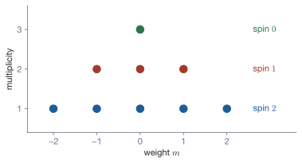
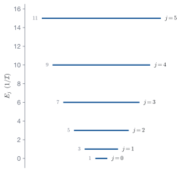
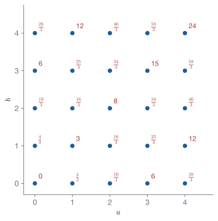
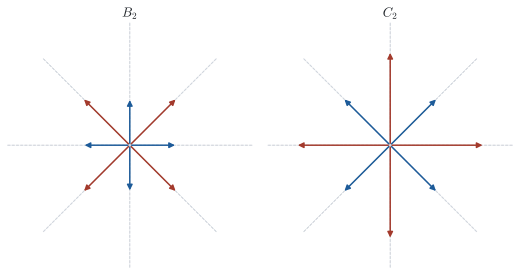
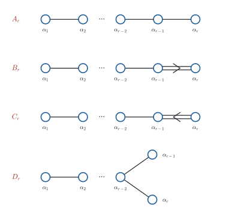
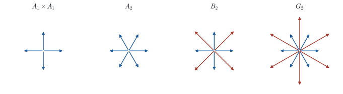
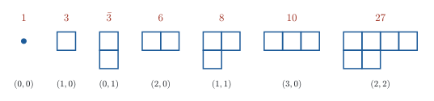
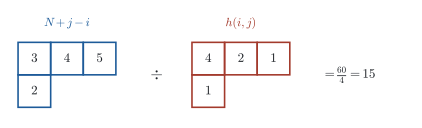
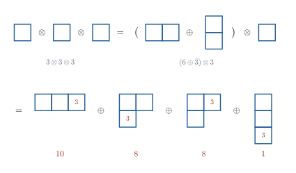

# Lie groups and Lie algebras {#sec-lie-theory}

Lie groups are groups that are also manifolds, so that their elements depend smoothly on continuous parameters; their Lie algebras are the infinitesimal generators, and the exponential map turns generators into group elements. The chapter has two parts: the structure of Lie groups and Lie algebras (matrix groups, brackets, the exponential map, Maurer-Cartan forms), and their representations (weights of $su(2)$, roots of $su(3)$, and the branching of a representation under a subalgebra).

## Lie groups {#sec-lie-groups-algebras}

Lie groups are groups that are also manifolds, so that their elements can be multiplied and also differentiated: the
rotations of space, the unitary matrices of quantum mechanics and the phases of electromagnetism are the standard
examples. The structure theory of Lie groups takes four sections. This one defines Lie groups, the matrix groups that
realise all the examples used in these lectures, their subgroups, their smooth actions on manifolds and the coverings
between them, with $U(1)$, $SO(3)$ and $SU(2)$ as running examples. The next section linearises a group at its
identity into a Lie algebra, a vector space with a bracket, described by structure constants, acted on by the group
through the adjoint representation and equipped with the Killing form. The section after it goes back from the algebra
to the group through the exponential map and one-parameter subgroups, and the last one carries the bracket over the
whole group with left-invariant vector fields and one-forms obeying the Maurer-Cartan equation. Every statement is
followed by ten examples and ten exercises, and every exercise has a hidden solution in two tabs: a proof by hand and a
computation in SageMath.

For more on this topic, see @gadea2013analysis [Ch. 4], @lee2013introduction [Ch. 7, Ch. 8, Ch. 20], @lee2018global [Ch. 1-2], @mukunda2022continuous [Chs. 4, 8], @keskivakkuri2022mathematical [Secs. 6.1-6.2], @pal2015introductory [Ch. 3], @rudolph2013differential [Ch. 5], @scott2023problems [Ch. 3] and @torresdelcastillo2020differentiable [Ch. 7].

### Lie groups {#sec-lie-groups}

Symmetries of a space form a group, and when the symmetries depend smoothly on parameters, as rotations depend on
angles, the group is itself a manifold. The group chapter met the rotation matrices, the spin-rotation matrices
$SU(2)$ and the Lorentz matrices as groups (@exm-group-matrix, @exm-grp-spin-rotations, @exm-grp-lorentz), and the
geometry chapter met $SU(2)$ and the orthogonal matrices as manifolds (@exm-su2-chart, @prp-level-set-examples). The
definition below asks that the two structures be compatible.

For more on this topic, see @lee2013introduction [Ch. 7, pp. 150-173], @rudolph2013differential [Sec. 5.1] and @gadea2013analysis [Sec. 4.1].

The definition combines a group (@def-group) and a smooth manifold (@def-manifold), and asks only that the two group
operations be smooth maps (@def-smooth-map-manifolds). Its first consequences are that multiplying by a fixed element is
a diffeomorphism, that products of Lie groups are Lie groups, and that finite groups are Lie groups of dimension zero.

:::: {.statement-box}
::: {#def-lie-group}
#### Lie group

A **Lie group** is a group $G$ that is also a smooth manifold, such that the multiplication $m : G \times G \to G$,
$m(g, h) = gh$, and the inversion $i : G \to G$, $i(g) = g^{-1}$, are smooth maps; here $G \times G$ is the product
manifold (@def-product-manifold). Its **dimension** is its dimension as a manifold. Then:

1. for $h \in G$ the **left translation** $L_h(g) = hg$, the **right translation** $R_h(g) = gh$ and the conjugation
   $c_h(g) = hgh^{-1}$ are diffeomorphisms of $G$, with inverses $L_{h^{-1}}$, $R_{h^{-1}}$ and $c_{h^{-1}}$;
2. if $G$ and $H$ are Lie groups, the direct product $G \times H$ (@def-hom-direct-product) with the product manifold
   structure is a Lie group of dimension $\dim G + \dim H$;
3. a finite group, with the topology in which every subset is open and the charts sending each point to $\mathbb{R}^0 =
   \{0\}$, is a Lie group of dimension $0$.
:::
::::

*Proof.* (1) The map $j_h : G \to G \times G$, $g \mapsto (h, g)$, is smooth: in a product chart its components are a
constant and the chart expression of the identity. So $L_h = m \circ j_h$ is smooth, and likewise $R_h = m \circ j'_h$
with $j'_h(g) = (g, h)$. Associativity gives $L_{h^{-1}} \circ L_h = L_h \circ L_{h^{-1}} = \mathrm{id}$ and $R_{h^{-1}}
\circ R_h = R_h \circ R_{h^{-1}} = \mathrm{id}$, so both are diffeomorphisms. Finally $c_h = L_h \circ R_{h^{-1}}$ is a
composite of diffeomorphisms, with inverse $R_h \circ L_{h^{-1}} = c_{h^{-1}}$.

(2) In product charts the multiplication $((g, h), (g', h')) \mapsto (gg', hh')$ has as components the chart expressions
of $m_G(g, g')$ and $m_H(h, h')$, which are smooth; the inversion $(g, h) \mapsto (g^{-1}, h^{-1})$ is smooth for the same
reason. The dimension of a product manifold is the sum (@def-product-manifold).

(3) The topology is Hausdorff and, the set being finite, second countable. The charts $\{g\} \to \mathbb{R}^0$ have
disjoint domains, so there are no transition maps to check, and every map from a manifold of dimension $0$ is smooth,
because its chart expressions are maps from the one-point space $\mathbb{R}^0$. $\square$

:::: {.callout-note .examples-fold collapse="true" title="Examples"}
The simplest non-trivial Lie group is one-dimensional and abelian. It is the group of phases, which is at the same time
the circle and the rotation group of the plane.

::: {#exm-lie-group-u1}
#### The circle group

$U(1) = \{e^{i\alpha}\}$ is the circle $S^1$ with the multiplication $e^{i\alpha}e^{i\beta} = e^{i(\alpha + \beta)}$. In
the angle chart the multiplication is $(\alpha, \beta) \mapsto \alpha + \beta$ and the inversion $\alpha \mapsto -\alpha$,
both modulo $2\pi$ and both smooth: a Lie group of dimension $1$, abelian. The rotations $SO(2)$ of the plane form the
same group (@exm-iso-so2-u1).
:::

Vector spaces under addition are Lie groups with a single global chart. Open subsets of matrices closed under
multiplication give non-abelian examples of the same kind.

::: {#exm-lie-group-vector-space}
#### Vector spaces and general linear groups

$(\mathbb{R}^n, +)$ is a Lie group of dimension $n$: in the identity chart $(\mathbf x, \mathbf y) \mapsto \mathbf x + \mathbf
y$ and $\mathbf x \mapsto -\mathbf x$ are linear. The non-zero reals $\mathbb{R}^\times$ and complex numbers $\mathbb{C}^\times$
are open in $\mathbb{R}$ and $\mathbb{C} = \mathbb{R}^2$, and their products and inverses $1/x$ are smooth, so they are Lie
groups of dimensions $1$ and $2$. The same holds for $GL(n, \mathbb{R})$, the invertible real $n \times n$ matrices: it is
the open set $\{\det \neq 0\}$ of $\mathbb{R}^{n \times n} = \mathbb{R}^{n^2}$, the entries of a product are polynomials in
the entries of the factors, and the entries of $\mathbf A^{-1}$ are polynomials divided by $\det\mathbf A$.
:::

Matrices give non-abelian examples in which smoothness is automatic, because products and inverses are polynomial in
the entries. The group of spin rotations is the three-sphere.

::: {#exm-lie-group-su2}
#### $SU(2)$ is the three-sphere

$SU(2)$ is the manifold $S^3$ of @exm-su2-chart, with coordinates $(\operatorname{Re}a, \operatorname{Im}a, \operatorname{Re}b,
\operatorname{Im}b)$ for $\mathbf U = \begin{pmatrix} a & -b^* \\ b & a^* \end{pmatrix}$. The entries of a product are
polynomials in these coordinates, and $\mathbf U^{-1} = \mathbf U^\dagger$ is linear in them. A polynomial map of
$\mathbb{R}^4 \times \mathbb{R}^4$ composed with the inverse of a chart of $S^3 \times S^3$ is smooth, and so is a chart of
$S^3$ composed with it, since the stereographic charts of $S^3$ are smooth on open subsets of $\mathbb{R}^4$. So $SU(2)$
is a Lie group of dimension $3$.
:::

Products of Lie groups are Lie groups by part (2). The torus is the product of two circles, and it is the simplest
abelian group that is not a line or a circle.

::: {#exm-lie-group-torus}
#### The torus

$T^2 = U(1) \times U(1)$, with $(e^{i\alpha}, e^{i\beta})(e^{i\alpha'}, e^{i\beta'}) = (e^{i(\alpha + \alpha')}, e^{i(\beta +
\beta')})$, is a Lie group of dimension $2$ by part (2) and @exm-lie-group-u1. In the angle charts it is
$\mathbb{R}^2$ with addition modulo $2\pi$ in each coordinate, and it is abelian. More generally $T^n = U(1)^n$ is an
abelian Lie group of dimension $n$.
:::

The maps $x \mapsto ax + b$ of the line with $a > 0$ form a group under composition. Its coordinates fill an open
half-plane, and the group is the smallest non-abelian Lie group.

::: {#exm-lie-group-affine}
#### The affine group of the line

Composing $x \mapsto a'x + b'$ and then $x \mapsto ax + b$ gives $x \mapsto aa'x + ab' + b$. So the half-plane $\{(a, b) :
a > 0\}$ with $(a, b)(a', b') = (aa', ab' + b)$, identity $(1, 0)$ and inverse $(a, b)^{-1} = (1/a, -b/a)$ is a group, and
both operations are smooth on the open set $a > 0$ of $\mathbb{R}^2$: a Lie group of dimension $2$. It is not abelian,
since $(2, 0)(1, 1) = (2, 2)$ while $(1, 1)(2, 0) = (2, 1)$.
:::

The rotations of space are the most familiar non-abelian Lie group. The geometry chapter made them a manifold, and the
same argument as for $SU(2)$ makes the group operations smooth.

::: {#exm-lie-group-so3}
#### The rotation group

$SO(3) = \{\mathbf A^\top\mathbf A = \mathbf I, \det\mathbf A = 1\}$ is an embedded submanifold of $\mathbb{R}^{3 \times 3}$ of
dimension $3$ (@prp-level-set-examples (3)). Products are polynomial in the nine entries and $\mathbf A^{-1} = \mathbf
A^\top$ is linear, so, composed with slice charts as in @exm-lie-group-su2, both operations are smooth: $SO(3)$ is a Lie
group of dimension three, as is every $SO(n)$ of dimension $n(n - 1)/2$. A rotation is fixed by an axis, two parameters, and
an angle, which matches the dimension.
:::

Part (3) says that finite groups are Lie groups. Dimension zero is allowed, and it is the right setting for the
symmetry groups of crystals and molecules.

::: {#exm-lie-group-finite}
#### Finite groups

$\mathbb{Z}_n$, $S_3$, the quaternion group $Q_8$ (@exm-grp-pauli-quaternion) and the symmetry group of a molecule are Lie
groups of dimension $0$ by part (3). A product such as $SO(2) \times \mathbb{Z}_2$ is a Lie group of dimension $1$ with two
pieces by part (2); it is the group $O(2)$ in disguise, the second factor recording whether a reflection is applied.
:::

The Galilean transformations of non-relativistic mechanics in one space dimension form a three-parameter group. Its
multiplication has a single quadratic term, as for the matrices of the Heisenberg group.

::: {#exm-lie-group-galilei}
#### The Galilean group of the line

A time shift $\tau$, a boost of velocity $v$ and a translation $a$ act on spacetime by $(t, x) \mapsto (t + \tau, x + vt +
a)$. Composing $(\tau', v', a')$ first and then $(\tau, v, a)$ gives $(t + \tau + \tau', x + (v + v')t + a + a' + v\tau')$,
so $(\tau, v, a)(\tau', v', a') = (\tau + \tau', v + v', a + a' + v\tau')$ with inverse $(-\tau, -v, -a + v\tau)$. Both are
polynomial on $\mathbb{R}^3$, a Lie group of dimension $3$, and it is not abelian: a boost followed by a time shift
differs from the time shift followed by the boost by a translation.
:::

Quaternions extend the complex numbers to four real dimensions. Their non-zero elements form a group under
multiplication, which is open in $\mathbb{R}^4$ [@lee2013introduction, Problems 7-22, 7-23].

::: {#exm-lie-group-quaternions}
#### Non-zero quaternions

Write a quaternion as $q = q_0 + q_1\mathbf{i} + q_2\mathbf{j} + q_3\mathbf{k}$ with $\mathbf{i}^2 = \mathbf{j}^2 =
\mathbf{k}^2 = \mathbf{ijk} = -1$, and $|q|^2 = q_0^2 + q_1^2 + q_2^2 + q_3^2$. The product is bilinear, hence polynomial, in
the eight coordinates, and $q^{-1} = \bar q/|q|^2$ with $\bar q = q_0 - q_1\mathbf{i} - q_2\mathbf{j} - q_3\mathbf{k}$ is
smooth on $q \neq 0$. So the non-zero quaternions $\mathbb{H}^\times = \mathbb{R}^4 \setminus \{0\}$ form a Lie group of
dimension $4$, not abelian, since $\mathbf{ij} = \mathbf k = -\mathbf{ji}$.
:::

The two structures have to be compatible, and a group that is also a manifold need not be a Lie group. The last
example transports addition by a map that is a homeomorphism but not a diffeomorphism.

::: {#exm-lie-group-not-smooth}
#### A group that is a manifold but not a Lie group

On $\mathbb{R}$ with its usual smooth structure define $x * y = (x^{1/3} + y^{1/3})^3$, the real cube root. Since $x
\mapsto x^{1/3}$ is a bijection turning $*$ into addition, $(\mathbb{R}, *)$ is a group isomorphic to $(\mathbb{R}, +)$,
with identity $0$. But $y \mapsto 1 * y = 1 + 3y^{1/3} + 3y^{2/3} + y$ is not differentiable at $y = 0$, so the
multiplication is not smooth and $(\mathbb{R}, *)$ is not a Lie group. A group with the discrete topology fails in a
different way when it is uncountable: $\mathbb{R}$ with every subset open is not second countable, hence not a
manifold.
:::
::::

:::: {.callout-note .exercises-fold collapse="true" title="Exercises"}
Part (1) says that translations and conjugations are diffeomorphisms. The first exercise writes them out for the
affine group of @exm-lie-group-affine, where everything is explicit.

::: {#exr-lie-group-affine-translations}
#### Translations of the affine group

For $h = (a_0, b_0)$ in the affine group compute $L_h$, $R_h$ and $c_h$ in the coordinates $(a, b)$, their Jacobian
determinants, and check that $c_h$ fixes the identity.
:::

::: {.callout-note .solution collapse="true" title="Solution"}
:::: {.panel-tabset .solution-tabs}
## Proof

With $(a, b)(a', b') = (aa', ab' + b)$, $L_h(a, b) = (a_0a, a_0b + b_0)$ with Jacobian matrix $\operatorname{diag}(a_0,
a_0)$, determinant $a_0^2 > 0$, and $R_h(a, b) = (aa_0, ab_0 + b)$ with Jacobian $\begin{pmatrix} a_0 & 0 \\ b_0 & 1
\end{pmatrix}$, determinant $a_0 > 0$. The inverse is $h^{-1} = (1/a_0, -b_0/a_0)$, so $c_h(a, b) = L_h(R_{h^{-1}}(a, b)) =
L_h(a/a_0, -ab_0/a_0 + b) = (a, a_0b + b_0(1 - a))$, with Jacobian determinant $a_0 > 0$, and $c_h(1, 0) = (1, 0)$. All
three are smooth with smooth inverses $L_{h^{-1}}$, $R_{h^{-1}}$, $c_{h^{-1}}$, as part (1) says.

## SageMath

The code composes the maps symbolically and prints their Jacobian determinants.

```{.python .sage}
a, b, a0, b0 = var("a b a0 b0")
mul = lambda p, q: (p[0] * q[0], p[0] * q[1] + p[1])
inv = lambda p: (1 / p[0], -p[1] / p[0])
h, g = (a0, b0), (a, b)
L, R = mul(h, g), mul(g, h)
C = tuple(e.simplify_full() for e in mul(mul(h, g), inv(h)))
for name, F in [("L_h", L), ("R_h", R), ("c_h", C)]:
    J = jacobian(list(F), [a, b])
    print(name, "=", F, "; Jacobian determinant", J.det().simplify_full())
print("c_h(1, 0) =", tuple(e.subs(a=1, b=0).simplify_full() for e in C))
```

```{.text .sage-output}
L_h = (a*a0, a0*b + b0) ; Jacobian determinant a0^2
R_h = (a*a0, a*b0 + b) ; Jacobian determinant a0
c_h = (a, a0*b - (a - 1)*b0) ; Jacobian determinant a0
c_h(1, 0) = (1, 0)
```
::::
:::

Matrices with ones on the diagonal and arbitrary entries above it form a group that is non-abelian but very close to
the vector space $\mathbb{R}^3$. The second exercise checks the smoothness of its operations by computing them
explicitly [@gadea2013analysis, Problem 4.42].

::: {#exr-lg-heisenberg-group}
#### The Heisenberg group

Let $\mathbf h(x, y, z) = \begin{pmatrix} 1 & x & z \\ 0 & 1 & y \\ 0 & 0 & 1 \end{pmatrix}$. Compute $\mathbf h(x_1, y_1,
z_1)\mathbf h(x_2, y_2, z_2)$ and $\mathbf h(x, y, z)^{-1}$, conclude that these matrices form a Lie group of dimension $3$
with a single global chart $(x, y, z)$, and show that it is not abelian.
:::

::: {.callout-note .solution collapse="true" title="Solution"}
:::: {.panel-tabset .solution-tabs}
## Proof

Multiplying out, $\mathbf h(x_1, y_1, z_1)\mathbf h(x_2, y_2, z_2) = \mathbf h(x_1 + x_2, y_1 + y_2, z_1 + z_2 + x_1y_2)$,
and the inverse is $\mathbf h(-x, -y, xy - z)$, since $\mathbf h(x, y, z)\mathbf h(-x, -y, xy - z) = \mathbf h(0, 0, z + xy -
z - xy) = \mathbf I$. The set is in bijection with $\mathbb{R}^3$ by $(x, y, z)$, a single chart, and in it the two
operations are polynomial, hence smooth: a Lie group of dimension $3$. The two products in opposite orders differ only in
the corner, by $x_1y_2 - x_2y_1$, which is non-zero for $(x_1, y_1) = (1, 0)$, $(x_2, y_2) = (0, 1)$: the group is not
abelian.

## SageMath

The code multiplies the matrices symbolically and compares with the formulas of the proof.

```{.python .sage}
x1, y1, z1, x2, y2, z2 = var("x1 y1 z1 x2 y2 z2", domain="real")
def h(x, y, z): return matrix(SR, [[1, x, z], [0, 1, y], [0, 0, 1]])
P = h(x1, y1, z1) * h(x2, y2, z2)
print("h(x1,y1,z1) h(x2,y2,z2) =", P.list())
print("product is h(x1+x2, y1+y2, z1+z2+x1*y2):", P == h(x1 + x2, y1 + y2, z1 + z2 + x1 * y2))
Hi = h(x1, y1, z1).inverse().simplify_full()
print("inverse =", Hi.list(), "; equals h(-x, -y, x*y - z):", bool(Hi == h(-x1, -y1, x1 * y1 - z1)))
C = (h(x1, y1, z1) * h(x2, y2, z2) - h(x2, y2, z2) * h(x1, y1, z1))
print("g1 g2 - g2 g1 =", C.list())
```

```{.text .sage-output}
h(x1,y1,z1) h(x2,y2,z2) = [1, x1 + x2, x1*y2 + z1 + z2, 0, 1, y1 + y2, 0, 0, 1]
product is h(x1+x2, y1+y2, z1+z2+x1*y2): True
inverse = [1, -x1, x1*y1 - z1, 0, 1, -y1, 0, 0, 1] ; equals h(-x, -y, x*y - z): True
g1 g2 - g2 g1 = [0, 0, -x2*y1 + x1*y2, 0, 0, 0, 0, 0, 0]
```
::::
:::

New Lie groups can be made from old ones by taking products. The third exercise proves part (2) in a concrete case and
identifies the tori as products of circles.

::: {#exr-lg-product-group}
#### Products of Lie groups

Show that the torus $T^n = U(1)^n$ is an abelian Lie group of dimension $n$, that $SU(2) \times U(1)$ has dimension $4$, and
that $(\mathbf U, z) \mapsto z\mathbf U$ maps it onto the unitary $2 \times 2$ matrices, two-to-one.
:::

::: {.callout-note .solution collapse="true" title="Solution"}
:::: {.panel-tabset .solution-tabs}
## Proof

Applied $n - 1$ times, part (2) makes $U(1)^n$ a Lie group of dimension $n \cdot 1$, abelian because each factor is.
$SU(2) \times U(1)$ has dimension $3 + 1 = 4$ by @exm-lie-group-su2. For a unitary $\mathbf V$, $|\det\mathbf V| = 1$;
choose $z$ with $z^2 = \det\mathbf V$. Then $\mathbf U = z^{-1}\mathbf V$ is unitary with $\det\mathbf U = z^{-2}\det\mathbf V
= 1$, so $\mathbf V = z\mathbf U$ is in the image. If $z\mathbf U = z'\mathbf U'$, then $\mathbf U' = (z/z')\mathbf U$, and
taking determinants $(z/z')^2 = 1$: either $(\mathbf U', z') = (\mathbf U, z)$ or $(-\mathbf U, -z)$, exactly two
preimages.

## SageMath

The code takes a unitary matrix, finds both preimages, and checks them.

```{.python .sage}
K.<i> = QuadraticField(-1)
V = matrix(K, [[0, 1], [1, 0]])                     # unitary, det = -1
print("V unitary:", V * V.conjugate_transpose() == 1, "; det V =", V.det())
z = (V.det()).sqrt(all=True)
print("square roots z of det V:", z)
for zz in z:
    U = V / zz
    print("U =", U.list(), "; det U =", U.det(), "; unitary:", U * U.conjugate_transpose() == 1, "; z U = V:", zz * U == V)
```

```{.text .sage-output}
V unitary: True ; det V = -1
square roots z of det V: [i, -i]
U = [0, -i, -i, 0] ; det U = 1 ; unitary: True ; z U = V: True
U = [0, i, i, 0] ; det U = 1 ; unitary: True ; z U = V: True
```
::::
:::

A Lie group structure is not attached to a set but to the operations put on it, and the same manifold can carry an
unexpected product. The fourth exercise transports the multiplication of the positive reals to a half-line by a change
of coordinates.

::: {#exr-lg-twisted-line}
#### A twisted product on a half-line

On $M = (-1, \infty)$ define $x * y = x + y + xy$. Show that $(M, *)$ is a Lie group: find the identity and the
inverse, prove associativity, and exhibit an isomorphism with the multiplicative group $(0, \infty)$ and then with
$(\mathbb{R}, +)$.
:::

::: {.callout-note .solution collapse="true" title="Solution"}
:::: {.panel-tabset .solution-tabs}
## Proof

The map $\phi(x) = 1 + x$ sends $M$ to $(0, \infty)$, and $\phi(x * y) = 1 + x + y + xy = (1 + x)(1 + y) =
\phi(x)\phi(y)$, so $*$ is the ordinary product transported by $\phi$. Associativity, the identity $0 = \phi^{-1}(1)$
and the inverse $\phi^{-1}(1/(1 + x)) = -x/(1 + x)$ follow from those of the multiplicative group; the product and the
inverse are smooth on $M$, so $(M, *)$ is a Lie group. Composing with the logarithm gives $x \mapsto \log(1 + x)$, a
diffeomorphism $M \to \mathbb{R}$ turning $*$ into addition, so $(M, *)$ is the one-dimensional Lie group $\mathbb{R}$
in disguise. Unlike @exm-lie-group-not-smooth, this transport is by a diffeomorphism.

## SageMath

The code checks associativity, the identity, the inverse and the logarithm isomorphism symbolically.

```{.python .sage}
x, y, z = var("x y z")
st = lambda u, v: u + v + u * v
print("associative:", bool(expand(st(st(x, y), z) - st(x, st(y, z))) == 0))
print("x * 0 = x:", bool(st(x, 0) == x), "; x * (-x/(1+x)) =", st(x, -x / (1 + x)).simplify_full())
print("log(1 + x*y) - log(1+x) - log(1+y), with * the twisted product:", (log(1 + st(x, y)) - log(1 + x) - log(1 + y)).simplify_log())
```

```{.text .sage-output}
associative: True
x * 0 = x: True ; x * (-x/(1+x)) = 0
log(1 + x*y) - log(1+x) - log(1+y), with * the twisted product: 0
```
::::
:::

The multiplication of a Lie group has a simple derivative at the identity. The fifth exercise computes it, and that of
the inversion, from velocities of curves [@lee2013introduction, Problem 7-2].

::: {#exr-lie-group-dm}
#### The derivative of multiplication at the identity

Let $\gamma$ and $\delta$ be smooth curves in $G$ through $e$ at $t = 0$, with velocities $X$ and $Y$. Show that the
velocity of $t \mapsto \gamma(t)\delta(t)$ at $t = 0$ is $X + Y$, and that the velocity of $t \mapsto \gamma(t)^{-1}$ is
$-X$. Check both on $GL(2, \mathbb{R})$ with $\gamma(t) = \mathbf I + t\mathbf X$, $\delta(t) = \mathbf I + t\mathbf Y$.
:::

::: {.callout-note .solution collapse="true" title="Solution"}
:::: {.panel-tabset .solution-tabs}
## Proof

In a chart $x$ around $e$ with $x(e) = \mathbf 0$, the multiplication has a smooth chart expression $\hat m(\mathbf u, \mathbf
v)$ with $\hat m(\mathbf u, \mathbf 0) = \mathbf u$ and $\hat m(\mathbf 0, \mathbf v) = \mathbf v$, since $ge = g$ and $eh = h$.
Differentiating these identities, $\partial_{\mathbf u}\hat m(\mathbf 0, \mathbf 0) = \mathbf I$ and $\partial_{\mathbf
v}\hat m(\mathbf 0, \mathbf 0) = \mathbf I$, so by the chain rule the velocity of $\hat m(\hat\gamma(t), \hat\delta(t))$ at
$t = 0$ is $\hat\gamma'(0) + \hat\delta'(0)$, the coordinates of $X + Y$ (@def-pushforward (4)). For the inversion,
$\gamma(t)\gamma(t)^{-1} = e$ is constant, so by the first part $X + V = 0$, where $V$ is the velocity of $\gamma(t)^{-1}$:
$V = -X$. On $GL(2, \mathbb{R})$, $(\mathbf I + t\mathbf X)(\mathbf I + t\mathbf Y) = \mathbf I + t(\mathbf X + \mathbf Y) +
t^2\mathbf X\mathbf Y$ has velocity $\mathbf X + \mathbf Y$, and $(\mathbf I + t\mathbf X)^{-1} = \mathbf I - t\mathbf X +
O(t^2)$ has velocity $-\mathbf X$.

## SageMath

Check on $GL(2, \mathbb{R})$ with symbolic matrices $\mathbf X$, $\mathbf Y$: the code differentiates both curves at $t =
0$.

```{.python .sage}
t = var("t")
X = matrix(SR, 2, 2, var("x11 x12 x21 x22")); Y = matrix(SR, 2, 2, var("y11 y12 y21 y22"))
I2 = identity_matrix(SR, 2)
P = (I2 + t * X) * (I2 + t * Y)
print("velocity of the product - (X + Y) =", (diff(P, t).subs(t=0) - X - Y).list())
Inv = (I2 + t * X).inverse()
print("velocity of the inverse + X =", (diff(Inv, t).subs(t=0) + X).simplify_full().list())
```

```{.text .sage-output}
velocity of the product - (X + Y) = [0, 0, 0, 0]
velocity of the inverse + X = [0, 0, 0, 0]
```
::::
:::

The determinant turns products of matrices into products of numbers. The sixth exercise shows that it is a smooth
homomorphism of Lie groups and computes its derivative at the identity [@lee2013introduction, Problem 7-4].

::: {#exr-lie-group-det}
#### The determinant as a homomorphism

Show that $\det : GL(n, \mathbb{R}) \to \mathbb{R}^\times$ is a smooth homomorphism, that $\frac{d}{dt}\det(\mathbf I +
t\mathbf X)|_{t = 0} = \operatorname{tr}\mathbf X$, and that $\frac{d}{dt}\det(\mathbf A + t\mathbf X)|_{t = 0} = \det\mathbf
A\,\operatorname{tr}(\mathbf A^{-1}\mathbf X)$.
:::

::: {.callout-note .solution collapse="true" title="Solution"}
:::: {.panel-tabset .solution-tabs}
## Proof

$\det(\mathbf A\mathbf B) = \det\mathbf A\det\mathbf B$ (@thm-determinant-product), and $\det$ is a polynomial in the
entries, hence smooth. In the Leibniz expansion of $\det(\mathbf I + t\mathbf X)$ as a sum over permutations, a
permutation other than the identity moves at least two indices, so its term contains at least two off-diagonal factors
$tX_{ij}$ and is $O(t^2)$. The identity term is $\prod_i(1 + tX_{ii}) = 1 + t\operatorname{tr}\mathbf X + O(t^2)$. So
$\det(\mathbf I + t\mathbf X) = 1 + t\operatorname{tr}\mathbf X + O(t^2)$, and the derivative at $0$ is
$\operatorname{tr}\mathbf X$. Finally $\det(\mathbf A + t\mathbf X) = \det\mathbf A\,\det(\mathbf I + t\mathbf A^{-1}\mathbf
X)$, whose derivative is $\det\mathbf A\operatorname{tr}(\mathbf A^{-1}\mathbf X)$.

## SageMath

Check on $3 \times 3$ symbolic matrices: the code differentiates both determinants at $t = 0$.

```{.python .sage}
t = var("t")
X = matrix(SR, 3, 3, var(" ".join(f"x{i}{j}" for i in range(3) for j in range(3))))
A = matrix(SR, [[2, 1, 0], [0, 1, 3], [1, 0, 1]])
d1 = diff((identity_matrix(SR, 3) + t * X).det(), t).subs(t=0)
print("d/dt det(I + tX) - tr X =", (d1 - X.trace()).expand())
d2 = diff((A + t * X).det(), t).subs(t=0)
print("d/dt det(A + tX) - det A tr(A^-1 X) =", (d2 - A.det() * (A.inverse() * X).trace()).expand())
```

```{.text .sage-output}
d/dt det(I + tX) - tr X = 0
d/dt det(A + tX) - det A tr(A^-1 X) = 0
```
::::
:::

The commutator $ghg^{-1}h^{-1}$ measures how far two elements are from commuting. The seventh exercise shows that it
is a smooth function of the pair and computes it in two non-abelian examples.

::: {#exr-lie-group-commutator}
#### The commutator map

Show that $(g, h) \mapsto ghg^{-1}h^{-1}$ is smooth on $G \times G$ for any Lie group, and compute it for the affine group
and for the Galilean group of @exm-lie-group-galilei.
:::

::: {.callout-note .solution collapse="true" title="Solution"}
:::: {.panel-tabset .solution-tabs}
## Proof

The map is $m \circ (m \times m) \circ (\mathrm{id} \times \mathrm{id} \times i \times i) \circ \Delta$, with $\Delta(g, h) =
(g, h, g, h)$; each factor is smooth by the definition and @def-product-manifold, so the composite is smooth. For the
affine group, $(a, b)(a', b')(a, b)^{-1}(a', b')^{-1} = (1, (a - 1)b' - (a' - 1)b)$: a pure translation, the identity
exactly when $(a - 1)b' = (a' - 1)b$. For the Galilean group, $(\tau, v, a)(\tau', v', a')$ and the product in the other
order differ only in the last entry, by $v\tau' - v'\tau$, and the commutator is $(0, 0, v\tau' - v'\tau)$.

## SageMath

The code multiplies out both commutators symbolically.

```{.python .sage}
a, b, c, d = var("a b c d")
mul = lambda p, q: (p[0] * q[0], p[0] * q[1] + p[1]); inv = lambda p: (1 / p[0], -p[1] / p[0])
g, h = (a, b), (c, d)
com = mul(mul(g, h), mul(inv(g), inv(h)))
print("affine commutator:", tuple(e.simplify_full() for e in com))
t1, v1, a1, t2, v2, a2 = var("t1 v1 a1 t2 v2 a2")
gm = lambda p, q: (p[0] + q[0], p[1] + q[1], p[2] + q[2] + p[1] * q[0])
gi = lambda p: (-p[0], -p[1], -p[2] + p[1] * p[0])
G1, G2 = (t1, v1, a1), (t2, v2, a2)
print("Galilean commutator:", tuple(e.expand() for e in gm(gm(G1, G2), gm(gi(G1), gi(G2)))))
```

```{.text .sage-output}
affine commutator: (1, -b*c + (a - 1)*d + b)
Galilean commutator: (0, 0, t2*v1 - t1*v2)
```
::::
:::

The affine maps $\mathbf x \mapsto \mathbf A\mathbf x + \mathbf b$ of $\mathbb{R}^n$ generalise the affine group of the line.
The eighth exercise shows that they form a Lie group, and computes its dimension and its law in coordinates.

::: {#exr-lie-group-affine-n}
#### The affine group of $\mathbb{R}^n$

Show that the pairs $(\mathbf A, \mathbf b) \in GL(n, \mathbb{R}) \times \mathbb{R}^n$ with $(\mathbf A, \mathbf b)(\mathbf
A', \mathbf b') = (\mathbf A\mathbf A', \mathbf A\mathbf b' + \mathbf b)$ form a Lie group of dimension $n^2 + n$, that it
is the group of maps $\mathbf x \mapsto \mathbf A\mathbf x + \mathbf b$ under composition, and that $(\mathbf A, \mathbf b)
\mapsto \begin{pmatrix} \mathbf A & \mathbf b \\ \mathbf 0^\top & 1 \end{pmatrix}$ turns the law into matrix multiplication.
:::

::: {.callout-note .solution collapse="true" title="Solution"}
:::: {.panel-tabset .solution-tabs}
## Proof

Composing $\mathbf x \mapsto \mathbf A'\mathbf x + \mathbf b'$ and then $\mathbf x \mapsto \mathbf A\mathbf x + \mathbf b$ gives
$\mathbf x \mapsto \mathbf A\mathbf A'\mathbf x + \mathbf A\mathbf b' + \mathbf b$, so the law is composition, associative,
with identity $(\mathbf I, \mathbf 0)$ and inverse $(\mathbf A^{-1}, -\mathbf A^{-1}\mathbf b)$. The set is open in
$\mathbb{R}^{n^2} \times \mathbb{R}^n$, and the product and inverse are polynomial or rational with denominator $\det\mathbf
A$, so it is a Lie group of dimension $n^2 + n$. Block multiplication gives $\begin{pmatrix} \mathbf A & \mathbf b \\ \mathbf
0^\top & 1 \end{pmatrix}\begin{pmatrix} \mathbf A' & \mathbf b' \\ \mathbf 0^\top & 1 \end{pmatrix} = \begin{pmatrix}
\mathbf A\mathbf A' & \mathbf A\mathbf b' + \mathbf b \\ \mathbf 0^\top & 1 \end{pmatrix}$. For $n = 1$ and $A > 0$ this is
the affine group of @exm-lie-group-affine.

## SageMath

Check for $n = 2$: the code compares the block product with the law and composition.

```{.python .sage}
A = matrix(SR, 2, 2, var("a11 a12 a21 a22")); B = matrix(SR, 2, 2, var("c11 c12 c21 c22"))
b = vector(SR, var("b1 b2")); bp = vector(SR, var("d1 d2")); xv = vector(SR, var("x1 x2"))
M = lambda A, b: block_matrix([[A, b.column()], [zero_matrix(SR, 1, 2), identity_matrix(SR, 1)]], subdivide=False)
print("block product = M(AA', Ab' + b):", M(A, b) * M(B, bp) == M(A * B, A * bp + b))
print("composition = law:", (A * (B * xv + bp) + b - ((A * B) * xv + (A * bp + b))).apply_map(expand) == 0)
print("dimension for n = 2:", 2^2 + 2)
```

```{.text .sage-output}
block product = M(AA', Ab' + b): True
composition = law: True
dimension for n = 2: 6
```
::::
:::

The centre of a group is the set of elements commuting with everything. The ninth exercise shows that in a Lie group it
is a closed subset, and computes it for the Heisenberg group of @exr-lg-heisenberg-group.

::: {#exr-lie-group-centre}
#### The centre is closed

Show that $Z(G) = \bigcap_{h \in G}\{g : c_h(g) = g\}$ is closed in a Lie group $G$, and that the centre of the
Heisenberg group is $\{\mathbf h(0, 0, z)\}$, a copy of $\mathbb{R}$.
:::

::: {.callout-note .solution collapse="true" title="Solution"}
:::: {.panel-tabset .solution-tabs}
## Proof

$Z(G)$ is the set of $g$ with $hg = gh$ for all $h$ (@def-normal-subgroup), that is, $c_h(g) = g$. For fixed $h$ the set
$\{g : c_h(g) = g\}$ is the preimage of the diagonal under $g \mapsto (c_h(g), g)$, continuous by part (1); the diagonal of
a Hausdorff space is closed, so each set is closed, and so is their intersection. For the Heisenberg group, by
@exr-lg-heisenberg-group the products in the two orders differ by $x_1y_2 - x_2y_1$ in the corner. This vanishes for all
$(x_2, y_2)$ exactly when $x_1 = y_1 = 0$, so the centre is $\{\mathbf h(0, 0, z) : z \in \mathbb{R}\}$, and $\mathbf h(0, 0,
z)\mathbf h(0, 0, z') = \mathbf h(0, 0, z + z')$.

## SageMath

Check on the Heisenberg group: the code solves for the elements commuting with all $\mathbf h(x_2, y_2, z_2)$.

```{.python .sage}
x1, y1, z1, x2, y2, z2 = var("x1 y1 z1 x2 y2 z2")
def h(x, y, z): return matrix(SR, [[1, x, z], [0, 1, y], [0, 0, 1]])
C = h(x1, y1, z1) * h(x2, y2, z2) - h(x2, y2, z2) * h(x1, y1, z1)
e = C[0, 2]
print("corner of g h - h g:", e)
print("coefficients in (x2, y2) must vanish:", [e.coefficient(x2), e.coefficient(y2)])
```

```{.text .sage-output}
corner of g h - h g: -x2*y1 + x1*y2
coefficients in (x2, y2) must vanish: [-y1, x1]
```
::::
:::

Compactness separates the groups of rotations from those of boosts and shears. The tenth exercise decides it for the
groups of this section, using that a subset of $\mathbb{R}^N$ is compact when it is closed and bounded
[@lee2013introduction, Problem 7-17].

::: {#exr-lie-group-compact}
#### Which groups are compact

Show that $SU(2)$, $SO(3)$ and $T^n$ are compact, and that $GL(n, \mathbb{R})$, the affine group and the Galilean group are
not.
:::

::: {.callout-note .solution collapse="true" title="Solution"}
:::: {.panel-tabset .solution-tabs}
## Proof

$SU(2) = S^3$ is closed and bounded in $\mathbb{R}^4$. $SO(3)$ is closed in $\mathbb{R}^9$, being given by polynomial
equations, and bounded, since each column is a unit vector, so every entry has modulus at most $1$. $T^n$ is a product of
circles, a closed bounded subset of $\mathbb{C}^n = \mathbb{R}^{2n}$. $GL(n, \mathbb{R})$ contains $t\mathbf I$ for all $t >
0$, an unbounded family; it is also not closed in $\mathbb{R}^{n^2}$, since $\mathbf I/k \to \mathbf 0$. The affine group
contains $(1, b)$ for all $b$, and the Galilean group $(0, 0, a)$ for all $a$; in their global coordinates these are
unbounded, and a compact subset of $\mathbb{R}^2$ or $\mathbb{R}^3$ is bounded.

## SageMath

The code prints the largest entry of random elements of $SO(3)$, always at most $1$, and the norm of $t\mathbf I$ in
$GL(3, \mathbb{R})$.

```{.python .sage}
set_random_seed(1)
mx = 0
for k in range(200):
    Q, _ = random_matrix(RDF, 3, 3).QR()
    mx = max(mx, max(abs(e) for e in Q.list()))
print("largest entry among 200 orthogonal matrices <= 1:", mx <= 1 + 1e-12)
print("norms of t I in GL(3, R) for t = 1, 10, 100:", [(t * identity_matrix(3)).norm("frob").n(digits=5) for t in (1, 10, 100)])
```

```{.text .sage-output}
largest entry among 200 orthogonal matrices <= 1: True
norms of t I in GL(3, R) for t = 1, 10, 100: [1.7320, 17.320, 173.21]
```
::::
:::
::::

### Matrix Lie groups

All the examples above are groups of matrices or are isomorphic to such groups. The next definition singles out this
class, which is large enough for every group used in these lectures. The classical groups are cut out of the invertible
matrices by equations of the form $\mathbf A^\dagger\mathbf B\mathbf A = \mathbf B$, and the regular value theorem
(@thm-regular-value) makes all of them submanifolds at once.

:::: {.statement-box}
::: {#def-matrix-lie-group}
#### Matrix Lie group

Let $\mathbb K = \mathbb{R}$ or $\mathbb{C}$, identify $\mathbb{C}^{n \times n}$ with $\mathbb{R}^{2n^2}$, and write $\mathbf
A^\dagger$ for the conjugate transpose (the transpose when $\mathbb K = \mathbb{R}$). A **matrix Lie group** is a subgroup
$G$ of $GL(n, \mathbb K)$ that is a closed subset of $GL(n, \mathbb K)$ (@def-open-set). Then:

1. $GL(n, \mathbb K)$ is open in $\mathbb K^{n \times n}$ and is a Lie group of real dimension $n^2$ or $2n^2$.
2. (**Restriction**) Let $S \subseteq \mathbb{R}^N$ and $S' \subseteq \mathbb{R}^M$ be embedded submanifolds
   (@def-embedded-submanifold), and $F : W \to \mathbb{R}^M$ smooth on an open $W \supseteq S$ with $F(S) \subseteq S'$.
   Then $F|_S : S \to S'$ is smooth. Hence a subgroup of $GL(n, \mathbb K)$ that is an embedded submanifold is a Lie group.
3. For an invertible $\mathbf B$ with $\mathbf B^\dagger = \epsilon\mathbf B$, $\epsilon = \pm 1$ ($\epsilon = 1$ if $\mathbb K
   = \mathbb{C}$), the set $G_{\mathbf B} = \{\mathbf A \in GL(n, \mathbb K) : \mathbf A^\dagger\mathbf B\mathbf A = \mathbf
   B\}$ is a matrix Lie group and a closed embedded submanifold of $GL(n, \mathbb K)$, with $T_{\mathbf I}G_{\mathbf B} =
   \{Y : Y^\dagger\mathbf B + \mathbf BY = 0\}$, of dimension $n(n - 1)/2$ ($\mathbb K = \mathbb{R}$, $\epsilon = 1$), $n(n +
   1)/2$ ($\mathbb K = \mathbb{R}$, $\epsilon = -1$) or $n^2$ ($\mathbb K = \mathbb{C}$). Instances: $O(n)$ ($\mathbf B =
   \mathbf I$), the Lorentz group $O(1, 3)$ ($\mathbf B = \eta$), the symplectic group $Sp(2m, \mathbb{R})$ ($\mathbf B =
   \mathbf J = \begin{pmatrix} \mathbf 0 & \mathbf I_m \\ -\mathbf I_m & \mathbf 0 \end{pmatrix}$), and $U(n)$ ($\mathbb K =
   \mathbb{C}$, $\mathbf B = \mathbf I$).
4. $\frac{d}{dt}\det(\mathbf A + tY)|_{t = 0} = \det\mathbf A\operatorname{tr}(\mathbf A^{-1}Y)$. The groups $SL(n, \mathbb
   K) = \{\det\mathbf A = 1\}$, $SO(n) = O(n) \cap SL(n, \mathbb{R})$ and $SU(n) = U(n) \cap SL(n, \mathbb{C})$ are matrix Lie
   groups and closed embedded submanifolds of $GL(n, \mathbb K)$, of dimensions $n^2 - 1$ (real) or $2n^2 - 2$ (complex)
   for $SL$, $n(n - 1)/2$ and $n^2 - 1$, with tangent spaces at $\mathbf I$ the traceless matrices, the antisymmetric
   matrices, and the traceless anti-Hermitian matrices.

That every closed subgroup of $GL(n, \mathbb K)$ is an embedded submanifold (the closed subgroup theorem) is true but is
not proved here; every matrix Lie group used below is shown to be one directly, mostly by (3) and (4).
:::
::::

*Proof.* (1) $\det$ is a polynomial in the entries, hence continuous, and $GL(n, \mathbb K) = \det^{-1}(\mathbb K
\setminus \{0\})$ is open. The entries of a product are polynomials in the entries of the factors, and the entries of
$\mathbf A^{-1}$ are polynomials divided by $\det\mathbf A$ (Cramer's rule), so both operations are smooth on the open set.

(2) Let $p \in S$, with a slice chart $x$ of $S$ around $p$ and a slice chart $y$ of $S'$ around $F(p)$; they are
diffeomorphisms of open subsets of $\mathbb{R}^N$ and $\mathbb{R}^M$ onto open sets. The chart $\hat x$ of $S$ has the
inverse $\mathbf a \mapsto x^{-1}(\mathbf a, \mathbf 0)$, smooth into $\mathbb{R}^N$. The chart expression $\hat y \circ F
\circ \hat x^{-1}(\mathbf a)$ is the first $\dim S'$ components of $y(F(x^{-1}(\mathbf a, \mathbf 0)))$, a composite of
smooth maps on an open set, hence smooth. For a subgroup $G$ that is an embedded submanifold, $G \times G$ is embedded in
$GL \times GL$ (products of slice charts are slice charts), and multiplication and inversion are restrictions of the
smooth operations of (1), so they are smooth on $G$.

(3) Let $V_\epsilon = \{\mathbf S : \mathbf S^\dagger = \epsilon\mathbf S\}$, a real vector space, and $F(\mathbf A) = \mathbf
A^\dagger\mathbf B\mathbf A$. Then $F(\mathbf A)^\dagger = \mathbf A^\dagger\mathbf B^\dagger\mathbf A = \epsilon F(\mathbf A)$,
so $F : GL(n, \mathbb K) \to V_\epsilon$ is smooth (polynomial in the real and imaginary parts of the entries), and $G_{\mathbf
B} = F^{-1}(\mathbf B)$. At $\mathbf A \in G_{\mathbf B}$, the derivative in the direction $\mathbf AY$ is
$$
dF_{\mathbf A}(\mathbf AY) = Y^\dagger\mathbf A^\dagger\mathbf B\mathbf A + \mathbf A^\dagger\mathbf B\mathbf AY = Y^\dagger\mathbf B
+ \mathbf BY .
$$
For $\mathbf S \in V_\epsilon$ put $Y = \frac12\mathbf B^{-1}\mathbf S$. Since $(\mathbf B^{-1})^\dagger = (\epsilon\mathbf
B)^{-1} = \epsilon\mathbf B^{-1}$, $Y^\dagger\mathbf B = \frac12\epsilon\mathbf S\,\epsilon\mathbf B^{-1}\mathbf B = \frac12\mathbf
S$ and $\mathbf BY = \frac12\mathbf S$, so $dF_{\mathbf A}(\mathbf AY) = \mathbf S$. As $Y \mapsto \mathbf AY$ is onto, $dF_{\mathbf
A}$ is onto $V_\epsilon$ and $\mathbf B$ is a regular value. By @thm-regular-value, $G_{\mathbf B}$ is a closed embedded
submanifold of dimension $\dim GL - \dim V_\epsilon$: the real symmetric, real antisymmetric and Hermitian matrices have
dimensions $n(n + 1)/2$, $n(n - 1)/2$ and $n^2$, which gives the three values. Its tangent space at $\mathbf I$ is $\ker
dF_{\mathbf I}$ (@prp-tangent-kernel (3)). It is a subgroup: $(\mathbf A\mathbf A')^\dagger\mathbf B\mathbf A\mathbf A' = \mathbf
A'^\dagger\mathbf B\mathbf A' = \mathbf B$, and multiplying $\mathbf A^\dagger\mathbf B\mathbf A = \mathbf B$ by $(\mathbf
A^{-1})^\dagger$ on the left and $\mathbf A^{-1}$ on the right gives $\mathbf B = (\mathbf A^{-1})^\dagger\mathbf B\mathbf
A^{-1}$. For $\mathbf J$, $\mathbf J^\top = -\mathbf J$, and $\eta^\top = \eta$, $\mathbf I^\dagger = \mathbf I$.

(4) $\det(\mathbf A + tY) = \det\mathbf A\det(\mathbf I + t\mathbf A^{-1}Y)$, and $\det(\mathbf I + tZ) = 1 +
t\operatorname{tr}Z + O(t^2)$, since in the Leibniz expansion every permutation other than the identity contributes at
least two off-diagonal factors $tZ_{ij}$. This gives the derivative. On $SL(n, \mathbb K) = \det^{-1}(1)$ the direction $Y
= c\mathbf A/n$ gives the derivative $c$ for every $c \in \mathbb K$, so $1$ is a regular value of $\det : GL \to \mathbb
K$; by @thm-regular-value $SL$ is a closed embedded submanifold of codimension $\dim_{\mathbb{R}}\mathbb K$, with tangent
space $\ker(Y \mapsto \operatorname{tr}Y)$ at $\mathbf I$, and it is a subgroup by @thm-determinant-product. $SO(n)$ is open
and closed in $O(n)$ (@prp-level-set-examples (3)), hence an embedded submanifold of the same dimension and tangent space.
For $SU(n)$ consider $F(\mathbf A) = (\mathbf A^\dagger\mathbf A, \operatorname{Im}\det\mathbf A)$, with values in the Hermitian
matrices times $\mathbb{R}$. Its level set $F^{-1}(\mathbf I, 0)$ is the set of unitary matrices with real determinant;
since $|\det\mathbf A|^2 = \det(\mathbf A^\dagger\mathbf A) = 1$, the determinant is $\pm 1$ there, and $SU(n)$ is the part
where it is $1$, open and closed in the level set. At such $\mathbf A$, with $d = \det\mathbf A = \pm 1$, $dF_{\mathbf
A}(\mathbf AY) = (Y^\dagger + Y, \operatorname{Im}(d\operatorname{tr}Y))$, and for a Hermitian $\mathbf S$ and $c \in \mathbb{R}$
the choice $Y = \frac12\mathbf S + i\,dc\,\mathbf I/n$ gives $(\mathbf S, c)$, since $\operatorname{tr}\mathbf S$ is real. So
the value is regular, the dimension is $2n^2 - n^2 - 1 = n^2 - 1$, and the tangent space at $\mathbf I$ is $\{Y^\dagger = -Y,
\operatorname{Im}\operatorname{tr}Y = 0\}$; for anti-Hermitian $Y$ the trace is imaginary, so the second condition is
$\operatorname{tr}Y = 0$. All are closed subgroups, and by (2) they are Lie groups. $\square$

:::: {.callout-note .examples-fold collapse="true" title="Examples"}
The largest matrix group is the group of all invertible matrices. Because its defining condition is an inequality, it is
an open subset of the space of matrices and its dimension is the full number of entries.

::: {#exm-matrix-gl}
#### The general linear group

$GL(n, \mathbb{R})$ is an open subset of $\mathbb{R}^{n^2}$, the complement of the closed set $\det = 0$, so it is a Lie group
of dimension $n^2$ with the identity chart, and it is a matrix Lie group, being closed in itself. $GL(n, \mathbb{C})$ has
real dimension $2n^2$. $GL(n, \mathbb{R})$ is not closed in $\mathbb{R}^{n \times n}$, since $\mathbf I/k \to \mathbf 0$; the
definition asks for closedness inside $GL(n)$ only.
:::

Diagonal matrices are the simplest closed subgroup. They form an open piece of a linear subspace, so they are a
submanifold without any regular value argument.

::: {#exm-lie-matrix-diagonal}
#### Invertible diagonal matrices

The invertible diagonal matrices $D_n$ form a subgroup of $GL(n, \mathbb{R})$, closed because the off-diagonal entries
vanish on it, a closed condition. It is the intersection of the $n$-dimensional subspace of diagonal matrices with the
open set $GL$, an open subset of that subspace, hence an embedded submanifold of dimension $n$ (the subspace, written in
linear coordinates, gives slice charts). By (2) it is a Lie group, isomorphic to $(\mathbb{R}^\times)^n$.
:::

Imposing that a matrix preserve the Euclidean inner product cuts the general linear group down to a closed subgroup.
The dimension count, entries minus independent equations, is the content of part (3).

::: {#exm-matrix-orthogonal}
#### Orthogonal and special orthogonal groups

$O(n) = \{\mathbf A^\top\mathbf A = \mathbf I\}$, the linear isometries of $\mathbb{R}^n$, is part (3) with $\mathbf B = \mathbf
I$: a closed embedded submanifold of dimension $n(n - 1)/2$, the $n(n + 1)/2$ independent equations of the symmetric matrix
$\mathbf A^\top\mathbf A$ cutting $n^2$ dimensions down. The continuous function $\det$ takes only the values $\pm 1$ on it,
so its sign splits $O(n)$ into two open pieces (@exm-connected-groups), and $SO(n)$, the piece of determinant one, is the
group of rotations. $SO(2)$ has dimension $1$ and $SO(3)$ dimension $3$.
:::

The complex analogue preserves the Hermitian inner product of $\mathbb{C}^n$. Adding the condition of unit determinant
removes one real dimension, and the special unitary groups include the gauge groups of particle physics.

::: {#exm-matrix-unitary}
#### Unitary and special unitary groups

$U(n) = \{\mathbf U^\dagger\mathbf U = \mathbf I\}$ is part (3) with $\mathbb K = \mathbb{C}$, $\mathbf B = \mathbf I$: closed in
$GL(n, \mathbb{C})$ with dimension $n^2$. $SU(n)$, its subgroup of determinant one, has dimension $n^2 - 1$ by part (4):
$SU(2)$ has dimension $3$ and $SU(3)$, the gauge group of the strong interaction, dimension $8$. $U(1)$ is the case $n = 1$,
the unit circle.
:::

Upper triangular matrices with ones on the diagonal form a group in which the only conditions are linear. The Heisenberg
group of @exr-lg-heisenberg-group is the case $n = 3$.

::: {#exm-lie-matrix-unitriangular}
#### Unitriangular matrices

The upper triangular matrices with ones on the diagonal form a subgroup $N_n$ of $GL(n, \mathbb{R})$: the product of two of
them is again upper triangular with diagonal entries $1 \cdot 1$, and the inverse of $\mathbf I + \mathbf N$, $\mathbf N$
strictly upper triangular, is the finite sum $\mathbf I - \mathbf N + \mathbf N^2 - \dots \pm \mathbf N^{n - 1}$, since $\mathbf
N^n = \mathbf 0$. $N_n$ is an affine subspace of dimension $n(n - 1)/2$, closed, hence a matrix Lie group; for $n = 3$ it is
the Heisenberg group.
:::

Special relativity preserves the Minkowski form instead of the Euclidean one. Part (3) with $\mathbf B = \eta$ makes the
Lorentz group a six-dimensional submanifold and describes its tangent space.

::: {#exm-lie-matrix-lorentz}
#### The Lorentz group

With $\eta = \operatorname{diag}(1, -1, -1, -1)$, $O(1, 3) = \{\Lambda^\top\eta\Lambda = \eta\}$ (@exm-grp-lorentz) is a closed
embedded submanifold of $GL(4, \mathbb{R})$ of dimension $16 - 10 = 6$. Its tangent space at $\mathbf I$ is $\{Y : Y^\top\eta
+ \eta Y = 0\}$, that is, $\eta Y$ antisymmetric. Writing $\eta Y = \begin{pmatrix} 0 & -\mathbf b^\top \\ \mathbf b & \mathbf
W\end{pmatrix}$ with $\mathbf W$ antisymmetric gives $Y = \begin{pmatrix} 0 & -\mathbf b^\top \\ -\mathbf b & -\mathbf
W\end{pmatrix}$: three parameters $\mathbf b$ for the boosts and three in $\mathbf W$ for the rotations.
:::

Linear canonical transformations of classical mechanics preserve the symplectic form. Part (3) with $\mathbf B = \mathbf J$
gives the symplectic group, and the time evolution of the oscillator lies in it.

::: {#exm-lie-matrix-canonical}
#### Canonical transformations of the oscillator

For one degree of freedom, $Sp(2, \mathbb{R}) = \{\mathbf M^\top\mathbf J\mathbf M = \mathbf J\}$ with $\mathbf J = \begin{pmatrix}
0 & 1 \\ -1 & 0 \end{pmatrix}$, and $\mathbf M^\top\mathbf J\mathbf M = (\det\mathbf M)\mathbf J$, so $Sp(2, \mathbb{R}) = SL(2,
\mathbb{R})$, of dimension $3$. The flow of the oscillator $\dot q = p$, $\dot p = -q$ is $\mathbf M(t) = \begin{pmatrix} \cos
t & \sin t \\ -\sin t & \cos t \end{pmatrix}$, of determinant one: time evolution is a family of canonical
transformations, and it preserves areas in phase space.
:::

The spin rotations were made a manifold in the geometry chapter through the coordinates of $S^3$. Part (4) gives the
same manifold from the ambient matrices, and the two structures agree.

::: {#exm-lie-matrix-su2}
#### $SU(2)$ as a matrix Lie group

By part (4), $SU(2)$ is a closed embedded submanifold of $\mathbb{C}^{2 \times 2} = \mathbb{R}^8$ of dimension $3$, with
tangent space at $\mathbf I$ the traceless anti-Hermitian matrices $\begin{pmatrix} ix_3 & x_2 + ix_1 \\ -x_2 + ix_1 & -ix_3
\end{pmatrix}$. The linear map $\mathbf U \mapsto (\operatorname{Re}a, \operatorname{Im}a, \operatorname{Re}b, \operatorname{Im}b)$
of @exm-su2-chart is a bijection of $SU(2)$ onto $S^3$ with inverse the restriction of a linear map $\mathbb{R}^4 \to
\mathbb{R}^8$; by part (2) both directions are smooth, so the two manifold structures coincide.
:::

A subgroup need not be closed, and then the definition rejects it. A line of irrational slope wound around the diagonal
torus is the standard example.

::: {#exm-lie-matrix-not-closed}
#### A subgroup that is not closed

For irrational $\alpha$, $H = \{\operatorname{diag}(e^{it}, e^{i\alpha t}) : t \in \mathbb{R}\}$ is a subgroup of $GL(2,
\mathbb{C})$, since $t \mapsto \operatorname{diag}(e^{it}, e^{i\alpha t})$ is a homomorphism from $(\mathbb{R}, +)$. It is
not closed: the points $t = 2\pi k$, $k \in \mathbb{Z}$, give $\operatorname{diag}(1, e^{2\pi i\alpha k})$, and the numbers
$e^{2\pi i\alpha k}$ come arbitrarily close to every point of the circle (@exm-torus-curve), so for instance
$\operatorname{diag}(1, -1)$ is a limit of elements of $H$ but is not in $H$, because $e^{it} = 1$ forces $t \in 2\pi\mathbb{Z}$
and then $e^{i\alpha t} \neq -1$ unless $\alpha k = \frac12 + m$, impossible for irrational $\alpha$.
:::

A level set of a regular value is a submanifold, but it need not be a group. The last example shows that both halves of
the definition carry information.

::: {#exm-lie-matrix-level-not-group}
#### Closed submanifolds that are not groups

$\{\det\mathbf A = 2\}$ is a closed embedded submanifold of $GL(n, \mathbb{R})$ of dimension $n^2 - 1$, by the argument of
part (4), but it is not a subgroup: it does not contain $\mathbf I$, and the product of two of its elements has
determinant $4$. Likewise $\{\mathbf A^\top\mathbf A = 2\mathbf I\}$ is a submanifold not closed under products. By contrast
$GL^+(n, \mathbb{R}) = \{\det > 0\}$ is a subgroup that is open and closed in $GL(n, \mathbb{R})$, a matrix Lie group of the
full dimension $n^2$.
:::
::::

:::: {.callout-note .exercises-fold collapse="true" title="Exercises"}
The first exercise on matrix groups counts dimensions by subtracting the number of independent equations from the
number of real entries. It confirms the values of parts (3) and (4) for small $n$.

::: {#exr-dimension-count}
#### Dimensions of matrix groups

Count the dimensions of $O(n)$, $U(n)$ and $SU(n)$ from the number of independent equations defining them, and check the
values for $n = 2, 3$.
:::

::: {.callout-note .solution collapse="true" title="Solution"}
:::: {.panel-tabset .solution-tabs}
## Proof

$\mathbf A^\top\mathbf A = \mathbf I$ is a symmetric matrix equation, $n(n + 1)/2$ real conditions on $n^2$ entries, and part
(3) shows they are independent at every point (the value is regular): $\dim O(n) = n(n - 1)/2$, giving $1$ and $3$.
$\mathbf U^\dagger\mathbf U = \mathbf I$ is Hermitian, $n^2$ real conditions on $2n^2$ real entries: $\dim U(n) = n^2$, giving
$4$ and $9$. $\det\mathbf U = 1$ removes one more real dimension by part (4), $\dim SU(n) = n^2 - 1$, giving $3$ and $8$.

## SageMath

The code computes the dimension of the tangent spaces at $\mathbf I$, the solutions of the linearised equations, as
real vector spaces.

```{.python .sage}
K.<i> = QuadraticField(-1)
def real_dim(n, cond, real):
    # real basis of the n x n matrices (real or complex); cond(Y) lists entries that vanish on the tangent space
    basis = [matrix(K, n, n, {(j, k): z}) for j in range(n) for k in range(n) for z in ((1,) if real else (1, i))]
    rows = matrix(QQ, [[x for e in cond(Y) for x in (e.real(), e.imag())] for Y in basis])
    return len(basis) - rows.rank()
for n in (2, 3):
    o = real_dim(n, lambda Y: (Y.transpose() + Y).list(), True)
    u = real_dim(n, lambda Y: (Y.conjugate_transpose() + Y).list(), False)
    su = real_dim(n, lambda Y: (Y.conjugate_transpose() + Y).list() + [Y.trace()], False)
    print(f"n = {n}: dim O(n) = {o}, dim U(n) = {u}, dim SU(n) = {su}")
```

```{.text .sage-output}
n = 2: dim O(n) = 1, dim U(n) = 4, dim SU(n) = 3
n = 3: dim O(n) = 3, dim U(n) = 9, dim SU(n) = 8
```
::::
:::

The dimension count can be made rigorous with the regular value theorem directly for $2 \times 2$ matrices. The second
exercise applies it to the determinant.

::: {#exr-lg-sl2-dimension}
#### $SL(2, \mathbb{R})$ is three-dimensional

Show that $SL(2, \mathbb{R}) = \{\det = 1\}$ is a closed subgroup of $GL(2, \mathbb{R})$, compute the gradient of $\det$ on
$\mathbb{R}^4$, and deduce that it is a submanifold of dimension $3$ whose tangent space at $\mathbf I$ is the space of
traceless matrices.
:::

::: {.callout-note .solution collapse="true" title="Solution"}
:::: {.panel-tabset .solution-tabs}
## Proof

$SL(2, \mathbb{R})$ is a subgroup because $\det$ is multiplicative, and closed because $\det$ is continuous. For $\mathbf M =
\begin{pmatrix} a & b \\ c & d \end{pmatrix}$ the gradient of $\det = ad - bc$ is $(d, -c, -b, a)$, which vanishes only at
$\mathbf M = \mathbf 0$, where $\det = 0$; so $1$ is a regular value and $\{\det = 1\}$ is a submanifold of dimension $4 - 1
= 3$ (@thm-regular-value). At the identity the gradient is $(1, 0, 0, 1)$, and a tangent vector $Y$ must satisfy $Y_{11} +
Y_{22} = 0$ (@prp-tangent-kernel (3)): the tangent space is $\{\operatorname{tr}Y = 0\}$. The curve
$\begin{pmatrix} 1 & t \\ 0 & 1 \end{pmatrix}\begin{pmatrix} \cos t & -\sin t \\ \sin t & \cos t \end{pmatrix}$ lies in
$SL(2, \mathbb{R})$ and its velocity at $t = 0$ is traceless.

## SageMath

The code computes the gradient, its zeros, and a curve in the group with its velocity.

```{.python .sage}
a, b, c, d = var("a b c d", domain="real")
f = a * d - b * c
grad = vector([diff(f, v) for v in (a, b, c, d)])
print("grad det =", grad, "; zeros:", solve(list(grad), [a, b, c, d]))
print("tangent vectors at I satisfy grad(I) . Y = 0: dimension", 4 - matrix(QQ, [[1, 0, 0, 1]]).rank())
t = var("t"); M = matrix(SR, [[1, t], [0, 1]]) * matrix(SR, [[cos(t), -sin(t)], [sin(t), cos(t)]])
V = diff(M, t).subs(t=0)
print("det of the curve =", M.det().simplify_full(), "; velocity at 0 =", V.list(), "; trace", V.trace())
```

```{.text .sage-output}
grad det = (d, -c, -b, a) ; zeros: [
[a == 0, b == 0, c == 0, d == 0]
]
tangent vectors at I satisfy grad(I) . Y = 0: dimension 3
det of the curve = 1 ; velocity at 0 = [0, 0, 1, 0] ; trace 0
```
::::
:::

Groups preserving a bilinear form other than the inner product are matrix groups in the same way. The third exercise
treats the antisymmetric form of classical mechanics, whose group is the symplectic group [@mukunda2022continuous, Secs. 8.1-8.2, eqs. (8.6) and (8.40)].

::: {#exr-lg-symplectic}
#### The symplectic group

Show that $Sp(2n, \mathbb{R}) = \{\mathbf M : \mathbf M^\top\mathbf J\mathbf M = \mathbf J\}$ is a matrix Lie group, that
$Sp(2, \mathbb{R}) = SL(2, \mathbb{R})$, and that its dimension is $n(2n + 1)$; check the dimension with Sage for $n = 1, 2,
3$.
:::

::: {.callout-note .solution collapse="true" title="Solution"}
:::: {.panel-tabset .solution-tabs}
## Proof

$\mathbf J^\top = -\mathbf J$ and $\mathbf J$ is invertible ($\mathbf J^2 = -\mathbf I$), so part (3) with $\epsilon = -1$ makes
$Sp(2n, \mathbb{R})$ a closed subgroup and embedded submanifold of dimension $2n(2n + 1)/2 = n(2n + 1)$: the equation says
that the antisymmetric matrix $\mathbf M^\top\mathbf J\mathbf M$ equals $\mathbf J$, $2n(2n - 1)/2$ conditions on $4n^2$
entries. For $n = 1$ a direct computation gives $\mathbf M^\top\mathbf J\mathbf M = (\det\mathbf M)\mathbf J$, so the
condition is $\det\mathbf M = 1$.

## SageMath

The code checks $\mathbf M^\top\mathbf J\mathbf M = (\det\mathbf M)\mathbf J$ and computes the dimension of the tangent space
$\{Y^\top\mathbf J + \mathbf JY = 0\}$.

```{.python .sage}
a, b, c, d = var("a b c d")
J = matrix(SR, [[0, 1], [-1, 0]]); M = matrix(SR, [[a, b], [c, d]])
print("M^T J M = det(M) J:", bool(M.transpose() * J * M == M.det() * J))
for n in [1, 2, 3]:
    Jn = block_matrix([[zero_matrix(QQ, n), identity_matrix(QQ, n)], [-identity_matrix(QQ, n), zero_matrix(QQ, n)]])
    E = [matrix(QQ, 2 * n, 2 * n, {(i, j): 1}) for i in range(2 * n) for j in range(2 * n)]
    A = matrix(QQ, [(e.transpose() * Jn + Jn * e).list() for e in E]).transpose()
    print(f"n = {n}: dim = {4*n*n - A.rank()}, formula n(2n+1) = {n*(2*n+1)}")
```

```{.text .sage-output}
M^T J M = det(M) J: True
n = 1: dim = 3, formula n(2n+1) = 3
n = 2: dim = 10, formula n(2n+1) = 10
n = 3: dim = 21, formula n(2n+1) = 21
```
::::
:::

The orthogonal group of the plane has two pieces, the rotations and the reflections. The fourth exercise describes both
explicitly and identifies $SO(2)$ with a circle.

::: {#exr-lie-matrix-o2}
#### The two pieces of $O(2)$

Show that every $\mathbf A \in O(2)$ is $\begin{pmatrix} \cos t & -\sin t \\ \sin t & \cos t \end{pmatrix}$ or $\begin{pmatrix}
\cos t & \sin t \\ \sin t & -\cos t \end{pmatrix}$, according to $\det\mathbf A = \pm 1$, and that the second kind are
reflections in a line.
:::

::: {.callout-note .solution collapse="true" title="Solution"}
:::: {.panel-tabset .solution-tabs}
## Proof

The first column of $\mathbf A$ is a unit vector $(\cos t, \sin t)$, unique modulo $2\pi$. The second is a unit vector
orthogonal to it, hence $\pm(-\sin t, \cos t)$, and the determinant is $\pm 1$ accordingly. The matrix of the second kind is
symmetric and orthogonal, so it squares to $\mathbf I$; it fixes $(\cos\frac t2, \sin\frac t2)$ and reverses $(-\sin\frac t2,
\cos\frac t2)$, so it is the reflection in the line at angle $\frac t2$. So $O(2)$ is two circles, $SO(2)$ and the
reflections.

## SageMath

The code checks the fixed and reversed vectors of the reflection and the two determinants.

```{.python .sage}
s = var("s")                                           # s = t/2
R = matrix(SR, [[cos(2*s), -sin(2*s)], [sin(2*s), cos(2*s)]]); S = matrix(SR, [[cos(2*s), sin(2*s)], [sin(2*s), -cos(2*s)]])
print("det R =", R.det().simplify_full(), "; det S =", S.det().simplify_full(), "; S^2 =", (S * S).simplify_full().list())
u = vector(SR, [cos(s), sin(s)]); w = vector(SR, [-sin(s), cos(s)])
simp = lambda v: v.apply_map(lambda e: e.trig_expand().simplify_full())
print("S u - u =", simp(S * u - u), "; S w + w =", simp(S * w + w))
```

```{.text .sage-output}
det R = 1 ; det S = -1 ; S^2 = [1, 0, 0, 1]
S u - u = (0, 0) ; S w + w = (0, 0)
```
::::
:::

Part (3) rests on the claim that the derivative of $\mathbf A \mapsto \mathbf A^\dagger\mathbf A$ is onto the Hermitian
matrices. The fifth exercise checks this for $U(2)$ by computing the rank of the derivative at a point.

::: {#exr-lie-matrix-unitary-regular}
#### The unitary condition is regular

For $F(\mathbf A) = \mathbf A^\dagger\mathbf A$ on $GL(2, \mathbb{C}) \subset \mathbb{R}^8$, show that the derivative at any
unitary $\mathbf A$ has rank $4$, the dimension of the Hermitian $2 \times 2$ matrices, and that its kernel at $\mathbf I$ is
the anti-Hermitian matrices.
:::

::: {.callout-note .solution collapse="true" title="Solution"}
:::: {.panel-tabset .solution-tabs}
## Proof

$dF_{\mathbf A}(\mathbf Z) = \mathbf Z^\dagger\mathbf A + \mathbf A^\dagger\mathbf Z$. With $\mathbf Z = \mathbf AY$ and $\mathbf
A^\dagger\mathbf A = \mathbf I$ this is $Y^\dagger + Y$, which takes every Hermitian value $\mathbf S$ at $Y = \mathbf S/2$. The
Hermitian $2 \times 2$ matrices have real dimension $4$ (two real diagonal entries and one complex off-diagonal entry), so
the rank is $4$ and the kernel has dimension $8 - 4 = 4$. At $\mathbf I$ the kernel is $\{Y^\dagger + Y = 0\}$, the
anti-Hermitian matrices.

## SageMath

Check at the unitary matrix $\mathbf A = \frac{1}{\sqrt 2}\begin{pmatrix} 1 & i \\ i & 1\end{pmatrix}$: the code writes the
derivative as a real $8 \times 8$ matrix and computes its rank.

```{.python .sage}
A = matrix(SR, [[1, I], [I, 1]]) / sqrt(2)
print("A unitary:", (A.conjugate_transpose() * A).simplify_full() == 1)
basis = []
for j in range(2):
    for k in range(2):
        for s in (1, I):
            basis.append(matrix(SR, 2, 2, {(j, k): s}))
def realify(M): return [x for e in M.list() for x in (e.real_part().simplify_full(), e.imag_part().simplify_full())]
D = matrix(SR, [realify(Z.conjugate_transpose() * A + A.conjugate_transpose() * Z) for Z in basis])
print("rank of dF_A:", D.rank())
D0 = matrix(SR, [realify(Z.conjugate_transpose() + Z) for Z in basis])
print("kernel dimension at I:", 8 - D0.rank())
```

```{.text .sage-output}
A unitary: True
rank of dF_A: 4
kernel dimension at I: 4
```
::::
:::

The Lorentz group of the Minkowski plane is small enough to be solved by hand. The sixth exercise finds all its elements
and shows that it has four pieces.

::: {#exr-lie-matrix-o11}
#### The Lorentz group of the plane

Find all $\Lambda \in GL(2, \mathbb{R})$ with $\Lambda^\top\eta\Lambda = \eta$, $\eta = \operatorname{diag}(1, -1)$, and show that
$O(1, 1)$ is a matrix Lie group of dimension $1$ made of four curves.
:::

::: {.callout-note .solution collapse="true" title="Solution"}
:::: {.panel-tabset .solution-tabs}
## Proof

The columns $(a, c)$ and $(b, d)$ of $\Lambda$ satisfy $a^2 - c^2 = 1$, $b^2 - d^2 = -1$ and $ab - cd = 0$. The first gives
$(a, c) = (\epsilon\cosh w, \sinh w)$ with $\epsilon = \pm 1$ and $w \in \mathbb{R}$. The second column is a unit vector of
$\eta$-norm $-1$ that is $\eta$-orthogonal to the first, hence $\delta(\sinh w, \epsilon\cosh w)$ with $\delta = \pm 1$. So
$\Lambda = \begin{pmatrix} \epsilon\cosh w & \delta\sinh w \\ \sinh w & \delta\epsilon\cosh w \end{pmatrix}$, four curves
labelled by the signs $\epsilon = \operatorname{sign}\Lambda_{11}$ and $\det\Lambda = \delta$. By part (3) with $\mathbf B =
\eta$, $n = 2$, it is a closed embedded submanifold of dimension $2 \cdot 1/2 = 1$. The piece $\epsilon = \delta = 1$ is the
boosts.

## SageMath

The code checks the four families against the defining equation.

```{.python .sage}
w = var("w", domain="real")
eta = diagonal_matrix(SR, [1, -1])
for e in (1, -1):
    for d in (1, -1):
        L = matrix(SR, [[e * cosh(w), d * sinh(w)], [sinh(w), d * e * cosh(w)]])
        ok = (L.transpose() * eta * L - eta).simplify_full() == 0
        print(f"eps = {e}, delta = {d}: Lambda^T eta Lambda = eta: {ok}; det = {L.det().simplify_full()}")
```

```{.text .sage-output}
eps = 1, delta = 1: Lambda^T eta Lambda = eta: True; det = 1
eps = 1, delta = -1: Lambda^T eta Lambda = eta: True; det = -1
eps = -1, delta = 1: Lambda^T eta Lambda = eta: True; det = 1
eps = -1, delta = -1: Lambda^T eta Lambda = eta: True; det = -1
```
::::
:::

The determinant is continuous on $O(n)$ and takes two values. The seventh exercise uses part (2) to show that it is
smooth there, and deduces that $SO(n)$ is an open and closed piece of $O(n)$.

::: {#exr-lie-matrix-det-on-o}
#### The determinant on $O(n)$

Show that $\det : O(n) \to \mathbb{R}$ is smooth and takes only the values $\pm 1$, that $SO(n)$ is open and closed in $O(n)$,
and that $\mathbf A \mapsto \operatorname{diag}(-1, 1, \dots, 1)\mathbf A$ is a diffeomorphism of $SO(n)$ onto the other piece.
:::

::: {.callout-note .solution collapse="true" title="Solution"}
:::: {.panel-tabset .solution-tabs}
## Proof

$\det$ is a polynomial on $\mathbb{R}^{n \times n}$, so its restriction to the embedded submanifold $O(n)$ is smooth by
part (2). From $\mathbf A^\top\mathbf A = \mathbf I$, $(\det\mathbf A)^2 = 1$. The sets $\det^{-1}(1)$ and $\det^{-1}(-1)$ are
preimages of open sets $(0, 2)$ and $(-2, 0)$ and of closed points, so both are open and closed. With $\mathbf P =
\operatorname{diag}(-1, 1, \dots, 1) \in O(n)$, $\det(\mathbf P\mathbf A) = -\det\mathbf A$, so left multiplication by $\mathbf P$,
a diffeomorphism of $O(n)$ by @def-lie-group (1), exchanges the two pieces.

## SageMath

Check on random orthogonal $4 \times 4$ matrices: the code prints the determinants before and after multiplying by
$\mathbf P$.

```{.python .sage}
set_random_seed(3)
P = diagonal_matrix(RDF, [-1, 1, 1, 1])
for k in range(4):
    Q, _ = random_matrix(RDF, 4, 4).QR()
    print("det Q = %+.6f, det PQ = %+.6f, Q^T Q = I: %s" % (Q.det(), (P * Q).det(), (Q.transpose() * Q - 1).norm() < 1e-12))
```

```{.text .sage-output}
det Q = -1.000000, det PQ = +1.000000, Q^T Q = I: True
det Q = -1.000000, det PQ = +1.000000, Q^T Q = I: True
det Q = -1.000000, det PQ = +1.000000, Q^T Q = I: True
det Q = -1.000000, det PQ = +1.000000, Q^T Q = I: True
```
::::
:::

Part (4) computes the tangent space of $SU(n)$ through a level set in the unitary matrices with real determinant. The
eighth exercise checks the regularity of that level set numerically for $SU(2)$.

::: {#exr-lie-matrix-su2-regular}
#### Regularity for $SU(2)$

For $F(\mathbf A) = (\mathbf A^\dagger\mathbf A, \operatorname{Im}\det\mathbf A)$ on $GL(2, \mathbb{C}) \subset \mathbb{R}^8$,
show that $dF$ has rank $5$ at every point of $SU(2)$, and that its kernel at $\mathbf I$ is spanned by $i\sigma_1$, $i\sigma_2$,
$i\sigma_3$.
:::

::: {.callout-note .solution collapse="true" title="Solution"}
:::: {.panel-tabset .solution-tabs}
## Proof

By the proof of part (4), at $\mathbf A \in SU(2)$ (so $d = 1$) the derivative in the direction $\mathbf AY$ is $(Y^\dagger +
Y, \operatorname{Im}\operatorname{tr}Y)$, which takes every value $(\mathbf S, c)$ with $\mathbf S$ Hermitian and $c$ real.
These form a space of dimension $4 + 1 = 5$, so the rank is $5$ and the kernel has dimension $3$. At $\mathbf I$ the kernel is
the traceless anti-Hermitian matrices; $i\sigma_a$ are anti-Hermitian, since $\sigma_a$ is Hermitian, and traceless, and they
are independent, so they span it.

## SageMath

Check at $\mathbf I$ and at $\mathbf U = \begin{pmatrix} 0 & -1 \\ 1 & 0 \end{pmatrix}$: the code differentiates $F$ along the
eight real directions and computes ranks.

```{.python .sage}
eps = var("eps")
def dF(A):
    rows = []
    for j in range(2):
        for k in range(2):
            for s in (1, I):
                Z = matrix(SR, 2, 2, {(j, k): s})
                B = A + eps * Z
                G = B.conjugate_transpose() * B
                vals = [G[0, 0], G[1, 1], G[0, 1], B.det()]
                der = [diff(v, eps).subs(eps=0) for v in vals]
                rows.append([der[0].real_part(), der[1].real_part(), der[2].real_part(), der[2].imag_part(), der[3].imag_part()])
    return matrix(SR, rows)
for A in (identity_matrix(SR, 2), matrix(SR, [[0, -1], [1, 0]])):
    print("rank of dF at", A.list(), ":", dF(A).rank())
s = [matrix(SR, [[0, 1], [1, 0]]), matrix(SR, [[0, -I], [I, 0]]), matrix(SR, [[1, 0], [0, -1]])]
print("i sigma_a anti-Hermitian and traceless:", [((I * x).conjugate_transpose() == -I * x, (I * x).trace()) for x in s])
```

```{.text .sage-output}
rank of dF at [1, 0, 0, 1] : 5
rank of dF at [0, -1, 1, 0] : 5
i sigma_a anti-Hermitian and traceless: [(True, 0), (True, 0), (True, 0)]
```
::::
:::

The Cayley transform turns antisymmetric matrices into rotations by a rational formula. The ninth exercise proves this
and shows that it gives a chart of $SO(n)$ near $\mathbf I$ with values in the tangent space of part (3).

::: {#exr-lie-matrix-cayley}
#### The Cayley transform

For an antisymmetric real matrix $\mathbf X$ show that $\mathbf I - \mathbf X$ is invertible and that $\mathbf C(\mathbf X) =
(\mathbf I - \mathbf X)^{-1}(\mathbf I + \mathbf X)$ lies in $SO(n)$. Compute $\mathbf C(\mathbf X)$ for $n = 2$ and show that it
is the rotation by $2\arctan x$ when $\mathbf X = \begin{pmatrix} 0 & -x \\ x & 0 \end{pmatrix}$.
:::

::: {.callout-note .solution collapse="true" title="Solution"}
:::: {.panel-tabset .solution-tabs}
## Proof

If $(\mathbf I - \mathbf X)\mathbf v = \mathbf 0$ then $\mathbf v = \mathbf X\mathbf v$ and $|\mathbf v|^2 = \mathbf v^\top\mathbf
X\mathbf v = 0$, since $\mathbf v^\top\mathbf X\mathbf v = -\mathbf v^\top\mathbf X\mathbf v$; so $\mathbf I - \mathbf X$ is
invertible. The factors $\mathbf I \pm \mathbf X$ commute, and $(\mathbf I + \mathbf X)^\top = \mathbf I - \mathbf X$, so
$\mathbf C^\top\mathbf C = (\mathbf I - \mathbf X)(\mathbf I + \mathbf X)^{-1}(\mathbf I - \mathbf X)^{-1}(\mathbf I + \mathbf X) =
\mathbf I$. The determinant is continuous in $s$ along $\mathbf C(s\mathbf X)$, takes the values $\pm 1$, and is $1$ at $s =
0$, so it is $1$. For $n = 2$, $\mathbf C = \frac{1}{1 + x^2}\begin{pmatrix} 1 - x^2 & -2x \\ 2x & 1 - x^2 \end{pmatrix}$, and
with $x = \tan\frac\theta2$ this is the rotation by $\theta$.

## SageMath

The code computes the Cayley transform for $n = 2$ and checks orthogonality for a $3 \times 3$ antisymmetric matrix.

```{.python .sage}
x = var("x")
X = matrix(SR, [[0, -x], [x, 0]]); I2 = identity_matrix(SR, 2)
C = ((I2 - X).inverse() * (I2 + X)).simplify_full()
print("C(X) =", C.list())
th = 2 * arctan(x)
print("equals the rotation by 2 arctan x:", bool((C - matrix(SR, [[cos(th), -sin(th)], [sin(th), cos(th)]])).simplify_full() == 0))
a, b, c = var("a b c")
X3 = matrix(SR, [[0, -c, b], [c, 0, -a], [-b, a, 0]]); I3 = identity_matrix(SR, 3)
C3 = (I3 - X3).inverse() * (I3 + X3)
print("3 x 3: C^T C = I:", (C3.transpose() * C3).simplify_full() == I3, "; det C =", C3.det().simplify_full())
```

```{.text .sage-output}
C(X) = [-(x^2 - 1)/(x^2 + 1), -2*x/(x^2 + 1), 2*x/(x^2 + 1), -(x^2 - 1)/(x^2 + 1)]
equals the rotation by 2 arctan x: True
3 x 3: C^T C = I: True ; det C = 1
```
::::
:::

The symplectic and orthogonal conditions can be imposed together. The tenth exercise shows that a matrix preserving
both the inner product and the symplectic form of $\mathbb{R}^4$ is a unitary $2 \times 2$ matrix in disguise.

::: {#exr-lie-matrix-o-sp-u}
#### $O(4) \cap Sp(4, \mathbb{R})$ is $U(2)$

Identify $\mathbb{C}^2$ with $\mathbb{R}^4$ by $\mathbf z = \mathbf x + i\mathbf y \mapsto (\mathbf x, \mathbf y)$, so that a
complex matrix $\mathbf P + i\mathbf Q$ becomes $\begin{pmatrix} \mathbf P & -\mathbf Q \\ \mathbf Q & \mathbf P \end{pmatrix}$. Show
that a real $4 \times 4$ matrix is orthogonal and symplectic exactly when it has this form with $\mathbf P + i\mathbf Q$
unitary, and check that the intersection has dimension $4$.
:::

::: {.callout-note .solution collapse="true" title="Solution"}
:::: {.panel-tabset .solution-tabs}
## Proof

With $\mathbf J = \begin{pmatrix} \mathbf 0 & \mathbf I \\ -\mathbf I & \mathbf 0\end{pmatrix}$, an orthogonal $\mathbf M$
($\mathbf M^\top = \mathbf M^{-1}$) satisfies $\mathbf M^\top\mathbf J\mathbf M = \mathbf J$ exactly when $\mathbf J\mathbf M =
\mathbf M\mathbf J$. Writing $\mathbf M$ in $2 \times 2$ blocks $\begin{pmatrix} \mathbf A & \mathbf B \\ \mathbf C & \mathbf
D\end{pmatrix}$, $\mathbf J\mathbf M = \mathbf M\mathbf J$ reads $\mathbf C = -\mathbf B$, $\mathbf D = \mathbf A$: the stated
form with $\mathbf P = \mathbf A$ and $\mathbf Q = \mathbf C = -\mathbf B$. Such matrices are the real
forms of complex matrices $\mathbf P + i\mathbf Q$, multiplication corresponds, and $\mathbf M^\top$ corresponds to $(\mathbf P +
i\mathbf Q)^\dagger$, so $\mathbf M^\top\mathbf M = \mathbf I$ exactly when $\mathbf P + i\mathbf Q$ is unitary. The intersection
is therefore a copy of $U(2)$, of dimension $4$.

## SageMath

Check: the code computes the dimension of the intersection of the two tangent spaces at $\mathbf I$, and tests a unitary
matrix in its real form.

```{.python .sage}
J = block_matrix([[zero_matrix(QQ, 2), identity_matrix(QQ, 2)], [-identity_matrix(QQ, 2), zero_matrix(QQ, 2)]], subdivide=False)
E = [matrix(QQ, 4, 4, {(i, j): 1}) for i in range(4) for j in range(4)]
A = matrix(QQ, [(e.transpose() + e).list() + (e.transpose() * J + J * e).list() for e in E]).transpose()
print("dim of so(4) and sp(4) tangent spaces intersected:", 16 - A.rank())
K.<i> = QuadraticField(-1)
U = matrix(K, [[1, i], [i, 1]])                       # U / sqrt(2) is unitary
P = matrix(QQ, 2, 2, [e.real() for e in U.list()]); Q = matrix(QQ, 2, 2, [e.imag() for e in U.list()])
M = block_matrix([[P, -Q], [Q, P]], subdivide=False) / 1
print("M^T M = 2 I:", M.transpose() * M == 2, "; M^T J M = 2 J:", M.transpose() * J * M == 2 * J)
```

```{.text .sage-output}
dim of so(4) and sp(4) tangent spaces intersected: 4
M^T M = 2 I: True ; M^T J M = 2 J: True
```
::::
:::
::::

### Lie subgroups

Inside a Lie group, the subsets that are groups and submanifolds at the same time inherit the structure. The next
definition names them; its parts say that they are Lie groups, that matrix groups nested in one another are Lie
subgroups, and that the zero-dimensional ones are the discrete subgroups.

:::: {.statement-box}
::: {#def-lie-subgroup}
#### Lie subgroup

A **Lie subgroup** of a Lie group $G$ is a subgroup $H$ (@def-subgroup) that is an embedded submanifold of $G$
(@def-embedded-submanifold). Then:

1. $H$, with the manifold structure of @def-embedded-submanifold (1), is a Lie group, and the inclusion $H \to G$ is a
   smooth homomorphism; $\dim H \leq \dim G$.
2. If $H \subseteq G$ are subgroups of $GL(n, \mathbb K)$ and both are embedded submanifolds of $GL(n, \mathbb K)$, then
   $H$ is a Lie subgroup of $G$, and $T_{\mathbf I}H \subseteq T_{\mathbf I}G$.
3. A subgroup $H$ is a Lie subgroup of dimension $0$ exactly when it is **discrete**: every $h \in H$ has an open
   neighbourhood $U$ in $G$ with $U \cap H = \{h\}$.

That every closed subgroup of a Lie group is a Lie subgroup is the closed subgroup theorem; it is not proved here.
:::
::::

*Proof.* (1) Let $x$ be a slice chart of $H$ in $G$, defined on $U$. The multiplication of $H$ is the restriction of
that of $G$, and in the charts $\hat x$ its expression is the first $k = \dim H$ components of $x \circ m \circ (x^{-1}
\times x^{-1})$ evaluated at points $((\mathbf a, \mathbf 0), (\mathbf b, \mathbf 0))$, a smooth function of $(\mathbf a,
\mathbf b)$; the same holds for the inversion, exactly as in @def-matrix-lie-group (2). The inclusion is smooth because in
the charts $\hat x$ and $x$ it reads $\mathbf a \mapsto (\mathbf a, \mathbf 0)$, and it is a homomorphism. $k \leq \dim G$
by the definition of a slice chart.

(2) The inclusion $\iota : H \to G$ is smooth by @def-matrix-lie-group (2). Its differential is the inclusion of the
velocity spaces $T_hH \subseteq T_hG$ inside $\mathbb{R}^N$ (@thm-tangent-submanifold), injective, so $\iota$ is an
immersion (@def-immersion). Both $H$ and $G$ carry the subspace topology of $\mathbb{R}^N$, so $\iota$ is a homeomorphism
onto its image with the subspace topology of $G$. So $\iota$ is a smooth embedding and $H = \iota(H)$ is an embedded
submanifold of $G$ by @def-embedded-submanifold (2). A curve in $H$ through $\mathbf I$ is a curve in $G$, so the velocities
satisfy $T_{\mathbf I}H \subseteq T_{\mathbf I}G$.

(3) If $H$ is an embedded submanifold of dimension $0$ and $h \in H$, a slice chart $x$ around $h$ has $x(U \cap H) = x(U)
\cap \{\mathbf 0\}$, a single point, so $U \cap H = \{h\}$. Conversely, if $U \cap H = \{h\}$, take a chart $x$ of $G$ on $U$
with $x(h) = \mathbf 0$ (translate it); then $x(U \cap H) = \{\mathbf 0\} = x(U) \cap (\mathbb{R}^0 \times \{\mathbf 0\})$, a
slice chart of dimension $0$. $\square$

:::: {.callout-note .examples-fold collapse="true" title="Examples"}
The rotations about one fixed axis are the basic example of a Lie subgroup. In $SU(2)$ the corresponding subgroup is the
circle of diagonal matrices.

::: {#exm-lie-subgroup-so2}
#### $SO(2) \subset SO(3)$ and $U(1) \subset SU(2)$

The rotations about the $Z$-axis, $\mathbf A \mapsto \operatorname{diag}(\mathbf A, 1)$ for $\mathbf A \in SO(2)$, form a
subgroup of $SO(3)$; it is the image of the embedded submanifold $SO(2) \subset \mathbb{R}^4$ under an injective linear map
into $\mathbb{R}^9$, hence an embedded submanifold of $GL(3, \mathbb{R})$, and a Lie subgroup of $SO(3)$ by part (2). In the
same way the diagonal matrices $\operatorname{diag}(z, z^*)$, $|z| = 1$, form a Lie subgroup $U(1)$ of $SU(2)$, a great
circle of $S^3$.
:::

Discrete subgroups are the zero-dimensional Lie subgroups of part (3). Dividing by them does not change the dimension
but can change the global shape.

::: {#exm-lie-subgroup-finite}
#### Discrete subgroups

$\{\pm\mathbf I\} \subset SU(2)$, the $n$-th roots of unity $\mu_n \subset U(1)$ and $2\pi\mathbb{Z} \subset \mathbb{R}$ are
discrete, hence Lie subgroups of dimension $0$: around each point an interval or a small ball contains no other element.
The quotient groups $\mathbb{R}/2\pi\mathbb{Z} \cong U(1)$ (@exm-first-iso-exp) and $SU(2)/\{\pm\mathbf I\} \cong SO(3)$
(@thm-hom-double-cover) have the same dimension as the group divided.
:::

A one-parameter family of elements can be a subgroup without being a Lie subgroup. On the torus the slope of a line
through the identity decides between a closed circle and a dense winding (@fig-torus-lines).

::: {#exm-lie-subgroup-torus}
#### Subgroups of the torus

In $T^2 = U(1) \times U(1)$ the subgroup $\{(e^{it}, e^{2it})\}$ is a closed curve that winds twice in the second angle,
the image of an embedding of the circle, and a Lie subgroup of dimension $1$. The subgroup $\{(e^{it}, e^{i\alpha t})\}$ with
$\alpha$ irrational winds densely around the torus (@exm-torus-curve): every neighbourhood of a point of it contains
infinitely many arcs of it, so no slice chart exists, and it is a subgroup that is not a Lie subgroup.

{#fig-torus-lines width=50%}
:::

The classical groups sit inside each other. Part (2) makes every inclusion between them an inclusion of Lie subgroups
without further work.

::: {#exm-lie-subgroup-classical}
#### Chains of classical groups

$SU(n) \subset U(n) \subset GL(n, \mathbb{C})$, $SO(n) \subset O(n) \subset GL(n, \mathbb{R})$ and $SO(n) \subset SL(n,
\mathbb{R})$ are inclusions of subgroups that are all embedded submanifolds of the general linear groups
(@def-matrix-lie-group (3), (4)), so each is a Lie subgroup of the next. $GL(n, \mathbb{R})$ is itself a Lie subgroup of
$GL(n, \mathbb{C})$, the real matrices, closed and of half the dimension.
:::

The rotations fixing a given unit vector form a circle in $SO(3)$. They are conjugate to the rotations about the
$Z$-axis by a rotation taking $\mathbf e_3$ to the given vector.

::: {#exm-lie-subgroup-axis}
#### Rotations about a fixed axis

For a unit vector $\mathbf n$, $H_{\mathbf n} = \{\mathbf A \in SO(3) : \mathbf A\mathbf n = \mathbf n\}$ is a subgroup. If
$\mathbf Q \in SO(3)$ has $\mathbf Q\mathbf e_3 = \mathbf n$ (complete $\mathbf n$ to a positively oriented orthonormal basis),
then $H_{\mathbf n} = \mathbf QH_{\mathbf e_3}\mathbf Q^{-1}$, the image of the Lie subgroup of @exm-lie-subgroup-so2 under
the diffeomorphism $c_{\mathbf Q}$ of @def-lie-group (1). So $H_{\mathbf n}$ is a Lie subgroup isomorphic to $SO(2)$.
:::

The centre of a non-abelian group can be a large subgroup. For the Heisenberg group it is a line, the direction in
which the commutators point.

::: {#exm-lie-subgroup-heisenberg-centre}
#### The centre of the Heisenberg group

The centre $\{\mathbf h(0, 0, z)\}$ of the Heisenberg group (@exr-lie-group-centre) is a line in the global chart $(x, y,
z)$, a closed embedded submanifold of dimension $1$, hence a Lie subgroup isomorphic to $(\mathbb{R}, +)$. The
commutator of $\mathbf h(x_1, y_1, z_1)$ and $\mathbf h(x_2, y_2, z_2)$ lies in it (@exr-lg-heisenberg-group).
:::

The Lorentz group contains the rotations of space as the matrices fixing the time direction. Part (2) makes them a Lie
subgroup.

::: {#exm-lie-subgroup-rotations-lorentz}
#### Rotations inside the Lorentz group

$\mathbf A \mapsto \operatorname{diag}(1, \mathbf A)$ maps $SO(3)$ onto a subgroup of $O(1, 3)$, since $\operatorname{diag}(1,
\mathbf A)^\top\eta\operatorname{diag}(1, \mathbf A) = \operatorname{diag}(1, -\mathbf A^\top\mathbf A) = \eta$. The image is an
embedded submanifold of $GL(4, \mathbb{R})$ (image of $SO(3)$ under an injective linear map), so it is a Lie subgroup of $O(1,
3)$ of dimension $3$, the rotations of a fixed observer.
:::

Boosts along one fixed direction form a one-dimensional subgroup of the Lorentz group. Their parameter is the
rapidity, which adds under composition.

::: {#exm-lie-subgroup-boosts-x}
#### Boosts along one axis

The boosts $\mathbf B_x(w) = \begin{pmatrix} \cosh w & \sinh w \\ \sinh w & \cosh w\end{pmatrix} \oplus \mathbf I_2$ satisfy
$\mathbf B_x(v)\mathbf B_x(w) = \mathbf B_x(v + w)$ by the addition formulas, so they form a subgroup of $O(1, 3)$. It is
the image of the embedding $w \mapsto \mathbf B_x(w)$ of $\mathbb{R}$ (injective, with injective derivative, and with
continuous inverse $\mathbf B \mapsto \operatorname{arsinh}B_{01}$), so a Lie subgroup isomorphic to $\mathbb{R}$.
:::

An open subgroup of a Lie group has the full dimension. The matrices of positive determinant are the standard example.

::: {#exm-lie-subgroup-open}
#### Open subgroups

$GL^+(n, \mathbb{R}) = \{\det > 0\}$ is an open subgroup of $GL(n, \mathbb{R})$, hence an embedded submanifold of dimension
$n^2$ (the identity chart restricted is a slice chart), and a Lie subgroup. An open subgroup $H$ is also closed: its
complement is the union of the cosets $gH \neq H$, each open since $L_g$ is a diffeomorphism.
:::

A countable subgroup can still fail to be discrete. The rationals in the line are the standard counterexample to the
converse of part (3).

::: {#exm-lie-subgroup-rationals}
#### The rationals are not a Lie subgroup

$\mathbb{Q} \subset \mathbb{R}$ is a subgroup, but every interval around $0$ contains infinitely many rationals, so it is
not discrete and by part (3) it is not a Lie subgroup of dimension $0$. It is not one of dimension $1$ either, since an
embedded submanifold of dimension $1$ of $\mathbb{R}$ is open and $\mathbb{Q}$ contains no interval. By contrast the lattice
$\mathbb{Z}^n \subset \mathbb{R}^n$ is discrete, since the ball of radius $\frac12$ around a lattice point contains no other.
:::
::::

:::: {.callout-note .exercises-fold collapse="true" title="Exercises"}
Closedness and the submanifold property are different conditions, and the definition uses the second. The first
exercise sorts four subgroups by both.

::: {#exr-closed-subgroup}
#### Closed or not

Decide which of the following subgroups are closed and which are Lie subgroups: $SO(2) \subset SO(3)$; the invertible
diagonal matrices in $GL(n, \mathbb{R})$; the irrational line $\{(e^{it}, e^{i\sqrt2 t})\} \subset T^2$; $\mathbb{Q} \subset
\mathbb{R}$.
:::

::: {.callout-note .solution collapse="true" title="Solution"}
:::: {.panel-tabset .solution-tabs}
## Proof

$SO(2)$ is closed (defined by the equation $\mathbf A\mathbf e_3 = \mathbf e_3$) and a Lie subgroup by @exm-lie-subgroup-so2.
The invertible diagonal matrices are closed (the off-diagonal entries vanish) and a Lie subgroup of dimension $n$
(@exm-lie-matrix-diagonal and part (2)). The irrational line is neither: it is dense in the torus (@exm-torus-curve), so
its closure is all of $T^2$, and it is not a Lie subgroup (@exm-lie-subgroup-torus). $\mathbb{Q}$ is not closed in $\mathbb{R}$
(its closure is $\mathbb{R}$) and not a Lie subgroup (@exm-lie-subgroup-rationals).

## SageMath

The code shows numerically that the irrational line comes within $0.01$ of the point $(1, -1)$ of the torus, which it
never reaches.

```{.python .sage}
best = min((abs(exp(2 * pi * I * sqrt(2) * k).n() + 1), k) for k in range(1, 200))
print("closest approach of (1, e^{2 pi i sqrt2 k}) to (1, -1) for k < 200: distance %.4f at k = %d" % best)
```

```{.text .sage-output}
closest approach of (1, e^{2 pi i sqrt2 k}) to (1, -1) for k < 200: distance 0.0159 at k = 35
```
::::
:::

The elements commuting with the whole group form a closed subgroup, the centre. The second exercise computes it for
$SU(2)$ and relates it to the kernel of the double cover of the group chapter.

::: {#exr-lg-centre-su2}
#### The centre of $SU(2)$

Show that $\mathbf U \in SU(2)$ commutes with all of $SU(2)$ if and only if it commutes with $\sigma_1$ and $\sigma_3$, and
deduce that the centre is $\{\pm\mathbf I\}$. Compare with the kernel of $\mathbf L$ of @thm-hom-double-cover.
:::

::: {.callout-note .solution collapse="true" title="Solution"}
:::: {.panel-tabset .solution-tabs}
## Proof

$SU(2)$ contains $\operatorname{diag}(i, -i) = i\sigma_3$ and $\begin{pmatrix} 0 & i \\ i & 0\end{pmatrix} = i\sigma_1$ (both of
the form @eq-su2-matrix). If $\mathbf U$ is central it commutes with these, hence with $\sigma_3$ and $\sigma_1$. A matrix
commuting with $\sigma_3$ is diagonal, and a diagonal matrix commuting with $\sigma_1$ has equal diagonal entries: $\mathbf U
= \lambda\mathbf I$. Then $\det\mathbf U = \lambda^2 = 1$ gives $\lambda = \pm 1$. Conversely $\pm\mathbf I$ commute with
everything. So $Z(SU(2)) = \{\pm\mathbf I\}$, which is the kernel of $\mathbf L : SU(2) \to SO(3)$ (@thm-hom-double-cover
(3)); it is finite, hence closed and discrete, a Lie subgroup of dimension $0$.

## SageMath

The code solves the commutation equations for a general matrix of the form @eq-su2-matrix.

```{.python .sage}
a, b = var("a b")
U = matrix(SR, [[a, -conjugate(b)], [b, conjugate(a)]])
s1 = matrix(SR, [[0, 1], [1, 0]]); s3 = matrix(SR, [[1, 0], [0, -1]])
eqs = (U * s1 - s1 * U).list() + (U * s3 - s3 * U).list()
print("commutators with sigma_1, sigma_3:", [e for e in eqs if e != 0])
print("b = 0 and a = conjugate(a), with |a|^2 = 1: a = +-1")
```

```{.text .sage-output}
commutators with sigma_1, sigma_3: [-b - conjugate(b), a - conjugate(a), -a + conjugate(a), b + conjugate(b), 2*conjugate(b), 2*b]
b = 0 and a = conjugate(a), with |a|^2 = 1: a = +-1
```
::::
:::

Closed abelian subgroups that are as large as possible play the role of coordinate axes in a compact group. The third
exercise finds them for the special unitary groups.

::: {#exr-lg-maximal-torus}
#### The diagonal torus of $SU(n)$

Show that the diagonal matrices in $SU(n)$ form a closed subgroup isomorphic to the torus $T^{n - 1}$, and that for $n = 2$
it is the subgroup $U(1)$ of @exm-lie-subgroup-so2.
:::

::: {.callout-note .solution collapse="true" title="Solution"}
:::: {.panel-tabset .solution-tabs}
## Proof

A diagonal unitary matrix has entries of modulus one, $\operatorname{diag}(e^{i\alpha_1}, \dots, e^{i\alpha_n})$, and the
determinant condition is $\alpha_1 + \dots + \alpha_n \in 2\pi\mathbb{Z}$. The vanishing of the off-diagonal entries is a
closed condition and products of diagonal matrices are diagonal, so this is a closed subgroup. The map $(e^{i\alpha_1},
\dots, e^{i\alpha_{n-1}}) \mapsto \operatorname{diag}(e^{i\alpha_1}, \dots, e^{i\alpha_{n-1}}, e^{-i(\alpha_1 + \dots +
\alpha_{n-1})})$ is an injective homomorphism from $T^{n-1}$ onto it, given by smooth formulas, with inverse given by the
first $n - 1$ entries. For $n = 2$ the subgroup is $\{\operatorname{diag}(e^{i\alpha}, e^{-i\alpha})\}$, the circle of
@exm-lie-subgroup-so2.

## SageMath

Check for $n = 3$: the code multiplies two elements of the image and checks the determinant.

```{.python .sage}
a1, a2, b1, b2 = var("a1 a2 b1 b2", domain="real")
D = lambda x, y: diagonal_matrix(SR, [exp(I * x), exp(I * y), exp(-I * (x + y))])
print("det D =", D(a1, a2).det().simplify_full(), "; D(a) D(b) = D(a + b):", bool((D(a1, a2) * D(b1, b2) - D(a1 + b1, a2 + b2)).simplify_full() == 0))
print("unitary:", bool((D(a1, a2) * D(a1, a2).conjugate_transpose()).simplify_full() == 1))
```

```{.text .sage-output}
det D = 1 ; D(a) D(b) = D(a + b): True
unitary: True
```
::::
:::

The rotations about the $Z$-axis were described by their matrices. The fourth exercise characterises them by the vector
they fix, which is how part (2) and @exm-lie-subgroup-axis use them.

::: {#exr-lie-subgroup-fixing-e3}
#### The rotations fixing $\mathbf e_3$

Show that $\{\mathbf A \in SO(3) : \mathbf A\mathbf e_3 = \mathbf e_3\} = \{\operatorname{diag}(\mathbf R, 1) : \mathbf R \in
SO(2)\}$.
:::

::: {.callout-note .solution collapse="true" title="Solution"}
:::: {.panel-tabset .solution-tabs}
## Proof

If $\mathbf A\mathbf e_3 = \mathbf e_3$, the third column is $\mathbf e_3$. The third row of an orthogonal matrix is a unit
vector, and its last entry is already $1$, so the row is $\mathbf e_3^\top$. The upper left $2 \times 2$ block $\mathbf R$ then
satisfies $\mathbf R^\top\mathbf R = \mathbf I$ and $\det\mathbf R = \det\mathbf A = 1$, so $\mathbf R \in SO(2)$. The converse is
immediate.

## SageMath

Check: the code imposes $\mathbf A\mathbf e_3 = \mathbf e_3$ and orthogonality on a general matrix and solves.

```{.python .sage}
A = matrix(SR, 3, 3, var("a11 a12 a13 a21 a22 a23 a31 a32 a33"))
e3 = vector(SR, [0, 0, 1])
eqs = list(A * e3 - e3) + (A.transpose() * A - identity_matrix(3)).list()
sol = solve([e == 0 for e in eqs] + [A[2, 0] == A[2, 0]], A.list(), solution_dict=True)
print("third row and column in every solution:", all([s[A[2, 0]], s[A[2, 1]], s[A[0, 2]], s[A[1, 2]], s[A[2, 2]]] == [0, 0, 0, 0, 1] for s in sol))
print("number of solution families:", len(sol))
```

```{.text .sage-output}
third row and column in every solution: True
number of solution families: 8
```
::::
:::

The intersection of two Lie subgroups of the general linear group is again a subgroup. The fifth exercise computes its
tangent space in a case where both are known, $SO(n)$ and $SL(n)$ inside $GL(n)$, and inside $U(n)$.

::: {#exr-lie-subgroup-real-unitary}
#### Real matrices in $SU(n)$

Show that $SU(n) \cap GL(n, \mathbb{R}) = SO(n)$ and that the tangent spaces at $\mathbf I$ satisfy the same relation, so
that $SO(n)$ is a Lie subgroup of $SU(n)$ of dimension $n(n - 1)/2$.
:::

::: {.callout-note .solution collapse="true" title="Solution"}
:::: {.panel-tabset .solution-tabs}
## Proof

A real matrix has $\mathbf A^\dagger = \mathbf A^\top$, so it is unitary of determinant one exactly when it is orthogonal of
determinant one. The tangent spaces: a real traceless anti-Hermitian matrix is a real antisymmetric matrix (whose trace is
automatically $0$), and conversely. $SO(n)$ and $SU(n)$ are embedded submanifolds of $GL(n, \mathbb{C})$ (the first being
embedded in $GL(n, \mathbb{R})$, a linear subspace of $\mathbb{C}^{n \times n}$ intersected with the open set $GL(n,
\mathbb{C})$), so by part (2) $SO(n)$ is a Lie subgroup of $SU(n)$.

## SageMath

Check for $n = 3$: the code intersects the two tangent spaces as real vector spaces.

```{.python .sage}
K.<i> = QuadraticField(-1)
n = 3
basis = [matrix(K, n, n, {(j, k): z}) for j in range(n) for k in range(n) for z in (1, i)]
def rows(cond): return matrix(QQ, [[x for e in cond(Y) for x in (e.real(), e.imag())] for Y in basis])
su = lambda Y: (Y.conjugate_transpose() + Y).list() + [Y.trace()]
real = lambda Y: [z.imag() for z in Y.list()]
both = lambda Y: su(Y) + [K(r) for r in real(Y)]
print("dim su(3) tangent space:", 18 - rows(su).rank(), "; intersected with real matrices:", 18 - rows(both).rank(), "; n(n-1)/2 =", n * (n - 1) / 2)
```

```{.text .sage-output}
dim su(3) tangent space: 8 ; intersected with real matrices: 3 ; n(n-1)/2 = 3
```
::::
:::

A discrete normal subgroup of a connected group cannot move under conjugation. The sixth exercise proves that it lies in
the centre, and applies this to $\{\pm\mathbf I\} \subset SU(2)$.

::: {#exr-lie-subgroup-discrete-normal}
#### Discrete normal subgroups are central

Let $G$ be a Lie group that is connected (@def-connected) and $N$ a discrete normal subgroup. Show that for $n \in N$ the
map $g \mapsto gng^{-1}$ is constant, and deduce $N \subseteq Z(G)$. Show by an example in $O(2)$ that a
discrete subgroup that is not normal need not be central.
:::

::: {.callout-note .solution collapse="true" title="Solution"}
:::: {.panel-tabset .solution-tabs}
## Proof

The map $f(g) = gng^{-1}$ is continuous (@def-lie-group (1)) with values in $N$. For $m \in N$ the set $f^{-1}(m)$ is closed,
and it is open: if $U$ is a neighbourhood of $m$ with $U \cap N = \{m\}$ (part (3) gives such $U$ for a discrete $N$), then
$f^{-1}(m) = f^{-1}(U)$. So $f^{-1}(f(e))$ is non-empty, open and closed, hence all of $G$, and $gng^{-1} = n$: $n$ is central.
In $O(2)$ the subgroup $N = \{\mathbf I, \operatorname{diag}(1, -1)\}$ is discrete, but conjugating $\operatorname{diag}(1,
-1)$ by the rotation by $\frac\pi4$ gives the reflection $\begin{pmatrix} 0 & 1 \\ 1 & 0\end{pmatrix} \notin N$: $N$ is
neither normal nor central.

## SageMath

The code conjugates $\operatorname{diag}(1, -1)$ by rotations and $-\mathbf I$ by random elements of $SU(2)$.

```{.python .sage}
t = var("t")
R = matrix(SR, [[cos(t), -sin(t)], [sin(t), cos(t)]])
print("R(t) diag(1,-1) R(t)^-1 =", (R * diagonal_matrix([1, -1]) * R.transpose()).simplify_full().list())
set_random_seed(2)
a, b = CDF.random_element(), CDF.random_element(); r = sqrt(abs(a)^2 + abs(b)^2); a, b = a / r, b / r
U = matrix(CDF, [[a, -b.conjugate()], [b, a.conjugate()]])
print("U (-I) U^-1 = -I:", (U * (-identity_matrix(CDF, 2)) * U.inverse() + identity_matrix(CDF, 2)).norm() < 1e-12)
```

```{.text .sage-output}
R(t) diag(1,-1) R(t)^-1 = [2*cos(t)^2 - 1, 2*cos(t)*sin(t), 2*cos(t)*sin(t), 2*sin(t)^2 - 1]
U (-I) U^-1 = -I: True
```
::::
:::

The irrational line on the torus is dense. The seventh exercise proves the one-dimensional fact behind this, that the
multiples of an irrational number come arbitrarily close to every integer, by the pigeonhole principle.

::: {#exr-lie-subgroup-dense-line}
#### Density of the irrational winding

For irrational $\alpha$ and $N \geq 1$, show that among $\{k\alpha\}$ (fractional parts), $k = 0, \dots, N$, two lie within
$1/N$ of each other, and deduce that $\{k\alpha \bmod 1 : k \in \mathbb{Z}\}$ is dense in $[0, 1)$. Conclude that the closure
of $\{(e^{it}, e^{i\alpha t})\}$ is $T^2$.
:::

::: {.callout-note .solution collapse="true" title="Solution"}
:::: {.panel-tabset .solution-tabs}
## Proof

The $N + 1$ numbers $\{k\alpha\}$ lie in the $N$ intervals $[j/N, (j + 1)/N)$, so two of them, for $k < l$, lie in the same
one: $\delta = (l - k)\alpha - m$ has $0 < |\delta| < 1/N$ for some integer $m$, non-zero because $\alpha$ is irrational. The
multiples of $\delta$ modulo $1$ are spaced by $|\delta|$, so every point of $[0, 1)$ is within $1/N$ of some $\{j(l -
k)\alpha\}$. As $N$ is arbitrary, the set is dense. On the torus, $t = 2\pi k$ gives the points $(1, e^{2\pi i\alpha k})$,
dense in $\{1\} \times U(1)$; applying the elements $(e^{is}, e^{i\alpha s})$, $s \in [0, 2\pi)$, which shift the first angle
through all values, the subgroup is dense in $T^2$.

## SageMath

Check for $\alpha = \sqrt 2$, $N = 50$: the code finds the pair of the proof and the resulting $\delta$.

```{.python .sage}
al = sqrt(2).n(100); N = 50
fr = sorted(((k * al) - floor(k * al), k) for k in range(N + 1))
gap, k, l = min((fr[j + 1][0] - fr[j][0], fr[j][1], fr[j + 1][1]) for j in range(N))
print("closest pair k = %d, l = %d at distance %.5f < 1/N = %.5f" % (k, l, gap, 1 / N))
```

```{.text .sage-output}
closest pair k = 18, l = 47 at distance 0.01219 < 1/N = 0.02000
```
::::
:::

Upper triangular matrices form a closed subgroup of the general linear group, with the unitriangular ones inside it. The
eighth exercise computes the dimensions and shows that the inner subgroup is normal.

::: {#exr-lie-subgroup-triangular}
#### Triangular matrices

Show that the invertible upper triangular matrices $B_n$ form a Lie subgroup of $GL(n, \mathbb{R})$ of dimension $n(n +
1)/2$, and that the unitriangular group $N_n$ of @exm-lie-matrix-unitriangular is a normal subgroup of $B_n$.
:::

::: {.callout-note .solution collapse="true" title="Solution"}
:::: {.panel-tabset .solution-tabs}
## Proof

Products of upper triangular matrices are upper triangular, with diagonal entries $A_{ii}B_{ii}$, and an invertible upper
triangular matrix has an upper triangular inverse (solve $\mathbf A\mathbf X = \mathbf I$ from the bottom row up). $B_n$ is
the intersection of the linear subspace of upper triangular matrices, of dimension $n(n + 1)/2$, with the open set $GL$, so
it is an embedded submanifold, and a Lie subgroup of $GL(n, \mathbb{R})$. The map $\mathbf A \mapsto (A_{11}, \dots, A_{nn})$
is a homomorphism $B_n \to (\mathbb{R}^\times)^n$ whose kernel is $N_n$, so $N_n$ is normal (@def-kernel (1)).

## SageMath

Check for $n = 3$: the code conjugates a unitriangular matrix by an upper triangular one.

```{.python .sage}
A = matrix(SR, [[var("a1"), var("b1"), var("b2")], [0, var("a2"), var("b3")], [0, 0, var("a3")]])
Nm = matrix(SR, [[1, var("x"), var("z")], [0, 1, var("y")], [0, 0, 1]])
C = (A * Nm * A.inverse()).simplify_full()
print("diagonal of A N A^-1:", C.diagonal(), "; below the diagonal:", [C[1, 0], C[2, 0], C[2, 1]])
```

```{.text .sage-output}
diagonal of A N A^-1: [1, 1, 1] ; below the diagonal: [0, 0, 0]
```
::::
:::

Boosts along a fixed axis form a Lie subgroup, but boosts along different axes do not compose to a boost. The ninth
exercise shows this, the origin of the Thomas-Wigner rotation of special relativity.

::: {#exr-lie-subgroup-thomas}
#### Two boosts make a rotation

Let $\mathbf B_x(w)$ and $\mathbf B_y(w)$ be the boosts with rapidity $w$ along the $x$- and $y$-axes. Show that $\mathbf
B_x(w)\mathbf B_y(w)$ is not symmetric, hence not a boost (a symmetric matrix of $O(1, 3)$), and that it is the product
of a boost and a rotation about the $z$-axis.
:::

::: {.callout-note .solution collapse="true" title="Solution"}
:::: {.panel-tabset .solution-tabs}
## Proof

Multiplying out, with $c = \cosh w$, $s = \sinh w$, the product has entry $(1, 2)$ (rows and columns $0, 1, 2, 3$) equal to
$0$ and entry $(2, 1)$ equal to $s^2$, so it is not symmetric for $w \neq 0$. Write $\Lambda = \mathbf B_x\mathbf B_y$; the
vector $\Lambda\mathbf e_0 = (c^2, sc, s, 0)$ is a unit timelike vector, and the boost $\mathbf B$ taking $\mathbf e_0$ to it is
symmetric. Then $\mathbf B^{-1}\Lambda$ fixes $\mathbf e_0$, so it is $\operatorname{diag}(1, \mathbf R)$ with $\mathbf R \in
O(3)$: its columns $1, 2, 3$ are $\eta$-orthogonal to its column $0$, which is $\mathbf e_0$, so their entries in row
$0$ vanish, and the remaining $3 \times 3$ block is orthogonal. Both $\mathbf B$ and $\Lambda$ fix $\mathbf e_3$, so it does
too, and it is a rotation about the $z$-axis. The angle is not zero, since otherwise $\Lambda = \mathbf B$ would be
symmetric.

## SageMath

Check for $w = 1$: the code builds the boost $\mathbf B$ from $\Lambda\mathbf e_0$ and prints the remaining rotation.

```{.python .sage}
w = 1.0
c, s = cosh(w), sinh(w)
Bx = matrix(RDF, [[c, s, 0, 0], [s, c, 0, 0], [0, 0, 1, 0], [0, 0, 0, 1]])
By = matrix(RDF, [[c, 0, s, 0], [0, 1, 0, 0], [s, 0, c, 0], [0, 0, 0, 1]])
L = Bx * By
print("Lambda symmetric:", (L - L.transpose()).norm() < 1e-12)
u = L.column(0); g = u[0]; v = vector(RDF, u[1:])
B = matrix(RDF, 4, 4); B[0, 0] = g
for j in range(3):
    B[0, j + 1] = B[j + 1, 0] = v[j]
    for k in range(3):
        B[j + 1, k + 1] = (1 if j == k else 0) + v[j] * v[k] / (1 + g)
eta = diagonal_matrix(RDF, [1, -1, -1, -1])
print("B is a symmetric Lorentz matrix:", (B.transpose() * eta * B - eta).norm() < 1e-12)
Rm = B.inverse() * L
print("B^-1 Lambda =\n", Rm.apply_map(lambda e: round(e, 6)))
print("rotation angle about z (degrees): %.4f" % (atan2(Rm[2, 1], Rm[1, 1]) * 180 / pi).n())
```

```{.text .sage-output}
Lambda symmetric: False
B is a symmetric Lorentz matrix: True
B^-1 Lambda =
 [      1.0      -0.0      -0.0       0.0]
[     -0.0  0.912769  0.408476       0.0]
[     -0.0 -0.408476  0.912769       0.0]
[      0.0       0.0       0.0       1.0]
rotation angle about z (degrees): -24.1091
```
::::
:::

A Lie subgroup of a Lie subgroup is a Lie subgroup of the big group, and part (2) lets one check this for matrix groups
by looking at the ambient space only. The tenth exercise combines it with @def-matrix-lie-group (3) for the symplectic
group of one degree of freedom inside $SL(2, \mathbb{R})$ and $SL(2, \mathbb{C})$.

::: {#exr-lie-subgroup-chain}
#### $SO(2) \subset SL(2, \mathbb{R}) \subset SL(2, \mathbb{C})$

Show that $SO(2) \subset SL(2, \mathbb{R}) \subset SL(2, \mathbb{C})$ are Lie subgroups of dimensions $1$, $3$, $6$, compute
their tangent spaces at $\mathbf I$, and show that $SO(2) = SL(2, \mathbb{R}) \cap SU(2)$.
:::

::: {.callout-note .solution collapse="true" title="Solution"}
:::: {.panel-tabset .solution-tabs}
## Proof

All three are embedded submanifolds of $GL(2, \mathbb{C})$ by @def-matrix-lie-group (3), (4) (the real ones lie in the
linear subspace of real matrices), so part (2) applies to each inclusion. The tangent spaces at $\mathbf I$ are the real
antisymmetric matrices (dimension $1$), the real traceless matrices (dimension $3$), and the complex traceless matrices
(real dimension $6$). A real matrix in $SU(2)$ is orthogonal of determinant one (@exr-lie-subgroup-real-unitary), so
$SL(2, \mathbb{R}) \cap SU(2) = SO(2)$.

## SageMath

The code computes the real dimensions of the three tangent spaces.

```{.python .sage}
K.<i> = QuadraticField(-1)
basis = [matrix(K, 2, 2, {(j, k): z}) for j in range(2) for k in range(2) for z in (1, i)]
def dim(cond): return 8 - matrix(QQ, [[x for e in cond(Y) for x in (e.real(), e.imag())] for Y in basis]).rank()
so2 = lambda Y: [z.imag() for z in Y.list()] + (Y.transpose() + Y).list()
sl2r = lambda Y: [z.imag() for z in Y.list()] + [Y.trace()]
sl2c = lambda Y: [Y.trace()]
print("dimensions:", dim(lambda Y: [K(e) for e in so2(Y)]), dim(lambda Y: [K(e) for e in sl2r(Y)]), dim(sl2c))
```

```{.text .sage-output}
dimensions: 1 3 6
```
::::
:::
::::

### Actions and covers

A Lie group is usually met through what it does to another manifold. The definition of a smooth action adds to the
group action of an abstract group (@def-group-action) the requirement that it depend smoothly on both the group element
and the point; its parts show that each element then acts by a diffeomorphism and that isotropy groups are closed.

:::: {.statement-box}
::: {#def-smooth-action}
#### Smooth action

A **smooth action** of a Lie group $G$ on a manifold $M$ is a group action $(g, p) \mapsto g \cdot p$ that is a smooth map
$G \times M \to M$. Then:

1. for each $g$, the map $\tau_g(p) = g \cdot p$ is a diffeomorphism of $M$ with inverse $\tau_{g^{-1}}$;
2. for each $p$, the **orbit map** $g \mapsto g \cdot p$ is smooth;
3. the stabiliser $G_p$ (@def-stabiliser), called the **isotropy group** of $p$, is a closed subgroup of $G$;
4. if $G \subseteq GL(n, \mathbb{R})$ is a subgroup that is an embedded submanifold, $(\mathbf A, \mathbf x) \mapsto \mathbf
   A\mathbf x$ is a smooth action of $G$ on $\mathbb{R}^n$; if moreover $G \subseteq O(n)$, it restricts to a smooth action
   on the sphere $S^{n - 1}$.
:::
::::

*Proof.* (1) $\tau_g$ is the composite of $p \mapsto (g, p)$, smooth into $G \times M$, with the action; so it is smooth,
and $\tau_{g^{-1}} \circ \tau_g = \tau_{g^{-1}g} = \tau_e = \mathrm{id}$ and likewise in the other order, by the axioms of
an action. (2) The orbit map is the composite of $g \mapsto (g, p)$ with the action. (3) $G_p$ is a subgroup by
@def-stabiliser (1). Points of the Hausdorff space $M$ are closed, and $G_p$ is the preimage of $\{p\}$ under the
continuous orbit map, hence closed. (4) $(\mathbf A, \mathbf x) \mapsto \mathbf A\mathbf x$ is polynomial on $\mathbb{R}^{n^2}
\times \mathbb{R}^n$, and its restriction to the embedded submanifold $G \times \mathbb{R}^n$ is smooth by
@def-matrix-lie-group (2); the axioms are $\mathbf I\mathbf x = \mathbf x$ and $\mathbf A(\mathbf A'\mathbf x) = (\mathbf A\mathbf
A')\mathbf x$. Orthogonal matrices preserve $|\mathbf x|$, so $G \times S^{n-1}$, an embedded submanifold, is mapped into
$S^{n - 1}$, and @def-matrix-lie-group (2) again gives smoothness. $\square$

:::: {.callout-note .examples-fold collapse="true" title="Examples"}
Rotations acting on the sphere are the model of a transitive action with a non-trivial isotropy group. Every point can be
moved to every other, and the rotations fixing a point form a circle.

::: {#exm-action-so3-sphere}
#### Rotations of the sphere

$SO(3)$ acts smoothly on $S^2$ by matrix multiplication (part (4)). The action is transitive: a unit vector $\mathbf n$ can
be completed to a positively oriented orthonormal basis $(\mathbf u, \mathbf v, \mathbf n)$, and the matrix with these columns
lies in $SO(3)$ and sends $\mathbf e_3$ to $\mathbf n$. The isotropy group of the north pole $\mathbf e_3$ is the subgroup of
rotations about the $Z$-axis (@exr-lie-subgroup-fixing-e3), and the orbits of that subgroup are the parallels and the two
poles. By @def-stabiliser (2), $\mathbf A H \mapsto \mathbf A\mathbf e_3$ is a bijection from the cosets of this subgroup onto
the sphere.
:::

The group itself is the simplest manifold a group acts on. Left translations give a free and transitive action, and
translations of a vector space are a special case.

::: {#exm-lie-action-translations}
#### Translations

$(g, h) \mapsto gh$ is a smooth action of $G$ on itself, by left translations; it is free, since $gh = h$ forces $g = e$, and
transitive, since $(h'h^{-1})h = h'$. For $G = \mathbb{R}^n$ it is the action of translations, $\mathbf a \cdot \mathbf x =
\mathbf x + \mathbf a$, smooth because it is linear in $(\mathbf a, \mathbf x)$.
:::

The general linear group acts on vectors by matrix multiplication. Its orbits are as large as possible: everything that
is not zero is one orbit.

::: {#exm-lie-action-linear}
#### The linear action of $GL(n, \mathbb{R})$

$GL(n, \mathbb{R})$ acts smoothly on $\mathbb{R}^n$ (part (4)). It has two orbits, $\{\mathbf 0\}$ and $\mathbb{R}^n \setminus
\{\mathbf 0\}$: any non-zero $\mathbf v$ is the first column of an invertible matrix, which sends $\mathbf e_1$ to $\mathbf v$.
The isotropy group of $\mathbf e_1$ is the matrices with first column $\mathbf e_1$, a closed subgroup of dimension $n^2 - n$,
and the isotropy group of $\mathbf 0$ is all of $GL(n, \mathbb{R})$.
:::

An action can also be free, with every isotropy group trivial. The circle acting on the three-sphere by right
multiplication is free, and its orbits are disjoint circles.

::: {#exm-action-u1-s3}
#### $U(1)$ on the three-sphere

$U(1)$ acts on $SU(2) = S^3$ by $(z, \mathbf U) \mapsto \mathbf U\operatorname{diag}(z^*, z)$, a right multiplication written
as a left action (the circle is abelian, so the order of composition does not matter). It is smooth by
@def-matrix-lie-group (2) and free: $\mathbf U\operatorname{diag}(z^*, z) = \mathbf U$ forces $z = 1$. In the coordinates $(a,
b)$ of @eq-su2-matrix it sends $(a, b) \mapsto (az^*, bz^*)$, so the orbits are the circles $\{(az, bz) : |z| = 1\}$, one
through each point, and they fill $S^3$ without crossing.
:::

A group also acts on itself by conjugation. The orbits are the conjugacy classes, which for the rotation group are
labelled by the angle of rotation.

::: {#exm-lie-action-conjugation}
#### Conjugation

$(g, h) \mapsto ghg^{-1}$ is a smooth action of $G$ on itself, by @def-lie-group (1) and the smoothness of $m$ and $i$. Its
orbits are the conjugacy classes, and the isotropy group of $h$ is its centraliser $\{g : gh = hg\}$. In $SO(3)$ the
conjugate of the rotation by $\alpha$ about $\mathbf n$ by $\mathbf A$ is the rotation by $\alpha$ about $\mathbf A\mathbf n$, so
the classes are the sets of rotations with a fixed angle $\alpha \in [0, \pi]$.
:::

The isometries of a metric act on the manifold, and this is the source of most actions in physics. The flat metrics give
the rigid motions and the Lorentz transformations.

::: {#exm-action-isometries}
#### Isometry groups

By @def-isometry (4), the isometries of $\mathbb{R}^n$ with the Euclidean metric that are affine maps are $\mathbf x \mapsto
\mathbf A\mathbf x + \mathbf b$ with $\mathbf A \in O(n)$. They form the subgroup of the affine group of @exr-lie-group-affine-n
with $\mathbf A$ orthogonal, the **Euclidean group** $E(n)$, an embedded submanifold of dimension $n(n - 1)/2 + n$, and
$((\mathbf A, \mathbf b), \mathbf x) \mapsto \mathbf A\mathbf x + \mathbf b$ is a smooth action. With $\eta$ in place of the
identity, the **Poincaré group** of pairs $(\Lambda, \mathbf b)$, $\Lambda \in O(1, 3)$, acts on Minkowski space in the same
way, with dimension $6 + 4 = 10$.
:::

The Lorentz group acts on Minkowski space linearly. Its orbits are the level sets of the Minkowski norm, the hyperboloids
of particles of fixed mass.

::: {#exm-lie-action-hyperboloids}
#### Orbits of the Lorentz group

$O(1, 3)$ acts on $\mathbb{R}^4$ by $\Lambda \cdot x = \Lambda x$ (part (4)), and $x^\top\eta x$ is constant on orbits. The
orbit of $(m, 0, 0, 0)$, $m > 0$, is the two-sheeted hyperboloid $x^\top\eta x = m^2$: time reversal exchanges the sheets,
and on the upper sheet any $x$ is reached by a boost (along the direction of its spatial part) composed with a rotation.
The light cone minus the origin and the one-sheeted hyperboloids $x^\top\eta x = -m^2$ are the other orbits, besides $\{0\}$.
:::

Time evolution of a mechanical system is an action of the time line. For the harmonic oscillator it is an action by
rotations of phase space.

::: {#exm-lie-action-oscillator}
#### The oscillator's time evolution

With $m = \omega = 1$, Hamilton's equations $\dot q = p$, $\dot p = -q$ have the solutions $(q(t), p(t)) = \mathbf
M(t)(q_0, p_0)$, $\mathbf M(t) = \begin{pmatrix} \cos t & \sin t \\ -\sin t & \cos t\end{pmatrix}$. Since $\mathbf M(s)\mathbf M(t)
= \mathbf M(s + t)$, $(t, \mathbf z) \mapsto \mathbf M(t)\mathbf z$ is a smooth action of $(\mathbb{R}, +)$ on the phase plane.
The orbits are the circles of constant energy $\frac12(q^2 + p^2)$ and the origin; the isotropy group of a point other than
the origin is $2\pi\mathbb{Z}$, that of the origin all of $\mathbb{R}$.
:::

Multiplying a non-zero vector by a non-zero number moves it along its line. The orbits of this scaling action are the
lines through the origin, punctured.

::: {#exm-lie-action-scaling}
#### Scaling

$\mathbb{R}^\times$ acts smoothly on $\mathbb{R}^n \setminus \{\mathbf 0\}$ by $\lambda \cdot \mathbf x = \lambda\mathbf x$. The
action is free, and each orbit is a line through the origin with the origin removed. The set of orbits is the set of
lines through the origin in $\mathbb{R}^n$; the positive reals alone have orbits the open rays, one for each point of
$S^{n-1}$.
:::

An action can be continuous without being smooth. Transporting translations by a homeomorphism that is not a
diffeomorphism gives such an action of the line on itself.

::: {#exm-lie-action-not-smooth}
#### A continuous action that is not smooth

Let $t \cdot x = (x^{1/3} + t)^3$ on $\mathbb{R}$, with the real cube root. Then $0 \cdot x = x$ and $s \cdot (t \cdot x) = (x^{1/3}
+ t + s)^3 = (s + t) \cdot x$, so it is an action of $(\mathbb{R}, +)$, and it is continuous. But $t \cdot x = x + 3tx^{2/3} +
3t^2x^{1/3} + t^3$, which for $t \neq 0$ is not differentiable in $x$ at $x = 0$: the action is not smooth, although every
orbit is all of $\mathbb{R}$ and the isotropy groups are trivial.
:::
::::

:::: {.callout-note .exercises-fold collapse="true" title="Exercises"}
The isotropy group of a point can be found by solving linear equations. The first exercise does this for the north pole
of the sphere and then describes the orbits of the isotropy group.

::: {#exr-lg-orbit-stabiliser}
#### The isotropy group of the north pole

Find all antisymmetric $3 \times 3$ matrices $\mathbf X$ with $\mathbf X\mathbf e_3 = \mathbf 0$, check that the rotations
$\mathbf R(t)$ about the $Z$-axis fix $\mathbf e_3$, and compute the orbit of the point $(\sin\theta, 0, \cos\theta)$ under
them.
:::

::: {.callout-note .solution collapse="true" title="Solution"}
:::: {.panel-tabset .solution-tabs}
## Proof

An antisymmetric $\mathbf X = \begin{pmatrix} 0 & -x_3 & x_2 \\ x_3 & 0 & -x_1 \\ -x_2 & x_1 & 0\end{pmatrix}$ has $\mathbf
X\mathbf e_3 = (x_2, -x_1, 0)$, which vanishes exactly when $x_1 = x_2 = 0$: the multiples of the generator of the rotations
about the $Z$-axis, the tangent directions of the isotropy group of $\mathbf e_3$ (@exr-lie-subgroup-fixing-e3). The third
column of $\mathbf R(t)$ is $\mathbf e_3$. The orbit through $(\sin\theta, 0, \cos\theta)$ is $(\cos t\sin\theta, \sin
t\sin\theta, \cos\theta)$, the parallel at height $\cos\theta$ and radius $\sin\theta$, which shrinks to a point at the
poles.

## SageMath

The code solves $\mathbf X\mathbf e_3 = \mathbf 0$ and computes the orbit.

```{.python .sage}
x1, x2, x3 = var("x1 x2 x3")
X = matrix(SR, [[0, -x3, x2], [x3, 0, -x1], [-x2, x1, 0]])
e3 = vector(SR, [0, 0, 1])
print("X e_3 =", X * e3, "; vanishes iff", solve(list(X * e3), [x1, x2]))
t, th = var("t th", domain="real")
R = matrix(SR, [[cos(t), -sin(t), 0], [sin(t), cos(t), 0], [0, 0, 1]])
print("R(t) e_3 = e_3:", R * e3 == e3)
orb = R * vector(SR, [sin(th), 0, cos(th)])
print("orbit:", orb, "; radius^2 =", (orb[0]^2 + orb[1]^2).simplify_full())
```

```{.text .sage-output}
X e_3 = (x2, -x1, 0) ; vanishes iff [
[x1 == 0, x2 == 0]
]
R(t) e_3 = e_3: True
orbit: (cos(t)*sin(th), sin(t)*sin(th), cos(th)) ; radius^2 = sin(th)^2
```
::::
:::

Freeness of an action is a statement about isotropy groups and can be checked by solving a single equation. The second
exercise checks it for the circle acting on $SU(2)$ and contrasts it with the circle acting on the sphere.

::: {#exr-lg-free-action-hopf}
#### The circle action on $SU(2)$ is free

Show that $\mathbf U\operatorname{diag}(e^{-it/2}, e^{it/2}) = \mathbf U$ for some $\mathbf U \in SU(2)$ implies $t \in
4\pi\mathbb{Z}$, so that the right action of the circle $\{\operatorname{diag}(e^{-it/2}, e^{it/2}) : t \in [0, 4\pi)\}$ on
$SU(2)$ is free. Contrast it with the action of the same circle on the sphere $S^2$ through $\mathbf L$ of
@thm-hom-double-cover.
:::

::: {.callout-note .solution collapse="true" title="Solution"}
:::: {.panel-tabset .solution-tabs}
## Proof

Multiplying on the left by $\mathbf U^{-1}$ gives $\operatorname{diag}(e^{-it/2}, e^{it/2}) = \mathbf I$, so $e^{it/2} = 1$ and
$t \in 4\pi\mathbb{Z}$: only the identity of the circle fixes a point, at every point. This argument works for
multiplication in any group. Through $\mathbf L$ the element $\operatorname{diag}(e^{-it/2}, e^{it/2}) = \cos\frac t2\mathbf I -
i\sin\frac t2\sigma_3$ acts as the rotation by $t$ about the $Z$-axis (@thm-hom-double-cover (2)), which fixes both poles: there
the isotropy group is the whole circle, while at every other point it is $\{t = 0, 2\pi\}$, the two elements $\pm\mathbf I$
that act as the identity rotation. That action is not free.

## SageMath

The code solves the fixed-point equation and computes the rotation $\mathbf L$ of the circle element with the formula of
@thm-hom-double-cover (1).

```{.python .sage}
t = var("t", domain="real")
g = diagonal_matrix(SR, [exp(-I * t / 2), exp(I * t / 2)])
print("g = I solved for t in [0, 4 pi):", solve([exp(I * t / 2) == 1], t, to_poly_solve=True))
s = [matrix(SR, [[0, 1], [1, 0]]), matrix(SR, [[0, -I], [I, 0]]), matrix(SR, [[1, 0], [0, -1]])]
L = matrix(SR, 3, 3, lambda a, b: ((s[a] * g * s[b] * g.conjugate_transpose()).trace() / 2).simplify_full())
print("L(g) =", L.apply_map(lambda e: e.exponentialize().simplify_full().trig_reduce() if e != 0 else e).list())
print("L(g) at t = 2 pi:", L.subs(t=2 * pi).simplify_full().list())
```

```{.text .sage-output}
g = I solved for t in [0, 4 pi): [t == 0]
L(g) = [cos(t), -sin(t), 0, sin(t), cos(t), 0, 0, 0, 1]
L(g) at t = 2 pi: [1, 0, 0, 0, 1, 0, 0, 0, 1]
```
::::
:::

The upper half-plane carries an action of $SL(2, \mathbb{R})$ by fractional linear maps. The third exercise checks that it
is an action and finds the isotropy group of the point $i$ [@lee2013introduction, p. 553].

::: {#exr-lg-mobius-action}
#### Möbius transformations of the half-plane

For $\mathbf M = \begin{pmatrix} a & b \\ c & d \end{pmatrix} \in SL(2, \mathbb{R})$ and $\operatorname{Im} z > 0$ let $\mathbf M
\cdot z = (az + b)/(cz + d)$. Show that $\mathbf A \cdot (\mathbf B \cdot z) = (\mathbf A\mathbf B) \cdot z$, that
$\operatorname{Im}(\mathbf M \cdot z) > 0$, and that the isotropy group of $i$ is $SO(2)$.
:::

::: {.callout-note .solution collapse="true" title="Solution"}
:::: {.panel-tabset .solution-tabs}
## Proof

Writing $\mathbf B \cdot z = w$ and substituting, $\mathbf A \cdot w$ is a quotient of linear functions of $z$ whose
coefficients are the entries of $\mathbf A\mathbf B$; the identity matrix acts trivially. With $z = x + iy$,
$\operatorname{Im}(\mathbf M \cdot z) = y\det\mathbf M/|cz + d|^2 = y/|cz + d|^2 > 0$, and $cz + d \neq 0$ since $y > 0$ and
$(c, d) \neq (0, 0)$. The action is smooth, being rational with non-vanishing denominator. The condition $\mathbf M \cdot i =
i$ reads $ai + b = i(ci + d)$, whose real and imaginary parts give $c = -b$ and $d = a$; then $\det\mathbf M = a^2 + b^2 = 1$
and $\mathbf M$ is a rotation matrix. Since $-\mathbf I$ acts trivially, the action is not effective.

## SageMath

The code checks the composition law symbolically and solves for the isotropy group of $i$.

```{.python .sage}
z = var("z"); a1, b1, c1, d1, a2, b2, c2, d2 = var("a1 b1 c1 d1 a2 b2 c2 d2")
def act(M, w): return (M[0, 0] * w + M[0, 1]) / (M[1, 0] * w + M[1, 1])
A = matrix(SR, [[a1, b1], [c1, d1]]); B = matrix(SR, [[a2, b2], [c2, d2]])
print("A.(B.z) = (AB).z:", bool((act(A, act(B, z)) - act(A * B, z)).simplify_full() == 0))
x, y = var("x y", domain="real"); a, b, c, d = var("a b c d", domain="real")
w = act(matrix(SR, [[a, b], [c, d]]), x + I * y)
print("Im(M.z) =", w.imag().simplify_full().factor())
eq = (a * I + b) - I * (c * I + d)
print("real and imaginary parts of a i + b - i(c i + d):", eq.real(), ",", eq.imag(), "; solved:", solve([eq.real() == 0, eq.imag() == 0], [c, d]))
```

```{.text .sage-output}
A.(B.z) = (AB).z: True
Im(M.z) = -(b*c - a*d)*y/(c^2*x^2 + c^2*y^2 + 2*c*d*x + d^2)
real and imaginary parts of a i + b - i(c i + d): b + c , a - d ; solved: [
[c == -b, d == a]
]
```
::::
:::

The orthogonal group of the plane acts on the plane with circles as orbits. The fourth exercise computes the isotropy
groups, which differ between the origin and the other points.

::: {#exr-lie-action-o2}
#### Orbits and isotropy of $O(2)$

Find the orbits of $O(2)$ on $\mathbb{R}^2$ and the isotropy group of each point, and check the bijection of
@def-stabiliser (2) for the point $\mathbf e_1$.
:::

::: {.callout-note .solution collapse="true" title="Solution"}
:::: {.panel-tabset .solution-tabs}
## Proof

Orthogonal matrices preserve lengths, and any two vectors of the same length are related by a rotation, so the orbits are
the circles $|\mathbf x| = r > 0$ and the origin. By @exr-lie-matrix-o2, the elements fixing $\mathbf e_1$ have first column
$\mathbf e_1$: $t = 0$, giving $\mathbf I$ and the reflection $\operatorname{diag}(1, -1)$. So $G_{\mathbf e_1} = \{\mathbf I,
\operatorname{diag}(1, -1)\}$, of order $2$, and $G_{\mathbf 0} = O(2)$. The cosets $\mathbf AG_{\mathbf e_1}$ are pairs $\{\mathbf
A, \mathbf A\operatorname{diag}(1, -1)\}$, one rotation and one reflection with the same first column, and they correspond
one to one to the points $\mathbf A\mathbf e_1$ of the unit circle.

## SageMath

The code solves $\mathbf A\mathbf e_1 = \mathbf e_1$ for the two kinds of elements of $O(2)$.

```{.python .sage}
t = var("t", domain="real")
R = matrix(SR, [[cos(t), -sin(t)], [sin(t), cos(t)]]); S = matrix(SR, [[cos(t), sin(t)], [sin(t), -cos(t)]])
e1 = vector(SR, [1, 0])
for name, A in [("rotation", R), ("reflection", S)]:
    print(name, ": A e1 - e1 =", A * e1 - e1, "; zero iff cos t = 1, sin t = 0, i.e. t = 0, giving", A.subs(t=0).list())
```

```{.text .sage-output}
rotation : A e1 - e1 = (cos(t) - 1, sin(t)) ; zero iff cos t = 1, sin t = 0, i.e. t = 0, giving [1, 0, 0, 1]
reflection : A e1 - e1 = (cos(t) - 1, sin(t)) ; zero iff cos t = 1, sin t = 0, i.e. t = 0, giving [1, 0, 0, -1]
```
::::
:::

Rotations move any unit vector to any other. The fifth exercise proves this in all dimensions and identifies the
isotropy group, with the coset bijection of @def-stabiliser (2) [@lee2013introduction, p. 551].

::: {#exr-lie-action-sn}
#### $SO(n)$ is transitive on spheres

Show that $SO(n)$ acts transitively on $S^{n - 1}$ for $n \geq 2$, and that the isotropy group of $\mathbf e_n$ is the set of
$\operatorname{diag}(\mathbf A, 1)$, $\mathbf A \in SO(n - 1)$.
:::

::: {.callout-note .solution collapse="true" title="Solution"}
:::: {.panel-tabset .solution-tabs}
## Proof

Given a unit vector $\mathbf v$, extend it to a basis and apply Gram-Schmidt to get an orthonormal basis $\mathbf u_1, \dots,
\mathbf u_{n - 1}, \mathbf v$. The matrix with these columns is orthogonal and sends $\mathbf e_n$ to $\mathbf v$; if its
determinant is $-1$, replace $\mathbf u_1$ by $-\mathbf u_1$ ($n \geq 2$ makes this possible). So the action is transitive. If
$\mathbf A\mathbf e_n = \mathbf e_n$, the last column is $\mathbf e_n$, the last row is then a unit vector with last entry $1$,
hence $\mathbf e_n^\top$, and the remaining block is orthogonal of determinant $1$, as in @exr-lie-subgroup-fixing-e3.

## SageMath

Check for $n = 4$ and a random unit vector: the code builds the rotation of the proof.

```{.python .sage}
set_random_seed(5)
v = vector(RDF, [random() - 0.5 for _ in range(4)]); v = v / v.norm()
M = matrix(RDF, [v] + [vector(RDF, [random() for _ in range(4)]) for _ in range(3)]).transpose()
Q, Rr = M.QR()                                   # Gram-Schmidt: the first column of Q is +-v
q = [Q.column(j) * (sign(Rr[j, j])) for j in range(4)]
Q = matrix(RDF, [q[1], q[2], q[3], q[0]]).transpose()   # put v last
if Q.det() < 0: Q = Q * diagonal_matrix(RDF, [-1, 1, 1, 1])
print("Q e_4 = v:", (Q * vector(RDF, [0, 0, 0, 1]) - v).norm() < 1e-12, "; det Q = %.6f" % Q.det(), "; orthogonal:", (Q.transpose() * Q - 1).norm() < 1e-12)
```

```{.text .sage-output}
Q e_4 = v: True ; det Q = 1.000000 ; orthogonal: True
```
::::
:::

The unitary groups act on the unit sphere of $\mathbb{C}^n$, which is the sphere $S^{2n - 1}$ of $\mathbb{R}^{2n}$. The sixth
exercise shows that the action is transitive, and that the special unitary group is still transitive for $n \geq 2$
[@lee2013introduction, p. 551].

::: {#exr-lie-action-u-n}
#### $U(n)$ and $SU(n)$ on $S^{2n-1}$

Show that $U(n)$ acts smoothly and transitively on $S^{2n - 1} = \{\mathbf z \in \mathbb{C}^n : |\mathbf z| = 1\}$, and that
$SU(n)$ does too for $n \geq 2$ but not for $n = 1$.
:::

::: {.callout-note .solution collapse="true" title="Solution"}
:::: {.panel-tabset .solution-tabs}
## Proof

Unitary matrices preserve $|\mathbf z|^2 = \mathbf z^\dagger\mathbf z$, and the action is smooth by the argument of part (4)
in $\mathbb{R}^{2n}$. A unit vector $\mathbf z$ can be completed to an orthonormal basis of $\mathbb{C}^n$ by Gram-Schmidt;
the unitary matrix with $\mathbf z$ as first column sends $\mathbf e_1$ to $\mathbf z$. For $n \geq 2$, multiplying the
second column by $(\det)^{-1}$, a phase, keeps it unitary, keeps the first column, and makes the determinant $1$. For $n =
1$, $SU(1) = \{1\}$ fixes every point of the circle $S^1$.

## SageMath

Check for $n = 2$: the matrix @eq-su2-matrix with first column $(a, b)$ sends $\mathbf e_1$ to any unit vector $(a, b)$.

```{.python .sage}
set_random_seed(7)
a, b = CDF.random_element(), CDF.random_element(); r = sqrt(abs(a)^2 + abs(b)^2); a, b = a / r, b / r
U = matrix(CDF, [[a, -b.conjugate()], [b, a.conjugate()]])
print("U e1 = (a, b):", (U.column(0) - vector(CDF, [a, b])).norm() < 1e-14, "; det U = %.6f" % U.det().real(), "; unitary:", (U.conjugate_transpose() * U - 1).norm() < 1e-14)
```

```{.text .sage-output}
U e1 = (a, b): True ; det U = 1.000000 ; unitary: True
```
::::
:::

The orthogonal group acts on symmetric matrices by conjugation. The seventh exercise identifies the orbits with the
lists of eigenvalues, by the spectral theorem.

::: {#exr-lie-action-symmetric}
#### $O(n)$ on symmetric matrices

Show that $\mathbf A \cdot \mathbf S = \mathbf A\mathbf S\mathbf A^\top$ is a smooth action of $O(n)$ on the symmetric $n
\times n$ matrices, that two symmetric matrices lie in one orbit exactly when they have the same eigenvalues with
multiplicities, and find the isotropy group of $\operatorname{diag}(1, 2)$ for $n = 2$.
:::

::: {.callout-note .solution collapse="true" title="Solution"}
:::: {.panel-tabset .solution-tabs}
## Proof

$\mathbf A\mathbf S\mathbf A^\top$ is symmetric, $\mathbf I \cdot \mathbf S = \mathbf S$ and $\mathbf A \cdot (\mathbf A' \cdot
\mathbf S) = (\mathbf A\mathbf A') \cdot \mathbf S$; the map is polynomial, hence smooth on $O(n) \times \mathrm{Sym}_n$.
Conjugation by $\mathbf A = (\mathbf A^\top)^{-1}$ keeps the characteristic polynomial, hence the eigenvalues. Conversely, by
the spectral theorem every symmetric $\mathbf S$ is $\mathbf Q\mathbf D\mathbf Q^\top$ with $\mathbf Q \in O(n)$ and $\mathbf D$
the diagonal matrix of its eigenvalues in increasing order, so two matrices with the same eigenvalues are both in the
orbit of the same $\mathbf D$. For $\mathbf D = \operatorname{diag}(1, 2)$, $\mathbf A\mathbf D = \mathbf D\mathbf A$ forces
$\mathbf A$ diagonal (distinct eigenvalues), so the isotropy group is $\{\operatorname{diag}(\pm 1, \pm 1)\}$, of order $4$.

## SageMath

The code diagonalises a symmetric matrix by an orthogonal matrix and solves for the isotropy group of $\operatorname{diag}(1,
2)$.

```{.python .sage}
S = matrix(QQ, [[2, 1], [1, 2]])
D, P = S.change_ring(AA).eigenmatrix_right()
Q = matrix(AA, [c / c.norm() for c in P.columns()]).transpose()
print("eigenvalues:", D.diagonal(), "; Q orthogonal:", Q.transpose() * Q == 1, "; Q D Q^T = S:", Q * D * Q.transpose() == S)
a, b, c, d = var("a b c d")
A = matrix(SR, [[a, b], [c, d]])
sol = solve([e == 0 for e in (A * diagonal_matrix([1, 2]) - diagonal_matrix([1, 2]) * A).list()] + [e == 0 for e in (A.transpose() * A - 1).list()], [a, b, c, d])
print("isotropy group of diag(1, 2):", sol)
```

```{.text .sage-output}
eigenvalues: [3, 1] ; Q orthogonal: True ; Q D Q^T = S: True
isotropy group of diag(1, 2): [
[a == -1, b == 0, c == 0, d == -1],
[a == 1, b == 0, c == 0, d == -1],
[a == -1, b == 0, c == 0, d == 1],
[a == 1, b == 0, c == 0, d == 1]
]
```
::::
:::

The rest frame of a particle is singled out by its four-velocity. The eighth exercise shows that the Lorentz
transformations fixing it are the rotations and the reflections of space.

::: {#exr-lie-action-lorentz-isotropy}
#### The isotropy group of a particle at rest

Show that the isotropy group of $\mathbf e_0 = (1, 0, 0, 0)$ for the action of $O(1, 3)$ on $\mathbb{R}^4$ is $\{\operatorname{diag}(1,
\mathbf A) : \mathbf A \in O(3)\}$.
:::

::: {.callout-note .solution collapse="true" title="Solution"}
:::: {.panel-tabset .solution-tabs}
## Proof

If $\Lambda\mathbf e_0 = \mathbf e_0$, the first column of $\Lambda$ is $\mathbf e_0$. The condition $\Lambda^\top\eta\Lambda =
\eta$ says that the columns $\Lambda\mathbf e_\mu$ are $\eta$-orthonormal; columns $1, 2, 3$ are $\eta$-orthogonal to the first
column $\mathbf e_0$, so their entries in row $0$ vanish. So $\Lambda = \operatorname{diag}(1, \mathbf A)$, and the remaining
conditions say $-\mathbf A^\top\mathbf A = -\mathbf I$. Conversely each $\operatorname{diag}(1, \mathbf A)$ with $\mathbf A \in
O(3)$ preserves $\eta$ and fixes $\mathbf e_0$. The isotropy group is closed, as part (3) says, and it is a copy of $O(3)$.

## SageMath

The code imposes $\Lambda\mathbf e_0 = \mathbf e_0$ and $\eta$-orthogonality on the columns and prints the forced entries.

```{.python .sage}
L = matrix(SR, 4, 4, lambda i, j: var(f"l{i}{j}"))
eta = diagonal_matrix(SR, [1, -1, -1, -1])
L0 = L.subs({L[i, 0]: (1 if i == 0 else 0) for i in range(4)})
G = L0.transpose() * eta * L0
print("eta-products of column 0 with columns 1, 2, 3:", [G[0, j] for j in range(1, 4)], "; they must equal eta_0j = 0")
```

```{.text .sage-output}
eta-products of column 0 with columns 1, 2, 3: [l01, l02, l03] ; they must equal eta_0j = 0
```
::::
:::

The Galilean group of @exm-lie-group-galilei acts on non-relativistic spacetime. The ninth exercise checks the action and
finds the isotropy group of an event, the boosts.

::: {#exr-lie-action-galilei}
#### The Galilean group on spacetime

Show that $(\tau, v, a) \cdot (t, x) = (t + \tau, x + vt + a)$ is a smooth action of the Galilean group of the line on
$\mathbb{R}^2$, that it is transitive, and that the isotropy group of the origin is $\{(0, v, 0)\}$, the boosts. What is
the isotropy group of the event $(1, 0)$?
:::

::: {.callout-note .solution collapse="true" title="Solution"}
:::: {.panel-tabset .solution-tabs}
## Proof

The group law of @exm-lie-group-galilei was derived from composing these maps, so the axioms hold: $(0, 0, 0)$ acts as the
identity and $(\tau, v, a) \cdot ((\tau', v', a') \cdot (t, x)) = ((\tau, v, a)(\tau', v', a')) \cdot (t, x)$. The map is
polynomial, hence smooth. $(t, x)$ is reached from $(0, 0)$ by $(t, 0, x)$. The origin is fixed when $\tau = 0$ and $a = 0$:
the boosts $(0, v, 0)$. The event $(1, 0)$ is fixed when $\tau = 0$ and $v + a = 0$: the elements $(0, v, -v)$, the boosts
about the event $(1, 0)$, conjugate to the boosts by the time shift $(1, 0, 0)$ (@def-stabiliser (3)).

## SageMath

The code checks the action axiom and solves for the two isotropy groups.

```{.python .sage}
t1, v1, a1, t2, v2, a2, t, x = var("t1 v1 a1 t2 v2 a2 t x")
mul = lambda p, q: (p[0] + q[0], p[1] + q[1], p[2] + q[2] + p[1] * q[0])
act = lambda g, e: (e[0] + g[0], e[1] + g[1] * e[0] + g[2])
g, h = (t1, v1, a1), (t2, v2, a2)
lhs, rhs = act(g, act(h, (t, x))), act(mul(g, h), (t, x))
print("g.(h.e) = (gh).e:", all(bool(expand(p - q) == 0) for p, q in zip(lhs, rhs)))
print("fixing (0, 0):", solve([e == 0 for e in act(g, (0, 0))], [t1, a1]), "; fixing (1, 0):", solve([act(g, (1, 0))[0] == 1, act(g, (1, 0))[1] == 0], [t1, a1]))
```

```{.text .sage-output}
g.(h.e) = (gh).e: True
fixing (0, 0): [
[t1 == 0, a1 == 0]
] ; fixing (1, 0): [
[t1 == 0, a1 == -v1]
]
```
::::
:::

Points in one orbit have conjugate isotropy groups, by @def-stabiliser (3). The tenth exercise uses this to find the
isotropy group of any point of the sphere from that of the north pole, combining it with @exm-lie-subgroup-axis.

::: {#exr-lie-action-isotropy-conjugate}
#### Isotropy groups along an orbit

For the action of $SO(3)$ on $S^2$, show that the isotropy group of $\mathbf n = \mathbf Q\mathbf e_3$ is $\mathbf
QH_{\mathbf e_3}\mathbf Q^{-1}$, and compute it explicitly for $\mathbf n = \mathbf e_1$ with $\mathbf Q$ the rotation by
$\frac\pi2$ about the $Y$-axis.
:::

::: {.callout-note .solution collapse="true" title="Solution"}
:::: {.panel-tabset .solution-tabs}
## Proof

$\mathbf A\mathbf Q\mathbf e_3 = \mathbf Q\mathbf e_3$ exactly when $\mathbf Q^{-1}\mathbf A\mathbf Q\mathbf e_3 = \mathbf e_3$, that
is, $\mathbf Q^{-1}\mathbf A\mathbf Q \in H_{\mathbf e_3}$, which is @def-stabiliser (3). With $\mathbf Q = \begin{pmatrix} 0 &
0 & 1 \\ 0 & 1 & 0 \\ -1 & 0 & 0\end{pmatrix}$, $\mathbf Q\mathbf e_3 = \mathbf e_1$, and $\mathbf Q\mathbf R(t)\mathbf Q^{-1} =
\begin{pmatrix} 1 & 0 & 0 \\ 0 & \cos t & -\sin t \\ 0 & \sin t & \cos t\end{pmatrix}$, the rotations about the $X$-axis.

## SageMath

The code conjugates $\mathbf R(t)$ by $\mathbf Q$.

```{.python .sage}
t = var("t")
R = matrix(SR, [[cos(t), -sin(t), 0], [sin(t), cos(t), 0], [0, 0, 1]])
Q = matrix(SR, [[0, 0, 1], [0, 1, 0], [-1, 0, 0]])
print("Q e3 =", Q * vector([0, 0, 1]), "; Q R(t) Q^-1 =", (Q * R * Q.transpose()).list())
```

```{.text .sage-output}
Q e3 = (1, 0, 0) ; Q R(t) Q^-1 = [1, 0, 0, 0, cos(t), -sin(t), 0, sin(t), cos(t)]
```
::::
:::
::::

Two different Lie groups can look alike near the identity, one being a quotient of the other by a discrete subgroup.
The group chapter built the two-to-one homomorphism $\mathbf L : SU(2) \to SO(3)$ (@thm-hom-double-cover) by linear
algebra. The definition below names the property that makes such a homomorphism a local copy of the identity: its
derivative at the identity is invertible.

:::: {.statement-box}
::: {#def-covering-homomorphism}
#### Covering homomorphism

Let $\tilde G$ and $G$ be Lie groups of the same dimension, with identities $\tilde e$ and $e$. A smooth surjective
homomorphism $\pi : \tilde G \to G$ whose differential $d\pi_{\tilde e}$ (@def-pushforward) is invertible is a **covering
homomorphism**; it is a **double cover** if $\ker\pi$ has two elements. Then:

1. $d\pi_{\tilde g}$ is invertible at every $\tilde g$, and every $\tilde g$ has an open neighbourhood that $\pi$ maps
   diffeomorphically onto an open subset of $G$;
2. $\ker\pi$ is a discrete normal subgroup of $\tilde G$, and the preimage of each $g \in G$ is a coset $\tilde g\ker\pi$;
3. $\tilde g\ker\pi \mapsto \pi(\tilde g)$ is an isomorphism of groups $\tilde G/\ker\pi \cong G$.
:::
::::

*Proof.* (1) Since $\pi$ is a homomorphism, $\pi \circ L_{\tilde g} = L_{\pi(\tilde g)} \circ \pi$. By the chain rule
(@def-pushforward (3)), $d\pi_{\tilde g} \circ d(L_{\tilde g})_{\tilde e} = d(L_{\pi(\tilde g)})_e \circ d\pi_{\tilde e}$, and
the translations are diffeomorphisms (@def-lie-group (1)), so their differentials are invertible and $d\pi_{\tilde g} =
d(L_{\pi(\tilde g)})_e \circ d\pi_{\tilde e} \circ d(L_{\tilde g})_{\tilde e}^{-1}$ is invertible. In charts around $\tilde g$
and $\pi(\tilde g)$, the chart expression of $\pi$ has an invertible Jacobian, and the inverse function theorem
(@thm-inverse-function) gives open sets on which it is a diffeomorphism. (2) $\ker\pi$ is normal by @def-kernel (1), and the
fibres are its cosets by @def-kernel (2). By (1) there is an open $U \ni \tilde e$ on which $\pi$ is injective, so $U \cap
\ker\pi = \{\tilde e\}$; for $k \in \ker\pi$, the open set $kU = L_k(U)$ meets $\ker\pi$ only in $k$, since $kU \ni k'$ with
$k' \in \ker\pi$ gives $k^{-1}k' \in U \cap \ker\pi$. (3) is the first isomorphism theorem (@thm-first-isomorphism (1)),
with image $G$ since $\pi$ is onto. $\square$

:::: {.callout-note .examples-fold collapse="true" title="Examples"}
The real line covers the circle with infinitely many sheets. This covering is the reason the angle coordinate is defined
only up to multiples of $2\pi$.

::: {#exm-cover-r-u1}
#### $\mathbb{R} \to U(1)$

$\pi(t) = e^{it}$ is a smooth surjective homomorphism from $(\mathbb{R}, +)$ onto $U(1)$, and in the angle chart it is $t
\mapsto t$ modulo $2\pi$, with derivative $1$. So it is a covering homomorphism with kernel $2\pi\mathbb{Z}$, infinite but
discrete, and part (3) is the isomorphism $\mathbb{R}/2\pi\mathbb{Z} \cong U(1)$ of @exm-first-iso-exp. The preimage of
each point is a coset $t + 2\pi\mathbb{Z}$, the values of the angle.
:::

The same construction in two dimensions covers the torus by the plane. The kernel is a lattice, and each fibre is a
translate of it.

::: {#exm-lie-cover-torus}
#### $\mathbb{R}^2 \to T^2$

$\pi(x, y) = (e^{ix}, e^{iy})$ is a product of two copies of @exm-cover-r-u1, a smooth surjective homomorphism with
derivative $\mathbf I$ in the angle charts, hence a covering homomorphism with kernel the lattice $2\pi\mathbb{Z}^2$. The
lines through the origin of @exm-lie-subgroup-torus are images of lines in the plane, and a line of rational slope closes
up because it meets the lattice again.
:::

The double cover of the rotation group by $SU(2)$ is the most important covering in physics. The homomorphism of the
group chapter has an invertible differential, which makes it a covering homomorphism (@fig-double-cover).

::: {#exm-cover-su2}
#### $SU(2) \to SO(3)$

By @thm-hom-double-cover, $\mathbf L : SU(2) \to SO(3)$ is a surjective homomorphism with kernel $\{\pm\mathbf I\}$, smooth
because its entries $\frac12\operatorname{tr}(\sigma_a\mathbf U\sigma_b\mathbf U^\dagger)$ are polynomial. Near $\mathbf I$ write
$\mathbf U = a_0\mathbf I - i\,\mathbf a \cdot \boldsymbol\sigma$; the formula $\mathbf L(\mathbf U)\mathbf x = (a_0^2 - |\mathbf
a|^2)\mathbf x + 2(\mathbf a \cdot \mathbf x)\mathbf a + 2a_0\,\mathbf a \times \mathbf x$ of @thm-hom-double-cover (2) has, along a
curve with $a_0(0) = 1$, $\mathbf a(0) = \mathbf 0$, $\dot a_0(0) = 0$, the velocity $\mathbf x \mapsto 2\dot{\mathbf a} \times
\mathbf x$. This is zero only for $\dot{\mathbf a} = \mathbf 0$, so $d\mathbf L_{\mathbf I}$ is injective between spaces of
dimension $3$, hence invertible: $\mathbf L$ is a double cover. The rotation by $2\pi$ lifts to $-\mathbf I$, which is why a
state of spin one-half changes sign under a full turn (@exm-mexp-pauli).

{#fig-double-cover width=85%}
:::

An isomorphism of Lie groups that is a diffeomorphism is a covering with trivial kernel. The fourth example records this
and the converse.

::: {#exm-lie-cover-isomorphism}
#### Trivial kernel

A covering homomorphism with $\ker\pi = \{\tilde e\}$ is bijective by part (2), and a local diffeomorphism by part (1), so its
inverse is smooth: it is an isomorphism of Lie groups. For example $\mathbf R \mapsto e^{i\theta}$, sending the rotation
$\begin{pmatrix} \cos\theta & -\sin\theta \\ \sin\theta & \cos\theta\end{pmatrix}$ to $e^{i\theta}$, is a covering $SO(2) \to
U(1)$ with trivial kernel, the isomorphism of @exm-iso-so2-u1.
:::

Restricting the double cover to the diagonal circle of $SU(2)$ gives a double cover of a circle by a circle. It is the
squaring map in disguise.

::: {#exm-lie-cover-circle}
#### The double cover on one circle

For $\mathbf U_t = \operatorname{diag}(e^{-it/2}, e^{it/2}) = \cos\frac t2\mathbf I - i\sin\frac t2\sigma_3$, @thm-hom-double-cover
(2) gives $\mathbf L(\mathbf U_t) = $ the rotation by $t$ about the $Z$-axis. So $\mathbf L$ restricts to a homomorphism from the
circle $\{\mathbf U_t\}$, of period $4\pi$ in $t$, onto the circle of rotations about the $Z$-axis, of period $2\pi$, with
kernel $\{\mathbf U_0, \mathbf U_{2\pi}\} = \{\pm\mathbf I\}$. Identifying both circles with $U(1)$ by $\mathbf U_t \mapsto
e^{-it/2}$ and the rotation by $t$ with $e^{-it}$, it is $z \mapsto z^2$.
:::

The unitary $2 \times 2$ matrices are spin rotations times phases. Writing them this way is a double cover too, with the
pair $(-\mathbf I, -1)$ in the kernel.

::: {#exm-lie-cover-u2}
#### $SU(2) \times U(1) \to U(2)$

$\pi(\mathbf U, z) = z\mathbf U$ is a smooth homomorphism, since $z$ commutes with $\mathbf U$, onto $U(2)$, two-to-one with
kernel $\{(\mathbf I, 1), (-\mathbf I, -1)\}$ (@exr-lg-product-group). Both groups have dimension $4$. Its differential at the
identity sends the velocity $(Y, i\theta)$ of a curve $(\mathbf U(s), e^{i\theta s})$ to $Y + i\theta\mathbf I$, which is zero
only if $Y = -i\theta\mathbf I$; a traceless $Y$ then forces $\theta = 0$. So $\pi$ is a double cover.
:::

The spin rotations act on the vectors of space, and the complex matrices of determinant one act on spacetime in the same
way. The construction gives a homomorphism into the Lorentz group with kernel $\{\pm\mathbf I\}$, the source of the spin
groups of relativistic physics.

::: {#exm-cover-spin}
#### $SL(2, \mathbb{C})$ and the Lorentz group

Write a point of Minkowski space as the Hermitian matrix $\mathbf X = x^0\mathbf I + x^1\sigma_1 + x^2\sigma_2 + x^3\sigma_3$,
with $\det\mathbf X = (x^0)^2 - (x^1)^2 - (x^2)^2 - (x^3)^2$. For $\mathbf A \in SL(2, \mathbb{C})$, $\mathbf A\mathbf X\mathbf
A^\dagger$ is Hermitian with the same determinant, so $\mathbf X \mapsto \mathbf A\mathbf X\mathbf A^\dagger$ is a Lorentz
transformation $\Lambda(\mathbf A)$, and $\mathbf A \mapsto \Lambda(\mathbf A)$ is a smooth homomorphism into $O(1, 3)$ with
kernel $\{\pm\mathbf I\}$, between groups of dimension $6$: if $\mathbf A\mathbf X\mathbf A^\dagger = \mathbf X$ for every
Hermitian $\mathbf X$, then $\mathbf X = \mathbf I$ makes $\mathbf A$ unitary, $\mathbf A$ commutes with all $\sigma_a$, and
$\mathbf A = \pm\mathbf I$ as in @exr-lg-centre-su2. Its image is the group of Lorentz
transformations preserving the direction of time and the orientation; that it is onto this group, which would make it a
double cover, is not proved here. On $SU(2)$, which fixes $\mathbf X = \mathbf I$, it restricts to $\mathbf L$ acting on space.
:::

A time evolution that returns to its starting state after a period is a covering of a circle by the time line. The
oscillator in quantum mechanics is the standard case.

::: {#exm-lie-cover-oscillator}
#### Periodic time evolution

For the quantum harmonic oscillator with frequency $\omega$, the energies $(n + \frac12)\hbar\omega$ make the evolution of
every state periodic up to the phase $e^{-i\omega t/2}$. The map $t \mapsto e^{-i\omega t}$ is a covering homomorphism
$\mathbb{R} \to U(1)$, with derivative $-i\omega \neq 0$ and kernel $(2\pi/\omega)\mathbb{Z}$, the multiples of the period.
Times that differ by a period give the same physical state, since a global phase is not observable.
:::

A surjective homomorphism between groups of different dimensions has a large kernel and is not a covering. The
determinant of unitary matrices shows this.

::: {#exm-lie-cover-det}
#### The determinant is not a covering

$\det : U(n) \to U(1)$ is a smooth surjective homomorphism (the matrix $\operatorname{diag}(z, 1, \dots, 1)$ has determinant
$z$), with kernel $SU(n)$. For $n \geq 2$ the dimensions $n^2$ and $1$ differ, and the kernel $SU(n)$ has dimension $n^2 - 1
> 0$, so it is not discrete: $\det$ is not a covering homomorphism, although part (3) still gives $U(n)/SU(n) \cong U(1)$ as
groups.
:::

A covering group need not be connected. Squaring non-zero reals is a double cover of the positive reals by the two
half-lines.

::: {#exm-lie-cover-squaring}
#### Squaring the non-zero reals

$\pi(x) = x^2$ maps $\mathbb{R}^\times$ onto the positive reals $\mathbb{R}_{>0}$, a homomorphism for multiplication, smooth,
with $\pi'(1) = 2 \neq 0$: a double cover with kernel $\{\pm 1\}$. Here $\tilde G = \mathbb{R}^\times$ has two pieces, and each
maps diffeomorphically onto $G$, so the covering is a trivial one: $\mathbb{R}^\times \cong \mathbb{R}_{>0} \times \{\pm 1\}$. By
contrast $SU(2)$ is in one piece, and no such splitting of the double cover of $SO(3)$ exists (@exm-cover-su2).
:::
::::

:::: {.callout-note .exercises-fold collapse="true" title="Exercises"}
The first exercise computes the double cover explicitly on the circle of diagonal matrices of $SU(2)$. It shows that
the rotation angle is the parameter $t$ while the matrix has period $4\pi$, the source of the factor two between the
periods.

::: {#exr-lie-double-cover}
#### The double cover $SU(2) \to SO(3)$

For $\mathbf U_t = \operatorname{diag}(e^{-it/2}, e^{it/2})$ compute $\mathbf L(\mathbf U_t)$ with the formula $L_{ab} =
\frac12\operatorname{tr}(\sigma_a\mathbf U\sigma_b\mathbf U^\dagger)$ of @thm-hom-double-cover, and show that $\mathbf U_{2\pi} =
-\mathbf I$ is sent to the identity.
:::

::: {.callout-note .solution collapse="true" title="Solution"}
:::: {.panel-tabset .solution-tabs}
## Proof

$\mathbf U_t$ commutes with $\sigma_3$, so $L_{a3} = \frac12\operatorname{tr}(\sigma_a\sigma_3) = \delta_{a3}$. On the
off-diagonal Pauli matrices, $\mathbf U_t\sigma_1\mathbf U_t^\dagger = \begin{pmatrix} 0 & e^{-it} \\ e^{it} & 0\end{pmatrix} =
\cos t\,\sigma_1 + \sin t\,\sigma_2$ and $\mathbf U_t\sigma_2\mathbf U_t^\dagger = \begin{pmatrix} 0 & -ie^{-it} \\ ie^{it} &
0\end{pmatrix} = -\sin t\,\sigma_1 + \cos t\,\sigma_2$. Taking traces against $\sigma_a$, $\mathbf L(\mathbf U_t)$ is the
rotation by $t$ about the third axis. At $t = 2\pi$ it is the identity, while $\mathbf U_{2\pi} = \operatorname{diag}(e^{-i\pi},
e^{i\pi}) = -\mathbf I$.

## SageMath

The code evaluates the trace formula symbolically.

```{.python .sage}
t = var("t", domain="real")
s = [matrix(SR, [[0, 1], [1, 0]]), matrix(SR, [[0, -I], [I, 0]]), matrix(SR, [[1, 0], [0, -1]])]
U = diagonal_matrix(SR, [exp(-I * t / 2), exp(I * t / 2)])
L = matrix(SR, 3, 3, lambda a, b: ((s[a] * U * s[b] * U.conjugate_transpose()).trace() / 2).simplify_full())
L = L.apply_map(lambda e: e.rectform().simplify_full())
print("L(U_t) ="); print(L)
print("U_{2 pi} =", U.subs(t=2 * pi).list(), "; L(U_{2 pi}) =", L.subs(t=2 * pi).list())
```

```{.text .sage-output}
L(U_t) =
[ cos(t) -sin(t)       0]
[ sin(t)  cos(t)       0]
[      0       0       1]
U_{2 pi} = [-1, 0, 0, -1] ; L(U_{2 pi}) = [1, 0, 0, 0, 1, 0, 0, 0, 1]
```
::::
:::

A covering of the circle by itself has a finite kernel of any size. The second exercise identifies the kernel and the
number of sheets of the power maps.

::: {#exr-lg-kernel-cover}
#### Power maps of the circle

Show that $p_n : U(1) \to U(1)$, $z \mapsto z^n$ for $n \geq 1$, is a covering homomorphism, find its kernel and the number
of preimages of each point. Which $p_n$ factor through the double cover $p_2$?
:::

::: {.callout-note .solution collapse="true" title="Solution"}
:::: {.panel-tabset .solution-tabs}
## Proof

$(zw)^n = z^nw^n$ because the group is abelian, and $e^{i\alpha}$ has the preimage $e^{i\alpha/n}$, so $p_n$ is a surjective
homomorphism. In the angle chart it is $\alpha \mapsto n\alpha$, with derivative $n \neq 0$, so it is a covering
homomorphism. Its kernel is the group $\mu_n$ of $n$-th roots of unity, and each point has $n$ preimages by part (2). $p_n
= q \circ p_2$ for a homomorphism $q$ exactly when $\ker p_2 = \{\pm 1\} \subseteq \mu_n$, that is, when $n$ is even, and
then $q = p_{n/2}$, since $(z^2)^{n/2} = z^n$; for odd $n$, $p_n(-1) = -1 \neq 1 = p_n(1)$ while $p_2(-1) = p_2(1)$.

## SageMath

The code lists the preimages of a point under $p_6$ and checks the factorisation.

```{.python .sage}
n = 6; w = exp(I * pi / 3)
pre = [exp(I * (pi / 3 + 2 * pi * k) / n) for k in range(n)]
print("number of preimages of e^{i pi/3} under p_6:", len(set(CDF(z) for z in pre)), "; all map to it:", all(abs(CDF(z)^n - CDF(w)) < 1e-12 for z in pre))
print("kernel of p_6:", [exp(2 * pi * I * k / n) for k in range(n)])
z = var("z"); print("p_6 = p_3 o p_2:", bool((z^2)^3 == z^6), "; p_3(-1) =", (-1)^3)
```

```{.text .sage-output}
number of preimages of e^{i pi/3} under p_6: 6 ; all map to it: True
kernel of p_6: [1, 1/2*I*sqrt(3) + 1/2, 1/2*I*sqrt(3) - 1/2, -1, -1/2*I*sqrt(3) - 1/2, -1/2*I*sqrt(3) + 1/2]
p_6 = p_3 o p_2: True ; p_3(-1) = -1
```
::::
:::

The double cover can be inverted explicitly: given a rotation one can solve for the two elements of $SU(2)$ above it.
The third exercise does this for a quarter turn about the $X$-axis.

::: {#exr-lg-su2-preimage}
#### Lifting a rotation to $SU(2)$

Write $\mathbf U = a_0\mathbf I - i\,\mathbf a \cdot \boldsymbol\sigma$ with $a_0^2 + |\mathbf a|^2 = 1$ and solve $\mathbf
L(\mathbf U) = \mathbf R_X(\pi/2)$, the rotation by $\pi/2$ about the $X$-axis, using @thm-hom-double-cover (2).
:::

::: {.callout-note .solution collapse="true" title="Solution"}
:::: {.panel-tabset .solution-tabs}
## Proof

By @thm-hom-double-cover (2), $\mathbf L(\mathbf U)$ is the rotation by $\theta$ about $\mathbf n$ when $a_0 = \cos\frac\theta2$,
$\mathbf a = \sin\frac\theta2\mathbf n$. The rotation by $\frac\pi2$ about $\mathbf e_1$ is obtained from $(\theta, \mathbf n) =
(\frac\pi2, \mathbf e_1)$, giving $(a_0, \mathbf a) = (\frac1{\sqrt2}, \frac1{\sqrt2}, 0, 0)$, and by part (2) its preimages
are this $\mathbf U$ and $-\mathbf U$: $(a_0, \mathbf a) = \pm(\frac1{\sqrt2}, \frac1{\sqrt2}, 0, 0)$. The second is also the
description $(\theta, \mathbf n) = (\frac{3\pi}2, -\mathbf e_1)$ of the same rotation.

## SageMath

The code solves $\mathbf L(\mathbf U) = \mathbf R_X(\pi/2)$ with the formula of @thm-hom-double-cover (2).

```{.python .sage}
a0, a1, a2, a3 = var("a0 a1 a2 a3", domain="real")
a = vector(SR, [a1, a2, a3])
def L(a0, a):
    return matrix(SR, 3, 3, lambda i, j: ((a0^2 - a * a) * (1 if i == j else 0) + 2 * a[i] * a[j] + 2 * a0 * sum(Permutation([i + 1, k + 1, j + 1]).sign() * a[k] for k in range(3) if len({i, j, k}) == 3)))
R = matrix(SR, [[1, 0, 0], [0, 0, -1], [0, 1, 0]])
sols = solve([e == 0 for e in (L(a0, a) - R).list()] + [a0^2 + a * a == 1], [a0, a1, a2, a3])
print("solutions (a0, a1, a2, a3):", sols)
```

```{.text .sage-output}
solutions (a0, a1, a2, a3): [
[a0 == -1/2*sqrt(2), a1 == -1/2*sqrt(2), a2 == 0, a3 == 0],
[a0 == 1/2*sqrt(2), a1 == 1/2*sqrt(2), a2 == 0, a3 == 0]
]
```
::::
:::

The differential of $\mathbf L$ at the identity was computed in @exm-cover-su2 from the formula of the group chapter. The
fourth exercise checks it by differentiating the trace formula along three curves.

::: {#exr-lie-cover-differential}
#### The differential of $SU(2) \to SO(3)$

For the curves $\mathbf U_a(s) = \cos s\,\mathbf I - i\sin s\,\sigma_a$ compute $\frac{d}{ds}\mathbf L(\mathbf U_a(s))|_{s = 0}$,
and show that the three matrices obtained are independent.
:::

::: {.callout-note .solution collapse="true" title="Solution"}
:::: {.panel-tabset .solution-tabs}
## Proof

$\mathbf U_a(s)$ has $a_0 = \cos s$ and $\mathbf a = \sin s\,\mathbf e_a$, with velocity $\dot{\mathbf a} = \mathbf e_a$ at $s = 0$.
By @exm-cover-su2 the velocity of $\mathbf L(\mathbf U_a(s))$ is the matrix of $\mathbf x \mapsto 2\mathbf e_a \times \mathbf x$,
that is, $2\mathbf L_a$ with $(\mathbf L_a)_{bc} = -\epsilon_{abc}$: $2\begin{pmatrix} 0 & 0 & 0 \\ 0 & 0 & -1 \\ 0 & 1 &
0\end{pmatrix}$ for $a = 1$ and cyclically. These three antisymmetric matrices have their non-zero entries in different
places, so they are independent, and $d\mathbf L_{\mathbf I}$ is invertible.

## SageMath

The code differentiates the trace formula along the three curves.

```{.python .sage}
s_ = var("s_", domain="real")
sig = [matrix(SR, [[0, 1], [1, 0]]), matrix(SR, [[0, -I], [I, 0]]), matrix(SR, [[1, 0], [0, -1]])]
def L(U): return matrix(SR, 3, 3, lambda a, b: (sig[a] * U * sig[b] * U.conjugate_transpose()).trace() / 2)
D = []
for a in range(3):
    U = cos(s_) * identity_matrix(SR, 2) - I * sin(s_) * sig[a]
    D.append(diff(L(U), s_).subs(s_=0).simplify_full())
    print(f"dL along sigma_{a+1}:", D[-1].list())
print("rank of the three matrices:", matrix(QQ, [d.list() for d in D]).rank())
```

```{.text .sage-output}
dL along sigma_1: [0, 0, 0, 0, 0, -2, 0, 2, 0]
dL along sigma_2: [0, 0, 2, 0, 0, 0, -2, 0, 0]
dL along sigma_3: [0, -2, 0, 2, 0, 0, 0, 0, 0]
rank of the three matrices: 3
```
::::
:::

The kernel of a covering homomorphism is discrete and normal. The fifth exercise shows that when the covering group is in
one piece the kernel is central, by the argument of @exr-lie-subgroup-discrete-normal.

::: {#exr-lie-cover-kernel-central}
#### The kernel is central

Let $\pi : \tilde G \to G$ be a covering homomorphism with $\tilde G$ connected. Show that $\ker\pi \subseteq Z(\tilde G)$, and
check it for $\mathbf L$, for $SU(2) \times U(1) \to U(2)$ and for $\mathbb{R} \to U(1)$.
:::

::: {.callout-note .solution collapse="true" title="Solution"}
:::: {.panel-tabset .solution-tabs}
## Proof

By part (2), $\ker\pi$ is a discrete normal subgroup, and by @exr-lie-subgroup-discrete-normal a discrete normal subgroup of
a connected Lie group is central. For $\mathbf L$ the kernel is $\{\pm\mathbf I\} = Z(SU(2))$ (@exr-lg-centre-su2). For $SU(2)
\times U(1)$, $(-\mathbf I, -1)$ commutes with everything since both entries are central. In $\mathbb{R}$ everything is
central.

## SageMath

The code checks that $(-\mathbf I, -1)$ commutes with a random element of $SU(2) \times U(1)$.

```{.python .sage}
set_random_seed(4)
a, b = CDF.random_element(), CDF.random_element(); r = sqrt(abs(a)^2 + abs(b)^2); a, b = a / r, b / r
U = matrix(CDF, [[a, -b.conjugate()], [b, a.conjugate()]]); z = exp(CDF(0, 0.7))
k = (-identity_matrix(CDF, 2), CDF(-1))
print("(-I, -1)(U, z) = (U, z)(-I, -1):", (k[0] * U - U * k[0]).norm() < 1e-14 and abs(k[1] * z - z * k[1]) < 1e-14)
print("pi(-I, -1) = (-1)(-I) = I:", (k[1] * k[0] - identity_matrix(CDF, 2)).norm() < 1e-14)
```

```{.text .sage-output}
(-I, -1)(U, z) = (U, z)(-I, -1): True
pi(-I, -1) = (-1)(-I) = I: True
```
::::
:::

The double cover of @exm-lie-cover-u2 writes unitary matrices as phases times spin rotations. The sixth exercise finds
both preimages of a given unitary matrix and checks that they differ by the kernel.

::: {#exr-lie-cover-u2}
#### Preimages in $SU(2) \times U(1)$

Find the two preimages of $\mathbf V = \begin{pmatrix} 0 & 1 \\ 1 & 0\end{pmatrix}$ under $\pi(\mathbf U, z) = z\mathbf U$, and show
that they differ by $(-\mathbf I, -1)$.
:::

::: {.callout-note .solution collapse="true" title="Solution"}
:::: {.panel-tabset .solution-tabs}
## Proof

$\det\mathbf V = -1$, so $z^2 = -1$ and $z = \pm i$, and then $\mathbf U = z^{-1}\mathbf V = \mp i\mathbf V$, which is unitary
with determinant $(\mp i)^2\det\mathbf V = (-1)(-1) = 1$. The two preimages $(-i\mathbf V, i)$ and $(i\mathbf V, -i)$ differ by
the factor $(-\mathbf I, -1)$, as part (2) says.

## SageMath

The code computes $z$ and $\mathbf U$ in $\mathbb{Q}(i)$.

```{.python .sage}
K.<i> = QuadraticField(-1)
V = matrix(K, [[0, 1], [1, 0]])
for z in V.det().sqrt(all=True):
    U = V / z
    print("z =", z, "; U =", U.list(), "; det U =", U.det(), "; unitary:", U * U.conjugate_transpose() == 1)
```

```{.text .sage-output}
z = i ; U = [0, -i, -i, 0] ; det U = 1 ; unitary: True
z = -i ; U = [0, i, i, 0] ; det U = 1 ; unitary: True
```
::::
:::

The matrices of determinant one act on Hermitian $2 \times 2$ matrices preserving the determinant, which is the Minkowski
norm. The seventh exercise checks the claims of @exm-cover-spin.

::: {#exr-lie-cover-sl2c}
#### $SL(2, \mathbb{C})$ acting on spacetime

Show that $\mathbf A\mathbf X\mathbf A^\dagger$ is Hermitian with $\det(\mathbf A\mathbf X\mathbf A^\dagger) = \det\mathbf X$ for
$\mathbf A \in SL(2, \mathbb{C})$ and Hermitian $\mathbf X$, that $\Lambda(\mathbf A\mathbf B) = \Lambda(\mathbf A)\Lambda(\mathbf B)$,
and that $\Lambda(\mathbf A) = \mathbf I$ only for $\mathbf A = \pm\mathbf I$.
:::

::: {.callout-note .solution collapse="true" title="Solution"}
:::: {.panel-tabset .solution-tabs}
## Proof

$(\mathbf A\mathbf X\mathbf A^\dagger)^\dagger = \mathbf A\mathbf X^\dagger\mathbf A^\dagger = \mathbf A\mathbf X\mathbf A^\dagger$, and
$\det(\mathbf A\mathbf X\mathbf A^\dagger) = |\det\mathbf A|^2\det\mathbf X = \det\mathbf X$. The map $\mathbf X \mapsto \mathbf A\mathbf
X\mathbf A^\dagger$ is real linear on the four-dimensional space of Hermitian matrices and preserves the quadratic form
$\det\mathbf X$, which is the Minkowski form in the coordinates $x^\mu$; its matrix $\Lambda(\mathbf A)$ therefore lies in $O(1,
3)$, and $\mathbf A\mathbf B\mathbf X(\mathbf A\mathbf B)^\dagger = \mathbf A(\mathbf B\mathbf X\mathbf B^\dagger)\mathbf A^\dagger$ gives the
homomorphism property. If $\mathbf A\mathbf X\mathbf A^\dagger = \mathbf X$ for all Hermitian $\mathbf X$, then $\mathbf X = \mathbf I$
gives $\mathbf A\mathbf A^\dagger = \mathbf I$, so $\mathbf A\mathbf X = \mathbf X\mathbf A$ for all Hermitian $\mathbf X$, in particular
for $\sigma_1$ and $\sigma_3$, so $\mathbf A = \lambda\mathbf I$ as in @exr-lg-centre-su2, and $\lambda^2 = \det\mathbf A = 1$.

## SageMath

Check on a random $\mathbf A \in SL(2, \mathbb{C})$: the code computes $\Lambda(\mathbf A)$ and tests $\Lambda^\top\eta\Lambda =
\eta$.

```{.python .sage}
set_random_seed(8)
A = random_matrix(CDF, 2, 2); A = A / sqrt(A.det())
basis = [identity_matrix(CDF, 2), matrix(CDF, [[0, 1], [1, 0]]), matrix(CDF, [[0, -I], [I, 0]]), matrix(CDF, [[1, 0], [0, -1]])]
coords = lambda X: vector(RDF, [(X * b).trace().real() / 2 for b in basis])   # X = x^mu sigma_mu
Lam = matrix(RDF, [coords(A * b * A.conjugate_transpose()) for b in basis]).transpose()
eta = diagonal_matrix(RDF, [1, -1, -1, -1])
print("det A = %.6f" % abs(A.det()), "; Lambda^T eta Lambda = eta:", (Lam.transpose() * eta * Lam - eta).norm() < 1e-10, "; Lambda_00 = %.4f > 0" % Lam[0, 0], "; det Lambda = %.6f" % Lam.det())
```

```{.text .sage-output}
det A = 1.000000 ; Lambda^T eta Lambda = eta: True ; Lambda_00 = 1.4803 > 0 ; det Lambda = 1.000000
```
::::
:::

The plane covers the torus with the lattice $2\pi\mathbb{Z}^2$ as kernel. The eighth exercise counts preimages in a box,
which is how the area of the torus in angle coordinates is related to the plane.

::: {#exr-lie-cover-lattice}
#### Preimages under $\mathbb{R}^2 \to T^2$

For $\pi(x, y) = (e^{ix}, e^{iy})$, show that the preimage of $(1, -1)$ is $\{(2\pi m, \pi + 2\pi n)\}$, and count its points in
the square $[0, 10)^2$.
:::

::: {.callout-note .solution collapse="true" title="Solution"}
:::: {.panel-tabset .solution-tabs}
## Proof

$(0, \pi)$ is one preimage, and by part (2) the preimage is the coset $(0, \pi) + 2\pi\mathbb{Z}^2$. In $[0, 10)$ the values
$2\pi m$ are $0$ and $2\pi \approx 6.28$ (two of them), and $\pi + 2\pi n$ are $\pi$ and $3\pi \approx 9.42$ (two of them): $4$
points.

## SageMath

The code enumerates the coset in the square.

```{.python .sage}
pts = [(2 * pi * m, pi + 2 * pi * n) for m in range(-2, 3) for n in range(-2, 3)]
inside = [p for p in pts if 0 <= p[0] < 10 and 0 <= p[1] < 10]
print("preimages in [0,10)^2:", inside, "; count", len(inside))
print("they map to (1, -1):", all(exp(I * p[0]) == 1 and exp(I * p[1]) == -1 for p in inside))
```

```{.text .sage-output}
preimages in [0,10)^2: [(0, pi), (0, 3*pi), (2*pi, pi), (2*pi, 3*pi)] ; count 4
they map to (1, -1): True
```
::::
:::

The double cover of $SO(3)$ has no inverse that is a homomorphism. The ninth exercise proves this by following the
rotations about one axis, the argument behind the sign change of spin one-half under a full turn.

::: {#exr-lie-cover-no-section}
#### No continuous inverse

Show that there is no continuous homomorphism $\mathbf s : SO(3) \to SU(2)$ with $\mathbf L \circ \mathbf s = \mathrm{id}$.
Use the rotations $\mathbf R(t)$ about the $Z$-axis and the circle $\mathbf U_t$ of @exm-lie-cover-circle.
:::

::: {.callout-note .solution collapse="true" title="Solution"}
:::: {.panel-tabset .solution-tabs}
## Proof

By @exm-lie-cover-circle and part (2), the preimages of $\mathbf R(t)$ are $\pm\mathbf U_t$, so $\mathbf s(\mathbf R(t)) = \epsilon(t)\mathbf
U_t$ with $\epsilon(t) = \pm 1$. The function $\epsilon(t) = \frac12\operatorname{tr}(\mathbf s(\mathbf R(t))\mathbf U_t^{-1})$ is
continuous on $[0, 2\pi]$ with values $\pm 1$, so it is constant on this interval (@def-connected). A homomorphism sends
$\mathbf I$ to $\mathbf I$, so $\epsilon(0) = 1$. But $\mathbf R(2\pi) = \mathbf I$, so $\mathbf s(\mathbf R(2\pi)) = \mathbf I$, while
$\epsilon(2\pi)\mathbf U_{2\pi} = -\epsilon(2\pi)\mathbf I$ forces $\epsilon(2\pi) = -1$: a contradiction.

## SageMath

The code tracks the continuous lift $\mathbf U_t$ of $\mathbf R(t)$ from $t = 0$ to $t = 2\pi$ and prints its endpoints.

```{.python .sage}
t = var("t")
U = diagonal_matrix(SR, [exp(-I * t / 2), exp(I * t / 2)])
print("lift at t = 0:", U.subs(t=0).list(), "; lift at t = 2 pi:", U.subs(t=2 * pi).list())
print("R(0) = R(2 pi) = I, but the continuous lift ends at -I")
```

```{.text .sage-output}
lift at t = 0: [1, 0, 0, 1] ; lift at t = 2 pi: [-1, 0, 0, -1]
R(0) = R(2 pi) = I, but the continuous lift ends at -I
```
::::
:::

Coverings compose, and the double cover of a circle can be read as a covering of rotation groups. The tenth exercise
combines the power maps of @exr-lg-kernel-cover with the isomorphism $SO(2) \cong U(1)$.

::: {#exr-lie-cover-so2-doubling}
#### Doubling the angle

Show that $\mathbf R \mapsto \mathbf R^2$ is a double cover $SO(2) \to SO(2)$, that it corresponds to $p_2$ under $SO(2) \cong
U(1)$, and that the composite of two covering homomorphisms is a covering homomorphism, with $|\ker(\pi \circ \pi')| = |\ker\pi|
\cdot |\ker\pi'|$ when the kernels are finite.
:::

::: {.callout-note .solution collapse="true" title="Solution"}
:::: {.panel-tabset .solution-tabs}
## Proof

$SO(2)$ is abelian, so squaring is a homomorphism; in the angle coordinate it is $\theta \mapsto 2\theta$, with derivative
$2$, so it is a covering, and its kernel is $\{\pm\mathbf I\}$, so it is a double cover. Under $\mathbf R(\theta) \mapsto
e^{i\theta}$ it becomes $z \mapsto z^2 = p_2(z)$. For coverings $\pi' : G'' \to G'$ and $\pi : G' \to G$, the composite is a
smooth surjective homomorphism, and $d(\pi \circ \pi') = d\pi \circ d\pi'$ is invertible at the identity. Its kernel
$\pi'^{-1}(\ker\pi)$ is the union of the fibres of $\pi'$ over the $|\ker\pi|$ points of $\ker\pi$, each of $|\ker\pi'|$
points by part (2).

## SageMath

Check on $U(1)$: the code counts the kernel of $p_2 \circ p_3 = p_6$.

```{.python .sage}
z = var("z")
ker6 = [r for r in (z^6 - 1).roots(ring=CC, multiplicities=False)]
print("|ker p_6| =", len(ker6), "= |ker p_2| |ker p_3| =", 2 * 3)
t = var("t"); R = lambda u: matrix(SR, [[cos(u), -sin(u)], [sin(u), cos(u)]])
print("R(t)^2 = R(2t):", bool((R(t)^2 - R(2 * t)).apply_map(lambda e: e.trig_reduce()) == 0))
```

```{.text .sage-output}
|ker p_6| = 6 = |ker p_2| |ker p_3| = 6
R(t)^2 = R(2t): True
```
::::
:::
::::

The rotations about the $Z$-axis have been used throughout the section as the basic family of group elements depending
on one parameter. The proposition below records their defining properties: the identity at zero, the composition law,
orthogonality and the period.

:::: {.statement-box}
::: {#prp-so2-group}
#### $SO(2)$ is a one-parameter group of orthogonal matrices

The rotation matrices about the $Z$-axis,
$$
\mathbf R(t) = \begin{pmatrix} \cos t & -\sin t & 0 \\ \sin t & \cos t & 0 \\ 0 & 0 & 1 \end{pmatrix},
$$
satisfy $\mathbf R(0) = \mathbf I$, $\mathbf R(s)\mathbf R(t) = \mathbf R(s + t)$, $\mathbf R(t)\mathbf R(t)^\top = \mathbf I$ and $\det\mathbf
R(t) = 1$. So $t \mapsto \mathbf R(t)$ is a smooth homomorphism $(\mathbb{R}, +) \to SO(3)$, with kernel $2\pi\mathbb{Z}$.
:::
::::

*Proof.* $\mathbf R(0) = \operatorname{diag}(1, 1, 1)$. The product $\mathbf R(s)\mathbf R(t)$ is block diagonal; its upper
block has entries $\cos s\cos t - \sin s\sin t = \cos(s + t)$, $-(\cos s\sin t + \sin s\cos t) = -\sin(s + t)$, $\sin s\cos t
+ \cos s\sin t = \sin(s + t)$ and $-\sin s\sin t + \cos s\cos t = \cos(s + t)$ by the addition formulas, and its lower entry
is $1$. The upper block of $\mathbf R(t)\mathbf R(t)^\top$ has diagonal entries $\cos^2t + \sin^2t = 1$ and off-diagonal entries
$\cos t\sin t - \sin t\cos t = 0$, and $\det\mathbf R(t) = \cos^2t + \sin^2t = 1$. The entries are smooth in $t$, so $t \mapsto
\mathbf R(t)$ is a smooth homomorphism into $SO(3)$, smooth as a map into the submanifold by @def-matrix-lie-group (2). Its
kernel is the set of $t$ with $\cos t = 1$ and $\sin t = 0$, that is, $2\pi\mathbb{Z}$. $\square$

:::: {.callout-note .examples-fold collapse="true" title="Examples"}
The composition law of the proposition is a pair of trigonometric identities in disguise. Writing out one entry of the
product makes the connection explicit.

::: {#exm-lg-so2-addition}
#### The addition formulas

The upper left entry of $\mathbf R(s)\mathbf R(t)$ is $\cos s\cos t - \sin s\sin t$, and the entry below it is $\sin s\cos t +
\cos s\sin t$; the identity $\mathbf R(s)\mathbf R(t) = \mathbf R(s + t)$ is the addition formulas for cosine and sine. In complex
form, $\mathbf R(t)$ acts on $x + iy$ as multiplication by $e^{it}$, and the law becomes $e^{is}e^{it} = e^{i(s + t)}$.
:::

Orthogonality says that the inverse of a rotation is its transpose. Combined with the composition law it identifies
this inverse as the rotation by the opposite angle.

::: {#exm-lg-so2-inverse}
#### Inverse equals transpose

From $\mathbf R(s)\mathbf R(t) = \mathbf R(s + t)$ and $\mathbf R(0) = \mathbf I$, $\mathbf R(t)\mathbf R(-t) = \mathbf I$, so $\mathbf
R(t)^{-1} = \mathbf R(-t)$; and $\mathbf R(-t) = \mathbf R(t)^\top$ because cosine is even and sine odd. This is $\mathbf R(t)\mathbf
R(t)^\top = \mathbf I$ again, so the statements of the proposition are consistent.
:::

The composition law says that $t \mapsto \mathbf R(t)$ is a homomorphism from the real line. Its kernel identifies the
image with a circle.

::: {#exm-lg-so2-period}
#### $SO(2) \cong \mathbb{R}/2\pi\mathbb{Z} \cong U(1)$

The homomorphism $\mathbb{R} \to SO(3)$ has kernel $2\pi\mathbb{Z}$, and its image, the rotations about the $Z$-axis, is
isomorphic to $\mathbb{R}/2\pi\mathbb{Z}$ by @thm-first-isomorphism (1). The map $\mathbf R(t) \mapsto e^{it}$ is then a
well-defined isomorphism onto $U(1)$, the identification of @exm-lie-group-u1, and $t \mapsto \mathbf R(t)$ composed with it is
the covering $t \mapsto e^{it}$ of @exm-cover-r-u1.
:::

The rotation matrices are exponentials of one antisymmetric matrix. The fourth example sums the series, as the
differential-equations chapter did for the plane.

::: {#exm-lie-so2-exponential}
#### $\mathbf R(t)$ as an exponential

With $\mathbf N = \begin{pmatrix} 0 & -1 & 0 \\ 1 & 0 & 0 \\ 0 & 0 & 0\end{pmatrix}$, $\mathbf N^2 = \operatorname{diag}(-1, -1,
0)$ and $\mathbf N^3 = -\mathbf N$, so the series of @def-matrix-exp splits into $e^{t\mathbf N} = \mathbf I + \sin t\,\mathbf N + (1 -
\cos t)\mathbf N^2 = \mathbf R(t)$, the three-dimensional version of @exm-mexp-rotation. The composition law is then the
exponential law of @thm-matrix-exp-solution (3).
:::

A rotation moves every point of space on a circle about the axis. Differentiating the proposition's matrices gives the
velocity field of a rigid rotation.

::: {#exm-lie-so2-velocity}
#### The velocity of a rotating body

A point $\mathbf x_0$ of a body turning about the $Z$-axis with unit angular speed is at $\mathbf x(t) = \mathbf R(t)\mathbf x_0$.
Differentiating, $\dot{\mathbf x} = \dot{\mathbf R}(t)\mathbf x_0$, and from the composition law $\dot{\mathbf R}(t) =
\frac{d}{ds}\mathbf R(s)|_{s = 0}\mathbf R(t) = \mathbf N\mathbf R(t)$ with $\mathbf N$ of @exm-lie-so2-exponential. So $\dot{\mathbf
x} = \mathbf N\mathbf x = (-x_2, x_1, 0) = \mathbf e_3 \times \mathbf x$, the velocity of a rigid rotation.
:::

A magnetic moment in a constant field precesses about the field. Its motion is a family of rotations about the field
direction, at the Larmor frequency.

::: {#exm-lie-so2-larmor}
#### Larmor precession

A magnetic moment $\boldsymbol\mu$ in a constant field $\mathbf B = B\mathbf e_3$ obeys $\dot{\boldsymbol\mu} = \gamma\boldsymbol\mu
\times \mathbf B = -\gamma B\,\mathbf e_3 \times \boldsymbol\mu$. By @exm-lie-so2-velocity and the uniqueness of solutions
(@thm-matrix-exp-solution (2)), $\boldsymbol\mu(t) = \mathbf R(-\gamma Bt)\boldsymbol\mu(0)$: the moment turns about the field
with angular frequency $\gamma B$, keeping its length and its component along $\mathbf B$.
:::

Special angles give special rotations. The quarter and half turns about the $Z$-axis are the elements of finite order
$4$ and $2$.

::: {#exm-lie-so2-quarter}
#### Quarter and half turns

$\mathbf R(\frac\pi2) = \begin{pmatrix} 0 & -1 & 0 \\ 1 & 0 & 0 \\ 0 & 0 & 1\end{pmatrix}$ sends $\mathbf e_1 \to \mathbf e_2 \to -\mathbf
e_1$, and $\mathbf R(\pi) = \operatorname{diag}(-1, -1, 1)$. By the composition law $\mathbf R(\frac\pi2)^4 = \mathbf R(2\pi) =
\mathbf I$, so $\mathbf R(\frac\pi2)$ has order $4$, and $\mathbf R(\pi)$ has order $2$; they generate the cyclic subgroups
$\{\mathbf R(k\pi/2)\}$ and $\{\mathbf I, \mathbf R(\pi)\}$, the rotational symmetries of a square and of a rectangle.
:::

The rotations about one axis form an abelian group, but rotations about different axes do not commute. A quarter turn
about the $X$-axis gives a counterexample.

::: {#exm-lie-so2-noncommuting}
#### Rotations about different axes

Let $\mathbf R_X(t)$ be the rotation by $t$ about the $X$-axis. Then $\mathbf R(\frac\pi2)\mathbf R_X(\frac\pi2)$ sends $\mathbf e_1
\mapsto \mathbf e_2$, while $\mathbf R_X(\frac\pi2)\mathbf R(\frac\pi2)$ sends $\mathbf e_1 \mapsto \mathbf e_3$: the two products
differ, so $SO(3)$ is not abelian. The subgroup of the proposition is abelian, by $\mathbf R(s)\mathbf R(t) = \mathbf R(s + t) =
\mathbf R(t)\mathbf R(s)$.
:::

Boosts of the Minkowski plane satisfy the same composition law with hyperbolic functions. The kernel is now trivial, and
the image is a line, not a circle.

::: {#exm-lie-so2-boost-law}
#### The hyperbolic analogue

The boosts $\mathbf B(w) = \begin{pmatrix} \cosh w & \sinh w \\ \sinh w & \cosh w\end{pmatrix}$ satisfy $\mathbf B(0) = \mathbf I$,
$\mathbf B(v)\mathbf B(w) = \mathbf B(v + w)$ by the addition formulas of $\cosh$ and $\sinh$, and $\det\mathbf B = 1$, but $\mathbf
B(w)\mathbf B(w)^\top = \mathbf B(2w) \neq \mathbf I$ for $w \neq 0$. The kernel of $w \mapsto \mathbf B(w)$ is $\{0\}$, since the
trace $2\cosh w$ equals $2$ only at $w = 0$; the period of the rotations has disappeared.
:::

The rotations of the proposition have period $2\pi$, while the spin rotations above them have period $4\pi$. The tenth
example compares the two families through the double cover.

::: {#exm-lie-so2-spin-comparison}
#### Rotations and spin rotations

The circle $\mathbf U_t = \operatorname{diag}(e^{-it/2}, e^{it/2})$ of $SU(2)$ is mapped by $\mathbf L$ to the rotation $\mathbf R(t)$
(@exm-lie-cover-circle). Both are homomorphisms of $(\mathbb{R}, +)$, with kernels $4\pi\mathbb{Z}$ and $2\pi\mathbb{Z}$: the proposition's kernel is
twice as fine, and $\mathbf R(2\pi) = \mathbf I$ while $\mathbf U_{2\pi} = -\mathbf I$.
:::
::::

:::: {.callout-note .exercises-fold collapse="true" title="Exercises"}
The first exercise checks the statements of the proposition in a computer algebra system and adds the inverse and the
period. It is a quick consistency check of the matrix used throughout the chapter.

::: {#exr-lg-so2-group-law}
#### Checking the group law symbolically

Verify $\mathbf R(0) = \mathbf I$, $\mathbf R(s)\mathbf R(t) = \mathbf R(s + t)$, $\mathbf R(t)\mathbf R(t)^\top = \mathbf I$, $\det\mathbf
R(t) = 1$, $\mathbf R(t)^{-1} = \mathbf R(-t)$ and $\mathbf R(2\pi) = \mathbf I$.
:::

::: {.callout-note .solution collapse="true" title="Solution"}
:::: {.panel-tabset .solution-tabs}
## Proof

The first four are the proposition. The inverse is @exm-lg-so2-inverse: $\mathbf R(t)\mathbf R(-t) = \mathbf R(0) = \mathbf I$.
Finally $\cos 2\pi = 1$ and $\sin 2\pi = 0$ give $\mathbf R(2\pi) = \mathbf I$.

## SageMath

All six statements hold symbolically after `trig_expand`, which applies the addition formulas.

```{.python .sage}
s, t = var("s t", domain="real")
def R(u): return matrix(SR, [[cos(u), -sin(u), 0], [sin(u), cos(u), 0], [0, 0, 1]])
print("R(0) = I:", R(0) == identity_matrix(SR, 3))
D = (R(s) * R(t) - R(s + t)).apply_map(lambda e: e.trig_expand().simplify_full())
print("R(s) R(t) - R(s + t) =", D.list())
print("R R^T =", (R(t) * R(t).transpose()).simplify_full().list(), "; det R =", R(t).det().simplify_full())
print("R(t)^{-1} = R(-t) = R(t)^T:", bool(R(t).inverse().simplify_full() == R(-t)) and R(-t) == R(t).transpose())
print("R(2 pi) = I:", R(2 * pi) == identity_matrix(SR, 3))
```

```{.text .sage-output}
R(0) = I: True
R(s) R(t) - R(s + t) = [0, 0, 0, 0, 0, 0, 0, 0, 0]
R R^T = [1, 0, 0, 0, 1, 0, 0, 0, 1] ; det R = 1
R(t)^{-1} = R(-t) = R(t)^T: True
R(2 pi) = I: True
```
::::
:::

The proposition shows that every $\mathbf R(t)$ is a rotation of the plane spanned by $\mathbf e_1$ and $\mathbf e_2$. The
second exercise proves the converse, that every rotation of the plane is the upper block of some $\mathbf R(t)$.

::: {#exr-lg-so2-abelian}
#### Every plane rotation is an $\mathbf R(t)$

Show that every $2 \times 2$ real matrix $\mathbf M$ with $\mathbf M^\top\mathbf M = \mathbf I$ and $\det\mathbf M = 1$ is
$\begin{pmatrix} \cos t & -\sin t \\ \sin t & \cos t \end{pmatrix}$ for some $t$, unique modulo $2\pi$. Conclude that $SO(2)$ is
abelian.
:::

::: {.callout-note .solution collapse="true" title="Solution"}
:::: {.panel-tabset .solution-tabs}
## Proof

The first column $(a, b)$ of $\mathbf M$ is a unit vector, so $(a, b) = (\cos t, \sin t)$ for a unique $t$ modulo $2\pi$. The
second column is a unit vector orthogonal to it, hence $\pm(-b, a)$, and $\det\mathbf M = 1$ selects the plus sign. Two such
matrices commute because, by the proposition, $\mathbf R(s)\mathbf R(t) = \mathbf R(s + t) = \mathbf R(t)\mathbf R(s)$.

## SageMath

The code solves for the second column given the first, with both constraints.

```{.python .sage}
t, lam = var("t lam", domain="real")
c1 = vector(SR, [cos(t), sin(t)])
c2 = lam * vector(SR, [-sin(t), cos(t)])            # the vectors orthogonal to the first column
M = matrix(SR, [c1, c2]).transpose()
print("c1 . c2 =", (c1 * c2).simplify_full(), "; |c2|^2 =", (c2 * c2).simplify_full(), "; det M =", M.det().simplify_full())
print("|c2| = 1 and det M = 1 give lam =", solve([lam^2 == 1, lam == 1], lam))
```

```{.text .sage-output}
c1 . c2 = 0 ; |c2|^2 = lam^2 ; det M = lam
|c2| = 1 and det M = 1 give lam = [
[lam == 1]
]
```
::::
:::

Replacing the Euclidean form by the Minkowski form of the plane turns rotations into boosts. The third exercise checks
which properties of the proposition survive.

::: {#exr-lg-so11-boosts}
#### Boosts of the Minkowski plane

Let $\mathbf B(w) = \begin{pmatrix} \cosh w & \sinh w \\ \sinh w & \cosh w \end{pmatrix}$ and $\eta = \operatorname{diag}(1, -1)$.
Show that $\mathbf B(0) = \mathbf I$, $\mathbf B(v)\mathbf B(w) = \mathbf B(v + w)$ and $\mathbf B(w)^\top\eta\mathbf B(w) = \eta$, but that
$\mathbf B(w)$ is not orthogonal and that $w \mapsto \mathbf B(w)$ is injective.
:::

::: {.callout-note .solution collapse="true" title="Solution"}
:::: {.panel-tabset .solution-tabs}
## Proof

The composition law is the addition formulas for $\cosh$ and $\sinh$, and $\mathbf B^\top\eta\mathbf B = \eta$ is $\cosh^2w -
\sinh^2w = 1$ together with $\cosh w\sinh w - \sinh w\cosh w = 0$; so the boosts form a subgroup of $O(1, 1)$
(@exr-lie-matrix-o11). $\mathbf B\mathbf B^\top = \mathbf B(2w) \neq \mathbf I$ for $w \neq 0$, so they are not orthogonal. The
trace $2\cosh w$ equals $2$ only at $w = 0$, so $\mathbf B(w) = \mathbf I$ only for $w = 0$: the kernel is trivial. The rapidity
$w$ is additive, as the rotation angle is.

## SageMath

The code checks the identities after rewriting $\cosh$ and $\sinh$ as exponentials.

```{.python .sage}
v, w = var("v w", domain="real")
def B(u): return matrix(SR, [[cosh(u), sinh(u)], [sinh(u), cosh(u)]])
eta = diagonal_matrix(SR, [1, -1])
ex = lambda M: M.apply_map(lambda e: e.exponentialize().simplify_full())
print("B(v) B(w) - B(v + w) =", ex(B(v) * B(w) - B(v + w)).list())
print("B^T eta B - eta =", ex(B(w).transpose() * eta * B(w) - eta).list())
print("B B^T - B(2w) =", ex(B(w) * B(w).transpose() - B(2 * w)).list(), "; tr B(w) = 2 only at:", solve(2 * cosh(w) == 2, w))
```

```{.text .sage-output}
B(v) B(w) - B(v + w) = [0, 0, 0, 0]
B^T eta B - eta = [0, 0, 0, 0]
B B^T - B(2w) = [0, 0, 0, 0] ; tr B(w) = 2 only at: [
w == 0
]
```
::::
:::

The eigenvalues of a rotation reveal its axis and its angle. The fourth exercise computes them for $\mathbf R(t)$.

::: {#exr-lie-so2-eigen}
#### Eigenvalues of $\mathbf R(t)$

Find the eigenvalues and eigenvectors of $\mathbf R(t)$ over $\mathbb{C}$, and show that the fixed vectors of $\mathbf R(t)$ for
$t \notin 2\pi\mathbb{Z}$ are the multiples of $\mathbf e_3$.
:::

::: {.callout-note .solution collapse="true" title="Solution"}
:::: {.panel-tabset .solution-tabs}
## Proof

$\mathbf R(t)\mathbf e_3 = \mathbf e_3$, and on the plane of $\mathbf e_1, \mathbf e_2$, $\mathbf R(t)(1, \mp i, 0) = (\cos t \pm
i\sin t, \sin t \mp i\cos t, 0) = e^{\pm it}(1, \mp i, 0)$. So the eigenvalues are $1, e^{it}, e^{-it}$. For $t \notin
2\pi\mathbb{Z}$, $e^{\pm it} \neq 1$, so the eigenvalue $1$ is simple and the fixed vectors are the multiples of $\mathbf e_3$.

## SageMath

The code checks the eigenvector equations.

```{.python .sage}
t = var("t", domain="real")
R = matrix(SR, [[cos(t), -sin(t), 0], [sin(t), cos(t), 0], [0, 0, 1]])
for lam, v in [(1, vector(SR, [0, 0, 1])), (exp(I * t), vector(SR, [1, -I, 0])), (exp(-I * t), vector(SR, [1, I, 0]))]:
    print("eigenvalue", lam, ":", (R * v - lam * v).apply_map(lambda e: e.rectform().simplify_full()))
```

```{.text .sage-output}
eigenvalue 1 : (0, 0, 0)
eigenvalue e^(I*t) : (0, 0, 0)
eigenvalue e^(-I*t) : (0, 0, 0)
```
::::
:::

Conjugating a rotation by a half-turn about a perpendicular axis reverses its sense. The fifth exercise computes this,
which shows that $\mathbf R(t)$ and $\mathbf R(-t)$ are conjugate in $SO(3)$.

::: {#exr-lie-so2-conjugate}
#### Reversing the sense of rotation

With $\mathbf P = \operatorname{diag}(1, -1, -1)$, the half-turn about the $X$-axis, show that $\mathbf P\mathbf R(t)\mathbf P^{-1} =
\mathbf R(-t)$. Can $\mathbf R(t)$ and $\mathbf R(-t)$ be conjugate in the subgroup $\{\mathbf R(s)\}$?
:::

::: {.callout-note .solution collapse="true" title="Solution"}
:::: {.panel-tabset .solution-tabs}
## Proof

$\mathbf P$ changes the sign of the second and third coordinates; conjugation by it changes the sign of the entries $(1,
2)$ and $(2, 1)$ of the upper block, which are $\mp\sin t$, and keeps the others: the result is $\mathbf R(-t)$. Inside the
abelian subgroup $\{\mathbf R(s)\}$ conjugation is trivial, so $\mathbf R(t)$ is conjugate there only to itself, and $\mathbf R(t) =
\mathbf R(-t)$ only when $2t \in 2\pi\mathbb{Z}$.

## SageMath

The code conjugates by $\mathbf P$.

```{.python .sage}
t = var("t")
R = lambda u: matrix(SR, [[cos(u), -sin(u), 0], [sin(u), cos(u), 0], [0, 0, 1]])
P = diagonal_matrix([1, -1, -1])
print("P R(t) P^-1 = R(-t):", P * R(t) * P.inverse() == R(-t))
```

```{.text .sage-output}
P R(t) P^-1 = R(-t): True
```
::::
:::

A rotation by a rational fraction of a turn returns to the identity after finitely many steps. The sixth exercise shows
that only such rotations have finite order.

::: {#exr-lie-so2-finite-order}
#### Rotations of finite order

Show that $\mathbf R(t)$ has finite order exactly when $t/2\pi$ is rational, and that the order of $\mathbf R(2\pi p/q)$, with $p/q$
in lowest terms, is $q$.
:::

::: {.callout-note .solution collapse="true" title="Solution"}
:::: {.panel-tabset .solution-tabs}
## Proof

By the composition law $\mathbf R(t)^n = \mathbf R(nt)$, which is $\mathbf I$ exactly when $nt \in 2\pi\mathbb{Z}$ (the kernel). If
$nt = 2\pi m$ with $n \geq 1$ then $t/2\pi = m/n$ is rational; conversely $\mathbf R(2\pi p/q)^q = \mathbf R(2\pi p) = \mathbf I$. The
order of $\mathbf R(2\pi p/q)$ is the least $n \geq 1$ with $np/q \in \mathbb{Z}$, which is $q$ when $\gcd(p, q) = 1$.

## SageMath

The code computes the order of $\mathbf R(2\pi p/q)$ for a few fractions by multiplying matrices over $\overline{\mathbb Q}$.

```{.python .sage}
def R(u): return matrix(QQbar, [[cos(u), -sin(u), 0], [sin(u), cos(u), 0], [0, 0, 1]])
for p, q in [(1, 4), (3, 8), (2, 5), (5, 12)]:
    M = R(2 * pi * p / q); n = 1; P = M
    while P != 1: P = P * M; n += 1
    print(f"p/q = {p}/{q}: order {n}")
```

```{.text .sage-output}
p/q = 1/4: order 4
p/q = 3/8: order 8
p/q = 2/5: order 5
p/q = 5/12: order 12
```
::::
:::

The orbit of a point under the rotations about the $Z$-axis is a circle. The seventh exercise computes its speed and
length, which depend on the distance from the axis.

::: {#exr-lie-so2-orbit}
#### Orbits and their lengths

For $\mathbf x_0 = (x, y, z)$ compute the curve $t \mapsto \mathbf R(t)\mathbf x_0$, its speed, and the length of the orbit for $0
\leq t \leq 2\pi$. When is the orbit a single point?
:::

::: {.callout-note .solution collapse="true" title="Solution"}
:::: {.panel-tabset .solution-tabs}
## Proof

$\mathbf R(t)\mathbf x_0 = (x\cos t - y\sin t, x\sin t + y\cos t, z)$, a circle at height $z$ of radius $\rho = \sqrt{x^2 + y^2}$
(the length of the first two coordinates is preserved, by orthogonality of the upper block). Its velocity is $\mathbf
e_3 \times \mathbf R(t)\mathbf x_0$ (@exm-lie-so2-velocity), of length $\rho$, so the orbit has length $2\pi\rho$ over one period.
It is a point exactly when $\rho = 0$, on the axis.

## SageMath

The code computes the speed and the length.

```{.python .sage}
t, x, y, z = var("t x y z", domain="real")
R = matrix(SR, [[cos(t), -sin(t), 0], [sin(t), cos(t), 0], [0, 0, 1]])
c = R * vector(SR, [x, y, z]); v = diff(c, t)
speed = sqrt((v * v).simplify_full())
print("orbit:", c, "; speed:", speed, "; length:", integrate(speed, t, 0, 2 * pi))
```

```{.text .sage-output}
orbit: (x*cos(t) - y*sin(t), y*cos(t) + x*sin(t), z) ; speed: sqrt(x^2 + y^2) ; length: 2*pi*sqrt(x^2 + y^2)
```
::::
:::

Larmor precession was solved in @exm-lie-so2-larmor with the rotations of the proposition. The eighth exercise checks
the solution against the equation of motion and the two conserved quantities.

::: {#exr-lie-so2-larmor}
#### Solving the precession equation

Show that $\boldsymbol\mu(t) = \mathbf R(-\omega t)\boldsymbol\mu_0$, $\omega = \gamma B$, solves $\dot{\boldsymbol\mu} = \gamma\boldsymbol\mu
\times B\mathbf e_3$, and that $|\boldsymbol\mu|$ and $\mu_3$ are constant.
:::

::: {.callout-note .solution collapse="true" title="Solution"}
:::: {.panel-tabset .solution-tabs}
## Proof

By @exm-lie-so2-velocity, $\frac{d}{dt}\mathbf R(-\omega t)\boldsymbol\mu_0 = -\omega\,\mathbf e_3 \times \mathbf R(-\omega
t)\boldsymbol\mu_0 = \gamma B\,\boldsymbol\mu \times \mathbf e_3$, the equation of motion. $\mathbf R$ is orthogonal, so $|\boldsymbol\mu|$
is constant, and it fixes the third coordinate. By @thm-matrix-exp-solution (2) this is the only solution with
$\boldsymbol\mu(0) = \boldsymbol\mu_0$.

## SageMath

The code substitutes the solution into the equation.

```{.python .sage}
t, w = var("t w", domain="real")
mu0 = vector(SR, var("m1 m2 m3"))
R = matrix(SR, [[cos(-w * t), -sin(-w * t), 0], [sin(-w * t), cos(-w * t), 0], [0, 0, 1]])
mu = R * mu0
print("d mu/dt - w mu x e3 =", (diff(mu, t) - w * mu.cross_product(vector([0, 0, 1]))).simplify_full())
print("|mu|^2 =", (mu * mu).simplify_full(), "; mu_3 =", mu[2])
```

```{.text .sage-output}
d mu/dt - w mu x e3 = (0, 0, 0)
|mu|^2 = m1^2 + m2^2 + m3^2 ; mu_3 = m3
```
::::
:::

The proposition gives an injective map from the circle to $SO(3)$. The ninth exercise combines it with
@def-lie-subgroup to show that its image is a Lie subgroup and computes its tangent line.

::: {#exr-lie-so2-image}
#### The image is a Lie subgroup

Show that $e^{it} \mapsto \mathbf R(t)$ is a well-defined injective smooth homomorphism $U(1) \to SO(3)$, and that the
velocity of $\mathbf R(t)$ at $t = 0$ spans the tangent space of its image at $\mathbf I$.
:::

::: {.callout-note .solution collapse="true" title="Solution"}
:::: {.panel-tabset .solution-tabs}
## Proof

$e^{is} = e^{it}$ exactly when $s - t \in 2\pi\mathbb{Z}$, the kernel, so $\mathbf R(s) = \mathbf R(t)$: the map is well defined and
injective, and a homomorphism by the composition law. In the angle chart it is $t \mapsto \mathbf R(t)$, smooth. Its image is
the Lie subgroup of rotations about the $Z$-axis (@exm-lie-subgroup-so2), of dimension $1$, and $\dot{\mathbf R}(0) = \mathbf N
\neq \mathbf 0$ (@exm-lie-so2-velocity) is tangent to it, so it spans the tangent line.

## SageMath

The code computes $\dot{\mathbf R}(0)$ and checks that it is antisymmetric.

```{.python .sage}
t = var("t")
R = matrix(SR, [[cos(t), -sin(t), 0], [sin(t), cos(t), 0], [0, 0, 1]])
N = diff(R, t).subs(t=0)
print("R'(0) =", N.list(), "; antisymmetric:", N.transpose() == -N, "; nonzero:", N != 0)
```

```{.text .sage-output}
R'(0) = [0, -1, 0, 1, 0, 0, 0, 0, 0] ; antisymmetric: True ; nonzero: True
```
::::
:::

The rotations of the proposition are carried to the rotations about any other axis by conjugation. The tenth exercise
combines this with @exm-lie-subgroup-axis to write the rotation by $t$ about $\mathbf e_1$ and check its composition law.

::: {#exr-lie-so2-other-axis}
#### Rotations about the $X$-axis

With $\mathbf Q = \begin{pmatrix} 0 & 0 & 1 \\ 1 & 0 & 0 \\ 0 & 1 & 0\end{pmatrix}$, show that $\mathbf Q\mathbf e_3 = \mathbf e_1$, that
$\mathbf R_X(t) = \mathbf Q\mathbf R(t)\mathbf Q^{-1}$ is the rotation by $t$ about the $X$-axis, and that $\mathbf R_X(s)\mathbf R_X(t) =
\mathbf R_X(s + t)$.
:::

::: {.callout-note .solution collapse="true" title="Solution"}
:::: {.panel-tabset .solution-tabs}
## Proof

$\mathbf Q$ is the cyclic permutation $\mathbf e_1 \mapsto \mathbf e_2 \mapsto \mathbf e_3 \mapsto \mathbf e_1$, orthogonal with
determinant $1$, so $\mathbf Q\mathbf e_3 = \mathbf e_1$. Conjugation by $\mathbf Q$ relabels the axes: $\mathbf R_X(t) =
\begin{pmatrix} 1 & 0 & 0 \\ 0 & \cos t & -\sin t \\ 0 & \sin t & \cos t\end{pmatrix}$. The composition law follows from that of
the proposition: $\mathbf Q\mathbf R(s)\mathbf Q^{-1}\mathbf Q\mathbf R(t)\mathbf Q^{-1} = \mathbf Q\mathbf R(s + t)\mathbf Q^{-1}$, since $c_{\mathbf Q}$ is
a homomorphism.

## SageMath

The code computes $\mathbf Q\mathbf R(t)\mathbf Q^{-1}$ and checks the law.

```{.python .sage}
s, t = var("s t")
R = lambda u: matrix(SR, [[cos(u), -sin(u), 0], [sin(u), cos(u), 0], [0, 0, 1]])
Q = matrix(SR, [[0, 0, 1], [1, 0, 0], [0, 1, 0]])
RX = lambda u: Q * R(u) * Q.inverse()
print("R_X(t) =", RX(t).list(), "; Q e3 =", Q * vector([0, 0, 1]))
print("R_X(s) R_X(t) = R_X(s + t):", bool((RX(s) * RX(t) - RX(s + t)).apply_map(lambda e: e.trig_expand()) == 0))
```

```{.text .sage-output}
R_X(t) = [1, 0, 0, 0, cos(t), -sin(t), 0, sin(t), cos(t)] ; Q e3 = (1, 0, 0)
R_X(s) R_X(t) = R_X(s + t): True
```
::::
:::
::::

## Lie algebras {#sec-lie-algebras}

The structure of a Lie group near the identity is captured by a vector space with a bracket, its Lie algebra, and most
computations with Lie groups are done there: gauge fields take values in a Lie algebra, and symmetry conditions on
fields become linear equations in one. This section defines Lie algebras abstractly, introduces structure constants,
defines the Lie algebra of a matrix group by exponentials and shows that it is a tangent space and that homomorphisms of
groups induce homomorphisms of algebras, then introduces the adjoint representation and the Killing form, and works out
$\mathfrak{so}(3)$, $\mathfrak{su}(2)$, $\mathfrak{sl}(2, \mathbb{R})$ and $\mathfrak{so}(1, 3)$ in detail, with the double cover
$SU(2) \to SO(3)$ seen as an isomorphism of Lie algebras.

For more on this topic, see @lee2013introduction [Ch. 8, pp. 185-199], @rudolph2013differential [Secs. 5.2 and 5.4], @torresdelcastillo2020differentiable [Secs. 7.2-7.2.1] and @keskivakkuri2022mathematical [Secs. 6.1-6.2 and 6.4.2-6.4.4].

### Lie algebras

The abstract definition keeps only the algebraic properties of the commutator of matrices. A bracket that is bilinear,
antisymmetric and obeys the Jacobi identity is all that is needed for the theory that follows, and the maps that
respect it are the homomorphisms.

:::: {.statement-box}
::: {#def-lie-algebra}
#### Lie algebra

A **Lie algebra** over $\mathbb K = \mathbb{R}$ or $\mathbb{C}$ is a vector space $\mathfrak{g}$ over $\mathbb K$ with a bilinear
**bracket** $[X, Y]$ that is antisymmetric, $[X, Y] = -[Y, X]$, and satisfies the **Jacobi identity** $[X, [Y, Z]] + [Y,
[Z, X]] + [Z, [X, Y]] = 0$. It is **abelian** if all brackets vanish. A subspace closed under the bracket is a
**subalgebra**; a linear map $\phi : \mathfrak{g} \to \mathfrak{h}$ with $\phi([X, Y]) = [\phi(X), \phi(Y)]$ is a
**homomorphism**, and an **isomorphism** if it is bijective. Then:

1. $[X, X] = 0$ for every $X$; conversely a bilinear map with $[X, X] = 0$ for all $X$ is antisymmetric;
2. on every associative algebra, in particular on the $n \times n$ matrices $\mathfrak{gl}(n, \mathbb K)$ and on the linear
   maps $\mathfrak{gl}(V)$ of a vector space, the **commutator** $[X, Y] = XY - YX$ is a Lie bracket;
3. a subalgebra is a Lie algebra with the restricted bracket; the image and the kernel of a homomorphism are subalgebras;
   composites of homomorphisms are homomorphisms, and the inverse of an isomorphism is a homomorphism.
:::
::::

*Proof.* (1) Antisymmetry with $Y = X$ gives $[X, X] = -[X, X]$, so $[X, X] = 0$. Conversely, $0 = [X + Y, X + Y] = [X, X]
+ [X, Y] + [Y, X] + [Y, Y] = [X, Y] + [Y, X]$. (2) $XY - YX$ is bilinear and changes sign when $X$ and $Y$ are exchanged.
Expanding, $[X, [Y, Z]] = XYZ - XZY - YZX + ZYX$, and the two cyclic permutations give $YZX - YXZ - ZXY + XZY$ and $ZXY -
ZYX - XYZ + YXZ$; the twelve products cancel in pairs. (3) The bracket of two elements of a subalgebra stays in it, and the
axioms hold because they hold in $\mathfrak g$. $[\phi(X), \phi(Y)] = \phi([X, Y])$ shows the image is closed; if $\phi(X) =
\phi(Y) = 0$ then $\phi([X, Y]) = 0$. For composites, $\psi(\phi([X, Y])) = \psi([\phi X, \phi Y]) = [\psi\phi X, \psi\phi Y]$.
For an isomorphism, $\phi(\phi^{-1}[U, V]) = [U, V] = \phi([\phi^{-1}U, \phi^{-1}V])$, and $\phi$ is injective. $\square$

:::: {.callout-note .examples-fold collapse="true" title="Examples"}
The commutator of matrices is the bracket from which the definition was abstracted. Part (2) makes every space of
matrices closed under it a Lie algebra, and the matrix Lie algebras of this chapter are of this kind.

::: {#exm-lie-algebra-matrices}
#### Matrices with the commutator

The $n \times n$ matrices with $[X, Y] = XY - YX$ form the Lie algebra $\mathfrak{gl}(n, \mathbb K)$ by part (2), of
dimension $n^2$ over $\mathbb K$. For $n = 2$, $[E_{12}, E_{21}] = E_{11} - E_{22}$, so the bracket of two matrices with zero
diagonal can have a non-zero diagonal. $\mathfrak{gl}(1, \mathbb K) = \mathbb K$ is abelian, since numbers commute.
:::

The trivial bracket is allowed and gives the abelian Lie algebras. They are the infinitesimal versions of the abelian
groups, the torus and the vector spaces.

::: {#exm-lie-algebra-abelian}
#### Abelian Lie algebras

$\mathbb{R}^n$ with the zero bracket is an abelian Lie algebra, and so is the line $i\mathbb{R} \subset \mathfrak{gl}(1,
\mathbb{C})$, with $[ix, iy] = 0$. Any one-dimensional Lie algebra is abelian, since $[aX, bX] = ab[X, X] = 0$ by part (1).
The diagonal matrices form an abelian subalgebra of $\mathfrak{gl}(n, \mathbb K)$.
:::

Vector fields on a manifold have no product that is a vector field, but they do have a bracket. The Lie bracket makes
them an infinite-dimensional Lie algebra.

::: {#exm-lie-algebra-vector-fields}
#### Vector fields with the Lie bracket

The vector fields on a manifold form a real Lie algebra under the Lie bracket @eq-lie-bracket, by @def-lie-bracket (1); it
is infinite-dimensional [@lee2013introduction, Problem 8-3]. The rotation fields $K_1, K_2, K_3$ of the sphere span a
three-dimensional subalgebra, since $[K_1, K_2] = -K_3$ and cyclically (@prp-brackets-sphere).
:::

The antisymmetric matrices are closed under the commutator. They form the first subalgebra of $\mathfrak{gl}(n,
\mathbb{R})$ that is neither abelian nor everything.

::: {#exm-lie-algebra-antisym}
#### Antisymmetric matrices

If $X^\top = -X$ and $Y^\top = -Y$, then $[X, Y]^\top = Y^\top X^\top - X^\top Y^\top = YX - XY = -[X, Y]$. So the
antisymmetric $n \times n$ matrices form a subalgebra $\mathfrak{o}(n)$ of $\mathfrak{gl}(n, \mathbb{R})$, of dimension $n(n -
1)/2$, which by part (3) is a Lie algebra; for $n = 3$ it is not abelian, since $[E_{12} - E_{21}, E_{23} - E_{32}] = E_{13} -
E_{31}$.
:::

Every commutator has trace zero. The traceless matrices therefore form a subalgebra of codimension one, which contains
all brackets.

::: {#exm-lie-algebra-traceless}
#### Traceless matrices

$\operatorname{tr}(XY - YX) = 0$ by @prp-trace-cyclic, so every bracket in $\mathfrak{gl}(n, \mathbb K)$ is traceless, and the
traceless matrices form a subalgebra $\mathfrak{sl}(n, \mathbb K)$ of dimension $n^2 - 1$. It is the kernel of the
homomorphism $\operatorname{tr} : \mathfrak{gl}(n, \mathbb K) \to \mathbb K$ to the abelian algebra $\mathbb K$, a subalgebra by
part (3): $\operatorname{tr}[X, Y] = 0 = [\operatorname{tr}X, \operatorname{tr}Y]$.
:::

Quantum mechanics prefers Hermitian matrices, but the anti-Hermitian ones are closed under the commutator. They form a
real Lie algebra that is not a complex one.

::: {#exm-lie-algebra-anti-hermitian}
#### Anti-Hermitian matrices

If $X^\dagger = -X$ and $Y^\dagger = -Y$, then $[X, Y]^\dagger = Y^\dagger X^\dagger - X^\dagger Y^\dagger = [Y, X] = -[X, Y]$.
So the anti-Hermitian matrices $\mathfrak{u}(n)$ form a real subalgebra of $\mathfrak{gl}(n, \mathbb{C})$, of real dimension
$n^2$, and the traceless ones $\mathfrak{su}(n)$ a real subalgebra of dimension $n^2 - 1$. They are not complex subspaces: $iX$
is Hermitian. For Hermitian $A$, $B$, the operator $i[A, B]$ is Hermitian, which is why commutators of observables come
with a factor $i$.
:::

The rotations of space give vector fields on $\mathbb{R}^3$, and their brackets close. In quantum mechanics these fields,
multiplied by $-i\hbar$, are the orbital angular momentum operators.

::: {#exm-lie-algebra-rotation-fields}
#### Rotation fields and angular momentum

The fields $X_1 = y\,\partial_z - z\,\partial_y$, $X_2 = z\,\partial_x - x\,\partial_z$, $X_3 = x\,\partial_y - y\,\partial_x$ on
$\mathbb{R}^3$, the velocities $\mathbf e_a \times \mathbf x$ of the rotations about the axes, satisfy $[X_1, X_2] = -X_3$ and
cyclically, by @eq-lie-bracket. So they span a three-dimensional subalgebra of the vector fields [@lee2013introduction,
Problem 8-20]. The operators $\hat L_a = -i\hbar X_a$ acting on wave functions then satisfy $[\hat L_1, \hat L_2] =
(-i\hbar)^2(-X_3) = i\hbar\hat L_3$, the commutation relations of orbital angular momentum.
:::

The canonical commutation relation of quantum mechanics defines a three-dimensional Lie algebra. It is realised by
differential operators on polynomials and by matrices.

::: {#exm-lie-algebra-heisenberg}
#### The Heisenberg algebra

On the polynomials in $x$, the operators $Q f = xf$, $P f = f'$ and $C f = f$ satisfy $[P, Q]f = (xf)' - xf' = f$, so $[P, Q] =
C$, while $C$ commutes with both. The span of $P, Q, C$ is a three-dimensional subalgebra of the linear maps (part (2)), the
**Heisenberg algebra**: one bracket $[X, Y] = Z$ with $Z$ central. The strictly upper triangular matrices $E_{12}, E_{23},
E_{13}$ satisfy the same relations, $[E_{12}, E_{23}] = E_{13}$.
:::

In two dimensions the Jacobi identity holds automatically. So a single prescribed bracket of two basis vectors defines
a Lie algebra, and the smallest non-abelian one arises this way.

::: {#exm-lie-algebra-affine-2d}
#### A two-dimensional non-abelian Lie algebra

On $\mathbb{R}^2$ with basis $X, Y$ define $[X, Y] = Y$, $[Y, X] = -Y$, $[X, X] = [Y, Y] = 0$, extended bilinearly. The
expression $J(A, B, C) = [A, [B, C]] + [B, [C, A]] + [C, [A, B]]$ is trilinear and changes sign when two arguments are
exchanged, so it vanishes when two arguments are equal; in dimension $2$ any three basis vectors repeat one, so $J = 0$.
:::

A bracket can fail to be a Lie bracket in two ways, by antisymmetry or by the Jacobi identity. The last example shows
one failure of each.

::: {#exm-lie-algebra-not}
#### Brackets that are not Lie brackets

The anticommutator $XY + YX$ of matrices is symmetric, not antisymmetric. On $\mathbb{R}^3$, the antisymmetric bilinear
bracket with $[\mathbf e_1, \mathbf e_2] = \mathbf e_3$, $[\mathbf e_2, \mathbf e_3] = \mathbf e_3$, $[\mathbf e_3, \mathbf e_1] = \mathbf e_1$
fails the Jacobi identity: $[\mathbf e_1, [\mathbf e_2, \mathbf e_3]] + [\mathbf e_2, [\mathbf e_3, \mathbf e_1]] + [\mathbf e_3, [\mathbf e_1,
\mathbf e_2]] = [\mathbf e_1, \mathbf e_3] + [\mathbf e_2, \mathbf e_1] + [\mathbf e_3, \mathbf e_3] = -\mathbf e_1 - \mathbf e_3 \neq \mathbf 0$.
:::
::::

:::: {.callout-note .exercises-fold collapse="true" title="Exercises"}
The cross product of vectors in space is the oldest example of a non-associative bracket. The first exercise shows
that it satisfies the axioms of a Lie algebra [@scott2023problems, Problem 3.47; @lee2013introduction, Problem 8-19].

::: {#exr-lg-cross-product}
#### The cross product

Show that $(\mathbb{R}^3, \times)$ is a Lie algebra: the cross product is bilinear and antisymmetric, and the Jacobi
identity follows from $\mathbf a \times (\mathbf b \times \mathbf c) = \mathbf b(\mathbf a \cdot \mathbf c) - \mathbf c(\mathbf a \cdot
\mathbf b)$. Show that $\mathbf e_a \times \mathbf e_b = \epsilon_{abc}\mathbf e_c$ and that the cross product is not associative.
:::

::: {.callout-note .solution collapse="true" title="Solution"}
:::: {.panel-tabset .solution-tabs}
## Proof

Bilinearity and antisymmetry are visible in the component formula $(\mathbf a \times \mathbf b)_c = \epsilon_{cde}a_db_e$.
Summing the identity $\mathbf a \times (\mathbf b \times \mathbf c) = \mathbf b(\mathbf a \cdot \mathbf c) - \mathbf c(\mathbf a \cdot \mathbf
b)$ over the three cyclic permutations, the six terms cancel in pairs, which is the Jacobi identity. The basis vectors give
$\mathbf e_1 \times \mathbf e_2 = \mathbf e_3$ and cyclically. Associativity fails: $(\mathbf e_1 \times \mathbf e_1) \times \mathbf e_2 =
\mathbf 0$ while $\mathbf e_1 \times (\mathbf e_1 \times \mathbf e_2) = \mathbf e_1 \times \mathbf e_3 = -\mathbf e_2$.

## SageMath

The code checks antisymmetry, the expansion identity and the Jacobi identity on symbolic vectors.

```{.python .sage}
A = vector(SR, var("a1 a2 a3")); B = vector(SR, var("b1 b2 b3")); C = vector(SR, var("c1 c2 c3"))
print("a x b + b x a =", A.cross_product(B) + B.cross_product(A))
print("a x (b x c) - [b (a.c) - c (a.b)] =", (A.cross_product(B.cross_product(C)) - (B * A.dot_product(C) - C * A.dot_product(B))).apply_map(expand))
jac = A.cross_product(B.cross_product(C)) + B.cross_product(C.cross_product(A)) + C.cross_product(A.cross_product(B))
print("Jacobi sum =", jac.apply_map(expand))
e = identity_matrix(QQ, 3).rows()
print("(e1 x e1) x e2 =", e[0].cross_product(e[0]).cross_product(e[1]), "but e1 x (e1 x e2) =", e[0].cross_product(e[0].cross_product(e[1])))
```

```{.text .sage-output}
a x b + b x a = (0, 0, 0)
a x (b x c) - [b (a.c) - c (a.b)] = (0, 0, 0)
Jacobi sum = (0, 0, 0)
(e1 x e1) x e2 = (0, 0, 0) but e1 x (e1 x e2) = (0, -1, 0)
```
::::
:::

A subspace of matrices closed under the commutator is a Lie algebra by part (3). The second exercise finds such
subspaces that are not made of antisymmetric or anti-Hermitian matrices [@scott2023problems, Problem 3.51].

::: {#exr-lg-upper-triangular}
#### Upper triangular matrices

Show that the upper triangular $n \times n$ matrices $\mathfrak{b}_n$ form a Lie algebra under the commutator, that the
commutator of two of them is strictly upper triangular, and that the strictly upper triangular matrices $\mathfrak{n}_n$
form a Lie algebra too. Describe $\mathfrak{b}_2$ and $\mathfrak{n}_3$.
:::

::: {.callout-note .solution collapse="true" title="Solution"}
:::: {.panel-tabset .solution-tabs}
## Proof

The product of two upper triangular matrices is upper triangular, with diagonal entries $(XY)_{ii} = X_{ii}Y_{ii}$. So $XY
- YX$ is upper triangular with diagonal entries $X_{ii}Y_{ii} - Y_{ii}X_{ii} = 0$: strictly upper triangular. In particular
both $\mathfrak{b}_n$ and $\mathfrak{n}_n$ are closed under the commutator, and part (3) makes them Lie algebras.
$\mathfrak{b}_2$ has the basis $E_{11}, E_{22}, E_{12}$ with $[E_{11}, E_{12}] = E_{12}$, $[E_{22}, E_{12}] = -E_{12}$,
$[E_{11}, E_{22}] = 0$: the algebra $[X, Y] = Y$ of @exm-lie-algebra-affine-2d (with $X = E_{11}$, $Y = E_{12}$) plus the
identity matrix $E_{11} + E_{22}$, which commutes with everything. $\mathfrak{n}_3$ has the basis $E_{12}, E_{23}, E_{13}$ with
the single bracket $[E_{12}, E_{23}] = E_{13}$: the Heisenberg algebra of @exm-lie-algebra-heisenberg.

## SageMath

Check for $n = 3$: the code computes the commutator of two general upper triangular matrices.

```{.python .sage}
X = matrix(SR, 3, 3, lambda i, j: var(f"x{i}{j}") if i <= j else 0)
Y = matrix(SR, 3, 3, lambda i, j: var(f"y{i}{j}") if i <= j else 0)
C = (X * Y - Y * X).expand()
print("[X, Y] ="); print(C)
print("diagonal and lower part vanish:", all(C[i, j] == 0 for i in range(3) for j in range(3) if i >= j))
E = lambda i, j: matrix(QQ, 3, 3, {(i, j): 1})
print("[E12, E23] = E13:", E(0, 1) * E(1, 2) - E(1, 2) * E(0, 1) == E(0, 2))
```

```{.text .sage-output}
[X, Y] =
[                                                         0                     -x01*y00 + x00*y01 - x11*y01 + x01*y11 -x02*y00 - x12*y01 + x00*y02 - x22*y02 + x01*y12 + x02*y22]
[                                                         0                                                          0                     -x12*y11 + x11*y12 - x22*y12 + x12*y22]
[                                                         0                                                          0                                                          0]
diagonal and lower part vanish: True
[E12, E23] = E13: True
```
::::
:::

In dimension two there is only one non-abelian Lie algebra up to isomorphism. The third exercise proves this, showing
that the algebra of @exm-lie-algebra-affine-2d is the general case [@gadea2013analysis, Problem 4.58].

::: {#exr-lg-two-dim-algebras}
#### Two-dimensional Lie algebras

Let $\mathfrak{g}$ be a two-dimensional Lie algebra with basis $X, Y$ and $[X, Y] = aX + bY \neq 0$. Show that there is a
basis $X', Y'$ with $[X', Y'] = Y'$, so that every two-dimensional Lie algebra is abelian or isomorphic to the algebra of
@exm-lie-algebra-affine-2d.
:::

::: {.callout-note .solution collapse="true" title="Solution"}
:::: {.panel-tabset .solution-tabs}
## Proof

Every bracket is a multiple of $[X, Y]$, by bilinearity and antisymmetry, so all brackets lie on the line spanned by $Y' =
aX + bY$. For any $Z$, $[Z, Y'] = \lambda(Z)Y'$ with $\lambda$ linear; from $[X, Y'] = b[X, Y] = bY'$ and $[Y, Y'] = -a[X, Y] =
-aY'$, $\lambda(X) = b$ and $\lambda(Y) = -a$, not both zero. Since $\lambda(Y') = ab - ba = 0$, any $X'$ with $\lambda(X') = 1$
is independent of $Y'$, and $[X', Y'] = Y'$. The linear map sending $X' \mapsto X$, $Y' \mapsto Y$ of @exm-lie-algebra-affine-2d
is then an isomorphism.

## SageMath

Check on $[X, Y] = 2X + 3Y$: the code builds $X'$ and $Y'$ as in the proof and verifies $[X', Y'] = Y'$.

```{.python .sage}
a, b = 2, 3
def br(u, v):                         # u, v are coordinate vectors in the basis X, Y
    return (u[0] * v[1] - u[1] * v[0]) * vector(QQ, [a, b])
Yp = vector(QQ, [a, b])
Xp = vector(QQ, [1 / b, 0])           # lambda(X) = b, so lambda(X/b) = 1
print("[X', Y'] =", br(Xp, Yp), "; Y' =", Yp, "; independent:", matrix([Xp, Yp]).det() != 0)
```

```{.text .sage-output}
[X', Y'] = (2, 3) ; Y' = (2, 3) ; independent: True
```
::::
:::

Part (2) rests on the cancellation of twelve products. The fourth exercise checks the cancellation symbolically for
$2 \times 2$ matrices and checks part (1) for the commutator.

::: {#exr-lie-algebra-jacobi-check}
#### The Jacobi identity for matrices

For general $2 \times 2$ matrices $X$, $Y$, $Z$ with symbolic entries, verify $[X, X] = 0$, $[X, Y] = -[Y, X]$ and the
Jacobi identity, and show that the associator $(XY)Z - X(YZ)$ vanishes while $[[X, Y], Z] - [X, [Y, Z]]$ does not.
:::

::: {.callout-note .solution collapse="true" title="Solution"}
:::: {.panel-tabset .solution-tabs}
## Proof

The first two identities and the Jacobi identity are part (1) and part (2). Matrix multiplication is associative. The
bracket is not: $[[X, Y], Z] - [X, [Y, Z]] = [Y, [Z, X]]$ by the Jacobi identity and antisymmetry, which is non-zero for $Y =
E_{12}$, $Z = E_{21}$, $X = E_{11}$: $[Z, X] = E_{21}$, and $[E_{12}, E_{21}] = E_{11} - E_{22} \neq 0$.

## SageMath

The code expands all the expressions with symbolic entries.

```{.python .sage}
X, Y, Z = [matrix(SR, 2, 2, var(" ".join(f"{c}{i}" for i in range(4)))) for c in "xyz"]
br = lambda A, B: A * B - B * A
print("[X, X] =", br(X, X).list(), "; [X,Y] + [Y,X] =", (br(X, Y) + br(Y, X)).expand().list())
print("Jacobi =", (br(X, br(Y, Z)) + br(Y, br(Z, X)) + br(Z, br(X, Y))).expand().list())
print("(XY)Z - X(YZ) =", ((X * Y) * Z - X * (Y * Z)).expand().list())
E = lambda i, j: matrix(QQ, 2, 2, {(i, j): 1})
print("[[E11, E12], E21] - [E11, [E12, E21]] =", (br(br(E(0, 0), E(0, 1)), E(1, 0)) - br(E(0, 0), br(E(0, 1), E(1, 0)))).list())
```

```{.text .sage-output}
[X, X] = [0, 0, 0, 0] ; [X,Y] + [Y,X] = [0, 0, 0, 0]
Jacobi = [0, 0, 0, 0]
(XY)Z - X(YZ) = [0, 0, 0, 0]
[[E11, E12], E21] - [E11, [E12, E21]] = [1, 0, 0, -1]
```
::::
:::

The rotation fields of @exm-lie-algebra-rotation-fields were claimed to close under the bracket. The fifth exercise
computes the brackets from @eq-lie-bracket and identifies the algebra with the cross product
[@lee2013introduction, Problem 8-20].

::: {#exr-lie-algebra-rotation-fields}
#### Brackets of the rotation fields

Compute $[X_1, X_2]$, $[X_2, X_3]$, $[X_3, X_1]$ for $X_1 = y\,\partial_z - z\,\partial_y$, $X_2 = z\,\partial_x - x\,\partial_z$, $X_3 =
x\,\partial_y - y\,\partial_x$, and show that $\mathbf a \mapsto -a_aX_a$ is an isomorphism from $(\mathbb{R}^3, \times)$ onto their
span.
:::

::: {.callout-note .solution collapse="true" title="Solution"}
:::: {.panel-tabset .solution-tabs}
## Proof

The field $X_a$ has components $(\mathbf A_a\mathbf x)^k$ for the matrix $\mathbf A_a$ of $\mathbf x \mapsto \mathbf e_a \times \mathbf
x$. For linear fields $V_{\mathbf A} = (\mathbf A\mathbf x)^k\partial_k$, @eq-lie-bracket gives $[V_{\mathbf A}, V_{\mathbf B}]^k = (\mathbf
A\mathbf x)^l\partial_l(\mathbf B\mathbf x)^k - (\mathbf B\mathbf x)^l\partial_l(\mathbf A\mathbf x)^k = (\mathbf B\mathbf A\mathbf x - \mathbf A\mathbf
B\mathbf x)^k$, so $[V_{\mathbf A}, V_{\mathbf B}] = -V_{[\mathbf A, \mathbf B]}$. Since $[\mathbf A_1, \mathbf A_2]\mathbf x = \mathbf e_1 \times
(\mathbf e_2 \times \mathbf x) - \mathbf e_2 \times (\mathbf e_1 \times \mathbf x) = (\mathbf e_1 \times \mathbf e_2) \times \mathbf x = \mathbf
A_3\mathbf x$ by the Jacobi identity of the cross product, $[X_1, X_2] = -X_3$, and cyclically. Then $\phi(\mathbf a) = -a_aX_a$
satisfies $[\phi(\mathbf e_1), \phi(\mathbf e_2)] = [X_1, X_2] = -X_3 = \phi(\mathbf e_3) = \phi(\mathbf e_1 \times \mathbf e_2)$, and
cyclically; $\phi$ is injective since the $X_a$ are independent.

## SageMath

The code computes the brackets with SageManifolds.

```{.python .sage}
M = Manifold(3, "R3"); C.<x, y, z> = M.chart()
X1 = M.vector_field(0, -z, y); X2 = M.vector_field(z, 0, -x); X3 = M.vector_field(-y, x, 0)
print("[X1, X2] + X3 = 0:", X1.bracket(X2) + X3 == 0)
print("[X2, X3] + X1 = 0:", X2.bracket(X3) + X1 == 0)
print("[X3, X1] + X2 = 0:", X3.bracket(X1) + X2 == 0)
```

```{.text .sage-output}
[X1, X2] + X3 = 0: True
[X2, X3] + X1 = 0: True
[X3, X1] + X2 = 0: True
```
::::
:::

The linear maps of an algebra that obey the product rule form a Lie algebra under the commutator. The sixth exercise
proves this; vector fields are the derivations of the algebra of functions [@lee2013introduction, Problem 8-22].

::: {#exr-lie-algebra-derivations}
#### Derivations

A **derivation** of an algebra $A$ is a linear map $D$ with $D(xy) = (Dx)y + x(Dy)$. Show that the commutator of two
derivations is a derivation, so that the derivations form a Lie subalgebra of $\mathfrak{gl}(A)$. Show that $\frac{d}{dx}$
and $x\frac{d}{dx}$ are derivations of the polynomials and compute their bracket.
:::

::: {.callout-note .solution collapse="true" title="Solution"}
:::: {.panel-tabset .solution-tabs}
## Proof

$D_1D_2(xy) = D_1((D_2x)y + x(D_2y)) = (D_1D_2x)y + (D_2x)(D_1y) + (D_1x)(D_2y) + x(D_1D_2y)$. Subtracting the same with $1
\leftrightarrow 2$ cancels the middle terms: $[D_1, D_2](xy) = ([D_1, D_2]x)y + x([D_1, D_2]y)$. So the derivations form a
subspace closed under the commutator, a subalgebra by part (3). $\frac{d}{dx}$ obeys the product rule, and so does
$x\frac{d}{dx}$. Their bracket is $\frac{d}{dx}(xf') - xf'' = f'$: $[\frac{d}{dx}, x\frac{d}{dx}] = \frac{d}{dx}$. With $X =
-x\frac{d}{dx}$ and $Y = \frac{d}{dx}$ this reads $[X, Y] = Y$, the algebra of @exm-lie-algebra-affine-2d.

## SageMath

Check on polynomials: the code applies both derivations and their bracket to a product.

```{.python .sage}
x = var("x"); f = function("f")(x); g = function("g")(x)
D1 = lambda u: diff(u, x); D2 = lambda u: x * diff(u, x)
br = lambda u: D1(D2(u)) - D2(D1(u))
print("[D1, D2](f g) - ([D1,D2]f) g - f [D1,D2]g =", (br(f * g) - br(f) * g - f * br(g)).expand())
print("[D1, D2] f =", br(f).expand())
```

```{.text .sage-output}
[D1, D2](f g) - ([D1,D2]f) g - f [D1,D2]g = 0
[D1, D2] f = diff(f(x), x)
```
::::
:::

Two Lie algebras can be put side by side. The seventh exercise defines their direct sum, the Lie algebra of a product of
groups [@lee2013introduction, Problem 8-23].

::: {#exr-lie-algebra-direct-sum}
#### Direct sums

Show that $\mathfrak{g} \oplus \mathfrak{h}$ with $[(X, Y), (X', Y')] = ([X, X'], [Y, Y'])$ is a Lie algebra, that $\mathfrak{g}
\oplus 0$ and $0 \oplus \mathfrak{h}$ are subalgebras with vanishing mutual brackets, and that the block diagonal matrices
$\operatorname{diag}(X, Y)$ with $X \in \mathfrak{gl}(m)$, $Y \in \mathfrak{gl}(n)$ form a subalgebra of $\mathfrak{gl}(m + n)$
isomorphic to $\mathfrak{gl}(m) \oplus \mathfrak{gl}(n)$.
:::

::: {.callout-note .solution collapse="true" title="Solution"}
:::: {.panel-tabset .solution-tabs}
## Proof

The bracket is bilinear and antisymmetric componentwise, and the Jacobi identity holds in each component. $[(X, 0), (X',
0)] = ([X, X'], 0)$ and $[(X, 0), (0, Y)] = (0, 0)$. Block diagonal matrices multiply blockwise, so $[\operatorname{diag}(X, Y),
\operatorname{diag}(X', Y')] = \operatorname{diag}([X, X'], [Y, Y'])$: the map $(X, Y) \mapsto \operatorname{diag}(X, Y)$ is an
injective homomorphism, an isomorphism onto its image.

## SageMath

Check for $m = n = 2$: the code computes the commutator of block diagonal matrices.

```{.python .sage}
X, Xp, Y, Yp = [matrix(SR, 2, 2, var(" ".join(f"{c}{i}" for i in range(4)))) for c in ("x", "u", "y", "v")]
br = lambda A, B: A * B - B * A
D = lambda A, B: block_diagonal_matrix(A, B, subdivide=False)
print("[diag(X,Y), diag(X',Y')] = diag([X,X'], [Y,Y']):", (br(D(X, Y), D(Xp, Yp)) - D(br(X, Xp), br(Y, Yp))).expand() == 0)
```

```{.text .sage-output}
[diag(X,Y), diag(X',Y')] = diag([X,X'], [Y,Y']): True
```
::::
:::

The kernel of a homomorphism is more than a subalgebra: it absorbs brackets with everything. The eighth exercise shows
that such subspaces, the ideals, are exactly the kernels [@lee2013introduction, Problem 8-31].

::: {#exr-lie-algebra-ideals}
#### Ideals and quotients

A subspace $\mathfrak{i} \subseteq \mathfrak{g}$ is an **ideal** if $[X, Y] \in \mathfrak{i}$ for $X \in \mathfrak{g}$, $Y \in
\mathfrak{i}$. Show that the kernel of a homomorphism is an ideal, that for an ideal the rule $[X + \mathfrak{i}, Y +
\mathfrak{i}] = [X, Y] + \mathfrak{i}$ makes $\mathfrak{g}/\mathfrak{i}$ a Lie algebra, and that $\mathfrak{sl}(n, \mathbb K)$ is an
ideal of $\mathfrak{gl}(n, \mathbb K)$ with quotient $\mathbb K$.
:::

::: {.callout-note .solution collapse="true" title="Solution"}
:::: {.panel-tabset .solution-tabs}
## Proof

If $\phi(Y) = 0$ then $\phi([X, Y]) = [\phi X, 0] = 0$. For an ideal, if $X - X' \in \mathfrak{i}$ and $Y - Y' \in \mathfrak{i}$,
then $[X, Y] - [X', Y'] = [X - X', Y] + [X', Y - Y'] \in \mathfrak{i}$, so the bracket is well defined; bilinearity,
antisymmetry and Jacobi pass to the quotient, and $X \mapsto X + \mathfrak{i}$ is a homomorphism with kernel $\mathfrak{i}$.
$\mathfrak{sl}(n)$ is the kernel of $\operatorname{tr}$ (@exm-lie-algebra-traceless), hence an ideal; $\operatorname{tr}$ is onto
$\mathbb K$, and $X + \mathfrak{sl}(n) \mapsto \operatorname{tr}X$ is an isomorphism onto the abelian algebra $\mathbb K$.

## SageMath

Check for $n = 3$: the bracket of a general matrix with a traceless one is traceless.

```{.python .sage}
X = matrix(SR, 3, 3, var(" ".join(f"x{i}" for i in range(9))))
Y = matrix(SR, 3, 3, var(" ".join(f"y{i}" for i in range(9)))); Y[2, 2] = -Y[0, 0] - Y[1, 1]
print("tr Y =", Y.trace(), "; tr [X, Y] =", (X * Y - Y * X).trace().expand())
```

```{.text .sage-output}
tr Y = 0 ; tr [X, Y] = 0
```
::::
:::

Up to isomorphism there are very few Lie algebras of small dimension. The ninth exercise combines part (3) with
@exr-lg-two-dim-algebras to classify them in dimensions one and two and to realise each by matrices
[@lee2013introduction, Problem 8-21].

::: {#exr-lie-algebra-small}
#### Lie algebras of dimension one and two

Show that up to isomorphism there is one Lie algebra of dimension $1$ and two of dimension $2$, and that all three are
isomorphic to subalgebras of $\mathfrak{gl}(2, \mathbb{R})$.
:::

::: {.callout-note .solution collapse="true" title="Solution"}
:::: {.panel-tabset .solution-tabs}
## Proof

A one-dimensional Lie algebra is abelian (@exm-lie-algebra-abelian), and any two abelian algebras of equal dimension are
isomorphic by any linear bijection. In dimension two, by @exr-lg-two-dim-algebras, an algebra is abelian or isomorphic to
$[X, Y] = Y$; these are not isomorphic, since an isomorphism preserves the property that all brackets vanish. Realisations:
the multiples of $E_{11}$; the diagonal matrices; and $X = E_{11}$, $Y = E_{12}$ with $[E_{11}, E_{12}] = E_{12}$.

## SageMath

The code checks the three realisations.

```{.python .sage}
E = lambda i, j: matrix(QQ, 2, 2, {(i, j): 1}); br = lambda A, B: A * B - B * A
print("[E11, E22] =", br(E(0, 0), E(1, 1)).list(), "(abelian, dimension 2)")
print("[E11, E12] = E12:", br(E(0, 0), E(0, 1)) == E(0, 1))
```

```{.text .sage-output}
[E11, E22] = [0, 0, 0, 0] (abelian, dimension 2)
[E11, E12] = E12: True
```
::::
:::

The Heisenberg algebra has a matrix realisation and a realisation by differential operators. The tenth exercise
connects them by a homomorphism, combining @exm-lie-algebra-heisenberg with part (3).

::: {#exr-lie-algebra-heisenberg-ops}
#### Two realisations of the Heisenberg algebra

Show that the linear map $\phi(aE_{12} + bE_{23} + cE_{13}) = aP + bQ + cC$, with $P$, $Q$, $C$ of @exm-lie-algebra-heisenberg, is
an injective homomorphism from $\mathfrak{n}_3$ into the linear maps of the polynomials. Is there a homomorphism to
$\mathfrak{gl}(n)$ for finite $n$ sending $E_{13}$ to the identity?
:::

::: {.callout-note .solution collapse="true" title="Solution"}
:::: {.panel-tabset .solution-tabs}
## Proof

On basis elements $[E_{12}, E_{23}] = E_{13}$ is sent to $C = [P, Q]$, and the brackets with $E_{13}$, which vanish, are sent
to $[P, C] = [Q, C] = 0$; by bilinearity $\phi$ is a homomorphism. It is injective: $aP + bQ + cC$ applied to $1$ gives $bx +
c$ and to $x$ gives $a + bx^2 + cx$, which vanish only for $a = b = c = 0$. For matrices, $[A, B] = \mathbf I_n$ is impossible,
since the trace of a commutator is $0$ and $\operatorname{tr}\mathbf I_n = n$ (@exm-lie-algebra-traceless). So the canonical
commutation relation needs infinite-dimensional spaces.

## SageMath

The code checks $[P, Q] = C$ on a general polynomial of degree $5$.

```{.python .sage}
R.<x> = QQ[]
f = sum(QQ.random_element() * x^k for k in range(6))
P = lambda u: u.derivative(); Q = lambda u: x * u
print("[P, Q] f - f =", P(Q(f)) - Q(P(f)) - f)
A, B = random_matrix(QQ, 3), random_matrix(QQ, 3)
print("tr(AB - BA) for random 3 x 3 matrices:", (A * B - B * A).trace(), "; tr I_3 =", identity_matrix(3).trace())
```

```{.text .sage-output}
[P, Q] f - f = 0
tr(AB - BA) for random 3 x 3 matrices: 0 ; tr I_3 = 3
```
::::
:::
::::

A Lie algebra of finite dimension is described completely by the brackets of the elements of one basis. The numbers
appearing in these brackets are its structure constants; the definition records the two conditions they satisfy, and
shows that these conditions are also enough to build a Lie algebra.

:::: {.statement-box}
::: {#def-structure-constants}
#### Structure constants

A basis $T_A$ of a finite-dimensional Lie algebra is a set of **generators**, and the numbers $f_{AB}{}^C$ defined by
$[T_A, T_B] = f_{AB}{}^C T_C$ (summed over $C$) are the **structure constants** in that basis. Then:

1. $f_{AB}{}^C = -f_{BA}{}^C$, and $f_{AB}{}^D f_{DC}{}^E + f_{BC}{}^D f_{DA}{}^E + f_{CA}{}^D f_{DB}{}^E = 0$ for all $A, B, C,
   E$;
2. conversely, numbers $f_{AB}{}^C$ satisfying (1) define a Lie algebra on $\mathbb K^n$ by $[\mathbf e_A, \mathbf e_B] = f_{AB}{}^C\mathbf
   e_C$, extended bilinearly;
3. in the basis $T'_A = M_A{}^BT_B$, $\mathbf M$ invertible, the structure constants are $f'_{AB}{}^C = M_A{}^DM_B{}^E
   f_{DE}{}^F (\mathbf M^{-1})_F{}^C$.
:::
::::

*Proof.* (1) Antisymmetry of the bracket on basis vectors gives the first identity. $[T_A, [T_B, T_C]] = f_{BC}{}^D[T_A,
T_D] = f_{BC}{}^Df_{AD}{}^ET_E = -f_{BC}{}^Df_{DA}{}^ET_E$, and summing the three cyclic permutations of $(A, B, C)$, the
Jacobi identity says that the coefficient of each $T_E$ vanishes: $f_{BC}{}^Df_{DA}{}^E + f_{CA}{}^Df_{DB}{}^E + f_{AB}{}^Df_{DC}{}^E
= 0$. (2) The bilinear extension is antisymmetric, since for $X = x^A\mathbf e_A$, $[X, X] = x^Ax^Bf_{AB}{}^C\mathbf e_C = 0$ by
the antisymmetry of $f$, and @def-lie-algebra (1) applies. The Jacobi expression $J(X, Y, Z)$ is trilinear, so it vanishes
once it vanishes on basis vectors, where it is the expression of (1). (3) $[T'_A, T'_B] = M_A{}^DM_B{}^E[T_D, T_E] =
M_A{}^DM_B{}^Ef_{DE}{}^FT_F$, and $T_F = (\mathbf M^{-1})_F{}^CT'_C$. $\square$

:::: {.callout-note .examples-fold collapse="true" title="Examples"}
For the cross product the structure constants are the components of the Levi-Civita symbol. This is the algebraic
content of @exr-lg-cross-product.

::: {#exm-structure-so3}
#### The cross product: the Levi-Civita symbol

In the basis $\mathbf e_a$ of $(\mathbb{R}^3, \times)$, $\mathbf e_a \times \mathbf e_b = \epsilon_{abc}\mathbf e_c$, so $f_{ab}{}^c =
\epsilon_{abc}$ (@fig-structure-constants): $f_{12}{}^3 = f_{23}{}^1 = f_{31}{}^2 = 1$, their negatives for odd permutations,
and $0$ when an index repeats. The Jacobi condition of part (1) becomes the identity $\epsilon_{bcd}\epsilon_{ade} +
\epsilon_{cad}\epsilon_{bde} + \epsilon_{abd}\epsilon_{cde} = 0$, an identity of the Levi-Civita symbol.

{#fig-structure-constants width=90%}
:::

The anti-Hermitian traceless $2 \times 2$ matrices have a basis built from the Pauli matrices whose brackets reproduce
the same constants. The two Lie algebras are therefore isomorphic.

::: {#exm-structure-su2}
#### Pauli matrices: the same constants

With $\sigma_1\sigma_2 = i\sigma_3$, $\sigma_2\sigma_1 = -i\sigma_3$ and cyclically (@exm-grp-pauli-quaternion), $[\sigma_1,
\sigma_2] = 2i\sigma_3$. The matrices $T_a = -\frac i2\sigma_a$, a basis of the traceless anti-Hermitian matrices
(@exm-lie-algebra-anti-hermitian), therefore satisfy $[T_1, T_2] = -\frac14[\sigma_1, \sigma_2] = -\frac i2\sigma_3 = T_3$ and
cyclically: $f_{ab}{}^c = \epsilon_{abc}$. The linear map $T_a \mapsto \mathbf e_a$ matches the structure constants, so it is an
isomorphism onto $(\mathbb{R}^3, \times)$ by bilinearity.
:::

The affine maps of the line give the smallest non-abelian structure constants. A single non-zero number describes the
whole algebra, which serves as a test case in the rest of the chapter.

::: {#exm-structure-affine}
#### The affine group of the line

The two-dimensional algebra of @exm-lie-algebra-affine-2d, with generators $X$ and $Y$ and $[X, Y] = Y$, has the single
non-zero structure constant $f_{XY}{}^Y = 1$ (and $f_{YX}{}^Y = -1$). It is realised by $X = E_{11}$, $Y = E_{12}$ in
$\mathfrak{gl}(2, \mathbb{R})$ (@exr-lg-upper-triangular), the derivatives at the identity of the dilations $\begin{pmatrix} e^t
& 0 \\ 0 & 1\end{pmatrix}$ and the translations $\begin{pmatrix} 1 & t \\ 0 & 1\end{pmatrix}$ of the affine group
(@exm-lie-group-affine).
:::

The vanishing of all structure constants is the abelian case. Part (3) shows that it does not depend on the basis.

::: {#exm-lie-structure-abelian}
#### Abelian algebras

$\mathfrak g$ is abelian exactly when $f_{AB}{}^C = 0$ in one basis, since then $[X, Y] = x^Ay^Bf_{AB}{}^CT_C = 0$; by part (3)
the constants then vanish in every basis. The diagonal matrices of $\mathfrak{gl}(n)$, with basis $E_{ii}$, are an example.
:::

The traceless real $2 \times 2$ matrices have a basis of one diagonal and two nilpotent matrices. Their structure
constants are integers that will reappear in the adjoint representation.

::: {#exm-lie-structure-sl2}
#### $\mathfrak{sl}(2, \mathbb{R})$

With $H = \operatorname{diag}(1, -1)$, $E = E_{12}$, $F = E_{21}$: $[H, E] = 2E$, $[H, F] = -2F$, $[E, F] = H$, by multiplying out
($HE = E$, $EH = -E$; $EF = E_{11}$, $FE = E_{22}$). So $f_{HE}{}^E = 2$, $f_{HF}{}^F = -2$, $f_{EF}{}^H = 1$, and the others follow
by antisymmetry or vanish.
:::

The matrix units $E_{ij}$ are a basis of all matrices. Their brackets follow from the single rule $E_{ij}E_{kl} =
\delta_{jk}E_{il}$.

::: {#exm-lie-structure-gl}
#### Matrix units

$[E_{ij}, E_{kl}] = \delta_{jk}E_{il} - \delta_{li}E_{kj}$, so the structure constants of $\mathfrak{gl}(n)$ in this basis are
$0$, $1$ or $-1$. For $n = 2$: $[E_{12}, E_{21}] = E_{11} - E_{22}$, $[E_{11}, E_{12}] = E_{12}$, $[E_{22}, E_{12}] = -E_{12}$,
$[E_{11}, E_{22}] = 0$.
:::

Quantum mechanics writes the rotation algebra with Hermitian generators and a factor $i$. In that complex basis the
structure constants are $i\epsilon_{abc}$.

::: {#exm-lie-structure-angular-momentum}
#### Angular momentum in a complex basis

The operators $\hat L_a = -i\hbar X_a$ of @exm-lie-algebra-rotation-fields satisfy $[\hat L_a, \hat L_b] = i\hbar\epsilon_{abc}\hat
L_c$, so in the complex basis $\hat L_a$ the structure constants are $i\hbar\epsilon_{abc}$. By part (3) with $\mathbf M =
-i\hbar\mathbf I$, they come from the real constants $-\epsilon_{abc}$ of the basis $X_a$: $f' = (-i\hbar)^2(-\epsilon)(-i\hbar)^{-1}
= i\hbar\epsilon$.
:::

Spacetime symmetries of the line in special relativity form a three-dimensional algebra. The fields generating time
translations, space translations and boosts give its structure constants.

::: {#exm-lie-structure-poincare-2d}
#### The Poincaré algebra of the line

On spacetime $(t, x)$ let $P_0 = \partial_t$, $P_1 = \partial_x$ and $K = x\,\partial_t + t\,\partial_x$, the velocity field of the
boosts. By @eq-lie-bracket, $[P_0, P_1] = 0$, $[K, P_0] = -P_1$ and $[K, P_1] = -P_0$: the boost turns time translations
into space translations, and the structure constants are $f_{KP_0}{}^{P_1} = f_{KP_1}{}^{P_0} = -1$.
:::

Upper triangular matrices give a non-abelian algebra with a central element. Its structure constants are those of the
affine algebra plus a commuting direction.

::: {#exm-lie-structure-b2}
#### Upper triangular $2 \times 2$ matrices

In the basis $E_{11}$, $E_{22}$, $E_{12}$ of $\mathfrak b_2$ the non-zero constants are $f_{E_{11}E_{12}}{}^{E_{12}} = 1$ and
$f_{E_{22}E_{12}}{}^{E_{12}} = -1$ (@exr-lg-upper-triangular). In the basis $X = E_{11}$, $Y = E_{12}$, $Z = E_{11} + E_{22}$
they become $f_{XY}{}^Y = 1$ with $Z$ central: by part (3) the change of basis separates the identity matrix.
:::

The Jacobi condition of part (1) is a real restriction once the dimension is three. Antisymmetric numbers that fail it
define no Lie algebra.

::: {#exm-lie-structure-not-jacobi}
#### Antisymmetric constants that fail

On $\mathbb{R}^3$ the constants $f_{12}{}^3 = 1$, $f_{23}{}^3 = 1$, $f_{31}{}^1 = 1$, with their antisymmetric partners and all
others zero, are those of @exm-lie-algebra-not. For $(A, B, C, E) = (1, 2, 3, 1)$ the sum in part (1) is $f_{12}{}^Df_{D3}{}^1 +
f_{23}{}^Df_{D1}{}^1 + f_{31}{}^Df_{D2}{}^1 = f_{12}{}^3f_{33}{}^1 + f_{23}{}^3f_{31}{}^1 + f_{31}{}^1f_{12}{}^1 = 0 + 1 + 0 =
1 \neq 0$: the bracket is not a Lie bracket.
:::
::::

:::: {.callout-note .exercises-fold collapse="true" title="Exercises"}
In terms of structure constants the Jacobi identity becomes a quadratic identity. The first exercise checks it for the
Levi-Civita symbol with the contraction identity of two epsilons.

::: {#exr-jacobi}
#### The Jacobi identity for $\epsilon$

Show that the Jacobi identity for the constants $f_{ab}{}^c = \epsilon_{abc}$ is $\epsilon_{bcd}\epsilon_{ade} +
\epsilon_{cad}\epsilon_{bde} + \epsilon_{abd}\epsilon_{cde} = 0$, and verify it.
:::

::: {.callout-note .solution collapse="true" title="Solution"}
:::: {.panel-tabset .solution-tabs}
## Proof

$[\mathbf e_a, [\mathbf e_b, \mathbf e_c]] = \epsilon_{bcd}\epsilon_{ade}\mathbf e_e$, and summing the three cyclic permutations of $(a,
b, c)$ gives the stated coefficient of $\mathbf e_e$. Using $\epsilon_{bcd}\epsilon_{ade} = \epsilon_{dbc}\epsilon_{dea} =
\delta_{be}\delta_{ca} - \delta_{ba}\delta_{ce}$, the three terms are $\delta_{be}\delta_{ca} - \delta_{ba}\delta_{ce} +
\delta_{ce}\delta_{ab} - \delta_{cb}\delta_{ae} + \delta_{ae}\delta_{bc} - \delta_{ac}\delta_{be} = 0$.

## SageMath

The code evaluates the sum for all $81$ choices of $(a, b, c, e)$.

```{.python .sage}
def eps(a, b, c): return Permutation([a + 1, b + 1, c + 1]).sign() if len({a, b, c}) == 3 else 0
bad = [(a, b, c, e) for a in range(3) for b in range(3) for c in range(3) for e in range(3)
       if sum(eps(b, c, d) * eps(a, d, e) + eps(c, a, d) * eps(b, d, e) + eps(a, b, d) * eps(c, d, e) for d in range(3)) != 0]
print("index choices violating the identity:", bad)
```

```{.text .sage-output}
index choices violating the identity: []
```
::::
:::

The structure constants of the Heisenberg algebra have a particularly simple pattern. The second exercise reads them off
and checks the condition of part (1).

::: {#exr-lg-heisenberg-structure}
#### Structure constants of the Heisenberg algebra

In the basis $X = E_{12}$, $Y = E_{23}$, $Z = E_{13}$ of $\mathfrak{n}_3$ (@exr-lg-upper-triangular) compute all the structure
constants, check the Jacobi identity in the form of part (1), and compare with the canonical commutation relation $[q, p] =
i\hbar$ of quantum mechanics.
:::

::: {.callout-note .solution collapse="true" title="Solution"}
:::: {.panel-tabset .solution-tabs}
## Proof

$E_{12}E_{23} = E_{13}$ and $E_{23}E_{12} = 0$, so $[X, Y] = Z$; $Z$ commutes with $X$ and $Y$ because $E_{12}E_{13} =
E_{13}E_{12} = 0$ and likewise for $E_{23}$. The only non-zero structure constants are $f_{XY}{}^Z = -f_{YX}{}^Z = 1$. In the
Jacobi identity every term $f_{AB}{}^Df_{DC}{}^E$ needs $D = Z$ for the first factor to be non-zero, and then $f_{ZC}{}^E = 0$:
all terms vanish. The operators $q$, $p$ and $i\hbar\mathbf 1$ satisfy the same relations up to the factor, $[q, p] = i\hbar\mathbf 1$
with $\mathbf 1$ central, which is why this algebra is named after Heisenberg (@exm-lie-algebra-heisenberg).

## SageMath

The code computes the structure constants from the matrices and evaluates the Jacobi sums.

```{.python .sage}
E = lambda i, j: matrix(QQ, 3, 3, {(i, j): 1}); B = [E(0, 1), E(1, 2), E(0, 2)]
coords = lambda M: vector(QQ, [M[0, 1], M[1, 2], M[0, 2]])
f = [[coords(B[a] * B[b] - B[b] * B[a]) for b in range(3)] for a in range(3)]
print("non-zero f_AB^C:", [(a, b, c, f[a][b][c]) for a in range(3) for b in range(3) for c in range(3) if f[a][b][c] != 0])
J = [sum(f[A][Bb][D] * f[D][C][Ee] + f[Bb][C][D] * f[D][A][Ee] + f[C][A][D] * f[D][Bb][Ee] for D in range(3))
     for A in range(3) for Bb in range(3) for C in range(3) for Ee in range(3)]
print("all Jacobi sums vanish:", all(j == 0 for j in J))
```

```{.text .sage-output}
non-zero f_AB^C: [(0, 1, 2, 1), (1, 0, 2, -1)]
all Jacobi sums vanish: True
```
::::
:::

Structure constants depend on the choice of basis, but in a controlled way. The third exercise applies part (3) to
rescalings of the generators and to a complex basis [@scott2023problems, Problem 3.59].

::: {#exr-lg-change-of-basis}
#### Changing the basis

Apply part (3) to $\mathbf e'_a = \lambda\mathbf e_a$ in $(\mathbb{R}^3, \times)$ for $\lambda \neq 0$, and to the basis $J_a = i\mathbf e_a$
of the complexified algebra $\mathbb{C}^3$ with the same bracket. Explain why the sign of $\lambda$ can be absorbed by
relabelling the basis.
:::

::: {.callout-note .solution collapse="true" title="Solution"}
:::: {.panel-tabset .solution-tabs}
## Proof

With $\mathbf M = \lambda\mathbf I$, part (3) gives $f' = \lambda^2\epsilon\lambda^{-1} = \lambda\epsilon$: indeed $[\mathbf e'_a,
\mathbf e'_b] = \lambda^2\epsilon_{abc}\mathbf e_c = \lambda\epsilon_{abc}\mathbf e'_c$. With $\mathbf M = i\mathbf I$, $f' = i^2\epsilon/i =
i\epsilon$: $[J_a, J_b] = i\epsilon_{abc}J_c$, the physicists' angular momentum relations. For $\lambda = -1$, $f' = -\epsilon$;
exchanging $\mathbf e'_1$ and $\mathbf e'_2$ changes the sign of $\epsilon$ again (an odd permutation of the labels), giving back
$\epsilon$. So only $|\lambda|$ is fixed by a normalisation, such as the length of the basis vectors.

## SageMath

The code applies the transformation formula of part (3) numerically.

```{.python .sage}
def eps(a, b, c): return Permutation([a + 1, b + 1, c + 1]).sign() if len({a, b, c}) == 3 else 0
def transform(f, M):
    Mi = M.inverse(); n = M.nrows()
    return {(A, B, C): sum(M[A, D] * M[B, E] * f[(D, E, F)] * Mi[F, C] for D in range(n) for E in range(n) for F in range(n))
            for A in range(n) for B in range(n) for C in range(n)}
f = {(a, b, c): eps(a, b, c) for a in range(3) for b in range(3) for c in range(3)}
for name, M in [("lambda = 2", 2 * identity_matrix(QQ, 3)), ("i", I * identity_matrix(SR, 3)), ("swap e1, e2 and negate", -matrix(QQ, [[0, 1, 0], [1, 0, 0], [0, 0, 1]]))]:
    fp = transform(f, M)
    print(name, ": f'_12^3 =", fp[(0, 1, 2)], "; f'_23^1 =", fp[(1, 2, 0)], "; f'_31^2 =", fp[(2, 0, 1)])
```

```{.text .sage-output}
lambda = 2 : f'_12^3 = 2 ; f'_23^1 = 2 ; f'_31^2 = 2
i : f'_12^3 = I ; f'_23^1 = I ; f'_31^2 = I
swap e1, e2 and negate : f'_12^3 = 1 ; f'_23^1 = 1 ; f'_31^2 = 1
```
::::
:::

The traceless $2 \times 2$ matrices have the structure constants of @exm-lie-structure-sl2. The fourth exercise computes
them from the matrices and checks the Jacobi condition of part (1).

::: {#exr-lie-structure-sl2}
#### Structure constants of $\mathfrak{sl}(2, \mathbb{R})$

Compute all $f_{AB}{}^C$ in the basis $H, E, F$ and verify the Jacobi condition for all index choices.
:::

::: {.callout-note .solution collapse="true" title="Solution"}
:::: {.panel-tabset .solution-tabs}
## Proof

By @exm-lie-structure-sl2 the non-zero constants are $f_{HE}{}^E = 2$, $f_{HF}{}^F = -2$, $f_{EF}{}^H = 1$ and their
antisymmetric partners. The Jacobi condition holds because the bracket is the commutator of matrices (@def-lie-algebra
(2)) and part (1) is a consequence of the Jacobi identity. As a spot check, for $(A, B, C, E) = (E, F, H, H)$: $f_{EF}{}^Hf_{HH}{}^H
+ f_{FH}{}^Ff_{FE}{}^H + f_{HE}{}^Ef_{EF}{}^H = 0 + 2(-1) + 2 \cdot 1 = 0$.

## SageMath

The code computes the constants from the matrices and checks all $81$ Jacobi sums.

```{.python .sage}
B = [matrix(QQ, [[1, 0], [0, -1]]), matrix(QQ, [[0, 1], [0, 0]]), matrix(QQ, [[0, 0], [1, 0]])]
Bm = matrix(QQ, [b.list() for b in B]).transpose()
co = lambda M: Bm.solve_right(vector(QQ, M.list()))
f = [[co(B[a] * B[b] - B[b] * B[a]) for b in range(3)] for a in range(3)]
names = "HEF"
print("non-zero:", [f"f_{names[a]}{names[b]}^{names[c]} = {f[a][b][c]}" for a in range(3) for b in range(3) for c in range(3) if f[a][b][c] != 0])
print("Jacobi:", all(sum(f[A][Bb][D] * f[D][C][E] + f[Bb][C][D] * f[D][A][E] + f[C][A][D] * f[D][Bb][E] for D in range(3)) == 0
      for A in range(3) for Bb in range(3) for C in range(3) for E in range(3)))
```

```{.text .sage-output}
non-zero: ['f_HE^E = 2', 'f_HF^F = -2', 'f_EH^E = -2', 'f_EF^H = 1', 'f_FH^F = 2', 'f_FE^H = -1']
Jacobi: True
```
::::
:::

Sage can build a Lie algebra directly from structure constants. The fifth exercise does this for the Heisenberg algebra
and compares with the matrices, using part (2).

::: {#exr-lie-structure-sage}
#### A Lie algebra from its structure constants

Use part (2) to define a Lie algebra on $\mathbb{Q}^3$ with $[X, Y] = Z$ and $Z$ central, build it in Sage with `LieAlgebra`, and
check that the brackets agree with $\mathfrak{n}_3$.
:::

::: {.callout-note .solution collapse="true" title="Solution"}
:::: {.panel-tabset .solution-tabs}
## Proof

The constants $f_{XY}{}^Z = -f_{YX}{}^Z = 1$ are antisymmetric and satisfy the Jacobi condition (@exr-lg-heisenberg-structure),
so part (2) gives a Lie algebra. The linear map $X \mapsto E_{12}$, $Y \mapsto E_{23}$, $Z \mapsto E_{13}$ matches the
structure constants, hence is an isomorphism onto $\mathfrak n_3$.

## SageMath

The code builds the algebra and evaluates its brackets.

```{.python .sage}
L = LieAlgebra(QQ, {("X", "Y"): {"Z": 1}}, names="X,Y,Z")
X, Y, Z = L.gens()
print("[X, Y] =", X.bracket(Y), "; [X, Z] =", X.bracket(Z), "; [Y, Z] =", Y.bracket(Z), "; dimension", L.dimension())
```

```{.text .sage-output}
[X, Y] = Z ; [X, Z] = 0 ; [Y, Z] = 0 ; dimension 3
```
::::
:::

Three-dimensional real Lie algebras are classified by a symmetric matrix and a vector; the cosmological models of
Bianchi are built on them. The sixth exercise proves that a symmetric matrix always gives structure constants satisfying
the Jacobi condition.

::: {#exr-lie-structure-bianchi}
#### Structure constants from a symmetric matrix

For a real symmetric $3 \times 3$ matrix $\mathbf N$ let $f_{ab}{}^c = \epsilon_{abd}N_{dc}$. Show that these constants are
antisymmetric in $a, b$ and satisfy the Jacobi condition, that $\mathbf N = \mathbf I$ gives the cross product, and that $\mathbf N
= \mathbf 0$ gives the abelian algebra.
:::

::: {.callout-note .solution collapse="true" title="Solution"}
:::: {.panel-tabset .solution-tabs}
## Proof

Antisymmetry comes from $\epsilon$. In dimension three the Jacobi expression $J(\mathbf e_a, \mathbf e_b, \mathbf e_c)$ is alternating,
so it suffices to check $(1, 2, 3)$. With $[\mathbf e_a, \mathbf e_b] = \epsilon_{abd}\mathbf n_d$, $\mathbf n_d = N_{dc}\mathbf e_c$, the
bracket is $[\mathbf u, \mathbf v] = \mathbf N(\mathbf u \times \mathbf v)$, using $N_{dc} = N_{cd}$. Since $\mathbf e_2 \times \mathbf e_3 =
\mathbf e_1$ and cyclically, $J(\mathbf e_1, \mathbf e_2, \mathbf e_3) = [\mathbf e_1, \mathbf N\mathbf e_1] + [\mathbf e_2, \mathbf N\mathbf e_2] +
[\mathbf e_3, \mathbf N\mathbf e_3] = \mathbf N\sum_a\mathbf e_a \times \mathbf N\mathbf e_a = \mathbf N\sum_{a, c}N_{ca}\,\mathbf e_a \times
\mathbf e_c$, which vanishes because $N_{ca}$ is symmetric while $\mathbf e_a \times \mathbf e_c$ is antisymmetric in $a, c$. For $\mathbf N = \mathbf I$, $f = \epsilon$; for $\mathbf
N = \mathbf 0$, $f = 0$.

## SageMath

Check on a symbolic symmetric $\mathbf N$: the code evaluates all Jacobi sums.

```{.python .sage}
n = var("n11 n12 n13 n22 n23 n33")
N = matrix(SR, [[n[0], n[1], n[2]], [n[1], n[3], n[4]], [n[2], n[4], n[5]]])
def eps(a, b, c): return Permutation([a + 1, b + 1, c + 1]).sign() if len({a, b, c}) == 3 else 0
f = lambda a, b, c: sum(eps(a, b, d) * N[d, c] for d in range(3))
J = [sum(f(A, B, D) * f(D, C, E) + f(B, C, D) * f(D, A, E) + f(C, A, D) * f(D, B, E) for D in range(3)).expand()
     for A in range(3) for B in range(3) for C in range(3) for E in range(3)]
print("all Jacobi sums vanish:", all(j == 0 for j in J))
```

```{.text .sage-output}
all Jacobi sums vanish: True
```
::::
:::

The boosts and translations of the line form a three-dimensional algebra. The seventh exercise computes its structure
constants from the vector fields of @exm-lie-structure-poincare-2d with SageManifolds.

::: {#exr-lie-structure-poincare}
#### Brackets of the Poincaré fields

Compute the brackets of $P_0 = \partial_t$, $P_1 = \partial_x$ and $K = x\,\partial_t + t\,\partial_x$, and show that $P_0 \pm P_1$ are
eigenvectors of $Y \mapsto [K, Y]$ with eigenvalues $\mp 1$.
:::

::: {.callout-note .solution collapse="true" title="Solution"}
:::: {.panel-tabset .solution-tabs}
## Proof

By @eq-lie-bracket with constant $P$'s, $[K, P_0]^k = -P_0^l\partial_lK^k = -\partial_tK^k$, so $[K, P_0] = -\partial_x = -P_1$, and
similarly $[K, P_1] = -\partial_xK = -P_0$; constant fields commute. So $[K, P_0 + P_1] = -(P_0 + P_1)$ and $[K, P_0 - P_1] =
P_0 - P_1$: the light-cone directions are rescaled by the boost generator, as the Doppler factor $e^{\mp w}$ rescales them.

## SageMath

The code computes the brackets with SageManifolds.

```{.python .sage}
M = Manifold(2, "R2"); C.<t, x> = M.chart()
P0 = M.vector_field(1, 0); P1 = M.vector_field(0, 1); K = M.vector_field(x, t)
print("[K, P0] + P1 = 0:", K.bracket(P0) + P1 == 0, "; [K, P1] + P0 = 0:", K.bracket(P1) + P0 == 0, "; [P0, P1] = 0:", P0.bracket(P1) == 0)
print("[K, P0 + P1] = -(P0 + P1):", K.bracket(P0 + P1) == -(P0 + P1), "; [K, P0 - P1] = P0 - P1:", K.bracket(P0 - P1) == P0 - P1)
```

```{.text .sage-output}
[K, P0] + P1 = 0: True ; [K, P1] + P0 = 0: True ; [P0, P1] = 0: True
[K, P0 + P1] = -(P0 + P1): True ; [K, P0 - P1] = P0 - P1: True
```
::::
:::

Whether an algebra is abelian cannot depend on the basis used to describe it. The eighth exercise confirms this with
part (3) and shows that the rank of the bracket is also basis independent.

::: {#exr-lie-structure-invariance}
#### What does not depend on the basis

Show with part (3) that $f = 0$ in one basis implies $f' = 0$ in every basis, and that the dimension of the span of all
brackets $[\mathfrak g, \mathfrak g]$ is the rank of the $n^2 \times n$ matrix with rows $f_{AB}{}^{\,\cdot}$. Compute it for
$(\mathbb{R}^3, \times)$, $\mathfrak n_3$ and $\mathfrak b_2$.
:::

::: {.callout-note .solution collapse="true" title="Solution"}
:::: {.panel-tabset .solution-tabs}
## Proof

Each $f'$ is a sum of products containing a factor $f$, so it vanishes with $f$. The brackets of basis elements $[T_A, T_B] =
f_{AB}{}^CT_C$ span $[\mathfrak g, \mathfrak g]$ by bilinearity, so its dimension is the rank of the coefficient rows. For the
cross product the brackets $\mathbf e_a \times \mathbf e_b$ give all three basis vectors: rank $3$. For $\mathfrak n_3$ only $Z$
appears: rank $1$. For $\mathfrak b_2$ only $E_{12}$: rank $1$.

## SageMath

The code computes the three ranks from the structure constants.

```{.python .sage}
def eps(a, b, c): return Permutation([a + 1, b + 1, c + 1]).sign() if len({a, b, c}) == 3 else 0
cross = matrix(QQ, [[eps(a, b, c) for c in range(3)] for a in range(3) for b in range(3)])
heis = matrix(QQ, [[1 if (a, b, c) == (0, 1, 2) else -1 if (a, b, c) == (1, 0, 2) else 0 for c in range(3)] for a in range(3) for b in range(3)])
# b2 in the basis E11, E22, E12
b2f = {(0, 2, 2): 1, (2, 0, 2): -1, (1, 2, 2): -1, (2, 1, 2): 1}
b2 = matrix(QQ, [[b2f.get((a, b, c), 0) for c in range(3)] for a in range(3) for b in range(3)])
print("dim [g, g]: cross product", cross.rank(), "; n_3", heis.rank(), "; b_2", b2.rank())
```

```{.text .sage-output}
dim [g, g]: cross product 3 ; n_3 1 ; b_2 1
```
::::
:::

The trace of the bracket with a fixed element is a linear form on the algebra. The ninth exercise computes it from the
structure constants and shows that it vanishes for the cross product but not for the affine algebra.

::: {#exr-lie-structure-trace}
#### The contracted structure constants

Let $c_A = f_{AB}{}^B$ (summed over $B$). Show that $c_A$ is the trace of the linear map $Y \mapsto [T_A, Y]$, so that $X = x^AT_A
\mapsto x^Ac_A$ does not depend on the basis, and compute it for $(\mathbb{R}^3, \times)$, the affine algebra and $\mathfrak
b_2$.
:::

::: {.callout-note .solution collapse="true" title="Solution"}
:::: {.panel-tabset .solution-tabs}
## Proof

The map $Y \mapsto [T_A, Y]$ sends $T_B$ to $f_{AB}{}^CT_C$, so its matrix has entries $f_{AB}{}^C$ in row $C$, column $B$, and its
trace is $f_{AB}{}^B$. The trace of a linear map does not depend on the basis (@prp-trace-cyclic), so $X \mapsto
\operatorname{tr}(Y \mapsto [X, Y])$ is a well-defined linear form. For the cross product $c_a = \epsilon_{abb} = 0$. For the
affine algebra $c_X = f_{XY}{}^Y = 1$ and $c_Y = f_{YX}{}^X = 0$. For $\mathfrak b_2$, $c_{E_{11}} = 1$, $c_{E_{22}} = -1$,
$c_{E_{12}} = 0$.

## SageMath

The code computes the traces of the maps $Y \mapsto [T_A, Y]$ from the matrix realisations.

```{.python .sage}
def traces(B):
    Bm = matrix(QQ, [b.list() for b in B]).transpose(); co = lambda M: Bm.solve_right(vector(QQ, M.list()))
    return [matrix(QQ, [co(A * b - b * A) for b in B]).transpose().trace() for A in B]
E = lambda i, j, n: matrix(QQ, n, n, {(i, j): 1})
so3 = [matrix(QQ, [[0, 0, 0], [0, 0, -1], [0, 1, 0]]), matrix(QQ, [[0, 0, 1], [0, 0, 0], [-1, 0, 0]]), matrix(QQ, [[0, -1, 0], [1, 0, 0], [0, 0, 0]])]
print("antisymmetric 3x3 (cross product):", traces(so3))
print("affine X = E11, Y = E12:", traces([E(0, 0, 2), E(0, 1, 2)]))
print("b_2 E11, E22, E12:", traces([E(0, 0, 2), E(1, 1, 2), E(0, 1, 2)]))
```

```{.text .sage-output}
antisymmetric 3x3 (cross product): [0, 0, 0]
affine X = E11, Y = E12: [1, 0]
b_2 E11, E22, E12: [1, -1, 0]
```
::::
:::

An isomorphism of Lie algebras is a change of basis that turns one table of structure constants into the other. The
tenth exercise uses part (3) to show that $\mathfrak{sl}(2, \mathbb{R})$ is not isomorphic to $(\mathbb{R}^3, \times)$, combining
@exr-lie-structure-trace with a property of brackets.

::: {#exr-lie-structure-not-iso}
#### $\mathfrak{sl}(2, \mathbb{R})$ is not the cross product

Show that in $\mathfrak{sl}(2, \mathbb{R})$ the map $Y \mapsto [H, Y]$ has the real non-zero eigenvalues $\pm 2$, while for
every non-zero $\mathbf a$ the map $\mathbf v \mapsto \mathbf a \times \mathbf v$ has no non-zero real eigenvalue. Conclude that no
isomorphism exists.
:::

::: {.callout-note .solution collapse="true" title="Solution"}
:::: {.panel-tabset .solution-tabs}
## Proof

$[H, E] = 2E$ and $[H, F] = -2F$, so $\pm 2$ are eigenvalues. If $\mathbf a \times \mathbf v = \lambda\mathbf v$ with $\lambda \neq 0$,
then $\lambda|\mathbf v|^2 = \mathbf v \cdot (\mathbf a \times \mathbf v) = 0$, so $\mathbf v = \mathbf 0$. An isomorphism $\phi$ would give
$[\phi H, \phi E] = \phi[H, E] = 2\phi E$ with $\phi E \neq \mathbf 0$: a non-zero real eigenvalue of $\mathbf v \mapsto \phi H \times
\mathbf v$, a contradiction.

## SageMath

The code computes the eigenvalues of both maps.

```{.python .sage}
B = [matrix(QQ, [[1, 0], [0, -1]]), matrix(QQ, [[0, 1], [0, 0]]), matrix(QQ, [[0, 0], [1, 0]])]
Bm = matrix(QQ, [b.list() for b in B]).transpose(); co = lambda M: Bm.solve_right(vector(QQ, M.list()))
adH = matrix(QQ, [co(B[0] * b - b * B[0]) for b in B]).transpose()
print("eigenvalues of [H, .]:", adH.eigenvalues())
a = vector(QQ, [1, 2, 2])
cr = matrix(QQ, [[0, -a[2], a[1]], [a[2], 0, -a[0]], [-a[1], a[0], 0]])
print("eigenvalues of a x . for a = (1, 2, 2):", cr.charpoly().roots(QQbar, multiplicities=False))
```

```{.text .sage-output}
eigenvalues of [H, .]: [2, 0, -2]
eigenvalues of a x . for a = (1, 2, 2): [0, -3*I, 3*I]
```
::::
:::
::::

### The Lie algebra of a matrix group

For a matrix group the Lie algebra is a concrete space of matrices: the matrices whose exponentials, with the matrix
exponential of @def-matrix-exp, stay in the group. The definition below shows that this set is a Lie algebra, that it is
the tangent space at the identity for the classical groups, and that smooth homomorphisms of groups induce homomorphisms
of these algebras. Its first part, the Lie product formula, is the tool that turns sums in the algebra into limits of
products in the group.

:::: {.statement-box}
::: {#def-lie-algebra-of-group}
#### Lie algebra of a matrix Lie group

Let $G \subseteq GL(n, \mathbb K)$ be a matrix Lie group (@def-matrix-lie-group). Its **Lie algebra** is
$$
\mathfrak g = \{X \in \mathbb K^{n \times n} : e^{tX} \in G \text{ for all } t \in \mathbb{R}\} .
$$
Then:

1. (**Lie product formula**) $e^{X + Y} = \lim_{k \to \infty}(e^{X/k}e^{Y/k})^k$ for all $X, Y \in \mathbb K^{n \times n}$.
2. $\mathfrak g$ is a real vector space closed under the commutator, hence a real Lie algebra, and $gYg^{-1} \in \mathfrak g$ for
   $g \in G$, $Y \in \mathfrak g$.
3. If $\gamma : \mathbb{R} \to GL(n, \mathbb K)$ is differentiable with $\gamma(s + t) = \gamma(s)\gamma(t)$, then $\gamma(t) =
   e^{tX}$ with $X = \gamma'(0)$.
4. If $G$ is an embedded submanifold of $GL(n, \mathbb K)$, then $\mathfrak g \subseteq T_{\mathbf I}G$. For the groups of
   @def-matrix-lie-group (3) and (4), $\mathfrak g = T_{\mathbf I}G$: the Lie algebra of $G_{\mathbf B}$ is $\{Y : Y^\dagger\mathbf B +
   \mathbf BY = 0\}$, and $\mathfrak{gl}(n, \mathbb K)$, $\mathfrak{sl}(n, \mathbb K)$, $\mathfrak{so}(n)$, $\mathfrak u(n)$,
   $\mathfrak{su}(n)$ are all matrices, the traceless ones, the antisymmetric real ones, the anti-Hermitian ones and the
   traceless anti-Hermitian ones.
5. (**Induced homomorphisms**) Let $G$, $H$ be matrix Lie groups that are embedded submanifolds, and $\phi : G \to H$ a
   smooth homomorphism. There is a unique linear map $d\phi : \mathfrak g \to \mathfrak h$ with $\phi(e^{tX}) = e^{t\,d\phi(X)}$ for
   all $t$, namely $d\phi(X) = \frac{d}{dt}\phi(e^{tX})|_{t = 0}$; it is a Lie algebra homomorphism, and $d(\psi \circ \phi) =
   d\psi \circ d\phi$.
:::
::::

*Proof.* Let $\lVert M\rVert = \max_{|\mathbf v| = 1}|M\mathbf v|$ be the operator norm, so that $\lVert MN\rVert \leq \lVert
M\rVert\lVert N\rVert$ and $\lVert\mathbf I\rVert = 1$. Summing the series of @def-matrix-exp term by term, $\lVert e^Z\rVert \leq
e^{\lVert Z\rVert}$ and $\lVert e^Z - \mathbf I - Z\rVert \leq \sum_{j \geq 2}\lVert Z\rVert^j/j! \leq \lVert Z\rVert^2e^{\lVert Z\rVert}$.

(1) Let $A_k = e^{X/k}e^{Y/k}$, $B_k = e^{(X + Y)/k}$ and $a = \lVert X\rVert + \lVert Y\rVert$. Writing $e^{X/k} = \mathbf I + X/k +
R$ and $e^{Y/k} = \mathbf I + Y/k + R'$ with $\lVert R\rVert, \lVert R'\rVert \leq a^2e^a/k^2$ and multiplying out, $\lVert A_k - \mathbf I
- (X + Y)/k\rVert \leq C/k^2$ for a constant $C$ depending only on $a$; the same bound holds for $B_k$. So $\lVert A_k - B_k\rVert
\leq 2C/k^2$, while $\lVert A_k\rVert, \lVert B_k\rVert \leq e^{a/k}$. Then
$$
\lVert A_k^k - B_k^k\rVert = \Big\lVert\sum_{j = 0}^{k - 1}A_k^j(A_k - B_k)B_k^{k - 1 - j}\Big\rVert \leq k\,e^{a}\,\frac{2C}{k^2} \to 0 ,
$$
and $B_k^k = e^{X + Y}$ by @thm-matrix-exp-solution (3).

(3) Setting $s = t = 0$ gives $\gamma(0)^2 = \gamma(0)$, and $\gamma(0)$ is invertible, so $\gamma(0) = \mathbf I$. Differentiating
$\gamma(s + t) = \gamma(s)\gamma(t)$ in $s$ at $s = 0$ gives $\gamma'(t) = X\gamma(t)$. Then $\frac{d}{dt}(e^{-tX}\gamma(t)) =
-Xe^{-tX}\gamma(t) + e^{-tX}X\gamma(t) = 0$ by @thm-matrix-exp-solution (1), so $e^{-tX}\gamma(t) = \gamma(0) = \mathbf I$.

(2) If $X \in \mathfrak g$ and $c \in \mathbb{R}$, then $e^{t(cX)} = e^{(tc)X} \in G$. If $X, Y \in \mathfrak g$, then by (1)
$e^{t(X + Y)} = \lim_k(e^{tX/k}e^{tY/k})^k$, a limit of elements of $G$ that lies in $GL(n, \mathbb K)$; $G$ is closed in $GL$, so
$e^{t(X + Y)} \in G$. For $g \in G$, $e^{t\,gYg^{-1}} = ge^{tY}g^{-1} \in G$ (@def-matrix-exp (3)). For $X, Y \in \mathfrak g$ put
$Z(s) = e^{sX}Ye^{-sX}$, in $\mathfrak g$ for every $s$. A finite-dimensional real subspace of $\mathbb K^{n \times n}$ is closed,
and $(Z(s) - Y)/s \in \mathfrak g$ tends to $Z'(0) = XY - YX$ (@thm-matrix-exp-solution (1)), so $[X, Y] \in \mathfrak g$. By
@def-lie-algebra (2), (3), $\mathfrak g$ is a Lie algebra.

(4) For $X \in \mathfrak g$, $t \mapsto e^{tX}$ is a smooth curve in $G$ with velocity $X$ at $t = 0$, so $X \in T_{\mathbf I}G$
(@prp-tangent-kernel). If $Y^\dagger\mathbf B + \mathbf BY = 0$, then $f(t) = (e^{tY})^\dagger\mathbf Be^{tY} = e^{tY^\dagger}\mathbf B
e^{tY}$ has $f'(t) = e^{tY^\dagger}(Y^\dagger\mathbf B + \mathbf BY)e^{tY} = 0$, so $f(t) = \mathbf B$ and $e^{tY} \in G_{\mathbf B}$. Thus
$\{Y^\dagger\mathbf B + \mathbf BY = 0\} \subseteq \mathfrak g \subseteq T_{\mathbf I}G_{\mathbf B}$, and the outer two are equal by
@def-matrix-lie-group (3). If $\operatorname{tr}Y = 0$, $\det e^{tY} = e^{t\operatorname{tr}Y} = 1$ (@prp-wronskian (2)), which
gives the same chain of inclusions for $SL$, and combined with the previous case for $SO(n)$ and $SU(n)$. For $GL$, every
$e^{tX}$ is invertible.

(5) The curve $t \mapsto e^{tX}$ is smooth into $GL$ with values in $G$, hence smooth into $G$ (@def-matrix-lie-group (2)), so
$\gamma(t) = \phi(e^{tX})$ is a differentiable homomorphism $\mathbb{R} \to H \subseteq GL$. By (3), $\gamma(t) = e^{tY}$ with $Y =
\gamma'(0) = d\phi_{\mathbf I}(X)$ (@def-pushforward (4)), which is linear in $X$; $Y \in \mathfrak h$ since $e^{tY} \in H$, and $Y$
is unique as the velocity of $\gamma$. For the bracket, apply $\phi$ to $e^{sX}e^{tY}e^{-sX} = e^{tZ(s)}$:
$e^{t\,d\phi(Z(s))} = \phi(e^{sX})e^{t\,d\phi(Y)}\phi(e^{sX})^{-1} = e^{t\,\phi(e^{sX})d\phi(Y)\phi(e^{sX})^{-1}}$. Differentiating in $t$
at $0$ gives $d\phi(Z(s)) = e^{s\,d\phi(X)}d\phi(Y)e^{-s\,d\phi(X)}$, and differentiating in $s$ at $0$, $d\phi$ being linear,
$d\phi([X, Y]) = [d\phi(X), d\phi(Y)]$. Finally $\psi(\phi(e^{tX})) = \psi(e^{t\,d\phi X}) = e^{t\,d\psi(d\phi X)}$. $\square$

:::: {.callout-note .examples-fold collapse="true" title="Examples"}
Differentiating the orthogonality condition gives the Lie algebra of the rotation group. Its standard basis is the one
listed in the notation tables.

::: {#exm-so3-algebra}
#### $\mathfrak{so}(3)$: antisymmetric matrices

By part (4), $\mathfrak{so}(3)$ consists of the antisymmetric $3 \times 3$ matrices, a three-dimensional space with the basis
$(L_a)_{bc} = -\epsilon_{abc}$,
$$
L_1 = \begin{pmatrix} 0 & 0 & 0 \\ 0 & 0 & -1 \\ 0 & 1 & 0 \end{pmatrix}, \quad
L_2 = \begin{pmatrix} 0 & 0 & 1 \\ 0 & 0 & 0 \\ -1 & 0 & 0 \end{pmatrix}, \quad
L_3 = \begin{pmatrix} 0 & -1 & 0 \\ 1 & 0 & 0 \\ 0 & 0 & 0 \end{pmatrix}.
$$ {#eq-so3-basis}
Multiplying out, $L_1L_2$ has the single non-zero entry $(L_1L_2)_{21} = (L_1)_{23}(L_2)_{31} = (-1)(-1) = 1$, while $(L_2L_1)_{12}
= (L_2)_{13}(L_1)_{32} = 1$, so $[L_1, L_2]$ has entries $+1$ at $(2, 1)$ and $-1$ at $(1, 2)$: it is $L_3$. Cyclically,
$$
[L_1, L_2] = L_3, \qquad [L_2, L_3] = L_1, \qquad [L_3, L_1] = L_2, \qquad \text{i.e.}\quad [L_a, L_b] = \epsilon_{abc} L_c .
$$ {#eq-so3-brackets}
:::

The same procedure for $SU(2)$ gives the traceless anti-Hermitian matrices. The Pauli matrices provide a basis whose
products are known in closed form.

::: {#exm-su2-algebra}
#### $\mathfrak{su}(2)$: the Pauli matrices

By part (4), $\mathfrak{su}(2)$ is the three-dimensional space of traceless anti-Hermitian $2 \times 2$ matrices, with the basis
$T_a = -\tfrac{i}{2}\sigma_a$ built from the **Pauli matrices**
$$
\sigma_1 = \begin{pmatrix} 0 & 1 \\ 1 & 0 \end{pmatrix}, \quad
\sigma_2 = \begin{pmatrix} 0 & -i \\ i & 0 \end{pmatrix}, \quad
\sigma_3 = \begin{pmatrix} 1 & 0 \\ 0 & -1 \end{pmatrix}, \qquad
\sigma_a \sigma_b = \delta_{ab} \mathbf I + i\epsilon_{abc}\sigma_c .
$$ {#eq-pauli}
The product rule is checked on the nine pairs (@exm-grp-pauli-quaternion). From it, $[\sigma_a, \sigma_b] =
2i\epsilon_{abc}\sigma_c$, hence
$$
[T_a, T_b] = \left(-\tfrac{i}{2}\right)^2 [\sigma_a, \sigma_b] = -\tfrac14 \cdot 2i\epsilon_{abc}\sigma_c
  = -\tfrac{i}{2}\epsilon_{abc}\sigma_c = \epsilon_{abc} T_c ,
$$ {#eq-su2-brackets}
and $\operatorname{tr}(T_a T_b) = -\tfrac14 \operatorname{tr}(\sigma_a\sigma_b) = -\tfrac12\delta_{ab}$.
:::

The remaining classical cases follow the same pattern. Each defining condition of the group becomes a linear condition
on its Lie algebra, and the determinant condition becomes the vanishing of the trace.

::: {#exm-u1-algebra}
#### $\mathfrak{u}(1)$, $\mathfrak{gl}(n)$ and $\mathfrak{sl}(n)$

$\mathfrak{u}(1) = \{ix : x \in \mathbb{R}\}$, since $|e^{tix}| = 1$, while $e^{t(a + ib)}$ with $a \neq 0$ leaves the circle;
$\mathfrak{gl}(n, \mathbb{R})$ is all $n \times n$ matrices, since $e^{tX}$ is always invertible; $\mathfrak{sl}(n)$ is the
traceless matrices, since $\det e^{tX} = e^{t\operatorname{tr}X}$. The circle has a one-dimensional, abelian Lie algebra,
in agreement with @exm-lie-algebra-abelian.
:::

The Lorentz group of special relativity has a six-dimensional Lie algebra. In a basis of three rotation generators and
three boost generators the brackets have a simple form.

::: {#exm-lie-algebra-so13}
#### $\mathfrak{so}(1, 3)$: rotations and boosts

By part (4), $\mathfrak{so}(1, 3) = \{Y : Y^\top\eta + \eta Y = 0\}$, the matrices of @exm-lie-matrix-lorentz. A basis is $\mathcal J_a =
\operatorname{diag}(0, L_a)$, the rotation generators, and the boost generators $K_a = E_{0a} + E_{a0}$ (indices $0, \dots, 3$),
symmetric with $e^{wK_1}$ the boost $\begin{pmatrix} \cosh w & \sinh w \\ \sinh w & \cosh w\end{pmatrix} \oplus \mathbf I_2$. Multiplying
out,
$$
[\mathcal J_a, \mathcal J_b] = \epsilon_{abc}\mathcal J_c, \qquad [\mathcal J_a, K_b] = \epsilon_{abc}K_c, \qquad [K_a, K_b] = -\epsilon_{abc}\mathcal J_c .
$$
Two boosts in different directions have a rotation as their bracket, the infinitesimal form of @exr-lie-subgroup-thomas.
:::

The Heisenberg group is a group of unitriangular matrices. Its Lie algebra is the strictly upper triangular matrices,
the algebra of the canonical commutation relation.

::: {#exm-lie-algebra-of-heisenberg}
#### The Heisenberg group

For strictly upper triangular $X$, $X^3 = \mathbf 0$ and $e^{tX} = \mathbf I + tX + \frac{t^2}2X^2$ is unitriangular; conversely, if
$e^{tX}$ is unitriangular for all $t$, its velocity $X$ at $0$ is strictly upper triangular. So the Lie algebra of the
Heisenberg group is $\mathfrak n_3$ with $[E_{12}, E_{23}] = E_{13}$ (@exm-lie-algebra-heisenberg). Explicitly
$e^{xE_{12} + yE_{23} + zE_{13}} = \mathbf h(x, y, z + \frac12xy)$.
:::

The affine group of the line is a group of $2 \times 2$ matrices. Its Lie algebra is the two-dimensional non-abelian
algebra.

::: {#exm-lie-algebra-of-affine}
#### The affine group as a matrix group

The maps $x \mapsto ax + b$, $a > 0$, are the matrices $\begin{pmatrix} a & b \\ 0 & 1\end{pmatrix}$, a closed subgroup of $GL(2,
\mathbb{R})$: closed because a limit in $GL(2, \mathbb{R})$ of such matrices has second row $(0, 1)$ and $a \geq 0$, and $a = \det
\neq 0$, so $a > 0$. Its Lie algebra is $\{\begin{pmatrix} x & y \\ 0 & 0
\end{pmatrix}\}$, with $X = E_{11}$, $Y = E_{12}$ and $[X, Y] = Y$ (@exm-structure-affine).
:::

Quadratic Hamiltonians generate linear canonical transformations. In one degree of freedom they correspond to the Lie
algebra of the symplectic group, which is $\mathfrak{sl}(2, \mathbb{R})$.

::: {#exm-lie-algebra-of-sp2}
#### Quadratic Hamiltonians and $\mathfrak{sp}(2)$

By part (4) with $\mathbf B = \mathbf J$, $\mathfrak{sp}(2) = \{Y : Y^\top\mathbf J + \mathbf JY = 0\}$, which for $2 \times 2$ matrices is
$\operatorname{tr}Y = 0$: $\mathfrak{sp}(2) = \mathfrak{sl}(2, \mathbb{R})$. The Hamiltonian $\frac12(p^2 + q^2)$ gives $\dot q =
p$, $\dot p = -q$, the matrix $\begin{pmatrix} 0 & 1 \\ -1 & 0\end{pmatrix} = E - F$; the Hamiltonian $qp$ gives $\dot q = q$, $\dot
p = -p$, the matrix $H$ of a squeeze. The flows $e^{tY}$ are the canonical transformations of @exm-lie-matrix-canonical.
:::

The double cover $\mathbf L : SU(2) \to SO(3)$ is a smooth homomorphism. By part (5) it induces a homomorphism of Lie
algebras, which turns out to be an isomorphism: the two groups differ globally but not infinitesimally.

::: {#exm-lie-algebra-double-cover}
#### The double cover on the Lie algebras

$e^{tT_a} = \cos\frac t2\mathbf I - i\sin\frac t2\sigma_a$ (@exm-mexp-pauli), so in @thm-hom-double-cover (2) $a_0 = \cos\frac t2$, $\mathbf
a = \sin\frac t2\mathbf e_a$, with velocity $\dot{\mathbf a}(0) = \frac12\mathbf e_a$. By @exm-cover-su2 the velocity of $\mathbf
L(e^{tT_a})$ at $t = 0$ is $\mathbf x \mapsto 2\dot{\mathbf a} \times \mathbf x = \mathbf e_a \times \mathbf x$, which is $L_a$. So $d\mathbf
L(T_a) = L_a$: $d\mathbf L$ maps the basis of @exm-su2-algebra to that of @exm-so3-algebra, and by part (5) it is a Lie algebra
homomorphism, bijective, hence an isomorphism $\mathfrak{su}(2) \cong \mathfrak{so}(3)$.
:::

Groups with several pieces have the same Lie algebra as the piece containing the identity. The orthogonal group and the
rotation group show this.

::: {#exm-lie-algebra-of-o-so}
#### $O(n)$ and $SO(n)$ have the same Lie algebra

For antisymmetric $X$, $\det e^{tX} = e^{t\operatorname{tr}X} = 1$, so $e^{tX} \in SO(n)$: the Lie algebras of $O(n)$ and
$SO(n)$ are both the antisymmetric matrices, by part (4). The reflections of $O(n)$ are never of the form $e^{tX}$ with
$e^{tX} \in O(n)$ for all $t$. Likewise $GL^+(n, \mathbb{R})$ and $GL(n, \mathbb{R})$ both have the Lie algebra $\mathfrak{gl}(n,
\mathbb{R})$.
:::

A discrete group has nothing infinitesimal. Its Lie algebra is zero, whatever the group.

::: {#exm-lie-algebra-of-discrete}
#### Discrete groups

For $G = \{\pm\mathbf I\}$, if $e^{tX} \in G$ for all $t$, the continuous curve $t \mapsto e^{tX}$ takes two values only and starts
at $\mathbf I$, so it is constant (@def-connected), and its velocity $X$ is $\mathbf 0$. So $\mathfrak g = 0$. The same argument works
for every finite matrix group, and for the integer matrices $GL(n, \mathbb{Z})$, which is discrete in $GL(n, \mathbb{R})$.
:::
::::

:::: {.callout-note .exercises-fold collapse="true" title="Exercises"}
The group $SL(2, \mathbb{R})$ has a non-compact Lie algebra with a convenient basis of a diagonal and two nilpotent
matrices. The first exercise computes its brackets and exponentials.

::: {#exr-lg-sl2-algebra}
#### The Lie algebra $\mathfrak{sl}(2, \mathbb{R})$

With $H = \begin{pmatrix} 1 & 0 \\ 0 & -1 \end{pmatrix}$, $E = \begin{pmatrix} 0 & 1 \\ 0 & 0 \end{pmatrix}$, $F = \begin{pmatrix}
0 & 0 \\ 1 & 0 \end{pmatrix}$, compute $[H, E]$, $[H, F]$, $[E, F]$ and the exponentials $e^{tH}$, $e^{tE}$, $e^{tF}$, and check
that they lie in $SL(2, \mathbb{R})$.
:::

::: {.callout-note .solution collapse="true" title="Solution"}
:::: {.panel-tabset .solution-tabs}
## Proof

$[H, E] = 2E$, $[H, F] = -2F$ and $[E, F] = H$ (@exm-lie-structure-sl2). $H$ is diagonal, so $e^{tH} = \operatorname{diag}(e^t,
e^{-t})$, a squeeze; $E^2 = F^2 = \mathbf 0$, so $e^{tE} = \mathbf I + tE$ and $e^{tF} = \mathbf I + tF$, two shears. All have determinant
$e^{t\operatorname{tr}X} = 1$, as part (4) predicts for traceless matrices. The subgroup $e^{tH}$ is not periodic.

## SageMath

The code computes the brackets and the exponentials.

```{.python .sage}
t = var("t", domain="real")
H = matrix(SR, [[1, 0], [0, -1]]); E = matrix(SR, [[0, 1], [0, 0]]); F = matrix(SR, [[0, 0], [1, 0]])
def br(X, Y): return X * Y - Y * X
print("[H, E] = 2E:", br(H, E) == 2 * E, "; [H, F] = -2F:", br(H, F) == -2 * F, "; [E, F] = H:", br(E, F) == H)
for name, X in [("H", H), ("E", E), ("F", F)]:
    G = (t * X).exp().simplify_full()
    print(f"exp(t {name}) =", G.list(), "; det =", G.det().simplify_full())
```

```{.text .sage-output}
[H, E] = 2E: True ; [H, F] = -2F: True ; [E, F] = H: True
exp(t H) = [e^t, 0, 0, e^(-t)] ; det = 1
exp(t E) = [1, t, 0, 1] ; det = 1
exp(t F) = [1, 0, t, 1] ; det = 1
```
::::
:::

The symplectic group of @exr-lg-symplectic has a Lie algebra described by one linear condition. The second exercise
finds this condition and counts its solutions [@mukunda2022continuous, Sec. 8.2.3, eqs. (8.63)-(8.64)].

::: {#exr-lg-sp2-algebra}
#### The symplectic Lie algebra

Show that the Lie algebra of $Sp(2n, \mathbb{R})$ is $\mathfrak{sp}(2n) = \{X : X^\top\mathbf J + \mathbf JX = 0\}$, that $X \in
\mathfrak{sp}(2n)$ exactly when $\mathbf JX$ is symmetric, and deduce $\dim\mathfrak{sp}(2n) = n(2n + 1)$.
:::

::: {.callout-note .solution collapse="true" title="Solution"}
:::: {.panel-tabset .solution-tabs}
## Proof

Part (4) with $\mathbf B = \mathbf J$ gives the first statement. Since $\mathbf J^\top = -\mathbf J$, $(\mathbf JX)^\top = X^\top\mathbf J^\top =
-X^\top\mathbf J$, so the condition says $(\mathbf JX)^\top = \mathbf JX$. As $\mathbf J$ is invertible, $X \mapsto \mathbf JX$ is a linear
bijection onto the symmetric $2n \times 2n$ matrices, of dimension $2n(2n + 1)/2 = n(2n + 1)$, in agreement with the group
dimension of @exr-lg-symplectic.

## SageMath

Check for $n = 2$: the code solves the linear condition and compares with the symmetric matrices.

```{.python .sage}
n = 2
J = block_matrix([[zero_matrix(QQ, n), identity_matrix(QQ, n)], [-identity_matrix(QQ, n), zero_matrix(QQ, n)]], subdivide=False)
E = [matrix(QQ, 2 * n, 2 * n, {(i, j): 1}) for i in range(2 * n) for j in range(2 * n)]
A = matrix(QQ, [(e.transpose() * J + J * e).list() for e in E]).transpose()
K = A.right_kernel()
print("dim sp(4) =", K.dimension(), "; n(2n+1) =", n * (2 * n + 1))
X = matrix(QQ, 2 * n, 2 * n, K.basis()[1].list())
print("for a basis element X, J X symmetric:", (J * X).is_symmetric())
```

```{.text .sage-output}
dim sp(4) = 10 ; n(2n+1) = 10
for a basis element X, J X symmetric: True
```
::::
:::

The rotation groups in higher dimension have Lie algebras with a basis labelled by pairs of indices. The third exercise
computes their brackets, which reduce to @eq-so3-brackets for $n = 3$.

::: {#exr-lg-so-n-dim}
#### The Lie algebra $\mathfrak{so}(n)$

Show that $\mathfrak{so}(n)$ has the basis $M_{jk} = E_{jk} - E_{kj}$ for $j < k$ and dimension $n(n - 1)/2$, and that $[M_{ij},
M_{kl}] = \delta_{jk}M_{il} - \delta_{ik}M_{jl} - \delta_{jl}M_{ik} + \delta_{il}M_{jk}$. Identify the $L_a$ of @eq-so3-basis
among the $M_{jk}$ for $n = 3$.
:::

::: {.callout-note .solution collapse="true" title="Solution"}
:::: {.panel-tabset .solution-tabs}
## Proof

By part (4), $\mathfrak{so}(n)$ is the antisymmetric matrices, and the $M_{jk}$ with $j < k$ form a basis of these, $n(n -
1)/2$ of them. With $E_{ij}E_{kl} = \delta_{jk}E_{il}$, $M_{ij}M_{kl} = \delta_{jk}E_{il} - \delta_{jl}E_{ik} - \delta_{ik}E_{jl} +
\delta_{il}E_{jk}$; subtracting the same expression with $(ij) \leftrightarrow (kl)$ and collecting the $E$'s into $M$'s gives
the stated bracket. For $n = 3$, $L_1 = -M_{23}$, $L_2 = M_{13}$, $L_3 = -M_{12}$ by @eq-so3-basis.

## SageMath

The code checks the bracket formula for $n = 4$ on all index quadruples and the identification for $n = 3$.

```{.python .sage}
def Mm(n, j, k): return matrix(QQ, n, n, {(j, k): 1, (k, j): -1}) if j != k else zero_matrix(QQ, n)
d = lambda a, b: 1 if a == b else 0
n = 4
ok = all(Mm(n, i, j) * Mm(n, k, l) - Mm(n, k, l) * Mm(n, i, j) == d(j, k) * Mm(n, i, l) - d(i, k) * Mm(n, j, l) - d(j, l) * Mm(n, i, k) + d(i, l) * Mm(n, j, k)
         for i in range(n) for j in range(n) for k in range(n) for l in range(n))
print("bracket formula for n = 4:", ok)
L = [matrix(QQ, [[0, 0, 0], [0, 0, -1], [0, 1, 0]]), matrix(QQ, [[0, 0, 1], [0, 0, 0], [-1, 0, 0]]), matrix(QQ, [[0, -1, 0], [1, 0, 0], [0, 0, 0]])]
print("L1 = -M23, L2 = M13, L3 = -M12:", L[0] == -Mm(3, 1, 2), L[1] == Mm(3, 0, 2), L[2] == -Mm(3, 0, 1))
```

```{.text .sage-output}
bracket formula for n = 4: True
L1 = -M23, L2 = M13, L3 = -M12: True True True
```
::::
:::

The brackets of the Lorentz algebra were stated in @exm-lie-algebra-so13. The fourth exercise checks them by machine and
confirms the dimension from part (4).

::: {#exr-lie-algebra-so13-check}
#### The brackets of $\mathfrak{so}(1, 3)$

Verify that $\mathcal J_a$ and $K_a$ of @exm-lie-algebra-so13 satisfy $Y^\top\eta + \eta Y = 0$, that they span the solution space of this
equation, and that their brackets are as stated.
:::

::: {.callout-note .solution collapse="true" title="Solution"}
:::: {.panel-tabset .solution-tabs}
## Proof

$\eta \mathcal J_a = \operatorname{diag}(0, -L_a)$ is antisymmetric, and $\eta K_a = E_{0a} - E_{a0}$ is antisymmetric, so all six satisfy
the condition, which says that $\eta Y$ is antisymmetric. They are independent, and the solution space has dimension $6$
(@exm-lie-matrix-lorentz), so they span it. The brackets of the $\mathcal J_a$ are those of the $L_a$ in the lower block. For $[\mathcal J_1,
K_2]$: $\mathcal J_1 = E_{32} - E_{23}$ and $K_2 = E_{02} + E_{20}$; $\mathcal J_1K_2 = E_{30}$ and $K_2J_1 = -E_{03}$, so $[\mathcal J_1, K_2] = E_{30} + E_{03}
= K_3$. For $[K_1, K_2] = E_{12} - E_{21} = -\mathcal J_3$, since $\mathcal J_3 = E_{21} - E_{12}$. The other brackets follow in the same way.

## SageMath

The code checks the condition, the dimension and all brackets.

```{.python .sage}
eta = diagonal_matrix(QQ, [1, -1, -1, -1])
E = lambda i, j: matrix(QQ, 4, 4, {(i, j): 1})
L = [matrix(QQ, [[0, 0, 0], [0, 0, -1], [0, 1, 0]]), matrix(QQ, [[0, 0, 1], [0, 0, 0], [-1, 0, 0]]), matrix(QQ, [[0, -1, 0], [1, 0, 0], [0, 0, 0]])]
J = [block_diagonal_matrix(matrix(QQ, [[0]]), l, subdivide=False) for l in L]
K = [E(0, a + 1) + E(a + 1, 0) for a in range(3)]
print("all satisfy Y^T eta + eta Y = 0:", all(Y.transpose() * eta + eta * Y == 0 for Y in J + K))
print("span has dimension", matrix(QQ, [Y.list() for Y in J + K]).rank())
eps = lambda a, b, c: Permutation([a + 1, b + 1, c + 1]).sign() if len({a, b, c}) == 3 else 0
br = lambda A, B: A * B - B * A
S = lambda V, a, b, s: sum(s * eps(a, b, c) * V[c] for c in range(3))
print("[J,J] = eps J:", all(br(J[a], J[b]) == S(J, a, b, 1) for a in range(3) for b in range(3)))
print("[J,K] = eps K:", all(br(J[a], K[b]) == S(K, a, b, 1) for a in range(3) for b in range(3)))
print("[K,K] = -eps J:", all(br(K[a], K[b]) == S(J, a, b, -1) for a in range(3) for b in range(3)))
```

```{.text .sage-output}
all satisfy Y^T eta + eta Y = 0: True
span has dimension 6
[J,J] = eps J: True
[J,K] = eps K: True
[K,K] = -eps J: True
```
::::
:::

The Lie product formula of part (1) builds the exponential of a sum from small alternating steps. The fifth exercise
measures how fast it converges for two non-commuting matrices, the idea behind the Trotter splitting of numerical
quantum dynamics.

::: {#exr-lie-algebra-of-product-formula}
#### Convergence of the product formula

For $X = E$ and $Y = F$ of @exr-lg-sl2-algebra compute $\lVert(e^{X/k}e^{Y/k})^k - e^{X + Y}\rVert$ for $k = 10, 100, 1000$, and
show from the proof of part (1) that the error is at most a constant times $1/k$.
:::

::: {.callout-note .solution collapse="true" title="Solution"}
:::: {.panel-tabset .solution-tabs}
## Proof

In the proof of part (1), $\lVert A_k - B_k\rVert \leq 2C/k^2$ and the telescoping sum has $k$ terms bounded by $e^{2C'}\lVert A_k -
B_k\rVert$, so the error is at most $2Ce^{2C'}/k$. In fact $A_k - B_k = \frac{1}{2k^2}[X, Y] + O(k^{-3})$, so the error
behaves like $\frac{c}{k}$ with $c$ of the size of $\frac12\lVert[X, Y]\rVert$: multiplying $k$ by $10$ divides the error by about
$10$.

## SageMath

The code computes the errors numerically.

```{.python .sage}
X = matrix(RDF, [[0, 1], [0, 0]]); Y = matrix(RDF, [[0, 0], [1, 0]])
target = (X + Y).exp()
for k in (10, 100, 1000):
    Ak = (X / k).exp() * (Y / k).exp()
    err = (Ak^k - target).norm()
    print("k = %4d: error %.6f, k * error %.4f" % (k, err, k * err))
```

```{.text .sage-output}
k =   10: error 0.059182, k * error 0.5918
k =  100: error 0.005881, k * error 0.5881
k = 1000: error 0.000588, k * error 0.5876
```
::::
:::

The determinant is a smooth homomorphism from the general linear group to the non-zero numbers. The sixth exercise
computes the homomorphism of Lie algebras it induces by part (5) [@lee2013introduction, Problem 8-28].

::: {#exr-lie-algebra-of-det}
#### The trace is the derivative of the determinant

Show that $\det : GL(n, \mathbb{R}) \to GL(1, \mathbb{R}) = \mathbb{R}^\times$ induces $d\det = \operatorname{tr} : \mathfrak{gl}(n,
\mathbb{R}) \to \mathbb{R}$, and deduce again that $\operatorname{tr}[X, Y] = 0$.
:::

::: {.callout-note .solution collapse="true" title="Solution"}
:::: {.panel-tabset .solution-tabs}
## Proof

$\det e^{tX} = e^{t\operatorname{tr}X}$ (@prp-wronskian (2)), so by the uniqueness in part (5), $d\det(X) = \operatorname{tr}X$.
Part (5) also says that $d\det$ is a Lie algebra homomorphism into the abelian algebra $\mathfrak{gl}(1, \mathbb{R}) =
\mathbb{R}$, so $\operatorname{tr}[X, Y] = [\operatorname{tr}X, \operatorname{tr}Y] = 0$, in agreement with @exm-lie-algebra-traceless.

## SageMath

Check on a random $3 \times 3$ matrix: the code differentiates $\det e^{tX}$ numerically at $t = 0$.

```{.python .sage}
set_random_seed(11)
X = random_matrix(RDF, 3)
h = 1e-6
d = ((h * X).exp().det() - (-h * X).exp().det()) / (2 * h)
print("d/dt det e^{tX} at 0 = %.6f, tr X = %.6f" % (d, X.trace()))
```

```{.text .sage-output}
d/dt det e^{tX} at 0 = 0.264296, tr X = 0.264296
```
::::
:::

The unitary $2 \times 2$ matrices have a Lie algebra that splits into a central line and $\mathfrak{su}(2)$. The seventh
exercise finds the splitting and shows that the two pieces commute.

::: {#exr-lie-algebra-of-u2}
#### $\mathfrak u(2) = \mathfrak u(1) \oplus \mathfrak{su}(2)$

Show that every anti-Hermitian $2 \times 2$ matrix is uniquely $X = i\theta\mathbf I + Y$ with $\theta$ real and $Y \in \mathfrak{su}(2)$,
and that $X \mapsto (i\theta, Y)$ is an isomorphism of $\mathfrak u(2)$ onto the direct sum $\mathfrak u(1) \oplus \mathfrak{su}(2)$
of @exr-lie-algebra-direct-sum.
:::

::: {.callout-note .solution collapse="true" title="Solution"}
:::: {.panel-tabset .solution-tabs}
## Proof

The trace of an anti-Hermitian matrix is imaginary; put $i\theta = \frac12\operatorname{tr}X$ and $Y = X - i\theta\mathbf I$, which is
anti-Hermitian and traceless; uniqueness follows by taking traces. The identity commutes with everything, so $[X, X'] = [Y,
Y']$, which is the bracket of $(i\theta, Y)$ and $(i\theta', Y')$ in the direct sum, since $\mathfrak u(1)$ is abelian. The map is
linear and bijective, so it is an isomorphism.

## SageMath

Check on a symbolic anti-Hermitian matrix: the code splits it and compares brackets.

```{.python .sage}
a, b, c, d, e, f, g, h = var("a b c d e f g h", domain="real")
X = matrix(SR, [[I * a, b + I * c], [-b + I * c, I * d]]); Xp = matrix(SR, [[I * e, f + I * g], [-f + I * g, I * h]])
split = lambda M: (M.trace() / 2, M - M.trace() / 2 * identity_matrix(SR, 2))
th, Y = split(X); thp, Yp = split(Xp)
print("Y traceless:", bool(Y.trace().simplify_full() == 0), "; anti-Hermitian:", (Y.conjugate_transpose() + Y).simplify_full() == 0)
print("[X, X'] = [Y, Y']:", ((X * Xp - Xp * X) - (Y * Yp - Yp * Y)).simplify_full() == 0)
```

```{.text .sage-output}
Y traceless: True ; anti-Hermitian: True
[X, X'] = [Y, Y']: True
```
::::
:::

Conjugation by a fixed group element is a smooth automorphism of the group. The eighth exercise applies part (5) to it
and finds the induced automorphism of the Lie algebra.

::: {#exr-lie-algebra-of-conjugation}
#### Conjugation induces an automorphism

For $g \in G$ show that $c_g(h) = ghg^{-1}$ induces $dc_g(X) = gXg^{-1}$, an automorphism of $\mathfrak g$, and that $d c_{gh} =
dc_g \circ dc_h$. Compute $dc_g$ on $\mathfrak{so}(3)$ for $g$ the rotation by $\frac\pi2$ about the $Z$-axis, in the basis $L_a$.
:::

::: {.callout-note .solution collapse="true" title="Solution"}
:::: {.panel-tabset .solution-tabs}
## Proof

$c_g$ is smooth (@def-lie-group (1)) and a homomorphism, and $c_g(e^{tX}) = e^{t\,gXg^{-1}}$ (@def-matrix-exp (3)), so by the
uniqueness in part (5), $dc_g(X) = gXg^{-1}$. It is a Lie algebra homomorphism by part (5), with inverse $dc_{g^{-1}}$, hence an
automorphism, and $c_{gh} = c_g \circ c_h$ gives $dc_{gh} = dc_g \circ dc_h$. For $g = \mathbf R(\frac\pi2)$: $gL_1g^{-1} = L_2$,
$gL_2g^{-1} = -L_1$, $gL_3g^{-1} = L_3$, the matrix $\mathbf R(\frac\pi2)$ itself in the basis $L_a$.

## SageMath

The code conjugates the generators and reads off the components.

```{.python .sage}
L = [matrix(QQ, [[0, 0, 0], [0, 0, -1], [0, 1, 0]]), matrix(QQ, [[0, 0, 1], [0, 0, 0], [-1, 0, 0]]), matrix(QQ, [[0, -1, 0], [1, 0, 0], [0, 0, 0]])]
g = matrix(QQ, [[0, -1, 0], [1, 0, 0], [0, 0, 1]])
comp = lambda X: vector(QQ, [X[2, 1], X[0, 2], X[1, 0]])
D = matrix(QQ, [comp(g * l * g.inverse()) for l in L]).transpose()
print("matrix of dc_g in the basis L_a:"); print(D)
print("equals g:", D == g)
```

```{.text .sage-output}
matrix of dc_g in the basis L_a:
[ 0 -1  0]
[ 1  0  0]
[ 0  0  1]
equals g: True
```
::::
:::

The bracket measures the failure of exponentials to commute. The ninth exercise proves that it vanishes exactly when the
two one-parameter families of group elements commute [@lee2013introduction, Problem 20-7].

::: {#exr-lie-algebra-of-commuting}
#### Commuting exponentials

For matrices $X$, $Y$ show that $e^{sX}e^{tY} = e^{tY}e^{sX}$ for all $s, t$ if and only if $[X, Y] = 0$, and that then $e^{X +
Y} = e^Xe^Y$. Check the failure for $X = E$, $Y = F$.
:::

::: {.callout-note .solution collapse="true" title="Solution"}
:::: {.panel-tabset .solution-tabs}
## Proof

If the exponentials commute, differentiate $e^{sX}e^{tY} = e^{tY}e^{sX}$ in $s$ and in $t$ at $0$
(@thm-matrix-exp-solution (1)): $XY = YX$. Conversely, if $XY = YX$, then $e^{sX}$ commutes with $Y$ (@def-matrix-exp (3)),
hence with $e^{tY}$, by the same rule. $e^{X + Y} = e^Xe^Y$ for commuting matrices is @thm-matrix-exp-solution (5). For $E$
and $F$, $e^Ee^F = (\mathbf I + E)(\mathbf I + F) = \begin{pmatrix} 2 & 1 \\ 1 & 1\end{pmatrix}$ but $e^Fe^E = \begin{pmatrix} 1 & 1
\\ 1 & 2\end{pmatrix}$.

## SageMath

The code compares both orders and $e^{E + F}$.

```{.python .sage}
E = matrix(QQ, [[0, 1], [0, 0]]); F = matrix(QQ, [[0, 0], [1, 0]])
print("e^E e^F =", (E.exp() * F.exp()).list(), "; e^F e^E =", (F.exp() * E.exp()).list(), "; [E, F] =", (E * F - F * E).list())
D = matrix(QQ, [[1, 0], [0, 2]]); D2 = matrix(QQ, [[3, 0], [0, -1]])
print("commuting diagonal matrices: e^{D + D'} = e^D e^{D'}:", (D + D2).exp() == D.exp() * D2.exp())
```

```{.text .sage-output}
e^E e^F = [2, 1, 1, 1] ; e^F e^E = [1, 1, 1, 2] ; [E, F] = [1, 0, 0, -1]
commuting diagonal matrices: e^{D + D'} = e^D e^{D'}: True
```
::::
:::

The double cover induces an isomorphism of Lie algebras (@exm-lie-algebra-double-cover). The tenth exercise checks the
formula $d\mathbf L(T_a) = L_a$ by differentiating the trace formula of the group chapter, and combines it with part (5)
to show that $d\mathbf L$ respects brackets.

::: {#exr-lie-algebra-of-double-cover}
#### Computing $d\mathbf L$

Differentiate $\mathbf L(e^{tT_a})$, with $L(\mathbf U)_{bc} = \frac12\operatorname{tr}(\sigma_b\mathbf U\sigma_c\mathbf U^\dagger)$, at $t = 0$,
and check that $d\mathbf L([T_a, T_b]) = [d\mathbf L(T_a), d\mathbf L(T_b)]$.
:::

::: {.callout-note .solution collapse="true" title="Solution"}
:::: {.panel-tabset .solution-tabs}
## Proof

$\frac{d}{dt}\frac12\operatorname{tr}(\sigma_be^{tT_a}\sigma_ce^{-tT_a})|_{t = 0} = \frac12\operatorname{tr}(\sigma_b[T_a, \sigma_c]) =
-\frac i4\operatorname{tr}(\sigma_b[\sigma_a, \sigma_c]) = -\frac i4 \cdot 2i\epsilon_{acd}\operatorname{tr}(\sigma_b\sigma_d) =
\epsilon_{acb} = -\epsilon_{abc} = (L_a)_{bc}$, by @eq-pauli and $\operatorname{tr}(\sigma_b\sigma_d) = 2\delta_{bd}$. So $d\mathbf
L(T_a) = L_a$, and the brackets agree because both $T_a$ and $L_a$ satisfy $[\,\cdot_a, \cdot_b] = \epsilon_{abc}\,\cdot_c$
(@eq-su2-brackets, @eq-so3-brackets), as part (5) guarantees.

## SageMath

The code differentiates the trace formula symbolically.

```{.python .sage}
t = var("t", domain="real")
s = [matrix(SR, [[0, 1], [1, 0]]), matrix(SR, [[0, -I], [I, 0]]), matrix(SR, [[1, 0], [0, -1]])]
T = [-I / 2 * x for x in s]
L = [matrix(QQ, [[0, 0, 0], [0, 0, -1], [0, 1, 0]]), matrix(QQ, [[0, 0, 1], [0, 0, 0], [-1, 0, 0]]), matrix(QQ, [[0, -1, 0], [1, 0, 0], [0, 0, 0]])]
for a in range(3):
    U = cos(t / 2) * identity_matrix(SR, 2) - I * sin(t / 2) * s[a]          # e^{t T_a}
    D = matrix(SR, 3, 3, lambda b, c: diff((s[b] * U * s[c] * U.conjugate_transpose()).trace() / 2, t).subs(t=0).simplify_full())
    print(f"dL(T_{a+1}) = L_{a+1}:", D == L[a])
print("[L1, L2] = L3:", L[0] * L[1] - L[1] * L[0] == L[2])
```

```{.text .sage-output}
dL(T_1) = L_1: True
dL(T_2) = L_2: True
dL(T_3) = L_3: True
[L1, L2] = L3: True
```
::::
:::
::::

### The adjoint representation and the Killing form

Every Lie algebra acts on itself through its own bracket, and every matrix Lie group acts on its Lie algebra by
conjugation. These two actions are the adjoint representations of the algebra and of the group, and the second is the
derivative of the first in the sense of @def-lie-algebra-of-group (5).

:::: {.statement-box}
::: {#def-adjoint}
#### Adjoint representation

A **representation** of a Lie algebra $\mathfrak g$ on a vector space $V$ is a Lie algebra homomorphism $\rho : \mathfrak g \to
\mathfrak{gl}(V)$ into the linear maps of $V$ with the commutator. For $X \in \mathfrak g$ let $\operatorname{ad}_X(Y) = [X, Y]$.
For a matrix Lie group $G$ and $g \in G$ let $\operatorname{Ad}_g(Y) = gYg^{-1}$ for $Y \in \mathfrak g$. Then:

1. $\operatorname{ad} : \mathfrak g \to \mathfrak{gl}(\mathfrak g)$ is a representation, the **adjoint representation** of $\mathfrak g$;
   in a basis, $(\operatorname{ad}_{T_A})^C{}_B = f_{AB}{}^C$; its kernel is the **centre** $\mathfrak z = \{X : [X, Y] = 0 \text{
   for all } Y\}$.
2. Each $\operatorname{Ad}_g$ is a Lie algebra automorphism of $\mathfrak g$, and $g \mapsto \operatorname{Ad}_g$ is a representation
   of $G$ on $\mathfrak g$ (@def-representation), the **adjoint representation** of $G$.
3. $\frac{d}{dt}\operatorname{Ad}_{e^{tX}}Y = \operatorname{ad}_X(\operatorname{Ad}_{e^{tX}}Y)$, so $\operatorname{Ad}_{e^{tX}} =
   e^{t\operatorname{ad}_X}$ and $\frac{d}{dt}\operatorname{Ad}_{e^{tX}}Y|_{t = 0} = [X, Y]$.
4. If $\rho : G \to GL(n, \mathbb K)$ is a smooth homomorphism and $G$ an embedded submanifold, then $d\rho$ of
   @def-lie-algebra-of-group (5) is a representation of $\mathfrak g$ with $\rho(e^X) = e^{d\rho(X)}$ and $\rho(g)\,d\rho(Y)\rho(g)^{-1} =
   d\rho(\operatorname{Ad}_gY)$.
:::
::::

*Proof.* (1) $\operatorname{ad}_X$ is linear and $X \mapsto \operatorname{ad}_X$ is linear. Applied to $Z$, $\operatorname{ad}_{[X, Y]} =
[\operatorname{ad}_X, \operatorname{ad}_Y]$ reads $[[X, Y], Z] = [X, [Y, Z]] - [Y, [X, Z]]$, which by antisymmetry is the Jacobi
identity. In a basis, $\operatorname{ad}_{T_A}T_B = f_{AB}{}^CT_C$, so the column $B$ of the matrix has entries $f_{AB}{}^C$. The kernel
is the set of $X$ with $[X, Y] = 0$ for all $Y$. (2) $gYg^{-1} \in \mathfrak g$ by @def-lie-algebra-of-group (2), and
$\operatorname{Ad}_g[X, Y] = gXYg^{-1} - gYXg^{-1} = [gXg^{-1}, gYg^{-1}]$; $\operatorname{Ad}_g$ is linear with inverse
$\operatorname{Ad}_{g^{-1}}$, and $\operatorname{Ad}_{gh}Y = ghYh^{-1}g^{-1} = \operatorname{Ad}_g\operatorname{Ad}_hY$. (3) By
@thm-matrix-exp-solution (1), the derivative of $F(t) = e^{tX}Ye^{-tX}$ is $Xe^{tX}Ye^{-tX} - e^{tX}Ye^{-tX}X = [X, F(t)]$, with $F(0) =
Y$. In a basis of $\mathfrak g$ this is the linear system $\dot F = \operatorname{ad}_X F$, whose unique solution is
$e^{t\operatorname{ad}_X}Y$ (@thm-matrix-exp-solution (2)). (4) $d\rho$ is a Lie algebra homomorphism into $\mathfrak{gl}(n, \mathbb
K)$ by @def-lie-algebra-of-group (5), and $\rho(e^X) = e^{d\rho(X)}$ is the case $t = 1$ there. Applying $\rho$ to
$ge^{tY}g^{-1} = e^{t\operatorname{Ad}_gY}$ gives $\rho(g)e^{t\,d\rho(Y)}\rho(g)^{-1} = e^{t\,d\rho(\operatorname{Ad}_gY)}$, and the
derivative at $t = 0$ is the last identity. $\square$

:::: {.callout-note .examples-fold collapse="true" title="Examples"}
For the rotation algebra the matrices of the adjoint representation are the generators themselves. The adjoint
representation is therefore the defining representation on vectors of $\mathbb{R}^3$.

::: {#exm-adjoint-so3}
#### $\mathfrak{so}(3)$: the adjoint is the vector representation

By part (1) and @eq-so3-brackets, $(\operatorname{ad}_{L_a})^c{}_b = \epsilon_{abc} = -\epsilon_{acb} = (L_a)_{cb}$, so
$\operatorname{ad}_{L_a}$ is the matrix $L_a$ itself: in the basis $L_b$ the adjoint representation of $\mathfrak{so}(3)$ is its
defining representation on $\mathbb{R}^3$, as for the group in @exm-equivalent-adjoint.
:::

For $SU(2)$ the adjoint action on the three-dimensional Lie algebra is by rotations. This is the homomorphism of the
group chapter, seen through the Lie algebra.

::: {#exm-adjoint-su2}
#### $\operatorname{Ad}$ of $SU(2)$ is the double cover

For $\mathbf U \in SU(2)$ and $\mathbf x \in \mathbb{R}^3$, $\mathbf U(\mathbf x \cdot \boldsymbol\sigma)\mathbf U^\dagger = (\mathbf L(\mathbf U)\mathbf
x) \cdot \boldsymbol\sigma$ (@thm-hom-double-cover (1)); multiplying by $-\frac i2$, $\operatorname{Ad}_{\mathbf U}(x_aT_a) = (\mathbf L(\mathbf U)\mathbf
x)_aT_a$. So in the basis $T_a$ the matrix of $\operatorname{Ad}_{\mathbf U}$ is the rotation $\mathbf L(\mathbf U)$, and $\operatorname{ad}_{T_a}$
is the matrix $L_a$, since $[T_a, T_b] = \epsilon_{abc}T_c$ (@eq-su2-brackets) has the same constants as @eq-so3-brackets.
:::

For the two-dimensional algebra the adjoint matrices can be read off from the single bracket. They show that the adjoint
representation detects non-commutativity.

::: {#exm-adjoint-affine}
#### The affine algebra

For $[X, Y] = Y$, $\operatorname{ad}_X$ has matrix $\operatorname{diag}(0, 1)$ in the basis $(X, Y)$ and $\operatorname{ad}_Y$ has the
single entry $(\operatorname{ad}_Y)^Y{}_X = -1$, since $[Y, X] = -Y$. Here $\operatorname{ad}$ is injective: the centre is $0$.
:::

For an abelian algebra the adjoint representation is zero. For an abelian matrix group the adjoint representation of
the group is trivial.

::: {#exm-lie-adjoint-abelian}
#### Abelian algebras and groups

If $\mathfrak g$ is abelian, $\operatorname{ad}_X = 0$ for every $X$ and the centre is all of $\mathfrak g$. For $U(1)$, $\operatorname{Ad}_z(ix)
= z(ix)z^{-1} = ix$: every $\operatorname{Ad}_z$ is the identity, and by part (3) this matches $e^{t\operatorname{ad}} = e^0 = \mathbf I$.
:::

The general linear group acts on all matrices by conjugation. Its kernel consists of the non-zero multiples of the
identity, so the adjoint representation of a group need not be faithful.

::: {#exm-lie-adjoint-gl}
#### The adjoint representation of $GL(n)$

$\operatorname{Ad}_{\mathbf A}Y = \mathbf AY\mathbf A^{-1}$ on $\mathfrak{gl}(n, \mathbb{R})$. If $\mathbf AY\mathbf A^{-1} = Y$ for all $Y$, then
$\mathbf A$ commutes with every $E_{ij}$; $\mathbf AE_{ij} = E_{ij}\mathbf A$ forces $A_{ki} = 0$ for $k \neq i$ and $A_{ii} = A_{jj}$, so
$\mathbf A = \lambda\mathbf I$. The kernel of $\operatorname{Ad}$ is $\{\lambda\mathbf I : \lambda \neq 0\}$, the centre of $GL(n,
\mathbb{R})$ [@lee2013introduction, Problem 20-21].
:::

Every matrix Lie algebra has a representation by its own matrices. For $\mathfrak{su}(2)$ it is the spin one-half
representation of quantum mechanics.

::: {#exm-lie-adjoint-defining}
#### The defining representation

For $\mathfrak g \subseteq \mathfrak{gl}(n, \mathbb K)$ the inclusion is a representation on $\mathbb K^n$, since the bracket is the
commutator. For $\mathfrak{su}(2)$ it acts on $\mathbb{C}^2$ by the matrices $T_a$, and it is the derivative of the inclusion of
$SU(2)$ by part (4): $e^{tT_a}$ acts on spin states. It differs from the adjoint representation, which has dimension $3$.
:::

Observables that rotate like a vector form a copy of the adjoint representation. The coordinate functions of space are the
simplest example, acted on by the rotation fields.

::: {#exm-lie-adjoint-vector-operator}
#### Vector observables

The rotation fields $X_a$ of @exm-lie-algebra-rotation-fields act on the coordinate functions by $X_1(y) = -z$, $X_1(z) = y$,
$X_1(x) = 0$ and cyclically, that is, $X_a(x_b) = -\epsilon_{abc}x_c$. On the span of $x_1, x_2, x_3$ the map $a \mapsto -X_a$ is
therefore the matrix $L_a$, the same as $\operatorname{ad}_{L_a}$: the coordinates transform like the generators. In quantum
mechanics this is $[\hat L_a, \hat x_b] = i\hbar\epsilon_{abc}\hat x_c$, the definition of a vector operator.
:::

The electromagnetic field is an antisymmetric tensor, and antisymmetric matrices are what the Lorentz algebra is made of.
Under a Lorentz transformation the field transforms by the adjoint representation.

::: {#exm-lie-adjoint-field-strength}
#### The field strength transforms in the adjoint

The field tensor $F$ of electromagnetism is an antisymmetric $4 \times 4$ matrix $F_{\mu\nu}$, and $\eta^{-1}F = \eta F$ satisfies
$Y^\top\eta + \eta Y = 0$, so $Y = \eta F$ is an element of $\mathfrak{so}(1, 3)$. Under $\Lambda$, $F \mapsto (\Lambda^{-1})^\top
F\Lambda^{-1}$, and $\eta(\Lambda^{-1})^\top F\Lambda^{-1} = \Lambda\eta F\Lambda^{-1}$ by $(\Lambda^{-1})^\top = \eta\Lambda\eta$: the
mixed tensor $\eta F$ transforms as $\operatorname{Ad}_\Lambda$. A boost along $x$ mixes the electric field along $y$ with the
magnetic field along $z$.
:::

The kernel of the adjoint representation of $SU(2)$ is its centre. This is the kernel of the double cover once more.

::: {#exm-lie-adjoint-kernel-su2}
#### The kernel of $\operatorname{Ad}$ on $SU(2)$

$\operatorname{Ad}_{\mathbf U} = \mathbf I$ means $\mathbf UY = Y\mathbf U$ for all $Y \in \mathfrak{su}(2)$, in particular for $T_1$ and $T_3$,
which forces $\mathbf U = \pm\mathbf I$ (@exr-lg-centre-su2). By @exm-adjoint-su2 this is $\ker\mathbf L = \{\pm\mathbf I\}$
(@thm-hom-double-cover (3)). The adjoint representation of $SU(2)$ is not faithful, while that of $\mathfrak{su}(2)$ is (its centre is
$0$).
:::

The adjoint representation forgets central directions. For the unitary $2 \times 2$ matrices it sees only the spin part,
and the overall phase is invisible.

::: {#exm-lie-adjoint-u2}
#### $\operatorname{ad}$ of $\mathfrak u(2)$ is not faithful

In $\mathfrak u(2) = \mathfrak u(1) \oplus \mathfrak{su}(2)$ (@exr-lie-algebra-of-u2), $\operatorname{ad}_{i\theta\mathbf I} = 0$, so the kernel of
$\operatorname{ad}$ contains the line $i\mathbb{R}\mathbf I$; correspondingly every phase $e^{i\theta}\mathbf I \in U(2)$ has $\operatorname{Ad} =
\mathbf I$. A faithful representation must be looked for elsewhere, for example the defining one.
:::
::::

:::: {.callout-note .exercises-fold collapse="true" title="Exercises"}
For the Heisenberg algebra the adjoint matrices are nilpotent, and their products vanish. The first exercise computes
them.

::: {#exr-lg-ad-heisenberg}
#### The adjoint representation of the Heisenberg algebra

For $[X, Y] = Z$ with $Z$ central (@exr-lg-heisenberg-structure), write the matrices of $\operatorname{ad}_X$, $\operatorname{ad}_Y$,
$\operatorname{ad}_Z$ in the basis $(X, Y, Z)$, and show that every product of two of them vanishes.
:::

::: {.callout-note .solution collapse="true" title="Solution"}
:::: {.panel-tabset .solution-tabs}
## Proof

$\operatorname{ad}_X$ sends $X \mapsto 0$, $Y \mapsto Z$, $Z \mapsto 0$, so its only non-zero entry is $1$ in row $Z$, column $Y$;
$\operatorname{ad}_Y$ sends $X \mapsto -Z$, so its only entry is $-1$ in row $Z$, column $X$; and $\operatorname{ad}_Z = 0$. Each
$\operatorname{ad}_A$ maps into the line of $Z$, which every $\operatorname{ad}_B$ kills, so $\operatorname{ad}_A\operatorname{ad}_B = 0$. In
particular each $\operatorname{ad}_A$ is nilpotent, and the kernel of $\operatorname{ad}$ is the line of $Z$.

## SageMath

The code builds the matrices from the structure constants and multiplies them.

```{.python .sage}
f = {(0, 1, 2): 1, (1, 0, 2): -1}
ad = [matrix(QQ, 3, 3, lambda c, b: f.get((a, b, c), 0)) for a in range(3)]
for n, M in zip("XYZ", ad):
    print(f"ad_{n} =", M.list())
print("all products vanish:", all(A * B == 0 for A in ad for B in ad))
```

```{.text .sage-output}
ad_X = [0, 0, 0, 0, 0, 0, 0, 1, 0]
ad_Y = [0, 0, 0, 0, 0, 0, -1, 0, 0]
ad_Z = [0, 0, 0, 0, 0, 0, 0, 0, 0]
all products vanish: True
```
::::
:::

The definition calls $\operatorname{ad}$ a representation, which means it turns brackets into commutators. The second
exercise checks this on $\mathfrak{sl}(2, \mathbb{R})$.

::: {#exr-lg-ad-homomorphism}
#### $\operatorname{ad}$ is a representation

Show that $\operatorname{ad}_{[X, Y]} = [\operatorname{ad}_X, \operatorname{ad}_Y]$ is equivalent to the Jacobi identity. Compute the
matrices of $\operatorname{ad}_H$, $\operatorname{ad}_E$, $\operatorname{ad}_F$ for $\mathfrak{sl}(2, \mathbb{R})$ in the basis $(H, E, F)$
and check the identity.
:::

::: {.callout-note .solution collapse="true" title="Solution"}
:::: {.panel-tabset .solution-tabs}
## Proof

Applied to $Z$, the identity reads $[[X, Y], Z] = [X, [Y, Z]] - [Y, [X, Z]]$; by antisymmetry this is $[X, [Y, Z]] + [Y, [Z,
X]] + [Z, [X, Y]] = 0$. For $\mathfrak{sl}(2)$, with @exm-lie-structure-sl2, $\operatorname{ad}_H = \operatorname{diag}(0, 2, -2)$, while
$\operatorname{ad}_E$ sends $H \mapsto -2E$, $E \mapsto 0$, $F \mapsto H$ and $\operatorname{ad}_F$ sends $H \mapsto 2F$, $E \mapsto -H$,
$F \mapsto 0$.

## SageMath

The code computes the matrices and checks the identity on all basis pairs.

```{.python .sage}
H = matrix(QQ, [[1, 0], [0, -1]]); E = matrix(QQ, [[0, 1], [0, 0]]); F = matrix(QQ, [[0, 0], [1, 0]])
basis = [H, E, F]
def br(X, Y): return X * Y - Y * X
Bmat = matrix(QQ, [b.list() for b in basis]).transpose()
def ad(X): return matrix(QQ, [Bmat.solve_right(vector(QQ, br(X, b).list())) for b in basis]).transpose()
for n, b in zip("HEF", basis):
    print(f"ad_{n} =", ad(b).rows())
print("ad_[X,Y] = [ad_X, ad_Y]:", all(ad(br(X, Y)) == br(ad(X), ad(Y)) for X in basis for Y in basis))
```

```{.text .sage-output}
ad_H = [(0, 0, 0), (0, 2, 0), (0, 0, -2)]
ad_E = [(0, 0, 1), (-2, 0, 0), (0, 0, 0)]
ad_F = [(0, -1, 0), (0, 0, 0), (2, 0, 0)]
ad_[X,Y] = [ad_X, ad_Y]: True
```
::::
:::

The kernel of the adjoint representation consists of the elements that commute with everything. The third exercise
identifies it in several algebras.

::: {#exr-lg-ad-kernel}
#### The kernel of $\operatorname{ad}$

Find the centre of $\mathfrak{so}(3)$, of the affine algebra, of the Heisenberg algebra and of $\mathfrak{u}(2)$, and decide in each
case whether $\operatorname{ad}$ is faithful.
:::

::: {.callout-note .solution collapse="true" title="Solution"}
:::: {.panel-tabset .solution-tabs}
## Proof

By part (1) the kernel is the centre. For $\mathfrak{so}(3)$, $[x_aL_a, L_b] = x_a\epsilon_{abc}L_c$ vanishes for all $b$ only if $x
= 0$: the centre is zero and $\operatorname{ad}$ is faithful (@exm-adjoint-so3). For the affine algebra $[xX + yY, X] = -yY$ and $[xX +
yY, Y] = xY$, so the centre is zero again. For the Heisenberg algebra the centre is the line of $Z$ (@exr-lg-ad-heisenberg).
For $\mathfrak{u}(2)$ the centre is $i\mathbb{R}\mathbf I$: by @exr-lie-algebra-of-u2 a central element has a central $\mathfrak{su}(2)$
part, which is zero.

## SageMath

The code computes the kernel of $\operatorname{ad}$ as the common null space of the maps $X \mapsto [X, B]$ for basis elements $B$.

```{.python .sage}
def centre_dim(basis):
    Bm = matrix(QQ, [vector(QQ, sum([[e.real(), e.imag()] for e in b.list()], [])) for b in basis]).transpose()
    co = lambda M: Bm.solve_right(vector(QQ, sum([[e.real(), e.imag()] for e in M.list()], [])))
    rows = [co(A * B - B * A) for B in basis for A in basis]
    M = matrix(QQ, [[rows[k * len(basis) + a][c] for a in range(len(basis))] for k in range(len(basis)) for c in range(len(basis))])
    return len(basis) - M.rank()
K.<i> = QuadraticField(-1)
so3 = [matrix(K, [[0, 0, 0], [0, 0, -1], [0, 1, 0]]), matrix(K, [[0, 0, 1], [0, 0, 0], [-1, 0, 0]]), matrix(K, [[0, -1, 0], [1, 0, 0], [0, 0, 0]])]
aff = [matrix(K, [[1, 0], [0, 0]]), matrix(K, [[0, 1], [0, 0]])]
heis = [matrix(K, 3, 3, {(0, 1): 1}), matrix(K, 3, 3, {(1, 2): 1}), matrix(K, 3, 3, {(0, 2): 1})]
u2 = [matrix(K, [[i, 0], [0, 0]]), matrix(K, [[0, 0], [0, i]]), matrix(K, [[0, 1], [-1, 0]]), matrix(K, [[0, i], [i, 0]])]
print("centre dimensions: so(3)", centre_dim(so3), "; affine", centre_dim(aff), "; Heisenberg", centre_dim(heis), "; u(2)", centre_dim(u2))
```

```{.text .sage-output}
centre dimensions: so(3) 0 ; affine 0 ; Heisenberg 1 ; u(2) 1
```
::::
:::

The kernel of the adjoint representation of a group is the centre when the group is generated by exponentials. The
fourth exercise checks this for the general linear group of @exm-lie-adjoint-gl.

::: {#exr-lie-adjoint-gl-kernel}
#### Which matrices commute with all matrices

Show that $\mathbf A \in \mathfrak{gl}(n)$ commutes with every $E_{ij}$ only if $\mathbf A = \lambda\mathbf I$, and check it for $n = 3$ by
solving the linear equations.
:::

::: {.callout-note .solution collapse="true" title="Solution"}
:::: {.panel-tabset .solution-tabs}
## Proof

$(\mathbf AE_{ij})_{kl} = A_{ki}\delta_{jl}$ and $(E_{ij}\mathbf A)_{kl} = \delta_{ik}A_{jl}$. Taking $l = j$: $A_{ki} = \delta_{ik}A_{jj}$
for all $k$. So $A_{ki} = 0$ for $k \neq i$, and $A_{ii} = A_{jj}$ for all $i, j$: $\mathbf A = \lambda\mathbf I$.

## SageMath

The code solves $\mathbf AE_{ij} = E_{ij}\mathbf A$ for all $i, j$.

```{.python .sage}
n = 3
E = [matrix(QQ, n, n, {(i, j): 1}) for i in range(n) for j in range(n)]
# the linear map A -> (A E_ij - E_ij A)_{ij}, written as a matrix acting on the n^2 entries of A
M = matrix(QQ, [sum(((B * Eij - Eij * B).list() for Eij in E), []) for B in E]).transpose()
print("kernel of A -> ([A, E_ij]):", [matrix(QQ, n, n, v.list()) == identity_matrix(QQ, n) for v in M.right_kernel().basis()], "; dimension", M.right_kernel().dimension())
```

```{.text .sage-output}
kernel of A -> ([A, E_ij]): [True] ; dimension 1
```
::::
:::

The matrix of $\operatorname{Ad}_{\mathbf U}$ for $\mathbf U \in SU(2)$ is the rotation $\mathbf L(\mathbf U)$ (@exm-adjoint-su2). The fifth exercise
checks this on a random element by computing components with the trace normalisation.

::: {#exr-lie-adjoint-su2-rotation}
#### $\operatorname{Ad}_{\mathbf U}$ is $\mathbf L(\mathbf U)$

Show that the component of $Y \in \mathfrak{su}(2)$ along $T_a$ is $-2\operatorname{tr}(T_aY)$, and that the matrix of $\operatorname{Ad}_{\mathbf
U}$ in the basis $T_a$ has entries $-2\operatorname{tr}(T_a\mathbf UT_b\mathbf U^\dagger) = \frac12\operatorname{tr}(\sigma_a\mathbf U\sigma_b\mathbf
U^\dagger)$, the entries of $\mathbf L(\mathbf U)$.
:::

::: {.callout-note .solution collapse="true" title="Solution"}
:::: {.panel-tabset .solution-tabs}
## Proof

By @exm-su2-algebra, $\operatorname{tr}(T_aT_b) = -\frac12\delta_{ab}$, so for $Y = y_bT_b$, $-2\operatorname{tr}(T_aY) = y_a$. The column
$b$ of the matrix of $\operatorname{Ad}_{\mathbf U}$ is the component vector of $\mathbf UT_b\mathbf U^{-1} = \mathbf UT_b\mathbf U^\dagger$, which
gives the first formula; substituting $T = -\frac i2\sigma$ twice gives $-2(-\frac i2)^2 = \frac12$. This is the formula for $L(\mathbf
U)_{ab}$ in @thm-hom-double-cover (1).

## SageMath

Check on a random $\mathbf U \in SU(2)$: the code computes the matrix and tests that it is a rotation.

```{.python .sage}
set_random_seed(12)
a, b = CDF.random_element(), CDF.random_element(); r = sqrt(abs(a)^2 + abs(b)^2); a, b = a / r, b / r
U = matrix(CDF, [[a, -b.conjugate()], [b, a.conjugate()]])
s = [matrix(CDF, [[0, 1], [1, 0]]), matrix(CDF, [[0, -1j], [1j, 0]]), matrix(CDF, [[1, 0], [0, -1]])]
T = [-0.5j * x for x in s]
Ad = matrix(RDF, 3, 3, lambda i, j: (-2 * (T[i] * U * T[j] * U.conjugate_transpose()).trace()).real())
L = matrix(RDF, 3, 3, lambda i, j: ((s[i] * U * s[j] * U.conjugate_transpose()).trace() / 2).real())
print("Ad_U = L(U):", (Ad - L).norm() < 1e-12, "; orthogonal:", (Ad.transpose() * Ad - 1).norm() < 1e-12, "; det = %.6f" % Ad.det())
```

```{.text .sage-output}
Ad_U = L(U): True ; orthogonal: True ; det = 1.000000
```
::::
:::

Part (3) says that the derivative of $\operatorname{Ad}_{e^{tX}}Y$ at $t = 0$ is the bracket. The sixth exercise checks this
numerically for random matrices, by a difference quotient.

::: {#exr-lie-adjoint-derivative}
#### The derivative of $\operatorname{Ad}$

For random $3 \times 3$ matrices $X$, $Y$ compare $(e^{hX}Ye^{-hX} - e^{-hX}Ye^{hX})/2h$ with $[X, Y]$ for small $h$, and explain
the size of the error from part (3).
:::

::: {.callout-note .solution collapse="true" title="Solution"}
:::: {.panel-tabset .solution-tabs}
## Proof

By part (3), $F(t) = e^{tX}Ye^{-tX} = e^{t\operatorname{ad}_X}Y = Y + t[X, Y] + \frac{t^2}{2}[X, [X, Y]] + O(t^3)$. In the symmetric
difference quotient the even terms cancel, so $(F(h) - F(-h))/2h = [X, Y] + O(h^2)$: the error is of order $h^2$, here of order
$10^{-8}$ for $h = 10^{-4}$, plus rounding.

## SageMath

The code computes the difference quotient for two values of $h$.

```{.python .sage}
set_random_seed(13)
X, Y = random_matrix(RDF, 3), random_matrix(RDF, 3)
for h in (1e-2, 1e-4):
    Dq = ((h * X).exp() * Y * (-h * X).exp() - (-h * X).exp() * Y * (h * X).exp()) / (2 * h)
    print("h = %.0e: |difference quotient - [X, Y]| = %.2e" % (h, (Dq - (X * Y - Y * X)).norm()))
```

```{.text .sage-output}
h = 1e-02: |difference quotient - [X, Y]| = 1.92e-05
h = 1e-04: |difference quotient - [X, Y]| = 1.92e-09
```
::::
:::

Each $\operatorname{ad}_X$ obeys a product rule for brackets, and each $\operatorname{Ad}_g$ preserves brackets. The seventh
exercise proves the first from the Jacobi identity and connects it to the second by part (3).

::: {#exr-lie-adjoint-derivation}
#### $\operatorname{ad}_X$ is a derivation

Show that $\operatorname{ad}_X[Y, Z] = [\operatorname{ad}_XY, Z] + [Y, \operatorname{ad}_XZ]$, and that this is the derivative at $t = 0$ of
$\operatorname{Ad}_{e^{tX}}[Y, Z] = [\operatorname{Ad}_{e^{tX}}Y, \operatorname{Ad}_{e^{tX}}Z]$.
:::

::: {.callout-note .solution collapse="true" title="Solution"}
:::: {.panel-tabset .solution-tabs}
## Proof

The identity is $[X, [Y, Z]] = [[X, Y], Z] + [Y, [X, Z]]$, which by antisymmetry is the Jacobi identity. The second identity holds
by part (2); differentiating both sides at $t = 0$ with part (3) and the product rule for the bilinear bracket gives $[X, [Y, Z]]
= [[X, Y], Z] + [Y, [X, Z]]$.

## SageMath

Check on $\mathfrak{sl}(2)$ with symbolic coefficients.

```{.python .sage}
H = matrix(SR, [[1, 0], [0, -1]]); E = matrix(SR, [[0, 1], [0, 0]]); F = matrix(SR, [[0, 0], [1, 0]])
v = var("x1 x2 x3 y1 y2 y3 z1 z2 z3")
X, Y, Z = [v[3 * k] * H + v[3 * k + 1] * E + v[3 * k + 2] * F for k in range(3)]
br = lambda A, B: A * B - B * A
print("ad_X [Y, Z] - [ad_X Y, Z] - [Y, ad_X Z] =", (br(X, br(Y, Z)) - br(br(X, Y), Z) - br(Y, br(X, Z))).expand().list())
```

```{.text .sage-output}
ad_X [Y, Z] - [ad_X Y, Z] - [Y, ad_X Z] = [0, 0, 0, 0]
```
::::
:::

A boost acts on the generators of the Lorentz algebra by the adjoint representation. The eighth exercise computes it and
finds the mixing of rotations and boosts behind the transformation of electric and magnetic fields.

::: {#exr-lie-adjoint-boost}
#### A boost acting on $\mathfrak{so}(1, 3)$

For the boost $\Lambda = e^{wK_1}$ compute $\operatorname{Ad}_\Lambda \mathcal J_a$ and $\operatorname{Ad}_\Lambda K_a$ for $a = 1, 2, 3$ in terms of
$\mathcal J_b$, $K_b$.
:::

::: {.callout-note .solution collapse="true" title="Solution"}
:::: {.panel-tabset .solution-tabs}
## Proof

By part (3), $\operatorname{Ad}_\Lambda = e^{w\operatorname{ad}_{K_1}}$. From @exm-lie-algebra-so13, $\operatorname{ad}_{K_1}$ kills $K_1$ and
$\mathcal J_1$ (since $[\mathcal J_1, K_1] = 0$), sends $\mathcal J_2 \mapsto [K_1, \mathcal J_2] = -\epsilon_{21c}K_c = K_3$, $K_3 \mapsto [K_1, K_3] = -\epsilon_{13c}\mathcal J_c =
\mathcal J_2$, and $\mathcal J_3 \mapsto -K_2$, $K_2 \mapsto -\mathcal J_3$. On the pair $(\mathcal J_2, K_3)$ it acts as $\begin{pmatrix} 0 & 1 \\ 1 & 0\end{pmatrix}$,
whose exponential is $\cosh w\,\mathbf I + \sinh w\begin{pmatrix} 0 & 1 \\ 1 & 0\end{pmatrix}$: $\operatorname{Ad}_\Lambda \mathcal J_2 = \cosh
w\,\mathcal J_2 + \sinh w\,K_3$ and $\operatorname{Ad}_\Lambda K_3 = \cosh w\,K_3 + \sinh w\,\mathcal J_2$. Likewise $\operatorname{Ad}_\Lambda \mathcal J_3 = \cosh w\,\mathcal J_3
- \sinh w\,K_2$, $\operatorname{Ad}_\Lambda K_2 = \cosh w\,K_2 - \sinh w\,\mathcal J_3$, and $\mathcal J_1$, $K_1$ are fixed.

## SageMath

The code conjugates the generators by the boost matrix and compares.

```{.python .sage}
w = var("w", domain="real")
E = lambda i, j: matrix(SR, 4, 4, {(i, j): 1})
L = [matrix(SR, [[0, 0, 0], [0, 0, -1], [0, 1, 0]]), matrix(SR, [[0, 0, 1], [0, 0, 0], [-1, 0, 0]]), matrix(SR, [[0, -1, 0], [1, 0, 0], [0, 0, 0]])]
J = [block_diagonal_matrix(matrix(SR, [[0]]), l, subdivide=False) for l in L]
K = [E(0, a + 1) + E(a + 1, 0) for a in range(3)]
Lam = (w * K[0]).exp().simplify_full(); Li = (-w * K[0]).exp().simplify_full()
Ad = lambda Y: (Lam * Y * Li).apply_map(lambda e: e.simplify_full())
ex = lambda M: M.apply_map(lambda e: e.exponentialize().simplify_full())
print("Ad J2 = cosh w J2 + sinh w K3:", ex(Ad(J[1]) - cosh(w) * J[1] - sinh(w) * K[2]) == 0)
print("Ad J3 = cosh w J3 - sinh w K2:", ex(Ad(J[2]) - cosh(w) * J[2] + sinh(w) * K[1]) == 0)
print("Ad J1 = J1, Ad K1 = K1:", ex(Ad(J[0]) - J[0]) == 0, ex(Ad(K[0]) - K[0]) == 0)
```

```{.text .sage-output}
Ad J2 = cosh w J2 + sinh w K3: True
Ad J3 = cosh w J3 - sinh w K2: True
Ad J1 = J1, Ad K1 = K1: True True
```
::::
:::

The trace of $\operatorname{ad}_X$ was computed from the structure constants in @exr-lie-structure-trace. The ninth exercise
relates it to the determinant of $\operatorname{Ad}$ through part (3).

::: {#exr-lie-adjoint-trace}
#### $\det\operatorname{Ad}_{e^X} = e^{\operatorname{tr}\operatorname{ad}_X}$

Show that $\det\operatorname{Ad}_{e^X} = e^{\operatorname{tr}\operatorname{ad}_X}$. Deduce that $\det\operatorname{Ad}_{\mathbf U} = 1$ for every
exponential $\mathbf U$ in $SU(2)$, and compute $\det\operatorname{Ad}_g$ for $g = e^{tX}$ in the affine group.
:::

::: {.callout-note .solution collapse="true" title="Solution"}
:::: {.panel-tabset .solution-tabs}
## Proof

By part (3), $\operatorname{Ad}_{e^X} = e^{\operatorname{ad}_X}$, and $\det e^{M} = e^{\operatorname{tr}M}$ (@prp-wronskian (2)). For
$\mathfrak{su}(2)$, $\operatorname{ad}_{T_a} = L_a$ is traceless, so $\det\operatorname{Ad} = 1$ on exponentials. In the affine algebra
$\operatorname{tr}\operatorname{ad}_X = 1$ (@exr-lie-structure-trace), so $\det\operatorname{Ad}_{e^{tX}} = e^t$: the adjoint
representation does not preserve volumes there.

## SageMath

The code computes $\operatorname{Ad}_{e^{tX}}$ on the affine algebra and its determinant.

```{.python .sage}
t = var("t")
X = matrix(SR, [[1, 0], [0, 0]]); Y = matrix(SR, [[0, 1], [0, 0]]); B = [X, Y]
g = (t * X).exp(); gi = (-t * X).exp()
co = lambda M: vector(SR, [M[0, 0], M[0, 1]])
Ad = matrix(SR, [co(g * b * gi) for b in B]).transpose()
print("Ad_{e^{tX}} =", Ad.list(), "; det =", Ad.det())
```

```{.text .sage-output}
Ad_{e^{tX}} = [1, 0, 0, e^t] ; det = e^t
```
::::
:::

Part (4) relates a representation of a group to the induced representation of its algebra. The tenth exercise applies it
to $\mathbf L : SU(2) \to SO(3)$ with $d\mathbf L(T_a) = L_a$ (@exm-lie-algebra-double-cover), combining it with
@exm-adjoint-su2.

::: {#exr-lie-adjoint-intertwining}
#### Rotating the generators

Show that $\mathbf L(\mathbf U)L_b\mathbf L(\mathbf U)^{-1} = \sum_aL(\mathbf U)_{ab}L_a$ for $\mathbf U \in SU(2)$, and more generally $\mathbf
RL_b\mathbf R^{-1} = R_{ab}L_a$ for every $\mathbf R \in SO(3)$. Check it for a rotation about a diagonal axis.
:::

::: {.callout-note .solution collapse="true" title="Solution"}
:::: {.panel-tabset .solution-tabs}
## Proof

By part (4) with $\rho = \mathbf L$, $\mathbf L(\mathbf U)\,d\mathbf L(T_b)\mathbf L(\mathbf U)^{-1} = d\mathbf L(\operatorname{Ad}_{\mathbf U}T_b) =
d\mathbf L(L(\mathbf U)_{ab}T_a) = L(\mathbf U)_{ab}L_a$, using @exm-adjoint-su2 and $d\mathbf L(T_a) = L_a$. Every $\mathbf R \in SO(3)$ is some $\mathbf
L(\mathbf U)$ (@thm-hom-double-cover (3)). Directly: $L_b\mathbf v = \mathbf e_b \times \mathbf v$, and a rotation preserves cross
products, $\mathbf R(\mathbf e_b \times \mathbf R^{-1}\mathbf v) = (\mathbf R\mathbf e_b) \times \mathbf v = R_{ab}\mathbf e_a \times \mathbf v$.

## SageMath

Check on the rotation by $\frac{2\pi}3$ about $(1, 1, 1)/\sqrt3$, the cyclic permutation of the axes.

```{.python .sage}
L = [matrix(QQ, [[0, 0, 0], [0, 0, -1], [0, 1, 0]]), matrix(QQ, [[0, 0, 1], [0, 0, 0], [-1, 0, 0]]), matrix(QQ, [[0, -1, 0], [1, 0, 0], [0, 0, 0]])]
R = matrix(QQ, [[0, 0, 1], [1, 0, 0], [0, 1, 0]])
print("R L_b R^-1 = sum_a R_ab L_a for all b:", all(R * L[b] * R.inverse() == sum(R[a, b] * L[a] for a in range(3)) for b in range(3)))
```

```{.text .sage-output}
R L_b R^-1 = sum_a R_ab L_a for all b: True
```
::::
:::
::::

Traces of products of adjoint matrices give a bilinear form on any Lie algebra, attached to it without any choice. The
definition below shows that it is symmetric and invariant under the bracket and under every automorphism, in particular
under the adjoint action of the group.

:::: {.statement-box}
::: {#def-killing-form}
#### Killing form

The **Killing form** of a finite-dimensional Lie algebra is $\kappa(X, Y) = \operatorname{tr}(\operatorname{ad}_X \operatorname{ad}_Y)$. The
algebra is called **semisimple** if $\kappa$ is non-degenerate. Then:

1. $\kappa$ is a symmetric bilinear form (@def-symmetric-form), with components $\kappa_{AB} = \kappa(T_A, T_B) = f_{AC}{}^D
   f_{BD}{}^C$;
2. $\kappa([Z, X], Y) + \kappa(X, [Z, Y]) = 0$ for all $X, Y, Z$;
3. $\kappa(\phi X, \phi Y) = \kappa(X, Y)$ for every automorphism $\phi$ of $\mathfrak g$; in particular $\kappa(\operatorname{Ad}_gX,
   \operatorname{Ad}_gY) = \kappa(X, Y)$ for a matrix Lie group;
4. the centre $\mathfrak z$ lies in the kernel $\{X : \kappa(X, Y) = 0 \text{ for all } Y\}$ of $\kappa$; so a semisimple
   algebra has zero centre, and an abelian algebra has $\kappa = 0$.

Cartan's criterion, which characterises semisimple algebras by their ideals, is not proved here.
:::
::::

*Proof.* (1) $\operatorname{ad}$ is linear and the trace of a product is bilinear and symmetric, $\operatorname{tr}(AB) =
\operatorname{tr}(BA)$ (@prp-trace-cyclic). With $(\operatorname{ad}_{T_A})^D{}_C = f_{AC}{}^D$ (@def-adjoint (1)),
$\operatorname{tr}(\operatorname{ad}_{T_A}\operatorname{ad}_{T_B}) = (\operatorname{ad}_{T_A})^C{}_D(\operatorname{ad}_{T_B})^D{}_C =
f_{AD}{}^Cf_{BC}{}^D$, which is the stated sum after renaming $C \leftrightarrow D$. (2) With $A = \operatorname{ad}_Z$, $B =
\operatorname{ad}_X$, $C = \operatorname{ad}_Y$ and $\operatorname{ad}_{[Z, X]} = [A, B]$ (@def-adjoint (1)), the sum is $\operatorname{tr}((AB -
BA)C) + \operatorname{tr}(B(AC - CA)) = \operatorname{tr}(ABC) - \operatorname{tr}(BAC) + \operatorname{tr}(BAC) - \operatorname{tr}(BCA) = 0$
by cyclicity. (3) $\phi[X, Y] = [\phi X, \phi Y]$ says $\phi\operatorname{ad}_X = \operatorname{ad}_{\phi X}\phi$, so
$\operatorname{ad}_{\phi X} = \phi\operatorname{ad}_X\phi^{-1}$ and $\operatorname{tr}(\operatorname{ad}_{\phi X}\operatorname{ad}_{\phi Y}) =
\operatorname{tr}(\phi\operatorname{ad}_X\operatorname{ad}_Y\phi^{-1}) = \kappa(X, Y)$. $\operatorname{Ad}_g$ is an automorphism by
@def-adjoint (2). (4) If $X \in \mathfrak z$ then $\operatorname{ad}_X = 0$, so $\kappa(X, Y) = 0$. $\square$

:::: {.callout-note .examples-fold collapse="true" title="Examples"}
Because the adjoint matrices of $\mathfrak{so}(3)$ are the generators, its Killing form is a trace of products of generators.
It is negative definite.

::: {#exm-killing-so3}
#### The Killing form of $\mathfrak{so}(3)$

Since $\operatorname{ad}_{L_a} = L_a$ (@exm-adjoint-so3), $\kappa(L_a, L_b) = \operatorname{tr}(L_aL_b)$. $L_3^2 = \operatorname{diag}(-1,
-1, 0)$ has trace $-2$, and likewise for $L_1$, $L_2$; for $a \neq b$ the product $L_aL_b$ has zero diagonal. So $\kappa(L_a, L_b)
= -2\delta_{ab}$: negative definite, and $\mathfrak{so}(3)$ is semisimple. The form $-\kappa/2 = \delta_{ab}$ is an inner product on
the Lie algebra, invariant under rotations by part (3).
:::

At the other extreme, the Killing form can vanish or be degenerate. This happens for abelian algebras and for the
two-dimensional non-abelian algebra, which are not semisimple.

::: {#exm-killing-abelian}
#### Degenerate Killing forms

For an abelian Lie algebra $\operatorname{ad} = 0$ and $\kappa = 0$. For $[X, Y] = Y$, $\operatorname{ad}_X = \operatorname{diag}(0, 1)$ and
$\operatorname{ad}_Y$ is nilpotent (@exm-adjoint-affine), so $\kappa(X, X) = 1$ and all other components vanish: a degenerate form,
whose kernel is the line of $Y$. Neither algebra is semisimple.
:::

Sage computes Killing forms directly from a Lie algebra. The third example lets it do the computation of @exm-killing-so3.

::: {#exm-killing-sage}
#### Sage's Lie algebra module

`LieAlgebra` builds $\mathfrak{so}(3)$ from the structure constants $\epsilon_{abc}$ of @eq-so3-brackets, and
`killing_form_matrix` computes $\kappa$ in the basis $L_a$. (Sage's ready-made `lie_algebras.so(QQ, 3)` is a different real form,
isomorphic to $\mathfrak{sl}(2, \mathbb{R})$, with an indefinite form.)

```{.python .sage}
so3 = LieAlgebra(QQ, {("L1", "L2"): {"L3": 1}, ("L2", "L3"): {"L1": 1}, ("L3", "L1"): {"L2": 1}}, names="L1,L2,L3")
K = so3.killing_form_matrix()
print("Killing form of so(3) in the basis L_a:"); print(K)
print("negative definite:", (-K).is_positive_definite(), "; determinant:", K.det())
```

```{.text .sage-output}
Killing form of so(3) in the basis L_a:
[-2  0  0]
[ 0 -2  0]
[ 0  0 -2]
negative definite: True ; determinant: -8
```
:::

$\mathfrak{su}(2)$ has the same structure constants as $\mathfrak{so}(3)$. Its Killing form is therefore the same in the basis
$T_a$.

::: {#exm-lie-killing-su2}
#### The Killing form of $\mathfrak{su}(2)$

$\operatorname{ad}_{T_a}$ is the matrix $L_a$ in the basis $T_b$ (@exm-adjoint-su2), so $\kappa(T_a, T_b) = \operatorname{tr}(L_aL_b) =
-2\delta_{ab}$, and $\mathfrak{su}(2)$ is semisimple. Since $\operatorname{tr}(T_aT_b) = -\frac12\delta_{ab}$ (@exm-su2-algebra),
$\kappa(X, Y) = 4\operatorname{tr}(XY)$ on $\mathfrak{su}(2)$.
:::

The Heisenberg algebra is not abelian, but its Killing form still vanishes. The adjoint matrices are nilpotent and so are
their products.

::: {#exm-lie-killing-heisenberg}
#### A non-abelian algebra with $\kappa = 0$

Every product $\operatorname{ad}_A\operatorname{ad}_B$ in the Heisenberg algebra is zero (@exr-lg-ad-heisenberg), so $\kappa = 0$, although
$[X, Y] = Z \neq 0$. So $\kappa = 0$ does not imply abelian; the converse of part (4) fails.
:::

For all matrices the Killing form has a closed formula. The identity matrix lies in its kernel, so $\mathfrak{gl}(n)$ is not
semisimple.

::: {#exm-lie-killing-gl}
#### The Killing form of $\mathfrak{gl}(n)$

With the matrix units, $\operatorname{ad}_X\operatorname{ad}_Y Z = XYZ - XZY - YZX + ZYX$, and the trace of $Z \mapsto \mathbf AZ\mathbf B$ on $n
\times n$ matrices is $\operatorname{tr}\mathbf A\operatorname{tr}\mathbf B$. So $\kappa(X, Y) = 2n\operatorname{tr}(XY) -
2\operatorname{tr}X\operatorname{tr}Y$. For $X = \mathbf I$ this is $2n\operatorname{tr}Y - 2n\operatorname{tr}Y = 0$: the centre $\mathbb K\mathbf
I$ is in the kernel, as part (4) says.
:::

The Lorentz algebra is semisimple, but its Killing form is not definite. The rotations and the boosts have opposite signs,
which is the algebraic trace of the non-compactness of the boosts.

::: {#exm-lie-killing-so13}
#### The Killing form of $\mathfrak{so}(1, 3)$

In the basis $\mathcal J_a$, $K_a$ of @exm-lie-algebra-so13, $\kappa(\mathcal J_a, \mathcal J_b) = -4\delta_{ab}$, $\kappa(K_a, K_b) = 4\delta_{ab}$ and $\kappa(\mathcal J_a,
K_b) = 0$: $\operatorname{ad}_{\mathcal J_a}$ acts on both triples $(\mathcal J_b)$, $(K_b)$ by $L_a$, and
$\operatorname{ad}_{K_a}$ exchanges the triples, its square acting on each by $-L_a^2$. So $\kappa$ is non-degenerate with three negative and three
positive directions: $\mathfrak{so}(1, 3)$ is semisimple, and the boost directions are the positive ones. It equals
$2\operatorname{tr}(XY)$ in the defining representation, since $\operatorname{tr}(\mathcal J_aJ_b) = -2\delta_{ab}$ and $\operatorname{tr}(K_aK_b) =
2\delta_{ab}$.
:::

Quadratic Hamiltonians of one degree of freedom form $\mathfrak{sl}(2, \mathbb{R})$ (@exm-lie-algebra-of-sp2). The sign of the
Killing form tells stable oscillations from unstable motion.

::: {#exm-lie-killing-stability}
#### Stable and unstable quadratic Hamiltonians

On $\mathfrak{sl}(2, \mathbb{R})$, $\kappa(Y, Y) = 4\operatorname{tr}(Y^2) = -8\det Y$ (for traceless $Y$, $Y^2 = -\det Y\,\mathbf I$, by
Cayley-Hamilton). The oscillator generator $E - F$ has $\kappa = -8 < 0$ and $e^{t(E - F)}$ is a rotation, bounded in $t$; the
squeeze $H$ has $\kappa = 8 > 0$ and $e^{tH}$ is unbounded. The sign of $\kappa(Y, Y)$ decides whether the eigenvalues of $Y$ are
imaginary or real, that is, whether the linear flow oscillates or runs away.
:::

Upper triangular matrices form a non-semisimple algebra with a degenerate form. The ninth example computes it.

::: {#exm-lie-killing-b2}
#### The Killing form of $\mathfrak b_2$

In the basis $X = E_{11}$, $Y = E_{12}$, $Z = E_{11} + E_{22}$ of @exm-lie-structure-b2, $\operatorname{ad}_X = \operatorname{diag}(0, 1, 0)$,
$\operatorname{ad}_Y$ is nilpotent, $\operatorname{ad}_Z = 0$. So the only non-zero component is $\kappa(X, X) = 1$, and the kernel of $\kappa$ is
spanned by $Y$ and $Z$; it contains the centre $\mathbb{R}Z$ and also the non-central $Y$.
:::

The Killing form is defined by the adjoint representation, and the trace form of another representation can differ from
it. On non-semisimple algebras they are not even proportional.

::: {#exm-lie-killing-not-trace}
#### Killing form and trace form

On $\mathfrak{su}(2)$, $\kappa = 4\operatorname{tr}$ (@exm-lie-killing-su2). On $\mathfrak u(2)$ no multiple works: $\kappa(i\mathbf I, i\mathbf I)
= 0$ by part (4), while $\operatorname{tr}((i\mathbf I)^2) = -2$, and $\kappa(T_3, T_3) = -2 \neq 0$, so $\kappa = c\operatorname{tr}$ would force
both $c = 0$ and $c = 4$.
:::
::::

:::: {.callout-note .exercises-fold collapse="true" title="Exercises"}
A simple Lie algebra of a non-compact group has a non-degenerate but indefinite Killing form. The first exercise computes
it for $\mathfrak{sl}(2, \mathbb{R})$.

::: {#exr-lg-killing-sl2}
#### The Killing form of $\mathfrak{sl}(2, \mathbb{R})$

Compute $\kappa$ in the basis $(H, E, F)$ from the adjoint matrices of @exr-lg-ad-homomorphism, show that $\kappa(X, Y) =
4\operatorname{tr}(XY)$, and find its signature.
:::

::: {.callout-note .solution collapse="true" title="Solution"}
:::: {.panel-tabset .solution-tabs}
## Proof

$\kappa(H, H) = \operatorname{tr}\operatorname{diag}(0, 4, 4) = 8$, $\kappa(E, F) = \kappa(F, E) = 4$, and all other components vanish,
while $\operatorname{tr}(H^2) = 2$, $\operatorname{tr}(EF) = 1$, $\operatorname{tr}(E^2) = \operatorname{tr}(HE) = 0$: $\kappa = 4\operatorname{tr}$.
The matrix $\begin{pmatrix} 8 & 0 & 0 \\ 0 & 0 & 4 \\ 0 & 4 & 0 \end{pmatrix}$ has eigenvalues $8, 4, -4$, so $\kappa$ is
non-degenerate of signature $(2, 1)$: $\mathfrak{sl}(2, \mathbb{R})$ is semisimple. The negative direction is $E - F$, the generator
of the rotations $SO(2) \subset SL(2, \mathbb{R})$.

## SageMath

The code computes the matrix of $\kappa$ and compares with Sage's own Lie algebra.

```{.python .sage}
H = matrix(QQ, [[1, 0], [0, -1]]); E = matrix(QQ, [[0, 1], [0, 0]]); F = matrix(QQ, [[0, 0], [1, 0]])
basis = [H, E, F]
def br(X, Y): return X * Y - Y * X
Bmat = matrix(QQ, [b.list() for b in basis]).transpose()
def ad(X): return matrix(QQ, [Bmat.solve_right(vector(QQ, br(X, b).list())) for b in basis]).transpose()
K = matrix(QQ, 3, 3, lambda i, j: (ad(basis[i]) * ad(basis[j])).trace())
print("Killing form ="); print(K)
print("equals 4 tr(XY):", K == matrix(QQ, 3, 3, lambda i, j: 4 * (basis[i] * basis[j]).trace()), "; eigenvalues =", K.eigenvalues())
print("Sage's lie_algebras.sl(QQ, 2):"); print(lie_algebras.sl(QQ, 2, representation="matrix").killing_form_matrix())
```

```{.text .sage-output}
Killing form =
[8 0 0]
[0 0 4]
[0 4 0]
equals 4 tr(XY): True ; eigenvalues = [8, 4, -4]
Sage's lie_algebras.sl(QQ, 2):
[8 0 0]
[0 0 4]
[0 4 0]
```
::::
:::

Part (2) is the infinitesimal form of the invariance of part (3) under the group. The second exercise derives the group
version for one-parameter families from the infinitesimal one.

::: {#exr-lg-killing-invariance}
#### Invariance of the Killing form

Prove $\kappa([Z, X], Y) + \kappa(X, [Z, Y]) = 0$, and deduce $\kappa(\operatorname{Ad}_gX, \operatorname{Ad}_gY) = \kappa(X, Y)$ for $g =
e^{tZ}$ by differentiating in $t$, without using part (3).
:::

::: {.callout-note .solution collapse="true" title="Solution"}
:::: {.panel-tabset .solution-tabs}
## Proof

The first identity is part (2). For $g = e^{tZ}$, $\frac{d}{dt}\operatorname{Ad}_{e^{tZ}}W = [Z, \operatorname{Ad}_{e^{tZ}}W]$ (@def-adjoint
(3)), so $\frac{d}{dt}\kappa(\operatorname{Ad}_gX, \operatorname{Ad}_gY) = \kappa([Z, \operatorname{Ad}_gX], \operatorname{Ad}_gY) +
\kappa(\operatorname{Ad}_gX, [Z, \operatorname{Ad}_gY]) = 0$ by the first identity applied to $\operatorname{Ad}_gX$ and $\operatorname{Ad}_gY$.
At $t = 0$ the value is $\kappa(X, Y)$, so it is $\kappa(X, Y)$ for all $t$.

## SageMath

Check on $\mathfrak{sl}(2, \mathbb{R})$ with $\kappa = 4\operatorname{tr}$ (@exr-lg-killing-sl2) and $g = e^{tH}$: the code evaluates the
invariance symbolically.

```{.python .sage}
t = var("t")
H = matrix(SR, [[1, 0], [0, -1]]); E = matrix(SR, [[0, 1], [0, 0]]); F = matrix(SR, [[0, 0], [1, 0]])
v = var("x1 x2 x3 y1 y2 y3")
X = v[0] * H + v[1] * E + v[2] * F; Y = v[3] * H + v[4] * E + v[5] * F
g = (t * H).exp(); gi = (-t * H).exp()
kap = lambda A, B: 4 * (A * B).trace()
print("kappa(Ad X, Ad Y) - kappa(X, Y) =", (kap(g * X * gi, g * Y * gi) - kap(X, Y)).simplify_full())
print("kappa([H, X], Y) + kappa(X, [H, Y]) =", (kap(H * X - X * H, Y) + kap(X, H * Y - Y * H)).expand())
```

```{.text .sage-output}
kappa(Ad X, Ad Y) - kappa(X, Y) = 0
kappa([H, X], Y) + kappa(X, [H, Y]) = 0
```
::::
:::

For the matrix algebras of compact groups the Killing form is a multiple of the trace form of the defining
representation. The third exercise finds the multiple for $\mathfrak{su}(n)$, $n = 2, 3$.

::: {#exr-lg-killing-su-n}
#### The Killing form of $\mathfrak{su}(n)$

Compute the Killing form of $\mathfrak{su}(2)$ and $\mathfrak{su}(3)$ from the adjoint matrices in a real basis of traceless
anti-Hermitian matrices, and verify $\kappa(X, Y) = 2n\operatorname{tr}(XY)$ for $n = 2, 3$. What is $\kappa(T_a, T_b)$?
:::

::: {.callout-note .solution collapse="true" title="Solution"}
:::: {.panel-tabset .solution-tabs}
## Proof

$\mathfrak{su}(n)$ is a real subalgebra of $\mathfrak{gl}(n, \mathbb{C})$, and the adjoint map of $X$ on $\mathfrak{gl}(n, \mathbb{C}) =
\mathfrak{su}(n) \oplus i\mathfrak{su}(n) \oplus \mathbb{C}\mathbf I$ preserves the real subspaces $\mathfrak{su}(n)$ and $i\mathfrak{su}(n)$, acting
on both by the same real matrix, and kills $\mathbb{C}\mathbf I$. So the real trace of $\operatorname{ad}_X\operatorname{ad}_Y$ on $\mathfrak{gl}(n,
\mathbb{C})$, viewed as a real space of dimension $2n^2$, is $2\kappa_{\mathfrak{su}(n)}(X, Y)$, while by @exm-lie-killing-gl the
complex trace is $2n\operatorname{tr}(XY) - 2\operatorname{tr}X\operatorname{tr}Y = 2n\operatorname{tr}(XY)$, and the real trace is twice the real
part of the complex one. Hence $\kappa = 2n\operatorname{tr}(XY)$ (real, since $\operatorname{tr}(XY)$ is real for anti-Hermitian $X$,
$Y$). For $\mathfrak{su}(2)$, $\kappa(T_a, T_b) = 4\operatorname{tr}(T_aT_b) = -2\delta_{ab}$, as in @exm-lie-killing-su2.

## SageMath

The code computes $\operatorname{ad}$ in a real basis by solving for coordinates and compares with the trace form.

```{.python .sage}
K.<i> = QuadraticField(-1)
def su_basis(n):
    B = [matrix(K, n, n, {(j, j): i, (j + 1, j + 1): -i}) for j in range(n - 1)]
    for j in range(n):
        for k in range(j + 1, n):
            B += [matrix(K, n, n, {(j, k): 1, (k, j): -1}), matrix(K, n, n, {(j, k): i, (k, j): i})]
    return B
def realvec(X): return vector(QQ, sum([[e[0], e[1]] for e in X.list()], []))
for n in [2, 3]:
    B = su_basis(n)
    M = matrix(QQ, [realvec(b) for b in B]).transpose()
    def ad(X): return matrix(QQ, [M.solve_right(realvec(X * b - b * X)) for b in B]).transpose()
    ads = [ad(b) for b in B]
    kap = matrix(QQ, len(B), len(B), lambda a, b: (ads[a] * ads[b]).trace())
    tr = matrix(QQ, len(B), len(B), lambda a, b: QQ((B[a] * B[b]).trace()))
    print(f"su({n}): dimension {len(B)}; kappa = {2*n} tr(XY): {kap == 2 * n * tr}; negative definite: {(-kap).is_positive_definite()}")
```

```{.text .sage-output}
su(2): dimension 3; kappa = 4 tr(XY): True; negative definite: True
su(3): dimension 8; kappa = 6 tr(XY): True; negative definite: True
```
::::
:::

Part (1) expresses the Killing form through the structure constants. The fourth exercise uses this formula for two small
algebras, without matrices.

::: {#exr-lie-killing-components}
#### The Killing form from structure constants

Compute $\kappa_{AB} = f_{AC}{}^Df_{BD}{}^C$ for the algebra $[X, Y] = Y$ and for the cross product $f_{ab}{}^c = \epsilon_{abc}$,
and compare with @exm-killing-abelian and @exm-killing-so3.
:::

::: {.callout-note .solution collapse="true" title="Solution"}
:::: {.panel-tabset .solution-tabs}
## Proof

For $[X, Y] = Y$ the only non-zero constants are $f_{XY}{}^Y = 1$, $f_{YX}{}^Y = -1$. $\kappa_{XX} = f_{XC}{}^Df_{XD}{}^C$: the only
non-zero term is $C = D = Y$, giving $1$. $\kappa_{YY} = f_{YC}{}^Df_{YD}{}^C$ needs $f_{YC}{}^D \neq 0$, so $C = X$, $D = Y$, and then
$f_{YY}{}^X = 0$: $\kappa_{YY} = 0$; similarly $\kappa_{XY} = 0$. For $\epsilon$, $\kappa_{ab} = \epsilon_{acd}\epsilon_{bdc} =
-\epsilon_{acd}\epsilon_{bcd} = -2\delta_{ab}$, by the contraction identity $\epsilon_{acd}\epsilon_{bcd} = 2\delta_{ab}$. Both agree
with the examples.

## SageMath

The code evaluates the formula of part (1) on both tables of constants.

```{.python .sage}
def kill(f, n): return matrix(QQ, n, n, lambda A, B: sum(f(A, C, D) * f(B, D, C) for C in range(n) for D in range(n)))
aff = lambda a, b, c: {(0, 1, 1): 1, (1, 0, 1): -1}.get((a, b, c), 0)
eps = lambda a, b, c: Permutation([a + 1, b + 1, c + 1]).sign() if len({a, b, c}) == 3 else 0
print("[X,Y] = Y:", kill(aff, 2).list(), "; cross product:", kill(eps, 3).list())
```

```{.text .sage-output}
[X,Y] = Y: [1, 0, 0, 0] ; cross product: [-2, 0, 0, 0, -2, 0, 0, 0, -2]
```
::::
:::

The Lorentz algebra's Killing form was stated in @exm-lie-killing-so13. The fifth exercise computes it from the adjoint
matrices and confirms the signature.

::: {#exr-lie-killing-so13}
#### The signature of the Lorentz algebra

Compute the $6 \times 6$ matrix of $\kappa$ on $\mathfrak{so}(1, 3)$ in the basis $\mathcal J_a$, $K_a$, its signature, and compare with
$2\operatorname{tr}(XY)$.
:::

::: {.callout-note .solution collapse="true" title="Solution"}
:::: {.panel-tabset .solution-tabs}
## Proof

From the brackets of @exm-lie-algebra-so13, $\operatorname{ad}_{\mathcal J_a}$ acts on both triples $(\mathcal J_b)$ and $(K_b)$ by the matrix $L_a$,
so $\kappa(\mathcal J_a, \mathcal J_b) = 2\operatorname{tr}(L_aL_b) = -4\delta_{ab}$. $\operatorname{ad}_{K_a}$ exchanges the triples: $\mathcal J_b \mapsto
[K_a, \mathcal J_b] = -\epsilon_{bac}K_c$, $K_b \mapsto -\epsilon_{abc}\mathcal J_c$; the square $\operatorname{ad}_{K_a}^2$ acts on each triple by
$-L_a^2$, so $\kappa(K_a, K_b) = -2\operatorname{tr}(L_aL_b) = 4\delta_{ab}$. Mixed components vanish since $\operatorname{ad}_{\mathcal J_a}
\operatorname{ad}_{K_b}$ exchanges the triples and has zero diagonal blocks. Signature $(3, 3)$, and $\operatorname{tr}(\mathcal J_aJ_b) =
-2\delta_{ab}$, $\operatorname{tr}(K_aK_b) = 2\delta_{ab}$ give $\kappa = 2\operatorname{tr}$.

## SageMath

The code computes $\kappa$ by solving for coordinates in the basis.

```{.python .sage}
E = lambda i, j: matrix(QQ, 4, 4, {(i, j): 1})
L = [matrix(QQ, [[0, 0, 0], [0, 0, -1], [0, 1, 0]]), matrix(QQ, [[0, 0, 1], [0, 0, 0], [-1, 0, 0]]), matrix(QQ, [[0, -1, 0], [1, 0, 0], [0, 0, 0]])]
B = [block_diagonal_matrix(matrix(QQ, [[0]]), l, subdivide=False) for l in L] + [E(0, a + 1) + E(a + 1, 0) for a in range(3)]
Bm = matrix(QQ, [b.list() for b in B]).transpose(); co = lambda M: Bm.solve_right(vector(QQ, M.list()))
ad = lambda X: matrix(QQ, [co(X * b - b * X) for b in B]).transpose()
kap = matrix(QQ, 6, 6, lambda a, b: (ad(B[a]) * ad(B[b])).trace())
print(kap); print("eigenvalues:", kap.eigenvalues(), "; equals 2 tr:", kap == matrix(QQ, 6, 6, lambda a, b: 2 * (B[a] * B[b]).trace()))
```

```{.text .sage-output}
[-4  0  0  0  0  0]
[ 0 -4  0  0  0  0]
[ 0  0 -4  0  0  0]
[ 0  0  0  4  0  0]
[ 0  0  0  0  4  0]
[ 0  0  0  0  0  4]
eigenvalues: [4, 4, 4, -4, -4, -4] ; equals 2 tr: True
```
::::
:::

Part (4) puts the centre in the kernel of $\kappa$, but the kernel can be larger. The sixth exercise finds the kernel for
$\mathfrak{gl}(2)$ from the formula of @exm-lie-killing-gl.

::: {#exr-lie-killing-gl2-kernel}
#### The kernel of $\kappa$ on $\mathfrak{gl}(2)$

Using $\kappa(X, Y) = 4\operatorname{tr}(XY) - 2\operatorname{tr}X\operatorname{tr}Y$ on $\mathfrak{gl}(2)$, find the kernel of $\kappa$ and show that it
is the centre. Verify the formula from the adjoint matrices.
:::

::: {.callout-note .solution collapse="true" title="Solution"}
:::: {.panel-tabset .solution-tabs}
## Proof

If $\kappa(X, Y) = 0$ for all $Y$, take $Y = E_{ij}$: $4X_{ji} - 2\operatorname{tr}X\,\delta_{ij} = 0$. For $i \neq j$ this gives $X_{ji}
= 0$; for $i = j$, $2X_{ii} = \operatorname{tr}X = X_{11} + X_{22}$, so $X_{11} = X_{22}$. So $X = \lambda\mathbf I$, and the multiples
of $\mathbf I$ are in the kernel by part (4): the kernel is the centre.

## SageMath

The code computes $\kappa$ from the adjoint matrices in the basis $E_{ij}$ and its kernel.

```{.python .sage}
B = [matrix(QQ, 2, 2, {(i, j): 1}) for i in range(2) for j in range(2)]
co = lambda M: vector(QQ, M.list())
ad = lambda X: matrix(QQ, [co(X * b - b * X) for b in B]).transpose()
kap = matrix(QQ, 4, 4, lambda a, b: (ad(B[a]) * ad(B[b])).trace())
formula = matrix(QQ, 4, 4, lambda a, b: 4 * (B[a] * B[b]).trace() - 2 * B[a].trace() * B[b].trace())
print("kappa = formula:", kap == formula, "; kernel:", kap.right_kernel().basis())
```

```{.text .sage-output}
kappa = formula: True ; kernel: [
(1, 0, 0, 1)
]
```
::::
:::

Semisimplicity is decided by a determinant. The seventh exercise decides it for four algebras met so far.

::: {#exr-lie-killing-semisimple}
#### Which algebras are semisimple

Decide which of $\mathfrak{so}(3)$, $\mathfrak{sl}(2, \mathbb{R})$, the two-dimensional algebra $[X, Y] = Y$, the Heisenberg algebra and
$\mathfrak u(2)$ are semisimple.
:::

::: {.callout-note .solution collapse="true" title="Solution"}
:::: {.panel-tabset .solution-tabs}
## Proof

$\mathfrak{so}(3)$: $\kappa = -2\mathbf I$, non-degenerate (@exm-killing-so3). $\mathfrak{sl}(2, \mathbb{R})$: determinant $-128 \neq 0$
(@exr-lg-killing-sl2). $[X, Y] = Y$: $\kappa(Y, \cdot) = 0$ (@exm-killing-abelian). Heisenberg: $\kappa = 0$ (@exm-lie-killing-heisenberg).
$\mathfrak u(2)$: its centre $i\mathbb{R}\mathbf I$ is in the kernel (part (4)). So only the first two are semisimple.

## SageMath

The code computes the determinants of the Killing forms with Sage's Lie algebras.

```{.python .sage}
algs = {"so(3)": LieAlgebra(QQ, {("L1", "L2"): {"L3": 1}, ("L2", "L3"): {"L1": 1}, ("L3", "L1"): {"L2": 1}}, names="L1,L2,L3"), "sl(2)": lie_algebras.sl(QQ, 2),
        "[X,Y]=Y": LieAlgebra(QQ, {("X", "Y"): {"Y": 1}}, names="X,Y"),
        "Heisenberg": LieAlgebra(QQ, {("X", "Y"): {"Z": 1}}, names="X,Y,Z")}
for name, A in algs.items():
    print(name, ": det kappa =", A.killing_form_matrix().det())
```

```{.text .sage-output}
so(3) : det kappa = -8
sl(2) : det kappa = -128
[X,Y]=Y : det kappa = 0
Heisenberg : det kappa = 0
```
::::
:::

Part (3) holds for every automorphism, not only for conjugations. The eighth exercise checks it for the automorphism $X
\mapsto -X^\top$ of $\mathfrak{sl}(2, \mathbb{R})$.

::: {#exr-lie-killing-automorphism}
#### An automorphism that is not a conjugation by itself

Show that $\theta(X) = -X^\top$ is an automorphism of $\mathfrak{sl}(2, \mathbb{R})$, compute it on $H, E, F$, and check
$\kappa(\theta X, \theta Y) = \kappa(X, Y)$.
:::

::: {.callout-note .solution collapse="true" title="Solution"}
:::: {.panel-tabset .solution-tabs}
## Proof

$-X^\top$ is traceless, $\theta$ is linear and $\theta^2 = \mathrm{id}$, and $\theta[X, Y] = -(XY - YX)^\top = -Y^\top X^\top + X^\top
Y^\top = [-X^\top, -Y^\top]$. On the basis, $\theta H = -H$, $\theta E = -F$, $\theta F = -E$. With $\kappa = 4\operatorname{tr}$
(@exr-lg-killing-sl2), $\kappa(\theta X, \theta Y) = 4\operatorname{tr}(X^\top Y^\top) = 4\operatorname{tr}((YX)^\top) = 4\operatorname{tr}(XY)$.

## SageMath

The code checks the homomorphism property and the invariance on symbolic matrices.

```{.python .sage}
v = var("a b c d e f")
X = matrix(SR, [[v[0], v[1]], [v[2], -v[0]]]); Y = matrix(SR, [[v[3], v[4]], [v[5], -v[3]]])
th = lambda M: -M.transpose(); br = lambda A, B: A * B - B * A
print("theta[X,Y] = [theta X, theta Y]:", (th(br(X, Y)) - br(th(X), th(Y))).expand() == 0)
print("kappa(theta X, theta Y) - kappa(X, Y) =", (4 * (th(X) * th(Y)).trace() - 4 * (X * Y).trace()).expand())
```

```{.text .sage-output}
theta[X,Y] = [theta X, theta Y]: True
kappa(theta X, theta Y) - kappa(X, Y) = 0
```
::::
:::

The Killing form of a direct sum is computed blockwise. The ninth exercise proves this, combining part (1) with
@exr-lie-algebra-direct-sum.

::: {#exr-lie-killing-direct-sum}
#### Killing form of a direct sum

Show that $\kappa_{\mathfrak g \oplus \mathfrak h}((X, Y), (X', Y')) = \kappa_{\mathfrak g}(X, X') + \kappa_{\mathfrak h}(Y, Y')$, and deduce that
$\mathfrak{so}(3) \oplus \mathfrak{so}(3)$ is semisimple.
:::

::: {.callout-note .solution collapse="true" title="Solution"}
:::: {.panel-tabset .solution-tabs}
## Proof

$\operatorname{ad}_{(X, Y)}$ maps $(Z, W)$ to $([X, Z], [Y, W])$, block diagonal with blocks $\operatorname{ad}_X$ and $\operatorname{ad}_Y$. The
product of two such maps is block diagonal with the products of the blocks, and the trace is the sum of the traces of the
blocks. For $\mathfrak{so}(3) \oplus \mathfrak{so}(3)$ the form is $\operatorname{diag}(-2\mathbf I_3, -2\mathbf I_3)$, non-degenerate.

## SageMath

Check on $\mathfrak{so}(3) \oplus \mathfrak{so}(3)$ realised by block diagonal $6 \times 6$ matrices.

```{.python .sage}
L = [matrix(QQ, [[0, 0, 0], [0, 0, -1], [0, 1, 0]]), matrix(QQ, [[0, 0, 1], [0, 0, 0], [-1, 0, 0]]), matrix(QQ, [[0, -1, 0], [1, 0, 0], [0, 0, 0]])]
Z3 = zero_matrix(QQ, 3)
B = [block_diagonal_matrix(l, Z3, subdivide=False) for l in L] + [block_diagonal_matrix(Z3, l, subdivide=False) for l in L]
Bm = matrix(QQ, [b.list() for b in B]).transpose(); co = lambda M: Bm.solve_right(vector(QQ, M.list()))
ad = lambda X: matrix(QQ, [co(X * b - b * X) for b in B]).transpose()
print(matrix(QQ, 6, 6, lambda a, b: (ad(B[a]) * ad(B[b])).trace()).diagonal())
```

```{.text .sage-output}
[-2, -2, -2, -2, -2, -2]
```
::::
:::

The Killing form of $\mathfrak{so}(3)$ is a dot product, and invariance turns into a property of triple products. The tenth
exercise combines part (2) with @exm-killing-so3 and the identification $\mathbf x \mapsto x_aL_a$.

::: {#exr-lie-killing-triple}
#### Invariance as the cyclic triple product

With $X = x_aL_a$, $Y = y_aL_a$, $Z = z_aL_a$, show that $\kappa([X, Y], Z) = -2(\mathbf x \times \mathbf y) \cdot \mathbf z$, and that
part (2) for $\mathfrak{so}(3)$ is the identity $(\mathbf z \times \mathbf x) \cdot \mathbf y + \mathbf x \cdot (\mathbf z \times \mathbf y) = 0$.
:::

::: {.callout-note .solution collapse="true" title="Solution"}
:::: {.panel-tabset .solution-tabs}
## Proof

$[X, Y] = x_ay_b\epsilon_{abc}L_c = (\mathbf x \times \mathbf y)_cL_c$ by @eq-so3-brackets, and $\kappa(u_aL_a, z_bL_b) = -2\mathbf u \cdot
\mathbf z$ by @exm-killing-so3. So $\kappa([Z, X], Y) + \kappa(X, [Z, Y]) = -2((\mathbf z \times \mathbf x) \cdot \mathbf y + \mathbf x \cdot (\mathbf z
\times \mathbf y))$, and the bracket vanishes because the triple product $\det(\mathbf z, \mathbf x, \mathbf y)$ changes sign under the
exchange of $\mathbf x$ and $\mathbf y$.

## SageMath

The code checks both identities on symbolic vectors.

```{.python .sage}
x, y, z = [vector(SR, var(f"{c}1 {c}2 {c}3")) for c in "xyz"]
L = [matrix(SR, [[0, 0, 0], [0, 0, -1], [0, 1, 0]]), matrix(SR, [[0, 0, 1], [0, 0, 0], [-1, 0, 0]]), matrix(SR, [[0, -1, 0], [1, 0, 0], [0, 0, 0]])]
M = lambda u: sum(u[a] * L[a] for a in range(3))
kap = lambda A, B: (A * B).trace()
print("kappa([X,Y], Z) + 2 (x x y).z =", (kap(M(x) * M(y) - M(y) * M(x), M(z)) + 2 * x.cross_product(y) * z).expand())
print("(z x x).y + x.(z x y) =", (z.cross_product(x) * y + x * z.cross_product(y)).expand())
```

```{.text .sage-output}
kappa([X,Y], Z) + 2 (x x y).z = 0
(z x x).y + x.(z x y) = 0
```
::::
:::
::::

### $\mathfrak{so}(3)$ and $\mathfrak{su}(2)$

The examples so far computed the brackets of the generators $L_a$ one at a time. The proposition states them for all
pairs of indices, with the Levi-Civita symbol as structure constants, and proves them through the cross product.

:::: {.statement-box}
::: {#prp-so3-structure}
#### Structure constants of $\mathfrak{so}(3)$

The matrices @eq-so3-basis satisfy $L_a\mathbf v = \mathbf e_a \times \mathbf v$ for $\mathbf v \in \mathbb{R}^3$, and $[L_a, L_b] = \sum_c
\epsilon_{abc} L_c$ for all $a, b$.
:::
::::

*Proof.* $(L_a\mathbf v)_b = (L_a)_{bc}v_c = -\epsilon_{abc}v_c = \epsilon_{bac}v_c = (\mathbf e_a \times \mathbf v)_b$. Then $[L_a, L_b]\mathbf v
= \mathbf e_a \times (\mathbf e_b \times \mathbf v) - \mathbf e_b \times (\mathbf e_a \times \mathbf v) = (\mathbf e_a \times \mathbf e_b) \times \mathbf v$,
by the Jacobi identity of the cross product (@exr-lg-cross-product), and $(\mathbf e_a \times \mathbf e_b) \times \mathbf v =
\epsilon_{abc}\mathbf e_c \times \mathbf v = \epsilon_{abc}L_c\mathbf v$. As $\mathbf v$ is arbitrary, $[L_a, L_b] = \epsilon_{abc}L_c$.
$\square$

:::: {.callout-note .examples-fold collapse="true" title="Examples"}
The generators $L_a$ act on vectors by a cross product. This makes the proposition the statement that the commutator of
$\mathfrak{so}(3)$ is the cross product of $\mathbb{R}^3$.

::: {#exm-lg-so3-cross}
#### Generators as cross products

For $\mathbf n \in \mathbb{R}^3$, $(\mathbf n \cdot \mathbf L)\mathbf v = n_aL_a\mathbf v = \mathbf n \times \mathbf v$: the infinitesimal rotation
about $\mathbf n$. Bilinearity turns the proposition into $[\mathbf n \cdot \mathbf L, \mathbf m \cdot \mathbf L] = (\mathbf n \times \mathbf m) \cdot
\mathbf L$, the proposition written without indices, and $\mathbf n \mapsto \mathbf n \cdot \mathbf L$ is an isomorphism from $(\mathbb{R}^3,
\times)$ onto $\mathfrak{so}(3)$.
:::

The bracket of two generators has a direct meaning in the group. It is the leading term of the commutator of two small
rotations.

::: {#exm-lg-so3-small-rotations}
#### Small rotations do not commute

Rotating by a small angle $\varepsilon$ about $X$, then about $Y$, then back about $X$ and back about $Y$ does not return every
vector to itself. With $e^{\pm\varepsilon L} = \mathbf I \pm \varepsilon L + \frac{\varepsilon^2}{2}L^2 + O(\varepsilon^3)$,
$e^{\varepsilon L_1}e^{\varepsilon L_2}e^{-\varepsilon L_1}e^{-\varepsilon L_2} = \mathbf I + \varepsilon^2[L_1, L_2] + O(\varepsilon^3) =
\mathbf I + \varepsilon^2L_3 + O(\varepsilon^3)$: to second order a rotation about $Z$. The structure constant $\epsilon_{123} = 1$
measures the failure, and its sign fixes the sense of the resulting rotation.
:::

Quantum mechanics uses Hermitian generators instead of antisymmetric ones. The proposition then takes the familiar form
of the angular momentum commutation relations.

::: {#exm-lg-so3-angular-momentum}
#### Angular momentum matrices

With $J_a = iL_a$, Hermitian matrices, the proposition becomes $[J_a, J_b] = i^2\epsilon_{abc}L_c = i\epsilon_{abc}J_c$, the
commutation relations of angular momentum in units $\hbar = 1$ (@exr-lg-change-of-basis). $J_3 = iL_3$ has eigenvalues $-1,
0, 1$, and $\sum_aJ_a^2 = -\sum_aL_a^2 = 2\mathbf I$, since $L_a^2 = \mathbf e_a\mathbf e_a^\top - \mathbf I$.
:::

Linear vector fields have a bracket of the opposite sign to the commutator of their matrices. The rotation fields of space
show this.

::: {#exm-lie-so3-fields-sign}
#### Rotation fields and the sign of the bracket

The fields $X_a$ with value $L_a\mathbf x = \mathbf e_a \times \mathbf x$ satisfy $[X_1, X_2] = -X_3$ (@exr-lie-algebra-rotation-fields),
while $[L_1, L_2] = L_3$. For linear fields $V_{\mathbf A}(\mathbf x) = \mathbf A\mathbf x$ the bracket is $[V_{\mathbf A}, V_{\mathbf B}] =
-V_{[\mathbf A, \mathbf B]}$, so $\mathbf A \mapsto -V_{\mathbf A}$ is the homomorphism, and the proposition gives the brackets of the
rotation fields of the sphere, $[K_1, K_2] = -K_3$, of @prp-brackets-sphere.
:::

Reflecting space reverses the orientation, and with it the sign of the cross product. The generators of the reflected
rotations then satisfy the proposition with the opposite sign unless they are relabelled.

::: {#exm-lie-so3-orientation}
#### Orientation

The basis $L'_a = -L_a$ satisfies $[L'_a, L'_b] = -\epsilon_{abc}L'_c$. Exchanging the labels $1$ and $2$, $L''_1 = L'_2$, $L''_2 =
L'_1$, $L''_3 = L'_3$, gives $[L''_1, L''_2] = [L'_2, L'_1] = \epsilon_{123}L'_3 = L''_3$ again: the constants $\epsilon_{abc}$
fix the algebra only up to the choice of orientation of the basis.
:::

A subalgebra of $\mathfrak{so}(3)$ of dimension one is a line; there are no others of dimension two. This rigidity is a
consequence of the proposition.

::: {#exm-lie-so3-subalgebras}
#### Subalgebras of $\mathfrak{so}(3)$

Every line $\mathbb{R}(\mathbf n \cdot \mathbf L)$ is an abelian subalgebra, the rotations about $\mathbf n$. A plane spanned by $\mathbf n
\cdot \mathbf L$ and $\mathbf m \cdot \mathbf L$ with $\mathbf n$, $\mathbf m$ independent contains their bracket $(\mathbf n \times \mathbf m) \cdot
\mathbf L$ only if $\mathbf n \times \mathbf m$ lies in the plane of $\mathbf n$ and $\mathbf m$, which is impossible since it is perpendicular
to both. So there is no two-dimensional subalgebra, and two independent generators generate all of $\mathfrak{so}(3)$.
:::

The rigid body is the mechanical system whose configuration space is the rotation group. Its angular momentum in the
body satisfies equations built from the cross product of the proposition.

::: {#exm-lie-so3-euler-equations}
#### Euler's equations of a free rigid body

For a free body with principal moments $I_1, I_2, I_3$, the angular momentum in the body $\mathbf M = (I_1\omega_1, I_2\omega_2,
I_3\omega_3)$ obeys Euler's equations $\dot{\mathbf M} = \mathbf M \times \boldsymbol\omega$. In terms of the proposition,
$\dot{\mathbf M} \cdot \mathbf L = [\mathbf M \cdot \mathbf L, \boldsymbol\omega \cdot \mathbf L]$: the motion is a commutator in $\mathfrak{so}(3)$,
and $|\mathbf M|^2$ is conserved since $\mathbf M \cdot (\mathbf M \times \boldsymbol\omega) = 0$.
:::

The Killing form of $\mathfrak{so}(3)$ was computed from the adjoint matrices. The proposition gives it from the structure
constants as well.

::: {#exm-lie-so3-killing-from-eps}
#### The Killing form from $\epsilon$

By @def-killing-form (1) and the proposition, $\kappa_{ab} = \epsilon_{acd}\epsilon_{bdc} = -\epsilon_{acd}\epsilon_{bcd} = -2\delta_{ab}$,
using the contraction $\epsilon_{acd}\epsilon_{bcd} = 2\delta_{ab}$, in agreement with @exm-killing-so3.
:::

The two Lie algebras $\mathfrak{so}(3)$ and $\mathfrak{sl}(2, \mathbb{R})$ both have dimension three and are both semisimple. The
proposition shows that they are nevertheless different.

::: {#exm-lie-so3-not-sl2}
#### $\mathfrak{so}(3)$ is not $\mathfrak{sl}(2, \mathbb{R})$

By @exm-lg-so3-cross, $\operatorname{ad}_{\mathbf n \cdot \mathbf L}$ acts as $\mathbf v \mapsto \mathbf n \times \mathbf v$, with eigenvalues $0,
\pm i|\mathbf n|$, never real and non-zero. In $\mathfrak{sl}(2, \mathbb{R})$, $\operatorname{ad}_H$ has eigenvalues $0, \pm 2$
(@exr-lg-ad-homomorphism). An isomorphism would conjugate $\operatorname{ad}_H$ to some $\operatorname{ad}_{\mathbf n \cdot \mathbf L}$, so none
exists; the Killing forms, of signatures $(0, 3)$ and $(2, 1)$, tell the same.
:::

Classical mechanics has its own bracket, the Poisson bracket of functions on phase space. The components of the orbital
angular momentum obey the proposition's relations under it.

::: {#exm-lie-so3-poisson}
#### Poisson brackets of angular momentum

With $\{f, g\} = \sum_k(\partial_{x_k}f\,\partial_{p_k}g - \partial_{p_k}f\,\partial_{x_k}g)$ and $\mathbf M = \mathbf x \times \mathbf p$, $M_1 = x_2p_3 - x_3p_2$, $M_2 =
x_3p_1 - x_1p_3$, the only index on which both depend is $k = 3$, with $\partial_{x_3}M_1 = -p_2$, $\partial_{p_3}M_2 = -x_1$, $\partial_{p_3}M_1 =
x_2$ and $\partial_{x_3}M_2 = p_1$. So $\{M_1, M_2\} = (-p_2)(-x_1) - x_2p_1 = M_3$, and cyclically $\{M_a, M_b\} = \epsilon_{abc}M_c$, the constants of
the proposition.
:::
::::

:::: {.callout-note .exercises-fold collapse="true" title="Exercises"}
The first exercise builds $\mathfrak{so}(3)$ from its structure constants in Sage's Lie algebra module. It then compares the
abstract brackets with those of the matrices of the proposition.

::: {#exr-so3-lie-algebra}
#### $\mathfrak{so}(3)$ in Sage's Lie algebra module

Build $\mathfrak{so}(3)$ from its structure constants with `LieAlgebra`, check its brackets against the matrices $L_a$, and
compute its Killing form.
:::

::: {.callout-note .solution collapse="true" title="Solution"}
:::: {.panel-tabset .solution-tabs}
## Proof

The constants $\epsilon_{abc}$ are antisymmetric and satisfy the Jacobi condition (@exr-jacobi), so @def-structure-constants (2)
gives a Lie algebra, and by the proposition $L_a$ realise it. Its Killing form is $-2\delta_{ab}$ (@exm-lie-so3-killing-from-eps),
negative definite.

## SageMath

The code builds the algebra and compares with the matrices.

```{.python .sage}
L = [matrix(QQ, [[0, 0, 0], [0, 0, -1], [0, 1, 0]]), matrix(QQ, [[0, 0, 1], [0, 0, 0], [-1, 0, 0]]), matrix(QQ, [[0, -1, 0], [1, 0, 0], [0, 0, 0]])]
so3 = LieAlgebra(QQ, {('L1', 'L2'): {'L3': 1}, ('L2', 'L3'): {'L1': 1}, ('L3', 'L1'): {'L2': 1}}, names='L1,L2,L3')
L1, L2, L3 = so3.gens()
print("brackets in Sage's Lie algebra:", L1.bracket(L2), L2.bracket(L3), L3.bracket(L1))
eps = lambda a, b, c: Permutation([a + 1, b + 1, c + 1]).sign() if len({a, b, c}) == 3 else 0
print("the matrices L_a satisfy the same brackets:", all(L[a] * L[b] - L[b] * L[a] == sum(eps(a, b, c) * L[c] for c in range(3)) for a in range(3) for b in range(3)))
K = so3.killing_form_matrix()
print("Killing form:", K.list(), "; negative definite:", (-K).is_positive_definite())
```

```{.text .sage-output}
brackets in Sage's Lie algebra: L3 L1 L2
the matrices L_a satisfy the same brackets: True
Killing form: [-2, 0, 0, 0, -2, 0, 0, 0, -2] ; negative definite: True
```
::::
:::

The cross product description of the generators can be checked symbolically for arbitrary vectors. The second exercise
does this and recovers the proposition from it.

::: {#exr-lg-so3-cross-product}
#### The commutator is the cross product

For $\mathbf n, \mathbf m, \mathbf v \in \mathbb{R}^3$ show that $(\mathbf n \cdot \mathbf L)\mathbf v = \mathbf n \times \mathbf v$ and $[\mathbf n \cdot \mathbf L,
\mathbf m \cdot \mathbf L] = (\mathbf n \times \mathbf m) \cdot \mathbf L$, and recover $[L_a, L_b] = \epsilon_{abc}L_c$ by choosing $\mathbf n =
\mathbf e_a$, $\mathbf m = \mathbf e_b$.
:::

::: {.callout-note .solution collapse="true" title="Solution"}
:::: {.panel-tabset .solution-tabs}
## Proof

The first identity is @exm-lg-so3-cross. For the second, apply both sides to $\mathbf v$: $[\mathbf n \cdot \mathbf L, \mathbf m \cdot \mathbf
L]\mathbf v = \mathbf n \times (\mathbf m \times \mathbf v) - \mathbf m \times (\mathbf n \times \mathbf v) = (\mathbf n \times \mathbf m) \times \mathbf v$ by
the Jacobi identity of the cross product, which is $((\mathbf n \times \mathbf m) \cdot \mathbf L)\mathbf v$. With $\mathbf n = \mathbf e_a$, $\mathbf m =
\mathbf e_b$, $\mathbf e_a \times \mathbf e_b = \epsilon_{abc}\mathbf e_c$ gives the proposition.

## SageMath

The code expands both identities with symbolic vectors.

```{.python .sage}
L = [matrix(SR, [[0, 0, 0], [0, 0, -1], [0, 1, 0]]), matrix(SR, [[0, 0, 1], [0, 0, 0], [-1, 0, 0]]), matrix(SR, [[0, -1, 0], [1, 0, 0], [0, 0, 0]])]
n = vector(SR, var("n1 n2 n3")); m = vector(SR, var("m1 m2 m3")); v = vector(SR, var("v1 v2 v3"))
def dotL(u): return sum(u[a] * L[a] for a in range(3))
print("(n.L) v - n x v =", (dotL(n) * v - n.cross_product(v)).apply_map(expand))
print("[n.L, m.L] - (n x m).L =", (dotL(n) * dotL(m) - dotL(m) * dotL(n) - dotL(n.cross_product(m))).expand().list())
```

```{.text .sage-output}
(n.L) v - n x v = (0, 0, 0)
[n.L, m.L] - (n x m).L = [0, 0, 0, 0, 0, 0, 0, 0, 0]
```
::::
:::

The meaning of the bracket can be tested by multiplying rotation matrices and expanding in the angle. The third exercise
carries out the expansion of @exm-lg-so3-small-rotations.

::: {#exr-lg-so3-commutator}
#### The group commutator of two rotations

Expand $\mathbf R_X(\varepsilon)\mathbf R_Y(\varepsilon)\mathbf R_X(-\varepsilon)\mathbf R_Y(-\varepsilon)$ to second order in $\varepsilon$,
where $\mathbf R_X(t) = e^{tL_1}$ and $\mathbf R_Y(t) = e^{tL_2}$, and compare with $\mathbf I + \varepsilon^2[L_1, L_2]$. What happens if
the two axes are exchanged?
:::

::: {.callout-note .solution collapse="true" title="Solution"}
:::: {.panel-tabset .solution-tabs}
## Proof

With $e^{\pm\varepsilon L} = \mathbf I \pm \varepsilon L + \frac{\varepsilon^2}{2}L^2 + O(\varepsilon^3)$, the terms of first order cancel,
the squares cancel against the cross terms $-\varepsilon^2L_1^2$ and $-\varepsilon^2L_2^2$, and what remains at second order is
$\varepsilon^2(L_1L_2 - L_2L_1) = \varepsilon^2L_3$ by the proposition. Exchanging the axes gives $\mathbf I - \varepsilon^2L_3$, the
rotation about $Z$ in the opposite sense.

## SageMath

The code multiplies the exact rotation matrices and takes Taylor polynomials.

```{.python .sage}
e = var("e")
L = [matrix(SR, [[0, 0, 0], [0, 0, -1], [0, 1, 0]]), matrix(SR, [[0, 0, 1], [0, 0, 0], [-1, 0, 0]]), matrix(SR, [[0, -1, 0], [1, 0, 0], [0, 0, 0]])]
def R(a, t): return identity_matrix(SR, 3) + sin(t) * L[a] + (1 - cos(t)) * L[a]^2
Cs = (R(0, e) * R(1, e) * R(0, -e) * R(1, -e)).apply_map(lambda x: x.taylor(e, 0, 2))
print("commutator to order e^2 =", Cs.list(), "; equals 1 + e^2 L_3:", bool(Cs == identity_matrix(SR, 3) + e^2 * L[2]))
Cs2 = (R(1, e) * R(0, e) * R(1, -e) * R(0, -e)).apply_map(lambda x: x.taylor(e, 0, 2))
print("swapping the axes gives 1 - e^2 L_3:", bool(Cs2 == identity_matrix(SR, 3) - e^2 * L[2]))
```

```{.text .sage-output}
commutator to order e^2 = [1, -e^2, 0, e^2, 1, 0, 0, 0, 1] ; equals 1 + e^2 L_3: True
swapping the axes gives 1 - e^2 L_3: True
```
::::
:::

The proposition has nine cases, three of which are independent. The fourth exercise checks all of them by machine and
the antisymmetry of the rest.

::: {#exr-lie-so3-all-brackets}
#### All nine brackets

Compute all nine commutators $[L_a, L_b]$ and check that they equal $\epsilon_{abc}L_c$; in particular $[L_a, L_a] = 0$.
:::

::: {.callout-note .solution collapse="true" title="Solution"}
:::: {.panel-tabset .solution-tabs}
## Proof

The proposition covers all $a, b$. For $a = b$, $\epsilon_{aac} = 0$ and $[L_a, L_a] = 0$; for $a \neq b$ the three cyclic
cases are @eq-so3-brackets, and the other three follow by antisymmetry, $[L_b, L_a] = -\epsilon_{abc}L_c = \epsilon_{bac}L_c$.

## SageMath

The code prints the table of brackets in components.

```{.python .sage}
L = [matrix(QQ, [[0, 0, 0], [0, 0, -1], [0, 1, 0]]), matrix(QQ, [[0, 0, 1], [0, 0, 0], [-1, 0, 0]]), matrix(QQ, [[0, -1, 0], [1, 0, 0], [0, 0, 0]])]
comp = lambda X: (X[2, 1], X[0, 2], X[1, 0])
for a in range(3):
    print([comp(L[a] * L[b] - L[b] * L[a]) for b in range(3)])
```

```{.text .sage-output}
[(0, 0, 0), (0, 0, 1), (0, -1, 0)]
[(0, 0, -1), (0, 0, 0), (1, 0, 0)]
[(0, 1, 0), (-1, 0, 0), (0, 0, 0)]
```
::::
:::

A Lie algebra with no ideals other than $0$ and itself, and not abelian, is called simple. The fifth exercise shows that
$\mathfrak{so}(3)$ is simple, from the proposition and @exr-lie-algebra-ideals.

::: {#exr-lie-so3-simple}
#### $\mathfrak{so}(3)$ has no ideals

Let $\mathfrak i \neq 0$ be an ideal of $\mathfrak{so}(3)$. Show that $\mathfrak i = \mathfrak{so}(3)$.
:::

::: {.callout-note .solution collapse="true" title="Solution"}
:::: {.panel-tabset .solution-tabs}
## Proof

Take $\mathbf n \cdot \mathbf L \in \mathfrak i$ with $\mathbf n \neq \mathbf 0$. For every $\mathbf m$, $[\mathbf m \cdot \mathbf L, \mathbf n \cdot \mathbf L] =
(\mathbf m \times \mathbf n) \cdot \mathbf L \in \mathfrak i$, and the vectors $\mathbf m \times \mathbf n$ fill the plane perpendicular to $\mathbf n$.
Together with $\mathbf n$ itself they span $\mathbb{R}^3$, so $\mathfrak i = \mathfrak{so}(3)$.

## SageMath

Check for $\mathbf n = (1, 2, 3)$: the code computes the span of $\mathbf n$ and its brackets with the basis.

```{.python .sage}
n = vector(QQ, [1, 2, 3])
vecs = [n] + [vector(QQ, e).cross_product(n) for e in identity_matrix(QQ, 3).rows()]
print("dimension of the ideal generated by n.L:", matrix(QQ, vecs).rank())
```

```{.text .sage-output}
dimension of the ideal generated by n.L: 3
```
::::
:::

The absence of two-dimensional subalgebras was shown in @exm-lie-so3-subalgebras. The sixth exercise checks it by
computation for a family of planes.

::: {#exr-lie-so3-no-plane}
#### No two-dimensional subalgebra

For the plane spanned by $L_1$ and $\cos\alpha\,L_2 + \sin\alpha\,L_3$, compute the bracket of the two generators and show
that it does not lie in the plane for any $\alpha$.
:::

::: {.callout-note .solution collapse="true" title="Solution"}
:::: {.panel-tabset .solution-tabs}
## Proof

$[L_1, \cos\alpha\,L_2 + \sin\alpha\,L_3] = \cos\alpha\,L_3 - \sin\alpha\,L_2$ by the proposition, the vector $(0, -\sin\alpha,
\cos\alpha)$, which is perpendicular to both $(1, 0, 0)$ and $(0, \cos\alpha, \sin\alpha)$ and non-zero, so it is not in their
span.

## SageMath

The code computes the determinant of the three vectors, which is $1$ for every $\alpha$.

```{.python .sage}
al = var("al")
u, w = vector(SR, [1, 0, 0]), vector(SR, [0, cos(al), sin(al)])
print("det(u, w, u x w) =", matrix([u, w, u.cross_product(w)]).det().simplify_full())
```

```{.text .sage-output}
det(u, w, u x w) = 1
```
::::
:::

Rotations act on the generators by conjugation, and the result is a rotated generator. The seventh exercise proves the
formula $\mathbf R(\mathbf n \cdot \mathbf L)\mathbf R^{-1} = (\mathbf R\mathbf n) \cdot \mathbf L$ from the cross product.

::: {#exr-lie-so3-rotated}
#### Conjugating a generator

Show that $\mathbf R(\mathbf n \cdot \mathbf L)\mathbf R^{-1} = (\mathbf R\mathbf n) \cdot \mathbf L$ for $\mathbf R \in SO(3)$, using that a rotation
preserves cross products, and check it on the half-turn about the $X$-axis.
:::

::: {.callout-note .solution collapse="true" title="Solution"}
:::: {.panel-tabset .solution-tabs}
## Proof

For $\mathbf R \in SO(3)$, $\mathbf R(\mathbf a \times \mathbf b) = \mathbf R\mathbf a \times \mathbf R\mathbf b$: both sides are the vector whose dot
product with $\mathbf R\mathbf c$ is $\det(\mathbf a, \mathbf b, \mathbf c) = \det(\mathbf R\mathbf a, \mathbf R\mathbf b, \mathbf R\mathbf c)$. So $\mathbf R(\mathbf n
\times \mathbf R^{-1}\mathbf v) = \mathbf R\mathbf n \times \mathbf v$, which is the claim by @exm-lg-so3-cross. For $\mathbf R =
\operatorname{diag}(1, -1, -1)$, $\mathbf RL_2\mathbf R^{-1} = -L_2$ and $\mathbf RL_3\mathbf R^{-1} = -L_3$, $\mathbf RL_1\mathbf R^{-1} = L_1$.

## SageMath

The code checks the formula for a random rotation numerically.

```{.python .sage}
set_random_seed(21)
Q, _ = random_matrix(RDF, 3, 3).QR()
if Q.det() < 0: Q = -Q
L = [matrix(RDF, [[0, 0, 0], [0, 0, -1], [0, 1, 0]]), matrix(RDF, [[0, 0, 1], [0, 0, 0], [-1, 0, 0]]), matrix(RDF, [[0, -1, 0], [1, 0, 0], [0, 0, 0]])]
n = vector(RDF, [0.3, -1.2, 0.5]); dotL = lambda u: sum(u[a] * L[a] for a in range(3))
print("R (n.L) R^-1 = (R n).L:", (Q * dotL(n) * Q.transpose() - dotL(Q * n)).norm() < 1e-12)
```

```{.text .sage-output}
R (n.L) R^-1 = (R n).L: True
```
::::
:::

The algebras $\mathfrak{so}(3)$ and $\mathfrak{sl}(2, \mathbb{R})$ are not isomorphic (@exm-lie-so3-not-sl2). The eighth exercise
confirms this with the eigenvalues of $\operatorname{ad}$ for a general element.

::: {#exr-lie-so3-ad-eigenvalues}
#### Eigenvalues of $\operatorname{ad}$

Compute the characteristic polynomial of $\operatorname{ad}_{\mathbf n \cdot \mathbf L}$ and of $\operatorname{ad}_{xH + yE + zF}$, and decide when
the eigenvalues are real.
:::

::: {.callout-note .solution collapse="true" title="Solution"}
:::: {.panel-tabset .solution-tabs}
## Proof

$\operatorname{ad}_{\mathbf n \cdot \mathbf L}$ is the matrix $\mathbf n \cdot \mathbf L$ (@exm-adjoint-so3), $\mathbf v \mapsto \mathbf n \times \mathbf v$,
with characteristic polynomial $\lambda(\lambda^2 + |\mathbf n|^2)$: real non-zero eigenvalues never occur. For $Y = xH + yE + zF$,
$\operatorname{ad}_Y$ has characteristic polynomial $\lambda(\lambda^2 - 4(x^2 + yz)) = \lambda(\lambda^2 + 4\det Y)$, with real non-zero
roots when $\det Y < 0$.

## SageMath

The code computes both characteristic polynomials.

```{.python .sage}
n1, n2, n3, x, y, z, lam = var("n1 n2 n3 x y z lam")
N = matrix(SR, [[0, -n3, n2], [n3, 0, -n1], [-n2, n1, 0]])
print("char poly of ad_(n.L):", (lam * identity_matrix(3) - N).det().factor())
H = matrix(SR, [[1, 0], [0, -1]]); E = matrix(SR, [[0, 1], [0, 0]]); F = matrix(SR, [[0, 0], [1, 0]]); B = [H, E, F]
Bm = matrix(QQ, [b.list() for b in B]).transpose().change_ring(SR); Y = x * H + y * E + z * F
ad = matrix(SR, [Bm.solve_right(vector(SR, (Y * b - b * Y).list())) for b in B]).transpose()
print("char poly of ad_Y:", (lam * identity_matrix(3) - ad).det().factor(), "; det Y =", Y.det())
```

```{.text .sage-output}
char poly of ad_(n.L): (lam^2 + n1^2 + n2^2 + n3^2)*lam
char poly of ad_Y: (lam^2 - 4*x^2 - 4*y*z)*lam ; det Y = -x^2 - y*z
```
::::
:::

The angular momentum matrices $J_a = iL_a$ of @exm-lg-so3-angular-momentum act on $\mathbb{C}^3$. The ninth exercise diagonalises
$J_3$ and finds the eigenvectors, the states of definite angular momentum about the third axis.

::: {#exr-lie-so3-j3}
#### Eigenvectors of $J_3$

Find the eigenvalues and eigenvectors of $J_3 = iL_3$ and check that $J_1^2 + J_2^2 + J_3^2 = 2\mathbf I$.
:::

::: {.callout-note .solution collapse="true" title="Solution"}
:::: {.panel-tabset .solution-tabs}
## Proof

$J_3 = \begin{pmatrix} 0 & -i & 0 \\ i & 0 & 0 \\ 0 & 0 & 0\end{pmatrix}$ kills $\mathbf e_3$, and $J_3(1, \pm i, 0) = (\pm 1, i, 0) =
\pm(1, \pm i, 0)$. So the eigenvalues are $1, -1, 0$ with eigenvectors $(1, i, 0)$, $(1, -i, 0)$, $\mathbf e_3$. Since $L_a\mathbf v =
\mathbf e_a \times \mathbf v$, $L_a^2\mathbf v = \mathbf e_a(\mathbf e_a \cdot \mathbf v) - \mathbf v$, so $\sum_aL_a^2 = \mathbf I - 3\mathbf I = -2\mathbf I$ and
$\sum_aJ_a^2 = 2\mathbf I$.

## SageMath

The code computes the eigenvectors and the sum of squares.

```{.python .sage}
L = [matrix(QQbar, [[0, 0, 0], [0, 0, -1], [0, 1, 0]]), matrix(QQbar, [[0, 0, 1], [0, 0, 0], [-1, 0, 0]]), matrix(QQbar, [[0, -1, 0], [1, 0, 0], [0, 0, 0]])]
J = [QQbar(I) * l for l in L]
print("eigenvectors of J_3:", [(e, list(v[0])) for e, v, _ in J[2].eigenvectors_right()])
print("sum J_a^2 =", sum(j^2 for j in J).list())
```

```{.text .sage-output}
eigenvectors of J_3: [(1, [1, 1*I, 0]), (0, [0, 0, 1]), (-1, [1, -1*I, 0])]
sum J_a^2 = [2, 0, 0, 0, 2, 0, 0, 0, 2]
```
::::
:::

The proposition and @def-structure-constants (3) together show how the structure constants change under a rotation of
the basis. The tenth exercise proves that rotated generators satisfy the same relations, combining with
@exr-lie-so3-rotated.

::: {#exr-lie-so3-rotated-basis}
#### Rotated bases

For $\mathbf R \in SO(3)$ let $L'_a = R_{ba}L_b$. Show that $[L'_a, L'_b] = \epsilon_{abc}L'_c$, and that for $\mathbf R$ of determinant
$-1$ the constants change sign.
:::

::: {.callout-note .solution collapse="true" title="Solution"}
:::: {.panel-tabset .solution-tabs}
## Proof

$L'_a = (\mathbf R\mathbf e_a) \cdot \mathbf L$, so by @exm-lg-so3-cross $[L'_a, L'_b] = (\mathbf R\mathbf e_a \times \mathbf R\mathbf e_b) \cdot \mathbf L =
(\det\mathbf R)(\mathbf R(\mathbf e_a \times \mathbf e_b)) \cdot \mathbf L = (\det\mathbf R)\epsilon_{abc}L'_c$, using $\mathbf R\mathbf a \times \mathbf R\mathbf b =
(\det\mathbf R)\mathbf R(\mathbf a \times \mathbf b)$ for orthogonal $\mathbf R$ (as in @exr-lie-so3-rotated). For $\det\mathbf R = 1$ the constants
are unchanged, for $-1$ they change sign.

## SageMath

The code compares the brackets for a rotation and a reflection.

```{.python .sage}
L = [matrix(QQ, [[0, 0, 0], [0, 0, -1], [0, 1, 0]]), matrix(QQ, [[0, 0, 1], [0, 0, 0], [-1, 0, 0]]), matrix(QQ, [[0, -1, 0], [1, 0, 0], [0, 0, 0]])]
for name, R in [("rotation", matrix(QQ, [[0, 0, 1], [1, 0, 0], [0, 1, 0]])), ("reflection", diagonal_matrix(QQ, [1, 1, -1]))]:
    Lp = [sum(R[b, a] * L[b] for b in range(3)) for a in range(3)]
    print(name, ": [L'1, L'2] = det(R) L'3:", Lp[0] * Lp[1] - Lp[1] * Lp[0] == R.det() * Lp[2])
```

```{.text .sage-output}
rotation : [L'1, L'2] = det(R) L'3: True
reflection : [L'1, L'2] = det(R) L'3: True
```
::::
:::
::::

The same structure constants appear for $\mathfrak{su}(2)$, together with a trace normalisation that fixes the scale of the
generators. Both follow from the product rule of the Pauli matrices.

:::: {.statement-box}
::: {#prp-su2-structure}
#### Structure constants and normalisation of $\mathfrak{su}(2)$

The matrices $T_a = -\tfrac{i}{2}\sigma_a$ satisfy $T_aT_b = -\frac14\delta_{ab}\mathbf I + \frac12\epsilon_{abc}T_c$, hence $[T_1, T_2] =
T_3$, $[T_2, T_3] = T_1$, $[T_3, T_1] = T_2$ and $\operatorname{tr}(T_a T_b) = -\tfrac12\delta_{ab}$.
:::
::::

*Proof.* Each $\sigma_a^2 = \mathbf I$ by direct multiplication, $\sigma_1\sigma_2 = \begin{pmatrix} i & 0 \\ 0 & -i \end{pmatrix} =
i\sigma_3$, $\sigma_2\sigma_3 = i\sigma_1$, $\sigma_3\sigma_1 = i\sigma_2$, and $\sigma_b\sigma_a = -\sigma_a\sigma_b$ for $a \neq b$
(@exm-grp-pauli-quaternion); together this is $\sigma_a\sigma_b = \delta_{ab}\mathbf I + i\epsilon_{abc}\sigma_c$ (@eq-pauli). Then
$T_aT_b = -\frac14\sigma_a\sigma_b = -\frac14\delta_{ab}\mathbf I - \frac i4\epsilon_{abc}\sigma_c = -\frac14\delta_{ab}\mathbf I +
\frac12\epsilon_{abc}T_c$, since $-\frac i4\sigma_c = \frac12T_c$. Antisymmetrising in $a, b$ removes the $\delta$ term and doubles
the $\epsilon$ term: $[T_a, T_b] = \epsilon_{abc}T_c$. Taking the trace removes the $T_c$ term, which is traceless:
$\operatorname{tr}(T_aT_b) = -\frac14\delta_{ab} \cdot 2$. $\square$

:::: {.callout-note .examples-fold collapse="true" title="Examples"}
In quantum mechanics the generators of $\mathfrak{su}(2)$ are written as Hermitian spin matrices. The proposition then
becomes the commutation relations of a spin one-half particle.

::: {#exm-lg-su2-spin}
#### Spin one-half

The Hermitian matrices $S_a = iT_a = \tfrac12\sigma_a$ satisfy $[S_a, S_b] = i^2\epsilon_{abc}T_c = i\epsilon_{abc}S_c$, the same
relations as the $J_a$ of @exm-lg-so3-angular-momentum, but acting on $\mathbb{C}^2$. Here $S_3 = \operatorname{diag}(\tfrac12,
-\tfrac12)$ and $\sum_aS_a^2 = \tfrac34\mathbf I$ by the proposition. No real $2 \times 2$ representation of the rotation matrices
$\mathbf R(t)$ has these half-integer eigenvalues.
:::

Twice the generators satisfy the multiplication rules of the quaternion units. This identifies $SU(2)$ with the unit
quaternions.

::: {#exm-lg-su2-quaternions}
#### Quaternions

Let $\mathbf{i} = 2T_1 = -i\sigma_1$, $\mathbf{j} = 2T_2$, $\mathbf{k} = 2T_3$. By the proposition, $(2T_a)^2 = -\mathbf I$ and $(2T_1)(2T_2) =
4 \cdot \frac12T_3 = 2T_3$: $\mathbf{i}^2 = \mathbf{j}^2 = \mathbf{k}^2 = -1$ and $\mathbf{ij} = \mathbf k$, Hamilton's relations. The element
$a_0\mathbf I + a_1\mathbf{i} + a_2\mathbf{j} + a_3\mathbf{k} = a_0\mathbf I - i\,\mathbf a \cdot \boldsymbol\sigma$ with $\sum a_\mu^2 = 1$ is a general
element of $SU(2)$ (@thm-hom-double-cover (2)), so $SU(2)$ is the group of unit quaternions (@exm-lie-group-quaternions).
:::

The trace normalisation turns the trace into an inner product on the Lie algebra. It gives a formula for the components
of any element in the basis $T_a$.

::: {#exm-lg-su2-components}
#### Components from traces

For $X = x_aT_a$, $\operatorname{tr}(T_bX) = x_a\operatorname{tr}(T_bT_a) = -\tfrac12x_b$, so $x_b = -2\operatorname{tr}(T_bX)$. Explicitly $X =
\tfrac12\begin{pmatrix} -ix_3 & -ix_1 - x_2 \\ -ix_1 + x_2 & ix_3 \end{pmatrix}$, with $\det X = \tfrac14|\mathbf x|^2$.
:::

The double cover identifies $\mathfrak{su}(2)$ with $\mathfrak{so}(3)$, and the proposition shows why at the level of the
brackets. The two tables of structure constants are the same.

::: {#exm-lie-su2-iso-so3}
#### $T_a \leftrightarrow L_a$

The proposition and @prp-so3-structure give the same constants $\epsilon_{abc}$, so the linear map $T_a \mapsto L_a$ is an
isomorphism of Lie algebras (@def-structure-constants), and it is $d\mathbf L$ of @exm-lie-algebra-double-cover. The trace forms
differ by a factor: $\operatorname{tr}(T_aT_b) = -\frac12\delta_{ab}$ but $\operatorname{tr}(L_aL_b) = -2\delta_{ab}$, because the
representations have different dimensions.
:::

A spin in a magnetic field precesses, and its time evolution lives in $SU(2)$. The proposition gives the equation for the
expectation value of the spin.

::: {#exm-lie-su2-precession}
#### Spin precession

For $H = -\gamma\mathbf B \cdot \mathbf S = -\gamma B_aS_a$, Heisenberg's equation and the proposition in the form $[S_a, S_b] =
i\epsilon_{abc}S_c$ give $\dot S_b = i[H, S_b] = -i\gamma B_a\,i\epsilon_{abc}S_c = \gamma\epsilon_{abc}B_aS_c = \gamma(\mathbf S \times
\mathbf B)_b$. So $\dot{\mathbf S} = \gamma\mathbf S \times \mathbf B$, the Larmor precession of @exm-lie-so2-larmor for the spin
operators.
:::

Physics texts often normalise generators to have trace $\frac12\delta_{ab}$ with Hermitian matrices. The relation with the
anti-Hermitian convention is a factor $i$.

::: {#exm-lie-su2-normalisations}
#### Two normalisations

With $t_a = iT_a = \frac12\sigma_a$, the notation of the tables for Hermitian generators, $\operatorname{tr}(t_at_b) = -\operatorname{tr}(T_aT_b)
= \frac12\delta_{ab}$ and $[t_a, t_b] = i\epsilon_{abc}t_c$. The real structure constants $\epsilon_{abc}$ of the anti-Hermitian
basis become $i\epsilon_{abc}$, as in @exr-lg-change-of-basis.
:::

The product rule gives the square of a general element in one line. That square is a multiple of the identity, which is
what makes the exponential easy to sum.

::: {#exm-lie-su2-square}
#### The square of a general element

For $X = x_aT_a$, $X^2 = x_ax_bT_aT_b = -\frac14|\mathbf x|^2\mathbf I + \frac12x_ax_b\epsilon_{abc}T_c = -\frac14|\mathbf x|^2\mathbf I$, since
$\epsilon_{abc}$ is antisymmetric in $a, b$. So $X^2 = -\theta^2\mathbf I$ with $\theta = |\mathbf x|/2$, and the series @def-matrix-exp
splits into $e^X = \cos\theta\,\mathbf I + \frac{\sin\theta}{\theta}X$, as in @exm-mexp-pauli.
:::

The commutator of two general elements is a cross product. The proposition, extended bilinearly, gives it.

::: {#exm-lie-su2-cross}
#### Brackets of general elements

$[x_aT_a, y_bT_b] = x_ay_b\epsilon_{abc}T_c = (\mathbf x \times \mathbf y)_cT_c$, and $XY = -\frac14(\mathbf x \cdot \mathbf y)\mathbf I + \frac12(\mathbf
x \times \mathbf y) \cdot \mathbf T$ by the product rule: the symmetric part of the matrix product is the dot product and the
antisymmetric part the cross product.
:::

Adding the identity to $\mathfrak{su}(2)$ gives $\mathfrak u(2)$, and adding complex multiples gives all $2 \times 2$ matrices. The
proposition then describes $\mathfrak{gl}(2, \mathbb{C})$ completely.

::: {#exm-lie-su2-gl2c}
#### All complex $2 \times 2$ matrices

$\mathbf I, T_1, T_2, T_3$ are a basis of $\mathbb{C}^{2 \times 2}$ over $\mathbb{C}$, since $\mathbf I, \sigma_1, \sigma_2, \sigma_3$ are
(@exm-combination-pauli). Every matrix is $z_0\mathbf I + z_aT_a$, and the product rule of the proposition multiplies any two of
them, the matrix version of quaternion multiplication with complex coefficients.
:::

Hermitian matrices are not closed under the commutator. The last example shows what goes wrong without the factor $i$.

::: {#exm-lie-su2-hermitian-not}
#### Hermitian matrices do not form a real Lie algebra

$[\sigma_1, \sigma_2] = 2i\sigma_3$ is anti-Hermitian, not Hermitian, so the real span of the $\sigma_a$ is not closed under the
commutator: it is not a Lie algebra over $\mathbb{R}$ with the commutator. Multiplying by $-\frac i2$ fixes this, which is the role
of the factor in $T_a$.
:::
::::

:::: {.callout-note .exercises-fold collapse="true" title="Exercises"}
The trace formula for components and the determinant of an element can be checked symbolically. The first exercise also
computes the square of a general element.

::: {#exr-lg-su2-components}
#### The trace form of $\mathfrak{su}(2)$

For $X = x_aT_a$ and $Y = y_aT_a$ verify $x_a = -2\operatorname{tr}(T_aX)$, $X^2 = -\tfrac14|\mathbf x|^2\mathbf I$, $\det X = \tfrac14|\mathbf
x|^2$ and $-2\operatorname{tr}(XY) = \mathbf x \cdot \mathbf y$.
:::

::: {.callout-note .solution collapse="true" title="Solution"}
:::: {.panel-tabset .solution-tabs}
## Proof

The first is @exm-lg-su2-components, the second @exm-lie-su2-square. For a traceless $2 \times 2$ matrix $X^2 = -\det X\,\mathbf I$
(Cayley-Hamilton), so $\det X = \frac14|\mathbf x|^2$. Taking the trace of $XY = -\frac14(\mathbf x \cdot \mathbf y)\mathbf I + \frac12(\mathbf x \times
\mathbf y) \cdot \mathbf T$ (@exm-lie-su2-cross) gives $-\frac12\mathbf x \cdot \mathbf y$.

## SageMath

The code checks all four identities with symbolic components.

```{.python .sage}
x = vector(SR, var("x1 x2 x3", domain="real")); y = vector(SR, var("y1 y2 y3", domain="real"))
s = [matrix(SR, [[0, 1], [1, 0]]), matrix(SR, [[0, -I], [I, 0]]), matrix(SR, [[1, 0], [0, -1]])]
T = [-I / 2 * sa for sa in s]
X = sum(x[a] * T[a] for a in range(3)); Y = sum(y[a] * T[a] for a in range(3))
print("-2 tr(T_a X) =", [(-2 * (T[a] * X).trace()).expand() for a in range(3)])
print("X^2 =", (X * X).expand().list(), "; det X =", X.det().expand())
print("-2 tr(XY) =", (-2 * (X * Y).trace()).expand())
```

```{.text .sage-output}
-2 tr(T_a X) = [x1, x2, x3]
X^2 = [-1/4*x1^2 - 1/4*x2^2 - 1/4*x3^2, 0, 0, -1/4*x1^2 - 1/4*x2^2 - 1/4*x3^2] ; det X = 1/4*x1^2 + 1/4*x2^2 + 1/4*x3^2
-2 tr(XY) = x1*y1 + x2*y2 + x3*y3
```
::::
:::

The brackets and the trace both follow from the product rule of the Pauli matrices. The second exercise checks the rule on
the explicit matrices.

::: {#exr-lg-su2-product-rule}
#### The product rule of the Pauli matrices

Check $\sigma_a\sigma_b = \delta_{ab}\mathbf I + i\epsilon_{abc}\sigma_c$ on all nine pairs, and $T_aT_b = -\tfrac14\delta_{ab}\mathbf I +
\tfrac12\epsilon_{abc}T_c$.
:::

::: {.callout-note .solution collapse="true" title="Solution"}
:::: {.panel-tabset .solution-tabs}
## Proof

$\sigma_a^2 = \mathbf I$ for each $a$, $\sigma_1\sigma_2 = i\sigma_3$, $\sigma_2\sigma_3 = i\sigma_1$, $\sigma_3\sigma_1 = i\sigma_2$, and the
reversed products are the negatives; these are the nine cases of the rule. The second formula is multiplied by $-\frac14$ as in
the proof of the proposition.

## SageMath

The code checks the nine cases of both formulas.

```{.python .sage}
s = [matrix(SR, [[0, 1], [1, 0]]), matrix(SR, [[0, -I], [I, 0]]), matrix(SR, [[1, 0], [0, -1]])]
T = [-I / 2 * sa for sa in s]
eps = lambda a, b, c: Permutation([a + 1, b + 1, c + 1]).sign() if len({a, b, c}) == 3 else 0
d = lambda a, b: 1 if a == b else 0
print("sigma rule:", all(s[a] * s[b] == d(a, b) * identity_matrix(2) + I * sum(eps(a, b, c) * s[c] for c in range(3)) for a in range(3) for b in range(3)))
print("T rule:", all(T[a] * T[b] == -d(a, b) / 4 * identity_matrix(2) + sum(eps(a, b, c) * T[c] for c in range(3)) / 2 for a in range(3) for b in range(3)))
```

```{.text .sage-output}
sigma rule: True
T rule: True
```
::::
:::

Equal structure constants mean that $T_a \mapsto L_a$ extends to an isomorphism of Lie algebras. The third exercise proves
this and shows that no isomorphism of the groups has this derivative.

::: {#exr-lg-su2-so3-isomorphism}
#### $\mathfrak{su}(2) \cong \mathfrak{so}(3)$

Show that the linear map $\phi(x_aT_a) = x_aL_a$ satisfies $\phi([X, Y]) = [\phi(X), \phi(Y)]$, and that $\phi(X)$ is the matrix of
$\operatorname{ad}_X$ in the basis $T_b$. Is there a group isomorphism $SU(2) \to SO(3)$?
:::

::: {.callout-note .solution collapse="true" title="Solution"}
:::: {.panel-tabset .solution-tabs}
## Proof

Both sides are bilinear, so it suffices to check basis elements: $\phi([T_a, T_b]) = \epsilon_{abc}L_c = [L_a, L_b]$ by the
proposition and @prp-so3-structure. The matrix of $\operatorname{ad}_{T_a}$ has entries $(\operatorname{ad}_{T_a})_{cb} = \epsilon_{abc} =
(L_a)_{cb}$ (@def-adjoint (1)). No group isomorphism exists, since $SU(2)$ has centre $\{\pm\mathbf I\}$ (@exr-lg-centre-su2) while
the centre of $SO(3)$ is trivial (a rotation commuting with all rotations fixes every axis); the group homomorphism with
derivative $\phi$ is $\operatorname{Ad} = \mathbf L$, the double cover (@exm-adjoint-su2).

## SageMath

The code computes $\operatorname{ad}_{T_a}$ in the basis $T_b$ with the trace formula for components.

```{.python .sage}
s = [matrix(SR, [[0, 1], [1, 0]]), matrix(SR, [[0, -I], [I, 0]]), matrix(SR, [[1, 0], [0, -1]])]
T = [-I / 2 * sa for sa in s]
L = [matrix(QQ, [[0, 0, 0], [0, 0, -1], [0, 1, 0]]), matrix(QQ, [[0, 0, 1], [0, 0, 0], [-1, 0, 0]]), matrix(QQ, [[0, -1, 0], [1, 0, 0], [0, 0, 0]])]
for a in range(3):
    ad = matrix(SR, 3, 3, lambda c, b: (-2 * (T[c] * (T[a] * T[b] - T[b] * T[a])).trace()).expand())
    print(f"ad_T{a+1} = L_{a+1}:", ad == L[a])
```

```{.text .sage-output}
ad_T1 = L_1: True
ad_T2 = L_2: True
ad_T3 = L_3: True
```
::::
:::

The proposition was proved from the product rule. The fourth exercise checks the brackets directly on the matrices,
without the rule.

::: {#exr-lie-su2-brackets-check}
#### The brackets by multiplication

Multiply out $T_1T_2$ and $T_2T_1$ as $2 \times 2$ matrices and confirm $[T_1, T_2] = T_3$; check the other two cyclic brackets
the same way.
:::

::: {.callout-note .solution collapse="true" title="Solution"}
:::: {.panel-tabset .solution-tabs}
## Proof

$T_1 = -\frac i2\begin{pmatrix} 0 & 1 \\ 1 & 0\end{pmatrix}$, $T_2 = -\frac12\begin{pmatrix} 0 & 1 \\ -1 & 0\end{pmatrix}$. Then $T_1T_2 =
\frac i4\begin{pmatrix} -1 & 0 \\ 0 & 1\end{pmatrix}$ and $T_2T_1 = \frac i4\begin{pmatrix} 1 & 0 \\ 0 & -1\end{pmatrix}$, so $[T_1, T_2] =
-\frac i2\operatorname{diag}(1, -1) = T_3$. The other two are similar.

## SageMath

The code multiplies the matrices.

```{.python .sage}
K.<i> = QuadraticField(-1)
T = [-i / 2 * matrix(K, [[0, 1], [1, 0]]), -i / 2 * matrix(K, [[0, -i], [i, 0]]), -i / 2 * matrix(K, [[1, 0], [0, -1]])]
print("T1 T2 =", (T[0] * T[1]).list(), "; T2 T1 =", (T[1] * T[0]).list())
print("[T1,T2] = T3, [T2,T3] = T1, [T3,T1] = T2:", [T[a] * T[(a + 1) % 3] - T[(a + 1) % 3] * T[a] == T[(a + 2) % 3] for a in range(3)])
```

```{.text .sage-output}
T1 T2 = [-1/4*i, 0, 0, 1/4*i] ; T2 T1 = [1/4*i, 0, 0, -1/4*i]
[T1,T2] = T3, [T2,T3] = T1, [T3,T1] = T2: [True, True, True]
```
::::
:::

The exponential of a general element of $\mathfrak{su}(2)$ follows from $X^2 = -\frac14|\mathbf x|^2\mathbf I$. The fifth exercise sums the
series and checks the result.

::: {#exr-lie-su2-exp}
#### The exponential of $x_aT_a$

Show that $e^{x_aT_a} = \cos\frac{|\mathbf x|}2\mathbf I + \frac{2}{|\mathbf x|}\sin\frac{|\mathbf x|}2\,x_aT_a$ for $\mathbf x \neq \mathbf 0$, that it
lies in $SU(2)$, and evaluate it for $\mathbf x = (0, 0, 2\pi)$.
:::

::: {.callout-note .solution collapse="true" title="Solution"}
:::: {.panel-tabset .solution-tabs}
## Proof

With $\theta = |\mathbf x|/2$ and $X^2 = -\theta^2\mathbf I$ (@exm-lie-su2-square), $X^{2k} = (-1)^k\theta^{2k}\mathbf I$ and $X^{2k + 1} =
(-1)^k\theta^{2k}X$, so the series sums to $\cos\theta\,\mathbf I + \frac{\sin\theta}{\theta}X$. It is in $SU(2)$ because $X$ is in the Lie
algebra (@def-lie-algebra-of-group (4)). For $\mathbf x = (0, 0, 2\pi)$, $\theta = \pi$ and the result is $-\mathbf I$.

## SageMath

The code compares Sage's matrix exponential with the formula at a numerical point.

```{.python .sage}
s = [matrix(CDF, [[0, 1], [1, 0]]), matrix(CDF, [[0, -1j], [1j, 0]]), matrix(CDF, [[1, 0], [0, -1]])]
T = [-0.5j * x for x in s]
x = vector(RDF, [0.4, -1.1, 2.0]); X = sum(x[a] * T[a] for a in range(3)); th = x.norm() / 2
F = cos(th) * identity_matrix(CDF, 2) + sin(th) / th * X
print("|exp(X) - formula| =", (X.exp() - F).norm() < 1e-12, "; det = 1:", abs(X.exp().det() - 1) < 1e-12)
print("x = (0, 0, 2 pi):", (2 * pi.n() * T[2]).exp().apply_map(lambda z: round(z.real(), 10)).list())
```

```{.text .sage-output}
|exp(X) - formula| = True ; det = 1: True
x = (0, 0, 2 pi): [-1.0, 0.0, 0.0, -1.0]
```
::::
:::

The proposition gives the commutator of two general elements as a cross product. The sixth exercise verifies this and the
dot-product formula for the anticommutator.

::: {#exr-lie-su2-anticommutator}
#### Commutator and anticommutator

For $X = x_aT_a$, $Y = y_aT_a$ show that $[X, Y] = (\mathbf x \times \mathbf y) \cdot \mathbf T$ and $XY + YX = -\frac12(\mathbf x \cdot \mathbf y)\mathbf I$.
:::

::: {.callout-note .solution collapse="true" title="Solution"}
:::: {.panel-tabset .solution-tabs}
## Proof

By @exm-lie-su2-cross, $XY = -\frac14(\mathbf x \cdot \mathbf y)\mathbf I + \frac12(\mathbf x \times \mathbf y) \cdot \mathbf T$, and exchanging $X$, $Y$
changes only the sign of the cross product. Subtracting gives the commutator, adding the anticommutator.

## SageMath

The code checks both formulas with symbolic vectors.

```{.python .sage}
x = vector(SR, var("x1 x2 x3")); y = vector(SR, var("y1 y2 y3"))
s = [matrix(SR, [[0, 1], [1, 0]]), matrix(SR, [[0, -I], [I, 0]]), matrix(SR, [[1, 0], [0, -1]])]
T = [-I / 2 * sa for sa in s]; dT = lambda u: sum(u[a] * T[a] for a in range(3))
X, Y = dT(x), dT(y)
print("[X,Y] - (x x y).T =", (X * Y - Y * X - dT(x.cross_product(y))).expand().list())
print("XY + YX + (x.y)/2 I =", (X * Y + Y * X + x.dot_product(y) / 2 * identity_matrix(2)).expand().list())
```

```{.text .sage-output}
[X,Y] - (x x y).T = [0, 0, 0, 0]
XY + YX + (x.y)/2 I = [0, 0, 0, 0]
```
::::
:::

The unit quaternions multiply by a rule that combines dot and cross products. The seventh exercise derives it from the
proposition, the multiplication law of $SU(2)$ in quaternion form.

::: {#exr-lie-su2-quaternion-product}
#### Multiplying unit quaternions

For $\mathbf U = a_0\mathbf I + 2a_aT_a$ and $\mathbf V = b_0\mathbf I + 2b_aT_a$ show that $\mathbf U\mathbf V = c_0\mathbf I + 2c_aT_a$ with $c_0 = a_0b_0 -
\mathbf a \cdot \mathbf b$ and $\mathbf c = a_0\mathbf b + b_0\mathbf a + \mathbf a \times \mathbf b$, and that $c_0^2 + |\mathbf c|^2 = (a_0^2 + |\mathbf
a|^2)(b_0^2 + |\mathbf b|^2)$.
:::

::: {.callout-note .solution collapse="true" title="Solution"}
:::: {.panel-tabset .solution-tabs}
## Proof

$(2a_aT_a)(2b_bT_b) = 4\big(-\frac14(\mathbf a \cdot \mathbf b)\mathbf I + \frac12(\mathbf a \times \mathbf b) \cdot \mathbf T\big) = -(\mathbf a \cdot \mathbf b)\mathbf I
+ 2(\mathbf a \times \mathbf b) \cdot \mathbf T$ by @exm-lie-su2-cross; the cross terms give $2(a_0\mathbf b + b_0\mathbf a) \cdot \mathbf T$. The norm
identity is $\det(\mathbf U\mathbf V) = \det\mathbf U\det\mathbf V$, since $a_0\mathbf I + 2a_aT_a = a_0\mathbf I - i\,\mathbf a \cdot \boldsymbol\sigma$ has the eigenvalues $a_0 \pm i|\mathbf
a|$ (because $(\mathbf a \cdot \boldsymbol\sigma)^2 = |\mathbf a|^2\mathbf I$ by @eq-pauli), so its determinant is $a_0^2 + |\mathbf a|^2$.

## SageMath

The code multiplies the matrices symbolically.

```{.python .sage}
a0, b0 = var("a0 b0"); a = vector(SR, var("a1 a2 a3")); b = vector(SR, var("b1 b2 b3"))
s = [matrix(SR, [[0, 1], [1, 0]]), matrix(SR, [[0, -I], [I, 0]]), matrix(SR, [[1, 0], [0, -1]])]
T = [-I / 2 * sa for sa in s]; Q = lambda c0, c: c0 * identity_matrix(SR, 2) + 2 * sum(c[k] * T[k] for k in range(3))
c0 = a0 * b0 - a.dot_product(b); c = a0 * b + b0 * a + a.cross_product(b)
print("UV - Q(c0, c) =", (Q(a0, a) * Q(b0, b) - Q(c0, c)).expand().list())
print("det Q(a0, a) =", Q(a0, a).det().expand())
```

```{.text .sage-output}
UV - Q(c0, c) = [0, 0, 0, 0]
det Q(a0, a) = a0^2 + a1^2 + a2^2 + a3^2
```
::::
:::

The precession of a spin follows from Heisenberg's equation and the proposition (@exm-lie-su2-precession). The eighth
exercise solves it for a field along the third axis.

::: {#exr-lie-su2-precession}
#### Precession of spin one-half

For $H = -\gamma BS_3$, compute $e^{iHt}S_1e^{-iHt}$ and $e^{iHt}S_2e^{-iHt}$, and show that they rotate about the third axis with
angular frequency $\gamma B$.
:::

::: {.callout-note .solution collapse="true" title="Solution"}
:::: {.panel-tabset .solution-tabs}
## Proof

$e^{-iHt} = e^{i\gamma BtS_3} = e^{-\gamma BtT_3}$, since $iS_3 = -T_3$. So $e^{iHt}S_ae^{-iHt} = \operatorname{Ad}_{e^{\gamma BtT_3}}S_a$, and by
@exm-adjoint-su2 and @def-adjoint (3), $\operatorname{Ad}_{e^{\phi T_3}}$ acts on $(T_1, T_2, T_3)$, hence on $(S_1, S_2, S_3)$, by
$e^{\phi L_3}$, the rotation by $\phi = \gamma Bt$ about the third axis: $S_1 \mapsto \cos\phi\,S_1 + \sin\phi\,S_2$, $S_2 \mapsto
-\sin\phi\,S_1 + \cos\phi\,S_2$.

## SageMath

The code conjugates symbolically.

```{.python .sage}
t, g, B = var("t g B", domain="real")
S = [matrix(SR, [[0, 1], [1, 0]]) / 2, matrix(SR, [[0, -I], [I, 0]]) / 2, matrix(SR, [[1, 0], [0, -1]]) / 2]
U = diagonal_matrix(SR, [exp(-I * g * B * t / 2), exp(I * g * B * t / 2)])      # e^{i H t} with H = -g B S_3
c = lambda M: M.apply_map(lambda e: e.rectform().simplify_full())
phi = g * B * t
print("S1(t) - cos S1 - sin S2 =", c(U * S[0] * U.conjugate_transpose() - cos(phi) * S[0] - sin(phi) * S[1]).list())
print("S2(t) + sin S1 - cos S2 =", c(U * S[1] * U.conjugate_transpose() + sin(phi) * S[0] - cos(phi) * S[1]).list())
```

```{.text .sage-output}
S1(t) - cos S1 - sin S2 = [0, 0, 0, 0]
S2(t) + sin S1 - cos S2 = [0, 0, 0, 0]
```
::::
:::

Other bases of $\mathfrak{su}(2)$ give other structure constants. The ninth exercise uses @def-structure-constants (3) on a
rescaled and rotated basis.

::: {#exr-lie-su2-other-basis}
#### Another basis

Compute the structure constants of $\mathfrak{su}(2)$ in the basis $U_a = i\sigma_a$, and in the basis $V_1 = T_1 + T_2$, $V_2 = T_1 -
T_2$, $V_3 = T_3$.
:::

::: {.callout-note .solution collapse="true" title="Solution"}
:::: {.panel-tabset .solution-tabs}
## Proof

$U_a = -2T_a$, so $[U_a, U_b] = 4\epsilon_{abc}T_c = -2\epsilon_{abc}U_c$: constants $-2\epsilon_{abc}$. For the $V$'s, $[V_1, V_2] =
[T_1 + T_2, T_1 - T_2] = -2[T_1, T_2] = -2V_3$; $[V_1, V_3] = [T_1, T_3] + [T_2, T_3] = -T_2 + T_1 = V_2$; $[V_2, V_3] = -T_2 - T_1 = -V_1$.

## SageMath

The code applies the transformation formula of @def-structure-constants (3) numerically.

```{.python .sage}
eps = lambda a, b, c: Permutation([a + 1, b + 1, c + 1]).sign() if len({a, b, c}) == 3 else 0
def transform(M):
    Mi = M.inverse()
    return {(A, B, C): sum(M[A, D] * M[B, E] * eps(D, E, F) * Mi[F, C] for D in range(3) for E in range(3) for F in range(3)) for A in range(3) for B in range(3) for C in range(3)}
fU = transform(-2 * identity_matrix(QQ, 3)); fV = transform(matrix(QQ, [[1, 1, 0], [1, -1, 0], [0, 0, 1]]))
print("U basis: f_12^3 =", fU[(0, 1, 2)], "; V basis: [V1,V2] coefficients", [fV[(0, 1, c)] for c in range(3)], "; [V1,V3]", [fV[(0, 2, c)] for c in range(3)], "; [V2,V3]", [fV[(1, 2, c)] for c in range(3)])
```

```{.text .sage-output}
U basis: f_12^3 = -2 ; V basis: [V1,V2] coefficients [0, 0, -2] ; [V1,V3] [0, 1, 0] ; [V2,V3] [-1, 0, 0]
```
::::
:::

Combining the proposition with the Killing form gives the invariant inner product of $\mathfrak{su}(2)$. The tenth exercise
compares it with the trace form and with the dot product, combining @exm-lie-killing-su2 and @exr-lg-su2-components.

::: {#exr-lie-su2-inner-product}
#### The invariant inner product

Show that $\langle X, Y\rangle = -2\operatorname{tr}(XY) = -\frac12\kappa(X, Y)$ is the dot product of the component vectors, and that it is
invariant under $\operatorname{Ad}_{\mathbf U}$ for $\mathbf U \in SU(2)$.
:::

::: {.callout-note .solution collapse="true" title="Solution"}
:::: {.panel-tabset .solution-tabs}
## Proof

By @exr-lg-su2-components, $-2\operatorname{tr}(XY) = \mathbf x \cdot \mathbf y$, and $\kappa = 4\operatorname{tr}$ (@exm-lie-killing-su2) gives
$-\frac12\kappa = -2\operatorname{tr}$. Invariance: $\operatorname{tr}(\mathbf UX\mathbf U^{-1}\mathbf UY\mathbf U^{-1}) = \operatorname{tr}(XY)$ by cyclicity
(@prp-trace-cyclic); equivalently $\operatorname{Ad}_{\mathbf U}$ acts on components by the rotation $\mathbf L(\mathbf U)$ (@exm-adjoint-su2),
which preserves the dot product.

## SageMath

Check on a random $\mathbf U$ and random elements.

```{.python .sage}
set_random_seed(22)
s = [matrix(CDF, [[0, 1], [1, 0]]), matrix(CDF, [[0, -1j], [1j, 0]]), matrix(CDF, [[1, 0], [0, -1]])]
T = [-0.5j * x for x in s]
x, y = vector(RDF, [1, 2, -1]), vector(RDF, [0.5, 0, 3])
X, Y = sum(x[a] * T[a] for a in range(3)), sum(y[a] * T[a] for a in range(3))
a, b = CDF.random_element(), CDF.random_element(); r = sqrt(abs(a)^2 + abs(b)^2); a, b = a / r, b / r
U = matrix(CDF, [[a, -b.conjugate()], [b, a.conjugate()]]); Ui = U.conjugate_transpose()
print("-2 tr(XY) = %.6f, x.y = %.6f, after Ad_U: %.6f" % ((-2 * (X * Y).trace()).real(), x * y, (-2 * (U * X * Ui * U * Y * Ui).trace()).real()))
```

```{.text .sage-output}
-2 tr(XY) = -2.500000, x.y = -2.500000, after Ad_U: -2.500000
```
::::
:::
::::

The Killing form of the rotation algebra was computed in @exm-killing-so3. The proposition records the result in the basis
of the generators $L_a$, together with its expression for general elements as a dot product.

:::: {.statement-box}
::: {#prp-so3-killing-form}
#### The Killing form of $\mathfrak{so}(3)$

$\kappa(L_a, L_b) = \operatorname{tr}(L_a L_b) = -2\delta_{ab}$, and for $X = \mathbf x \cdot \mathbf L$, $Y = \mathbf y \cdot \mathbf L$, $\kappa(X, Y) =
\operatorname{tr}(XY) = -2\,\mathbf x \cdot \mathbf y$.
:::
::::

*Proof.* By @prp-so3-structure and @def-adjoint (1), $(\operatorname{ad}_{L_a})_{cb} = \epsilon_{abc} = (L_a)_{cb}$, so $\operatorname{ad}_{L_a} =
L_a$ and $\kappa(L_a, L_b) = \operatorname{tr}(L_aL_b)$. From $L_a\mathbf v = \mathbf e_a \times \mathbf v$, $L_aL_b\mathbf v = \mathbf e_a \times (\mathbf e_b
\times \mathbf v) = \mathbf e_b(\mathbf e_a \cdot \mathbf v) - (\mathbf e_a \cdot \mathbf e_b)\mathbf v$, so $L_aL_b = \mathbf e_b\mathbf e_a^\top - \delta_{ab}\mathbf
I$, with trace $\delta_{ab} - 3\delta_{ab} = -2\delta_{ab}$. Bilinearity gives the second formula. $\square$

:::: {.callout-note .examples-fold collapse="true" title="Examples"}
Expanding the proposition for general elements gives the Killing form in terms of vectors. Up to a factor it is the
Euclidean dot product.

::: {#exm-lg-killing-so3-dot}
#### The Killing form as a dot product

By the proposition, $-\tfrac12\kappa$ is the Euclidean inner product of $\mathbb{R}^3 \cong \mathfrak{so}(3)$ under $\mathbf x \mapsto \mathbf x
\cdot \mathbf L$, and the invariance of $\kappa$ under $\operatorname{Ad}$ (@def-killing-form (3)) is the invariance of the dot product
under rotations, since $\operatorname{Ad}_{\mathbf R}(\mathbf x \cdot \mathbf L) = (\mathbf R\mathbf x) \cdot \mathbf L$ (@exr-lie-adjoint-intertwining).
:::

For $\mathfrak{so}(3)$ the Killing form coincides with the trace form of the defining representation. For $\mathfrak{so}(2)$ it
vanishes.

::: {#exm-lg-killing-trace-so-n}
#### Killing form and trace

Because $\operatorname{ad}_{L_a} = L_a$, $\kappa(X, Y) = \operatorname{tr}(XY)$ on $\mathfrak{so}(3)$. On the abelian $\mathfrak{so}(2)$ the
Killing form is zero (@def-killing-form (4)) while $\operatorname{tr}(XY)$ is not: the Killing form and the trace form are different forms in general.
:::

The length of a generator measures the speed of the rotation it generates. The proposition expresses this length through
the Killing form.

::: {#exm-lie-so3-killing-norm}
#### Angular speed from the Killing form

The rotation $e^{t\boldsymbol\omega \cdot \mathbf L}$ turns with angular speed $|\boldsymbol\omega|$, and $|\boldsymbol\omega|^2 = -\frac12\kappa(\boldsymbol\omega
\cdot \mathbf L, \boldsymbol\omega \cdot \mathbf L) = -\frac12\operatorname{tr}((\boldsymbol\omega \cdot \mathbf L)^2)$. For $\boldsymbol\omega = (0, 0, 2)$,
$\operatorname{tr}((2L_3)^2) = 4 \cdot (-2) = -8$ and $|\boldsymbol\omega| = 2$.
:::

The isomorphism $T_a \mapsto L_a$ transports the Killing form. Both algebras give $-2\delta_{ab}$.

::: {#exm-lie-so3-killing-su2}
#### The same form on $\mathfrak{su}(2)$

The isomorphism $T_a \mapsto L_a$ (@exm-lie-su2-iso-so3) preserves brackets, hence $\operatorname{ad}$ matrices, hence the Killing form:
$\kappa(T_a, T_b) = -2\delta_{ab}$, as in @exm-lie-killing-su2. The trace forms differ, $\operatorname{tr}(T_aT_b) = -\frac12\delta_{ab}$, so
the Killing form is the intrinsic one.
:::

A basis that is orthonormal for $-\frac12\kappa$ is one in which the generators have unit length. The $L_a$ are such a
basis, and so is any rotated basis.

::: {#exm-lie-so3-killing-orthonormal}
#### Orthonormal bases

$-\frac12\kappa(L_a, L_b) = \delta_{ab}$, so $(L_a)$ is orthonormal. For $\mathbf R \in SO(3)$, $L'_a = R_{ba}L_b$ is orthonormal too, since
$-\frac12\kappa(L'_a, L'_b) = R_{ca}R_{cb} = \delta_{ab}$, and satisfies the same brackets (@exr-lie-so3-rotated-basis).
:::

The kinetic energy of a rotating sphere is a quadratic form on angular velocities. Up to a factor it is the Killing form,
which gives the form a mechanical meaning.

::: {#exm-lie-so3-killing-energy}
#### The kinetic energy of a spherical body

A body with equal moments of inertia $I$ turning with angular velocity $\boldsymbol\omega$ has kinetic energy $\frac12I|\boldsymbol\omega|^2
= -\frac I4\kappa(\boldsymbol\omega \cdot \mathbf L, \boldsymbol\omega \cdot \mathbf L)$. The invariance of $\kappa$ under rotations says that this
energy does not depend on the orientation of the axes used to write $\boldsymbol\omega$.
:::

The bracket combined with the Killing form gives a trilinear form. For $\mathfrak{so}(3)$ it is the triple product of vectors.

::: {#exm-lie-so3-killing-triple}
#### The triple product

$\kappa([X, Y], Z) = -2(\mathbf x \times \mathbf y) \cdot \mathbf z = -2\det(\mathbf x, \mathbf y, \mathbf z)$ for $X = \mathbf x \cdot \mathbf L$ and so on,
by @exm-lg-so3-cross and the proposition. It is totally antisymmetric, as @def-killing-form (2) implies in every Lie algebra.
:::

The signature of the Killing form distinguishes the three-dimensional algebras. Comparing with $\mathfrak{sl}(2, \mathbb{R})$ makes the
difference concrete.

::: {#exm-lie-so3-killing-vs-sl2}
#### Definite and indefinite

On $\mathfrak{so}(3)$, $\kappa = -2\mathbf I$ is negative definite; on $\mathfrak{sl}(2, \mathbb{R})$ it has eigenvalues $8, 4, -4$
(@exr-lg-killing-sl2). An isomorphism would carry one form to the other by @def-killing-form (3) with $\phi$ replaced by the
isomorphism, which is impossible for forms of different signature. This gives a second proof that the algebras differ
(@exm-lie-so3-not-sl2).
:::

The rotations by angle $\pi$ about any axis are conjugate, and so are their generators of a given length. The Killing form
is constant along such a conjugacy class.

::: {#exm-lie-so3-killing-orbits}
#### Orbits of the adjoint action

By @exr-lie-so3-rotated the orbit of $\mathbf x \cdot \mathbf L$ under $\operatorname{Ad}$ is $\{(\mathbf R\mathbf x) \cdot \mathbf L\}$, the sphere of
radius $|\mathbf x|$. The function $X \mapsto \kappa(X, X) = -2|\mathbf x|^2$ is constant on each orbit and separates them: two elements
are conjugate exactly when they have the same Killing norm.
:::

The Killing form of a bracket measures the area spanned by two generators. The tenth example expresses the length of a
cross product through it.

::: {#exm-lie-so3-killing-area}
#### The area of two generators

For $X = \mathbf x \cdot \mathbf L$ and $Y = \mathbf y \cdot \mathbf L$, $[X, Y] = (\mathbf x \times \mathbf y) \cdot \mathbf L$ (@exm-lg-so3-cross), so by the proposition
$-\frac12\kappa([X, Y], [X, Y]) = |\mathbf x \times \mathbf y|^2$, the squared area of the parallelogram of $\mathbf x$ and $\mathbf y$. It vanishes exactly when the
generators commute.
:::
::::

:::: {.callout-note .exercises-fold collapse="true" title="Exercises"}
The first exercise computes the Killing form from the adjoint matrices by hand, the computation behind the proposition.

::: {#exr-killing-form}
#### The Killing form

Compute the matrices $\operatorname{ad}_{L_a}$ in the basis $L_b$ and the Killing form of $\mathfrak{so}(3)$.
:::

::: {.callout-note .solution collapse="true" title="Solution"}
:::: {.panel-tabset .solution-tabs}
## Proof

$\operatorname{ad}_{L_a}L_b = \epsilon_{abc}L_c$, so the matrix of $\operatorname{ad}_{L_a}$ has entries $(\operatorname{ad}_{L_a})_{cb} =
\epsilon_{abc} = -\epsilon_{acb} = (L_a)_{cb}$ by @eq-so3-basis: it is $L_a$. For $a = b = 3$, $L_3^2 = \operatorname{diag}(-1, -1, 0)$ has
trace $-2$; for $a \neq b$ the product has zero diagonal. So $\kappa = -2\delta_{ab}$.

## SageMath

The code reads off the components of each bracket and builds the adjoint matrices.

```{.python .sage}
L = [matrix(QQ, [[0, 0, 0], [0, 0, -1], [0, 1, 0]]), matrix(QQ, [[0, 0, 1], [0, 0, 0], [-1, 0, 0]]), matrix(QQ, [[0, -1, 0], [1, 0, 0], [0, 0, 0]])]
comp = lambda Z: vector(QQ, [Z[2, 1], Z[0, 2], Z[1, 0]])
ad = lambda X: matrix(QQ, [comp(X * Y - Y * X) for Y in L]).transpose()
print("ad_{L_a} = L_a:", [ad(L[a]) == L[a] for a in range(3)])
K = matrix(QQ, 3, 3, lambda a, b: (ad(L[a]) * ad(L[b])).trace())
print("Killing form:", K.list())
```

```{.text .sage-output}
ad_{L_a} = L_a: [True, True, True]
Killing form: [-2, 0, 0, 0, -2, 0, 0, 0, -2]
```
::::
:::

The proportionality between the Killing form and the trace form holds for all rotation algebras. The second exercise checks
it for $n = 3, 4, 5$ with the basis of @exr-lg-so-n-dim.

::: {#exr-lg-killing-so4}
#### The Killing form of $\mathfrak{so}(n)$

With the basis $M_{jk}$ of @exr-lg-so-n-dim compute the Killing form of $\mathfrak{so}(n)$ for $n = 3, 4, 5$ and verify $\kappa(X, Y) =
(n - 2)\operatorname{tr}(XY)$; conclude that these algebras are semisimple with negative definite Killing form.
:::

::: {.callout-note .solution collapse="true" title="Solution"}
:::: {.panel-tabset .solution-tabs}
## Proof

Let $P(Z) = \frac12(Z - Z^\top)$, the projection of all $n \times n$ matrices onto the antisymmetric ones. For a linear map $\Phi$ of
matrices that preserves the antisymmetric ones, its trace there is $\operatorname{tr}(\Phi P) = \frac12(\operatorname{tr}\Phi -
\operatorname{tr}(\Phi\tau))$, $\tau(Z) = Z^\top$, since $\operatorname{tr}(\Phi P) = \operatorname{tr}(P\Phi P)$. For $\Phi(Z) = \mathbf AZ\mathbf B$,
$\operatorname{tr}\Phi = \operatorname{tr}\mathbf A\operatorname{tr}\mathbf B$ (the entry $(i, j)$ of $\mathbf AE_{ij}\mathbf B$ is $A_{ii}B_{jj}$) and
$\operatorname{tr}(\Phi\tau) = \sum_{ij}(\mathbf AE_{ji}\mathbf B)_{ij} = \sum_{ij}A_{ij}B_{ij} = \operatorname{tr}(\mathbf A^\top\mathbf B)$. Now
$\operatorname{ad}_X\operatorname{ad}_YZ = XYZ - XZY - YZX + ZYX$, and the formula is linear in $\Phi$, so for antisymmetric $X$, $Y$ the
four terms contribute $\frac12(n - 1)\operatorname{tr}(XY)$, $-\frac12(\operatorname{tr}X\operatorname{tr}Y + \operatorname{tr}(XY)) =
-\frac12\operatorname{tr}(XY)$, the same for $-YZX$, and $\frac12(n - 1)\operatorname{tr}(XY)$. The sum is $\kappa(X, Y) = (n -
2)\operatorname{tr}(XY)$. In the basis $M_{jk}$, $\operatorname{tr}(M_{jk}M_{lm}) = -2\delta_{jl}\delta_{km}$, so $\kappa$ is $-2(n - 2)$
times the identity: $-2, -4, -6$ for $n = 3, 4, 5$, negative definite, and the algebras are semisimple.

## SageMath

The code computes $\kappa$ and the trace form in the basis $M_{jk}$.

```{.python .sage}
def so_basis(n): return [matrix(QQ, n, n, {(j, k): 1, (k, j): -1}) for j in range(n) for k in range(j + 1, n)]
for n in [3, 4, 5]:
    B = so_basis(n)
    M = matrix(QQ, [b.list() for b in B]).transpose()
    ad = lambda X: matrix(QQ, [M.solve_right(vector(QQ, (X * b - b * X).list())) for b in B]).transpose()
    ads = [ad(b) for b in B]
    kap = matrix(QQ, len(B), len(B), lambda a, b: (ads[a] * ads[b]).trace())
    tr = matrix(QQ, len(B), len(B), lambda a, b: (B[a] * B[b]).trace())
    print(f"so({n}): kappa = {n-2} tr: {kap == (n - 2) * tr}; diagonal {kap.diagonal()[0]}; negative definite: {(-kap).is_positive_definite()}")
```

```{.text .sage-output}
so(3): kappa = 1 tr: True; diagonal -2; negative definite: True
so(4): kappa = 2 tr: True; diagonal -4; negative definite: True
so(5): kappa = 3 tr: True; diagonal -6; negative definite: True
```
::::
:::

The dot product description of the Killing form makes its invariance a familiar fact. The third exercise derives it from
the transformation of generators under rotations.

::: {#exr-lg-killing-so3-invariance}
#### Invariance under rotations

Show that $\mathbf RL_a\mathbf R^{-1} = R_{ba}L_b$ for $\mathbf R \in SO(3)$, i.e. $\operatorname{Ad}_{\mathbf R}(\mathbf x \cdot \mathbf L) = (\mathbf R\mathbf x)
\cdot \mathbf L$, and deduce $\kappa(\operatorname{Ad}_{\mathbf R}X, \operatorname{Ad}_{\mathbf R}Y) = \kappa(X, Y)$ from the proposition.
:::

::: {.callout-note .solution collapse="true" title="Solution"}
:::: {.panel-tabset .solution-tabs}
## Proof

The first identity is @exr-lie-so3-rotated. With the proposition, $\kappa(\operatorname{Ad}_{\mathbf R}X, \operatorname{Ad}_{\mathbf R}Y) = -2(\mathbf R\mathbf
x) \cdot (\mathbf R\mathbf y) = -2\mathbf x \cdot \mathbf y = \kappa(X, Y)$, since $\mathbf R$ is orthogonal.

## SageMath

Check on a random rotation numerically.

```{.python .sage}
set_random_seed(31)
Q, _ = random_matrix(RDF, 3, 3).QR()
if Q.det() < 0: Q = -Q
L = [matrix(RDF, [[0, 0, 0], [0, 0, -1], [0, 1, 0]]), matrix(RDF, [[0, 0, 1], [0, 0, 0], [-1, 0, 0]]), matrix(RDF, [[0, -1, 0], [1, 0, 0], [0, 0, 0]])]
dL = lambda u: sum(u[a] * L[a] for a in range(3))
x, y = vector(RDF, [1, -2, 0.5]), vector(RDF, [0.3, 1, 2])
X, Y = dL(x), dL(y)
print("tr(XY) = %.6f, -2 x.y = %.6f, tr(Ad X Ad Y) = %.6f" % ((X * Y).trace(), -2 * x * y, (Q * X * Q.T * Q * Y * Q.T).trace()))
```

```{.text .sage-output}
tr(XY) = 1.400000, -2 x.y = 1.400000, tr(Ad X Ad Y) = 1.400000
```
::::
:::

The proof computed $L_aL_b = \mathbf e_b\mathbf e_a^\top - \delta_{ab}\mathbf I$. The fourth exercise checks this formula, which contains both the
brackets and the Killing form.

::: {#exr-lie-so3-killing-product}
#### The product $L_aL_b$

Verify $L_aL_b = \mathbf e_b\mathbf e_a^\top - \delta_{ab}\mathbf I$ for all $a, b$, and derive from it both $[L_a, L_b] = \epsilon_{abc}L_c$ and
$\operatorname{tr}(L_aL_b) = -2\delta_{ab}$.
:::

::: {.callout-note .solution collapse="true" title="Solution"}
:::: {.panel-tabset .solution-tabs}
## Proof

The formula is the identity $\mathbf e_a \times (\mathbf e_b \times \mathbf v) = \mathbf e_b(\mathbf e_a \cdot \mathbf v) - \delta_{ab}\mathbf v$. Its trace is
$\delta_{ab} - 3\delta_{ab}$. Antisymmetrising, $[L_a, L_b] = \mathbf e_b\mathbf e_a^\top - \mathbf e_a\mathbf e_b^\top$, the matrix of $\mathbf v \mapsto
(\mathbf e_a \times \mathbf e_b) \times \mathbf v$, which is $\epsilon_{abc}L_c$.

## SageMath

The code checks the formula on all nine pairs.

```{.python .sage}
L = [matrix(QQ, [[0, 0, 0], [0, 0, -1], [0, 1, 0]]), matrix(QQ, [[0, 0, 1], [0, 0, 0], [-1, 0, 0]]), matrix(QQ, [[0, -1, 0], [1, 0, 0], [0, 0, 0]])]
e = identity_matrix(QQ, 3).columns()
print(all(L[a] * L[b] == e[b].column() * e[a].row() - (1 if a == b else 0) * identity_matrix(QQ, 3) for a in range(3) for b in range(3)))
```

```{.text .sage-output}
True
```
::::
:::

Every invariant inner product on $\mathfrak{so}(3)$ is a multiple of the Killing form. The fifth exercise proves this with the
rotations of @exr-lie-so3-rotated.

::: {#exr-lie-so3-killing-unique}
#### Invariant forms are multiples of $\kappa$

Let $B$ be a symmetric bilinear form on $\mathfrak{so}(3)$ with $B(\operatorname{Ad}_{\mathbf R}X, \operatorname{Ad}_{\mathbf R}Y) = B(X, Y)$ for all $\mathbf R \in
SO(3)$. Write $B(\mathbf x \cdot \mathbf L, \mathbf y \cdot \mathbf L) = \mathbf x^\top\mathbf S\mathbf y$ and show that $\mathbf S = c\mathbf I$, so $B = -\frac
c2\kappa$.
:::

::: {.callout-note .solution collapse="true" title="Solution"}
:::: {.panel-tabset .solution-tabs}
## Proof

By @exr-lie-so3-rotated the invariance says $\mathbf R^\top\mathbf S\mathbf R = \mathbf S$, i.e. $\mathbf S\mathbf R = \mathbf R\mathbf S$ for all rotations. $\mathbf S$
is symmetric, so it has a real eigenvector $\mathbf u$ with $\mathbf S\mathbf u = c\mathbf u$; then $\mathbf S\mathbf R\mathbf u = \mathbf R\mathbf S\mathbf u = c\mathbf R\mathbf u$,
and the vectors $\mathbf R\mathbf u$ fill the sphere of radius $|\mathbf u|$ (@exm-action-so3-sphere), hence span $\mathbb{R}^3$. So $\mathbf S = c\mathbf
I$, and $B = c\,\mathbf x \cdot \mathbf y = -\frac c2\kappa$ by the proposition.

## SageMath

Check: the code solves $\mathbf S\mathbf R = \mathbf R\mathbf S$ for the rotations by $\frac\pi2$ about two axes.

```{.python .sage}
R1 = matrix(QQ, [[1, 0, 0], [0, 0, -1], [0, 1, 0]]); R3 = matrix(QQ, [[0, -1, 0], [1, 0, 0], [0, 0, 1]])
B = [matrix(QQ, 3, 3, {(i, j): 1, (j, i): 1}) for i in range(3) for j in range(i, 3)]      # basis of symmetric matrices
M = matrix(QQ, [sum(((S * R - R * S).list() for R in (R1, R3)), []) for S in B]).transpose()
print("symmetric S commuting with both quarter turns:", [sum(c * b for c, b in zip(v, B)) for v in M.right_kernel().basis()])
```

```{.text .sage-output}
symmetric S commuting with both quarter turns: [[1 0 0]
[0 1 0]
[0 0 1]]
```
::::
:::

The proposition gives the Killing norm of a generator. The sixth exercise relates it to the trace of the rotation it
generates, the angle of rotation.

::: {#exr-lie-so3-killing-angle}
#### Angle and Killing norm

For $X = \mathbf x \cdot \mathbf L$ with $|\mathbf x| = \theta \in (0, \pi)$, show that $\operatorname{tr}e^X = 1 + 2\cos\theta$, where $\theta =
\sqrt{-\kappa(X, X)/2}$.
:::

::: {.callout-note .solution collapse="true" title="Solution"}
:::: {.panel-tabset .solution-tabs}
## Proof

With $\mathbf n = \mathbf x/\theta$ and $N = \mathbf n \cdot \mathbf L$, $N^3 = -N$ (since $N^2\mathbf v = \mathbf n(\mathbf n \cdot \mathbf v) - \mathbf v$ and $N\mathbf
n = \mathbf 0$), so $e^X = \mathbf I + \sin\theta\,N + (1 - \cos\theta)N^2$. $\operatorname{tr}N = 0$ and $\operatorname{tr}N^2 = -2$ by the
proposition, so $\operatorname{tr}e^X = 3 - 2(1 - \cos\theta) = 1 + 2\cos\theta$, and $\theta^2 = |\mathbf x|^2 = -\kappa(X, X)/2$.

## SageMath

Check for $\mathbf x = (0.3, -0.4, 1.2)$ numerically.

```{.python .sage}
L = [matrix(RDF, [[0, 0, 0], [0, 0, -1], [0, 1, 0]]), matrix(RDF, [[0, 0, 1], [0, 0, 0], [-1, 0, 0]]), matrix(RDF, [[0, -1, 0], [1, 0, 0], [0, 0, 0]])]
x = vector(RDF, [0.3, -0.4, 1.2]); X = sum(x[a] * L[a] for a in range(3))
th = sqrt(-(X * X).trace() / 2)
print("tr e^X = %.10f, 1 + 2 cos theta = %.10f, theta = |x|: %s" % (X.exp().trace(), 1 + 2 * cos(th), abs(th - x.norm()) < 1e-14))
```

```{.text .sage-output}
tr e^X = 1.5349976572, 1 + 2 cos theta = 1.5349976572, theta = |x|: True
```
::::
:::

Sage computes the Killing form of an abstract Lie algebra in any basis. The seventh exercise compares the basis $L_a$ with
the basis $\mathbf e_a$ of the cross product.

::: {#exr-lie-so3-killing-cross}
#### The cross product algebra

Compute the Killing form of $(\mathbb{R}^3, \times)$ in the basis $\mathbf e_a$ and compare with the proposition via the isomorphism
$\mathbf x \mapsto \mathbf x \cdot \mathbf L$.
:::

::: {.callout-note .solution collapse="true" title="Solution"}
:::: {.panel-tabset .solution-tabs}
## Proof

The isomorphism of @exm-lg-so3-cross maps $\mathbf e_a$ to $L_a$ and preserves brackets, so it preserves $\operatorname{ad}$ matrices and
Killing forms: $\kappa(\mathbf e_a, \mathbf e_b) = -2\delta_{ab}$. Directly, $\operatorname{ad}_{\mathbf e_a}$ is $\mathbf v \mapsto \mathbf e_a \times \mathbf v$,
the matrix $L_a$.

## SageMath

The code builds the algebra from the cross product and computes its Killing form.

```{.python .sage}
e = identity_matrix(QQ, 3).columns()
ad = lambda u: matrix(QQ, [u.cross_product(v) for v in e]).transpose()
print(matrix(QQ, 3, 3, lambda a, b: (ad(e[a]) * ad(e[b])).trace()).list())
```

```{.text .sage-output}
[-2, 0, 0, 0, -2, 0, 0, 0, -2]
```
::::
:::

Two different invariant forms appear in physics, the trace in the defining representation and the trace in the spin
one-half representation. The eighth exercise relates both to the Killing form through the isomorphism with $\mathfrak{su}(2)$.

::: {#exr-lie-so3-killing-traces}
#### Trace forms in two representations

Show that $\operatorname{tr}(XY) = \kappa(X, Y)$ on $\mathfrak{so}(3)$ and $\operatorname{tr}(XY) = \frac14\kappa(X, Y)$ on $\mathfrak{su}(2)$, and that
under $T_a \mapsto L_a$ the trace forms differ by the factor $4$.
:::

::: {.callout-note .solution collapse="true" title="Solution"}
:::: {.panel-tabset .solution-tabs}
## Proof

The first is the proposition. On $\mathfrak{su}(2)$, $\kappa = 4\operatorname{tr}$ (@exm-lie-killing-su2). Under the isomorphism, which preserves
$\kappa$ (@exm-lie-so3-killing-su2), $\operatorname{tr}(L_aL_b) = -2\delta_{ab} = 4\operatorname{tr}(T_aT_b)$.

## SageMath

The code prints both trace forms.

```{.python .sage}
L = [matrix(QQ, [[0, 0, 0], [0, 0, -1], [0, 1, 0]]), matrix(QQ, [[0, 0, 1], [0, 0, 0], [-1, 0, 0]]), matrix(QQ, [[0, -1, 0], [1, 0, 0], [0, 0, 0]])]
K.<i> = QuadraticField(-1)
T = [-i / 2 * matrix(K, [[0, 1], [1, 0]]), -i / 2 * matrix(K, [[0, -i], [i, 0]]), -i / 2 * matrix(K, [[1, 0], [0, -1]])]
print("tr(L_a L_b):", [(L[a] * L[b]).trace() for a in range(3) for b in range(3)])
print("tr(T_a T_b):", [(T[a] * T[b]).trace() for a in range(3) for b in range(3)])
```

```{.text .sage-output}
tr(L_a L_b): [-2, 0, 0, 0, -2, 0, 0, 0, -2]
tr(T_a T_b): [-1/2, 0, 0, 0, -1/2, 0, 0, 0, -1/2]
```
::::
:::

The proposition determines $\kappa$ in one basis; in another, @def-structure-constants (3) and part (1) of
@def-killing-form transform it as a bilinear form. The ninth exercise checks this for a non-orthonormal basis.

::: {#exr-lie-so3-killing-basis-change}
#### Changing the basis

For the basis $L'_1 = L_1$, $L'_2 = L_1 + L_2$, $L'_3 = 2L_3$, compute $\kappa(L'_a, L'_b)$ directly and as $\mathbf M\kappa\mathbf M^\top$ with
$L'_a = M_{ab}L_b$.
:::

::: {.callout-note .solution collapse="true" title="Solution"}
:::: {.panel-tabset .solution-tabs}
## Proof

By bilinearity $\kappa(L'_a, L'_b) = M_{ac}M_{bd}\kappa(L_c, L_d) = -2(\mathbf M\mathbf M^\top)_{ab}$. With $\mathbf M = \begin{pmatrix} 1 & 0 & 0 \\ 1
& 1 & 0 \\ 0 & 0 & 2\end{pmatrix}$, $\mathbf M\mathbf M^\top = \begin{pmatrix} 1 & 1 & 0 \\ 1 & 2 & 0 \\ 0 & 0 & 4\end{pmatrix}$, so $\kappa' =
\begin{pmatrix} -2 & -2 & 0 \\ -2 & -4 & 0 \\ 0 & 0 & -8\end{pmatrix}$.

## SageMath

The code computes both ways.

```{.python .sage}
L = [matrix(QQ, [[0, 0, 0], [0, 0, -1], [0, 1, 0]]), matrix(QQ, [[0, 0, 1], [0, 0, 0], [-1, 0, 0]]), matrix(QQ, [[0, -1, 0], [1, 0, 0], [0, 0, 0]])]
M = matrix(QQ, [[1, 0, 0], [1, 1, 0], [0, 0, 2]]); Lp = [sum(M[a, b] * L[b] for b in range(3)) for a in range(3)]
direct = matrix(QQ, 3, 3, lambda a, b: (Lp[a] * Lp[b]).trace())
print(direct.list(), "; equals M kappa M^T:", direct == M * (-2 * identity_matrix(QQ, 3)) * M.transpose())
```

```{.text .sage-output}
[-2, -2, 0, -2, -4, 0, 0, 0, -8] ; equals M kappa M^T: True
```
::::
:::

Conjugacy of rotations is decided by the angle, and conjugacy of generators by the Killing norm. The tenth exercise
combines @exm-lie-so3-killing-orbits with @exr-lie-so3-killing-angle.

::: {#exr-lie-so3-killing-conjugate}
#### Conjugate generators

Show that $X = \mathbf x \cdot \mathbf L$ and $Y = \mathbf y \cdot \mathbf L$ are conjugate under $\operatorname{Ad}$ exactly when $\kappa(X, X) = \kappa(Y,
Y)$, and find a rotation conjugating $L_3$ to $\frac35L_1 + \frac45L_2$.
:::

::: {.callout-note .solution collapse="true" title="Solution"}
:::: {.panel-tabset .solution-tabs}
## Proof

$\operatorname{Ad}_{\mathbf R}X = (\mathbf R\mathbf x) \cdot \mathbf L$ (@exr-lie-so3-rotated), and rotations act transitively on spheres
(@exm-action-so3-sphere), so $X$ and $Y$ are conjugate exactly when $|\mathbf x| = |\mathbf y|$, that is, $\kappa(X, X) = \kappa(Y, Y)$ by the
proposition. For $\mathbf y = (\frac35, \frac45, 0)$ any rotation with third column $\mathbf y$ works, for instance $\mathbf R = \begin{pmatrix} 0 & -\frac45 & \frac35 \\ 0 & \frac35 & \frac45 \\ -1 & 0 & 0\end{pmatrix}$, orthogonal with
determinant $1$, sends $\mathbf e_3 \mapsto \mathbf y$.

## SageMath

The code checks the rotation and the conjugation.

```{.python .sage}
L = [matrix(QQ, [[0, 0, 0], [0, 0, -1], [0, 1, 0]]), matrix(QQ, [[0, 0, 1], [0, 0, 0], [-1, 0, 0]]), matrix(QQ, [[0, -1, 0], [1, 0, 0], [0, 0, 0]])]
R = matrix(QQ, [[0, -4/5, 3/5], [0, 3/5, 4/5], [-1, 0, 0]])
print("R orthogonal, det:", R.transpose() * R == 1, R.det(), "; R L3 R^-1 = 3/5 L1 + 4/5 L2:", R * L[2] * R.transpose() == 3/5 * L[0] + 4/5 * L[1])
```

```{.text .sage-output}
R orthogonal, det: True 1 ; R L3 R^-1 = 3/5 L1 + 4/5 L2: True
```
::::
:::
::::

## The exponential map {#sec-exponential}

The exponential of a matrix turns a Lie algebra element into a one-parameter subgroup of the Lie group, and this is how
the Lie algebra, a linear object, controls the group near the identity. The exponentials of the $\mathfrak{su}(2)$ generators
give the Euler-angle parametrisation of $SU(2)$, and the exponential of $L_3$ is the rotation matrix, characterised as the
solution of a differential equation. This section collects the properties of the matrix exponential, with the
Baker-Campbell-Hausdorff formula to second order, defines one-parameter subgroups and the exponential map, works them out
for $U(1)$, $SO(3)$ and $SU(2)$, and composes two rotations by multiplying their exponentials in $SU(2)$.

For more on this topic, see @lee2013introduction [Ch. 20, pp. 516-522], @rudolph2013differential [Sec. 5.3], @torresdelcastillo2020differentiable [Sec. 7.4], @keskivakkuri2022mathematical [Sec. 6.2.1] and @lee2018global [Sec. 1.1.5, eq. (1.11)].

### The matrix exponential

The exponential series of @def-matrix-exp makes sense for square matrices because matrix powers are defined and the
factorials make the series converge. The definition below collects its properties; they are those of the scalar
exponential, except where non-commutativity intervenes, and the last part measures that intervention to second order.

:::: {.statement-box}
::: {#def-matrix-exponential}
#### Matrix exponential

The **matrix exponential** of a square matrix $X$ is $e^X = \sum_{k \geq 0} X^k/k!$ (@def-matrix-exp). Then:

1. $e^{\mathbf 0} = \mathbf I$, $e^{sX}e^{tX} = e^{(s + t)X}$, $(e^X)^{-1} = e^{-X}$, and $\frac{d}{dt}e^{tX} = Xe^{tX} = e^{tX}X$;
2. $e^{gXg^{-1}} = ge^Xg^{-1}$ for invertible $g$, $(e^X)^\dagger = e^{X^\dagger}$, and $\det e^X = e^{\operatorname{tr}X}$;
3. if $XY = YX$, then $e^{X + Y} = e^Xe^Y$;
4. (**second-order Baker-Campbell-Hausdorff formula**) $e^{tX}e^{tY} = e^{t(X + Y) + \frac{t^2}{2}[X, Y]} + O(t^3)$ and
   $e^{tX}e^{tY}e^{-tX}e^{-tY} = \mathbf I + t^2[X, Y] + O(t^3)$ as $t \to 0$.
:::
::::

*Proof.* (1) is @thm-matrix-exp-solution (1) and (3) with $e^{\mathbf 0} = \mathbf I$ from @def-matrix-exp (3). (2) The first two are
@def-matrix-exp (3); the determinant is @prp-wronskian (2) at $t = 1$. (3) is @thm-matrix-exp-solution (5). (4) Write $e^{tX} =
\mathbf I + tX + \frac{t^2}2X^2 + O(t^3)$, the remainder being bounded by $\sum_{k \geq 3}\lVert tX\rVert^k/k!$ (@def-matrix-exp (2)).
Multiplying, $e^{tX}e^{tY} = \mathbf I + t(X + Y) + \frac{t^2}2(X^2 + 2XY + Y^2) + O(t^3)$. With $Z = t(X + Y) + \frac{t^2}2[X, Y]$,
$e^Z = \mathbf I + Z + \frac12Z^2 + O(t^3) = \mathbf I + t(X + Y) + \frac{t^2}2(XY - YX) + \frac{t^2}2(X + Y)^2 + O(t^3)$, and $(X + Y)^2 +
XY - YX = X^2 + 2XY + Y^2$: the two agree to order $t^2$. For the group commutator, multiply the expansions of the four factors:
the terms of order $t$ cancel, and those of order $t^2$ are $\frac12X^2 + \frac12Y^2 + \frac12X^2 + \frac12Y^2 + XY - X^2 - XY - YX
- Y^2 + XY = XY - YX$. $\square$

:::: {.callout-note .examples-fold collapse="true" title="Examples"}
When a matrix is diagonal the series acts entry by entry, and when it is nilpotent the series stops. These two cases
already produce the dilations and the translations of the affine group.

::: {#exm-exp-diagonal}
#### Diagonal and nilpotent matrices

For $X = \operatorname{diag}(x_1, \dots, x_n)$, $X^k = \operatorname{diag}(x_1^k, \dots, x_n^k)$ and $e^X = \operatorname{diag}(e^{x_1}, \dots,
e^{x_n})$. For the nilpotent $Y = \begin{pmatrix} 0 & 1 \\ 0 & 0 \end{pmatrix}$, $Y^2 = \mathbf 0$ and $e^{tY} = \mathbf I + tY =
\begin{pmatrix} 1 & t \\ 0 & 1 \end{pmatrix}$, the translations $x \mapsto x + t$ of the affine group (@exm-lie-algebra-of-affine).
:::

For the $\mathfrak{su}(2)$ generators the square of each Pauli matrix is the identity. The series then splits into a cosine
and a sine, at half the angle.

::: {#exm-exp-su2}
#### Exponentials of the $\mathfrak{su}(2)$ generators

Because $\sigma_a^2 = \mathbf I$, the series for $e^{tT_a} = e^{-it\sigma_a/2}$ splits into even and odd powers:
$$
e^{tT_a} = \sum_k \frac{(-it/2)^k \sigma_a^k}{k!}
  = \cos\tfrac{t}{2}\, \mathbf I - i\sin\tfrac{t}{2}\, \sigma_a ,
$$ {#eq-exp-su2}
so that
$$
e^{\varphi T_3} = \begin{pmatrix} e^{-i\varphi/2} & 0 \\ 0 & e^{i\varphi/2} \end{pmatrix}, \qquad
e^{\theta T_1} = \begin{pmatrix} \cos\frac{\theta}{2} & -i\sin\frac{\theta}{2} \\ -i\sin\frac{\theta}{2} & \cos\frac{\theta}{2} \end{pmatrix} .
$$ {#eq-exp-t3-t1}
The family $e^{tT_3}$ returns to the identity at $t = 4\pi$, not $2\pi$: $e^{2\pi T_3} = -\mathbf I$ (@fig-double-cover). This is the
origin of the range $\psi \in (0, 4\pi)$ of the Euler angles in @eq-euler-angles.
:::

For a rotation generator the powers repeat with period four up to sign, as for the imaginary unit. The series sums to the
rotation matrix, at the full angle.

::: {#exm-exp-so3}
#### The rotations about the third axis

For $L_3$ the same splitting works with $L_3^2 = \operatorname{diag}(-1, -1, 0)$ and $L_3^3 = -L_3$: $e^{tL_3} = \mathbf I + \sin t\,
L_3 + (1 - \cos t)L_3^2 = \mathbf R(t)$, the rotation by $t$ about the third axis of @prp-so2-group (@exm-lie-so2-exponential), with
$\mathbf R(2\pi) = \mathbf I$: $SO(3)$ closes after one turn where $SU(2)$ needs two.
:::

Strictly upper triangular matrices are nilpotent, so their exponential series is a polynomial. The Heisenberg group is
reached this way.

::: {#exm-lie-exp-heisenberg}
#### A polynomial exponential

For $X = xE_{12} + yE_{23} + zE_{13}$, $X^2 = xyE_{13}$ and $X^3 = \mathbf 0$, so $e^X = \mathbf I + X + \frac12X^2 = \mathbf h(x, y, z + \frac12xy)$
in the notation of @exr-lg-heisenberg-group. The map $X \mapsto e^X$ is a bijection from $\mathfrak n_3$ onto the Heisenberg group,
with inverse $\mathbf h(x, y, w) \mapsto xE_{12} + yE_{23} + (w - \frac12xy)E_{13}$.
:::

A Jordan block is a multiple of the identity plus a nilpotent matrix commuting with it. Part (3) splits its exponential.

::: {#exm-lie-exp-jordan}
#### A Jordan block

For $X = \lambda\mathbf I + N$ with $N = E_{12}$, $\lambda\mathbf I$ commutes with $N$, so by part (3) $e^{tX} = e^{\lambda t}e^{tN} = e^{\lambda
t}\begin{pmatrix} 1 & t \\ 0 & 1 \end{pmatrix}$. The factor $t$ comes from the nilpotent part.
:::

The boost generator is symmetric with square the identity. Its exponential sums to hyperbolic functions, as in
@exm-mexp-boost.

::: {#exm-lie-exp-boost}
#### The boost generator

For $K_1 = E_{01} + E_{10}$ in $\mathfrak{so}(1, 3)$ (@exm-lie-algebra-so13), $K_1^2 = E_{00} + E_{11}$ and $K_1^3 = K_1$, so $e^{wK_1} =
\mathbf I + \sinh w\,K_1 + (\cosh w - 1)K_1^2$: the boost along $x$ with rapidity $w$. By part (1) rapidities add, and $\det e^{wK_1}
= e^{w\operatorname{tr}K_1} = 1$.
:::

Time evolution in quantum mechanics is the exponential of $-i$ times a Hermitian matrix. Part (2) shows that it is unitary,
so probabilities are conserved.

::: {#exm-lie-exp-schrodinger}
#### Quantum time evolution

For a Hermitian $H$, $X = -iHt$ is anti-Hermitian, and $(e^X)^\dagger = e^{X^\dagger} = e^{-X} = (e^X)^{-1}$: $e^{-iHt}$ is unitary. For a
two-level system with $H = \frac\omega2\sigma_3$, $e^{-iHt} = \operatorname{diag}(e^{-i\omega t/2}, e^{i\omega t/2}) = e^{\omega tT_3}$, and
$\det e^{-iHt} = e^{-it\operatorname{tr}H} = 1$.
:::

The oscillator moves in phase space along circles. Its flow is the exponential of the generator $E - F$ of
@exm-lie-algebra-of-sp2.

::: {#exm-lie-exp-oscillator}
#### The oscillator flow

$Y = E - F = \begin{pmatrix} 0 & 1 \\ -1 & 0\end{pmatrix}$ has $Y^2 = -\mathbf I$, so $e^{tY} = \cos t\,\mathbf I + \sin t\,Y =
\begin{pmatrix} \cos t & \sin t \\ -\sin t & \cos t\end{pmatrix}$, the flow of $\dot q = p$, $\dot p = -q$ (@exm-lie-matrix-canonical),
with $\det = 1$ by part (2), in agreement with the conservation of phase-space area.
:::

The exponential of a sum is not the product of the exponentials when the summands do not commute. Two nilpotent matrices
give the simplest counterexample.

::: {#exm-lie-exp-not-hom}
#### $e^{X + Y} \neq e^Xe^Y$

For $E$ and $F$, $e^Ee^F = (\mathbf I + E)(\mathbf I + F) = \begin{pmatrix} 2 & 1 \\ 1 & 1\end{pmatrix}$, while $(E + F)^2 = \mathbf I$ gives
$e^{E + F} = \cosh 1\,\mathbf I + \sinh 1\,(E + F)$, with diagonal entries $\cosh 1 \approx 1.54 \neq 2$. Part (4) attributes the
difference to $[E, F] = H \neq \mathbf 0$.
:::

Different matrices can have the same exponential. The rotation generators show that the exponential is not injective.

::: {#exm-lie-exp-not-injective}
#### Different logarithms of the identity

$e^{2\pi kL_3} = \mathbf R(2\pi k) = \mathbf I$ for every integer $k$, and also $e^{\mathbf 0} = \mathbf I$, so $\mathbf I$ has infinitely many
logarithms in $\mathfrak{so}(3)$; so does $\mathbf I_2$ in $\mathfrak{su}(2)$, since $e^{4\pi kT_3} = \mathbf I$. In the scalar case the same
happens with $e^{2\pi ik} = 1$.
:::
::::

:::: {.callout-note .exercises-fold collapse="true" title="Exercises"}
The simplest exponential map is that of the circle group, where the exponential series is the ordinary complex
exponential. The figure shows how it wraps the Lie algebra around the group.

{#fig-exp-circle width=40%}

The first exercise compares Sage's matrix exponential with the closed form of @eq-exp-su2. It also evaluates the family
at the two special parameters $2\pi$ and $4\pi$.

::: {#exr-exp-su2}
#### Exponentials of the $\mathfrak{su}(2)$ generators

Compute $e^{tT_a}$ for $a = 1, 2, 3$, compare with @eq-exp-su2, and evaluate $e^{2\pi T_3}$ and $e^{4\pi T_3}$.
:::

::: {.callout-note .solution collapse="true" title="Solution"}
:::: {.panel-tabset .solution-tabs}
## Proof

$(-\frac{it}2\sigma_a)^{2k} = (-1)^k(\frac t2)^{2k}\mathbf I$ and $(-\frac{it}2\sigma_a)^{2k + 1} = (-1)^k(\frac t2)^{2k + 1}(-i\sigma_a)$,
since $\sigma_a^2 = \mathbf I$; summing the even and odd terms gives $\cos\frac t2\,\mathbf I - i\sin\frac t2\,\sigma_a$. At $t = 2\pi$
this is $-\mathbf I$, at $t = 4\pi$ it is $\mathbf I$.

## SageMath

The code computes the exponentials with Sage and compares.

```{.python .sage}
t = var("t", domain="real")
s = [matrix(SR, [[0, 1], [1, 0]]), matrix(SR, [[0, -I], [I, 0]]), matrix(SR, [[1, 0], [0, -1]])]
T = [-I / 2 * sa for sa in s]
for a in range(3):
    E = (t * T[a]).exp()
    D = (E - (cos(t / 2) * identity_matrix(SR, 2) - I * sin(t / 2) * s[a])).apply_map(lambda e: e.exponentialize().simplify_full())
    print(f"exp(t T_{a+1}) = cos(t/2) I - i sin(t/2) sigma_{a+1}:", D == 0)
E3 = (t * T[2]).exp()
print("exp(2 pi T_3) =", E3.subs(t=2 * pi).simplify_full().list(), "; exp(4 pi T_3) =", E3.subs(t=4 * pi).simplify_full().list())
```

```{.text .sage-output}
exp(t T_1) = cos(t/2) I - i sin(t/2) sigma_1: True
exp(t T_2) = cos(t/2) I - i sin(t/2) sigma_2: True
exp(t T_3) = cos(t/2) I - i sin(t/2) sigma_3: True
exp(2 pi T_3) = [-1, 0, 0, -1] ; exp(4 pi T_3) = [1, 0, 0, 1]
```
::::
:::

The determinant identity of part (2) is the reason the exponential of a traceless matrix has unit determinant. The second
exercise proves it by a differential equation and checks it on a triangular matrix.

::: {#exr-lg-det-exp}
#### $\det e^X = e^{\operatorname{tr}X}$

Prove $\det e^{tX} = e^{t\operatorname{tr}X}$ by showing that $f(t) = \det e^{tX}$ satisfies $f' = (\operatorname{tr}X)f$. Compute $e^X$ for $X
= \begin{pmatrix} 1 & 2 \\ 0 & 3 \end{pmatrix}$ and check the identity.
:::

::: {.callout-note .solution collapse="true" title="Solution"}
:::: {.panel-tabset .solution-tabs}
## Proof

$f(t + s) = \det(e^{sX}e^{tX}) = \det e^{sX}\,f(t)$, and $\det e^{sX} = \det(\mathbf I + sX + O(s^2)) = 1 + s\operatorname{tr}X + O(s^2)$
(@exr-lie-group-det). So $f'(t) = (\operatorname{tr}X)f(t)$ with $f(0) = 1$, whose solution is $e^{t\operatorname{tr}X}$. For the given
$X$, with eigenvalues $1$ and $3$, $e^X$ is upper triangular with diagonal $(e, e^3)$ and corner entry $e^3 - e$, as one checks
from $Xe^X = e^XX$; its determinant is $e^4 = e^{\operatorname{tr}X}$.

## SageMath

The code computes $e^X$ and both sides.

```{.python .sage}
X = matrix(QQ, [[1, 2], [0, 3]])
E = X.exp()
print("e^X =", E.list(), "; det =", E.det().simplify_full(), "; e^tr X =", exp(X.trace()))
```

```{.text .sage-output}
e^X = [e, e^3 - e, 0, e^3] ; det = e^4 ; e^tr X = e^4
```
::::
:::

For non-commuting matrices the exponential of a sum is not the product of the exponentials. The third exercise checks the
second-order formula of part (4) [@lee2013introduction, Problem 20-9].

::: {#exr-lg-exp-noncommuting}
#### Exponentials of non-commuting matrices

For $X = E$ and $Y = F$ show that $e^{sX}e^{sY}$ agrees with $e^{s(X + Y) + \frac{s^2}{2}[X, Y]}$ to order $s^2$ but not with
$e^{s(X + Y)}$.
:::

::: {.callout-note .solution collapse="true" title="Solution"}
:::: {.panel-tabset .solution-tabs}
## Proof

This is part (4) for $X = E$, $Y = F$, $[E, F] = H$. Explicitly $e^{sE}e^{sF} = (\mathbf I + sE)(\mathbf I + sF) = \mathbf I + s(E + F) +
s^2EF$, while $e^{s(E + F)} = \mathbf I + s(E + F) + \frac{s^2}2\mathbf I + O(s^3)$, since $(E + F)^2 = \mathbf I$; the difference at order
$s^2$ is $EF - \frac12\mathbf I = \frac12H$, which the term $\frac{s^2}2[E, F]$ supplies.

## SageMath

The code compares the Taylor polynomials to order $2$.

```{.python .sage}
s = var("s")
X = matrix(SR, [[0, 1], [0, 0]]); Y = matrix(SR, [[0, 0], [1, 0]])
lhs = ((s * X).exp() * (s * Y).exp()).apply_map(lambda e: e.taylor(s, 0, 2))
Z = s * (X + Y) + s^2 / 2 * (X * Y - Y * X)
rhs = (identity_matrix(SR, 2) + Z + Z * Z / 2).apply_map(lambda e: e.taylor(s, 0, 2))
naive = (identity_matrix(SR, 2) + s * (X + Y) + s^2 * (X + Y)^2 / 2)
print("e^{sX} e^{sY} to order s^2 =", lhs.list())
print("agrees with exp(s(X+Y) + s^2/2 [X,Y]):", bool(lhs == rhs), "; with exp(s(X+Y)):", bool(lhs == naive))
```

```{.text .sage-output}
e^{sX} e^{sY} to order s^2 = [s^2 + 1, s, s, 1]
agrees with exp(s(X+Y) + s^2/2 [X,Y]): True ; with exp(s(X+Y)): False
```
::::
:::

A diagonalisable matrix is exponentiated by exponentiating its eigenvalues. The fourth exercise uses part (2) for this.

::: {#exr-lie-exp-diagonalise}
#### Exponentiating by diagonalisation

For $X = \begin{pmatrix} 1 & 1 \\ 4 & 1 \end{pmatrix}$ find $\mathbf P$ with $X = \mathbf P\operatorname{diag}(3, -1)\mathbf P^{-1}$ and compute
$e^{tX}$.
:::

::: {.callout-note .solution collapse="true" title="Solution"}
:::: {.panel-tabset .solution-tabs}
## Proof

The eigenvectors are $(1, 2)$ for $3$ and $(1, -2)$ for $-1$, so $\mathbf P = \begin{pmatrix} 1 & 1 \\ 2 & -2\end{pmatrix}$. By part (2),
$e^{tX} = \mathbf P\operatorname{diag}(e^{3t}, e^{-t})\mathbf P^{-1} = \frac14\begin{pmatrix} 2e^{3t} + 2e^{-t} & e^{3t} - e^{-t} \\ 4e^{3t} -
4e^{-t} & 2e^{3t} + 2e^{-t}\end{pmatrix}$.

## SageMath

The code compares with Sage's exponential.

```{.python .sage}
t = var("t")
X = matrix(SR, [[1, 1], [4, 1]]); P = matrix(SR, [[1, 1], [2, -2]])
F = P * diagonal_matrix([exp(3 * t), exp(-t)]) * P.inverse()
print("X = P diag(3,-1) P^-1:", X == P * diagonal_matrix([3, -1]) * P.inverse())
print("e^{tX} - P e^{tD} P^-1 =", ((t * X).exp() - F).simplify_full().list())
```

```{.text .sage-output}
X = P diag(3,-1) P^-1: True
e^{tX} - P e^{tD} P^-1 = [0, 0, 0, 0]
```
::::
:::

Part (4) stops at second order. The fifth exercise adds the third-order term of the Baker-Campbell-Hausdorff formula and
checks it on matrices [@keskivakkuri2022mathematical, eq. (6.28)].

::: {#exr-lie-exp-bch3}
#### The third-order term

Show that $e^{tX}e^{tY} = e^{Z(t)} + O(t^4)$ with $Z(t) = t(X + Y) + \frac{t^2}2[X, Y] + \frac{t^3}{12}([X, [X, Y]] + [Y, [Y, X]])$, by
expanding both sides to order $t^3$, and check it for random rational $3 \times 3$ matrices.
:::

::: {.callout-note .solution collapse="true" title="Solution"}
:::: {.panel-tabset .solution-tabs}
## Proof

The coefficient of $t^3$ in $e^{tX}e^{tY}$ is $\frac16X^3 + \frac12X^2Y + \frac12XY^2 + \frac16Y^3$. In $e^Z = \mathbf I + Z + \frac12Z^2 +
\frac16Z^3 + O(t^4)$, write $Z = tA + t^2B + t^3C$ with $A = X + Y$, $B = \frac12[X, Y]$; the $t^3$ coefficient is $C + \frac12(AB + BA) +
\frac16A^3$. Expanding, $\frac16A^3 = \frac16(X + Y)^3$ and $\frac12(AB + BA) = \frac14((X + Y)(XY - YX) + (XY - YX)(X + Y))$; subtracting
these from the left side leaves $\frac1{12}(X^2Y - 2XYX + YX^2 + Y^2X - 2YXY + XY^2)$, which is $\frac1{12}([X, [X, Y]] + [Y, [Y, X]])$,
since $[X, [X, Y]] = X^2Y - 2XYX + YX^2$ and $[Y, [Y, X]] = Y^2X - 2YXY + XY^2$. The coefficients of order $\leq 2$ agree by part (4).

## SageMath

Check on random rational $3 \times 3$ matrices: the code expands both sides as polynomials in $t$ (the truncated series agree
with the exponentials up to order $t^3$).

```{.python .sage}
R.<t> = QQ[]
set_random_seed(5)
X = random_matrix(QQ, 3, 3).change_ring(R); Y = random_matrix(QQ, 3, 3).change_ring(R)
br = lambda A, B: A * B - B * A
ex = lambda M: sum(M^k / factorial(k) for k in range(4))
Z = t * (X + Y) + t^2 / 2 * br(X, Y) + t^3 / 12 * (br(X, br(X, Y)) + br(Y, br(Y, X)))
D = ex(t * X) * ex(t * Y) - ex(Z)
print("lowest power of t in e^{tX}e^{tY} - e^Z (random rational 3x3 X, Y):", min(min(e.exponents()) for e in D.list() if e != 0))
```

```{.text .sage-output}
lowest power of t in e^{tX}e^{tY} - e^Z (random rational 3x3 X, Y): 4
```
::::
:::

The group commutator of part (4) approximates the bracket. The sixth exercise checks the order of the error numerically
for rotations.

::: {#exr-lie-exp-group-commutator}
#### The group commutator numerically

For $X = L_1$, $Y = L_2$ compute $\lVert e^{tX}e^{tY}e^{-tX}e^{-tY} - \mathbf I - t^2L_3\rVert$ for $t = 10^{-1}, 10^{-2}, 10^{-3}$ and show it
decreases like $t^3$.
:::

::: {.callout-note .solution collapse="true" title="Solution"}
:::: {.panel-tabset .solution-tabs}
## Proof

By part (4) and $[L_1, L_2] = L_3$ (@prp-so3-structure), the difference is $O(t^3)$: the remainders in the proof are bounded by a
constant times $t^3$ for $|t| \leq 1$. So dividing $t$ by ten divides the error by about a thousand.

## SageMath

The code evaluates the error.

```{.python .sage}
L = [matrix(RDF, [[0, 0, 0], [0, 0, -1], [0, 1, 0]]), matrix(RDF, [[0, 0, 1], [0, 0, 0], [-1, 0, 0]]), matrix(RDF, [[0, -1, 0], [1, 0, 0], [0, 0, 0]])]
for t in (1e-1, 1e-2, 1e-3):
    C = (t * L[0]).exp() * (t * L[1]).exp() * (-t * L[0]).exp() * (-t * L[1]).exp()
    err = (C - identity_matrix(RDF, 3) - t^2 * L[2]).norm()
    print("t = %.0e: error %.3e, error / t^3 = %.4f" % (t, err, err / t^3))
```

```{.text .sage-output}
t = 1e-01: error 7.315e-04, error / t^3 = 0.7315
t = 1e-02: error 7.096e-07, error / t^3 = 0.7096
t = 1e-03: error 7.074e-10, error / t^3 = 0.7074
```
::::
:::

Anti-Hermitian generators give unitary groups and antisymmetric generators orthogonal ones. The seventh exercise proves
both from part (2).

::: {#exr-lie-exp-unitary}
#### Exponentials of anti-Hermitian matrices

Show that $e^X$ is unitary when $X^\dagger = -X$, orthogonal when $X$ is real antisymmetric, and of determinant one when
$\operatorname{tr}X = 0$; check it on a random anti-Hermitian traceless $3 \times 3$ matrix.
:::

::: {.callout-note .solution collapse="true" title="Solution"}
:::: {.panel-tabset .solution-tabs}
## Proof

$(e^X)^\dagger e^X = e^{X^\dagger}e^X = e^{-X}e^X = \mathbf I$ by parts (1) and (2); a real antisymmetric matrix is anti-Hermitian, and its
exponential is real. $\det e^X = e^{\operatorname{tr}X} = 1$ when the trace vanishes.

## SageMath

Check on a random traceless anti-Hermitian matrix.

```{.python .sage}
set_random_seed(41)
A = random_matrix(CDF, 3, 3); X = A - A.conjugate_transpose(); X = X - X.trace() / 3 * identity_matrix(CDF, 3)
U = X.exp()
print("U^dagger U = I:", (U.conjugate_transpose() * U - 1).norm() < 1e-12, "; det U = 1:", abs(U.det() - 1) < 1e-12)
```

```{.text .sage-output}
U^dagger U = I: True ; det U = 1: True
```
::::
:::

Every traceless $2 \times 2$ matrix squares to a multiple of the identity. The eighth exercise sums its exponential in
closed form, the formula used for $SL(2, \mathbb{R})$ below.

::: {#exr-lie-exp-sl2-formula}
#### The exponential of a traceless $2 \times 2$ matrix

For $\operatorname{tr}X = 0$ show $X^2 = -(\det X)\mathbf I$ and $e^X = \cosh\lambda\,\mathbf I + \frac{\sinh\lambda}\lambda X$ when $\det X =
-\lambda^2 < 0$, $e^X = \cos\mu\,\mathbf I + \frac{\sin\mu}\mu X$ when $\det X = \mu^2 > 0$, and $e^X = \mathbf I + X$ when $\det X = 0$.
:::

::: {.callout-note .solution collapse="true" title="Solution"}
:::: {.panel-tabset .solution-tabs}
## Proof

Cayley-Hamilton gives $X^2 - (\operatorname{tr}X)X + (\det X)\mathbf I = \mathbf 0$. If $X^2 = \lambda^2\mathbf I$, the even powers are
$\lambda^{2k}\mathbf I$ and the odd ones $\lambda^{2k}X$, and the series sums to $\cosh\lambda\,\mathbf I + \frac{\sinh\lambda}{\lambda}X$; if $X^2 =
-\mu^2\mathbf I$, signs alternate and give cosine and sine; if $X^2 = \mathbf 0$, the series stops.

## SageMath

The code checks the three cases on examples.

```{.python .sage}
for X in (matrix(QQ, [[1, 2], [3, -1]]), matrix(QQ, [[1, -2], [3, -1]]), matrix(QQ, [[2, 4], [-1, -2]])):
    d = X.det(); E = X.change_ring(RDF).exp()
    if d < 0: F = cosh(sqrt(-d)) * identity_matrix(RDF, 2) + sinh(sqrt(-d)) / sqrt(-d) * X
    elif d > 0: F = cos(sqrt(d)) * identity_matrix(RDF, 2) + sin(sqrt(d)) / sqrt(d) * X
    else: F = identity_matrix(RDF, 2) + X
    print("det X =", d, "; formula agrees:", (E - F.change_ring(RDF)).norm() < 1e-12)
```

```{.text .sage-output}
det X = -7 ; formula agrees: True
det X = 5 ; formula agrees: True
det X = 0 ; formula agrees: True
```
::::
:::

The exponential is the limit of compound interest, for matrices as for numbers. The ninth exercise proves it from the
estimates in the proof of @def-lie-algebra-of-group (1).

::: {#exr-lie-exp-limit}
#### $e^X = \lim(\mathbf I + X/k)^k$

Show that $(\mathbf I + X/k)^k \to e^X$, and estimate the error for $X = L_3$, $k = 1000$.
:::

::: {.callout-note .solution collapse="true" title="Solution"}
:::: {.panel-tabset .solution-tabs}
## Proof

With $A_k = \mathbf I + X/k$ and $B_k = e^{X/k}$, $\lVert A_k - B_k\rVert \leq \lVert X\rVert^2e^{\lVert X\rVert}/k^2$ and $\lVert A_k\rVert, \lVert
B_k\rVert \leq e^{\lVert X\rVert/k}$ in the operator norm, so the telescoping argument of @def-lie-algebra-of-group (1) gives $\lVert A_k^k -
e^X\rVert \leq e^{2\lVert X\rVert}\lVert X\rVert^2/k \to 0$. For $X = L_3$, $\lVert X\rVert = 1$, so the error is at most $e^2/1000 \approx
0.0074$.

## SageMath

The code computes the error for $k = 1000$.

```{.python .sage}
X = matrix(RDF, [[0, -1, 0], [1, 0, 0], [0, 0, 0]])
k = 1000
print("error = %.6f" % ((identity_matrix(RDF, 3) + X / k)^k - X.exp()).norm())
```

```{.text .sage-output}
error = 0.000500
```
::::
:::

The derivative of $e^{X(t)}$ is not $\dot X e^{X(t)}$ when $X(t)$ does not commute with its derivative. The tenth exercise shows
this, combining parts (1) and (3).

::: {#exr-lie-exp-derivative}
#### Differentiating $e^{X(t)}$

For $X(t) = E + tF$ compute $\frac{d}{dt}e^{X(t)}|_{t = 0}$ and compare with $\dot X(0)e^{X(0)}$. When are they equal?
:::

::: {.callout-note .solution collapse="true" title="Solution"}
:::: {.panel-tabset .solution-tabs}
## Proof

If $X(t)$ commutes with $X(s)$ for all $s, t$, part (3) gives $e^{X(t + h)} = e^{X(t)}e^{X(t + h) - X(t)}$, and the derivative is
$\dot X e^{X}$. Here $[E, F] \neq 0$. Since $e^{X(t)} = \mathbf I + X(t) + \frac12X(t)^2 + \frac16X(t)^3 + \dots$ and $\frac{d}{dt}X^k =
\sum_j X^j\dot XX^{k - 1 - j}$, the derivative at $0$ is $F + \frac12(EF + FE) + \frac16(E^2F + EFE + FE^2) = F +
\frac12\mathbf I + \frac16E$ (using $E^2 = \mathbf 0$, $EF + FE = \mathbf I$ and $EFE = E$; the terms with $k \geq 4$ contain $E^2$), while $\dot X(0)e^{X(0)} = F(\mathbf I + E) = F + FE$. They differ.

## SageMath

The code compares the two numerically.

```{.python .sage}
E = matrix(RDF, [[0, 1], [0, 0]]); F = matrix(RDF, [[0, 0], [1, 0]]); h = 1e-6
d = ((E + h * F).exp() - (E - h * F).exp()) / (2 * h)
print("d/dt e^{X(t)} at 0 =", d.apply_map(lambda x: round(x, 5)).list(), "; F e^E =", (F * E.exp()).list())
```

```{.text .sage-output}
d/dt e^{X(t)} at 0 = [0.5, 0.16667, 1.0, 0.5] ; F e^E = [0.0, 0.0, 1.0, 1.0]
```
::::
:::
::::

### One-parameter subgroups and the exponential map

The curves $t \mapsto e^{tX}$ are homomorphisms from the real line into the group. The definition turns this property into
the definition of a one-parameter subgroup, for any Lie group, and shows that for a matrix group these are exactly the
exponentials, that their kernels are of three kinds, and that they trace the integral curves of the fields of an action.

:::: {.statement-box}
::: {#def-one-parameter-subgroup}
#### One-parameter subgroup

A **one-parameter subgroup** of a Lie group $G$ is a smooth homomorphism $\gamma : (\mathbb{R}, +) \to G$, $\gamma(s)\gamma(t) =
\gamma(s + t)$; for a matrix Lie group its **generator** is the velocity $\gamma'(0)$. Then:

1. for a matrix Lie group $G$, the one-parameter subgroups are exactly the maps $\gamma(t) = e^{tX}$ with $X \in \mathfrak g$, and $X =
   \gamma'(0)$; so $\gamma \mapsto \gamma'(0)$ is a bijection onto $\mathfrak g$;
2. $\gamma(0) = e$, $\gamma(-t) = \gamma(t)^{-1}$, and the image $\gamma(\mathbb{R})$ is an abelian subgroup;
3. the kernel $\{t : \gamma(t) = e\}$ is $\{0\}$, $c\mathbb{Z}$ for some $c > 0$, or $\mathbb{R}$; in the second case $\gamma$ is periodic
   with least period $c$;
4. if a matrix Lie group $G$ that is an embedded submanifold acts smoothly on $M$ and $X \in \mathfrak g$, then $X_M(q) =
   \frac{d}{dt}(e^{tX} \cdot q)|_{t = 0}$ is a vector field on $M$, and $t \mapsto e^{tX} \cdot p$ is an integral curve of $X_M$
   (@def-integral-curve).
:::
::::

*Proof.* (1) A one-parameter subgroup of $G \subseteq GL(n)$ is a differentiable homomorphism into $GL(n)$, hence $e^{tX}$ with $X =
\gamma'(0)$ by @def-lie-algebra-of-group (3), and $X \in \mathfrak g$ since $e^{tX} \in G$. Conversely $t \mapsto e^{tX}$ is a smooth
homomorphism (@def-matrix-exponential (1)), smooth into $G$ by @def-matrix-lie-group (2) when $G$ is a submanifold. (2) is
@def-homomorphism (1); the image is a subgroup, abelian since $\gamma(s)\gamma(t) = \gamma(s + t) = \gamma(t)\gamma(s)$. (3) The kernel $K$
is a subgroup of $\mathbb{R}$, closed since $\gamma$ is continuous and points are closed. If $K \neq \{0\}$ let $c = \inf(K \cap (0,
\infty))$. If $c > 0$, then $c \in K$ by closedness, and for $t \in K$, $t - \lfloor t/c\rfloor c \in K \cap [0, c)$ forces $t \in
c\mathbb{Z}$. If $c = 0$, $K$ contains arbitrarily small positive $\delta$ and hence all multiples of them, which come within $\delta$ of
every real number; $K$ is dense and closed, so $K = \mathbb{R}$. (4) The map $t \mapsto e^{tX} \cdot q$ is smooth, being a composite of
smooth maps, and in a chart its velocity at $0$ has components that are derivatives of the smooth action map, hence smooth in $q$:
$X_M$ is a vector field. The velocity of $c(t) = e^{tX} \cdot p$ at $t$ is $\frac{d}{ds}e^{(t + s)X} \cdot p|_{s = 0} = \frac{d}{ds}e^{sX}
\cdot c(t)|_{s = 0} = X_M(c(t))$. $\square$

:::: {.callout-note .examples-fold collapse="true" title="Examples"}
Rotations about a fixed axis are the one-parameter subgroups of $SO(3)$. Acting on the sphere, part (4) says that their
orbits are integral curves of the rotation fields (@fig-rotation-orbits).

::: {#exm-one-parameter-rotations}
#### Rotations about an axis

$t \mapsto e^{t\,\mathbf n \cdot \mathbf L}$ is the one-parameter subgroup of $SO(3)$ generated by $\mathbf n \cdot \mathbf L$; for $\mathbf n = \mathbf
e_3$ it is $\mathbf R(t)$ (@exm-exp-so3). Acting on $S^2$, the field of part (4) is $X_M(\mathbf p) = \mathbf n \times \mathbf p$ (@exm-lg-so3-cross),
which for $\mathbf n = \mathbf e_a$ is the rotation field $K_a$ of @prp-brackets-sphere; its integral curves are the circles cut out by
the planes perpendicular to $\mathbf n$.

{#fig-rotation-orbits width=55%}


:::

In $SU(2)$ the one-parameter subgroups are great circles of the three-sphere through the identity. Each covers a rotation
subgroup of $SO(3)$ twice.

::: {#exm-one-parameter-su2}
#### Great circles of $SU(2)$

$t \mapsto e^{t\,\mathbf n \cdot \mathbf T}$ with $|\mathbf n| = 1$ is $\cos\frac t2\mathbf I - i\sin\frac t2\,\mathbf n \cdot \boldsymbol\sigma$
(@exm-lie-su2-square, @exm-mexp-pauli): in the coordinates $(a_0, \mathbf a)$ of @thm-hom-double-cover (2) it is the great circle $(\cos\frac
t2, \sin\frac t2\mathbf n)$ of $S^3$ through $\mathbf I$, of period $4\pi$. By part (1) every one-parameter subgroup is of this form with
$\mathbf n$ scaled, and $\mathbf L$ maps it onto the rotations about $\mathbf n$ (@thm-hom-double-cover (2)).
:::

On the torus every one-parameter subgroup is a straight line in the angle coordinates. Its slope decides whether it
closes up, which is part (3).

::: {#exm-one-parameter-torus}
#### Lines on the torus

$t \mapsto (e^{it}, e^{i\alpha t})$ is a one-parameter subgroup of $T^2$ with generator $(i, i\alpha)$. Its kernel is $\{t : t \in 2\pi\mathbb{Z},
\alpha t \in 2\pi\mathbb{Z}\}$: $2\pi q\mathbb{Z}$ when $\alpha = p/q$ in lowest terms, and $\{0\}$ when $\alpha$ is irrational
(@exm-lie-subgroup-torus).
:::

The Heisenberg group is unipotent, so its one-parameter subgroups are polynomial curves. None of them is periodic.

::: {#exm-lie-ops-heisenberg}
#### One-parameter subgroups of the Heisenberg group

By @exm-lie-exp-heisenberg, $e^{t(xE_{12} + yE_{23} + zE_{13})} = \mathbf h(tx, ty, tz + \frac{t^2}2xy)$: a parabola in the coordinates
when $xy \neq 0$, a line otherwise. Its kernel is $\{0\}$ unless the generator is zero, so case three of part (3) occurs only for
the trivial subgroup.
:::

The affine group's one-parameter subgroups are the families of affine maps generated by a fixed velocity field on the
line. Each fixes a point of the line, unless it is made of translations.

::: {#exm-lie-ops-affine}
#### One-parameter subgroups of the affine group

For $X = \begin{pmatrix} x & y \\ 0 & 0 \end{pmatrix}$ with $x \neq 0$, $e^{tX} = \begin{pmatrix} e^{tx} & \frac yx(e^{tx} - 1) \\ 0 &
1\end{pmatrix}$, the maps $u \mapsto e^{tx}u + \frac yx(e^{tx} - 1)$, which fix $u = -y/x$: dilations about that point. For $x = 0$
they are the translations by $ty$. By part (4) the field on the line is $X_M(u) = xu + y$.
:::

Boosts along a fixed direction form a one-parameter subgroup of the Lorentz group parametrised by rapidity. Its kernel is
trivial, unlike that of the rotations.

::: {#exm-lie-ops-boosts}
#### Boosts

$w \mapsto e^{wK_1}$ (@exm-lie-exp-boost) is a one-parameter subgroup of $O(1, 3)$ with kernel $\{0\}$, since $(e^{wK_1})_{00} = \cosh w = 1$
only at $w = 0$. Acting on spacetime, part (4) gives the field $X_M(x) = K_1x = (x^1, x^0, 0, 0)$, the generator $x\,\partial_t +
t\,\partial_x$ of @exm-lie-structure-poincare-2d.
:::

The time evolution of a closed quantum system is a one-parameter subgroup of a unitary group. Its generator is $-i$ times the
Hamiltonian.

::: {#exm-lie-ops-quantum}
#### Time evolution

For a Hermitian $H$, $t \mapsto e^{-itH}$ is a one-parameter subgroup of $U(n)$ with generator $-iH \in \mathfrak u(n)$
(@exm-lie-exp-schrodinger). For $H = \operatorname{diag}(E_1, \dots, E_n)$ the kernel is $\{t : tE_k \in 2\pi\mathbb{Z} \text{ for all } k\}$: it is $c\mathbb{Z}$
when all $E_k$ are integer multiples of one $E_0 > 0$, with $c = 2\pi/E_0$ for the largest such $E_0$, for instance $c = 4\pi/\omega$ for
the oscillator levels $(k + \frac12)\omega$, and it is $\{0\}$ when two non-zero energies have an irrational ratio.
:::

Multiples of the identity give the simplest one-parameter subgroups of the general linear group. They are central.

::: {#exm-lie-ops-scaling}
#### Scalings

$t \mapsto e^{t}\mathbf I$ is a one-parameter subgroup of $GL(n, \mathbb{R})$ with generator $\mathbf I$ and trivial kernel; acting on
$\mathbb{R}^n$ its field is $X_M(\mathbf x) = \mathbf x$, the radial field, with integral curves $e^t\mathbf x$. Its image commutes with every
matrix.
:::

A curve whose image is a subgroup need not be a homomorphism. Reparametrising a one-parameter subgroup destroys the
property.

::: {#exm-lie-ops-not-hom}
#### Reparametrised curves

$\delta(t) = e^{t^3L_3}$ has the same image as $\mathbf R(t)$, but $\delta(1)\delta(1) = e^{2L_3} \neq e^{8L_3} = \delta(2)$, so it is not a
homomorphism. Part (1) also rules it out: $\delta'(0) = \mathbf 0$, but $\delta$ is not constant.
:::

The circle group is abelian and one-dimensional, so its one-parameter subgroups are easy to list. Part (1) gives them all.

::: {#exm-lie-ops-u1}
#### One-parameter subgroups of $U(1)$

By part (1), with $\mathfrak u(1) = i\mathbb{R}$ (@exm-u1-algebra), the one-parameter subgroups of $U(1)$ are $t \mapsto e^{iqt}$, $q \in \mathbb{R}$. For $q
\neq 0$ the kernel is $(2\pi/|q|)\mathbb{Z}$ and the image is the whole circle; for $q = 0$ the subgroup is constant, with kernel $\mathbb{R}$.
:::
::::

:::: {.callout-note .exercises-fold collapse="true" title="Exercises"}
The one-parameter subgroups of the affine group can be computed in closed form. The first exercise does this for one
generator and checks both characterisations of part (1) [@torresdelcastillo2020differentiable, Example 7.44].

::: {#exr-lg-one-param-affine}
#### A one-parameter subgroup of the affine group

With $X = E_{11}$ and $Y = E_{12}$ compute $\gamma(t) = e^{t(X + Y)}$, check $\gamma(s)\gamma(t) = \gamma(s + t)$ and $\gamma' = (X + Y)\gamma$,
describe the curve in the coordinates $(a, b)$, and compute $e^{xX + yY}$.
:::

::: {.callout-note .solution collapse="true" title="Solution"}
:::: {.panel-tabset .solution-tabs}
## Proof

$(X + Y)^2 = X + Y$, so $e^{t(X + Y)} = \mathbf I + (e^t - 1)(X + Y) = \begin{pmatrix} e^t & e^t - 1 \\ 0 & 1 \end{pmatrix}$: in coordinates
$(a, b) = (e^t, e^t - 1)$, the half-line $b = a - 1$ through the identity $(1, 0)$, the maps $u \mapsto e^tu + e^t - 1$ fixing $u = -1$.
The group law and the differential equation hold by @def-matrix-exponential (1), and $e^{xX + yY} = \begin{pmatrix} e^x & y(e^x -
1)/x \\ 0 & 1 \end{pmatrix}$ (@exm-lie-ops-affine).

## SageMath

The code computes the exponentials and checks the two properties.

```{.python .sage}
s, t, x, y = var("s t x y", domain="real")
X = matrix(SR, [[1, 0], [0, 0]]); Y = matrix(SR, [[0, 1], [0, 0]])
g = (t * (X + Y)).exp().simplify_full()
print("exp(t(X + Y)) =", g.list())
print("gamma(s) gamma(t) = gamma(s + t):", bool((g.subs(t=s) * g - g.subs(t=s + t)).simplify_full() == 0))
print("gamma' = (X + Y) gamma:", bool(diff(g, t) == (X + Y) * g))
print("exp(xX + yY) =", (x * X + y * Y).exp().simplify_full().list())
```

```{.text .sage-output}
exp(t(X + Y)) = [e^t, e^t - 1, 0, 1]
gamma(s) gamma(t) = gamma(s + t): True
gamma' = (X + Y) gamma: True
exp(xX + yY) = [e^x, y*(e^x - 1)/x, 0, 1]
```
::::
:::

Part (1) rests on the fact that a one-parameter subgroup of a matrix group is determined by its generator. The second
exercise proves this directly through a differential equation.

::: {#exr-lg-one-param-uniqueness}
#### A one-parameter subgroup is an exponential

Let $\gamma : \mathbb{R} \to GL(n)$ be differentiable with $\gamma(s + t) = \gamma(s)\gamma(t)$ and let $X = \gamma'(0)$. Show that $\gamma'(t) =
X\gamma(t) = \gamma(t)X$ and that $\gamma(t) = e^{tX}$.
:::

::: {.callout-note .solution collapse="true" title="Solution"}
:::: {.panel-tabset .solution-tabs}
## Proof

Differentiating $\gamma(s + t) = \gamma(s)\gamma(t)$ in $s$ at $s = 0$ gives $\gamma'(t) = X\gamma(t)$, and in $t$ at $t = 0$ (after renaming)
$\gamma'(s) = \gamma(s)X$. Setting $s = t = 0$ in the group law gives $\gamma(0) = \gamma(0)^2$, so $\gamma(0) = \mathbf I$. Then
$\frac{d}{dt}(e^{-tX}\gamma(t)) = e^{-tX}(-X\gamma + \gamma') = \mathbf 0$, so $e^{-tX}\gamma(t) = \mathbf I$, as in @def-lie-algebra-of-group (3).

## SageMath

Check on $\gamma(t) = \begin{pmatrix} \cosh t & \sinh t \\ \sinh t & \cosh t\end{pmatrix}$: the code computes $X = \gamma'(0)$ and
compares $e^{tX}$ with $\gamma$.

```{.python .sage}
t, s = var("t s")
g = matrix(SR, [[cosh(t), sinh(t)], [sinh(t), cosh(t)]])
X = diff(g, t).subs(t=0)
ex = lambda M: M.apply_map(lambda e: e.exponentialize().simplify_full())
print("X =", X.list(), "; e^{tX} - gamma(t) =", ex((t * X).exp() - g).list(), "; law:", ex(g.subs(t=s) * g - g.subs(t=s + t)) == 0)
```

```{.text .sage-output}
X = [0, 1, 1, 0] ; e^{tX} - gamma(t) = [0, 0, 0, 0] ; law: True
```
::::
:::

The closed form @eq-exp-su2 holds for the generators along the coordinate axes. The third exercise extends it to an arbitrary
axis and identifies the image in $SO(3)$.

::: {#exr-lg-one-param-su2-axis}
#### One-parameter subgroups of $SU(2)$ about any axis

For a unit vector $\mathbf n$ show that $e^{t\,\mathbf n \cdot \mathbf T} = \cos\frac{t}{2}\mathbf I - i\sin\frac{t}{2}\,\mathbf n \cdot \boldsymbol\sigma$,
that it has period $4\pi$, and that its image under $\mathbf L$ is the rotation by $t$ about $\mathbf n$, of period $2\pi$.
:::

::: {.callout-note .solution collapse="true" title="Solution"}
:::: {.panel-tabset .solution-tabs}
## Proof

By @eq-pauli, $(\mathbf n \cdot \boldsymbol\sigma)^2 = n_an_b(\delta_{ab}\mathbf I + i\epsilon_{abc}\sigma_c) = \mathbf I$, so the series splits as in
@exm-exp-su2. The result is $\mathbf I$ exactly when $\cos\frac t2 = 1$, $t \in 4\pi\mathbb{Z}$, and $-\mathbf I$ at $t = 2\pi$. In
@thm-hom-double-cover (2), $a_0 = \cos\frac t2$, $\mathbf a = \sin\frac t2\mathbf n$, so $\mathbf L$ of it is the rotation by $t$ about $\mathbf n$, which
is the identity exactly when $t \in 2\pi\mathbb{Z}$.

## SageMath

Check for $\mathbf n = (1, 2, 2)/3$: the code compares Sage's exponential with the formula.

```{.python .sage}
t = var("t", domain="real")
s = [matrix(SR, [[0, 1], [1, 0]]), matrix(SR, [[0, -I], [I, 0]]), matrix(SR, [[1, 0], [0, -1]])]
n = vector(SR, [1, 2, 2]) / 3; ns = sum(n[a] * s[a] for a in range(3))
E = (t * (-I / 2) * ns).exp()
D = (E - (cos(t / 2) * identity_matrix(SR, 2) - I * sin(t / 2) * ns)).apply_map(lambda e: e.exponentialize().simplify_full())
print("formula holds:", D == 0, "; value at 2 pi:", E.subs(t=2 * pi).simplify_full().list(), "; at 4 pi:", E.subs(t=4 * pi).simplify_full().list())
```

```{.text .sage-output}
formula holds: True ; value at 2 pi: [-1, 0, 0, -1] ; at 4 pi: [1, 0, 0, 1]
```
::::
:::

Part (3) rests on the classification of the closed subgroups of the line. The fourth exercise checks it on the kernels of
three one-parameter subgroups of $U(2)$.

::: {#exr-lie-ops-kernels}
#### Three kinds of kernel

Find the kernels of $t \mapsto \operatorname{diag}(e^{it}, e^{2it})$, $t \mapsto \operatorname{diag}(e^{it}, e^{i\sqrt2t})$ and $t \mapsto \mathbf I$, and
match them with part (3).
:::

::: {.callout-note .solution collapse="true" title="Solution"}
:::: {.panel-tabset .solution-tabs}
## Proof

$\operatorname{diag}(e^{it}, e^{2it}) = \mathbf I$ iff $t \in 2\pi\mathbb{Z}$ and $2t \in 2\pi\mathbb{Z}$: kernel $2\pi\mathbb{Z}$, period $c = 2\pi$. For
$\sqrt2$: $t = 2\pi k$ and $\sqrt2t = 2\pi m$ give $\sqrt2 = m/k$ unless $k = 0$: kernel $\{0\}$. The constant map has kernel $\mathbb{R}$.

## SageMath

The code searches for kernel elements among multiples of $2\pi$.

```{.python .sage}
for name, a in [("slope 2", 2), ("slope sqrt 2", sqrt(2))]:
    ker = [k for k in range(1, 200) if abs(exp(2 * pi * I * a * k).n() - 1) < 1e-9]
    print(name, ": t = 2 pi k in the kernel for k <= 200:", ker[:5])
```

```{.text .sage-output}
slope 2 : t = 2 pi k in the kernel for k <= 200: [1, 2, 3, 4, 5]
slope sqrt 2 : t = 2 pi k in the kernel for k <= 200: []
```
::::
:::

The one-parameter subgroups of $SL(2, \mathbb{R})$ come in three types, according to the sign of $\det X$. The fifth exercise sorts
them, using @exr-lie-exp-sl2-formula.

::: {#exr-lie-ops-sl2-types}
#### Elliptic, parabolic and hyperbolic

For $X \in \mathfrak{sl}(2, \mathbb{R})$ non-zero, show that $e^{tX}$ is periodic when $\det X > 0$, and has trivial kernel when $\det X \leq
0$. Give the period for $X = E - F$.
:::

::: {.callout-note .solution collapse="true" title="Solution"}
:::: {.panel-tabset .solution-tabs}
## Proof

By @exr-lie-exp-sl2-formula with $tX$: for $\det X = \mu^2 > 0$, $e^{tX} = \cos(\mu t)\mathbf I + \frac{\sin\mu t}{\mu}X$, which is $\mathbf I$
exactly when $\sin\mu t = 0$ and $\cos\mu t = 1$, $t \in \frac{2\pi}\mu\mathbb{Z}$. For $\det X = -\lambda^2 < 0$ the trace $2\cosh\lambda t$
equals $2$ only at $t = 0$. For $\det X = 0$, $e^{tX} = \mathbf I + tX \neq \mathbf I$ for $t \neq 0$. $E - F$ has $\det = 1$, period $2\pi$.

## SageMath

The code computes $e^{tX}$ for one generator of each type.

```{.python .sage}
t = var("t", domain="real")
for X in (matrix(SR, [[0, 1], [-1, 0]]), matrix(SR, [[1, 0], [0, -1]]), matrix(SR, [[0, 1], [0, 0]])):
    print("det X =", X.det(), "; e^{tX} =", (t * X).exp().apply_map(lambda e: e.rectform().simplify_full()).list())
```

```{.text .sage-output}
det X = 1 ; e^{tX} = [cos(t), sin(t), -sin(t), cos(t)]
det X = -1 ; e^{tX} = [e^t, 0, 0, e^(-t)]
det X = 0 ; e^{tX} = [1, t, 0, 1]
```
::::
:::

Part (4) turns one-parameter subgroups into integral curves. The sixth exercise checks it for the rotations of the plane
acting on $\mathbb{R}^2$.

::: {#exr-lie-ops-integral-curve}
#### The rotation field of the plane

For $X = \begin{pmatrix} 0 & -1 \\ 1 & 0\end{pmatrix}$ acting on $\mathbb{R}^2$, compute $X_M$ and check that $t \mapsto e^{tX}\mathbf p$
solves $\dot{\mathbf x} = X_M(\mathbf x)$ with $\mathbf x(0) = \mathbf p$.
:::

::: {.callout-note .solution collapse="true" title="Solution"}
:::: {.panel-tabset .solution-tabs}
## Proof

$X_M(\mathbf q) = \frac{d}{dt}e^{tX}\mathbf q|_0 = X\mathbf q = (-q_2, q_1)$, the field $-y\,\partial_x + x\,\partial_y$. The curve $e^{tX}\mathbf p$
has velocity $Xe^{tX}\mathbf p = X_M(e^{tX}\mathbf p)$ by @def-matrix-exponential (1), and starts at $\mathbf p$.

## SageMath

The code substitutes the curve into the equation.

```{.python .sage}
t, p1, p2 = var("t p1 p2", domain="real")
X = matrix(SR, [[0, -1], [1, 0]]); c = (t * X).exp().apply_map(lambda e: e.rectform().simplify_full()) * vector([p1, p2])
print("curve:", c, "; velocity - X c =", (diff(c, t) - X * c).simplify_full())
```

```{.text .sage-output}
curve: (p1*cos(t) - p2*sin(t), p2*cos(t) + p1*sin(t)) ; velocity - X c = (0, 0)
```
::::
:::

The Galilean group of @exm-lie-group-galilei has its own one-parameter subgroups. The seventh exercise finds them by
solving the homomorphism condition in coordinates.

::: {#exr-lie-ops-galilei}
#### One-parameter subgroups of the Galilean group

Find all smooth $\gamma(t) = (\tau(t), v(t), a(t))$ with $\gamma(s)\gamma(t) = \gamma(s + t)$ in the Galilean group of the line, and describe
the subgroup with $\gamma'(0) = (1, 1, 0)$.
:::

::: {.callout-note .solution collapse="true" title="Solution"}
:::: {.panel-tabset .solution-tabs}
## Proof

The law $(\tau, v, a)(\tau', v', a') = (\tau + \tau', v + v', a + a' + v\tau')$ makes $\tau$ and $v$ additive, so $\tau(t) = \alpha t$ and
$v(t) = \beta t$ (smooth additive functions are linear: differentiate $f(s + t) = f(s) + f(t)$ in $s$). Then $a(s + t) = a(s) + a(t) +
\beta\alpha st$; differentiating in $s$ at $0$, $a'(t) = a'(0) + \alpha\beta t$, so $a(t) = \delta t + \frac12\alpha\beta t^2$. For $(1, 1,
0)$: $\gamma(t) = (t, t, \frac{t^2}2)$, a time shift by $t$ combined with a boost of velocity $t$ and a translation by
$\frac{t^2}2$.

## SageMath

The code checks the homomorphism property of the solution.

```{.python .sage}
s, t, al, be, de = var("s t al be de")
g = lambda u: (al * u, be * u, de * u + al * be * u^2 / 2)
mul = lambda p, q: (p[0] + q[0], p[1] + q[1], p[2] + q[2] + p[1] * q[0])
print("gamma(s) gamma(t) - gamma(s + t) =", [expand(x - y) for x, y in zip(mul(g(s), g(t)), g(s + t))])
```

```{.text .sage-output}
gamma(s) gamma(t) - gamma(s + t) = [0, 0, 0]
```
::::
:::

The product of two one-parameter subgroups is again one only if they commute. The eighth exercise proves this with
@exr-lie-algebra-of-commuting.

::: {#exr-lie-ops-product}
#### Products of one-parameter subgroups

Show that $t \mapsto e^{tX}e^{tY}$ is a one-parameter subgroup if and only if $[X, Y] = 0$.
:::

::: {.callout-note .solution collapse="true" title="Solution"}
:::: {.panel-tabset .solution-tabs}
## Proof

If $[X, Y] = 0$, $e^{tX}e^{tY} = e^{t(X + Y)}$ (@def-matrix-exponential (3)), a one-parameter subgroup. Conversely, if it is one, by
part (1) it equals $e^{tZ}$ with $Z = X + Y$ its velocity at $0$; then the second-order term of @def-matrix-exponential (4) gives
$e^{tX}e^{tY} = e^{t(X + Y) + \frac{t^2}2[X, Y]} + O(t^3)$, and comparing the $t^2$ coefficients with $e^{t(X + Y)}$ gives $\frac12[X, Y] =
0$.

## SageMath

Check for $X = E$, $Y = F$: the code tests the homomorphism property.

```{.python .sage}
s, t = var("s t")
E = matrix(SR, [[0, 1], [0, 0]]); F = matrix(SR, [[0, 0], [1, 0]])
g = lambda u: (u * E).exp() * (u * F).exp()
print("g(s) g(t) - g(s + t) =", (g(s) * g(t) - g(s + t)).expand().list())
```

```{.text .sage-output}
g(s) g(t) - g(s + t) = [s^2*t^2 - s*t, s^2*t, s*t^2, s*t]
```
::::
:::

The smooth homomorphisms from the circle to itself are the power maps. The ninth exercise proves this with part (1)
applied to $U(1)$, a classification of the charges of $U(1)$.

::: {#exr-lie-ops-u1-reps}
#### Homomorphisms $U(1) \to U(1)$

Let $\phi : U(1) \to U(1)$ be a smooth homomorphism. Show that $t \mapsto \phi(e^{it})$ is $e^{iqt}$ for some real $q$, and that $q$ is an
integer: $\phi(z) = z^q$.
:::

::: {.callout-note .solution collapse="true" title="Solution"}
:::: {.panel-tabset .solution-tabs}
## Proof

$t \mapsto \phi(e^{it})$ is a one-parameter subgroup of $U(1) = GL(1, \mathbb{C}) \cap \{|z| = 1\}$, so by part (1) it is $e^{tX}$ with $X
\in \mathfrak u(1) = i\mathbb{R}$, $X = iq$. Since $e^{i2\pi} = 1$, $e^{2\pi iq} = \phi(1) = 1$, so $q \in \mathbb{Z}$, and $\phi(e^{it}) =
(e^{it})^q$.

## SageMath

The code shows that a non-integer $q$ gives an ill-defined map.

```{.python .sage}
for q in (2, 1/2):
    print("q =", q, ": e^{iq t} at t = 0 and t = 2 pi:", exp(I * q * 0), exp(I * q * 2 * pi), "(equal points of U(1) must have equal images)")
```

```{.text .sage-output}
q = 2 : e^{iq t} at t = 0 and t = 2 pi: 1 1 (equal points of U(1) must have equal images)
q = 1/2 : e^{iq t} at t = 0 and t = 2 pi: 1 -1 (equal points of U(1) must have equal images)
```
::::
:::

Part (4) applies to every action of a matrix group, including the action of $SL(2, \mathbb{R})$ on the half-plane of
@exr-lg-mobius-action. The tenth exercise computes the fields of its three standard generators.

::: {#exr-lie-ops-mobius-fields}
#### Fields of the Möbius action

For the action $\mathbf M \cdot z = (az + b)/(cz + d)$ compute $X_M(z)$ for $X = H, E, F$, as complex numbers giving the velocity at $z$.
:::

::: {.callout-note .solution collapse="true" title="Solution"}
:::: {.panel-tabset .solution-tabs}
## Proof

$e^{tH}\cdot z = e^{2t}z$ has velocity $2z$; $e^{tE} \cdot z = z + t$ has velocity $1$; $e^{tF} \cdot z = z/(tz + 1)$ has velocity $-z^2$. So
$X_M$ is $2z$, $1$, $-z^2$: a dilation, a translation, and a field vanishing to second order at $0$.

## SageMath

The code differentiates the actions at $t = 0$.

```{.python .sage}
t, z = var("t z")
act = lambda M, w: (M[0, 0] * w + M[0, 1]) / (M[1, 0] * w + M[1, 1])
for name, X in [("H", matrix(SR, [[1, 0], [0, -1]])), ("E", matrix(SR, [[0, 1], [0, 0]])), ("F", matrix(SR, [[0, 0], [1, 0]]))]:
    print(name, ":", diff(act((t * X).exp(), z), t).subs(t=0).simplify_full())
```

```{.text .sage-output}
H : 2*z
E : 1
F : -z^2
```
::::
:::
::::

Following each one-parameter subgroup for unit time defines a map from the Lie algebra to the group. This is the
exponential map; the definition shows that it is a diffeomorphism near zero and that homomorphisms commute with it, while
the examples show that it can fail to be injective or surjective.

:::: {.statement-box}
::: {#def-exponential-map}
#### Exponential map of a Lie group

Let $G$ be a matrix Lie group that is an embedded submanifold of $GL(n, \mathbb K)$ with $\mathfrak g = T_{\mathbf I}G$, as for the
groups of @def-matrix-lie-group (3), (4) (@def-lie-algebra-of-group (4)). The **exponential map** is $\exp : \mathfrak g \to G$,
$\exp(X) = e^X$. Then:

1. $\exp(\mathbf 0) = \mathbf I$, $\exp((s + t)X) = \exp(sX)\exp(tX)$, and $t \mapsto \exp(tX)$ is the one-parameter subgroup with generator $X$;
2. $\exp$ is smooth and its differential at $\mathbf 0$ is the identity of $\mathfrak g$;
3. there are open sets $U \ni \mathbf 0$ in $\mathfrak g$ and $V \ni \mathbf I$ in $G$ such that $\exp : U \to V$ is a diffeomorphism;
4. for a smooth homomorphism $\phi : G \to H$ into another such group, $\phi \circ \exp = \exp \circ\, d\phi$.
:::
::::

*Proof.* (1) is @def-matrix-exponential (1) and @def-one-parameter-subgroup (1). (2) The entries of $e^X$ are sums of power series in
the entries of $X$ whose terms are bounded by $\lVert X\rVert^k/k!$ (@def-matrix-exp (2)); the series of derivatives of every order
converge uniformly on bounded sets by the same bound, so the entries are smooth functions of $X$, and $\exp$ is smooth into $G$
by @def-matrix-lie-group (2). Its differential at $\mathbf 0$ sends $X$ to the velocity of $t \mapsto e^{tX}$ at $0$, which is $X$
(@def-pushforward (4)). (3) In a chart of $G$ around $\mathbf I$ and a linear chart of $\mathfrak g$, the chart expression of $\exp$ has
invertible Jacobian at $\mathbf 0$ by (2), since $\dim\mathfrak g = \dim T_{\mathbf I}G$; the inverse function theorem (@thm-inverse-function)
gives $U$ and $V$. (4) is $\phi(e^{tX}) = e^{t\,d\phi(X)}$ at $t = 1$ (@def-lie-algebra-of-group (5)). $\square$

:::: {.callout-note .examples-fold collapse="true" title="Examples"}
For the circle group the exponential map is the complex exponential on the imaginary axis. It wraps the line around the
circle (@fig-exp-circle).

::: {#exm-exponential-u1}
#### $\mathfrak{u}(1) \to U(1)$

$\exp(it) = e^{it}$ is surjective, locally bijective, with kernel $2\pi i\mathbb{Z}$; it is the covering $\mathbb{R} \to U(1)$ of
@exm-cover-r-u1. On $U = \{it : |t| < \pi\}$ it is a diffeomorphism onto $U(1) \setminus \{-1\}$, with inverse the principal argument.
A homomorphism of charge $q$, $\phi(z) = z^q$ (@exr-lie-ops-u1-reps), has $d\phi(i) = iq$, and part (4) reads $e^{iqt} = (e^{it})^q$.
:::

For $SU(2)$ the exponential map is surjective but collapses a whole sphere to a single point. Each element is the exponential
of a generator whose length is the angle (@fig-exp-su2).

::: {#exm-exponential-su2}
#### $\mathfrak{su}(2) \to SU(2)$

By @exr-lie-su2-exp, $\exp(x_aT_a) = \cos\frac{|\mathbf x|}2\mathbf I - i\sin\frac{|\mathbf x|}2\,\hat{\mathbf x} \cdot \boldsymbol\sigma$ with $\hat{\mathbf x} =
\mathbf x/|\mathbf x|$. Every $\mathbf U = a_0\mathbf I - i\,\mathbf a \cdot \boldsymbol\sigma \in SU(2)$ is reached: write $a_0 = \cos\frac\theta2$ with
$\theta \in [0, 2\pi]$ and $\mathbf a = \sin\frac\theta2\mathbf n$, and take $\mathbf x = \theta\mathbf n$. So $\exp$ is surjective; it maps the
open ball $|\mathbf x| < 2\pi$ bijectively onto $SU(2) \setminus \{-\mathbf I\}$ and the whole sphere $|\mathbf x| = 2\pi$ to $-\mathbf I$.

{#fig-exp-su2 width=55%}


:::

Multiplying the exponentials of the Euler angles gives the explicit element of $SU(2)$ used throughout. Its entries are the
coordinates of the three-sphere.

::: {#exm-exponential-euler}
#### The Euler-angle matrix

Multiplying @eq-exp-t3-t1 in the order of @eq-euler-angles: the first row of $e^{\varphi T_3} e^{\theta T_1}$ is
$e^{-i\varphi/2}(\cos\frac{\theta}{2}, -i\sin\frac{\theta}{2})$ and the second is $e^{i\varphi/2}(-i\sin\frac{\theta}{2},
\cos\frac{\theta}{2})$; multiplying by $e^{\psi T_3}$ on the right scales the first column by $e^{-i\psi/2}$ and the second by
$e^{i\psi/2}$, giving
$$
g(\theta, \varphi, \psi) = \begin{pmatrix}
  \cos\frac{\theta}{2}\, e^{-i(\varphi+\psi)/2} & -i\sin\frac{\theta}{2}\, e^{-i(\varphi-\psi)/2} \\
  -i\sin\frac{\theta}{2}\, e^{i(\varphi-\psi)/2} & \cos\frac{\theta}{2}\, e^{i(\varphi+\psi)/2}
\end{pmatrix},
$$ {#eq-euler-matrix}
of the form @eq-su2-matrix with $a = \cos\frac{\theta}{2} e^{-i(\varphi+\psi)/2}$ and $b = -i\sin\frac{\theta}{2} e^{i(\varphi-\psi)/2}$, as in
@exm-su2-chart. At $\theta = 0$ the matrix is $e^{(\varphi+\psi)T_3}$, which depends only on $\varphi + \psi$: the chart degenerates
there.
:::

For the rotation group the exponential map is surjective as well. Part (4) carries the result over from $SU(2)$ through the
double cover.

::: {#exm-lie-expmap-so3}
#### Every rotation is an exponential

Every $\mathbf R \in SO(3)$ is $\mathbf L(\mathbf U)$ for some $\mathbf U = \exp(\mathbf x \cdot \mathbf T)$ (@thm-hom-double-cover (3),
@exm-exponential-su2), and by part (4) with $d\mathbf L(T_a) = L_a$ (@exm-lie-algebra-double-cover), $\mathbf R = \exp(\mathbf x \cdot \mathbf L)$:
the rotation by $|\mathbf x|$ about $\mathbf x/|\mathbf x|$. The ball $|\mathbf x| \leq \pi$ already maps onto $SO(3)$, with antipodal points of
the boundary sphere giving the same half-turn.
:::

For abelian groups the exponential map is a homomorphism. On the torus it is the covering by the plane.

::: {#exm-lie-expmap-torus}
#### The torus

For $T^2$ as diagonal matrices $\operatorname{diag}(e^{ix}, e^{iy})$, $\mathfrak g = \{\operatorname{diag}(ix, iy)\}$ and $\exp$ is the covering
$\mathbb{R}^2 \to T^2$ of @exm-lie-cover-torus, a homomorphism by @def-matrix-exponential (3), surjective, with kernel
$2\pi\mathbb{Z}^2$.
:::

The general linear group has two pieces, and the exponential map reaches only one. The determinant decides.

::: {#exm-lie-expmap-gl}
#### $GL(n, \mathbb{R})$ is not covered

$\det e^X = e^{\operatorname{tr}X} > 0$ (@def-matrix-exponential (2)), so no matrix of negative determinant is an exponential of a real
matrix: $\exp : \mathfrak{gl}(n, \mathbb{R}) \to GL(n, \mathbb{R})$ is not surjective. It is not onto $GL^+(n, \mathbb{R})$ either: if $e^X = \operatorname{diag}(-2,
-\frac12)$, then $e^{\operatorname{tr}X} = 1$ forces $\operatorname{tr}X = 0$, and by @exr-lie-exp-sl2-formula the trace of the
exponential of a traceless real $2 \times 2$ matrix is $2\cosh\lambda$, $2\cos\mu$ or $2$, never below $-2$; but here it is $-\frac52$.
:::

For the Heisenberg group the exponential map is a global diffeomorphism. Its inverse is a polynomial.

::: {#exm-lie-expmap-heisenberg}
#### A bijective exponential map

By @exm-lie-exp-heisenberg, $\exp(xE_{12} + yE_{23} + zE_{13}) = \mathbf h(x, y, z + \frac12xy)$, a polynomial bijection $\mathbb{R}^3 \to
\mathbb{R}^3$ with polynomial inverse $(x, y, w) \mapsto (x, y, w - \frac12xy)$: here $U$ and $V$ of part (3) can be the whole algebra and
group.
:::

The boosts of the Lorentz group are exponentials of boost generators. The rapidity is the length of the generator.

::: {#exm-lie-expmap-boosts}
#### Rapidity as a logarithm

A boost along $x$ with velocity $v$ is $e^{wK_1}$ with $\tanh w = v$ (@exm-lie-exp-boost), since $\cosh w = (1 - v^2)^{-1/2}$ is the
Lorentz factor. Composing boosts along one axis adds rapidities, $\exp(wK_1)\exp(w'K_1) = \exp((w + w')K_1)$, which is the
relativistic velocity addition $\tanh(w + w') = \frac{v + v'}{1 + vv'}$.
:::

In quantum mechanics the exponential map is how a Hamiltonian becomes a time evolution. Part (3) says that short time
evolutions determine their generator.

::: {#exm-lie-expmap-generator}
#### Recovering the Hamiltonian

For $U(n)$, $\exp$ maps a neighbourhood of $\mathbf 0$ in the anti-Hermitian matrices diffeomorphically onto a neighbourhood of $\mathbf
I$. So a unitary evolution $\mathbf U(t)$ close to $\mathbf I$ for small $t$ has a unique small logarithm, and $-iH = \frac{d}{dt}\mathbf
U(t)|_{t = 0}$ recovers the Hamiltonian of $\mathbf U(t) = e^{-itH}$.
:::

The exponential map is not injective as soon as the group has periodic one-parameter subgroups. The last example records the
fibres of $\exp$ on $SU(2)$.

::: {#exm-lie-expmap-not-injective}
#### Non-injectivity

On $\mathfrak{su}(2)$, $\exp(\mathbf x \cdot \mathbf T) = \exp(\mathbf y \cdot \mathbf T)$ for $\mathbf x \neq \mathbf y$ whenever, for instance, $\mathbf y = \mathbf x
+ 4\pi\hat{\mathbf x}$, or $|\mathbf x| = |\mathbf y| = 2\pi$. So part (3) is a local statement: no neighbourhood $U$ containing a sphere of
radius $2\pi$ works.
:::
::::

:::: {.callout-note .exercises-fold collapse="true" title="Exercises"}
The first exercise multiplies the three exponentials of the Euler angles with Sage. It checks the result against
@eq-euler-matrix and confirms the degeneration of the chart at $\theta = 0$.

::: {#exr-euler-matrix}
#### The Euler-angle element

Multiply the three exponentials of @eq-euler-angles, read off $a$ and $b$, check $|a|^2 + |b|^2 = 1$ and $\det g = 1$, and confirm the
degeneration at $\theta = 0$.
:::

::: {.callout-note .solution collapse="true" title="Solution"}
:::: {.panel-tabset .solution-tabs}
## Proof

The product is @eq-euler-matrix (@exm-exponential-euler). $|a|^2 + |b|^2 = \cos^2\frac\theta2 + \sin^2\frac\theta2 = 1$, and $\det g =
\det e^{\varphi T_3}\det e^{\theta T_1}\det e^{\psi T_3} = 1$ since the $T_a$ are traceless. At $\theta = 0$, $e^{\theta T_1} = \mathbf I$ and
$g = e^{\varphi T_3}e^{\psi T_3} = e^{(\varphi + \psi)T_3}$.

## SageMath

The code multiplies the matrices and checks the claims.

```{.python .sage}
th, ph, ps = var("th ph ps", domain="real")
s = [matrix(SR, [[0, 1], [1, 0]]), matrix(SR, [[0, -I], [I, 0]]), matrix(SR, [[1, 0], [0, -1]])]
expT = lambda a, u: cos(u / 2) * identity_matrix(SR, 2) - I * sin(u / 2) * s[a]
g = expT(2, ph) * expT(0, th) * expT(2, ps)
zero = lambda e: bool(e.exponentialize().simplify_full() == 0)
a, b = g[0, 0], g[1, 0]
print("a = cos(theta/2) e^{-i(phi+psi)/2}:", zero(a - cos(th / 2) * exp(-I * (ph + ps) / 2)))
print("b = -i sin(theta/2) e^{i(phi-psi)/2}:", zero(b + I * sin(th / 2) * exp(I * (ph - ps) / 2)))
print("|a|^2 + |b|^2 = 1:", zero(a * a.conjugate() + b * b.conjugate() - 1), "; det g = 1:", zero(g.det() - 1))
print("at theta = 0, g = e^{(phi+psi) T_3}:", all(zero(e) for e in (g.subs(th=0) - expT(2, ph + ps)).list()))
```

```{.text .sage-output}
a = cos(theta/2) e^{-i(phi+psi)/2}: True
b = -i sin(theta/2) e^{i(phi-psi)/2}: True
|a|^2 + |b|^2 = 1: True ; det g = 1: True
at theta = 0, g = e^{(phi+psi) T_3}: True
```
::::
:::

For compact groups such as $SU(2)$ and $SO(3)$ the exponential map is onto, but for non-compact groups it can fail to be.
The second exercise finds an element of $SL(2, \mathbb{R})$ that is not an exponential [@lee2013introduction, Problem 20-6].

::: {#exr-lg-exp-not-surjective}
#### An element that is not an exponential

Show that $\operatorname{tr}e^X \geq -2$ for every $X \in \mathfrak{sl}(2, \mathbb{R})$, deduce that $\mathbf g = \operatorname{diag}(-2, -\tfrac12)$ is
not an exponential, and write it as a product of two exponentials.
:::

::: {.callout-note .solution collapse="true" title="Solution"}
:::: {.panel-tabset .solution-tabs}
## Proof

By @exr-lie-exp-sl2-formula: if $\det X = -\lambda^2 < 0$, $\operatorname{tr}e^X = 2\cosh\lambda \geq 2$; if $\det X = \mu^2 > 0$,
$\operatorname{tr}e^X = 2\cos\mu \geq -2$; if $\det X = 0$, $\operatorname{tr}e^X = 2$. Since $\operatorname{tr}\mathbf g = -\tfrac52 < -2$, $\mathbf g$
is not an exponential. But $\mathbf g = (-\mathbf I)\operatorname{diag}(2, \tfrac12) = e^{\pi(E - F)}e^{(\log 2)H}$, since $e^{t(E - F)}$ is the
rotation by $-t$ (@exm-lie-exp-oscillator) and the rotation by $\pi$ is $-\mathbf I$.

## SageMath

The code checks the factorisation and samples traces of exponentials.

```{.python .sage}
E = matrix(RDF, [[0, 1], [0, 0]]); F = matrix(RDF, [[0, 0], [1, 0]]); H = matrix(RDF, [[1, 0], [0, -1]])
prod = (pi.n() * (E - F)).exp() * (log(2.0) * H).exp()
print("e^{pi(E-F)} e^{log2 H} =", prod.apply_map(lambda x: round(x, 12)).list())
set_random_seed(9)
tr = [matrix(RDF, [[a, b], [c, -a]]).exp().trace() for a, b, c in [(4 * random() - 2, 4 * random() - 2, 4 * random() - 2) for _ in range(2000)]]
print("min of tr e^X over 2000 random traceless X: %.4f" % min(tr))
```

```{.text .sage-output}
e^{pi(E-F)} e^{log2 H} = [-2.0, 0.0, -0.0, -0.5]
min of tr e^X over 2000 random traceless X: -0.5581
```
::::
:::

The adjoint representation intertwines the exponential maps of the group and of $\operatorname{GL}(\mathfrak g)$. The third exercise
checks $\operatorname{Ad}_{e^X} = e^{\operatorname{ad}_X}$ of @def-adjoint (3), part (4) for $\phi = \operatorname{Ad}$, on $SU(2)$ and $SL(2,
\mathbb{R})$.

::: {#exr-lg-ad-exp}
#### $\operatorname{Ad}_{e^X} = e^{\operatorname{ad}_X}$

Compute the matrix of $\operatorname{Ad}_{e^{tT_3}}$ in the basis $T_a$ and compare with $e^{tL_3}$; compute $\operatorname{Ad}_{e^{tH}}$ on
$(H, E, F)$ and compare with $e^{t\operatorname{ad}_H}$.
:::

::: {.callout-note .solution collapse="true" title="Solution"}
:::: {.panel-tabset .solution-tabs}
## Proof

By @def-adjoint (3) both sides agree. For $SU(2)$, $\operatorname{ad}_{T_3} = L_3$ in the basis $T_a$ (@exm-adjoint-su2), so
$\operatorname{Ad}_{e^{tT_3}}$ is the rotation $e^{tL_3}$. For $SL(2, \mathbb{R})$, $e^{tH}Ee^{-tH} = e^{2t}E$ and $e^{tH}Fe^{-tH} =
e^{-2t}F$, which is $e^{t\operatorname{diag}(0, 2, -2)} = e^{t\operatorname{ad}_H}$ (@exr-lg-ad-homomorphism).

## SageMath

The code computes both sides.

```{.python .sage}
t = var("t", domain="real")
s = [matrix(SR, [[0, 1], [1, 0]]), matrix(SR, [[0, -I], [I, 0]]), matrix(SR, [[1, 0], [0, -1]])]
T = [-I / 2 * sa for sa in s]
L3 = matrix(SR, [[0, -1, 0], [1, 0, 0], [0, 0, 0]])
g = (t * T[2]).exp()
Ad = matrix(SR, 3, 3, lambda a, b: (-2 * (T[a] * g * T[b] * g.inverse()).trace()).exponentialize().simplify_full())
eL = (t * L3).exp().apply_map(lambda e: e.rectform().simplify_full())
print("Ad_{exp(t T_3)} = exp(t L_3):", bool((Ad - eL).apply_map(lambda e: e.exponentialize().simplify_full()) == 0))
H = matrix(SR, [[1, 0], [0, -1]]); E = matrix(SR, [[0, 1], [0, 0]]); F = matrix(SR, [[0, 0], [1, 0]])
h = (t * H).exp()
print("Ad_{exp(tH)}: E ->", (h * E * h.inverse()).simplify_full().list(), "; F ->", (h * F * h.inverse()).simplify_full().list())
```

```{.text .sage-output}
Ad_{exp(t T_3)} = exp(t L_3): True
Ad_{exp(tH)}: E -> [0, e^(2*t), 0, 0] ; F -> [0, 0, e^(-2*t), 0]
```
::::
:::

The kernel of the exponential map of the circle is a lattice. The fourth exercise computes it and the preimage of a point.

::: {#exr-lie-expmap-u1}
#### Preimages for the circle

Find all $X \in \mathfrak u(1)$ with $\exp X = i$, and show that $\exp(X) = \exp(Y)$ iff $X - Y \in 2\pi i\mathbb{Z}$.
:::

::: {.callout-note .solution collapse="true" title="Solution"}
:::: {.panel-tabset .solution-tabs}
## Proof

$\mathfrak u(1)$ is abelian, so $\exp$ is a homomorphism and $\exp X = \exp Y$ iff $\exp(X - Y) = 1$, iff $X - Y = 2\pi ik$. One preimage
of $i$ is $i\frac\pi2$, so all are $i(\frac\pi2 + 2\pi k)$.

## SageMath

The code checks a few preimages.

```{.python .sage}
print([exp(I * (pi / 2 + 2 * pi * k)) for k in range(-2, 3)])
```

```{.text .sage-output}
[I, I, I, I, I]
```
::::
:::

Every rotation is an exponential (@exm-lie-expmap-so3). The fifth exercise finds the logarithm of a given rotation from its
trace and its antisymmetric part.

::: {#exr-lie-expmap-so3-log}
#### The logarithm of a rotation

For $\mathbf R \in SO(3)$ with $\operatorname{tr}\mathbf R \neq -1, 3$ show that $\mathbf R = \exp(\theta\,\mathbf n \cdot \mathbf L)$ with $\cos\theta =
\frac12(\operatorname{tr}\mathbf R - 1)$, $\theta \in (0, \pi)$, and $\mathbf n \cdot \mathbf L = \frac{1}{2\sin\theta}(\mathbf R - \mathbf R^\top)$. Apply
it to the cyclic permutation of the axes.
:::

::: {.callout-note .solution collapse="true" title="Solution"}
:::: {.panel-tabset .solution-tabs}
## Proof

By @exm-lie-expmap-so3, $\mathbf R = e^{\theta N} = \mathbf I + \sin\theta\,N + (1 - \cos\theta)N^2$ with $N = \mathbf n \cdot \mathbf L$, $|\mathbf n| =
1$, and we may take $\theta \in [0, \pi]$. $N$ is antisymmetric and $N^2$ symmetric with trace $-2$, so $\operatorname{tr}\mathbf R = 3 -
2(1 - \cos\theta)$ and $\mathbf R - \mathbf R^\top = 2\sin\theta\,N$. For the cyclic permutation, $\operatorname{tr} = 0$, $\theta =
\frac{2\pi}3$, and $\mathbf n = (1, 1, 1)/\sqrt3$.

## SageMath

The code computes the logarithm and exponentiates back.

```{.python .sage}
R = matrix(QQ, [[0, 0, 1], [1, 0, 0], [0, 1, 0]])
th = arccos((R.trace() - 1) / 2); N = (R - R.transpose()) / (2 * sin(th))
n = vector(SR, [N[2, 1], N[0, 2], N[1, 0]])
print("theta =", th, "; n =", n.simplify_full(), "; exp(theta N) = R:", (th * N).change_ring(RDF).exp().apply_map(lambda x: round(x, 12)) == R)
```

```{.text .sage-output}
theta = 2/3*pi ; n = (1/3*sqrt(3), 1/3*sqrt(3), 1/3*sqrt(3)) ; exp(theta N) = R: True
```
::::
:::

The determinant obstructs the exponential map of the general linear group. The sixth exercise turns this into a statement
about square roots, the idea behind @exr-lg-exp-not-surjective [@lee2013introduction, Problem 20-6(a)].

::: {#exr-lie-expmap-square-roots}
#### Exponentials have square roots

Show that every exponential $\mathbf g = e^X$ in a matrix Lie group has a square root $e^{X/2}$ in the group, and that $\operatorname{diag}(-2,
-\frac12)$ has no square root in $SL(2, \mathbb{R})$.
:::

::: {.callout-note .solution collapse="true" title="Solution"}
:::: {.panel-tabset .solution-tabs}
## Proof

$X/2 \in \mathfrak g$ and $(e^{X/2})^2 = e^X$ (@def-matrix-exponential (1)). If $\mathbf C^2 = \operatorname{diag}(-2, -\frac12)$ with $\mathbf C \in SL(2,
\mathbb{R})$, Cayley-Hamilton gives $\mathbf C^2 = (\operatorname{tr}\mathbf C)\mathbf C - \mathbf I$, so $(\operatorname{tr}\mathbf C)\mathbf C = \operatorname{diag}(-1,
\frac12)$; taking traces, $(\operatorname{tr}\mathbf C)^2 = -\frac12 < 0$, impossible for a real matrix.

## SageMath

The code solves $\mathbf C^2 = \operatorname{diag}(-2, -\frac12)$ with $\det\mathbf C = 1$ over the reals.

```{.python .sage}
a, b, c, d = var("a b c d")
C = matrix(SR, [[a, b], [c, d]])
sols = solve([e == 0 for e in (C * C - diagonal_matrix([-2, -1/2])).list()] + [C.det() == 1], [a, b, c, d])
print("solutions:", sols, "; all non-real:", all(any(not s_.rhs().is_real() for s_ in sol) for sol in sols))
```

```{.text .sage-output}
solutions: [
[a == I*sqrt(2), b == 0, c == 0, d == -1/2*I*sqrt(2)],
[a == -I*sqrt(2), b == 0, c == 0, d == 1/2*I*sqrt(2)]
] ; all non-real: True
```
::::
:::

The preimage of $-\mathbf I$ under the exponential map of $SU(2)$ is a whole sphere. The seventh exercise checks it.

::: {#exr-lie-expmap-minus-one}
#### The sphere above $-\mathbf I$

Show that $\exp(\mathbf x \cdot \mathbf T) = -\mathbf I$ exactly when $|\mathbf x| \in 2\pi(2\mathbb{Z} + 1)$.
:::

::: {.callout-note .solution collapse="true" title="Solution"}
:::: {.panel-tabset .solution-tabs}
## Proof

By @exr-lie-su2-exp, $\exp(\mathbf x \cdot \mathbf T) = \cos\frac{|\mathbf x|}2\mathbf I + \frac2{|\mathbf x|}\sin\frac{|\mathbf x|}2\,\mathbf x \cdot \mathbf T$, which is
$-\mathbf I$ exactly when $\cos\frac{|\mathbf x|}2 = -1$, that is, $\frac{|\mathbf x|}2 \in \pi + 2\pi\mathbb{Z}$.

## SageMath

The code evaluates the exponential at random points of the sphere of radius $2\pi$.

```{.python .sage}
s = [matrix(CDF, [[0, 1], [1, 0]]), matrix(CDF, [[0, -1j], [1j, 0]]), matrix(CDF, [[1, 0], [0, -1]])]
T = [-0.5j * x for x in s]
set_random_seed(3)
for _ in range(3):
    v = vector(RDF, [random() - 0.5 for _ in range(3)]); v = 2 * pi.n() * v / v.norm()
    print("|exp(x.T) + I| = %.2e" % (sum(v[a] * T[a] for a in range(3)).exp() + identity_matrix(CDF, 2)).norm())
```

```{.text .sage-output}
|exp(x.T) + I| = 3.98e-16
|exp(x.T) + I| = 6.64e-16
|exp(x.T) + I| = 8.94e-16
```
::::
:::

Part (2) says that the differential of $\exp$ at $\mathbf 0$ is the identity. The eighth exercise checks this numerically by
difference quotients on $\mathfrak{so}(3)$.

::: {#exr-lie-expmap-differential}
#### $d\exp_{\mathbf 0} = \mathrm{id}$

For $X = \mathbf x \cdot \mathbf L$ compare $(e^{hX} - e^{-hX})/2h$ with $X$ for $h = 10^{-3}$, and explain the size of the error.
:::

::: {.callout-note .solution collapse="true" title="Solution"}
:::: {.panel-tabset .solution-tabs}
## Proof

$e^{\pm hX} = \mathbf I \pm hX + \frac{h^2}2X^2 \pm \frac{h^3}6X^3 + O(h^4)$, so the quotient is $X + \frac{h^2}6X^3 + O(h^4)$: the error is of
order $h^2 \approx 10^{-6}$, times $\lVert X^3\rVert/6$.

## SageMath

The code computes the error.

```{.python .sage}
L = [matrix(RDF, [[0, 0, 0], [0, 0, -1], [0, 1, 0]]), matrix(RDF, [[0, 0, 1], [0, 0, 0], [-1, 0, 0]]), matrix(RDF, [[0, -1, 0], [1, 0, 0], [0, 0, 0]])]
X = 0.5 * L[0] - 1.2 * L[1] + 0.3 * L[2]; h = 1e-3
print("error = %.3e" % (((h * X).exp() - (-h * X).exp()) / (2 * h) - X).norm())
```

```{.text .sage-output}
error = 3.958e-07
```
::::
:::

On the Heisenberg group the exponential map can be inverted everywhere. The ninth exercise computes the logarithm and uses
it to multiply exponentials, a case where the Baker-Campbell-Hausdorff series stops at second order.

::: {#exr-lie-expmap-heisenberg}
#### The Baker-Campbell-Hausdorff formula on $\mathfrak n_3$

Show that $e^Xe^Y = e^{X + Y + \frac12[X, Y]}$ exactly for $X, Y \in \mathfrak n_3$, using @exm-lie-expmap-heisenberg.
:::

::: {.callout-note .solution collapse="true" title="Solution"}
:::: {.panel-tabset .solution-tabs}
## Proof

For $X = (x_1, y_1, z_1)$, $Y = (x_2, y_2, z_2)$ in the basis $E_{12}, E_{23}, E_{13}$: $e^Xe^Y = \mathbf h(x_1, y_1, z_1 + \frac12x_1y_1)\mathbf
h(x_2, y_2, z_2 + \frac12x_2y_2) = \mathbf h(x_1 + x_2, y_1 + y_2, z_1 + z_2 + \frac12x_1y_1 + \frac12x_2y_2 + x_1y_2)$. The logarithm gives the
$E_{13}$ component $z_1 + z_2 + \frac12x_1y_1 + \frac12x_2y_2 + x_1y_2 - \frac12(x_1 + x_2)(y_1 + y_2) = z_1 + z_2 + \frac12(x_1y_2 -
x_2y_1)$, which is that of $X + Y + \frac12[X, Y]$, since $[X, Y] = (x_1y_2 - x_2y_1)E_{13}$.

## SageMath

The code compares both sides symbolically.

```{.python .sage}
v = var("x1 y1 z1 x2 y2 z2")
N = lambda x, y, z: matrix(SR, [[0, x, z], [0, 0, y], [0, 0, 0]])
ex = lambda M: identity_matrix(SR, 3) + M + M * M / 2
X, Y = N(*v[:3]), N(*v[3:])
print("e^X e^Y - e^{X+Y+[X,Y]/2} =", (ex(X) * ex(Y) - ex(X + Y + (X * Y - Y * X) / 2)).expand().list())
```

```{.text .sage-output}
e^X e^Y - e^{X+Y+[X,Y]/2} = [0, 0, 0, 0, 0, 0, 0, 0, 0]
```
::::
:::

Part (4) turns the double cover into a statement about exponentials. The tenth exercise checks $\mathbf L(\exp(\mathbf x \cdot \mathbf
T)) = \exp(\mathbf x \cdot \mathbf L)$, combining @exm-lie-algebra-double-cover with the formula of @thm-hom-double-cover.

::: {#exr-lie-expmap-double-cover}
#### $\mathbf L \circ \exp = \exp \circ\, d\mathbf L$

For $\mathbf x = (0.3, -1, 2)$ compute $\mathbf L(e^{\mathbf x \cdot \mathbf T})$ with the trace formula and compare with $e^{\mathbf x \cdot \mathbf L}$.
:::

::: {.callout-note .solution collapse="true" title="Solution"}
:::: {.panel-tabset .solution-tabs}
## Proof

By part (4) with $\phi = \mathbf L$ and $d\mathbf L(T_a) = L_a$, $\mathbf L(\exp(\mathbf x \cdot \mathbf T)) = \exp(d\mathbf L(\mathbf x \cdot \mathbf T)) = \exp(\mathbf
x \cdot \mathbf L)$, the rotation by $|\mathbf x|$ about $\mathbf x/|\mathbf x|$.

## SageMath

The code computes both sides numerically.

```{.python .sage}
s = [matrix(CDF, [[0, 1], [1, 0]]), matrix(CDF, [[0, -1j], [1j, 0]]), matrix(CDF, [[1, 0], [0, -1]])]
T = [-0.5j * x for x in s]
L = [matrix(RDF, [[0, 0, 0], [0, 0, -1], [0, 1, 0]]), matrix(RDF, [[0, 0, 1], [0, 0, 0], [-1, 0, 0]]), matrix(RDF, [[0, -1, 0], [1, 0, 0], [0, 0, 0]])]
x = [0.3, -1.0, 2.0]
U = sum(x[a] * T[a] for a in range(3)).exp()
LU = matrix(RDF, 3, 3, lambda a, b: ((s[a] * U * s[b] * U.conjugate_transpose()).trace() / 2).real())
print("|L(exp(x.T)) - exp(x.L)| < 1e-12:", (LU - sum(x[a] * L[a] for a in range(3)).exp()).norm() < 1e-12)
```

```{.text .sage-output}
|L(exp(x.T)) - exp(x.L)| < 1e-12: True
```
::::
:::
::::

### Rotations as exponentials

The rotation matrix about the $Z$-axis is the basic example of the section. The proposition collects its properties as a
one-parameter subgroup, from the powers of $L_3$ to the differential equation it solves.

:::: {.statement-box}
::: {#prp-rotation-subgroup}
#### The rotation matrix is the one-parameter subgroup of $L_3$

$L_3^2 = \operatorname{diag}(-1, -1, 0)$, $L_3^3 = -L_3$, and the matrix $\mathbf R(t)$ of @prp-so2-group satisfies $\mathbf R(t) = e^{tL_3} =
\mathbf I + \sin t\,L_3 + (1 - \cos t)L_3^2$, $\mathbf R(0) = \mathbf I$, $\mathbf R(s)\mathbf R(t) = \mathbf R(s + t)$, $\mathbf R(t)\mathbf R(t)^\top = \mathbf I$, and
$\dot{\mathbf R}(t) = L_3\mathbf R(t)$; it is the only differentiable family with $\mathbf R(0) = \mathbf I$ and $\dot{\mathbf R} = L_3\mathbf R$.
:::
::::

*Proof.* Multiplying out, $L_3^2 = \operatorname{diag}(-1, -1, 0)$ and $L_3^3 = L_3L_3^2 = -L_3$. So $L_3^{2k + 1} = (-1)^kL_3$ and $L_3^{2k}
= (-1)^{k + 1}L_3^2$ for $k \geq 1$, and the series of @def-matrix-exp sums to $\mathbf I + \sin t\,L_3 + (1 - \cos t)L_3^2$, whose entries
are those of $\mathbf R(t)$. The group law and orthogonality are @prp-so2-group. $\dot{\mathbf R} = L_3\mathbf R$ is @def-matrix-exponential (1),
and uniqueness is @thm-matrix-exp-solution (2) applied to each column. $\square$

:::: {.callout-note .examples-fold collapse="true" title="Examples"}
The differential equation $\dot{\mathbf R} = L_3\mathbf R$ can be checked column by column. Each column moves on a circle with velocity
given by the cross product with the axis.

::: {#exm-lg-rotation-ode}
#### The rotation equation column by column

The first column of $\mathbf R(t)$ is $(\cos t, \sin t, 0)$, with derivative $(-\sin t, \cos t, 0) = \mathbf e_3 \times (\cos t, \sin t,
0) = L_3(\cos t, \sin t, 0)$ (@exm-lg-so3-cross); the second column works the same way, and the third column $\mathbf e_3$ is constant
with $L_3\mathbf e_3 = \mathbf 0$. So $\dot{\mathbf R} = L_3\mathbf R$ says that every point moves with the velocity $\mathbf e_3 \times \mathbf x$ of a
rigid rotation with unit angular velocity about $Z$.
:::

The two algebraic identities of the proposition hold for any unit axis. They give a closed form for every rotation.

::: {#exm-lg-rotation-rodrigues}
#### Rodrigues' formula

For a unit vector $\mathbf n$ and $N = \mathbf n \cdot \mathbf L$, $N^2\mathbf v = \mathbf n \times (\mathbf n \times \mathbf v) = \mathbf n(\mathbf n \cdot \mathbf v) -
\mathbf v$, so $N^2 = \mathbf n\mathbf n^\top - \mathbf I$, and $N^3 = -N$ since $N\mathbf n = \mathbf 0$. The series sums as in the proposition:
$$
e^{tN} = \mathbf I + \sin t\,N + (1 - \cos t)N^2 ,
$$
the rotation by $t$ about $\mathbf n$. Applied to $\mathbf v$ it reads $\mathbf v\cos t + (\mathbf n \times \mathbf v)\sin t + \mathbf n(\mathbf n \cdot \mathbf
v)(1 - \cos t)$, and for $\mathbf n = \mathbf e_3$ it is $\mathbf R(t)$.
:::

The period of the rotation subgroup is read off from the eigenvalues of its generator. Comparing with $SU(2)$ shows where
the factor two of the double cover comes from.

::: {#exm-lg-rotation-spectrum}
#### Eigenvalues and periods

$L_3$ has eigenvalues $0$ (eigenvector $\mathbf e_3$) and $\pm i$ (eigenvectors $(1, \mp i, 0)$), so $e^{tL_3}$ has eigenvalues $1$ and
$e^{\pm it}$ and returns to the identity first at $t = 2\pi$. The generator $T_3$ of $SU(2)$ has eigenvalues $\mp\tfrac{i}{2}$, half as
large, and $e^{tT_3}$ needs $t = 4\pi$. The eigenvalues of $\operatorname{ad}_{T_3} = L_3$ are the differences $0, \pm i$ of those of $T_3$.
:::

Conjugating by the cyclic permutation of the axes carries $L_3$ to $L_1$. The rotations about the other axes are therefore
exponentials of the other generators.

::: {#exm-lie-rot-other-axes}
#### Rotations about the $X$- and $Y$-axes

With $\mathbf Q$ the cyclic permutation $\mathbf e_1 \to \mathbf e_2 \to \mathbf e_3 \to \mathbf e_1$, $\mathbf QL_3\mathbf Q^{-1} = L_1$
(@exr-lie-so3-rotated), so $e^{tL_1} = \mathbf Qe^{tL_3}\mathbf Q^{-1}$ (@def-matrix-exponential (2)) is the rotation $\mathbf R_X(t)$ of
@exr-lie-so2-other-axis. Similarly $e^{tL_2}$ is the rotation by $t$ about the $Y$-axis, $\begin{pmatrix} \cos t & 0 & \sin t \\ 0 & 1 &
0 \\ -\sin t & 0 & \cos t\end{pmatrix}$.
:::

A charged particle in a constant magnetic field moves on a circle. Its velocity is rotated by the proposition's matrices,
at the cyclotron frequency.

::: {#exm-lie-rot-cyclotron}
#### Cyclotron motion

For a charge $q$ of mass $m$ in $\mathbf B = B\mathbf e_3$, $m\dot{\mathbf v} = q\mathbf v \times \mathbf B = -qB\,\mathbf e_3 \times \mathbf v$, that is,
$\dot{\mathbf v} = -\omega L_3\mathbf v$ with $\omega = qB/m$. By the uniqueness in the proposition (with $t$ replaced by $-\omega t$),
$\mathbf v(t) = \mathbf R(-\omega t)\mathbf v(0)$: the velocity turns clockwise about the field with angular frequency $\omega$, at constant
speed.
:::

The first-order approximation $\mathbf I + tL_3$ of a rotation is not a rotation. The sixth example measures the failure, which is
of second order.

::: {#exm-lie-rot-first-order}
#### Infinitesimal rotations are not rotations

$(\mathbf I + tL_3)^\top(\mathbf I + tL_3) = \mathbf I + t(L_3^\top + L_3) + t^2L_3^\top L_3 = \mathbf I - t^2L_3^2 = \operatorname{diag}(1 + t^2, 1 + t^2,
1)$: $\mathbf I + tL_3$ stretches the plane by $\sqrt{1 + t^2}$. Only the full series of the proposition stays orthogonal, but to first
order in $t$ the two agree, which is why $L_3$ is the tangent vector.
:::

Seen from a rotating frame, fixed points rotate backwards. The proposition gives the coordinates of a fixed point in a frame
turning with unit angular velocity.

::: {#exm-lie-rot-rotating-frame}
#### Coordinates in a rotating frame

A frame turning with $\mathbf R(t)$ sees a point $\mathbf y$ fixed in space at $\mathbf R(t)^{-1}\mathbf y = \mathbf R(-t)\mathbf y$, which solves
$\frac{d}{dt}\mathbf R(-t)\mathbf y = -L_3\mathbf R(-t)\mathbf y$: the point turns about the axis with angular velocity $-1$. The extra terms in
Newton's law in a rotating frame, the centrifugal and Coriolis forces, come from differentiating $\mathbf R(-t)$ twice.
:::

Rotations about one axis commute with their generator, as the exponential series shows. This is the matrix form of the
fact that a rotation does not move its axis.

::: {#exm-lie-rot-commute}
#### $\mathbf R(t)$ commutes with $L_3$

$\mathbf R(t) = e^{tL_3}$ is a power series in $L_3$, so it commutes with $L_3$ (@def-matrix-exp (3)), and $\mathbf R(t)L_3\mathbf R(t)^{-1} = L_3$.
Equivalently $\operatorname{Ad}_{\mathbf R(t)}$ fixes $L_3$, and by @exr-lie-so3-rotated this says $\mathbf R(t)\mathbf e_3 = \mathbf e_3$.
:::

Boosts satisfy the same kind of identity with a sign change. The hyperbolic analogue of the proposition replaces $L_3^3 = -L_3$ by
$K^3 = K$.

::: {#exm-lie-rot-hyperbolic}
#### The hyperbolic analogue

For $K = E_{12} + E_{21}$ in $\mathfrak{gl}(2)$, $K^2 = \mathbf I$, and the series gives $e^{wK} = \cosh w\,\mathbf I + \sinh w\,K$, the boost
$\mathbf B(w)$ of @exr-lg-so11-boosts, which solves $\dot{\mathbf B} = K\mathbf B$. Its eigenvalues $e^{\pm w}$ are real, so it never returns to
the identity, while the rotation's $e^{\pm it}$ do.
:::

A generator determines its one-parameter subgroup, but a rotation does not determine its generator. The last example shows
the infinitely many logarithms of a rotation about one axis.

::: {#exm-lie-rot-many-logs}
#### Many generators for one rotation

$e^{(t + 2\pi k)L_3} = \mathbf R(t)$ for every integer $k$, and $e^{(2\pi - t)(-L_3)} = \mathbf R(t - 2\pi) = \mathbf R(t)$: rotating by $t$ about
$\mathbf e_3$ is rotating by $2\pi - t$ about $-\mathbf e_3$. The proposition's uniqueness concerns the family $t \mapsto \mathbf R(t)$ with its
derivative at $0$, not a single matrix.
:::
::::

:::: {.callout-note .exercises-fold collapse="true" title="Exercises"}
The first exercise sums the exponential series of $L_3$ by hand. Sage then confirms that it equals the rotation matrix.

::: {#exr-exp-rotation}
#### Exponentiating a rotation generator

Compute $L_3^2$ and $L_3^3$, sum the exponential series for $e^{tL_3}$, and identify the result.
:::

::: {.callout-note .solution collapse="true" title="Solution"}
:::: {.panel-tabset .solution-tabs}
## Proof

$L_3^2 = \operatorname{diag}(-1, -1, 0)$ and $L_3^3 = -L_3$, so the powers cycle with period four on the upper $2 \times 2$ block, like
$i$: $e^{tL_3} = \mathbf I + L_3(t - t^3/3! + \dots) + L_3^2(t^2/2! - t^4/4! + \dots) = \mathbf I + \sin t\, L_3 + (1 - \cos t) L_3^2$, which is
$\mathbf R(t)$.

## SageMath

The code computes Sage's exponential and compares.

```{.python .sage}
t = var('t', domain='real')
L3 = matrix(SR, [[0, -1, 0], [1, 0, 0], [0, 0, 0]])
print("L3^2 =", (L3^2).list(), "; L3^3 = -L3:", L3^3 == -L3)
R = (t * L3).exp().apply_map(lambda e: e.rectform().simplify_full())
print("exp(t L3) = R(t):", bool(R == matrix(SR, [[cos(t), -sin(t), 0], [sin(t), cos(t), 0], [0, 0, 1]])))
```

```{.text .sage-output}
L3^2 = [-1, 0, 0, 0, -1, 0, 0, 0, 0] ; L3^3 = -L3: True
exp(t L3) = R(t): True
```
::::
:::

Rodrigues' formula follows from an identity for $\mathbf n \cdot \mathbf L$ that holds for every vector $\mathbf n$. The second exercise
checks this identity and evaluates a rotation about a diagonal axis.

::: {#exr-lg-rodrigues}
#### Rotations about an arbitrary axis

Show that $(\mathbf n \cdot \mathbf L)^2 = \mathbf n\mathbf n^\top - |\mathbf n|^2\mathbf I$ and $(\mathbf n \cdot \mathbf L)^3 = -|\mathbf n|^2(\mathbf n \cdot \mathbf L)$ for
all $\mathbf n$, and that the rotation by $2\pi/3$ about $(1, 1, 1)/\sqrt3$ permutes the coordinate axes cyclically.
:::

::: {.callout-note .solution collapse="true" title="Solution"}
:::: {.panel-tabset .solution-tabs}
## Proof

$(\mathbf n \cdot \mathbf L)^2\mathbf v = \mathbf n \times (\mathbf n \times \mathbf v) = \mathbf n(\mathbf n \cdot \mathbf v) - |\mathbf n|^2\mathbf v$, and multiplying by $\mathbf
n \cdot \mathbf L$, with $(\mathbf n \cdot \mathbf L)\mathbf n = \mathbf 0$, gives the second. At $t = 2\pi/3$, $\mathbf n = (1, 1, 1)/\sqrt3$, Rodrigues'
formula (@exm-lg-rotation-rodrigues) gives $\mathbf v \mapsto -\frac12\mathbf v + \frac{\sqrt3}2\mathbf n \times \mathbf v + \frac32\mathbf n(\mathbf n \cdot \mathbf
v)$; for $\mathbf v = \mathbf e_1$, $\mathbf n \times \mathbf e_1 = (0, 1, -1)/\sqrt3$ and
$\mathbf n(\mathbf n \cdot \mathbf e_1) = (1, 1, 1)/3$, so the image is $(-\frac12, 0, 0) + (0, \frac12, -\frac12) + (\frac12, \frac12, \frac12) = \mathbf e_2$;
by the cyclic symmetry of $\mathbf n$, $\mathbf e_2 \mapsto \mathbf e_3 \mapsto \mathbf e_1$.

## SageMath

The code checks the identities and the permutation.

```{.python .sage}
L = [matrix(SR, [[0, 0, 0], [0, 0, -1], [0, 1, 0]]), matrix(SR, [[0, 0, 1], [0, 0, 0], [-1, 0, 0]]), matrix(SR, [[0, -1, 0], [1, 0, 0], [0, 0, 0]])]
n = vector(SR, var("n1 n2 n3", domain="real")); N = sum(n[a] * L[a] for a in range(3))
print("(n.L)^3 + |n|^2 (n.L) =", (N^3 + n.dot_product(n) * N).expand().list())
print("(n.L)^2 = n n^T - |n|^2 I:", bool((N^2).expand() == (n.column() * n.row() - n.dot_product(n) * identity_matrix(SR, 3)).expand()))
u = vector(SR, [1, 1, 1]) / sqrt(3); U = sum(u[a] * L[a] for a in range(3)); t = 2 * pi / 3
P = (identity_matrix(SR, 3) + sin(t) * U + (1 - cos(t)) * U^2).simplify_full()
print("rotation by 2 pi/3 about (1,1,1):", P.list())
```

```{.text .sage-output}
(n.L)^3 + |n|^2 (n.L) = [0, 0, 0, 0, 0, 0, 0, 0, 0]
(n.L)^2 = n n^T - |n|^2 I: True
rotation by 2 pi/3 about (1,1,1): [0, 0, 1, 1, 0, 0, 0, 1, 0]
```
::::
:::

The proposition asserts that the rotation subgroup is the only solution of its differential equation. The third exercise
proves the uniqueness directly, using only orthogonality and antisymmetry.

::: {#exr-lg-rotation-uniqueness}
#### Uniqueness of the rotation subgroup

Let $\mathbf M(t)$ be a differentiable family of $3 \times 3$ matrices with $\mathbf M(0) = \mathbf I$ and $\dot{\mathbf M} = L_3\mathbf M$. Show that
$\frac{d}{dt}(\mathbf R(t)^\top\mathbf M(t)) = \mathbf 0$ and conclude that $\mathbf M(t) = \mathbf R(t)$.
:::

::: {.callout-note .solution collapse="true" title="Solution"}
:::: {.panel-tabset .solution-tabs}
## Proof

By the proposition $\dot{\mathbf R} = L_3\mathbf R$, so $\frac{d}{dt}(\mathbf R^\top\mathbf M) = (L_3\mathbf R)^\top\mathbf M + \mathbf R^\top L_3\mathbf M = \mathbf
R^\top(L_3^\top + L_3)\mathbf M = \mathbf 0$, since $L_3$ is antisymmetric. Hence $\mathbf R(t)^\top\mathbf M(t) = \mathbf R(0)^\top\mathbf M(0) = \mathbf I$,
and with $\mathbf R\mathbf R^\top = \mathbf I$, $\mathbf M(t) = \mathbf R(t)$.

## SageMath

Check on the candidate $\mathbf M = \mathbf R(t)$: the code differentiates $\mathbf R^\top\mathbf M$.

```{.python .sage}
t = var("t")
R = matrix(SR, [[cos(t), -sin(t), 0], [sin(t), cos(t), 0], [0, 0, 1]]); L3 = matrix(SR, [[0, -1, 0], [1, 0, 0], [0, 0, 0]])
print("R' - L3 R =", (diff(R, t) - L3 * R).list(), "; d/dt(R^T R) =", diff(R.transpose() * R, t).simplify_full().list())
```

```{.text .sage-output}
R' - L3 R = [0, 0, 0, 0, 0, 0, 0, 0, 0] ; d/dt(R^T R) = [0, 0, 0, 0, 0, 0, 0, 0, 0]
```
::::
:::

The cyclotron motion of @exm-lie-rot-cyclotron rotates the velocity. The fourth exercise integrates once more to find the
orbit, a circle of radius $v/\omega$.

::: {#exr-lie-rot-cyclotron}
#### The cyclotron orbit

With $\mathbf v(t) = \mathbf R(-\omega t)(v, 0, 0)$, integrate to find $\mathbf x(t)$ with $\mathbf x(0) = \mathbf 0$, and show that it is a circle of
radius $v/\omega$.
:::

::: {.callout-note .solution collapse="true" title="Solution"}
:::: {.panel-tabset .solution-tabs}
## Proof

$\mathbf v(t) = (v\cos\omega t, -v\sin\omega t, 0)$, so $\mathbf x(t) = \frac v\omega(\sin\omega t, \cos\omega t - 1, 0)$, and $|\mathbf x(t) - (0,
-\frac v\omega, 0)| = \frac v\omega$: a circle of radius $v/\omega$ centred at $(0, -v/\omega, 0)$.

## SageMath

The code integrates and computes the distance to the centre.

```{.python .sage}
t, s, w, v = var("t s w v", domain="positive")
R = lambda u: matrix(SR, [[cos(u), -sin(u), 0], [sin(u), cos(u), 0], [0, 0, 1]])
vel = R(-w * s) * vector(SR, [v, 0, 0])
x = vector(SR, [integrate(c, s, 0, t) for c in vel])
print("x(t) =", x, "; |x - centre|^2 =", ((x - vector([0, -v / w, 0])).norm()^2).simplify_full())
```

```{.text .sage-output}
x(t) = (v*sin(t*w)/w, v*(cos(t*w)/w - 1/w), 0) ; |x - centre|^2 = v^2/w^2
```
::::
:::

The trace of a rotation determines its angle. The fifth exercise proves this from the proposition and conjugation.

::: {#exr-lie-rot-trace}
#### The trace of a rotation

Show that $\operatorname{tr}e^{t\,\mathbf n \cdot \mathbf L} = 1 + 2\cos t$ for $|\mathbf n| = 1$.
:::

::: {.callout-note .solution collapse="true" title="Solution"}
:::: {.panel-tabset .solution-tabs}
## Proof

By Rodrigues' formula $e^{tN} = \mathbf I + \sin t\,N + (1 - \cos t)N^2$, with $\operatorname{tr}N = 0$ and $\operatorname{tr}N^2 =
\operatorname{tr}(\mathbf n\mathbf n^\top - \mathbf I) = 1 - 3 = -2$. So $\operatorname{tr}e^{tN} = 3 - 2(1 - \cos t) = 1 + 2\cos t$. For $\mathbf n =
\mathbf e_3$ this is the trace of $\mathbf R(t)$.

## SageMath

The code checks it for a random axis.

```{.python .sage}
L = [matrix(RDF, [[0, 0, 0], [0, 0, -1], [0, 1, 0]]), matrix(RDF, [[0, 0, 1], [0, 0, 0], [-1, 0, 0]]), matrix(RDF, [[0, -1, 0], [1, 0, 0], [0, 0, 0]])]
n = vector(RDF, [1, -2, 2]) / 3; t = 1.1
print("tr e^{tN} = %.10f, 1 + 2 cos t = %.10f" % ((t * sum(n[a] * L[a] for a in range(3))).exp().trace(), 1 + 2 * cos(t)))
```

```{.text .sage-output}
tr e^{tN} = 1.9071922429, 1 + 2 cos t = 1.9071922429
```
::::
:::

Conjugating the rotation subgroup gives the rotations about any axis. The sixth exercise proves $\mathbf Qe^{tL_3}\mathbf Q^{-1} =
e^{t(\mathbf Q\mathbf e_3) \cdot \mathbf L}$.

::: {#exr-lie-rot-conjugate}
#### Conjugating the rotation subgroup

For $\mathbf Q \in SO(3)$ show $\mathbf Q\mathbf R(t)\mathbf Q^{-1} = e^{t\,\mathbf n \cdot \mathbf L}$ with $\mathbf n = \mathbf Q\mathbf e_3$.
:::

::: {.callout-note .solution collapse="true" title="Solution"}
:::: {.panel-tabset .solution-tabs}
## Proof

$\mathbf Qe^{tL_3}\mathbf Q^{-1} = e^{t\mathbf QL_3\mathbf Q^{-1}}$ (@def-matrix-exponential (2)), and $\mathbf QL_3\mathbf Q^{-1} = (\mathbf Q\mathbf e_3) \cdot \mathbf
L$ (@exr-lie-so3-rotated).

## SageMath

Check on a random rotation.

```{.python .sage}
set_random_seed(51)
Q, _ = random_matrix(RDF, 3, 3).QR()
if Q.det() < 0: Q = -Q
L = [matrix(RDF, [[0, 0, 0], [0, 0, -1], [0, 1, 0]]), matrix(RDF, [[0, 0, 1], [0, 0, 0], [-1, 0, 0]]), matrix(RDF, [[0, -1, 0], [1, 0, 0], [0, 0, 0]])]
n = Q * vector(RDF, [0, 0, 1]); t = 0.7
print((Q * (t * L[2]).exp() * Q.transpose() - (t * sum(n[a] * L[a] for a in range(3))).exp()).norm() < 1e-12)
```

```{.text .sage-output}
True
```
::::
:::

The proposition gives $\mathbf R(t)$ as a power series. The seventh exercise compares its partial sums with the rotation, which
shows how many terms a small angle needs.

::: {#exr-lie-rot-partial-sums}
#### Partial sums

For $t = 0.5$ and $t = 3$ compute $\lVert\sum_{k \leq N}(tL_3)^k/k! - \mathbf R(t)\rVert$ for $N = 2, 4, 8$, and compare with the bound
$\sum_{k > N}|t|^k/k!$.
:::

::: {.callout-note .solution collapse="true" title="Solution"}
:::: {.panel-tabset .solution-tabs}
## Proof

By @def-matrix-exp (2) with $\lVert L_3\rVert_F = \sqrt2$, the error is at most $\sum_{k > N}(\sqrt2|t|)^k/k!$; in the operator norm
$\lVert L_3\rVert = 1$ and the bound is $\sum_{k > N}|t|^k/k!$. The tail falls fast for $t = 0.5$ and slowly for $t = 3$.

## SageMath

The code computes the errors and the bounds.

```{.python .sage}
L3 = matrix(RDF, [[0, -1, 0], [1, 0, 0], [0, 0, 0]])
for t in (0.5, 3.0):
    R = (t * L3).exp()
    for N in (2, 4, 8):
        S = sum((t * L3)^k / factorial(k) for k in range(N + 1))
        print("t = %.1f, N = %d: error %.2e, bound %.2e" % (t, N, (S - R).norm(), sum(t^k / factorial(k) for k in range(N + 1, 60))))
```

```{.text .sage-output}
t = 0.5, N = 2: error 2.07e-02, bound 2.37e-02
t = 0.5, N = 4: error 2.60e-04, bound 2.84e-04
t = 0.5, N = 8: error 5.38e-09, bound 5.66e-09
t = 3.0, N = 2: error 3.80e+00, bound 1.16e+01
t = 3.0, N = 4: error 1.86e+00, bound 3.71e+00
t = 3.0, N = 8: error 5.23e-02, bound 7.64e-02
```
::::
:::

In a rotating frame the velocity of a moving point picks up a cross product. The eighth exercise derives the
transformation of velocities from the proposition.

::: {#exr-lie-rot-frame-velocity}
#### Velocities in a rotating frame

For $\mathbf x(t)$ in space and $\mathbf y(t) = \mathbf R(-\Omega t)\mathbf x(t)$ in a frame rotating with angular velocity $\Omega$ about $\mathbf e_3$,
show that $\dot{\mathbf y} = \mathbf R(-\Omega t)(\dot{\mathbf x} - \Omega\mathbf e_3 \times \mathbf x)$.
:::

::: {.callout-note .solution collapse="true" title="Solution"}
:::: {.panel-tabset .solution-tabs}
## Proof

$\frac{d}{dt}\mathbf R(-\Omega t) = -\Omega L_3\mathbf R(-\Omega t) = -\Omega\mathbf R(-\Omega t)L_3$ (they commute, @exm-lie-rot-commute), so $\dot{\mathbf y} =
\mathbf R(-\Omega t)(\dot{\mathbf x} - \Omega L_3\mathbf x)$, and $L_3\mathbf x = \mathbf e_3 \times \mathbf x$.

## SageMath

The code differentiates symbolically.

```{.python .sage}
t, W = var("t W")
x = vector([function(f)(t) for f in ("x1", "x2", "x3")])
R = lambda u: matrix(SR, [[cos(u), -sin(u), 0], [sin(u), cos(u), 0], [0, 0, 1]])
y = R(-W * t) * x
rhs = R(-W * t) * (diff(x, t) - W * vector([0, 0, 1]).cross_product(x))
print("y' - rhs =", (diff(y, t) - rhs).simplify_full())
```

```{.text .sage-output}
y' - rhs = (0, 0, 0)
```
::::
:::

The proposition's differential equation has the rotation matrices as its solution. The ninth exercise solves the same kind of
equation with the matrix of a rotation about another axis.

::: {#exr-lie-rot-other-generator}
#### Another generator

Solve $\dot{\mathbf M} = L_1\mathbf M$, $\mathbf M(0) = \mathbf I$, and check that the solution is orthogonal with determinant $1$.
:::

::: {.callout-note .solution collapse="true" title="Solution"}
:::: {.panel-tabset .solution-tabs}
## Proof

By @thm-matrix-exp-solution (2), $\mathbf M(t) = e^{tL_1}$, and since $L_1^3 = -L_1$ (@exr-lg-rodrigues with $\mathbf n = \mathbf e_1$), $e^{tL_1} =
\mathbf I + \sin t\,L_1 + (1 - \cos t)L_1^2$, the rotation $\mathbf R_X(t)$ (@exm-lie-rot-other-axes). It is orthogonal with determinant
$e^{t\operatorname{tr}L_1} = 1$ (@exr-lie-exp-unitary).

## SageMath

The code solves by exponentiation and checks.

```{.python .sage}
t = var("t", domain="real")
L1 = matrix(SR, [[0, 0, 0], [0, 0, -1], [0, 1, 0]])
M = (t * L1).exp().apply_map(lambda e: e.rectform().simplify_full())
print("M =", M.list(), "; M' - L1 M =", (diff(M, t) - L1 * M).simplify_full().list(), "; M^T M =", (M.transpose() * M).simplify_full().list())
```

```{.text .sage-output}
M = [1, 0, 0, 0, cos(t), -sin(t), 0, sin(t), cos(t)] ; M' - L1 M = [0, 0, 0, 0, 0, 0, 0, 0, 0] ; M^T M = [1, 0, 0, 0, 1, 0, 0, 0, 1]
```
::::
:::

The proposition and Rodrigues' formula give every rotation as an exponential. The tenth exercise combines them with
@exr-lie-expmap-so3-log to find the generator of a product of two rotations about the coordinate axes.

::: {#exr-lie-rot-product-log}
#### The generator of a product

Find $\theta$ and $\mathbf n$ with $e^{\frac\pi2L_3}e^{\frac\pi2L_1} = e^{\theta\,\mathbf n \cdot \mathbf L}$.
:::

::: {.callout-note .solution collapse="true" title="Solution"}
:::: {.panel-tabset .solution-tabs}
## Proof

$e^{\frac\pi2L_1}$ sends $\mathbf e_1 \to \mathbf e_1$, $\mathbf e_2 \to \mathbf e_3$, $\mathbf e_3 \to -\mathbf e_2$, and $e^{\frac\pi2L_3}$ sends $\mathbf e_1
\to \mathbf e_2$, $\mathbf e_2 \to -\mathbf e_1$, $\mathbf e_3 \to \mathbf e_3$. The product sends $\mathbf e_1 \to \mathbf e_2$, $\mathbf e_2 \to \mathbf e_3$, $\mathbf
e_3 \to \mathbf e_1$: trace $0$, so $\theta = \frac{2\pi}3$, and by @exr-lie-expmap-so3-log $\mathbf n = (1, 1, 1)/\sqrt3$.

## SageMath

The code multiplies and takes the logarithm.

```{.python .sage}
L = [matrix(QQ, [[0, 0, 0], [0, 0, -1], [0, 1, 0]]), matrix(QQ, [[0, 0, 1], [0, 0, 0], [-1, 0, 0]]), matrix(QQ, [[0, -1, 0], [1, 0, 0], [0, 0, 0]])]
rot = lambda a: identity_matrix(QQ, 3) + L[a] + L[a]^2            # angle pi/2: sin = 1, 1 - cos = 1
P = rot(2) * rot(0); th = arccos((P.trace() - 1) / 2); N = (P - P.transpose()) / (2 * sin(th))
print("product =", P.list(), "; theta =", th, "; n =", [N[2, 1], N[0, 2], N[1, 0]])
```

```{.text .sage-output}
product = [0, 0, 1, 1, 0, 0, 0, 1, 0] ; theta = 2/3*pi ; n = [1/3*sqrt(3), 1/3*sqrt(3), 1/3*sqrt(3)]
```
::::
:::
::::

The one-parameter subgroups give every rotation as an exponential, but they do not say which rotation the product of two
rotations about different axes is. Since $SU(2)$ covers $SO(3)$ and its elements are $2 \times 2$ matrices, the product is
computed most easily there, which is also how rotations are composed in numerical work [@boudreau2018applied, Sec.
14.2.2]; the proposition gives the result in closed form.

:::: {.statement-box}
::: {#prp-lg-rotation-composition}
#### Composition of rotations

For unit vectors $\mathbf n_1, \mathbf n_2 \in \mathbb{R}^3$ and angles $t_1, t_2$, write $c_i = \cos\frac{t_i}{2}$ and $s_i = \sin\frac{t_i}{2}$.
The elements $e^{t_i\mathbf n_i \cdot \mathbf T} = c_i\mathbf I - is_i\,\mathbf n_i \cdot \boldsymbol\sigma$ of $SU(2)$ multiply to
$e^{t_1\mathbf n_1 \cdot \mathbf T}e^{t_2\mathbf n_2 \cdot \mathbf T} = c\mathbf I - i\,\mathbf v \cdot \boldsymbol\sigma$ with
$$
c = c_1c_2 - s_1s_2\,\mathbf n_1 \cdot \mathbf n_2, \qquad \mathbf v = s_1c_2\,\mathbf n_1 + c_1s_2\,\mathbf n_2 + s_1s_2\,\mathbf n_1 \times \mathbf n_2 ,
$$ {#eq-lg-rotation-composition}
and $c^2 + |\mathbf v|^2 = 1$. Writing $c = \cos\frac t2$ and $\mathbf v = \sin\frac t2\,\mathbf n$ with a unit vector $\mathbf n$, the rotation by
$t_2$ about $\mathbf n_2$ followed by the rotation by $t_1$ about $\mathbf n_1$, $e^{t_1\mathbf n_1 \cdot \mathbf L}e^{t_2\mathbf n_2 \cdot \mathbf L}$, is the
rotation $e^{t\mathbf n \cdot \mathbf L}$ by $t$ about $\mathbf n$.
:::
::::

*Proof.* The form of $e^{t_i\mathbf n_i \cdot \mathbf T}$ is @exr-lg-one-param-su2-axis. By @eq-pauli, $(\mathbf n_1 \cdot \boldsymbol\sigma)(\mathbf n_2
\cdot \boldsymbol\sigma) = (\mathbf n_1 \cdot \mathbf n_2)\mathbf I + i(\mathbf n_1 \times \mathbf n_2) \cdot \boldsymbol\sigma$, so $(c_1\mathbf I - is_1\mathbf n_1 \cdot
\boldsymbol\sigma)(c_2\mathbf I - is_2\mathbf n_2 \cdot \boldsymbol\sigma) = c_1c_2\mathbf I - i(s_1c_2\mathbf n_1 + c_1s_2\mathbf n_2) \cdot \boldsymbol\sigma -
s_1s_2((\mathbf n_1 \cdot \mathbf n_2)\mathbf I + i(\mathbf n_1 \times \mathbf n_2) \cdot \boldsymbol\sigma)$, which is @eq-lg-rotation-composition. The
product lies in $SU(2)$, so $c^2 + |\mathbf v|^2 = 1$ by @thm-hom-double-cover (2). Finally $\mathbf L(e^{X}) = e^{d\mathbf L(X)}$ with $d\mathbf
L(\mathbf x \cdot \mathbf T) = \mathbf x \cdot \mathbf L$ (@def-exponential-map (4), @exm-lie-algebra-double-cover), and $\mathbf L$ is a homomorphism,
so $e^{t_1\mathbf n_1 \cdot \mathbf L}e^{t_2\mathbf n_2 \cdot \mathbf L} = \mathbf L(c\mathbf I - i\,\mathbf v \cdot \boldsymbol\sigma) = \mathbf L(e^{t\mathbf n \cdot \mathbf
T}) = e^{t\mathbf n \cdot \mathbf L}$. $\square$

:::: {.callout-note .examples-fold collapse="true" title="Examples"}
Two quarter turns about perpendicular axes give the simplest composite that is not about one of the two axes. It is the
rotation that permutes the coordinate axes.

::: {#exm-lg-comp-quarter-turns}
#### Two quarter turns

For $t_1 = t_2 = \frac\pi2$, $\mathbf n_1 = \mathbf e_1$ and $\mathbf n_2 = \mathbf e_2$, $c_i = s_i = \frac{1}{\sqrt2}$, so $c = \frac12$ and $\mathbf v =
\frac12(\mathbf e_1 + \mathbf e_2 + \mathbf e_3)$: the composite is the rotation by $t = \frac{2\pi}{3}$ about $\mathbf n = (1, 1, 1)/\sqrt3$. Directly,
the quarter turn about $\mathbf e_2$ followed by the quarter turn about $\mathbf e_1$ sends $\mathbf e_1 \to -\mathbf e_3 \to \mathbf e_2$, $\mathbf e_2 \to
\mathbf e_2 \to \mathbf e_3$ and $\mathbf e_3 \to \mathbf e_1 \to \mathbf e_1$, the cyclic permutation of @exr-lg-rodrigues.
:::

The cross product in @eq-lg-rotation-composition is the only term that changes sign when the two factors are exchanged. The
second example uses it to compare the two orders.

::: {#exm-lg-comp-order}
#### The order matters

Exchanging the factors keeps $c$, hence the angle, and replaces $\mathbf n_1 \times \mathbf n_2$ by $\mathbf n_2 \times \mathbf n_1$: the axis of
$e^{t_2\mathbf n_2 \cdot \mathbf L}e^{t_1\mathbf n_1 \cdot \mathbf L}$ is the mirror image of $\mathbf n$ in the plane of $\mathbf n_1$ and $\mathbf n_2$. For the
quarter turns of @exm-lg-comp-quarter-turns the reversed composite is the rotation by $\frac{2\pi}{3}$ about $(1, 1, -1)/\sqrt3$. For small
angles the two vectors $\mathbf v$ differ by $2s_1s_2\,\mathbf n_1 \times \mathbf n_2 \approx \frac12t_1t_2\,\mathbf n_1 \times \mathbf n_2$, of second order:
the bracket $[\mathbf n_1 \cdot \mathbf L, \mathbf n_2 \cdot \mathbf L] = (\mathbf n_1 \times \mathbf n_2) \cdot \mathbf L$ seen in the group, as in
@exm-lg-so3-small-rotations.
:::

Half-turns are the rotations with $c_i = 0$, and for them the formula collapses to a dot and a cross product. The third
example shows that two half-turns make a rotation about their common perpendicular.

::: {#exm-lg-comp-half-turns}
#### Two half-turns

For $t_1 = t_2 = \pi$, $c_i = 0$ and $s_i = 1$, so $c = -\mathbf n_1 \cdot \mathbf n_2$ and $\mathbf v = \mathbf n_1 \times \mathbf n_2$. If the axes make an
angle $\alpha \in (0, \pi)$, then $\cos\frac t2 = -\cos\alpha$ and $\sin\frac t2 = \sin\alpha$: the composite is the rotation by $2\pi -
2\alpha$ about $\mathbf n_1 \times \mathbf n_2/\sin\alpha$, that is, by $2\alpha$ about $\mathbf n_2 \times \mathbf n_1/\sin\alpha$. In the plane
perpendicular to that axis each half-turn acts as the reflection in a line, and two reflections in lines at an angle $\alpha$ make a
rotation by $2\alpha$.
:::

Rotations about one axis compose by adding angles. The formula reduces to the addition theorems when the axes coincide.

::: {#exm-lie-comp-same-axis}
#### The same axis

For $\mathbf n_1 = \mathbf n_2 = \mathbf n$, $\mathbf n \times \mathbf n = \mathbf 0$ and $c = c_1c_2 - s_1s_2 = \cos\frac{t_1 + t_2}2$, $\mathbf v = (s_1c_2 + c_1s_2)\mathbf
n = \sin\frac{t_1 + t_2}2\mathbf n$: the composite is the rotation by $t_1 + t_2$ about $\mathbf n$, as @def-matrix-exponential (1) says.
:::

A rotation followed by its inverse gives the identity, and the formula confirms it. The sign of $c$ records whether the
product in $SU(2)$ is $\mathbf I$ or $-\mathbf I$.

::: {#exm-lie-comp-inverse}
#### A rotation and its inverse

For $\mathbf n_2 = \mathbf n_1$ and $t_2 = -t_1$, $c = c_1^2 + s_1^2 = 1$ and $\mathbf v = \mathbf 0$: the identity. For $t_2 = 2\pi - t_1$ about the same
axis, which is the same rotation as $-t_1$, the formula gives $c = \cos\pi = -1$: the product in $SU(2)$ is $-\mathbf I$, which $\mathbf L$ maps to
the identity rotation. The formula in $SU(2)$ keeps track of the extra sign.
:::

To first order the axis-angle vectors simply add. The sixth example expands the formula for small angles and finds the
Baker-Campbell-Hausdorff correction.

::: {#exm-lie-comp-small}
#### Small rotations

For small $t_i$, $c_i \approx 1$ and $s_i \approx \frac{t_i}2$, so $\mathbf v \approx \frac12(t_1\mathbf n_1 + t_2\mathbf n_2) + \frac14t_1t_2\,\mathbf n_1 \times
\mathbf n_2$ and $t\mathbf n \approx 2\mathbf v$. With $\mathbf x_i = t_i\mathbf n_i$, $t\mathbf n \approx \mathbf x_1 + \mathbf x_2 + \frac12\mathbf x_1 \times \mathbf x_2$, which
is $X_1 + X_2 + \frac12[X_1, X_2]$ for $X_i = \mathbf x_i \cdot \mathbf L$: the second-order formula of @def-matrix-exponential (4).
:::

Rotating a spin state by two successive rotations multiplies the $SU(2)$ matrices. The formula gives the state without
multiplying matrices.

::: {#exm-lie-comp-spin}
#### Rotating a spin twice

A spin pointing along $+z$, the state $(1, 0)$, rotated by $\frac\pi2$ about $\mathbf e_2$ and then by $\frac\pi2$ about $\mathbf e_1$, becomes
$(c\mathbf I - i\mathbf v \cdot \boldsymbol\sigma)(1, 0)$ with $c = \frac12$, $\mathbf v = \frac12(1, 1, 1)$ (@exm-lg-comp-quarter-turns): the state
$\frac12(1 - i, -i + 1) = \frac{1 - i}2(1, 1)$, which points along $+x$, the image of $\mathbf e_3$ under the composite rotation.
:::

Euler angles write a rotation as a product of three rotations about coordinate axes. The proposition composes the first
two.

::: {#exm-lie-comp-euler}
#### Two Euler factors

$e^{\varphi L_3}e^{\theta L_1}$: $\mathbf n_1 = \mathbf e_3$, $\mathbf n_2 = \mathbf e_1$, so $c = \cos\frac\varphi2\cos\frac\theta2$ and $\mathbf v =
(\cos\frac\varphi2\sin\frac\theta2, \sin\frac\varphi2\sin\frac\theta2, \sin\frac\varphi2\cos\frac\theta2)$, since $\mathbf e_3 \times \mathbf e_1 =
\mathbf e_2$. These are, up to the factor $-i$, the entries of $e^{\varphi T_3}e^{\theta T_1}$ in @exm-exponential-euler at $\psi = 0$.
:::

Composing a rotation by $2\pi$ with anything leaves the rotation unchanged but flips the sign in $SU(2)$. The last example
shows this and the limits of the angle formula.

::: {#exm-lie-comp-full-turn}
#### Full turns and the sign

For $t_1 = 2\pi$, $c_1 = -1$, $s_1 = 0$, so $c = -c_2$ and $\mathbf v = -s_2\mathbf n_2$: the product is $-e^{t_2\mathbf n_2 \cdot \mathbf T}$, whose image
in $SO(3)$ is the rotation by $t_2$ about $\mathbf n_2$. Reading off $t$ from $c = \cos\frac t2$ with $t \in [0, 2\pi]$ gives $t = 2\pi - t_2$ about
$-\mathbf n_2$, the same rotation: the angle-axis pair is determined only up to this ambiguity.
:::

Half-turns about the coordinate axes compose like the quaternion units. The tenth example applies the formula to two of
them.

::: {#exm-lie-comp-coordinate-half-turns}
#### Half-turns about two coordinate axes

For $t_1 = t_2 = \pi$, $\mathbf n_1 = \mathbf e_1$, $\mathbf n_2 = \mathbf e_2$: $c = -\mathbf e_1 \cdot \mathbf e_2 = 0$ and $\mathbf v = \mathbf e_1 \times \mathbf e_2 = \mathbf e_3$,
so the composite is the half-turn about $\mathbf e_3$, as $\operatorname{diag}(1, -1, -1)\operatorname{diag}(-1, 1, -1) = \operatorname{diag}(-1, -1, 1)$
confirms. In $SU(2)$ the product is $(-i\sigma_1)(-i\sigma_2) = -i\sigma_3$, the relation $\mathbf{ij} = \mathbf k$ of @exm-lg-su2-quaternions.
:::
::::

:::: {.callout-note .exercises-fold collapse="true" title="Exercises"}
A product computed in $SU(2)$ has to be converted back into an axis and an angle. The first exercise does this by traces,
as a numerical library would [@boudreau2018applied, Sec. 14.2.2].

::: {#exr-lg-comp-axis-angle}
#### Axis and angle of a product

For $\mathbf g = c\mathbf I - i\sin\frac t2\,\mathbf n \cdot \boldsymbol\sigma \in SU(2)$ show that $c = \frac12\operatorname{tr}\mathbf g$ and $\sin\frac t2\,n_a =
\frac i2\operatorname{tr}(\sigma_a\mathbf g)$, and apply this to the product of @exm-lg-comp-quarter-turns, checking that $\mathbf L$ of the product
is $e^{\frac\pi2L_1}e^{\frac\pi2L_2}$.
:::

::: {.callout-note .solution collapse="true" title="Solution"}
:::: {.panel-tabset .solution-tabs}
## Proof

Since $\operatorname{tr}\sigma_a = 0$ and $\operatorname{tr}(\sigma_a\sigma_b) = 2\delta_{ab}$, $\operatorname{tr}\mathbf g = 2c$ and
$\operatorname{tr}(\sigma_a\mathbf g) = -2i\sin\frac t2\,n_a$. For the quarter turns both give $c = \frac12$, $\sin\frac t2\mathbf n = \frac12(1, 1,
1)$, so $t = \frac{2\pi}3$ and $\mathbf n = (1, 1, 1)/\sqrt3$, and the image under $\mathbf L$ is the rotation of the proposition.

## SageMath

The code multiplies in $SU(2)$, reads off axis and angle, and compares the rotations.

```{.python .sage}
sig = [matrix(SR, [[0, 1], [1, 0]]), matrix(SR, [[0, -I], [I, 0]]), matrix(SR, [[1, 0], [0, -1]])]
L = [matrix(SR, [[0, 0, 0], [0, 0, -1], [0, 1, 0]]), matrix(SR, [[0, 0, 1], [0, 0, 0], [-1, 0, 0]]), matrix(SR, [[0, -1, 0], [1, 0, 0], [0, 0, 0]])]
simp = lambda M: M.apply_map(lambda e: e.simplify_full())
g = lambda t, n: cos(t / 2) * identity_matrix(SR, 2) - I * sin(t / 2) * sum(n[a] * sig[a] for a in range(3))
rot = lambda t, n: simp(identity_matrix(SR, 3) + sin(t) * sum(n[a] * L[a] for a in range(3)) + (1 - cos(t)) * sum(n[a] * L[a] for a in range(3))^2)
G = simp(g(pi / 2, [1, 0, 0]) * g(pi / 2, [0, 1, 0]))
c = (G.trace() / 2).simplify_full(); sn = vector(SR, [(I / 2 * (sig[a] * G).trace()).simplify_full() for a in range(3)])
print("cos(t/2) =", c, "; sin(t/2) n =", sn)
LG = simp(matrix(SR, 3, 3, lambda a, b: (sig[a] * G * sig[b] * G.conjugate_transpose()).trace() / 2))
print("L(product) = R_1(pi/2) R_2(pi/2):", LG == simp(rot(pi / 2, [1, 0, 0]) * rot(pi / 2, [0, 1, 0])), "; = rotation by 2pi/3 about (1,1,1):", LG == rot(2 * pi / 3, [1 / sqrt(3)] * 3))
```

```{.text .sage-output}
cos(t/2) = 1/2 ; sin(t/2) n = (1/2, 1/2, 1/2)
L(product) = R_1(pi/2) R_2(pi/2): True ; = rotation by 2pi/3 about (1,1,1): True
```
::::
:::

Rotations about three concurrent axes through twice the angles of the spherical triangle they span compose to the identity.
This is Hamilton's theorem [@sinha2023rigid, Sec. 1.1.5], and the half-turns of @exm-lg-comp-half-turns prove it in one line.

::: {#exr-lg-comp-hamilton}
#### Hamilton's theorem

Let $\mathbf A, \mathbf B, \mathbf C$ be unit vectors with $\det(\mathbf A, \mathbf B, \mathbf C) > 0$, the vertices of a spherical triangle with angles $\alpha,
\beta, \gamma$, let $\mathbf p, \mathbf q, \mathbf r$ be the unit normals $\mathbf C \times \mathbf A$, $\mathbf A \times \mathbf B$, $\mathbf B \times \mathbf C$ (normalised)
of the planes of the sides, and let $\mathbf H(\mathbf u) = e^{\pi\mathbf u \cdot \mathbf L}$ be the half-turn about $\mathbf u$. Given that $e^{2\alpha\mathbf A
\cdot \mathbf L} = \mathbf H(\mathbf p)\mathbf H(\mathbf q)$, $e^{2\beta\mathbf B \cdot \mathbf L} = \mathbf H(\mathbf q)\mathbf H(\mathbf r)$ and $e^{2\gamma\mathbf C \cdot \mathbf L} = \mathbf
H(\mathbf r)\mathbf H(\mathbf p)$, deduce $e^{2\alpha\mathbf A \cdot \mathbf L}e^{2\beta\mathbf B \cdot \mathbf L}e^{2\gamma\mathbf C \cdot \mathbf L} = \mathbf I$, explain the
three given identities, and check them for the octant triangle and a generic triangle.
:::

::: {.callout-note .solution collapse="true" title="Solution"}
:::: {.panel-tabset .solution-tabs}
## Proof

Since $\mathbf H(\mathbf u)^2 = e^{2\pi\mathbf u \cdot \mathbf L} = \mathbf I$, the product is $\mathbf H(\mathbf p)\mathbf H(\mathbf q)\mathbf H(\mathbf q)\mathbf H(\mathbf r)\mathbf H(\mathbf r)\mathbf
H(\mathbf p) = \mathbf I$. The normals $\mathbf p$ and $\mathbf q$ are perpendicular to $\mathbf A$, which lies on both sides $CA$ and $AB$, and the angle
between them is $\pi - \alpha$ or $\alpha$, so by @exm-lg-comp-half-turns $\mathbf H(\mathbf p)\mathbf H(\mathbf q)$ is a rotation about the line of $\mathbf
p \times \mathbf q$, which is parallel to $\mathbf A$, by twice the angle between the planes; the sign convention $\det(\mathbf A, \mathbf B, \mathbf C) > 0$
selects the rotation by $2\alpha$ about $+\mathbf A$ rather than about $-\mathbf A$. The other two are the same
statement for $\mathbf B$ and $\mathbf C$. For the octant triangle all angles are $\frac\pi2$ and the theorem reads $\operatorname{diag}(1, -1,
-1)\operatorname{diag}(-1, 1, -1)\operatorname{diag}(-1, -1, 1) = \mathbf I$.

## SageMath

The code checks the three identities and the product for two triangles, and the reversed order numerically.

```{.python .sage}
L = [matrix(SR, [[0, 0, 0], [0, 0, -1], [0, 1, 0]]), matrix(SR, [[0, 0, 1], [0, 0, 0], [-1, 0, 0]]), matrix(SR, [[0, -1, 0], [1, 0, 0], [0, 0, 0]])]
def rot(t, n):
    n = vector(SR, n) / vector(SR, n).norm(); N = sum(n[a] * L[a] for a in range(3))
    return (identity_matrix(SR, 3) + sin(t) * N + (1 - cos(t)) * N^2).apply_map(lambda e: e.simplify_full())
def angle(P, Q, R):
    u = Q - (P * Q) * P; v = R - (P * R) * P
    return arccos((u * v / (u.norm() * v.norm())).simplify_full())
def check(A, B, C):
    A, B, C = [vector(SR, X) / vector(SR, X).norm() for X in (A, B, C)]
    al, be, ga = angle(A, B, C), angle(B, C, A), angle(C, A, B)
    H = lambda u: rot(pi, u)
    p, q, r = C.cross_product(A), A.cross_product(B), B.cross_product(C)
    z = lambda M: bool(M.apply_map(lambda e: e.simplify_full()) == 0)
    print("angles", [al, be, ga], "; identities:", [z(H(p) * H(q) - rot(2 * al, A)), z(H(q) * H(r) - rot(2 * be, B)), z(H(r) * H(p) - rot(2 * ga, C))],
          "; product = I:", z(rot(2 * al, A) * rot(2 * be, B) * rot(2 * ga, C) - 1))
check([1, 0, 0], [0, 1, 0], [0, 0, 1])
check([1, 0, 0], [0, 1, 0], [1, 1, 1])
```

```{.text .sage-output}
angles [1/2*pi, 1/2*pi, 1/2*pi] ; identities: [True, True, True] ; product = I: True
angles [1/4*pi, 1/4*pi, 2/3*pi] ; identities: [True, True, True] ; product = I: True
```
::::
:::

Rotations about parallel axes have no common fixed point, so they compose outside $SO(3)$, in the group of rigid motions of the
plane. The third exercise composes them there [@sinha2023rigid, Sec. 1.1.6].

::: {#exr-lg-comp-parallel-axes}
#### Rotations about parallel axes

A rigid motion of the plane is $\mathbf x \mapsto \mathbf R\mathbf x + \mathbf b$ with $\mathbf R \in SO(2)$ and $\mathbf b \in \mathbb{R}^2$, an element of the
Euclidean group of @exm-action-isometries. Write the rotation by $t$ about a point $\mathbf p$ in this form, and show that the rotation by
$t$ about $\mathbf p$ followed by the rotation by $-t$ about $\mathbf q$ is the translation by $(\mathbf R(-t) - \mathbf I)(\mathbf p - \mathbf q)$, and that for
$t_1 + t_2 \notin 2\pi\mathbb{Z}$ the composite of rotations by $t_1$ and $t_2$ about two points is a rotation by $t_1 + t_2$ about a third
point.
:::

::: {.callout-note .solution collapse="true" title="Solution"}
:::: {.panel-tabset .solution-tabs}
## Proof

The rotation by $t$ about $\mathbf p$ is $\mathbf x \mapsto \mathbf R(t)(\mathbf x - \mathbf p) + \mathbf p$, so $\mathbf b = (\mathbf I - \mathbf R(t))\mathbf p$. The composite
is $\mathbf x \mapsto \mathbf R(-t)(\mathbf R(t)(\mathbf x - \mathbf p) + \mathbf p - \mathbf q) + \mathbf q = \mathbf x + (\mathbf R(-t) - \mathbf I)(\mathbf p - \mathbf q)$, a
translation. In general the composite is $\mathbf x \mapsto \mathbf R(t_1 + t_2)\mathbf x + \mathbf b'$. If $t_1 + t_2 \notin 2\pi\mathbb{Z}$, $\mathbf I - \mathbf
R(t_1 + t_2)$ is invertible (its eigenvalues are $1 - e^{\pm i(t_1 + t_2)} \neq 0$), the point $\mathbf x_0 = (\mathbf I - \mathbf R(t_1 + t_2))^{-1}\mathbf
b'$ is fixed, and the motion is the rotation by $t_1 + t_2$ about $\mathbf x_0$.

## SageMath

The code composes the motions symbolically.

```{.python .sage}
t, p1, p2, q1, q2 = var("t p1 p2 q1 q2", domain="real")
R = lambda u: matrix(SR, [[cos(u), -sin(u)], [sin(u), cos(u)]])
x = vector(SR, var("x1 x2", domain="real")); p = vector([p1, p2]); q = vector([q1, q2])
rp = lambda y: R(t) * (y - p) + p; rq = lambda y: R(-t) * (y - q) + q
print("composite - x =", (rq(rp(x)) - x).simplify_full(), "; (R(-t) - I)(p - q) =", ((R(-t) - 1) * (p - q)).simplify_full())
```

```{.text .sage-output}
composite - x = ((p1 - q1)*cos(t) + (p2 - q2)*sin(t) - p1 + q1, (p2 - q2)*cos(t) - (p1 - q1)*sin(t) - p2 + q2) ; (R(-t) - I)(p - q) = ((p1 - q1)*cos(t) + (p2 - q2)*sin(t) - p1 + q1, (p2 - q2)*cos(t) - (p1 - q1)*sin(t) - p2 + q2)
```
::::
:::

The proposition was proved from the product rule of the Pauli matrices. The fourth exercise checks it symbolically for general
axes and angles.

::: {#exr-lie-comp-check}
#### Checking the formula

Multiply $c_1\mathbf I - is_1\mathbf n_1 \cdot \boldsymbol\sigma$ and $c_2\mathbf I - is_2\mathbf n_2 \cdot \boldsymbol\sigma$ symbolically and compare with
@eq-lg-rotation-composition.
:::

::: {.callout-note .solution collapse="true" title="Solution"}
:::: {.panel-tabset .solution-tabs}
## Proof

The computation in the proof of the proposition is valid for any vectors $\mathbf n_1$, $\mathbf n_2$ and numbers $c_i$, $s_i$, since it uses only
the product rule @eq-pauli.

## SageMath

The code expands both sides.

```{.python .sage}
c1, s1, c2, s2 = var("c1 s1 c2 s2")
n = vector(SR, var("n1 n2 n3")); m = vector(SR, var("m1 m2 m3"))
sig = [matrix(SR, [[0, 1], [1, 0]]), matrix(SR, [[0, -I], [I, 0]]), matrix(SR, [[1, 0], [0, -1]])]
ds = lambda u: sum(u[a] * sig[a] for a in range(3))
lhs = (c1 * identity_matrix(SR, 2) - I * s1 * ds(n)) * (c2 * identity_matrix(SR, 2) - I * s2 * ds(m))
c = c1 * c2 - s1 * s2 * n.dot_product(m); v = s1 * c2 * n + c1 * s2 * m + s1 * s2 * n.cross_product(m)
print("difference =", (lhs - (c * identity_matrix(SR, 2) - I * ds(v))).expand().list())
```

```{.text .sage-output}
difference = [0, 0, 0, 0]
```
::::
:::

The proposition asserts $c^2 + |\mathbf v|^2 = 1$. The fifth exercise proves it directly from the formula, as a check on the
algebra.

::: {#exr-lie-comp-norm}
#### $c^2 + |\mathbf v|^2 = 1$ by hand

Using $c_i^2 + s_i^2 = 1$, $|\mathbf n_i| = 1$ and $|\mathbf n_1 \times \mathbf n_2|^2 = 1 - (\mathbf n_1 \cdot \mathbf n_2)^2$, prove $c^2 + |\mathbf v|^2 = 1$
from @eq-lg-rotation-composition.
:::

::: {.callout-note .solution collapse="true" title="Solution"}
:::: {.panel-tabset .solution-tabs}
## Proof

Let $d = \mathbf n_1 \cdot \mathbf n_2$. The cross product is orthogonal to $\mathbf n_1$ and $\mathbf n_2$, so $|\mathbf v|^2 = s_1^2c_2^2 + c_1^2s_2^2 +
2s_1c_2c_1s_2d + s_1^2s_2^2(1 - d^2)$, and $c^2 = c_1^2c_2^2 - 2c_1c_2s_1s_2d + s_1^2s_2^2d^2$. Adding, the $d$ terms cancel and the sum is
$c_1^2c_2^2 + s_1^2c_2^2 + c_1^2s_2^2 + s_1^2s_2^2 = (c_1^2 + s_1^2)(c_2^2 + s_2^2) = 1$.

## SageMath

The code checks the identity with symbolic angles and the axes in a plane.

```{.python .sage}
t1, t2, a = var("t1 t2 a", domain="real")
n1 = vector(SR, [1, 0, 0]); n2 = vector(SR, [cos(a), sin(a), 0])
c1, s1, c2, s2 = cos(t1 / 2), sin(t1 / 2), cos(t2 / 2), sin(t2 / 2)
c = c1 * c2 - s1 * s2 * n1 * n2; v = s1 * c2 * n1 + c1 * s2 * n2 + s1 * s2 * n1.cross_product(n2)
print("c^2 + |v|^2 =", (c^2 + v * v).simplify_full())
```

```{.text .sage-output}
c^2 + |v|^2 = 1
```
::::
:::

Rotations about different axes do not commute, but their composites in both orders have the same angle. The sixth exercise
proves this and computes the angle between the two axes for the quarter turns.

::: {#exr-lie-comp-orders}
#### The two orders

Show that $e^{t_1\mathbf n_1 \cdot \mathbf L}e^{t_2\mathbf n_2 \cdot \mathbf L}$ and $e^{t_2\mathbf n_2 \cdot \mathbf L}e^{t_1\mathbf n_1 \cdot \mathbf L}$ are conjugate, and
compute the angle between their axes for the quarter turns of @exm-lg-comp-quarter-turns.
:::

::: {.callout-note .solution collapse="true" title="Solution"}
:::: {.panel-tabset .solution-tabs}
## Proof

$\mathbf B\mathbf A = \mathbf A^{-1}(\mathbf A\mathbf B)\mathbf A$, so the two products are conjugate and have the same trace, hence the same angle
(@exr-lie-rot-trace). The axes are $(1, 1, 1)/\sqrt3$ and $(1, 1, -1)/\sqrt3$ (@exm-lg-comp-order), with $\cos = \frac13$, an angle of about
$70.5^\circ$.

## SageMath

The code computes both products and their traces.

```{.python .sage}
L = [matrix(QQ, [[0, 0, 0], [0, 0, -1], [0, 1, 0]]), matrix(QQ, [[0, 0, 1], [0, 0, 0], [-1, 0, 0]]), matrix(QQ, [[0, -1, 0], [1, 0, 0], [0, 0, 0]])]
rot = lambda a: identity_matrix(QQ, 3) + L[a] + L[a]^2
A, B = rot(0), rot(1)
print("tr(AB) =", (A * B).trace(), "; tr(BA) =", (B * A).trace(), "; angle between axes (degrees): %.3f" % (arccos(1 / 3) * 180 / pi).n())
```

```{.text .sage-output}
tr(AB) = 0 ; tr(BA) = 0 ; angle between axes (degrees): 70.529
```
::::
:::

Three quarter turns about the three axes compose to a quarter turn. The seventh exercise applies the proposition twice.

::: {#exr-lie-comp-three}
#### Three quarter turns

Compute $e^{\frac\pi2L_1}e^{\frac\pi2L_2}e^{\frac\pi2L_3}$ with the proposition applied twice, and identify the result.
:::

::: {.callout-note .solution collapse="true" title="Solution"}
:::: {.panel-tabset .solution-tabs}
## Proof

The first two give $c = \frac12$, $\mathbf v = \frac12(1, 1, 1)$ (@exm-lg-comp-quarter-turns). Composing with $c_3 = s_3 = \frac1{\sqrt2}$,
$\mathbf n_3 = \mathbf e_3$: $c' = \frac{1}{\sqrt2}(c - \mathbf v \cdot \mathbf e_3) = 0$, $\mathbf v' = \frac1{\sqrt2}(\mathbf v + c\mathbf e_3 + \mathbf v \times \mathbf
e_3) = \frac1{\sqrt2}(\frac12 + \frac12, \frac12 - \frac12, \frac12 + \frac12) = \frac1{\sqrt2}(1, 0, 1)$. So $t = \pi$, a half-turn about $(1,
0, 1)/\sqrt2$.

## SageMath

The code multiplies the rotation matrices and compares with the half-turn.

```{.python .sage}
L = [matrix(QQ, [[0, 0, 0], [0, 0, -1], [0, 1, 0]]), matrix(QQ, [[0, 0, 1], [0, 0, 0], [-1, 0, 0]]), matrix(QQ, [[0, -1, 0], [1, 0, 0], [0, 0, 0]])]
rot = lambda a: identity_matrix(QQ, 3) + L[a] + L[a]^2
P = rot(0) * rot(1) * rot(2); n = vector(QQ, [1, 0, 1]) / 2; N = n[0] * L[0] + n[2] * L[2]
print("product =", P.list(), "; half-turn about (1,0,1)/sqrt2 =", (identity_matrix(QQ, 3) + 2 * 2 * N^2).list())
```

```{.text .sage-output}
product = [0, 0, 1, 0, -1, 0, 1, 0, 0] ; half-turn about (1,0,1)/sqrt2 = [0, 0, 1, 0, -1, 0, 1, 0, 0]
```
::::
:::

For small angles the composite axis-angle vector is the sum plus half the cross product (@exm-lie-comp-small). The eighth
exercise checks the error numerically.

::: {#exr-lie-comp-small}
#### The small-angle approximation

For $\mathbf x_1 = \epsilon(1, 0, 0)$ and $\mathbf x_2 = \epsilon(0, 1, 0)$ compute the exact axis-angle vector $t\mathbf n$ of the composite and compare
with $\mathbf x_1 + \mathbf x_2 + \frac12\mathbf x_1 \times \mathbf x_2$ for $\epsilon = 10^{-1}, 10^{-2}$.
:::

::: {.callout-note .solution collapse="true" title="Solution"}
:::: {.panel-tabset .solution-tabs}
## Proof

By @exm-lie-comp-small the difference is of third order in $\epsilon$: $t\mathbf n = 2\frac{t/2}{\sin(t/2)}\mathbf v$ and $\mathbf v$ agree with their
expansions up to $O(\epsilon^3)$. Dividing $\epsilon$ by ten divides the error by about a thousand.

## SageMath

The code computes the exact vector from @eq-lg-rotation-composition.

```{.python .sage}
for e in (1e-1, 1e-2):
    c1 = c2 = cos(e / 2); s1 = s2 = sin(e / 2)
    n1, n2 = vector(RDF, [1, 0, 0]), vector(RDF, [0, 1, 0])
    c = c1 * c2; v = s1 * c2 * n1 + c1 * s2 * n2 + s1 * s2 * n1.cross_product(n2)
    t = 2 * arccos(c); tn = t / sin(t / 2) * v
    approx = e * n1 + e * n2 + e^2 / 2 * n1.cross_product(n2)
    print("eps = %.0e: |exact - approx| = %.3e" % (e, (tn - approx).norm()))
```

```{.text .sage-output}
eps = 1e-01: |exact - approx| = 1.179e-04
eps = 1e-02: |exact - approx| = 1.179e-07
```
::::
:::

The vectors $(c, \mathbf v)$ are unit quaternions, and the proposition is quaternion multiplication. The ninth exercise
connects it with @exr-lie-su2-quaternion-product.

::: {#exr-lie-comp-quaternion}
#### Composition as quaternion multiplication

Show that @eq-lg-rotation-composition is the product rule $(a_0, \mathbf a)(b_0, \mathbf b) = (a_0b_0 - \mathbf a \cdot \mathbf b, a_0\mathbf b + b_0\mathbf a + \mathbf
a \times \mathbf b)$ of @exr-lie-su2-quaternion-product for $(a_0, \mathbf a) = (c_1, s_1\mathbf n_1)$, $(b_0, \mathbf b) = (c_2, s_2\mathbf n_2)$, up to the
identification $\mathbf U = a_0\mathbf I - i\,\mathbf a \cdot \boldsymbol\sigma = a_0\mathbf I + 2\mathbf a \cdot \mathbf T$.
:::

::: {.callout-note .solution collapse="true" title="Solution"}
:::: {.panel-tabset .solution-tabs}
## Proof

$c_i\mathbf I - is_i\mathbf n_i \cdot \boldsymbol\sigma = c_i\mathbf I + 2s_i\mathbf n_i \cdot \mathbf T$. Substituting in the product rule, $a_0b_0 - \mathbf a \cdot
\mathbf b = c_1c_2 - s_1s_2\mathbf n_1 \cdot \mathbf n_2 = c$ and $a_0\mathbf b + b_0\mathbf a + \mathbf a \times \mathbf b = c_1s_2\mathbf n_2 + c_2s_1\mathbf n_1 +
s_1s_2\mathbf n_1 \times \mathbf n_2 = \mathbf v$.

## SageMath

Check on numerical values.

```{.python .sage}
qm = lambda p, q: (p[0] * q[0] - p[1] * q[1], p[0] * q[1] + q[0] * p[1] + p[1].cross_product(q[1]))
t1, t2 = 0.7, 1.9; n1 = vector(RDF, [0.6, 0.8, 0]); n2 = vector(RDF, [0, 0.6, 0.8])
c0, v = qm((cos(t1 / 2), sin(t1 / 2) * n1), (cos(t2 / 2), sin(t2 / 2) * n2))
c = cos(t1 / 2) * cos(t2 / 2) - sin(t1 / 2) * sin(t2 / 2) * n1 * n2
print("|c - c0| = %.1e" % abs(c - c0), "; |v - formula| = %.1e" % (v - (sin(t1 / 2) * cos(t2 / 2) * n1 + cos(t1 / 2) * sin(t2 / 2) * n2 + sin(t1 / 2) * sin(t2 / 2) * n1.cross_product(n2))).norm())
```

```{.text .sage-output}
|c - c0| = 0.0e+00 ; |v - formula| = 2.4e-16
```
::::
:::

Composing a rotation with a half-turn about a perpendicular axis gives a half-turn. The tenth exercise combines the proposition
with @exm-lg-comp-half-turns.

::: {#exr-lie-comp-half-turn-product}
#### A rotation times a perpendicular half-turn

For $\mathbf n_1 \perp \mathbf n_2$ and $t_2 = \pi$, show that the composite is a half-turn whatever $t_1$, about the axis $\cos\frac{t_1}2\mathbf n_2 +
\sin\frac{t_1}2\mathbf n_1 \times \mathbf n_2$.
:::

::: {.callout-note .solution collapse="true" title="Solution"}
:::: {.panel-tabset .solution-tabs}
## Proof

$c_2 = 0$, $s_2 = 1$, $\mathbf n_1 \cdot \mathbf n_2 = 0$, so $c = 0$ and $\mathbf v = c_1\mathbf n_2 + s_1\mathbf n_1 \times \mathbf n_2$, a unit vector. $c = \cos\frac
t2 = 0$ gives $t = \pi$, about $\mathbf v$.

## SageMath

Check for $t_1 = 1$, $\mathbf n_1 = \mathbf e_3$, $\mathbf n_2 = \mathbf e_1$: the code multiplies the rotations and tests that the result squares to
$\mathbf I$ and fixes $\mathbf v$.

```{.python .sage}
L = [matrix(RDF, [[0, 0, 0], [0, 0, -1], [0, 1, 0]]), matrix(RDF, [[0, 0, 1], [0, 0, 0], [-1, 0, 0]]), matrix(RDF, [[0, -1, 0], [1, 0, 0], [0, 0, 0]])]
t1 = 1.0; P = (t1 * L[2]).exp() * (pi.n() * L[0]).exp()
v = cos(t1 / 2) * vector(RDF, [1, 0, 0]) + sin(t1 / 2) * vector(RDF, [0, 1, 0])
print("P^2 = I:", (P * P - 1).norm() < 1e-12, "; P v = v:", (P * v - v).norm() < 1e-12)
```

```{.text .sage-output}
P^2 = I: True ; P v = v: True
```
::::
:::
::::

## Maurer-Cartan forms {#sec-maurer-cartan}

A Lie group carries a frame of vector fields and a dual frame of one-forms that look the same at every point when seen
from the group itself: the left-invariant fields and forms. They turn the Lie algebra into geometry on the group, their
brackets are the brackets of the Lie algebra, and they give the round metric of $SU(2)$. This section defines left
translations and left-invariant fields and forms, packages the forms into the Maurer-Cartan form, proves the Maurer-Cartan
equation and verifies it on $SU(2)$, and reads the forms of $SO(3)$ as the angular velocity of a rotating body.

For more on this topic, see @torresdelcastillo2020differentiable [Secs. 7.3-7.3.2], @rudolph2013differential [Sec. 5.5, eq. (5.5.4)], @lee2013introduction [Ch. 8, pp. 189-199] and @keskivakkuri2022mathematical [Sec. 6.2].

### Left-invariant fields and forms

Multiplication by a fixed element moves every point of the group, and it is a diffeomorphism. These maps are the group
acting on itself, and they allow a vector at the identity to be transported to every other point; for a matrix group
their differentials are again matrix multiplications.

:::: {.statement-box}
::: {#def-left-translation}
#### Left translation

For $h \in G$ the **left translation** is $L_h : G \to G$, $g \mapsto hg$, and the **right translation** is $R_h : g \mapsto gh$.
Then:

1. $L_h$ and $R_h$ are diffeomorphisms with inverses $L_{h^{-1}}$, $R_{h^{-1}}$; $L_{h_1} \circ L_{h_2} = L_{h_1h_2}$, $R_{k_1} \circ R_{k_2}
   = R_{k_2k_1}$, and $L_h \circ R_k = R_k \circ L_h$;
2. $(h, g) \mapsto L_h(g)$ is a smooth action of $G$ on itself that is free and transitive, and $h \mapsto L_h$ is injective;
3. for a matrix Lie group $G$ that is an embedded submanifold, $dL_h(V) = hV$ and $dR_h(V) = Vh$ for $V \in T_gG \subseteq \mathbb
   K^{n \times n}$.
:::
::::

*Proof.* (1) $L_h$ and $R_h$ are diffeomorphisms by @def-lie-group (1). $L_{h_1}(L_{h_2}(g)) = h_1h_2g$, $R_{k_1}(R_{k_2}(g)) = gk_2k_1$, and
$L_h(R_k(g)) = hgk = R_k(L_h(g))$ by associativity. (2) The action is the multiplication, smooth; $hg = g$ forces $h = e$, so it is
free, and $(g'g^{-1})g = g'$, so it is transitive; $L_h = L_{h'}$ gives $h = L_h(e) = h'$. (3) $L_h$ is the restriction to $G$ of the
linear map $\mathbf M \mapsto h\mathbf M$ of $\mathbb K^{n \times n}$; for a curve $\gamma$ in $G$ with $\gamma(0) = g$ and $\gamma'(0) = V$, the
curve $h\gamma(t)$ has velocity $hV$ at $0$, which is $dL_h(V)$ by @def-pushforward (4) and @thm-tangent-submanifold. The same
argument gives $dR_h(V) = Vh$. $\square$

:::: {.callout-note .examples-fold collapse="true" title="Examples"}
On the circle a left translation is a rotation by a fixed angle. Since the group is abelian, left and right translations
coincide.

::: {#exm-translation-u1}
#### Rotations of the circle

On $U(1)$ the left translation by $e^{i\alpha}$ is the rotation $e^{i\beta} \mapsto e^{i(\alpha + \beta)}$, $\varphi \mapsto \varphi + \alpha$
in the angle chart; left and right translations coincide because the group is abelian.
:::

On the affine group left translations combine a dilation and a shift of the coordinates. They are not isometries of the
flat metric of the half-plane.

::: {#exm-translation-affine}
#### The affine group

For the maps $x \mapsto ax + b$ with $a > 0$, coordinates $(a, b)$ on the half-plane, left translation by $(a_0, b_0)$ is $(a, b)
\mapsto (a_0a, a_0b + b_0)$ (@exr-lie-group-affine-translations): a dilation and a shift. For $a_0 \neq 1$ it changes Euclidean
lengths by the factor $a_0$, so it is not an isometry of $da^2 + db^2$.
:::

On $SU(2)$, translations by the diagonal subgroup act on the Euler angles in a simple way. Left translations shift $\varphi$
and right translations shift $\psi$.

::: {#exm-translation-su2}
#### Left and right translations on $SU(2)$

Left and right translations by $e^{tT_3}$ on $SU(2)$ shift the Euler angles $\varphi$ and $\psi$ respectively, as @eq-euler-angles
shows: $e^{tT_3}\mathbf U(\theta, \varphi, \psi) = \mathbf U(\theta, \varphi + t, \psi)$ and $\mathbf U(\theta, \varphi, \psi)e^{tT_3} = \mathbf U(\theta,
\varphi, \psi + t)$, since $e^{tT_3}e^{\varphi T_3} = e^{(\varphi + t)T_3}$. The right translations by $e^{tT_3}$ are the circle action of
@exm-action-u1-s3.
:::

On a vector space the translations are the familiar ones. Their differentials are the identity, so every vector is
moved to a parallel copy.

::: {#exm-lie-lt-rn}
#### Translations of $\mathbb{R}^n$

For $G = (\mathbb{R}^n, +)$, $L_{\mathbf a}(\mathbf x) = \mathbf a + \mathbf x = R_{\mathbf a}(\mathbf x)$, and $dL_{\mathbf a}$ is the identity matrix in the
coordinates: a vector at $\mathbf x$ is carried to the same vector at $\mathbf x + \mathbf a$. This is why constant vector fields are the
natural fields of $\mathbb{R}^n$.
:::

For the general linear group the translations are linear maps of the space of matrices. Part (3) is then the statement that
a linear map is its own differential.

::: {#exm-lie-lt-gl}
#### Translations of $GL(n)$

$L_{\mathbf A}(\mathbf M) = \mathbf A\mathbf M$ is linear on $\mathbb{R}^{n \times n}$, with determinant $(\det\mathbf A)^n$ as a linear map (it acts on each
column by $\mathbf A$), and $dL_{\mathbf A} = L_{\mathbf A}$. Right translation acts on each row, with the same determinant.
:::

In the global chart of the Heisenberg group the translations are polynomial. Their Jacobians are unitriangular.

::: {#exm-lie-lt-heisenberg}
#### Translations of the Heisenberg group

From $\mathbf h(a, b, c)\mathbf h(x, y, z) = \mathbf h(x + a, y + b, z + c + ay)$, $L_{\mathbf h(a, b, c)}$ is $(x, y, z) \mapsto (x + a, y + b, z + c + ay)$,
with Jacobian $\begin{pmatrix} 1 & 0 & 0 \\ 0 & 1 & 0 \\ 0 & a & 1\end{pmatrix}$, and $R_{\mathbf h(a, b, c)}$ is $(x, y, z) \mapsto (x + a, y + b,
z + c + xb)$, with Jacobian having $b$ in position $(3, 1)$.
:::

The orientation of a rigid body is a rotation, and rotating the body and rotating the laboratory are the two kinds of
translation. Mechanics uses both.

::: {#exm-lie-lt-rigid-body}
#### Rotating the body or the laboratory

If $\mathbf R \in SO(3)$ is the orientation of a body (its columns are the body axes in laboratory coordinates), rotating the
laboratory by $\mathbf Q$ gives $L_{\mathbf Q}\mathbf R = \mathbf Q\mathbf R$, while turning the body by $\mathbf Q$ about its own axes gives $R_{\mathbf Q}\mathbf R =
\mathbf R\mathbf Q$. By part (1) the two commute: the laboratory and the body can be turned independently.
:::

In quantum mechanics multiplying a state by a phase is a translation of $U(1)$. It acts on the phases of all components at
once.

::: {#exm-lie-lt-phase}
#### Global phases

On the phase $z \in U(1)$ of a state $z\psi$, multiplying by $e^{i\alpha}$ is $L_{e^{i\alpha}}$. On $U(n)$, multiplying an evolution
operator $\mathbf U$ by the phase $e^{i\alpha}\mathbf I$ is a translation that commutes with every other translation, since $e^{i\alpha}\mathbf I$
is central.
:::

A translation moves the identity, so it is not a homomorphism. Only the identity element translates by a homomorphism.

::: {#exm-lie-lt-not-hom}
#### Translations are not homomorphisms

$L_h(e) = h$, while a homomorphism fixes $e$; so $L_h$ is a homomorphism only for $h = e$. Conjugation $c_h = L_h \circ R_{h^{-1}}$ fixes
$e$ and is a homomorphism (@def-conjugation (1)); its differential at $\mathbf I$ is $V \mapsto hVh^{-1} = \operatorname{Ad}_hV$ by part (3).
:::

Left translations of $SO(3)$ act on the sphere through the orbit map. The tenth example shows that the orbit map turns them
into rotations of the sphere.

::: {#exm-lie-lt-sphere}
#### Translations and the sphere

The orbit map $\mathbf R \mapsto \mathbf R\mathbf e_3$ of $SO(3)$ onto $S^2$ satisfies $(\mathbf Q\mathbf R)\mathbf e_3 = \mathbf Q(\mathbf R\mathbf e_3)$: a left translation upstairs is
the rotation $\mathbf Q$ of the sphere downstairs. A right translation by a rotation about $\mathbf e_3$ does not move $\mathbf R\mathbf e_3$ at all, since $\mathbf
R\mathbf Q\mathbf e_3 = \mathbf R\mathbf e_3$.
:::
::::

:::: {.callout-note .exercises-fold collapse="true" title="Exercises"}
Left and right translations are two commuting actions of the same group on itself. The first exercise checks the rules of
part (1) and expresses conjugation through them.

::: {#exr-lg-left-right-commute}
#### Left and right translations commute

Show that $L_h \circ R_k = R_k \circ L_h$, that $L_{h_1} \circ L_{h_2} = L_{h_1h_2}$ while $R_{k_1} \circ R_{k_2} = R_{k_2k_1}$, and that $c_h =
L_h \circ R_{h^{-1}}$. Which of these maps fix the identity?
:::

::: {.callout-note .solution collapse="true" title="Solution"}
:::: {.panel-tabset .solution-tabs}
## Proof

$L_h(R_k(g)) = h(gk) = (hg)k$ by associativity; $L_{h_1}L_{h_2}(g) = h_1h_2g$ and $R_{k_1}R_{k_2}(g) = gk_2k_1$, so $k \mapsto R_{k^{-1}}$ is
the homomorphism; $c_h(g) = hgh^{-1} = L_h(R_{h^{-1}}(g))$. A translation fixes $e$ only if it is the identity map, while every $c_h$
fixes $e$.

## SageMath

Check on the affine group: the code composes the maps symbolically.

```{.python .sage}
a, b, h1, h2, k1, k2 = var("a b h1 h2 k1 k2")
mul = lambda p, q: (p[0] * q[0], p[0] * q[1] + p[1]); inv = lambda p: (1 / p[0], -p[1] / p[0])
g, h, k = (a, b), (h1, h2), (k1, k2)
print("L_h R_k = R_k L_h:", all(bool(x == y) for x, y in zip(mul(h, mul(g, k)), mul(mul(h, g), k))))
print("c_h(e) =", tuple(x.simplify_full() for x in mul(mul(h, (1, 0)), inv(h))))
```

```{.text .sage-output}
L_h R_k = R_k L_h: True
c_h(e) = (1, 0)
```
::::
:::

The shifts of the Euler angles in @exm-translation-su2 can be checked by multiplying matrices. The second exercise does this
and shows that translations by other generators are not shifts of a single angle.

::: {#exr-lg-translation-su2-euler}
#### Translations in Euler angles

With $\mathbf U(\theta, \varphi, \psi) = e^{\varphi T_3}e^{\theta T_1}e^{\psi T_3}$ verify $e^{tT_3}\mathbf U(\theta, \varphi, \psi) = \mathbf U(\theta,
\varphi + t, \psi)$ and $\mathbf U(\theta, \varphi, \psi)e^{tT_3} = \mathbf U(\theta, \varphi, \psi + t)$. Does $e^{tT_1}$ act by shifting $\theta$?
:::

::: {.callout-note .solution collapse="true" title="Solution"}
:::: {.panel-tabset .solution-tabs}
## Proof

Both identities follow from $e^{tT_3}e^{\varphi T_3} = e^{(\varphi + t)T_3}$ (@def-matrix-exponential (1)). Left translation by $e^{tT_1}$
shifts $\theta$ only at $\varphi = 0$, where $e^{tT_1}e^{\theta T_1} = e^{(\theta + t)T_1}$; otherwise $e^{tT_1}$ does not commute with
$e^{\varphi T_3}$, and the product is not of the form $\mathbf U(\theta + t, \varphi, \psi)$.

## SageMath

The code compares the matrices.

```{.python .sage}
th, ph, ps, t = var("th ph ps t", domain="real")
s = [matrix(SR, [[0, 1], [1, 0]]), matrix(SR, [[0, -I], [I, 0]]), matrix(SR, [[1, 0], [0, -1]])]
expT = lambda a, u: cos(u / 2) * identity_matrix(SR, 2) - I * sin(u / 2) * s[a]
U = lambda a, b, c: expT(2, b) * expT(0, a) * expT(2, c)
same = lambda A, B: bool((A - B).apply_map(lambda e: e.exponentialize().simplify_full()) == 0)
print("left by e^{tT_3} shifts phi:", same(expT(2, t) * U(th, ph, ps), U(th, ph + t, ps)))
print("right by e^{tT_3} shifts psi:", same(U(th, ph, ps) * expT(2, t), U(th, ph, ps + t)))
print("left by e^{tT_1} at phi = pi/2 shifts theta:", same(expT(0, t) * U(th, pi / 2, 0), U(th + t, pi / 2, 0)))
```

```{.text .sage-output}
left by e^{tT_3} shifts phi: True
right by e^{tT_3} shifts psi: True
left by e^{tT_1} at phi = pi/2 shifts theta: False
```
::::
:::

Left translations act on the group freely and transitively, by part (2). The third exercise proves this and compares it with
the action by conjugation.

::: {#exr-lg-left-translation-free}
#### Translations act simply transitively

Show that for any $g, g'$ there is exactly one $h$ with $L_hg = g'$. Show that conjugation is neither free nor transitive unless $G$ is
trivial, and describe the orbits of conjugation in $SO(3)$.
:::

::: {.callout-note .solution collapse="true" title="Solution"}
:::: {.panel-tabset .solution-tabs}
## Proof

$hg = g'$ has the unique solution $h = g'g^{-1}$. Conjugation fixes $e$, so it is not free unless $G = \{e\}$, and the orbit of $e$ is
$\{e\}$, so it is not transitive. In $SO(3)$ the conjugate of the rotation by $\alpha$ about $\mathbf n$ by $\mathbf Q$ is the rotation by $\alpha$
about $\mathbf Q\mathbf n$ (@exr-lie-rot-conjugate), so the orbits are the sets of rotations with a fixed angle $\alpha \in [0, \pi]$.

## SageMath

The code checks that conjugate rotations have equal traces, the trace being $1 + 2\cos\alpha$.

```{.python .sage}
set_random_seed(61)
Q, _ = random_matrix(RDF, 3, 3).QR()
if Q.det() < 0: Q = -Q
R = matrix(RDF, [[cos(1.0), -sin(1.0), 0], [sin(1.0), cos(1.0), 0], [0, 0, 1]])
print("tr R = %.6f, tr Q R Q^-1 = %.6f, 1 + 2 cos 1 = %.6f" % (R.trace(), (Q * R * Q.transpose()).trace(), 1 + 2 * cos(1.0)))
```

```{.text .sage-output}
tr R = 2.080605, tr Q R Q^-1 = 2.080605, 1 + 2 cos 1 = 2.080605
```
::::
:::

Part (3) computes the differential of a translation. The fourth exercise checks it on $SL(2, \mathbb{R})$ by differentiating a curve.

::: {#exr-lie-lt-differential}
#### The differential of a translation

For the curve $\gamma(t) = e^{tE}$ in $SL(2, \mathbb{R})$ and $h = e^{H}$, compute the velocities of $h\gamma(t)$ and $\gamma(t)h$ at $t = 0$ and
compare with part (3).
:::

::: {.callout-note .solution collapse="true" title="Solution"}
:::: {.panel-tabset .solution-tabs}
## Proof

$h\gamma(t) = h(\mathbf I + tE)$ has velocity $hE$ and $\gamma(t)h$ has velocity $Eh$, with $V = E$ the velocity of $\gamma$ at $\mathbf I$. With $h =
\operatorname{diag}(e, e^{-1})$, $hE = eE$ and $Eh = e^{-1}E$.

## SageMath

The code differentiates both curves.

```{.python .sage}
t = var("t")
E = matrix(SR, [[0, 1], [0, 0]]); h = diagonal_matrix(SR, [e, 1 / e])
print("d/dt h e^{tE} at 0 =", diff(h * (t * E).exp(), t).subs(t=0).list(), "; d/dt e^{tE} h at 0 =", diff((t * E).exp() * h, t).subs(t=0).list())
```

```{.text .sage-output}
d/dt h e^{tE} at 0 = [0, e, 0, 0] ; d/dt e^{tE} h at 0 = [0, e^(-1), 0, 0]
```
::::
:::

The Jacobian of a translation measures how it distorts coordinate volumes. The fifth exercise computes it for the Heisenberg
group of @exm-lie-lt-heisenberg, where both translations preserve volume.

::: {#exr-lie-lt-heisenberg-volume}
#### Translations of the Heisenberg group preserve volume

Show that $L_h$ and $R_h$ have Jacobian determinant $1$ in the chart $(x, y, z)$, so that $dx \wedge dy \wedge dz$ is invariant under both.
:::

::: {.callout-note .solution collapse="true" title="Solution"}
:::: {.panel-tabset .solution-tabs}
## Proof

The Jacobians of @exm-lie-lt-heisenberg are unitriangular, of determinant $1$. The pullback of $dx \wedge dy \wedge dz$ by a map is the
Jacobian determinant times $dx \wedge dy \wedge dz$ (@def-wedge-product (2) and @def-pullback-map (2)), so it is unchanged.

## SageMath

The code computes both Jacobian determinants.

```{.python .sage}
x, y, z, a, b, c = var("x y z a b c")
Lh = [x + a, y + b, z + c + a * y]; Rh = [x + a, y + b, z + c + x * b]
print("det J(L_h) =", jacobian(Lh, [x, y, z]).det(), "; det J(R_h) =", jacobian(Rh, [x, y, z]).det())
```

```{.text .sage-output}
det J(L_h) = 1 ; det J(R_h) = 1
```
::::
:::

Conjugation fixes the identity, and its differential there is the adjoint representation. The sixth exercise proves this with
part (3).

::: {#exr-lie-lt-conjugation}
#### The differential of conjugation

Show that $d(c_h)_{\mathbf I}(V) = hVh^{-1}$ for a matrix Lie group, and that $d(c_h)_{\mathbf I}$ is $\operatorname{Ad}_h$ of @def-adjoint.
:::

::: {.callout-note .solution collapse="true" title="Solution"}
:::: {.panel-tabset .solution-tabs}
## Proof

$c_h = L_h \circ R_{h^{-1}}$, so by the chain rule and part (3), $d(c_h)_{\mathbf I}(V) = dL_h(dR_{h^{-1}}(V)) = hVh^{-1}$, which is
$\operatorname{Ad}_hV$ for $V \in \mathfrak g = T_{\mathbf I}G$.

## SageMath

Check on $SO(3)$: the code differentiates $\mathbf Q e^{tL_1}\mathbf Q^{-1}$ at $0$.

```{.python .sage}
t = var("t")
L1 = matrix(SR, [[0, 0, 0], [0, 0, -1], [0, 1, 0]]); Q = matrix(SR, [[0, -1, 0], [1, 0, 0], [0, 0, 1]])
print("d/dt Q e^{tL1} Q^-1 at 0 = Q L1 Q^-1:", diff(Q * (t * L1).exp() * Q.inverse(), t).subs(t=0) == Q * L1 * Q.inverse())
```

```{.text .sage-output}
d/dt Q e^{tL1} Q^-1 at 0 = Q L1 Q^-1: True
```
::::
:::

Inversion exchanges left and right translations. The seventh exercise proves the identity and computes the differential of
inversion at any point.

::: {#exr-lie-lt-inversion}
#### Inversion and translations

Show that $i \circ L_h = R_{h^{-1}} \circ i$, where $i(g) = g^{-1}$, and that for a matrix group $di_g(V) = -g^{-1}Vg^{-1}$.
:::

::: {.callout-note .solution collapse="true" title="Solution"}
:::: {.panel-tabset .solution-tabs}
## Proof

$(hg)^{-1} = g^{-1}h^{-1}$. For a curve $\gamma$ with $\gamma(0) = g$, $\gamma'(0) = V$, differentiating $\gamma(t)\gamma(t)^{-1} = \mathbf I$ gives $V
g^{-1} + g\,\frac{d}{dt}\gamma(t)^{-1}|_0 = \mathbf 0$, so the velocity of $\gamma^{-1}$ is $-g^{-1}Vg^{-1}$, the case $g = \mathbf I$ being
@exr-lie-group-dm.

## SageMath

Check on $GL(2)$ with a symbolic curve.

```{.python .sage}
t = var("t")
g = matrix(SR, [[2, 1], [1, 1]]); V = matrix(SR, [[0, 1], [3, -1]])
print("velocity of (g + tV)^-1 at 0 + g^-1 V g^-1 =", (diff((g + t * V).inverse(), t).subs(t=0) + g.inverse() * V * g.inverse()).simplify_full().list())
```

```{.text .sage-output}
velocity of (g + tV)^-1 at 0 + g^-1 V g^-1 = [0, 0, 0, 0]
```
::::
:::

A left translation other than the identity has no fixed point, while conjugation fixes the centre. The eighth exercise
compares the fixed points of the three kinds of maps on $SU(2)$.

::: {#exr-lie-lt-fixed-points}
#### Fixed points

Find the fixed points of $L_h$, $R_h$ and $c_h$ on $SU(2)$ for $h = e^{tT_3}$, $t \notin 4\pi\mathbb{Z}$.
:::

::: {.callout-note .solution collapse="true" title="Solution"}
:::: {.panel-tabset .solution-tabs}
## Proof

$hg = g$ or $gh = g$ forces $h = \mathbf I$: no fixed points. $hgh^{-1} = g$ means $g$ commutes with $h = \operatorname{diag}(e^{-it/2}, e^{it/2})$;
for $t \notin 2\pi\mathbb{Z}$ the diagonal entries differ and $g$ must be diagonal: the fixed points are the circle $\{e^{sT_3}\}$. For $t
= 2\pi$, $h = -\mathbf I$ is central and $c_h$ fixes everything.

## SageMath

The code solves $hg = gh$ for $g$ of the form @eq-su2-matrix.

```{.python .sage}
a, b = var("a b")
g = matrix(SR, [[a, -conjugate(b)], [b, conjugate(a)]]); h = diagonal_matrix(SR, [exp(-I / 2), exp(I / 2)])
print("entries of hg - gh:", [x.simplify_full() for x in (h * g - g * h).list()])
```

```{.text .sage-output}
entries of hg - gh: [0, 2*I*b*sin(1/2), 2*I*b*sin(1/2), 0]
```
::::
:::

The configurations of a rigid body form $SO(3)$, on which the laboratory and the body act by translations. The ninth exercise
combines part (1) with @exm-lie-lt-rigid-body to see what each translation does to the body axes.

::: {#exr-lie-lt-body-axes}
#### Body axes under the two translations

For an orientation $\mathbf R$ with columns $\mathbf b_1, \mathbf b_2, \mathbf b_3$, describe the columns of $\mathbf Q\mathbf R$ and of $\mathbf R\mathbf Q$ for $\mathbf Q =
e^{tL_3}$.
:::

::: {.callout-note .solution collapse="true" title="Solution"}
:::: {.panel-tabset .solution-tabs}
## Proof

$\mathbf Q\mathbf R$ has columns $\mathbf Q\mathbf b_a$: each body axis rotated by $t$ about the laboratory $Z$-axis. $\mathbf R\mathbf Q$ has columns $\mathbf R\mathbf Q\mathbf e_a$:
$\mathbf R\mathbf Q\mathbf e_1 = \cos t\,\mathbf b_1 + \sin t\,\mathbf b_2$, $\mathbf R\mathbf Q\mathbf e_2 = -\sin t\,\mathbf b_1 + \cos t\,\mathbf b_2$, $\mathbf R\mathbf Q\mathbf e_3 = \mathbf b_3$:
the body turned about its own third axis.

## SageMath

Check on $\mathbf R = e^{L_1}$: the code verifies the description of $\mathbf R\mathbf Q$.

```{.python .sage}
t = var("t")
L = [matrix(SR, [[0, 0, 0], [0, 0, -1], [0, 1, 0]]), matrix(SR, [[0, -1, 0], [1, 0, 0], [0, 0, 0]])]
R = (L[0]).exp(); Q = (t * L[1]).exp().apply_map(lambda e: e.rectform().simplify_full()); b = R.columns()
print("R Q e1 = cos t b1 + sin t b2:", ((R * Q).column(0) - cos(t) * b[0] - sin(t) * b[1]).simplify_full() == 0, "; R Q e3 = b3:", (R * Q).column(2) == b[2])
```

```{.text .sage-output}
R Q e1 = cos t b1 + sin t b2: True ; R Q e3 = b3: True
```
::::
:::

The circle group is abelian, so left and right translations agree, and in the angle chart they are shifts. The tenth exercise
combines this with part (3) to compute the differential of a translation of $U(1)$ in two descriptions.

::: {#exr-lie-lt-circle}
#### Translations of the circle in two charts

Write $L_{e^{i\alpha}}$ in the angle chart and as a map of $\mathbb{C} = \mathbb{R}^2$, compute its differentials, and check that it maps the
tangent vector $iz$ at $z$ to the tangent vector $ie^{i\alpha}z$ at $e^{i\alpha}z$.
:::

::: {.callout-note .solution collapse="true" title="Solution"}
:::: {.panel-tabset .solution-tabs}
## Proof

In the angle chart $\varphi \mapsto \varphi + \alpha$, with derivative $1$. As a map of $\mathbb{C}$ it is multiplication by $e^{i\alpha}$, the
rotation matrix $\begin{pmatrix} \cos\alpha & -\sin\alpha \\ \sin\alpha & \cos\alpha\end{pmatrix}$, its own differential (part (3)), which
sends $iz$ to $e^{i\alpha}iz = i(e^{i\alpha}z)$, the unit tangent at the image point.

## SageMath

The code applies the rotation matrix to the tangent vector.

```{.python .sage}
al, ph = var("al ph", domain="real")
R = matrix(SR, [[cos(al), -sin(al)], [sin(al), cos(al)]])
tz = vector(SR, [-sin(ph), cos(ph)])                          # i z for z = e^{i ph}
print("R (i z) - i e^{i al} z =", (R * tz - vector(SR, [-sin(al + ph), cos(al + ph)])).apply_map(lambda e: e.trig_expand()))
```

```{.text .sage-output}
R (i z) - i e^{i al} z = (0, 0)
```
::::
:::
::::

A vector at the identity can be transported to every point by left translations. Fields obtained this way are the
left-invariant vector fields, and for a matrix group they are $g \mapsto gA$; the definition shows that their brackets are
the brackets of the Lie algebra and that their integral curves are translated one-parameter subgroups.

:::: {.statement-box}
::: {#def-left-invariant-field}
#### Left-invariant vector field

Let $G$ be a matrix Lie group that is an embedded submanifold with $\mathfrak g = T_{\mathbf I}G$. A vector field $X$ on $G$ (@def-vector-field)
is **left-invariant** if $dL_h(X_g) = X_{hg}$ for all $h, g$. Then:

1. for $A \in \mathfrak g$, $X^A_g = gA$ is a left-invariant vector field, and every left-invariant field is $X^A$ with $A = X_{\mathbf I}$; so
   $A \mapsto X^A$ is a linear isomorphism from $\mathfrak g$ onto the left-invariant fields;
2. $[X^A, X^B] = X^{[A, B]}$, with the Lie bracket of vector fields of @def-lie-bracket on the left; so the left-invariant fields form
   a Lie algebra isomorphic to $\mathfrak g$;
3. the integral curve of $X^A$ through $g$ is $t \mapsto ge^{tA}$, defined for all $t$ (@def-integral-curve).
:::
::::

*Proof.* (1) $ge^{tA}$ is a curve in $G$ with velocity $gA$ at $t = 0$, so $gA \in T_gG$. On $GL(n, \mathbb K)$, open in $\mathbb K^{n \times
n}$, the field $\tilde X^A_g = gA$ has components linear in the entries of $g$; it is tangent to $G$ along $G$, and in a slice chart of
$G$ the components of its restriction are the first $\dim G$ components of $\tilde X^A$, smooth. By @def-left-translation (3),
$dL_h(gA) = hgA = X^A_{hg}$. Conversely, if $X$ is left-invariant, $X_g = dL_g(X_{\mathbf I}) = gX_{\mathbf I}$.

(2) First a fact about ambient fields. Let $S$ be an embedded submanifold of an open set of $\mathbb{R}^N$, and $\tilde X$, $\tilde Y$
vector fields near $S$ that are tangent to $S$ at points of $S$, with restrictions $X$, $Y$. In a slice chart $x$ with $S = \{x^{k +
1} = \dots = x^N = 0\}$, tangency says $\tilde X^j = \tilde Y^j = 0$ on $S$ for $j > k$. By @eq-lie-bracket at a point of $S$,
$[\tilde X, \tilde Y]^i = \sum_{j \leq k}(\tilde X^j\partial_j\tilde Y^i - \tilde Y^j\partial_j\tilde X^i)$, and the derivatives $\partial_j$,
$j \leq k$, are along $S$. For $i > k$ the functions $\tilde Y^i$, $\tilde X^i$ vanish on $S$, so these derivatives vanish: $[\tilde X,
\tilde Y]$ is tangent to $S$. For $i \leq k$ the expression is $[X, Y]^i$ in the chart $\hat x$ of $S$. So $[\tilde X, \tilde Y]$ restricts
to $[X, Y]$. Now on $GL(n)$, in the linear coordinates of the entries, $\tilde X^B_g = gB$ is linear in $g$, and its derivative in the
direction $\tilde X^A_g = gA$ is $gAB$. So $[\tilde X^A, \tilde X^B]_g = gAB - gBA = g[A, B]$, and restricting to $G$, $[X^A, X^B] = X^{[A,
B]}$. With (1) this makes $A \mapsto X^A$ a Lie algebra isomorphism.

(3) $\frac{d}{dt}(ge^{tA}) = ge^{tA}A = X^A_{ge^{tA}}$ (@def-matrix-exponential (1)), with value $g$ at $t = 0$, and the curve is defined on
all of $\mathbb{R}$; by @def-integral-curve (3) it is the integral curve. $\square$

:::: {.callout-note .examples-fold collapse="true" title="Examples"}
On the affine group the left-invariant fields can be written down in the coordinates $(a, b)$. Their bracket reproduces the
structure constant of the affine algebra (@fig-affine-group-fields).

::: {#exm-invariant-field-affine}
#### The affine group

For $g = \begin{pmatrix} a & b \\ 0 & 1\end{pmatrix}$, $gE_{11} = \begin{pmatrix} a & 0 \\ 0 & 0\end{pmatrix}$ and $gE_{12} = \begin{pmatrix} 0
& a \\ 0 & 0\end{pmatrix}$, so in the coordinates $(a, b)$ the left-invariant fields are $X = a\,\partial_a$ and $Y = a\,\partial_b$. Their
bracket is $[a\,\partial_a, a\,\partial_b] = a\,\partial_b$, that is, $[X, Y] = Y$, the structure of @exm-structure-affine, as part (2) says.

{#fig-affine-group-fields width=55%}
:::

On the circle left-invariance means constant coefficients in the angle coordinate. The left-invariant fields form a line.

::: {#exm-invariant-field-u1}
#### $\partial_\varphi$ on the circle

For $z = e^{i\varphi}$ and $A = i$, $X^A_z = iz$, the unit tangent vector, which is $\partial_\varphi$ in the angle chart. Every
left-invariant field on the circle is $c\,\partial_\varphi$, a one-dimensional space, as $\mathfrak u(1)$ is.
:::

On $SU(2)$ the left-invariant fields are given by right multiplication with the basis of the Lie algebra. They form a global
frame of the three-sphere.

::: {#exm-invariant-field-su2}
#### Left-invariant fields on $SU(2)$

The three fields $\xi_a = X^{T_a}$, $\xi_a(\mathbf U) = \mathbf UT_a$, are left-invariant with $[\xi_a, \xi_b] = \epsilon_{abc}\xi_c$ by part (2)
and @eq-su2-brackets. They are independent at every point, since $\mathbf UT_a$ are independent, so they form a frame on all of $S^3$,
like the frame of @exm-frame-group; by part (3) their integral curves are the great circles $\mathbf Ue^{tT_a}$.
:::

On a vector space the left-invariant fields are the constant fields. Their brackets vanish, in agreement with the abelian Lie
algebra.

::: {#exm-lie-lif-rn}
#### Constant fields

For $(\mathbb{R}^n, +)$, written as the matrices $\begin{pmatrix} \mathbf I & \mathbf x \\ \mathbf 0^\top & 1\end{pmatrix}$, the field $gA$ for $A =
\begin{pmatrix} \mathbf 0 & \mathbf v \\ \mathbf 0^\top & 0\end{pmatrix}$ is the constant field $\mathbf v$, and constant fields commute: the abelian
algebra of @exm-lie-algebra-abelian.
:::

For the Heisenberg group the left-invariant fields have a coefficient depending on position. Their one non-zero bracket is the
canonical commutation relation.

::: {#exm-lie-lif-heisenberg}
#### The Heisenberg group

In the chart $(x, y, z)$ the left-invariant fields for $E_{12}$, $E_{23}$, $E_{13}$ are $X = \partial_x$, $Y = \partial_y + x\,\partial_z$, $Z =
\partial_z$, read off from $\mathbf h(x, y, z)E_{12} = E_{12}$, $\mathbf h(x, y, z)E_{23} = E_{23} + xE_{13}$ and $\mathbf h(x, y, z)E_{13} = E_{13}$, with $[X, Y] = \partial_z = Z$, the bracket of @exm-lie-algebra-heisenberg.
:::

For the general linear group every matrix gives a left-invariant field. In the coordinates of the entries the field is
linear.

::: {#exm-lie-lif-gl}
#### Left-invariant fields on $GL(n)$

$X^A_g = gA$ has the components $(gA)_{ij} = \sum_kg_{ik}A_{kj}$, so $X^A = \sum_{i, j, k}g_{ik}A_{kj}\,\partial/\partial g_{ij}$. For $n = 1$ and
$A = 1$ this is $g\,\partial_g$ on $\mathbb{R}^\times$, the field generating the dilations $g \mapsto ge^t$.
:::

Right translations give right-invariant fields, the fields $g \mapsto Ag$. Their bracket has the opposite sign.

::: {#exm-lie-lif-right}
#### Right-invariant fields

$Y^A_g = Ag$ is invariant under right translations, $dR_h(Ag) = Agh$. On $GL(n)$ the derivative of $g \mapsto Bg$ in the direction $Ag$ is
$BAg$, so $[Y^A, Y^B] = BAg - ABg = -Y^{[A, B]}$: the right-invariant fields form a Lie algebra anti-isomorphic to $\mathfrak g$. Their
integral curves are $e^{tA}g$, the left translations by one-parameter subgroups.
:::

The orientations of a rigid body form $SO(3)$, and a left-invariant field is a motion with constant angular velocity in the
body. Part (3) gives the motion.

::: {#exm-lie-lif-body}
#### Constant angular velocity in the body

The field $\mathbf R \mapsto \mathbf R(\boldsymbol\omega \cdot \mathbf L)$ on $SO(3)$ is left-invariant, and by part (3) its integral curves are
$\mathbf R(t) = \mathbf R_0e^{t\boldsymbol\omega \cdot \mathbf L}$: the body turns with constant angular velocity $\boldsymbol\omega$ about an axis fixed in
the body, which in the laboratory is $\mathbf R_0\boldsymbol\omega$. The free spherical top moves this way.
:::

The commutation of left- and right-invariant fields is the infinitesimal form of $L_h \circ R_k = R_k \circ L_h$. The eighth
example checks it on $GL(n)$.

::: {#exm-lie-lif-left-right}
#### Left- and right-invariant fields commute

On $GL(n)$ the derivative of $g \mapsto gA$ in the direction $Bg$ is $BgA$, and that of $g \mapsto Bg$ in the direction $gA$ is $BgA$, so
$[X^A, Y^B] = 0$. Their flows $g \mapsto ge^{tA}$ and $g \mapsto e^{sB}g$ commute, by associativity.
:::

A field that is invariant under left translations is determined by one vector, so most fields are not left-invariant. The last
example shows a natural field of the affine group that fails.

::: {#exm-lie-lif-not}
#### A field that is not left-invariant

On the affine group, the coordinate field $\partial_b$ is not left-invariant: $dL_{(a_0, b_0)}$ sends $\partial_b$ at $(a, b)$ to $a_0\,\partial_b$
at $(a_0a, a_0b + b_0)$, which differs from $\partial_b$ there unless $a_0 = 1$. The left-invariant field with the same value $\partial_b$ at
the identity is $a\,\partial_b$.
:::
::::

:::: {.callout-note .exercises-fold collapse="true" title="Exercises"}
For a matrix group the left-invariant field with value $A$ at the identity is $g \mapsto gA$. The first exercise computes these
fields for the Heisenberg group and their brackets.

::: {#exr-lg-heisenberg-fields}
#### Left-invariant fields on the Heisenberg group

For $g = \mathbf h(x, y, z)$ compute the velocities of $t \mapsto ge^{tA}$ for $A = E_{12}, E_{23}, E_{13}$ in the coordinates $(x, y, z)$,
check that the resulting fields $X$, $Y$, $Z$ are invariant under left translations, and compute their brackets.
:::

::: {.callout-note .solution collapse="true" title="Solution"}
:::: {.panel-tabset .solution-tabs}
## Proof

$gE_{12}$ has a single entry $1$ in the $x$ slot, $gE_{23}$ has entries $1$ in the $y$ slot and $x$ in the $z$ slot, and $gE_{13}$ has $1$ in
the $z$ slot: $X = \partial_x$, $Y = \partial_y + x\,\partial_z$, $Z = \partial_z$. Left translation by $\mathbf h(a, b, c)$ has the Jacobian of
@exm-lie-lt-heisenberg, which maps each field at $g$ to the same field at the image point. The only non-zero bracket is $[X, Y] =
[\partial_x, \partial_y + x\,\partial_z] = \partial_z = Z$, matching $[E_{12}, E_{23}] = E_{13}$ as part (2) requires.

## SageMath

The code computes the velocities, the brackets with SageManifolds, and the pushforwards.

```{.python .sage}
x, y, z, t = var("x y z t", domain="real")
def h(u, v, w): return matrix(SR, [[1, u, w], [0, 1, v], [0, 0, 1]])
E12, E23, E13 = [matrix(SR, 3, 3, {(i, j): 1}) for (i, j) in [(0, 1), (1, 2), (0, 2)]]
for name, A in [("E12", E12), ("E23", E23), ("E13", E13)]:
    V = diff(h(x, y, z) * (t * A).exp(), t).subs(t=0)
    print(f"velocity of g exp(t {name}):", (V[0, 1], V[1, 2], V[0, 2]))
M = Manifold(3, "H", structure="smooth"); C.<x, y, z> = M.chart()
X = M.vector_field(1, 0, 0); Y = M.vector_field(0, 1, x); Z = M.vector_field(0, 0, 1)
print("[X, Y] = Z:", X.bracket(Y) == Z, "; [X, Z] = 0:", X.bracket(Z) == 0, "; [Y, Z] = 0:", Y.bracket(Z) == 0)
a, b, c = var("a b c")
J = jacobian([x + a, y + b, z + c + a * y], [x, y, z])
print("dL_h(Y) at g = Y at hg:", bool(J * vector(SR, [0, 1, x]) == vector(SR, [0, 1, x + a])))
```

```{.text .sage-output}
velocity of g exp(t E12): (1, 0, 0)
velocity of g exp(t E23): (0, 1, x)
velocity of g exp(t E13): (0, 0, 1)
[X, Y] = Z: True ; [X, Z] = 0: True ; [Y, Z] = 0: True
dL_h(Y) at g = Y at hg: True
```
::::
:::

The integral curves of a left-invariant field are right translates of one-parameter subgroups, by part (3). The second
exercise checks this on the affine group.

::: {#exr-lg-invariant-field-flow}
#### Integral curves of left-invariant fields

Show that the integral curve of $X^A$ through $g$ is $ge^{tA}$, and that the maps $g \mapsto ge^{tA}$ commute with every left
translation. Compute the integral curves of $X = a\,\partial_a$ and $Y = a\,\partial_b$ on the affine group.
:::

::: {.callout-note .solution collapse="true" title="Solution"}
:::: {.panel-tabset .solution-tabs}
## Proof

The first statement is part (3). The maps $g \mapsto ge^{tA}$ are the right translations $R_{e^{tA}}$, which commute with left
translations (@def-left-translation (1)). On the affine group, $ge^{tE_{11}} = \begin{pmatrix} ae^t & b \\ 0 & 1 \end{pmatrix}$ and $ge^{tE_{12}} =
\begin{pmatrix} a & b + ta \\ 0 & 1 \end{pmatrix}$: the curves $(ae^t, b)$ and $(a, b + ta)$, solving $\dot a = a$, $\dot b = 0$ and $\dot a = 0$,
$\dot b = a$.

## SageMath

The code checks the differential equations.

```{.python .sage}
t, a, b = var("t a b")
c1 = (a * exp(t), b); c2 = (a, b + t * a)
print("X: (a', b') - (a, 0) =", (diff(c1[0], t) - c1[0], diff(c1[1], t)))
print("Y: (a', b') - (0, a) =", (diff(c2[0], t), diff(c2[1], t) - c2[0]))
```

```{.text .sage-output}
X: (a', b') - (a, 0) = (0, 0)
Y: (a', b') - (0, a) = (0, 0)
```
::::
:::

The affine group was described abstractly in @exm-lie-group-affine. The third exercise represents it by matrices and recovers its
Lie algebra, bracket and one-parameter subgroups from them.

::: {#exr-affine-left-invariant}
#### The affine group as matrices

Represent the maps $x \mapsto ax + b$ by the matrices $\begin{pmatrix} a & b \\ 0 & 1 \end{pmatrix}$, compute the product, the Lie algebra, the
bracket $[X, Y]$ and the exponentials $e^{tX}$, $e^{tY}$, and the left-invariant fields.
:::

::: {.callout-note .solution collapse="true" title="Solution"}
:::: {.panel-tabset .solution-tabs}
## Proof

The product of the matrices is that of @exm-lie-group-affine. The Lie algebra is spanned by $X = E_{11}$ and $Y = E_{12}$
(@exm-lie-algebra-of-affine), with $[X, Y] = Y$, $e^{tX} = \operatorname{diag}(e^t, 1)$ and $e^{tY} = \mathbf I + tY$, and the left-invariant fields
are $a\,\partial_a$ and $a\,\partial_b$ (@exm-invariant-field-affine).

## SageMath

The code computes the product, the bracket and the exponentials.

```{.python .sage}
a, b, a0, b0, t = var("a b a0 b0 t", domain="real")
M = lambda a, b: matrix(SR, [[a, b], [0, 1]])
print("(a0, b0) * (a, b) =", (M(a0, b0) * M(a, b)).list())
X = matrix(SR, [[1, 0], [0, 0]]); Y = matrix(SR, [[0, 1], [0, 0]])
print("[X, Y] = Y:", X * Y - Y * X == Y, "; exp(tX) =", (t * X).exp().simplify_full().list(), "; exp(tY) =", (t * Y).exp().list())
print("g X =", (M(a, b) * X).list(), "; g Y =", (M(a, b) * Y).list())
```

```{.text .sage-output}
(a0, b0) * (a, b) = [a*a0, a0*b + b0, 0, 1]
[X, Y] = Y: True ; exp(tX) = [e^t, 0, 0, 1] ; exp(tY) = [1, t, 0, 1]
g X = [a, 0, 0, 0] ; g Y = [0, a, 0, 0]
```
::::
:::

Part (2) can be checked on $GL(2)$ with symbolic matrices. The fourth exercise computes the Lie bracket of the linear fields $gA$
and $gB$ from @eq-lie-bracket.

::: {#exr-lie-lif-bracket-check}
#### $[X^A, X^B] = X^{[A, B]}$ on $GL(2)$

With coordinates $g_{ij}$ on $GL(2)$ compute the bracket of the fields with components $(gA)_{ij}$ and $(gB)_{ij}$ for symbolic $A$, $B$, and
compare with $g[A, B]$.
:::

::: {.callout-note .solution collapse="true" title="Solution"}
:::: {.panel-tabset .solution-tabs}
## Proof

By @eq-lie-bracket, $[X^A, X^B]^{ij} = (X^A)^{kl}\partial_{kl}(gB)_{ij} - (X^B)^{kl}\partial_{kl}(gA)_{ij}$, and since $(gB)_{ij}$ is linear in $g$,
the first sum is $(gAB)_{ij}$; likewise the second is $(gBA)_{ij}$. This is the computation of part (2).

## SageMath

The code evaluates the bracket formula.

```{.python .sage}
g = matrix(SR, 2, 2, var("g11 g12 g21 g22")); A = matrix(SR, 2, 2, var("a11 a12 a21 a22")); B = matrix(SR, 2, 2, var("b11 b12 b21 b22"))
co = g.list()
XA, XB = (g * A).list(), (g * B).list()
br = [sum(XA[k] * diff(XB[i], co[k]) - XB[k] * diff(XA[i], co[k]) for k in range(4)) for i in range(4)]
print("[X^A, X^B] - g[A, B] =", [(br[i] - (g * (A * B - B * A)).list()[i]).expand() for i in range(4)])
```

```{.text .sage-output}
[X^A, X^B] - g[A, B] = [0, 0, 0, 0]
```
::::
:::

The right-invariant fields satisfy the brackets of the Lie algebra with the opposite sign (@exm-lie-lif-right). The fifth exercise
checks this on the affine group.

::: {#exr-lie-lif-right}
#### Right-invariant fields of the affine group

Compute the right-invariant fields $Xg$, $Yg$ on the affine group in the coordinates $(a, b)$ and their bracket.
:::

::: {.callout-note .solution collapse="true" title="Solution"}
:::: {.panel-tabset .solution-tabs}
## Proof

$E_{11}g = \begin{pmatrix} a & b \\ 0 & 0\end{pmatrix}$ and $E_{12}g = \begin{pmatrix} 0 & 1 \\ 0 & 0\end{pmatrix}$: the fields $a\,\partial_a +
b\,\partial_b$ and $\partial_b$. Their bracket is $[a\,\partial_a + b\,\partial_b, \partial_b] = -\partial_b$, which is $-Y^{[X, Y]} = -Y^Y$, as
@exm-lie-lif-right says.

## SageMath

The code computes the bracket.

```{.python .sage}
M = Manifold(2, "Aff"); C.<a, b> = M.chart("a:(0,+oo) b")
RX = M.vector_field(a, b); RY = M.vector_field(0, 1)
print("[RX, RY] = -RY:", RX.bracket(RY) == -RY)
```

```{.text .sage-output}
[RX, RY] = -RY: True
```
::::
:::

The unit quaternions carry three left-invariant fields that frame the three-sphere. The sixth exercise writes them in the
coordinates of $\mathbb{R}^4$ [@lee2013introduction, Problem 8-6].

::: {#exr-lie-lif-quaternion-fields}
#### The frame of $S^3$ in coordinates

With $\mathbf U = a_0\mathbf I + a_1(2T_1) + a_2(2T_2) + a_3(2T_3)$, compute the fields $\mathbf U(2T_a)$ in the coordinates $(a_0, a_1, a_2, a_3)$, and
check that they are tangent to $S^3$ and orthonormal.
:::

::: {.callout-note .solution collapse="true" title="Solution"}
:::: {.panel-tabset .solution-tabs}
## Proof

By the quaternion product of @exr-lie-su2-quaternion-product with $(b_0, \mathbf b) = (0, \mathbf e_1)$: $\mathbf U(2T_1)$ has coordinates $(-a_1, a_0,
a_3, -a_2)$; likewise $\mathbf U(2T_2) = (-a_2, -a_3, a_0, a_1)$ and $\mathbf U(2T_3) = (-a_3, a_2, -a_1, a_0)$. Each is orthogonal to $(a_0, \mathbf a)$,
hence tangent to the sphere, and they are orthonormal for $|(a_0, \mathbf a)| = 1$.

## SageMath

The code multiplies the quaternions and checks orthonormality.

```{.python .sage}
a = vector(SR, var("a0 a1 a2 a3"))
qm = lambda p, q: vector(SR, [p[0] * q[0] - p[1] * q[1] - p[2] * q[2] - p[3] * q[3]] + list(p[0] * vector(q[1:]) + q[0] * vector(p[1:]) + vector(p[1:]).cross_product(vector(q[1:]))))
F = [qm(a, vector(SR, [0] + [1 if j == k else 0 for j in range(3)])) for k in range(3)]
for f in F: print(f)
print("Gram matrix:", matrix(SR, 3, 3, lambda i, j: (F[i] * F[j]).expand()).list(), "; normal components:", [(f * a).expand() for f in F])
```

```{.text .sage-output}
(-a1, a0, a3, -a2)
(-a2, -a3, a0, a1)
(-a3, a2, -a1, a0)
Gram matrix: [a0^2 + a1^2 + a2^2 + a3^2, 0, 0, 0, a0^2 + a1^2 + a2^2 + a3^2, 0, 0, 0, a0^2 + a1^2 + a2^2 + a3^2] ; normal components: [0, 0, 0]
```
::::
:::

A left-invariant field is determined by its value at one point. The seventh exercise proves the consequence that a left-invariant
field vanishing somewhere vanishes everywhere.

::: {#exr-lie-lif-zero}
#### Zeros of left-invariant fields

Show that a left-invariant field that vanishes at one point is zero, and deduce that the left-invariant fields $\xi_1, \xi_2, \xi_3$ of
$SU(2)$ are independent at every point.
:::

::: {.callout-note .solution collapse="true" title="Solution"}
:::: {.panel-tabset .solution-tabs}
## Proof

If $X_{g_0} = 0$ then $X_{\mathbf I} = dL_{g_0^{-1}}(X_{g_0}) = 0$ and $X_g = gX_{\mathbf I} = 0$ by part (1). If $c_a\xi_a$ vanished at one point, the
left-invariant field $c_a\xi_a = X^{c_aT_a}$ would vanish everywhere, so $c_aT_a = 0$ and $c_a = 0$.

## SageMath

Check at a random point: the code computes the rank of the three vectors $\mathbf UT_a$.

```{.python .sage}
set_random_seed(71)
a, b = CDF.random_element(), CDF.random_element(); r = sqrt(abs(a)^2 + abs(b)^2); a, b = a / r, b / r
U = matrix(CDF, [[a, -b.conjugate()], [b, a.conjugate()]])
T = [-0.5j * matrix(CDF, [[0, 1], [1, 0]]), -0.5j * matrix(CDF, [[0, -1j], [1j, 0]]), -0.5j * matrix(CDF, [[1, 0], [0, -1]])]
V = matrix(RDF, [[x for e in (U * t).list() for x in (e.real(), e.imag())] for t in T])
print("rank of U T_a:", V.rank())
```

```{.text .sage-output}
rank of U T_a: 3
```
::::
:::

The integral curves of part (3) exist for all times, so left-invariant fields are complete. The eighth exercise contrasts this
with a field on $GL(1)$ that is not left-invariant.

::: {#exr-lie-lif-complete}
#### Completeness

Show that the field $g^2\,\partial_g$ on $GL(1, \mathbb{R})^+ = (0, \infty)$ has integral curves that leave in finite time, while every
left-invariant field $cg\,\partial_g$ has integral curves $ge^{ct}$ defined for all $t$.
:::

::: {.callout-note .solution collapse="true" title="Solution"}
:::: {.panel-tabset .solution-tabs}
## Proof

$\dot g = g^2$, $g(0) = g_0 > 0$, has the solution $g(t) = g_0/(1 - g_0t)$, which tends to infinity as $t \to 1/g_0$. The left-invariant
field $X^c_g = gc$ has the integral curves $ge^{ct}$ by part (3), defined on $\mathbb{R}$.

## SageMath

The code solves both equations.

```{.python .sage}
t, g0, c = var("t g0 c")
g = function("g")(t)
print(desolve(diff(g, t) == g^2, g, ics=[0, g0], ivar=t), ";", desolve(diff(g, t) == c * g, g, ics=[0, g0], ivar=t))
```

```{.text .sage-output}
-1/g(t) == (g0*t - 1)/g0 ; g0*e^(c*t)
```
::::
:::

On $SO(3)$ the left-invariant fields generated by $L_a$ are the rotations about the body axes. The ninth exercise combines part (2)
with @prp-so3-structure.

::: {#exr-lie-lif-so3}
#### Body rotation fields on $SO(3)$

Show that the fields $\zeta_a(\mathbf R) = \mathbf RL_a$ on $SO(3)$ satisfy $[\zeta_1, \zeta_2] = \zeta_3$ and cyclically, and that the integral curve of
$\zeta_3$ through $\mathbf R$ keeps the third body axis $\mathbf R\mathbf e_3$ fixed.
:::

::: {.callout-note .solution collapse="true" title="Solution"}
:::: {.panel-tabset .solution-tabs}
## Proof

$\zeta_a = X^{L_a}$, so by part (2) $[\zeta_1, \zeta_2] = X^{[L_1, L_2]} = X^{L_3} = \zeta_3$ (@prp-so3-structure). The integral curve is
$\mathbf Re^{tL_3}$ by part (3), and $\mathbf Re^{tL_3}\mathbf e_3 = \mathbf R\mathbf e_3$.

## SageMath

The code checks the bracket formula of part (2) on the matrices and the fixed axis.

```{.python .sage}
t = var("t")
L = [matrix(SR, [[0, 0, 0], [0, 0, -1], [0, 1, 0]]), matrix(SR, [[0, 0, 1], [0, 0, 0], [-1, 0, 0]]), matrix(SR, [[0, -1, 0], [1, 0, 0], [0, 0, 0]])]
R = L[0].exp()
print("R (L1 L2 - L2 L1) = R L3:", R * (L[0] * L[1] - L[1] * L[0]) == R * L[2], "; R e^{t L3} e3 = R e3:", R * (t * L[2]).exp() * vector([0, 0, 1]) == R * vector([0, 0, 1]))
```

```{.text .sage-output}
R (L1 L2 - L2 L1) = R L3: True ; R e^{t L3} e3 = R e3: True
```
::::
:::

A left-invariant field and a right-invariant field always commute (@exm-lie-lif-left-right). The tenth exercise checks this on
$SU(2)$ in Euler angles, combining @exm-translation-su2 with part (3).

::: {#exr-lie-lif-left-right-su2}
#### Commuting fields on $SU(2)$

Show that the left-invariant field $\xi_3 = X^{T_3}$ is $\partial_\psi$ and the right-invariant field $\mathbf U \mapsto T_3\mathbf U$ is
$\partial_\varphi$ in Euler angles, and that they commute.
:::

::: {.callout-note .solution collapse="true" title="Solution"}
:::: {.panel-tabset .solution-tabs}
## Proof

By part (3) the integral curve of $\xi_3$ through $\mathbf U(\theta, \varphi, \psi)$ is $\mathbf U e^{tT_3} = \mathbf U(\theta, \varphi, \psi + t)$
(@exm-translation-su2), so $\xi_3 = \partial_\psi$; similarly $e^{tT_3}\mathbf U = \mathbf U(\theta, \varphi + t, \psi)$ gives $\partial_\varphi$.
Coordinate fields commute (@def-lie-bracket (3)).

## SageMath

The code differentiates both curves and compares with the coordinate derivatives of the Euler matrix.

```{.python .sage}
th, ph, ps, t = var("th ph ps t", domain="real")
s = [matrix(SR, [[0, 1], [1, 0]]), matrix(SR, [[0, -I], [I, 0]]), matrix(SR, [[1, 0], [0, -1]])]
T3 = -I / 2 * s[2]
expT = lambda a, u: cos(u / 2) * identity_matrix(SR, 2) - I * sin(u / 2) * s[a]
U = expT(2, ph) * expT(0, th) * expT(2, ps)
z = lambda M: bool(M.apply_map(lambda e: e.exponentialize().simplify_full()) == 0)
print("U T_3 = dU/dpsi:", z(U * T3 - diff(U, ps)), "; T_3 U = dU/dphi:", z(T3 * U - diff(U, ph)))
```

```{.text .sage-output}
U T_3 = dU/dpsi: True ; T_3 U = dU/dphi: True
```
::::
:::
::::

The forms dual to the left-invariant fields are invariant under left translations as well. The definition states this
duality, gives the forms explicitly through $g^{-1}V$, and shows that the left-invariant forms are the constant combinations
of a basis.

:::: {.statement-box}
::: {#def-left-invariant-form}
#### Left-invariant one-form

Let $G$ be a matrix Lie group that is an embedded submanifold with $\mathfrak g = T_{\mathbf I}G$, with a basis $T_A$ of $\mathfrak g$ and the
left-invariant fields $\xi_A = X^{T_A}$ (@def-left-invariant-field). A one-form $\sigma$ on $G$ (@def-one-form) is **left-invariant** if
$L_h^*\sigma = \sigma$ for every $h$, with the pullback of @def-pullback-map. Then:

1. $\sigma(\xi)$ is a constant function for every left-invariant form $\sigma$ and left-invariant field $\xi$;
2. the one-forms $\sigma^A$ defined by $g^{-1}V = \sigma^A_g(V)\,T_A$ for $V \in T_gG$ are left-invariant, with $\sigma^A(\xi_B) = \delta^A_B$;
3. every left-invariant one-form is $c_A\sigma^A$ with constant coefficients $c_A = \sigma(\xi_A)$, so the left-invariant forms are a
   vector space isomorphic to the dual of $\mathfrak g$.
:::
::::

*Proof.* (1) $\sigma_{hg}(\xi_{hg}) = \sigma_{hg}(dL_h\xi_g) = (L_h^*\sigma)_g(\xi_g) = \sigma_g(\xi_g)$, and left translations act transitively
(@def-left-translation (2)). (2) For $V \in T_gG$, $g^{-1}V = dL_{g^{-1}}V \in T_{\mathbf I}G = \mathfrak g$ (@def-left-translation (3)), so its
components $\sigma^A_g(V)$ are defined and linear in $V$. On $GL(n)$ the matrix $g^{-1}V$ has entries that are linear in $V$ with
coefficients rational in $g$, so $\sigma^A$ is the restriction to $G$ of a smooth one-form, hence a one-form on $G$
(@def-pullback-map (1) applied to the inclusion). $(L_h^*\sigma^A)_g(V) = \sigma^A_{hg}(hV)$, the components of $(hg)^{-1}hV = g^{-1}V$: left
invariant. $\sigma^A(\xi_B)$ at $g$ is the component of $g^{-1}gT_B = T_B$, that is, $\delta^A_B$. (3) A left-invariant $\sigma$ satisfies
$\sigma_g(V) = (L_{g^{-1}}^*\sigma)_g(V) = \sigma_{\mathbf I}(g^{-1}V) = \sigma^A_g(V)\sigma_{\mathbf I}(T_A)$, and $\sigma_{\mathbf I}(T_A) = \sigma(\xi_A)$
at $\mathbf I$, constant by (1). $\square$

:::: {.callout-note .examples-fold collapse="true" title="Examples"}
On the circle the left-invariant form is the differential of the angle. It is dual to the field $\partial_\varphi$.

::: {#exm-invariant-form-u1}
#### $d\varphi$ on the circle

For $z = e^{i\varphi}$ and the basis $T = i$ of $\mathfrak u(1)$, $z^{-1}\frac{dz}{d\varphi} = i$, so $\sigma = d\varphi$: left-invariant on $U(1)$,
dual to $\partial_\varphi$ (@exm-invariant-field-u1), since rotations shift $\varphi$ by constants and $d(\varphi + \alpha) = d\varphi$.
:::

On the affine group the left-invariant forms have the coordinate $a$ in the denominator, to compensate the dilation of left
translations.

::: {#exm-invariant-form-affine}
#### The affine group

For $g = \begin{pmatrix} a & b \\ 0 & 1\end{pmatrix}$, $g^{-1}\partial_ag = \frac1aE_{11}$ and $g^{-1}\partial_bg = \frac1aE_{12}$, so $\sigma^X = da/a$ and
$\sigma^Y = db/a$, dual to $X = a\,\partial_a$ and $Y = a\,\partial_b$. Under $(a, b) \mapsto (a_0a, a_0b + b_0)$, $da/a \mapsto a_0\,da/(a_0a)
= da/a$ and $db/a \mapsto db/a$. Their exterior derivatives are $d\sigma^X = 0$ and $d\sigma^Y = -da \wedge db/a^2 = -\sigma^X \wedge \sigma^Y$.
:::

For $SU(2)$ in Euler angles the left-invariant forms are trigonometric combinations of the coordinate differentials. They are
computed from part (2) with the adjoint action.

::: {#exm-invariant-form-su2}
#### The left-invariant forms of $SU(2)$

With $\mathbf U = e^{\varphi T_3}e^{\theta T_1}e^{\psi T_3}$, the product rule gives $\mathbf U^{-1}d\mathbf U = \operatorname{Ad}_{e^{-\psi T_3}}(\operatorname{Ad}_{e^{-\theta
T_1}}T_3\,d\varphi + T_1\,d\theta) + T_3\,d\psi$, and $\operatorname{Ad}_{e^{sT_a}}$ acts on components as $e^{sL_a}$ (@exm-adjoint-su2,
@def-adjoint (3)). Since $e^{-\theta L_1}\mathbf e_3 = (0, \sin\theta, \cos\theta)$, $e^{-\psi L_3}\mathbf e_1 = (\cos\psi, -\sin\psi, 0)$ and
$e^{-\psi L_3}(0, \sin\theta, \cos\theta) = (\sin\theta\sin\psi, \sin\theta\cos\psi, \cos\theta)$, the left-invariant forms are
$$
\sigma^1 = \cos\psi\, d\theta + \sin\theta\sin\psi\, d\varphi, \qquad
\sigma^2 = -\sin\psi\, d\theta + \sin\theta\cos\psi\, d\varphi, \qquad
\sigma^3 = d\psi + \cos\theta\, d\varphi .
$$ {#eq-su2-forms}
:::

On a vector space the left-invariant forms are the constant forms. Their exterior derivatives vanish.

::: {#exm-lie-lif-forms-rn}
#### Constant forms

For $(\mathbb{R}^n, +)$, $L_{\mathbf a}^*dx^i = d(x^i + a^i) = dx^i$, so the $dx^i$ are left-invariant, dual to the constant fields
$\partial_i$, and by part (3) every left-invariant form is $c_i\,dx^i$ with constants $c_i$.
:::

For the Heisenberg group one of the forms has a coefficient depending on position. It corrects the coordinate differential
for the twist of the multiplication.

::: {#exm-lie-lif-forms-heisenberg}
#### The Heisenberg group

$\mathbf h^{-1}d\mathbf h$ has entries $dx$ in position $(1, 2)$, $dy$ in $(2, 3)$ and $dz - x\,dy$ in $(1, 3)$, so the left-invariant forms are
$dx$, $dy$ and $dz - x\,dy$. The form $dz$ alone is not invariant: under $L_{\mathbf h(a, b, c)}$ it becomes $dz + a\,dy$.
:::

Every one-form on $GL(1, \mathbb{R})^+$ invariant under dilations is a multiple of $dg/g$. This is the measure of scale
invariance.

::: {#exm-lie-lif-forms-gl1}
#### Scale-invariant forms

On the positive reals under multiplication, $g^{-1}dg = dg/g = d\log g$ is left-invariant: under $g \mapsto \lambda g$, $d(\lambda g)/(\lambda g) =
dg/g$. Its integral from $g_1$ to $g_2$ is $\log(g_2/g_1)$, which depends only on the ratio, the reason logarithmic scales are used for
quantities defined up to a unit.
:::

The angular velocity of a rotating body is a left-invariant form evaluated on the velocity. The rotation about a fixed
axis is the simplest case.

::: {#exm-lie-lif-forms-angular}
#### Angular velocity about a fixed axis

On the rotations $\mathbf R(t)$ about the $Z$-axis, $\mathbf R^{-1}\dot{\mathbf R} = L_3$ by @prp-rotation-subgroup, so the left-invariant form along
$L_3$ evaluated on the velocity of $\mathbf R(f(t))$ is $\dot f$, the angular speed. Part (1) says this is independent of the starting
orientation.
:::

In quantum mechanics the left-invariant form of $U(1)$ measures phase changes. Integrated along a closed path of phases it gives a
winding number.

::: {#exm-lie-lif-forms-phase}
#### Phase winding

For a loop $t \mapsto z(t) = e^{i\varphi(t)}$, $0 \leq t \leq 1$, in $U(1)$, the integral of $d\varphi = -i\,z^{-1}dz$ along it is $\varphi(1) -
\varphi(0) \in 2\pi\mathbb{Z}$, the total phase winding. Being left-invariant, it does not change when all phases are multiplied by a constant.
:::

Not every closed form on a group is left-invariant, and not every left-invariant form is closed. The affine group shows both.

::: {#exm-lie-lif-forms-not-closed}
#### Invariant but not closed

On the affine group $\sigma^Y = db/a$ is left-invariant but $d\sigma^Y = -da \wedge db/a^2 \neq 0$ (@exm-invariant-form-affine), while the
closed form $db$ is not left-invariant: $L_{(a_0, b_0)}^*db = a_0\,db$. On an abelian group like $\mathbb{R}^n$ the left-invariant forms are
closed.
:::

On the torus the left-invariant forms are the differentials of the two angles. They are closed and pair to constants with
the coordinate fields.

::: {#exm-lie-lif-forms-torus}
#### The torus

For $T^2$ as $\operatorname{diag}(e^{i\alpha}, e^{i\beta})$, $g^{-1}dg = \operatorname{diag}(i\,d\alpha, i\,d\beta)$, so by part (2) the left-invariant forms for the
basis $\operatorname{diag}(i, 0)$, $\operatorname{diag}(0, i)$ are $d\alpha$ and $d\beta$, dual to $\partial_\alpha$ and $\partial_\beta$, both closed.
:::
::::

:::: {.callout-note .exercises-fold collapse="true" title="Exercises"}
The left-invariant forms of the Heisenberg group are as simple as its fields. The first exercise computes them from $g^{-1}dg$
and checks their invariance and their exterior derivatives.

::: {#exr-lg-invariant-form-heisenberg}
#### Left-invariant forms on the Heisenberg group

Compute $g^{-1}\partial_xg$, $g^{-1}\partial_yg$, $g^{-1}\partial_zg$ for $g = \mathbf h(x, y, z)$ and read off forms $\sigma^X$, $\sigma^Y$, $\sigma^Z$
along $E_{12}$, $E_{23}$, $E_{13}$. Check that they are invariant under left translations, dual to the fields of
@exr-lg-heisenberg-fields, and that $d\sigma^Z = -\sigma^X \wedge \sigma^Y$.
:::

::: {.callout-note .solution collapse="true" title="Solution"}
:::: {.panel-tabset .solution-tabs}
## Proof

$g^{-1}dg = \begin{pmatrix} 0 & dx & dz - x\,dy \\ 0 & 0 & dy \\ 0 & 0 & 0 \end{pmatrix}$, so $\sigma^X = dx$, $\sigma^Y = dy$, $\sigma^Z = dz - x\,dy$
(part (2)). Under $(x, y, z) \mapsto (x + a, y + b, z + c + ay)$, $dz - x\,dy \mapsto dz + a\,dy - (x + a)dy = dz - x\,dy$. The pairings with
$\partial_x$, $\partial_y + x\,\partial_z$, $\partial_z$ give the identity matrix, and $d\sigma^Z = -dx \wedge dy = -\sigma^X \wedge \sigma^Y$.

## SageMath

The code computes $g^{-1}dg$, the pullback and the exterior derivative with SageManifolds.

```{.python .sage}
M = Manifold(3, "H", structure="smooth"); C.<x, y, z> = M.chart()
g = matrix(SR, [[1, x, z], [0, 1, y], [0, 0, 1]])
for v in (x, y, z):
    print(f"g^-1 dg/d{v} =", (g.inverse() * diff(g, v)).list())
sX = M.one_form(1, 0, 0); sY = M.one_form(0, 1, 0); sZ = M.one_form(0, -x, 1)
var("a b c")
Lh = M.diff_map(M, [x + a, y + b, z + c + a * y])
print("L_h^* sigma^Z = sigma^Z:", Lh.pullback(sZ) == sZ)
X = M.vector_field(1, 0, 0); Y = M.vector_field(0, 1, x); Z = M.vector_field(0, 0, 1)
print("pairings:", [[s(v).expr() for v in (X, Y, Z)] for s in (sX, sY, sZ)])
print("d sigma^Z = -sigma^X ^ sigma^Y:", sZ.exterior_derivative() == -sX.wedge(sY))
```

```{.text .sage-output}
g^-1 dg/dx = [0, 1, 0, 0, 0, 0, 0, 0, 0]
g^-1 dg/dy = [0, 0, -x, 0, 0, 1, 0, 0, 0]
g^-1 dg/dz = [0, 0, 1, 0, 0, 0, 0, 0, 0]
L_h^* sigma^Z = sigma^Z: True
pairings: [[1, 0, 0], [0, 1, 0], [0, 0, 1]]
d sigma^Z = -sigma^X ^ sigma^Y: True
```
::::
:::

Part (1) says that left-invariant forms and fields pair to constants. The second exercise uses this to test candidate forms on
the affine group.

::: {#exr-lg-invariant-form-pairing}
#### Pairings are constant

Use part (1) to decide which of $da/a$, $da$, $db/a$, $db/a^2$ are left-invariant on the affine group.
:::

::: {.callout-note .solution collapse="true" title="Solution"}
:::: {.panel-tabset .solution-tabs}
## Proof

A left-invariant form pairs to constants with $X = a\,\partial_a$ and $Y = a\,\partial_b$. $da/a$ gives $(1, 0)$ and $db/a$ gives $(0, 1)$; $da$
gives $(a, 0)$ and $db/a^2$ gives $(0, 1/a)$, not constant, so these two are not left-invariant. The first two are $\sigma^X$, $\sigma^Y$
of @exm-invariant-form-affine.

## SageMath

The code computes the pairings.

```{.python .sage}
a, b = var("a b")
X = (a, 0); Y = (0, a)
forms = {"da/a": (1 / a, 0), "da": (1, 0), "db/a": (0, 1 / a), "db/a^2": (0, 1 / a^2)}
for n, f in forms.items():
    print(n, ": (sigma(X), sigma(Y)) =", (f[0] * X[0] + f[1] * X[1], f[0] * Y[0] + f[1] * Y[1]))
```

```{.text .sage-output}
da/a : (sigma(X), sigma(Y)) = (1, 0)
da : (sigma(X), sigma(Y)) = (a, 0)
db/a : (sigma(X), sigma(Y)) = (0, 1)
db/a^2 : (sigma(X), sigma(Y)) = (0, 1/a)
```
::::
:::

Wedging all the left-invariant one-forms gives a left-invariant volume form. The third exercise computes it for $SU(2)$ and the
affine group and integrates it over $SU(2)$.

::: {#exr-lg-haar-measure}
#### Invariant volume forms

Compute $\sigma^1 \wedge \sigma^2 \wedge \sigma^3$ for the forms @eq-su2-forms and its integral over $0 < \theta < \pi$, $0 < \varphi < 2\pi$,
$0 < \psi < 4\pi$. Compare with the volume $2\pi^2$ of the unit three-sphere for the metric @eq-su2-metric. Compute also $\sigma^X \wedge
\sigma^Y$ on the affine group and check its invariance.
:::

::: {.callout-note .solution collapse="true" title="Solution"}
:::: {.panel-tabset .solution-tabs}
## Proof

$\sigma^1 \wedge \sigma^2 = (\cos^2\psi + \sin^2\psi)\sin\theta\,d\theta \wedge d\varphi$, and wedging with $\sigma^3 = d\psi + \cos\theta\,d\varphi$
keeps only $d\psi$: $\sigma^1 \wedge \sigma^2 \wedge \sigma^3 = \sin\theta\,d\theta \wedge d\varphi \wedge d\psi$, with integral $2 \cdot 2\pi \cdot
4\pi = 16\pi^2$. The metric @eq-su2-metric has $\sqrt{\det g} = \frac18\sin\theta$, so its volume is $\frac18 \cdot 16\pi^2 = 2\pi^2$. On the
affine group $\sigma^X \wedge \sigma^Y = da \wedge db/a^2$, invariant because both factors are (@def-pullback-map (2)).

## SageMath

The code computes the wedge, its integral and the invariance.

```{.python .sage}
G = Manifold(3, "SU2"); X.<th, ph, ps> = G.chart(r"th:(0,pi):\theta ph:(0,2*pi):\varphi ps:(0,4*pi):\psi")
s1 = G.one_form(cos(ps), sin(th) * sin(ps), 0); s2 = G.one_form(-sin(ps), sin(th) * cos(ps), 0); s3 = G.one_form(0, cos(th), 1)
vol = s1.wedge(s2).wedge(s3)
print("sigma^1 ^ sigma^2 ^ sigma^3 =", vol.display())
V = integrate(integrate(integrate(vol[0, 1, 2].expr(), th, 0, pi), ph, 0, 2 * pi), ps, 0, 4 * pi)
print("total =", V, "; one eighth =", V / 8)
A = Manifold(2, "Aff"); Y.<a, b> = A.chart("a:(0,+oo) b")
v = A.one_form(1 / a, 0).wedge(A.one_form(0, 1 / a))
var("a0 b0", domain="real")
print("affine: sigma^X ^ sigma^Y =", v.display(), "; left-invariant:", A.diff_map(A, [a0 * a, a0 * b + b0]).pullback(v) == v)
```

```{.text .sage-output}
sigma^1 ^ sigma^2 ^ sigma^3 = sin(th) dth∧dph∧dps
total = 16*pi^2 ; one eighth = 2*pi^2
affine: sigma^X ^ sigma^Y = a^(-2) da∧db ; left-invariant: True
```
::::
:::

The forms of $SU(2)$ were derived in @exm-invariant-form-su2 through the adjoint action. The fourth exercise computes them directly
from part (2) with Sage, projecting $\mathbf U^{-1}\partial_i\mathbf U$ on the basis $T_a$.

::: {#exr-lie-lif-forms-su2-direct}
#### The forms of $SU(2)$ by projection

Compute $\sigma^a_i = -2\operatorname{tr}(T_a\mathbf U^{-1}\partial_i\mathbf U)$ for $i = \theta, \varphi, \psi$ and compare with @eq-su2-forms.
:::

::: {.callout-note .solution collapse="true" title="Solution"}
:::: {.panel-tabset .solution-tabs}
## Proof

The component of $Y \in \mathfrak{su}(2)$ along $T_a$ is $-2\operatorname{tr}(T_aY)$ (@exm-lg-su2-components), so by part (2) $\sigma^a_i =
-2\operatorname{tr}(T_a\mathbf U^{-1}\partial_i\mathbf U)$, and the computation of @exm-invariant-form-su2 gives @eq-su2-forms.

## SageMath

The code projects the derivatives of the Euler matrix.

```{.python .sage}
th, ph, ps = var("th ph ps", domain="real")
s = [matrix(SR, [[0, 1], [1, 0]]), matrix(SR, [[0, -I], [I, 0]]), matrix(SR, [[1, 0], [0, -1]])]
T = [-I / 2 * sa for sa in s]
expT = lambda a, u: cos(u / 2) * identity_matrix(SR, 2) - I * sin(u / 2) * s[a]
U = expT(2, ph) * expT(0, th) * expT(2, ps); Ud = U.conjugate_transpose()
S = matrix(SR, 3, 3, lambda a, i: (-2 * (T[a] * Ud * diff(U, [th, ph, ps][i])).trace()).simplify_full().trig_reduce().simplify_full())
print("rows a, columns theta, phi, psi:"); print(S)
```

```{.text .sage-output}
rows a, columns theta, phi, psi:
[        cos(ps) sin(ps)*sin(th)               0]
[       -sin(ps) cos(ps)*sin(th)               0]
[              0         cos(th)               1]
```
::::
:::

Part (3) identifies the left-invariant forms with constant combinations of a basis. The fifth exercise proves that every
left-invariant form on the circle is a constant multiple of $d\varphi$, and that a non-constant multiple is not invariant.

::: {#exr-lie-lif-forms-circle}
#### Invariant forms on the circle

Show that $f(\varphi)\,d\varphi$ is left-invariant on $U(1)$ only if $f$ is constant.
:::

::: {.callout-note .solution collapse="true" title="Solution"}
:::: {.panel-tabset .solution-tabs}
## Proof

$L_{e^{i\alpha}}^*(f(\varphi)\,d\varphi) = f(\varphi + \alpha)\,d\varphi$, equal to $f(\varphi)\,d\varphi$ for all $\alpha$ only if $f$ is constant; this
is part (3) with $c = f$.

## SageMath

The code pulls back $\cos\varphi\,d\varphi$ by a shift.

```{.python .sage}
ph, al = var("ph al")
f = cos(ph)
print("pullback coefficient:", f.subs(ph=ph + al), "; equal to cos(ph) for all al:", bool(f.subs(ph=ph + al) == f))
```

```{.text .sage-output}
pullback coefficient: cos(al + ph) ; equal to cos(ph) for all al: False
```
::::
:::

Right translations act on left-invariant forms by the adjoint representation. The sixth exercise proves this for the forms of
part (2).

::: {#exr-lie-lif-forms-right}
#### Right translations of left-invariant forms

Show that $R_k^*\sigma^A = (\operatorname{Ad}_{k^{-1}})^A{}_B\sigma^B$, and check it for the affine group with $k = (2, 0)$.
:::

::: {.callout-note .solution collapse="true" title="Solution"}
:::: {.panel-tabset .solution-tabs}
## Proof

$(R_k^*\sigma)_g(V) = \sigma_{gk}(Vk)$, the components of $(gk)^{-1}Vk = k^{-1}(g^{-1}V)k = \operatorname{Ad}_{k^{-1}}(g^{-1}V)$. For the affine group
and $k = \operatorname{diag}(2, 1)$: $\operatorname{Ad}_{k^{-1}}E_{11} = E_{11}$, $\operatorname{Ad}_{k^{-1}}E_{12} = \frac12E_{12}$, so $R_k^*\sigma^X = \sigma^X$
and $R_k^*\sigma^Y = \frac12\sigma^Y$; directly, $R_k(a, b) = (2a, b)$ pulls $db/a$ back to $db/(2a)$.

## SageMath

The code pulls back with SageManifolds.

```{.python .sage}
A = Manifold(2, "Aff"); C.<a, b> = A.chart("a:(0,+oo) b")
sX = A.one_form(1 / a, 0); sY = A.one_form(0, 1 / a)
Rk = A.diff_map(A, [2 * a, b])
print("R_k^* sigma^X =", Rk.pullback(sX).display(), "; R_k^* sigma^Y =", Rk.pullback(sY).display())
```

```{.text .sage-output}
R_k^* sigma^X = 1/a da ; R_k^* sigma^Y = 1/2/a db
```
::::
:::

Left-invariant forms are determined by their values at the identity. The seventh exercise extends a covector at the identity of
the Heisenberg group to a left-invariant form, using part (3).

::: {#exr-lie-lif-forms-extend}
#### Extending a covector

Find the left-invariant form on the Heisenberg group equal to $dz$ at the identity, and the one equal to $dx + dz$.
:::

::: {.callout-note .solution collapse="true" title="Solution"}
:::: {.panel-tabset .solution-tabs}
## Proof

At the identity $\sigma^X = dx$, $\sigma^Y = dy$, $\sigma^Z = dz$ (@exm-lie-lif-forms-heisenberg at $x = 0$). By part (3) the extensions are
$\sigma^Z = dz - x\,dy$ and $\sigma^X + \sigma^Z = dx + dz - x\,dy$.

## SageMath

The code checks invariance of the second form.

```{.python .sage}
M = Manifold(3, "H"); C.<x, y, z> = M.chart()
w = M.one_form(1, -x, 1); var("a b c")
print("left-invariant:", M.diff_map(M, [x + a, y + b, z + c + a * y]).pullback(w) == w)
```

```{.text .sage-output}
left-invariant: True
```
::::
:::

The pairing of left-invariant forms with right-invariant fields is not constant. The eighth exercise computes it on the affine
group, a contrast with part (1).

::: {#exr-lie-lif-forms-right-fields}
#### Pairing with right-invariant fields

Compute $\sigma^X$ and $\sigma^Y$ on the right-invariant fields $a\,\partial_a + b\,\partial_b$ and $\partial_b$ of @exr-lie-lif-right.
:::

::: {.callout-note .solution collapse="true" title="Solution"}
:::: {.panel-tabset .solution-tabs}
## Proof

$\sigma^X(a\,\partial_a + b\,\partial_b) = 1$, $\sigma^Y(a\,\partial_a + b\,\partial_b) = b/a$, $\sigma^X(\partial_b) = 0$, $\sigma^Y(\partial_b) = 1/a$.
Two of these are not constant: part (1) needs both the form and the field to be left-invariant.

## SageMath

The code computes the pairings.

```{.python .sage}
a, b = var("a b")
sX = vector([1 / a, 0]); sY = vector([0, 1 / a])
for name, v in [("a d_a + b d_b", vector([a, b])), ("d_b", vector([0, 1]))]:
    print(name, ":", sX * v, sY * v)
```

```{.text .sage-output}
a d_a + b d_b : 1 b/a
d_b : 0 1/a
```
::::
:::

The left-invariant volume forms of the previous exercise also have a right-invariance property, or not. The ninth exercise
decides it for $SU(2)$ and for the affine group, combining part (2) with @exr-lie-lif-forms-right.

::: {#exr-lie-lif-forms-unimodular}
#### Is the volume form also right-invariant?

Show that $R_k^*(\sigma^1 \wedge \dots \wedge \sigma^n) = \det(\operatorname{Ad}_{k^{-1}})\,\sigma^1 \wedge \dots \wedge \sigma^n$, and deduce that the
volume form of $SU(2)$ is right-invariant while that of the affine group is not.
:::

::: {.callout-note .solution collapse="true" title="Solution"}
:::: {.panel-tabset .solution-tabs}
## Proof

By @exr-lie-lif-forms-right, $R_k^*$ acts on the forms $\sigma^A$ by the matrix of $\operatorname{Ad}_{k^{-1}}$, and the wedge of the images is the
determinant times the wedge (@def-wedge-product (2)). For $SU(2)$, $\operatorname{Ad}$ is a rotation, $\det = 1$ (@exm-adjoint-su2). For the
affine group with $k = \operatorname{diag}(2, 1)$, $\det\operatorname{Ad}_{k^{-1}} = \frac12$.

## SageMath

The code pulls back $da \wedge db/a^2$ by a right translation.

```{.python .sage}
A = Manifold(2, "Aff"); C.<a, b> = A.chart("a:(0,+oo) b")
v = A.one_form(1 / a, 0).wedge(A.one_form(0, 1 / a))
print("R_k^* (sigma^X ^ sigma^Y) =", A.diff_map(A, [2 * a, b]).pullback(v).display(), "; original:", v.display())
```

```{.text .sage-output}
R_k^* (sigma^X ^ sigma^Y) = 1/2/a^2 da∧db ; original: a^(-2) da∧db
```
::::
:::

The phase winding of a loop in $U(1)$ is the integral of the left-invariant form. The tenth exercise computes it for a loop of
evolution operators, combining part (2) with @exm-lie-lif-forms-phase.

::: {#exr-lie-lif-forms-winding}
#### Winding of a phase loop

For $z(t) = e^{i(3t + \sin 2\pi t)\cdot 2\pi/3}$, $0 \leq t \leq 1$, compute $\int d\varphi$ along the loop and the winding number.
:::

::: {.callout-note .solution collapse="true" title="Solution"}
:::: {.panel-tabset .solution-tabs}
## Proof

$\varphi(t) = \frac{2\pi}3(3t + \sin 2\pi t)$, so $\int d\varphi = \varphi(1) - \varphi(0) = 2\pi$: winding number $1$.

## SageMath

The code integrates $-iz^{-1}\dot z$.

```{.python .sage}
t = var("t", domain="real")
z = exp(I * (3 * t + sin(2 * pi * t)) * 2 * pi / 3)
print("integral of d phi =", integrate((-I * diff(z, t) / z).simplify_full(), t, 0, 1))
```

```{.text .sage-output}
integral of d phi = 2*pi
```
::::
:::
::::

### The Maurer-Cartan form

The left-invariant one-forms can be packaged into a single form with values in the Lie algebra. For a matrix group this form
has a compact expression, $g^{-1}dg$, and its behaviour under translations and products is that of a gauge potential.

:::: {.statement-box}
::: {#def-maurer-cartan-form}
#### Maurer-Cartan form

The **Maurer-Cartan form** of a matrix Lie group $G$ as in @def-left-invariant-form is the matrix $\theta = g^{-1}dg$ of one-forms on $G$:
$\theta_g(V) = g^{-1}V$, with entries $\theta_{ij} = \sum_k(g^{-1})_{ik}\,dg_{kj}$, where $g_{kj}$ are the entry functions. Then:

1. $\theta = \sigma^AT_A$ with the left-invariant forms of @def-left-invariant-form (2), and $\theta(X^A) = A$ for every $A \in \mathfrak g$;
2. $L_h^*\theta = \theta$ and $R_k^*\theta = k^{-1}\theta k$;
3. if $\operatorname{tr}(T_AT_B) = -\frac12\delta_{AB}$, then $\sigma^A = -2\operatorname{tr}(T_A\theta)$;
4. for smooth maps $h, k$ from a manifold to $G$, $(hk)^{-1}d(hk) = k^{-1}(h^{-1}dh)k + k^{-1}dk$.
:::
::::

*Proof.* (1) $\theta_g(V) = g^{-1}V = \sigma^A_g(V)T_A$ by @def-left-invariant-form (2), and $\theta(X^A)_g = g^{-1}gA = A$. (2) The first is
the left-invariance of each $\sigma^A$; for the second, $(R_k^*\theta)_g(V) = \theta_{gk}(Vk) = k^{-1}g^{-1}Vk$ (@def-left-translation (3)).
(3) $\operatorname{tr}(T_A\sigma^BT_B) = -\frac12\sigma^A$. (4) $d(hk) = dh\,k + h\,dk$ entrywise by the product rule (@def-differential (2)),
so $(hk)^{-1}d(hk) = k^{-1}h^{-1}dh\,k + k^{-1}dk$. $\square$

:::: {.callout-note .examples-fold collapse="true" title="Examples"}
For the circle the Maurer-Cartan form has a single component. It is the differential of the angle, times the generator $i$.

::: {#exm-mc-form-u1}
#### The circle

For $g = e^{i\varphi}$, $g^{-1}dg = i\,d\varphi$: the single component $\sigma = d\varphi$ along the generator $i$ of $\mathfrak{u}(1)$, with $d\sigma
= 0$.
:::

For the affine group the Maurer-Cartan form is a $2 \times 2$ matrix of one-forms. Its entries are the left-invariant forms found
earlier.

::: {#exm-mc-form-affine}
#### The affine group

For $g = \begin{pmatrix} a & b \\ 0 & 1 \end{pmatrix}$, $g^{-1}dg = \begin{pmatrix} da/a & db/a \\ 0 & 0 \end{pmatrix} = \sigma^XX + \sigma^YY$ with
$X = E_{11}$, $Y = E_{12}$: the forms of @exm-invariant-form-affine.
:::

For $SU(2)$ the Maurer-Cartan form is computed from the Euler-angle matrix by projecting on the generators. The result is the list
of left-invariant forms @eq-su2-forms.

::: {#exm-mc-form-su2}
#### $SU(2)$ in Euler angles

With $\mathbf U$ from @eq-euler-matrix and $\mathbf U^{-1} = \mathbf U^\dagger$, $\mathbf U^{-1}d\mathbf U = \sigma^aT_a$ with the components @eq-su2-forms
(@exm-invariant-form-su2), and by part (3) $\sigma^a = -2\operatorname{tr}(T_a\mathbf U^{-1}d\mathbf U)$ (@exr-lie-lif-forms-su2-direct).
:::

On the Heisenberg group the Maurer-Cartan form is strictly upper triangular. Its corner entry carries the twist.

::: {#exm-lie-mc-heisenberg}
#### The Heisenberg group

$\mathbf h^{-1}d\mathbf h = dx\,E_{12} + dy\,E_{23} + (dz - x\,dy)E_{13}$, by @exm-lie-lif-forms-heisenberg. Under right translation by $k =
\mathbf h(a, b, c)$, part (2) gives $k^{-1}\theta k$, whose corner is $dz - x\,dy + b\,dx - a\,dy$.
:::

For $GL(n)$ the Maurer-Cartan form is $g^{-1}dg$ with all entries independent. On the positive reals it is the logarithmic
differential.

::: {#exm-lie-mc-gl}
#### $GL(n)$ and the logarithmic derivative

On $GL(1, \mathbb{R})$, $\theta = dg/g = d\log|g|$. On $GL(n)$ the trace $\operatorname{tr}(g^{-1}dg) = d\log|\det g|$, by
@exr-lie-group-det: the derivative of $\det$ at $g$ in the direction $V$ is $\det g\operatorname{tr}(g^{-1}V)$.
:::

In gauge theory a potential of the form $g^{-1}dg$ can be removed by a gauge transformation. Part (4) is the transformation law
that makes this precise.

::: {#exm-lie-mc-gauge}
#### Pure gauge potentials

For a map $k$ from spacetime to $U(1)$, $k = e^{i\lambda}$, part (4) with $h$ constant gives $(hk)^{-1}d(hk) = i\,d\lambda$, the change of the
electromagnetic potential (in units with the charge absorbed) under the gauge transformation $\lambda$. A potential $A = k^{-1}dk$ is
called pure gauge, and for $U(1)$ it is $i\,d\lambda$, a closed form.
:::

Rotating a body at constant rate about a fixed axis gives a constant Maurer-Cartan form along the motion. The angular
velocity is read off from it.

::: {#exm-lie-mc-rotation}
#### Angular velocity from $\mathbf R^{-1}d\mathbf R$

Along $\mathbf R(t) = e^{\omega tL_3}$, $\theta(\dot{\mathbf R}) = \mathbf R^{-1}\dot{\mathbf R} = \omega L_3$: the component along $L_3$ is the angular
speed $\omega$, as in @exm-lie-lif-forms-angular, and the others vanish.
:::

The Maurer-Cartan form of a product of two groups splits into the two forms. The block structure makes this explicit.

::: {#exm-lie-mc-product}
#### Products

For $G \times H$ realised by block diagonal matrices $\operatorname{diag}(g, h)$, $\operatorname{diag}(g, h)^{-1}d\operatorname{diag}(g, h) =
\operatorname{diag}(g^{-1}dg, h^{-1}dh)$; for the torus $T^2$ this is $\operatorname{diag}(i\,d\alpha, i\,d\beta)$.
:::

The form $dg\,g^{-1}$ is right-invariant rather than left-invariant. It differs from the Maurer-Cartan form by the adjoint action,
and the two coincide only for abelian groups.

::: {#exm-lie-mc-right-form}
#### The right-invariant form

$dg\,g^{-1} = g(g^{-1}dg)g^{-1} = \operatorname{Ad}_g\theta$. For the affine group it is $\begin{pmatrix} da/a & db - b\,da/a \\ 0 & 0
\end{pmatrix}$, while $\theta$ has $db/a$ in the corner: the two differ, and they agree for $U(1)$, where $\operatorname{Ad} = \mathrm{id}$.
:::

Boosts along one axis form a one-parameter family, and their Maurer-Cartan form measures the rate of change of rapidity. The
tenth example computes it.

::: {#exm-lie-mc-boosts}
#### Rapidity rate

Along $\Lambda(t) = e^{w(t)K_1}$, $\Lambda^{-1}\dot\Lambda = \dot wK_1$ by @def-matrix-exponential (1), since $K_1$ commutes with $e^{wK_1}$: the Maurer-Cartan
form evaluated on the velocity is the rapidity rate times the boost generator, and in terms of the velocity $v = \tanh w$ it is
$\dot v/(1 - v^2)$.
:::
::::

:::: {.callout-note .exercises-fold collapse="true" title="Exercises"}
The double cover relates the Maurer-Cartan forms of $SU(2)$ and $SO(3)$. The first exercise computes the form of $SO(3)$ in Euler
angles and finds the same components.

::: {#exr-lg-mc-form-so3}
#### The Maurer-Cartan form of $SO(3)$

For $\mathbf R = e^{\varphi L_3}e^{\theta L_1}e^{\psi L_3}$ compute $\sigma^a = -\tfrac12\operatorname{tr}(L_a\mathbf R^{-1}d\mathbf R)$ and compare with
@eq-su2-forms. Explain the factor $-\tfrac12$ and why the components agree with those of $SU(2)$.
:::

::: {.callout-note .solution collapse="true" title="Solution"}
:::: {.panel-tabset .solution-tabs}
## Proof

$\operatorname{tr}(L_aL_b) = -2\delta_{ab}$ (@prp-so3-killing-form), so the component along $L_a$ is $-\frac12\operatorname{tr}(L_a\,\cdot)$. The
computation of @exm-invariant-form-su2 applies verbatim with $L_a$ in place of $T_a$, since $\operatorname{Ad}_{e^{sL_a}}$ acts on components of
$\mathfrak{so}(3)$ as $e^{sL_a}$ (@exm-adjoint-so3, @def-adjoint (3)), exactly as $\operatorname{Ad}_{e^{sT_a}}$ does on $\mathfrak{su}(2)$. So the
components are @eq-su2-forms.

## SageMath

The code projects $\mathbf R^{-1}\partial_i\mathbf R$ on the $L_a$.

```{.python .sage}
th, ph, ps = var("th ph ps", domain="real")
L = [matrix(SR, [[0, 0, 0], [0, 0, -1], [0, 1, 0]]), matrix(SR, [[0, 0, 1], [0, 0, 0], [-1, 0, 0]]), matrix(SR, [[0, -1, 0], [1, 0, 0], [0, 0, 0]])]
rot = lambda a, u: identity_matrix(SR, 3) + sin(u) * L[a] + (1 - cos(u)) * L[a]^2
R = rot(2, ph) * rot(0, th) * rot(2, ps)
sig = matrix(SR, 3, 3, lambda a, i: (-(L[a] * R.transpose() * diff(R, [th, ph, ps][i])).trace() / 2).simplify_full().trig_reduce().simplify_full())
print(sig)
```

```{.text .sage-output}
[        cos(ps) sin(ps)*sin(th)               0]
[       -sin(ps) cos(ps)*sin(th)               0]
[              0         cos(th)               1]
```
::::
:::

Multiplying by the differential on the other side gives a right-invariant form. The second exercise relates the two forms through
the adjoint representation, as in @exm-lie-mc-right-form.

::: {#exr-lg-mc-right}
#### The right-invariant Maurer-Cartan form

Show that $dg\,g^{-1}$ is invariant under right translations, that $dg\,g^{-1} = \operatorname{Ad}_g(g^{-1}dg)$, and compute it for the affine
group.
:::

::: {.callout-note .solution collapse="true" title="Solution"}
:::: {.panel-tabset .solution-tabs}
## Proof

$d(gk)(gk)^{-1} = dg\,kk^{-1}g^{-1} = dg\,g^{-1}$ for constant $k$, and $dg\,g^{-1} = g(g^{-1}dg)g^{-1}$. For the affine group $dg\,g^{-1} =
\begin{pmatrix} da & db \\ 0 & 0 \end{pmatrix}\begin{pmatrix} 1/a & -b/a \\ 0 & 1 \end{pmatrix} = \begin{pmatrix} da/a & db - b\,da/a \\ 0 & 0
\end{pmatrix}$.

## SageMath

The code computes $\partial_ig\,g^{-1}$ for both coordinates.

```{.python .sage}
a, b = var("a b")
g = matrix(SR, [[a, b], [0, 1]])
print("d_a g g^-1 =", (diff(g, a) * g.inverse()).simplify_full().list(), "; d_b g g^-1 =", (diff(g, b) * g.inverse()).list())
```

```{.text .sage-output}
d_a g g^-1 = [1/a, -b/a, 0, 0] ; d_b g g^-1 = [0, 1, 0, 0]
```
::::
:::

The Maurer-Cartan form of a product of two group-valued functions has a simple expression, part (4). The third exercise uses it to
explain the form of $\sigma^3$ in Euler angles.

::: {#exr-lg-mc-product}
#### The Maurer-Cartan form of a product

Use part (4) with $h = e^{\varphi T_3}e^{\theta T_1}$ and $k = e^{\psi T_3}$ to explain why $\sigma^3$ of @eq-su2-forms contains $d\psi$ with
coefficient one and $d\varphi$ with coefficient $\cos\theta$, and no $d\theta$.
:::

::: {.callout-note .solution collapse="true" title="Solution"}
:::: {.panel-tabset .solution-tabs}
## Proof

$k^{-1}dk = d\psi\,T_3$ contributes $d\psi$ to $\sigma^3$. $h^{-1}dh = d\varphi\,e^{-\theta T_1}T_3e^{\theta T_1} + d\theta\,T_1$, whose $T_3$
component is $\cos\theta\,d\varphi$ (the rotation by $-\theta$ about the first axis maps $\mathbf e_3$ to $(0, \sin\theta, \cos\theta)$), and
conjugation by $k$, a rotation about the third axis, does not change $T_3$ components.

## SageMath

The code computes the $T_3$ component of $h^{-1}dh$ conjugated by $k$.

```{.python .sage}
th, ph, ps = var("th ph ps", domain="real")
s = [matrix(SR, [[0, 1], [1, 0]]), matrix(SR, [[0, -I], [I, 0]]), matrix(SR, [[1, 0], [0, -1]])]
T = [-I / 2 * x for x in s]; expT = lambda a, u: cos(u / 2) * identity_matrix(SR, 2) - I * sin(u / 2) * s[a]
h = expT(2, ph) * expT(0, th); k = expT(2, ps)
for v in (th, ph):
    M = k.conjugate_transpose() * h.conjugate_transpose() * diff(h, v) * k
    print("T_3 component along d" + str(v) + ":", (-2 * (T[2] * M).trace()).simplify_full().trig_reduce())
```

```{.text .sage-output}
T_3 component along dth: 0
T_3 component along dph: cos(th)
```
::::
:::

Part (2) says how the Maurer-Cartan form changes under right translations. The fourth exercise checks it on $SU(2)$ by direct
computation.

::: {#exr-lie-mc-right-transform}
#### $R_k^*\theta = k^{-1}\theta k$

For $k = e^{\frac\pi2T_1}$ and the curve $\mathbf U(t) = e^{tT_3}$, compare $\theta(\frac{d}{dt}\mathbf U(t)k)$ with $k^{-1}\theta(\dot{\mathbf U})k$.
:::

::: {.callout-note .solution collapse="true" title="Solution"}
:::: {.panel-tabset .solution-tabs}
## Proof

$\theta(\frac{d}{dt}\mathbf Uk) = (\mathbf Uk)^{-1}\dot{\mathbf U}k = k^{-1}(\mathbf U^{-1}\dot{\mathbf U})k = k^{-1}T_3k$, which by @exm-adjoint-su2 is the element
with components $e^{-\frac\pi2L_1}\mathbf e_3 = (0, 1, 0)$: $T_2$.

## SageMath

The code computes both sides.

```{.python .sage}
t = var("t")
s = [matrix(SR, [[0, 1], [1, 0]]), matrix(SR, [[0, -I], [I, 0]]), matrix(SR, [[1, 0], [0, -1]])]
T = [-I / 2 * x for x in s]; k = cos(pi / 4) * identity_matrix(SR, 2) - I * sin(pi / 4) * s[0]
U = cos(t / 2) * identity_matrix(SR, 2) - I * sin(t / 2) * s[2]
lhs = ((U * k).inverse() * diff(U * k, t)).simplify_full()
print("theta(d/dt U k) = T_2:", bool((lhs - T[1]).simplify_full() == 0))
```

```{.text .sage-output}
theta(d/dt U k) = T_2: True
```
::::
:::

The trace of the Maurer-Cartan form is the logarithmic derivative of the determinant (@exm-lie-mc-gl). The fifth exercise checks it
numerically along a curve in $GL(3)$.

::: {#exr-lie-mc-trace}
#### $\operatorname{tr}(g^{-1}\dot g) = \frac{d}{dt}\log|\det g|$

For $g(t) = \mathbf A + t\mathbf B$ with $\mathbf A$ invertible, compare $\operatorname{tr}(g^{-1}\dot g)$ at $t = 0$ with the derivative of
$\log|\det g(t)|$.
:::

::: {.callout-note .solution collapse="true" title="Solution"}
:::: {.panel-tabset .solution-tabs}
## Proof

By @exr-lie-group-det, $\frac{d}{dt}\det g = \det g\operatorname{tr}(g^{-1}\dot g)$, and dividing by $\det g$ gives the claim.

## SageMath

The code compares both sides for a concrete $\mathbf A$, $\mathbf B$.

```{.python .sage}
t = var("t")
A = matrix(QQ, [[2, 1, 0], [0, 1, 1], [1, 0, 3]]); B = matrix(QQ, [[0, 1, 2], [1, 0, 0], [3, 1, 1]])
g = A + t * B
print("tr(g^-1 g') at 0 =", (A.inverse() * B).trace(), "; d/dt log det at 0 =", diff(log(g.det()), t).subs(t=0))
```

```{.text .sage-output}
tr(g^-1 g') at 0 = -1/7 ; d/dt log det at 0 = -1/7
```
::::
:::

The Maurer-Cartan form evaluated on a left-invariant field is constant, by part (1). The sixth exercise checks this on the
Heisenberg group.

::: {#exr-lie-mc-constant}
#### $\theta(X^A) = A$

Compute $\mathbf h^{-1}V$ for $V = \mathbf hA$ with $A = 2E_{12} - E_{23} + 5E_{13}$ and general $\mathbf h$.
:::

::: {.callout-note .solution collapse="true" title="Solution"}
:::: {.panel-tabset .solution-tabs}
## Proof

$\mathbf h^{-1}\mathbf hA = A$, the content of part (1).

## SageMath

The code evaluates the expression.

```{.python .sage}
x, y, z = var("x y z")
h = matrix(SR, [[1, x, z], [0, 1, y], [0, 0, 1]]); A = matrix(SR, [[0, 2, 5], [0, 0, -1], [0, 0, 0]])
print((h.inverse() * h * A).simplify_full() == A)
```

```{.text .sage-output}
True
```
::::
:::

In gauge theory part (4) is the transformation law of a potential. The seventh exercise checks it for $SU(2)$-valued functions of
one variable.

::: {#exr-lie-mc-gauge-law}
#### The transformation law

For $h(s) = e^{sT_1}$ and $k(s) = e^{s^2T_3}$ verify part (4) at a few values of $s$.
:::

::: {.callout-note .solution collapse="true" title="Solution"}
:::: {.panel-tabset .solution-tabs}
## Proof

Part (4) holds for all smooth matrix-valued functions by the product rule, here with $h^{-1}h' = T_1$ and $k^{-1}k' = 2sT_3$: $(hk)^{-1}(hk)' =
k^{-1}T_1k + 2sT_3$.

## SageMath

The code compares both sides numerically.

```{.python .sage}
s_ = var("s_")
sg = [matrix(SR, [[0, 1], [1, 0]]), matrix(SR, [[0, -I], [I, 0]]), matrix(SR, [[1, 0], [0, -1]])]
T = [-I / 2 * x for x in sg]
ex = lambda a, u: cos(u / 2) * identity_matrix(SR, 2) - I * sin(u / 2) * sg[a]
h = ex(0, s_); k = ex(2, s_^2)
lhs = (h * k).inverse() * diff(h * k, s_); rhs = k.inverse() * T[0] * k + 2 * s_ * T[2]
print([((lhs - rhs).subs(s_=v)).apply_map(lambda e: abs(CC(e)) < 1e-12) == matrix(2, 2, [True] * 4) for v in (0.3, 1.1, 2.0)])
```

```{.text .sage-output}
[True, True, True]
```
::::
:::

The Maurer-Cartan form of $U(1)$ integrated around a loop gives $2\pi i$ times the winding number. The eighth exercise computes it for
a loop of the torus, using @exm-lie-mc-product.

::: {#exr-lie-mc-torus-loop}
#### A loop on the torus

For the loop $(e^{2it}, e^{3it})$, $0 \leq t \leq 2\pi$, compute $\oint\theta$ in $T^2$.
:::

::: {.callout-note .solution collapse="true" title="Solution"}
:::: {.panel-tabset .solution-tabs}
## Proof

$\theta = \operatorname{diag}(i\,d\alpha, i\,d\beta)$ with $\alpha = 2t$, $\beta = 3t$, so $\oint\theta = \operatorname{diag}(4\pi i, 6\pi i)$: winding numbers
$2$ and $3$.

## SageMath

The code integrates.

```{.python .sage}
t = var("t", domain="real")
print([integrate((exp(-I * n * t) * diff(exp(I * n * t), t)).simplify_full(), t, 0, 2 * pi) for n in (2, 3)])
```

```{.text .sage-output}
[4*I*pi, 6*I*pi]
```
::::
:::

Left-invariant forms on a matrix group come from linear forms on the Lie algebra. The ninth exercise builds the form attached to a
given linear form on $\mathfrak{su}(2)$, combining part (3) with @def-left-invariant-form (3).

::: {#exr-lie-mc-linear-form}
#### Forms from linear forms on $\mathfrak g$

Show that for every linear form $\lambda$ on $\mathfrak g$, $\lambda(\theta)$ is a left-invariant one-form, and compute it for $\lambda(Y) =
-2\operatorname{tr}((T_1 + T_3)Y)$ on $SU(2)$ in Euler angles.
:::

::: {.callout-note .solution collapse="true" title="Solution"}
:::: {.panel-tabset .solution-tabs}
## Proof

$\lambda(\theta) = \lambda(T_A)\sigma^A$, a constant combination, left-invariant by @def-left-invariant-form (3). Here $\lambda(T_a) =
\delta_{a1} + \delta_{a3}$, so the form is $\sigma^1 + \sigma^3 = \cos\psi\,d\theta + (\sin\theta\sin\psi + \cos\theta)\,d\varphi + d\psi$.

## SageMath

The code sums the rows of @eq-su2-forms.

```{.python .sage}
th, ph, ps = var("th ph ps")
S = matrix(SR, [[cos(ps), sin(th) * sin(ps), 0], [-sin(ps), sin(th) * cos(ps), 0], [0, cos(th), 1]])
print("components (dtheta, dphi, dpsi):", S.row(0) + S.row(2))
```

```{.text .sage-output}
components (dtheta, dphi, dpsi): (cos(ps), sin(ps)*sin(th) + cos(th), 1)
```
::::
:::

A free spherical rigid body turns with constant angular velocity in the body. The tenth exercise shows that this means a constant
Maurer-Cartan form along the motion, combining part (1) with @def-left-invariant-field (3).

::: {#exr-lie-mc-free-top}
#### Constant body angular velocity

Show that $\mathbf R^{-1}\dot{\mathbf R}$ is constant along $\mathbf R(t) = \mathbf R_0e^{tX}$ for $X \in \mathfrak{so}(3)$, and that conversely a curve with
constant $\mathbf R^{-1}\dot{\mathbf R} = X$ is of this form.
:::

::: {.callout-note .solution collapse="true" title="Solution"}
:::: {.panel-tabset .solution-tabs}
## Proof

$\mathbf R^{-1}\dot{\mathbf R} = e^{-tX}\mathbf R_0^{-1}\mathbf R_0e^{tX}X = X$. Conversely $\dot{\mathbf R} = \mathbf RX$ says $\mathbf R$ is an integral curve of $X^X$, so
$\mathbf R(t) = \mathbf R(0)e^{tX}$ (@def-left-invariant-field (3)).

## SageMath

The code checks it for $X = L_1 + 2L_3$.

```{.python .sage}
t = var("t")
X = matrix(SR, [[0, -2, 0], [2, 0, -1], [0, 1, 0]]); R0 = matrix(SR, [[0, 0, 1], [1, 0, 0], [0, 1, 0]])
R = R0 * (t * X).exp()
print((R.inverse() * diff(R, t)).simplify_full() == X)
```

```{.text .sage-output}
True
```
::::
:::
::::

The exterior derivative of the Maurer-Cartan form is again expressed through the form itself. The theorem gives this
equation, whose coefficients are the structure constants, and proves it from the rule for differentiating the inverse of a
matrix.

:::: {.statement-box}
::: {#thm-maurer-cartan}
#### Maurer-Cartan equation

For a matrix Lie group as in @def-maurer-cartan-form, with $d$ and $\wedge$ applied entrywise and $(\alpha \wedge \beta)_{ij} = \sum_k\alpha_{ik}
\wedge \beta_{kj}$ for matrices of one-forms, $d(g^{-1}dg) = -g^{-1}dg \wedge g^{-1}dg$. In components, with $g^{-1}dg = \sigma^AT_A$ and $[T_A,
T_B] = f_{AB}{}^CT_C$,
$$
d\sigma^C = -\tfrac12 f_{AB}{}^C\, \sigma^A \wedge \sigma^B .
$$ {#eq-maurer-cartan}
:::
::::

*Proof.* Differentiating $g^{-1}g = \mathbf I$ entrywise with the product rule (@def-differential (2)) gives $d(g^{-1})g + g^{-1}dg = \mathbf 0$, so
$d(g^{-1}) = -g^{-1}\,dg\,g^{-1}$. The entries of $\theta = g^{-1}dg$ are $\theta_{ij} = \sum_k(g^{-1})_{ik}\,dg_{kj}$, and by the graded Leibniz rule
and $d \circ d = 0$ (@def-exterior-derivative (3), (4)), $d\theta_{ij} = \sum_kd((g^{-1})_{ik}) \wedge dg_{kj}$, that is, $d\theta = d(g^{-1}) \wedge dg =
-g^{-1}dg\,g^{-1} \wedge dg = -\theta \wedge \theta$. With $\theta = \sigma^AT_A$, $\theta \wedge \theta = \sigma^A \wedge \sigma^B\,T_AT_B$;
exchanging the summation labels and using $\sigma^B \wedge \sigma^A = -\sigma^A \wedge \sigma^B$ (@def-wedge-product (1)), this is $\frac12\sigma^A \wedge
\sigma^B[T_A, T_B] = \frac12f_{AB}{}^C\sigma^A \wedge \sigma^BT_C$. The $T_C$ are independent, so comparing coefficients gives
@eq-maurer-cartan. $\square$

:::: {.callout-note .examples-fold collapse="true" title="Examples"}
For $SU(2)$ the equation relates each form to the wedge of the other two. The third form gives the simplest check.

::: {#exm-mc-equation-su2}
#### $SU(2)$

For $f_{ab}{}^c = \epsilon_{abc}$ the equation reads $d\sigma^1 = -\sigma^2 \wedge \sigma^3$, $d\sigma^2 = -\sigma^3 \wedge \sigma^1$, $d\sigma^3 =
-\sigma^1 \wedge \sigma^2$. For @eq-su2-forms, $d\sigma^3 = d(\cos\theta\,d\varphi) = -\sin\theta\,d\theta \wedge d\varphi$, and $\sigma^1 \wedge
\sigma^2 = (\cos^2\psi + \sin^2\psi)\sin\theta\,d\theta \wedge d\varphi$.
:::

For abelian groups every structure constant is zero and the right side vanishes. The left-invariant forms are then closed.

::: {#exm-mc-equation-abelian}
#### Abelian groups

For the torus $T^2$ with $\sigma^1 = d\alpha$, $\sigma^2 = d\beta$ all structure constants vanish and the equation says $d(d\alpha) = d(d\beta) = 0$:
the left-invariant forms of an abelian group are closed.
:::

Read as a gauge potential, the Maurer-Cartan form has vanishing field strength. This is the meaning of the equation in gauge theory.

::: {#exm-mc-equation-curvature}
#### Pure gauge potentials have no field strength

For a gauge potential $A$, a matrix of one-forms with values in $\mathfrak g$, the field strength of non-abelian gauge theory is $F = dA + A
\wedge A$. For the pure gauge potential $A = g^{-1}dg$ (@exm-lie-mc-gauge) the theorem gives $F = 0$: a potential that is a gauge transformation
of zero carries no field.
:::

The affine group is the smallest non-abelian example. Its single structure constant appears in one equation.

::: {#exm-lie-mce-affine}
#### The affine group

With $f_{XY}{}^Y = 1$, the theorem gives $d\sigma^X = 0$ and $d\sigma^Y = -\frac12(\sigma^X \wedge \sigma^Y - \sigma^Y \wedge \sigma^X) = -\sigma^X \wedge
\sigma^Y$, which @exm-invariant-form-affine found directly: $d(db/a) = -da \wedge db/a^2$.
:::

For the Heisenberg group the equation has a single non-zero right side, coming from the central direction.

::: {#exm-lie-mce-heisenberg}
#### The Heisenberg group

With $f_{XY}{}^Z = 1$, $d\sigma^X = d\sigma^Y = 0$ and $d\sigma^Z = -\sigma^X \wedge \sigma^Y$: $d(dz - x\,dy) = -dx \wedge dy$, as
@exr-lg-invariant-form-heisenberg checked.
:::

For the rotation group the equation is the same as for $SU(2)$. The Lie algebras are isomorphic, and the forms have the same
components (@exr-lg-mc-form-so3).

::: {#exm-lie-mce-so3}
#### $SO(3)$

On $SO(3)$, $\mathbf R^{-1}d\mathbf R = \sigma^aL_a$ with the components @eq-su2-forms (@exr-lg-mc-form-so3), and $[L_a, L_b] = \epsilon_{abc}L_c$, so the
equations of @exm-mc-equation-su2 hold on $SO(3)$ as well. The equation sees only the Lie algebra.
:::

Evaluating the equation on two left-invariant fields gives the bracket. The seventh example connects the two descriptions.

::: {#exm-lie-mce-fields}
#### The equation on left-invariant fields

On the left-invariant fields $\xi_A$, $(\sigma^A \wedge \sigma^B)(\xi_D, \xi_E) = \delta^A_D\delta^B_E - \delta^A_E\delta^B_D$ (@def-wedge-product (2)), so
$d\sigma^C(\xi_D, \xi_E) = -f_{DE}{}^C$, a constant: the structure constants are the values of $d\sigma^C$ on the dual frame. With $[\xi_D, \xi_E] =
f_{DE}{}^C\xi_C$ (@def-left-invariant-field (2)) this is $d\sigma^C(\xi_D, \xi_E) = -\sigma^C([\xi_D, \xi_E])$.
:::

Pulling the Maurer-Cartan form back along a map gives a potential on another manifold. The equation is preserved, since pullback
commutes with $d$ and $\wedge$.

::: {#exm-lie-mce-pullback}
#### Pulled-back forms

For a smooth map $\phi$ from a manifold to $G$, $A = \phi^*\theta = \phi^{-1}d\phi$ satisfies $dA = -A \wedge A$, by @def-pullback-map (2), (3). For $\phi
: \mathbb{R}^2 \to SU(2)$, $\phi(x, y) = e^{xT_1}e^{yT_2}$, this is a flat potential on the plane.
:::

The equation is a condition on the structure constants. Constants that are not those of a Lie algebra can satisfy no such
equation.

::: {#exm-lie-mce-consistency}
#### Consistency requires the Jacobi identity

Applying $d$ to @eq-maurer-cartan and using $d^2 = 0$ gives $0 = -f_{AB}{}^C\,d\sigma^A \wedge \sigma^B = \frac12f_{DE}{}^Af_{AB}{}^C\sigma^D \wedge
\sigma^E \wedge \sigma^B$, and since the three-forms are antisymmetric in $D, E, B$, the antisymmetrised coefficient, the Jacobi expression of
@def-structure-constants (1), must vanish. So the bracket of @exm-lie-algebra-not, which fails the Jacobi identity, admits no frame of
independent one-forms satisfying the equation with its constants.
:::

The equation holds for every matrix Lie group, including the general linear group itself. On $GL(1)$ it is trivial, and on $GL(2)$ it
contains the brackets of all matrix units.

::: {#exm-lie-mce-gl}
#### The general linear group

On $GL(n)$ with the basis $E_{ij}$, $\theta = \sum_{ij}\theta_{ij}E_{ij}$ and the theorem reads $d\theta_{ij} = -\sum_k\theta_{ik} \wedge \theta_{kj}$,
with the structure constants of @exm-lie-structure-gl. For $n = 1$, $d(dg/g) = 0$.
:::
::::

:::: {.callout-note .exercises-fold collapse="true" title="Exercises"}
The theorem has a short proof in matrix notation. The first exercise fills in the step from the matrix equation to the component
form.

::: {#exr-lg-mc-derivation}
#### From matrices to components

Show that with $g^{-1}dg = \sigma^AT_A$ the matrix $-g^{-1}dg \wedge g^{-1}dg$ equals $-\tfrac12f_{AB}{}^C\sigma^A \wedge \sigma^BT_C$, giving
@eq-maurer-cartan.
:::

::: {.callout-note .solution collapse="true" title="Solution"}
:::: {.panel-tabset .solution-tabs}
## Proof

$\theta \wedge \theta = \sum_{A, B}\sigma^A \wedge \sigma^B\,T_AT_B = \frac12\sum_{A, B}\sigma^A \wedge \sigma^B(T_AT_B - T_BT_A)$, by splitting the sum
into two halves and renaming $A \leftrightarrow B$ in one of them, using $\sigma^B \wedge \sigma^A = -\sigma^A \wedge \sigma^B$. With $[T_A, T_B] =
f_{AB}{}^CT_C$ this is $\frac12f_{AB}{}^C\sigma^A \wedge \sigma^BT_C$.

## SageMath

Check on $\mathfrak{su}(2)$: the code computes the coefficient $T_aT_b - T_bT_a$ of $\sigma^a \wedge \sigma^b$, $a < b$, in $\theta \wedge \theta$.

```{.python .sage}
K.<i> = QuadraticField(-1)
T = [-i / 2 * matrix(K, [[0, 1], [1, 0]]), -i / 2 * matrix(K, [[0, -i], [i, 0]]), -i / 2 * matrix(K, [[1, 0], [0, -1]])]
coef = {(a, b): T[a] * T[b] - T[b] * T[a] for a in range(3) for b in range(a + 1, 3)}
for (a, b), M in coef.items():
    print(f"coefficient of sigma^{a+1} ^ sigma^{b+1}: [T_{a+1}, T_{b+1}] =", M.list())
```

```{.text .sage-output}
coefficient of sigma^1 ^ sigma^2: [T_1, T_2] = [-1/2*i, 0, 0, 1/2*i]
coefficient of sigma^1 ^ sigma^3: [T_1, T_3] = [0, 1/2, -1/2, 0]
coefficient of sigma^2 ^ sigma^3: [T_2, T_3] = [0, -1/2*i, -1/2*i, 0]
```
::::
:::

The affine group is small enough to check the theorem in both forms by hand. The second exercise compares the matrix equation with
the component equation [@torresdelcastillo2020differentiable, Sec. 7.3.2, eq. (7.48)].

::: {#exr-lg-mc-affine}
#### The Maurer-Cartan equation of the affine group

With $\theta = g^{-1}dg = \begin{pmatrix} \sigma^X & \sigma^Y \\ 0 & 0 \end{pmatrix}$ compute $d\theta$ and $\theta \wedge \theta$ entry by entry, and
check that $d\theta = -\theta \wedge \theta$ is the component equation with $f_{XY}{}^Y = 1$.
:::

::: {.callout-note .solution collapse="true" title="Solution"}
:::: {.panel-tabset .solution-tabs}
## Proof

$d\theta$ has entries $d\sigma^X = d(da/a) = 0$ and $d\sigma^Y = d(db/a) = -\tfrac{1}{a^2}da \wedge db$. The product $\theta \wedge \theta$ has upper
left entry $\sigma^X \wedge \sigma^X = 0$ and upper right entry $\sigma^X \wedge \sigma^Y + \sigma^Y \wedge 0 = \tfrac{1}{a^2}da \wedge db$, so $d\theta =
-\theta \wedge \theta$ entrywise, which is @exm-lie-mce-affine.

## SageMath

The code computes both sides with SageManifolds.

```{.python .sage}
A = Manifold(2, "Aff"); C.<a, b> = A.chart("a:(0,+oo) b")
sX = A.one_form(1 / a, 0); sY = A.one_form(0, 1 / a)
print("d sigma^X =", sX.exterior_derivative().display(), "; d sigma^Y =", sY.exterior_derivative().display())
print("-(theta ^ theta)_12 = -sigma^X ^ sigma^Y =", (-sX.wedge(sY)).display())
```

```{.text .sage-output}
d sigma^X = 0 ; d sigma^Y = -1/a^2 da∧db
-(theta ^ theta)_12 = -sigma^X ^ sigma^Y = -1/a^2 da∧db
```
::::
:::

Applying the exterior derivative once more gives an identity for the structure constants. The third exercise shows that this
identity is the Jacobi identity [@torresdelcastillo2020differentiable, Exercise 7.32].

::: {#exr-lg-mc-jacobi}
#### $d^2 = 0$ implies Jacobi

Apply $d$ to @eq-maurer-cartan, use the equation again for $d\sigma^A$, and show that $d^2\sigma^C = 0$ is equivalent to the Jacobi identity of
@def-structure-constants (1).
:::

::: {.callout-note .solution collapse="true" title="Solution"}
:::: {.panel-tabset .solution-tabs}
## Proof

$0 = d^2\sigma^C = -\tfrac12f_{AB}{}^C(d\sigma^A \wedge \sigma^B - \sigma^A \wedge d\sigma^B) = -f_{AB}{}^C\,d\sigma^A \wedge \sigma^B$, using the antisymmetry of $f$
in $A, B$. Substituting $d\sigma^A = -\tfrac12f_{DE}{}^A\sigma^D \wedge \sigma^E$ gives $\tfrac12f_{DE}{}^Af_{AB}{}^C\sigma^D \wedge \sigma^E \wedge
\sigma^B = 0$. The three-forms $\sigma^D \wedge \sigma^E \wedge \sigma^B$ are antisymmetric in $D, E, B$ and independent for $D < E < B$, so the
condition is that the antisymmetrised coefficient vanishes, $f_{DE}{}^Af_{AB}{}^C + f_{EB}{}^Af_{AD}{}^C + f_{BD}{}^Af_{AE}{}^C = 0$: the Jacobi identity.

## SageMath

Check on $SU(2)$: the code computes $d(d\sigma^3)$ in Euler angles, which must vanish.

```{.python .sage}
G = Manifold(3, "SU2"); X.<th, ph, ps> = G.chart()
s1 = G.one_form(cos(ps), sin(th) * sin(ps), 0); s2 = G.one_form(-sin(ps), sin(th) * cos(ps), 0)
w = -s1.wedge(s2)
print("d(-sigma^1 ^ sigma^2) =", w.exterior_derivative().display())
```

```{.text .sage-output}
d(-sigma^1 ^ sigma^2) = 0
```
::::
:::

The equation of @exm-mc-equation-su2 can be checked with SageManifolds in the Euler chart. The fourth exercise does this for all
three forms.

::: {#exr-maurer-cartan-check}
#### The Maurer-Cartan equation on $SU(2)$

Define the three forms @eq-su2-forms as SageManifolds one-forms and check $d\sigma^c = -\tfrac12\epsilon_{abc}\sigma^a \wedge \sigma^b$ for $c = 1, 2,
3$.
:::

::: {.callout-note .solution collapse="true" title="Solution"}
:::: {.panel-tabset .solution-tabs}
## Proof

By the theorem with $f = \epsilon$, the equations are $d\sigma^1 = -\sigma^2 \wedge \sigma^3$ and cyclically (@exm-mc-equation-su2). By hand,
$d\sigma^1 = d(\cos\psi\,d\theta + \sin\theta\sin\psi\,d\varphi) = -\sin\psi\,d\psi \wedge d\theta + \cos\theta\sin\psi\,d\theta \wedge d\varphi +
\sin\theta\cos\psi\,d\psi \wedge d\varphi$, and $-\sigma^2 \wedge \sigma^3$ expands to the same three terms.

## SageMath

The code computes both sides.

```{.python .sage}
G = Manifold(3, "SU2"); X.<th, ph, ps> = G.chart()
sig = [G.one_form(cos(ps), sin(th) * sin(ps), 0), G.one_form(-sin(ps), sin(th) * cos(ps), 0), G.one_form(0, cos(th), 1)]
for c, (a, b) in enumerate([(1, 2), (2, 0), (0, 1)]):
    print(f"d sigma^{c+1} = -sigma^{a+1} ^ sigma^{b+1}:", sig[c].exterior_derivative() == -sig[a].wedge(sig[b]))
```

```{.text .sage-output}
d sigma^1 = -sigma^2 ^ sigma^3: True
d sigma^2 = -sigma^3 ^ sigma^1: True
d sigma^3 = -sigma^1 ^ sigma^2: True
```
::::
:::

The values of $d\sigma^C$ on the left-invariant frame are the structure constants (@exm-lie-mce-fields). The fifth exercise checks this on the
Heisenberg group.

::: {#exr-lie-mce-values}
#### $d\sigma^C(\xi_A, \xi_B) = -f_{AB}{}^C$

On the Heisenberg group evaluate $d\sigma^Z$ on $(X, Y)$ for the fields of @exr-lg-heisenberg-fields.
:::

::: {.callout-note .solution collapse="true" title="Solution"}
:::: {.panel-tabset .solution-tabs}
## Proof

$d\sigma^Z = -dx \wedge dy$, and $(dx \wedge dy)(\partial_x, \partial_y + x\,\partial_z) = 1$, so $d\sigma^Z(X, Y) = -1 = -f_{XY}{}^Z$.

## SageMath

The code evaluates the two-form on the fields.

```{.python .sage}
M = Manifold(3, "H"); C.<x, y, z> = M.chart()
sZ = M.one_form(0, -x, 1); X = M.vector_field(1, 0, 0); Y = M.vector_field(0, 1, x)
print("d sigma^Z (X, Y) =", sZ.exterior_derivative()(X, Y).expr())
```

```{.text .sage-output}
d sigma^Z (X, Y) = -1
```
::::
:::

The theorem holds for all matrix groups. The sixth exercise checks the matrix form on $SO(3)$ by computing $d\theta$ and $\theta \wedge \theta$ in
the coordinates of one-parameter families.

::: {#exr-lie-mce-matrix-check}
#### The matrix equation on a two-parameter family

For $g(x, y) = e^{xL_1}e^{yL_2}$, write $\theta = \theta_x\,dx + \theta_y\,dy$ and check $\partial_x\theta_y - \partial_y\theta_x = -[\theta_x,
\theta_y]$, the $dx \wedge dy$ component of the theorem.
:::

::: {.callout-note .solution collapse="true" title="Solution"}
:::: {.panel-tabset .solution-tabs}
## Proof

$d\theta = (\partial_x\theta_y - \partial_y\theta_x)\,dx \wedge dy$ and $\theta \wedge \theta = (\theta_x\theta_y - \theta_y\theta_x)\,dx \wedge dy$ (@def-wedge-product), so
the theorem's $dx \wedge dy$ component is the stated identity. Here $\theta_y = L_2$ and $\theta_x = e^{-yL_2}L_1e^{yL_2}$, so $\partial_x\theta_y = 0$,
$-\partial_y\theta_x = [L_2, \theta_x]$ (@def-adjoint (3)) $= -[\theta_x, \theta_y]$.

## SageMath

The code computes both sides.

```{.python .sage}
x, y = var("x y")
L = [matrix(SR, [[0, 0, 0], [0, 0, -1], [0, 1, 0]]), matrix(SR, [[0, 0, 1], [0, 0, 0], [-1, 0, 0]])]
g = (x * L[0]).exp() * (y * L[1]).exp()
g = g.apply_map(lambda e: e.rectform().simplify_full())
tx = (g.transpose() * diff(g, x)).simplify_full(); ty = (g.transpose() * diff(g, y)).simplify_full()
print("d_x theta_y - d_y theta_x + [theta_x, theta_y] =", (diff(ty, x) - diff(tx, y) + tx * ty - ty * tx).simplify_full().list())
```

```{.text .sage-output}
d_x theta_y - d_y theta_x + [theta_x, theta_y] = [0, 0, 0, 0, 0, 0, 0, 0, 0]
```
::::
:::

The theorem with the structure constants of $\mathfrak{sl}(2, \mathbb{R})$ gives three equations. The seventh exercise writes them and checks them
on the left-invariant forms of the upper triangular subgroup.

::: {#exr-lie-mce-sl2}
#### The equations for $\mathfrak{sl}(2, \mathbb{R})$

Write @eq-maurer-cartan for the basis $H, E, F$, and check the equations for $\sigma^H$ and $\sigma^E$ on the subgroup $\{e^{aH}e^{bE}\}$ with
coordinates $(a, b)$.
:::

::: {.callout-note .solution collapse="true" title="Solution"}
:::: {.panel-tabset .solution-tabs}
## Proof

With $f_{HE}{}^E = 2$, $f_{HF}{}^F = -2$, $f_{EF}{}^H = 1$: $d\sigma^H = -\sigma^E \wedge \sigma^F$, $d\sigma^E = -2\sigma^H \wedge \sigma^E$, $d\sigma^F =
2\sigma^H \wedge \sigma^F$. On $g = e^{aH}e^{bE}$, $g^{-1}dg = e^{-bE}He^{bE}\,da + E\,db$, and $e^{-bE}He^{bE} = e^{-b\operatorname{ad}_E}H = H -
b[E, H] = H + 2bE$, since $[E, H] = -2E$ and $[E, E] = 0$ (@def-adjoint (3)). So $\sigma^H = da$, $\sigma^E = db + 2b\,da$, $\sigma^F = 0$. Then
$d\sigma^H = 0 = -\sigma^E \wedge \sigma^F$, and $d\sigma^E = 2\,db \wedge da = -2\,da \wedge db = -2\,da \wedge (db + 2b\,da) = -2\sigma^H \wedge
\sigma^E$.

## SageMath

The code computes the forms and both sides of the equation for $\sigma^E$.

```{.python .sage}
a, b = var("a b")
H = matrix(SR, [[1, 0], [0, -1]]); E = matrix(SR, [[0, 1], [0, 0]])
g = (a * H).exp() * (b * E).exp()
th_a = (g.inverse() * diff(g, a)).simplify_full(); th_b = (g.inverse() * diff(g, b)).simplify_full()
print("g^-1 dg/da =", th_a.list(), "; g^-1 dg/db =", th_b.list())
M = Manifold(2, "S"); C.<a, b> = M.chart()
sH = M.one_form(th_a[0, 0], th_b[0, 0]); sE = M.one_form(th_a[0, 1], th_b[0, 1])
print("d sigma^E =", sE.exterior_derivative().display(), "; -2 sigma^H ^ sigma^E =", (-2 * sH.wedge(sE)).display())
```

```{.text .sage-output}
g^-1 dg/da = [1, 2*b, 0, -1] ; g^-1 dg/db = [0, 1, 0, 0]
d sigma^E = -2 da∧db ; -2 sigma^H ^ sigma^E = -2 da∧db
```
::::
:::

The Maurer-Cartan form pulled back by a map is a flat potential (@exm-lie-mce-pullback). The eighth exercise checks the equation for such a
potential on the plane.

::: {#exr-lie-mce-flat-potential}
#### A flat potential on the plane

For $\phi(x, y) = e^{xT_1}e^{yT_2}$ compute $A = \phi^{-1}d\phi = A_x\,dx + A_y\,dy$ and check $\partial_xA_y - \partial_yA_x + [A_x, A_y] = 0$.
:::

::: {.callout-note .solution collapse="true" title="Solution"}
:::: {.panel-tabset .solution-tabs}
## Proof

This is the $dx \wedge dy$ component of $dA + A \wedge A = 0$, which holds by the theorem and @def-pullback-map (2), (3). Here $A_y = T_2$ and
$A_x = e^{-yT_2}T_1e^{yT_2}$, as in @exr-lie-mce-matrix-check.

## SageMath

The code computes the field strength.

```{.python .sage}
x, y = var("x y")
s = [matrix(SR, [[0, 1], [1, 0]]), matrix(SR, [[0, -I], [I, 0]])]
ex = lambda a, u: cos(u / 2) * identity_matrix(SR, 2) - I * sin(u / 2) * s[a]
phi = ex(0, x) * ex(1, y); pi_ = phi.inverse()
Ax = (pi_ * diff(phi, x)).simplify_full(); Ay = (pi_ * diff(phi, y)).simplify_full()
print("F_xy =", (diff(Ay, x) - diff(Ax, y) + Ax * Ay - Ay * Ax).simplify_full().list())
```

```{.text .sage-output}
F_xy = [0, 0, 0, 0]
```
::::
:::

Two different groups with the same structure constants have Maurer-Cartan equations of the same form. The ninth exercise shows that
the converse direction, from equations to brackets, works on the dual frame.

::: {#exr-lie-mce-brackets-from-forms}
#### Brackets from the forms

Given left-invariant forms satisfying @eq-maurer-cartan with constants $f$, show that the dual fields satisfy $[\xi_A, \xi_B] = f_{AB}{}^C\xi_C$, using
$d\sigma(\xi, \eta) = \xi(\sigma(\eta)) - \eta(\sigma(\xi)) - \sigma([\xi, \eta])$ for one-forms (@eq-exterior-derivative in a chart).
:::

::: {.callout-note .solution collapse="true" title="Solution"}
:::: {.panel-tabset .solution-tabs}
## Proof

The pairings $\sigma^C(\xi_B)$ are constant, so $d\sigma^C(\xi_A, \xi_B) = -\sigma^C([\xi_A, \xi_B])$. By @exm-lie-mce-fields the left side is $-f_{AB}{}^C$.
So $\sigma^C([\xi_A, \xi_B]) = f_{AB}{}^C$ for each $C$, and $[\xi_A, \xi_B] = f_{AB}{}^C\xi_C$, as in @def-left-invariant-field (2). The formula for $d\sigma$
follows from $(d\sigma)_{ij} = \partial_i\sigma_j - \partial_j\sigma_i$ and @eq-lie-bracket by expanding in a chart.

## SageMath

Check on $SU(2)$: the code inverts the matrix of components of @eq-su2-forms and computes the brackets of the dual fields.

```{.python .sage}
G = Manifold(3, "SU2"); X.<th, ph, ps> = G.chart()
S = matrix(SR, [[cos(ps), sin(th) * sin(ps), 0], [-sin(ps), sin(th) * cos(ps), 0], [0, cos(th), 1]])
Si = S.inverse().simplify_full()
xi = [G.vector_field(*[Si[i, a] for i in range(3)]) for a in range(3)]
print([xi[a].bracket(xi[b]) == xi[c] for (a, b, c) in [(0, 1, 2), (1, 2, 0), (2, 0, 1)]])
```

```{.text .sage-output}
[True, True, True]
```
::::
:::

The equation for $SU(2)$ and $SO(3)$ is the same because their algebras are isomorphic. The tenth exercise checks it on $SO(3)$ directly,
combining the theorem with @exr-lg-mc-form-so3.

::: {#exr-lie-mce-so3}
#### The equation on $SO(3)$

Compute $\mathbf R^{-1}d\mathbf R$ in Euler angles on $SO(3)$ as a matrix of one-forms and verify $d\theta = -\theta \wedge \theta$ for its $d\theta \wedge
d\varphi$ component.
:::

::: {.callout-note .solution collapse="true" title="Solution"}
:::: {.panel-tabset .solution-tabs}
## Proof

By @exr-lg-mc-form-so3, $\theta = \sigma^aL_a$ with @eq-su2-forms; the component of $d\theta$ along $d\theta \wedge d\varphi$ is $\partial_\theta\theta_\varphi
- \partial_\varphi\theta_\theta$, and that of $\theta \wedge \theta$ is $[\theta_\theta, \theta_\varphi]$; the theorem gives their sum zero.

## SageMath

The code computes the component.

```{.python .sage}
th, ph, ps = var("th ph ps", domain="real")
L = [matrix(SR, [[0, 0, 0], [0, 0, -1], [0, 1, 0]]), matrix(SR, [[0, 0, 1], [0, 0, 0], [-1, 0, 0]]), matrix(SR, [[0, -1, 0], [1, 0, 0], [0, 0, 0]])]
rot = lambda a, u: identity_matrix(SR, 3) + sin(u) * L[a] + (1 - cos(u)) * L[a]^2
R = rot(2, ph) * rot(0, th) * rot(2, ps)
Tt = (R.transpose() * diff(R, th)).simplify_full(); Tp = (R.transpose() * diff(R, ph)).simplify_full()
print((diff(Tp, th) - diff(Tt, ph) + Tt * Tp - Tp * Tt).simplify_full().list())
```

```{.text .sage-output}
[0, 0, 0, 0, 0, 0, 0, 0, 0]
```
::::
:::
::::

The left-invariant forms of $SU(2)$ have been computed in several ways in this section. The proposition collects the
results: the explicit forms, the Maurer-Cartan equation they satisfy, the metric they define and the dual frame.

:::: {.statement-box}
::: {#prp-su2-forms}
#### The left-invariant forms of $SU(2)$ and the Maurer-Cartan equation

For the Euler-angle matrix $\mathbf U(\theta, \varphi, \psi)$ of @eq-euler-matrix, the forms $\sigma^a = -2\operatorname{tr}(T_a\mathbf U^{-1}d\mathbf U)$ are
@eq-su2-forms; they satisfy $d\sigma^c = -\tfrac12\epsilon_{abc}\sigma^a \wedge \sigma^b$; $\tfrac14\sum_a\sigma^a \otimes \sigma^a$ is the metric
@eq-su2-metric; and on $0 < \theta < \pi$ the dual fields are $\xi_1 = \cos\psi\,\partial_\theta + \frac{\sin\psi}{\sin\theta}(\partial_\varphi -
\cos\theta\,\partial_\psi)$, $\xi_2 = -\sin\psi\,\partial_\theta + \frac{\cos\psi}{\sin\theta}(\partial_\varphi - \cos\theta\,\partial_\psi)$, $\xi_3 =
\partial_\psi$.
:::
::::

*Proof.* By @def-maurer-cartan-form (3), (4), $\mathbf U^{-1}d\mathbf U = \operatorname{Ad}_{e^{-\psi T_3}}(\operatorname{Ad}_{e^{-\theta T_1}}T_3\,d\varphi +
T_1\,d\theta) + T_3\,d\psi$, and since $\operatorname{Ad}_{e^{sT_a}}$ acts on components as $e^{sL_a}$ (@exm-adjoint-su2, @def-adjoint (3)), the
components are those computed in @exm-invariant-form-su2: $e^{-\psi L_3}\mathbf e_1 = (\cos\psi, -\sin\psi, 0)$ along $d\theta$, $e^{-\psi L_3}e^{-\theta
L_1}\mathbf e_3 = (\sin\theta\sin\psi, \sin\theta\cos\psi, \cos\theta)$ along $d\varphi$, and $\mathbf e_3$ along $d\psi$. The equation is @thm-maurer-cartan with
$f = \epsilon$ (@prp-su2-structure). For the metric, $(\sigma^1)^2 + (\sigma^2)^2 = d\theta^2 + \sin^2\theta\,d\varphi^2$ (the $\psi$-dependence cancels)
and $(\sigma^3)^2 = d\psi^2 + 2\cos\theta\,d\varphi\,d\psi + \cos^2\theta\,d\varphi^2$, so $\frac14\sum(\sigma^a)^2 = \frac14(d\theta^2 + d\varphi^2 + d\psi^2 +
2\cos\theta\,d\varphi\,d\psi)$, which is @eq-su2-metric. The dual fields satisfy $\sigma^a(\xi_b) = \delta_{ab}$, as substituting shows: for instance
$\sigma^3(\xi_1) = \frac{\sin\psi}{\sin\theta}(\cos\theta - \cos\theta) = 0$ and $\sigma^1(\xi_1) = \cos^2\psi + \sin^2\psi = 1$. $\square$

:::: {.callout-note .examples-fold collapse="true" title="Examples"}
Squaring and adding the forms gives the metric in Euler angles explicitly. The cross term between $d\varphi$ and $d\psi$ comes from
$\sigma^3$ alone.

::: {#exm-lg-su2-metric-expansion}
#### The metric in Euler angles

$(\sigma^1)^2 + (\sigma^2)^2 = d\theta^2 + \sin^2\theta\,d\varphi^2$, since the $\psi$-dependence cancels as $\cos^2\psi + \sin^2\psi = 1$, and $(\sigma^3)^2 =
d\psi^2 + 2\cos\theta\,d\varphi\,d\psi + \cos^2\theta\,d\varphi^2$. Adding, $\tfrac14\sum_a(\sigma^a)^2 = \tfrac14(d\theta^2 + d\varphi^2 + d\psi^2 +
2\cos\theta\,d\varphi\,d\psi)$, the metric @eq-su2-metric of the unit three-sphere.
:::

The equation for $\sigma^3$ has a meaning on the two-sphere. Its right side is, up to sign, the area form of the unit sphere.

::: {#exm-lg-su2-hopf-curvature}
#### A monopole field on the sphere

$d\sigma^3 = -\sigma^1 \wedge \sigma^2 = -\sin\theta\,d\theta \wedge d\varphi$ depends only on $(\theta, \varphi)$, the spherical coordinates of a point of
the unit sphere $S^2$, and it is minus the area form of $S^2$, with integral $-4\pi$. Read as a magnetic field on $S^2$, it is the field of a
magnetic monopole at the centre of the sphere, of constant strength over the whole sphere; the form $\sigma^3 = d\psi + \cos\theta\,d\varphi$ plays the
role of its potential.
:::

The vector fields dual to the forms are the left-invariant fields of @exm-invariant-field-su2. One of them can be read off without
computation.

::: {#exm-lg-su2-dual-fields}
#### The dual frame

Since $\sigma^1(\partial_\psi) = \sigma^2(\partial_\psi) = 0$ and $\sigma^3(\partial_\psi) = 1$, the dual field $\xi_3$ is $\partial_\psi$, the generator of
right translations by $e^{tT_3}$ (@exm-translation-su2). The other two involve $1/\sin\theta$, which blows up at the poles of the chart, where the
chart, not the frame, degenerates.
:::

Wedging the three forms gives the invariant volume. Its integral is the total volume of $SU(2)$ in this normalisation.

::: {#exm-lie-su2f-volume}
#### The invariant volume form

$\sigma^1 \wedge \sigma^2 \wedge \sigma^3 = \sin\theta\,d\theta \wedge d\varphi \wedge d\psi$ (@exr-lg-haar-measure), with integral $16\pi^2$ over the
chart domain, and $\frac18$ of it, the volume form of the metric $\frac14\sum(\sigma^a)^2$, has integral $2\pi^2$, the volume of the unit three-sphere.
:::

The first two forms reproduce the round metric of the two-sphere. The third adds the direction along the circles $\mathbf Ue^{tT_3}$.

::: {#exm-lie-su2f-round-s2}
#### The round two-sphere inside

$(\sigma^1)^2 + (\sigma^2)^2 = d\theta^2 + \sin^2\theta\,d\varphi^2$ is the round metric of $S^2$ in spherical coordinates, while on the velocity $\partial_\psi$ of the circles $\psi \mapsto
\mathbf U(\theta, \varphi, \psi)$ the forms $\sigma^1$, $\sigma^2$ vanish and $\sigma^3 = 1$. So the metric of $S^3$ is the round metric of $S^2$ in the
directions of $(\theta, \varphi)$ plus $\frac14(\sigma^3)^2$, which measures motion along these circles.
:::

The metric of the proposition is invariant under right translations as well as left ones. Right translations act on the forms by
rotations.

::: {#exm-lie-su2f-bi-invariant}
#### A bi-invariant metric

By @exr-lie-lif-forms-right, $R_{\mathbf V}^*\sigma^a = (\operatorname{Ad}_{\mathbf V^{-1}})_{ab}\sigma^b$, and $\operatorname{Ad}_{\mathbf V^{-1}}$ is a rotation
(@exm-adjoint-su2), so $\sum_a(R_{\mathbf V}^*\sigma^a)^2 = \sum_a(\sigma^a)^2$: the metric is invariant under left and right translations.
:::

The kinetic energy of a symmetric top is a quadratic form in the left-invariant forms evaluated on the velocity. The coefficients
are the moments of inertia.

::: {#exm-lie-su2f-top}
#### The symmetric top

For a body with moments $I_1 = I_2$ and $I_3$, the kinetic energy along a motion in Euler angles is $\frac12I_1((\sigma^1)^2 + (\sigma^2)^2) +
\frac12I_3(\sigma^3)^2$ evaluated on the velocity, $\frac12I_1(\dot\theta^2 + \sin^2\theta\,\dot\varphi^2) + \frac12I_3(\dot\psi +
\cos\theta\,\dot\varphi)^2$, the Lagrangian of the free symmetric top. Its invariance under left translations is the conservation of angular
momentum in space.
:::

The proposition was stated for $SU(2)$, but the same forms appear on $SO(3)$. The double cover identifies them.

::: {#exm-lie-su2f-so3}
#### The same forms on $SO(3)$

For $\mathbf R = e^{\varphi L_3}e^{\theta L_1}e^{\psi L_3}$, $\mathbf R^{-1}d\mathbf R = \sigma^aL_a$ with the same components (@exr-lg-mc-form-so3), since the
computation uses only the adjoint action, which acts by $e^{sL_a}$ in both cases. On $SO(3)$ the angle $\psi$ runs over $(0, 2\pi)$, and the volume
is half that of $SU(2)$.
:::

The coordinate differentials are not left-invariant. The last example tests $d\theta$.

::: {#exm-lie-su2f-not-invariant}
#### $d\theta$ is not left-invariant

$d\theta = \cos\psi\,\sigma^1 - \sin\psi\,\sigma^2$, a combination with non-constant coefficients, so by @def-left-invariant-form (3) it is not
left-invariant. The combination $\sigma^3 = d\psi + \cos\theta\,d\varphi$ is, although neither of its terms is.
:::

At a point where $\theta = \frac\pi2$ and $\varphi = \psi = 0$ the forms take a simple value. The tenth example evaluates them there.

::: {#exm-lie-su2f-point}
#### The forms at one point

At $(\theta, \varphi, \psi) = (\frac\pi2, 0, 0)$, the point $\mathbf U = e^{\frac\pi2T_1}$, @eq-su2-forms gives $\sigma^1 = d\theta$, $\sigma^2 = d\varphi$ and
$\sigma^3 = d\psi$: the coordinate differentials there are dual to $\xi_1, \xi_2, \xi_3$, and the metric is $\frac14(d\theta^2 + d\varphi^2 + d\psi^2)$.
:::
::::

:::: {.callout-note .exercises-fold collapse="true" title="Exercises"}
The first exercise derives the forms of the proposition from the Euler-angle matrix by projecting on the generators. It then checks
the metric they define.

::: {#exr-su2-forms-metric}
#### The left-invariant forms and the metric

Compute $\sigma^a = -2\operatorname{tr}(T_a\mathbf U^{-1}d\mathbf U)$ for the Euler-angle matrix and verify that $\tfrac14\sum_a\sigma^a \otimes \sigma^a$ is
the metric @eq-su2-metric.
:::

::: {.callout-note .solution collapse="true" title="Solution"}
:::: {.panel-tabset .solution-tabs}
## Proof

Each $\sigma^a$ has components $-2\operatorname{tr}(T_a\mathbf U^\dagger\partial_i\mathbf U)$, which the proof of the proposition evaluates, and the sum
$\tfrac14\sum_a\sigma^a_i\sigma^a_j$ is @eq-su2-metric by @exm-lg-su2-metric-expansion.

## SageMath

The code projects the derivatives and builds the metric.

```{.python .sage}
th, ph, ps = var('th ph ps', domain='real')
s = [matrix(SR, [[0, 1], [1, 0]]), matrix(SR, [[0, -I], [I, 0]]), matrix(SR, [[1, 0], [0, -1]])]
T = [-I / 2 * sa for sa in s]
expT = lambda a, t: cos(t / 2) * identity_matrix(SR, 2) - I * sin(t / 2) * s[a]
U = expT(2, ph) * expT(0, th) * expT(2, ps); Ud = U.conjugate_transpose()
X = [th, ph, ps]
sig = [[(-2 * (T[a] * Ud * diff(U, X[i])).trace()).simplify_full().trig_reduce().simplify_full() for i in range(3)] for a in range(3)]
G = matrix(SR, 3, 3, lambda i, j: sum(sig[a][i] * sig[a][j] for a in range(3)) / 4).simplify_full()
print(G)
print("equals the Euler-angle metric:", bool(G == matrix(SR, [[1/4, 0, 0], [0, 1/4, cos(th) / 4], [0, cos(th) / 4, 1/4]])))
```

```{.text .sage-output}
[        1/4           0           0]
[          0         1/4 1/4*cos(th)]
[          0 1/4*cos(th)         1/4]
equals the Euler-angle metric: True
```
::::
:::

The left-invariant fields satisfy the bracket relations of $\mathfrak{su}(2)$. The second exercise computes them from the forms and checks the
brackets, deriving the sign from the exterior derivative.

::: {#exr-lg-su2-dual-frame}
#### The left-invariant frame of $SU(2)$

Invert the matrix of components of the forms @eq-su2-forms to obtain the dual fields $\xi_a$, and check that $[\xi_a, \xi_b] =
\epsilon_{abc}\xi_c$. Derive this sign from $d\sigma(\xi, \eta) = \xi(\sigma(\eta)) - \eta(\sigma(\xi)) - \sigma([\xi, \eta])$.
:::

::: {.callout-note .solution collapse="true" title="Solution"}
:::: {.panel-tabset .solution-tabs}
## Proof

The pairings $\sigma^c(\xi_b) = \delta^c_b$ are constant, so $d\sigma^c(\xi_a, \xi_b) = -\sigma^c([\xi_a, \xi_b])$. By the proposition $d\sigma^c(\xi_a,
\xi_b) = -\frac12\epsilon_{dec}(\sigma^d \wedge \sigma^e)(\xi_a, \xi_b) = -\epsilon_{abc}$, so $[\xi_a, \xi_b] = \epsilon_{abc}\xi_c$, as
@def-left-invariant-field (2) requires (@exr-lie-mce-brackets-from-forms).

## SageMath

The code inverts the matrix and computes the brackets.

```{.python .sage}
G = Manifold(3, "SU2"); X.<th, ph, ps> = G.chart()
S = matrix(SR, [[cos(ps), sin(th) * sin(ps), 0], [-sin(ps), sin(th) * cos(ps), 0], [0, cos(th), 1]])
Si = S.inverse().simplify_full()
xi = [G.vector_field(*[Si[i, a] for i in range(3)]) for a in range(3)]
for a in range(3): print(xi[a].display())
print([xi[a].bracket(xi[b]) == xi[c] for (a, b, c) in [(0, 1, 2), (1, 2, 0), (2, 0, 1)]])
```

```{.text .sage-output}
cos(ps) ∂/∂th + sin(ps)/sin(th) ∂/∂ph - cos(th)*sin(ps)/sin(th) ∂/∂ps
-sin(ps) ∂/∂th + cos(ps)/sin(th) ∂/∂ph - cos(ps)*cos(th)/sin(th) ∂/∂ps
∂/∂ps
[True, True, True]
```
::::
:::

The equation for $\sigma^1$ can be checked by hand. The third exercise expands both sides.

::: {#exr-lie-su2f-dsigma1}
#### $d\sigma^1 = -\sigma^2 \wedge \sigma^3$ by hand

Expand $d\sigma^1$ and $-\sigma^2 \wedge \sigma^3$ in the basis $d\theta \wedge d\varphi$, $d\theta \wedge d\psi$, $d\varphi \wedge d\psi$.
:::

::: {.callout-note .solution collapse="true" title="Solution"}
:::: {.panel-tabset .solution-tabs}
## Proof

$d\sigma^1 = d(\cos\psi) \wedge d\theta + d(\sin\theta\sin\psi) \wedge d\varphi = \sin\psi\,d\theta \wedge d\psi + \cos\theta\sin\psi\,d\theta \wedge d\varphi -
\sin\theta\cos\psi\,d\varphi \wedge d\psi$. $\sigma^2 \wedge \sigma^3 = (-\sin\psi\,d\theta + \sin\theta\cos\psi\,d\varphi) \wedge (d\psi + \cos\theta\,d\varphi) =
-\sin\psi\,d\theta \wedge d\psi - \sin\psi\cos\theta\,d\theta \wedge d\varphi + \sin\theta\cos\psi\,d\varphi \wedge d\psi$, the negative.

## SageMath

The code compares the components.

```{.python .sage}
G = Manifold(3, "SU2"); X.<th, ph, ps> = G.chart()
s1 = G.one_form(cos(ps), sin(th) * sin(ps), 0); s2 = G.one_form(-sin(ps), sin(th) * cos(ps), 0); s3 = G.one_form(0, cos(th), 1)
print(s1.exterior_derivative().display()); print((-s2.wedge(s3)).display())
```

```{.text .sage-output}
cos(th)*sin(ps) dth∧dph + sin(ps) dth∧dps - cos(ps)*sin(th) dph∧dps
cos(th)*sin(ps) dth∧dph + sin(ps) dth∧dps - cos(ps)*sin(th) dph∧dps
```
::::
:::

The determinant of the metric gives the volume density. The fourth exercise computes it from the forms.

::: {#exr-lie-su2f-det}
#### The volume density

Show that the matrix $\mathbf S$ of components of the forms (rows $a$, columns $\theta, \varphi, \psi$) has $\det\mathbf S = \sin\theta$, and that the metric
$\frac14\mathbf S^\top\mathbf S$ has determinant $\frac1{64}\sin^2\theta$.
:::

::: {.callout-note .solution collapse="true" title="Solution"}
:::: {.panel-tabset .solution-tabs}
## Proof

Expanding along the third column, $\det\mathbf S = \cos\psi\sin\theta\cos\psi + \sin\psi\sin\theta\sin\psi = \sin\theta$. The metric is $\frac14\mathbf S^\top\mathbf
S$, with determinant $\frac1{4^3}\sin^2\theta$.

## SageMath

The code computes both determinants.

```{.python .sage}
th, ph, ps = var("th ph ps")
S = matrix(SR, [[cos(ps), sin(th) * sin(ps), 0], [-sin(ps), sin(th) * cos(ps), 0], [0, cos(th), 1]])
print("det S =", S.det().simplify_full(), "; det metric =", (S.transpose() * S / 4).det().simplify_full())
```

```{.text .sage-output}
det S = sin(th) ; det metric = 1/64*sin(th)^2
```
::::
:::

The right-invariant forms come from $d\mathbf U\,\mathbf U^{-1}$. The fifth exercise computes them in Euler angles; they are the left-invariant
forms with the roles of $\varphi$ and $\psi$ exchanged.

::: {#exr-lie-su2f-right-forms}
#### The right-invariant forms

Compute $\rho^a = -2\operatorname{tr}(T_a\,d\mathbf U\,\mathbf U^{-1})$ in Euler angles.
:::

::: {.callout-note .solution collapse="true" title="Solution"}
:::: {.panel-tabset .solution-tabs}
## Proof

$d\mathbf U\,\mathbf U^{-1} = T_3\,d\varphi + \operatorname{Ad}_{e^{\varphi T_3}}(T_1\,d\theta + \operatorname{Ad}_{e^{\theta T_1}}T_3\,d\psi)$, by the product rule. With
$e^{\varphi L_3}\mathbf e_1 = (\cos\varphi, \sin\varphi, 0)$ and $e^{\varphi L_3}e^{\theta L_1}\mathbf e_3 = (\sin\theta\sin\varphi, -\sin\theta\cos\varphi,
\cos\theta)$: $\rho^1 = \cos\varphi\,d\theta + \sin\theta\sin\varphi\,d\psi$, $\rho^2 = \sin\varphi\,d\theta - \sin\theta\cos\varphi\,d\psi$, $\rho^3 = d\varphi +
\cos\theta\,d\psi$.

## SageMath

The code projects $\partial_i\mathbf U\,\mathbf U^{-1}$.

```{.python .sage}
th, ph, ps = var("th ph ps", domain="real")
s = [matrix(SR, [[0, 1], [1, 0]]), matrix(SR, [[0, -I], [I, 0]]), matrix(SR, [[1, 0], [0, -1]])]
T = [-I / 2 * x for x in s]; expT = lambda a, t: cos(t / 2) * identity_matrix(SR, 2) - I * sin(t / 2) * s[a]
U = expT(2, ph) * expT(0, th) * expT(2, ps); Ud = U.conjugate_transpose()
print(matrix(SR, 3, 3, lambda a, i: (-2 * (T[a] * diff(U, [th, ph, ps][i]) * Ud).trace()).simplify_full().trig_reduce().simplify_full()))
```

```{.text .sage-output}
[         cos(ph)                0  sin(ph)*sin(th)]
[         sin(ph)                0 -cos(ph)*sin(th)]
[               0                1          cos(th)]
```
::::
:::

The circles $\mathbf Ue^{tT_3}$ have the same length for every starting point. The sixth exercise computes it with the metric of the
proposition.

::: {#exr-lie-su2f-circle-length}
#### Length of the circles $\mathbf Ue^{tT_3}$

Show that the curve $t \mapsto \mathbf U(\theta, \varphi, \psi + t)$, $0 \leq t \leq 4\pi$, has length $2\pi$ for the metric $\frac14\sum(\sigma^a)^2$.
:::

::: {.callout-note .solution collapse="true" title="Solution"}
:::: {.panel-tabset .solution-tabs}
## Proof

The velocity is $\partial_\psi = \xi_3$, with $\sigma^a(\xi_3) = \delta_{a3}$, so its squared length is $\frac14$ and its speed $\frac12$; over $t \in [0,
4\pi]$ the length is $2\pi$, that of a great circle of the unit three-sphere.

## SageMath

The code integrates the speed.

```{.python .sage}
th, t = var("th t")
g = matrix(SR, [[1/4, 0, 0], [0, 1/4, cos(th) / 4], [0, cos(th) / 4, 1/4]])
v = vector(SR, [0, 0, 1])
print("length =", integrate(sqrt(v * g * v), t, 0, 4 * pi))
```

```{.text .sage-output}
length = 2*pi
```
::::
:::

The two-form $d\sigma^3$ is a monopole field on the sphere (@exm-lg-su2-hopf-curvature). The seventh exercise computes its flux.

::: {#exr-lie-su2f-flux}
#### The monopole flux

Integrate $d\sigma^3 = -\sin\theta\,d\theta \wedge d\varphi$ over $0 < \theta < \pi$, $0 < \varphi < 2\pi$, and explain why the result does not
contradict Stokes' theorem on $S^2$ although $d\sigma^3$ is exact on the chart.
:::

::: {.callout-note .solution collapse="true" title="Solution"}
:::: {.panel-tabset .solution-tabs}
## Proof

$\int_0^{2\pi}\int_0^\pi -\sin\theta\,d\theta\,d\varphi = -4\pi$. The potential $\cos\theta\,d\varphi$ is a form on the chart domain of the sphere but does
not extend to the poles: near $\theta = 0$ it is $d\varphi$ minus a small term, and $d\varphi$ is not defined at the pole. So $d\sigma^3$, as a two-form on
$S^2$, is not $d$ of a one-form on all of $S^2$, and Stokes' theorem gives no zero.

## SageMath

The code integrates the density.

```{.python .sage}
th, ph = var("th ph")
print(integrate(integrate(-sin(th), th, 0, pi), ph, 0, 2 * pi))
```

```{.text .sage-output}
-4*pi
```
::::
:::

A left-invariant field has constant length for a left-invariant metric. The eighth exercise checks it for $\xi_1$ with the metric of the
proposition.

::: {#exr-lie-su2f-unit-frame}
#### The frame is orthonormal

Show that $\xi_1, \xi_2, \xi_3$ have length $\frac12$ and are orthogonal for $\frac14\sum(\sigma^a)^2$, and compute the length of $\xi_1$ directly
from @eq-su2-metric.
:::

::: {.callout-note .solution collapse="true" title="Solution"}
:::: {.panel-tabset .solution-tabs}
## Proof

$\frac14\sum_a\sigma^a(\xi_b)\sigma^a(\xi_c) = \frac14\delta_{bc}$. Directly, $\xi_1$ has components $(\cos\psi, \frac{\sin\psi}{\sin\theta},
-\frac{\sin\psi\cos\theta}{\sin\theta})$, and @eq-su2-metric gives $\frac14(\cos^2\psi + \frac{\sin^2\psi}{\sin^2\theta}(1 + \cos^2\theta -
2\cos^2\theta)) = \frac14$.

## SageMath

The code evaluates the metric on the frame.

```{.python .sage}
th, ph, ps = var("th ph ps")
g = matrix(SR, [[1/4, 0, 0], [0, 1/4, cos(th) / 4], [0, cos(th) / 4, 1/4]])
S = matrix(SR, [[cos(ps), sin(th) * sin(ps), 0], [-sin(ps), sin(th) * cos(ps), 0], [0, cos(th), 1]])
F = S.inverse()
print((F.transpose() * g * F).simplify_full().list())
```

```{.text .sage-output}
[1/4, 0, 0, 0, 1/4, 0, 0, 0, 1/4]
```
::::
:::

The proposition gives the metric, and the metric gives lengths of one-parameter subgroups. The ninth exercise computes the speed of
$e^{t\,\mathbf n \cdot \mathbf T}$ for the metric, combining with @def-left-invariant-field (3).

::: {#exr-lie-su2f-subgroup-speed}
#### Speed of one-parameter subgroups

Show that $t \mapsto \mathbf U_0e^{t\,\mathbf x \cdot \mathbf T}$ has constant speed $\frac12|\mathbf x|$ for $\frac14\sum(\sigma^a)^2$.
:::

::: {.callout-note .solution collapse="true" title="Solution"}
:::: {.panel-tabset .solution-tabs}
## Proof

The velocity is $x_a\xi_a$ at every point (@def-left-invariant-field (3)), and $\sigma^b(x_a\xi_a) = x_b$, so the squared speed is $\frac14|\mathbf x|^2$.

## SageMath

Check numerically on $SU(2) \subset \mathbb{R}^4$, where the metric is the Euclidean one: the code computes the speed of the curve in $\mathbb{R}^4$.

```{.python .sage}
s = [matrix(CDF, [[0, 1], [1, 0]]), matrix(CDF, [[0, -1j], [1j, 0]]), matrix(CDF, [[1, 0], [0, -1]])]
T = [-0.5j * x for x in s]; x = vector(RDF, [1.0, -2.0, 2.0]); X = sum(x[a] * T[a] for a in range(3))
U0 = (0.3 * T[0]).exp(); h = 1e-6
V = (U0 * (h * X).exp() - U0 * (-h * X).exp()) / (2 * h)
print("speed in R^4 = %.6f, |x|/2 = %.6f" % (sqrt(abs(V[0, 0])^2 + abs(V[1, 0])^2), x.norm() / 2))
```

```{.text .sage-output}
speed in R^4 = 1.500000, |x|/2 = 1.500000
```
::::
:::

The symmetric top's Lagrangian is built from the forms of the proposition (@exm-lie-su2f-top). The tenth exercise derives its conserved
momentum $p_\psi$, combining the proposition with Lagrangian mechanics.

::: {#exr-lie-su2f-top-momentum}
#### A conserved momentum of the top

For $\mathcal L = \frac12I_1(\dot\theta^2 + \sin^2\theta\,\dot\varphi^2) + \frac12I_3(\dot\psi + \cos\theta\,\dot\varphi)^2$, show that $p_\psi =
I_3\sigma^3(\text{velocity})$ and $p_\varphi$ are conserved.
:::

::: {.callout-note .solution collapse="true" title="Solution"}
:::: {.panel-tabset .solution-tabs}
## Proof

$\mathcal L$ does not depend on $\varphi$ or $\psi$, so by the Euler-Lagrange equations $p_\psi = \partial\mathcal L/\partial\dot\psi = I_3(\dot\psi +
\cos\theta\,\dot\varphi) = I_3\sigma^3(\dot\theta, \dot\varphi, \dot\psi)$ and $p_\varphi = \partial\mathcal L/\partial\dot\varphi$ are constant.

## SageMath

The code computes the momenta.

```{.python .sage}
I1, I3, th, dth, dph, dps = var("I1 I3 th dth dph dps")
Lag = I1 / 2 * (dth^2 + sin(th)^2 * dph^2) + I3 / 2 * (dps + cos(th) * dph)^2
print("p_psi =", diff(Lag, dps).factor(), "; p_phi =", diff(Lag, dph).expand())
```

```{.text .sage-output}
p_psi = (dph*cos(th) + dps)*I3 ; p_phi = I3*dph*cos(th)^2 + I1*dph*sin(th)^2 + I3*dps*cos(th)
```
::::
:::
::::

### Angular velocity

The left-invariant forms of $SO(3)$ have a mechanical meaning. If $\mathbf R(t)$ is the orientation of a rigid body turning about a
fixed point, the Maurer-Cartan form evaluated on $\dot{\mathbf R}$ is the angular velocity seen from the body, and the right-invariant form
gives the angular velocity seen from space [@sinha2023rigid, Secs. 1.1.28-1.1.31].

A body turning about a fixed point $O$ is described by the rotation $\mathbf R(t)$ that carries it from its position at time $0$ to its
position at time $t$: a point of the body that starts at $\mathbf x_0$ is at $\mathbf x(t) = \mathbf R(t)\mathbf x_0$. The definition extracts a vector from
the derivative of $\mathbf R$, in two ways [@lee2018global, Sec. 2.7.9, eqs. (2.16)-(2.17)].

:::: {.statement-box}
::: {#def-lg-angular-velocity}
#### Angular velocity

Let $\mathbf R(t)$ be a differentiable curve in $SO(3)$. Its **angular velocity in space** $\boldsymbol\Omega(t)$ and its **angular velocity in the
body** $\boldsymbol\omega(t)$ are the vectors of $\mathbb{R}^3$ with
$$
\dot{\mathbf R}\mathbf R^{-1} = \boldsymbol\Omega \cdot \mathbf L, \qquad \mathbf R^{-1}\dot{\mathbf R} = \boldsymbol\omega \cdot \mathbf L .
$$ {#eq-lg-angular-velocity}
Then:

1. $\dot{\mathbf R}\mathbf R^{-1}$ and $\mathbf R^{-1}\dot{\mathbf R}$ are antisymmetric, so $\boldsymbol\Omega$ and $\boldsymbol\omega$ exist and are unique;
2. $\boldsymbol\Omega = \mathbf R\boldsymbol\omega$, so $|\boldsymbol\Omega| = |\boldsymbol\omega|$;
3. a point $\mathbf x(t) = \mathbf R(t)\mathbf x_0$ of the body moves with $\dot{\mathbf x} = \boldsymbol\Omega \times \mathbf x$;
4. $\boldsymbol\omega$ is the Maurer-Cartan form of $SO(3)$ evaluated on the velocity, $\theta(\dot{\mathbf R}) = \omega_aL_a$, and $\boldsymbol\Omega$ is the
   right-invariant form $d\mathbf R\,\mathbf R^{-1}$ evaluated on it (@def-maurer-cartan-form, @exm-lie-mc-right-form).
:::
::::

*Proof.* (1) Differentiating $\mathbf R^\top\mathbf R = \mathbf I$ gives $\dot{\mathbf R}^\top\mathbf R + \mathbf R^\top\dot{\mathbf R} = \mathbf 0$, that is, $(\mathbf
R^{-1}\dot{\mathbf R})^\top = -\mathbf R^{-1}\dot{\mathbf R}$, since $\mathbf R^\top = \mathbf R^{-1}$; likewise from $\mathbf R\mathbf R^\top = \mathbf I$. The $L_a$ are a
basis of the antisymmetric matrices (@exm-so3-algebra). (2) $\dot{\mathbf R}\mathbf R^{-1} = \mathbf R(\mathbf R^{-1}\dot{\mathbf R})\mathbf R^{-1} = (\mathbf
R\boldsymbol\omega) \cdot \mathbf L$ by @exr-lie-so3-rotated, and $\mathbf R$ preserves lengths. (3) $\dot{\mathbf x} = \dot{\mathbf R}\mathbf x_0 = \dot{\mathbf R}\mathbf
R^{-1}\mathbf x = (\boldsymbol\Omega \cdot \mathbf L)\mathbf x = \boldsymbol\Omega \times \mathbf x$ (@exm-lg-so3-cross). (4) is the definition of $\theta$ and of
$d\mathbf R\,\mathbf R^{-1}$. $\square$

:::: {.callout-note .examples-fold collapse="true" title="Examples"}
A rotation about a fixed axis at a variable rate is the case met in elementary mechanics. Both angular velocities then point along the
axis.

::: {#exm-lg-angvel-fixed-axis}
#### Rotation about a fixed axis

For $\mathbf R(t) = e^{f(t)\mathbf n \cdot \mathbf L}$ with a fixed unit vector $\mathbf n$, $\dot{\mathbf R} = \dot f\,(\mathbf n \cdot \mathbf L)\mathbf R$ and $\mathbf n \cdot \mathbf
L$ commutes with $\mathbf R$, so $\boldsymbol\Omega = \boldsymbol\omega = \dot f\,\mathbf n$. A point moves with $\dot{\mathbf x} = \dot f\,\mathbf n \times \mathbf x$, the
velocity of a rigid rotation with angular speed $\dot f$; the case $f(t) = t$, $\mathbf n = \mathbf e_3$ is @exm-lg-rotation-ode.
:::

In general the two angular velocities differ, because they are one infinitesimal rotation written in the axes fixed in space and in the
axes carried by the body.

::: {#exm-lg-angvel-space-body}
#### Space and body components

By part (2), $\boldsymbol\Omega = \mathbf R\boldsymbol\omega$: the components of $\boldsymbol\Omega$ along the fixed axes $\mathbf e_a$ are the components of $\boldsymbol\omega$
along the body axes $\mathbf R\mathbf e_a$, since $\mathbf R\boldsymbol\omega = \omega_a\mathbf R\mathbf e_a$. This is why $\boldsymbol\omega$ is the angular velocity "in the
body". It is the adjoint action of @exm-adjoint-so3: $\boldsymbol\Omega \cdot \mathbf L = \operatorname{Ad}_{\mathbf R}(\boldsymbol\omega \cdot \mathbf L)$.
:::

The left-invariant forms computed earlier give the angular velocity of a body directly. The third example states the dictionary.

::: {#exm-lg-angvel-mc-forms}
#### Angular velocity from the Maurer-Cartan form

For $SO(3)$, $\mathbf R^{-1}d\mathbf R = \sigma^aL_a$ with the components @eq-su2-forms (@exr-lg-mc-form-so3). Along a curve of Euler angles $(\theta(t),
\varphi(t), \psi(t))$, by part (4), $\omega_a = \sigma^a(\dot\theta\,\partial_\theta + \dot\varphi\,\partial_\varphi + \dot\psi\,\partial_\psi)$; for instance
$\omega_3 = \dot\psi + \cos\theta\,\dot\varphi$. The dual fields $\xi_a$ of @prp-su2-forms are the velocities with $\boldsymbol\omega = \mathbf e_a$.
:::

A body turning with constant angular velocity in the body is an integral curve of a left-invariant field. Its orientation is a translated
one-parameter subgroup.

::: {#exm-lie-av-constant-body}
#### Constant body angular velocity

If $\boldsymbol\omega$ is constant, $\dot{\mathbf R} = \mathbf R(\boldsymbol\omega \cdot \mathbf L)$, so $\mathbf R(t) = \mathbf R_0e^{t\boldsymbol\omega \cdot \mathbf L}$
(@def-left-invariant-field (3)), and $\boldsymbol\Omega = \mathbf R_0e^{t\boldsymbol\omega \cdot \mathbf L}\boldsymbol\omega = \mathbf R_0\boldsymbol\omega$ is constant too: a
rotation about the fixed axis $\mathbf R_0\boldsymbol\omega$.
:::

The Earth turns once a day about its axis. Its angular velocity is the same in space and in the Earth's frame.

::: {#exm-lie-av-earth}
#### The rotating Earth

With the axis along $\mathbf e_3$, $\mathbf R(t) = e^{\Omega tL_3}$ with $\Omega = 2\pi/(86164\,\mathrm s) \approx 7.29 \times 10^{-5}\,\mathrm s^{-1}$ (one
sidereal day). By @exm-lg-angvel-fixed-axis, $\boldsymbol\Omega = \boldsymbol\omega = \Omega\mathbf e_3$, and a point on the equator at radius $6.38 \times
10^6\,\mathrm m$ moves at $|\boldsymbol\Omega \times \mathbf x| \approx 465\,\mathrm{m/s}$.
:::

A product of two rotations about different fixed axes gives different angular velocities in space and in the body. The sixth example
computes them for a simple product.

::: {#exm-lie-av-product}
#### Two rotations at once

For $\mathbf R(t) = e^{tL_3}e^{tL_1}$, $\mathbf R^{-1}\dot{\mathbf R} = e^{-tL_1}L_3e^{tL_1} + L_1$, so $\boldsymbol\omega = e^{-tL_1}\mathbf e_3 + \mathbf e_1 = (1,
\sin t, \cos t)$; and $\boldsymbol\Omega = \mathbf e_3 + e^{tL_3}\mathbf e_1 = (\cos t, \sin t, 1)$. Both have length $\sqrt2$, as part (2) requires.
:::

Running a motion backwards reverses both angular velocities. The definition shows this directly.

::: {#exm-lie-av-reversal}
#### Time reversal

For $\tilde{\mathbf R}(t) = \mathbf R(-t)$, $\tilde{\mathbf R}^{-1}\dot{\tilde{\mathbf R}}(t) = -\mathbf R(-t)^{-1}\dot{\mathbf R}(-t)$, so $\tilde{\boldsymbol\omega}(t) =
-\boldsymbol\omega(-t)$ and likewise for $\boldsymbol\Omega$. For the inverse motion $\mathbf R(t)^{-1}$, $\frac{d}{dt}(\mathbf R^{-1}) = -\mathbf R^{-1}\dot{\mathbf R}\mathbf
R^{-1}$ exchanges the roles: its space angular velocity is $-\boldsymbol\omega$.
:::

The kinetic energy of a rotating body is a quadratic form in the body angular velocity. The body components are used because the
inertia tensor is constant in the body.

::: {#exm-lie-av-energy}
#### Kinetic energy

For mass points $m_k$ at $\mathbf x_k = \mathbf R\mathbf y_k$, $T = \frac12\sum m_k|\boldsymbol\Omega \times \mathbf x_k|^2 = \frac12\sum m_k|\boldsymbol\omega \times \mathbf
y_k|^2$, since $\mathbf R$ preserves cross products and lengths. This is $\frac12\boldsymbol\omega^\top\mathbf J\boldsymbol\omega$ with the constant inertia
tensor $\mathbf J = \sum m_k(|\mathbf y_k|^2\mathbf I - \mathbf y_k\mathbf y_k^\top)$.
:::

The body angular velocity is not the derivative of any three angles. The Maurer-Cartan equation forbids it.

::: {#exm-lie-av-not-exact}
#### No angles with $\dot\alpha_a = \omega_a$

If there were functions $\alpha_a$ on an open set of $SO(3)$ with $\omega_a = \frac{d}{dt}\alpha_a(\mathbf R(t))$ for every motion, then $\sigma^a = d\alpha_a$
by part (4), and $d\sigma^a = 0$, contradicting $d\sigma^3 = -\sigma^1 \wedge \sigma^2 \neq 0$ (@exm-mc-equation-su2 with @exr-lg-mc-form-so3). This
is why angular velocities are integrated by solving differential equations for the Euler angles, not by integrating components.
:::

For a motion starting at the identity both angular velocities agree at the start. The tenth example reads them off from the
first-order term.

::: {#exm-lie-av-start}
#### Motions through the identity

If $\mathbf R(0) = \mathbf I$ and $\dot{\mathbf R}(0) = X \in \mathfrak{so}(3)$, then at $t = 0$ both $\dot{\mathbf R}\mathbf R^{-1}$ and $\mathbf R^{-1}\dot{\mathbf R}$ equal $X$,
so $\boldsymbol\Omega(0) = \boldsymbol\omega(0)$ is the vector of $X$; later they differ, by part (2).
:::
::::

:::: {.callout-note .exercises-fold collapse="true" title="Exercises"}
Part (1) asserts that the two matrices are antisymmetric. The first exercise proves it again and computes how points fixed in space
move as seen from the body.

::: {#exr-lg-angvel-antisymmetric}
#### Angular velocities are antisymmetric

Differentiate $\mathbf R^\top\mathbf R = \mathbf I$ and $\mathbf R\mathbf R^\top = \mathbf I$ to show that $\mathbf R^{-1}\dot{\mathbf R}$ and $\dot{\mathbf R}\mathbf R^{-1}$ are
antisymmetric, and show that the body coordinates $\mathbf R^{-1}\mathbf y$ of a point $\mathbf y$ fixed in space move with $\frac{d}{dt}(\mathbf R^{-1}\mathbf y) =
-\boldsymbol\omega \times \mathbf R^{-1}\mathbf y$.
:::

::: {.callout-note .solution collapse="true" title="Solution"}
:::: {.panel-tabset .solution-tabs}
## Proof

The antisymmetry is part (1). Since $\frac{d}{dt}\mathbf R^{-1} = -\mathbf R^{-1}\dot{\mathbf R}\mathbf R^{-1}$ (@exr-lie-lt-inversion), $\frac{d}{dt}(\mathbf
R^{-1}\mathbf y) = -(\mathbf R^{-1}\dot{\mathbf R})\mathbf R^{-1}\mathbf y = -\boldsymbol\omega \times \mathbf R^{-1}\mathbf y$: from the body, the fixed point turns with the
opposite angular velocity.

## SageMath

Check on $\mathbf R(t) = e^{tL_3}e^{tL_1}$: the code computes $\mathbf R^{-1}\dot{\mathbf R}$ and the motion of $\mathbf R^{-1}\mathbf y$.

```{.python .sage}
t = var("t", domain="real")
L = [matrix(SR, [[0, 0, 0], [0, 0, -1], [0, 1, 0]]), matrix(SR, [[0, -1, 0], [1, 0, 0], [0, 0, 0]])]
rot = lambda M, u: identity_matrix(SR, 3) + sin(u) * M + (1 - cos(u)) * M^2
R = rot(L[1], t) * rot(L[0], t)
W = (R.transpose() * diff(R, t)).simplify_full()
print("R^-1 R' antisymmetric:", (W + W.transpose()).simplify_full() == 0)
y = vector(SR, [1, 2, 3]); w = vector(SR, [W[2, 1], W[0, 2], W[1, 0]])
print("d/dt(R^-1 y) + omega x R^-1 y =", (diff(R.transpose() * y, t) + w.cross_product(R.transpose() * y)).simplify_full())
```

```{.text .sage-output}
R^-1 R' antisymmetric: True
d/dt(R^-1 y) + omega x R^-1 y = (0, 0, 0)
```
::::
:::

A line that moves relative to the body sweeps an angle made of its own motion and of the rotation of the body. The second exercise
computes this angle to first order in time [@sinha2023rigid, Sec. 1.1.33].

::: {#exr-lg-angvel-moving-line}
#### The angle swept by a moving line

A line through $O$ has unit direction $\mathbf u(t)$ in body coordinates, so its direction in space is $\mathbf R(t)\mathbf u(t)$. Show that
$\frac{d}{dt}(\mathbf R\mathbf u) = \mathbf R(\dot{\mathbf u} + \boldsymbol\omega \times \mathbf u)$, and that the angle between the positions of the line at times $t$ and $t
+ \delta t$ is $\delta t\,|\dot{\mathbf u} + \boldsymbol\omega \times \mathbf u| + O(\delta t^2)$.
:::

::: {.callout-note .solution collapse="true" title="Solution"}
:::: {.panel-tabset .solution-tabs}
## Proof

$\frac{d}{dt}(\mathbf R\mathbf u) = \dot{\mathbf R}\mathbf u + \mathbf R\dot{\mathbf u} = \mathbf R(\mathbf R^{-1}\dot{\mathbf R}\mathbf u + \dot{\mathbf u}) = \mathbf R(\boldsymbol\omega \times
\mathbf u + \dot{\mathbf u})$. The two positions are unit vectors, so the angle $\delta$ between them satisfies $2\sin\frac\delta2 = |\mathbf R\mathbf u(t +
\delta t) - \mathbf R\mathbf u(t)| = \delta t\,|\mathbf R(\dot{\mathbf u} + \boldsymbol\omega \times \mathbf u)| + O(\delta t^2)$, and $\mathbf R$ preserves lengths.

## SageMath

Check with $\mathbf R(t) = e^{tL_3}$ and $\mathbf u(t) = (\cos t, 0, \sin t)$: the code compares the derivative with the formula.

```{.python .sage}
t = var("t", domain="real")
R = matrix(SR, [[cos(t), -sin(t), 0], [sin(t), cos(t), 0], [0, 0, 1]]); u = vector(SR, [cos(t), 0, sin(t)])
w = vector(SR, [0, 0, 1])
print("d/dt(R u) - R(u' + omega x u) =", (diff(R * u, t) - R * (diff(u, t) + w.cross_product(u))).simplify_full())
```

```{.text .sage-output}
d/dt(R u) - R(u' + omega x u) = (0, 0, 0)
```
::::
:::

Angular velocities of composed motions add, after one of them is turned into the frame of the other. The third exercise derives the
rule from @def-maurer-cartan-form (4).

::: {#exr-lg-angvel-product}
#### Adding angular velocities

For $\mathbf R(t) = \mathbf R_1(t)\mathbf R_2(t)$ show that $\boldsymbol\omega = \mathbf R_2^{-1}\boldsymbol\omega_1 + \boldsymbol\omega_2$ and $\boldsymbol\Omega = \boldsymbol\Omega_1 +
\mathbf R_1\boldsymbol\Omega_2$. Compute $\boldsymbol\omega$ and $\boldsymbol\Omega$ for $\mathbf R = e^{\varphi(t)L_3}e^{\theta_0L_1}$ with constant $\theta_0$.
:::

::: {.callout-note .solution collapse="true" title="Solution"}
:::: {.panel-tabset .solution-tabs}
## Proof

By @def-maurer-cartan-form (4), $(\mathbf R_1\mathbf R_2)^{-1}\frac{d}{dt}(\mathbf R_1\mathbf R_2) = \mathbf R_2^{-1}(\boldsymbol\omega_1 \cdot \mathbf L)\mathbf R_2 + \boldsymbol\omega_2
\cdot \mathbf L$, and $\mathbf R_2^{-1}(\boldsymbol\omega_1 \cdot \mathbf L)\mathbf R_2 = (\mathbf R_2^{-1}\boldsymbol\omega_1) \cdot \mathbf L$ (@exr-lie-so3-rotated). Likewise
$\frac{d}{dt}(\mathbf R_1\mathbf R_2)(\mathbf R_1\mathbf R_2)^{-1} = \boldsymbol\Omega_1 \cdot \mathbf L + \mathbf R_1(\boldsymbol\Omega_2 \cdot \mathbf L)\mathbf R_1^{-1}$. For $\mathbf R =
e^{\varphi L_3}e^{\theta_0L_1}$, $\boldsymbol\Omega = \dot\varphi\,\mathbf e_3$ and $\boldsymbol\omega = \mathbf R^{-1}\boldsymbol\Omega = \dot\varphi\,e^{-\theta_0L_1}\mathbf e_3 =
\dot\varphi\,(0, \sin\theta_0, \cos\theta_0)$.

## SageMath

The code computes $\boldsymbol\omega$ for this motion.

```{.python .sage}
t, th0 = var("t th0", domain="real"); ph = function("ph")(t)
L1 = matrix(SR, [[0, 0, 0], [0, 0, -1], [0, 1, 0]]); L3 = matrix(SR, [[0, -1, 0], [1, 0, 0], [0, 0, 0]])
rot = lambda M, u: identity_matrix(SR, 3) + sin(u) * M + (1 - cos(u)) * M^2
R = rot(L3, ph) * rot(L1, th0); W = (R.transpose() * diff(R, t)).simplify_full()
print("omega =", vector(SR, [W[2, 1], W[0, 2], W[1, 0]]).simplify_full())
```

```{.text .sage-output}
omega = (0, sin(th0)*diff(ph(t), t), cos(th0)*diff(ph(t), t))
```
::::
:::

Part (2) relates the two angular velocities by the orientation. The fourth exercise checks it on a motion with both components
time-dependent.

::: {#exr-lie-av-check-relation}
#### $\boldsymbol\Omega = \mathbf R\boldsymbol\omega$

For $\mathbf R(t) = e^{tL_3}e^{t^2L_1}$ compute $\boldsymbol\omega$ and $\boldsymbol\Omega$ and check part (2).
:::

::: {.callout-note .solution collapse="true" title="Solution"}
:::: {.panel-tabset .solution-tabs}
## Proof

By @exr-lg-angvel-product, $\boldsymbol\Omega = \mathbf e_3 + 2te^{tL_3}\mathbf e_1 = (2t\cos t, 2t\sin t, 1)$ and $\boldsymbol\omega = e^{-t^2L_1}\mathbf e_3 + 2t\mathbf
e_1 = (2t, \sin t^2, \cos t^2)$, and part (2) holds by its proof.

## SageMath

The code computes both and compares.

```{.python .sage}
t = var("t", domain="real")
L1 = matrix(SR, [[0, 0, 0], [0, 0, -1], [0, 1, 0]]); L3 = matrix(SR, [[0, -1, 0], [1, 0, 0], [0, 0, 0]])
rot = lambda M, u: identity_matrix(SR, 3) + sin(u) * M + (1 - cos(u)) * M^2
R = rot(L3, t) * rot(L1, t^2)
Wb = (R.transpose() * diff(R, t)).simplify_full(); Ws = (diff(R, t) * R.transpose()).simplify_full()
w = vector(SR, [Wb[2, 1], Wb[0, 2], Wb[1, 0]]); W = vector(SR, [Ws[2, 1], Ws[0, 2], Ws[1, 0]])
print("omega =", w.simplify_full(), "; Omega - R omega =", (W - R * w).simplify_full())
```

```{.text .sage-output}
omega = (2*t, sin(t^2), cos(t^2)) ; Omega - R omega = (0, 0, 0)
```
::::
:::

Part (3) gives the velocity of every point of the body. The fifth exercise computes the velocity of one body point for the motion of
@exm-lie-av-product, where both angular velocities change in time.

::: {#exr-lie-av-velocity-field}
#### The velocity field of a rotating body

For the motion of @exm-lie-av-product, compute the velocity of the body point that starts at $\mathbf x_0 = \mathbf e_2$, and check $\dot{\mathbf x} =
\boldsymbol\Omega \times \mathbf x$ at $t = 0$ and $t = 1$.
:::

::: {.callout-note .solution collapse="true" title="Solution"}
:::: {.panel-tabset .solution-tabs}
## Proof

$\mathbf x(t) = e^{tL_3}e^{tL_1}\mathbf e_2$ and, by part (3), $\dot{\mathbf x} = \boldsymbol\Omega \times \mathbf x$ with $\boldsymbol\Omega = (\cos t, \sin t, 1)$. At $t =
0$: $\mathbf x = \mathbf e_2$, $\boldsymbol\Omega = (1, 0, 1)$, $\boldsymbol\Omega \times \mathbf e_2 = (-1, 0, 1)$.

## SageMath

The code differentiates the curve and compares.

```{.python .sage}
t = var("t", domain="real")
L1 = matrix(SR, [[0, 0, 0], [0, 0, -1], [0, 1, 0]]); L3 = matrix(SR, [[0, -1, 0], [1, 0, 0], [0, 0, 0]])
rot = lambda M, u: identity_matrix(SR, 3) + sin(u) * M + (1 - cos(u)) * M^2
x = rot(L3, t) * rot(L1, t) * vector(SR, [0, 1, 0]); Om = vector(SR, [cos(t), sin(t), 1])
for v in (0, 1):
    print("t =", v, ": x' - Omega x x =", (diff(x, t) - Om.cross_product(x)).subs(t=v).simplify_full())
```

```{.text .sage-output}
t = 0 : x' - Omega x x = (0, 0, 0)
t = 1 : x' - Omega x x = (0, 0, 0)
```
::::
:::

The kinetic energy is $\frac12\boldsymbol\omega^\top\mathbf J\boldsymbol\omega$ with the inertia tensor of @exm-lie-av-energy. The sixth exercise computes
the tensor for a few mass points and compares the two expressions.

::: {#exr-lie-av-inertia}
#### The inertia tensor

For unit masses at $\mathbf y = (1, 0, 0)$, $(0, 2, 0)$ and $(0, 0, 1)$, compute $\mathbf J$ and compare $\frac12\boldsymbol\omega^\top\mathbf J\boldsymbol\omega$ with
$\frac12\sum|\boldsymbol\omega \times \mathbf y_k|^2$ for $\boldsymbol\omega = (1, 1, 1)$.
:::

::: {.callout-note .solution collapse="true" title="Solution"}
:::: {.panel-tabset .solution-tabs}
## Proof

$|\boldsymbol\omega \times \mathbf y|^2 = |\boldsymbol\omega|^2|\mathbf y|^2 - (\boldsymbol\omega \cdot \mathbf y)^2 = \boldsymbol\omega^\top(|\mathbf y|^2\mathbf I - \mathbf y\mathbf
y^\top)\boldsymbol\omega$, which gives the identity. Here $\mathbf J = \operatorname{diag}(5, 2, 5)$ (the products of inertia vanish since each mass lies on an
axis), and $\frac12\boldsymbol\omega^\top\mathbf J\boldsymbol\omega = 6$.

## SageMath

The code computes both sides.

```{.python .sage}
ys = [vector(QQ, [1, 0, 0]), vector(QQ, [0, 2, 0]), vector(QQ, [0, 0, 1])]; w = vector(QQ, [1, 1, 1])
J = sum((y * y) * identity_matrix(QQ, 3) - y.column() * y.row() for y in ys)
print("J =", J.list(), "; w^T J w / 2 =", w * J * w / 2, "; sum |w x y|^2 / 2 =", sum(w.cross_product(y) * w.cross_product(y) for y in ys) / 2)
```

```{.text .sage-output}
J = [5, 0, 0, 0, 2, 0, 0, 0, 5] ; w^T J w / 2 = 6 ; sum |w x y|^2 / 2 = 6
```
::::
:::

The angular velocity in the body is invariant under rotating the laboratory, and the angular velocity in space under turning the body.
The seventh exercise proves both from the invariance of the two forms.

::: {#exr-lie-av-invariance}
#### Which frame changes what

Show that replacing $\mathbf R(t)$ by $\mathbf Q\mathbf R(t)$ with constant $\mathbf Q$ leaves $\boldsymbol\omega$ unchanged and rotates $\boldsymbol\Omega$ to $\mathbf
Q\boldsymbol\Omega$, and that $\mathbf R(t)\mathbf Q$ leaves $\boldsymbol\Omega$ unchanged and changes $\boldsymbol\omega$ to $\mathbf Q^{-1}\boldsymbol\omega$.
:::

::: {.callout-note .solution collapse="true" title="Solution"}
:::: {.panel-tabset .solution-tabs}
## Proof

$(\mathbf Q\mathbf R)^{-1}\mathbf Q\dot{\mathbf R} = \mathbf R^{-1}\dot{\mathbf R}$ and $\mathbf Q\dot{\mathbf R}(\mathbf Q\mathbf R)^{-1} = \mathbf Q(\dot{\mathbf R}\mathbf R^{-1})\mathbf
Q^{-1}$, which by @exr-lie-so3-rotated is $(\mathbf Q\boldsymbol\Omega) \cdot \mathbf L$. The other case is the same with the roles exchanged: this is part
(2) of @def-maurer-cartan-form for the two forms.

## SageMath

Check on $\mathbf R = e^{tL_3}$ and $\mathbf Q$ the cyclic permutation.

```{.python .sage}
t = var("t", domain="real")
R = matrix(SR, [[cos(t), -sin(t), 0], [sin(t), cos(t), 0], [0, 0, 1]]); Q = matrix(SR, [[0, 0, 1], [1, 0, 0], [0, 1, 0]])
vec = lambda W: vector(SR, [W[2, 1], W[0, 2], W[1, 0]]).simplify_full()
print("omega of QR =", vec((Q * R).transpose() * diff(Q * R, t)), "; Omega of QR =", vec(diff(Q * R, t) * (Q * R).transpose()))
print("Omega of RQ =", vec(diff(R * Q, t) * (R * Q).transpose()), "; omega of RQ =", vec((R * Q).transpose() * diff(R * Q, t)))
```

```{.text .sage-output}
omega of QR = (0, 0, 1) ; Omega of QR = (1, 0, 0)
Omega of RQ = (0, 0, 1) ; omega of RQ = (0, 1, 0)
```
::::
:::

Given the angular velocity in the body as a function of time, the orientation is found by solving a linear differential equation. The
eighth exercise solves it when $\boldsymbol\omega$ is constant and checks part (2).

::: {#exr-lie-av-solve}
#### Recovering the motion

Solve $\dot{\mathbf R} = \mathbf R(\boldsymbol\omega \cdot \mathbf L)$, $\mathbf R(0) = \mathbf I$, for $\boldsymbol\omega = (0, 3, 4)$, and compute $\boldsymbol\Omega(t)$.
:::

::: {.callout-note .solution collapse="true" title="Solution"}
:::: {.panel-tabset .solution-tabs}
## Proof

By @exm-lie-av-constant-body, $\mathbf R(t) = e^{t\boldsymbol\omega \cdot \mathbf L}$, the rotation by $5t$ about $(0, \frac35, \frac45)$, and $\boldsymbol\Omega =
\mathbf R\boldsymbol\omega = \boldsymbol\omega$, constant, since $\mathbf R$ fixes its own axis.

## SageMath

The code checks $\mathbf R\boldsymbol\omega = \boldsymbol\omega$ numerically.

```{.python .sage}
L = [matrix(RDF, [[0, 0, 0], [0, 0, -1], [0, 1, 0]]), matrix(RDF, [[0, 0, 1], [0, 0, 0], [-1, 0, 0]]), matrix(RDF, [[0, -1, 0], [1, 0, 0], [0, 0, 0]])]
w = vector(RDF, [0, 3, 4]); W = sum(w[a] * L[a] for a in range(3))
R = (0.37 * W).exp()
print("R omega - omega =", (R * w - w).norm() < 1e-12, "; R^-1 R' = W:", (R.transpose() * (R * W) - W).norm() < 1e-12)
```

```{.text .sage-output}
R omega - omega = True ; R^-1 R' = W: True
```
::::
:::

The Euler-angle curves with only one angle changing have simple angular velocities. The ninth exercise computes them from part (4)
and @eq-su2-forms.

::: {#exr-lie-av-single-angle}
#### One angle at a time

Compute $\boldsymbol\omega$ for motions in which only $\varphi$, only $\theta$ or only $\psi$ changes, with unit rate.
:::

::: {.callout-note .solution collapse="true" title="Solution"}
:::: {.panel-tabset .solution-tabs}
## Proof

By part (4), $\omega_a$ is the coefficient of the changing angle in $\sigma^a$: for $\varphi$, $(\sin\theta\sin\psi, \sin\theta\cos\psi, \cos\theta)$; for
$\theta$, $(\cos\psi, -\sin\psi, 0)$; for $\psi$, $(0, 0, 1)$. All have length $1$: each one-angle motion is a rotation at unit speed about an
axis.

## SageMath

The code prints the columns of the component matrix and their lengths.

```{.python .sage}
th, ph, ps = var("th ph ps")
S = matrix(SR, [[cos(ps), sin(th) * sin(ps), 0], [-sin(ps), sin(th) * cos(ps), 0], [0, cos(th), 1]])
for j, n in enumerate(["theta", "phi", "psi"]):
    print(n, ":", S.column(j), "; length^2 =", (S.column(j) * S.column(j)).simplify_full())
```

```{.text .sage-output}
theta : (cos(ps), -sin(ps), 0) ; length^2 = 1
phi : (sin(ps)*sin(th), cos(ps)*sin(th), cos(th)) ; length^2 = 1
psi : (0, 0, 1) ; length^2 = 1
```
::::
:::

The Earth's angular velocity seen in a laboratory on its surface has a vertical component that turns the plane of a pendulum. The
tenth exercise computes it, combining part (2) with @exm-lie-av-earth.

::: {#exr-lie-av-latitude}
#### The vertical component at latitude $\lambda$

In a laboratory frame at latitude $\lambda$ with axes east, north and up, show that the Earth's angular velocity has components $\Omega(0,
\cos\lambda, \sin\lambda)$, and compute the period $2\pi/(\Omega\sin\lambda)$ of the vertical component at $\lambda = 45^\circ$.
:::

::: {.callout-note .solution collapse="true" title="Solution"}
:::: {.panel-tabset .solution-tabs}
## Proof

The laboratory axes at longitude $0$ are $\mathbf e = (0, 1, 0)$, $\mathbf n = (-\sin\lambda, 0, \cos\lambda)$, $\mathbf u = (\cos\lambda, 0, \sin\lambda)$ in
Earth-fixed coordinates; the components of $\Omega\mathbf e_3$ along them are $0$, $\Omega\cos\lambda$, $\Omega\sin\lambda$ (part (2) with $\mathbf R$ the
matrix with columns $\mathbf e, \mathbf n, \mathbf u$). At $45^\circ$ the period is $86164\,\mathrm s/\sin 45^\circ \approx 33.8$ hours.

## SageMath

The code computes the components and the period.

```{.python .sage}
lam = pi / 4
R = matrix(SR, [[0, -sin(lam), cos(lam)], [1, 0, 0], [0, cos(lam), sin(lam)]])
print("components:", R.transpose() * vector([0, 0, 1]), "; period in hours: %.2f" % (86164 / sin(lam) / 3600).n())
```

```{.text .sage-output}
components: (0, 1/2*sqrt(2), 1/2*sqrt(2)) ; period in hours: 33.85
```
::::
:::
::::

Applying the rule of @exr-lg-angvel-product twice to the Euler-angle product $e^{\varphi L_3}e^{\theta L_1}e^{\psi L_3}$ expresses both angular
velocities through the rates of the three angles. The proposition states the result, which mechanics calls Euler's kinematic equations
[@sinha2023rigid, Secs. 1.1.30-1.1.31].

:::: {.statement-box}
::: {#prp-lg-euler-kinematic}
#### Euler's kinematic equations

For $\mathbf R(t) = e^{\varphi L_3}e^{\theta L_1}e^{\psi L_3}$ with Euler angles depending on $t$, the angular velocity in the body is
$$
\omega_1 = \dot\theta\cos\psi + \dot\varphi\sin\theta\sin\psi, \quad \omega_2 = -\dot\theta\sin\psi + \dot\varphi\sin\theta\cos\psi, \quad \omega_3 =
\dot\psi + \dot\varphi\cos\theta ,
$$ {#eq-lg-euler-body}
the left-invariant forms @eq-su2-forms evaluated on the velocity, and the angular velocity in space is
$$
\Omega_1 = \dot\theta\cos\varphi + \dot\psi\sin\theta\sin\varphi, \quad \Omega_2 = \dot\theta\sin\varphi - \dot\psi\sin\theta\cos\varphi, \quad
\Omega_3 = \dot\varphi + \dot\psi\cos\theta ,
$$ {#eq-lg-euler-space}
with $\boldsymbol\Omega = \mathbf R\boldsymbol\omega$ and $|\boldsymbol\omega|^2 = |\boldsymbol\Omega|^2 = \dot\theta^2 + \dot\varphi^2 + \dot\psi^2 +
2\cos\theta\,\dot\varphi\dot\psi$.
:::
::::

*Proof.* By @exr-lg-angvel-product applied twice, $\boldsymbol\Omega = \dot\varphi\,\mathbf e_3 + e^{\varphi L_3}(\dot\theta\,\mathbf e_1 + e^{\theta L_1}\dot\psi\,\mathbf
e_3)$, and with $e^{\varphi L_3}\mathbf e_1 = (\cos\varphi, \sin\varphi, 0)$ and $e^{\varphi L_3}e^{\theta L_1}\mathbf e_3 = e^{\varphi L_3}(0, -\sin\theta, \cos\theta)
= (\sin\theta\sin\varphi, -\sin\theta\cos\varphi, \cos\theta)$ this is @eq-lg-euler-space. Likewise $\boldsymbol\omega = e^{-\psi L_3}(e^{-\theta
L_1}\dot\varphi\,\mathbf e_3 + \dot\theta\,\mathbf e_1) + \dot\psi\,\mathbf e_3$, which with $e^{-\theta L_1}\mathbf e_3 = (0, \sin\theta, \cos\theta)$, $e^{-\psi L_3}\mathbf e_1
= (\cos\psi, -\sin\psi, 0)$ and $e^{-\psi L_3}(0, \sin\theta, \cos\theta) = (\sin\theta\sin\psi, \sin\theta\cos\psi, \cos\theta)$ is @eq-lg-euler-body; the
coefficients are those of @eq-su2-forms, as @def-lg-angular-velocity (4) and @exr-lg-mc-form-so3 predict. $\boldsymbol\Omega = \mathbf R\boldsymbol\omega$ is
@def-lg-angular-velocity (2), and $|\boldsymbol\omega|^2 = \sum(\sigma^a(\text{velocity}))^2$ is $4$ times the metric @eq-su2-metric on the velocity
(@exm-lg-su2-metric-expansion). $\square$

:::: {.callout-note .examples-fold collapse="true" title="Examples"}
The simplest motion that involves all three angles is steady precession, in which the axis of a top turns uniformly about the vertical at a
fixed inclination while the top spins about that axis.

::: {#exm-lg-ek-precession}
#### Steady precession

For $\theta = \theta_0$, $\varphi = \mu t$ and $\psi = \nu t$, @eq-lg-euler-space gives $\boldsymbol\Omega = \mu\,\mathbf e_3 + \nu\,(\sin\theta_0\sin\mu t,
-\sin\theta_0\cos\mu t, \cos\theta_0) = \mu\,\mathbf e_3 + \nu\,\mathbf R\mathbf e_3$, the precession about the vertical plus the spin about the moving axis $\mathbf
R\mathbf e_3$ of the top. In the body, $\boldsymbol\omega = (\mu\sin\theta_0\sin\nu t, \mu\sin\theta_0\cos\nu t, \nu + \mu\cos\theta_0)$ turns about the third
body axis, and $|\boldsymbol\omega|^2 = \mu^2 + \nu^2 + 2\mu\nu\cos\theta_0$ is constant.
:::

The Euler chart degenerates at $\theta = 0$, and the kinematic equations show it. Books on rigid bodies often use a different convention for
the middle rotation, and the second example also translates between the two.

::: {#exm-lg-ek-pole}
#### The pole of the chart and the z-y-z convention

The matrix of coefficients of $(\dot\theta, \dot\varphi, \dot\psi)$ in @eq-lg-euler-body has determinant $\sin\theta$ (@exr-lie-su2f-det), so at $\theta = 0$
the rates cannot be recovered from $\boldsymbol\omega$, and there $\omega_3 = \dot\varphi + \dot\psi$ sees only the sum, as in @exm-exponential-euler. The
z-y-z convention $e^{\varphi'L_3}e^{\theta L_2}e^{\psi'L_3}$ [@sinha2023rigid, Sec. 1.1.29] describes the same rotation as ours with $\varphi = \varphi' +
\frac\pi2$ and $\psi = \psi' - \frac\pi2$, since $e^{\theta L_2} = e^{\frac\pi2L_3}e^{\theta L_1}e^{-\frac\pi2L_3}$; substituting, $\omega_1 =
\dot\theta\sin\psi' - \dot\varphi'\sin\theta\cos\psi'$, $\omega_2 = \dot\theta\cos\psi' + \dot\varphi'\sin\theta\sin\psi'$ and $\omega_3 = \dot\psi' +
\dot\varphi'\cos\theta$.
:::

The kinetic energy of a body turning about a fixed point is a quadratic form in its angular velocity in the body. For a body with equal moments
of inertia it is the bi-invariant metric of the group.

::: {#exm-lg-ek-top-energy}
#### The kinetic energy of a top

A body with principal moments $I_1 = I_2$ and $I_3$ about its body axes has kinetic energy $\frac12I_1(\omega_1^2 + \omega_2^2) + \frac12I_3\omega_3^2 =
\frac12I_1(\dot\theta^2 + \sin^2\theta\,\dot\varphi^2) + \frac12I_3(\dot\psi + \cos\theta\,\dot\varphi)^2$, by the computation of
@exm-lg-su2-metric-expansion. For a spherical top, $I_1 = I_3 = I$, it is $\frac12I|\boldsymbol\omega|^2$, which is $2I$ times the metric @eq-su2-metric
evaluated on the velocity.
:::

When only $\varphi$ changes, the body precesses about the vertical. The space angular velocity is vertical and the body one inclined.

::: {#exm-lie-ek-pure-precession}
#### Pure precession

For $\dot\theta = \dot\psi = 0$, $\boldsymbol\Omega = \dot\varphi\,\mathbf e_3$ and $\boldsymbol\omega = \dot\varphi(\sin\theta\sin\psi, \sin\theta\cos\psi, \cos\theta)$,
inclined at the angle $\theta$ to the third body axis, as @exr-lg-angvel-product found for $\psi = 0$.
:::

When only $\psi$ changes, the body spins about its own third axis. The two angular velocities are then both along that axis.

::: {#exm-lie-ek-pure-spin}
#### Pure spin

For $\dot\theta = \dot\varphi = 0$, $\boldsymbol\omega = \dot\psi\,\mathbf e_3$ and $\boldsymbol\Omega = \dot\psi(\sin\theta\sin\varphi, -\sin\theta\cos\varphi,
\cos\theta) = \dot\psi\,\mathbf R\mathbf e_3$: the spin is about the body's third axis, wherever it points.
:::

Nutation is a periodic change of the inclination. The kinematic equations give its contribution to the angular velocity.

::: {#exm-lie-ek-nutation}
#### Nutation

For $\theta = \theta_0 + \epsilon\sin\omega_nt$ and $\varphi$, $\psi$ fixed, $\boldsymbol\omega = \epsilon\omega_n\cos\omega_nt\,(\cos\psi, -\sin\psi, 0)$: a rotation
back and forth about the line of nodes, the axis $e^{\varphi L_3}\mathbf e_1$ in space, of amplitude $\epsilon$.
:::

For a spinning symmetric top the third body component of the angular velocity is conserved. The kinematic equations translate it into a
relation between the rates.

::: {#exm-lie-ek-conserved-spin}
#### The conserved spin of a symmetric top

For a free or heavy symmetric top, $p_\psi = I_3\omega_3$ is conserved (@exr-lie-su2f-top-momentum), so $\dot\psi + \cos\theta\,\dot\varphi$ stays constant:
any change in the precession rate or the inclination is compensated by the spin rate.
:::

The Earth's precession of the equinoxes is a slow change of $\varphi$ superposed on the daily spin. The kinematic equations combine the two
rates.

::: {#exm-lie-ek-earth}
#### The Earth's spin and precession

With $\theta \approx 23.4^\circ$, $\dot\psi = 2\pi/\text{day}$ and $\dot\varphi = -2\pi/(25772\text{ years})$, @eq-lg-euler-body gives $\omega_3 = \dot\psi +
\cos\theta\,\dot\varphi$, which differs from the spin rate by about one part in $10^7$, and the equatorial components have magnitude
$|\dot\varphi|\sin\theta$, of order $10^{-12}\,\mathrm s^{-1}$.
:::

Not every triple of rates is allowed at the pole of the chart. The last example shows two different rates giving the same angular velocity.

::: {#exm-lie-ek-pole-ambiguity}
#### Two motions with the same angular velocity at $\theta = 0$

At $\theta = 0$, the rates $(\dot\theta, \dot\varphi, \dot\psi) = (0, 1, 0)$ and $(0, 0, 1)$ both give $\boldsymbol\omega = \mathbf e_3$ by @eq-lg-euler-body: the
rates are not determined by the motion there, which is the degeneracy of @exm-lg-ek-pole.
:::

When only the inclination changes, the body turns about the line of nodes. The tenth example reads off both angular
velocities.

::: {#exm-lie-ek-only-theta}
#### Turning about the line of nodes

For $\dot\varphi = \dot\psi = 0$, @eq-lg-euler-body and @eq-lg-euler-space give $\boldsymbol\omega = \dot\theta(\cos\psi, -\sin\psi, 0)$ and $\boldsymbol\Omega =
\dot\theta(\cos\varphi, \sin\varphi, 0)$, the line of nodes $e^{\varphi L_3}\mathbf e_1$ in space, of length $|\dot\theta|$ in both frames.
:::
::::

:::: {.callout-note .exercises-fold collapse="true" title="Exercises"}
The proposition can be checked by differentiating the product of three rotation matrices. The first exercise lets Sage do it.

::: {#exr-lg-ek-check}
#### Euler's equations with Sage

Compute $\mathbf R^{-1}\dot{\mathbf R}$ and $\dot{\mathbf R}\mathbf R^{-1}$ for $\mathbf R(t) = e^{\varphi(t)L_3}e^{\theta(t)L_1}e^{\psi(t)L_3}$, read off $\boldsymbol\omega$ and
$\boldsymbol\Omega$, and confirm @eq-lg-euler-body, @eq-lg-euler-space, $\boldsymbol\Omega = \mathbf R\boldsymbol\omega$ and the value of $|\boldsymbol\omega|^2$.
:::

::: {.callout-note .solution collapse="true" title="Solution"}
:::: {.panel-tabset .solution-tabs}
## Proof

The proposition, with the derivation of its proof.

## SageMath

The code differentiates the product and compares.

```{.python .sage}
t = var("t")
th, ph, ps = [function(f)(t) for f in ("theta", "phi", "psi")]
L = [matrix(SR, [[0, 0, 0], [0, 0, -1], [0, 1, 0]]), matrix(SR, [[0, 0, 1], [0, 0, 0], [-1, 0, 0]]), matrix(SR, [[0, -1, 0], [1, 0, 0], [0, 0, 0]])]
rot = lambda a, u: identity_matrix(SR, 3) + sin(u) * L[a] + (1 - cos(u)) * L[a]^2
R = rot(2, ph) * rot(0, th) * rot(2, ps)
simp = lambda e: e.simplify_full().trig_reduce().simplify_full()
comp = lambda X: vector(SR, [simp(-(L[a] * X).trace() / 2) for a in range(3)])
Rd = diff(R, t); w, W = comp(R.transpose() * Rd), comp(Rd * R.transpose())
dth, dph, dps = diff(th, t), diff(ph, t), diff(ps, t)
w_exp = vector(SR, [dth * cos(ps) + dph * sin(th) * sin(ps), -dth * sin(ps) + dph * sin(th) * cos(ps), dps + dph * cos(th)])
W_exp = vector(SR, [dth * cos(ph) + dps * sin(th) * sin(ph), dth * sin(ph) - dps * sin(th) * cos(ph), dph + dps * cos(th)])
print("body:", bool((w - w_exp).apply_map(simp) == 0), "; space:", bool((W - W_exp).apply_map(simp) == 0), "; Omega = R omega:", bool((W - R * w).apply_map(simp) == 0))
print("|omega|^2 =", simp(w * w))
```

```{.text .sage-output}
body: True ; space: True ; Omega = R omega: True
|omega|^2 = 2*cos(theta(t))*diff(phi(t), t)*diff(psi(t), t) + diff(phi(t), t)^2 + diff(psi(t), t)^2 + diff(theta(t), t)^2
```
::::
:::

Given the angular velocity, the Euler angles are found by integrating the kinematic equations. The second exercise solves them for the rates,
wherever the chart allows.

::: {#exr-lg-ek-inverse}
#### Rates from the angular velocity

Solve @eq-lg-euler-body for $\dot\theta$, $\dot\varphi$, $\dot\psi$ when $\sin\theta \neq 0$, and compare the result with the dual frame of
@prp-su2-forms.
:::

::: {.callout-note .solution collapse="true" title="Solution"}
:::: {.panel-tabset .solution-tabs}
## Proof

$\omega_1\cos\psi - \omega_2\sin\psi = \dot\theta$ and $\omega_1\sin\psi + \omega_2\cos\psi = \dot\varphi\sin\theta$, so $\dot\varphi = (\omega_1\sin\psi +
\omega_2\cos\psi)/\sin\theta$ and $\dot\psi = \omega_3 - \cos\theta\,\dot\varphi$. The velocity is then $\omega_a\xi_a$ with the dual fields of the
proposition.

## SageMath

The code solves the linear system.

```{.python .sage}
th, ps, w1, w2, w3, a, b, c = var("th ps w1 w2 w3 a b c")
eqs = [a * cos(ps) + b * sin(th) * sin(ps) == w1, -a * sin(ps) + b * sin(th) * cos(ps) == w2, c + b * cos(th) == w3]
print([s_.rhs().simplify_full() for s_ in solve(eqs, [a, b, c])[0]])
```

```{.text .sage-output}
[w1*cos(ps) - w2*sin(ps), (w2*cos(ps) + w1*sin(ps))/sin(th), -(w2*cos(ps)*cos(th) + w1*cos(th)*sin(ps) - w3*sin(th))/sin(th)]
```
::::
:::

The axis of a top is its third body axis, the point $\mathbf R\mathbf e_3$ of the unit sphere. The third exercise follows that point and finds that
the spin does not move it.

::: {#exr-lg-ek-axis}
#### The motion of the axis

Show that $\mathbf R\mathbf e_3 = (\sin\theta\sin\varphi, -\sin\theta\cos\varphi, \cos\theta)$, that $\frac{d}{dt}(\mathbf R\mathbf e_3) = \boldsymbol\Omega \times \mathbf R\mathbf
e_3$, and that its speed on the sphere is $(\dot\theta^2 + \sin^2\theta\,\dot\varphi^2)^{1/2}$, independent of $\dot\psi$.
:::

::: {.callout-note .solution collapse="true" title="Solution"}
:::: {.panel-tabset .solution-tabs}
## Proof

$e^{\psi L_3}\mathbf e_3 = \mathbf e_3$, so $\mathbf R\mathbf e_3 = e^{\varphi L_3}e^{\theta L_1}\mathbf e_3 = (\sin\theta\sin\varphi, -\sin\theta\cos\varphi,
\cos\theta)$. By @def-lg-angular-velocity (3) with $\mathbf x_0 = \mathbf e_3$, $\frac{d}{dt}(\mathbf R\mathbf e_3) = \boldsymbol\Omega \times \mathbf R\mathbf e_3$, whose length
is $|\mathbf R(\boldsymbol\omega \times \mathbf e_3)| = (\omega_1^2 + \omega_2^2)^{1/2} = (\dot\theta^2 + \sin^2\theta\,\dot\varphi^2)^{1/2}$ by
@exm-lg-su2-metric-expansion.

## SageMath

The code differentiates $\mathbf R\mathbf e_3$ and computes its speed.

```{.python .sage}
t = var("t"); th, ph = function("theta")(t), function("phi")(t)
u = vector(SR, [sin(th) * sin(ph), -sin(th) * cos(ph), cos(th)])
print("|d/dt R e3|^2 =", (diff(u, t) * diff(u, t)).simplify_full())
```

```{.text .sage-output}
|d/dt R e3|^2 = sin(theta(t))^2*diff(phi(t), t)^2 + diff(theta(t), t)^2
```
::::
:::

For steady precession the body angular velocity rotates about the third body axis (@exm-lg-ek-precession). The fourth exercise checks the
period of this rotation.

::: {#exr-lie-ek-precession-period}
#### The body cone

For steady precession with rates $\mu$, $\nu$ show that $\boldsymbol\omega(t)$ turns about $\mathbf e_3$ with period $2\pi/\nu$, and that $\boldsymbol\Omega(t)$ turns
about $\mathbf e_3$ with period $2\pi/\mu$.
:::

::: {.callout-note .solution collapse="true" title="Solution"}
:::: {.panel-tabset .solution-tabs}
## Proof

$\boldsymbol\omega(t) = (\mu\sin\theta_0\sin\nu t, \mu\sin\theta_0\cos\nu t, \nu + \mu\cos\theta_0)$ has constant third component and first two components
of period $2\pi/\nu$; $\boldsymbol\Omega(t) = (\nu\sin\theta_0\sin\mu t, -\nu\sin\theta_0\cos\mu t, \mu + \nu\cos\theta_0)$ has period $2\pi/\mu$.

## SageMath

The code evaluates the formulas at $t$ and $t + 2\pi/\nu$.

```{.python .sage}
t, mu, nu, th0 = var("t mu nu th0")
w = vector(SR, [mu * sin(th0) * sin(nu * t), mu * sin(th0) * cos(nu * t), nu + mu * cos(th0)])
print("omega(t + 2pi/nu) - omega(t) =", (w.subs(t=t + 2 * pi / nu) - w).simplify_full())
```

```{.text .sage-output}
omega(t + 2pi/nu) - omega(t) = (0, 0, 0)
```
::::
:::

The space and body angular velocities have the same length (@def-lg-angular-velocity (2)). The fifth exercise checks it from the explicit
formulas.

::: {#exr-lie-ek-lengths}
#### $|\boldsymbol\omega| = |\boldsymbol\Omega|$ from the formulas

Expand $|\boldsymbol\omega|^2$ and $|\boldsymbol\Omega|^2$ from @eq-lg-euler-body and @eq-lg-euler-space.
:::

::: {.callout-note .solution collapse="true" title="Solution"}
:::: {.panel-tabset .solution-tabs}
## Proof

$\omega_1^2 + \omega_2^2 = \dot\theta^2 + \sin^2\theta\,\dot\varphi^2$ and $\omega_3^2 = \dot\psi^2 + 2\cos\theta\,\dot\varphi\dot\psi + \cos^2\theta\,\dot\varphi^2$;
$\Omega_1^2 + \Omega_2^2 = \dot\theta^2 + \sin^2\theta\,\dot\psi^2$ and $\Omega_3^2 = \dot\varphi^2 + 2\cos\theta\,\dot\varphi\dot\psi + \cos^2\theta\,\dot\psi^2$.
Both sums are $\dot\theta^2 + \dot\varphi^2 + \dot\psi^2 + 2\cos\theta\,\dot\varphi\dot\psi$.

## SageMath

The code expands both.

```{.python .sage}
th, ph, ps, a, b, c = var("th ph ps a b c")
w = vector([a * cos(ps) + b * sin(th) * sin(ps), -a * sin(ps) + b * sin(th) * cos(ps), c + b * cos(th)])
W = vector([a * cos(ph) + c * sin(th) * sin(ph), a * sin(ph) - c * sin(th) * cos(ph), b + c * cos(th)])
print((w * w).simplify_full(), ";", (W * W).simplify_full())
```

```{.text .sage-output}
2*b*c*cos(th) + a^2 + b^2 + c^2 ; 2*b*c*cos(th) + a^2 + b^2 + c^2
```
::::
:::

A motion with prescribed constant body angular velocity can be followed in Euler angles. The sixth exercise integrates the kinematic equations
numerically and compares with the exact motion.

::: {#exr-lie-ek-integrate}
#### Integrating the kinematic equations

For $\boldsymbol\omega = (0.3, 0, 1)$ and initial angles $(\theta, \varphi, \psi) = (1, 0, 0)$, integrate the equations of @exr-lg-ek-inverse to $t = 2$ and
compare $\mathbf R(2)$ with $\mathbf R(0)e^{2\boldsymbol\omega \cdot \mathbf L}$.
:::

::: {.callout-note .solution collapse="true" title="Solution"}
:::: {.panel-tabset .solution-tabs}
## Proof

The exact motion is $\mathbf R(0)e^{t\boldsymbol\omega \cdot \mathbf L}$ (@exm-lie-av-constant-body), and the Euler angles of this motion solve the equations of
@exr-lg-ek-inverse as long as $\sin\theta \neq 0$, so the numerical solution, rebuilt into a rotation matrix, approximates it.

## SageMath

The code integrates with a Runge-Kutta solver and compares.

```{.python .sage}
from scipy.integrate import solve_ivp
import numpy as np
w = np.array([0.3, 0.0, 1.0])
def f(t, y):
    th, ph, ps = y
    dph = (w[0] * np.sin(ps) + w[1] * np.cos(ps)) / np.sin(th)
    return [w[0] * np.cos(ps) - w[1] * np.sin(ps), dph, w[2] - np.cos(th) * dph]
sol = solve_ivp(f, [0, 2], [1.0, 0.0, 0.0], rtol=1e-11, atol=1e-12)
L = [matrix(RDF, [[0, 0, 0], [0, 0, -1], [0, 1, 0]]), matrix(RDF, [[0, 0, 1], [0, 0, 0], [-1, 0, 0]]), matrix(RDF, [[0, -1, 0], [1, 0, 0], [0, 0, 0]])]
E = lambda a, u: (RDF(u) * L[a]).exp()
th, ph, ps = sol.y[:, -1]
R2 = E(2, ph) * E(0, th) * E(2, ps); exact = E(0, 1.0) * (2 * sum(RDF(w[a]) * L[a] for a in range(3))).exp()
print("|R(2) - exact| < 1e-8:", (R2 - exact).norm() < 1e-8)
```

```{.text .sage-output}
|R(2) - exact| < 1e-8: True
```
::::
:::

The z-y-z convention of @exm-lg-ek-pole describes the same rotations. The seventh exercise checks the conversion identity.

::: {#exr-lie-ek-zyz}
#### Converting conventions

Show $e^{\theta L_2} = e^{\frac\pi2L_3}e^{\theta L_1}e^{-\frac\pi2L_3}$ and deduce $e^{\varphi'L_3}e^{\theta L_2}e^{\psi'L_3} = e^{(\varphi' + \frac\pi2)L_3}e^{\theta
L_1}e^{(\psi' - \frac\pi2)L_3}$.
:::

::: {.callout-note .solution collapse="true" title="Solution"}
:::: {.panel-tabset .solution-tabs}
## Proof

$e^{\frac\pi2L_3}$ maps $\mathbf e_1$ to $\mathbf e_2$, so $e^{\frac\pi2L_3}L_1e^{-\frac\pi2L_3} = L_2$ (@exr-lie-so3-rotated) and the exponentials are conjugate
(@def-matrix-exponential (2)). Substituting and combining the $L_3$ exponentials gives the second identity.

## SageMath

The code checks the identity.

```{.python .sage}
th = var("th")
L = [matrix(SR, [[0, 0, 0], [0, 0, -1], [0, 1, 0]]), matrix(SR, [[0, 0, 1], [0, 0, 0], [-1, 0, 0]]), matrix(SR, [[0, -1, 0], [1, 0, 0], [0, 0, 0]])]
rot = lambda a, u: identity_matrix(SR, 3) + sin(u) * L[a] + (1 - cos(u)) * L[a]^2
print((rot(1, th) - rot(2, pi / 2) * rot(0, th) * rot(2, -pi / 2)).simplify_full() == 0)
```

```{.text .sage-output}
True
```
::::
:::

The kinetic energy of the symmetric top is a function of the rates. The eighth exercise writes it for steady precession and checks that it is
constant.

::: {#exr-lie-ek-energy-precession}
#### Energy of steady precession

Compute $\frac12I_1(\omega_1^2 + \omega_2^2) + \frac12I_3\omega_3^2$ for steady precession.
:::

::: {.callout-note .solution collapse="true" title="Solution"}
:::: {.panel-tabset .solution-tabs}
## Proof

By @exm-lg-ek-top-energy with $\dot\theta = 0$, $\dot\varphi = \mu$, $\dot\psi = \nu$: $\frac12I_1\mu^2\sin^2\theta_0 + \frac12I_3(\nu + \mu\cos\theta_0)^2$,
constant.

## SageMath

The code substitutes.

```{.python .sage}
I1, I3, mu, nu, th0 = var("I1 I3 mu nu th0")
print((I1 / 2 * mu^2 * sin(th0)^2 + I3 / 2 * (nu + mu * cos(th0))^2).expand())
```

```{.text .sage-output}
1/2*I3*mu^2*cos(th0)^2 + 1/2*I1*mu^2*sin(th0)^2 + I3*mu*nu*cos(th0) + 1/2*I3*nu^2
```
::::
:::

The proposition computes $\boldsymbol\omega$ through the left-invariant forms. The ninth exercise checks it against the dual frame: the velocity with
$\boldsymbol\omega = \mathbf e_1$ is $\xi_1$.

::: {#exr-lie-ek-dual-frame}
#### Unit body rotations

Show that the rates $(\cos\psi, \frac{\sin\psi}{\sin\theta}, -\frac{\sin\psi\cos\theta}{\sin\theta})$ give $\boldsymbol\omega = \mathbf e_1$.
:::

::: {.callout-note .solution collapse="true" title="Solution"}
:::: {.panel-tabset .solution-tabs}
## Proof

These are the components of $\xi_1$ (@prp-su2-forms), and $\omega_a = \sigma^a(\xi_1) = \delta_{a1}$.

## SageMath

The code substitutes the rates.

```{.python .sage}
th, ps = var("th ps")
a, b, c = cos(ps), sin(ps) / sin(th), -sin(ps) * cos(th) / sin(th)
print([e.simplify_full() for e in (a * cos(ps) + b * sin(th) * sin(ps), -a * sin(ps) + b * sin(th) * cos(ps), c + b * cos(th))])
```

```{.text .sage-output}
[1, 0, 0]
```
::::
:::

The axis of a top traces a curve on the sphere whose speed ignores the spin (@exr-lg-ek-axis). The tenth exercise combines this with steady
precession to find the speed and the radius of the circle traced by the axis.

::: {#exr-lie-ek-axis-circle}
#### The circle of the axis

For steady precession show that $\mathbf R\mathbf e_3$ moves on a circle of radius $\sin\theta_0$ with speed $|\mu|\sin\theta_0$.
:::

::: {.callout-note .solution collapse="true" title="Solution"}
:::: {.panel-tabset .solution-tabs}
## Proof

$\mathbf R\mathbf e_3 = (\sin\theta_0\sin\mu t, -\sin\theta_0\cos\mu t, \cos\theta_0)$, a circle of radius $\sin\theta_0$ at height $\cos\theta_0$, and by
@exr-lg-ek-axis its speed is $(\dot\theta^2 + \sin^2\theta_0\,\mu^2)^{1/2} = |\mu|\sin\theta_0$.

## SageMath

The code differentiates the axis.

```{.python .sage}
t, mu, th0 = var("t mu th0", domain="positive")
u = vector(SR, [sin(th0) * sin(mu * t), -sin(th0) * cos(mu * t), cos(th0)])
print("speed^2 =", (diff(u, t) * diff(u, t)).simplify_full())
```

```{.text .sage-output}
speed^2 = mu^2*sin(th0)^2
```
::::
:::
::::

## Representations of Lie algebras {#sec-lie-representations}

A representation lets a Lie algebra act on a vector space by matrices, and the representations of the Lie algebras of
compact groups are classified by a small amount of combinatorial data: weights, roots and highest weights. The theory
takes four sections. This one defines representations of a Lie algebra and the representation derived from a
representation of a group, proves Schur's lemma in this setting, proves that unitary representations split into
irreducible pieces and that the representations of $U(1)$, the tori and $SU(2)$ can be made unitary by averaging, and
introduces the Cartan subalgebra and the weights that label the vectors of a representation. The next section
classifies the representations of $\mathfrak{su}(2)$ by their highest weight and decomposes their tensor products, the
one after it runs the same programme for $\mathfrak{su}(3)$ with roots, and the last one restricts representations to
subalgebras. Every statement is followed by ten examples and ten exercises, and every exercise has a hidden solution
in two tabs: a proof by hand and a computation in SageMath.

For more on this topic, see @hall2013quantum [Secs. 16.7-16.8 and Ch. 17], @keskivakkuri2022mathematical [Secs. 6.3-6.5]
and @mukunda2022continuous [Ch. 5].

### Representations and derived representations

The adjoint representation of @def-adjoint is one representation of a Lie algebra among many, and the definition of a
representation was given there. The statement below collects what is needed to work with representations of a Lie
algebra: invariant subspaces and irreducibility, sums, tensor products and duals, the passage from a group to its Lie
algebra, Schur's lemma, and the complex form of a real algebra
[@hall2013quantum, Secs. 16.7-16.8].

:::: {.statement-box}
::: {#def-lrep-representation}
#### Representations of a Lie algebra

Let $\rho : \mathfrak g \to \mathfrak{gl}(V)$ be a representation (@def-adjoint) of a real or complex Lie algebra on a
finite-dimensional complex vector space $V \neq 0$. A subspace $W \subseteq V$ is **invariant** if $\rho(X)W \subseteq W$
for all $X \in \mathfrak g$, and $\rho$ is **irreducible** if $0$ and $V$ are its only invariant subspaces. A linear map
$S : V \to V'$ with $S\rho(X) = \rho'(X)S$ for all $X$ is an **intertwiner**, and an invertible one is an
**equivalence**, $\rho \cong \rho'$. The **direct sum**, the **tensor product** and the **dual** of representations are
$$
(\rho \oplus \rho')(X) = \rho(X) \oplus \rho'(X), \qquad (\rho \otimes \rho')(X) = \rho(X) \otimes 1 + 1 \otimes
\rho'(X), \qquad \rho^*(X) = -\rho(X)^\top ,
$$
the last on $V^*$, written with matrices in a basis and its dual basis. Then:

1. $\rho \oplus \rho'$, $\rho \otimes \rho'$ and $\rho^*$ are representations.
2. (**Derived representations**) Let $G$ be a matrix Lie group that is an embedded submanifold and $\Pi : G \to GL(V)$ a
   smooth representation, with **derived representation** $d\Pi(X) = \frac{d}{dt}\Pi(e^{tX})|_{t = 0}$ (@def-adjoint (4)).
   Then $d(\Pi \oplus \Pi') = d\Pi \oplus d\Pi'$, $d(\Pi \otimes \Pi') = d\Pi \otimes d\Pi'$ in the sense above, and the
   dual $\Pi^*(g) = (\Pi(g)^{-1})^\top$ has $d(\Pi^*) = (d\Pi)^*$.
3. A subspace invariant under every $\Pi(g)$ is invariant under every $d\Pi(X)$, and an intertwiner of $\Pi$, $\Pi'$ is an
   intertwiner of $d\Pi$, $d\Pi'$. If every element of $G$ is a product of exponentials $e^X$, $X \in \mathfrak g$, the
   converses hold, and $\Pi$ is irreducible iff $d\Pi$ is.
4. (**Schur's lemma**) An intertwiner between irreducible representations is $0$ or an equivalence, and a linear map of
   $V$ commuting with every $\rho(X)$ of an irreducible $\rho$ is a multiple of $1_V$.
5. (**Complexification**) Let $\mathfrak g$ be a real Lie algebra of complex matrices with $\mathfrak g \cap i\mathfrak g
   = 0$. Then $\mathfrak g_{\mathbb C} = \mathfrak g + i\mathfrak g$ is a complex Lie algebra, $\rho$ extends uniquely to a
   complex-linear representation $\rho(X + iY) = \rho(X) + i\rho(Y)$ of $\mathfrak g_{\mathbb C}$, and the extension has
   the same invariant subspaces and intertwiners. For $\mathfrak g = \mathfrak{su}(n)$, $\mathfrak g_{\mathbb C} =
   \mathfrak{sl}(n, \mathbb C)$.
:::
::::

*Proof.* (1) Each formula is linear in $X$. Block-diagonal matrices multiply blockwise, so the direct sum preserves
commutators. For the tensor product, $(A \otimes 1)(1 \otimes B) = A \otimes B = (1 \otimes B)(A \otimes 1)$ by the
product rule $(A \otimes B)(C \otimes D) = AC \otimes BD$ of @def-direct-sum-rep (1), so in
$[\rho(X) \otimes 1 + 1 \otimes \rho'(X), \rho(Y) \otimes 1 + 1 \otimes \rho'(Y)]$ the mixed terms cancel and what is left
is $[\rho(X), \rho(Y)] \otimes 1 + 1 \otimes [\rho'(X), \rho'(Y)] = (\rho \otimes \rho')([X, Y])$. For the dual,
$[-A^\top, -B^\top] = A^\top B^\top - B^\top A^\top = (BA - AB)^\top = -[A, B]^\top$.

(2) The entries of $\Pi(g) \oplus \Pi'(g)$, $\Pi(g) \otimes \Pi'(g)$ and $(\Pi(g)^{-1})^\top = \Pi(g^{-1})^\top$ are entries,
products of entries, and entries composed with the smooth inversion of $G$, so all three are smooth representations
(@def-direct-sum-rep). By @def-lie-algebra-of-group (5) their derived representations are the derivatives at $t = 0$. The
direct sum differentiates blockwise. The entries of $\Pi(e^{tX}) \otimes \Pi'(e^{tX})$ are products $\Pi_{ij}\Pi'_{ab}$, and
the product rule gives $d\Pi(X) \otimes 1 + 1 \otimes d\Pi'(X)$ at $t = 0$. Finally $\Pi(e^{tX})^{-1} = \Pi(e^{-tX}) =
e^{-t\,d\Pi(X)}$ by @def-adjoint (4), whose transpose has derivative $-d\Pi(X)^\top$ at $0$.

(3) If $\Pi(e^{tX})W \subseteq W$ for all $t$, then for $w \in W$ the vectors $(\Pi(e^{tX})w - w)/t$ lie in $W$, a closed
subspace of the finite-dimensional $V$, and so does their limit $d\Pi(X)w$. If $S\Pi(g) = \Pi'(g)S$ for all $g$, the same
limit gives $S\,d\Pi(X) = d\Pi'(X)S$. Conversely, if $d\Pi(X)W \subseteq W$, every partial sum of $e^{d\Pi(X)}w =
\sum_kd\Pi(X)^kw/k!$ lies in $W$, so the limit does, and $\Pi(e^X) = e^{d\Pi(X)}$ (@def-adjoint (4)) maps $W$ into $W$; so
does every product of such maps, hence every $\Pi(g)$ under the hypothesis. In the same way $S\,d\Pi(X) = d\Pi'(X)S$ gives
$S\,d\Pi(X)^k = d\Pi'(X)^kS$, hence $Se^{d\Pi(X)} = e^{d\Pi'(X)}S$. With the same invariant subspaces, $\Pi$ and $d\Pi$ are
irreducible together.

(4) For an intertwiner $S$, $\ker S$ is invariant ($Sv = 0$ gives $S\rho(X)v = \rho'(X)Sv = 0$) and so is $\operatorname{im}S$
($\rho'(X)Sv = S\rho(X)v$). By irreducibility, if $S \neq 0$ then $\ker S = 0$ and $\operatorname{im}S = V'$. If $A$ commutes
with every $\rho(X)$, it has an eigenvalue $\lambda$ over $\mathbb C$ (@def-characteristic-polynomial); $A - \lambda1_V$ is an
intertwiner of $\rho$ with itself that is not invertible, so it is $0$.

(5) An element of $\mathfrak g + i\mathfrak g$ is $X + iY$ for a unique pair: $X + iY = X' + iY'$ gives $X - X' = i(Y' - Y) \in
\mathfrak g \cap i\mathfrak g = 0$. So $\rho(X + iY) = \rho(X) + i\rho(Y)$ is well defined; it is complex-linear because
$i(X + iY) = -Y + iX$ is sent to $-\rho(Y) + i\rho(X) = i(\rho(X) + i\rho(Y))$, and it is the only complex-linear extension.
The bracket $[X + iY, X' + iY'] = [X, X'] - [Y, Y'] + i([X, Y'] + [Y, X'])$ lies in $\mathfrak g + i\mathfrak g$ and is sent to
the same expansion of $[\rho(X) + i\rho(Y), \rho(X') + i\rho(Y')]$. A subspace or a map compatible with all $\rho(X)$ is
compatible with all $\rho(X) + i\rho(Y)$, and conversely because $\mathfrak g \subseteq \mathfrak g_{\mathbb C}$. For
$\mathfrak{su}(n)$, an anti-Hermitian matrix that is also $i$ times an anti-Hermitian matrix is Hermitian too, hence $0$;
every traceless $M$ is $\frac12(M - M^\dagger) + i\,\frac{1}{2i}(M + M^\dagger)$, both brackets traceless and anti-Hermitian,
so $\mathfrak{su}(n) + i\,\mathfrak{su}(n) = \mathfrak{sl}(n, \mathbb C)$. $\square$

:::: {.callout-note .examples-fold collapse="true" title="Examples"}
Every Lie algebra has two representations that need no construction. The first example names them and decides their
irreducibility.

::: {#exm-lrep-rep-trivial}
#### The trivial and the defining representations

$\rho(X) = 0$ on $\mathbb C$ is the **trivial representation** $\mathbf 1$, irreducible because a line has no other
subspaces. A Lie algebra of $n \times n$ complex matrices acts on $\mathbb C^n$ by $\rho(X) = X$, the **defining
representation**; it is a representation because the bracket is the commutator (@def-lie-algebra (2)).
:::

The Lie algebra of $U(1)$ is a line, and its one-dimensional representations are numbers. The second example compares
them with the representations of the group.

::: {#exm-lrep-rep-u1-charge}
#### Charges of $\mathfrak u(1)$

For any real $q$, $\rho_q(it) = iqt$ is a representation of $\mathfrak u(1) = i\mathbb R$ on $\mathbb C$, since all brackets
vanish. For an integer $q$ it is the derived representation of $\Pi_q(e^{i\theta}) = e^{iq\theta}$, by part (2): $\frac{d}{dt}
e^{iqt}|_{t = 0} = iq$. For $q = \frac12$ no representation of $U(1)$ has it as derivative, since $\Pi(e^{2\pi i}) = e^{i\pi} =
-1 \neq \Pi(1)$ would follow from $\Pi(e^{it}) = e^{it/2}$.
:::

The two-dimensional representation of $\mathfrak{su}(2)$ is the smallest one that is not trivial. The example proves its
irreducibility by hand.

::: {#exm-lrep-rep-su2-defining}
#### The defining representation of $\mathfrak{su}(2)$

On $\mathbb C^2$, $T_3 = -\frac i2\operatorname{diag}(1, -1)$ has the eigenlines $\mathbb C\mathbf e_1$ and $\mathbb C\mathbf e_2$, and
$T_1 = -\frac i2\sigma_1$ swaps them up to a factor. An invariant line would be spanned by a common eigenvector of $T_3$ and
$T_1$, and there is none; so the defining representation is irreducible.
:::

A Lie algebra acts on itself, and for $\mathfrak{su}(2)$ this action is the rotation of vectors. The example identifies the
matrices.

::: {#exm-lrep-rep-adjoint-su2}
#### The adjoint of $\mathfrak{su}(2)$ is the vector representation

$\operatorname{ad}_{T_a}T_b = \epsilon_{abc}T_c$ (@prp-su2-structure), so in the basis $T_1, T_2, T_3$ the matrix of
$\operatorname{ad}_{T_a}$ has entry $\epsilon_{abc} = -\epsilon_{acb}$ in row $c$, column $b$: it is $L_a$, with $(L_a)_{cb} =
-\epsilon_{acb}$. The adjoint representation of $\mathfrak{su}(2)$ is the representation $T_a \mapsto L_a$ on $\mathbb C^3$.
:::

The rotation group acts on space, and its Lie algebra acts by the generators. Part (3) carries the irreducibility from one
to the other.

::: {#exm-lrep-rep-derived-so3}
#### The vector representation of $\mathfrak{so}(3)$

The defining representation of $SO(3)$ on $\mathbb C^3$ has derived representation $X \mapsto X$. A line invariant under all
rotations would be spanned by a common eigenvector of the rotations $e^{\frac\pi2L_1}$ and $e^{\frac\pi2L_3}$, whose
eigenvectors $(1, 0, 0), (0, 1, \pm i)$ and $(0, 0, 1), (1, \pm i, 0)$ share none; a plane invariant under them would
have an invariant orthogonal line, since the rotations are unitary. Every rotation is an exponential
(@exm-lie-expmap-so3), so by part (3) the vector representation of $\mathfrak{so}(3)$ is irreducible.
:::

Two spins combine through the tensor product. The example finds a one-dimensional piece inside the product of two
defining representations of $\mathfrak{su}(2)$.

::: {#exm-lrep-rep-tensor-two-spins}
#### Two spins and the singlet

$\mathfrak{su}(2)$ acts on $\mathbb C^2 \otimes \mathbb C^2$ by $T_a \otimes 1 + 1 \otimes T_a$, the derived representation of $\mathbf
U \mapsto \mathbf U \otimes \mathbf U$ (part (2)). For a $2 \times 2$ matrix $A$, $(A \otimes 1 + 1 \otimes A)(\mathbf e_1 \otimes
\mathbf e_2 - \mathbf e_2 \otimes \mathbf e_1) = (\operatorname{tr}A)(\mathbf e_1 \otimes \mathbf e_2 - \mathbf e_2 \otimes \mathbf e_1)$,
as the four terms show; for traceless $A$ this is $0$. The antisymmetric line is invariant and trivial: the singlet of two
spins.
:::

The dual of a representation is a second representation of the same dimension. For $\mathfrak{su}(2)$ it is nothing new.

::: {#exm-lrep-rep-dual-su2}
#### The dual of the defining representation

With $\mathbf C = \begin{pmatrix} 0 & 1 \\ -1 & 0 \end{pmatrix}$ and $A = \begin{pmatrix} a & b \\ c & -a \end{pmatrix}$, $\mathbf C A
\mathbf C^{-1} = \begin{pmatrix} -a & -c \\ -b & a \end{pmatrix} = -A^\top$. So $\mathbf C$ intertwines the defining representation of
$\mathfrak{su}(2)$, and of $\mathfrak{sl}(2, \mathbb C)$, with its dual: the two are equivalent.
:::

In particle physics a quark transforms in the defining representation of $\mathfrak{su}(3)$ and an antiquark in the
conjugate one. The example shows that the conjugate representation is the dual.

::: {#exm-lrep-rep-su3-conjugate}
#### Quarks and antiquarks

For a representation of matrices, $\bar\rho(X) = \rho(X)^*$ (entrywise complex conjugate) is again a representation, because
conjugation preserves products and real combinations. If every $\rho(X)$ is anti-Hermitian, $\rho(X)^* = (\rho(X)^\dagger)^\top =
-\rho(X)^\top = \rho^*(X)$: for $\mathfrak{su}(3)$ on $\mathbb C^3$, the antiquark representation $\bar{\mathbf 3}$ is the dual of
the quark representation $\mathbf 3$.
:::

Rotations act on functions of position, and the derived representation is the orbital angular momentum of quantum
mechanics. The example finds an invariant line among the quadratic polynomials.

::: {#exm-lrep-rep-angular-momentum}
#### Orbital angular momentum

$SO(3)$ acts on polynomials in $\mathbf x$ by $(\Pi(\mathbf R)f)(\mathbf x) = f(\mathbf R^{-1}\mathbf x)$, and differentiating at $t = 0$
gives $d\Pi(X)f(\mathbf x) = -\nabla f(\mathbf x) \cdot X\mathbf x$. On the quadratic polynomials, $d\Pi(X)|\mathbf x|^2 = -2\mathbf x \cdot
X\mathbf x = 0$ for antisymmetric $X$: the line of $r^2 = x^2 + y^2 + z^2$ is invariant, the reason the harmonic oscillator and
the hydrogen atom, whose energies depend on $r$ only, commute with angular momentum.
:::

The converse in part (3) needs every group element to be a product of exponentials. The last example shows that without it
the converse fails.

::: {#exm-lrep-rep-o2}
#### A group irreducible, its algebra not

$O(2)$ acts irreducibly on $\mathbb C^2$: an invariant line would be spanned by an eigenvector of the quarter turn, $(1, \pm i)$,
and the reflection $\operatorname{diag}(1, -1)$ maps $(1, i)$ to $(1, -i)$, not a multiple. The Lie algebra $\mathfrak{so}(2)$
is spanned by $\begin{pmatrix} 0 & -1 \\ 1 & 0 \end{pmatrix}$, which has the invariant lines $\mathbb C(1, \pm i)$. The reflection is
no product of exponentials, which all have determinant $1$.
:::
::::

:::: {.callout-note .exercises-fold collapse="true" title="Exercises"}
The tensor product of Lie algebra representations is not the tensor product of the matrices, as for groups. The first
exercise shows why the naive product fails.

::: {#exr-lrep-rep-naive-tensor}
#### The naive tensor product

Show that $X \mapsto \rho(X) \otimes \rho(X)$ is not a representation of $\mathfrak{su}(2)$ for the defining $\rho$, and check
that $X \mapsto \rho(X) \otimes 1 + 1 \otimes \rho(X)$ satisfies $[\rho(T_1)\otimes 1 + 1 \otimes \rho(T_1), \rho(T_2) \otimes 1 + 1
\otimes \rho(T_2)] = \rho(T_3) \otimes 1 + 1 \otimes \rho(T_3)$.
:::

::: {.callout-note .solution collapse="true" title="Solution"}
:::: {.panel-tabset .solution-tabs}
## Proof

$X \mapsto \rho(X) \otimes \rho(X)$ is not linear: $2X \mapsto 4\rho(X) \otimes \rho(X)$, which differs from $2\rho(X) \otimes \rho(X)$
since $\rho(T_1) \otimes \rho(T_1) \neq 0$. The second map is a representation by part (1), and the displayed bracket is the case
$X = T_1$, $Y = T_2$ with $[T_1, T_2] = T_3$ (@prp-su2-structure).

## SageMath

The code compares both sides with explicit Kronecker products.

```{.python .sage}
T = [matrix(SR, [[0, -I/2], [-I/2, 0]]), matrix(SR, [[0, -1/2], [1/2, 0]]), matrix(SR, [[-I/2, 0], [0, I/2]])]
One = identity_matrix(SR, 2)
R = lambda A: A.tensor_product(One) + One.tensor_product(A)
print("[R(T1), R(T2)] = R(T3):", R(T[0]) * R(T[1]) - R(T[1]) * R(T[0]) == R(T[2]))
N = lambda A: A.tensor_product(A)
print("naive map linear on 2*T1:", N(2 * T[0]) == 2 * N(T[0]))
```

```{.text .sage-output}
[R(T1), R(T2)] = R(T3): True
naive map linear on 2*T1: False
```
::::
:::

The dual uses a minus sign and a transpose, and both are needed. The second exercise checks the dual on $\mathfrak{su}(2)$ and
shows that the transpose alone reverses brackets.

::: {#exr-lrep-rep-dual-sign}
#### The sign in the dual

Show that $X \mapsto \rho(X)^\top$ satisfies $[\rho(X)^\top, \rho(Y)^\top] = -\rho([X, Y])^\top$, so it is not a representation unless
the brackets vanish, while $\rho^*(X) = -\rho(X)^\top$ is one. Check on the $T_a$.
:::

::: {.callout-note .solution collapse="true" title="Solution"}
:::: {.panel-tabset .solution-tabs}
## Proof

$[A^\top, B^\top] = A^\top B^\top - B^\top A^\top = (BA - AB)^\top = -[A, B]^\top$. With $A = \rho(X)$, $B = \rho(Y)$ this is $-\rho([X,
Y])^\top$, which equals $\rho([X, Y])^\top$ only if $\rho([X, Y]) = 0$. For $-A^\top$ the two signs cancel: $[-A^\top, -B^\top] = [A^\top,
B^\top] = -[A, B]^\top$, as part (1) requires.

## SageMath

The code checks both brackets for $T_1$, $T_2$.

```{.python .sage}
T = [matrix(SR, [[0, -I/2], [-I/2, 0]]), matrix(SR, [[0, -1/2], [1/2, 0]]), matrix(SR, [[-I/2, 0], [0, I/2]])]
br = lambda A, B: A * B - B * A
print("transpose: [T1^t, T2^t] = T3^t ?", br(T[0].T, T[1].T) == T[2].T, "; = -T3^t ?", br(T[0].T, T[1].T) == -T[2].T)
print("dual: [-T1^t, -T2^t] = -T3^t ?", br(-T[0].T, -T[1].T) == -T[2].T)
```

```{.text .sage-output}
transpose: [T1^t, T2^t] = T3^t ? False ; = -T3^t ? True
dual: [-T1^t, -T2^t] = -T3^t ? True
```
::::
:::

Derived representations are found by differentiating at the identity. The third exercise does this for the representations of
$U(1)$ that rotate a plane.

::: {#exr-lrep-rep-derived-u1}
#### Derived representations of $U(1)$

Let $\Pi(e^{i\theta}) = \mathbf R(\theta) = \begin{pmatrix} \cos q\theta & -\sin q\theta \\ \sin q\theta & \cos q\theta \end{pmatrix}$ with an
integer $q$. Compute $d\Pi(i)$, its eigenvectors in $\mathbb C^2$, and the invariant lines of $\Pi$.
:::

::: {.callout-note .solution collapse="true" title="Solution"}
:::: {.panel-tabset .solution-tabs}
## Proof

$e^{ti}$ is the curve with velocity $i$, and $\frac{d}{dt}\mathbf R(t)|_{t = 0} = q\begin{pmatrix} 0 & -1 \\ 1 & 0 \end{pmatrix}$. Its
eigenvectors are $(1, \mp i)$ with eigenvalues $\pm iq$. For $q \neq 0$ the eigenvalues differ and these are the only invariant lines
of $d\Pi$; every element of $U(1)$ is an exponential, so by part (3) they are the invariant lines of $\Pi$, on which $\Pi$ acts by
$e^{\pm iq\theta}$: the plane splits into the charges $q$ and $-q$.

## SageMath

The code differentiates and diagonalises.

```{.python .sage}
th, q = var("th q")
R = matrix(SR, [[cos(q*th), -sin(q*th)], [sin(q*th), cos(q*th)]])
D = diff(R, th).subs(th=0)
print("dPi(i) =", D.rows())
for ev, vecs, m in D.subs(q=2).change_ring(QQbar).eigenvectors_right():
    print("q = 2: eigenvalue", ev, "eigenvector", vecs[0])
```

```{.text .sage-output}
dPi(i) = [(0, -q), (q, 0)]
q = 2: eigenvalue 2*I eigenvector (1, -1*I)
q = 2: eigenvalue -2*I eigenvector (1, 1*I)
```
::::
:::

For a group representation given by a formula, the derived representation follows from the product rule. The fourth exercise
carries this out for $\mathbf U \mapsto \mathbf U \otimes \mathbf U$ on $SU(2)$.

::: {#exr-lrep-rep-derived-tensor}
#### Differentiating a tensor product

Show directly that $\frac{d}{dt}\big(e^{tT_3} \otimes e^{tT_3}\big)|_{t = 0} = T_3 \otimes \mathbf I + \mathbf I \otimes T_3$, and find the
eigenvalues of this matrix.
:::

::: {.callout-note .solution collapse="true" title="Solution"}
:::: {.panel-tabset .solution-tabs}
## Proof

$e^{tT_3} = \operatorname{diag}(e^{-it/2}, e^{it/2})$, so $e^{tT_3} \otimes e^{tT_3} = \operatorname{diag}(e^{-it}, 1, 1, e^{it})$ in the basis
$\mathbf e_1 \otimes \mathbf e_1, \mathbf e_1 \otimes \mathbf e_2, \mathbf e_2 \otimes \mathbf e_1, \mathbf e_2 \otimes \mathbf e_2$. Its derivative at $0$ is
$\operatorname{diag}(-i, 0, 0, i)$, and $T_3 \otimes \mathbf I + \mathbf I \otimes T_3 = \operatorname{diag}(-\frac i2 - \frac i2, -\frac i2 +
\frac i2, \frac i2 - \frac i2, \frac i2 + \frac i2)$ is the same matrix, as part (2) says. The eigenvalues are $-i, 0, 0, i$.

## SageMath

The code differentiates the Kronecker product.

```{.python .sage}
t = var("t")
E = matrix(SR, [[exp(-I*t/2), 0], [0, exp(I*t/2)]])
T3 = matrix(SR, [[-I/2, 0], [0, I/2]]); One = identity_matrix(SR, 2)
D = diff(E.tensor_product(E), t).subs(t=0)
print(D.diagonal(), D == T3.tensor_product(One) + One.tensor_product(T3))
```

```{.text .sage-output}
[-I, 0, 0, I] True
```
::::
:::

The complex form of $\mathfrak{su}(2)$ has a basis in which the brackets have integer coefficients. The fifth exercise finds it,
as a preparation for the ladder operators.

::: {#exr-lrep-rep-sl2-basis}
#### A basis of $\mathfrak{sl}(2, \mathbb C)$

Show that $\mathbf h = 2iT_3$, $\mathbf e = iT_1 - T_2$ and $\mathbf f = iT_1 + T_2$ are $\operatorname{diag}(1, -1)$,
$\begin{pmatrix} 0 & 1 \\ 0 & 0 \end{pmatrix}$ and $\begin{pmatrix} 0 & 0 \\ 1 & 0 \end{pmatrix}$, and that $[\mathbf h, \mathbf e] = 2\mathbf e$,
$[\mathbf h, \mathbf f] = -2\mathbf f$, $[\mathbf e, \mathbf f] = \mathbf h$.
:::

::: {.callout-note .solution collapse="true" title="Solution"}
:::: {.panel-tabset .solution-tabs}
## Proof

$iT_1 = \frac12\sigma_1$, $T_2 = -\frac i2\sigma_2 = \frac12\begin{pmatrix} 0 & -1 \\ 1 & 0 \end{pmatrix}$ and $2iT_3 = \sigma_3$, which gives the
three matrices. Then $\mathbf h\mathbf e = \mathbf e$, $\mathbf e\mathbf h = -\mathbf e$, so $[\mathbf h, \mathbf e] = 2\mathbf e$; likewise $[\mathbf h, \mathbf f] =
-2\mathbf f$, and $\mathbf e\mathbf f - \mathbf f\mathbf e = \operatorname{diag}(1, 0) - \operatorname{diag}(0, 1) = \mathbf h$. They span
$\mathfrak{sl}(2, \mathbb C) = \mathfrak{su}(2)_{\mathbb C}$ (part (5)).

## SageMath

The code builds the matrices from the $T_a$.

```{.python .sage}
T = [matrix(SR, [[0, -I/2], [-I/2, 0]]), matrix(SR, [[0, -1/2], [1/2, 0]]), matrix(SR, [[-I/2, 0], [0, I/2]])]
h, e, f = 2*I*T[2], I*T[0] - T[1], I*T[0] + T[1]
br = lambda A, B: A * B - B * A
print(h.rows(), e.rows(), f.rows())
print(br(h, e) == 2*e, br(h, f) == -2*f, br(e, f) == h)
```

```{.text .sage-output}
[(1, 0), (0, -1)] [(0, 1), (0, 0)] [(0, 0), (1, 0)]
True True True
```
::::
:::

Schur's lemma says that an irreducible representation has only scalar symmetries. The sixth exercise finds all intertwiners of
the defining representation of $\mathfrak{su}(2)$ with itself and with its dual.

::: {#exr-lrep-rep-commutant}
#### Intertwiners of $\mathbb C^2$

Find all $2 \times 2$ matrices $\mathbf S$ with $\mathbf ST_a = T_a\mathbf S$ for $a = 1, 2, 3$, and all $\mathbf S$ with $\mathbf ST_a =
-T_a^\top\mathbf S$. Compare with part (4) and @exm-lrep-rep-dual-su2.
:::

::: {.callout-note .solution collapse="true" title="Solution"}
:::: {.panel-tabset .solution-tabs}
## Proof

Commuting with $T_3 = -\frac i2\operatorname{diag}(1, -1)$ forces $\mathbf S$ diagonal, $\operatorname{diag}(s_1, s_2)$, and commuting with $T_1$,
which has zero diagonal and equal off-diagonal entries, forces $s_1 = s_2$: $\mathbf S = s\mathbf I$, as part (4) predicts. In the second
problem $\mathbf S\mathbf C^{-1}$ commutes with every $T_a$, since $\mathbf C^{-1}(-T_a^\top)\mathbf C = T_a$ by @exm-lrep-rep-dual-su2; so $\mathbf S =
s\mathbf C$.

## SageMath

The code solves the linear equations for the entries.

```{.python .sage}
s = var("s11 s12 s21 s22"); S = matrix(SR, 2, 2, s)
T = [matrix(SR, [[0, -I/2], [-I/2, 0]]), matrix(SR, [[0, -1/2], [1/2, 0]]), matrix(SR, [[-I/2, 0], [0, I/2]])]
eq1 = [e == 0 for t in T for e in (S*t - t*S).list()]
eq2 = [e == 0 for t in T for e in (S*t + t.T*S).list()]
print(solve(eq1, s))
print(solve(eq2, s))
```

```{.text .sage-output}
[
[s11 == r5, s12 == 0, s21 == 0, s22 == r5]
]
[
[s11 == 0, s12 == -r6, s21 == r6, s22 == 0]
]
```
::::
:::

The converse of part (3) can be tested on the rotations of the plane. The seventh exercise lists all invariant subspaces of the
defining representation of $\mathfrak{so}(2)$ over $\mathbb C$.

::: {#exr-lrep-rep-so2-invariant}
#### Invariant subspaces of $\mathfrak{so}(2)$

Let $\mathbf X = \begin{pmatrix} 0 & -1 \\ 1 & 0 \end{pmatrix}$. Show that the subspaces of $\mathbb C^2$ invariant under $\mathbf X$ are $0$,
$\mathbb C(1, -i)$, $\mathbb C(1, i)$ and $\mathbb C^2$, and that they are also the subspaces invariant under $SO(2)$.
:::

::: {.callout-note .solution collapse="true" title="Solution"}
:::: {.panel-tabset .solution-tabs}
## Proof

An invariant line is spanned by an eigenvector of $\mathbf X$, and $\mathbf X(1, \mp i) = (\pm i, 1) = \pm i(1, \mp i)$: the eigenvalues $\pm i$ are
distinct, so their eigenlines are the only invariant lines. Every rotation is $e^{\theta\mathbf X}$, an exponential, so by part (3) the
subspaces invariant under $SO(2)$ are the same four.

## SageMath

The code finds the eigenlines and checks one rotation on them.

```{.python .sage}
X = matrix(QQbar, [[0, -1], [1, 0]])
for ev, vecs, m in X.eigenvectors_right():
    v = vecs[0]
    R = matrix(QQbar, [[0, -1], [1, 0]])          # the rotation by pi/2, e^{(pi/2) X}
    print("eigenvalue", ev, "line", v, "; R v is a multiple:", matrix([v, R * v]).rank() == 1)
```

```{.text .sage-output}
eigenvalue 1*I line (1, -1*I) ; R v is a multiple: True
eigenvalue -1*I line (1, 1*I) ; R v is a multiple: True
```
::::
:::

The kernel of a representation is a subalgebra that absorbs brackets. The eighth exercise shows that for $\mathfrak{su}(2)$ this
leaves only two possibilities.

::: {#exr-lrep-rep-kernel}
#### Representations of $\mathfrak{su}(2)$ are faithful or trivial

Show that $\ker\rho$ is an **ideal**: $[Y, X] \in \ker\rho$ for $X \in \ker\rho$ and every $Y$. Show that the only ideals of
$\mathfrak{su}(2)$ are $0$ and $\mathfrak{su}(2)$, so every representation of $\mathfrak{su}(2)$ is injective or zero.
:::

::: {.callout-note .solution collapse="true" title="Solution"}
:::: {.panel-tabset .solution-tabs}
## Proof

$\rho([Y, X]) = [\rho(Y), \rho(X)] = 0$ if $\rho(X) = 0$. In $\mathfrak{su}(2)$, $[y_aT_a, x_bT_b] = (\mathbf y \times \mathbf x)_cT_c$
(@prp-su2-structure). Let an ideal contain $x_aT_a$ with $\mathbf x \neq \mathbf 0$, and let $\mathbf u$, $\mathbf v$ be an orthonormal basis of the
plane orthogonal to $\mathbf x$. The ideal contains the elements with vectors $\mathbf u \times \mathbf x$ and $\mathbf v \times \mathbf x$, two independent
vectors of that plane, hence the whole plane; their cross product is a non-zero vector parallel to $\mathbf x$, so the ideal also contains
$x_aT_a$'s line and is all of $\mathfrak{su}(2)$. The kernel of $\rho$ is therefore $0$ or $\mathfrak{su}(2)$.

## SageMath

Check on $\mathbf x = (1, 2, 3)$: the code takes brackets with $T_1$, $T_2$, $T_3$ and then brackets of those, and computes the rank.

```{.python .sage}
x = vector(QQ, [1, 2, 3])
E = [vector(QQ, v) for v in identity_matrix(3).rows()]
first = [e.cross_product(x) for e in E]
second = [a.cross_product(b) for a in first for b in first]
print("rank of the span:", matrix(first + second + [x]).rank())
```

```{.text .sage-output}
rank of the span: 3
```
::::
:::

Since every element of $\mathfrak{su}(2)$ is a bracket, traces vanish in every representation. The ninth exercise draws the
consequence for one-dimensional representations [@hall2013quantum, Exercise 16.15].

::: {#exr-lrep-rep-traceless}
#### Traces vanish

Show that $\operatorname{tr}\rho(X) = 0$ for every representation $\rho$ of $\mathfrak{su}(2)$ and every $X$, and deduce that the only
one-dimensional representation of $\mathfrak{su}(2)$ is the trivial one. Contrast with $\mathfrak u(1)$.
:::

::: {.callout-note .solution collapse="true" title="Solution"}
:::: {.panel-tabset .solution-tabs}
## Proof

$T_3 = [T_1, T_2]$ and cyclically, so $\operatorname{tr}\rho(T_3) = \operatorname{tr}(\rho(T_1)\rho(T_2) - \rho(T_2)\rho(T_1)) = 0$ by
@prp-trace-cyclic, and by linearity $\operatorname{tr}\rho(X) = 0$ for all $X$. On a line $\rho(X)$ is the number $\operatorname{tr}\rho(X) = 0$.
$\mathfrak u(1)$ has no non-zero brackets, and its charges $\rho_q$ of @exm-lrep-rep-u1-charge are non-trivial one-dimensional
representations.

## SageMath

Check on the representation $T_a \mapsto L_a$ of @exm-lrep-rep-adjoint-su2 and on the tensor square of $\mathbb C^2$: the code prints
the traces.

```{.python .sage}
L = [matrix(QQ, 3, 3, lambda b, c: -Permutation([a+1, b+1, c+1]).sign() if len({a, b, c}) == 3 else 0) for a in range(3)]
T = [matrix(SR, [[0, -I/2], [-I/2, 0]]), matrix(SR, [[0, -1/2], [1/2, 0]]), matrix(SR, [[-I/2, 0], [0, I/2]])]
One = identity_matrix(SR, 2)
print([l.trace() for l in L], [(t.tensor_product(One) + One.tensor_product(t)).trace() for t in T])
```

```{.text .sage-output}
[0, 0, 0] [0, 0, 0]
```
::::
:::

Schur's lemma has the same consequence for abelian Lie algebras as for abelian groups. The tenth exercise proves it and
combines it with the complexification of part (5).

::: {#exr-lrep-rep-abelian}
#### Irreducible representations of abelian algebras

Show that every irreducible representation of an abelian Lie algebra on a complex space is one-dimensional, and find all
irreducible representations of $\mathfrak u(1)$ and of its complexification $\mathfrak{gl}(1, \mathbb C) = \mathbb C$.
:::

::: {.callout-note .solution collapse="true" title="Solution"}
:::: {.panel-tabset .solution-tabs}
## Proof

If all brackets vanish, each $\rho(Y)$ commutes with every $\rho(X)$, so by part (4) each $\rho(Y)$ is a scalar on an irreducible $V$.
Then every line is invariant, and irreducibility forces $\dim V = 1$. A one-dimensional representation of $\mathfrak u(1) = i\mathbb R$
is a real-linear map $it \mapsto ct$ with $c \in \mathbb C$; its complex-linear extension (part (5)) to $\mathbb C$ is $z \mapsto -icz$.
So the irreducible representations are labelled by one complex number; those of the form $c = iq$ with real $q$ are the charges of
@exm-lrep-rep-u1-charge.

## SageMath

Check on two commuting matrices: the code finds a common eigenvector of two commuting $3 \times 3$ matrices, the invariant line of
part (4).

```{.python .sage}
A = matrix(QQ, [[2, 1, 0], [0, 2, 0], [0, 0, 3]]); B = A^2 - A
print("commute:", A * B == B * A)
for ev, vecs, m in A.eigenvectors_right():
    for v in vecs:
        print("eigenvector of A:", v, "; also of B:", matrix([v, B * v]).rank() == 1)
```

```{.text .sage-output}
commute: True
eigenvector of A: (0, 0, 1) ; also of B: True
eigenvector of A: (1, 0, 0) ; also of B: True
```
::::
:::
::::

### Unitary representations and averaging

A representation that preserves an inner product splits into irreducible pieces, because the orthogonal complement of an
invariant subspace is again invariant. For finite groups the inner product is produced by averaging over the group
(@thm-rep-maschke). The theorem below proves the splitting for Lie algebras and carries out the averaging for the tori and
for $SU(2)$, where an average over the group can be written down with an integral over a shell in $\mathbb R^4$
[@hall2013quantum, Props. 16.51-16.52].

:::: {.statement-box}
::: {#thm-lrep-complete-reducibility}
#### Unitarity and complete reducibility

1. Let $\rho$ be a representation of a real Lie algebra on $V$ and $\langle\cdot, \cdot\rangle$ an inner product on $V$ for which every
   $\rho(X)$ is anti-Hermitian, $\langle\rho(X)u, v\rangle = -\langle u, \rho(X)v\rangle$; $\rho$ is then called **unitary**. The orthogonal
   complement of an invariant subspace is invariant, and $V = W_1 \oplus \dots \oplus W_m$ with invariant subspaces on which $\rho$ is
   irreducible (**complete reducibility**). The derived representation of a smooth representation by unitary maps is unitary.
2. (**Averaging over a torus**) Let $\Pi$ be a representation of $U(1)^r$ on $V$ whose matrix entries are continuous functions of the
   angles $\boldsymbol\theta$. Then $\langle u, v\rangle' = (2\pi)^{-r}\int_{[0, 2\pi]^r}\langle\Pi(\boldsymbol\theta)u,
   \Pi(\boldsymbol\theta)v\rangle\,d^r\theta$ is an inner product preserved by every $\Pi(\boldsymbol\theta)$, and $\Pi$ is completely
   reducible.
3. (**Averaging over $SU(2)$**) For $\mathbf x = (x_0, x_1, x_2, x_3) \in \mathbb R^4$ let $\mathbf u(\mathbf x) = x_0\mathbf I - i(x_1\sigma_1 +
   x_2\sigma_2 + x_3\sigma_3)$; it maps the unit sphere of $\mathbb R^4$ bijectively onto $SU(2)$. Let $S = \{\mathbf x : \frac12 \leq
   \lvert\mathbf x\rvert \leq 1\}$, and for a continuous $f : SU(2) \to \mathbb C$ let
   $$
   \langle f\rangle = \frac{1}{\operatorname{vol}(S)}\int_S f\big(\mathbf u(\mathbf x/\lvert\mathbf x\rvert)\big)\,d^4x .
   $$ {#eq-lrep-su2-average}
   Then $\langle\cdot\rangle$ is linear, $\langle 1\rangle = 1$, $\langle f\rangle > 0$ if $f \geq 0$ is not identically $0$, and $\langle f(h\,\cdot)\rangle =
   \langle f(\cdot\,h)\rangle = \langle f\rangle$ for every $h \in SU(2)$.
4. Every representation of $SU(2)$ or of $SO(3)$ with continuous matrix entries preserves the inner product $\langle u, v\rangle' = \langle g
   \mapsto \langle\Pi(g)u, \Pi(g)v\rangle\rangle$, so it is unitary in a basis orthonormal for it and completely reducible; if it is
   smooth, so is its derived representation.
5. For a general compact matrix Lie group the conclusion of (4) holds as soon as the group carries an average with the properties of (3);
   that such an average exists is not proved here.
:::
::::

*Proof.* (1) If $W$ is invariant, $v \in W^\perp$ and $w \in W$, then $\langle w, \rho(X)v\rangle = -\langle\rho(X)w, v\rangle = 0$, so $\rho(X)v \in
W^\perp$. As in @thm-rep-maschke (2), $V = W \oplus W^\perp$, and the restrictions to $W$ and $W^\perp$ are again unitary; induction on
$\dim V$, as in @thm-rep-maschke (3), gives the decomposition. If every $\Pi(g)$ is unitary, $\Pi(e^{tX})^\dagger\Pi(e^{tX}) = 1$, and
differentiating at $t = 0$ gives $d\Pi(X)^\dagger + d\Pi(X) = 0$.

(2) The integrand is continuous, so the integral exists (@def-multiple-integral (2)), and it is linear in $v$ and conjugate symmetric
because the integrand is. For $u \neq 0$ the integrand $\lVert\Pi(\boldsymbol\theta)u\rVert^2$ is continuous and positive on the compact box,
so it is at least some $m > 0$ and the integral is at least $m(2\pi)^r$. A representation of $U(1)^r$ satisfies $\Pi(\boldsymbol\theta +
\boldsymbol\varphi) = \Pi(\boldsymbol\theta)\Pi(\boldsymbol\varphi)$ with angles added modulo $2\pi$, so $\langle\Pi(\boldsymbol\varphi)u,
\Pi(\boldsymbol\varphi)v\rangle'$ is the integral of $F(\boldsymbol\theta + \boldsymbol\varphi)$ with $F$ the old integrand, $2\pi$-periodic in each
angle. For one angle, $\int_0^{2\pi}F(\theta + \varphi)\,d\theta = \int_\varphi^{2\pi + \varphi}F = \int_0^{2\pi}F$ by splitting at $2\pi$ and using
periodicity; for $r$ angles apply this to each variable by Fubini's theorem (@def-multiple-integral (4)). The maps $\Pi(\boldsymbol\varphi)$
preserve $\langle\cdot, \cdot\rangle'$, and @thm-rep-maschke (3) applies to a group whose maps preserve an inner product.

(3) Since $\sigma_a\sigma_b + \sigma_b\sigma_a = 2\delta_{ab}\mathbf I$, $\mathbf u(\mathbf x)^\dagger\mathbf u(\mathbf x) = x_0^2\mathbf I + (x_1\sigma_1 + x_2\sigma_2 +
x_3\sigma_3)^2 = \lvert\mathbf x\rvert^2\mathbf I$ and $\det\mathbf u(\mathbf x) = \lvert\mathbf x\rvert^2$; so unit vectors go to $SU(2)$, every element of
$SU(2)$ is reached by @thm-hom-double-cover (2), and $\mathbf x$ is recovered from the real-linear map $\mathbf u$, which is injective. Products
of such matrices are of the same form: with $(\mathbf y \cdot \boldsymbol\sigma)(\mathbf x \cdot \boldsymbol\sigma) = (\mathbf y \cdot \mathbf x)\mathbf I + i(\mathbf y
\times \mathbf x) \cdot \boldsymbol\sigma$,
$$
\mathbf u(\mathbf y)\mathbf u(\mathbf x) = \mathbf u\big(y_0x_0 - \mathbf y \cdot \mathbf x,\ y_0\mathbf x + x_0\mathbf y + \mathbf y \times \mathbf x\big),
$$
which is linear in $\mathbf x$. So for $\mathbf h = \mathbf u(\mathbf y) \in SU(2)$ there is a real $4 \times 4$ matrix $\mathbf A$ with $\mathbf h\mathbf
u(\mathbf x) = \mathbf u(\mathbf A\mathbf x)$, and $\lvert\mathbf A\mathbf x\rvert^2 = \det(\mathbf h\mathbf u(\mathbf x)) = \lvert\mathbf x\rvert^2$: $\mathbf A$ is
orthogonal, $\lvert\det\mathbf A\rvert = 1$ and $\mathbf A(S) = S$. The shell $S$ is closed and bounded, and its boundary, two spheres, has content
zero because a ball is a region between graphs (@def-multiple-integral (5)). With $F(\mathbf x) = f(\mathbf u(\mathbf x/\lvert\mathbf x\rvert))$,
continuous on $S$, we have $F(\mathbf A\mathbf x) = f(\mathbf h\,\mathbf u(\mathbf x/\lvert\mathbf x\rvert))$, and @thm-change-of-variables (1) gives
$\int_SF = \int_{\mathbf A(S)}F = \lvert\det\mathbf A\rvert\int_SF(\mathbf A\mathbf x)\,d^4x$: this is $\langle f\rangle = \langle f(\mathbf h\,\cdot)\rangle$.
Right multiplication is the same argument with $\mathbf u(\mathbf x)\mathbf u(\mathbf y)$. Linearity and $\langle 1\rangle = 1$ are clear. If $f \geq 0$
and $f(\mathbf u(\mathbf x_0)) = c > 0$ with $\lvert\mathbf x_0\rvert = 1$, then by continuity $F > c/2$ on a small box around $\frac34\mathbf x_0$
inside $S$, and monotonicity (@def-multiple-integral (3)) gives $\int_SF \geq \frac c2\operatorname{vol}(\text{box}) > 0$.

(4) $g \mapsto \langle\Pi(g)u, \Pi(g)v\rangle$ is continuous, so $\langle u, v\rangle'$ is defined; it is sesquilinear and conjugate symmetric, and
positive by (3) since the function $\lVert\Pi(g)u\rVert^2$ is positive. By right invariance, $\langle\Pi(h)u, \Pi(h)v\rangle' = \langle g \mapsto
\langle\Pi(gh)u, \Pi(gh)v\rangle\rangle = \langle u, v\rangle'$. Complete reducibility follows from @thm-rep-maschke (3). A representation $\Pi$ of
$SO(3)$ gives the representation $\Pi \circ \mathbf L$ of $SU(2)$ (@thm-hom-double-cover), whose invariant inner product is preserved by
every $\Pi(\mathbf L(g))$, that is by every $\Pi(\mathbf R)$ since $\mathbf L$ is onto. The derived representation is then unitary by (1).

(5) The proof of (4) uses only linearity, positivity and right invariance of the average. $\square$

:::: {.callout-note .examples-fold collapse="true" title="Examples"}
The defining representations of the unitary algebras are unitary by definition. The first example records this, the starting point
of every other unitary representation below.

::: {#exm-lrep-cr-defining}
#### Defining representations

$\mathfrak{su}(n)$ and $\mathfrak u(n)$ consist of anti-Hermitian matrices, so their defining representations on $\mathbb C^n$, with
$\langle\mathbf u, \mathbf v\rangle = \mathbf u^\dagger\mathbf v$, are unitary. So are those of $\mathfrak{so}(n)$, whose real antisymmetric matrices are
anti-Hermitian on $\mathbb C^n$.
:::

The tensor product of unitary representations is unitary for the product inner product. The example splits the square of $\mathbb C^2$
with it.

::: {#exm-lrep-cr-tensor-spins}
#### Two spins split as $3 + 1$

On $\mathbb C^2 \otimes \mathbb C^2$ with $\langle\mathbf u \otimes \mathbf v, \mathbf u' \otimes \mathbf v'\rangle = \langle\mathbf u, \mathbf u'\rangle\langle\mathbf v,
\mathbf v'\rangle$, the matrices $T_a \otimes \mathbf I + \mathbf I \otimes T_a$ are anti-Hermitian, since $(A \otimes B)^\dagger = A^\dagger \otimes B^\dagger$.
The singlet line of @exm-lrep-rep-tensor-two-spins has as orthogonal complement the symmetric tensors, which by part (1) form an
invariant subspace of dimension $3$.
:::

The tori are the simplest compact groups, and averaging over them is an ordinary integral over angles. The example draws the
consequence for $U(1)$.

::: {#exm-lrep-cr-u1}
#### Representations of $U(1)$ split into charges

By part (2) a continuous representation of $U(1)$ on $V$ is unitary in a suitable basis, and completely reducible into irreducible
pieces, which are lines by @def-irreducible (6) since $U(1)$ is abelian. If $\Pi$ is smooth, on each line $\Pi(e^{i\theta}) =
e^{iq\theta}$ with an integer $q$ (@exm-lrep-rep-u1-charge): $V$ is a sum of charge lines.
:::

Averaging repairs an inner product that a representation does not preserve. The example shows it for rotations in a skewed basis.

::: {#exm-lrep-cr-skewed-rotation}
#### A rotation in a skewed basis

With $\mathbf S = \begin{pmatrix} 1 & 1 \\ 0 & 1 \end{pmatrix}$ and the rotation matrices $\mathbf R(\theta)$, $\Pi(\theta) = \mathbf S\mathbf
R(\theta)\mathbf S^{-1}$ is a representation of $U(1)$ by matrices that are not unitary. Since $\Pi(\theta)^\dagger\mathbf M\Pi(\theta) = \mathbf M$
for $\mathbf M = (\mathbf S^{-1})^\top\mathbf S^{-1}$, the inner product $\mathbf u^\dagger\mathbf M\mathbf v$ is preserved; the average of part (2)
produces a positive multiple of it.
:::

The average over $SU(2)$ can be computed for simple functions from its symmetry alone. The example computes the average of the trace.

::: {#exm-lrep-cr-average-trace}
#### The average of $\mathbf g$ vanishes

Let $f(\mathbf g) = \mathbf g_{ij}$ be a matrix entry. By part (3) with $\mathbf h = -\mathbf I$, $\langle\mathbf g_{ij}\rangle = \langle(-\mathbf g)_{ij}\rangle =
-\langle\mathbf g_{ij}\rangle$, so $\langle\mathbf g\rangle = \mathbf 0$ entrywise, and in particular $\langle\operatorname{tr}\mathbf g\rangle = 0$. Averaged over all
rotations, a spin one-half state has no preferred component.
:::

The coordinates $x_0, \dots, x_3$ are interchanged by orthogonal maps, so they have equal moments. The example uses this to find the
average of $x_0^2$.

::: {#exm-lrep-cr-moments}
#### Second moments on $SU(2)$

The permutation of the coordinates $x_0 \leftrightarrow x_k$ is an orthogonal map of $\mathbb R^4$ preserving $S$, so by
@thm-change-of-variables (1) the averages of $x_0^2, \dots, x_3^2$ (functions of $\mathbf g = \mathbf u(\mathbf x)$) are equal. They add up to
$\langle 1\rangle = 1$, so each is $\frac14$; for instance $\langle\lvert\mathbf g_{11}\rvert^2\rangle = \langle x_0^2 + x_3^2\rangle = \frac12$.
:::

Not every group can be averaged over. The example gives a representation of the real line that cannot be split.

::: {#exm-lrep-cr-shear}
#### A shear is not completely reducible

$\Pi(t) = \begin{pmatrix} 1 & t \\ 0 & 1 \end{pmatrix}$ is a representation of $(\mathbb R, +)$ with derived representation $d\Pi(1) =
\begin{pmatrix} 0 & 1 \\ 0 & 0 \end{pmatrix}$. The line $\mathbb C\mathbf e_1$ is invariant and is the only invariant line, the eigenline of
$d\Pi(1)$, so it has no invariant complement. By part (1), no inner product makes $d\Pi$ unitary; the line $\mathbb R$ is not compact.
:::

Tensors of rank two under rotations are the first physical case of a non-trivial splitting. The example uses part (4) for $SO(3)$.

::: {#exm-lrep-cr-quadrupole}
#### Quadratic forms: $s$ and $d$

$SO(3)$ acts on real symmetric $3 \times 3$ matrices by $\mathbf A \mapsto \mathbf R\mathbf A\mathbf R^\top$, the quadratic forms $\mathbf x^\top\mathbf A\mathbf x$ in
rotated coordinates, and preserves $\langle\mathbf A, \mathbf B\rangle = \operatorname{tr}(\mathbf A\mathbf B)$. The line of $\mathbf I$ is invariant, so its
orthogonal complement, the traceless symmetric matrices, is invariant: $6 = 1 + 5$, the $s$ and $d$ orbitals of the hydrogen atom.
:::

For a non-compact group an invariant inner product may not exist even when the representation is irreducible. The example shows it for
$SL(2, \mathbb R)$.

::: {#exm-lrep-cr-sl2r}
#### $SL(2, \mathbb R)$ is not unitary on $\mathbb C^2$

If an inner product were preserved by $\mathbf g = \operatorname{diag}(2, \frac12)$, then $\lVert\mathbf g^n\mathbf e_1\rVert = 2^n\lVert\mathbf e_1\rVert$ would
equal $\lVert\mathbf e_1\rVert$ for all $n$. So no inner product is preserved by the defining representation of $SL(2, \mathbb R)$; the
averaging of part (5) needs a compact group.
:::

The finite subgroups of $SU(2)$ give a second way to average, by a finite sum. The example compares the two on the quaternion group.

::: {#exm-lrep-cr-q8}
#### Averaging over $Q_8$ and over $SU(2)$

Averaging $\mathbf u^\dagger\mathbf M_0\mathbf v$ with $\mathbf M_0 = \operatorname{diag}(1, 2)$ over $Q_8 = \{\pm\mathbf I, \pm i\sigma_a\}$
(@thm-rep-maschke (1)) gives $\frac18\sum_{\mathbf g}\mathbf g^\dagger\mathbf M_0\mathbf g = \frac32\mathbf I$, since $\sigma_1$ and $\sigma_2$ swap the
diagonal entries and $\sigma_3$ keeps them. The finite average already gives a multiple of the standard inner product, which every
element of $SU(2)$ preserves.
:::
::::

:::: {.callout-note .exercises-fold collapse="true" title="Exercises"}
Part (1) says that orthogonal complements of invariant subspaces are invariant. The first exercise checks this on two spins.

::: {#exr-lrep-cr-complement}
#### The complement of the singlet

In $\mathbb C^2 \otimes \mathbb C^2$, show that the orthogonal complement of $\mathbf e_1 \otimes \mathbf e_2 - \mathbf e_2 \otimes \mathbf e_1$ is spanned by
$\mathbf e_1 \otimes \mathbf e_1$, $\mathbf e_1 \otimes \mathbf e_2 + \mathbf e_2 \otimes \mathbf e_1$, $\mathbf e_2 \otimes \mathbf e_2$ and that it is invariant
under $T_a \otimes \mathbf I + \mathbf I \otimes T_a$.
:::

::: {.callout-note .solution collapse="true" title="Solution"}
:::: {.panel-tabset .solution-tabs}
## Proof

The three vectors are orthogonal to the singlet and independent, and the complement has dimension $3$. It is invariant by part (1),
since the representation is unitary (@exm-lrep-cr-tensor-spins). Directly: the swap $\tau$ commutes with $A \otimes \mathbf I + \mathbf I \otimes A$,
so its eigenspace of $+1$, the symmetric tensors, is invariant (@def-invariant-subspace (4)), and these are the three vectors.

## SageMath

The code applies the three generators to a basis of the complement and tests membership.

```{.python .sage}
T = [matrix(SR, [[0, -I/2], [-I/2, 0]]), matrix(SR, [[0, -1/2], [1/2, 0]]), matrix(SR, [[-I/2, 0], [0, I/2]])]
One = identity_matrix(SR, 2); R = [t.tensor_product(One) + One.tensor_product(t) for t in T]
W = matrix(SR, [[1, 0, 0, 0], [0, 1, 1, 0], [0, 0, 0, 1]]).T
print("orthogonal to the singlet:", vector(SR, [0, 1, -1, 0]) * W == 0)
print("invariant:", all(W.augment(r * W).rank() == 3 for r in R))
```

```{.text .sage-output}
orthogonal to the singlet: True
invariant: True
```
::::
:::

A unitary group representation differentiates to anti-Hermitian matrices. The second exercise checks this on the tensor square of
$SU(2)$.

::: {#exr-lrep-cr-derived-unitary}
#### Derived representations are anti-Hermitian

Show that $(T_a \otimes \mathbf I + \mathbf I \otimes T_a)^\dagger = -(T_a \otimes \mathbf I + \mathbf I \otimes T_a)$, as part (1) predicts for the
derivative of $\mathbf U \mapsto \mathbf U \otimes \mathbf U$.
:::

::: {.callout-note .solution collapse="true" title="Solution"}
:::: {.panel-tabset .solution-tabs}
## Proof

$(A \otimes B)^\dagger = A^\dagger \otimes B^\dagger$ entrywise from the Kronecker formula of @def-direct-sum-rep (1), so the adjoint is $T_a^\dagger \otimes
\mathbf I + \mathbf I \otimes T_a^\dagger = -(T_a \otimes \mathbf I + \mathbf I \otimes T_a)$. The group representation $\mathbf U \otimes \mathbf U$ is unitary, and part
(1) gives the same conclusion.

## SageMath

The code compares each matrix with minus its conjugate transpose.

```{.python .sage}
T = [matrix(SR, [[0, -I/2], [-I/2, 0]]), matrix(SR, [[0, -1/2], [1/2, 0]]), matrix(SR, [[-I/2, 0], [0, I/2]])]
One = identity_matrix(SR, 2)
print([(t.tensor_product(One) + One.tensor_product(t)).conjugate_transpose() == -(t.tensor_product(One) + One.tensor_product(t)) for t in T])
```

```{.text .sage-output}
[True, True, True]
```
::::
:::

The average of part (2) can be computed in closed form for a single angle. The third exercise does it for the skewed rotations of
@exm-lrep-cr-skewed-rotation.

::: {#exr-lrep-cr-torus-average}
#### Averaging a skewed rotation

For $\Pi(\theta) = \mathbf S\mathbf R(\theta)\mathbf S^{-1}$ with $\mathbf S = \begin{pmatrix} 1 & 1 \\ 0 & 1 \end{pmatrix}$, compute $\mathbf M' =
\frac{1}{2\pi}\int_0^{2\pi}\Pi(\theta)^\top\Pi(\theta)\,d\theta$ and check $\Pi(\theta)^\top\mathbf M'\Pi(\theta) = \mathbf M'$.
:::

::: {.callout-note .solution collapse="true" title="Solution"}
:::: {.panel-tabset .solution-tabs}
## Proof

$\Pi^\top\Pi = (\mathbf S^{-1})^\top\mathbf R^\top\mathbf S^\top\mathbf S\mathbf R\mathbf S^{-1}$. For a symmetric $\mathbf B = \begin{pmatrix} a & b \\ b & c \end{pmatrix}$, the
average of $\mathbf R(\theta)^\top\mathbf B\mathbf R(\theta)$ over a period is $\frac{a + c}{2}\mathbf I$, because the terms with $\cos2\theta$ and $\sin2\theta$ average to
zero. With $\mathbf B = \mathbf S^\top\mathbf S = \begin{pmatrix} 1 & 1 \\ 1 & 2 \end{pmatrix}$ this gives $\mathbf M' = \frac32(\mathbf S^{-1})^\top\mathbf S^{-1} =
\frac32\begin{pmatrix} 1 & -1 \\ -1 & 2 \end{pmatrix}$, and $\Pi^\top\mathbf M'\Pi = \frac32(\mathbf S^{-1})^\top\mathbf R^\top\mathbf R\mathbf S^{-1} = \mathbf M'$.

## SageMath

The code integrates the entries.

```{.python .sage}
th = var("th")
S = matrix(SR, [[1, 1], [0, 1]]); Rt = matrix(SR, [[cos(th), -sin(th)], [sin(th), cos(th)]])
P = S * Rt * S.inverse()
M = (P.T * P).apply_map(lambda e: integrate(e, th, 0, 2*pi) / (2*pi))
print("M' =", M.rows())
print("invariant:", (P.T * M * P - M).simplify_full() == 0)
```

```{.text .sage-output}
M' = [(3/2, -3/2), (-3/2, 3)]
invariant: True
```
::::
:::

Moments of the coordinates on $SU(2)$ follow from symmetry. The fourth exercise finds the fourth moment with one extra orthogonal map,
a rotation by $45°$.

::: {#exr-lrep-cr-fourth-moment}
#### A fourth moment

Show that $\langle x_0^4\rangle = \frac18$ for the average @eq-lrep-su2-average, where $x_0 = \frac12\operatorname{tr}\mathbf g$.
:::

::: {.callout-note .solution collapse="true" title="Solution"}
:::: {.panel-tabset .solution-tabs}
## Proof

Let $a = \langle x_0^4\rangle$ and $b = \langle x_0^2x_1^2\rangle$, where the $x_k$ are the coordinates of $\mathbf x/\lvert\mathbf x\rvert$. Permutations and sign
changes of coordinates are orthogonal maps preserving $S$, so by @thm-change-of-variables (1) all $\langle x_k^4\rangle$ equal $a$, all $\langle
x_k^2x_l^2\rangle$ ($k \neq l$) equal $b$, and averages of terms odd in one coordinate vanish. The rotation $x_0 \mapsto (x_0 + x_1)/\sqrt2$ in the
$(x_0, x_1)$-plane is orthogonal, so $a = \frac14\langle(x_0 + x_1)^4\rangle = \frac14(2a + 6b)$, that is $a = 3b$. Squaring $\sum_kx_k^2 = 1$ and
averaging gives $4a + 12b = 1$, so $8a = 1$.

## SageMath

The code computes the shell integral in four-dimensional spherical coordinates, $d^4x = r^3\sin^2\chi\sin\vartheta\,dr\,d\chi\,d\vartheta\,d\phi$, with
$x_0 = r\cos\chi$.

```{.python .sage}
r, chi, vt, ph = var("r chi vt ph")
J = r^3 * sin(chi)^2 * sin(vt)
avg = lambda F: integrate(integrate(integrate(integrate(F * J, r, 1/2, 1), chi, 0, pi), vt, 0, pi), ph, 0, 2*pi) / \
                integrate(integrate(integrate(integrate(J, r, 1/2, 1), chi, 0, pi), vt, 0, pi), ph, 0, 2*pi)
print("<x0^2> =", avg(cos(chi)^2), " <x0^4> =", avg(cos(chi)^4))
```

```{.text .sage-output}
<x0^2> = 1/4  <x0^4> = 1/8
```
::::
:::

Invariance alone determines some averages exactly. The fifth exercise computes the average of $\lvert\mathbf g_{11}\rvert^2$ in a second way, by
multiplying with a fixed element.

::: {#exr-lrep-cr-entry-average}
#### The average of $\lvert\mathbf g_{11}\rvert^2$

Using only part (3), show that $\langle\lvert\mathbf g_{11}\rvert^2\rangle = \langle\lvert\mathbf g_{21}\rvert^2\rangle = \frac12$.
:::

::: {.callout-note .solution collapse="true" title="Solution"}
:::: {.panel-tabset .solution-tabs}
## Proof

$\mathbf h = \begin{pmatrix} 0 & -1 \\ 1 & 0 \end{pmatrix} \in SU(2)$ has $(\mathbf h\mathbf g)_{11} = -\mathbf g_{21}$, so left invariance gives
$\langle\lvert\mathbf g_{11}\rvert^2\rangle = \langle\lvert(\mathbf h\mathbf g)_{11}\rvert^2\rangle = \langle\lvert\mathbf g_{21}\rvert^2\rangle$. The first column of a unitary
matrix has length one, so the two averages add up to $\langle 1\rangle = 1$, and each is $\frac12$.

## SageMath

The code evaluates the shell integral of $\lvert\mathbf g_{11}\rvert^2 = (x_0^2 + x_3^2)/\lvert\mathbf x\rvert^2$ in spherical coordinates with $x_3 = r\sin\chi\cos\vartheta$.

```{.python .sage}
r, chi, vt, ph = var("r chi vt ph")
J = r^3 * sin(chi)^2 * sin(vt)
I4 = lambda F: integrate(integrate(integrate(integrate(F * J, r, 1/2, 1), chi, 0, pi), vt, 0, pi), ph, 0, 2*pi)
print("<|g11|^2> =", I4(cos(chi)^2 + sin(chi)^2 * cos(vt)^2) / I4(1))
```

```{.text .sage-output}
<|g11|^2> = 1/2
```
::::
:::

The shear of @exm-lrep-cr-shear cannot be made unitary. The sixth exercise proves it directly, without part (1).

::: {#exr-lrep-cr-shear}
#### No invariant inner product for a shear

Show that no inner product on $\mathbb C^2$ is preserved by all $\Pi(t) = \begin{pmatrix} 1 & t \\ 0 & 1 \end{pmatrix}$, and that $\mathbb C\mathbf e_1$
has no invariant complement.
:::

::: {.callout-note .solution collapse="true" title="Solution"}
:::: {.panel-tabset .solution-tabs}
## Proof

$\Pi(t)\mathbf e_2 = t\mathbf e_1 + \mathbf e_2$, so $\lVert\Pi(t)\mathbf e_2\rVert \geq \lvert t\rvert\lVert\mathbf e_1\rVert - \lVert\mathbf e_2\rVert \to \infty$, while a preserved
inner product would keep it equal to $\lVert\mathbf e_2\rVert$. An invariant complement would be a line $\mathbb C(a\mathbf e_1 + \mathbf e_2)$; it would contain
$\Pi(1)(a\mathbf e_1 + \mathbf e_2) = (a + 1)\mathbf e_1 + \mathbf e_2$, hence the difference $\mathbf e_1$, which is not on it.

## SageMath

The code computes $\Pi(t)^\dagger\mathbf M\Pi(t)$ for a general Hermitian $\mathbf M$ and solves for invariance.

```{.python .sage}
t, a, b, c = var("t a b c")
P = matrix(SR, [[1, t], [0, 1]]); M = matrix(SR, [[a, b], [b, c]])
eqs = [e == 0 for e in (P.T * M * P - M).subs(t=1).list()]
print(solve(eqs, a, b, c), "-> a = 0, so M is not positive definite")
```

```{.text .sage-output}
[
[a == 0, b == 0, c == r7]
] -> a = 0, so M is not positive definite
```
::::
:::

An invariant inner product for an irreducible unitary representation is unique up to a factor. The seventh exercise proves this for
$SU(2)$ on $\mathbb C^2$ with Schur's lemma.

::: {#exr-lrep-cr-unique-form}
#### The invariant inner product of $\mathbb C^2$

Show that every inner product $\mathbf u^\dagger\mathbf M\mathbf v$ on $\mathbb C^2$ preserved by $SU(2)$ is $c\,\mathbf u^\dagger\mathbf v$ with $c > 0$.
:::

::: {.callout-note .solution collapse="true" title="Solution"}
:::: {.panel-tabset .solution-tabs}
## Proof

$\mathbf g^\dagger\mathbf M\mathbf g = \mathbf M$ and $\mathbf g^\dagger = \mathbf g^{-1}$ give $\mathbf M\mathbf g = \mathbf g\mathbf M$ for all $\mathbf g \in SU(2)$. Differentiating
along $e^{tT_a}$ gives $\mathbf MT_a = T_a\mathbf M$. The defining representation is irreducible (@exm-lrep-rep-su2-defining), so $\mathbf M = c\mathbf I$
by @def-lrep-representation (4), and $c = \mathbf e_1^\dagger\mathbf M\mathbf e_1 > 0$.

## SageMath

Check on a general Hermitian $\mathbf M$: the code imposes commutation with the three $T_a$.

```{.python .sage}
a, c, x, y = var("a c x y")
M = matrix(SR, [[a, x + I*y], [x - I*y, c]])
T = [matrix(SR, [[0, -I/2], [-I/2, 0]]), matrix(SR, [[0, -1/2], [1/2, 0]]), matrix(SR, [[-I/2, 0], [0, I/2]])]
eqs = [e == 0 for t in T for e in (M*t - t*M).list()]
print(solve(eqs, a, c, x, y))
```

```{.text .sage-output}
[
[a == r8, c == r8, x == 0, y == 0]
]
```
::::
:::

The quadratic forms of @exm-lrep-cr-quadrupole split into a trace and a traceless part. The eighth exercise proves the splitting and
checks the dimensions.

::: {#exr-lrep-cr-quadratics}
#### Trace and traceless parts

Show that $\operatorname{tr}(\mathbf A\mathbf B)$ is an inner product on real symmetric $3 \times 3$ matrices preserved by $\mathbf A \mapsto \mathbf R\mathbf A\mathbf R^\top$,
$\mathbf R \in SO(3)$, that the traceless matrices are the orthogonal complement of $\mathbb R\mathbf I$, and that both are invariant.
:::

::: {.callout-note .solution collapse="true" title="Solution"}
:::: {.panel-tabset .solution-tabs}
## Proof

$\operatorname{tr}(\mathbf A^2) = \sum_{ij}A_{ij}^2 > 0$ for $\mathbf A \neq \mathbf 0$, and $\operatorname{tr}(\mathbf R\mathbf A\mathbf R^\top\mathbf R\mathbf B\mathbf R^\top) =
\operatorname{tr}(\mathbf A\mathbf B)$ by $\mathbf R^\top\mathbf R = \mathbf I$ and @prp-trace-cyclic. $\operatorname{tr}(\mathbf I\mathbf B) = \operatorname{tr}\mathbf B$, so the
complement of $\mathbb R\mathbf I$ is the traceless matrices, of dimension $5$. $\mathbf R\mathbf I\mathbf R^\top = \mathbf I$, and the complement is invariant
as in part (1), or directly because $\operatorname{tr}(\mathbf R\mathbf A\mathbf R^\top) = \operatorname{tr}\mathbf A$.

## SageMath

Check on a rotation with rational entries: the code verifies both invariances.

```{.python .sage}
R = matrix(QQ, [[2, -1, 2], [2, 2, -1], [-1, 2, 2]]) / 3
print("R in SO(3):", R * R.T == 1 and R.det() == 1)
A = matrix(QQ, [[1, 2, 0], [2, -3, 5], [0, 5, 2]])
print("trace kept:", (R*A*R.T).trace() == A.trace(), "; R I R^t = I:", R * R.T == 1)
```

```{.text .sage-output}
R in SO(3): True
trace kept: True ; R I R^t = I: True
```
::::
:::

Schur's lemma has a converse for unitary representations. The ninth exercise proves it with orthogonal projections.

::: {#exr-lrep-cr-schur-converse}
#### A converse of Schur's lemma

Let $\rho$ be unitary. Show that $\rho$ is irreducible iff every linear map commuting with all $\rho(X)$ is a scalar. Find a non-scalar
commuting map for $\mathbb C^2 \otimes \mathbb C^2$.
:::

::: {.callout-note .solution collapse="true" title="Solution"}
:::: {.panel-tabset .solution-tabs}
## Proof

One direction is @def-lrep-representation (4). If $W$ is invariant with $0 \neq W \neq V$, then $W^\perp$ is invariant by part (1), and the
orthogonal projection $P$ onto $W$ satisfies $P\rho(X)(w + w') = \rho(X)w = \rho(X)P(w + w')$ for $w \in W$, $w' \in W^\perp$; $P$ is not a scalar.
For two spins the projection onto the singlet, or the swap $\tau$, commutes and is not a scalar.

## SageMath

Check on two spins: the code computes the dimension of the space of matrices commuting with the three generators.

```{.python .sage}
T = [matrix(SR, [[0, -I/2], [-I/2, 0]]), matrix(SR, [[0, -1/2], [1/2, 0]]), matrix(SR, [[-I/2, 0], [0, I/2]])]
One = identity_matrix(SR, 2); R = [t.tensor_product(One) + One.tensor_product(t) for t in T]
xs = var(" ".join("x%d" % k for k in range(16))); X = matrix(SR, 4, 4, xs)
eqs = [e for r in R for e in (X*r - r*X).list()]
A = matrix(SR, [[e.coefficient(x) for x in xs] for e in eqs])
print("dimension of the commutant:", 16 - A.rank())
```

```{.text .sage-output}
dimension of the commutant: 2
```
::::
:::

A finite subgroup can stand in for the whole group when an invariant inner product is needed. The tenth exercise combines the finite
average of @thm-rep-maschke with the uniqueness of @exr-lrep-cr-unique-form.

::: {#exr-lrep-cr-q8-average}
#### Averaging over the quaternion group

Average $\mathbf M_0 = \operatorname{diag}(1, 2)$ over $Q_8$ as in @exm-lrep-cr-q8 and show the result is $\frac32\mathbf I$. Is every inner product
preserved by $Q_8$ a multiple of the standard one?
:::

::: {.callout-note .solution collapse="true" title="Solution"}
:::: {.panel-tabset .solution-tabs}
## Proof

$\pm\mathbf I$ and $\pm i\sigma_3$ give $\mathbf g^\dagger\mathbf M_0\mathbf g = \mathbf M_0$, and $\pm i\sigma_1$, $\pm i\sigma_2$ give $\operatorname{diag}(2, 1)$, so the
average is $\frac18(4\operatorname{diag}(1, 2) + 4\operatorname{diag}(2, 1)) = \frac32\mathbf I$. A Hermitian $\mathbf M$ commuting with $i\sigma_1$ and $i\sigma_3$
is a multiple of $\mathbf I$ (commuting with $\sigma_3$ makes it diagonal, with $\sigma_1$ equal entries), so yes: every $Q_8$-invariant inner
product is $c\,\mathbf u^\dagger\mathbf v$, in particular $SU(2)$-invariant.

## SageMath

The code sums over the eight elements.

```{.python .sage}
s = [matrix(SR, [[0, 1], [1, 0]]), matrix(SR, [[0, -I], [I, 0]]), matrix(SR, [[1, 0], [0, -1]])]
Q8 = [e * identity_matrix(SR, 2) for e in (1, -1)] + [e * I * x for x in s for e in (1, -1)]
M0 = diagonal_matrix(SR, [1, 2])
print(sum(g.conjugate_transpose() * M0 * g for g in Q8) / 8)
```

```{.text .sage-output}
[3/2   0]
[  0 3/2]
```
::::
:::
::::

### Cartan subalgebras and weights

To label the vectors of a representation by numbers we need operators that can be diagonalised simultaneously, and the
largest commuting family inside the Lie algebra is the natural choice. The definition below names this family and its
dimension, the single integer that organises the rest of the theory, for the Lie algebras of anti-Hermitian matrices that
come from compact groups [@keskivakkuri2022mathematical, Sec. 6.5].

:::: {.statement-box}
::: {#def-cartan-subalgebra}
#### Cartan subalgebra

Let $\mathfrak g$ be a Lie algebra of anti-Hermitian $n \times n$ matrices, such as $\mathfrak{su}(n)$, $\mathfrak u(n)$ or
$\mathfrak{so}(n)$. A **Cartan subalgebra** $\mathfrak h \subseteq \mathfrak g$ is a maximal abelian subalgebra: it is abelian
and contained in no larger abelian subalgebra. Its dimension is the **rank** of $\mathfrak g$. Then:

1. Every abelian subalgebra, in particular every line $\mathbb RX$, lies in a Cartan subalgebra.
2. An element of $\mathfrak g$ that commutes with every element of $\mathfrak h$ lies in $\mathfrak h$.
3. In every unitary representation $\rho$ of $\mathfrak g$ (@thm-lrep-complete-reducibility (1)), the maps $\rho(H)$, $H \in
   \mathfrak h$, have a common orthonormal basis of eigenvectors, and their eigenvalues are imaginary.
4. The diagonal matrices of $\mathfrak{su}(n)$ form a Cartan subalgebra, of dimension $n - 1$. The Cartan subalgebras of
   $\mathfrak{su}(2)$ are the lines $\mathbb R\,\mathbf n \cdot \mathbf T$, $\mathbf n \cdot \mathbf T = n_aT_a$, for unit vectors
   $\mathbf n$; all have dimension $1$.
:::
::::

*Proof.* (1) Among the abelian subalgebras containing the given one, whose dimensions are at most $\dim\mathfrak g$, choose one,
$\mathfrak h$, of largest dimension. A strictly larger abelian subalgebra would contain the given one and have larger dimension,
so there is none.

(2) If $[X, H] = 0$ for all $H \in \mathfrak h$, then $[H + sX, H' + s'X] = 0$ for $H, H' \in \mathfrak h$, so $\mathfrak h + \mathbb RX$
is an abelian subalgebra containing $\mathfrak h$; by maximality it is $\mathfrak h$, and $X \in \mathfrak h$.

(3) Let $H_1, \dots, H_r$ be a basis of $\mathfrak h$. The matrices $i\rho(H_k)$ are Hermitian and commute. By induction on $r$:
the eigenspaces of $i\rho(H_1)$ are orthogonal and span $V$ (@thm-spectral-theorem-hermitian (1)), each is mapped into itself by
the $i\rho(H_k)$ that commute with $i\rho(H_1)$ (@def-invariant-subspace (4)), and the restrictions are commuting Hermitian
maps, which have a common orthonormal eigenbasis by the induction hypothesis. Together these bases form the required basis.
The eigenvalues of $\rho(H) = -i\,(i\rho(H))$ are $-i$ times real numbers.

(4) The diagonal matrices of $\mathfrak{su}(n)$ are $i\operatorname{diag}(h_1, \dots, h_n)$ with real $h_j$ adding up to $0$, a
space of dimension $n - 1$, and they commute. For $\mathbf H = i\operatorname{diag}(h_1, \dots, h_n)$, $[\mathbf H, X]_{jk} = i(h_j -
h_k)X_{jk}$; if the $h_j$ are distinct, $[\mathbf H, X] = 0$ forces $X$ diagonal. An abelian subalgebra containing the diagonal
matrices consists of matrices commuting with such an $\mathbf H$, hence of diagonal matrices, so the diagonal subalgebra is
maximal. In $\mathfrak{su}(2)$, $[n_aT_a, x_bT_b] = (\mathbf n \times \mathbf x)_cT_c$ (@prp-su2-structure) vanishes only for $\mathbf x$
parallel to $\mathbf n$. So no two independent elements commute: every abelian subalgebra has dimension at most one, and
every line $\mathbb R\,\mathbf n \cdot \mathbf T$ is maximal. $\square$

:::: {.callout-note .examples-fold collapse="true" title="Examples"}
In $\mathfrak{su}(2)$ any two independent generators fail to commute, so a Cartan subalgebra is a single line. The choice of that
line is the choice of a quantisation axis in quantum mechanics.

::: {#exm-cartan-su2}
#### $\mathfrak{su}(2)$ has rank one

$\mathfrak h = \operatorname{span}(T_3)$: no other generator commutes with $T_3$, since $[T_3, T_1] = T_2$ and $[T_3, T_2] = -T_1$.
By part (4) every Cartan subalgebra of $\mathfrak{su}(2)$ is the span of some $n_aT_a$, a choice of axis.
:::

For the unitary algebras the diagonal matrices are the obvious commuting family. Tracelessness removes one dimension, which is
why $\mathfrak{su}(n)$ has rank one less than the size of its matrices.

::: {#exm-cartan-su3}
#### $\mathfrak{su}(3)$ has rank two

By part (4), $\mathfrak h = \{i\operatorname{diag}(h_1, h_2, h_3) : h_1 + h_2 + h_3 = 0\}$, spanned for instance by
$-\frac i2\operatorname{diag}(1, -1, 0)$ and $-\frac{i}{2\sqrt3}\operatorname{diag}(1, 1, -2)$, which commute; $\mathfrak{su}(3)$ has rank
$2$, and $\mathfrak{su}(n)$ rank $n - 1$.
:::

At the other extreme every element of an abelian algebra commutes with every other. The rank then equals the dimension.

::: {#exm-cartan-abelian}
#### Abelian algebras and $\mathfrak{so}(4)$

An abelian Lie algebra is its own Cartan subalgebra, with rank equal to its dimension: $\mathfrak u(1)$ has rank one and the
algebra $i\mathbb R^n$ of diagonal anti-Hermitian matrices rank $n$. $\mathfrak{so}(4)$ has rank $2$, the rotations of the two
orthogonal planes $(x_0, x_1)$ and $(x_2, x_3)$ spanning a Cartan subalgebra: an antisymmetric matrix commuting with the first rotation
maps its image and its kernel, the two planes, into themselves, so it is a combination of the two rotations.
:::

The unitary algebra $\mathfrak u(n)$ contains the multiples of the identity, which commute with everything. They belong to every
Cartan subalgebra.

::: {#exm-lrep-cartan-un}
#### $\mathfrak u(n)$ has rank $n$

The diagonal anti-Hermitian matrices $i\operatorname{diag}(h_1, \dots, h_n)$ form an abelian subalgebra of $\mathfrak u(n)$ of dimension
$n$, maximal by the argument of part (4). The centre $i\mathbb R\mathbf I$ commutes with every element, so by part (2) it lies in every
Cartan subalgebra.
:::

Rotations of space have one commuting direction at a time. The example transfers part (4) from $\mathfrak{su}(2)$ to
$\mathfrak{so}(3)$.

::: {#exm-lrep-cartan-so3}
#### $\mathfrak{so}(3)$: the axis of rotation

$[L_a, L_b] = \epsilon_{abc}L_c$, the brackets of the $T_a$, so the computation of part (4) applies: $[\mathbf n \cdot \mathbf L, \mathbf x \cdot \mathbf
L] = (\mathbf n \times \mathbf x) \cdot \mathbf L$, and the Cartan subalgebras of $\mathfrak{so}(3)$ are the lines $\mathbb R\,\mathbf n \cdot \mathbf L$,
the generators of the rotations about a fixed axis.
:::

Part (3) says that the Cartan subalgebra can be diagonalised in a unitary representation. In the representations met so far the
basis is visible at once.

::: {#exm-lrep-cartan-diagonal-bases}
#### Common eigenbases

In the defining representation of $\mathfrak{su}(3)$ the diagonal matrices already act diagonally on $\mathbf e_1, \mathbf e_2, \mathbf e_3$. In
$\mathbb C^2 \otimes \mathbb C^2$, $T_3 \otimes \mathbf I + \mathbf I \otimes T_3 = \operatorname{diag}(-i, 0, 0, i)$ in the product basis
(@exr-lrep-rep-derived-tensor), which is orthonormal.
:::

The quantum states of an atom are labelled by eigenvalues of commuting observables. Rotations contribute one label, because the
rank of $\mathfrak{so}(3)$ is one.

::: {#exm-lrep-cartan-hydrogen}
#### One magnetic quantum number

The angular momentum operators of quantum mechanics are $i$ times a representation of $\mathfrak{so}(3)$. By part (4) a Cartan
subalgebra is one line, conventionally $\mathbb RL_3$, and by part (3) states can be chosen as eigenvectors of $L_3$ alone: the
magnetic quantum number $m$ of the hydrogen atom is the only label that rotations provide besides the representation itself.
:::

Cartan subalgebras are not unique, but they are all alike. The example moves one Cartan subalgebra of $\mathfrak{su}(2)$ onto
another.

::: {#exm-lrep-cartan-conjugate}
#### Moving the axis

$\operatorname{Ad}_{\mathbf g}$ is an automorphism (@def-adjoint (2)), so it maps Cartan subalgebras to Cartan subalgebras. For $\mathbf g =
e^{\frac\pi2T_2}$, which turns $\mathbf e_3$ into $\mathbf e_1$ in the rotation picture, $\operatorname{Ad}_{\mathbf g}T_3 = T_1$: the Cartan
subalgebras $\mathbb RT_3$ and $\mathbb RT_1$ are conjugate.
:::

An abelian subalgebra need not be maximal. The example shows a line in $\mathfrak{su}(3)$ that commutes with a whole copy of
$\mathfrak{su}(2)$.

::: {#exm-lrep-cartan-not-maximal}
#### A line that is not a Cartan subalgebra

$\mathbf Y = i\operatorname{diag}(1, 1, -2)$ commutes with every matrix of $\mathfrak{su}(3)$ supported in the upper left $2 \times 2$
block, so $\mathbb R\mathbf Y$ is abelian but not maximal. By part (1) it lies in a Cartan subalgebra, for instance the diagonal one;
part (2) fails for it, since its centraliser is four-dimensional.
:::

Part (3) needs anti-Hermitian matrices. For the real algebra $\mathfrak{sl}(2, \mathbb R)$ a maximal abelian subalgebra can consist
of matrices that cannot be diagonalised.

::: {#exm-lrep-cartan-nilpotent}
#### A maximal abelian subalgebra of nilpotent matrices

In $\mathfrak{sl}(2, \mathbb R)$, $\mathbf N = \begin{pmatrix} 0 & 1 \\ 0 & 0 \end{pmatrix}$ commutes only with its own multiples among the
traceless matrices (a matrix $\begin{pmatrix} a & b \\ c & -a \end{pmatrix}$ commutes with $\mathbf N$ iff $a = c = 0$), so $\mathbb R\mathbf N$ is
maximal abelian. $\mathbf N \neq \mathbf 0$ has the single eigenvalue $0$ and is not diagonalisable: $\mathfrak{sl}(2, \mathbb R)$ is not
a Lie algebra of anti-Hermitian matrices.
:::
::::

:::: {.callout-note .exercises-fold collapse="true" title="Exercises"}
The first exercise checks by a direct computation that a Cartan subalgebra of $\mathfrak{su}(2)$ cannot be enlarged, and that any
axis serves as well as the third one. The cross product does all the work.

::: {#exr-lrep-cartan-axis}
#### The commutant of an axis

Find all $X = x_aT_a \in \mathfrak{su}(2)$ with $[T_3, X] = 0$, and more generally with $[n_aT_a, X] = 0$ for a unit vector $\mathbf n$.
Conclude that $\operatorname{span}(n_aT_a)$ is a maximal abelian subalgebra.
:::

::: {.callout-note .solution collapse="true" title="Solution"}
:::: {.panel-tabset .solution-tabs}
## Proof

From $[T_a, T_b] = \epsilon_{abc}T_c$, $[n_aT_a, x_bT_b] = \epsilon_{abc}n_ax_bT_c = (\mathbf n \times \mathbf x)_cT_c$. This vanishes exactly when $\mathbf x$
is parallel to $\mathbf n$, so the commutant of $n_aT_a$ is the line it spans; for $\mathbf n = \mathbf e_3$ the condition reads $x_1T_2 - x_2T_1 =
0$, so $x_1 = x_2 = 0$. A line is abelian, and since nothing outside it commutes with $n_aT_a$ it is maximal.

## SageMath

The code solves $[n_aT_a, X] = 0$ for $\mathbf n = (1, 2, 2)/3$.

```{.python .sage}
x1, x2, x3 = var("x1 x2 x3")
T = [matrix(SR, [[0, -I/2], [-I/2, 0]]), matrix(SR, [[0, -1/2], [1/2, 0]]), matrix(SR, [[-I/2, 0], [0, I/2]])]
n = [1/3, 2/3, 2/3]
N = sum(c * t for c, t in zip(n, T)); X = x1*T[0] + x2*T[1] + x3*T[2]
print(solve([e == 0 for e in (N*X - X*N).list()], x1, x2, x3))
```

```{.text .sage-output}
[
[x1 == 1/2*r9, x2 == r9, x3 == r9]
]
```
::::
:::

For $\mathfrak{su}(n)$ the second exercise shows that the diagonal matrices cannot be enlarged. A single diagonal matrix with distinct
entries already forces every matrix commuting with it to be diagonal.

::: {#exr-lrep-cartan-sun}
#### The rank of $\mathfrak{su}(n)$

Show that the traceless matrices commuting with $\mathbf H = \operatorname{diag}(h_1, \dots, h_n)$, $h_i$ distinct, are diagonal, and compute
the dimension of this centraliser for $n = 2, \dots, 5$.
:::

::: {.callout-note .solution collapse="true" title="Solution"}
:::: {.panel-tabset .solution-tabs}
## Proof

$[\mathbf H, X]_{ij} = (h_i - h_j)X_{ij}$, so $[\mathbf H, X] = 0$ forces $X_{ij} = 0$ for $i \neq j$: $X$ is diagonal. The traceless diagonal
matrices form a space of dimension $n - 1$, which is the centraliser.

## SageMath

The code solves the linear equations for $n \leq 5$.

```{.python .sage}
for n in [2, 3, 4, 5]:
    R = PolynomialRing(QQ, ["x%d_%d" % (i, j) for i in range(n) for j in range(n)])
    X = matrix(R, n, n, R.gens())
    H = diagonal_matrix(QQ, [k + 1 for k in range(n - 1)] + [-sum(range(1, n))])
    eqs = (H * X - X * H).list() + [X.trace()]
    M = matrix(QQ, [[e.monomial_coefficient(g) for g in R.gens()] for e in eqs])
    print(f"su({n}): H = diag{tuple(H.diagonal())}; traceless centraliser of dimension {n * n - M.rank()}")
```

```{.text .sage-output}
su(2): H = diag(1, -1); traceless centraliser of dimension 1
su(3): H = diag(1, 2, -3); traceless centraliser of dimension 2
su(4): H = diag(1, 2, 3, -6); traceless centraliser of dimension 3
su(5): H = diag(1, 2, 3, 4, -10); traceless centraliser of dimension 4
```
::::
:::

The orthogonal algebras behave differently, since their generators rotate planes and two rotations commute when their planes are
orthogonal. The third exercise finds the rank of $\mathfrak{so}(4)$ this way and generalises to every $\mathfrak{so}(N)$.

::: {#exr-lrep-cartan-so4}
#### The rank of $\mathfrak{so}(N)$

With the rotation generators $(M_{ij})_{kl} = \delta_{ik}\delta_{jl} - \delta_{il}\delta_{jk}$ of $\mathbb R^4$ (axes $0, 1, 2, 3$), show that
$M_{01}$ and $M_{23}$ commute and that every element of $\mathfrak{so}(4)$ commuting with both lies in their span. Deduce that
$\mathfrak{so}(N)$ has rank at least $\lfloor N/2 \rfloor$, and exactly $2$ for $N = 4$.
:::

::: {.callout-note .solution collapse="true" title="Solution"}
:::: {.panel-tabset .solution-tabs}
## Proof

$M_{01}$ maps everything into the plane $P = \operatorname{span}(\mathbf e_0, \mathbf e_1)$ and kills $P^\perp$, and $M_{23}$ does the same with the roles
exchanged, so $M_{01}M_{23} = 0 = M_{23}M_{01}$. An antisymmetric $X$ commuting with $M_{01}$ preserves its kernel $P^\perp$ and its image $P$
(@def-invariant-subspace (4)), so $X$ is block diagonal with two antisymmetric $2 \times 2$ blocks, $X = aM_{01} + bM_{23}$. So
$\operatorname{span}(M_{01}, M_{23})$ is maximal abelian. In $\mathbb R^N$ the rotations of $\lfloor N/2 \rfloor$ orthogonal coordinate planes
commute and span an abelian subalgebra of that dimension, contained in a Cartan subalgebra by @def-cartan-subalgebra (1).

## SageMath

The code solves the commutation equations in $\mathfrak{so}(4)$.

```{.python .sage}
def M(i, j):
    return matrix(QQ, 4, 4, lambda k, l: (1 if (k, l) == (i, j) else 0) - (1 if (k, l) == (j, i) else 0))
pairs = [(i, j) for i in range(4) for j in range(i + 1, 4)]
c = var(" ".join("c%d%d" % p for p in pairs)); X = sum(ci * M(*p) for ci, p in zip(c, pairs))
print("[M01, M23] = 0:", M(0, 1) * M(2, 3) == M(2, 3) * M(0, 1))
print(solve([e == 0 for A in (M(0, 1), M(2, 3)) for e in (A*X - X*A).list()], c))
```

```{.text .sage-output}
[M01, M23] = 0: True
[
[c01 == r11, c02 == 0, c03 == 0, c12 == 0, c13 == 0, c23 == r10]
]
```
::::
:::

The unitary algebra differs from the special unitary one by its centre. The fourth exercise finds its Cartan subalgebra.

::: {#exr-lrep-cartan-u2}
#### The rank of $\mathfrak u(2)$

Show that the diagonal anti-Hermitian $2 \times 2$ matrices form a Cartan subalgebra of $\mathfrak u(2)$, that it is spanned by $i\mathbf I$ and
$T_3$, and that every Cartan subalgebra of $\mathfrak u(2)$ is $i\mathbb R\mathbf I \oplus \mathbb R\,\mathbf n \cdot \mathbf T$.
:::

::: {.callout-note .solution collapse="true" title="Solution"}
:::: {.panel-tabset .solution-tabs}
## Proof

Every $X \in \mathfrak u(2)$ is $X = ic\mathbf I + x_aT_a$ with real $c$ and $\mathbf x$ (subtract $\frac12\operatorname{tr}X$). Then $[X, Y] = [x_aT_a,
y_bT_b]$, so two elements commute iff their $\mathbf x$ and $\mathbf y$ are parallel. A maximal abelian subalgebra contains $i\mathbb R\mathbf I$ by
part (2), and its $\mathbf T$-parts lie on one line $\mathbb R\,\mathbf n \cdot \mathbf T$ by part (4); maximality gives the whole line. For $\mathbf n =
\mathbf e_3$ these are the diagonal matrices.

## SageMath

The code finds the centraliser of $i\mathbf I + T_3$ in $\mathfrak u(2)$, written with four real parameters.

```{.python .sage}
a, b, c, d = var("a b c d", domain="real")
X = matrix(SR, [[I*a, b + I*c], [-b + I*c, I*d]])
H = I * identity_matrix(SR, 2) + matrix(SR, [[-I/2, 0], [0, I/2]])
print(solve([e == 0 for e in (H*X - X*H).list()], a, b, c, d))
```

```{.text .sage-output}
[
[a == r13, b == 0, c == 0, d == r12]
]
```
::::
:::

For the vector representation the eigenvectors of a Cartan generator are complex. The fifth exercise finds an orthonormal eigenbasis
of $L_3$, as part (3) promises.

::: {#exr-lrep-cartan-l3-basis}
#### An eigenbasis for $L_3$

Find an orthonormal basis of $\mathbb C^3$ of eigenvectors of $L_3 = \begin{pmatrix} 0 & -1 & 0 \\ 1 & 0 & 0 \\ 0 & 0 & 0 \end{pmatrix}$, and the
eigenvalues.
:::

::: {.callout-note .solution collapse="true" title="Solution"}
:::: {.panel-tabset .solution-tabs}
## Proof

$L_3(1, \mp i, 0) = (\pm i, 1, 0) = \pm i(1, \mp i, 0)$ and $L_3\mathbf e_3 = \mathbf 0$. The vectors $\frac{1}{\sqrt2}(1, -i, 0)$, $\frac{1}{\sqrt2}(1, i,
0)$, $\mathbf e_3$ have length one and are pairwise orthogonal ($(1, -i, 0)^\dagger(1, i, 0) = 1 + i^2 = 0$), with eigenvalues $i$, $-i$, $0$:
imaginary, as part (3) says.

## SageMath

The code checks orthonormality and the eigenvalue equations.

```{.python .sage}
L3 = matrix(SR, [[0, -1, 0], [1, 0, 0], [0, 0, 0]])
B = [vector(SR, [1, -I, 0]) / sqrt(2), vector(SR, [1, I, 0]) / sqrt(2), vector(SR, [0, 0, 1])]
U = matrix(SR, B).T
print("orthonormal:", (U.conjugate_transpose() * U).simplify_full() == 1)
print("eigenvalues:", [(L3 * v).dot_product(v.conjugate()).simplify_full() for v in B])
```

```{.text .sage-output}
orthonormal: True
eigenvalues: [I, -I, 0]
```
::::
:::

The adjoint representation itself can be diagonalised on the complexified algebra. The sixth exercise does this for $\operatorname{ad}_{T_3}$,
the computation behind the ladder operators.

::: {#exr-lrep-cartan-ad-t3}
#### Diagonalising $\operatorname{ad}_{T_3}$

Find the eigenvalues and eigenvectors of $\operatorname{ad}_{T_3}$ on $\mathfrak{sl}(2, \mathbb C) = \mathfrak{su}(2)_{\mathbb C}$.
:::

::: {.callout-note .solution collapse="true" title="Solution"}
:::: {.panel-tabset .solution-tabs}
## Proof

$\operatorname{ad}_{T_3}T_3 = 0$, and $[T_3, T_1 \mp iT_2] = T_2 \pm iT_1 = \pm i(T_1 \mp iT_2)$. So the eigenvalues are $0, i, -i$, with
eigenvectors $T_3$, $T_1 - iT_2$, $T_1 + iT_2$, which form a basis of $\mathfrak{sl}(2, \mathbb C)$. In terms of the basis of
@exr-lrep-rep-sl2-basis, $T_1 - iT_2 = -i\mathbf f$ and $T_1 + iT_2 = -i\mathbf e$.

## SageMath

The code checks the three eigenvalue equations.

```{.python .sage}
T = [matrix(SR, [[0, -I/2], [-I/2, 0]]), matrix(SR, [[0, -1/2], [1/2, 0]]), matrix(SR, [[-I/2, 0], [0, I/2]])]
ad = lambda Y: T[2]*Y - Y*T[2]
for name, Y, ev in [("T3", T[2], 0), ("T1 - iT2", T[0] - I*T[1], I), ("T1 + iT2", T[0] + I*T[1], -I)]:
    print(name, "eigenvalue", ev, ":", ad(Y) == ev * Y)
print("T1 - iT2 = -i f:", T[0] - I*T[1] == -I * matrix(SR, [[0, 0], [1, 0]]))
```

```{.text .sage-output}
T3 eigenvalue 0 : True
T1 - iT2 eigenvalue I : True
T1 + iT2 eigenvalue -I : True
T1 - iT2 = -i f: True
```
::::
:::

All Cartan subalgebras of $\mathfrak{su}(2)$ are images of one of them under the adjoint action. The seventh exercise proves it with the
rotation $\mathbf L(\mathbf g)$ of @thm-hom-double-cover.

::: {#exr-lrep-cartan-conjugate-su2}
#### All axes are conjugate

Show that $\operatorname{Ad}_{\mathbf g}(\mathbf x \cdot \mathbf T) = (\mathbf L(\mathbf g)\mathbf x) \cdot \mathbf T$ for $\mathbf g \in SU(2)$, and deduce that every
Cartan subalgebra of $\mathfrak{su}(2)$ is $\operatorname{Ad}_{\mathbf g}(\mathbb RT_3)$ for some $\mathbf g$.
:::

::: {.callout-note .solution collapse="true" title="Solution"}
:::: {.panel-tabset .solution-tabs}
## Proof

$\mathbf x \cdot \mathbf T = -\frac i2\mathbf x \cdot \boldsymbol\sigma$, and $\mathbf g(\mathbf x \cdot \boldsymbol\sigma)\mathbf g^\dagger = (\mathbf L(\mathbf g)\mathbf x) \cdot
\boldsymbol\sigma$ by @thm-hom-double-cover (1); multiplying by $-\frac i2$ gives the formula, since $\mathbf g^\dagger = \mathbf g^{-1}$. Given a unit
vector $\mathbf n$, choose a rotation $\mathbf R$ with $\mathbf R\mathbf e_3 = \mathbf n$ and $\mathbf g$ with $\mathbf L(\mathbf g) = \mathbf R$ (@thm-hom-double-cover
(3)); then $\operatorname{Ad}_{\mathbf g}T_3 = \mathbf n \cdot \mathbf T$, and by @def-cartan-subalgebra (4) every Cartan subalgebra is such a line.

## SageMath

Check on $\mathbf g = e^{\frac\pi2T_2}$: the code computes $\mathbf gT_3\mathbf g^{-1}$.

```{.python .sage}
T = [matrix(SR, [[0, -I/2], [-I/2, 0]]), matrix(SR, [[0, -1/2], [1/2, 0]]), matrix(SR, [[-I/2, 0], [0, I/2]])]
g = (pi/2 * T[1]).exp().simplify_full()
print("g =", g.rows(), "; g T3 g^-1 = T1:", (g * T[2] * g.inverse()).simplify_full() == T[0])
```

```{.text .sage-output}
g = [(1/2*sqrt(2), -1/2*sqrt(2)), (1/2*sqrt(2), 1/2*sqrt(2))] ; g T3 g^-1 = T1: True
```
::::
:::

A maximal abelian subalgebra of $\mathfrak{su}(n)$ need not consist of diagonal matrices. The eighth exercise shows that it is
diagonal in a suitable orthonormal basis.

::: {#exr-lrep-cartan-conjugate-sun}
#### Cartan subalgebras of $\mathfrak{su}(n)$ are conjugate

Let $\mathfrak h$ be a Cartan subalgebra of $\mathfrak{su}(n)$. Show that there is a unitary $\mathbf U$ with $\mathbf U^{-1}\mathfrak h\mathbf U$ equal to
the diagonal Cartan subalgebra; in particular every Cartan subalgebra of $\mathfrak{su}(n)$ has dimension $n - 1$.
:::

::: {.callout-note .solution collapse="true" title="Solution"}
:::: {.panel-tabset .solution-tabs}
## Proof

By part (3) for the defining representation, the elements of $\mathfrak h$ have a common orthonormal eigenbasis; let $\mathbf U$ have it as
columns. Then $\mathbf U^{-1}\mathfrak h\mathbf U$ consists of diagonal matrices of $\mathfrak{su}(n)$. Conjugation by $\mathbf U$ is an automorphism of
$\mathfrak{su}(n)$, so $\mathbf U^{-1}\mathfrak h\mathbf U$ is maximal abelian; it lies in the abelian diagonal subalgebra, so equals it, of dimension
$n - 1$ by part (4).

## SageMath

Check on a Cartan subalgebra spanned by a conjugated diagonal matrix: the code diagonalises it.

```{.python .sage}
U0 = matrix(QQ, [[1, 1, 0], [1, -1, 1], [1, -1, -2]]).gram_schmidt(orthonormal=False)[0]
U0 = matrix([r / r.norm() for r in U0.rows()]).T
H = U0 * diagonal_matrix(SR, [I, 2*I, -3*I]) * U0.T
print("H anti-Hermitian and traceless:", (H + H.conjugate_transpose()).simplify_full() == 0, bool(H.trace() == 0))
print("eigenvalues:", sorted(H.change_ring(QQbar).eigenvalues(), key=lambda z: z.imag()))
```

```{.text .sage-output}
H anti-Hermitian and traceless: True True
eigenvalues: [-3*I, I, 2*I]
```
::::
:::

The real form $\mathfrak{sl}(2, \mathbb R)$ has maximal abelian subalgebras of different kinds. The ninth exercise finds two more, to
contrast with @exm-lrep-cartan-nilpotent.

::: {#exr-lrep-cartan-sl2r}
#### Three kinds of axis in $\mathfrak{sl}(2, \mathbb R)$

Show that $\mathbb R\operatorname{diag}(1, -1)$ and $\mathbb R\begin{pmatrix} 0 & -1 \\ 1 & 0 \end{pmatrix}$ are maximal abelian in $\mathfrak{sl}(2,
\mathbb R)$, with real and imaginary eigenvalues respectively, and that no element of $GL(2, \mathbb R)$ conjugates one into the other.
:::

::: {.callout-note .solution collapse="true" title="Solution"}
:::: {.panel-tabset .solution-tabs}
## Proof

A traceless $\begin{pmatrix} a & b \\ c & -a \end{pmatrix}$ commutes with $\operatorname{diag}(1, -1)$ iff $b = c = 0$, and with $\begin{pmatrix} 0 &
-1 \\ 1 & 0 \end{pmatrix}$ iff $a = 0$ and $b = -c$: in both cases only the multiples, so both lines are maximal. Their eigenvalues are $\pm1$ and
$\pm i$; conjugation keeps eigenvalues, and a real multiple of a matrix with eigenvalues $\pm i$ has eigenvalues $\pm it$, never $\pm1$.

## SageMath

The code solves both commutation conditions.

```{.python .sage}
a, b, c = var("a b c"); X = matrix(SR, [[a, b], [c, -a]])
for H in [matrix(SR, [[1, 0], [0, -1]]), matrix(SR, [[0, -1], [1, 0]])]:
    print(H.eigenvalues(), solve([e == 0 for e in (H*X - X*H).list()], a, b, c))
```

```{.text .sage-output}
[-1, 1] [
[a == r14, b == 0, c == 0]
]
[-I, I] [
[a == 0, b == -r15, c == r15]
]
```
::::
:::

The rotation algebra and $\mathfrak{su}(2)$ have the same brackets. The tenth exercise transfers the classification of Cartan
subalgebras through this isomorphism and checks it on the adjoint representation of @exm-lrep-rep-adjoint-su2.

::: {#exr-lrep-cartan-so3-su2}
#### Through the isomorphism

Show that $\phi(x_aT_a) = x_aL_a$ is an isomorphism $\mathfrak{su}(2) \to \mathfrak{so}(3)$, that it maps Cartan subalgebras to Cartan
subalgebras, and that $\phi(X) = \operatorname{ad}_X$ in the basis $T_1, T_2, T_3$.
:::

::: {.callout-note .solution collapse="true" title="Solution"}
:::: {.panel-tabset .solution-tabs}
## Proof

$\phi$ is linear and bijective (the $L_a$ form a basis of the antisymmetric matrices), and $\phi([T_a, T_b]) = \epsilon_{abc}L_c = [L_a, L_b]$.
An isomorphism maps abelian subalgebras to abelian subalgebras and preserves inclusion, so it maps maximal ones to maximal ones. The
matrix of $\operatorname{ad}_{T_a}$ is $L_a$ by @exm-lrep-rep-adjoint-su2, and by linearity $\operatorname{ad}_X = \phi(X)$.

## SageMath

The code compares the matrix of $\operatorname{ad}_{T_a}$, computed from brackets, with $L_a$.

```{.python .sage}
T = [matrix(SR, [[0, -I/2], [-I/2, 0]]), matrix(SR, [[0, -1/2], [1/2, 0]]), matrix(SR, [[-I/2, 0], [0, I/2]])]
coords = lambda Y: [(-2 * (t * Y).trace()).simplify_full() for t in T]
L = [matrix(QQ, 3, 3, lambda b, c: -Permutation([a+1, b+1, c+1]).sign() if len({a, b, c}) == 3 else 0) for a in range(3)]
print(all(matrix(SR, [coords(T[a]*T[b] - T[b]*T[a]) for b in range(3)]).T == L[a] for a in range(3)))
```

```{.text .sage-output}
True
```
::::
:::
::::

Once a Cartan subalgebra is fixed, its elements can be diagonalised together in a unitary representation. The common eigenvalues
are the labels we were looking for, and the definition below names them, counts their repetitions, and records how they behave under
the constructions of @def-lrep-representation [@keskivakkuri2022mathematical, Sec. 6.5].

:::: {.statement-box}
::: {#def-weight}
#### Weight

Let $\rho$ be a representation on $V$ of a Lie algebra $\mathfrak g$ of anti-Hermitian matrices, $\mathfrak h$ a Cartan subalgebra with
basis $X_1, \dots, X_r$, and $H_k = iX_k$, acting by $\rho(H_k) = i\rho(X_k)$ (@def-lrep-representation (5)). A vector $v \neq 0$ with
$\rho(H_k)v = \mu_kv$ for $k = 1, \dots, r$ is a **weight vector** of **weight** $\mu = (\mu_1, \dots, \mu_r)$; the **weight space**
$V_\mu$ is the space of such vectors together with $0$, and its dimension is the **multiplicity** of $\mu$. The **weight diagram** is the
set of weights with their multiplicities. Then:

1. If $\rho$ is unitary, the weights are real, $V$ is the orthogonal direct sum of the weight spaces, and the multiplicities add up to
   $\dim V$.
2. Equivalent representations have the same weights with the same multiplicities, and the weights of $\rho \oplus \rho'$ are those of
   $\rho$ and of $\rho'$, with multiplicities added.
3. If $V$ and $V'$ are sums of weight spaces (for instance if $\rho$, $\rho'$ are unitary), the weights of $\rho \otimes \rho'$ are the
   sums $\mu + \nu$, the multiplicity of $\lambda$ being $\sum_{\mu + \nu = \lambda}m(\mu)m'(\nu)$, and the weights of $\rho^*$ are the
   negatives $-\mu$.
4. If $E \in \mathfrak g_{\mathbb C}$ satisfies $[H_k, E] = \alpha_kE$ for all $k$, then $\rho(E)V_\mu \subseteq V_{\mu + \alpha}$.
5. In the adjoint representation of $\mathfrak g$ on $\mathfrak g_{\mathbb C}$ the weight space of $0$ is $\mathfrak h_{\mathbb C} = \mathfrak h +
   i\mathfrak h$: the weight $0$ has multiplicity equal to the rank.
6. If every element of $\mathfrak h$ is a sum of brackets, as in $\mathfrak{su}(n)$, and $V$ is a sum of weight spaces, then
   $\sum_\mu m(\mu)\,\mu = 0$.
:::
::::

*Proof.* (1) By @def-cartan-subalgebra (3) the $\rho(X_k)$ have a common orthonormal eigenbasis with imaginary eigenvalues, so the
$\rho(H_k)$ have real ones. Grouping the basis vectors by their eigenvalue vectors, each group spans a weight space, the groups are
orthogonal, and together they span $V$.

(2) If $S\rho(X)S^{-1} = \rho'(X)$, then $S\rho(H_k) = \rho'(H_k)S$ by complex linearity, so $S$ maps $V_\mu$ into $V'_\mu$ and $S^{-1}$ maps
back: the dimensions agree. In $V \oplus V'$, $(v, v')$ is a weight vector of weight $\mu$ iff $v \in V_\mu$ and $v' \in V'_\mu$, so the weight
space is $V_\mu \oplus V'_\mu$.

(3) For $v \in V_\mu$, $w \in V'_\nu$, $(\rho(H_k) \otimes 1 + 1 \otimes \rho'(H_k))(v \otimes w) = (\mu_k + \nu_k)v \otimes w$. Products of
weight bases of $V$ and $V'$ form a basis of $V \otimes V'$ (@def-tensor-product-space) of weight vectors, and the number of them with
weight $\lambda$ is the stated sum; grouping them as in (1) gives the weight spaces. In a weight basis each $\rho(H_k)$ is a diagonal
matrix, and $\rho^*(H_k) = -\rho(H_k)^\top$ is diagonal in the dual basis with entries $-\mu_k$.

(4) For $v \in V_\mu$, $\rho(H_k)\rho(E)v = \rho(E)\rho(H_k)v + [\rho(H_k), \rho(E)]v = \mu_k\rho(E)v + \rho([H_k, E])v = (\mu_k + \alpha_k)\rho(E)v$.

(5) Let $Z = X + iY \in \mathfrak g_{\mathbb C}$ with $X, Y \in \mathfrak g$ and $[H_k, Z] = 0$, that is $[X_k, X] + i[X_k, Y] = 0$. Both brackets lie
in $\mathfrak g$, and $\mathfrak g \cap i\mathfrak g = 0$ for anti-Hermitian matrices, so $[X_k, X] = [X_k, Y] = 0$ for all $k$; by
@def-cartan-subalgebra (2), $X, Y \in \mathfrak h$. Conversely $\mathfrak h + i\mathfrak h$ commutes with $\mathfrak h$. Its complex dimension is $r$.

(6) $\operatorname{tr}\rho([A, B]) = 0$ by @prp-trace-cyclic, so $\operatorname{tr}\rho(H_k) = 0$; in a weight basis this trace is $\sum_\mu
m(\mu)\mu_k$. In $\mathfrak{su}(n)$, $i(\mathbf E_{jj} - \mathbf E_{kk})$ is $-2$ times the bracket of the matrices of $T_1$ and $T_2$ placed in rows and
columns $j$, $k$, and these span the diagonal subalgebra. $\square$

:::: {.callout-note .examples-fold collapse="true" title="Examples"}
The weights of a one-dimensional representation are single numbers. The first example lists the simplest ones.

::: {#exm-lrep-weight-trivial}
#### Trivial representation and charges

The trivial representation has the single weight $0$. For $\mathfrak u(1)$ with basis $X_1 = -i$, so that $H_1 = 1$, the charge
representation $\rho_q$ of @exm-lrep-rep-u1-charge has $\rho_q(H_1) = i\rho_q(-i) = q$: its weight is its charge.
:::

The smallest non-trivial case is the two-dimensional representation of $\mathfrak{su}(2)$. Using the Hermitian generator $J_3 = iT_3$
makes the eigenvalues real, and they are the familiar spin projections.

::: {#exm-weight-spinor}
#### The spin one-half representation

With $X_1 = T_3$, $H_1 = J_3 = iT_3 = \tfrac12\sigma_3$, the representation on $\mathbb C^2$ has weights $+\tfrac12$ and $-\tfrac12$, the
eigenvalues of $\tfrac12\sigma_3$, each of multiplicity one: spin up and spin down.
:::

The rotation generators of $\mathbb R^3$ are real antisymmetric, so their eigenvectors are complex. After complexifying, the generator
of rotations about the third axis has three eigenvalues, one for each direction.

::: {#exm-weight-vector}
#### The vector representation

On $\mathbb C^3$, $iL_3$ has the eigenvalues $1, 0, -1$ on $(1, i, 0)$, $\mathbf e_3$ and $(1, -i, 0)$ (@exr-lrep-cartan-l3-basis gives the
eigenvalues $\mp i$ of $L_3$ on $(1, \pm i, 0)$): with $X_1 = L_3$ the weights are $1, 0, -1$, each once.
:::

Every Lie algebra acts on itself by the bracket, and part (5) says what its zero weight is. For $\mathfrak{su}(2)$ the whole weight
diagram is quickly found.

::: {#exm-weight-adjoint}
#### The adjoint of $\mathfrak{su}(2)$

By @exr-lrep-cartan-ad-t3, $\operatorname{ad}_{T_3}$ has the eigenvalues $0, i, -i$ on $T_3$, $T_1 - iT_2$, $T_1 + iT_2$, so $i\operatorname{ad}_{T_3}$
has the weights $0, -1, 1$: the non-zero weights are $\pm1$, and $0$ has multiplicity one, the rank, as part (5) says. The non-zero
weights of the adjoint representation will be called roots.
:::

For $\mathfrak{su}(3)$ the Cartan subalgebra has dimension two and the weights are points in a plane. The defining representation gives
three of them.

::: {#exm-lrep-weight-su3-defining}
#### The triangle of $\mathbb C^3$

With $X_1 = -i\operatorname{diag}(1, -1, 0)$ and $X_2 = -\frac{i}{\sqrt3}\operatorname{diag}(1, 1, -2)$, the $H_k$ are the real diagonal matrices
$\operatorname{diag}(1, -1, 0)$ and $\frac{1}{\sqrt3}\operatorname{diag}(1, 1, -2)$, and the weights of $\mathbf e_1, \mathbf e_2, \mathbf e_3$ are $(1,
\frac{1}{\sqrt3})$, $(-1, \frac{1}{\sqrt3})$, $(0, -\frac{2}{\sqrt3})$: the corners of an equilateral triangle centred at $0$, as part (6)
requires.
:::

Two spins combine by adding their spin projections. Part (3) gives the weights of the product without diagonalising anything.

::: {#exm-lrep-weight-two-spins}
#### Two spins

The weights of $\mathbb C^2 \otimes \mathbb C^2$ for $\mathfrak{su}(2)$ are $\pm\frac12 \pm \frac12$: the weight $1$ once, $0$ twice and $-1$ once, as the
diagonal matrix $i(T_3 \otimes \mathbf I + \mathbf I \otimes T_3) = \operatorname{diag}(1, 0, 0, -1)$ of @exr-lrep-rep-derived-tensor shows.
:::

Linear functions of position carry the orbital angular momentum one of quantum mechanics. The example finds their weights.

::: {#exm-lrep-weight-orbitals}
#### The $p$ orbitals

On linear functions of $\mathbf x$, the derived representation of @exm-lrep-rep-angular-momentum gives $d\Pi(L_3)f = -\nabla f \cdot L_3\mathbf x$ with
$L_3\mathbf x = (-y, x, 0)$. So $d\Pi(L_3)(x \pm iy) = \mp i(x \pm iy)$ and $d\Pi(L_3)z = 0$: the weights of $x + iy$, $z$, $x - iy$ are $1, 0,
-1$, the $p_{+1}$, $p_0$, $p_{-1}$ orbitals of the hydrogen atom.
:::

The two-dimensional harmonic oscillator has many states at each energy, and the rotations of the plane sort them by angular momentum.
The example computes the weights at level $N$.

::: {#exm-lrep-weight-oscillator}
#### The planar oscillator

The polynomials of degree $N$ in $x, y$ have the basis $(x + iy)^a(x - iy)^b$, $a + b = N$. By the product rule and
@exm-lrep-weight-orbitals, $\mathfrak{so}(2) = \mathbb RL_3$ acts on them with weights $a - b = N, N - 2, \dots, -N$, each once: the
angular momenta of the $N + 1$ states of the oscillator at energy $(N + 1)\hbar\omega$.
:::

Without diagonalisability the weight spaces do not fill the space. The example shows a representation with too few weight vectors.

::: {#exm-lrep-weight-shear}
#### A representation with too few weight vectors

Let $\mathfrak u(1)$, its own Cartan subalgebra, act on $\mathbb C^2$ by $\rho(it) = t\begin{pmatrix} 0 & 1 \\ 0 & 0 \end{pmatrix}$, a
representation because all brackets vanish. Its only weight is $0$, with multiplicity $1 < 2$; it has the same weights as the trivial
representation on $\mathbb C$, and the conclusion of part (1) fails because $\rho$ is not unitary.
:::

Weights depend on the chosen Cartan subalgebra and basis, but only through a change of coordinates. The example compares two axes for
$\mathfrak{su}(2)$.

::: {#exm-lrep-weight-other-axis}
#### Another quantisation axis

With $X_1 = T_1$ instead of $T_3$, the weights of $\mathbb C^2$ are the eigenvalues of $iT_1 = \frac12\sigma_1$, again $\pm\frac12$, on $(1, \pm1)$.
The two weight diagrams agree because $\operatorname{Ad}_{\mathbf g}T_3 = T_1$ for $\mathbf g = e^{\frac\pi2T_2}$ (@exm-lrep-cartan-conjugate), and $\mathbf g$
maps the weight vectors of $T_3$ to those of $T_1$.
:::
::::

:::: {.callout-note .exercises-fold collapse="true" title="Exercises"}
The first exercise finds the weights of the vector representation explicitly, eigenvectors included. The eigenvectors $(1, \pm i, 0)$ are
the circular polarisations familiar from optics.

::: {#exr-lrep-weight-spin1}
#### Weights of the vector representation

With $(L_a)_{bc} = -\epsilon_{abc}$, find the eigenvalues and eigenvectors of $iL_3$ on $\mathbb C^3$, check $[L_1, L_2] = L_3$, and confirm the
weights $1, 0, -1$.
:::

::: {.callout-note .solution collapse="true" title="Solution"}
:::: {.panel-tabset .solution-tabs}
## Proof

$L_3 = \begin{pmatrix} 0 & -1 & 0 \\ 1 & 0 & 0 \\ 0 & 0 & 0 \end{pmatrix}$, so $iL_3(1, \pm i, 0) = i(\mp i, 1, 0) = \pm(1, \pm i, 0)$ and $iL_3\mathbf e_3 =
\mathbf 0$: the weights are $+1$ on $(1, i, 0)$, $-1$ on $(1, -i, 0)$ and $0$ on $\mathbf e_3$, each once. $[L_1, L_2] = L_3$ is the product of the
two matrices.

## SageMath

The code builds the $L_a$ from $\epsilon_{abc}$ and diagonalises $iL_3$.

```{.python .sage}
L = [matrix(QQbar, 3, 3, lambda b, c: -sign(Permutation([a + 1, b + 1, c + 1])) if len({a, b, c}) == 3 else 0) for a in range(3)]
print("L_3 =", L[2].rows())
print("[L_1, L_2] = L_3:", L[0] * L[1] - L[1] * L[0] == L[2])
for ev, vecs, mult in (I * L[2]).eigenvectors_right():
    print("weight", ev, "multiplicity", mult, "eigenvector", vecs[0])
```

```{.text .sage-output}
L_3 = [(0, -1, 0), (1, 0, 0), (0, 0, 0)]
[L_1, L_2] = L_3: True
weight 1 multiplicity 1 eigenvector (1, 1*I, 0)
weight 0 multiplicity 1 eigenvector (0, 0, 1)
weight -1 multiplicity 1 eigenvector (1, -1*I, 0)
```
::::
:::

Weights behave simply under the tensor product and the dual. The second exercise applies part (3) to spins and to the dual of the
vector representation.

::: {#exr-lrep-weight-tensor}
#### Weights of tensor products and duals

Find the weights of $\mathbb C^2 \otimes \mathbb C^2 \otimes \mathbb C^2$ for $\mathfrak{su}(2)$, and of the dual of the vector representation of
$\mathfrak{so}(3)$. Show that the weights of the dual of any representation of $\mathfrak{su}(2)$ whose weights are symmetric under $\mu \mapsto
-\mu$ are the same as its own.
:::

::: {.callout-note .solution collapse="true" title="Solution"}
:::: {.panel-tabset .solution-tabs}
## Proof

By part (3) the weights of the triple product are the sums $\pm\frac12 \pm \frac12 \pm \frac12$: $\frac32$ once, $\frac12$ three times, $-\frac12$ three times,
$-\frac32$ once. The dual of the vector representation has the weights $-1, 0, 1$, the same as the representation itself. In general
the dual's weights are the negatives, with the same multiplicities, and a symmetric weight diagram is unchanged by negation.

## SageMath

The code adds the weights with multiplicities.

```{.python .sage}
from collections import Counter
from itertools import product
half = [QQ(1)/2, -QQ(1)/2]
print(sorted(Counter(sum(p) for p in product(half, half, half)).items(), reverse=True))
print(sorted(Counter(-m for m in [1, 0, -1]).items(), reverse=True))
```

```{.text .sage-output}
[(3/2, 1), (1/2, 3), (-1/2, 3), (-3/2, 1)]
[(1, 1), (0, 1), (-1, 1)]
```
::::
:::

The third exercise is the first rank-two computation. Complex conjugation of the matrices gives a second three-dimensional
representation of $\mathfrak{su}(3)$, and its weights show that it is not equivalent to the first.

::: {#exr-lrep-weight-su3-fund}
#### The conjugate representation of $\mathfrak{su}(3)$

With $X_1, X_2$ as in @exm-lrep-weight-su3-defining, find the weights of the conjugate representation $\bar\rho(X) = X^*$ of
$\mathfrak{su}(3)$ on $\mathbb C^3$. Why are the defining and the conjugate representation inequivalent?
:::

::: {.callout-note .solution collapse="true" title="Solution"}
:::: {.panel-tabset .solution-tabs}
## Proof

$\bar\rho(X_k) = X_k^*$, and $iX_k^* = -(iX_k)^*$; the $iX_k$ are real diagonal, so $\bar\rho(H_k) = -H_k$ and the weights change sign: $(-1,
-\frac{1}{\sqrt3})$, $(1, -\frac{1}{\sqrt3})$, $(0, \frac{2}{\sqrt3})$, the triangle of @exm-lrep-weight-su3-defining turned upside down. By
@exm-lrep-rep-su3-conjugate this is the dual, in agreement with part (3). Equivalent representations have the same weights (part (2)), and
the two triangles differ, so the representations are inequivalent.

## SageMath

The code computes the eigenvalues of $i\bar\rho(X_k)$ on the basis vectors.

```{.python .sage}
X = [-I * diagonal_matrix(SR, [1, -1, 0]), -I / sqrt(3) * diagonal_matrix(SR, [1, 1, -2])]
for name, rep in [("C^3", lambda A: A), ("conjugate", lambda A: A.conjugate())]:
    print(name, [tuple(((I * rep(x))[j, j]).simplify_full() for x in X) for j in range(3)])
```

```{.text .sage-output}
C^3 [(1, 1/3*sqrt(3)), (-1, 1/3*sqrt(3)), (0, -2/3*sqrt(3))]
conjugate [(-1, -1/3*sqrt(3)), (1, -1/3*sqrt(3)), (0, 2/3*sqrt(3))]
```
::::
:::

Part (5) predicts the multiplicity of the zero weight of the adjoint representation. The fourth exercise computes the whole weight diagram
of the adjoint of $\mathfrak{su}(2)$ as an eigenvalue problem.

::: {#exr-lrep-weight-adjoint-su2}
#### The adjoint weights of $\mathfrak{su}(2)$

Compute the matrix of $i\operatorname{ad}_{T_3}$ in the basis $T_1, T_2, T_3$ and its eigenvalues.
:::

::: {.callout-note .solution collapse="true" title="Solution"}
:::: {.panel-tabset .solution-tabs}
## Proof

By @exm-lrep-rep-adjoint-su2 the matrix of $\operatorname{ad}_{T_3}$ is $L_3$, so that of $i\operatorname{ad}_{T_3}$ is $iL_3$, with eigenvalues $1, 0, -1$
(@exr-lrep-weight-spin1). The zero weight has multiplicity $1$, the rank of $\mathfrak{su}(2)$.

## SageMath

The code computes the matrix from brackets and its eigenvalues.

```{.python .sage}
T = [matrix(SR, [[0, -I/2], [-I/2, 0]]), matrix(SR, [[0, -1/2], [1/2, 0]]), matrix(SR, [[-I/2, 0], [0, I/2]])]
coords = lambda Y: [(-2 * (t * Y).trace()).simplify_full() for t in T]
A = matrix(SR, [coords(I * (T[2]*Y - Y*T[2])) for Y in T]).T
print(A.rows(), A.eigenvalues())
```

```{.text .sage-output}
[(0, -I, 0), (I, 0, 0), (0, 0, 0)] [-1, 1, 0]
```
::::
:::

Symmetric and antisymmetric tensors are invariant pieces of a tensor square (@def-direct-sum-rep (4)). The fifth exercise finds their
weights for $\mathbb C^2$.

::: {#exr-lrep-weight-sym-c2}
#### Weights of $\operatorname{Sym}^2\mathbb C^2$ and $\Lambda^2\mathbb C^2$

Find the weights of the symmetric and of the antisymmetric tensors in $\mathbb C^2 \otimes \mathbb C^2$ for $\mathfrak{su}(2)$.
:::

::: {.callout-note .solution collapse="true" title="Solution"}
:::: {.panel-tabset .solution-tabs}
## Proof

$\mathbf e_1 \otimes \mathbf e_1$, $\mathbf e_1 \otimes \mathbf e_2 + \mathbf e_2 \otimes \mathbf e_1$ and $\mathbf e_2 \otimes \mathbf e_2$ span the symmetric tensors and are weight
vectors of weights $1, 0, -1$, since each term has weight $\pm\frac12 \pm \frac12$ (part (3)). The antisymmetric tensors are spanned by $\mathbf e_1
\otimes \mathbf e_2 - \mathbf e_2 \otimes \mathbf e_1$, of weight $0$. Together they give $1, 0, 0, -1$, as in @exm-lrep-weight-two-spins.

## SageMath

The code applies $i(T_3 \otimes \mathbf I + \mathbf I \otimes T_3)$ to the four vectors.

```{.python .sage}
T3 = matrix(SR, [[-I/2, 0], [0, I/2]]); One = identity_matrix(SR, 2)
H = I * (T3.tensor_product(One) + One.tensor_product(T3))
for name, v in [("e1e1", [1, 0, 0, 0]), ("e1e2+e2e1", [0, 1, 1, 0]), ("e2e2", [0, 0, 0, 1]), ("e1e2-e2e1", [0, 1, -1, 0])]:
    v = vector(SR, v); w = H * v
    print(name, "weight", [w[k] / v[k] for k in range(4) if v[k] != 0][0])
```

```{.text .sage-output}
e1e1 weight 1
e1e2+e2e1 weight 0
e2e2 weight -1
e1e2-e2e1 weight 0
```
::::
:::

Part (4) says that an eigenvector of $\operatorname{ad}$ shifts weights. The sixth exercise identifies the shift for $\mathfrak{su}(2)$ and checks it on
$\mathbb C^2$.

::: {#exr-lrep-weight-shift}
#### Raising the weight

Show that $[J_3, T_1 + iT_2] = T_1 + iT_2$ with $J_3 = iT_3$, and deduce that $\rho(T_1 + iT_2)$ maps every weight space $V_m$ into $V_{m + 1}$.
What does it do on $\mathbb C^2$?
:::

::: {.callout-note .solution collapse="true" title="Solution"}
:::: {.panel-tabset .solution-tabs}
## Proof

$[T_3, T_1 + iT_2] = T_2 - iT_1 = -i(T_1 + iT_2)$ (@prp-su2-structure), so $[iT_3, T_1 + iT_2] = T_1 + iT_2$: $\alpha = 1$ in part (4), and
$\rho(T_1 + iT_2)V_m \subseteq V_{m + 1}$. On $\mathbb C^2$, $T_1 + iT_2 = \begin{pmatrix} 0 & -i \\ 0 & 0 \end{pmatrix}$ maps $\mathbf e_2$ (weight $-\frac12$) to
$-i\mathbf e_1$ (weight $\frac12$) and kills $\mathbf e_1$, since there is no weight $\frac32$.

## SageMath

The code computes the bracket and the matrix.

```{.python .sage}
T = [matrix(SR, [[0, -I/2], [-I/2, 0]]), matrix(SR, [[0, -1/2], [1/2, 0]]), matrix(SR, [[-I/2, 0], [0, I/2]])]
E = T[0] + I*T[1]; J3 = I*T[2]
print(J3*E - E*J3 == E, E.rows())
```

```{.text .sage-output}
True [(0, -I), (0, 0)]
```
::::
:::

The weights of a representation of $\mathfrak{su}(n)$ balance around the origin. The seventh exercise proves part (6) for $\mathfrak{su}(2)$
directly and checks it on two examples.

::: {#exr-lrep-weight-balance}
#### Weights add up to zero

Show directly that $\operatorname{tr}\rho(J_3) = 0$ for every representation of $\mathfrak{su}(2)$, and check $\sum_\mu m(\mu)\mu = 0$ on the
triple product of @exr-lrep-weight-tensor and on the triangle of @exm-lrep-weight-su3-defining.
:::

::: {.callout-note .solution collapse="true" title="Solution"}
:::: {.panel-tabset .solution-tabs}
## Proof

$T_3 = [T_1, T_2]$, so $\operatorname{tr}\rho(J_3) = i\operatorname{tr}[\rho(T_1), \rho(T_2)] = 0$ (@exr-lrep-rep-traceless). For the triple product:
$\frac32 + 3 \cdot \frac12 - 3 \cdot \frac12 - \frac32 = 0$. For the triangle: $(1, \frac{1}{\sqrt3}) + (-1, \frac{1}{\sqrt3}) + (0, -\frac{2}{\sqrt3}) = (0,
0)$.

## SageMath

The code adds the weights.

```{.python .sage}
print(QQ(3)/2 + 3 * QQ(1)/2 - 3 * QQ(1)/2 - QQ(3)/2)
print(sum(vector(SR, w) for w in [(1, 1/sqrt(3)), (-1, 1/sqrt(3)), (0, -2/sqrt(3))]))
```

```{.text .sage-output}
0
(0, 0)
```
::::
:::

Part (5) predicts that the adjoint of $\mathfrak{su}(3)$ has the weight $0$ twice. The eighth exercise computes all its weights with the
matrix units $\mathbf E_{jk}$.

::: {#exr-lrep-weight-adjoint-su3}
#### The adjoint weights of $\mathfrak{su}(3)$

With $X_1, X_2$ as in @exm-lrep-weight-su3-defining, show that $[H_k, \mathbf E_{jl}] = (h^{(k)}_j - h^{(k)}_l)\mathbf E_{jl}$ for $H_k =
\operatorname{diag}(h^{(k)}_1, h^{(k)}_2, h^{(k)}_3)$, and list the eight weights of the adjoint representation on $\mathfrak{sl}(3, \mathbb C)$.
:::

::: {.callout-note .solution collapse="true" title="Solution"}
:::: {.panel-tabset .solution-tabs}
## Proof

$(\mathbf H\mathbf E_{jl})_{ab} = h_a\delta_{aj}\delta_{lb}$ and $(\mathbf E_{jl}\mathbf H)_{ab} = \delta_{aj}\delta_{lb}h_b$, which gives the formula. The six
$\mathbf E_{jl}$, $j \neq l$, and two diagonal matrices form a basis of $\mathfrak{sl}(3, \mathbb C)$. The weight of $\mathbf E_{jl}$ is the difference
$w_j - w_l$ of the weights of $\mathbf e_j$ and $\mathbf e_l$ in @exm-lrep-weight-su3-defining: $\pm(2, 0)$, $\pm(1, \sqrt3)$, $\pm(-1, \sqrt3)$; the
diagonal matrices have weight $(0, 0)$, twice, as part (5) says.

## SageMath

The code computes the weight of each matrix unit.

```{.python .sage}
H = [diagonal_matrix(SR, [1, -1, 0]), diagonal_matrix(SR, [1, 1, -2]) / sqrt(3)]
for j in range(3):
    for l in range(3):
        if j != l:
            E = matrix(SR, 3, 3, {(j, l): 1})
            print((j + 1, l + 1), tuple(((h*E - E*h)[j, l]).simplify_full() for h in H))
```

```{.text .sage-output}
(1, 2) (2, 0)
(1, 3) (1, sqrt(3))
(2, 1) (-2, 0)
(2, 3) (-1, sqrt(3))
(3, 1) (-1, -sqrt(3))
(3, 2) (1, -sqrt(3))
```
::::
:::

Weights of symmetric tensors of $\mathbb C^3$ are sums of two weights of the triangle. The ninth exercise computes them, a first
representation of $\mathfrak{su}(3)$ beyond the defining one.

::: {#exr-lrep-weight-sym-c3}
#### Weights of $\operatorname{Sym}^2\mathbb C^3$

Find the six weights of the symmetric tensors in $\mathbb C^3 \otimes \mathbb C^3$ for $\mathfrak{su}(3)$ and the three weights of the antisymmetric
ones. Compare the latter with @exr-lrep-weight-su3-fund.
:::

::: {.callout-note .solution collapse="true" title="Solution"}
:::: {.panel-tabset .solution-tabs}
## Proof

The symmetric tensors $\mathbf e_j \otimes \mathbf e_l + \mathbf e_l \otimes \mathbf e_j$, $j \leq l$, have weight $w_j + w_l$ (part (3)): $2w_1 = (2, \frac{2}{\sqrt3})$,
$2w_2 = (-2, \frac{2}{\sqrt3})$, $2w_3 = (0, -\frac{4}{\sqrt3})$, $w_1 + w_2 = (0, \frac{2}{\sqrt3})$, $w_1 + w_3 = (1, -\frac{1}{\sqrt3})$, $w_2 + w_3 =
(-1, -\frac{1}{\sqrt3})$. The antisymmetric $\mathbf e_j \otimes \mathbf e_l - \mathbf e_l \otimes \mathbf e_j$, $j < l$, have $w_j + w_l = -w_m$ with $m$ the third
index, since $w_1 + w_2 + w_3 = 0$: the weights of the conjugate representation.

## SageMath

The code adds the weights of the triangle in pairs.

```{.python .sage}
w = [vector(SR, (1, 1/sqrt(3))), vector(SR, (-1, 1/sqrt(3))), vector(SR, (0, -2/sqrt(3)))]
print("Sym^2:", [tuple(w[j] + w[l]) for j in range(3) for l in range(j, 3)])
print("Lambda^2:", [tuple(w[j] + w[l]) for j in range(3) for l in range(j + 1, 3)])
```

```{.text .sage-output}
Sym^2: [(2, 2/3*sqrt(3)), (0, 2/3*sqrt(3)), (1, -1/3*sqrt(3)), (-2, 2/3*sqrt(3)), (-1, -1/3*sqrt(3)), (0, -4/3*sqrt(3))]
Lambda^2: [(0, 2/3*sqrt(3)), (1, -1/3*sqrt(3)), (-1, -1/3*sqrt(3))]
```
::::
:::

Weights are necessary for equivalence, and the tenth exercise compares two representations of $\mathfrak{su}(2)$ that share them. It
combines parts (2) and (3) with the splitting of @exr-lrep-cr-complement.

::: {#exr-lrep-weight-same}
#### Two spins and a vector plus a scalar

Show that $\mathbb C^2 \otimes \mathbb C^2$ and the direct sum of the adjoint representation of $\mathfrak{su}(2)$ with the trivial one have the
same weights with the same multiplicities, and that the symmetric tensors carry the weights of the adjoint.
:::

::: {.callout-note .solution collapse="true" title="Solution"}
:::: {.panel-tabset .solution-tabs}
## Proof

By @exm-lrep-weight-two-spins the product has $1, 0, 0, -1$; the adjoint has $1, 0, -1$ (@exr-lrep-weight-adjoint-su2) and the trivial
representation $0$, so by part (2) the sum has $1, 0, 0, -1$. The symmetric tensors form an invariant subspace (@exr-lrep-cr-complement)
with the weights $1, 0, -1$ (@exr-lrep-weight-sym-c2), those of the adjoint.

## SageMath

The code compares the two weight lists.

```{.python .sage}
from collections import Counter
from itertools import product
prod = Counter(a + b for a, b in product([QQ(1)/2, -QQ(1)/2], repeat=2))
summ = Counter([1, 0, -1] + [0])
print(prod == summ, sorted(prod.items()))
```

```{.text .sage-output}
True [(-1, 1), (0, 2), (1, 1)]
```
::::
:::
::::

## Weights and the representations of su(2) {#sec-weights-su2}

The representations of $\mathfrak{su}(2)$ are the spins of quantum mechanics, and they are classified by a single number
because a diagonalisable generator, $J_3$, labels the states and two ladder operators move between them. This section
defines the ladder operators, constructs the spin-$j$ representations, proves that every finite-dimensional irreducible
representation of $\mathfrak{su}(2)$ is one of them, exponentiates them to the rotation matrices of $SU(2)$, and
decomposes tensor products by the Clebsch-Gordan rule, proved with weights. The same mechanism, with a Cartan subalgebra
in place of $J_3$, organises the representations of $\mathfrak{su}(3)$ in the next section.

For more on this topic, see @hall2013quantum [Secs. 17.3-17.9], @keskivakkuri2022mathematical [Secs. 6.4.4 and 6.7] and
@mukunda2022continuous [Secs. 3.5.3-3.5.5].

### Ladder operators

The weights of a representation of $\mathfrak{su}(2)$ are found by moving between eigenvectors of $J_3$. The operators that
perform the moves are complex combinations of the two remaining generators, defined below together with the identities
they satisfy [@hall2013quantum, Sec. 17.4].

:::: {.statement-box}
::: {#def-ladder-operators}
#### Ladder operators

Let $\rho$ be a representation of $\mathfrak{su}(2)$ on $V$, extended to $\mathfrak{sl}(2, \mathbb C)$ (@def-lrep-representation (5)),
and write $J_a = i\rho(T_a)$. The **ladder operators** are $J_\pm = J_1 \pm iJ_2 = i\rho(T_1) \mp \rho(T_2)$. Let $V_m$ be the weight
spaces of $J_3$ (@def-weight, with $X_1 = T_3$). Then:

1. $[J_a, J_b] = i\epsilon_{abc}J_c$, $[J_3, J_\pm] = \pm J_\pm$ and $[J_+, J_-] = 2J_3$.
2. $J_\pm V_m \subseteq V_{m \pm 1}$: if $J_3v = mv$, then $J_3(J_\pm v) = (m \pm 1)J_\pm v$.
3. $J_+J_- = J_1^2 + J_2^2 + J_3$ and $J_-J_+ = J_1^2 + J_2^2 - J_3$.
4. If $\rho$ is unitary, the $J_a$ are Hermitian, $J_+^\dagger = J_-$, and $\lVert J_\pm v\rVert^2 = \langle v, J_\mp J_\pm v\rangle$.
5. In the defining representation $2J_3$, $J_+$, $J_-$ are the matrices $\mathbf h$, $\mathbf e$, $\mathbf f$ of @exr-lrep-rep-sl2-basis.
:::
::::

*Proof.* (1) $[J_a, J_b] = -\rho([T_a, T_b]) = -\epsilon_{abc}\rho(T_c) = i\epsilon_{abc}J_c$ (@prp-su2-structure). Then $[J_3, J_1 \pm iJ_2] =
iJ_2 \pm i(-iJ_1) = \pm(J_1 \pm iJ_2)$, and $[J_1 + iJ_2, J_1 - iJ_2] = -i[J_1, J_2] + i[J_2, J_1] = -2i \cdot iJ_3 = 2J_3$.

(2) This is @def-weight (4) with $\alpha = \pm1$, or directly: $J_3J_\pm v = J_\pm J_3v \pm J_\pm v = (m \pm 1)J_\pm v$.

(3) $(J_1 \pm iJ_2)(J_1 \mp iJ_2) = J_1^2 + J_2^2 \mp i[J_1, J_2] = J_1^2 + J_2^2 \pm J_3$.

(4) $\rho(T_a)$ is anti-Hermitian, so $J_a = i\rho(T_a)$ is Hermitian, and $(J_1 + iJ_2)^\dagger = J_1 - iJ_2$. Then $\lVert J_\pm v\rVert^2 =
\langle J_\pm v, J_\pm v\rangle = \langle v, J_\pm^\dagger J_\pm v\rangle = \langle v, J_\mp J_\pm v\rangle$.

(5) In the defining representation $J_a = iT_a$, and @exr-lrep-rep-sl2-basis gives $\mathbf h = 2iT_3$, $\mathbf e = iT_1 - T_2$,
$\mathbf f = iT_1 + T_2$. $\square$

:::: {.callout-note .examples-fold collapse="true" title="Examples"}
On the trivial representation there is nothing to move. The first example records it, the case where the ladder has a single rung.

::: {#exm-lrep-ladder-trivial}
#### The trivial representation

On $\mathbb C$ with $\rho = 0$, $J_3 = J_+ = J_- = 0$: the only weight is $0$, and both ladder operators kill it.
:::

In the two smallest representations the ladder operators are matrices with a single line of ones or square roots above or below the
diagonal. The example shows them moving the weight vectors along the chain of weights.

::: {#exm-ladder-matrices}
#### Spin $\tfrac12$ and spin $1$

In the defining representation $J_+ = \begin{pmatrix} 0 & 1 \\ 0 & 0 \end{pmatrix}$ and $J_- = \begin{pmatrix} 0 & 0 \\ 1 & 0 \end{pmatrix}$ (part
(5)) send spin down to spin up and back, and $J_+$ kills spin up. In the vector representation $J_\pm = iL_1 \mp L_2$ connect the three
weights $-1, 0, 1$ of @exr-lrep-weight-spin1 in a chain.
:::

The ladder operators are elements of the complexified Lie algebra itself, so the adjoint representation sees them too. There they are
eigenvectors of $J_3$.

::: {#exm-ladder-adjoint}
#### Ladder operators as root vectors

In the adjoint representation $\operatorname{ad}_{J_3}J_\pm = \pm J_\pm$, by part (1) applied to the defining representation: the elements $J_\pm =
iT_1 \mp T_2$ of $\mathfrak{sl}(2, \mathbb C)$ are weight vectors of the adjoint representation with the weights $\pm1$, and $J_3$ has the
weight $0$ (@exm-weight-adjoint).
:::

The linear functions of position carry the orbital angular momentum one. The example moves between the $p$ orbitals.

::: {#exm-ladder-harmonic}
#### Ladders on the $p$ orbitals

With $\rho = d\Pi$ of @exm-lrep-rep-angular-momentum on linear functions, $\rho(L_a)f = -\nabla f \cdot L_a\mathbf x$. Then $J_+z = i\rho(L_1)z -
\rho(L_2)z$; with $L_1\mathbf x = (0, -z, y)$ and $L_2\mathbf x = (z, 0, -x)$, $\rho(L_1)z = -y$ and $\rho(L_2)z = x$, so $J_+z = -(x + iy)$: the
ladder operator moves the $p_0$ orbital to a multiple of $p_{+1}$ (@exm-lrep-weight-orbitals).
:::

Two spins combine, and the ladder operators of the product act on both factors. The example walks down the symmetric tensors.

::: {#exm-lrep-ladder-two-spins}
#### Walking down two spins

On $\mathbb C^2 \otimes \mathbb C^2$ the ladder operators are $J_\pm \otimes \mathbf I + \mathbf I \otimes J_\pm$ (@def-lrep-representation (1)).
Starting from $\mathbf e_1 \otimes \mathbf e_1$, of weight $1$, $J_-$ gives $\mathbf e_2 \otimes \mathbf e_1 + \mathbf e_1 \otimes \mathbf e_2$, of weight $0$, and then
$2\,\mathbf e_2 \otimes \mathbf e_2$, of weight $-1$; once more gives $\mathbf 0$. The singlet $\mathbf e_1 \otimes \mathbf e_2 - \mathbf e_2 \otimes \mathbf e_1$ is killed by
both ladder operators.
:::

$SU(2)$ acts on polynomials in two complex variables, and the ladder operators become first-order differential operators. This
realisation is the one in which the spins will be constructed.

::: {#exm-lrep-ladder-polynomials}
#### Ladders on polynomials

For $X \in \mathfrak{sl}(2, \mathbb C)$ let $D_X = \sum_k(X^\top\mathbf z)_k\,\partial_k$ act on polynomials in $\mathbf z = (z_1, z_2)$. By the
chain rule $D_XD_Y - D_YD_X = D_{[X, Y]}$, so $X \mapsto D_X$ is a representation. With $T_a^\top$ inserted, $J_3 = \frac12(z_1\partial_1 -
z_2\partial_2)$, $J_+ = z_1\partial_2$ and $J_- = z_2\partial_1$: on $z_1^az_2^b$, $J_3$ is $\frac{a - b}{2}$, $J_+$ trades a $z_2$ for a $z_1$,
and $J_-$ does the reverse. With $z_k$ read as creation operators these are Schwinger's two-oscillator ladders.
:::

The ladder operators and $J_3$ are a basis of the complexified algebra. In this basis the brackets have integer coefficients, which is why the
ladder operators are the convenient tool.

::: {#exm-lrep-ladder-basis}
#### A basis of $\mathfrak{sl}(2, \mathbb C)$

In the defining representation $J_3$, $J_+$, $J_-$ are $\frac12\mathbf h$, $\mathbf e$, $\mathbf f$ (part (5)), a basis of the traceless $2 \times 2$ matrices, and part (1) reads
$[2J_3, J_\pm] = \pm2J_\pm$, $[J_+, J_-] = 2J_3$. Every representation of $\mathfrak{su}(2)$ is determined by the three operators $J_3$, $J_\pm$, since $\rho(T_1) = -\frac i2(J_+ + J_-)$,
$\rho(T_2) = -\frac12(J_+ - J_-)$ and $\rho(T_3) = -iJ_3$.
:::

In quantum mechanics a transverse field couples states whose spin projections differ by one. Part (2) with orthogonality of weight
spaces gives the selection rule.

::: {#exm-lrep-ladder-selection}
#### The selection rule $\Delta m = \pm1$

In a unitary representation the weight spaces are orthogonal (@def-weight (1)), and $J_\pm V_m \subseteq V_{m \pm 1}$, so $\langle v', J_\pm v\rangle =
0$ for $v \in V_m$, $v' \in V_{m'}$ unless $m' = m \pm 1$. A magnetic field $B$ along the first axis enters the Hamiltonian through $J_1 =
\frac12(J_+ + J_-)$ and drives only transitions with $\Delta m = \pm1$, as in magnetic resonance.
:::

In a finite-dimensional representation the ladder cannot be climbed for ever. The example shows that $J_+$ is nilpotent.

::: {#exm-lrep-ladder-nilpotent}
#### Ladder operators are nilpotent

If $V$ is the sum of its weight spaces, as in a unitary representation, it has finitely many weights; if $k$ exceeds the difference
between the largest and the smallest, $J_+^k$ maps every $V_m$ into $V_{m + k} = 0$, so $J_+^k = 0$, and likewise $J_-^k = 0$. On $\mathbb C^2$,
$J_+^2 = \mathbf 0$.
:::

Part (4) needs unitarity. In a basis that is not orthonormal the adjoint of $J_+$ is not $J_-$.

::: {#exm-lrep-ladder-not-unitary}
#### $J_+^\dagger \neq J_-$ in a skew basis

Conjugating the defining representation by $\mathbf S = \begin{pmatrix} 1 & 1 \\ 0 & 1 \end{pmatrix}$, $\rho(X) = \mathbf SX\mathbf S^{-1}$, gives $J_+ =
\mathbf S\mathbf e\mathbf S^{-1} = \mathbf e$ but $J_- = \mathbf S\mathbf f\mathbf S^{-1} = \begin{pmatrix} 1 & -1 \\ 1 & -1 \end{pmatrix}$, which is not
$J_+^\dagger$: the equivalent representation $\rho$ is not unitary for the standard inner product.
:::
::::

:::: {.callout-note .exercises-fold collapse="true" title="Exercises"}
The first exercise derives the ladder brackets from the structure constants of $\mathfrak{su}(2)$ in the defining representation. It is
a short computation, but every later statement about spin uses it.

::: {#exr-ladder-brackets}
#### The ladder brackets

Derive $[J_3, J_\pm] = \pm J_\pm$ and $[J_+, J_-] = 2J_3$ from $[T_a, T_b] = \epsilon_{abc}T_c$ with $J_3 = iT_3$, $J_\pm = iT_1 \mp T_2$.
:::

::: {.callout-note .solution collapse="true" title="Solution"}
:::: {.panel-tabset .solution-tabs}
## Proof

$[J_3, J_\pm] = i[T_3, iT_1 \mp T_2] = i(iT_2 \mp (-T_1)) = -T_2 \pm iT_1 = \pm(iT_1 \mp T_2) = \pm J_\pm$, using $[T_3, T_1] = T_2$ and
$[T_3, T_2] = -T_1$. $[J_+, J_-] = [iT_1 - T_2, iT_1 + T_2] = i[T_1, T_2] - i[T_2, T_1] = 2iT_3 = 2J_3$.

## SageMath

The code checks the brackets with the $2 \times 2$ matrices.

```{.python .sage}
T = [matrix(SR, [[0, -I/2], [-I/2, 0]]), matrix(SR, [[0, -1/2], [1/2, 0]]), matrix(SR, [[-I/2, 0], [0, I/2]])]
J3, Jp, Jm = I*T[2], I*T[0] - T[1], I*T[0] + T[1]
br = lambda A, B: A*B - B*A
print(br(J3, Jp) == Jp, br(J3, Jm) == -Jm, br(Jp, Jm) == 2*J3)
```

```{.text .sage-output}
True True True
```
::::
:::

The second exercise builds the ladder operators of the vector representation from the real rotation generators. It follows $J_+$ up the
chain until it annihilates the top vector.

::: {#exr-lrep-ladder-spin1}
#### The ladder of the vector representation

With $(L_a)_{bc} = -\epsilon_{abc}$, form $J_3 = iL_3$ and $J_\pm = iL_1 \mp L_2$, verify the brackets of part (1), and show that $J_+$ maps
the weight-$m$ eigenvector of $J_3$ to a multiple of the weight-$(m + 1)$ eigenvector and kills the weight-$1$ one.
:::

::: {.callout-note .solution collapse="true" title="Solution"}
:::: {.panel-tabset .solution-tabs}
## Proof

The $L_a$ satisfy $[L_a, L_b] = \epsilon_{abc}L_c$, so part (1) applies to $\rho(T_a) = L_a$. By part (2), $J_+$ raises the weight by one, and
since there is no weight $2$ it kills the weight-$1$ vector $(1, i, 0)$. Explicitly, with $L_1\mathbf v = (0, -v_3, v_2)$ and $L_2\mathbf v = (v_3, 0,
-v_1)$, $J_+(1, -i, 0) = i(0, 0, -i) - (0, 0, -1) = 2\mathbf e_3$ and $J_+\mathbf e_3 = i(0, -1, 0) - (1, 0, 0) = -(1, i, 0)$: the chain $-1 \to 0 \to 1$
is climbed without zeros, and $J_+^2 \neq 0$, $J_+^3 = 0$.

## SageMath

The code checks the brackets and applies $J_+$ to the three eigenvectors.

```{.python .sage}
L = [matrix(QQbar, 3, 3, lambda b, c: -sign(Permutation([a + 1, b + 1, c + 1])) if len({a, b, c}) == 3 else 0) for a in range(3)]
J3 = I * L[2]; Jp = I * L[0] - L[1]; Jm = I * L[0] + L[1]
br = lambda A, B: A * B - B * A
print("brackets:", br(J3, Jp) == Jp, br(J3, Jm) == -Jm, br(Jp, Jm) == 2 * J3)
v = {ZZ(ev): vecs[0] for ev, vecs, m in J3.eigenvectors_right()}
for m in [-1, 0, 1]:
    w = Jp * v[m]
    print(f"J+ on the weight {m} vector:", "zero" if w == 0 else f"weight {m + 1}: {J3 * w == (m + 1) * w}")
print("J+^2 != 0 and J+^3 = 0:", Jp^2 != 0 and Jp^3 == 0)
```

```{.text .sage-output}
brackets: True True True
J+ on the weight -1 vector: weight 0: True
J+ on the weight 0 vector: weight 1: True
J+ on the weight 1 vector: zero
J+^2 != 0 and J+^3 = 0: True
```
::::
:::

The third exercise introduces the quadratic Casimir operator, which commutes with the whole algebra. Writing it with the ladder operators
gives its value on a vector at the top of a ladder [@hall2013quantum, Exercise 17.3].

::: {#exr-lrep-ladder-casimir}
#### The Casimir operator

Show that $C = J_1^2 + J_2^2 + J_3^2$ commutes with every $J_a$, and that $C = J_-J_+ + J_3^2 + J_3$. Evaluate $C$ on a vector $v$ with $J_+v
= 0$, $J_3v = jv$.
:::

::: {.callout-note .solution collapse="true" title="Solution"}
:::: {.panel-tabset .solution-tabs}
## Proof

$[C, J_a] = \sum_b(J_b[J_b, J_a] + [J_b, J_a]J_b) = i\epsilon_{bac}(J_bJ_c + J_cJ_b) = 0$, a contraction of an antisymmetric with a symmetric
tensor. By part (3), $J_-J_+ = J_1^2 + J_2^2 - J_3$, so $C = J_-J_+ + J_3^2 + J_3$. On $v$, $Cv = (j^2 + j)v = j(j + 1)v$, the familiar eigenvalue
of the squared angular momentum.

## SageMath

Check on the vector representation: the code computes $C$ and its commutators.

```{.python .sage}
L = [matrix(QQbar, 3, 3, lambda b, c: -sign(Permutation([a + 1, b + 1, c + 1])) if len({a, b, c}) == 3 else 0) for a in range(3)]
J = [I * l for l in L]; C = sum(j^2 for j in J)
Jp, Jm = J[0] + I*J[1], J[0] - I*J[1]
print("C =", C.rows(), "; commutes:", all(C*j == j*C for j in J), "; C = J-J+ + J3^2 + J3:", C == Jm*Jp + J[2]^2 + J[2])
```

```{.text .sage-output}
C = [(2, 0, 0), (0, 2, 0), (0, 0, 2)] ; commutes: True ; C = J-J+ + J3^2 + J3: True
```
::::
:::

Part (3) expresses products of ladder operators through the Hermitian generators. The fourth exercise checks both identities on the
defining representation.

::: {#exr-lrep-ladder-products}
#### Products of ladder operators

On $\mathbb C^2$ compute $J_+J_-$, $J_-J_+$ and $J_1^2 + J_2^2$, and verify part (3).
:::

::: {.callout-note .solution collapse="true" title="Solution"}
:::: {.panel-tabset .solution-tabs}
## Proof

$J_+J_- = \mathbf e\mathbf f = \operatorname{diag}(1, 0)$ and $J_-J_+ = \mathbf f\mathbf e = \operatorname{diag}(0, 1)$, while $J_1^2 + J_2^2 = \frac14(\sigma_1^2 +
\sigma_2^2) = \frac12\mathbf I$ and $J_3 = \frac12\operatorname{diag}(1, -1)$. Then $\frac12\mathbf I \pm J_3$ is $\operatorname{diag}(1, 0)$ or
$\operatorname{diag}(0, 1)$, as part (3) says.

## SageMath

The code computes the four matrices.

```{.python .sage}
s = [matrix(QQ, [[0, 1], [1, 0]]), matrix(QQbar, [[0, -I], [I, 0]]), matrix(QQ, [[1, 0], [0, -1]])]
J = [x / 2 for x in s]; Jp, Jm = J[0] + I*J[1], J[0] - I*J[1]
print((Jp*Jm).rows(), (Jm*Jp).rows(), (J[0]^2 + J[1]^2).rows())
print(Jp*Jm == J[0]^2 + J[1]^2 + J[2], Jm*Jp == J[0]^2 + J[1]^2 - J[2])
```

```{.text .sage-output}
[(1, 0), (0, 0)] [(0, 0), (0, 1)] [(1/2, 0), (0, 1/2)]
True True
```
::::
:::

The differential operators of @exm-lrep-ladder-polynomials should satisfy the same brackets as the matrices. The fifth exercise checks
this on the cubic polynomials.

::: {#exr-lrep-ladder-polynomial-brackets}
#### Brackets of differential operators

With $J_3 = \frac12(z_1\partial_1 - z_2\partial_2)$, $J_+ = z_1\partial_2$, $J_- = z_2\partial_1$, verify $[J_+, J_-] = 2J_3$ and $[J_3, J_\pm] = \pm J_\pm$ on
every polynomial, and write the matrices of $J_+$ on $z_1^3, z_1^2z_2, z_1z_2^2, z_2^3$.
:::

::: {.callout-note .solution collapse="true" title="Solution"}
:::: {.panel-tabset .solution-tabs}
## Proof

$J_+J_-p = z_1\partial_2(z_2\partial_1p) = z_1\partial_1p + z_1z_2\partial_2\partial_1p$ and $J_-J_+p = z_2\partial_1(z_1\partial_2p) = z_2\partial_2p + z_1z_2\partial_1\partial_2p$,
so $[J_+, J_-] = z_1\partial_1 - z_2\partial_2 = 2J_3$. On monomials $J_3z_1^az_2^b = \frac{a - b}{2}z_1^az_2^b$ and $J_+z_1^az_2^b = bz_1^{a + 1}z_2^{b - 1}$, of
weight $\frac{a - b}{2} + 1$; this gives $[J_3, J_+] = J_+$ on a basis, and $[J_3, J_-] = -J_-$ likewise. On the cubics $J_+$ maps $z_1^2z_2 \mapsto
z_1^3$, $z_1z_2^2 \mapsto 2z_1^2z_2$, $z_2^3 \mapsto 3z_1z_2^2$, $z_1^3 \mapsto 0$.

## SageMath

The code applies the operators to a general cubic.

```{.python .sage}
R.<z1, z2> = QQ[]
J3 = lambda p: (z1*p.derivative(z1) - z2*p.derivative(z2)) / 2
Jp = lambda p: z1*p.derivative(z2); Jm = lambda p: z2*p.derivative(z1)
B = [z1^3, z1^2*z2, z1*z2^2, z2^3]
p = sum(QQ(k + 1) * b for k, b in enumerate(B))
print(Jp(Jm(p)) - Jm(Jp(p)) == 2*J3(p), J3(Jp(p)) - Jp(J3(p)) == Jp(p), J3(Jm(p)) - Jm(J3(p)) == -Jm(p))
print([Jp(b) for b in B])
```

```{.text .sage-output}
True True True
[0, z1^3, 2*z1^2*z2, 3*z1*z2^2]
```
::::
:::

Part (4) turns norms into expectation values. The sixth exercise uses it to bound $J_1^2 + J_2^2$ from below on a weight vector.

::: {#exr-lrep-ladder-norms}
#### A lower bound from the norms

In a unitary representation, show that for a unit weight vector $v$ of weight $m$, $\langle v, (J_1^2 + J_2^2)v\rangle = \frac12(\lVert J_+v\rVert^2 +
\lVert J_-v\rVert^2) \geq \lvert m\rvert$. Check it on the three weight vectors of the vector representation.
:::

::: {.callout-note .solution collapse="true" title="Solution"}
:::: {.panel-tabset .solution-tabs}
## Proof

Adding the two identities of part (3) gives $J_1^2 + J_2^2 = \frac12(J_+J_- + J_-J_+)$, and part (4) gives $\langle v, J_\mp J_\pm v\rangle = \lVert
J_\pm v\rVert^2$. Also by part (3), $\lVert J_+v\rVert^2 = \langle v, (J_1^2 + J_2^2)v\rangle - m \geq 0$ and $\lVert J_-v\rVert^2 = \langle v, (J_1^2 +
J_2^2)v\rangle + m \geq 0$, so $\langle v, (J_1^2 + J_2^2)v\rangle \geq \lvert m\rvert$.

## SageMath

Check on the vector representation: the code prints $m$ and $\langle v, (J_1^2 + J_2^2)v\rangle/\langle v, v\rangle$ for the eigenvectors.

```{.python .sage}
L = [matrix(QQbar, 3, 3, lambda b, c: -sign(Permutation([a + 1, b + 1, c + 1])) if len({a, b, c}) == 3 else 0) for a in range(3)]
J = [QQbar(I) * l for l in L]; K = J[0]^2 + J[1]^2
for ev, vecs, m in J[2].eigenvectors_right():
    v = vector(QQbar, list(vecs[0]))
    print("m =", ev, ": <J1^2 + J2^2> =", (v.conjugate() * K * v) / (v.conjugate() * v))
```

```{.text .sage-output}
m = 1 : <J1^2 + J2^2> = 1
m = 0 : <J1^2 + J2^2> = 2
m = -1 : <J1^2 + J2^2> = 1
```
::::
:::

Every finite-dimensional representation has a vector at the top of a ladder. The seventh exercise proves it, the first step of the
classification.

::: {#exr-lrep-ladder-top}
#### A top vector exists

Let $V \neq 0$ be the sum of its $J_3$-weight spaces. Show that there is a weight vector $v$ with $J_+v = 0$, and find one in
$\mathbb C^2 \otimes \mathbb C^2$ of each weight $1$ and $0$.
:::

::: {.callout-note .solution collapse="true" title="Solution"}
:::: {.panel-tabset .solution-tabs}
## Proof

$V$ has finitely many weights; choose one, $m$, such that $m + 1$ is not a weight, for instance the largest real part. Any $v \in V_m$, $v \neq 0$,
has $J_+v \in V_{m + 1} = 0$ by part (2). In $\mathbb C^2 \otimes \mathbb C^2$, $\mathbf e_1 \otimes \mathbf e_1$ has weight $1$ and the singlet $\mathbf e_1 \otimes \mathbf e_2 -
\mathbf e_2 \otimes \mathbf e_1$ has weight $0$; both are killed by $J_+ \otimes \mathbf I + \mathbf I \otimes J_+$ (@exm-lrep-ladder-two-spins).

## SageMath

The code computes the kernel of $J_+$ on the product.

```{.python .sage}
Jp = matrix(QQ, [[0, 1], [0, 0]]); One = identity_matrix(QQ, 2)
P = Jp.tensor_product(One) + One.tensor_product(Jp)
print(P.right_kernel().basis())
```

```{.text .sage-output}
[
(1, 0, 0, 0),
(0, 1, -1, 0)
]
```
::::
:::

The adjoint representation of $\mathfrak{sl}(2, \mathbb C)$ has the basis $J_+, J_3, J_-$ of weight vectors. The eighth exercise writes its
ladder operators as $3 \times 3$ matrices.

::: {#exr-lrep-ladder-adjoint-matrices}
#### Ladders of the adjoint

In the basis $J_+, J_3, J_-$ of $\mathfrak{sl}(2, \mathbb C)$ (defining representation), compute the matrices of $\operatorname{ad}_{J_3}$ and
$\operatorname{ad}_{J_\pm}$, and check the brackets of part (1) for them.
:::

::: {.callout-note .solution collapse="true" title="Solution"}
:::: {.panel-tabset .solution-tabs}
## Proof

From part (1): $\operatorname{ad}_{J_3}$ is $\operatorname{diag}(1, 0, -1)$; $\operatorname{ad}_{J_+}J_+ = 0$, $\operatorname{ad}_{J_+}J_3 = -J_+$,
$\operatorname{ad}_{J_+}J_- = 2J_3$; $\operatorname{ad}_{J_-}J_+ = -2J_3$, $\operatorname{ad}_{J_-}J_3 = J_-$, $\operatorname{ad}_{J_-}J_- = 0$. Since
$\operatorname{ad}$ is a representation (@def-adjoint (1)), the brackets of these matrices are those of part (1).

## SageMath

The code computes coordinates of brackets in the basis and checks the relations.

```{.python .sage}
B = [matrix(QQ, [[0, 1], [0, 0]]), matrix(QQ, [[1, 0], [0, -1]]) / 2, matrix(QQ, [[0, 0], [1, 0]])]
coord = lambda Y: [Y[0, 1], 2 * Y[0, 0], Y[1, 0]]
ad = lambda X: matrix(QQ, [coord(X*Y - Y*X) for Y in B]).T
Ap, A3, Am = ad(B[0]), ad(B[1]), ad(B[2])
print(A3.diagonal(), Ap.rows(), Am.rows())
print(A3*Ap - Ap*A3 == Ap, Ap*Am - Am*Ap == 2*A3)
```

```{.text .sage-output}
[1, 0, -1] [(0, -1, 0), (0, 0, 2), (0, 0, 0)] [(0, 0, 0), (-2, 0, 0), (0, 1, 0)]
True True
```
::::
:::

The selection rule of @exm-lrep-ladder-selection concerns the matrix elements of $J_1$ and $J_2$. The ninth exercise proves it from part
(2) and checks it on the vector representation.

::: {#exr-lrep-ladder-selection}
#### Matrix elements of $J_1$

In a unitary representation, show that $\langle v', J_1v\rangle = \langle v', J_2v\rangle = 0$ for weight vectors $v \in V_m$, $v' \in V_{m'}$ unless $\lvert m' -
m\rvert = 1$, and that $\langle v', J_3v\rangle = 0$ unless $m' = m$.
:::

::: {.callout-note .solution collapse="true" title="Solution"}
:::: {.panel-tabset .solution-tabs}
## Proof

$J_1 = \frac12(J_+ + J_-)$ and $J_2 = \frac{1}{2i}(J_+ - J_-)$ map $V_m$ into $V_{m + 1} \oplus V_{m - 1}$ by part (2), and the weight spaces are orthogonal
(@def-weight (1)). $J_3v = mv$ lies in $V_m$.

## SageMath

Check on the vector representation in its weight basis: the code prints the pattern of non-zero entries of $J_1$.

```{.python .sage}
L = [matrix(QQbar, 3, 3, lambda b, c: -sign(Permutation([a + 1, b + 1, c + 1])) if len({a, b, c}) == 3 else 0) for a in range(3)]
U = matrix(QQbar, [[1, 0, 1], [I, 0, -I], [0, 1, 0]]) / 1         # columns: weights 1, 0, -1
U = matrix([c / c.norm() for c in U.columns()]).T
J1 = U.conjugate_transpose() * (I * L[0]) * U
print([[0 if J1[r, c] == 0 else 1 for c in range(3)] for r in range(3)])
```

```{.text .sage-output}
[[0, 1, 0], [1, 0, 1], [0, 1, 0]]
```
::::
:::

The dual of a representation has the negative weights (@def-weight (3)), so its ladder operators exchange their roles. The tenth exercise
computes them and combines the result with @exm-lrep-rep-dual-su2.

::: {#exr-lrep-ladder-dual}
#### Ladders of the dual

Show that the ladder operators of $\rho^*$ are $-J_\pm^\top$, and that the intertwiner $\mathbf C$ of @exm-lrep-rep-dual-su2 maps the ladder operators of
$\mathbb C^2$ to those of its dual.
:::

::: {.callout-note .solution collapse="true" title="Solution"}
:::: {.panel-tabset .solution-tabs}
## Proof

$\rho^*(T_a) = -\rho(T_a)^\top$, so $i\rho^*(T_1) \mp \rho^*(T_2) = -(i\rho(T_1) \mp \rho(T_2))^\top = -J_\pm^\top$, and $J_3^* = -J_3^\top$. Since $\mathbf C\rho(X)\mathbf
C^{-1} = \rho^*(X)$ for all $X$, complex linearity gives $\mathbf CJ_\pm\mathbf C^{-1} = -J_\pm^\top$. On $\mathbb C^2$, $-\mathbf e^\top = -\mathbf f$: the dual's raising
operator is minus the lowering matrix, as the weights $\mp\frac12$ of $\mathbf e_1, \mathbf e_2$ in the dual require.

## SageMath

The code checks $\mathbf C\mathbf e\mathbf C^{-1} = -\mathbf e^\top$ and $\mathbf C\mathbf f\mathbf C^{-1} = -\mathbf f^\top$.

```{.python .sage}
C = matrix(QQ, [[0, 1], [-1, 0]]); e = matrix(QQ, [[0, 1], [0, 0]]); f = e.T
print(C*e*C.inverse() == -e.T, C*f*C.inverse() == -f.T)
```

```{.text .sage-output}
True True
```
::::
:::
::::

### The spin-$j$ representations

The ladder operators move between the weights one step at a time, and in a finite-dimensional representation the ladder must stop
at both ends. The definition below writes down, for every half-integer $j \geq 0$, a ladder with $2j + 1$ rungs, with the matrix
elements fixed by unitarity, and lists its properties [@hall2013quantum, Thm. 17.6 and Exercise 17.4].

:::: {.statement-box}
::: {#def-spin-j}
#### Spin-$j$ representation

For $j \in \{0, \frac12, 1, \frac32, \dots\}$ let $V_j$ have the basis $v_j, v_{j - 1}, \dots, v_{-j}$, made orthonormal, and define
$$
J_3v_m = mv_m, \qquad J_\pm v_m = \sqrt{(j \mp m)(j \pm m + 1)}\;v_{m \pm 1},
$$ {#eq-lrep-spin-j}
so that $J_+v_j = 0$ and $J_-v_{-j} = 0$; put $J_1 = \frac12(J_+ + J_-)$, $J_2 = \frac{1}{2i}(J_+ - J_-)$ and $\rho_j(T_a) = -iJ_a$, extended
linearly. This is the **spin-$j$ representation**. Then:

1. $\rho_j$ is a unitary representation of $\mathfrak{su}(2)$, and its ladder operators (@def-ladder-operators) are the $J_\pm$ above.
2. Its weights are $j, j - 1, \dots, -j$, each of multiplicity one, and $\dim V_j = 2j + 1$.
3. $\rho_j$ is irreducible.
4. $J_1^2 + J_2^2 + J_3^2 = j(j + 1)\,1$.
5. $V_0$ is the trivial representation, $V_{1/2}$ is the defining representation on $\mathbb C^2$ ($v_{\pm1/2} = \mathbf e_{1, 2}$), and $V_1$ is
   equivalent to the vector representation $T_a \mapsto L_a$, by $v_{+1} \mapsto -\frac{1}{\sqrt2}(1, i, 0)$, $v_0 \mapsto \mathbf e_3$, $v_{-1} \mapsto
   \frac{1}{\sqrt2}(1, -i, 0)$.
6. $V_j$ is equivalent to the representation of @exm-lrep-ladder-polynomials on the homogeneous polynomials of degree $2j$ in $z_1, z_2$,
   by $v_m \mapsto z_1^{j + m}z_2^{j - m}/\sqrt{(j + m)!\,(j - m)!}$.
:::
::::

*Proof.* (1) Write $c_\pm(m) = \sqrt{(j \mp m)(j \pm m + 1)}$; both factors are non-negative for $-j \leq m \leq j$ and the two
coefficients that would leave the ladder vanish. Then $[J_3, J_\pm]v_m = (m \pm 1 - m)J_\pm v_m = \pm J_\pm v_m$. Since $c_+(m - 1) = c_-(m)$,
$J_+J_-v_m = c_-(m)^2v_m = (j + m)(j - m + 1)v_m$ and $J_-J_+v_m = c_+(m)^2v_m = (j - m)(j + m + 1)v_m$, whose difference is $2mv_m$: $[J_+, J_-]
= 2J_3$. From these, $[J_1, J_2] = \frac{1}{4i}(-[J_+, J_-] + [J_-, J_+]) = iJ_3$, $[J_3, J_1] = \frac12(J_+ - J_-) = iJ_2$ and $[J_2, J_3] =
-\frac{1}{2i}[J_3, J_+ - J_-] = -\frac{1}{2i}(J_+ + J_-) = iJ_1$, that is $[J_a, J_b] = i\epsilon_{abc}J_c$. Hence $[\rho_j(T_a), \rho_j(T_b)] =
-[J_a, J_b] = \epsilon_{abc}\rho_j(T_c)$, the brackets of @prp-su2-structure, and the linear extension is a representation. The matrix of
$J_+$ is real and that of $J_-$ is its transpose, so $J_-= J_+^\dagger$; then $J_1$, $J_2$, $J_3$ are Hermitian and the $\rho_j(T_a)$
anti-Hermitian. Finally $i\rho_j(T_1) \mp \rho_j(T_2) = J_1 \pm iJ_2 = J_\pm$.

(2) $i\rho_j(T_3) = J_3$ is diagonal with the entries $j, \dots, -j$.

(3) Let $W \neq 0$ be invariant and $w = \sum_mc_mv_m \in W$, $w \neq 0$. The projection onto the eigenline of $m$ is a polynomial in the
Hermitian $J_3$ (@thm-spectral-theorem-hermitian (3)), so each $c_mv_m \in W$, and some $v_m \in W$. Applying $J_+$ repeatedly multiplies
by the non-zero $c_+(m')$, $m' < j$, so $v_j \in W$; applying $J_-$ repeatedly gives every $v_m$. So $W = V_j$.

(4) By @def-ladder-operators (3), $J_1^2 + J_2^2 + J_3^2 = J_-J_+ + J_3^2 + J_3$, which multiplies $v_m$ by $(j - m)(j + m + 1) + m^2 + m = j(j +
1)$.

(5) For $j = 0$ all three operators vanish. For $j = \frac12$, $J_3 = \frac12\operatorname{diag}(1, -1)$, $J_+ = \mathbf e$, $J_- = \mathbf f$ in the
basis $v_{1/2}, v_{-1/2}$, which are the matrices of the defining representation (@def-ladder-operators (5)); both have the same $J_3$,
$J_\pm$, hence the same $J_a$. For $j = 1$, call the three vectors of the statement $\mathbf u_{+1}, \mathbf u_0, \mathbf u_{-1}$; they are orthonormal, and
in the vector representation $iL_3\mathbf u_m = m\mathbf u_m$ (@exr-lrep-weight-spin1), $J_+\mathbf u_{-1} = \frac{1}{\sqrt2}J_+(1, -i, 0) = \sqrt2\,\mathbf u_0$ and
$J_+\mathbf u_0 = -(1, i, 0) = \sqrt2\,\mathbf u_{+1}$ (@exr-lrep-ladder-spin1), $J_+\mathbf u_{+1} = 0$: the matrices of $J_3$ and $J_+$ in this basis are
those of @eq-lrep-spin-j, and so is $J_- = J_+^\dagger$ (@def-ladder-operators (4)). The map $v_m \mapsto \mathbf u_m$ therefore intertwines $J_3$,
$J_\pm$, hence every $\rho(T_a)$.

(6) Let $u_m$ be the stated polynomials. With $J_3 = \frac12(z_1\partial_1 - z_2\partial_2)$, $J_+ = z_1\partial_2$, $J_- = z_2\partial_1$
(@exm-lrep-ladder-polynomials), $J_3u_m = \frac{(j + m) - (j - m)}{2}u_m = mu_m$ and
$$
J_+u_m = \frac{(j - m)\,z_1^{j + m + 1}z_2^{j - m - 1}}{\sqrt{(j + m)!\,(j - m)!}} = (j - m)\sqrt{\frac{(j + m + 1)!\,(j - m - 1)!}{(j + m)!\,(j - m)!}}\;u_{m + 1}
= \sqrt{(j - m)(j + m + 1)}\;u_{m + 1},
$$
and likewise $J_-u_m = \sqrt{(j + m)(j - m + 1)}\,u_{m - 1}$. The $u_m$ form a basis of the polynomials of degree $2j$, and $v_m \mapsto u_m$
intertwines $J_3$ and $J_\pm$, hence the representations. $\square$

:::: {.callout-note .examples-fold collapse="true" title="Examples"}
The first three spins are representations already met in this chapter. Each is identified by its dimension and by the list of its
weights.

::: {#exm-spin-low}
#### Spins $0$, $\tfrac12$, $1$

Spin $0$ is the trivial representation; spin $\frac12$ the defining representation $T_a$ on $\mathbb C^2$; spin $1$ the vector representation
$L_a$ on $\mathbb C^3$, equivalently the adjoint (@exm-lrep-rep-adjoint-su2). Their dimensions are $1, 2, 3$ and their weights $0$; $\pm\frac12$;
$1, 0, -1$, by parts (2) and (5).
:::

The weights of all spins form ladders on the line. The figure draws the first five, the weight diagrams of part (2).

::: {#exm-lrep-spin-diagram}
#### Weight diagrams

{#fig-su2-weights width=70%}

The rows of @fig-su2-weights are symmetric about $0$ and spaced by one; integer and half-integer spins alternate between the rows that
contain $0$ and those that do not.
:::

For spin one the square roots of @eq-lrep-spin-j are all equal. The example writes the matrices.

::: {#exm-lrep-spin-one}
#### The matrices of spin one

For $j = 1$, $c_+(-1) = c_+(0) = \sqrt2$, so $J_+ = \sqrt2\begin{pmatrix} 0 & 1 & 0 \\ 0 & 0 & 1 \\ 0 & 0 & 0 \end{pmatrix}$, $J_- = J_+^\top$ and $J_3 =
\operatorname{diag}(1, 0, -1)$; $J_1 = \frac{1}{\sqrt2}\begin{pmatrix} 0 & 1 & 0 \\ 1 & 0 & 1 \\ 0 & 1 & 0 \end{pmatrix}$.
:::

For spin three-halves the matrix elements are no longer equal. The middle step is the largest.

::: {#exm-lrep-spin-three-halves}
#### The matrices of spin $\frac32$

For $j = \frac32$ the coefficients $c_+(m)$ for $m = -\frac32, -\frac12, \frac12$ are $\sqrt{3 \cdot 1} = \sqrt3$, $\sqrt{2 \cdot 2} = 2$ and $\sqrt{1 \cdot 3} =
\sqrt3$: $J_+$ has the superdiagonal $\sqrt3, 2, \sqrt3$. These are the four states of the $\Delta$ baryons.
:::

The value of the squared angular momentum is fixed in each spin representation. The example lists it for the spins of the familiar
particles.

::: {#exm-lrep-spin-casimir}
#### Squared angular momentum

By part (4), $J_1^2 + J_2^2 + J_3^2 = j(j + 1)$: $\frac34$ for the electron (spin $\frac12$), $2$ for the vector representation (the $p$ orbitals), and $l(l + 1)$ for the orbital angular momentum $l$ of the hydrogen atom.
:::

The polynomial model of part (6) gives a spin-one representation on quadratic polynomials. The example writes its weight basis.

::: {#exm-lrep-spin-quadratics}
#### Spin one on quadratics

For $j = 1$ part (6) sends $v_1, v_0, v_{-1}$ to $\frac{z_1^2}{\sqrt2}$, $z_1z_2$, $\frac{z_2^2}{\sqrt2}$. Indeed $J_+z_1z_2 = z_1^2 = \sqrt2\cdot\frac{z_1^2}{\sqrt2}$
and $J_+\frac{z_2^2}{\sqrt2} = \sqrt2\,z_1z_2$, the coefficients $\sqrt2$ of @exm-lrep-spin-one.
:::

A magnetic field along the third axis splits the states of a spin by their weight. The example derives the equally spaced levels.

::: {#exm-lrep-spin-zeeman}
#### The Zeeman levels

For a magnetic moment proportional to the spin, $H = -\gamma BJ_3$ on $V_j$ has the eigenvalues $-\gamma Bm$, $m = j, \dots, -j$, by part (2): $2j + 1$
equally spaced levels, each non-degenerate. For an atom of total angular momentum $j$ this is the Zeeman splitting into $2j + 1$ lines.
:::

At large spin the top state is almost aligned with the axis. The example compares the transverse part with the total.

::: {#exm-lrep-spin-classical}
#### The classical limit

On $v_j$, $J_1^2 + J_2^2 = j(j + 1) - J_3^2$ is $j(j + 1) - j^2 = j$, so the transverse part of $J_1^2 + J_2^2 + J_3^2 = j(j + 1)$ is the fraction
$\frac{1}{j + 1} \to 0$: for large $j$ the state $v_j$ behaves like a classical angular momentum along the third axis.
:::

The sum of the squared weights is the trace of $J_3^2$. The example computes it, a number used for normalising generators.

::: {#exm-lrep-spin-trace}
#### The trace of $J_3^2$

$\operatorname{tr}J_3^2 = \sum_{m = -j}^jm^2 = \frac13j(j + 1)(2j + 1)$; for $j = \frac12$ this is $\frac12$, the value $\operatorname{tr}(J_3^2) =
-\operatorname{tr}(T_3^2) = \frac12$ of @prp-su2-structure, and for $j = 1$ it is $2$.
:::

The restriction $2j \in \mathbb Z$ is essential. The last example tries @eq-lrep-spin-j with another number and finds that the ladder
does not close.

::: {#exm-lrep-spin-non-integer}
#### A ladder that does not stop

For $j = \frac13$ and $m = \frac13, -\frac23, -\frac53, \dots$ the factor $j + m = \frac23 - k$ never vanishes, so no rung $v_{-j}$ with $J_-v_{-j} = 0$ is ever
reached, and $(j - m)(j + m + 1)$ becomes negative from $m = -\frac53$ on: no finite or unitary ladder exists. This is why $2j$ must be an
integer.
:::
::::

:::: {.callout-note .exercises-fold collapse="true" title="Exercises"}
The definition fixed the matrix elements by unitarity. The first exercise derives them for an arbitrary unitary representation with a
top vector, using the Casimir operator of @exr-lrep-ladder-casimir.

::: {#exr-lrep-spinj-norm}
#### Why the chain stops at $-j$

In a unitary representation let $v$ be a weight vector with $J_+v = 0$, $J_3v = jv$, and $v_m = J_-^{j - m}v$. Show that $\lVert J_-v_m\rVert^2 = (j +
m)(j - m + 1)\lVert v_m\rVert^2$, and deduce that the chain ends at $m = -j$ and that $2j$ is a non-negative integer.
:::

::: {.callout-note .solution collapse="true" title="Solution"}
:::: {.panel-tabset .solution-tabs}
## Proof

$C = J_-J_+ + J_3^2 + J_3$ commutes with $J_-$ and takes the value $j(j + 1)$ on $v$ (@exr-lrep-ladder-casimir), hence on every $v_m$. By
@def-ladder-operators (3), (4), $\lVert J_-v_m\rVert^2 = \langle v_m, J_+J_-v_m\rangle = \langle v_m, (C - J_3^2 + J_3)v_m\rangle = (j(j + 1) - m^2 + m)\lVert
v_m\rVert^2 = (j + m)(j - m + 1)\lVert v_m\rVert^2$. If $v_m \neq 0$ for all $m = j, j - 1, \dots$, the factor becomes negative once $m < -j$, which
is impossible; so some $v_m \neq 0$ has $J_-v_m = 0$, which forces $(j + m)(j - m + 1) = 0$, and since $m \leq j$, $m = -j$. Then $j - m = 2j$ is a
non-negative integer.

## SageMath

Check on the vector representation: the code computes $\lVert J_-^kv\rVert^2$ along the chain from the top vector.

```{.python .sage}
L = [matrix(QQbar, 3, 3, lambda b, c: -sign(Permutation([a + 1, b + 1, c + 1])) if len({a, b, c}) == 3 else 0) for a in range(3)]
Jm = QQbar(I) * L[0] + L[1]
v = vector(QQbar, [-1, -QQbar(I), 0])          # the top vector, weight 1, squared norm 2
for k in range(3):
    m = 1 - k; w = Jm * v
    print("m =", m, ": |J_- v_m|^2 / |v_m|^2 =", (w.conjugate() * w) / (v.conjugate() * v) if v != 0 else "v_m = 0",
          "; (j + m)(j - m + 1) =", (1 + m) * (2 - m))
    v = w
```

```{.text .sage-output}
m = 1 : |J_- v_m|^2 / |v_m|^2 = 2 ; (j + m)(j - m + 1) = 2
m = 0 : |J_- v_m|^2 / |v_m|^2 = 2 ; (j + m)(j - m + 1) = 2
m = -1 : |J_- v_m|^2 / |v_m|^2 = 0 ; (j + m)(j - m + 1) = 0
```
::::
:::

The second exercise writes down the spin-$j$ matrices for several $j$ and checks the brackets and the Casimir. It confirms part (1) and
part (4) on matrices up to $j = 3$.

::: {#exr-lrep-spinj-matrices}
#### The spin-$j$ matrices

Write $J_3$ and $J_\pm$ of @eq-lrep-spin-j as matrices, check $[J_3, J_\pm] = \pm J_\pm$, $[J_+, J_-] = 2J_3$ and $J_-J_+ + J_3^2 + J_3 = j(j + 1)\mathbf I$
for $j \leq 3$, and write out $J_+$ for $j = \frac32$.
:::

::: {.callout-note .solution collapse="true" title="Solution"}
:::: {.panel-tabset .solution-tabs}
## Proof

In the basis $v_j, \dots, v_{-j}$, $J_3 = \operatorname{diag}(j, \dots, -j)$ and $J_+$ has the entries $c_+(m)$ just above the diagonal, $J_- = J_+^\top$.
The brackets and the value of the Casimir are parts (1) and (4). For $j = \frac32$ the superdiagonal is $\sqrt3, 2, \sqrt3$
(@exm-lrep-spin-three-halves).

## SageMath

The code builds the matrices and checks the identities.

```{.python .sage}
def spin_matrices(j):
    ms = [j - k for k in range(2 * j + 1)]; n = len(ms)
    J3 = diagonal_matrix(SR, ms)
    Jp = matrix(SR, n, n, lambda r, c: sqrt((j - ms[c]) * (j + ms[c] + 1)) if r == c - 1 else 0)
    return J3, Jp, Jp.transpose()
br = lambda A, B: A * B - B * A
for j in [QQ(1)/2, 1, QQ(3)/2, 2, QQ(5)/2, 3]:
    J3, Jp, Jm = spin_matrices(j)
    ok = br(J3, Jp) == Jp and br(J3, Jm) == -Jm and (br(Jp, Jm) - 2 * J3).simplify_full() == 0
    cas = (Jm * Jp + J3^2 + J3).simplify_full() == j * (j + 1) * identity_matrix(J3.nrows())
    print(f"j = {j}: dimension {J3.nrows()}, brackets {ok}, Casimir {cas}")
print(spin_matrices(QQ(3)/2)[1])
```

```{.text .sage-output}
j = 1/2: dimension 2, brackets True, Casimir True
j = 1: dimension 3, brackets True, Casimir True
j = 3/2: dimension 4, brackets True, Casimir True
j = 2: dimension 5, brackets True, Casimir True
j = 5/2: dimension 6, brackets True, Casimir True
j = 3: dimension 7, brackets True, Casimir True
[      0 sqrt(3)       0       0]
[      0       0       2       0]
[      0       0       0 sqrt(3)]
[      0       0       0       0]
```
::::
:::

The third exercise packages the weights of spin $j$ into a single function, the character. Its value at $\theta = 2\pi$ is a sign that
separates integer from half-integer spins.

::: {#exr-lrep-spinj-character}
#### The character of spin $j$

Show that $\chi_j(\theta) = \operatorname{tr}e^{i\theta J_3} = \sum_{m = -j}^je^{im\theta} = \frac{\sin((j + \frac12)\theta)}{\sin(\theta/2)}$ and that
$\chi_j(2\pi) = (-1)^{2j}(2j + 1)$.
:::

::: {.callout-note .solution collapse="true" title="Solution"}
:::: {.panel-tabset .solution-tabs}
## Proof

$e^{i\theta J_3}$ is diagonal with entries $e^{im\theta}$ (part (2)). The sum is geometric: multiplied by $e^{i\theta/2} - e^{-i\theta/2}$ it telescopes to
$e^{i(j + \frac12)\theta} - e^{-i(j + \frac12)\theta}$, and dividing both by $2i$ gives the quotient of sines. At $\theta = 2\pi$ every term $e^{2\pi im}$
equals $(-1)^{2j}$, since all $m$ differ from $j$ by integers and $e^{2\pi ij} = (-1)^{2j}$.

## SageMath

The code compares the sum with the closed form and evaluates it at $2\pi$.

```{.python .sage}
th = var("theta")
for j in [0, QQ(1)/2, 1, QQ(3)/2, 2, QQ(5)/2]:
    chi = sum(exp(I * (j - k) * th) for k in range(2 * j + 1))
    same = bool((chi * (exp(I*th/2) - exp(-I*th/2)) - (exp(I*(j + QQ(1)/2)*th) - exp(-I*(j + QQ(1)/2)*th))).expand().simplify_full() == 0)
    print(f"j = {j}: closed form {same}; chi_j(2 pi) = {chi.subs({th: 2*pi}).simplify()}")
```

```{.text .sage-output}
j = 0: closed form True; chi_j(2 pi) = 1
j = 1/2: closed form True; chi_j(2 pi) = -2
j = 1: closed form True; chi_j(2 pi) = 3
j = 3/2: closed form True; chi_j(2 pi) = -4
j = 2: closed form True; chi_j(2 pi) = 5
j = 5/2: closed form True; chi_j(2 pi) = -6
```
::::
:::

For spin one-half the definition must reproduce the Pauli matrices of the defining representation. The fourth exercise checks it entry by entry.

::: {#exr-lrep-spin-half}
#### Spin one-half is Pauli

Show that for $j = \frac12$, $J_a = \frac12\sigma_a$ in the basis $v_{1/2}, v_{-1/2}$.
:::

::: {.callout-note .solution collapse="true" title="Solution"}
:::: {.panel-tabset .solution-tabs}
## Proof

$J_+ = \begin{pmatrix} 0 & 1 \\ 0 & 0 \end{pmatrix}$ (since $c_+(-\frac12) = 1$), $J_- = J_+^\top$, so $J_1 = \frac12\begin{pmatrix} 0 & 1 \\ 1 & 0 \end{pmatrix} =
\frac12\sigma_1$, $J_2 = \frac{1}{2i}\begin{pmatrix} 0 & 1 \\ -1 & 0 \end{pmatrix} = \frac12\sigma_2$, and $J_3 = \frac12\sigma_3$.

## SageMath

The code builds $J_1$, $J_2$ from the ladder matrices.

```{.python .sage}
Jp = matrix(SR, [[0, 1], [0, 0]]); Jm = Jp.T
J1, J2 = (Jp + Jm) / 2, (Jp - Jm) / (2*I)
print(J1 == matrix(SR, [[0, 1], [1, 0]]) / 2, J2 == matrix(SR, [[0, -I], [I, 0]]) / 2)
```

```{.text .sage-output}
True True
```
::::
:::

For spin one the Hermitian generators have the same eigenvalues in every direction. The fifth exercise checks it for $J_1$.

::: {#exr-lrep-spin-one-j1}
#### The eigenvalues of $J_1$ on spin one

With the matrices of @exm-lrep-spin-one, find the eigenvalues of $J_1$ and $J_2$.
:::

::: {.callout-note .solution collapse="true" title="Solution"}
:::: {.panel-tabset .solution-tabs}
## Proof

$J_1 = \frac{1}{\sqrt2}\mathbf A$ with $\mathbf A = \begin{pmatrix} 0 & 1 & 0 \\ 1 & 0 & 1 \\ 0 & 1 & 0 \end{pmatrix}$, whose characteristic polynomial is $-x^3 + 2x$;
its eigenvalues are $0, \pm\sqrt2$, so those of $J_1$ are $0, \pm1$. $J_2 = \frac{1}{\sqrt2 i}\begin{pmatrix} 0 & 1 & 0 \\ -1 & 0 & 1 \\ 0 & -1 & 0
\end{pmatrix}$ has the characteristic polynomial $-x^3 + x$, with roots $0, \pm1$.

## SageMath

The code computes both spectra.

```{.python .sage}
Jp = sqrt(2) * matrix(SR, [[0, 1, 0], [0, 0, 1], [0, 0, 0]]); Jm = Jp.T
print(((Jp + Jm) / 2).eigenvalues(), ((Jp - Jm) / (2*I)).eigenvalues())
```

```{.text .sage-output}
[-1, 1, 0] [-1, 1, 0]
```
::::
:::

Part (6) realises every spin on polynomials. The sixth exercise checks the intertwining for spin $\frac32$ on cubic polynomials.

::: {#exr-lrep-spin-polynomial-check}
#### Spin $\frac32$ on cubics

With $u_m = z_1^{3/2 + m}z_2^{3/2 - m}/\sqrt{(\frac32 + m)!(\frac32 - m)!}$, verify $J_+u_m = c_+(m)u_{m + 1}$ for the four values of $m$.
:::

::: {.callout-note .solution collapse="true" title="Solution"}
:::: {.panel-tabset .solution-tabs}
## Proof

$u_{3/2} = z_1^3/\sqrt6$, $u_{1/2} = z_1^2z_2/\sqrt2$, $u_{-1/2} = z_1z_2^2/\sqrt2$, $u_{-3/2} = z_2^3/\sqrt6$. Then $J_+u_{-3/2} = 3z_1z_2^2/\sqrt6 =
\sqrt3\,u_{-1/2}$, $J_+u_{-1/2} = 2z_1^2z_2/\sqrt2 = 2u_{1/2}$, $J_+u_{1/2} = z_1^3/\sqrt2 = \sqrt3\,u_{3/2}$ and $J_+u_{3/2} = 0$: the coefficients
$\sqrt3, 2, \sqrt3$ of @exm-lrep-spin-three-halves.

## SageMath

The code applies $z_1\partial_2$ and divides.

```{.python .sage}
z1, z2 = var("z1 z2"); j = QQ(3)/2
u = {m: z1^(j + m) * z2^(j - m) / sqrt(factorial(j + m) * factorial(j - m)) for m in [j - k for k in range(4)]}
for m in sorted(u):
    w = z1 * diff(u[m], z2)
    print(m, (w / u[m + 1]).canonicalize_radical() if m < j else w)
```

```{.text .sage-output}
-3/2 sqrt(3)
-1/2 2
1/2 sqrt(3)
3/2 0
```
::::
:::

The traces of the squares of the three generators are equal. The seventh exercise proves this from the ladder operators alone.

::: {#exr-lrep-spin-trace-squares}
#### Equal traces of $J_a^2$

On $V_j$, show that $\operatorname{tr}J_1^2 = \operatorname{tr}J_2^2 = \operatorname{tr}J_3^2 = \frac13j(j + 1)(2j + 1)$.
:::

::: {.callout-note .solution collapse="true" title="Solution"}
:::: {.panel-tabset .solution-tabs}
## Proof

$J_\pm^2$ moves weights by $\pm2$, so it has zero diagonal and zero trace. Expanding, $\operatorname{tr}J_1^2 = \frac14\operatorname{tr}(J_+J_- + J_-J_+) =
\operatorname{tr}J_2^2$. Summing $\sum_mm^2 = \frac13j(j + 1)(2j + 1)$ (induction on $2j$) gives $\operatorname{tr}J_3^2$, and part (4) gives $2\operatorname{tr}J_1^2 +
\operatorname{tr}J_3^2 = (2j + 1)j(j + 1)$, so $\operatorname{tr}J_1^2 = \frac12\big((2j + 1)j(j + 1) - \frac13j(j + 1)(2j + 1)\big) = \frac13j(j + 1)(2j + 1)$.

## SageMath

The code computes the three traces for $j \leq 3$.

```{.python .sage}
def spin_matrices(j):
    ms = [j - k for k in range(2 * j + 1)]; n = len(ms)
    Jp = matrix(SR, n, n, lambda r, c: sqrt((j - ms[c]) * (j + ms[c] + 1)) if r == c - 1 else 0)
    return diagonal_matrix(SR, ms), Jp, Jp.T
for j in [QQ(k)/2 for k in range(1, 7)]:
    J3, Jp, Jm = spin_matrices(j)
    J1, J2 = (Jp + Jm)/2, (Jp - Jm)/(2*I)
    print(j, [(A^2).trace().simplify_full() for A in (J1, J2, J3)], j*(j + 1)*(2*j + 1)/3)
```

```{.text .sage-output}
1/2 [1/2, 1/2, 1/2] 1/2
1 [2, 2, 2] 2
3/2 [5, 5, 5] 5
2 [10, 10, 10] 10
5/2 [35/2, 35/2, 35/2] 35/2
3 [28, 28, 28] 28
```
::::
:::

A spin-$j$ representation has exactly one top vector. The eighth exercise proves it, a fact used to recognise spins inside larger
representations.

::: {#exr-lrep-spin-top-unique}
#### The top vector is unique

Show that the vectors $w \in V_j$ with $J_+w = 0$ are the multiples of $v_j$.
:::

::: {.callout-note .solution collapse="true" title="Solution"}
:::: {.panel-tabset .solution-tabs}
## Proof

Write $w = \sum_mc_mv_m$. Then $J_+w = \sum_{m < j}c_mc_+(m)v_{m + 1}$, and the $v_{m + 1}$ are independent, so $c_mc_+(m) = 0$ for $m < j$. Since $c_+(m) =
\sqrt{(j - m)(j + m + 1)} > 0$ for $-j \leq m < j$, $c_m = 0$ for $m < j$, and $w = c_jv_j$.

## SageMath

Check on $j = 2$: the code computes the kernel of $J_+$.

```{.python .sage}
j = 2; ms = [j - k for k in range(2*j + 1)]
Jp = matrix(SR, 5, 5, lambda r, c: sqrt((j - ms[c]) * (j + ms[c] + 1)) if r == c - 1 else 0)
print(Jp.right_kernel().basis())
```

```{.text .sage-output}
[
(1, 0, 0, 0, 0)
]
```
::::
:::

The dimensions and Casimir values grow in a simple pattern. The ninth exercise tabulates them and checks part (4) against the matrices.

::: {#exr-lrep-spin-table}
#### A table of spins

For $j = 0, \frac12, \dots, \frac52$ list $\dim V_j$, the eigenvalue of $J_1^2 + J_2^2 + J_3^2$, and the largest coefficient $c_+(m)$, and prove that the
largest coefficient is $c_+(-\frac12)$ or $c_+(0)$, equal to $j + \frac12$ or $\sqrt{j(j + 1)}$ for half-integer or integer $j$.
:::

::: {.callout-note .solution collapse="true" title="Solution"}
:::: {.panel-tabset .solution-tabs}
## Proof

$\dim V_j = 2j + 1$ and the Casimir value is $j(j + 1)$ by parts (2) and (4). $c_+(m)^2 = (j - m)(j + m + 1) = (j + \frac12)^2 - (m + \frac12)^2$ is largest
when $\lvert m + \frac12\rvert$ is smallest: $m = -\frac12$ for half-integer $j$, giving $(j + \frac12)^2$, and $m = 0$ or $m = -1$ for integer $j$, giving $(j +
\frac12)^2 - \frac14 = j(j + 1)$.

## SageMath

The code tabulates the three numbers.

```{.python .sage}
for j in [QQ(k)/2 for k in range(6)]:
    ms = [j - k for k in range(2*j + 1)]
    cs = [sqrt((j - m) * (j + m + 1)) for m in ms if m < j]
    print(j, 2*j + 1, j*(j + 1), max(cs) if cs else 0)
```

```{.text .sage-output}
0 1 0 0
1/2 2 3/4 1
1 3 2 sqrt(2)
3/2 4 15/4 2
2 5 6 sqrt(6)
5/2 6 35/4 3
```
::::
:::

The tensor product of two spins contains a ladder starting from the product of their top vectors. The tenth exercise shows that this
ladder has the full length $2(j + k) + 1$, combining @eq-lrep-spin-j with @def-lrep-representation (1).

::: {#exr-lrep-spin-tensor-top}
#### The longest ladder in $V_j \otimes V_k$

In $V_j \otimes V_k$ with $J_\pm = J_\pm \otimes 1 + 1 \otimes J_\pm$, show that $v_j \otimes v_k$ is killed by $J_+$, has weight $j + k$, and that $J_-^n(v_j
\otimes v_k) \neq 0$ exactly for $n \leq 2(j + k)$.
:::

::: {.callout-note .solution collapse="true" title="Solution"}
:::: {.panel-tabset .solution-tabs}
## Proof

$J_+(v_j \otimes v_k) = J_+v_j \otimes v_k + v_j \otimes J_+v_k = 0$, and the weight is $j + k$ by @def-weight (3). The two terms of $J_-$ commute, so
$J_-^n(v_j \otimes v_k) = \sum_r\binom nrJ_-^rv_j \otimes J_-^{n - r}v_k$. Each $J_-^rv_j$ is a positive multiple of $v_{j - r}$ for $r \leq 2j$ and $0$
beyond; the non-zero terms are positive multiples of distinct basis vectors $v_{j - r} \otimes v_{k - n + r}$, so the sum is non-zero iff some $r$
has $r \leq 2j$ and $n - r \leq 2k$, that is iff $n \leq 2j + 2k$.

## SageMath

Check on $j = 1$, $k = \frac12$: the code applies $J_-$ repeatedly.

```{.python .sage}
def Jminus(j):
    ms = [j - k for k in range(2*j + 1)]; n = len(ms)
    return matrix(SR, n, n, lambda r, c: sqrt((j + ms[c]) * (j - ms[c] + 1)) if r == c + 1 else 0)
A, B = Jminus(1), Jminus(QQ(1)/2)
M = A.tensor_product(identity_matrix(2)) + identity_matrix(3).tensor_product(B)
v = vector(SR, [1] + [0]*5)
for n in range(5):
    print(n, v != 0); v = M * v
```

```{.text .sage-output}
0 True
1 True
2 True
3 True
4 False
```
::::
:::
::::

### The classification

The spin-$j$ representations are irreducible and pairwise inequivalent, since their dimensions differ. The theorem below shows that
there are no others: a vector at the top of a ladder generates a spin, every irreducible representation is generated by such a
vector, and a unitary representation is determined by its weights [@hall2013quantum, Thm. 17.4 and Prop. 17.9;
@keskivakkuri2022mathematical, Sec. 6.4.4].

:::: {.statement-box}
::: {#thm-lrep-su2-classification}
#### Representations of $\mathfrak{su}(2)$

Let $\rho$ be a representation of $\mathfrak{su}(2)$ on a finite-dimensional complex space $V$, with $J_3$, $J_\pm$ as in
@def-ladder-operators.

1. If $v \neq 0$ satisfies $J_+v = 0$ and $J_3v = \lambda v$, then $2\lambda = n$ is a non-negative integer, the vectors $v_k = J_-^kv$ are
   non-zero for $k = 0, \dots, n$, $J_-^{n + 1}v = 0$, $J_+v_k = k(2\lambda - k + 1)v_{k - 1}$, and $v_0, \dots, v_n$ span an invariant
   subspace on which $\rho$ is equivalent to $V_{n/2}$.
2. Every irreducible representation of $\mathfrak{su}(2)$, equivalently of $\mathfrak{sl}(2, \mathbb C)$, on a finite-dimensional complex
   space is equivalent to exactly one $V_j$, namely $j = \frac12(\dim V - 1)$.
3. If $\rho$ is unitary, then $\rho \cong \bigoplus_jn_jV_j$ with $n_j = m(j) - m(j + 1)$, where $m(\mu)$ is the multiplicity of the weight $\mu$;
   $n_j$ is also the dimension of $\{v \in V_j : J_+v = 0\}$, here $V_j$ the weight space. Two unitary representations with the same
   weights and multiplicities are equivalent.
4. The weights of a unitary representation are half-integers, $m(\mu) = m(-\mu)$, and $m(\mu) \geq m(\mu + 1)$ for $\mu \geq 0$.
:::
::::

*Proof.* (1) By @def-ladder-operators (2), $J_3v_k = (\lambda - k)v_k$. The formula for $J_+v_k$ holds for $k = 0$, and if it holds for $k$,
then by @def-ladder-operators (1)
$$
J_+v_{k + 1} = (J_-J_+ + 2J_3)v_k = \big(k(2\lambda - k + 1) + 2(\lambda - k)\big)v_k = (k + 1)(2\lambda - k)v_k .
$$
The non-zero $v_k$ are eigenvectors of $J_3$ with distinct eigenvalues, hence independent (@thm-diagonalisability (1)), so they are not
all non-zero; let $n$ be least with $v_{n + 1} = 0$, so $v_0, \dots, v_n \neq 0$ and $v_k = 0$ for $k > n$. Then $0 = J_+v_{n + 1} = (n + 1)(2\lambda -
n)v_n$ gives $2\lambda = n$. The span $W$ of $v_0, \dots, v_n$ is mapped into itself by $J_3$, $J_-$ and, by the formula, $J_+$, hence by
every $\rho(X)$. Let $j = \frac n2$, $u_m$ the basis of $V_j$, $a_0 = 1$, $a_{k + 1} = a_k\sqrt{(2j - k)(k + 1)} > 0$ for $k < n$, and $Sv_k =
a_ku_{j - k}$. With $m = j - k$, @eq-lrep-spin-j gives $J_-Sv_k = a_k\sqrt{(2j - k)(k + 1)}\,u_{m - 1} = Sv_{k + 1} = SJ_-v_k$ and $J_+Sv_k =
a_k\sqrt{k(2j - k + 1)}\,u_{m + 1} = k(2j - k + 1)a_{k - 1}u_{m + 1} = SJ_+v_k$; $S$ also intertwines $J_3$ and is invertible, so $\rho|_W \cong \rho_j$.

(2) Over $\mathbb C$, $J_3$ has an eigenvector $w$, $J_3w = \mu w$. The non-zero vectors $J_+^kw$ have the distinct eigenvalues $\mu + k$, so they
are independent and only finitely many are non-zero; the last non-zero one, $v$, has $J_+v = 0$ and is an eigenvector of $J_3$. By (1) it
spans an invariant subspace $W \neq 0$ with $\rho|_W \cong V_{n/2}$, and irreducibility gives $W = V$. The $V_j$ have different dimensions, so
$j$ is unique. Representations of $\mathfrak{su}(2)$ and complex-linear ones of $\mathfrak{sl}(2, \mathbb C)$ correspond, with the same
invariant subspaces (@def-lrep-representation (5)).

(3) By @thm-lrep-complete-reducibility (1), $V = W_1 \oplus \dots \oplus W_r$ with irreducible summands, each equivalent to some $V_j$ by (2); let
$n_j$ be the number equivalent to $V_j$. By @def-weight (2) and @def-spin-j (2), $m(\mu) = \sum n_j$ over the $j \geq \lvert\mu\rvert$ with $j - \mu
\in \mathbb Z$, so $m(j) - m(j + 1) = n_j$: the numbers $n_j$ are determined by the weights, and representations with the same weights are
direct sums of the same $V_j$, hence equivalent. In a summand equivalent to $V_{j'}$, a weight vector of weight $j$ killed by $J_+$ is a multiple
of the top vector $v_{j'}$, by $c_+(m) > 0$ for $m < j'$ in @eq-lrep-spin-j, and has weight $j'$; since $J_+$ and $J_3$ preserve the summands, the
vectors of weight $j$ killed by $J_+$ form a space of dimension $n_j$.

(4) Each weight of $V_{j'}$ is a half-integer, and $m(\mu) = \sum_{j \geq \lvert\mu\rvert}n_j$ is symmetric and decreases as $\lvert\mu\rvert$ grows. $\square$

:::: {.callout-note .examples-fold collapse="true" title="Examples"}
In small dimensions part (2) leaves no choice. The first example lists the irreducible representations of dimensions one, two and
three.

::: {#exm-lrep-cls-small}
#### Dimensions one, two and three

An irreducible representation of $\mathfrak{su}(2)$ of dimension $1$, $2$ or $3$ is equivalent to $V_0$, $V_{1/2}$ or $V_1$: the trivial, the
defining and the vector representation (@def-spin-j (5)). The adjoint representation is the vector representation (@exm-lrep-rep-adjoint-su2), irreducible by @exm-lrep-rep-derived-so3, and so it
is $V_1$.
:::

The skewed representation of @exm-lrep-ladder-not-unitary is irreducible of dimension two. Part (2) identifies it without computing
anything.

::: {#exm-lrep-cls-skewed}
#### A skewed spin one-half

$\rho(X) = \mathbf SX\mathbf S^{-1}$ on $\mathbb C^2$ is irreducible, because $\mathbf S$ maps invariant subspaces of the defining representation to
invariant subspaces of $\rho$. By part (2) it is equivalent to $V_{1/2}$; the equivalence is $\mathbf S$ itself. Part (2) applies whether or not a
representation is unitary.
:::

Two spins one-half have the weights $1, 0, 0, -1$. Part (3) reads the decomposition off them.

::: {#exm-lrep-cls-two-spins}
#### $\mathbb C^2 \otimes \mathbb C^2 = V_1 \oplus V_0$

The representation is unitary (@exm-lrep-cr-tensor-spins) with $m(1) = 1$, $m(0) = 2$ (@exm-lrep-weight-two-spins), so $n_1 = m(1) - m(2) =
1$ and $n_0 = m(0) - m(1) = 1$: a triplet and a singlet, the symmetric and the antisymmetric tensors of @exr-lrep-cr-complement.
:::

Three spins one-half are the spin states of three quarks. The weights give the decomposition at once.

::: {#exm-lrep-cls-three-spins}
#### Three spins one-half

$(\mathbb C^2)^{\otimes3}$ has the weights $\frac32$ once and $\frac12$ three times (@exr-lrep-weight-tensor), so $n_{3/2} = 1$ and $n_{1/2} = 3 - 1 = 2$:
$(\mathbb C^2)^{\otimes3} \cong V_{3/2} \oplus 2V_{1/2}$, of dimension $4 + 2 \cdot 2 = 8$. The spin of a baryon made of three quarks is $\frac32$ or
$\frac12$.
:::

Tensors of rank two under rotations split into three spins. The example finds them from the weight multiplicities.

::: {#exm-lrep-cls-vector-square}
#### Two vectors: $V_2 \oplus V_1 \oplus V_0$

$\mathbb C^3 \otimes \mathbb C^3$ for the vector representation has the weights $\{1, 0, -1\} + \{1, 0, -1\}$ with multiplicities $1, 2, 3, 2, 1$ for
$2, 1, 0, -1, -2$ (@def-weight (3)), so $n_2 = 1$, $n_1 = 2 - 1 = 1$, $n_0 = 3 - 2 = 1$: a rank-two tensor is a spin-$2$ part, a spin-$1$ part and
a scalar, the traceless symmetric, the antisymmetric and the trace parts of @exm-tensor-spins.
:::

The polynomials of position carry orbital angular momentum, and a single power generates a whole spin. The example applies part (1) to
the polynomials of degree $l$.

::: {#exm-spin-harmonics}
#### Spin $l$ on polynomials of degree $l$

With $\rho(L_a)f = -\nabla f \cdot L_a\mathbf x$ (@exm-lrep-rep-angular-momentum), $J_+(x + iy) = i\rho(L_1)(x + iy) - \rho(L_2)(x + iy) = i(iz) - (-z) = 0$, and
$x + iy$ has weight $1$ (@exm-lrep-weight-orbitals). $J_+$ and $J_3$ are derivations of products, so $(x + iy)^l$ is killed by $J_+$ and has weight $l$. By
part (1), $(x + iy)^l, J_-(x + iy)^l, \dots$ span a copy of $V_l$ among the polynomials of degree $l$: the $2l + 1$ states of orbital angular
momentum $l$ of the hydrogen atom.
:::

The dual of a spin has the negative weights, which are the same weights. Part (3) turns this into an equivalence.

::: {#exm-lrep-cls-dual}
#### Every spin is self-dual

$\rho_j^*(X) = -\rho_j(X)^\top$ is anti-Hermitian in the dual orthonormal basis, so $\rho_j^*$ is unitary, and its weights are $-j, \dots, j$
(@def-weight (3)), those of $V_j$. By part (3), $V_j^* \cong V_j$; for $j = \frac12$ the equivalence is the matrix $\mathbf C$ of
@exm-lrep-rep-dual-su2.
:::

An atom or a nucleus has finite-dimensional spaces of states that rotations map into themselves. Part (3) labels their states.

::: {#exm-lrep-cls-quantum-numbers}
#### The labels $j$, $m$

If a finite-dimensional space of states is invariant under a unitary representation of $\mathfrak{su}(2)$, part (3) gives a basis $\lvert j, m,
\alpha\rangle$, $\alpha = 1, \dots, n_j$, in which $J_3$ and $J_\pm$ act by @eq-lrep-spin-j and do not touch $\alpha$: the familiar labelling of states by
total angular momentum $j$, projection $m$ and further quantum numbers $\alpha$.
:::

The polynomials in two variables were used to build the spins. Part (1) gives a second proof that they are irreducible.

::: {#exm-lrep-cls-polynomials}
#### Polynomials of degree $n$

On the polynomials of degree $n$ in $z_1, z_2$ with $J_+ = z_1\partial_2$, $J_- = z_2\partial_1$ (@exm-lrep-ladder-polynomials), $z_1^n$ is killed by $J_+$ and has weight $\frac n2$, and
$J_-^kz_1^n = \frac{n!}{(n - k)!}z_1^{n - k}z_2^k$ is non-zero for $k \leq n$. By part (1) these $n + 1$ polynomials, which span the space, carry $V_{n/2}$: the representation is
irreducible, in agreement with @def-spin-j (6).
:::

Without finite dimension the ladder need not stop. The last example writes a ladder that goes down for ever, for any top weight.

::: {#exm-lrep-cls-infinite-ladder}
#### An infinite ladder

On the polynomials in one variable $t$, let $J_3t^k = (\lambda - k)t^k$, $J_-t^k = t^{k + 1}$ and $J_+t^k = k(2\lambda - k + 1)t^{k - 1}$, for any complex
$\lambda$. The identity in the proof of part (1) gives $[J_+, J_-]t^k = ((k + 1)(2\lambda - k) - k(2\lambda - k + 1))t^k = 2(\lambda - k)t^k$, and
$[J_3, J_\pm] = \pm J_\pm$ on each $t^k$: a representation of $\mathfrak{sl}(2, \mathbb C)$ with top vector $1$ of weight $\lambda$. Unless $2\lambda$ is a
non-negative integer the coefficient $k(2\lambda - k + 1)$ never vanishes and no finite piece splits off.
:::
::::

:::: {.callout-note .exercises-fold collapse="true" title="Exercises"}
The proof of part (1) rests on one recursion. The first exercise checks it on a spin-$\frac32$ ladder [@hall2013quantum, Exercise 17.2].

::: {#exr-lrep-cls-recursion}
#### The recursion for $J_+J_-^k$

Prove $J_+J_-^kv = k(2\lambda - k + 1)J_-^{k - 1}v$ for $J_+v = 0$, $J_3v = \lambda v$, and check it in $V_{3/2}$ for $k = 1, 2, 3$.
:::

::: {.callout-note .solution collapse="true" title="Solution"}
:::: {.panel-tabset .solution-tabs}
## Proof

This is the induction in the proof of part (1): with $v_k = J_-^kv$, $J_+v_{k + 1} = J_-J_+v_k + 2J_3v_k$, and $J_3v_k = (\lambda - k)v_k$. For $\lambda =
\frac32$ the factors are $3$, $4$, $3$ for $k = 1, 2, 3$.

## SageMath

The code applies the spin-$\frac32$ matrices to the top vector.

```{.python .sage}
j = QQ(3)/2; ms = [j - k for k in range(4)]
Jp = matrix(SR, 4, 4, lambda r, c: sqrt((j - ms[c]) * (j + ms[c] + 1)) if r == c - 1 else 0); Jm = Jp.T
v = vector(SR, [1, 0, 0, 0])
for k in [1, 2, 3]:
    print(k, Jp * Jm^k * v == k * (2*j - k + 1) * Jm^(k - 1) * v)
```

```{.text .sage-output}
1 True
2 True
3 True
```
::::
:::

The proof of part (2) is constructive. The second exercise runs it on the skewed representation of @exm-lrep-cls-skewed and finds the
equivalence with $V_{1/2}$.

::: {#exr-lrep-cls-skewed}
#### Finding the equivalence

For $\rho(X) = \mathbf SX\mathbf S^{-1}$, $\mathbf S = \begin{pmatrix} 1 & 1 \\ 0 & 1 \end{pmatrix}$, find a vector $v$ with $J_+v = 0$, $J_3v = \frac12v$, and the
matrix of the map $v \mapsto v_{1/2}$, $J_-v \mapsto v_{-1/2}$.
:::

::: {.callout-note .solution collapse="true" title="Solution"}
:::: {.panel-tabset .solution-tabs}
## Proof

$J_+ = \mathbf S\mathbf e\mathbf S^{-1} = \mathbf e$ and $J_3 = \frac12\mathbf S\mathbf h\mathbf S^{-1} = \begin{pmatrix} \frac12 & -1 \\ 0 & -\frac12 \end{pmatrix}$, so $v = \mathbf e_1$
works. $J_-v = \mathbf S\mathbf f\mathbf S^{-1}\mathbf e_1 = (1, 1)$. The map sending $\mathbf e_1 \mapsto \mathbf e_1$, $(1, 1) \mapsto \mathbf e_2$ has matrix $\begin{pmatrix} 1 &
-1 \\ 0 & 1 \end{pmatrix} = \mathbf S^{-1}$, which intertwines $\rho$ with the defining representation.

## SageMath

The code checks that $\mathbf S^{-1}$ intertwines all three generators.

```{.python .sage}
S = matrix(QQ, [[1, 1], [0, 1]]); e = matrix(QQ, [[0, 1], [0, 0]]); f = e.T; h = matrix(QQ, [[1, 0], [0, -1]])
rho = lambda X: S * X * S.inverse()
print("J- e1 =", rho(f) * vector(QQ, [1, 0]), "; S^-1 intertwines:", all(S.inverse() * rho(X) == X * S.inverse() for X in (e, f, h)))
```

```{.text .sage-output}
J- e1 = (1, 1) ; S^-1 intertwines: True
```
::::
:::

Part (3) turns a list of weight multiplicities into a list of spins. The third exercise does this for several lists.

::: {#exr-lrep-cls-peel}
#### From multiplicities to spins

Decompose the unitary representations with weight multiplicities (a) $1, 2, 3, 2, 1$ on $2, \dots, -2$; (b) $1, 2, 2, 1$ on $\frac32, \dots, -\frac32$;
(c) $1, 1, 3, 1, 1$ on $2, \dots, -2$.
:::

::: {.callout-note .solution collapse="true" title="Solution"}
:::: {.panel-tabset .solution-tabs}
## Proof

$n_j = m(j) - m(j + 1)$: (a) $n_2 = 1$, $n_1 = 1$, $n_0 = 1$; (b) $n_{3/2} = 1$, $n_{1/2} = 1$; (c) $n_2 = 1$, $n_1 = 0$, $n_0 = 2$, so (c) is $V_2 \oplus 2V_0$.
The dimensions $9$, $6$, $7$ agree with $5 + 3 + 1$, $4 + 2$, $5 + 1 + 1$.

## SageMath

The code applies the formula.

```{.python .sage}
def peel(top, mults):
    m = {top - k: c for k, c in enumerate(mults)}
    return {j: m[j] - m.get(j + 1, 0) for j in m if j >= 0 and m[j] - m.get(j + 1, 0)}
print(peel(2, [1, 2, 3, 2, 1]), peel(QQ(3)/2, [1, 2, 2, 1]), peel(2, [1, 1, 3, 1, 1]))
```

```{.text .sage-output}
{2: 1, 1: 1, 0: 1} {3/2: 1, 1/2: 1} {2: 1, 0: 2}
```
::::
:::

The symmetric square of the vector representation is the space of quadratic forms. The fourth exercise decomposes it with the weights.

::: {#exr-lrep-cls-sym2-v1}
#### $\operatorname{Sym}^2V_1$ and $\Lambda^2V_1$

Find the weights of the symmetric and antisymmetric tensors in $V_1 \otimes V_1$ and decompose both.
:::

::: {.callout-note .solution collapse="true" title="Solution"}
:::: {.panel-tabset .solution-tabs}
## Proof

Symmetric tensors $v_a \otimes v_b + v_b \otimes v_a$, $a \leq b$, have weights $a + b$: $2, 1, 0, 0, -1, -2$; antisymmetric ones, $a < b$, have
$1, 0, -1$. Both pieces are invariant (@def-direct-sum-rep (4)) and unitary, so by part (3) $\operatorname{Sym}^2V_1 \cong V_2 \oplus V_0$ and
$\Lambda^2V_1 \cong V_1$: the antisymmetric product of two vectors is a vector, the cross product.

## SageMath

The code lists the weights of both parts.

```{.python .sage}
w = [1, 0, -1]
print(sorted([w[a] + w[b] for a in range(3) for b in range(a, 3)], reverse=True), sorted([w[a] + w[b] for a in range(3) for b in range(a + 1, 3)], reverse=True))
```

```{.text .sage-output}
[2, 1, 0, 0, -1, -2] [1, 0, -1]
```
::::
:::

The number of summands of a given spin can also be counted with top vectors. The fifth exercise does this for three spins one-half.

::: {#exr-lrep-cls-tops}
#### Counting top vectors

In $(\mathbb C^2)^{\otimes3}$, find the dimension of $\{v : J_+v = 0, J_3v = \frac12v\}$ and compare with @exm-lrep-cls-three-spins.
:::

::: {.callout-note .solution collapse="true" title="Solution"}
:::: {.panel-tabset .solution-tabs}
## Proof

The weight space of $\frac12$ is spanned by the three products with two factors $\mathbf e_1$ and one $\mathbf e_2$, and $J_+$ maps each to the single vector
$\mathbf e_1 \otimes \mathbf e_1 \otimes \mathbf e_1$ of weight $\frac32$. So $J_+$ restricted to this space is $(a, b, c) \mapsto a + b + c$ times that vector, with
kernel of dimension $2 = n_{1/2}$, as part (3) says.

## SageMath

The code computes the kernel of $J_+$ on the weight-$\frac12$ space.

```{.python .sage}
e = matrix(QQ, [[0, 1], [0, 0]]); h = matrix(QQ, [[1, 0], [0, -1]]); One = identity_matrix(QQ, 2)
tri = lambda A: A.tensor_product(One).tensor_product(One) + One.tensor_product(A).tensor_product(One) + One.tensor_product(One).tensor_product(A)
Jp, J3 = tri(e), tri(h) / 2
W = (J3 - 1/2).right_kernel().basis_matrix().T
print("dim of the weight-1/2 space:", W.ncols(), "; tops:", (Jp * W).right_kernel().dimension())
```

```{.text .sage-output}
dim of the weight-1/2 space: 3 ; tops: 2
```
::::
:::

The eigenvalues of $J_1$ on a spin are those of $J_3$, though the matrices look different. The sixth exercise proves it with part (2)
and an automorphism.

::: {#exr-lrep-cls-j1-spectrum}
#### Every axis has the same spectrum

Show that $J_1$ has the eigenvalues $j, \dots, -j$ on $V_j$. Use $\phi = \operatorname{Ad}_{\mathbf g}$ with $\mathbf g = e^{\frac\pi2T_2}$, which maps $T_3$ to $T_1$
(@exm-lrep-cartan-conjugate).
:::

::: {.callout-note .solution collapse="true" title="Solution"}
:::: {.panel-tabset .solution-tabs}
## Proof

$\phi$ is an automorphism of $\mathfrak{su}(2)$ (@def-adjoint (2)), so $\rho_j \circ \phi$ is a representation on $V_j$, irreducible because it has the
same set of operators $\rho_j(\mathfrak{su}(2))$. By part (2) it is equivalent to $V_j$, so its $J_3$, which is $i\rho_j(\phi(T_3)) = i\rho_j(T_1) =
J_1$, has the weights $j, \dots, -j$ of $V_j$ (@def-weight (2)).

## SageMath

Check on $j = \frac32$ and $j = 2$: the code computes the eigenvalues of $J_1$.

```{.python .sage}
for j in [QQ(3)/2, 2]:
    ms = [j - k for k in range(2*j + 1)]; n = len(ms)
    Jp = matrix(SR, n, n, lambda r, c: sqrt((j - ms[c]) * (j + ms[c] + 1)) if r == c - 1 else 0)
    print(j, sorted([QQ(e) for e in ((Jp + Jp.T) / 2).change_ring(AA).eigenvalues()], reverse=True))
```

```{.text .sage-output}
3/2 [3/2, 1/2, -1/2, -3/2]
2 [2, 1, 0, -1, -2]
```
::::
:::

Schur's lemma and part (2) together describe all intertwiners between spins. The seventh exercise proves the description and checks it.

::: {#exr-lrep-cls-intertwiners}
#### Intertwiners between spins

Show that the intertwiners $V_j \to V_k$ are $0$ for $j \neq k$ and the multiples of the identity for $j = k$. Check $j = \frac12$, $k = 1$ by solving
linear equations.
:::

::: {.callout-note .solution collapse="true" title="Solution"}
:::: {.panel-tabset .solution-tabs}
## Proof

Both are irreducible (@def-spin-j (3)). A non-zero intertwiner is an equivalence (@def-lrep-representation (4)), impossible for different
dimensions; for $j = k$ it commutes with every $\rho_j(X)$, so it is a scalar by the same part (4).

## SageMath

The code solves $\mathbf SJ_a^{(1/2)} = J_a^{(1)}\mathbf S$ for a $3 \times 2$ matrix $\mathbf S$.

```{.python .sage}
def J(j):
    ms = [j - k for k in range(2*j + 1)]; n = len(ms)
    Jp = matrix(SR, n, n, lambda r, c: sqrt((j - ms[c]) * (j + ms[c] + 1)) if r == c - 1 else 0)
    return [diagonal_matrix(SR, ms), Jp, Jp.T]
s = var(" ".join("s%d" % k for k in range(6))); S = matrix(SR, 3, 2, s)
eqs = [e == 0 for A, B in zip(J(QQ(1)/2), J(1)) for e in (S*A - B*S).list()]
print(solve(eqs, s))
```

```{.text .sage-output}
[
[s0 == 0, s1 == 0, s2 == 0, s3 == 0, s4 == 0, s5 == 0]
]
```
::::
:::

The quadratic polynomials in $x, y, z$ split into the quadrupole and $r^2$. The eighth exercise derives this from the weights, combining part
(3) with the averaging of @thm-lrep-complete-reducibility (4).

::: {#exr-lrep-cls-quadratics}
#### Quadratic polynomials: $V_2 \oplus V_0$

Show that the representation of $\mathfrak{so}(3)$ on quadratic polynomials (@exm-lrep-rep-angular-momentum) is unitary for some inner product,
find its weights, and decompose it.
:::

::: {.callout-note .solution collapse="true" title="Solution"}
:::: {.panel-tabset .solution-tabs}
## Proof

It is the derived representation of $f \mapsto f(\mathbf R^{-1}\mathbf x)$, whose matrix entries are polynomial in $\mathbf R$; by
@thm-lrep-complete-reducibility (4) it is unitary for an averaged inner product. The monomials in $x + iy$, $z$, $x - iy$ of degree two are weight
vectors with weights $2, 1, 0, 0, -1, -2$ (weights add under products, as derivations), so $n_2 = 1$, $n_1 = 1 - 1 = 0$, $n_0 = 2 - 1 = 1$: the five
quadrupole polynomials and $r^2$ (@exm-lrep-cr-quadrupole).

## SageMath

The code applies $iL_3$ to the six monomials.

```{.python .sage}
x, y, z = var("x y z")
L3 = lambda f: -(diff(f, x) * (-y) + diff(f, y) * x)
B = [(x + I*y)^2, (x + I*y)*z, z^2, (x + I*y)*(x - I*y), (x - I*y)*z, (x - I*y)^2]
print([(I * L3(f) / f).simplify_full() for f in B])
```

```{.text .sage-output}
[2, 1, 0, 0, -1, -2]
```
::::
:::

The infinite ladder of @exm-lrep-cls-infinite-ladder contains a finite spin as a quotient when $2\lambda$ is an integer. The ninth exercise
finds it.

::: {#exr-lrep-cls-infinite-quotient}
#### A spin inside the infinite ladder

For $\lambda = \frac n2$, show that the span $U$ of $t^{n + 1}, t^{n + 2}, \dots$ is invariant in @exm-lrep-cls-infinite-ladder, and that the operators induced
on the quotient, with basis the classes of $1, t, \dots, t^n$, satisfy the hypotheses of part (1) with $\lambda = \frac n2$.
:::

::: {.callout-note .solution collapse="true" title="Solution"}
:::: {.panel-tabset .solution-tabs}
## Proof

$J_3$ and $J_-$ map $t^k$ to multiples of $t^k$ and $t^{k + 1}$, and $J_+t^{n + 1} = (n + 1)(n - n)t^n = 0$, while $J_+t^k$ is a multiple of $t^{k - 1}$ with
$k - 1 \geq n + 1$ for $k > n + 1$: $U$ is invariant. The quotient is a representation (@def-invariant-subspace (1) applies to the Lie algebra
operators verbatim), with $J_+[1] = 0$ and $J_3[1] = \frac n2[1]$, so part (1) applies and the quotient is $V_{n/2}$.

## SageMath

Check on $n = 2$: the code builds the operators on $1, \dots, t^5$ and shows that $J_+$ maps $t^3$ to $0$.

```{.python .sage}
n = 2; lam = QQ(n)/2; N = 6
Jp = matrix(QQ, N, N, lambda r, c: c * (2*lam - c + 1) if r == c - 1 else 0)
Jm = matrix(QQ, N, N, lambda r, c: 1 if r == c + 1 else 0)
J3 = diagonal_matrix(QQ, [lam - k for k in range(N)])
print("J+ t^3 =", Jp.column(3), "; [J+, J-] = 2 J3 on t^0..t^4:", ((Jp*Jm - Jm*Jp - 2*J3)[:N-1, :N-1]) == 0)
```

```{.text .sage-output}
J+ t^3 = (0, 0, 0, 0, 0, 0) ; [J+, J-] = 2 J3 on t^0..t^4: True
```
::::
:::

Part (3) says that weights determine a unitary representation. The tenth exercise uses it to identify the symmetric tensors of two spins
one-half with the vector representation, combining it with @exr-lrep-weight-same.

::: {#exr-lrep-cls-sym-is-vector}
#### The triplet is the vector representation

Show that the symmetric tensors in $\mathbb C^2 \otimes \mathbb C^2$ carry a representation equivalent to the vector representation of
$\mathfrak{so}(3)$, through $T_a \mapsto L_a$, and find the image of $\mathbf e_1 \otimes \mathbf e_1$ under an equivalence.
:::

::: {.callout-note .solution collapse="true" title="Solution"}
:::: {.panel-tabset .solution-tabs}
## Proof

The symmetric tensors form an invariant unitary subspace with the weights $1, 0, -1$ (@exr-lrep-weight-same), and so does the vector representation;
by part (3) they are equivalent, both being $V_1$. $\mathbf e_1 \otimes \mathbf e_1$ is the top vector, and an equivalence maps top vectors to top vectors,
so it goes to a multiple of $-\frac{1}{\sqrt2}(1, i, 0)$ (@def-spin-j (5)).

## SageMath

Check: the code verifies that the top vector of the vector representation is killed by $J_+$ and has weight $1$.

```{.python .sage}
L = [matrix(SR, 3, 3, lambda b, c: -Permutation([a + 1, b + 1, c + 1]).sign() if len({a, b, c}) == 3 else 0) for a in range(3)]
Jp, J3 = I*L[0] - L[1], I*L[2]
u = vector(SR, [-1, -I, 0]) / sqrt(2)
print(Jp * u == 0, J3 * u == u)
```

```{.text .sage-output}
True True
```
::::
:::
::::

### Rotation matrices

The spin-$j$ representation of the Lie algebra comes from a representation of the group $SU(2)$, which acts on polynomials in two
variables by a linear change of variables. Its matrices are the rotation matrices of quantum mechanics: they turn a state of spin $j$ as
$e^{t\mathbf n \cdot \mathbf L}$ turns a vector, and they are the simplest way to rotate any object numerically [@boudreau2018applied, Secs.
14.2 and 14.4].

:::: {.statement-box}
::: {#def-lrep-rotation-matrix}
#### Rotation matrices of spin $j$

Let $P_{2j}$ be the homogeneous polynomials of degree $2j$ in $\mathbf z = (z_1, z_2)$, and $(\Pi_j(\mathbf g)p)(\mathbf z) = p(\mathbf g^\top\mathbf z)$ for $\mathbf g
\in SU(2)$. The **rotation matrix of spin $j$**, $D^j(\mathbf g)$, is the matrix of $\Pi_j(\mathbf g)$ in the basis $u_j, \dots, u_{-j}$ of
@def-spin-j (6). Then:

1. $\Pi_j$ is a representation of $SU(2)$, so $D^j(\mathbf g\mathbf h) = D^j(\mathbf g)D^j(\mathbf h)$; its derived representation is the spin-$j$
   representation, $dD^j(X) = \rho_j(X)$, and $D^j(e^{t\mathbf n \cdot \mathbf T}) = e^{-it\,\mathbf n \cdot \mathbf J}$ with $\mathbf n \cdot \mathbf J = n_aJ_a$.
2. Every $D^j(\mathbf g)$ is unitary.
3. $D^j(-\mathbf I) = (-1)^{2j}\mathbf I$; so $D^j$ gives a representation of $SO(3)$ through $\mathbf L$ (@thm-hom-double-cover) iff $j$ is an
   integer.
4. For the Euler-angle element $\mathbf g = e^{\varphi T_3}e^{\theta T_1}e^{\psi T_3}$ (@eq-euler-angles),
   $$
   D^j_{m'm}(\varphi, \theta, \psi) = e^{-im'\varphi}\,d^j_{m'm}(\theta)\,e^{-im\psi}, \qquad d^j(\theta) = e^{-i\theta J_1} .
   $$ {#eq-lrep-wigner}
5. $D^{1/2}(\mathbf g) = \mathbf g$, and $\operatorname{tr}D^j(e^{t\mathbf n \cdot \mathbf T}) = \sum_{m = -j}^je^{-imt}$ for every unit vector $\mathbf n$.
:::
::::

*Proof.* (1) $(\Pi_j(\mathbf g)\Pi_j(\mathbf h)p)(\mathbf z) = (\Pi_j(\mathbf h)p)(\mathbf g^\top\mathbf z) = p(\mathbf h^\top\mathbf g^\top\mathbf z) = p((\mathbf g\mathbf h)^\top\mathbf z)$,
and $\Pi_j(\mathbf I)$ is the identity; a homogeneous polynomial stays homogeneous of the same degree. The entries of $D^j(\mathbf g)$ are polynomials in
those of $\mathbf g$, so $\Pi_j$ is smooth. By the chain rule $\frac{d}{dt}p(e^{tX^\top}\mathbf z)|_{t = 0} = \nabla p \cdot X^\top\mathbf z = D_Xp$, the operator of
@exm-lrep-ladder-polynomials, whose matrix in the basis $u_m$ is $\rho_j(X)$ (@def-spin-j (6)). Then @def-adjoint (4) gives $D^j(e^X) =
e^{\rho_j(X)}$, and $\rho_j(t\,\mathbf n \cdot \mathbf T) = -it\,\mathbf n \cdot \mathbf J$.

(2) Every $\mathbf g \in SU(2)$ is $e^X$ with $X \in \mathfrak{su}(2)$ (@exm-exponential-su2), so $D^j(\mathbf g) = e^{\rho_j(X)}$ with $\rho_j(X)$
anti-Hermitian (@def-spin-j (1)), and $(e^A)^\dagger = e^{A^\dagger} = e^{-A} = (e^A)^{-1}$ (@def-matrix-exponential (1), (2)).

(3) $(-\mathbf I)^\top\mathbf z = -\mathbf z$, and $p(-\mathbf z) = (-1)^{2j}p(\mathbf z)$ for $p$ homogeneous of degree $2j$. If $j$ is an integer, $-\mathbf I$ lies in
the kernel, and by @def-representation (3) $D^j$ defines a representation of $SU(2)/\{\pm\mathbf I\} \cong SO(3)$ (@thm-hom-double-cover (3)). If $j$ is a
half-integer, $D^j(-\mathbf I) = -\mathbf I \neq D^j(\mathbf I)$ although $\mathbf L(-\mathbf I) = \mathbf L(\mathbf I)$, so no representation of $SO(3)$ gives it.

(4) By (1), $D^j(\mathbf g) = e^{-i\varphi J_3}e^{-i\theta J_1}e^{-i\psi J_3}$, and $e^{-i\varphi J_3}$ is diagonal with entries $e^{-im'\varphi}$.

(5) For $j = \frac12$, $u_{1/2} = z_1$, $u_{-1/2} = z_2$, and $\Pi(\mathbf g)z_k = (\mathbf g^\top\mathbf z)_k = \sum_lg_{lk}z_l$: the matrix is $\mathbf g$. For the
trace choose $\mathbf h$ with $\operatorname{Ad}_{\mathbf h}T_3 = \mathbf n \cdot \mathbf T$ (@exr-lrep-cartan-conjugate-su2). By @def-adjoint (4),
$D^j(\mathbf h)\rho_j(T_3)D^j(\mathbf h)^{-1} = \rho_j(\mathbf n \cdot \mathbf T)$, so $D^j(e^{t\mathbf n \cdot \mathbf T}) = D^j(\mathbf h)e^{-itJ_3}D^j(\mathbf h)^{-1}$
(@def-matrix-exponential (2)), whose trace is that of the diagonal $e^{-itJ_3}$ (@prp-trace-cyclic). $\square$

:::: {.callout-note .examples-fold collapse="true" title="Examples"}
The trivial representation of the group has the rotation matrix $1$. The first example records it with the next simplest case, the
rotations about the third axis.

::: {#exm-lrep-dj-diagonal}
#### Rotations about the third axis

$D^0(\mathbf g) = 1$ for every $\mathbf g$. For $\mathbf g = e^{tT_3}$, $D^j(\mathbf g) = e^{-itJ_3} = \operatorname{diag}(e^{-ijt}, e^{-i(j - 1)t}, \dots, e^{ijt})$:
a rotation about the axis of quantisation only multiplies each weight vector by a phase.
:::

For spin one-half the rotation matrices are the elements of $SU(2)$ themselves. The second example compares @eq-lrep-wigner with the
Euler-angle matrix and with the tables found in quantum mechanics books.

::: {#exm-lrep-dj-half}
#### Spin one-half

For $j = \frac12$, $J_a = \frac12\sigma_a$, so $-it\,\mathbf n \cdot \mathbf J = t\,\mathbf n \cdot \mathbf T$ and $D^{1/2}(\mathbf g) = \mathbf g$: @eq-lrep-wigner is
@eq-euler-matrix, with $d^{1/2}(\theta) = e^{\theta T_1}$ of @eq-exp-t3-t1 and, for instance, $D^{1/2}_{\frac12\frac12} = e^{-i\varphi/2}\cos\frac\theta2\,
e^{-i\psi/2}$. The middle rotation is about the first axis because the Euler angles of this book use $T_1$; most tables of $d^j$ use $e^{-i\theta
J_2}$, and since $e^{-i\theta J_2} = e^{-i\frac\pi2J_3}e^{-i\theta J_1}e^{i\frac\pi2J_3}$ the two differ by phases, $d^j_{m'm} = i^{m' - m}(e^{-i\theta
J_2})_{m'm}$.
:::

The spins split into two families according to how a rotation by $2\pi$ acts. This is the distinction between the group $SU(2)$ and the
rotation group $SO(3)$ that it covers twice.

::: {#exm-spin-half-integer}
#### Representations of $SU(2)$ that are not representations of $SO(3)$

$e^{2\pi T_3} = -\mathbf I$ acts on $V_j$ by $(-1)^{2j}$ (part (3)): for half-integer $j$ the element $-\mathbf I \in SU(2)$ acts as $-1$, so the half-integer
spins are representations of $SU(2)$ but not of $SO(3) = SU(2)/\{\pm\mathbf I\}$ (@exm-cover-su2). The spin of the electron is of this kind.
:::

For spin one the rotation matrices must be the rotations of space in disguise, since the spin-one representation is the vector
representation. The example uses the basis of @def-spin-j (5) to remove the disguise [@boudreau2018applied, Sec. 14.4.1].

::: {#exm-lrep-dj-spherical-basis}
#### Spin one and the spherical basis

Let $\mathbf u_{+1} = -(\mathbf e_1 + i\mathbf e_2)/\sqrt2$, $\mathbf u_0 = \mathbf e_3$, $\mathbf u_{-1} = (\mathbf e_1 - i\mathbf e_2)/\sqrt2$, the weight basis of the vector
representation (@def-spin-j (5)). Since the Lie algebra representations agree in this basis and every element is an exponential, the matrix of the
rotation $\mathbf L(\mathbf g)$ in this basis is $D^1(\mathbf g)$. A vector $\mathbf x = \sum_mx^m\mathbf u_m$ has the spherical components $x^{\pm1} = \mp(x_1 \mp
ix_2)/\sqrt2$ and $x^0 = x_3$; multiplying $(x^{+1}, x^0, x^{-1})$ by $D^1$ and reading the Cartesian components off again rotates $\mathbf x$.
:::

The trace of a rotation matrix depends only on the angle of rotation. The example compares spin one with the familiar trace of a rotation.

::: {#exm-lrep-dj-spin1-trace}
#### The trace of $D^1$

By part (5), $\operatorname{tr}D^1(e^{t\mathbf n \cdot \mathbf T}) = e^{-it} + 1 + e^{it} = 1 + 2\cos t$, which is the trace of the rotation by $t$ about $\mathbf n$,
as it must be since $D^1$ is the rotation in another basis (@exm-lrep-dj-spherical-basis).
:::

Computing $e^{-it\,\mathbf n \cdot \mathbf J}$ from its power series is wasteful when the eigenvalues of the exponent are known. The example uses them,
as numerical libraries do [@boudreau2018applied, eq. 14.3].

::: {#exm-lrep-dj-diagonalise}
#### Exponentiating by diagonalisation

For $\mathbf h \in SU(2)$ with $\operatorname{Ad}_{\mathbf h}T_3 = \mathbf n \cdot \mathbf T$, the proof of part (5) gives $D^j(\mathbf h)J_3D^j(\mathbf h)^{-1} = \mathbf n \cdot \mathbf J$.
So $\mathbf n \cdot \mathbf J$ has the eigenvalues $j, j - 1, \dots, -j$, evenly spaced and never degenerate, and with $U = D^j(\mathbf h)$, $D^j(e^{t\mathbf n \cdot
\mathbf T}) = U\operatorname{diag}(e^{-ijt}, \dots, e^{ijt})U^\dagger$: the exponential of a diagonal matrix is taken entry by entry. At $t = 2\pi$ every entry
is $(-1)^{2j}$.
:::

Neutron interferometry measures the sign of part (3) directly. The example states what the theory predicts.

::: {#exm-lrep-dj-neutron}
#### A neutron turned by $2\pi$

A neutron has spin one-half. Precessing its spin by the angle $t$ about the field direction applies $D^{1/2}(e^{t\mathbf n \cdot \mathbf T})$, which for $t = 2\pi$ is
$-\mathbf I$ (part (3)) and only for $t = 4\pi$ is $\mathbf I$. In an interferometer where one beam precesses and the other does not, the interference
pattern therefore has period $4\pi$ in the precession angle, as observed.
:::

A spin one-half state turned by a right angle is an equal superposition of up and down. The example computes it, the basis of a Stern-Gerlach
experiment with tilted magnets.

::: {#exm-lrep-dj-quarter-turn}
#### A quarter turn of spin up

$D^{1/2}(e^{\frac\pi2T_1}) = \cos\frac\pi4\,\mathbf I - i\sin\frac\pi4\,\sigma_1 = \frac{1}{\sqrt2}\begin{pmatrix} 1 & -i \\ -i & 1 \end{pmatrix}$ (part (5) and @exr-lie-su2-exp) maps spin up to
$\frac{1}{\sqrt2}(\mathbf e_1 - i\mathbf e_2)$: measured along the third axis, up and down each have probability $\frac12$.
:::

A spin in a magnetic field evolves by rotations about the field. The example identifies the evolution operator with a rotation matrix.

::: {#exm-lrep-dj-precession}
#### Larmor precession

For $H = \omega J_3$ on $V_j$ the evolution $e^{-iHt}$ (with $\hbar = 1$) is $e^{-i\omega tJ_3} = D^j(e^{\omega tT_3})$ by part (1): the state is rotated about the
third axis by the angle $\omega t$, the Larmor precession, and its expected spin vector turns at the angular velocity $\omega$.
:::

For integer $j$ the rotation matrices are representations of the rotation group itself. The last example lists the first ones.

::: {#exm-lrep-dj-so3}
#### Representations of $SO(3)$

By part (3), $D^0$, $D^1$, $D^2, \dots$ define representations of $SO(3)$ of dimensions $1, 3, 5, \dots$; $D^1$ is the defining representation in the
basis of @exm-lrep-dj-spherical-basis, and $D^2$ acts on the traceless symmetric tensors, the quadrupoles of @exm-lrep-cls-vector-square.
:::
::::

:::: {.callout-note .exercises-fold collapse="true" title="Exercises"}
Rotating a state of definite weight mixes in all the other weights. The first exercise follows the probabilities and the amplitudes
as the angle of rotation grows [@boudreau2018applied, Exercise 14.3].

::: {#exr-lrep-dj-spin32}
#### A rotated spin-$\tfrac32$ state

Rotate the top state $u_{3/2}$ of spin $\frac32$ by $\theta$ about the first axis. Compute the amplitudes $\langle u_m, d^{3/2}(\theta)u_{3/2}\rangle$ and
show that the probabilities of the four weights are $\binom{3}{3/2 - m}\cos^{3 + 2m}\frac\theta2\,\sin^{3 - 2m}\frac\theta2$. Which quantities have
period $2\pi$ in $\theta$ and which only $4\pi$? Repeat for spin $2$.
:::

::: {.callout-note .solution collapse="true" title="Solution"}
:::: {.panel-tabset .solution-tabs}
## Proof

$d^j(\theta) = D^j(e^{\theta T_1})$ and $e^{\theta T_1} = \begin{pmatrix} c & -is \\ -is & c \end{pmatrix}$ with $c = \cos\frac\theta2$, $s = \sin\frac\theta2$, a
symmetric matrix. So $u_j = z_1^{2j}/\sqrt{(2j)!}$ goes to $(cz_1 - isz_2)^{2j}/\sqrt{(2j)!} = \sum_k\binom{2j}{k}c^{2j - k}(-is)^kz_1^{2j - k}z_2^k/\sqrt{(2j)!}$,
and with $k = j - m$ and $z_1^{j + m}z_2^{j - m} = \sqrt{(j + m)!(j - m)!}\,u_m$ the amplitude of $u_m$ is $\binom{2j}{j - m}^{1/2}c^{j + m}(-is)^{j - m}$.
Its square modulus is $\binom{2j}{j - m}c^{2(j + m)}s^{2(j - m)}$, a binomial distribution with $p = \cos^2\frac\theta2$, of period $2\pi$. Under $\theta \mapsto \theta
+ 2\pi$, $c$ and $s$ change sign and the amplitude, of total degree $2j$, is multiplied by $(-1)^{2j}$: for $j = \frac32$ the amplitudes have period $4\pi$,
for $j = 2$ period $2\pi$.

## SageMath

The code exponentiates $-i\theta J_1$ and compares the probabilities with the binomial formula.

```{.python .sage}
th = var("th", domain="real")
for j in [QQ(3) / 2, 2]:
    ms = [j - k for k in range(2 * j + 1)]; n = len(ms)
    Jp = matrix(SR, n, n, lambda r, c: sqrt((j - ms[c]) * (j + ms[c] + 1)) if r == c - 1 else 0)
    d = (-I * th * (Jp + Jp.T) / 2).exp().apply_map(lambda e: e.rectform().simplify_full().trig_reduce())
    amp = d.column(0)
    prob = [(a * a.conjugate()).simplify_full().trig_reduce() for a in amp]
    expected = [binomial(2 * j, j - m) * cos(th / 2)^(2 * (j + m)) * sin(th / 2)^(2 * (j - m)) for m in ms]
    print(f"j = {j}: probabilities binomial:", all(bool((p - e).trig_reduce().simplify_full() == 0) for p, e in zip(prob, expected)))
    print("    amplitudes at 2 pi:", [a.subs(th=2 * pi) for a in amp], "; at 4 pi:", [a.subs(th=4 * pi) for a in amp])
```

```{.text .sage-output}
j = 3/2: probabilities binomial: True
    amplitudes at 2 pi: [-1, 0, 0, 0] ; at 4 pi: [1, 0, 0, 0]
j = 2: probabilities binomial: True
    amplitudes at 2 pi: [1, 0, 0, 0, 0] ; at 4 pi: [1, 0, 0, 0, 0]
```
::::
:::

For integer spin the rotation matrices contain the spherical harmonics. The second exercise finds them in the column of weight zero, a
convenient way of computing harmonics numerically [@boudreau2018applied, Exercise 14.1].

::: {#exr-lrep-dj-harmonics}
#### Spherical harmonics from rotation matrices

For integer $l$ show that the column $m = 0$ of $D^l(\varphi, \theta, \psi)$ does not depend on $\psi$. For $l = 1$ show that $\sqrt{3/(4\pi)}\,
D^1_{m0}(\varphi, \theta, \psi)^* = Y_{1m}(\theta, \varphi - \frac\pi2)$, with $Y_{1, \pm1} = \mp\sqrt{3/(8\pi)}\sin\theta\,e^{\pm i\varphi}$ and $Y_{10} =
\sqrt{3/(4\pi)}\cos\theta$, where $(\theta, \varphi - \frac\pi2)$ are the spherical angles of $\mathbf L(\mathbf g)\mathbf e_3$ (@exr-lg-ek-axis).
:::

::: {.callout-note .solution collapse="true" title="Solution"}
:::: {.panel-tabset .solution-tabs}
## Proof

By @eq-lrep-wigner the column $m = 0$ is $e^{-im'\varphi}d^l_{m'0}(\theta)$, free of $\psi$. For $l = 1$, by @exm-lrep-dj-spherical-basis $D^1_{m0} =
\mathbf u_m^\dagger\mathbf L(\mathbf g)\mathbf u_0$, and $\mathbf L(\mathbf g)\mathbf e_3 = (\sin\theta\sin\varphi, -\sin\theta\cos\varphi, \cos\theta) = (\sin\theta\cos\varphi',
\sin\theta\sin\varphi', \cos\theta)$ with $\varphi' = \varphi - \frac\pi2$. So $D^1_{\pm1, 0} = \mp\frac{1}{\sqrt2}\sin\theta\,e^{\mp i\varphi'}$ and $D^1_{00} =
\cos\theta$, whose conjugates times $\sqrt{3/(4\pi)}$ are the three $Y_{1m}(\theta, \varphi')$.

## SageMath

Check on $l = 1, 2, 3$ against Sage's spherical harmonics, with the Condon-Shortley phases.

```{.python .sage}
th, ph, ps = var("th ph ps", domain="real")
for l in [1, 2, 3]:
    ms = [l - k for k in range(2*l + 1)]; n = len(ms)
    Jp = matrix(SR, n, n, lambda r, c: sqrt((l - ms[c]) * (l + ms[c] + 1)) if r == c - 1 else 0)
    J3 = diagonal_matrix(SR, ms)
    D = (-I * ph * J3).exp() * (-I * th * (Jp + Jp.T) / 2).exp() * (-I * ps * J3).exp()
    col = D.column(l).apply_map(lambda e: e.rectform().simplify_full())
    ok = [bool((sqrt((2*l + 1) / (4*pi)) * col[k].conjugate() - spherical_harmonic(l, m, th, ph - pi/2)).rectform().simplify_full().canonicalize_radical() == 0) for k, m in enumerate(ms)]
    print(f"l = {l}: independent of psi: {all(bool(diff(c, ps) == 0) for c in col)}; equal to Y_lm: {ok}")
```

```{.text .sage-output}
l = 1: independent of psi: True; equal to Y_lm: [True, True, True]
l = 2: independent of psi: True; equal to Y_lm: [True, True, True, True, True]
l = 3: independent of psi: True; equal to Y_lm: [True, True, True, True, True, True, True]
```
::::
:::

The expectation values of the spin matrices form a vector that turns with the state. The third exercise proves this for spin one-half and
finds the direction of every spin state [@boudreau2018applied, eq. 14.5].

::: {#exr-lrep-dj-spin-vector}
#### The spin vector of a state

For a unit vector $\boldsymbol\xi \in \mathbb C^2$ let $\mathbf s(\boldsymbol\xi) = \boldsymbol\xi^\dagger\mathbf J\boldsymbol\xi$ with $\mathbf J = \frac12\boldsymbol\sigma$. Show that
$\mathbf g^\dagger\sigma_a\mathbf g = L(\mathbf g)_{ab}\sigma_b$, hence $\mathbf s(\mathbf g\boldsymbol\xi) = \mathbf L(\mathbf g)\mathbf s(\boldsymbol\xi)$, and that $\boldsymbol\xi =
(\cos\frac\beta2, e^{i\alpha}\sin\frac\beta2)$ has $\mathbf s = \frac12(\sin\beta\cos\alpha, \sin\beta\sin\alpha, \cos\beta)$.
:::

::: {.callout-note .solution collapse="true" title="Solution"}
:::: {.panel-tabset .solution-tabs}
## Proof

By @thm-hom-double-cover (1), $\mathbf g\sigma_b\mathbf g^\dagger = L(\mathbf g)_{cb}\sigma_c$; multiplying by $L(\mathbf g)_{ab}$, summing over $b$ and using $\mathbf L\mathbf
L^\top = \mathbf I$ gives $\sigma_a = L(\mathbf g)_{ab}\,\mathbf g\sigma_b\mathbf g^\dagger$, that is $\mathbf g^\dagger\sigma_a\mathbf g = L(\mathbf g)_{ab}\sigma_b$. Then $s_a(\mathbf
g\boldsymbol\xi) = \boldsymbol\xi^\dagger\mathbf g^\dagger J_a\mathbf g\boldsymbol\xi = L(\mathbf g)_{ab}s_b(\boldsymbol\xi)$. For the given $\boldsymbol\xi$,
$\boldsymbol\xi^\dagger\sigma_3\boldsymbol\xi = \cos^2\frac\beta2 - \sin^2\frac\beta2 = \cos\beta$ and $\boldsymbol\xi^\dagger(\sigma_1 + i\sigma_2)\boldsymbol\xi =
2\cos\frac\beta2\sin\frac\beta2\,e^{i\alpha} = \sin\beta\,e^{i\alpha}$, which gives $\mathbf s$.

## SageMath

The code computes $\mathbf s$ for the given state.

```{.python .sage}
al, be = var("al be", domain="real")
s = [matrix(SR, [[0, 1], [1, 0]]), matrix(SR, [[0, -I], [I, 0]]), matrix(SR, [[1, 0], [0, -1]])]
xi = vector(SR, [cos(be/2), exp(I*al) * sin(be/2)])
sv = [(xi.conjugate() * x * xi / 2) for x in s]
exp_ = [sin(be)*cos(al)/2, sin(be)*sin(al)/2, cos(be)/2]
print([bool((a - b).rectform().simplify_full().trig_reduce() == 0) for a, b in zip(sv, exp_)])
```

```{.text .sage-output}
[True, True, True]
```
::::
:::

Part (1) says that $D^j$ multiplies like the group. The fourth exercise checks it for spin one on two Euler-angle elements.

::: {#exr-lrep-dj-homomorphism}
#### $D^1$ is a homomorphism

For $\mathbf g = e^{T_1}$ and $\mathbf h = e^{2T_3}$, compute $D^1(\mathbf g)$, $D^1(\mathbf h)$ and $D^1(\mathbf g\mathbf h)$ from the polynomial action on $z_1^2/\sqrt2$,
$z_1z_2$, $z_2^2/\sqrt2$ and check $D^1(\mathbf g\mathbf h) = D^1(\mathbf g)D^1(\mathbf h)$.
:::

::: {.callout-note .solution collapse="true" title="Solution"}
:::: {.panel-tabset .solution-tabs}
## Proof

The identity is part (1), which rests only on $(\mathbf g\mathbf h)^\top = \mathbf h^\top\mathbf g^\top$. The matrix of $\Pi_1(\mathbf g)$ has as column $m$ the coordinates of
$u_m(\mathbf g^\top\mathbf z)$ in the basis $u_{m'}$, obtained by expanding the product of linear forms.

## SageMath

The code builds the matrices from the polynomial action.

```{.python .sage}
z1, z2 = var("z1 z2")
u = [z1^2 / sqrt(2), z1*z2, z2^2 / sqrt(2)]
mono = [z1^2, z1*z2, z2^2]; scale = [sqrt(2), 1, sqrt(2)]
T1 = matrix(SR, [[0, -I/2], [-I/2, 0]]); T3 = matrix(SR, [[-I/2, 0], [0, I/2]])
def D(g):
    w = g.T * vector(SR, [z1, z2])
    cols = []
    for p in u:
        q = p.subs({z1: w[0], z2: w[1]}).expand()
        cols.append([q.coefficient(z1, 2 - k).coefficient(z2, k) * scale[k] for k in range(3)])
    return matrix(SR, cols).T
g, h = T1.exp(), (2*T3).exp()
print(((D(g * h) - D(g) * D(h)).apply_map(lambda e: e.simplify_full())) == 0)
```

```{.text .sage-output}
True
```
::::
:::

For spin one-half the reduced matrix $d^{1/2}$ is an element of $SU(2)$. The fifth exercise computes it from the definition.

::: {#exr-lrep-dj-d-half}
#### The matrix $d^{1/2}(\theta)$

Show that $d^{1/2}(\theta) = \begin{pmatrix} \cos\frac\theta2 & -i\sin\frac\theta2 \\ -i\sin\frac\theta2 & \cos\frac\theta2 \end{pmatrix}$.
:::

::: {.callout-note .solution collapse="true" title="Solution"}
:::: {.panel-tabset .solution-tabs}
## Proof

$J_1 = \frac12\sigma_1$ and $\sigma_1^2 = \mathbf I$, so the series of $e^{-i\theta J_1}$ splits into even and odd powers: $\cos\frac\theta2\,\mathbf I - i\sin\frac\theta2\,\sigma_1$.

## SageMath

The code exponentiates.

```{.python .sage}
th = var("th")
E = (-I * th * matrix(SR, [[0, 1], [1, 0]]) / 2).exp()
expected = matrix(SR, [[cos(th/2), -I*sin(th/2)], [-I*sin(th/2), cos(th/2)]])
print((E - expected).apply_map(lambda e: e.rectform().simplify_full().trig_reduce()) == 0)
```

```{.text .sage-output}
True
```
::::
:::

For spin one the reduced matrix has the half-angle functions squared. The sixth exercise computes it with the polynomial model.

::: {#exr-lrep-dj-d-one}
#### The matrix $d^1(\theta)$

Show that, with $c = \cos\frac\theta2$, $s = \sin\frac\theta2$,
$d^1(\theta) = \begin{pmatrix} c^2 & -i\sqrt2cs & -s^2 \\ -i\sqrt2cs & c^2 - s^2 & -i\sqrt2cs \\ -s^2 & -i\sqrt2cs & c^2 \end{pmatrix}$.
:::

::: {.callout-note .solution collapse="true" title="Solution"}
:::: {.panel-tabset .solution-tabs}
## Proof

$d^1(\theta) = D^1(e^{\theta T_1})$ and $(e^{\theta T_1})^\top\mathbf z = (cz_1 - isz_2, -isz_1 + cz_2)$. Then $u_1 = z_1^2/\sqrt2 \mapsto (c^2z_1^2 - 2icsz_1z_2 -
s^2z_2^2)/\sqrt2 = c^2u_1 - i\sqrt2cs\,u_0 - s^2u_{-1}$; $u_0 = z_1z_2 \mapsto -icsz_1^2 + (c^2 - s^2)z_1z_2 - icsz_2^2 = -i\sqrt2cs\,u_1 + (c^2 - s^2)u_0 - i\sqrt2cs\,u_{-1}$;
and $u_{-1}$ is symmetric to $u_1$. These are the columns.

## SageMath

The code compares with the exponential of $-i\theta J_1$.

```{.python .sage}
th = var("th", domain="real"); c, s = cos(th/2), sin(th/2)
J1 = sqrt(2) / 2 * matrix(SR, [[0, 1, 0], [1, 0, 1], [0, 1, 0]])
d = matrix(SR, [[c^2, -I*sqrt(2)*c*s, -s^2], [-I*sqrt(2)*c*s, c^2 - s^2, -I*sqrt(2)*c*s], [-s^2, -I*sqrt(2)*c*s, c^2]])
print(((-I * th * J1).exp() - d).apply_map(lambda e: e.rectform().simplify_full().trig_reduce()) == 0)
```

```{.text .sage-output}
True
```
::::
:::

Part (2) says that the rotation matrices are unitary. The seventh exercise checks this for spin $\frac32$ on the Euler-angle element.

::: {#exr-lrep-dj-unitary}
#### Unitarity of $D^{3/2}$

Show that $D^j(\varphi, \theta, \psi)$ is unitary for every $j$ directly from @eq-lrep-wigner, and check $j = \frac32$ at $(\varphi, \theta, \psi) = (\frac\pi3, \frac\pi4,
\frac\pi5)$.
:::

::: {.callout-note .solution collapse="true" title="Solution"}
:::: {.panel-tabset .solution-tabs}
## Proof

$e^{-i\varphi J_3}$ and $e^{-i\psi J_3}$ are diagonal with entries of modulus one, and $d^j(\theta) = e^{-i\theta J_1}$ with $J_1$ Hermitian, so $d^j(\theta)^\dagger =
e^{i\theta J_1} = d^j(\theta)^{-1}$ (@def-matrix-exponential (1), (2)). A product of unitary matrices is unitary.

## SageMath

The code computes $D^\dagger D$ numerically with exact matrices evaluated to high precision.

```{.python .sage}
j = QQ(3)/2; ms = [j - k for k in range(4)]
Jp = matrix(SR, 4, 4, lambda r, c: sqrt((j - ms[c]) * (j + ms[c] + 1)) if r == c - 1 else 0)
J1, J3 = (Jp + Jp.T) / 2, diagonal_matrix(SR, ms)
D = (-I*pi/3*J3).exp() * (-I*pi/4*J1).exp() * (-I*pi/5*J3).exp()
E = (D.conjugate_transpose() * D - identity_matrix(4)).change_ring(CDF)
print("max |D^dagger D - I| < 1e-12:", max(abs(x) for x in E.list()) < 1e-12)
```

```{.text .sage-output}
max |D^dagger D - I| < 1e-12: True
```
::::
:::

The character of a rotation matrix was computed in @exr-lrep-spinj-character as a function of the angle. The eighth exercise proves that it
does not depend on the axis.

::: {#exr-lrep-dj-character}
#### The character of $D^j$

Show that $\operatorname{tr}D^j(\mathbf g)$ depends only on the angle $t$ of the rotation $\mathbf L(\mathbf g)$ when $\mathbf g = e^{t\mathbf n \cdot \mathbf T}$, and equals
$\frac{\sin((j + \frac12)t)}{\sin(t/2)}$. Check $j = 1$ on $\mathbf g = e^{(T_1 + T_2)}$.
:::

::: {.callout-note .solution collapse="true" title="Solution"}
:::: {.panel-tabset .solution-tabs}
## Proof

By part (5), $\operatorname{tr}D^j(e^{t\mathbf n \cdot \mathbf T}) = \sum_me^{-imt}$, the same for every $\mathbf n$, and the sum is symmetric under $m \mapsto -m$, so it is
$\chi_j(t) = \frac{\sin((j + \frac12)t)}{\sin(t/2)}$ (@exr-lrep-spinj-character). For $\mathbf g = e^{T_1 + T_2}$, $\mathbf n = (1, 1, 0)/\sqrt2$ and $t = \sqrt2$, and
$\chi_1(\sqrt2) = 1 + 2\cos\sqrt2$.

## SageMath

The code computes the trace of $e^{-i(J_1 + J_2)}$ for spin one.

```{.python .sage}
Jp = sqrt(2) * matrix(SR, [[0, 1, 0], [0, 0, 1], [0, 0, 0]]); Jm = Jp.T
J1, J2 = (Jp + Jm)/2, (Jp - Jm)/(2*I)
tr = (-I * (J1 + J2)).exp().trace()
print(round(N(real(tr)), 12), round(N(imag(tr)), 12), round(N(1 + 2*cos(sqrt(2))), 12))
```

```{.text .sage-output}
1.311887389531 0.0 1.311887389531
```
::::
:::

The rotation matrices of different spins are linked by multiplication of polynomials. The ninth exercise shows that the symmetric part of
$D^{1/2} \otimes D^{1/2}$ is $D^1$, combining part (1) with @exm-lrep-cls-two-spins.

::: {#exr-lrep-dj-product}
#### Multiplying polynomials intertwines

Show that $\mu(p \otimes q) = pq$, from $P_1 \otimes P_1$ to $P_2$, satisfies $\mu\circ(\Pi_{1/2}(\mathbf g) \otimes \Pi_{1/2}(\mathbf g)) = \Pi_1(\mathbf g) \circ \mu$, and that it maps
the symmetric tensors bijectively onto $P_2$ and kills the antisymmetric ones.
:::

::: {.callout-note .solution collapse="true" title="Solution"}
:::: {.panel-tabset .solution-tabs}
## Proof

$\Pi(\mathbf g)p \cdot \Pi(\mathbf g)q = p(\mathbf g^\top\mathbf z)q(\mathbf g^\top\mathbf z) = \Pi_1(\mathbf g)(pq)$, and both sides are linear in $p \otimes q$, so $\mu$ intertwines.
$\mu(z_1 \otimes z_2 - z_2 \otimes z_1) = 0$, while $\mu$ maps $z_1 \otimes z_1$, $z_1 \otimes z_2 + z_2 \otimes z_1$, $z_2 \otimes z_2$ to $z_1^2$, $2z_1z_2$, $z_2^2$, a
basis of $P_2$. So the triplet of two spins one-half is $D^1$ at the level of the group.

## SageMath

Check on a sample element: the code multiplies transformed linear forms.

```{.python .sage}
z1, z2 = var("z1 z2")
g = matrix(SR, [[3/5, 4/5*I], [4/5*I, 3/5]])
w = g.T * vector(SR, [z1, z2])
act = lambda p: p.subs({z1: w[0], z2: w[1]})
print(bool((act(z1) * act(z2) - act(z1*z2)).expand() == 0), "; g in SU(2):", g.conjugate_transpose() * g == 1 and bool(g.det() == 1))
```

```{.text .sage-output}
True ; g in SU(2): True
```
::::
:::

The last exercise uses part (3) to decide which spins describe states of a system that returns to itself after a full turn. It combines part
(3) with @thm-lrep-su2-classification (3).

::: {#exr-lrep-dj-full-turn}
#### Which states survive a full turn?

In a unitary representation of $SU(2)$ that is a sum of $D^j$'s, show that the states with $D(e^{2\pi T_3})v = v$ are exactly the sums of components in the integer
spins, and find their dimension for $(D^{1/2})^{\otimes3}$ and for $(D^{1/2})^{\otimes 2}$.
:::

::: {.callout-note .solution collapse="true" title="Solution"}
:::: {.panel-tabset .solution-tabs}
## Proof

$e^{2\pi T_3} = -\mathbf I$ acts by $(-1)^{2j}$ on each summand $D^j$ (part (3)), so $v$ is fixed iff its components in half-integer spins vanish. $(D^{1/2})^{\otimes3}$
is a sum of half-integer spins (@exm-lrep-cls-three-spins), so only $v = 0$; $(D^{1/2})^{\otimes2} = D^1 \oplus D^0$ (@exm-lrep-cls-two-spins) has all $4$ states
fixed, since $-\mathbf I \otimes -\mathbf I = \mathbf I$.

## SageMath

The code evaluates $-\mathbf I$ in the tensor powers.

```{.python .sage}
m = -identity_matrix(QQ, 2)
print((m.tensor_product(m).tensor_product(m) - 1).right_kernel().dimension(), (m.tensor_product(m) - 1).right_kernel().dimension())
```

```{.text .sage-output}
0 4
```
::::
:::
::::

### Tensor products and the Clebsch-Gordan series

Products of representations appear whenever two systems are combined, for instance two particles with spin. The definition below
states how such a product splits into spins and proves it by counting weights, then names the coefficients that relate the two natural
bases [@keskivakkuri2022mathematical, Sec. 6.7, eq. (6.251); @hall2013quantum, Props. 17.22-17.23].

:::: {.statement-box}
::: {#def-clebsch-gordan}
#### Clebsch-Gordan decomposition

Let $V_{j_1} \otimes V_{j_2}$ carry the tensor product representation (@def-lrep-representation), with $J_a = J_a \otimes 1 + 1 \otimes J_a$ and the product
inner product, for which the product basis $v_{m_1} \otimes v_{m_2}$ is orthonormal. Then:

1. (**Clebsch-Gordan series**)
   $$
   V_{j_1} \otimes V_{j_2} \cong V_{j_1 + j_2} \oplus V_{j_1 + j_2 - 1} \oplus \dots \oplus V_{\lvert j_1 - j_2\rvert} ,
   $$ {#eq-clebsch-gordan}
   each spin once.
2. The weight $m$ has multiplicity $j_1 + j_2 - \lvert m\rvert + 1$ for $\lvert j_1 - j_2\rvert \leq \lvert m\rvert \leq j_1 + j_2$ and $2\min(j_1, j_2) + 1$ for
   $\lvert m\rvert \leq \lvert j_1 - j_2\rvert$, and $\sum_J(2J + 1) = (2j_1 + 1)(2j_2 + 1)$.
3. There is an orthonormal basis $\lvert J, M\rangle$, $\lvert j_1 - j_2\rvert \leq J \leq j_1 + j_2$, $\lvert M\rvert \leq J$, on which $J_3$ and $J_\pm$ act by
   @eq-lrep-spin-j with $j = J$. Its coefficients $\langle j_1m_1; j_2m_2 \vert J, M\rangle$ in the product basis, the **Clebsch-Gordan coefficients**, vanish
   unless $M = m_1 + m_2$, and $\lvert j_1 + j_2, j_1 + j_2\rangle$ may be taken to be $v_{j_1} \otimes v_{j_2}$.
4. For $j_1 = j_2 = j$ the symmetric tensors carry $V_{2j} \oplus V_{2j - 2} \oplus \dots$ and the antisymmetric ones $V_{2j - 1} \oplus V_{2j - 3} \oplus \dots$
5. The characters of @exr-lrep-spinj-character satisfy $\chi_{j_1}\chi_{j_2} = \sum_{J = \lvert j_1 - j_2\rvert}^{j_1 + j_2}\chi_J$.
:::
::::

*Proof.* (2) Take $j_1 \geq j_2$; the weights of the product are the sums $m_1 + m_2$, the multiplicity of $m$ being the number of pairs with $m_1 + m_2 =
m$ (@def-weight (3)). For $m \geq 0$, $m_2$ runs in unit steps over $[\max(-j_2, m - j_1), \min(j_2, m + j_1)] = [\max(-j_2, m - j_1), j_2]$, which has
$j_1 + j_2 - m + 1$ points when $m \geq j_1 - j_2$ and $2j_2 + 1$ points when $m \leq j_1 - j_2$; negative $m$ follow by the symmetry $(m_1, m_2) \mapsto (-m_1,
-m_2)$. The dimension count is $\sum_{k = 0}^{2j_2}(2(j_1 - j_2 + k) + 1) = (2j_2 + 1)(2j_1 - 2j_2 + 1) + 2j_2(2j_2 + 1) = (2j_1 + 1)(2j_2 + 1)$.

(1) The product of unitary representations is unitary, since $(A \otimes 1 + 1 \otimes B)^\dagger = A^\dagger \otimes 1 + 1 \otimes B^\dagger$. By
@thm-lrep-su2-classification (3), $V_{j_1} \otimes V_{j_2} \cong \bigoplus n_JV_J$ with $n_J = m(J) - m(J + 1)$, and by (2) this is $1$ for $j_1 - j_2 \leq J \leq j_1 +
j_2$ (each step down from the top adds one) and $0$ otherwise (the multiplicity is constant below $j_1 - j_2$, and $m(J) = 0$ above $j_1 + j_2$).

(3) By @thm-lrep-complete-reducibility (1) the product is an orthogonal sum of irreducible subspaces $W_J$, one for each $J$ by (1). In $W_J$ choose a unit
vector $w$ of weight $J$ with $J_+w = 0$; it exists because $W_J \cong V_J$ has one. With $w_k = J_-^kw$, @thm-lrep-su2-classification (1) gives $J_+w_{k + 1} =
(k + 1)(2J - k)w_k$, so $\lVert w_{k + 1}\rVert^2 = \langle J_+w_{k + 1}, w_k\rangle = (k + 1)(2J - k)\lVert w_k\rVert^2$ (@def-ladder-operators (4)). The normalised
vectors $\lvert J, J - k\rangle = w_k/\lVert w_k\rVert$ therefore satisfy $J_-\lvert J, M\rangle = \sqrt{(J + M)(J - M + 1)}\,\lvert J, M - 1\rangle$, and $J_+ =
J_-^\dagger$ gives the other formula. Vectors of different $M$ or different $W_J$ are orthogonal. $\lvert J, M\rangle$ lies in the weight space of $M$, spanned by
the $v_{m_1} \otimes v_{m_2}$ with $m_1 + m_2 = M$, so the other coefficients vanish. The weight space of $j_1 + j_2$ is the line of $v_{j_1} \otimes v_{j_2}$, a
unit vector killed by $J_+$.

(4) The swap $\tau$ commutes with $X \otimes 1 + 1 \otimes X$, so the symmetric and antisymmetric tensors are invariant (@def-invariant-subspace (4)), and both are
unitary. The symmetric tensors $v_a \otimes v_b + v_b \otimes v_a$, $a \geq b$, and the antisymmetric ones, $a > b$, are weight vectors. Of the $N = 2j - \lvert
M\rvert + 1$ ordered pairs with sum $M$, one is diagonal if $2j - M$ is even and none otherwise, so the symmetric multiplicity is $s(M) = \frac12(N + 1)$ or
$\frac12N$ and the antisymmetric one $a(M) = \frac12(N - 1)$ or $\frac12N$. For $J = 2j - 2k$ this gives $s(J) - s(J + 1) = (k + 1) - k = 1$ and $a(J) - a(J + 1) = k - k =
0$; for $J = 2j - 2k - 1$, $s(J) - s(J + 1) = 0$ and $a(J) - a(J + 1) = 1$. @thm-lrep-su2-classification (3) gives the two decompositions.

(5) $e^{i\theta(J_3 \otimes 1 + 1 \otimes J_3)} = e^{i\theta J_3} \otimes e^{i\theta J_3}$ by @def-matrix-exponential (3), whose trace is the product of the traces
(@def-direct-sum-rep (3)); equivalent representations have equal characters, and the character of a direct sum is the sum. $\square$

:::: {.callout-note .examples-fold collapse="true" title="Examples"}
The most famous instance combines two spin-$\tfrac12$ particles. Its four states split into the triplet and the singlet of atomic physics.

::: {#exm-clebsch-spinors}
#### $V_{1/2} \otimes V_{1/2} = V_1 \oplus V_0$

Two spins have weights $\pm\tfrac12 \pm \tfrac12 = 1, 0, 0, -1$: a triplet (the symmetric combinations) and a singlet (the antisymmetric one), by parts (1) and
(4): two spin-$\tfrac12$ particles combine to spin $1$ or spin $0$.
:::

The Clebsch-Gordan coefficients of two spins one-half are the familiar combinations of up and down. The example writes them.

::: {#exm-lrep-cg-half-half}
#### The coefficients of two spins

With $\uparrow = v_{1/2}$ and $\downarrow = v_{-1/2}$: $\lvert1, 1\rangle = \uparrow\uparrow$, $\lvert1, 0\rangle = \frac{1}{\sqrt2}J_-\lvert1, 1\rangle = \frac{1}{\sqrt2}(\uparrow\downarrow +
\downarrow\uparrow)$, $\lvert1, -1\rangle = \downarrow\downarrow$, and the unit vector of weight $0$ orthogonal to $\lvert1, 0\rangle$ is $\lvert0, 0\rangle = \frac{1}{\sqrt2}(\uparrow\downarrow -
\downarrow\uparrow)$, up to sign; so $\langle\frac12\frac12; \frac12, -\frac12\vert1, 0\rangle = \frac{1}{\sqrt2}$.
:::

On $V_{1/2} \otimes V_{1/2}$ the ladder operators act on both factors. The example checks which combination belongs to which spin.

::: {#exm-lrep-cg-singlet}
#### The triplet and the singlet

Starting from $\uparrow\uparrow$, $J_-$ gives $\uparrow\downarrow + \downarrow\uparrow$ and then $2\,\downarrow\downarrow$: the triplet is symmetric. The orthogonal vector
$\uparrow\downarrow - \downarrow\uparrow$ is killed by $J_+$ (both terms give $\uparrow\uparrow$ with opposite signs) and by $J_-$: it is the singlet, and it is
antisymmetric.
:::

Two vectors give nine states, and the weights now have multiplicities up to three. Peeling off strings of weights produces three spins.

::: {#exm-clebsch-vectors}
#### $V_1 \otimes V_1 = V_2 \oplus V_1 \oplus V_0$

Two vectors have weights $\{1, 0, -1\} + \{1, 0, -1\}$ with multiplicities $1, 2, 3, 2, 1$: spin $2$ (the symmetric traceless tensors), spin $1$ (the
antisymmetric tensors, the cross product) and spin $0$ (the trace), the decomposition $\mathbf 3 \otimes \mathbf 3 = \mathbf 5 \oplus \mathbf 3 \oplus \mathbf 1$ of
@exm-tensor-spins. By part (4), $\operatorname{Sym}^2V_1 = V_2 \oplus V_0$ and $\Lambda^2V_1 = V_1$.
:::

The peeling procedure behind part (1) can be watched on the weight multiplicities alone. The figure shows it for $V_1 \otimes V_1$.

::: {#exm-lrep-cg-peeling}
#### Peeling the weights of $V_1 \otimes V_1$

{#fig-clebsch-peeling width=60%}

The highest weight $2$ starts a string of spin $2$ with multiplicities $1, 1, 1, 1, 1$; subtracting leaves $0, 1, 2, 1, 0$, whose highest weight $1$ starts a
spin-$1$ string; subtracting $0, 1, 1, 1, 0$ leaves a spin $0$ (@fig-clebsch-peeling). This is the formula $n_J = m(J) - m(J + 1)$ of
@thm-lrep-su2-classification (3).
:::

Combining an integer and a half-integer spin gives only half-integer spins, since every weight of the product is a half-integer. The orbital angular
momentum $1$ of an electron combined with its spin is the standard example.

::: {#exm-clebsch-mixed}
#### $V_1 \otimes V_{1/2} = V_{3/2} \oplus V_{1/2}$

Weights $\{1, 0, -1\} + \{\pm\tfrac12\} = \tfrac32, \tfrac12, \tfrac12, -\tfrac12, -\tfrac12, -\tfrac32$: the string of spin $\tfrac32$ leaves one copy of $\pm\tfrac12$;
likewise $V_{3/2} \otimes V_{1/2} = V_2 \oplus V_1$.
:::

The fine structure of hydrogen comes from combining the orbital angular momentum with the electron spin. Part (1) gives the possible totals.

::: {#exm-lrep-cg-fine-structure}
#### $l \otimes \frac12 = (l + \frac12) \oplus (l - \frac12)$

For $l \geq 1$, $V_l \otimes V_{1/2} = V_{l + 1/2} \oplus V_{l - 1/2}$, of dimensions $2l + 2$ and $2l$: the $p$ states ($l = 1$) of hydrogen split into
$p_{3/2}$ and $p_{1/2}$, the $d$ states into $d_{5/2}$ and $d_{3/2}$. For $l = 0$ only $j = \frac12$ occurs.
:::

For two copies of the same spin, part (4) says that exchange symmetry separates the summands. The example lists the cases $\frac12$ and $1$.

::: {#exm-lrep-cg-symmetry}
#### Symmetric and antisymmetric parts

For $V_j \otimes V_j$ the summands alternate in symmetry, starting with the symmetric spin $2j$: $\operatorname{Sym}^2V_{1/2} = V_1$ and $\Lambda^2V_{1/2} = V_0$,
while $\operatorname{Sym}^2V_1 = V_2 \oplus V_0$, of dimension $6$, and $\Lambda^2V_1 = V_1$, of dimension $3$. The dimensions $j(2j + 1)$ of $\Lambda^2$ and $(j +
1)(2j + 1)$ of $\operatorname{Sym}^2$ agree with these counts. For two identical fermions of spin $\frac12$ in the same orbital state only the singlet is
allowed.
:::

Part (5) turns the series into an identity between trigonometric polynomials. The example checks the simplest case.

::: {#exm-lrep-cg-characters}
#### Characters multiply

$\chi_{1/2}(\theta) = e^{i\theta/2} + e^{-i\theta/2} = 2\cos\frac\theta2$, and $\chi_{1/2}^2 = 4\cos^2\frac\theta2 = 2 + 2\cos\theta = \chi_1 + \chi_0$, with $\chi_1 = 1 +
2\cos\theta$ and $\chi_0 = 1$.
:::

Many spins one-half produce every spin up to $\frac n2$, with growing multiplicities. The last example counts them.

::: {#exm-lrep-cg-many}
#### $n$ spins one-half

$V_{1/2}^{\otimes n}$ has the weight $\frac n2 - k$ with multiplicity $\binom nk$ (choose the $k$ factors that point down), so by @thm-lrep-su2-classification (3)
the spin $\frac n2 - k$, $k \leq \frac n2$, occurs $\binom nk - \binom n{k - 1}$ times. For $n = 4$: $V_2 \oplus 3V_1 \oplus 2V_0$, of dimension $5 + 9 + 2 = 16$.
:::
::::

:::: {.callout-note .exercises-fold collapse="true" title="Exercises"}
The first exercise carries out the peeling procedure by hand. It is the computation behind @exm-clebsch-mixed, done once in full.

::: {#exr-clebsch}
#### A tensor product by hand

Decompose $V_1 \otimes V_{1/2}$ and $V_{3/2} \otimes V_{1/2}$ from their weights.
:::

::: {.callout-note .solution collapse="true" title="Solution"}
:::: {.panel-tabset .solution-tabs}
## Proof

$V_1 \otimes V_{1/2}$ has weights $\tfrac32, \tfrac12, \tfrac12, -\tfrac12, -\tfrac12, -\tfrac32$, so $n_{3/2} = 1$ and $n_{1/2} = 2 - 1 = 1$:
$V_1 \otimes V_{1/2} = V_{3/2} \oplus V_{1/2}$ (@thm-lrep-su2-classification (3), the product being unitary). $V_{3/2} \otimes V_{1/2}$ has weights $2, 1, 1, 0, 0, -1, -1,
-2$, so $n_2 = 1$, $n_1 = 1$, $n_0 = 0$: $V_2 \oplus V_1$, in agreement with @eq-clebsch-gordan.

## SageMath

The code counts the weights and applies $n_J = m(J) - m(J + 1)$.

```{.python .sage}
from collections import Counter
def series(j1, j2):
    m = Counter(j1 - a + j2 - b for a in range(2*j1 + 1) for b in range(2*j2 + 1))
    return {J: m[J] - m[J + 1] for J in m if J >= 0 and m[J] - m[J + 1]}
print(series(1, QQ(1)/2), series(QQ(3)/2, QQ(1)/2))
```

```{.text .sage-output}
{3/2: 1, 1/2: 1} {2: 1, 1: 1}
```
::::
:::

A decomposition must preserve dimensions, and this gives a quick consistency check of @eq-clebsch-gordan. The second exercise performs the check in
general, as a sum of an arithmetic progression.

::: {#exr-lrep-cg-dimension}
#### Counting dimensions

Show that $\sum_{J = \lvert j_1 - j_2\rvert}^{j_1 + j_2}(2J + 1) = (2j_1 + 1)(2j_2 + 1)$.
:::

::: {.callout-note .solution collapse="true" title="Solution"}
:::: {.panel-tabset .solution-tabs}
## Proof

Take $j_1 \geq j_2$ and write $J = j_1 - j_2 + k$, $k = 0, \dots, 2j_2$. Then $\sum_k(2j_1 - 2j_2 + 1 + 2k) = (2j_2 + 1)(2j_1 - 2j_2 + 1) + 2j_2(2j_2 + 1) = (2j_2 +
1)(2j_1 + 1)$. For example $V_1 \otimes V_1$: $5 + 3 + 1 = 9$.

## SageMath

The code checks the identity for $j_1, j_2 \leq 5$.

```{.python .sage}
ok = all(sum(2*(abs(a - b)/2 + k) + 1 for k in range(min(a, b) + 1)) == (a + 1)*(b + 1) for a in range(11) for b in range(11))
print(ok)
```

```{.text .sage-output}
True
```
::::
:::

Products of three or more spins are decomposed by applying the rule repeatedly, and a spin can then occur more than once. The third exercise counts
the multiplicities and the invariants [@keskivakkuri2022mathematical, Problem 6.14].

::: {#exr-lrep-cg-three-spinors}
#### Three and four spins

Decompose $V_{1/2} \otimes V_{1/2} \otimes V_{1/2}$, $V_1 \otimes V_1 \otimes V_1$ and $V_{1/2}^{\otimes 4}$ by applying @eq-clebsch-gordan repeatedly, count the singlets,
and identify the singlet of $V_1 \otimes V_1 \otimes V_1$.
:::

::: {.callout-note .solution collapse="true" title="Solution"}
:::: {.panel-tabset .solution-tabs}
## Proof

The tensor product distributes over direct sums (@def-direct-sum-rep (5), whose proof applies verbatim to Lie algebra representations). $V_{1/2}^{\otimes3} = (V_1 \oplus
V_0) \otimes V_{1/2} = V_{3/2} \oplus 2V_{1/2}$, with no singlet. $V_1^{\otimes3} = (V_2 \oplus V_1 \oplus V_0) \otimes V_1 = (V_3 \oplus V_2 \oplus V_1) \oplus (V_2
\oplus V_1 \oplus V_0) \oplus V_1 = V_3 \oplus 2V_2 \oplus 3V_1 \oplus V_0$; its singlet is the triple product $\epsilon_{abc}u_av_bw_c$, which is invariant under rotations
because it is a determinant. $V_{1/2}^{\otimes4} = (V_1 \oplus V_0)^{\otimes2} = V_2 \oplus 3V_1 \oplus 2V_0$, with two singlets.

## SageMath

Check with Sage's character ring, in which `A1(n)` is spin $\frac n2$.

```{.python .sage}
A1 = WeylCharacterRing("A1", style="coroots")
spin = lambda j: A1((2 * j,))
h = QQ(1)/2
for name, chi in [("1/2 x 1/2 x 1/2", spin(h)^3), ("1 x 1 x 1", spin(1)^3), ("(1/2)^4", spin(h)^4)]:
    print(f"{name} = {chi}; dimension {chi.degree()}")
```

```{.text .sage-output}
1/2 x 1/2 x 1/2 = 2*A1(1) + A1(3); dimension 8
1 x 1 x 1 = A1(0) + 3*A1(2) + 2*A1(4) + A1(6); dimension 27
(1/2)^4 = 2*A1(0) + 3*A1(2) + A1(4); dimension 16
```
::::
:::

The character ring of Sage performs the decompositions of part (1) automatically. The fourth exercise compares it with the hand computations.

::: {#exr-su2-clebsch}
#### Tensor products with the Weyl character ring

Decompose $V_{1/2} \otimes V_{1/2}$, $V_1 \otimes V_1$, $V_1 \otimes V_{1/2}$ and $V_{3/2} \otimes V_{1/2}$ with @eq-clebsch-gordan, list the weights of $V_1 \otimes V_1$
with multiplicities, and compare with Sage's character ring.
:::

::: {.callout-note .solution collapse="true" title="Solution"}
:::: {.panel-tabset .solution-tabs}
## Proof

By @eq-clebsch-gordan: $V_1 \oplus V_0$, $V_2 \oplus V_1 \oplus V_0$, $V_{3/2} \oplus V_{1/2}$, $V_2 \oplus V_1$. The weights of $V_1 \otimes V_1$ are $2, 1, 0, -1, -2$ with
multiplicities $1, 2, 3, 2, 1$ (part (2)).

## SageMath

In coroot style `A1((n,))` is the irreducible character of spin $n/2$.

```{.python .sage}
A1 = WeylCharacterRing("A1", style="coroots")
spin = lambda j: A1((2 * j,))
for j1, j2 in [(QQ(1)/2, QQ(1)/2), (1, 1), (1, QQ(1)/2), (QQ(3)/2, QQ(1)/2)]:
    print(f"{j1} (x) {j2} =", spin(j1) * spin(j2))
w = (spin(1) * spin(1)).weight_multiplicities()
print(sorted(((QQ(k[0] - k[1]) / 2, m) for k, m in w.items()), reverse=True))
```

```{.text .sage-output}
1/2 (x) 1/2 = A1(0) + A1(2)
1 (x) 1 = A1(0) + A1(2) + A1(4)
1 (x) 1/2 = A1(1) + A1(3)
3/2 (x) 1/2 = A1(2) + A1(4)
[(2, 1), (1, 2), (0, 3), (-1, 2), (-2, 1)]
```
::::
:::

The singlets of a product are the vectors of weight $0$ killed by $J_+$. The fifth exercise finds them as a kernel.

::: {#exr-lrep-cg-highest-vector}
#### The singlet as a kernel

Find the vectors of weight $0$ in $V_j \otimes V_j$ killed by $J_+ \otimes 1 + 1 \otimes J_+$, for $j = \tfrac12$ and $j = 1$. Explain why their number is the number of
spin-$0$ summands.
:::

::: {.callout-note .solution collapse="true" title="Solution"}
:::: {.panel-tabset .solution-tabs}
## Proof

By @thm-lrep-su2-classification (3) the vectors of weight $\mu$ killed by $J_+$ form a space of dimension $n_\mu$. For $j = 1$, with $J_+v_{-1} = \sqrt2v_0$ and $J_+v_0 =
\sqrt2v_1$, applying $J_+$ to $av_1 \otimes v_{-1} + bv_0 \otimes v_0 + cv_{-1} \otimes v_1$ gives $\sqrt2(a + b)v_1 \otimes v_0 + \sqrt2(b + c)v_0 \otimes v_1$, so $(a, b,
c) \propto (1, -1, 1)$: one singlet. For $j = \tfrac12$ the singlet is $v_{1/2} \otimes v_{-1/2} - v_{-1/2} \otimes v_{1/2}$.

## SageMath

The code computes the kernel of $J_+$ on the weight-zero space.

```{.python .sage}
for j in [QQ(1)/2, 1]:
    ms = [j - k for k in range(2*j + 1)]; n = len(ms)
    Jp = matrix(SR, n, n, lambda r, c: sqrt((j - ms[c]) * (j + ms[c] + 1)) if r == c - 1 else 0)
    One = identity_matrix(SR, n); Tp = Jp.tensor_product(One) + One.tensor_product(Jp)
    zero = [k for k in range(n*n) if ms[k // n] + ms[k % n] == 0]
    print(j, Tp.matrix_from_columns(zero).right_kernel().basis())
```

```{.text .sage-output}
1/2 [
(1, -1)
]
1 [
(1, -1, 1)
]
```
::::
:::

The sixth exercise proves the multiplicity formula of part (2) by counting lattice points, and checks @eq-clebsch-gordan for all spins up to $3$. It
generalises @exm-lrep-cg-peeling.

::: {#exr-lrep-cg-general}
#### The Clebsch-Gordan series in general

Show that for $j_1 \geq j_2$ the multiplicities of the weights of $V_{j_1} \otimes V_{j_2}$ increase by one at each step from $m = j_1 + j_2$ down to $m = j_1 -
j_2$ and are constant below, and deduce @eq-clebsch-gordan. Check it for $j_1, j_2 \leq 3$.
:::

::: {.callout-note .solution collapse="true" title="Solution"}
:::: {.panel-tabset .solution-tabs}
## Proof

The multiplicity of $m$ is the number of $m_2 \in [\max(-j_2, m - j_1), \min(j_2, m + j_1)]$ with $m_2 - j_2 \in \mathbb Z$, which is $j_1 + j_2 - \lvert m\rvert + 1$ for
$\lvert m\rvert \geq j_1 - j_2$ and $2j_2 + 1$ below. So $m(J) - m(J + 1) = 1$ for $j_1 - j_2 \leq J \leq j_1 + j_2$ and $0$ otherwise, and
@thm-lrep-su2-classification (3) gives @eq-clebsch-gordan.

## SageMath

The code compares the character ring with the series for all $j_1, j_2 \leq 3$.

```{.python .sage}
A1 = WeylCharacterRing("A1", style="coroots")
spin = lambda j: A1((2 * j,))
ok = all(spin(QQ(a)/2) * spin(QQ(b)/2) == sum(spin(QQ(a + b)/2 - k) for k in range(min(a, b) + 1)) for a in range(7) for b in range(7))
print(ok, spin(QQ(3)/2) * spin(2))
```

```{.text .sage-output}
True A1(1) + A1(3) + A1(5) + A1(7)
```
::::
:::

The Clebsch-Gordan coefficients of a vector and a spin one-half are the first ones that are not all equal. The seventh exercise computes them with
the ladder operator [@hall2013quantum, Exercise 17.6].

::: {#exr-lrep-cg-one-half}
#### Coefficients of $1 \otimes \frac12$

Find $\lvert\frac32, \frac12\rangle$ and $\lvert\frac12, \frac12\rangle$ in $V_1 \otimes V_{1/2}$ in the product basis.
:::

::: {.callout-note .solution collapse="true" title="Solution"}
:::: {.panel-tabset .solution-tabs}
## Proof

$\lvert\frac32, \frac32\rangle = v_1 \otimes {\uparrow}$, and $J_-$ of it is $\sqrt2\,v_0 \otimes {\uparrow} + v_1 \otimes {\downarrow}$, while @eq-lrep-spin-j gives
$J_-\lvert\frac32, \frac32\rangle = \sqrt3\,\lvert\frac32, \frac12\rangle$. So $\lvert\frac32, \frac12\rangle = \sqrt{\frac23}\,v_0 \otimes {\uparrow} + \sqrt{\frac13}\,v_1 \otimes
{\downarrow}$. The weight space of $\frac12$ is two-dimensional, and $\lvert\frac12, \frac12\rangle$ is the unit vector in it orthogonal to this one, $\sqrt{\frac13}\,v_0
\otimes {\uparrow} - \sqrt{\frac23}\,v_1 \otimes {\downarrow}$ up to a sign; it is killed by $J_+$, as $J_+$ of it is $(\sqrt{\frac13}\sqrt2 - \sqrt{\frac23})v_1 \otimes
{\uparrow} = 0$.

## SageMath

The code applies $J_-$ and $J_+$ in the six-dimensional product.

```{.python .sage}
def lad(j):
    ms = [j - k for k in range(2*j + 1)]; n = len(ms)
    return matrix(SR, n, n, lambda r, c: sqrt((j - ms[c]) * (j + ms[c] + 1)) if r == c - 1 else 0)
A, B = lad(1), lad(QQ(1)/2)
Jp = A.tensor_product(identity_matrix(2)) + identity_matrix(3).tensor_product(B); Jm = Jp.T
top = vector(SR, [1, 0, 0, 0, 0, 0])                       # basis order: (1,up), (1,down), (0,up), (0,down), (-1,up), (-1,down)
print("|3/2,1/2> =", Jm * top / sqrt(3))
low = vector(SR, [0, -sqrt(2/3), sqrt(1/3), 0, 0, 0])
print("J+ |1/2,1/2> = 0:", (Jp * low).simplify_full() == 0, "; orthogonal:", bool((Jm * top) * low == 0))
```

```{.text .sage-output}
|3/2,1/2> = (0, 1/3*sqrt(3), 1/3*sqrt(3)*sqrt(2), 0, 0, 0)
J+ |1/2,1/2> = 0: True ; orthogonal: True
```
::::
:::

Part (5) is an identity between trigonometric polynomials. The eighth exercise proves it with sines, independently of the representations.

::: {#exr-lrep-cg-character-identity}
#### The character identity

Prove $\chi_{j_1}(\theta)\chi_{j_2}(\theta) = \sum_{J = \lvert j_1 - j_2\rvert}^{j_1 + j_2}\chi_J(\theta)$ directly from $\chi_j = \sum_{m = -j}^je^{im\theta}$.
:::

::: {.callout-note .solution collapse="true" title="Solution"}
:::: {.panel-tabset .solution-tabs}
## Proof

Take $j_1 \geq j_2$. The product is $\sum_{m_2}e^{im_2\theta}\chi_{j_1}(\theta)$, and $e^{im_2\theta}\chi_{j_1} = \sum_{m = -j_1 + m_2}^{j_1 + m_2}e^{im\theta}$. Pair $m_2$
with $-m_2$: for $m_2 = k > 0$, $e^{ik\theta}\chi_{j_1} + e^{-ik\theta}\chi_{j_1} = \chi_{j_1 + k} + \chi_{j_1 - k}$, since both sides are $\sum e^{im\theta}$ over the same
multiset (the ranges $[-j_1 \pm k, j_1 \pm k]$ together cover $[-(j_1 + k), j_1 + k]$ and $[-(j_1 - k), j_1 - k]$). With $m_2 = 0$ (integer $j_2$) contributing
$\chi_{j_1}$, or the pair $m_2 = \pm\frac12$ giving $\chi_{j_1 + 1/2} + \chi_{j_1 - 1/2}$, the sum runs over $J = j_1 - j_2, \dots, j_1 + j_2$.

## SageMath

The code compares both sides as polynomials in $q = e^{i\theta/2}$.

```{.python .sage}
R.<q> = LaurentPolynomialRing(QQ)
chi = lambda j: sum(q^(2*(j - k)) for k in range(2*j + 1))
print(all(chi(QQ(a)/2) * chi(QQ(b)/2) == sum(chi(QQ(a + b)/2 - k) for k in range(min(a, b) + 1)) for a in range(7) for b in range(7)))
```

```{.text .sage-output}
True
```
::::
:::

An intertwiner from one spin into a product of two is unique up to a factor, a statement close to the Wigner-Eckart theorem. The ninth exercise
proves it from part (1) and Schur's lemma [@hall2013quantum, Exercise 17.7].

::: {#exr-lrep-cg-uniqueness}
#### Couplings are unique

Show that the intertwiners $V_l \to V_{j_1} \otimes V_{j_2}$ form a space of dimension $1$ if $\lvert j_1 - j_2\rvert \leq l \leq j_1 + j_2$ and $j_1 + j_2 - l \in \mathbb Z$,
and $0$ otherwise.
:::

::: {.callout-note .solution collapse="true" title="Solution"}
:::: {.panel-tabset .solution-tabs}
## Proof

By part (1), $V_{j_1} \otimes V_{j_2} = \bigoplus_JW_J$ with $W_J \cong V_J$. An intertwiner $X$ composed with the projections onto the $W_J$ (which commute with the
representation, the decomposition being invariant) gives intertwiners $V_l \to W_J$, zero unless $J = l$ and a multiple of an equivalence if $J = l$
(@def-lrep-representation (4)). So $X$ is determined by one number when $l$ is among the $J$, and is $0$ otherwise.

## SageMath

Check on $l = 1$ into $V_1 \otimes V_1$: the code solves the intertwining equations for a $9 \times 3$ matrix.

```{.python .sage}
Jp1 = matrix(SR, 3, 3, lambda r, c: sqrt(2) if r == c - 1 else 0); J31 = diagonal_matrix(SR, [1, 0, -1]); One = identity_matrix(SR, 3)
small = [J31, Jp1, Jp1.T]
P = [A.tensor_product(One) + One.tensor_product(A) for A in small]
x = var(" ".join("x%d" % k for k in range(27))); X = matrix(SR, 9, 3, x)
eqs = [e for A, B in zip(P, small) for e in (A*X - X*B).list()]
M = matrix(SR, [[e.coefficient(v) for v in x] for e in eqs])
print("dimension of the intertwiners:", 27 - M.rank())
```

```{.text .sage-output}
dimension of the intertwiners: 1
```
::::
:::

The change of basis from the product basis to the $\lvert J, M\rangle$ is unitary. The tenth exercise checks this for two spins and for $1 \otimes \frac12$,
combining part (3) with @exr-lrep-cg-one-half.

::: {#exr-lrep-cg-unitary}
#### The coefficient matrix is orthogonal

Show that the matrix of Clebsch-Gordan coefficients is unitary, and real orthogonal with the choices of @exm-lrep-cg-half-half and @exr-lrep-cg-one-half.
:::

::: {.callout-note .solution collapse="true" title="Solution"}
:::: {.panel-tabset .solution-tabs}
## Proof

Its columns are the coordinates of the orthonormal basis $\lvert J, M\rangle$ in the orthonormal product basis, so it is unitary. With the stated choices all coordinates
are real, so it is orthogonal; for two spins the matrix restricted to weight $0$ is $\frac{1}{\sqrt2}\begin{pmatrix} 1 & 1 \\ 1 & -1 \end{pmatrix}$.

## SageMath

The code assembles the weight-$\frac12$ block for $1 \otimes \frac12$ and the weight-$0$ block for two spins.

```{.python .sage}
A = matrix(SR, [[sqrt(2/3), sqrt(1/3)], [sqrt(1/3), -sqrt(2/3)]])
B = matrix(SR, [[1, 1], [1, -1]]) / sqrt(2)
print((A.T * A).simplify_full() == 1, (B.T * B).simplify_full() == 1)
```

```{.text .sage-output}
True True
```
::::
:::
::::

## Roots and su(3) {#sec-roots-su3}

With a Cartan subalgebra of rank two the weights become points in a plane, the roots a hexagon, and the brackets are encoded in a $2 \times 2$
integer matrix. $\mathfrak{su}(3)$ is the gauge algebra of the strong interaction and the smallest simple Lie algebra of rank two. This section
fixes the Gell-Mann basis, defines roots, simple roots and the Cartan matrix and computes them for $\mathfrak{su}(3)$ and $\mathfrak{su}(n)$, and
proves that the irreducible representations of $\mathfrak{su}(3)$ are classified by their highest weights, with Sage's root-system module
alongside.

For more on this topic, see @keskivakkuri2022mathematical [Secs. 6.5-6.6.3] and @mukunda2022continuous [Sec. 5.6].

### The Gell-Mann basis

Computations in $\mathfrak{su}(3)$ need a basis, and the standard one extends the Pauli matrices to three dimensions. The definition fixes the
eight matrices and their normalisation, and records their brackets and the Killing form [@keskivakkuri2022mathematical, Sec. 6.5.2, eqs.
(6.170)-(6.172)].

:::: {.statement-box}
::: {#def-gell-mann}
#### Gell-Mann basis

The **Gell-Mann matrices** are
$$
\begin{gathered}
\lambda_1 = \begin{pmatrix} 0&1&0\\1&0&0\\0&0&0 \end{pmatrix}, \
\lambda_2 = \begin{pmatrix} 0&-i&0\\i&0&0\\0&0&0 \end{pmatrix}, \
\lambda_3 = \begin{pmatrix} 1&0&0\\0&-1&0\\0&0&0 \end{pmatrix}, \
\lambda_4 = \begin{pmatrix} 0&0&1\\0&0&0\\1&0&0 \end{pmatrix}, \\
\lambda_5 = \begin{pmatrix} 0&0&-i\\0&0&0\\i&0&0 \end{pmatrix}, \
\lambda_6 = \begin{pmatrix} 0&0&0\\0&0&1\\0&1&0 \end{pmatrix}, \
\lambda_7 = \begin{pmatrix} 0&0&0\\0&0&-i\\0&i&0 \end{pmatrix}, \
\lambda_8 = \frac{1}{\sqrt3}\begin{pmatrix} 1&0&0\\0&1&0\\0&0&-2 \end{pmatrix},
\end{gathered}
$$ {#eq-gell-mann}
and $T_A = -\tfrac{i}{2}\lambda_A$. Then:

1. The $\lambda_A$ are Hermitian and traceless with $\operatorname{tr}(\lambda_A\lambda_B) = 2\delta_{AB}$; the $T_A$ form a basis of $\mathfrak{su}(3)$, with
   $\operatorname{tr}(T_AT_B) = -\frac12\delta_{AB}$.
2. $[\lambda_A, \lambda_B] = 2if_{ABC}\lambda_C$, equivalently $[T_A, T_B] = f_{ABC}T_C$, with real, totally antisymmetric $f_{ABC} =
   -\frac i4\operatorname{tr}([\lambda_A, \lambda_B]\lambda_C)$; the non-zero ones are, up to permutations, $f_{123} = 1$, $f_{147} = f_{246} = f_{257} = f_{345} = \frac12$,
   $f_{156} = f_{367} = -\frac12$, $f_{458} = f_{678} = \frac{\sqrt3}{2}$.
3. Each of the triples $(\lambda_1, \lambda_2, \lambda_3)$, $(\lambda_4, \lambda_5, \frac12(\lambda_3 + \sqrt3\lambda_8))$ and $(\lambda_6, \lambda_7, \frac12(-\lambda_3 +
   \sqrt3\lambda_8))$ satisfies the Pauli relations $[\sigma_1, \sigma_2] = 2i\sigma_3$ and cyclic, so $-\frac i2$ times each spans a subalgebra
   isomorphic to $\mathfrak{su}(2)$.
4. $T_3$ and $T_8$ span the diagonal Cartan subalgebra; with $X_1 = 2T_3$, $X_2 = 2T_8$ the matrices $H_k$ of @def-weight are $\lambda_3$ and $\lambda_8$.
5. The Killing form of $\mathfrak{su}(3)$ is $\kappa(X, Y) = 6\operatorname{tr}(XY)$, so $\kappa(T_A, T_B) = -3\delta_{AB}$.
:::
::::

*Proof.* (1) Each $\lambda_A$ is a Pauli matrix placed in a $2 \times 2$ block, or a real diagonal traceless matrix, so it is Hermitian and traceless. Two
different $\lambda_A$ either have disjoint supports or, for $\lambda_3$ and $\lambda_8$, are orthogonal diagonal matrices, and $\lambda_A^2$ has trace $2$ ($\lambda_8^2 =
\frac13\operatorname{diag}(1, 1, 4)$). So the $\lambda_A$ are orthogonal for $\langle\mathbf A, \mathbf B\rangle = \operatorname{tr}(\mathbf A\mathbf B)$, hence independent, and
there are eight of them, the real dimension of the traceless Hermitian matrices; the $T_A$ then form a basis of the traceless anti-Hermitian matrices
$\mathfrak{su}(3)$ (@def-lie-algebra-of-group (4)), and $\operatorname{tr}(T_AT_B) = -\frac14\operatorname{tr}(\lambda_A\lambda_B)$.

(2) $[\lambda_A, \lambda_B]$ is traceless and anti-Hermitian, so it is $i$ times a traceless Hermitian matrix, $\sum_Cc_C\lambda_C$ with $c_C =
\frac12\operatorname{tr}([\lambda_A, \lambda_B]\lambda_C)$ by (1); writing $c_C = 2if_{ABC}$ gives the formula for $f_{ABC}$. It is antisymmetric in $A, B$, and invariant
under cyclic permutations since $\operatorname{tr}(\lambda_A\lambda_B\lambda_C - \lambda_B\lambda_A\lambda_C)$ is (@prp-trace-cyclic); so it is totally antisymmetric. The
complex conjugate of $\operatorname{tr}([\lambda_A, \lambda_B]\lambda_C)$ is $\operatorname{tr}(([\lambda_A, \lambda_B]\lambda_C)^\dagger) = \operatorname{tr}(\lambda_C[\lambda_B,
\lambda_A]) = -\operatorname{tr}([\lambda_A, \lambda_B]\lambda_C)$, so the trace is imaginary and $f_{ABC}$ real. The values follow by multiplying the matrices; for instance
$\lambda_4\lambda_5 - \lambda_5\lambda_4 = i\operatorname{diag}(2, 0, -2) = i(\lambda_3 + \sqrt3\lambda_8)$ gives $f_{453} = \frac12$ and $f_{458} = \frac{\sqrt3}2$. For the
$T_A$, $[T_A, T_B] = -\frac14[\lambda_A, \lambda_B] = -\frac i2f_{ABC}\lambda_C = f_{ABC}T_C$.

(3) Matrices supported in one $2 \times 2$ block multiply as in that block. In rows and columns $1, 3$, $\lambda_4$, $\lambda_5$ are $\sigma_1$, $\sigma_2$ and
$\operatorname{diag}(1, 0, -1) = \frac12(\lambda_3 + \sqrt3\lambda_8)$ is $\sigma_3$; in rows and columns $2, 3$, $\lambda_6$, $\lambda_7$ and $\operatorname{diag}(0, 1, -1) =
\frac12(-\lambda_3 + \sqrt3\lambda_8)$ are $\sigma_1, \sigma_2, \sigma_3$. Then $-\frac i2$ times the triples satisfy the brackets of @prp-su2-structure.

(4) $T_3$ and $T_8$ are diagonal and span the two-dimensional space of diagonal matrices in $\mathfrak{su}(3)$, a Cartan subalgebra by
@def-cartan-subalgebra (4); $iX_1 = 2iT_3 = \lambda_3$ and $iX_2 = \lambda_8$.

(5) On all complex $3 \times 3$ matrices, $\operatorname{ad}_X\operatorname{ad}_YZ = XYZ - XZY - YZX + ZYX$, and the map $Z \mapsto \mathbf AZ\mathbf B$ has trace
$\operatorname{tr}\mathbf A\operatorname{tr}\mathbf B$ (its matrix on the units $\mathbf E_{kl}$ is a Kronecker product). So the trace of $\operatorname{ad}_X\operatorname{ad}_Y$ there is
$3\operatorname{tr}(XY) - 2\operatorname{tr}X\operatorname{tr}Y + 3\operatorname{tr}(YX) = 6\operatorname{tr}(XY)$ for traceless $X, Y$. Since $\operatorname{ad}_X\operatorname{ad}_Y$ maps the
traceless matrices into themselves and kills $\mathbf I$, its trace on $\mathfrak{sl}(3, \mathbb C)$, which is its trace on $\mathfrak{su}(3)$ in the basis $T_A$, is the same.
$\square$

:::: {.callout-note .examples-fold collapse="true" title="Examples"}
The first three Gell-Mann matrices are the Pauli matrices placed in the upper left corner. They therefore close into a copy of $\mathfrak{su}(2)$,
and two more copies sit in the other corners.

::: {#exm-gell-mann-su2}
#### The $\mathfrak{su}(2)$ subalgebras

$\lambda_{1, 2, 3}$ are the Pauli matrices in the upper block and span an $\mathfrak{su}(2)$ subalgebra, with $[\lambda_1, \lambda_2] = 2i\lambda_3$ and cyclic
permutations; $\lambda_{4, 5}$ and $\lambda_{6, 7}$ with the diagonal matrices of part (3) span two further copies.
:::

The normalisation of $\lambda_8$ is fixed by its trace, like that of the other seven matrices. The example explains the factor $\frac{1}{\sqrt3}$.

::: {#exm-lrep-gm-lambda8}
#### Why $\frac{1}{\sqrt3}$

The diagonal traceless matrices orthogonal to $\lambda_3 = \operatorname{diag}(1, -1, 0)$ for $\operatorname{tr}(\mathbf A\mathbf B)$ are the multiples of
$\operatorname{diag}(1, 1, -2)$, whose square has trace $6$. Dividing by $\sqrt3$ makes the trace $2$, the value of the Pauli matrices.
:::

Two of the eight matrices are diagonal, and diagonal matrices commute. They form the Cartan subalgebra of @exm-cartan-su3 in the Gell-Mann
normalisation.

::: {#exm-gell-mann-cartan}
#### The Cartan subalgebra

$\lambda_3$ and $\lambda_8$ are the diagonal traceless matrices, they commute, and no other element commutes with both: the Cartan subalgebra is
$\operatorname{span}(T_3, T_8)$, rank $2$ (part (4)).
:::

The brackets of the Gell-Mann matrices define structure constants, the analogue of $\epsilon_{abc}$ for $\mathfrak{su}(2)$. Only nine of them are
independent and non-zero up to order, and the example comments on them.

::: {#exm-gell-mann-structure}
#### Structure constants

$[\lambda_A, \lambda_B] = 2if_{ABC}\lambda_C$ with the constants of part (2). The two constants $f_{458} = f_{678} = \frac{\sqrt3}{2}$ are the only ones involving
$\lambda_8$: the generators of the upper-left $\mathfrak{su}(2)$ commute with $\lambda_8$, since $\lambda_8$ is a multiple of the identity on that block.
:::

Anticommutators of Gell-Mann matrices are again combinations of them and of the identity. The example computes the simplest one.

::: {#exm-lrep-gm-anticommutator}
#### A square of a Gell-Mann matrix

$\lambda_1^2 = \operatorname{diag}(1, 1, 0) = \frac23\mathbf I + \frac{1}{\sqrt3}\lambda_8$, since $\operatorname{diag}(1, 1, 0) - \frac23\mathbf I = \frac13\operatorname{diag}(1, 1, -2)$.
Unlike $\sigma_a^2 = \mathbf I$, the square of a Gell-Mann matrix is not a multiple of the identity.
:::

The three quarks $u, d, s$ of the quark model span $\mathbb C^3$. The Gell-Mann matrices act on them as flavour transformations.

::: {#exm-lrep-gm-quarks}
#### Isospin and hypercharge

With $u = \mathbf e_1$, $d = \mathbf e_2$, $s = \mathbf e_3$, the isospin generators $\frac12\lambda_{1, 2, 3}$ act as spin one-half on $(u, d)$ and kill $s$; the
hypercharge $Y = \frac{1}{\sqrt3}\lambda_8 = \frac13\operatorname{diag}(1, 1, -2)$ gives $u$ and $d$ the value $\frac13$ and $s$ the value $-\frac23$.
:::

In quantum chromodynamics the same matrices act on the three colours, and each generator is a gluon. The example counts them.

::: {#exm-lrep-gm-gluons}
#### Eight gluons

The gauge fields of $SU(3)$ colour take values in $\mathfrak{su}(3)$, so there are as many gluons as Gell-Mann matrices, eight; two of them, along
$\lambda_3$ and $\lambda_8$, carry no colour charge in the sense that they commute with the Cartan subalgebra, and the other six change one colour into another.
:::

The Killing form of $\mathfrak{su}(3)$ is negative definite. Part (5) computes it in the Gell-Mann basis.

::: {#exm-lrep-gm-killing}
#### The Killing form in the Gell-Mann basis

By part (5), $\kappa(T_A, T_B) = 6\operatorname{tr}(T_AT_B) = -3\delta_{AB}$: the Killing form is $-3$ times the identity matrix in this basis, non-degenerate, so
$\mathfrak{su}(3)$ is semisimple in the sense of @def-killing-form.
:::

The three imaginary Gell-Mann matrices are $i$ times real antisymmetric matrices. They generate the rotations of $\mathbb R^3$ inside $SU(3)$
[@keskivakkuri2022mathematical, Problem 6.12].

::: {#exm-lrep-gm-so3}
#### $\lambda_2$, $\lambda_5$, $\lambda_7$ and $\mathfrak{so}(3)$

$-\frac i2\lambda_2$, $-\frac i2\lambda_5$, $-\frac i2\lambda_7$ are $\frac12$ times real antisymmetric matrices, and $[\lambda_2, \lambda_5] = i\lambda_7$, $[\lambda_5, \lambda_7] =
i\lambda_2$, $[\lambda_7, \lambda_2] = i\lambda_5$ (from $f_{257} = \frac12$). So $\lambda_2, \lambda_5, \lambda_7$ span the real antisymmetric matrices times $i$:
$\mathfrak{so}(3) \subset \mathfrak{su}(3)$, a subalgebra not conjugate to the $\mathfrak{su}(2)$ of part (3), since its defining representation on $\mathbb C^3$ is
irreducible.
:::

Dropping the trace condition gives $\mathfrak u(3)$, one dimension larger. The example adds the missing generator.

::: {#exm-lrep-gm-u3}
#### $\mathfrak u(3)$ and $\lambda_0$

$\lambda_0 = \sqrt{\frac23}\,\mathbf I$ has $\operatorname{tr}\lambda_0^2 = 2$ and is orthogonal to every $\lambda_A$, so $-\frac i2\lambda_0, \dots, -\frac i2\lambda_8$ is a
basis of $\mathfrak u(3)$; $\lambda_0$ commutes with everything, so $f_{0BC} = 0$, and it is excluded from $\mathfrak{su}(3)$ by the trace.
:::
::::

:::: {.callout-note .exercises-fold collapse="true" title="Exercises"}
The first exercise checks the properties of the basis claimed in part (1). The normalisation is the one fixed in the conventions of the book.

::: {#exr-lrep-gm-trace}
#### Normalisation of the Gell-Mann basis

Check that the $\lambda_A$ are Hermitian and traceless with $\operatorname{tr}(\lambda_A\lambda_B) = 2\delta_{AB}$, and deduce that the $T_A$ are anti-Hermitian with
$\operatorname{tr}(T_AT_B) = -\tfrac12\delta_{AB}$.
:::

::: {.callout-note .solution collapse="true" title="Solution"}
:::: {.panel-tabset .solution-tabs}
## Proof

This is part (1): each $\lambda_A$ is a Pauli matrix or a real diagonal matrix in a block, two different ones have disjoint supports or are orthogonal
diagonal matrices, and each squares to a matrix of trace $2$. Then $T_A^\dagger = \tfrac{i}{2}\lambda_A = -T_A$ and $\operatorname{tr}(T_AT_B) =
-\tfrac14\operatorname{tr}(\lambda_A\lambda_B) = -\tfrac12\delta_{AB}$.

## SageMath

The code computes the Gram matrices.

```{.python .sage}
lam = [matrix(SR, [[0,1,0],[1,0,0],[0,0,0]]), matrix(SR, [[0,-I,0],[I,0,0],[0,0,0]]), matrix(SR, [[1,0,0],[0,-1,0],[0,0,0]]),
       matrix(SR, [[0,0,1],[0,0,0],[1,0,0]]), matrix(SR, [[0,0,-I],[0,0,0],[I,0,0]]), matrix(SR, [[0,0,0],[0,0,1],[0,1,0]]),
       matrix(SR, [[0,0,0],[0,0,-I],[0,I,0]]), matrix(SR, [[1,0,0],[0,1,0],[0,0,-2]])/sqrt(3)]
T = [-I / 2 * l for l in lam]
print("Hermitian:", all(l.conjugate_transpose() == l for l in lam), " traceless:", all(bool(l.trace() == 0) for l in lam))
print("tr(lambda lambda) = 2 delta:", matrix(SR, 8, 8, lambda A, B: (lam[A] * lam[B]).trace()).simplify_full() == 2 * identity_matrix(8))
print("tr(T T) = -delta/2:", matrix(SR, 8, 8, lambda A, B: (T[A] * T[B]).trace()).simplify_full() == -identity_matrix(8) / 2)
```

```{.text .sage-output}
Hermitian: True  traceless: True
tr(lambda lambda) = 2 delta: True
tr(T T) = -delta/2: True
```
::::
:::

Part (1) makes the $\lambda_A$ an orthogonal basis, so coefficients are traces. The second exercise expands a traceless Hermitian matrix.

::: {#exr-lrep-gm-expand}
#### Coordinates are traces

Show that every traceless Hermitian $\mathbf M$ is $\sum_Ac_A\lambda_A$ with $c_A = \frac12\operatorname{tr}(\mathbf M\lambda_A)$, and expand $\mathbf M = \begin{pmatrix} 2 & 1
& 0 \\ 1 & 0 & i \\ 0 & -i & -2 \end{pmatrix}$.
:::

::: {.callout-note .solution collapse="true" title="Solution"}
:::: {.panel-tabset .solution-tabs}
## Proof

The $\lambda_A$ are a basis of the traceless Hermitian matrices (part (1)), and multiplying $\mathbf M = \sum_Bc_B\lambda_B$ by $\lambda_A$ and taking traces gives
$\operatorname{tr}(\mathbf M\lambda_A) = 2c_A$. For the given $\mathbf M$: $c_1 = 1$ (from the entries $1$), $c_7 = -1$ (the entries $\mp i$ in rows $2, 3$ are $-\lambda_7$),
$c_3 = 1$, $c_8 = \sqrt3$ (since $\operatorname{diag}(2, 0, -2) = \lambda_3 + \sqrt3\lambda_8$), the others $0$.

## SageMath

The code computes the coefficients and reassembles $\mathbf M$.

```{.python .sage}
lam = [matrix(SR, [[0,1,0],[1,0,0],[0,0,0]]), matrix(SR, [[0,-I,0],[I,0,0],[0,0,0]]), matrix(SR, [[1,0,0],[0,-1,0],[0,0,0]]),
       matrix(SR, [[0,0,1],[0,0,0],[1,0,0]]), matrix(SR, [[0,0,-I],[0,0,0],[I,0,0]]), matrix(SR, [[0,0,0],[0,0,1],[0,1,0]]),
       matrix(SR, [[0,0,0],[0,0,-I],[0,I,0]]), matrix(SR, [[1,0,0],[0,1,0],[0,0,-2]])/sqrt(3)]
M = matrix(SR, [[2, 1, 0], [1, 0, I], [0, -I, -2]])
c = [((M * l).trace() / 2).simplify_full() for l in lam]
print(c, (sum(a * l for a, l in zip(c, lam)) - M).simplify_full() == 0)
```

```{.text .sage-output}
[1, 0, 1, 0, 0, 0, -1, sqrt(3)] True
```
::::
:::

The two further copies of $\mathfrak{su}(2)$ of part (3) explain why $\lambda_8$ appears in the brackets of $\lambda_4$ and $\lambda_5$. The third exercise makes them
explicit [@keskivakkuri2022mathematical, Sec. 6.5.2, p. 261].

::: {#exr-lrep-gm-su2s}
#### Three copies of $\mathfrak{su}(2)$

Show that $\lambda_4, \lambda_5$ and $\tfrac12(\lambda_3 + \sqrt3\lambda_8)$ satisfy the Pauli relations, and likewise $\lambda_6, \lambda_7$ and $\tfrac12(-\lambda_3 +
\sqrt3\lambda_8)$. Read off $f_{453}$ and $f_{458}$.
:::

::: {.callout-note .solution collapse="true" title="Solution"}
:::: {.panel-tabset .solution-tabs}
## Proof

$\lambda_4$ and $\lambda_5$ are $\sigma_1$ and $\sigma_2$ in rows and columns $1, 3$, and $\sigma_3$ in that block is $\operatorname{diag}(1, 0, -1) = \tfrac12(\lambda_3 +
\sqrt3\lambda_8)$. Matrices supported in one block multiply as in that block, so the Pauli relations hold; similarly in rows $2, 3$. From $[\lambda_4, \lambda_5] = 2i
\cdot \tfrac12(\lambda_3 + \sqrt3\lambda_8)$, $f_{453} = \tfrac12$ and $f_{458} = \tfrac{\sqrt3}{2}$.

## SageMath

The code checks the six Pauli relations.

```{.python .sage}
lam = [matrix(SR, [[0,1,0],[1,0,0],[0,0,0]]), matrix(SR, [[0,-I,0],[I,0,0],[0,0,0]]), matrix(SR, [[1,0,0],[0,-1,0],[0,0,0]]),
       matrix(SR, [[0,0,1],[0,0,0],[1,0,0]]), matrix(SR, [[0,0,-I],[0,0,0],[I,0,0]]), matrix(SR, [[0,0,0],[0,0,1],[0,1,0]]),
       matrix(SR, [[0,0,0],[0,0,-I],[0,I,0]]), matrix(SR, [[1,0,0],[0,1,0],[0,0,-2]])/sqrt(3)]
br = lambda A, B: A*B - B*A
for s1, s2, s3 in [(lam[3], lam[4], (lam[2] + sqrt(3)*lam[7])/2), (lam[5], lam[6], (-lam[2] + sqrt(3)*lam[7])/2)]:
    print([(br(a, b) - 2*I*c).simplify_full() == 0 for a, b, c in [(s1, s2, s3), (s2, s3, s1), (s3, s1, s2)]])
```

```{.text .sage-output}
[True, True, True]
[True, True, True]
```
::::
:::

The fourth exercise computes all structure constants by machine. It sorts them by how many indices lie in the Cartan subalgebra [@keskivakkuri2022mathematical, Problem 6.11].

::: {#exr-su3-structure}
#### Structure constants of $\mathfrak{su}(3)$

Compute the structure constants $f_{ABC}$, $A < B$, in the Gell-Mann basis, and list those with one index among $\{3, 8\}$ and two outside, and those with all
three indices outside $\{3, 8\}$.
:::

::: {.callout-note .solution collapse="true" title="Solution"}
:::: {.panel-tabset .solution-tabs}
## Proof

By part (2), $f_{ABC} = -\frac i4\operatorname{tr}([\lambda_A, \lambda_B]\lambda_C)$; the values are those listed there, with their permutations. Those with one index in
$\{3, 8\}$ are $f_{123}$, $f_{453}$, $f_{458}$, $f_{673}$, $f_{678}$ and their permutations, and the rest, $f_{147}, f_{156}, f_{246}, f_{257}$, have all indices outside.

## SageMath

The code computes every bracket and its coordinates.

```{.python .sage}
lam = [matrix(SR, [[0,1,0],[1,0,0],[0,0,0]]), matrix(SR, [[0,-I,0],[I,0,0],[0,0,0]]), matrix(SR, [[1,0,0],[0,-1,0],[0,0,0]]),
       matrix(SR, [[0,0,1],[0,0,0],[1,0,0]]), matrix(SR, [[0,0,-I],[0,0,0],[I,0,0]]), matrix(SR, [[0,0,0],[0,0,1],[0,1,0]]),
       matrix(SR, [[0,0,0],[0,0,-I],[0,I,0]]), matrix(SR, [[1,0,0],[0,1,0],[0,0,-2]])/sqrt(3)]
f = {}
for A in range(8):
    for B in range(A + 1, 8):
        for C in range(B + 1, 8):
            v = (-I/4 * ((lam[A]*lam[B] - lam[B]*lam[A]) * lam[C]).trace()).simplify_full()
            if v != 0: f[(A + 1, B + 1, C + 1)] = v
print(f)
print("one index in {3, 8}:", {k: v for k, v in f.items() if len(set(k) & {3, 8}) == 1})
```

```{.text .sage-output}
{(1, 2, 3): 1, (1, 4, 7): 1/2, (1, 5, 6): -1/2, (2, 4, 6): 1/2, (2, 5, 7): 1/2, (3, 4, 5): 1/2, (3, 6, 7): -1/2, (4, 5, 8): 1/2*sqrt(3), (6, 7, 8): 1/2*sqrt(3)}
one index in {3, 8}: {(1, 2, 3): 1, (3, 4, 5): 1/2, (3, 6, 7): -1/2, (4, 5, 8): 1/2*sqrt(3), (6, 7, 8): 1/2*sqrt(3)}
```
::::
:::

Two of the structure constants are asked for in the problems of the source. The fifth exercise computes them by hand from the matrices
[@keskivakkuri2022mathematical, Problem 6.11].

::: {#exr-lrep-gm-f147}
#### $f_{147}$ and $f_{458}$ by hand

Compute $[\lambda_1, \lambda_4]$ and $[\lambda_4, \lambda_5]$ and read off $f_{147}$ and $f_{458}$.
:::

::: {.callout-note .solution collapse="true" title="Solution"}
:::: {.panel-tabset .solution-tabs}
## Proof

$\lambda_1 = \mathbf E_{12} + \mathbf E_{21}$, $\lambda_4 = \mathbf E_{13} + \mathbf E_{31}$, and $\mathbf E_{ij}\mathbf E_{kl} = \delta_{jk}\mathbf E_{il}$, so $\lambda_1\lambda_4 = \mathbf E_{23}$,
$\lambda_4\lambda_1 = \mathbf E_{32}$ and $[\lambda_1, \lambda_4] = \mathbf E_{23} - \mathbf E_{32} = i\lambda_7$; hence $2if_{147} = i$, $f_{147} = \frac12$. From the proof of part (2),
$[\lambda_4, \lambda_5] = i(\lambda_3 + \sqrt3\lambda_8)$, so $2if_{458} = i\sqrt3$, $f_{458} = \frac{\sqrt3}{2}$.

## SageMath

The code computes the two brackets.

```{.python .sage}
l1 = matrix(SR, [[0,1,0],[1,0,0],[0,0,0]]); l4 = matrix(SR, [[0,0,1],[0,0,0],[1,0,0]]); l5 = matrix(SR, [[0,0,-I],[0,0,0],[I,0,0]])
l7 = matrix(SR, [[0,0,0],[0,0,-I],[0,I,0]]); l3 = diagonal_matrix(SR, [1, -1, 0]); l8 = diagonal_matrix(SR, [1, 1, -2]) / sqrt(3)
print(l1*l4 - l4*l1 == I*l7, (l4*l5 - l5*l4 - I*(l3 + sqrt(3)*l8)).simplify_full() == 0)
```

```{.text .sage-output}
True True
```
::::
:::

The rotations of $\mathbb R^3$ sit inside $SU(3)$ as the real matrices. The sixth exercise checks that $\lambda_2, \lambda_5, \lambda_7$ close
[@keskivakkuri2022mathematical, Problem 6.12].

::: {#exr-lrep-gm-so3}
#### An $\mathfrak{su}(2)$ from $\lambda_2$, $\lambda_5$, $\lambda_7$

Show that $\lambda_2, \lambda_5, \lambda_7$ satisfy $[\lambda_2, \lambda_5] = i\lambda_7$ and cyclic, and that $\lambda_7$, $-\lambda_5$, $\lambda_2$ are the matrices
$iL_1$, $iL_2$, $iL_3$ of the vector representation.
:::

::: {.callout-note .solution collapse="true" title="Solution"}
:::: {.panel-tabset .solution-tabs}
## Proof

$\lambda_2 = -i(\mathbf E_{12} - \mathbf E_{21})$, $\lambda_5 = -i(\mathbf E_{13} - \mathbf E_{31})$, $\lambda_7 = -i(\mathbf E_{23} - \mathbf E_{32})$. With $\mathbf E_{ij}\mathbf E_{kl} =
\delta_{jk}\mathbf E_{il}$, $[\lambda_2, \lambda_5] = -[\mathbf E_{12} - \mathbf E_{21}, \mathbf E_{13} - \mathbf E_{31}] = -(-\mathbf E_{23} + \mathbf E_{32}) = i\lambda_7$, and the other two
follow in the same way. With $(L_a)_{bc} = -\epsilon_{abc}$, $L_3 = \mathbf E_{21} - \mathbf E_{12}$, $L_2 = \mathbf E_{13} - \mathbf E_{31}$, $L_1 = \mathbf E_{32} - \mathbf E_{23}$, so
$iL_3 = \lambda_2$, $iL_2 = -\lambda_5$ and $iL_1 = \lambda_7$.

## SageMath

The code checks the three brackets and the identification with $iL_a$.

```{.python .sage}
l2 = matrix(SR, [[0,-I,0],[I,0,0],[0,0,0]]); l5 = matrix(SR, [[0,0,-I],[0,0,0],[I,0,0]]); l7 = matrix(SR, [[0,0,0],[0,0,-I],[0,I,0]])
L = [matrix(SR, 3, 3, lambda b, c: -Permutation([a + 1, b + 1, c + 1]).sign() if len({a, b, c}) == 3 else 0) for a in range(3)]
br = lambda A, B: A*B - B*A
print(br(l2, l5) == I*l7, br(l5, l7) == I*l2, br(l7, l2) == I*l5)
print(I*L[2] == l2, I*L[1] == -l5, I*L[0] == l7)
```

```{.text .sage-output}
True True True
True True True
```
::::
:::

Part (2) claims that the structure constants are real and totally antisymmetric. The seventh exercise proves this for any orthogonal Hermitian basis.

::: {#exr-lrep-gm-antisymmetric}
#### Total antisymmetry

Let $\mathbf h_1, \dots, \mathbf h_N$ be traceless Hermitian $n \times n$ matrices with $\operatorname{tr}(\mathbf h_A\mathbf h_B) = 2\delta_{AB}$ spanning all of them, and $[\mathbf h_A,
\mathbf h_B] = 2if_{ABC}\mathbf h_C$. Show that the $f_{ABC}$ are real and totally antisymmetric.
:::

::: {.callout-note .solution collapse="true" title="Solution"}
:::: {.panel-tabset .solution-tabs}
## Proof

Multiplying by $\mathbf h_C$ and taking traces gives $f_{ABC} = -\frac i4\operatorname{tr}([\mathbf h_A, \mathbf h_B]\mathbf h_C)$. This is antisymmetric in $A, B$ and invariant under
cyclic permutations (@prp-trace-cyclic), hence totally antisymmetric, since the transpositions $(AB)$ and the cyclic permutations generate all permutations of three
indices. The trace is imaginary because $([\mathbf h_A, \mathbf h_B]\mathbf h_C)^\dagger = \mathbf h_C[\mathbf h_B, \mathbf h_A]$ has trace $-\operatorname{tr}([\mathbf h_A, \mathbf h_B]\mathbf h_C)$,
so $f_{ABC}$ is real.

## SageMath

Check on the Gell-Mann basis: the code tests reality and antisymmetry of all $8^3$ constants.

```{.python .sage}
lam = [matrix(SR, [[0,1,0],[1,0,0],[0,0,0]]), matrix(SR, [[0,-I,0],[I,0,0],[0,0,0]]), matrix(SR, [[1,0,0],[0,-1,0],[0,0,0]]),
       matrix(SR, [[0,0,1],[0,0,0],[1,0,0]]), matrix(SR, [[0,0,-I],[0,0,0],[I,0,0]]), matrix(SR, [[0,0,0],[0,0,1],[0,1,0]]),
       matrix(SR, [[0,0,0],[0,0,-I],[0,I,0]]), matrix(SR, [[1,0,0],[0,1,0],[0,0,-2]])/sqrt(3)]
f = lambda A, B, C: (-I/4 * ((lam[A]*lam[B] - lam[B]*lam[A]) * lam[C]).trace()).simplify_full()
F = {(A, B, C): f(A, B, C) for A in range(8) for B in range(8) for C in range(8)}
print("real:", all(v.imag_part() == 0 for v in F.values()))
print("antisymmetric:", all(bool(F[(A, B, C)] == -F[(B, A, C)]) and bool(F[(A, B, C)] == F[(B, C, A)]) for (A, B, C) in F))
```

```{.text .sage-output}
real: True
antisymmetric: True
```
::::
:::

The Jacobi identity becomes a quadratic identity for the structure constants. The eighth exercise derives it and checks it on $\mathfrak{su}(3)$
[@keskivakkuri2022mathematical, Problem 6.3].

::: {#exr-lrep-gm-jacobi}
#### The Jacobi identity for $f_{ABC}$

Show that $f_{ADE}f_{BCD} + f_{BDE}f_{CAD} + f_{CDE}f_{ABD} = 0$ for all $A, B, C, E$.
:::

::: {.callout-note .solution collapse="true" title="Solution"}
:::: {.panel-tabset .solution-tabs}
## Proof

$[T_A, [T_B, T_C]] = f_{BCD}[T_A, T_D] = f_{BCD}f_{ADE}T_E$, and the cyclic sum vanishes by the Jacobi identity (@def-lie-algebra); the coefficient of $T_E$ is the stated
sum, and the $T_E$ are independent.

## SageMath

The code evaluates the identity for all $8^4$ index choices.

```{.python .sage}
nz = {(1,2,3): 1, (1,4,7): 1/2, (2,4,6): 1/2, (2,5,7): 1/2, (3,4,5): 1/2, (1,5,6): -1/2, (3,6,7): -1/2, (4,5,8): sqrt(3)/2, (6,7,8): sqrt(3)/2}
f = {}
for (a, b, c), v in nz.items():
    for p in Permutations([0, 1, 2]):
        k = tuple([a, b, c][i] for i in p); f[k] = v * Permutation([i + 1 for i in p]).sign()
F = lambda a, b, c: f.get((a, b, c), 0)
r = range(1, 9)
print(all(bool(sum(F(A, D, E)*F(B, C, D) + F(B, D, E)*F(C, A, D) + F(C, D, E)*F(A, B, D) for D in r) == 0) for A in r for B in r for C in r for E in r))
```

```{.text .sage-output}
True
```
::::
:::

Part (5) computes the Killing form with a trace over matrix units. The ninth exercise checks it by building the $8 \times 8$ matrices of
$\operatorname{ad}_{T_A}$.

::: {#exr-lrep-gm-killing}
#### The Killing form of $\mathfrak{su}(3)$

Show that $(\operatorname{ad}_{T_A})_{CB} = f_{ABC}$ and that $\kappa(T_A, T_B) = -\sum_{C, D}f_{ACD}f_{BCD} = -3\delta_{AB}$.
:::

::: {.callout-note .solution collapse="true" title="Solution"}
:::: {.panel-tabset .solution-tabs}
## Proof

$\operatorname{ad}_{T_A}T_B = f_{ABC}T_C$ gives the matrix. Then $\kappa(T_A, T_B) = \sum_{C, D}f_{ADC}f_{BCD} = -\sum_{C, D}f_{ACD}f_{BCD}$ by antisymmetry
(@def-killing-form (1)), and part (5) gives $6\operatorname{tr}(T_AT_B) = -3\delta_{AB}$.

## SageMath

The code builds the adjoint matrices from brackets and computes the Gram matrix of the Killing form.

```{.python .sage}
lam = [matrix(SR, [[0,1,0],[1,0,0],[0,0,0]]), matrix(SR, [[0,-I,0],[I,0,0],[0,0,0]]), matrix(SR, [[1,0,0],[0,-1,0],[0,0,0]]),
       matrix(SR, [[0,0,1],[0,0,0],[1,0,0]]), matrix(SR, [[0,0,-I],[0,0,0],[I,0,0]]), matrix(SR, [[0,0,0],[0,0,1],[0,1,0]]),
       matrix(SR, [[0,0,0],[0,0,-I],[0,I,0]]), matrix(SR, [[1,0,0],[0,1,0],[0,0,-2]])/sqrt(3)]
T = [-I/2 * l for l in lam]
coords = lambda Y: [(-2 * (t * Y).trace()).simplify_full() for t in T]
ad = [matrix(SR, [coords(T[A]*Y - Y*T[A]) for Y in T]).T for A in range(8)]
print(matrix(SR, 8, 8, lambda A, B: (ad[A]*ad[B]).trace()).simplify_full() == -3 * identity_matrix(8))
```

```{.text .sage-output}
True
```
::::
:::

Any representation of a matrix algebra by matrices gives one by differential operators on polynomials. The tenth exercise proves this, Schwinger's
construction, and combines it with @exm-lrep-ladder-polynomials [@keskivakkuri2022mathematical, Problem 6.13].

::: {#exr-lrep-gm-schwinger}
#### Schwinger's construction

For an $n \times n$ matrix $X$ let $\chi_X = \sum_{i, j}X_{ij}z_i\partial_j$ act on polynomials in $z_1, \dots, z_n$. Show that $[\chi_X, \chi_Y] = \chi_{[X, Y]}$, so that the
$\chi_{T_A}$ give a representation of $\mathfrak{su}(3)$, and that on the linear polynomials it is the defining representation.
:::

::: {.callout-note .solution collapse="true" title="Solution"}
:::: {.panel-tabset .solution-tabs}
## Proof

$[z_i\partial_j, z_k\partial_l] = \delta_{jk}z_i\partial_l - \delta_{li}z_k\partial_j$ by the product rule, which is the rule $[\mathbf E_{ij}, \mathbf E_{kl}] = \delta_{jk}\mathbf E_{il} -
\delta_{li}\mathbf E_{kj}$ of the matrix units. By bilinearity $[\chi_X, \chi_Y] = \chi_{[X, Y]}$. On linear polynomials, $\chi_Xz_k = \sum_iX_{ik}z_i$, so in the basis
$z_1, \dots, z_n$ the matrix of $\chi_X$ is $X$. (In @exm-lrep-ladder-polynomials the matrix $X^\top$ appears because there the variables transform, here the
coordinates.)

## SageMath

Check on $\lambda_1$ and $\lambda_4$ acting on a cubic polynomial in three variables.

```{.python .sage}
R.<z1, z2, z3> = QQ[]
Z = [z1, z2, z3]
chi = lambda X: (lambda p: sum(X[i, j] * Z[i] * p.derivative(Z[j]) for i in range(3) for j in range(3)))
l1 = matrix(QQ, [[0,1,0],[1,0,0],[0,0,0]]); l4 = matrix(QQ, [[0,0,1],[0,0,0],[1,0,0]])
p = z1^2*z2 + 3*z2*z3^2 - z1*z2*z3
lhs = chi(l1)(chi(l4)(p)) - chi(l4)(chi(l1)(p)); rhs = chi(l1*l4 - l4*l1)(p)
print(lhs == rhs, [chi(l1)(z) for z in Z])
```

```{.text .sage-output}
True [z2, z1, 0]
```
::::
:::
::::

### Roots

The ladder operators of $\mathfrak{su}(2)$ were weight vectors of the adjoint representation. With a Cartan subalgebra of higher rank the same idea
gives a family of simultaneous eigenvectors in the complexified algebra, and their weights are the roots. The definition below names them and proves
the structure they always have [@keskivakkuri2022mathematical, Sec. 6.5, Problems 6.8-6.9].

:::: {.statement-box}
::: {#def-root}
#### Root

Let $\mathfrak g$ be a Lie algebra of anti-Hermitian matrices with Cartan subalgebra $\mathfrak h$, basis $X_k$ and $H_k = iX_k$. The **roots** of $\mathfrak g$ are
the non-zero weights $\alpha$ of the adjoint representation on $\mathfrak g_{\mathbb C}$ (@def-weight); the weight space $\mathfrak g_\alpha$ is the **root space**, and its
non-zero elements are **root vectors** $E_\alpha$, $[H_k, E_\alpha] = \alpha_kE_\alpha$. Then:

1. (**Root decomposition**) $\mathfrak g_{\mathbb C} = \mathfrak h_{\mathbb C} \oplus \bigoplus_\alpha\mathfrak g_\alpha$, orthogonally for $\langle X, Y\rangle = \operatorname{tr}(X^\dagger Y)$,
   and the roots are real.
2. If $\alpha$ is a root, so is $-\alpha$, and $E \mapsto E^\dagger$ maps $\mathfrak g_\alpha$ onto $\mathfrak g_{-\alpha}$.
3. $[\mathfrak g_\alpha, \mathfrak g_\beta] \subseteq \mathfrak g_{\alpha + \beta}$, which is $0$ if $\alpha + \beta$ is neither a root nor $0$, and $[\mathfrak g_\alpha, \mathfrak
   g_{-\alpha}] \subseteq \mathfrak h_{\mathbb C}$; in every representation, $\rho(\mathfrak g_\alpha)V_\mu \subseteq V_{\mu + \alpha}$.
4. $\dim\mathfrak g = \operatorname{rank}\mathfrak g + \sum_\alpha\dim\mathfrak g_\alpha$.
5. For $\mathfrak{su}(n)$ with the diagonal Cartan subalgebra, the root vectors are the multiples of the matrix units $\mathbf E_{ij}$, $i \neq j$, with the root $H
   \mapsto h_i - h_j$ for $H = \operatorname{diag}(h_1, \dots, h_n)$; every root space is one-dimensional, and there are $n(n - 1)$ roots. For $\mathfrak{su}(3)$ with $H
   = (\lambda_3, \lambda_8)$ the roots are $\pm(2, 0)$, $\pm(1, \sqrt3)$, $\pm(-1, \sqrt3)$, with root vectors $\lambda_1 \pm i\lambda_2$, $\lambda_4 \pm i\lambda_5$, $\lambda_6 \pm
   i\lambda_7$.
:::
::::

*Proof.* (1) $\mathfrak g_{\mathbb C} = \mathfrak g + i\mathfrak g$ is a complex space of matrices preserved by every $\operatorname{ad}_X$, $X \in \mathfrak g$. For $X^\dagger = -X$,
$\langle[X, A], B\rangle = \operatorname{tr}((XA - AX)^\dagger B) = \operatorname{tr}(A^\dagger(BX - XB)) = -\langle A, [X, B]\rangle$ by @prp-trace-cyclic, so the adjoint
representation on $\mathfrak g_{\mathbb C}$ is unitary. @def-weight (1) gives real weights and the orthogonal sum of weight spaces, and @def-weight (5) identifies the
weight space of $0$ with $\mathfrak h_{\mathbb C}$.

(2) For $E = A + iB$ with $A, B \in \mathfrak g$, $E^\dagger = -A + iB$, so $E^\dagger \in \mathfrak g_{\mathbb C}$. $H_k$ is Hermitian, so taking adjoints of $[H_k, E] = \alpha_kE$ gives
$[E^\dagger, H_k] = \alpha_kE^\dagger$, that is $[H_k, E^\dagger] = -\alpha_kE^\dagger$, the $\alpha_k$ being real. Applying $\dagger$ twice is the identity, so the map is onto.

(3) By the Jacobi identity, $[H_k, [E_\alpha, E_\beta]] = [[H_k, E_\alpha], E_\beta] + [E_\alpha, [H_k, E_\beta]] = (\alpha_k + \beta_k)[E_\alpha, E_\beta]$. If $\alpha + \beta$ is
neither a root nor $0$, its weight space is $0$; for $\beta = -\alpha$ the weight space is $\mathfrak h_{\mathbb C}$. The statement about representations is @def-weight (4).

(4) A basis of $\mathfrak g$ is a complex basis of $\mathfrak g_{\mathbb C}$: if $\sum(a_k + ib_k)Y_k = 0$ with real $a_k, b_k$, then $\sum a_kY_k = -i\sum b_kY_k \in \mathfrak g \cap
i\mathfrak g = 0$. So $\dim_{\mathbb C}\mathfrak g_{\mathbb C} = \dim\mathfrak g$, and (1) with @def-weight (5) gives the count.

(5) For diagonal $H$, $[H, \mathbf E_{ij}] = (h_i - h_j)\mathbf E_{ij}$, and the $\mathbf E_{ij}$, $i \neq j$, together with the diagonal traceless matrices span
$\mathfrak{sl}(n, \mathbb C) = \mathfrak{su}(n)_{\mathbb C}$ (@def-lrep-representation (5)). Two pairs $(i, j) \neq (k, l)$ give different functionals: choosing $H$ with $h_i = 1$,
$h_j = -1$ and the other entries $0$ when $\{k, l\} \neq \{i, j\}$, or $H$ with $h_i = 1$, $h_j = -1$ when $(k, l) = (j, i)$, separates them. So the root spaces are the lines
$\mathbb C\mathbf E_{ij}$. For $\mathfrak{su}(3)$ the roots of $\mathbf E_{12}$, $\mathbf E_{13}$, $\mathbf E_{23}$ for $(\lambda_3, \lambda_8)$ are $(2, 0)$, $(1, \sqrt3)$, $(-1, \sqrt3)$
(@exr-lrep-weight-adjoint-su3), their transposes have the negatives, and $\lambda_1 + i\lambda_2 = 2\mathbf E_{12}$, $\lambda_4 + i\lambda_5 = 2\mathbf E_{13}$, $\lambda_6 + i\lambda_7 =
2\mathbf E_{23}$. $\square$

:::: {.callout-note .examples-fold collapse="true" title="Examples"}
An abelian algebra has nothing to move between weights. The first example records that it has no roots.

::: {#exm-lrep-root-abelian}
#### No roots for abelian algebras

If all brackets vanish, $\operatorname{ad} = 0$ and the only weight of the adjoint representation is $0$: an abelian Lie algebra has no roots, and part (4) reads
$\dim\mathfrak g = \operatorname{rank}\mathfrak g$.
:::

For $\mathfrak{su}(2)$ the root decomposition is the splitting into $J_3$ and the two ladder operators. The two roots are the numbers $\pm 1$.

::: {#exm-root-su2}
#### $\mathfrak{su}(2)$

With $X_1 = T_3$, the roots are $\pm 1$ with root vectors $J_\pm$ (@exm-ladder-adjoint): $\mathfrak{su}(2)_{\mathbb C} = \mathbb CJ_3 \oplus \mathbb CJ_+ \oplus \mathbb CJ_-$,
and $J_+^\dagger = J_-$ in the defining representation, as part (2) says.
:::

For $\mathfrak{su}(3)$ the root vectors are the ladder operators of the three copies of $\mathfrak{su}(2)$ of @def-gell-mann (3). Their weights under the two diagonal
Gell-Mann matrices are six vectors in a plane, drawn in the figure with the weights of $\mathbb C^3$.

::: {#exm-root-su3}
#### The hexagon of $\mathfrak{su}(3)$

{#fig-su3-weights width=50%}



By part (5) the roots are $\pm(2, 0)$, $\pm(1, \sqrt3)$, $\pm(-1, \sqrt3)$, the vertices of a regular hexagon (@fig-su3-weights), and $\lambda_3$, $\lambda_8$ have weight $(0, 0)$,
multiplicity two. The interactive version shows the weight diagrams of $\mathbf 3$, $\bar{\mathbf 3}$, the adjoint $\mathbf 8$ and a ten-dimensional representation $\mathbf{10}$
in the same plane; each can be switched on and off, and hovering a weight shows its coordinates and multiplicity.
:::

The dimension of a Lie algebra is visible in its root diagram: one dimension for each root and the rank for the origin. The count recovers the familiar
dimensions of the unitary algebras.

::: {#exm-lrep-adjoint-dimension}
#### Dimension from the roots

By part (4), $\dim\mathfrak g = \operatorname{rank} + \#\text{roots}$ when all root spaces are lines: $2 + 6 = 8$ for $\mathfrak{su}(3)$, $1 + 2 = 3$ for $\mathfrak{su}(2)$, and
$(n - 1) + n(n - 1) = n^2 - 1$ for $\mathfrak{su}(n)$ (part (5)).
:::

The unitary algebra has an extra central direction, which adds to the zero weight but not to the roots. The example compares $\mathfrak u(2)$ with $\mathfrak{su}(2)$.

::: {#exm-lrep-root-u2}
#### $\mathfrak u(2)$

With the Cartan subalgebra $\operatorname{span}(i\mathbf I, T_3)$ (@exr-lrep-cartan-u2), $i\mathbf I$ commutes with everything, so its component of every root is $0$: the roots are
$(0, \pm1)$, with root vectors $J_\pm$, and the zero weight has multiplicity two. $\dim\mathfrak u(2) = 2 + 2 = 4$.
:::

The rotation algebra has the same roots as $\mathfrak{su}(2)$, through the isomorphism of @exr-lrep-cartan-so3-su2. The example writes its root vectors as
matrices.

::: {#exm-lrep-root-so3}
#### $\mathfrak{so}(3)$

With $X_1 = L_3$, the root vectors are $iL_1 \mp L_2$ with roots $\pm1$ (@exr-lrep-ladder-spin1 checks $[iL_3, iL_1 \mp L_2] = \pm(iL_1 \mp L_2)$): these are the complex
matrices that raise and lower the weight of the vectors $(1, \mp i, 0)$ and $\mathbf e_3$.
:::

The next unitary algebra has twelve roots in a three-dimensional space. The example lists them in the coordinates of part (5).

::: {#exm-lrep-root-su4}
#### The roots of $\mathfrak{su}(4)$

By part (5) the roots of $\mathfrak{su}(4)$ are the twelve functionals $h_i - h_j$, $i \neq j$, $i, j \leq 4$, written $\mathbf e_i - \mathbf e_j$ in $\mathbb R^4$; they lie in the
three-dimensional plane of vectors with coordinate sum $0$, and $3 + 12 = 15 = \dim\mathfrak{su}(4)$.
:::

The gluons of quantum chromodynamics are labelled by the roots and the Cartan subalgebra. The example reads off their colour charges.

::: {#exm-lrep-root-gluons}
#### Colour charges of gluons

The gluon along $\mathbf E_{ij}$ turns colour $j$ into colour $i$, and by part (3) it shifts the weight of a quark by the root of $\mathbf E_{ij}$: its colour charge, measured by
$(\lambda_3, \lambda_8)$, is the root, one of the six vertices of the hexagon. The two gluons along $\lambda_3$, $\lambda_8$ carry charge $(0, 0)$.
:::

The sum of two roots need not be a root, and then the bracket vanishes. The example tests a few sums in $\mathfrak{su}(3)$.

::: {#exm-lrep-root-sums}
#### When $\alpha + \beta$ is not a root

$(2, 0) + (-1, \sqrt3) = (1, \sqrt3)$ is a root, and $[\mathbf E_{12}, \mathbf E_{23}] = \mathbf E_{13} \neq 0$. $(2, 0) + (1, -\sqrt3) = (3, -\sqrt3)$ is not a root, and indeed
$[\mathbf E_{12}, \mathbf E_{32}] = 0$; neither is $2 \cdot (2, 0)$, and $[\mathbf E_{12}, \mathbf E_{12}] = 0$.
:::

Sage knows the root systems of the simple Lie algebras by their type. In its notation $\mathfrak{su}(3)$ is type $A_2$, and roots are written in coordinates whose entries
add up to $0$, as in part (5).

::: {#exm-root-sage}
#### Sage's root system

The code lists the roots of type $A_2$ in Sage's coordinates and maps each to the $(\lambda_3, \lambda_8)$ plane by $(w_1 - w_2, (w_1 + w_2 - 2w_3)/\sqrt3)$, the
eigenvalues of $\lambda_3$ and $\lambda_8$ on a matrix unit with root $w$.

```{.python .sage}
L = RootSystem(["A", 2]).ambient_space()
plane = lambda w: (w[0] - w[1], (w[0] + w[1] - 2*w[2]) / sqrt(3))
print(sorted([(tuple(r.to_vector()), plane(r.to_vector())) for r in L.roots()], key=str))
```

```{.text .sage-output}
[((-1, 0, 1), (-1, -sqrt(3))), ((-1, 1, 0), (-2, 0)), ((0, -1, 1), (1, -sqrt(3))), ((0, 1, -1), (-1, sqrt(3))), ((1, -1, 0), (2, 0)), ((1, 0, -1), (1, sqrt(3)))]
```
:::
::::

:::: {.callout-note .exercises-fold collapse="true" title="Exercises"}
The first exercise derives the roots from the Gell-Mann matrices. It is the computation behind @exm-root-su3, carried out symbolically.

::: {#exr-su3-roots}
#### Roots from the Gell-Mann matrices

Compute the $(\operatorname{ad}_{\lambda_3}, \operatorname{ad}_{\lambda_8})$ eigenvalues of the six combinations $\lambda_1 \pm i\lambda_2$, $\lambda_4 \pm i\lambda_5$, $\lambda_6 \pm
i\lambda_7$.
:::

::: {.callout-note .solution collapse="true" title="Solution"}
:::: {.panel-tabset .solution-tabs}
## Proof

$\lambda_1 + i\lambda_2 = 2\mathbf E_{12}$, $\lambda_4 + i\lambda_5 = 2\mathbf E_{13}$, $\lambda_6 + i\lambda_7 = 2\mathbf E_{23}$, and the minus signs give the transposes. By part (5) the
eigenvalue pair of $\mathbf E_{ij}$ is $(h_i - h_j)$ for $h = (1, -1, 0)$ and $h = \frac{1}{\sqrt3}(1, 1, -2)$: $(2, 0)$, $(1, \sqrt3)$, $(-1, \sqrt3)$, and their negatives.

## SageMath

The code computes the ratio of $[\lambda_k, E]$ to $E$ on a non-zero entry.

```{.python .sage}
lam = [matrix(SR, [[0,1,0],[1,0,0],[0,0,0]]), matrix(SR, [[0,-I,0],[I,0,0],[0,0,0]]), matrix(SR, [[1,0,0],[0,-1,0],[0,0,0]]),
       matrix(SR, [[0,0,1],[0,0,0],[1,0,0]]), matrix(SR, [[0,0,-I],[0,0,0],[I,0,0]]), matrix(SR, [[0,0,0],[0,0,1],[0,1,0]]),
       matrix(SR, [[0,0,0],[0,0,-I],[0,I,0]]), matrix(SR, [[1,0,0],[0,1,0],[0,0,-2]])/sqrt(3)]
def charge(X, Hc):
    C = Hc*X - X*Hc
    for c, x in zip(C.list(), X.list()):
        if x != 0: return (c/x).simplify_full()
for name, (a, b) in [("12", (0, 1)), ("45", (3, 4)), ("67", (5, 6))]:
    for s in (1, -1):
        E = lam[a] + s*I*lam[b]
        print(name, "+" if s == 1 else "-", (charge(E, lam[2]), charge(E, lam[7])))
```

```{.text .sage-output}
12 + (2, 0)
12 - (-2, 0)
45 + (1, sqrt(3))
45 - (-1, -sqrt(3))
67 + (-1, sqrt(3))
67 - (1, -sqrt(3))
```
::::
:::

Part (2) says that the roots come in pairs $\pm\alpha$. The second exercise proves it with Hermitian conjugation, using that the $H_k$ are Hermitian matrices
[@keskivakkuri2022mathematical, Problem 6.8].

::: {#exr-lrep-root-pairs}
#### Roots come in pairs

Let the $H_k$ be Hermitian matrices and $[H_k, E] = \alpha_kE$ with $E \neq 0$. Show that the $\alpha_k$ are real and that $[H_k, E^\dagger] = -\alpha_kE^\dagger$. Check this on
$E = \lambda_1 + i\lambda_2$.
:::

::: {.callout-note .solution collapse="true" title="Solution"}
:::: {.panel-tabset .solution-tabs}
## Proof

For $\langle X, Y\rangle = \operatorname{tr}(X^\dagger Y)$, $\operatorname{ad}_{H}$ is Hermitian when $H$ is: $\operatorname{tr}(X^\dagger[H, Y]) = \operatorname{tr}([H, X]^\dagger Y)$ by
@prp-trace-cyclic. So its eigenvalues are real. Taking the adjoint of $[H_k, E] = \alpha_kE$ gives $[E^\dagger, H_k] = \alpha_kE^\dagger$, that is $[H_k, E^\dagger] =
-\alpha_kE^\dagger$. For $E = 2\mathbf E_{12}$ (root $(2, 0)$), $E^\dagger = 2\mathbf E_{21}$ has the root $(-2, 0)$.

## SageMath

The code compares the brackets.

```{.python .sage}
l3 = diagonal_matrix(SR, [1, -1, 0]); l8 = diagonal_matrix(SR, [1, 1, -2]) / sqrt(3)
E = 2 * matrix(SR, 3, 3, {(0, 1): 1}); Ed = E.conjugate_transpose()
print([(H*Ed - Ed*H - c*Ed).simplify_full() == 0 for H, c in [(l3, -2), (l8, 0)]])
```

```{.text .sage-output}
[True, True]
```
::::
:::

All the unitary algebras behave like $\mathfrak{su}(3)$: the root vectors are the off-diagonal matrix units. The third exercise counts the roots of
$\mathfrak{su}(4)$ and compares them with Sage's root system of type $A_3$.

::: {#exr-lrep-root-sun}
#### The roots of $\mathfrak{su}(n)$

Show that $[\mathbf H, \mathbf E_{ij}] = (h_i - h_j)\mathbf E_{ij}$ for $\mathbf H = \operatorname{diag}(h_1, \dots, h_n)$, count the roots, check $\dim\mathfrak{su}(n) = \text{rank} +
\#\text{roots}$, and compare with Sage for $n = 4$.
:::

::: {.callout-note .solution collapse="true" title="Solution"}
:::: {.panel-tabset .solution-tabs}
## Proof

$(\mathbf H\mathbf E_{ij})_{kl} = h_k\delta_{ki}\delta_{jl}$ and $(\mathbf E_{ij}\mathbf H)_{kl} = \delta_{ki}\delta_{jl}h_l$, so $[\mathbf H, \mathbf E_{ij}] = (h_i - h_j)\mathbf E_{ij}$. There are
$n(n - 1)$ ordered pairs, all giving different roots (part (5)), and $(n - 1) + n(n - 1) = n^2 - 1$.

## SageMath

The code builds the roots from the matrix units and compares them with Sage's.

```{.python .sage}
n = 4
h = vector(SR, var("h1 h2 h3 h4")); H = diagonal_matrix(SR, list(h))
roots = []
for i in range(n):
    for j in range(n):
        if i != j:
            E = matrix(SR, n, n, {(i, j): 1})
            assert H * E - E * H == (h[i] - h[j]) * E
            roots.append(tuple(1 if k == i else (-1 if k == j else 0) for k in range(n)))
L = RootSystem(["A", 3]).ambient_space()
print(len(roots), set(roots) == set(tuple(r.to_vector()) for r in L.roots()), (n - 1) + len(roots))
```

```{.text .sage-output}
12 True 15
```
::::
:::

The hexagon is regular: all roots of $\mathfrak{su}(3)$ have the same length and neighbouring ones meet at $60°$. The fourth exercise checks this.

::: {#exr-lrep-root-hexagon}
#### The hexagon is regular

Show that the six roots of $\mathfrak{su}(3)$ in the $(\lambda_3, \lambda_8)$ plane have length $2$ and are at the angles $0°, 60°, \dots, 300°$.
:::

::: {.callout-note .solution collapse="true" title="Solution"}
:::: {.panel-tabset .solution-tabs}
## Proof

$\lvert(2, 0)\rvert = 2$ and $\lvert(\pm1, \sqrt3)\rvert = \sqrt{1 + 3} = 2$; the angles of $(2, 0)$, $(1, \sqrt3)$, $(-1, \sqrt3)$ are $0°$, $60°$, $120°$, and the negatives add
$180°$.

## SageMath

The code computes lengths and angles in degrees.

```{.python .sage}
R = [(2, 0), (1, sqrt(3)), (-1, sqrt(3)), (-2, 0), (-1, -sqrt(3)), (1, -sqrt(3))]
ang = lambda x, y: (atan2(y, x) * 180 / pi + 360) if bool(atan2(y, x) < 0) else atan2(y, x) * 180 / pi
print([(sqrt(x^2 + y^2), ang(x, y)) for x, y in R])
```

```{.text .sage-output}
[(2, 0), (2, 60), (2, 120), (2, 180), (2, 240), (2, 300)]
```
::::
:::

The unitary algebra $\mathfrak u(3)$ adds the identity to $\mathfrak{su}(3)$. The fifth exercise shows that this changes the zero weight but not the roots.

::: {#exr-lrep-root-u3}
#### The roots of $\mathfrak u(3)$

With the Cartan subalgebra of diagonal anti-Hermitian matrices, find the roots of $\mathfrak u(3)$ and the multiplicity of the zero weight.
:::

::: {.callout-note .solution collapse="true" title="Solution"}
:::: {.panel-tabset .solution-tabs}
## Proof

$[\mathbf H, \mathbf E_{ij}] = (h_i - h_j)\mathbf E_{ij}$ holds for all diagonal $\mathbf H$, now with arbitrary $h_i$; the roots are the six functionals $h_i - h_j$, which vanish on $i\mathbf
I$, and the zero weight space is the diagonal matrices, of dimension $3$, the rank of $\mathfrak u(3)$ (@exm-lrep-cartan-un). $3 + 6 = 9 = \dim\mathfrak u(3)$.

## SageMath

The code computes the joint eigenvalues of three diagonal generators on the nine matrix units.

```{.python .sage}
Hs = [diagonal_matrix(QQ, v) for v in ([1, 0, 0], [0, 1, 0], [0, 0, 1])]
w = [tuple((H*matrix(QQ, 3, 3, {(i, j): 1}) - matrix(QQ, 3, 3, {(i, j): 1})*H)[i, j] for H in Hs) for i in range(3) for j in range(3)]
print("zero weight multiplicity:", w.count((0, 0, 0)), "; roots:", sorted(x for x in w if x != (0, 0, 0)))
```

```{.text .sage-output}
zero weight multiplicity: 3 ; roots: [(-1, 0, 1), (-1, 1, 0), (0, -1, 1), (0, 1, -1), (1, -1, 0), (1, 0, -1)]
```
::::
:::

Part (3) puts brackets of root vectors in the right root spaces. The sixth exercise computes three of them in $\mathfrak{su}(3)$ [@keskivakkuri2022mathematical, Problem 6.9].

::: {#exr-lrep-root-brackets}
#### Brackets of root vectors

Compute $[\mathbf E_{12}, \mathbf E_{23}]$, $[\mathbf E_{13}, \mathbf E_{31}]$ and $[\mathbf E_{12}, \mathbf E_{13}]$ and check them against part (3).
:::

::: {.callout-note .solution collapse="true" title="Solution"}
:::: {.panel-tabset .solution-tabs}
## Proof

$\mathbf E_{ij}\mathbf E_{kl} = \delta_{jk}\mathbf E_{il}$, so $[\mathbf E_{12}, \mathbf E_{23}] = \mathbf E_{13}$, with root $(2, 0) + (-1, \sqrt3) = (1, \sqrt3)$; $[\mathbf E_{13}, \mathbf E_{31}] =
\mathbf E_{11} - \mathbf E_{33} = \operatorname{diag}(1, 0, -1) \in \mathfrak h_{\mathbb C}$; and $[\mathbf E_{12}, \mathbf E_{13}] = 0$, as $(2, 0) + (1, \sqrt3) = (3, \sqrt3)$ is not a root.

## SageMath

The code computes the three brackets.

```{.python .sage}
E = lambda i, j: matrix(QQ, 3, 3, {(i - 1, j - 1): 1})
br = lambda A, B: A*B - B*A
print(br(E(1, 2), E(2, 3)) == E(1, 3), br(E(1, 3), E(3, 1)).diagonal(), br(E(1, 2), E(1, 3)) == 0)
```

```{.text .sage-output}
True [1, 0, -1] True
```
::::
:::

If $[E_\alpha, E_\beta]$ is a non-zero multiple of $E_{\alpha + \beta}$, other brackets follow from it. The seventh exercise computes one for $\mathfrak{su}(3)$
[@keskivakkuri2022mathematical, Problem 6.10].

::: {#exr-lrep-root-other-bracket}
#### $[E_\alpha, E_{-\alpha - \beta}]$

With $E_\alpha = \mathbf E_{12}$, $E_\beta = \mathbf E_{23}$, so that $[E_\alpha, E_\beta] = E_{\alpha + \beta} = \mathbf E_{13}$, compute $[E_\alpha, E_{-\alpha - \beta}]$ for $E_{-\alpha - \beta} =
\mathbf E_{31}$, and identify its root space.
:::

::: {.callout-note .solution collapse="true" title="Solution"}
:::: {.panel-tabset .solution-tabs}
## Proof

$[\mathbf E_{12}, \mathbf E_{31}] = \mathbf E_{12}\mathbf E_{31} - \mathbf E_{31}\mathbf E_{12} = 0 - \mathbf E_{32} = -\mathbf E_{32}$. Its root is $\alpha + (-\alpha - \beta) = -\beta$, as part (3) predicts:
$\mathbf E_{32} = \mathbf E_{23}^\dagger$ spans $\mathfrak g_{-\beta}$ (part (2)).

## SageMath

The code computes the bracket and its root.

```{.python .sage}
E = lambda i, j: matrix(SR, 3, 3, {(i - 1, j - 1): 1})
B = E(1, 2)*E(3, 1) - E(3, 1)*E(1, 2)
l3 = diagonal_matrix(SR, [1, -1, 0]); l8 = diagonal_matrix(SR, [1, 1, -2]) / sqrt(3)
print(B == -E(3, 2), [((H*B - B*H)[2, 1] / B[2, 1]).simplify_full() for H in (l3, l8)])
```

```{.text .sage-output}
True [1, -sqrt(3)]
```
::::
:::

Part (3) also says how root vectors act in a representation. The eighth exercise checks it on $\mathbb C^3$.

::: {#exr-lrep-root-shift}
#### Root vectors move weights

Show that $\mathbf E_{12}$ maps $\mathbf e_2$ to $\mathbf e_1$ and that the weight of $\mathbf e_1$ is the weight of $\mathbf e_2$ plus the root of $\mathbf E_{12}$. Which basis vectors does $\mathbf
E_{13}$ kill, and why?
:::

::: {.callout-note .solution collapse="true" title="Solution"}
:::: {.panel-tabset .solution-tabs}
## Proof

$\mathbf E_{12}\mathbf e_2 = \mathbf e_1$, and $(-1, \frac{1}{\sqrt3}) + (2, 0) = (1, \frac{1}{\sqrt3})$ (@exm-lrep-weight-su3-defining). $\mathbf E_{13}$ kills $\mathbf e_1$ and $\mathbf e_2$: their
weights plus $(1, \sqrt3)$ are $(2, \frac{4}{\sqrt3})$ and $(0, \frac{4}{\sqrt3})$, not weights of $\mathbb C^3$, so by part (3) the images lie in zero weight spaces.

## SageMath

The code adds the weights.

```{.python .sage}
w = {1: vector(SR, (1, 1/sqrt(3))), 2: vector(SR, (-1, 1/sqrt(3))), 3: vector(SR, (0, -2/sqrt(3)))}
print(w[2] + vector(SR, (2, 0)) == w[1], [w[k] + vector(SR, (1, sqrt(3))) in w.values() for k in (1, 2, 3)])
```

```{.text .sage-output}
True [False, False, True]
```
::::
:::

Part (1) says that the root spaces are orthogonal to each other and to the Cartan subalgebra. The ninth exercise proves it directly for $\mathfrak{su}(n)$.

::: {#exr-lrep-root-orthogonal}
#### Orthogonality of root spaces

Show that $\operatorname{tr}(\mathbf E_{ij}^\dagger\mathbf E_{kl}) = \delta_{ik}\delta_{jl}$, and that every $\mathbf E_{ij}$, $i \neq j$, is orthogonal to the diagonal matrices.
:::

::: {.callout-note .solution collapse="true" title="Solution"}
:::: {.panel-tabset .solution-tabs}
## Proof

$\mathbf E_{ij}^\dagger = \mathbf E_{ji}$ and $\mathbf E_{ji}\mathbf E_{kl} = \delta_{ik}\mathbf E_{jl}$, whose trace is $\delta_{ik}\delta_{jl}$. For diagonal $\mathbf D$, $\mathbf E_{ji}\mathbf D = d_i\mathbf
E_{ji}$, with trace $0$ for $i \neq j$.

## SageMath

The code computes the $9 \times 9$ Gram matrix of the matrix units.

```{.python .sage}
U = [matrix(QQ, 3, 3, {(i, j): 1}) for i in range(3) for j in range(3)]
print(matrix(QQ, 9, 9, lambda a, b: (U[a].T * U[b]).trace()) == 1)
```

```{.text .sage-output}
True
```
::::
:::

The rotation algebra of $\mathbb R^4$ has rank two (@exr-lrep-cartan-so4). The tenth exercise finds its roots, combining part (1) with that exercise.

::: {#exr-lrep-root-so4}
#### The roots of $\mathfrak{so}(4)$

With the Cartan subalgebra $\operatorname{span}(M_{01}, M_{23})$ and $H_1 = iM_{01}$, $H_2 = iM_{23}$, find the roots of $\mathfrak{so}(4)$ and check $\dim\mathfrak{so}(4) = 2 + \#\text{roots}$.
:::

::: {.callout-note .solution collapse="true" title="Solution"}
:::: {.panel-tabset .solution-tabs}
## Proof

On $\mathbb C^4$, $iM_{01}$ has the eigenvalues $\pm1$ on $\mathbf e_0 \mp i\mathbf e_1$ and $0$ on the other plane, and $iM_{23}$ likewise; so the weights of $\mathbb C^4$ are $(\pm1, 0)$,
$(0, \pm1)$. The complexified $\mathfrak{so}(4)$ is spanned by the antisymmetric products $\mathbf u\mathbf v^\top - \mathbf v\mathbf u^\top$ of weight vectors, whose weight under $\operatorname{ad}$
is the sum of the weights of $\mathbf u$ and $\mathbf v$: the non-zero sums of two different weights are $(\pm1, \pm1)$, four roots, and $(1, 0) + (-1, 0)$, $(0, 1) + (0, -1)$ give the
Cartan subalgebra. $2 + 4 = 6$.

## SageMath

The code diagonalises $(i\operatorname{ad}_{M_{01}}, i\operatorname{ad}_{M_{23}})$ on a basis of $\mathfrak{so}(4)$.

```{.python .sage}
def M(i, j): return matrix(QQ, 4, 4, lambda k, l: (1 if (k, l) == (i, j) else 0) - (1 if (k, l) == (j, i) else 0))
pairs = [(i, j) for i in range(4) for j in range(i + 1, 4)]; B = [M(*p) for p in pairs]
coords = lambda Y: [Y[i, j] for i, j in pairs]
ad = lambda X: matrix(QQ, [coords(X*Y - Y*X) for Y in B]).T
A1, A2 = (I * ad(M(0, 1))).change_ring(QQbar), (I * ad(M(2, 3))).change_ring(QQbar)
ws = []
for ev, vecs, m in A1.eigenvectors_right():
    S = matrix(QQbar, vecs).T
    ws += [(ev, e) for e in S.solve_right(A2 * S).eigenvalues()]
print(sorted(ws))
```

```{.text .sage-output}
[(-1, -1), (-1, 1), (0, 0), (0, 0), (1, -1), (1, 1)]
```
::::
:::
::::

### Simple roots

Six roots are redundant: each is a combination of a few of them with integer coefficients. To pick out the few we first split the roots into positive and negative
ones with a linear functional, as the weights of $\mathfrak{su}(2)$ were ordered on a line, and then keep the positive roots that cannot be decomposed
[@keskivakkuri2022mathematical, Secs. 6.5.3 and 6.6].

:::: {.statement-box}
::: {#def-simple-roots}
#### Simple roots

A **positivity functional** is a linear map $\ell : \mathbb R^r \to \mathbb R$ that vanishes on no root. A root $\alpha$ is **positive** if $\ell(\alpha) > 0$ and **negative**
if $\ell(\alpha) < 0$. A positive root that is not the sum of two positive roots is **simple**. Then:

1. Every root is either positive or negative, $\alpha$ is positive iff $-\alpha$ is negative, and exactly half of the roots are positive.
2. Every positive root is a sum of simple roots, possibly repeated; so every root is an integer combination of simple roots with all coefficients $\geq 0$ or all $\leq 0$.
3. If $\alpha_i \neq \alpha_j$ are simple, $\alpha_i - \alpha_j$ is not a root.
4. For $\mathfrak{su}(n)$, with the roots $\mathbf e_i - \mathbf e_j$ of @def-root (5) and $\ell(\mathbf w) = \sum_i(n - i)w_i$, the positive roots are the $\mathbf e_i - \mathbf e_j$
   with $i < j$, and the simple roots are $\alpha_i = \mathbf e_i - \mathbf e_{i + 1}$, $i = 1, \dots, n - 1$: as many as the rank, linearly independent, and $\mathbf e_i - \mathbf e_j =
   \alpha_i + \alpha_{i + 1} + \dots + \alpha_{j - 1}$.
5. For $\mathfrak{su}(3)$ in the $(\lambda_3, \lambda_8)$ plane with $\ell(\mu) = \mu_2 + \varepsilon\mu_1$, $0 < \varepsilon < \sqrt3$, the positive roots are $(2, 0)$, $(1, \sqrt3)$,
   $(-1, \sqrt3)$ and the simple roots are $\alpha_1 = (2, 0)$ and $\alpha_2 = (-1, \sqrt3)$, with $\alpha_1 + \alpha_2 = (1, \sqrt3)$.
:::
::::

*Proof.* (1) $\ell(\alpha) \neq 0$ for every root, $\ell(-\alpha) = -\ell(\alpha)$, and $-\alpha$ is a root (@def-root (2)); so $\alpha \mapsto -\alpha$ is a bijection from the positive to
the negative roots.

(2) List the finitely many positive roots by increasing $\ell$ and argue by induction along the list. If $\alpha$ is simple there is nothing to prove; otherwise $\alpha =
\beta + \gamma$ with positive $\beta, \gamma$, and $\ell(\beta) = \ell(\alpha) - \ell(\gamma) < \ell(\alpha)$, likewise for $\gamma$, so both are sums of simple roots by the
induction hypothesis, and so is $\alpha$. A negative root is minus a positive one.

(3) If $\beta = \alpha_i - \alpha_j$ were a positive root, $\alpha_i = \beta + \alpha_j$ would be a sum of two positive roots; if it were negative, $\alpha_j = (-\beta) +
\alpha_i$ would be. Both contradict simplicity.

(4) $\ell(\mathbf e_i - \mathbf e_j) = (n - i) - (n - j) = j - i$, positive iff $i < j$. For $j \geq i + 2$, $\mathbf e_i - \mathbf e_j = (\mathbf e_i - \mathbf e_{i + 1}) + (\mathbf e_{i + 1} - \mathbf
e_j)$ is not simple. If $\mathbf e_i - \mathbf e_{i + 1}$ were a sum of two positive roots, applying $\ell$ would give $1$ as a sum of two positive integers, which is impossible. So
the simple roots are the $\alpha_i$; the sum $\alpha_i + \dots + \alpha_{j - 1}$ telescopes to $\mathbf e_i - \mathbf e_j$; and the $\alpha_i$ are independent, since the first
coordinate in which $\sum c_i\alpha_i$ has a non-zero entry is the one of the first non-zero $c_i$.

(5) $\ell(2, 0) = 2\varepsilon$, $\ell(1, \sqrt3) = \sqrt3 + \varepsilon$ and $\ell(-1, \sqrt3) = \sqrt3 - \varepsilon$ are positive. The three positive roots are $\mathbf e_1 - \mathbf
e_2$, $\mathbf e_1 - \mathbf e_3$, $\mathbf e_2 - \mathbf e_3$ in the coordinates of @def-root (5), so by the argument of (4) the simple ones are $(2, 0) = \mathbf e_1 - \mathbf e_2$ and $(-1,
\sqrt3) = \mathbf e_2 - \mathbf e_3$. $\square$

:::: {.callout-note .examples-fold collapse="true" title="Examples"}
Without roots there is nothing to order, and no simple roots can be chosen. The first example records the abelian case.

::: {#exm-lrep-simple-abelian}
#### No simple roots for abelian algebras

$\mathfrak u(1)$ and the tori have no roots (@exm-lrep-root-abelian), so every functional is a positivity functional and the set of simple roots is empty, although the
rank is not zero: the count "as many simple roots as the rank" of part (4) needs roots.
:::

For the hexagon of $\mathfrak{su}(3)$, three roots are positive for the usual choice of direction, and one of them is the sum of the other two. The remaining two are the simple
roots.

::: {#exm-simple-su3}
#### $\mathfrak{su}(3)$

With the positive roots $(2, 0)$, $(1, \sqrt3)$, $(-1, \sqrt3)$, the simple roots are $\alpha_1 = (2, 0)$ and $\alpha_2 = (-1, \sqrt3)$, and $\alpha_1 + \alpha_2 = (1, \sqrt3)$ is the
third positive root (part (5)). The negative roots are $-\alpha_1$, $-\alpha_2$, $-\alpha_1 - \alpha_2$.
:::

The pattern of $\mathfrak{su}(3)$ extends to every unitary algebra. In the coordinates of the diagonal entries the simple roots are differences of neighbouring basis
vectors.

::: {#exm-simple-su2}
#### $\mathfrak{su}(2)$ and $\mathfrak{su}(n)$

$\mathfrak{su}(2)$ has the roots $\pm(\mathbf e_1 - \mathbf e_2)$ in the coordinates of @def-root (5), and the single simple root $\alpha = \mathbf e_1 - \mathbf e_2$, which is $1$ in
the normalisation $H = J_3$. $\mathfrak{su}(n)$ has the $n - 1$ simple roots $\mathbf e_i - \mathbf e_{i + 1}$ and the $\binom n2$ positive roots $\mathbf e_i - \mathbf e_j$, $i < j$.
:::

The set of positive roots depends on the functional chosen. For the hexagon the choices are easy to describe.

::: {#exm-simple-choice}
#### Dependence on the choice of direction

Write $\ell(\mu) = \mathbf u \cdot \mu$. The line $\ell = 0$ passes through the centre of the hexagon and through no vertex, so it leaves three consecutive vertices on the positive
side: whatever $\ell$ is chosen, the positive roots of $\mathfrak{su}(3)$ are three consecutive roots, at $60°$ from each other, and the simple roots are the two outer ones, at
$120°$.
:::

The simple root vectors generate all the others by brackets. In the quark model this says that two kinds of raising operator suffice.

::: {#exm-lrep-simple-raising}
#### Two raising operators suffice

For $\mathfrak{su}(3)$, $\mathbf E_{12}$ (root $\alpha_1$) turns $d$ into $u$ and $\mathbf E_{23}$ (root $\alpha_2$) turns $s$ into $d$; the third raising operator is their bracket,
$\mathbf E_{13} = [\mathbf E_{12}, \mathbf E_{23}]$, of root $\alpha_1 + \alpha_2$, which turns $s$ into $u$.
:::

Adding a root to another repeatedly produces a string of roots, which breaks off after finitely many steps. For $\mathfrak{su}(3)$ every string is short.

::: {#exm-lrep-root-strings}
#### Root strings

The $\alpha_1$-string through $\alpha_2$ consists of the roots $\alpha_2 + k\alpha_1$: $k = 0, 1$ give roots, while $\alpha_2 - \alpha_1$ (part (3)) and $\alpha_2 + 2\alpha_1 = (3,
\sqrt3)$ are not roots. Since $[E_\alpha, E_\beta]$ lies in the root space of $\alpha + \beta$ (@def-root (3)), the string says $[\mathbf E_{12}, [\mathbf E_{12}, \mathbf E_{23}]] = 0$,
while $[\mathbf E_{12}, \mathbf E_{23}] \neq 0$.
:::

$\mathfrak{su}(4)$ has three simple roots in a three-dimensional space. The example writes the six positive roots in terms of them.

::: {#exm-lrep-simple-su4}
#### $\mathfrak{su}(4)$

By part (4), the simple roots are $\alpha_1 = \mathbf e_1 - \mathbf e_2$, $\alpha_2 = \mathbf e_2 - \mathbf e_3$, $\alpha_3 = \mathbf e_3 - \mathbf e_4$, and the positive roots are $\alpha_1$, $\alpha_2$,
$\alpha_3$, $\alpha_1 + \alpha_2$, $\alpha_2 + \alpha_3$, $\alpha_1 + \alpha_2 + \alpha_3$: six, $\binom42$.
:::

The rotations of $\mathbb R^4$ have two simple roots at right angles. The example finds them from the roots of @exr-lrep-root-so4.

::: {#exm-lrep-simple-so4}
#### $\mathfrak{so}(4)$

The roots are $(\pm1, \pm1)$. With $\ell(\mu) = 2\mu_1 + \mu_2$ the positive ones are $(1, 1)$ and $(1, -1)$, and neither is a sum of two positive roots, so both are simple. They are
orthogonal, and their sum $(2, 0)$ and difference $(0, 2)$ are not roots.
:::

Among the positive roots one is the sum of all simple roots. It is the largest for $\ell$, and its root vector raises weights the most.

::: {#exm-lrep-simple-highest-root}
#### The highest root

For $\mathfrak{su}(n)$, $\mathbf e_1 - \mathbf e_n = \alpha_1 + \dots + \alpha_{n - 1}$ has $\ell = n - 1$, the largest value; for $\mathfrak{su}(3)$ it is $(1, \sqrt3) = \alpha_1 + \alpha_2$,
the root of $\lambda_4 + i\lambda_5$, which turns $s$ into $u$ (@exm-lrep-simple-raising).
:::

A functional that vanishes on a root does not order the roots. The last example shows what goes wrong.

::: {#exm-lrep-simple-degenerate}
#### A functional that is not allowed

$\ell(\mu) = \mu_2$ vanishes on $\pm(2, 0)$, so it is not a positivity functional for $\mathfrak{su}(3)$: the roots $\pm(2, 0)$ are neither positive nor negative, and only the four
others are sorted. A small tilt, $\mu_2 + \varepsilon\mu_1$, restores part (1).
:::
::::

:::: {.callout-note .exercises-fold collapse="true" title="Exercises"}
The first exercise checks part (5) by evaluating the functional on all six roots. It is the simplest instance of part (1).

::: {#exr-lrep-simple-check}
#### Positive roots of $\mathfrak{su}(3)$

With $\varepsilon = \frac12$, evaluate $\ell(\mu) = \mu_2 + \varepsilon\mu_1$ on the six roots and list the positive ones and the simple ones.
:::

::: {.callout-note .solution collapse="true" title="Solution"}
:::: {.panel-tabset .solution-tabs}
## Proof

$\ell(2, 0) = 1$, $\ell(1, \sqrt3) = \sqrt3 + \frac12$, $\ell(-1, \sqrt3) = \sqrt3 - \frac12$, all positive, and their negatives negative. $(1, \sqrt3) = (2, 0) + (-1, \sqrt3)$, so the
simple roots are $(2, 0)$ and $(-1, \sqrt3)$, as in part (5).

## SageMath

The code evaluates $\ell$ and tests which positive roots are sums of two positive roots.

```{.python .sage}
R = [vector(SR, v) for v in [(2, 0), (1, sqrt(3)), (-1, sqrt(3))]]; R = R + [-r for r in R]
ell = lambda v: v[1] + v[0] / 2
P = [r for r in R if bool(ell(r) > 0)]
print("positive:", P)
print("simple:", [r for r in P if not any(r == a + b for a in P for b in P)])
```

```{.text .sage-output}
positive: [(2, 0), (1, sqrt(3)), (-1, sqrt(3))]
simple: [(2, 0), (-1, sqrt(3))]
```
::::
:::

The second exercise carries out a change of functional explicitly. The new simple roots are found, and a reflection preserving the hexagon is identified that maps the old ones
to the new ones.

::: {#exr-lrep-simple-direction}
#### Another choice of positive roots

Use $\ell(\mu) = \mu_1 + \varepsilon\mu_2$ with small $\varepsilon > 0$. Find the positive and the simple roots of $\mathfrak{su}(3)$, and a reflection of the plane, preserving the
hexagon, that maps $\alpha_1 = (2, 0)$, $\alpha_2 = (-1, \sqrt3)$ to the new simple roots.
:::

::: {.callout-note .solution collapse="true" title="Solution"}
:::: {.panel-tabset .solution-tabs}
## Proof

$\ell$ is positive on $(2, 0)$, $(1, \sqrt3)$ and $(1, -\sqrt3)$. Since $(2, 0) = (1, \sqrt3) + (1, -\sqrt3)$, the simple roots are $(1, \sqrt3)$ and $(1, -\sqrt3)$. The reflection in
the line at $30°$ (perpendicular to $\alpha_2$) sends a vector at angle $\theta$ to angle $60° - \theta$: $\alpha_1$ (at $0°$) goes to $(1, \sqrt3)$ and $\alpha_2$ (at $120°$) to $(1,
-\sqrt3)$, and it permutes the six roots, whose angles $0°, 60°, \dots, 300°$ go to $60° - \theta$, again multiples of $60°$.

## SageMath

The code applies the reflection $\mu \mapsto \mu - 2\frac{\mu \cdot \alpha_2}{\alpha_2 \cdot \alpha_2}\alpha_2$.

```{.python .sage}
a1, a2 = vector(SR, (2, 0)), vector(SR, (-1, sqrt(3)))
s = lambda m: m - 2 * (m * a2) / (a2 * a2) * a2
R = [vector(SR, v) for v in [(2, 0), (1, sqrt(3)), (-1, sqrt(3))]]; R = R + [-r for r in R]
print(s(a1), s(a2), set(tuple(s(r)) for r in R) == set(tuple(r) for r in R))
```

```{.text .sage-output}
(1, sqrt(3)) (1, -sqrt(3)) True
```
::::
:::

The third exercise proves a property of simple roots used repeatedly: the difference of two simple roots is never a root. The argument uses only the definition.

::: {#exr-lrep-simple-difference}
#### Differences of simple roots

Prove part (3), and check it on the hexagon of $\mathfrak{su}(3)$.
:::

::: {.callout-note .solution collapse="true" title="Solution"}
:::: {.panel-tabset .solution-tabs}
## Proof

Every root is positive or negative. If $\beta = \alpha_i - \alpha_j$ were a positive root, then $\alpha_i = \beta + \alpha_j$ would be a sum of positive roots, contradicting
simplicity; if it were negative, $\alpha_j = (-\beta) + \alpha_i$ would be. For $\mathfrak{su}(3)$, $\alpha_1 - \alpha_2 = (3, -\sqrt3)$ has length $\sqrt{12}$, while all roots have length
$2$.

## SageMath

The code tests whether $\pm(\alpha_1 - \alpha_2)$ is among the roots.

```{.python .sage}
R = [vector(SR, v) for v in [(2, 0), (1, sqrt(3)), (-1, sqrt(3))]]; R = R + [-r for r in R]
d = vector(SR, (2, 0)) - vector(SR, (-1, sqrt(3)))
print(d, d in R, -d in R)
```

```{.text .sage-output}
(3, -sqrt(3)) False False
```
::::
:::

The fourth exercise looks at $\mathfrak{su}(4)$, of type $A_3$, with three simple roots and six positive ones. Sage writes each positive root in terms of the simple ones.

::: {#exr-lrep-simple-su4}
#### Simple roots of $\mathfrak{su}(4)$

List the simple roots of $\mathfrak{su}(4)$, write every positive root as a non-negative integer combination of them, and compare with Sage's `RootSystem(["A", 3])`.
:::

::: {.callout-note .solution collapse="true" title="Solution"}
:::: {.panel-tabset .solution-tabs}
## Proof

By part (4) the positive roots $\mathbf e_i - \mathbf e_j$, $i < j$, are the sums $\alpha_i + \dots + \alpha_{j - 1}$ of consecutive simple roots $\alpha_k = \mathbf e_k - \mathbf e_{k + 1}$:
$\alpha_1, \alpha_2, \alpha_3, \alpha_1 + \alpha_2, \alpha_2 + \alpha_3, \alpha_1 + \alpha_2 + \alpha_3$.

## SageMath

The code prints Sage's positive roots in both forms.

```{.python .sage}
R = RootSystem(["A", 3]); Q = R.root_lattice(); L = R.ambient_space()
print([tuple(a.to_vector()) for a in L.simple_roots()])
for r in Q.positive_roots():
    print(r, "=", tuple(L(r).to_vector()))
```

```{.text .sage-output}
[(1, -1, 0, 0), (0, 1, -1, 0), (0, 0, 1, -1)]
alpha[1] = (1, -1, 0, 0)
alpha[2] = (0, 1, -1, 0)
alpha[3] = (0, 0, 1, -1)
alpha[1] + alpha[2] = (1, 0, -1, 0)
alpha[2] + alpha[3] = (0, 1, 0, -1)
alpha[1] + alpha[2] + alpha[3] = (1, 0, 0, -1)
```
::::
:::

Part (2) writes every root with coefficients of one sign. The fifth exercise computes the coefficients for all roots of $\mathfrak{su}(4)$.

::: {#exr-lrep-simple-coefficients}
#### Coefficients of one sign

Write each of the twelve roots of $\mathfrak{su}(4)$ as $c_1\alpha_1 + c_2\alpha_2 + c_3\alpha_3$ and check that the coefficients of each are all $\geq 0$ or all $\leq 0$.
:::

::: {.callout-note .solution collapse="true" title="Solution"}
:::: {.panel-tabset .solution-tabs}
## Proof

For $i < j$, $\mathbf e_i - \mathbf e_j$ has $c_k = 1$ for $i \leq k < j$ and $0$ otherwise; $\mathbf e_j - \mathbf e_i$ has the negatives. So the coefficient vectors are the blocks of ones
$(1, 0, 0)$, $(0, 1, 0)$, $(0, 0, 1)$, $(1, 1, 0)$, $(0, 1, 1)$, $(1, 1, 1)$ and their negatives.

## SageMath

The code solves for the coefficients.

```{.python .sage}
A = matrix(QQ, [[1, -1, 0, 0], [0, 1, -1, 0], [0, 0, 1, -1]]).T
for i in range(4):
    for j in range(4):
        if i != j:
            r = vector(QQ, [1 if k == i else (-1 if k == j else 0) for k in range(4)])
            c = A.solve_right(r)
            print((i + 1, j + 1), c, all(x >= 0 for x in c) or all(x <= 0 for x in c))
```

```{.text .sage-output}
(1, 2) (1, 0, 0) True
(1, 3) (1, 1, 0) True
(1, 4) (1, 1, 1) True
(2, 1) (-1, 0, 0) True
(2, 3) (0, 1, 0) True
(2, 4) (0, 1, 1) True
(3, 1) (-1, -1, 0) True
(3, 2) (0, -1, 0) True
(3, 4) (0, 0, 1) True
(4, 1) (-1, -1, -1) True
(4, 2) (0, -1, -1) True
(4, 3) (0, 0, -1) True
```
::::
:::

Part (4) asserts that the simple roots of $\mathfrak{su}(n)$ are independent. The sixth exercise proves also that they span the hyperplane of the roots.

::: {#exr-lrep-simple-span}
#### Simple roots form a basis

Show that $\alpha_1, \dots, \alpha_{n - 1}$ form a basis of $\{\mathbf w \in \mathbb R^n : \sum_iw_i = 0\}$.
:::

::: {.callout-note .solution collapse="true" title="Solution"}
:::: {.panel-tabset .solution-tabs}
## Proof

They lie in the hyperplane, which has dimension $n - 1$, and they are independent (part (4)), so they span it. Explicitly, $\mathbf w = \sum_kc_k\alpha_k$ with $c_k = w_1 +
\dots + w_k$: the coefficient of $\mathbf e_k$ on the right is $c_k - c_{k - 1} = w_k$ for $k < n$, and $-c_{n - 1} = w_n$ because $\sum w_i = 0$.

## SageMath

Check on $n = 5$ and $\mathbf w = (3, -1, 4, -1, -5)$: the code uses the partial sums.

```{.python .sage}
w = vector(QQ, [3, -1, 4, -1, -5]); n = 5
al = [vector(QQ, [1 if k == i else (-1 if k == i + 1 else 0) for k in range(n)]) for i in range(n - 1)]
c = [sum(w[:k + 1]) for k in range(n - 1)]
print(c, sum(ci * a for ci, a in zip(c, al)) == w)
```

```{.text .sage-output}
[3, 2, 6, 5] True
```
::::
:::

The number of positive roots of a given height, the sum of the coefficients, follows a simple pattern. The seventh exercise counts them for $\mathfrak{su}(n)$.

::: {#exr-lrep-simple-height}
#### Counting by height

Show that $\mathfrak{su}(n)$ has $n - k$ positive roots of height $k$ for $k = 1, \dots, n - 1$, and $\binom n2$ positive roots in all.
:::

::: {.callout-note .solution collapse="true" title="Solution"}
:::: {.panel-tabset .solution-tabs}
## Proof

$\mathbf e_i - \mathbf e_j = \alpha_i + \dots + \alpha_{j - 1}$ has height $j - i$, and the pairs $i < j$ with $j - i = k$ are $i = 1, \dots, n - k$. Summing, $\sum_{k = 1}^{n - 1}(n - k) =
\frac{n(n - 1)}{2}$.

## SageMath

Check against Sage's positive roots of $A_4$ ($n = 5$).

```{.python .sage}
from collections import Counter
Q = RootSystem(["A", 4]).root_lattice()
print(sorted(Counter(sum(r.coefficients()) for r in Q.positive_roots()).items()))
```

```{.text .sage-output}
[(1, 4), (2, 3), (3, 2), (4, 1)]
```
::::
:::

The root vectors of the simple roots generate all positive root vectors by brackets. The eighth exercise proves this for $\mathfrak{su}(n)$, generalising
@exm-lrep-simple-raising.

::: {#exr-lrep-simple-generate}
#### Simple root vectors generate

Show that $\mathbf E_{ij} = [\mathbf E_{i, i + 1}, \mathbf E_{i + 1, j}]$ for $i + 1 < j$, and deduce that every $\mathbf E_{ij}$, $i < j$, is an iterated bracket of $\mathbf E_{12}, \mathbf
E_{23}, \dots, \mathbf E_{n - 1, n}$.
:::

::: {.callout-note .solution collapse="true" title="Solution"}
:::: {.panel-tabset .solution-tabs}
## Proof

$\mathbf E_{i, i + 1}\mathbf E_{i + 1, j} = \mathbf E_{ij}$ and $\mathbf E_{i + 1, j}\mathbf E_{i, i + 1} = 0$ since $j \neq i$. By induction on $j - i$: $\mathbf E_{i + 1, j}$ is an iterated bracket
of simple root vectors, hence so is $\mathbf E_{ij}$.

## SageMath

Check on $n = 5$: the code builds $\mathbf E_{15}$ by brackets.

```{.python .sage}
E = lambda i, j: matrix(QQ, 5, 5, {(i - 1, j - 1): 1})
br = lambda A, B: A*B - B*A
X = E(4, 5)
for i in [3, 2, 1]:
    X = br(E(i, i + 1), X)
print(X == E(1, 5))
```

```{.text .sage-output}
True
```
::::
:::

The rotations of $\mathbb R^4$ give two orthogonal simple roots. The ninth exercise checks the definitions on them, combining part (3) with @exr-lrep-root-so4.

::: {#exr-lrep-simple-so4}
#### Simple roots of $\mathfrak{so}(4)$

With the roots $(\pm1, \pm1)$ of $\mathfrak{so}(4)$ and $\ell(\mu) = 2\mu_1 + \mu_2$, find the positive and simple roots, and check parts (2) and (3).
:::

::: {.callout-note .solution collapse="true" title="Solution"}
:::: {.panel-tabset .solution-tabs}
## Proof

$\ell(1, 1) = 3$, $\ell(1, -1) = 1$, $\ell(-1, 1) = -1$, $\ell(-1, -1) = -3$: the positive roots are $(1, 1)$ and $(1, -1)$, both simple since their sum $(2, 0)$ is not a root. Part (2) holds
trivially, and part (3): $(1, 1) - (1, -1) = (0, 2)$ is not a root.

## SageMath

The code sorts the roots.

```{.python .sage}
R = [vector(QQ, (a, b)) for a in (1, -1) for b in (1, -1)]
ell = lambda v: 2*v[0] + v[1]
P = [r for r in R if ell(r) > 0]
print(P, [r for r in P if not any(r == a + b for a in P for b in P)], P[0] - P[1] in R)
```

```{.text .sage-output}
[(1, 1), (1, -1)] [(1, 1), (1, -1)] False
```
::::
:::

The positive roots depend on the functional, but only through a finite choice. The tenth exercise counts the choices for $\mathfrak{su}(3)$, combining part (1) with
@exm-simple-choice.

::: {#exr-lrep-simple-chambers}
#### Six choices for the hexagon

Show that, as $\ell(\mu) = \mathbf u \cdot \mu$ varies over all positivity functionals of $\mathfrak{su}(3)$, exactly six different sets of positive roots occur.
:::

::: {.callout-note .solution collapse="true" title="Solution"}
:::: {.panel-tabset .solution-tabs}
## Proof

The set of positive roots changes only when $\mathbf u$ crosses a line $\mathbf u \cdot \alpha = 0$ for a root $\alpha$. There are three such lines, perpendicular to $(2, 0)$, $(1, \sqrt3)$,
$(-1, \sqrt3)$, and they cut the plane into six sectors, on each of which the set is constant. Neighbouring sectors differ in the sign of one root, so the six sets are
different; by @exm-simple-choice each consists of three consecutive roots, and there are six such triples.

## SageMath

The code samples directions $\mathbf u$ at many angles and collects the sets of positive roots.

```{.python .sage}
R = [vector(RDF, v) for v in [(2, 0), (1, sqrt(3.0)), (-1, sqrt(3.0))]]; R = R + [-r for r in R]
sets = set()
for k in range(360):
    t = 2 * pi.n() * (k + 0.5) / 360; u = vector(RDF, (cos(t), sin(t)))
    sets.add(tuple(sorted(i for i, r in enumerate(R) if u * r > 0)))
print(len(sets), sorted(sets))
```

```{.text .sage-output}
6 [(0, 1, 2), (0, 1, 5), (0, 4, 5), (1, 2, 3), (2, 3, 4), (3, 4, 5)]
```
::::
:::
::::

### The Cartan matrix

The simple roots are determined up to rotation and scale by their lengths and the angles between them. The definition below measures them with the
inner product that the Killing form induces on weights, records the result in a matrix, and introduces the reflections that preserve the root system
[@keskivakkuri2022mathematical, Sec. 6.6.1].

:::: {.statement-box}
::: {#def-cartan-matrix}
#### Cartan matrix

Let $\mathfrak g$ be a Lie algebra of anti-Hermitian matrices whose Killing form $\kappa$ is negative definite on $\mathfrak h$. A weight $\mu$ is the linear functional $X
\mapsto \mu(X)$ on $\mathfrak h$ with $\rho(iX)v = \mu(X)v$; let $Y_\mu \in \mathfrak h$ satisfy $\mu(X) = -\kappa(Y_\mu, X)$ for all $X$, and $(\mu, \nu) = -\kappa(Y_\mu,
Y_\nu)$. For simple roots $\alpha_1, \dots, \alpha_r$ the **Cartan matrix** is
$$
A_{ij} = \frac{2(\alpha_i, \alpha_j)}{(\alpha_j, \alpha_j)} ,
$$
the **Weyl reflection** of a root $\alpha$ is $s_\alpha(\mu) = \mu - \frac{2(\mu, \alpha)}{(\alpha, \alpha)}\alpha$, and the **Dynkin diagram** has a node for each simple root and
$A_{ij}A_{ji}$ lines between the nodes $i \neq j$. Then:

1. For $\mathfrak{su}(n)$, $\kappa(X, Y) = 2n\operatorname{tr}(XY)$. Writing weights as vectors $\mathbf w \in \mathbb R^n$ with $\sum_iw_i = 0$, $\mu(i\operatorname{diag}(\mathbf h)) =
   \mathbf w \cdot \mathbf h$, the inner product is $(\mu, \nu) = \frac{1}{2n}\mathbf w \cdot \mathbf w'$; for $\mathfrak{su}(3)$ in the $(\lambda_3, \lambda_8)$ plane it is $\frac{1}{12}$ times
   the Euclidean product.
2. $A_{ii} = 2$, $A_{ij}A_{ji} = 4\cos^2\theta_{ij}$ with $\theta_{ij}$ the angle between $\alpha_i$ and $\alpha_j$, and $A$ does not change when the inner product is multiplied by a
   positive constant.
3. For $\mathfrak{su}(n)$, $A_{ii} = 2$, $A_{ij} = -1$ for $\lvert i - j\rvert = 1$ and $A_{ij} = 0$ otherwise: the Dynkin diagram is a chain of $n - 1$ nodes, the type $A_{n - 1}$. For
   $\mathfrak{su}(3)$, $A = \begin{pmatrix} 2 & -1 \\ -1 & 2 \end{pmatrix}$.
4. $s_\alpha$ is an orthogonal reflection: $s_\alpha(\alpha) = -\alpha$, $s_\alpha^2 = 1$, and $s_\alpha$ fixes the vectors orthogonal to $\alpha$. For $\mathfrak{su}(n)$, $s_{\alpha_i}$
   exchanges the coordinates $w_i$ and $w_{i + 1}$, and every $s_\alpha$ maps the set of roots onto itself.
5. For every Lie algebra with negative definite Killing form the off-diagonal entries of $A$ are integers $\leq 0$, and $A$ determines the algebra up to isomorphism; these
   facts, and the list of possible Cartan matrices, are not proved here.
:::
::::

*Proof.* (1) On all complex $n \times n$ matrices $\operatorname{ad}_X\operatorname{ad}_YZ = XYZ - XZY - YZX + ZYX$, and $Z \mapsto \mathbf AZ\mathbf B$ has trace
$\operatorname{tr}\mathbf A\operatorname{tr}\mathbf B$; so the trace is $2n\operatorname{tr}(XY) - 2\operatorname{tr}X\operatorname{tr}Y$, and, as in @def-gell-mann (5), it equals the trace
on $\mathfrak{su}(n)$ for traceless $X, Y$. For $X = i\operatorname{diag}(\mathbf h)$, $X' = i\operatorname{diag}(\mathbf h')$ in $\mathfrak h$, $-\kappa(X, X') = 2n\,\mathbf h \cdot \mathbf h'$,
positive definite. $Y_\mu = i\operatorname{diag}(\mathbf w/2n)$ satisfies $-\kappa(Y_\mu, X) = \mathbf w \cdot \mathbf h = \mu(X)$, and $Y_\mu$ is unique because $-\kappa$ is
non-degenerate on $\mathfrak h$; then $(\mu, \nu) = 2n\frac{\mathbf w}{2n} \cdot \frac{\mathbf w'}{2n}$. In the $(\lambda_3, \lambda_8)$ plane a weight $\mathbf w$ has coordinates $(w_1 - w_2,
(w_1 + w_2 - 2w_3)/\sqrt3)$ (@def-gell-mann (4)); the Euclidean product of these coordinates is a bilinear form on the plane $\sum w_i = 0$ equal to $2\,\mathbf w \cdot \mathbf w'$
on the basis $\mathbf e_1 - \mathbf e_2$, $\mathbf e_2 - \mathbf e_3$ (values $4, -2, 4$ against $2, -1, 2$), hence everywhere, so $(\mu, \nu) = \frac16\mathbf w \cdot \mathbf w' = \frac{1}{12}\mu \cdot
\nu$.

(2) $A_{ii} = 2(\alpha_i, \alpha_i)/(\alpha_i, \alpha_i)$. $A_{ij}A_{ji} = 4(\alpha_i, \alpha_j)^2/((\alpha_i, \alpha_i)(\alpha_j, \alpha_j)) = 4\cos^2\theta_{ij}$. A positive factor
cancels in every ratio.

(3) By @def-simple-roots (4), $\alpha_i = \mathbf e_i - \mathbf e_{i + 1}$, and $\alpha_i \cdot \alpha_j$ is $2$, $-1$ or $0$ as $i = j$, $\lvert i - j\rvert = 1$ or otherwise; by (1) and
(2), $A_{ij} = 2\alpha_i \cdot \alpha_j/2$. So $A_{ij}A_{ji} = 1$ for neighbours, one line, and $0$ otherwise.

(4) $s_\alpha(\alpha) = \alpha - 2\alpha = -\alpha$, $s_\alpha$ fixes $\mu$ with $(\mu, \alpha) = 0$, and these two facts determine the linear map $s_\alpha$ as the reflection in the
hyperplane orthogonal to $\alpha$, which is orthogonal and squares to $1$. For $\mathfrak{su}(n)$ and $\alpha = \mathbf e_i - \mathbf e_j$, by (1) $\frac{2(\mu, \alpha)}{(\alpha,
\alpha)} = \frac{2(w_i - w_j)}{2} = w_i - w_j$, and $\mathbf w - (w_i - w_j)(\mathbf e_i - \mathbf e_j)$ is $\mathbf w$ with $w_i$ and $w_j$ exchanged. Exchanging two coordinates maps
$\mathbf e_k - \mathbf e_l$ to another vector of this form, so the roots are permuted.

(5) This part only records what is not proved. $\square$

:::: {.callout-note .examples-fold collapse="true" title="Examples"}
For $\mathfrak{su}(2)$ there is a single simple root, and its length depends on the Killing form. The first example computes it.

::: {#exm-lrep-cm-su2}
#### The root of $\mathfrak{su}(2)$

By part (1), $\kappa(T_a, T_b) = 4\operatorname{tr}(T_aT_b) = -2\delta_{ab}$. With $X_1 = T_3$ the root is $\alpha(T_3) = 1$, so $Y_\alpha = \frac12T_3$ ($-\kappa(\frac12T_3, T_3) = 1$) and $(\alpha,
\alpha) = -\kappa(\frac12T_3, \frac12T_3) = \frac12$. The $1 \times 1$ Cartan matrix is $(2)$, a single node, whatever the length.
:::

For $\mathfrak{su}(3)$ the two simple roots have equal length and meet at $120°$. Their Cartan matrix is the simplest non-diagonal one.

::: {#exm-cartan-su3-matrix}
#### The Cartan matrix of $\mathfrak{su}(3)$

All roots have length $2$ in the $(\lambda_3, \lambda_8)$ plane and $\alpha_1 \cdot \alpha_2 = -2$, so by parts (1) and (2) $A = \begin{pmatrix} 2 & -1 \\ -1 & 2 \end{pmatrix}$, the
Cartan matrix of type $A_2$: two nodes joined by one line.
:::

Part (2) makes the Cartan matrix independent of the normalisation. The example computes it with the Killing form and with the Euclidean product of the plane.

::: {#exm-lrep-cm-scale}
#### Any normalisation will do

With the Killing form, $(\alpha_1, \alpha_1) = \frac{4}{12} = \frac13$ and $(\alpha_1, \alpha_2) = -\frac{2}{12} = -\frac16$, so $A_{12} = 2 \cdot (-\frac16)/\frac13 = -1$; with the Euclidean
product, $2 \cdot (-2)/4 = -1$. In Sage's coordinates of @def-root (5), $2 \cdot (-1)/2 = -1$ again.
:::

When simple roots are orthogonal the off-diagonal entries of the Cartan matrix vanish. The example finds this for the rotations of $\mathbb R^4$.

::: {#exm-cartan-su2-matrix}
#### Type $A_1$ and $A_1 \times A_1$

The simple roots $(1, 1)$, $(1, -1)$ of $\mathfrak{so}(4)$ (@exm-lrep-simple-so4) are orthogonal for the Euclidean product of the $(iM_{01}, iM_{23})$ plane, which is proportional to the
product of the Killing form: conjugation by $\operatorname{diag}(1, 1, 1, -1)$ is an automorphism fixing $M_{01}$ and negating $M_{23}$, so $\kappa(M_{01}, M_{23}) = 0$, and conjugation
by the permutation exchanging the two planes gives $\kappa(M_{01}, M_{01}) = \kappa(M_{23}, M_{23})$ (@def-killing-form (3)). So $A = \operatorname{diag}(2, 2)$: two disconnected nodes.
:::

The reflections of part (4) are symmetries of the root diagram. For the hexagon they generate a group of six elements.

::: {#exm-lrep-weyl-reflection}
#### Weyl reflections of the hexagon

By part (4), $s_{\alpha_1}(\alpha_1) = -\alpha_1$ and $s_{\alpha_1}(\alpha_2) = \alpha_2 - A_{21}\alpha_1 = \alpha_2 + \alpha_1$. In the coordinates $\mathbf w$ the three reflections are the
transpositions of two coordinates; with the identity and the two cyclic permutations they form the **Weyl group** $S_3$, which permutes the roots and the corners of the
triangle of @exm-lrep-weight-su3-defining.
:::

The reflections act on the weights of quarks as exchanges of flavours. The example reads off the first one.

::: {#exm-lrep-cm-isospin-flip}
#### Exchanging $u$ and $d$

$s_{\alpha_1}$ exchanges $w_1$ and $w_2$, so it maps the weight of $u$ to that of $d$ and fixes that of $s$: in the $(\lambda_3, \lambda_8)$ plane it is the reflection $\mu_1 \mapsto -\mu_1$,
the isospin flip. $s_{\alpha_2}$ exchanges $d$ and $s$.
:::

The next unitary algebra has a Cartan matrix with three nodes in a row. The example writes it.

::: {#exm-lrep-cm-su4}
#### Type $A_3$

By part (3) the Cartan matrix of $\mathfrak{su}(4)$ is $\begin{pmatrix} 2 & -1 & 0 \\ -1 & 2 & -1 \\ 0 & -1 & 2 \end{pmatrix}$: $\alpha_1$ and $\alpha_3$ are orthogonal, and the Dynkin
diagram is the chain of three nodes.
:::

Simple roots of different lengths give a matrix that is not symmetric. The example computes it for a pair of vectors that will reappear in the exercises.

::: {#exm-lrep-cm-nonsymmetric}
#### A non-symmetric Cartan matrix

For the vectors $\beta_1 = (1, -1)$ and $\beta_2 = (0, 1)$, $\beta_1 \cdot \beta_1 = 2$, $\beta_2 \cdot \beta_2 = 1$ and $\beta_1 \cdot \beta_2 = -1$, so the formula gives $A_{12} = -2$ and $A_{21} =
-1$: $\begin{pmatrix} 2 & -2 \\ -1 & 2 \end{pmatrix}$, with $A_{12}A_{21} = 2$, a double line. These are the simple roots of $\mathfrak{so}(5)$, a fact not proved here.
:::

Not every pair of vectors gives an integer matrix. The example shows a pair that cannot be simple roots of a Lie algebra of the kind considered, by part (5).

::: {#exm-lrep-cm-non-integer}
#### A forbidden angle

Two vectors of equal length at $100°$ give $A_{12} = 2\cos100° \approx -0.347$, not an integer: by part (5) they are not the simple roots of any Lie algebra with negative definite
Killing form. Integrality together with $A_{12}A_{21} = 4\cos^2\theta_{12} < 4$ (part (2)) allows only $4\cos^2\theta \in \{0, 1, 2, 3\}$: the angles $90°$, $120°$,
$135°$, $150°$.
:::

The possible Cartan matrices are severely restricted, and their complete list is the classification of simple Lie algebras. The example names the families, whose
classification is not proved here.

::: {#exm-cartan-classification}
#### The classification

The Cartan matrices of the simple Lie algebras fall into the series $A_n = \mathfrak{su}(n + 1)$, $B_n = \mathfrak{so}(2n + 1)$, $C_n = \mathfrak{sp}(n)$, $D_n = \mathfrak{so}(2n)$ and
the exceptional $G_2, F_4, E_6, E_7, E_8$. Only type $A$ is computed in this chapter, by part (3).
:::
::::

:::: {.callout-note .exercises-fold collapse="true" title="Exercises"}
The first exercise computes the Cartan matrix of $\mathfrak{su}(3)$ directly from the hexagon. It is part (3) for $n = 3$, done in the plane.

::: {#exr-lrep-cm-su3}
#### The Cartan matrix from the plane

With $\alpha_1 = (2, 0)$, $\alpha_2 = (-1, \sqrt3)$, compute $A_{ij}$ with the Euclidean product and the angle between the simple roots.
:::

::: {.callout-note .solution collapse="true" title="Solution"}
:::: {.panel-tabset .solution-tabs}
## Proof

$\alpha_1 \cdot \alpha_1 = \alpha_2 \cdot \alpha_2 = 4$, $\alpha_1 \cdot \alpha_2 = -2$; so $A_{12} = A_{21} = -1$ and $\cos\theta = -\frac12$, $\theta = 120°$. By part (2) the Euclidean product
gives the same matrix as the Killing form.

## SageMath

The code computes the matrix.

```{.python .sage}
a = [vector(SR, (2, 0)), vector(SR, (-1, sqrt(3)))]
print(matrix(SR, 2, 2, lambda i, j: 2 * (a[i]*a[j]) / (a[j]*a[j])), arccos((a[0]*a[1]) / (a[0].norm() * a[1].norm())) * 180 / pi)
```

```{.text .sage-output}
[ 2 -1]
[-1  2] 120
```
::::
:::

Part (1) computes the Killing form of $\mathfrak{su}(n)$ from a trace formula. The second exercise checks it by building the adjoint matrices.

::: {#exr-lrep-cm-killing-sun}
#### $\kappa = 2n\operatorname{tr}$

Prove that $Z \mapsto \mathbf AZ\mathbf B$ on $n \times n$ matrices has trace $\operatorname{tr}\mathbf A\operatorname{tr}\mathbf B$, and check $\kappa(X, Y) = 2n\operatorname{tr}(XY)$ for random
elements of $\mathfrak{su}(2)$ and $\mathfrak{su}(3)$.
:::

::: {.callout-note .solution collapse="true" title="Solution"}
:::: {.panel-tabset .solution-tabs}
## Proof

$\mathbf A\mathbf E_{kl}\mathbf B$ has the $(k, l)$ entry $A_{kk}B_{ll}$, so the diagonal entries of the matrix of the map in the basis $\mathbf E_{kl}$ are $A_{kk}B_{ll}$, which sum to
$\operatorname{tr}\mathbf A\operatorname{tr}\mathbf B$. The rest is the proof of part (1).

## SageMath

The code computes the trace of $\operatorname{ad}_X\operatorname{ad}_Y$ on all matrices for traceless random $X$, $Y$.

```{.python .sage}
set_random_seed(1)
for n in [2, 3]:
    def rnd():
        A = random_matrix(QQ, n, n); return A - A.trace() / n * identity_matrix(n)
    X, Y = rnd(), rnd()
    U = [matrix(QQ, n, n, {(i, j): 1}) for i in range(n) for j in range(n)]
    ad = lambda Z: matrix(QQ, [(Z*u - u*Z).list() for u in U]).T
    print(n, (ad(X) * ad(Y)).trace() == 2 * n * (X*Y).trace())
```

```{.text .sage-output}
2 True
3 True
```
::::
:::

The third exercise computes a Cartan matrix with roots of two different lengths. It shows that the matrix need not be symmetric and that the Dynkin diagram then has a
double line.

::: {#exr-lrep-cartan-b2}
#### The Cartan matrix of two roots at $135°$

For $\alpha_1 = (1, -1)$ and $\alpha_2 = (0, 1)$ with the Euclidean product, compute the Cartan matrix, the angle between the roots, the ratio of their lengths, and the number of
lines in the Dynkin diagram.
:::

::: {.callout-note .solution collapse="true" title="Solution"}
:::: {.panel-tabset .solution-tabs}
## Proof

$\alpha_1 \cdot \alpha_1 = 2$, $\alpha_2 \cdot \alpha_2 = 1$ and $\alpha_1 \cdot \alpha_2 = -1$, so $A_{12} = 2(-1)/1 = -2$ and $A_{21} = 2(-1)/2 = -1$: $A = \begin{pmatrix} 2 & -2 \\ -1 & 2
\end{pmatrix}$, not symmetric. The angle has $\cos\theta = -1/\sqrt2$, $\theta = 135°$; the long root is $\sqrt2$ times the short one, and $A_{12}A_{21} = 2$ gives a double line.

## SageMath

The code computes the matrix and the angle.

```{.python .sage}
a = [vector(QQ, (1, -1)), vector(QQ, (0, 1))]
print(matrix(QQ, 2, 2, lambda i, j: 2 * (a[i]*a[j]) / (a[j]*a[j])), arccos((a[0]*a[1]) / (a[0].norm() * a[1].norm())) * 180 / pi)
```

```{.text .sage-output}
[ 2 -2]
[-1  2] 180*arccos(-1/2*sqrt(2))/pi
```
::::
:::

The fourth exercise explains why so few Cartan matrices exist. Granting the integrality of part (5), the product $A_{ij}A_{ji}$ leaves only four possible angles.

::: {#exr-lrep-cartan-angles}
#### The allowed angles

Suppose the entries $A_{ij}$, $i \neq j$, are integers $\leq 0$ and $\alpha_i \neq \pm\alpha_j$. Show that $A_{ij}A_{ji} \in \{0, 1, 2, 3\}$, and list the possible angles between simple roots
and the possible ratios of their lengths.
:::

::: {.callout-note .solution collapse="true" title="Solution"}
:::: {.panel-tabset .solution-tabs}
## Proof

$A_{ij}A_{ji} = 4\cos^2\theta_{ij}$ (part (2)) is a product of integers, and it is less than $4$ because $\alpha_i \neq \pm\alpha_j$ makes $\lvert\cos\theta_{ij}\rvert < 1$ (Cauchy-Schwarz with
equality only for parallel vectors); so it is $0, 1, 2$ or $3$. With $\cos\theta_{ij} \leq 0$, $\theta_{ij} = 90°, 120°, 135°$ or $150°$. When $A_{ij} \neq 0$, $\lvert\alpha_i\rvert^2/\lvert\alpha_j\rvert^2 =
A_{ij}/A_{ji}$, which is $1$ for $120°$, $2$ or $\frac12$ for $135°$, $3$ or $\frac13$ for $150°$.

## SageMath

The code lists the integer pairs with product less than four.

```{.python .sage}
print([(a, b, a*b, round(arccos(-sqrt(a*b)/2) * 180 / pi, 1)) for a in range(0, -4, -1) for b in range(0, -4, -1) if a*b < 4 and (a == 0) == (b == 0)])
```

```{.text .sage-output}
[(0, 0, 0, 90.0), (-1, -1, 1, 120.0), (-1, -2, 2, 135.0), (-1, -3, 3, 150.0), (-2, -1, 2, 135.0), (-3, -1, 3, 150.0)]
```
::::
:::

Sage computes Cartan matrices from its root systems. The fifth exercise compares the formula of the definition with Sage's convention, the transpose, on four types.

::: {#exr-lrep-cartan-b2-g2}
#### Cartan matrices with Sage

For the types $A_2$, $B_2$, $G_2$ and $A_3$, compute $A_{ij}$ from the simple roots of `RootSystem(...).ambient_space()` with the Euclidean product, compare with `CartanMatrix`, and print
the products $A_{12}A_{21}$ and the Dynkin diagrams.
:::

::: {.callout-note .solution collapse="true" title="Solution"}
:::: {.panel-tabset .solution-tabs}
## Proof

For $A_2$ and $A_3$ the simple roots $\mathbf e_i - \mathbf e_{i + 1}$ give the matrices of part (3); for $B_2$ the roots $(1, -1)$, $(0, 1)$ give the matrix of @exr-lrep-cartan-b2. Sage's
`CartanMatrix` uses $2(\alpha_i, \alpha_j)/(\alpha_i, \alpha_i)$, the transpose, which differs only when the lengths differ. The products $A_{12}A_{21}$ are $1, 2, 3$ for $A_2, B_2, G_2$
(one, two and three lines, @exr-lrep-cartan-angles).

## SageMath

The code computes the matrices from Sage's simple roots.

```{.python .sage}
for ct in [["A", 2], ["B", 2], ["G", 2], ["A", 3]]:
    a = [x.to_vector() for x in RootSystem(ct).ambient_space().simple_roots()]; r = len(a)
    A = matrix(QQ, r, r, lambda i, j: 2 * a[i].dot_product(a[j]) / a[j].dot_product(a[j]))
    print(ct, A.rows(), "transpose of Sage's:", A == CartanMatrix(ct).transpose(), "; A12 A21 =", A[0, 1] * A[1, 0])
    print(CartanType(ct).dynkin_diagram())
```

```{.text .sage-output}
['A', 2] [(2, -1), (-1, 2)] transpose of Sage's: True ; A12 A21 = 1
O---O
1   2
A2
['B', 2] [(2, -2), (-1, 2)] transpose of Sage's: True ; A12 A21 = 2
O=>=O
1   2
B2
['G', 2] [(2, -1), (-3, 2)] transpose of Sage's: True ; A12 A21 = 3
  3
O=<=O
1   2
G2
['A', 3] [(2, -1, 0), (-1, 2, -1), (0, -1, 2)] transpose of Sage's: True ; A12 A21 = 1
O---O---O
1   2   3
A3
```
::::
:::

The sixth exercise is the Sage computation of the data of $\mathfrak{su}(3)$ found so far. It lists the roots, prints the Cartan matrix and the Dynkin diagram, and the
weights of the defining and the adjoint representations.

::: {#exr-su3-cartan}
#### The root system with Sage

Show that $\mathfrak{su}(3)$ has $2$ simple roots, $3$ positive roots, $6$ roots, the Cartan matrix of @exm-cartan-su3-matrix, and an adjoint representation with the zero weight
twice; compare with Sage's `RootSystem(["A", 2])` and `WeylCharacterRing("A2")`.
:::

::: {.callout-note .solution collapse="true" title="Solution"}
:::: {.panel-tabset .solution-tabs}
## Proof

@def-simple-roots (5) gives the simple and positive roots, @def-root (5) the six roots, part (3) the matrix, and @def-weight (5) the zero weight of multiplicity $2$, the rank.

## SageMath

In Sage's ambient coordinates the weights of $\mathbb C^3$ are $(\frac23, -\frac13, -\frac13)$ and its permutations, the diagonal entries shifted to sum $0$.

```{.python .sage}
R = RootSystem(["A", 2]); L = R.root_lattice()
print(list(L.simple_roots()), list(L.positive_roots()), len(list(L.roots())))
print(R.cartan_matrix())
A2 = WeylCharacterRing("A2", style="coroots")
print(sorted(A2(1, 0).weight_multiplicities().items(), key=str))
print(A2(1, 1).degree(), A2(1, 1).weight_multiplicities()[A2.space()((0, 0, 0))])
```

```{.text .sage-output}
[alpha[1], alpha[2]] [alpha[1], alpha[2], alpha[1] + alpha[2]] 6
[ 2 -1]
[-1  2]
[((-1/3, -1/3, 2/3), 1), ((-1/3, 2/3, -1/3), 1), ((2/3, -1/3, -1/3), 1)]
8 2
```
::::
:::

Sage writes weights of $\mathfrak{su}(3)$ in the coordinates $\mathbf w$ of @def-root (5), while this section uses the eigenvalues of $\lambda_3$ and $\lambda_8$. The seventh exercise
translates between the two.

::: {#exr-lrep-root-ambient}
#### From Sage's coordinates to the $(\lambda_3, \lambda_8)$ plane

Show that a weight $\mathbf w$ has $(\lambda_3, \lambda_8)$-eigenvalues $(w_1 - w_2, (w_1 + w_2 - 2w_3)/\sqrt3)$. Map $\mathbf e_1 - \mathbf e_2$, $\mathbf e_2 - \mathbf e_3$ and $(\tfrac23, -\tfrac13,
-\tfrac13)$, and check that the Cartan matrix is the same in both coordinates.
:::

::: {.callout-note .solution collapse="true" title="Solution"}
:::: {.panel-tabset .solution-tabs}
## Proof

A diagonal matrix $\operatorname{diag}(\mathbf d)$ acts on a weight vector with eigenvalue $\mathbf d \cdot \mathbf w$; for $\lambda_3$ and $\lambda_8$ this gives the formula. Then $\mathbf e_1 - \mathbf
e_2 \mapsto (2, 0)$, $\mathbf e_2 - \mathbf e_3 \mapsto (-1, \sqrt3)$ and $(\tfrac23, -\tfrac13, -\tfrac13) \mapsto (1, \tfrac{1}{\sqrt3})$. Inner products are multiplied by $2$ (proof of
part (1)), and $A_{ij}$ is a ratio, so it is unchanged.

## SageMath

The code maps the vectors and compares the two Cartan matrices.

```{.python .sage}
plane = lambda w: vector(SR, (w[0] - w[1], (w[0] + w[1] - 2*w[2]) / sqrt(3)))
a = [vector(QQ, (1, -1, 0)), vector(QQ, (0, 1, -1))]; b = [plane(x) for x in a]
C = lambda v: matrix(SR, 2, 2, lambda i, j: 2 * (v[i]*v[j]) / (v[j]*v[j]))
print(b, plane(vector(QQ, (2/3, -1/3, -1/3))), C(a) == C(b))
```

```{.text .sage-output}
[(2, 0), (-1, sqrt(3))] (1, 1/3*sqrt(3)) True
```
::::
:::

A Weyl reflection is an orthogonal map of the weight space. The eighth exercise proves the properties of part (4) directly from the formula.

::: {#exr-lrep-cm-reflection}
#### Reflections are orthogonal

Show that $(s_\alpha\mu, s_\alpha\nu) = (\mu, \nu)$ and $s_\alpha^2 = 1$, and compute the matrix of $s_{\alpha_1}$ in the $(\lambda_3, \lambda_8)$ plane for $\mathfrak{su}(3)$.
:::

::: {.callout-note .solution collapse="true" title="Solution"}
:::: {.panel-tabset .solution-tabs}
## Proof

With $c(\mu) = 2(\mu, \alpha)/(\alpha, \alpha)$, $(s_\alpha\mu, s_\alpha\nu) = (\mu, \nu) - c(\nu)(\mu, \alpha) - c(\mu)(\alpha, \nu) + c(\mu)c(\nu)(\alpha, \alpha)$. Since
$c(\nu)(\alpha, \alpha) = 2(\nu, \alpha)$, the last term is $2c(\mu)(\nu, \alpha)$, and the three corrections add up to $-c(\nu)(\mu, \alpha) + c(\mu)(\nu, \alpha) =
\frac{-2(\nu, \alpha)(\mu, \alpha) + 2(\mu, \alpha)(\nu, \alpha)}{(\alpha, \alpha)} = 0$. $c(s_\alpha\mu) = c(\mu) - 2c(\mu) = -c(\mu)$, so
$s_\alpha^2\mu = s_\alpha\mu + c(\mu)\alpha = \mu$. For $\alpha_1 = (2, 0)$, $s_{\alpha_1}(\mu_1, \mu_2) = (-\mu_1, \mu_2)$: the matrix $\operatorname{diag}(-1, 1)$.

## SageMath

The code checks both identities for symbolic vectors with $\alpha = (-1, \sqrt3)$.

```{.python .sage}
m1, m2, n1, n2 = var("m1 m2 n1 n2"); al = vector(SR, (-1, sqrt(3)))
s = lambda m: m - 2 * (m * al) / (al * al) * al
mu, nu = vector(SR, (m1, m2)), vector(SR, (n1, n2))
print(bool((s(mu) * s(nu) - mu * nu).simplify_full() == 0), (s(s(mu)) - mu).simplify_full() == 0)
```

```{.text .sage-output}
True True
```
::::
:::

The ninth exercise generates the Weyl group of $\mathfrak{su}(3)$ from the reflections in the simple roots and checks its properties with Sage. The orbit of a single
root is the whole hexagon.

::: {#exr-lrep-weyl-group}
#### The Weyl group of $\mathfrak{su}(3)$

Show that the reflections $s_\alpha$ of $\mathfrak{su}(3)$ generate a group of order $6$ acting as $S_3$ on the coordinates $\mathbf w$, that the orbit of $\alpha_1$ is the set of all
roots, and that the orbit of $(\frac23, -\frac13, -\frac13)$ is the set of weights of $\mathbb C^3$.
:::

::: {.callout-note .solution collapse="true" title="Solution"}
:::: {.panel-tabset .solution-tabs}
## Proof

By part (4) the reflections are the transpositions of coordinates, which generate the group $S_3$ of all permutations, of order $6$. It permutes the roots $\mathbf e_i - \mathbf e_j$, and every
such root is the image of $\mathbf e_1 - \mathbf e_2$ under a permutation sending $1 \mapsto i$, $2 \mapsto j$. The weights of $\mathbb C^3$ are the three permutations of $(\frac23, -\frac13,
-\frac13)$.

## SageMath

The code uses Sage's Weyl group.

```{.python .sage}
L = RootSystem(["A", 2]).ambient_space(); W = L.weyl_group(prefix="s")
a1, a2 = L.simple_roots()
print(W.order(), a2.simple_reflection(1) == a1 + a2, set(w.action(a1) for w in W) == set(L.roots()))
shift = lambda v: tuple(x - sum(v) / 3 for x in v)          # Sage's (1, 0, 0) shifted to coordinate sum 0
print(sorted(set(shift(w.action(L.fundamental_weights()[1]).to_vector()) for w in W)))
```

```{.text .sage-output}
6 True True
[(-1/3, -1/3, 2/3), (-1/3, 2/3, -1/3), (2/3, -1/3, -1/3)]
```
::::
:::

The Weyl group maps weights of a representation to weights. The tenth exercise checks this for the symmetric tensors of $\mathbb C^3$, combining part (4) with
@exr-lrep-weight-sym-c3.

::: {#exr-lrep-cm-weyl-sym}
#### The Weyl group on $\operatorname{Sym}^2\mathbb C^3$

Show that the six weights $w_j + w_l$, $j \leq l$, of $\operatorname{Sym}^2\mathbb C^3$ form two orbits under the permutations of coordinates, and find them.
:::

::: {.callout-note .solution collapse="true" title="Solution"}
:::: {.panel-tabset .solution-tabs}
## Proof

A permutation $\sigma$ maps $w_j + w_l$ to $w_{\sigma j} + w_{\sigma l}$, so it preserves the set and the two kinds $j = l$ and $j \neq l$: the three weights $2w_j$ form one orbit, the corners of
a large triangle, and the three $w_j + w_l$, $j < l$, another, the weights $-w_m$ of the conjugate representation (@exr-lrep-weight-sym-c3).

## SageMath

The code applies the six permutations to the weights in Sage's coordinates.

```{.python .sage}
w = [vector(QQ, v) for v in [(2/3, -1/3, -1/3), (-1/3, 2/3, -1/3), (-1/3, -1/3, 2/3)]]
S = [tuple(w[j] + w[l]) for j in range(3) for l in range(j, 3)]
orbits = set(frozenset(tuple(vector(QQ, s)[list(p)[k] - 1] for k in range(3)) for p in Permutations(3)) for s in S)
print(len(orbits), [sorted(o) for o in orbits])
```

```{.text .sage-output}
2 [[(-2/3, 1/3, 1/3), (1/3, -2/3, 1/3), (1/3, 1/3, -2/3)], [(-2/3, -2/3, 4/3), (-2/3, 4/3, -2/3), (4/3, -2/3, -2/3)]]
```
::::
:::
::::

### Highest weights

The weights of $\mathfrak{su}(2)$ were ordered on a line, with a highest one at the top of every irreducible representation. In the plane the positivity functional of
@def-simple-roots (5) orders the weights, and the definition below shows that, as for $\mathfrak{su}(2)$, an irreducible representation of $\mathfrak{su}(3)$ is generated by a
single top vector and is determined by its weight [@keskivakkuri2022mathematical, Secs. 6.6.2-6.6.3].

:::: {.statement-box}
::: {#def-highest-weight}
#### Highest weight

Let $\rho$ be a representation of $\mathfrak{su}(3)$ on a finite-dimensional complex space $V$ in which $\rho(\lambda_3)$ and $\rho(\lambda_8)$ are diagonalisable, for instance a
unitary one, extended to $\mathfrak{sl}(3, \mathbb C)$; weights are taken in the $(\lambda_3, \lambda_8)$ plane, $\alpha_1 = (2, 0)$ and $\alpha_2 = (-1, \sqrt3)$ are the simple roots of
@def-simple-roots (5), with root vectors $\mathbf E_{12}$ and $\mathbf E_{23}$. A **highest weight vector** is a weight vector $v$ with $\rho(\mathbf E_{12})v = \rho(\mathbf E_{23})v = 0$,
and its weight is a **highest weight**. The **fundamental weights** are $\omega_1 = (1, \frac{1}{\sqrt3})$ and $\omega_2 = (0, \frac{2}{\sqrt3})$. Then:

1. Every $V \neq 0$ contains a highest weight vector: any weight vector whose weight $\mu$ makes $\ell(\mu)$ largest.
2. If $v$ is a highest weight vector of weight $\lambda$, the span $U$ of $v$ and of the vectors $\rho(F_1)\cdots\rho(F_k)v$, $F_i \in \{\mathbf E_{21}, \mathbf E_{32}\}$, is invariant; its
   weights are $\lambda - n_1\alpha_1 - n_2\alpha_2$ with integers $n_1, n_2 \geq 0$, and its weight space of $\lambda$ is $\mathbb Cv$.
3. Every highest weight is $\lambda = a\omega_1 + b\omega_2$ with integers $a, b \geq 0$, namely $a = \frac12\lambda \cdot \alpha_1$ and $b = \frac12\lambda \cdot \alpha_2$.
4. If $\rho$ is irreducible, its highest weight vector is unique up to a factor, $U = V$, and the highest weight has multiplicity one and is the only weight with the largest $\ell$.
5. Two irreducible representations with the same highest weight are equivalent.
6. For all integers $a, b \geq 0$ there is an irreducible representation with highest weight $a\omega_1 + b\omega_2$: the space $U$ generated as in (2) by $\mathbf e_1^{\otimes a} \otimes
   \bar{\mathbf e}_3^{\otimes b}$ in $(\mathbb C^3)^{\otimes a} \otimes (\bar{\mathbb C}^3)^{\otimes b}$, where $\bar{\mathbb C}^3$ is the conjugate representation.
7. If $\rho$ is unitary, $V$ is a direct sum of irreducible representations, and the number of summands with highest weight $\lambda$ is the dimension of the space of highest weight
   vectors of weight $\lambda$ (together with $0$).
:::
::::

*Proof.* Write $\mathbf E_{ij}$ for $\rho(\mathbf E_{ij})$ when no confusion arises. The weights of $\mathbf E_{12}, \mathbf E_{23}, \mathbf E_{13}$ are $\alpha_1, \alpha_2, \alpha_1 + \alpha_2$ and
those of $\mathbf E_{21}, \mathbf E_{32}, \mathbf E_{31}$ their negatives (@def-root (5)); $\mathbf E_{13} = [\mathbf E_{12}, \mathbf E_{23}]$ and $\mathbf E_{31} = [\mathbf E_{32}, \mathbf E_{21}]$.

(1) $V$ is the sum of its weight spaces, since $\rho(\lambda_3)$, $\rho(\lambda_8)$ are diagonalisable and commute (the proof of @def-cartan-subalgebra (3), with eigenspaces in place of
orthogonal ones). For a weight vector $v$ of weight $\mu$ with $\ell(\mu)$ largest, $\mathbf E_{12}v$ and $\mathbf E_{23}v$ have the weights $\mu + \alpha_i$ (@def-weight (4)), with $\ell(\mu +
\alpha_i) > \ell(\mu)$, so they vanish.

(2) $U$ is mapped into itself by $\mathbf E_{21}$, $\mathbf E_{32}$, hence by $\mathbf E_{31}$. Each word $w = F_1\cdots F_kv$ is a weight vector of weight $\lambda - n_1\alpha_1 - n_2\alpha_2$,
$n_1$ and $n_2$ counting the factors $\mathbf E_{21}$ and $\mathbf E_{32}$, so $U$ is mapped into itself by the diagonal matrices. We show $\mathbf E_{12}w \in U$ by induction on $k$: for
$k = 0$ it is $0$; otherwise $\mathbf E_{12}F_1w' = F_1\mathbf E_{12}w' + [\mathbf E_{12}, F_1]w'$, where $\mathbf E_{12}w' \in U$ by induction, and $[\mathbf E_{12}, \mathbf E_{21}] = \mathbf E_{11} - \mathbf
E_{22}$ is diagonal, acting on the weight vector $w'$ by a number, while $[\mathbf E_{12}, \mathbf E_{32}] = 0$. In the same way $[\mathbf E_{23}, \mathbf E_{21}] = 0$ and $[\mathbf E_{23}, \mathbf
E_{32}] = \mathbf E_{22} - \mathbf E_{33}$ give $\mathbf E_{23}U \subseteq U$, and then $\mathbf E_{13}U \subseteq U$. These matrices span $\mathfrak{sl}(3, \mathbb C)$, so $U$ is invariant.
Only the empty word has $n_1 = n_2 = 0$, and $\ell(\alpha_i) > 0$ makes the weights $\lambda - n_1\alpha_1 - n_2\alpha_2$ different from $\lambda$ otherwise; so $U_\lambda = \mathbb Cv$.

(3) $(\mathbf E_{12}, \mathbf E_{21}, \frac12(\mathbf E_{11} - \mathbf E_{22}))$ are $(J_+, J_-, J_3)$ of the copy of $\mathfrak{su}(2)$ in the upper left block (@def-gell-mann (3),
@def-ladder-operators (5)), and $\frac12(\mathbf E_{11} - \mathbf E_{22}) = \frac12\lambda_3$. Restricting $\rho$ to this copy, $v$ satisfies $J_+v = 0$ and $J_3v = \frac12\lambda_{(1)}v$,
$\lambda_{(1)}$ the first coordinate of $\lambda$; by @thm-lrep-su2-classification (1), $a = \lambda_{(1)} = \frac12\lambda \cdot \alpha_1$ is a non-negative integer. The copy in rows $2, 3$
has $J_3 = \frac12(\mathbf E_{22} - \mathbf E_{33}) = \frac14(-\lambda_3 + \sqrt3\lambda_8)$, with eigenvalue $\frac14(-\lambda_{(1)} + \sqrt3\lambda_{(2)}) = \frac14\lambda \cdot \alpha_2$ on $v$, so $b =
\frac12\lambda \cdot \alpha_2$ is a non-negative integer. Finally $a\omega_1 + b\omega_2 = (a, \frac{a + 2b}{\sqrt3}) = (\lambda_{(1)}, \lambda_{(2)})$.

(4) Let $v$ be a highest weight vector (by (1)); $U \neq 0$ is invariant, so $U = V$. By (2) every weight of $V$ is $\lambda - n_1\alpha_1 - n_2\alpha_2$, with $\ell$ smaller than $\ell(\lambda)$
unless it is $\lambda$, and $V_\lambda = \mathbb Cv$. A second highest weight vector $w$, of weight $\mu$, also generates $V$, so $\ell(\lambda) \leq \ell(\mu) \leq \ell(\lambda)$, $\mu = \lambda$
and $w \in \mathbb Cv$.

(5) Let $v \in V$, $w \in W$ be highest weight vectors of weight $\lambda$. Then $u = (v, w)$ is a highest weight vector of $V \oplus W$; let $U$ be the space it generates by (2). An invariant
subspace $X \subseteq U$ is the sum of its intersections with the weight spaces, because the projections onto the eigenspaces of the diagonalisable $\rho(\lambda_3)$, $\rho(\lambda_8)$ are
polynomials in them (@def-representation (4)) and map $X$ into itself. If $X \neq U$, then $u \notin X$, so $X \cap U_\lambda = 0$ by (2): $X$ lies in the sum $U'$ of the weight spaces
other than $\lambda$, and so does the sum $M$ of all invariant $X \neq U$. The projections $p_V : U \to V$ and $p_W : U \to W$ are intertwiners, non-zero on $u$, so onto by
irreducibility; their kernels are invariant and different from $U$, so they lie in $M$. Conversely $p_V(M)$ is invariant and does not contain $v$, so it is $0$ by irreducibility:
$\ker p_V = M = \ker p_W$. Then $S(p_V(x)) = p_W(x)$ is a well-defined linear bijection $V \to W$ commuting with the representations.

(6) The conjugate representation is unitary with $\bar\rho(\mathbf E_{ij}) = -\mathbf E_{ji}$ (it is the dual, @exm-lrep-rep-su3-conjugate) and the weights $-w_j$
(@exr-lrep-weight-su3-fund); $\bar{\mathbf e}_3$ has weight $\omega_2$ and is killed by $-\mathbf E_{21}$ and $-\mathbf E_{32}$, while $\mathbf e_1$ has weight $\omega_1$ and is killed by $\mathbf
E_{12}$, $\mathbf E_{23}$. So $v = \mathbf e_1^{\otimes a} \otimes \bar{\mathbf e}_3^{\otimes b}$ is a highest weight vector of weight $a\omega_1 + b\omega_2$ (@def-weight (3)) in a unitary
representation. Its space $U$ is invariant, hence unitary and an orthogonal sum $U_1 \oplus \dots \oplus U_m$ of irreducibles (@thm-lrep-complete-reducibility (1)). The orthogonal
projections onto the $U_i$ commute with the representation, so the components $v_i$ of $v$ are weight vectors of weight $\lambda$ killed by $\mathbf E_{12}$, $\mathbf E_{23}$. Since $U_\lambda =
\mathbb Cv$ is one-dimensional and components in different summands are independent, only one $v_i$ is non-zero; then $v \in U_i$, $U \subseteq U_i$, and $U = U_i$ is irreducible.

(7) Complete reducibility is @thm-lrep-complete-reducibility (1). For $V = \bigoplus U_i$, a vector is a highest weight vector of weight $\lambda$ iff each component is one or $0$, the
projections commuting with the representation; by (4) the space of such components in $U_i$ is a line if $U_i$ has highest weight $\lambda$ and $0$ otherwise. $\square$

:::: {.callout-note .examples-fold collapse="true" title="Examples"}
The trivial representation has the highest weight $0$. The first example records it as the case $a = b = 0$.

::: {#exm-lrep-hw-trivial}
#### The trivial representation

On $\mathbb C$ every vector is killed by every root vector and has weight $0 = 0\omega_1 + 0\omega_2$: the trivial representation is the irreducible representation with $a = b = 0$ of
part (6), generated by the empty tensor product.
:::

The defining representation of $\mathfrak{su}(3)$ has three weights, read off from the diagonal entries of $\lambda_3$ and $\lambda_8$. The highest of them is the first
fundamental weight.

::: {#exm-highest-fundamental}
#### The defining representation $\mathbf{3}$

On $\mathbb C^3$ the weights are $(1, \tfrac{1}{\sqrt3})$, $(-1, \tfrac{1}{\sqrt3})$, $(0, -\tfrac{2}{\sqrt3})$, the corners of an equilateral triangle (@fig-su3-weights), traditionally
named $u, d, s$; $\mathbf e_1$ is killed by $\mathbf E_{12}$ and $\mathbf E_{23}$, so the highest weight is $\omega_1$, with $(a, b) = (1, 0)$.
:::

The conjugate representation has the negative weights, so its triangle points the other way. Its highest weight is the second fundamental weight.

::: {#exm-lrep-hw-3bar}
#### The conjugate representation $\bar{\mathbf 3}$

$\bar{\mathbb C}^3$ has the weights $-w_j$ (@exr-lrep-weight-su3-fund), and $\bar{\mathbf e}_3$, of weight $\omega_2 = (0, \frac{2}{\sqrt3})$, is killed by $-\mathbf E_{21}$ and $-\mathbf E_{32}$:
the highest weight is $\omega_2$, $(a, b) = (0, 1)$. Since $\omega_1 \neq \omega_2$, part (5) does not apply, and indeed $\mathbf 3 \not\cong \bar{\mathbf 3}$.
:::

The adjoint representation has the roots as its non-zero weights, so its highest weight is the highest root. Sage labels representations by the pair $(a, b)$.

::: {#exm-highest-adjoint}
#### The adjoint $\mathbf{8}$

The highest weight of the adjoint is the highest root $(1, \sqrt3) = \alpha_1 + \alpha_2 = \omega_1 + \omega_2$, with $(a, b) = (1, 1)$, carried by $\mathbf E_{13}$; Sage writes it `A2(1,1)`
(@exr-su3-cartan).
:::

In rank one the highest weight theory is the spin-$j$ construction. The example translates between the two languages, where a highest weight is a single number.

::: {#exm-highest-su2}
#### Spin $j$ again

For $\mathfrak{su}(2)$ with the root $1$ the fundamental weight is $\tfrac12$, the highest weights are $j = \tfrac12n$, and parts (2)-(5) are @thm-lrep-su2-classification (1), (2), with the
ladder $J_-$ in place of the words in $\mathbf E_{21}$, $\mathbf E_{32}$.
:::

Symmetric tensors of two quarks form the next representation. Part (6) with $(a, b) = (2, 0)$ produces it.

::: {#exm-lrep-hw-6}
#### The sextet $\mathbf 6$

In $\mathbb C^3 \otimes \mathbb C^3$, $\mathbf E_{21}$ and $\mathbf E_{32}$ applied to $\mathbf e_1 \otimes \mathbf e_1$ give $\mathbf e_2 \otimes \mathbf e_1 + \mathbf e_1 \otimes \mathbf e_2$, then $2\mathbf e_2
\otimes \mathbf e_2$, $\mathbf e_3 \otimes \mathbf e_1 + \mathbf e_1 \otimes \mathbf e_3$, and so on: the space generated is the six-dimensional space of symmetric tensors, irreducible with highest
weight $2\omega_1$ by part (6).
:::

Three quarks in a totally symmetric flavour state form the baryon decuplet. Part (6) with $(a, b) = (3, 0)$ gives it.

::: {#exm-lrep-hw-decuplet}
#### The decuplet $\mathbf{10}$

$\mathbf e_1^{\otimes3} = uuu$, the $\Delta^{++}$, generates the totally symmetric tensors of $(\mathbb C^3)^{\otimes3}$, of dimension $\binom{5}{2} = 10$: an irreducible representation with
highest weight $3\omega_1$, whose ten weights are the sums of three weights of $\mathbf 3$, filling a triangle with $sss$, the $\Omega^-$, at the bottom corner.
:::

A quark and an antiquark make a meson. The product $\mathbf 3 \otimes \bar{\mathbf 3}$ has two highest weight vectors, and part (7) splits it.

::: {#exm-lrep-hw-octet}
#### Mesons: $\mathbf 3 \otimes \bar{\mathbf 3} = \mathbf 8 \oplus \mathbf 1$

$\mathbf e_1 \otimes \bar{\mathbf e}_3$ is a highest weight vector of weight $\omega_1 + \omega_2$, since both factors are, and $u = \sum_j\mathbf e_j \otimes \bar{\mathbf e}_j$ is invariant, of
weight $0$: $\mathbf E_{ij} \otimes 1$ and $1 \otimes \mathbf E_{ji}$ both map $u$ to $\mathbf e_i \otimes \bar{\mathbf e}_j$, and the conjugate representation acts by the difference. By part (7) the product, of dimension $9$, contains an irreducible representation with highest weight $\omega_1 + \omega_2$, equivalent to the adjoint by part (5), and a
singlet: the meson octet and the $\eta'$.
:::

A reducible representation has several highest weight vectors, one for each irreducible piece. The example shows two of different weights.

::: {#exm-lrep-hw-two}
#### Two highest weights

$\mathbb C^3 \oplus \bar{\mathbb C}^3$ has the highest weight vectors $(\mathbf e_1, 0)$ and $(0, \bar{\mathbf e}_3)$, of weights $\omega_1$ and $\omega_2$, and no others up to factors: by part (7) it
is the sum of two irreducible representations, as it was built.
:::

The highest weight depends on the positivity functional. The example changes it and finds another corner of the triangle.

::: {#exm-lrep-hw-direction}
#### Another functional, another corner

With $\ell(\mu) = \mu_1 + \varepsilon\mu_2$ the largest value on the triangle of $\mathbf 3$ is still at $(1, \frac{1}{\sqrt3})$, but with $\ell(\mu) = -\mu_2 + \varepsilon\mu_1$ it is at $(0,
-\frac{2}{\sqrt3})$, the weight of $s$; the new highest weight is the image of $\omega_1$ under a Weyl reflection (@exm-lrep-weyl-reflection).
:::
::::

:::: {.callout-note .exercises-fold collapse="true" title="Exercises"}
The first exercise checks the definition on $\mathbb C^3$: which basis vectors are highest weight vectors. Only one survives.

::: {#exr-lrep-hw-check-3}
#### Highest weight vectors of $\mathbb C^3$

Show that among $\mathbf e_1, \mathbf e_2, \mathbf e_3$ only $\mathbf e_1$ is killed by $\mathbf E_{12}$ and $\mathbf E_{23}$, and that it is the only highest weight vector up to a factor.
:::

::: {.callout-note .solution collapse="true" title="Solution"}
:::: {.panel-tabset .solution-tabs}
## Proof

$\mathbf E_{ij}\mathbf e_k = \delta_{jk}\mathbf e_i$: $\mathbf E_{12}\mathbf e_2 = \mathbf e_1 \neq 0$, $\mathbf E_{23}\mathbf e_3 = \mathbf e_2 \neq 0$, while $\mathbf E_{12}\mathbf e_1 = \mathbf E_{23}\mathbf e_1 = 0$. A
highest weight vector is a weight vector, hence a multiple of one $\mathbf e_k$, so it is a multiple of $\mathbf e_1$, as part (4) says for the irreducible $\mathbb C^3$.

## SageMath

The code computes the common kernel of the two matrices.

```{.python .sage}
E = lambda i, j: matrix(QQ, 3, 3, {(i - 1, j - 1): 1})
print(E(1, 2).stack(E(2, 3)).right_kernel().basis())
```

```{.text .sage-output}
[
(1, 0, 0)
]
```
::::
:::

The second exercise fixes an explicit direction in the weight plane and finds the highest weights of the two three-dimensional representations. Together they give the two
fundamental weights.

::: {#exr-lrep-hw-3bar}
#### The fundamental weights of $\mathfrak{su}(3)$

Use $\ell(\mu) = \mu_2 + \varepsilon\mu_1$ with small $\varepsilon > 0$. Find the weights of $\mathbf 3$ and $\bar{\mathbf 3}$ with the largest $\ell$, and check that their sum is the highest
root.
:::

::: {.callout-note .solution collapse="true" title="Solution"}
:::: {.panel-tabset .solution-tabs}
## Proof

Among the weights of $\mathbf 3$, $\ell$ is largest on $\omega_1 = (1, \tfrac{1}{\sqrt3})$, larger than $(-1, \tfrac{1}{\sqrt3})$ by $2\varepsilon$; among those of $\bar{\mathbf 3}$, on $\omega_2 = (0,
\tfrac{2}{\sqrt3})$. Then $\omega_1 + \omega_2 = (1, \sqrt3)$, the root on which $\ell$ is largest (@exm-lrep-simple-highest-root).

## SageMath

The code maximises $\ell$ with $\varepsilon = \frac{1}{10}$.

```{.python .sage}
w3 = [vector(SR, v) for v in [(1, 1/sqrt(3)), (-1, 1/sqrt(3)), (0, -2/sqrt(3))]]
ell = lambda v: v[1] + v[0] / 10
o1 = max(w3, key=lambda v: N(ell(v))); o2 = max([-v for v in w3], key=lambda v: N(ell(v)))
print(o1, o2, o1 + o2)
```

```{.text .sage-output}
(1, 1/3*sqrt(3)) (0, 2/3*sqrt(3)) (1, sqrt(3))
```
::::
:::

The third exercise decomposes $\mathbf 3 \otimes \mathbf 3$ using highest weight vectors. The antisymmetric part turns out to be the conjugate representation.

::: {#exr-lrep-hw-6}
#### $\mathbf{3} \otimes \mathbf{3} = \mathbf{6} \oplus \bar{\mathbf{3}}$

Show that $\mathbf e_1 \otimes \mathbf e_1$ and $\mathbf e_1 \otimes \mathbf e_2 - \mathbf e_2 \otimes \mathbf e_1$ are highest weight vectors of $\mathbb C^3 \otimes \mathbb C^3$, of weights $2\omega_1$ and
$\omega_2$, that there are no others up to factors, and deduce $\mathbf 3 \otimes \mathbf 3 \cong \mathbf 6 \oplus \bar{\mathbf 3}$.
:::

::: {.callout-note .solution collapse="true" title="Solution"}
:::: {.panel-tabset .solution-tabs}
## Proof

$\mathbf E_{12}$ and $\mathbf E_{23}$ act as $A \otimes 1 + 1 \otimes A$ and kill $\mathbf e_1 \otimes \mathbf e_1$; on $\mathbf e_1 \otimes \mathbf e_2 - \mathbf e_2 \otimes \mathbf e_1$, $\mathbf E_{12}$ gives $\mathbf
e_1 \otimes \mathbf e_1 - \mathbf e_1 \otimes \mathbf e_1 = 0$ and $\mathbf E_{23}$ gives $0$. The weights are $2w_1 = 2\omega_1$ and $w_1 + w_2 = -w_3 = \omega_2$. There are no others: $\mathbf E_{12}$ and $\mathbf E_{23}$ map weight
spaces to different weight spaces, so it suffices to look in each weight space. On $\mathbf e_2 \otimes \mathbf e_2$ and $\mathbf e_3 \otimes \mathbf e_3$ one of them is non-zero; on $a\mathbf e_1
\otimes \mathbf e_3 + b\mathbf e_3 \otimes \mathbf e_1$, $\mathbf E_{23}$ gives $a\mathbf e_1 \otimes \mathbf e_2 + b\mathbf e_2 \otimes \mathbf e_1$, zero only for $a = b = 0$; on $a\mathbf e_2 \otimes \mathbf e_3 +
b\mathbf e_3 \otimes \mathbf e_2$, $\mathbf E_{23}$ forces $b = -a$ and then $\mathbf E_{12}$ gives $a(\mathbf e_1 \otimes \mathbf e_3 - \mathbf e_3 \otimes \mathbf e_1)$, so $a = 0$; and on $a\mathbf e_1 \otimes
\mathbf e_2 + b\mathbf e_2 \otimes \mathbf e_1$, $\mathbf E_{12}$ gives $(a + b)\mathbf e_1 \otimes \mathbf e_1$, so $b = -a$. By part (7) the
unitary product is a sum of two irreducibles with highest weights $2\omega_1$ and $\omega_2$, which by part (5) are the $\mathbf 6$ of @exm-lrep-hw-6 and $\bar{\mathbf 3}$; $6 + 3 = 9$.

## SageMath

The code computes the common kernel of $\mathbf E_{12}$ and $\mathbf E_{23}$ on $\mathbb C^9$.

```{.python .sage}
E = lambda i, j: matrix(QQ, 3, 3, {(i - 1, j - 1): 1}); One = identity_matrix(QQ, 3)
t = lambda A: A.tensor_product(One) + One.tensor_product(A)
print(t(E(1, 2)).stack(t(E(2, 3))).right_kernel().basis())
```

```{.text .sage-output}
[
(1, 0, 0, 0, 0, 0, 0, 0, 0),
(0, 1, 0, -1, 0, 0, 0, 0, 0)
]
```
::::
:::

The dimension of the representation with highest weight $a\omega_1$ can be counted with polynomials. The fourth exercise does this, using the construction of
@exr-lrep-gm-schwinger.

::: {#exr-lrep-hw-dimension}
#### The representations $\operatorname{Sym}^a\mathbb C^3$

On the polynomials of degree $a$ in $z_1, z_2, z_3$, with $\mathbf E_{ij}$ acting as $z_i\partial_j$ (@exr-lrep-gm-schwinger), show that the highest weight vectors are the multiples of
$z_1^a$, and deduce that this representation is irreducible with highest weight $a\omega_1$ and dimension $\frac12(a + 1)(a + 2)$. Compare with Sage's dimension of `A2(a, 0)`.
:::

::: {.callout-note .solution collapse="true" title="Solution"}
:::: {.panel-tabset .solution-tabs}
## Proof

The representation is unitary for the inner product making the $u_{\mathbf k} = z^{\mathbf k}/\sqrt{\mathbf k!}$ orthonormal ($\mathbf k! = k_1!k_2!k_3!$): for $i \neq j$, $z_i\partial_ju_{\mathbf k} =
\sqrt{k_j(k_i + 1)}\,u_{\mathbf k - \mathbf e_j + \mathbf e_i}$, a real matrix whose transpose is that of $z_j\partial_i$, and $z_i\partial_i$ is diagonal and real; so $\mathbf E_{ij} - \mathbf E_{ji}$ and $i(\mathbf
E_{ij} + \mathbf E_{ji})$ act by anti-Hermitian matrices. $z_1\partial_2p = 0$ forces $\partial_2p = 0$ and $z_2\partial_3p = 0$ forces $\partial_3p = 0$, so $p = cz_1^a$, of
weight $aw_1 = a\omega_1$. By part (7) there is one irreducible summand, so the representation is irreducible; its dimension is the number of monomials of degree $a$ in three variables,
$\binom{a + 2}{2}$.

## SageMath

The code compares $\binom{a + 2}{2}$ with Sage's dimensions.

```{.python .sage}
A2 = WeylCharacterRing("A2", style="coroots")
print([(a, binomial(a + 2, 2), A2(a, 0).degree()) for a in range(7)])
```

```{.text .sage-output}
[(0, 1, 1), (1, 3, 3), (2, 6, 6), (3, 10, 10), (4, 15, 15), (5, 21, 21), (6, 28, 28)]
```
::::
:::

Part (7) identifies the irreducible pieces of a unitary representation by its highest weight vectors. The fifth exercise applies it to the adjoint representation.

::: {#exr-lrep-hw-adjoint}
#### The adjoint is irreducible

Find all $X \in \mathfrak{sl}(3, \mathbb C)$ with $[\mathbf E_{12}, X] = [\mathbf E_{23}, X] = 0$, and deduce that the adjoint representation of $\mathfrak{su}(3)$ is irreducible.
:::

::: {.callout-note .solution collapse="true" title="Solution"}
:::: {.panel-tabset .solution-tabs}
## Proof

The adjoint representation is unitary (@def-root (1)). Writing $X = \sum x_{kl}\mathbf E_{kl}$, $[\mathbf E_{12}, X] = \sum_lx_{2l}\mathbf E_{1l} - \sum_kx_{k1}\mathbf E_{k2}$ vanishes iff $x_{2l} = 0$ for $l
\neq 2$, $x_{k1} = 0$ for $k \neq 1$ and $x_{22} = x_{11}$; likewise $[\mathbf E_{23}, X] = 0$ iff $x_{3l} = 0$ for $l \neq 3$, $x_{k2} = 0$ for $k \neq 2$ and $x_{33} = x_{22}$. Together with
$\operatorname{tr}X = 0$ only $x_{13}$ survives: $X \in \mathbb C\mathbf E_{13}$. By part (7) there is one irreducible summand.

## SageMath

The code solves the linear equations.

```{.python .sage}
x = var(" ".join("x%d%d" % (i, j) for i in range(1, 4) for j in range(1, 4))); X = matrix(SR, 3, 3, x)
E = lambda i, j: matrix(SR, 3, 3, {(i - 1, j - 1): 1})
eqs = [e == 0 for A in (E(1, 2), E(2, 3)) for e in (A*X - X*A).list()] + [X.trace() == 0]
print(solve(eqs, x))
```

```{.text .sage-output}
[
[x11 == 0, x12 == 0, x13 == r16, x21 == 0, x22 == 0, x23 == 0, x31 == 0, x32 == 0, x33 == 0]
]
```
::::
:::

The sixth exercise finds the two highest weight vectors of $\mathbf 3 \otimes \bar{\mathbf 3}$ claimed in @exm-lrep-hw-octet. One of them is invariant.

::: {#exr-lrep-hw-octet}
#### $\mathbf 3 \otimes \bar{\mathbf 3}$

On $\mathbb C^3 \otimes \bar{\mathbb C}^3$, where $\mathbf E_{ij}$ acts as $\mathbf E_{ij} \otimes 1 - 1 \otimes \mathbf E_{ji}$, find the common kernel of $\mathbf E_{12}$ and $\mathbf E_{23}$ and the weights of
its vectors.
:::

::: {.callout-note .solution collapse="true" title="Solution"}
:::: {.panel-tabset .solution-tabs}
## Proof

$\mathbf e_1 \otimes \bar{\mathbf e}_3$ is killed, both factors being highest weight vectors, and has weight $\omega_1 + \omega_2$. For $u = \sum_j\mathbf e_j \otimes \bar{\mathbf e}_j$, $(\mathbf E_{ij} \otimes 1)u =
\mathbf e_i \otimes \bar{\mathbf e}_j$ and $(1 \otimes \mathbf E_{ji})u = \mathbf e_i \otimes \bar{\mathbf e}_j$, so every $\mathbf E_{ij}$ kills $u$; its weight is $w_j - w_j = 0$. There are no others. A basis vector $\mathbf e_i \otimes \bar{\mathbf e}_j$, $i \neq j$, of weight $w_i - w_j$
(one-dimensional weight space) is mapped by $\mathbf E_{12}$ to $\delta_{i2}\mathbf e_1 \otimes \bar{\mathbf e}_j - \delta_{j1}\mathbf e_i \otimes \bar{\mathbf e}_2$ and by $\mathbf E_{23}$ to $\delta_{i3}\mathbf e_2
\otimes \bar{\mathbf e}_j - \delta_{j2}\mathbf e_i \otimes \bar{\mathbf e}_3$, both zero only for $i = 1$, $j = 3$. On the weight space of $0$, $\sum_jc_j\mathbf e_j \otimes \bar{\mathbf e}_j$ is mapped to $(c_2 -
c_1)\mathbf e_1 \otimes \bar{\mathbf e}_2$ and $(c_3 - c_2)\mathbf e_2 \otimes \bar{\mathbf e}_3$, so $c_1 = c_2 = c_3$. Part (7) gives $\mathbf 8 \oplus \mathbf 1$.

## SageMath

The code computes the common kernel on $\mathbb C^9$.

```{.python .sage}
E = lambda i, j: matrix(QQ, 3, 3, {(i - 1, j - 1): 1}); One = identity_matrix(QQ, 3)
t = lambda i, j: E(i, j).tensor_product(One) - One.tensor_product(E(j, i))
print(t(1, 2).stack(t(2, 3)).right_kernel().basis())
```

```{.text .sage-output}
[
(1, 0, 0, 0, 1, 0, 0, 0, 1),
(0, 0, 1, 0, 0, 0, 0, 0, 0)
]
```
::::
:::

The argument of part (3) applies to every weight, not only to the highest. The seventh exercise proves the integrality of all weights.

::: {#exr-lrep-hw-integrality}
#### All weights are integral

For every weight $\mu$ of a representation as in the definition, show that $\frac12\mu \cdot \alpha_1$ and $\frac12\mu \cdot \alpha_2$ are integers. Check on the weights of $\mathbf 3$ and of the
adjoint.
:::

::: {.callout-note .solution collapse="true" title="Solution"}
:::: {.panel-tabset .solution-tabs}
## Proof

Restricted to the copy of $\mathfrak{su}(2)$ in the upper left block, the representation is a sum of its $J_3$-weight spaces, and $J_3 = \frac12\lambda_3$ acts on $V_\mu$ by $\frac12\mu_{(1)} =
\frac14\mu \cdot \alpha_1$. The finite-dimensional space generated by a weight vector under this copy is a representation of $\mathfrak{su}(2)$ containing a top vector, so by
@thm-lrep-su2-classification (1) and (2) its $J_3$-weights are half-integers: $\frac12\mu \cdot \alpha_1 \in \mathbb Z$. The same argument with the second copy gives $\frac12\mu \cdot \alpha_2 \in
\mathbb Z$.

## SageMath

The code evaluates the two numbers on the weights.

```{.python .sage}
a1, a2 = vector(SR, (2, 0)), vector(SR, (-1, sqrt(3)))
W = [(1, 1/sqrt(3)), (-1, 1/sqrt(3)), (0, -2/sqrt(3)), (2, 0), (1, sqrt(3)), (-1, sqrt(3)), (0, 0)]
print([((vector(SR, w)*a1/2).simplify_full(), (vector(SR, w)*a2/2).simplify_full()) for w in W])
```

```{.text .sage-output}
[(1, 0), (-1, 1), (0, -1), (2, -1), (1, 1), (-1, 2), (0, 0)]
```
::::
:::

The conjugate of a decomposition is a decomposition. The eighth exercise decomposes $\bar{\mathbf 3} \otimes \bar{\mathbf 3}$ with highest weight vectors.

::: {#exr-lrep-hw-3bar-3bar}
#### $\bar{\mathbf 3} \otimes \bar{\mathbf 3} = \bar{\mathbf 6} \oplus \mathbf 3$

Show that $\bar{\mathbf e}_3 \otimes \bar{\mathbf e}_3$ and $\bar{\mathbf e}_2 \otimes \bar{\mathbf e}_3 - \bar{\mathbf e}_3 \otimes \bar{\mathbf e}_2$ are highest weight vectors of weights $2\omega_2$ and
$\omega_1$, and identify the two summands.
:::

::: {.callout-note .solution collapse="true" title="Solution"}
:::: {.panel-tabset .solution-tabs}
## Proof

On $\bar{\mathbb C}^3$, $\mathbf E_{12}$ and $\mathbf E_{23}$ act as $-\mathbf E_{21}$ and $-\mathbf E_{32}$. Both kill $\bar{\mathbf e}_3$, so they kill $\bar{\mathbf e}_3 \otimes \bar{\mathbf e}_3$; on the
antisymmetric vector, $-\mathbf E_{21}$ kills both factors, and $-\mathbf E_{32}$ maps it to $-(\bar{\mathbf e}_3 \otimes \bar{\mathbf e}_3 - \bar{\mathbf e}_3 \otimes \bar{\mathbf e}_3) = 0$. Its weight is
$-w_2 - w_3 = w_1 = \omega_1$, and the first has $2\omega_2$. There are no others, by the weight-space argument of @exr-lrep-hw-6 with $-\mathbf E_{21}\bar{\mathbf e}_k = -\delta_{k1}\bar{\mathbf e}_2$ and
$-\mathbf E_{32}\bar{\mathbf e}_k = -\delta_{k2}\bar{\mathbf e}_3$: $\bar{\mathbf e}_1 \otimes \bar{\mathbf e}_1$ and $\bar{\mathbf e}_2 \otimes \bar{\mathbf e}_2$ are moved; on $a\bar{\mathbf e}_1 \otimes \bar{\mathbf e}_3 +
b\bar{\mathbf e}_3 \otimes \bar{\mathbf e}_1$ the first operator gives $-(a\bar{\mathbf e}_2 \otimes \bar{\mathbf e}_3 + b\bar{\mathbf e}_3 \otimes \bar{\mathbf e}_2)$; on $a\bar{\mathbf e}_1 \otimes \bar{\mathbf e}_2 + b\bar{\mathbf
e}_2 \otimes \bar{\mathbf e}_1$ it forces $b = -a$, and the second gives $-a(\bar{\mathbf e}_1 \otimes \bar{\mathbf e}_3 - \bar{\mathbf e}_3 \otimes \bar{\mathbf e}_1)$. Parts (5) and (7) give two irreducible
summands, of highest weights $2\omega_2$ (dimension $9 - 3 = 6$, the conjugate of the sextet) and $\omega_1$, the $\mathbf 3$.

## SageMath

The code computes the common kernel.

```{.python .sage}
E = lambda i, j: matrix(QQ, 3, 3, {(i - 1, j - 1): 1}); One = identity_matrix(QQ, 3)
t = lambda A: A.tensor_product(One) + One.tensor_product(A)
print(t(-E(2, 1)).stack(t(-E(3, 2))).right_kernel().basis())
```

```{.text .sage-output}
[
(0, 0, 0, 0, 0, 1, 0, -1, 0),
(0, 0, 0, 0, 0, 0, 0, 0, 1)
]
```
::::
:::

The decuplet has ten weights filling a triangle. The ninth exercise lists them and checks part (4): the highest is unique and has multiplicity one.

::: {#exr-lrep-hw-decuplet}
#### The ten weights of the decuplet

List the weights of the symmetric tensors in $(\mathbb C^3)^{\otimes3}$ and check that $\ell$ of @def-simple-roots (5) takes its largest value only at $3\omega_1$.
:::

::: {.callout-note .solution collapse="true" title="Solution"}
:::: {.panel-tabset .solution-tabs}
## Proof

The symmetric tensors have the basis of symmetrised $\mathbf e_1^{k_1}\mathbf e_2^{k_2}\mathbf e_3^{k_3}$, $k_1 + k_2 + k_3 = 3$, with weights $k_1w_1 + k_2w_2 + k_3w_3$: ten distinct points, since
$w_3 = -w_1 - w_2$ and $w_1, w_2$ are independent. $\ell(w_1) > \ell(w_2) > \ell(w_3)$, so $\ell$ is largest for $k_1 = 3$ only.

## SageMath

The code lists the weights and the maximiser of $\ell$.

```{.python .sage}
w = [vector(SR, v) for v in [(1, 1/sqrt(3)), (-1, 1/sqrt(3)), (0, -2/sqrt(3))]]
W = [k1*w[0] + k2*w[1] + (3 - k1 - k2)*w[2] for k1 in range(4) for k2 in range(4 - k1)]
ell = lambda v: N(v[1] + v[0] / 10)
print(len(set(tuple(v) for v in W)), [v for v in W if ell(v) == max(ell(u) for u in W)])
```

```{.text .sage-output}
10 [(3, sqrt(3))]
```
::::
:::

Part (4) says that in an irreducible representation all weights lie below the highest. The tenth exercise checks this on the adjoint, combining it with the roots of
@def-root (5).

::: {#exr-lrep-hw-below}
#### Everything lies below the highest root

Write each weight of the adjoint representation as $(\alpha_1 + \alpha_2) - n_1\alpha_1 - n_2\alpha_2$ with integers $n_1, n_2 \geq 0$.
:::

::: {.callout-note .solution collapse="true" title="Solution"}
:::: {.panel-tabset .solution-tabs}
## Proof

The weights are $0$ (twice) and the roots $\pm\alpha_1, \pm\alpha_2, \pm(\alpha_1 + \alpha_2)$: $(n_1, n_2) = (0, 0)$ for $\alpha_1 + \alpha_2$, $(0, 1)$ for $\alpha_1$, $(1, 0)$ for $\alpha_2$, $(1, 1)$ for
$0$, $(1, 2)$ for $-\alpha_2$, $(2, 1)$ for $-\alpha_1$ and $(2, 2)$ for $-\alpha_1 - \alpha_2$.

## SageMath

The code solves for $(n_1, n_2)$.

```{.python .sage}
a1, a2 = vector(QQ, (1, -1, 0)), vector(QQ, (0, 1, -1)); top = a1 + a2
A = matrix(QQ, [a1, a2]).T
for r in RootSystem(["A", 2]).ambient_space().roots():
    print(tuple(r.to_vector()), A.solve_right(top - vector(QQ, r.to_vector())))
print((0, 0, 0), A.solve_right(top))
```

```{.text .sage-output}
(1, -1, 0) (0, 1)
(1, 0, -1) (0, 0)
(0, 1, -1) (1, 0)
(-1, 1, 0) (2, 1)
(-1, 0, 1) (2, 2)
(0, -1, 1) (1, 2)
(0, 0, 0) (1, 1)
```
::::
:::
::::

## Branching rules {#sec-branching}

Restricting a representation to a subalgebra breaks it into smaller pieces, and the list of pieces, the branching rule, is read off from the weights. Symmetry
breaking in physics is governed by such rules: when a symmetry is reduced to a subgroup, the states of one multiplet split into multiplets of the subgroup with definite
charges. This section defines restriction and branching, works the branching of $\mathfrak{su}(3)$ under $\mathfrak{su}(2) \oplus \mathfrak u(1)$ and under its Cartan
subalgebra, defines direct sums of Lie algebras, and proves the isomorphism $\mathfrak{so}(4) \cong \mathfrak{su}(2) \oplus \mathfrak{su}(2)$.

For more on this topic, see @keskivakkuri2022mathematical [Sec. 6.11.1], @pal2015introductory [Sec. 10.3.6] and @mukunda2022continuous [Problem P5.2].

### Restriction

A representation of a Lie algebra is in particular a representation of each of its subalgebras, and a representation of a group one of each subgroup. The definition
below names this operation and collects what survives it; its interest lies in how an irreducible representation falls apart.

:::: {.statement-box}
::: {#def-restriction}
#### Restriction of a representation

The **restriction** of a representation $\rho$ of $\mathfrak g$ on $V$ to a subalgebra $\mathfrak k \subseteq \mathfrak g$ is $\rho|_{\mathfrak k}$, on the same space; the restriction
$\Pi|_K$ of a representation of a group $G$ to a subgroup $K$ is defined in the same way. Then:

1. $\rho|_{\mathfrak k}$ is a representation of $\mathfrak k$. If $K \subseteq G$ are matrix Lie groups that are embedded submanifolds, the Lie algebra $\mathfrak k$ of $K$ lies in $\mathfrak g$
   and $d(\Pi|_K) = (d\Pi)|_{\mathfrak k}$.
2. If $\rho$ is unitary, so is $\rho|_{\mathfrak k}$, which is therefore completely reducible.
3. Every subspace invariant under $\rho$ is invariant under $\rho|_{\mathfrak k}$; so if $\rho|_{\mathfrak k}$ is irreducible, so is $\rho$. The converse fails in general.
4. If $\rho$ is unitary and $\mathfrak h$ is a Cartan subalgebra, $\rho|_{\mathfrak h}$ is the direct sum of the weight spaces, on each of which $\rho(X)$ acts as the number $-i\mu(X)$.
5. If $\Pi$ is a smooth representation of $G$ and $g \in G$, then $\Pi(g)$ is an equivalence between $(d\Pi)|_{\mathfrak k}$ and the representation $X \mapsto d\Pi(\operatorname{Ad}_gX)$ of
   $\mathfrak k$: restrictions to the conjugate subalgebras $\mathfrak k$ and $\operatorname{Ad}_g\mathfrak k$ have the same decomposition.
:::
::::

*Proof.* (1) The restriction of a Lie algebra homomorphism to a subalgebra is a homomorphism. If $X \in \mathfrak k$, then $e^{tX} \in K \subseteq G$ for all $t$, so $X \in \mathfrak g$
(@def-lie-algebra-of-group), and $d(\Pi|_K)(X) = \frac{d}{dt}\Pi(e^{tX})|_{t = 0} = d\Pi(X)$.

(2) The operators $\rho(X)$, $X \in \mathfrak k$, are among the anti-Hermitian $\rho(X)$, $X \in \mathfrak g$; @thm-lrep-complete-reducibility (1) applies.

(3) $\rho(X)W \subseteq W$ for all $X \in \mathfrak g$ includes $X \in \mathfrak k$. So an invariant subspace of $\rho$ other than $0$ and $V$ would be one of $\rho|_{\mathfrak k}$. The examples
below show irreducible representations whose restrictions split.

(4) By @def-weight (1), $V$ is the orthogonal sum of its weight spaces, which are invariant under $\mathfrak h$, and on $V_\mu$, $\rho(X) = -i\rho(iX) = -i\mu(X)$ for $X \in \mathfrak h$.

(5) By @def-adjoint (4), $\Pi(g)\,d\Pi(X)\Pi(g)^{-1} = d\Pi(\operatorname{Ad}_gX)$ for every $X \in \mathfrak k$, and $\Pi(g)$ is invertible. $\square$

:::: {.callout-note .examples-fold collapse="true" title="Examples"}
The trivial representation restricts to the trivial representation of every subalgebra. Restricting to the zero subalgebra loses all structure.

::: {#exm-lrep-res-trivial}
#### Trivial cases

The restriction of the trivial representation is trivial. The restriction of any $\rho$ to the subalgebra $0$ is the trivial representation of $0$ on $V$, a sum of $\dim V$ copies of
the one-dimensional trivial representation.
:::

The simplest non-trivial case restricts the defining representation of $\mathfrak{su}(2)$ to one axis. It splits into the two spin states.

::: {#exm-lrep-res-defining-u1}
#### Spin one-half on an axis

Restricted to $\mathbb RT_3$, the defining representation of $\mathfrak{su}(2)$ is the sum of the lines $\mathbb C\mathbf e_1$ and $\mathbb C\mathbf e_2$, on which $T_3$ acts by $-\frac i2$ and
$\frac i2$: the weights $\pm\frac12$ of part (4).
:::

The rotations of space restricted to the rotations about one axis show the same splitting with real matrices. The axis is fixed, and the plane perpendicular to it rotates.

::: {#exm-restriction-so3-so2}
#### The vector of $SO(3)$ under $SO(2)$

Restricted to the rotations about the $Z$-axis, $\mathbb C^3$ splits into the fixed line $\mathbb C\mathbf e_3$ (charge $0$) and the plane of $\mathbf e_1, \mathbf e_2$, on which $SO(2)$ rotates,
which over $\mathbb C$ splits into the charges $\pm1$ on $(1, \mp i, 0)$ (@exr-lrep-rep-derived-u1): $\mathbf 3 \to \mathbf 1_0 \oplus \mathbf 1_1 \oplus \mathbf 1_{-1}$.
:::

The defining representation of $\mathfrak{su}(3)$ restricted to the $\mathfrak{su}(2)$ of the upper left block splits by the block structure. The first two basis vectors form a doublet and
the third is left alone.

::: {#exm-restriction-su3-su2}
#### The defining representation of $\mathfrak{su}(3)$ under $\mathfrak{su}(2)$

The $\mathfrak{su}(2)$ of $-\frac i2\lambda_{1, 2, 3}$ acts on $\mathbb C\mathbf e_1 \oplus \mathbb C\mathbf e_2$ as its defining representation and kills $\mathbf e_3$: $\mathbf{3} \to \mathbf{2} \oplus
\mathbf{1}$, the isospin doublet $(u, d)$ and singlet $s$.
:::

Restricting all the way down to a Cartan subalgebra leaves only one-dimensional pieces. The branching is then the list of weights.

::: {#exm-restriction-spin}
#### Spin $j$ under $\mathfrak{u}(1)$

Restricted to $\mathbb RT_3$, spin $j$ splits into its $2j + 1$ weight lines, the charges $m = j, \dots, -j$ (part (4)): branching to a Cartan subalgebra is the weight decomposition.
:::

The adjoint representation of $\mathfrak{su}(3)$ contains the adjoint of the subalgebra and more. The example splits it under the upper-left $\mathfrak{su}(2)$ with weights.

::: {#exm-lrep-res-adjoint}
#### The adjoint of $\mathfrak{su}(3)$ under $\mathfrak{su}(2)$

$J_3 = \frac12\lambda_3$ has the weight $\frac12(h_i - h_j)$, $h = (1, -1, 0)$, on $\mathbf E_{ij}$: $\pm1$ on $\mathbf E_{12}, \mathbf E_{21}$, $\pm\frac12$ on $\mathbf E_{13}, \mathbf E_{31}$ and $\mp\frac12$ on
$\mathbf E_{23}, \mathbf E_{32}$, and $0$ twice on the diagonal. The multiplicities $1, 2, 2, 2, 1$ of $1, \frac12, 0, -\frac12, -1$ give, by @thm-lrep-su2-classification (3) and part (2), $\mathbf 8
\to V_1 \oplus 2V_{1/2} \oplus V_0 = \mathbf 3 \oplus 2 \cdot \mathbf 2 \oplus \mathbf 1$.
:::

The real rotations inside $SU(3)$ act on $\mathbb C^3$ in another way. The example contrasts the two subalgebras of dimension three.

::: {#exm-lrep-res-so3-in-su3}
#### $\mathbf 3$ under $\mathfrak{so}(3) \subset \mathfrak{su}(3)$

The subalgebra spanned by $-\frac i2\lambda_2, -\frac i2\lambda_5, -\frac i2\lambda_7$ is the real antisymmetric matrices $\mathfrak{so}(3)$ (@exm-lrep-gm-so3), whose defining representation
on $\mathbb C^3$ is irreducible (@exm-lrep-rep-derived-so3): $\mathbf 3 \to \mathbf 3$, while under the upper-left $\mathfrak{su}(2)$, $\mathbf 3 \to \mathbf 2 \oplus \mathbf 1$.
:::

In a crystal the rotation symmetry of an atom is reduced to the rotations of the lattice. The example splits the five $d$ orbitals under the rotations of a cube.

::: {#exm-lrep-res-crystal}
#### Crystal field splitting

The group $O$ of rotations of a cube (@prp-schur-vector) consists of signed permutation matrices. Acting on traceless symmetric matrices by $\mathbf A \mapsto \mathbf R\mathbf A\mathbf R^\top$, which
carry the $d$ orbitals (@exm-lrep-cr-quadrupole), a signed permutation maps diagonal matrices to diagonal ones and off-diagonal to off-diagonal ones. So $5 \to 2 \oplus 3$, the $e_g$ and
$t_{2g}$ orbitals of crystal field theory.
:::

Part (3) has no converse, and restriction usually destroys irreducibility. The example gives an irreducible representation whose restriction splits completely.

::: {#exm-lrep-res-no-converse}
#### Irreducible, then split

$V_1$ is irreducible for $\mathfrak{su}(2)$ (@def-spin-j (3)), but its restriction to $\mathbb RT_3$ is the sum of three lines. Restricting the defining representation of $\mathfrak{su}(3)$ to its
Cartan subalgebra splits it into three lines as well.
:::

A group may have subgroups that are invisible to its Lie algebra. The example restricts the spins of $SU(2)$ to its centre.

::: {#exm-lrep-res-centre}
#### Restriction to $\{\pm\mathbf I\}$

The subgroup $\{\pm\mathbf I\}$ of $SU(2)$ has Lie algebra $0$. The restriction of $D^j$ to it is $\pm\mathbf I \mapsto (\pm1)^{2j}$ (@def-lrep-rotation-matrix (3)): $2j + 1$ copies of the trivial
representation for integer $j$, and of the sign representation for half-integer $j$; this is what part (1) cannot see.
:::
::::

:::: {.callout-note .exercises-fold collapse="true" title="Exercises"}
The branching to $\mathfrak u(1)$ does not depend on which axis is chosen. The first exercise proves it with the rotation matrices.

::: {#exr-lrep-restrict-axis}
#### Restriction to any axis

Show that the restriction of spin $j$ to the $\mathfrak{u}(1)$ generated by $n_aT_a$, for a unit vector $\mathbf n$, has the charges $j, \dots, -j$, as the restriction to $T_3$.
:::

::: {.callout-note .solution collapse="true" title="Solution"}
:::: {.panel-tabset .solution-tabs}
## Proof

Choose $\mathbf g \in SU(2)$ with $\operatorname{Ad}_{\mathbf g}T_3 = \mathbf n \cdot \mathbf T$ (@exr-lrep-cartan-conjugate-su2). By part (5), with $\Pi = D^j$ (@def-lrep-rotation-matrix (1)), the
restrictions to $\mathbb RT_3$ and to $\mathbb R\,\mathbf n \cdot \mathbf T$ are equivalent, so $\mathbf n \cdot \mathbf J$ has the eigenvalues $j, \dots, -j$ of $J_3$, with eigenvectors $D^j(\mathbf
g)v_m$.

## SageMath

Check on $j = 1$ and $\mathbf n = (1, 2, 2)/3$: the code computes the eigenvalues of $\mathbf n \cdot \mathbf J$.

```{.python .sage}
Jp = sqrt(2) * matrix(SR, [[0, 1, 0], [0, 0, 1], [0, 0, 0]]); Jm = Jp.T
J = [(Jp + Jm)/2, (Jp - Jm)/(2*I), diagonal_matrix(SR, [1, 0, -1])]
nJ = (J[0] + 2*J[1] + 2*J[2]) / 3
print(sorted(nJ.eigenvalues()))
```

```{.text .sage-output}
[-1, 0, 1]
```
::::
:::

Restriction to the rotations about one axis splits $\mathbb C^3$ into charges. The second exercise computes the charges from the generator $L_3$.

::: {#exr-lrep-res-c3-axis}
#### $\mathbb C^3$ on the $Z$-axis

Find the decomposition of $\mathbb C^3$ under $\mathbb RL_3$ into lines and the number by which $L_3$ acts on each.
:::

::: {.callout-note .solution collapse="true" title="Solution"}
:::: {.panel-tabset .solution-tabs}
## Proof

By @exr-lrep-cartan-l3-basis, $L_3$ acts by $i$ on $(1, -i, 0)$, by $-i$ on $(1, i, 0)$ and by $0$ on $\mathbf e_3$, three invariant lines; the weights, $i$ times these numbers, are $-1, 1, 0$.

## SageMath

The code diagonalises $L_3$.

```{.python .sage}
L3 = matrix(QQbar, [[0, -1, 0], [1, 0, 0], [0, 0, 0]])
print([(ev, vecs[0]) for ev, vecs, m in L3.eigenvectors_right()])
```

```{.text .sage-output}
[(1*I, (1, -1*I, 0)), (0, (0, 0, 1)), (-1*I, (1, 1*I, 0))]
```
::::
:::

The third exercise restricts to another of the copies of $\mathfrak{su}(2)$ inside $\mathfrak{su}(3)$, from @def-gell-mann (3). The fundamental and the adjoint split in the same pattern as for the
upper-left copy.

::: {#exr-lrep-restrict-other-su2}
#### Another $\mathfrak{su}(2)$ in $\mathfrak{su}(3)$

Restrict $\mathbf{3}$ and $\mathbf{8}$ to the $\mathfrak{su}(2)$ spanned by $-\frac i2$ times $\lambda_4, \lambda_5$ and $H' = \tfrac12(\lambda_3 + \sqrt3\lambda_8)$, with $J_3 = \frac12H'$.
:::

::: {.callout-note .solution collapse="true" title="Solution"}
:::: {.panel-tabset .solution-tabs}
## Proof

$\tfrac12H' = \operatorname{diag}(\tfrac12, 0, -\tfrac12)$: on $\mathbf{3}$ the weights are $\frac12, 0, -\frac12$, so $\mathbf{3} \to \mathbf{2} \oplus \mathbf{1}$ (@thm-lrep-su2-classification (3) and
part (2)). On the matrix units the weights are $\tfrac12(h_i - h_j)$ with $h = (1, 0, -1)$: $\pm1$ on $\mathbf E_{13}, \mathbf E_{31}$, $\frac12$ on $\mathbf E_{12}, \mathbf E_{23}$, $-\frac12$ on $\mathbf E_{21}, \mathbf
E_{32}$, and $0$ twice. So $\mathbf{8} \to \mathbf{3} \oplus 2 \cdot \mathbf{2} \oplus \mathbf{1}$, as for the upper-left copy; the two subalgebras are conjugate by the permutation matrix exchanging
$\mathbf e_2$ and $\mathbf e_3$.

## SageMath

The code lists the weights of $\frac12H'$ on the matrix units.

```{.python .sage}
h = [1, 0, -1]
print(sorted([QQ(h[i] - h[j]) / 2 for i in range(3) for j in range(3) if i != j] + [0, 0]))
```

```{.text .sage-output}
[-1, -1/2, -1/2, 0, 0, 1/2, 1/2, 1]
```
::::
:::

Two spin-one vectors under the rotations about one axis give charges from $-2$ to $2$. The fourth exercise counts them.

::: {#exr-lrep-res-v1v1-u1}
#### Charges of $V_1 \otimes V_1$

Find the decomposition of $V_1 \otimes V_1$ under $\mathbb RT_3$, with the multiplicity of each charge.
:::

::: {.callout-note .solution collapse="true" title="Solution"}
:::: {.panel-tabset .solution-tabs}
## Proof

By part (4) and @def-weight (3), the charges are the sums $m_1 + m_2$, $m_i \in \{1, 0, -1\}$: $2$ once, $1$ twice, $0$ three times, $-1$ twice, $-2$ once, nine lines.

## SageMath

The code counts the sums.

```{.python .sage}
from collections import Counter
print(sorted(Counter(a + b for a in (1, 0, -1) for b in (1, 0, -1)).items(), reverse=True))
```

```{.text .sage-output}
[(2, 1), (1, 2), (0, 3), (-1, 2), (-2, 1)]
```
::::
:::

The symmetric tensors of two quarks restrict to isospin multiplets. The fifth exercise finds them with the weights of the upper-left $\mathfrak{su}(2)$.

::: {#exr-lrep-res-sextet-su2}
#### The sextet under isospin

Restrict $\operatorname{Sym}^2\mathbb C^3$ to the upper-left $\mathfrak{su}(2)$ and decompose.
:::

::: {.callout-note .solution collapse="true" title="Solution"}
:::: {.panel-tabset .solution-tabs}
## Proof

$J_3 = \frac12\lambda_3$ gives $\mathbf e_1, \mathbf e_2, \mathbf e_3$ the weights $\frac12, -\frac12, 0$, so the symmetric products $uu, ud, dd, us, ds, ss$ have $1, 0, -1, \frac12, -\frac12, 0$. With
multiplicities $1, 1, 2, 1, 1$ of $1, \frac12, 0, -\frac12, -1$, @thm-lrep-su2-classification (3) gives $V_1 \oplus V_{1/2} \oplus V_0$: a triplet $(uu, ud, dd)$, a doublet $(us, ds)$ and a
singlet $ss$.

## SageMath

The code adds the weights of pairs.

```{.python .sage}
w = {"u": QQ(1)/2, "d": -QQ(1)/2, "s": 0}
print(sorted([(a + b, w[a] + w[b]) for a, b in [("u", "u"), ("u", "d"), ("d", "d"), ("u", "s"), ("d", "s"), ("s", "s")]], key=lambda x: -x[1]))
```

```{.text .sage-output}
[('uu', 1), ('us', 1/2), ('ud', 0), ('ss', 0), ('ds', -1/2), ('dd', -1)]
```
::::
:::

Part (3) transfers irreducibility upwards. The sixth exercise proves it once more for a group and checks an instance.

::: {#exr-lrep-res-upwards}
#### Irreducibility passes upwards

Show that if $\Pi|_K$ is irreducible, then $\Pi$ is irreducible, and use it to show that the defining representation of $SO(3)$ on $\mathbb C^3$ is irreducible from the cube group $O$
(@prp-schur-vector).
:::

::: {.callout-note .solution collapse="true" title="Solution"}
:::: {.panel-tabset .solution-tabs}
## Proof

A subspace invariant under all $\Pi(g)$, $g \in G$, is invariant under all $\Pi(k)$, $k \in K$, so it is $0$ or $V$ (@def-irreducible (5)). The representation of $O$ on $\mathbb C^3$ is
irreducible by @prp-schur-vector (2), and $O \subseteq SO(3)$.

## SageMath

Check: the code computes the commutant of the two quarter turns generating $O$.

```{.python .sage}
R1 = matrix(QQ, [[1, 0, 0], [0, 0, -1], [0, 1, 0]]); R3 = matrix(QQ, [[0, -1, 0], [1, 0, 0], [0, 0, 1]])
x = var(" ".join("x%d" % k for k in range(9))); X = matrix(SR, 3, 3, x)
print(solve([e == 0 for R in (R1, R3) for e in (X*R - R*X).list()], x))
```

```{.text .sage-output}
[
[x0 == r17, x1 == 0, x2 == 0, x3 == 0, x4 == r17, x5 == 0, x6 == 0, x7 == 0, x8 == r17]
]
```
::::
:::

Part (2) is what makes branching rules possible. The seventh exercise checks it on a restriction of the adjoint representation.

::: {#exr-lrep-res-unitary}
#### Restrictions of unitary representations

Show that the restriction of a unitary representation is unitary, and check that the matrices of $\operatorname{ad}_{T_1}$, $\operatorname{ad}_{T_2}$, $\operatorname{ad}_{T_3}$ of $\mathfrak{su}(3)$ in the
basis $T_A$ are antisymmetric.
:::

::: {.callout-note .solution collapse="true" title="Solution"}
:::: {.panel-tabset .solution-tabs}
## Proof

This is part (2). In the basis $T_A$, orthonormal for $-2\operatorname{tr}(XY)$, the matrix of $\operatorname{ad}_{T_A}$ has entries $f_{ABC}$ (@exr-lrep-gm-killing), totally antisymmetric
(@def-gell-mann (2)), so it is real antisymmetric, hence anti-Hermitian.

## SageMath

The code builds the three matrices from brackets.

```{.python .sage}
lam = [matrix(SR, [[0,1,0],[1,0,0],[0,0,0]]), matrix(SR, [[0,-I,0],[I,0,0],[0,0,0]]), matrix(SR, [[1,0,0],[0,-1,0],[0,0,0]]),
       matrix(SR, [[0,0,1],[0,0,0],[1,0,0]]), matrix(SR, [[0,0,-I],[0,0,0],[I,0,0]]), matrix(SR, [[0,0,0],[0,0,1],[0,1,0]]),
       matrix(SR, [[0,0,0],[0,0,-I],[0,I,0]]), matrix(SR, [[1,0,0],[0,1,0],[0,0,-2]])/sqrt(3)]
T = [-I/2 * l for l in lam]
coords = lambda Y: [(-2 * (t * Y).trace()).simplify_full() for t in T]
ad = [matrix(SR, [coords(T[A]*Y - Y*T[A]) for Y in T]).T for A in range(3)]
print([a.T == -a for a in ad])
```

```{.text .sage-output}
[True, True, True]
```
::::
:::

Part (5) says that conjugate subalgebras give the same branching. The eighth exercise proves the intertwining relation and checks it on $SU(2)$.

::: {#exr-lrep-res-conjugate}
#### Conjugate subalgebras

Prove part (5), and check for $\mathbf g = e^{\frac\pi2T_2}$ on $\mathbb C^2$ that $\mathbf gT_3\mathbf g^{-1} = T_1$, so that the restrictions to $\mathbb RT_3$ and $\mathbb RT_1$ are equivalent.
:::

::: {.callout-note .solution collapse="true" title="Solution"}
:::: {.panel-tabset .solution-tabs}
## Proof

$\Pi(g)\,d\Pi(X)\Pi(g)^{-1} = d\Pi(\operatorname{Ad}_gX)$ by @def-adjoint (4), which says that $\Pi(g)$ intertwines $X \mapsto d\Pi(X)$ with $X \mapsto d\Pi(\operatorname{Ad}_gX)$ on $\mathfrak k$. For
$\Pi$ the defining representation of $SU(2)$, $\operatorname{Ad}_{\mathbf g}T_3 = T_1$ (@exm-lrep-cartan-conjugate), so $T_3$ on $\mathbb C^2$ is equivalent to $T_1$ on $\mathbb C^2$, both with the
weights $\pm\frac12$.

## SageMath

The code computes $\mathbf gT_3\mathbf g^{-1}$.

```{.python .sage}
T1 = matrix(SR, [[0, -I/2], [-I/2, 0]]); T2 = matrix(SR, [[0, -1/2], [1/2, 0]]); T3 = matrix(SR, [[-I/2, 0], [0, I/2]])
g = (pi/2 * T2).exp().simplify_full()
print((g * T3 * g.inverse()).simplify_full() == T1, T1.eigenvalues())
```

```{.text .sage-output}
True [-1/2*I, 1/2*I]
```
::::
:::

The crystal field splitting of @exm-lrep-res-crystal can be checked on the two quarter turns that generate the cube group. The ninth exercise does it.

::: {#exr-lrep-res-crystal}
#### The $e_g$ and $t_{2g}$ subspaces

Show that the traceless diagonal matrices and the symmetric matrices with zero diagonal are invariant under $\mathbf A \mapsto \mathbf R\mathbf A\mathbf R^\top$ for $\mathbf R \in O$, and that neither is
invariant under all of $SO(3)$.
:::

::: {.callout-note .solution collapse="true" title="Solution"}
:::: {.panel-tabset .solution-tabs}
## Proof

For a signed permutation $\mathbf R$, $(\mathbf R\mathbf A\mathbf R^\top)_{ij} = \pm A_{\sigma(i)\sigma(j)}$, so diagonal entries go to diagonal entries and off-diagonal to off-diagonal; the trace is kept.
Under the rotation by $\frac\pi4$ about the third axis, $\operatorname{diag}(1, -1, 0)$ goes to a matrix with off-diagonal entries, so the diagonal subspace is not invariant under $SO(3)$; nor is its orthogonal complement, the zero-diagonal
matrices, since the complement of an invariant subspace of a unitary representation would be invariant (@thm-rep-maschke (2)).

## SageMath

The code applies the generators and a rotation by $\frac\pi4$.

```{.python .sage}
R1 = matrix(QQ, [[1, 0, 0], [0, 0, -1], [0, 1, 0]]); R3 = matrix(QQ, [[0, -1, 0], [1, 0, 0], [0, 0, 1]])
D = diagonal_matrix(QQ, [1, -1, 0]); F = matrix(QQ, [[0, 1, 0], [1, 0, 2], [0, 2, 0]])
c = 1/sqrt(2); Q = matrix(SR, [[c, -c, 0], [c, c, 0], [0, 0, 1]])
print([(R*D*R.T).is_diagonal() for R in (R1, R3)], [all((R*F*R.T)[k, k] == 0 for k in range(3)) for R in (R1, R3)], (Q*D*Q.T).simplify_full().is_diagonal())
```

```{.text .sage-output}
[True, True] [True, True] False
```
::::
:::

Two subalgebras of $\mathfrak{su}(3)$ of dimension three restrict $\mathbf 3$ differently. The tenth exercise compares them, combining part (3) with @exm-lrep-res-so3-in-su3.

::: {#exr-lrep-res-two-su2}
#### Two subalgebras, two branchings

Show that $\mathbb C\mathbf e_3$ is invariant under the upper-left $\mathfrak{su}(2)$ but under none of $\lambda_2, \lambda_5, \lambda_7$ together, and deduce that the two subalgebras are not
conjugate in $\mathfrak{su}(3)$ by any $\operatorname{Ad}_{\mathbf g}$, $\mathbf g \in SU(3)$.
:::

::: {.callout-note .solution collapse="true" title="Solution"}
:::: {.panel-tabset .solution-tabs}
## Proof

$\lambda_{1, 2, 3}$ have zero third row and column, so they kill $\mathbf e_3$. $\lambda_5\mathbf e_3 = -i\mathbf e_1$, not a multiple of $\mathbf e_3$, and the restriction to $\mathfrak{so}(3)$ is irreducible
(@exm-lrep-res-so3-in-su3). If $\operatorname{Ad}_{\mathbf g}$ mapped one subalgebra onto the other, part (5) with the defining representation would make the two restrictions equivalent, but
one is reducible and the other irreducible.

## SageMath

The code tests the invariance of $\mathbb C\mathbf e_3$.

```{.python .sage}
l = {1: matrix(SR, [[0,1,0],[1,0,0],[0,0,0]]), 2: matrix(SR, [[0,-I,0],[I,0,0],[0,0,0]]), 3: diagonal_matrix(SR, [1,-1,0]),
     5: matrix(SR, [[0,0,-I],[0,0,0],[I,0,0]]), 7: matrix(SR, [[0,0,0],[0,0,-I],[0,I,0]])}
e3 = vector(SR, [0, 0, 1])
print({k: (m * e3)[:2] == vector(SR, [0, 0]) for k, m in l.items()})
```

```{.text .sage-output}
{1: True, 2: True, 3: True, 5: False, 7: False}
```
::::
:::
::::

### Branching rules

Restriction gives a reducible representation, and the next step is to decompose it into irreducibles of the subalgebra. The definition below names the result, shows that it
is well defined for unitary representations, and works it out for $\mathfrak{su}(3)$ and the subalgebra generated by isospin and $\lambda_8$
[@keskivakkuri2022mathematical, Sec. 6.11.1].

:::: {.statement-box}
::: {#def-branching-rule}
#### Branching rule

Let $\rho$ be a unitary representation of $\mathfrak g$ and $\mathfrak k \subseteq \mathfrak g$ a subalgebra. The decomposition $\rho|_{\mathfrak k} \cong \bigoplus_in_i\rho_i$ into pairwise
inequivalent irreducible representations $\rho_i$ of $\mathfrak k$, written $\rho \to \bigoplus_in_i\rho_i$, is the **branching rule** for $\mathfrak g \supset \mathfrak k$. Then:

1. A branching rule exists. If $\mathfrak k$ is abelian, the $\rho_i$ are one-dimensional and $n_i$ is the dimension of the joint eigenspace of their eigenvalues; if $\mathfrak k$ is a copy of
   $\mathfrak{su}(2)$, $\rho_i = V_j$ with $n_j = m(j) - m(j + 1)$ for the weights of its $J_3$. In both cases the $n_i$ are determined by $\rho$.
2. Let $\mathfrak k = \mathfrak s + \mathbb RY$ with $\mathfrak s$ a copy of $\mathfrak{su}(2)$ and $Y$ commuting with $\mathfrak s$. The eigenspaces of $i\rho(Y)$ are invariant under $\mathfrak k$, every
   irreducible representation of $\mathfrak k$ in $V$ is an irreducible representation $V_j$ of $\mathfrak s$ on which $i\rho(Y)$ is a number $q$, written $\mathbf{(2j + 1)}_q$, and the branching
   rule is found by decomposing each eigenspace of $i\rho(Y)$ under $\mathfrak s$.
3. For $\mathfrak{su}(3) \supset \mathfrak{su}(2) + \mathbb RT_8$, with $\mathfrak{su}(2) = \operatorname{span}(T_1, T_2, T_3)$ and charges measured by $\lambda_8$,
   $$
   \mathbf{3} \to \mathbf{2}_{1/\sqrt3} \oplus \mathbf{1}_{-2/\sqrt3}, \qquad \bar{\mathbf 3} \to \mathbf 2_{-1/\sqrt3} \oplus \mathbf 1_{2/\sqrt3}, \qquad
   \mathbf{8} \to \mathbf{3}_0 \oplus \mathbf{1}_0 \oplus \mathbf{2}_{\sqrt3} \oplus \mathbf{2}_{-\sqrt3} .
   $$ {#eq-branching-su3}
4. The $\lambda_8$-charges of a representation of $\mathfrak{su}(3)$ in which $\lambda_8$ is diagonalisable, counted with multiplicity, add up to $0$.
:::
::::

*Proof.* (1) $\rho|_{\mathfrak k}$ is unitary (@def-restriction (2)), so it is a sum of irreducibles (@thm-lrep-complete-reducibility (1)); grouping equivalent ones gives the form stated.
For abelian $\mathfrak k$ the irreducible representations are one-dimensional (@exr-lrep-rep-abelian), given by the joint eigenvalues, and the number of summands with given
eigenvalues is the dimension of the joint eigenspace, by @def-weight (2) applied to the summands. For $\mathfrak{su}(2)$ this is @thm-lrep-su2-classification (3).

(2) $i\rho(Y)$ is Hermitian, so its eigenspaces are orthogonal and span $V$; they are invariant under every $\rho(X)$ commuting with $\rho(Y)$, that is under $\mathfrak k$
(@def-invariant-subspace (4), whose proof applies to commuting maps). On an irreducible $W$, $\rho(Y)$ commutes with all of $\rho(\mathfrak k)$, so it is a number (@def-lrep-representation
(4)), and then the subspaces of $W$ invariant under $\mathfrak k$ are those invariant under $\mathfrak s$: $W$ is irreducible for $\mathfrak s$. Decomposing each eigenspace under $\mathfrak s$
by (1) gives a decomposition into such $W$.

(3) $\lambda_8 = \frac{1}{\sqrt3}\operatorname{diag}(1, 1, -2)$ is a multiple of the identity on the upper left block, where $\lambda_1, \lambda_2, \lambda_3$ live, so it commutes with them. On
$\mathbb C^3$ the charge $\frac{1}{\sqrt3}$ space is $\operatorname{span}(\mathbf e_1, \mathbf e_2)$, the defining representation of the $\mathfrak{su}(2)$, and the charge $-\frac{2}{\sqrt3}$ space is
$\mathbb C\mathbf e_3$, killed by it. On $\bar{\mathbb C}^3$ the matrices are conjugated: the charges change sign and the doublet is again $V_{1/2}$ (its weights $\pm\frac12$). On the adjoint
representation on $\mathfrak{sl}(3, \mathbb C)$, $\mathbf E_{ij}$ has the charge $h_i - h_j$ with $\mathbf h = \frac{1}{\sqrt3}(1, 1, -2)$: $0$ for $\mathbf E_{12}, \mathbf E_{21}$ and the diagonal,
$\sqrt3$ for $\mathbf E_{13}, \mathbf E_{23}$, $-\sqrt3$ for $\mathbf E_{31}, \mathbf E_{32}$. The $J_3 = \frac12\lambda_3$ weights are $1, -1$ on $\mathbf E_{12}, \mathbf E_{21}$, $0$ twice on the diagonal,
$\frac12, -\frac12$ on $\mathbf E_{13}, \mathbf E_{23}$ and $-\frac12, \frac12$ on $\mathbf E_{31}, \mathbf E_{32}$; by (1) and (2) the charge-$0$ space is $V_1 \oplus V_0$ and the others are $V_{1/2}$.

(4) This is @def-weight (6) for the second coordinate. $\square$

:::: {.callout-note .examples-fold collapse="true" title="Examples"}
The trivial representation branches into the trivial representation with charge $0$. The first example records it with the simplest rule of all.

::: {#exm-lrep-branch-trivial}
#### Trivial rules

$\mathbf 1 \to \mathbf 1_0$ for every subalgebra. For $\mathfrak{su}(2) \supset \mathbb RT_3$, $V_j \to \bigoplus_{m = -j}^j\mathbf 1_m$, the weights with their multiplicities (part (1),
@exm-restriction-spin).
:::

The main example of the section branches the adjoint of $\mathfrak{su}(3)$ under the subalgebra generated by isospin and $\lambda_8$. The eight generators fall into four multiplets
with definite charges.

::: {#exm-branching-su3-su2-u1}
#### $\mathfrak{su}(3) \supset \mathfrak{su}(2) + \mathfrak{u}(1)$

{#fig-branching-su3 width=55%}

The adjoint $\mathbf{8}$ splits into $\lambda_{1, 2, 3}$, a triplet of $\mathfrak{su}(2)$ with charge $0$; $\lambda_8$, a singlet of charge $0$; and $\lambda_4 \pm i\lambda_5$, $\lambda_6 \pm i\lambda_7$,
two doublets with charges $\pm\sqrt3$: @eq-branching-su3 and @fig-branching-su3. The rows of the figure are the eigenspaces of part (2).
:::

Restricting to the Cartan subalgebra splits everything into one-dimensional pieces. The branching rule is then the weight diagram of the adjoint.

::: {#exm-branching-torus}
#### $\mathfrak{su}(3) \supset \mathfrak{u}(1) + \mathfrak{u}(1)$

Under the Cartan subalgebra every weight is its own one-dimensional representation: $\mathbf{8} \to 2 \cdot (0, 0) \oplus \bigoplus_{\text{roots}}\alpha$, eight charge vectors, the hexagon plus
the double origin of @fig-su3-weights (part (1) with @def-root (5)).
:::

The neutral generators of the branching form a subalgebra of their own, the set of all elements commuting with $\lambda_8$. It contains the $\mathfrak{su}(2)$ and $\lambda_8$ and nothing else.

::: {#exm-lrep-branch-commutant}
#### The commutant of $\lambda_8$

$\lambda_8 = \tfrac{1}{\sqrt3}\operatorname{diag}(1, 1, -2)$ has a repeated eigenvalue, and the matrices commuting with it are block diagonal with blocks of sizes $2$ and $1$; in $\mathfrak{su}(3)$
these are spanned by $T_1, T_2, T_3$ and $T_8$, a copy of $\mathfrak u(2)$: exactly the neutral part $\mathbf 3_0 \oplus \mathbf 1_0$ of @eq-branching-su3.
:::

The conjugate representation branches like the defining one with the charges reversed. The example compares the two.

::: {#exm-lrep-branch-3bar}
#### The branching of $\bar{\mathbf{3}}$

The weights of $\bar{\mathbf{3}}$ are the negatives of those of $\mathbf{3}$ (@exr-lrep-weight-su3-fund), so $\bar{\mathbf{3}} \to \mathbf{2}_{-1/\sqrt3} \oplus \mathbf{1}_{2/\sqrt3}$; the doublet is again
$V_{1/2}$, which is self-dual (@exm-lrep-cls-dual), and only the charges change sign.
:::

In particle physics the $\lambda_8$-charge is rescaled to the hypercharge of the quark model. The example shows the familiar fractional values emerging from the branching rules.

::: {#exm-lrep-branch-hypercharge}
#### Hypercharge

With $Y = \tfrac{1}{\sqrt3}\lambda_8 = \tfrac13\operatorname{diag}(1, 1, -2)$, the branching $\mathbf{3} \to \mathbf{2}_{1/3} \oplus \mathbf{1}_{-2/3}$ gives the hypercharges $\tfrac13$ of the $u, d$
quarks and $-\tfrac23$ of $s$, and @eq-branching-su3 becomes $\mathbf{8} \to \mathbf{3}_0 \oplus \mathbf{1}_0 \oplus \mathbf{2}_1 \oplus \mathbf{2}_{-1}$: the pions and $\eta$ at $Y = 0$ and the kaon
doublets at $Y = \pm 1$ of the meson octet.
:::

The baryon decuplet branches into isospin multiplets according to strangeness. The example derives the four multiplets from part (2).

::: {#exm-lrep-branch-decuplet}
#### The decuplet

In $\operatorname{Sym}^3\mathbb C^3$ (@exm-lrep-hw-decuplet) a symmetric product with $k$ factors $s$ has $\lambda_8$-charge $\frac{3 - k}{\sqrt3} - \frac{2k}{\sqrt3} = \sqrt3(1 - k)$, and for fixed $k$ the
products of $3 - k$ factors $u, d$ form $\operatorname{Sym}^{3 - k}\mathbb C^2 \cong V_{(3 - k)/2}$ (@def-spin-j (6)). So $\mathbf{10} \to \mathbf 4_{\sqrt3} \oplus \mathbf 3_0 \oplus \mathbf 2_{-\sqrt3}
\oplus \mathbf 1_{-2\sqrt3}$: the $\Delta$, $\Sigma^*$, $\Xi^*$ and $\Omega^-$.
:::

Sage implements branching rules for many pairs of algebras. For the upper-left $\mathfrak{su}(2)$ the rule is called `levi`.

::: {#exm-branching-sage}
#### Branching with Sage

The code branches the adjoint and the defining representation of $\mathfrak{su}(3)$ to the upper-left $\mathfrak{su}(2)$; `A1(n)` is spin $\frac n2$, and the charges are not part of Sage's
answer.

```{.python .sage}
A2 = WeylCharacterRing("A2", style="coroots"); A1 = WeylCharacterRing("A1", style="coroots")
print(A2(1, 1).branch(A1, rule="levi"), "|", A2(1, 0).branch(A1, rule="levi"))
```

```{.text .sage-output}
A1(0) + 2*A1(1) + A1(2) | A1(0) + A1(1)
```
:::

The real rotations inside $\mathfrak{su}(3)$ branch the adjoint differently from isospin. The example splits it into a vector and a quadrupole.

::: {#exm-lrep-branch-so3}
#### $\mathbf 8$ under $\mathfrak{so}(3) \subset \mathfrak{su}(3)$

Under the real antisymmetric matrices $\mathfrak{so}(3)$ (@exm-lrep-gm-so3), $\mathfrak{su}(3) = \mathfrak{so}(3) \oplus i\mathfrak p$ with $\mathfrak p$ the real symmetric traceless matrices: the bracket of
an antisymmetric and a symmetric matrix is symmetric, so both pieces are invariant. The first carries the adjoint of $\mathfrak{so}(3)$, $V_1$; on the second $\mathfrak{so}(3)$ acts by
$[X, \mathbf S]$, the derivative of $\mathbf S \mapsto \mathbf R\mathbf S\mathbf R^\top$, which on traceless quadratic forms is $V_2$ (@exr-lrep-cls-quadratics). So $\mathbf 8 \to V_1 \oplus V_2 = \mathbf 3
\oplus \mathbf 5$.
:::

Part (2) needs the extra generator to commute with the $\mathfrak{su}(2)$. The last example shows what fails otherwise.

::: {#exm-lrep-branch-noncommuting}
#### A generator that does not commute

$\lambda_4$ does not commute with $\lambda_1$: $[\lambda_1, \lambda_4] = i\lambda_7$ (@def-gell-mann (2)). Its eigenspaces on $\mathbb C^3$, $\mathbb C(\mathbf e_1 \pm \mathbf e_3)$ and $\mathbb C\mathbf e_2$,
are not invariant under the upper-left $\mathfrak{su}(2)$, which moves $\mathbf e_2$ to $\mathbf e_1$; so $\operatorname{span}(T_1, T_2, T_3, T_4)$ is not even a subalgebra, and no branching with
charges exists for it.
:::
::::

:::: {.callout-note .exercises-fold collapse="true" title="Exercises"}
The first exercise runs Sage's branching rule on the three smallest representations and compares with part (3). It also confirms the tensor product $\mathbf{3} \otimes
\bar{\mathbf{3}}$, which relates the defining representation to the adjoint.

::: {#exr-branching-levi}
#### Branching with the Weyl character ring

Derive the $\mathfrak{su}(2)$ content of $\mathbf{3}$, $\bar{\mathbf{3}}$ and $\mathbf{8}$ from part (3), compare with Sage's `levi` rule, and check $\mathbf{3} \otimes \bar{\mathbf{3}} = \mathbf{8} \oplus
\mathbf{1}$.
:::

::: {.callout-note .solution collapse="true" title="Solution"}
:::: {.panel-tabset .solution-tabs}
## Proof

Forgetting the charges in @eq-branching-su3: $\mathbf 3 \to V_{1/2} \oplus V_0$, $\bar{\mathbf 3} \to V_{1/2} \oplus V_0$, $\mathbf 8 \to V_1 \oplus 2V_{1/2} \oplus V_0$. The product $\mathbf{3} \otimes
\bar{\mathbf{3}} = \mathbf{8} \oplus \mathbf{1}$ is @exm-lrep-hw-octet.

## SageMath

In Sage, `A2(a, b)` has highest weight $a\omega_1 + b\omega_2$.

```{.python .sage}
A2 = WeylCharacterRing("A2", style="coroots"); A1 = WeylCharacterRing("A1", style="coroots")
for name, rep in [("3", A2(1, 0)), ("3bar", A2(0, 1)), ("8", A2(1, 1))]:
    print(f"{name} -> su(2):", rep.branch(A1, rule="levi"))
print("3 (x) 3bar = 8 + 1:", A2(1, 0) * A2(0, 1) == A2(1, 1) + A2(0, 0))
```

```{.text .sage-output}
3 -> su(2): A1(0) + A1(1)
3bar -> su(2): A1(0) + A1(1)
8 -> su(2): A1(0) + 2*A1(1) + A1(2)
3 (x) 3bar = 8 + 1: True
```
::::
:::

Sage's `levi` rule gives the $\mathfrak{su}(2)$ content but not the charges. The second exercise computes the charges from the weights by hand.

::: {#exr-branching-charges}
#### Charges from weights

From the weights of $\mathbf{3}$, compute the $\lambda_8$-charges and $\lambda_3$-weights of $\mathbf{3} \to \mathbf{2}_{1/\sqrt3} \oplus \mathbf{1}_{-2/\sqrt3}$, and check that the charges of the adjoint
are differences of charges of $\mathbf{3}$.
:::

::: {.callout-note .solution collapse="true" title="Solution"}
:::: {.panel-tabset .solution-tabs}
## Proof

The weights $(1, \tfrac{1}{\sqrt3})$ and $(-1, \tfrac{1}{\sqrt3})$ form the doublet (charge $\tfrac{1}{\sqrt3}$, $\lambda_3$-weights $\pm 1$) and $(0, -\tfrac{2}{\sqrt3})$ the singlet. The charge of $\mathbf
E_{ij}$ is $h_i - h_j$ (proof of part (3)), a difference of charges of $\mathbf 3$: $0$ within the doublet and $\pm(\tfrac{1}{\sqrt3} + \tfrac{2}{\sqrt3}) = \pm\sqrt3$ between doublet and singlet, the
charges of @eq-branching-su3.

## SageMath

The code forms the differences.

```{.python .sage}
q = [1/sqrt(3), 1/sqrt(3), -2/sqrt(3)]
print(sorted(set((q[i] - q[j]).simplify_full() for i in range(3) for j in range(3))))
```

```{.text .sage-output}
[-sqrt(3), 0, sqrt(3)]
```
::::
:::

The third exercise branches the six-dimensional representation of @exm-lrep-hw-6 with charges. Its weights are sums of two weights of $\mathbf{3}$, so the charges are sums as well.

::: {#exr-lrep-branch-6}
#### Branching the $\mathbf{6}$

Branch $\mathbf{6} = \operatorname{Sym}^2\mathbb C^3$ under $\mathfrak{su}(2) + \mathbb RT_8$ with the $\lambda_8$-charges.
:::

::: {.callout-note .solution collapse="true" title="Solution"}
:::: {.panel-tabset .solution-tabs}
## Proof

With the charges $\tfrac{1}{\sqrt3}$ of $u, d$ and $-\tfrac{2}{\sqrt3}$ of $s$: $uu, ud, dd$ have charge $\tfrac{2}{\sqrt3}$ and form $\operatorname{Sym}^2\mathbb C^2 = V_1$; $us, ds$ have charge
$-\tfrac{1}{\sqrt3}$, a doublet; $ss$ has charge $-\tfrac{4}{\sqrt3}$. By part (2), $\mathbf{6} \to \mathbf{3}_{2/\sqrt3} \oplus \mathbf{2}_{-1/\sqrt3} \oplus \mathbf{1}_{-4/\sqrt3}$.

## SageMath

The code sorts the six states by charge.

```{.python .sage}
from itertools import combinations_with_replacement
w3 = {"u": (1, 1/sqrt(3)), "d": (-1, 1/sqrt(3)), "s": (0, -2/sqrt(3))}
rows = {}
for a, b in combinations_with_replacement("uds", 2):
    l3, l8 = (SR(w3[a][k] + w3[b][k]).simplify_full() for k in range(2))
    rows.setdefault(l8, []).append((a + b, l3))
for q in sorted(rows, key=lambda q: -float(q)):
    print(q, rows[q])
```

```{.text .sage-output}
2/3*sqrt(3) [('uu', 2), ('ud', 0), ('dd', -2)]
-1/3*sqrt(3) [('us', 1), ('ds', -1)]
-4/3*sqrt(3) [('ss', 0)]
```
::::
:::

The fourth exercise checks the brackets that make @eq-branching-su3 true by direct matrix computation. It also computes the charges and weights of the four doublet generators.

::: {#exr-lrep-branch-neutral}
#### The brackets behind the branching

Check $[\lambda_8, \lambda_a] = 0$ for $a = 1, 2, 3$, $[\lambda_1, \lambda_2] = 2i\lambda_3$ and its cyclic permutations, and compute the $\lambda_8$-charges and $\lambda_3$-weights of $\lambda_4 \pm
i\lambda_5$ and $\lambda_6 \pm i\lambda_7$.
:::

::: {.callout-note .solution collapse="true" title="Solution"}
:::: {.panel-tabset .solution-tabs}
## Proof

$\lambda_8$ is a multiple of the identity on the upper block, where $\lambda_{1, 2, 3}$ live, so it commutes with them, and the Pauli relations hold in that block. $\lambda_4 + i\lambda_5 = 2\mathbf E_{13}$
and $\lambda_6 + i\lambda_7 = 2\mathbf E_{23}$ have charge $\sqrt3$ and $\lambda_3$-weights $1$, $-1$; their conjugates have the opposite charge and weights.

## SageMath

The code computes brackets and ratios.

```{.python .sage}
lam = [matrix(SR, [[0,1,0],[1,0,0],[0,0,0]]), matrix(SR, [[0,-I,0],[I,0,0],[0,0,0]]), matrix(SR, [[1,0,0],[0,-1,0],[0,0,0]]),
       matrix(SR, [[0,0,1],[0,0,0],[1,0,0]]), matrix(SR, [[0,0,-I],[0,0,0],[I,0,0]]), matrix(SR, [[0,0,0],[0,0,1],[0,1,0]]),
       matrix(SR, [[0,0,0],[0,0,-I],[0,I,0]]), matrix(SR, [[1,0,0],[0,1,0],[0,0,-2]])/sqrt(3)]
br = lambda A, B: A * B - B * A
print(all(br(lam[7], lam[a]) == 0 for a in range(3)), br(lam[0], lam[1]) == 2*I*lam[2], br(lam[1], lam[2]) == 2*I*lam[0], br(lam[2], lam[0]) == 2*I*lam[1])
def ch(E, H):
    C = br(H, E); return [(C[i, j] / E[i, j]).simplify_full() for i in range(3) for j in range(3) if E[i, j] != 0][0]
for name, E in [("4+i5", lam[3] + I*lam[4]), ("6+i7", lam[5] + I*lam[6]), ("4-i5", lam[3] - I*lam[4]), ("6-i7", lam[5] - I*lam[6])]:
    print(name, ch(E, lam[7]), ch(E, lam[2]))
```

```{.text .sage-output}
True True True True
4+i5 sqrt(3) 1
6+i7 sqrt(3) -1
4-i5 -sqrt(3) -1
6-i7 -sqrt(3) 1
```
::::
:::

Every branching found so far has charges that add up to zero. The fifth exercise proves part (4) directly: $\lambda_8$ is a combination of commutators, and the trace of a commutator
vanishes.

::: {#exr-lrep-branch-trace}
#### Charges add up to zero

Write $\lambda_8$ as a combination of $[\lambda_1, \lambda_2]$ and $[\lambda_4, \lambda_5]$, and deduce part (4). Check it on $\mathbf{3}$, $\mathbf{8}$ and $\mathbf{6}$.
:::

::: {.callout-note .solution collapse="true" title="Solution"}
:::: {.panel-tabset .solution-tabs}
## Proof

$[\lambda_1, \lambda_2] = 2i\lambda_3$ and $[\lambda_4, \lambda_5] = i(\lambda_3 + \sqrt3\lambda_8)$ (@def-gell-mann (2)), so $\lambda_8 = \tfrac{1}{i\sqrt3}([\lambda_4, \lambda_5] - \tfrac12[\lambda_1,
\lambda_2])$. In a representation, $\operatorname{tr}\rho([X, Y]) = 0$, so $\operatorname{tr}\rho(\lambda_8) = 0$, which is the sum of the charges. Checks: $\mathbf{3}$: $\tfrac{2}{\sqrt3} - \tfrac{2}{\sqrt3} = 0$;
$\mathbf{8}$: $2\sqrt3 - 2\sqrt3 = 0$; $\mathbf{6}$: $3 \cdot \tfrac{2}{\sqrt3} - 2 \cdot \tfrac{1}{\sqrt3} - \tfrac{4}{\sqrt3} = 0$.

## SageMath

The code checks the commutator expression.

```{.python .sage}
l1 = matrix(SR, [[0,1,0],[1,0,0],[0,0,0]]); l2 = matrix(SR, [[0,-I,0],[I,0,0],[0,0,0]])
l4 = matrix(SR, [[0,0,1],[0,0,0],[1,0,0]]); l5 = matrix(SR, [[0,0,-I],[0,0,0],[I,0,0]]); l8 = diagonal_matrix(SR, [1, 1, -2]) / sqrt(3)
br = lambda A, B: A*B - B*A
print(((br(l4, l5) - br(l1, l2) / 2) / (I*sqrt(3)) - l8).simplify_full() == 0)
```

```{.text .sage-output}
True
```
::::
:::

The sixth exercise asks what changes when the $\mathfrak{u}(1)$ is taken along $\lambda_3$ instead of $\lambda_8$. The commutant is then much smaller.

::: {#exr-lrep-branch-other-u1}
#### Embedding the $\mathfrak{u}(1)$ elsewhere

Find the commutant of $\lambda_3$ in $\mathfrak{su}(3)$ and branch $\mathbf{8}$ under the $\mathfrak{u}(1)$ it generates. Describe the commutant of $\operatorname{diag}(h_1, h_2, h_3)$ in terms of the
multiplicities of the $h_i$.
:::

::: {.callout-note .solution collapse="true" title="Solution"}
:::: {.panel-tabset .solution-tabs}
## Proof

$[\mathbf H, X]_{ij} = (h_i - h_j)X_{ij}$, so $X$ commutes with $\mathbf H$ exactly when $X_{ij} = 0$ whenever $h_i \neq h_j$: the commutant is block diagonal, one block for each distinct eigenvalue. For
$\lambda_3 = \operatorname{diag}(1, -1, 0)$ the eigenvalues are distinct and the commutant is the Cartan subalgebra, abelian. Under the $\mathfrak{u}(1)$ of $\lambda_3$ the charges $h_i - h_j$ give $\mathbf{8}
\to \mathbf{1}_{2} \oplus \mathbf{1}_{-2} \oplus 2 \cdot \mathbf{1}_{1} \oplus 2 \cdot \mathbf{1}_{-1} \oplus 2 \cdot \mathbf{1}_{0}$ (part (1)). A non-abelian commutant needs a repeated eigenvalue, as for
$\lambda_8$.

## SageMath

The code counts the charges $h_i - h_j$.

```{.python .sage}
from collections import Counter
h = [1, -1, 0]
print(sorted(Counter([h[i] - h[j] for i in range(3) for j in range(3) if i != j] + [0, 0]).items()))
```

```{.text .sage-output}
[(-2, 1), (-1, 2), (0, 2), (1, 2), (2, 1)]
```
::::
:::

The decuplet of @exm-lrep-branch-decuplet branches by strangeness. The seventh exercise checks the charges and isospin weights state by state.

::: {#exr-lrep-branch-decuplet}
#### Charges in the decuplet

List the $\lambda_8$-charges and $\lambda_3$-weights of the ten symmetric products of three of $u, d, s$, and group them into isospin multiplets.
:::

::: {.callout-note .solution collapse="true" title="Solution"}
:::: {.panel-tabset .solution-tabs}
## Proof

The weights add (@def-weight (3)): with $k$ factors $s$ the charge is $\sqrt3(1 - k)$, and the $\lambda_3$-weights of the $u, d$ part run from $3 - k$ down to $-(3 - k)$ in steps of $2$, i.e. $J_3$ from
$\frac{3 - k}{2}$ to $-\frac{3 - k}{2}$: multiplets of dimensions $4, 3, 2, 1$ for $k = 0, 1, 2, 3$, as in @exm-lrep-branch-decuplet.

## SageMath

The code lists the products by charge.

```{.python .sage}
from itertools import combinations_with_replacement
w3 = {"u": (1, 1/sqrt(3)), "d": (-1, 1/sqrt(3)), "s": (0, -2/sqrt(3))}
rows = {}
for t in combinations_with_replacement("uds", 3):
    l3 = sum(w3[x][0] for x in t); l8 = SR(sum(w3[x][1] for x in t)).simplify_full()
    rows.setdefault(l8, []).append(("".join(t), l3))
for q in sorted(rows, key=lambda q: -float(q)):
    print(q, rows[q])
```

```{.text .sage-output}
sqrt(3) [('uuu', 3), ('uud', 1), ('udd', -1), ('ddd', -3)]
0 [('uus', 2), ('uds', 0), ('dds', -2)]
-sqrt(3) [('uss', 1), ('dss', -1)]
-2*sqrt(3) [('sss', 0)]
```
::::
:::

Charges add in tensor products, so branching rules multiply. The eighth exercise proves this and applies it to $\mathbf 3 \otimes \bar{\mathbf 3}$.

::: {#exr-lrep-branch-product}
#### Branching a product

Show that the branching of $\rho \otimes \rho'$ under $\mathfrak{su}(2) + \mathbb RT_8$ is obtained by multiplying the branchings of $\rho$ and $\rho'$, with charges added and the $\mathfrak{su}(2)$
products decomposed by @eq-clebsch-gordan. Apply it to $\mathbf 3 \otimes \bar{\mathbf 3}$ and compare with @eq-branching-su3.
:::

::: {.callout-note .solution collapse="true" title="Solution"}
:::: {.panel-tabset .solution-tabs}
## Proof

If $W \subseteq V$ and $W' \subseteq V'$ are invariant with charges $q$, $q'$, then $W \otimes W'$ is invariant under $\rho \otimes \rho'$ restricted, $i(\rho \otimes \rho')(T_8)$ acts on it by $q + q'$, and the
$\mathfrak{su}(2)$ acts by the tensor product. So $(\mathbf 2_{1/\sqrt3} \oplus \mathbf 1_{-2/\sqrt3}) \otimes (\mathbf 2_{-1/\sqrt3} \oplus \mathbf 1_{2/\sqrt3}) = (\mathbf 2 \otimes \mathbf 2)_0 \oplus
\mathbf 2_{\sqrt3} \oplus \mathbf 2_{-\sqrt3} \oplus \mathbf 1_0 = \mathbf 3_0 \oplus \mathbf 1_0 \oplus \mathbf 2_{\sqrt3} \oplus \mathbf 2_{-\sqrt3} \oplus \mathbf 1_0$, which is @eq-branching-su3 for $\mathbf 8$ plus
the singlet $\mathbf 1_0$, as $\mathbf 3 \otimes \bar{\mathbf 3} = \mathbf 8 \oplus \mathbf 1$ requires.

## SageMath

The code multiplies the branchings as lists of (spin, charge).

```{.python .sage}
from collections import Counter
A = [(QQ(1)/2, 1/sqrt(3)), (0, -2/sqrt(3))]; B = [(QQ(1)/2, -1/sqrt(3)), (0, 2/sqrt(3))]
out = Counter()
for j1, q1 in A:
    for j2, q2 in B:
        for k in range(int(2*min(j1, j2)) + 1):
            out[(j1 + j2 - k, (q1 + q2).simplify_full())] += 1
print(sorted(out.items(), key=str))
```

```{.text .sage-output}
[((0, 0), 2), ((1, 0), 1), ((1/2, -sqrt(3)), 1), ((1/2, sqrt(3)), 1)]
```
::::
:::

Part (1) says that the multiplicities of a branching to an abelian subalgebra are dimensions of eigenspaces. The ninth exercise proves that they do not depend on the chosen
decomposition.

::: {#exr-lrep-branch-unique}
#### Multiplicities are well defined

Let $\mathfrak k$ be abelian and $V = \bigoplus_kL_k$ a decomposition of the unitary $\rho|_{\mathfrak k}$ into invariant lines. Show that the number of lines on which $\rho(X) = c(X)$ for all $X$
is the dimension of the joint eigenspace $\{v : \rho(X)v = c(X)v\}$, for every such decomposition.
:::

::: {.callout-note .solution collapse="true" title="Solution"}
:::: {.panel-tabset .solution-tabs}
## Proof

Each line $L_k$ is a joint eigenline with some function $c_k$. A vector $v = \sum v_k$ is in the joint eigenspace of $c$ iff each $v_k$ is ($\rho(X)$ acts on the components separately), iff $v_k = 0$
whenever $c_k \neq c$. So the joint eigenspace is the sum of the lines with $c_k = c$, and its dimension is their number, which does not depend on the decomposition.

## SageMath

Check on $\mathbb C^2 \otimes \mathbb C^2$ under $\mathbb RT_3$: the code computes the eigenspace dimensions of $i(T_3 \otimes \mathbf I + \mathbf I \otimes T_3)$.

```{.python .sage}
T3 = matrix(QQbar, [[-QQbar(I)/2, 0], [0, QQbar(I)/2]]); One = identity_matrix(QQbar, 2)
H = QQbar(I) * (T3.tensor_product(One) + One.tensor_product(T3))
print([(ev, len(vecs)) for ev, vecs, m in H.eigenvectors_right()])
```

```{.text .sage-output}
[(1, 1), (-1, 1), (0, 2)]
```
::::
:::

The conjugate of a branching is the branching of the conjugate. The tenth exercise checks this on the sextet, combining part (3) with @exr-lrep-branch-6.

::: {#exr-lrep-branch-6bar}
#### Branching the $\bar{\mathbf 6}$

Show that the conjugate of a representation has the negative charges and the same $\mathfrak{su}(2)$ content, and branch $\bar{\mathbf 6}$.
:::

::: {.callout-note .solution collapse="true" title="Solution"}
:::: {.panel-tabset .solution-tabs}
## Proof

The conjugate of a unitary representation is its dual (@exm-lrep-rep-su3-conjugate), with the negative weights (@def-weight (3)); the $J_3$-weights of each $\mathfrak{su}(2)$ multiplet are
symmetric, so the multiplets keep their spins (@thm-lrep-su2-classification (3)), and the charges change sign. From @exr-lrep-branch-6, $\bar{\mathbf 6} \to \mathbf 3_{-2/\sqrt3} \oplus \mathbf
2_{1/\sqrt3} \oplus \mathbf 1_{4/\sqrt3}$.

## SageMath

The code negates the weights of the sextet and sorts them by charge.

```{.python .sage}
from itertools import combinations_with_replacement
w3 = {"u": (1, 1/sqrt(3)), "d": (-1, 1/sqrt(3)), "s": (0, -2/sqrt(3))}
rows = {}
for a, b in combinations_with_replacement("uds", 2):
    l3, l8 = (-SR(w3[a][k] + w3[b][k]).simplify_full() for k in range(2))
    rows.setdefault(l8, []).append(l3)
print({q: sorted(v) for q, v in rows.items()})
```

```{.text .sage-output}
{-2/3*sqrt(3): [-2, 0, 2], 1/3*sqrt(3): [-1, 1], 4/3*sqrt(3): [0]}
```
::::
:::
::::

### Direct sums of Lie algebras

Some Lie algebras are built from smaller ones that do not interact at all, as isospin and $\lambda_8$ in the branching of @eq-branching-su3. The definition below makes this
precise, describes the representations of such a sum, and shows how its Killing form and roots split [@hall2013quantum, Sec. 16.8].

:::: {.statement-box}
::: {#def-direct-sum-algebras}
#### Direct sum of Lie algebras

The **direct sum** $\mathfrak{g}_1 \oplus \mathfrak{g}_2$ of two Lie algebras is the vector space of pairs $(X_1, X_2)$ with $[(X_1, X_2), (Y_1, Y_2)] = ([X_1, Y_1], [X_2, Y_2])$: elements of the two
summands commute. For representations $\rho_1$ on $V_1$ and $\rho_2$ on $V_2$ let $(\rho_1 \boxtimes \rho_2)(X_1, X_2) = \rho_1(X_1) \otimes 1 + 1 \otimes \rho_2(X_2)$ on $V_1 \otimes V_2$. Then:

1. $\mathfrak g_1 \oplus \mathfrak g_2$ is a Lie algebra. If a Lie algebra $\mathfrak g$ is the direct sum of two subspaces $\mathfrak g_1$, $\mathfrak g_2$ that are subalgebras with $[\mathfrak g_1, \mathfrak
   g_2] = 0$, then $(X_1, X_2) \mapsto X_1 + X_2$ is an isomorphism $\mathfrak g_1 \oplus \mathfrak g_2 \cong \mathfrak g$.
2. $\rho_1 \boxtimes \rho_2$ is a representation of dimension $\dim V_1\dim V_2$; for $\mathfrak g_1 = \mathfrak g_2$ its restriction to the diagonal $\{(X, X)\}$ is the tensor product $\rho_1 \otimes \rho_2$.
3. The Killing form of the sum is $\kappa_1(X_1, Y_1) + \kappa_2(X_2, Y_2)$; so a direct sum of semisimple algebras (@def-killing-form) is semisimple.
4. If $\mathfrak g_1$, $\mathfrak g_2$ consist of anti-Hermitian matrices, the block-diagonal matrices $\operatorname{diag}(X_1, X_2)$ realise $\mathfrak g_1 \oplus \mathfrak g_2$; for Cartan subalgebras
   $\mathfrak h_i$, $\mathfrak h_1 \oplus \mathfrak h_2$ is a Cartan subalgebra, the roots are the $(\alpha, 0)$ and $(0, \beta)$, the simple roots of the two summands are orthogonal, the Cartan matrix is
   block diagonal and the Dynkin diagram is the disjoint union of the two.
5. For $\mathfrak{su}(2) \oplus \mathfrak{su}(2)$ the representation $(j, k) = V_j \boxtimes V_k$ is unitary and irreducible, with the weights $(m, n)$, $\lvert m\rvert \leq j$, $\lvert n\rvert \leq k$, for the
   Cartan subalgebra spanned by $(T_3, 0)$ and $(0, T_3)$, each of multiplicity one.
:::
::::

*Proof.* (1) The bracket is bilinear and antisymmetric, and the Jacobi identity holds in each component. Under the hypothesis, the map is a linear bijection, and $[X_1 + X_2, Y_1 + Y_2] = [X_1, Y_1] +
[X_2, Y_2]$ because the mixed brackets vanish.

(2) As in the proof of @def-lrep-representation (1), $\rho_1(X_1) \otimes 1$ commutes with $1 \otimes \rho_2(Y_2)$, so the bracket of two images is $[\rho_1(X_1), \rho_1(Y_1)] \otimes 1 + 1 \otimes [\rho_2(X_2),
\rho_2(Y_2)]$, the image of the bracket. On $(X, X)$ the formula is that of the tensor product.

(3) $\operatorname{ad}_{(X_1, X_2)}$ is block diagonal with blocks $\operatorname{ad}_{X_1}$ and $\operatorname{ad}_{X_2}$, so the trace of $\operatorname{ad}\operatorname{ad}$ is the sum of the two traces. If $(X_1,
X_2)$ is orthogonal to everything, then $\kappa_1(X_1, Y_1) = 0$ for all $Y_1$ (take $Y_2 = 0$), so $X_1 = 0$ when $\kappa_1$ is non-degenerate, and likewise $X_2 = 0$.

(4) Block-diagonal matrices multiply blockwise, so the brackets agree with those of the direct sum. $\mathfrak h_1 \oplus \mathfrak h_2$ is abelian, and an element commuting with it has components commuting with
$\mathfrak h_1$ and $\mathfrak h_2$, which lie in them (@def-cartan-subalgebra (2)); so it is maximal. $(\mathfrak g_1 \oplus \mathfrak g_2)_{\mathbb C}$ is the sum of the complexifications, and $[(H_1, H_2), (E, 0)] =
([H_1, E], 0)$: the root vectors of the summands give the roots $(\alpha, 0)$, $(0, \beta)$, and they exhaust the dimension (@def-root (4)). With $\ell = \ell_1 + \ell_2$ the positive roots are those of the
two summands, a sum of two positive roots of the form $(\alpha, 0)$ comes from the first summand, and the simple roots are the $(\alpha_i, 0)$ and $(0, \beta_j)$. By (3), $Y_{(\alpha, 0)} = (Y_\alpha, 0)$ and
$Y_{(0, \beta)} = (0, Y_\beta)$ (@def-cartan-matrix), so $((\alpha, 0), (0, \beta)) = -\kappa((Y_\alpha, 0), (0, Y_\beta)) = 0$: the entries of $A$ between the summands vanish.

(5) $(J_3 \otimes 1, 1 \otimes J_3)$ acts on $v_m \otimes w_n$ by $(m, n)$, and these vectors form an orthonormal basis for the product inner product, on which the representation is unitary. Distinct basis
vectors have distinct weights, so an invariant subspace $W \neq 0$ contains some $v_m \otimes w_n$ (the projections onto the weight lines are polynomials in the two Hermitian generators,
@thm-spectral-theorem-hermitian (3)). The raising operators $J_+ \otimes 1$ and $1 \otimes J_+$ multiply by non-zero coefficients (@eq-lrep-spin-j) until $v_j \otimes w_k$ is reached, and the lowering
operators then produce every $v_m \otimes w_n$: $W$ is everything. $\square$

:::: {.callout-note .examples-fold collapse="true" title="Examples"}
Adding the zero algebra changes nothing, and abelian algebras split along any basis. The first example records both cases.

::: {#exm-lrep-dsum-trivial}
#### Trivial sums

$\mathfrak g \oplus 0 \cong \mathfrak g$, and $\mathbb R \oplus \dots \oplus \mathbb R$ ($n$ copies) is the abelian algebra $\mathbb R^n$; with the brackets all zero, part (1) is the splitting of a vector space
into coordinate axes.
:::

The simplest direct sums are abelian, and the gauge algebra of the electroweak theory is the standard non-abelian example. Both appeared in the branching of $\mathfrak{su}(3)$.

::: {#exm-direct-sum-torus}
#### $\mathfrak{u}(1) \oplus \mathfrak{u}(1)$

The Lie algebra of the torus $U(1) \times U(1)$ is $\mathfrak{u}(1) \oplus \mathfrak{u}(1)$, abelian, the Cartan subalgebra of $\mathfrak{su}(3)$ up to isomorphism; the gauge algebra of the electroweak
theory is $\mathfrak{su}(2) \oplus \mathfrak{u}(1)$, with the $\mathfrak{u}(1)$ commuting with the $\mathfrak{su}(2)$.
:::

The commutant of $\lambda_8$ found in the branching of $\mathfrak{su}(3)$ is a direct sum. Part (1) identifies it.

::: {#exm-lrep-dsum-commutant}
#### Isospin and hypercharge

$\operatorname{span}(T_1, T_2, T_3)$ and $\mathbb RT_8$ are subalgebras of $\mathfrak{su}(3)$ with zero brackets between them and zero intersection, so by part (1) their sum, the commutant of $\lambda_8$
(@exm-lrep-branch-commutant), is isomorphic to $\mathfrak{su}(2) \oplus \mathfrak u(1)$.
:::

In $\mathfrak{so}(4)$ two rotations in orthogonal planes commute. They span a direct sum of two lines.

::: {#exm-direct-sum-so4}
#### Commuting rotations of $\mathbb R^4$

$M_{01}$ and $M_{23}$ commute (@exr-lrep-cartan-so4), so $\mathbb RM_{01}$ and $\mathbb RM_{23}$ are commuting subalgebras and their sum is $\mathfrak u(1) \oplus \mathfrak u(1)$, the Cartan subalgebra of
$\mathfrak{so}(4)$. Its simple roots $(1, 1)$, $(1, -1)$ are orthogonal (@exm-cartan-su2-matrix), the pattern that part (4) gives for a direct sum.
:::

The Killing form of a direct sum is block diagonal. The example writes it for two copies of $\mathfrak{su}(2)$.

::: {#exm-lrep-dsum-killing}
#### Killing form of $\mathfrak{su}(2) \oplus \mathfrak{su}(2)$

By part (3) and $\kappa(T_a, T_b) = -2\delta_{ab}$ (@exm-lrep-cm-su2), the Killing form of $\mathfrak{su}(2) \oplus \mathfrak{su}(2)$ in the basis $(T_a, 0)$, $(0, T_a)$ is $-2\mathbf I_6$, non-degenerate: the sum is
semisimple.
:::

The smallest non-trivial representation of $\mathfrak{su}(2) \oplus \mathfrak{su}(2)$ is four-dimensional. Part (5) gives its weights.

::: {#exm-lrep-dsum-half-half}
#### The representation $(\frac12, \frac12)$

$V_{1/2} \boxtimes V_{1/2}$ has the weights $(\pm\frac12, \pm\frac12)$, the corners of a square, and it is irreducible by part (5), although its restriction to the diagonal, $V_{1/2} \otimes V_{1/2} = V_1 \oplus V_0$
(@exm-clebsch-spinors), is not.
:::

The spin and the isospin of a nucleon are independent. Their symmetry algebra is a direct sum, and the four nucleon states form one representation of it.

::: {#exm-lrep-dsum-nucleon}
#### Spin and isospin

A nucleon has spin one-half and isospin one-half ($p$ or $n$): the four states $p\!\uparrow, p\!\downarrow, n\!\uparrow, n\!\downarrow$ carry the representation $(\frac12, \frac12)$ of $\mathfrak{su}(2)_{\text{spin}}
\oplus \mathfrak{su}(2)_{\text{isospin}}$, irreducible by part (5).
:::

The $2 \times 2$ matrices are acted on by matrices from the left and from the right. The two actions commute and give a representation of a direct sum.

::: {#exm-direct-sum-s3}
#### Left and right multiplication

$(X_1, X_2) \cdot \mathbf M = X_1\mathbf M - \mathbf MX_2$ on complex $2 \times 2$ matrices is a representation of $\mathfrak{su}(2) \oplus \mathfrak{su}(2)$: with $\mathbf M = \sum M_{ij}\mathbf e_i \otimes \mathbf
e_j^*$, left multiplication is $X_1 \otimes 1$ and right multiplication by $-X_2$ is $1 \otimes (-X_2^\top)$, so it is $V_{1/2} \boxtimes V_{1/2}^*$, equivalent to $(\frac12, \frac12)$ (@exm-lrep-cls-dual). It
is the derivative of $\mathbf M \mapsto \mathbf g\mathbf M\mathbf h^{-1}$, which preserves $\det\mathbf M$, the squared length on the matrices $\mathbf u(\mathbf x)$ of @eq-lrep-su2-average.
:::

A sum of subspaces that are subalgebras need not be a direct sum of Lie algebras. The example shows two lines in $\mathfrak{su}(2)$.

::: {#exm-lrep-dsum-not-direct}
#### Two lines that do not commute

$\mathfrak{su}(2) \supset \mathbb RT_1, \mathbb RT_2$, two abelian subalgebras with zero intersection, but $[T_1, T_2] = T_3$ lies in neither: $\mathbb RT_1 + \mathbb RT_2$ is not even a subalgebra, and part (1)
needs $[\mathfrak g_1, \mathfrak g_2] = 0$.
:::

The Cartan matrix of a direct sum is block diagonal. The example writes it for the symmetry algebra of the strong and weak isospin.

::: {#exm-lrep-dsum-dynkin}
#### $\mathfrak{su}(3) \oplus \mathfrak{su}(2)$

By part (4) its Cartan matrix is $\begin{pmatrix} 2 & -1 & 0 \\ -1 & 2 & 0 \\ 0 & 0 & 2 \end{pmatrix}$, and its Dynkin diagram is two connected nodes and a separate one. Its rank is $3$ and its dimension $8 + 3 = 11$.
:::
::::

:::: {.callout-note .exercises-fold collapse="true" title="Exercises"}
The first exercise checks the block-diagonal realisation of part (4) on $\mathfrak{su}(2) \oplus \mathfrak u(1)$. It is a direct check of the bracket.

::: {#exr-lrep-dsum-blocks}
#### Block-diagonal brackets

Show that $\operatorname{diag}(X_1, x_2)$, $X_1 \in \mathfrak{su}(2)$, $x_2 \in i\mathbb R$, satisfies $[\operatorname{diag}(X_1, x_2), \operatorname{diag}(Y_1, y_2)] = \operatorname{diag}([X_1, Y_1], 0)$, and check it for $X_1 = T_1$,
$Y_1 = T_2$.
:::

::: {.callout-note .solution collapse="true" title="Solution"}
:::: {.panel-tabset .solution-tabs}
## Proof

Block-diagonal matrices multiply blockwise, and $x_2y_2 - y_2x_2 = 0$. For $T_1, T_2$ the upper block of the bracket is $T_3$.

## SageMath

The code builds the $3 \times 3$ matrices.

```{.python .sage}
T1 = matrix(SR, [[0, -I/2], [-I/2, 0]]); T2 = matrix(SR, [[0, -1/2], [1/2, 0]]); T3 = matrix(SR, [[-I/2, 0], [0, I/2]])
D = lambda A, x: block_diagonal_matrix(A, matrix(SR, [[x]]))
print(D(T1, I) * D(T2, 2*I) - D(T2, 2*I) * D(T1, I) == D(T3, 0))
```

```{.text .sage-output}
True
```
::::
:::

The second exercise splits the unitary algebra $\mathfrak{u}(2)$ into its trace part and its traceless part. It is the commutant of @exm-lrep-dsum-commutant seen on its own.

::: {#exr-lrep-dsum-u2}
#### $\mathfrak{u}(2) = \mathfrak{su}(2) \oplus \mathfrak{u}(1)$

Show that every anti-Hermitian $2 \times 2$ matrix is uniquely $X = X_0 + \tfrac12(\operatorname{tr}X)\,\mathbf I$ with $X_0 \in \mathfrak{su}(2)$, that this is a direct sum of Lie algebras, and that
$\mathfrak{u}(2)$ is not semisimple.
:::

::: {.callout-note .solution collapse="true" title="Solution"}
:::: {.panel-tabset .solution-tabs}
## Proof

$X_0 = X - \tfrac12(\operatorname{tr}X)\,\mathbf I$ is traceless and anti-Hermitian (the trace of an anti-Hermitian matrix is imaginary), and the decomposition is unique since $\mathfrak{su}(2) \cap i\mathbb R\mathbf I =
0$. The identity commutes with everything, so part (1) applies. $i\mathbf I$ is central, so it lies in the kernel of the Killing form (@def-killing-form (4)): $\mathfrak u(2)$ is not semisimple.

## SageMath

The code computes the Killing form of $\mathfrak u(2)$ in the basis $T_1, T_2, T_3, i\mathbf I$.

```{.python .sage}
B = [matrix(SR, [[0, -I/2], [-I/2, 0]]), matrix(SR, [[0, -1/2], [1/2, 0]]), matrix(SR, [[-I/2, 0], [0, I/2]]), I * identity_matrix(SR, 2)]
def coords(Y):
    return [(-2 * (B[k] * Y).trace()).simplify_full() for k in range(3)] + [((Y.trace()) / (2*I)).simplify_full()]
ad = [matrix(SR, [coords(X*Y - Y*X) for Y in B]).T for X in B]
print(matrix(SR, 4, 4, lambda a, b: (ad[a]*ad[b]).trace()))
```

```{.text .sage-output}
[-2  0  0  0]
[ 0 -2  0  0]
[ 0  0 -2  0]
[ 0  0  0  0]
```
::::
:::

The third exercise describes the representations of a direct sum built from representations of the summands. Their dimensions multiply and their weights fill rectangles.

::: {#exr-lrep-dsum-reps}
#### Representations of a direct sum

Prove part (2), and find the dimensions and the weights of the representations $(j, k)$ of $\mathfrak{su}(2) \oplus \mathfrak{su}(2)$ for $(j, k) = (1, \frac12)$ and $(1, 1)$.
:::

::: {.callout-note .solution collapse="true" title="Solution"}
:::: {.panel-tabset .solution-tabs}
## Proof

Part (2) is proved by the cancellation of the cross terms $\rho_1(X_1) \otimes \rho_2(Y_2)$, which appear twice with opposite signs. By part (5), $(1, \frac12)$ has dimension $6$ and the weights $(m, n)$ with
$m \in \{1, 0, -1\}$, $n = \pm\frac12$; $(1, 1)$ has dimension $9$ and the nine weights $(m, n)$, $m, n \in \{1, 0, -1\}$.

## SageMath

The code lists the weights from the product basis.

```{.python .sage}
for j, k in [(1, QQ(1)/2), (1, 1)]:
    W = [(j - a, k - b) for a in range(2*j + 1) for b in range(2*k + 1)]
    print((j, k), len(W), W)
```

```{.text .sage-output}
(1, 1/2) 6 [(1, 1/2), (1, -1/2), (0, 1/2), (0, -1/2), (-1, 1/2), (-1, -1/2)]
(1, 1) 9 [(1, 1), (1, 0), (1, -1), (0, 1), (0, 0), (0, -1), (-1, 1), (-1, 0), (-1, -1)]
```
::::
:::

The fourth exercise reads the direct-sum structure off the Cartan matrix and the Dynkin diagram, using Sage. The Cartan type $D_2$ of $\mathfrak{so}(4)$ turns out to have the matrix of $A_1 \times A_1$.

::: {#exr-lrep-dsum-cartan}
#### Disconnected Dynkin diagrams

Show with part (4) that $\mathfrak{su}(3) \oplus \mathfrak{su}(2)$ has the Cartan matrix of type $A_2 \times A_1$, and compute the dimensions of $(\mathbf 3, \mathbf 2)$ and $(\mathbf 8, \mathbf 3)$. Compare
with Sage for the types $A_1 \times A_1$, $D_2$ and $A_2 \times A_1$.
:::

::: {.callout-note .solution collapse="true" title="Solution"}
:::: {.panel-tabset .solution-tabs}
## Proof

The Cartan matrix is block diagonal with the blocks of @exm-cartan-su3-matrix and $(2)$ (part (4)). The representation $\rho_1 \boxtimes \rho_2$ has dimension $\dim V_1\dim V_2$ (part (2)): $3 \cdot 2 = 6$ and
$8 \cdot 3 = 24$.

## SageMath

Sage's type $D_2$ has the same Cartan matrix as $A_1 \times A_1$.

```{.python .sage}
for ct in ["A1xA1", ["D", 2], "A2xA1"]:
    T = CartanType(ct)
    print(T, CartanMatrix(T).rows(), "connected:", T.dynkin_diagram().to_undirected().is_connected())
R = WeylCharacterRing("A2xA1", style="coroots")
print(R(1, 0, 1).degree(), R(1, 1, 2).degree())
```

```{.text .sage-output}
A1xA1 [(2, 0), (0, 2)] connected: False
['D', 2] [(2, 0), (0, 2)] connected: False
A2xA1 [(2, -1, 0), (-1, 2, 0), (0, 0, 2)] connected: False
6 24
```
::::
:::

The fifth exercise restricts a representation of $\mathfrak{su}(2) \oplus \mathfrak{su}(2)$ to the diagonal $\mathfrak{su}(2)$. It shows that the Clebsch-Gordan decomposition is itself a branching rule.

::: {#exr-lrep-restrict-diagonal}
#### Tensor products as restrictions

Show that the restriction of $(j, k)$ to the diagonal $\{(X, X)\}$ is $V_j \otimes V_k$, and decompose it for several $(j, k)$.
:::

::: {.callout-note .solution collapse="true" title="Solution"}
:::: {.panel-tabset .solution-tabs}
## Proof

On the diagonal, $X$ acts as $\rho_j(X) \otimes 1 + 1 \otimes \rho_k(X)$, the tensor product representation (part (2)), so the restriction is $V_j \otimes V_k$, decomposed by @eq-clebsch-gordan: for
$(\tfrac12, \tfrac12)$, $V_1 \oplus V_0$; for $(1, 0)$, $V_1$; for $(1, \frac12)$, $V_{3/2} \oplus V_{1/2}$; for $(1, 1)$, $V_2 \oplus V_1 \oplus V_0$.

## SageMath

Check with the character ring of $\mathfrak{su}(2)$, in which `A1(n)` is spin $\frac n2$.

```{.python .sage}
A1 = WeylCharacterRing("A1", style="coroots")
spin = lambda j: A1((2 * j,))
h = QQ(1)/2
for (j, k) in [(h, h), (1, 0), (1, h), (1, 1)]:
    print((j, k), spin(j) * spin(k))
```

```{.text .sage-output}
(1/2, 1/2) A1(0) + A1(2)
(1, 0) A1(2)
(1, 1/2) A1(1) + A1(3)
(1, 1) A1(0) + A1(2) + A1(4)
```
::::
:::

The Killing form detects the abelian summands of a direct sum. The sixth exercise computes it for $\mathfrak{su}(2) \oplus \mathfrak{su}(2)$ from the adjoint matrices.

::: {#exr-lrep-dsum-killing}
#### The Killing form of a sum

Show that the Killing form of $\mathfrak{su}(2) \oplus \mathfrak{su}(2)$, in the basis $(T_a, 0)$, $(0, T_a)$, is $-2\mathbf I_6$.
:::

::: {.callout-note .solution collapse="true" title="Solution"}
:::: {.panel-tabset .solution-tabs}
## Proof

By part (3) it is block diagonal with two blocks $\kappa(T_a, T_b) = 4\operatorname{tr}(T_aT_b) = -2\delta_{ab}$ (@def-cartan-matrix (1)).

## SageMath

The code realises the sum by block-diagonal $4 \times 4$ matrices and computes the traces.

```{.python .sage}
T = [matrix(SR, [[0, -I/2], [-I/2, 0]]), matrix(SR, [[0, -1/2], [1/2, 0]]), matrix(SR, [[-I/2, 0], [0, I/2]])]
Z = zero_matrix(SR, 2)
B = [block_diagonal_matrix(t, Z) for t in T] + [block_diagonal_matrix(Z, t) for t in T]
def coords(Y):
    return [(-2 * (B[k][:2, :2] * Y[:2, :2]).trace()).simplify_full() for k in range(3)] + [(-2 * (B[k][2:, 2:] * Y[2:, 2:]).trace()).simplify_full() for k in range(3, 6)]
ad = [matrix(SR, [coords(X*Y - Y*X) for Y in B]).T for X in B]
print(matrix(SR, 6, 6, lambda a, b: (ad[a]*ad[b]).trace()) == -2 * identity_matrix(6))
```

```{.text .sage-output}
True
```
::::
:::

Part (5) says that $(j, k)$ is irreducible. The seventh exercise checks it through Schur's lemma for $(1, \frac12)$.

::: {#exr-lrep-dsum-irreducible}
#### $(1, \frac12)$ is irreducible

Show that the only matrices commuting with the six generators of $(1, \frac12)$ are the multiples of the identity, and explain why this agrees with part (5).
:::

::: {.callout-note .solution collapse="true" title="Solution"}
:::: {.panel-tabset .solution-tabs}
## Proof

By part (5) the representation is irreducible, so by @def-lrep-representation (4) the commutant consists of the scalars. Conversely, for a unitary representation a commutant of scalars means irreducible
(@exr-lrep-cr-schur-converse).

## SageMath

The code computes the dimension of the commutant.

```{.python .sage}
def J(j):
    ms = [j - k for k in range(2*j + 1)]; n = len(ms)
    Jp = matrix(SR, n, n, lambda r, c: sqrt((j - ms[c]) * (j + ms[c] + 1)) if r == c - 1 else 0)
    return [diagonal_matrix(SR, ms), Jp, Jp.T]
A, B = J(1), J(QQ(1)/2)
G = [a.tensor_product(identity_matrix(2)) for a in A] + [identity_matrix(3).tensor_product(b) for b in B]
x = var(" ".join("x%d" % k for k in range(36))); X = matrix(SR, 6, 6, x)
eqs = [e for g in G for e in (X*g - g*X).list()]
M = matrix(SR, [[e.coefficient(v) for v in x] for e in eqs])
print("dimension of the commutant:", 36 - M.rank())
```

```{.text .sage-output}
dimension of the commutant: 1
```
::::
:::

The ideals of a direct sum include the two summands. The eighth exercise shows that for two copies of $\mathfrak{su}(2)$ there are no others besides $0$ and the whole algebra.

::: {#exr-lrep-dsum-ideals}
#### Ideals of $\mathfrak{su}(2) \oplus \mathfrak{su}(2)$

Show that the ideals of $\mathfrak{su}(2) \oplus \mathfrak{su}(2)$ are $0$, $\mathfrak{su}(2) \oplus 0$, $0 \oplus \mathfrak{su}(2)$ and the whole algebra.
:::

::: {.callout-note .solution collapse="true" title="Solution"}
:::: {.panel-tabset .solution-tabs}
## Proof

Let $I$ be an ideal containing $(X_1, X_2)$ with $X_1 \neq 0$. Then $I$ contains $[(Y, 0), (X_1, X_2)] = ([Y, X_1], 0)$ for all $Y$, and these elements form a non-zero ideal of $\mathfrak{su}(2) \oplus 0$, which by
@exr-lrep-rep-kernel is all of $\mathfrak{su}(2) \oplus 0$. Likewise for the second component. So $I$ contains the summand of each non-zero component it meets, and is one of the four.

## SageMath

Check on $(T_1 + T_2, 0)$: the code computes the span of its brackets with the first summand.

```{.python .sage}
x = vector(QQ, [1, 1, 0])
first = [vector(QQ, e).cross_product(x) for e in identity_matrix(3).rows()]
print(matrix(first + [vector(QQ, e).cross_product(f) for e in identity_matrix(3).rows() for f in first]).rank())
```

```{.text .sage-output}
3
```
::::
:::

The weights of $(j, k)$ restricted to the diagonal are the sums $m + n$. The ninth exercise counts them and recovers the multiplicities of @def-clebsch-gordan (2).

::: {#exr-lrep-dsum-diagonal-weights}
#### Diagonal weights

For $(j, k)$, show that the number of weights $(m, n)$ with $m + n = M$ is the multiplicity of $M$ in $V_j \otimes V_k$, and list it for $(1, \frac12)$.
:::

::: {.callout-note .solution collapse="true" title="Solution"}
:::: {.panel-tabset .solution-tabs}
## Proof

On the diagonal, $J_3$ acts as $J_3 \otimes 1 + 1 \otimes J_3$, with eigenvalue $m + n$ on $v_m \otimes w_n$; the count of pairs is the multiplicity (@def-weight (3)). For $(1, \frac12)$: $\frac32$ once, $\frac12$
twice, $-\frac12$ twice, $-\frac32$ once.

## SageMath

The code counts the sums.

```{.python .sage}
from collections import Counter
print(sorted(Counter(m + n for m in (1, 0, -1) for n in (QQ(1)/2, -QQ(1)/2)).items(), reverse=True))
```

```{.text .sage-output}
[(3/2, 1), (1/2, 2), (-1/2, 2), (-3/2, 1)]
```
::::
:::

The centre of a direct sum is the sum of the centres. The tenth exercise proves this and combines it with @exr-lrep-dsum-u2.

::: {#exr-lrep-dsum-centre}
#### Centres of direct sums

Show that the centre of $\mathfrak g_1 \oplus \mathfrak g_2$ is $\mathfrak z_1 \oplus \mathfrak z_2$, and find the centre of $\mathfrak{su}(2) \oplus \mathfrak u(1)$ and of $\mathfrak{su}(2) \oplus \mathfrak{su}(2)$.
:::

::: {.callout-note .solution collapse="true" title="Solution"}
:::: {.panel-tabset .solution-tabs}
## Proof

$(X_1, X_2)$ commutes with all $(Y_1, Y_2)$ iff $[X_1, Y_1] = 0$ and $[X_2, Y_2] = 0$ for all $Y_1, Y_2$, iff $X_1 \in \mathfrak z_1$ and $X_2 \in \mathfrak z_2$. $\mathfrak{su}(2)$ has zero centre ($[\mathbf x \cdot \mathbf
T, \mathbf y \cdot \mathbf T] = (\mathbf x \times \mathbf y) \cdot \mathbf T$), and $\mathfrak u(1)$ is abelian; so the centres are $0 \oplus \mathfrak u(1)$, the multiples of $i\mathbf I$ in $\mathfrak u(2)$, and $0$.

## SageMath

The code solves for the centre of $\mathfrak{su}(2)$ in coordinates.

```{.python .sage}
x = vector(SR, var("x1 x2 x3"))
print(solve([c == 0 for e in identity_matrix(3).rows() for c in x.cross_product(vector(SR, e))], list(x)))
```

```{.text .sage-output}
[
[x1 == 0, x2 == 0, x3 == 0]
]
```
::::
:::
::::

### The splitting of so(4)

The six rotation generators of $\mathbb R^4$ can be recombined into two commuting triples, each with the brackets of $\mathfrak{su}(2)$. The proposition below proves this by
computing brackets, and so shows that the rotations of four-dimensional space form a direct sum [@mukunda2022continuous, Problem P5.2].

:::: {.statement-box}
::: {#prp-so4-split}
#### $\mathfrak{so}(4) \cong \mathfrak{su}(2) \oplus \mathfrak{su}(2)$

Let $(M_{ij})_{kl} = \delta_{ik}\delta_{jl} - \delta_{il}\delta_{jk}$, $i, j, k, l \in \{0, 1, 2, 3\}$, be the rotation generators of $\mathbb R^4$, and for $(a, b, c)$ a cyclic permutation of $(0, 1, 2)$
$$
J_a = -\tfrac12\left(M_{bc} + M_{a3}\right), \qquad K_a = -\tfrac12\left(M_{bc} - M_{a3}\right) .
$$ {#eq-so4-split}

1. $[M_{ij}, M_{kl}] = \delta_{jk}M_{il} - \delta_{ik}M_{jl} - \delta_{jl}M_{ik} + \delta_{il}M_{jk}$.
2. $[J_a, J_b] = J_c$ and $[K_a, K_b] = K_c$ for $(a, b, c)$ cyclic, and $[J_a, K_b] = 0$ for all $a, b$.
3. $\operatorname{span}(J_a)$ and $\operatorname{span}(K_a)$ are commuting subalgebras, each isomorphic to $\mathfrak{su}(2)$ by $T_{a + 1} \mapsto J_a$ or $K_a$, and $\mathfrak{so}(4) \cong \mathfrak{su}(2)
   \oplus \mathfrak{su}(2)$.
:::
::::

*Proof.* (1) $M_{ij} = \mathbf E_{ij} - \mathbf E_{ji}$ and $\mathbf E_{ij}\mathbf E_{kl} = \delta_{jk}\mathbf E_{il}$. Expanding the commutator gives eight terms, $\delta_{jk}\mathbf E_{il} - \delta_{li}\mathbf E_{kj} -
\delta_{jl}\mathbf E_{ik} + \delta_{ki}\mathbf E_{lj} - \delta_{ik}\mathbf E_{jl} + \delta_{lj}\mathbf E_{ki} + \delta_{il}\mathbf E_{jk} - \delta_{kj}\mathbf E_{li}$, which group into the four antisymmetric
combinations stated.

(2) Write $L_a = M_{bc}$ and $P_a = M_{a3}$. By (1), $[M_{12}, M_{20}] = M_{10} = -M_{01}$, $[M_{12}, M_{13}] = -M_{23}$, $[M_{03}, M_{13}] = -M_{01}$ and $[M_{12}, M_{03}] = 0$; the cyclic relabelling $0 \to 1
\to 2 \to 0$ of the axes maps each $M_{ij}$ to $M_{\sigma(i)\sigma(j)}$ and preserves (1), so for $(a, b, c)$ cyclic
$$
[L_a, L_b] = -L_c, \qquad [L_a, P_b] = -P_c, \qquad [P_a, P_b] = -L_c, \qquad [L_a, P_a] = 0 ,
$$
and $[L_b, P_a] = -[P_a, L_b] = P_c$. Then $[J_a, J_b] = \frac14[L_a + P_a, L_b + P_b] = -\frac14(L_c + P_c + P_c + L_c) = J_c$, $[K_a, K_b] = \frac14[L_a - P_a, L_b - P_b] = -\frac14(L_c - P_c - P_c + L_c) =
K_c$, and $[J_a, K_b] = \frac14[L_a + P_a, L_b - P_b] = -\frac14(L_c - P_c + P_c - L_c) = 0$ for $a \neq b$; for $a = b$, $[J_a, K_a] = \frac14([L_a, -P_a] + [P_a, L_a]) = 0$.

(3) By (2) the spans are closed under brackets and commute, and $T_{a + 1} \mapsto J_a$ preserves the brackets of @prp-su2-structure; it is bijective because the $J_a$ are independent, as are the $K_a$.
The six matrices $J_a, K_a$ are independent, since $L_a = -(J_a + K_a)$ and $P_a = -(J_a - K_a)$ recover the basis $M_{ij}$; so $\mathfrak{so}(4) = \operatorname{span}(J_a) \oplus \operatorname{span}(K_a)$, and
@def-direct-sum-algebras (1) gives the isomorphism. $\square$

:::: {.callout-note .examples-fold collapse="true" title="Examples"}
The isomorphism of part (3) is explicit, a linear change of basis in $\mathfrak{so}(4)$. The first example writes it in both directions.

::: {#exm-lrep-so4-iso}
#### The isomorphism in coordinates

$(x_aT_a, y_aT_a) \mapsto x_{a + 1}J_a + y_{a + 1}K_a$ (indices of $J, K$ from $0$) is an isomorphism $\mathfrak{su}(2) \oplus \mathfrak{su}(2) \to \mathfrak{so}(4)$, with inverse given by $M_{bc} = -(J_a + K_a)$
and $M_{a3} = -(J_a - K_a)$.
:::

The dimensions and ranks add under direct sums, and so do the roots. The example checks the count for $\mathfrak{so}(4)$.

::: {#exm-lrep-so4-count}
#### Counting

$\dim\mathfrak{so}(4) = 6 = 3 + 3$, and its rank is $2 = 1 + 1$ (@exr-lrep-cartan-so4): $J_2 = -\frac12(M_{01} + M_{23})$ and $K_2 = -\frac12(M_{01} - M_{23})$ span the Cartan subalgebra of
@exm-direct-sum-so4, one axis from each summand.
:::

The defining representation of $\mathfrak{so}(4)$ on $\mathbb C^4$ has four weights. Under the splitting they form the representation $(\tfrac12, \tfrac12)$, a doublet of each $\mathfrak{su}(2)$.

::: {#exm-lrep-so4-vector}
#### The vector of $\mathfrak{so}(4)$ is $(\tfrac12, \tfrac12)$

Take the Cartan generators $J_2 = -\tfrac12(M_{01} + M_{23})$ and $K_2 = -\tfrac12(M_{01} - M_{23})$. $iM_{01}$ has the eigenvalues $\pm1$ on the plane $(x_0, x_1)$ and $0$ on $(x_2, x_3)$, and $iM_{23}$ the
reverse (@exr-lrep-root-so4). So $(iJ_2, iK_2)$ has the weights $\mp(\tfrac12, \tfrac12)$ on the first plane and $\mp(\tfrac12, -\tfrac12)$ on the second: the four weights $(\pm\tfrac12, \pm\tfrac12)$ of $(\tfrac12,
\tfrac12)$ (@def-direct-sum-algebras (5)).
:::

The adjoint representation of a direct sum is the sum of the adjoints of the summands. For $\mathfrak{so}(4)$ this splits the six generators into the two triples.

::: {#exm-lrep-so4-adjoint}
#### The adjoint of $\mathfrak{so}(4)$

The $J_a$ span a triplet of the first $\mathfrak{su}(2)$ on which the second acts trivially, and the $K_a$ the reverse: the adjoint is $(1, 0) \oplus (0, 1)$, of dimension $3 + 3 = 6$. In the language of forms,
the antisymmetric matrices, or two-forms on $\mathbb R^4$, split into self-dual and anti-self-dual parts for the Hodge star (@sec-hodge-star).
:::

The rotations of the first three axes form a subalgebra $\mathfrak{so}(3) \subset \mathfrak{so}(4)$. In terms of the splitting it is the diagonal $\mathfrak{su}(2)$, and the branchings follow from Clebsch-Gordan.

::: {#exm-lrep-so4-diagonal}
#### The diagonal $\mathfrak{so}(3)$

From @eq-so4-split, $J_a + K_a = -M_{bc}$ involves only the first three axes: the diagonal $\mathfrak{su}(2)$ is the $\mathfrak{so}(3)$ fixing the fourth axis. Restricted to it, $(\tfrac12, \tfrac12) \to
V_{1/2} \otimes V_{1/2} = V_1 \oplus V_0$, which is $\mathbb C^4 = \mathbb C^3 \oplus \mathbb C$, and $(1, 0) \oplus (0, 1) \to V_1 \oplus V_1$, the $M_{bc}$ and the $M_{a3}$ (@exr-lrep-restrict-diagonal).
:::

The Killing form of $\mathfrak{so}(4)$ follows from that of the summands. The example computes it on the $J$, $K$ basis.

::: {#exm-lrep-so4-killing}
#### The Killing form of $\mathfrak{so}(4)$

By part (3) and @exm-lrep-dsum-killing, $\kappa(J_a, J_b) = \kappa(K_a, K_b) = -2\delta_{ab}$ and $\kappa(J_a, K_b) = 0$: $\mathfrak{so}(4)$ is semisimple, and its Killing form is negative definite.
:::

The one-parameter subgroups generated by $J_a$ rotate two orthogonal planes at once. The example describes the rotations $e^{tJ_2}$.

::: {#exm-lrep-so4-isoclinic}
#### Double rotations

$J_2 = -\frac12(M_{01} + M_{23})$ is a sum of two commuting generators, so $e^{tJ_2} = e^{-\frac t2M_{01}}e^{-\frac t2M_{23}}$ (@def-matrix-exponential (3)): it rotates the planes $(x_0, x_1)$ and $(x_2, x_3)$ by
the same angle $\frac t2$, in the same sense; $e^{tK_2}$ rotates them in opposite senses. At $t = 2\pi$ both give $-\mathbf I_4$.
:::

The bound states of the hydrogen atom are the standard physical use of the splitting. The example records the dimension count that the splitting gives.

::: {#exm-lrep-so4-hydrogen}
#### The degeneracy of hydrogen

In quantum mechanics one shows, from the angular momentum and the Runge-Lenz vector, that the bound states of energy level $n$ carry a representation of $\mathfrak{so}(4)$ of the form $(j, j)$ with $n = 2j + 1$;
this is not derived here. Granting it, @def-direct-sum-algebras (5) gives the dimension $(2j + 1)^2 = n^2$, the degeneracy of the level, the restriction to $\mathfrak{so}(3)$ of @exm-lrep-so4-diagonal gives
$V_j \otimes V_j = V_{2j} \oplus \dots \oplus V_0$, the angular momenta $l = 0, \dots, n - 1$.
:::

The splitting is special to four dimensions. The rotation algebra of space does not split at all.

::: {#exm-lrep-so4-so3-simple}
#### $\mathfrak{so}(3)$ does not split

$\mathfrak{so}(3) \cong \mathfrak{su}(2)$ has no ideals besides $0$ and itself (@exr-lrep-rep-kernel), while each summand of a direct sum is an ideal; so $\mathfrak{so}(3)$ is not a direct sum of two non-zero Lie
algebras, unlike $\mathfrak{so}(4)$.
:::

Each $\mathfrak{su}(2)$ summand has its own roots. The last example matches the roots of $\mathfrak{so}(4)$ with the ladder operators of the two summands.

::: {#exm-lrep-so4-roots}
#### Roots and ladders

For $\mathfrak{so}(4)$ with $H = (iJ_2, iK_2)$, the root vectors are the ladder operators $iJ_0 \mp J_1$ and $iK_0 \mp K_1$ of the two summands, with roots $(\pm1, 0)$ and $(0, \pm1)$; in the coordinates $(iM_{01},
iM_{23})$ of @exr-lrep-root-so4, since $iJ_2 = -\frac12(iM_{01} + iM_{23})$, these are the roots $(\pm1, \pm1)$ rotated by $45°$ and rescaled.
:::
::::

:::: {.callout-note .exercises-fold collapse="true" title="Exercises"}
The first exercise proves part (1) on two examples by hand. The general formula is the expansion in the proof.

::: {#exr-lrep-so4-bracket}
#### The bracket of rotation generators

Compute $[M_{01}, M_{12}]$ and $[M_{01}, M_{23}]$ from part (1) and from the matrices.
:::

::: {.callout-note .solution collapse="true" title="Solution"}
:::: {.panel-tabset .solution-tabs}
## Proof

With $(i, j, k, l) = (0, 1, 1, 2)$, part (1) gives $\delta_{11}M_{02} = M_{02}$; with $(0, 1, 2, 3)$ no two indices agree and the bracket is $0$. Directly, $(\mathbf E_{01} - \mathbf E_{10})(\mathbf E_{12} - \mathbf E_{21}) =
\mathbf E_{02}$ and $(\mathbf E_{12} - \mathbf E_{21})(\mathbf E_{01} - \mathbf E_{10}) = \mathbf E_{20}$, whose difference is $M_{02}$.

## SageMath

The code compares with the matrices.

```{.python .sage}
def M(i, j): return matrix(QQ, 4, 4, lambda k, l: (1 if (k, l) == (i, j) else 0) - (1 if (k, l) == (j, i) else 0))
br = lambda A, B: A*B - B*A
print(br(M(0, 1), M(1, 2)) == M(0, 2), br(M(0, 1), M(2, 3)) == 0)
```

```{.text .sage-output}
True True
```
::::
:::

The second exercise checks two of the brackets of part (2) by hand. It uses the bracket formula of part (1).

::: {#exr-so4-jk}
#### Checking the splitting by hand

Verify $[J_2, K_2] = 0$ and $[J_0, J_1] = J_2$ from part (1).
:::

::: {.callout-note .solution collapse="true" title="Solution"}
:::: {.panel-tabset .solution-tabs}
## Proof

$J_2 = -\tfrac12(M_{01} + M_{23})$, $K_2 = -\tfrac12(M_{01} - M_{23})$ and $[M_{01}, M_{23}] = 0$, so $[J_2, K_2] = \tfrac14([M_{01}, -M_{23}] + [M_{23}, M_{01}]) = 0$. With $J_0 = -\frac12(M_{12} + M_{03})$ and $J_1 =
-\frac12(M_{20} + M_{13})$, $[J_0, J_1] = \frac14([M_{12}, M_{20}] + [M_{12}, M_{13}] + [M_{03}, M_{20}] + [M_{03}, M_{13}]) = \frac14(-M_{01} - M_{23} - M_{23} - M_{01}) = J_2$, using part (1) for each term
($[M_{03}, M_{20}] = -M_{23}$).

## SageMath

The code checks the two brackets.

```{.python .sage}
def M(i, j): return matrix(QQ, 4, 4, lambda k, l: (1 if (k, l) == (i, j) else 0) - (1 if (k, l) == (j, i) else 0))
J = lambda a, b, c: -(M(b, c) + M(a, 3)) / 2; K = lambda a, b, c: -(M(b, c) - M(a, 3)) / 2
br = lambda A, B: A*B - B*A
print(br(J(2, 0, 1), K(2, 0, 1)) == 0, br(J(0, 1, 2), J(1, 2, 0)) == J(2, 0, 1))
```

```{.text .sage-output}
True True
```
::::
:::

The third exercise repeats the whole computation with explicit $4 \times 4$ matrices. It also computes the weights of @exm-lrep-so4-vector.

::: {#exr-lrep-so4-matrices}
#### The splitting with explicit matrices

Check all brackets of part (2) with the matrices of @eq-so4-split, write $J_0$ as a matrix, and find the simultaneous eigenvalues of $(iJ_2, iK_2)$ on $\mathbb C^4$.
:::

::: {.callout-note .solution collapse="true" title="Solution"}
:::: {.panel-tabset .solution-tabs}
## Proof

The brackets are part (2). $J_0 = -\tfrac12(M_{12} + M_{03})$ has the entries $-\frac12$ at $(1, 2)$ and $(0, 3)$ and $\frac12$ at $(2, 1)$ and $(3, 0)$. The weights are $(\pm\tfrac12, \pm\tfrac12)$
(@exm-lrep-so4-vector).

## SageMath

The code checks the brackets and computes the joint eigenvalues.

```{.python .sage}
def M(i, j):
    return matrix(QQ, 4, 4, lambda k, l: (1 if (k, l) == (i, j) else 0) - (1 if (k, l) == (j, i) else 0))
cyc = [(0, 1, 2), (1, 2, 0), (2, 0, 1)]
J = [-(M(b, c) + M(a, 3)) / 2 for a, b, c in cyc]; K = [-(M(b, c) - M(a, 3)) / 2 for a, b, c in cyc]
br = lambda A, B: A * B - B * A
print(all(br(J[a], J[b]) == J[c] for a, b, c in cyc), all(br(K[a], K[b]) == K[c] for a, b, c in cyc), all(br(X, Y) == 0 for X in J for Y in K))
print(J[0].rows())
P = (I * J[2]).change_ring(QQbar); Q = (I * K[2]).change_ring(QQbar)
ws = []
for ev, vecs, m in P.eigenvectors_right():
    S = matrix(QQbar, vecs).transpose()
    ws += [(QQ(ev), QQ(e)) for e in S.solve_right(Q * S).eigenvalues()]
print(sorted(ws))
```

```{.text .sage-output}
True True True
[(0, 0, 0, -1/2), (0, 0, -1/2, 0), (0, 1/2, 0, 0), (1/2, 0, 0, 0)]
[(-1/2, -1/2), (-1/2, 1/2), (1/2, -1/2), (1/2, 1/2)]
```
::::
:::

The rotation generators are recovered from $J$ and $K$. The fourth exercise inverts @eq-so4-split.

::: {#exr-lrep-so4-inverse}
#### Inverting the splitting

Show that $M_{bc} = -(J_a + K_a)$ and $M_{a3} = -(J_a - K_a)$, and write $M_{01}$ and $M_{13}$ in terms of $J$ and $K$.
:::

::: {.callout-note .solution collapse="true" title="Solution"}
:::: {.panel-tabset .solution-tabs}
## Proof

Adding and subtracting the two formulas of @eq-so4-split gives $J_a + K_a = -M_{bc}$ and $J_a - K_a = -M_{a3}$. For $a = 2$, $(b, c) = (0, 1)$: $M_{01} = -(J_2 + K_2)$; for $a = 1$: $M_{13} = -(J_1 - K_1)$.

## SageMath

The code checks the two formulas.

```{.python .sage}
def M(i, j): return matrix(QQ, 4, 4, lambda k, l: (1 if (k, l) == (i, j) else 0) - (1 if (k, l) == (j, i) else 0))
J = lambda a, b, c: -(M(b, c) + M(a, 3)) / 2; K = lambda a, b, c: -(M(b, c) - M(a, 3)) / 2
print(M(0, 1) == -(J(2, 0, 1) + K(2, 0, 1)), M(1, 3) == -(J(1, 2, 0) - K(1, 2, 0)))
```

```{.text .sage-output}
True True
```
::::
:::

The two triples are ideals of $\mathfrak{so}(4)$, and there are no others. The fifth exercise proves it by combining part (3) with @exr-lrep-dsum-ideals.

::: {#exr-lrep-so4-ideals}
#### The ideals of $\mathfrak{so}(4)$

Show that the ideals of $\mathfrak{so}(4)$ are $0$, $\operatorname{span}(J_a)$, $\operatorname{span}(K_a)$ and $\mathfrak{so}(4)$.
:::

::: {.callout-note .solution collapse="true" title="Solution"}
:::: {.panel-tabset .solution-tabs}
## Proof

An isomorphism maps ideals to ideals. By part (3), $\mathfrak{so}(4) \cong \mathfrak{su}(2) \oplus \mathfrak{su}(2)$ with the two summands going to the two spans, and the ideals of the direct sum are listed in
@exr-lrep-dsum-ideals.

## SageMath

Check: the code computes the dimension of the span of all brackets of $\mathfrak{so}(4)$ with $J_0$.

```{.python .sage}
def M(i, j): return matrix(QQ, 4, 4, lambda k, l: (1 if (k, l) == (i, j) else 0) - (1 if (k, l) == (j, i) else 0))
B = [M(i, j) for i in range(4) for j in range(i + 1, 4)]
J0 = -(M(1, 2) + M(0, 3)) / 2
print(matrix([(X*J0 - J0*X).list() for X in B]).rank())
```

```{.text .sage-output}
2
```
::::
:::

The vector representation of $\mathfrak{so}(4)$ is irreducible, as part (5) of @def-direct-sum-algebras says for $(\frac12, \frac12)$. The sixth exercise checks it through the commutant.

::: {#exr-lrep-so4-vector-irreducible}
#### $\mathbb C^4$ is irreducible

Show that the defining representation of $\mathfrak{so}(4)$ on $\mathbb C^4$ is irreducible, and check that its commutant is one-dimensional.
:::

::: {.callout-note .solution collapse="true" title="Solution"}
:::: {.panel-tabset .solution-tabs}
## Proof

Through part (3) it is a representation of $\mathfrak{su}(2) \oplus \mathfrak{su}(2)$ with the weights $(\pm\frac12, \pm\frac12)$, each once (@exm-lrep-so4-vector). An invariant subspace contains a weight vector; the
raising operators $iJ_0 - J_1$ and $iK_0 - K_1$ move between the four weight lines with non-zero matrix elements, since $J_\pm$ do so on the doublets, so the subspace is everything, as in the proof of
@def-direct-sum-algebras (5). By @def-lrep-representation (4) the commutant is $\mathbb C\mathbf I$.

## SageMath

The code solves $XM_{ij} = M_{ij}X$ for all six generators.

```{.python .sage}
def M(i, j): return matrix(QQ, 4, 4, lambda k, l: (1 if (k, l) == (i, j) else 0) - (1 if (k, l) == (j, i) else 0))
x = var(" ".join("x%d" % k for k in range(16))); X = matrix(SR, 4, 4, x)
eqs = [e for i in range(4) for j in range(i + 1, 4) for e in (X*M(i, j) - M(i, j)*X).list()]
A = matrix(SR, [[e.coefficient(v) for v in x] for e in eqs])
print(16 - A.rank())
```

```{.text .sage-output}
1
```
::::
:::

The double rotations of @exm-lrep-so4-isoclinic can be computed in closed form. The seventh exercise does it.

::: {#exr-lrep-so4-isoclinic}
#### $e^{tJ_2}$ and $e^{tK_2}$

Compute $e^{tJ_2}$ and $e^{tK_2}$ and show that they rotate the planes $(x_0, x_1)$ and $(x_2, x_3)$ by $\frac t2$ in the same and in opposite senses.
:::

::: {.callout-note .solution collapse="true" title="Solution"}
:::: {.panel-tabset .solution-tabs}
## Proof

$M_{01}$ and $M_{23}$ commute, so $e^{tJ_2} = e^{-\frac t2M_{01}}e^{-\frac t2M_{23}}$ (@def-matrix-exponential (3)). $e^{sM_{01}}$ is the rotation of the plane $(x_0, x_1)$ by the angle $-s$ in the
orientation where $M_{01}$ maps $\mathbf e_1$ to $\mathbf e_0$, and the identity on the other plane; likewise for $M_{23}$. So $e^{tJ_2}$ turns both planes by $\frac t2$ in the same sense, and $e^{tK_2} =
e^{-\frac t2M_{01}}e^{\frac t2M_{23}}$ in opposite senses.

## SageMath

The code exponentiates and compares the two $2 \times 2$ blocks with the rotations $e^{\mp\frac t2M}$.

```{.python .sage}
t = var("t")
def M(i, j): return matrix(SR, 4, 4, lambda k, l: (1 if (k, l) == (i, j) else 0) - (1 if (k, l) == (j, i) else 0))
R = lambda u: matrix(SR, [[cos(u), sin(u)], [-sin(u), cos(u)]])     # e^{u M} on a plane, M = E_01 - E_10
for name, X, sgn in [("J2", -(M(0, 1) + M(2, 3)) / 2, 1), ("K2", -(M(0, 1) - M(2, 3)) / 2, -1)]:
    E = (t * X).exp()
    same = lambda A, B: (A - B).apply_map(lambda e: e.rectform().simplify_full().trig_reduce()) == 0
    print(name, same(E[:2, :2], R(-t/2)), same(E[2:, 2:], R(-sgn*t/2)))
```

```{.text .sage-output}
J2 True True
K2 True True
```
::::
:::

The Killing form of $\mathfrak{so}(4)$ can be computed in the basis $M_{ij}$ and compared with @exm-lrep-so4-killing. The eighth exercise does both.

::: {#exr-lrep-so4-killing}
#### The Killing form in the basis $M_{ij}$

Show that $\kappa(M_{ij}, M_{kl}) = -4$ if $\{i, j\} = \{k, l\}$ with $i < j$, $k < l$, and $0$ for different pairs, and deduce $\kappa(J_a, J_b) = -2\delta_{ab}$.
:::

::: {.callout-note .solution collapse="true" title="Solution"}
:::: {.panel-tabset .solution-tabs}
## Proof

By @exm-lrep-so4-killing, $\kappa(J_a, J_b) = \kappa(K_a, K_b) = -2\delta_{ab}$ and $\kappa(J_a, K_b) = 0$. With $M_{bc} = -(J_a + K_a)$ and $M_{a3} = -(J_a - K_a)$, $\kappa(M_{bc}, M_{bc}) = -2 - 2 = -4$, $\kappa(M_{bc},
M_{a3}) = -2 + 2 = 0$, and pairs with different $a$ are orthogonal. Conversely $J_a = -\frac12(M_{bc} + M_{a3})$ gives $\kappa(J_a, J_a) = \frac14(-4 - 4) = -2$.

## SageMath

The code computes $\operatorname{tr}(\operatorname{ad}\operatorname{ad})$ in the basis $M_{ij}$.

```{.python .sage}
def M(i, j): return matrix(QQ, 4, 4, lambda k, l: (1 if (k, l) == (i, j) else 0) - (1 if (k, l) == (j, i) else 0))
pairs = [(i, j) for i in range(4) for j in range(i + 1, 4)]; B = [M(*p) for p in pairs]
coords = lambda Y: [Y[i, j] for i, j in pairs]
ad = [matrix(QQ, [coords(X*Y - Y*X) for Y in B]).T for X in B]
print(matrix(QQ, 6, 6, lambda a, b: (ad[a]*ad[b]).trace()))
```

```{.text .sage-output}
[-4  0  0  0  0  0]
[ 0 -4  0  0  0  0]
[ 0  0 -4  0  0  0]
[ 0  0  0 -4  0  0]
[ 0  0  0  0 -4  0]
[ 0  0  0  0  0 -4]
```
::::
:::

The Hodge star acts on antisymmetric $4 \times 4$ matrices, and the $J_a$ and $K_a$ are its eigenvectors. The ninth exercise justifies the names self-dual and anti-self-dual.

::: {#exr-lrep-so4-hodge}
#### Self-dual and anti-self-dual

Define $(\star M)_{ij} = \tfrac12\epsilon_{ijkl}M_{kl}$ with $\epsilon_{0123} = 1$. Show that $\star M_{01} = M_{23}$, $\star M_{12} = M_{03}$, $\star M_{02} = -M_{13}$ and $\star^2 = 1$, and deduce that $\star J_a = J_a$ and
$\star K_a = -K_a$.
:::

::: {.callout-note .solution collapse="true" title="Solution"}
:::: {.panel-tabset .solution-tabs}
## Proof

$(\star M_{01})_{ij} = \tfrac12(\epsilon_{ij01} - \epsilon_{ij10}) = \epsilon_{ij01}$, non-zero only for $\{i, j\} = \{2, 3\}$, with $\epsilon_{2301} = 1$ (the permutation is even): $\star M_{01} = M_{23}$. Likewise
$\epsilon_{0312} = 1$ gives $\star M_{12} = M_{03}$, and $\epsilon_{1302} = -1$ gives $\star M_{02} = -M_{13}$. Applying the same computation to the images, $\star M_{23} = M_{01}$, $\star M_{03} = M_{12}$, $\star M_{13} =
-M_{02}$, so $\star^2 = 1$. Then $J_2 = -\tfrac12(M_{01} + M_{23})$ and $J_0 = -\tfrac12(M_{12} + M_{03})$ are fixed, and $J_1 = -\tfrac12(M_{20} + M_{13}) = -\tfrac12(-M_{02} + M_{13})$ goes to $-\tfrac12(M_{13} -
M_{02}) = J_1$; the $K_a$, with the opposite relative sign, change sign.

## SageMath

The code applies $\star$ to the six matrices.

```{.python .sage}
def M(i, j): return matrix(QQ, 4, 4, lambda k, l: (1 if (k, l) == (i, j) else 0) - (1 if (k, l) == (j, i) else 0))
eps = lambda *p: Permutation([x + 1 for x in p]).sign() if len(set(p)) == 4 else 0
star = lambda A: matrix(QQ, 4, 4, lambda i, j: sum(eps(i, j, k, l) * A[k, l] for k in range(4) for l in range(4)) / 2)
cyc = [(0, 1, 2), (1, 2, 0), (2, 0, 1)]
J = [-(M(b, c) + M(a, 3)) / 2 for a, b, c in cyc]; K = [-(M(b, c) - M(a, 3)) / 2 for a, b, c in cyc]
print([star(j) == j for j in J], [star(k) == -k for k in K])
```

```{.text .sage-output}
[True, True, True] [True, True, True]
```
::::
:::

The diagonal $\mathfrak{so}(3)$ has a complement spanned by the $M_{a3}$. The tenth exercise shows that it carries the vector representation, combining part (2) with @exr-lrep-restrict-diagonal.

::: {#exr-lrep-so4-complement}
#### The complement of $\mathfrak{so}(3)$

Show that $[M_{bc}, M_{d3}]$ lies in $\operatorname{span}(M_{a3})$ for $b, c, d \in \{0, 1, 2\}$, so that the adjoint action of $\mathfrak{so}(3) = \operatorname{span}(M_{bc})$ on $\operatorname{span}(M_{a3})$ is a
representation, and identify it with the vector representation.
:::

::: {.callout-note .solution collapse="true" title="Solution"}
:::: {.panel-tabset .solution-tabs}
## Proof

By part (1), $[M_{bc}, M_{d3}] = \delta_{cd}M_{b3} - \delta_{bd}M_{c3}$, since $3 \notin \{b, c, d\}$. So $M_{bc}$ acts on the coordinates of $\sum_dx_dM_{d3}$ as on a vector of $\mathbb R^3$: $x_d \mapsto$ the
$M_{bc}$-rotated $x$, namely $(M_{bc}x)_b = x_c$, $(M_{bc}x)_c = -x_b$. This is the vector representation of the rotations of the first three axes, $V_1$ by @def-spin-j (5), matching the branching $(1, 0) \oplus (0,
1) \to V_1 \oplus V_1$ of @exm-lrep-so4-diagonal.

## SageMath

The code computes the matrices of $\operatorname{ad}_{M_{bc}}$ on $\operatorname{span}(M_{03}, M_{13}, M_{23})$ and compares them with the $M_{bc}$ of $\mathbb R^3$.

```{.python .sage}
def M(i, j, n=4): return matrix(QQ, n, n, lambda k, l: (1 if (k, l) == (i, j) else 0) - (1 if (k, l) == (j, i) else 0))
P = [M(d, 3) for d in range(3)]
for b, c in [(0, 1), (0, 2), (1, 2)]:
    A = matrix(QQ, [[(M(b, c)*p - p*M(b, c))[e, 3] for p in P] for e in range(3)])
    print((b, c), A == M(b, c, 3))
```

```{.text .sage-output}
(0, 1) True
(0, 2) True
(1, 2) True
```
::::
:::
::::

## Casimir operators and the Dynkin index {#sec-casimirs}

The operator $J_1^2 + J_2^2 + J_3^2$ commutes with every generator of $\mathfrak{su}(2)$ and takes the value $j(j + 1)$ on the spin-$j$ representation. This
section builds the same operator for every Lie algebra with an invariant bilinear form, proves that it acts as a number on every irreducible representation, and
computes the number from the highest weight: $j(j + 1)$ for $\mathfrak{su}(2)$, a quadratic polynomial in $(a, b)$ for $\mathfrak{su}(3)$, and closed formulas for the
defining and adjoint representations of $\mathfrak{su}(N)$. The trace of two generators in a representation defines a second number, the Dynkin index, which is
additive under direct sums and is tied to the Casimir by $C_2(\rho)\dim V = T(\rho)\dim\mathfrak g$.

For more on this topic, see @keskivakkuri2022mathematical [Sec. 6.4.3] and @guidry2022symmetry [Sec. 8.2].

### The Casimir operator

A Casimir operator is a sum of products of two generators, contracted with the inverse of an invariant form so that the sum commutes with the whole algebra.
The definition below allows any such form, because the Killing form and the trace form of $\mathfrak{su}(N)$ are both in use, and proves the properties that make
the operator a label of irreducible representations [@keskivakkuri2022mathematical, Sec. 6.4.3, Problem 6.6].

:::: {.statement-box}
::: {#def-cas-casimir}
#### Casimir operator

Let $\mathfrak g$ be a real Lie algebra with basis $T_1, \dots, T_n$, and $B$ a symmetric bilinear form on $\mathfrak g$ that is non-degenerate and **invariant**,
$B([Z, X], Y) + B(X, [Z, Y]) = 0$ for all $X, Y, Z$. Let $B_{ab} = B(T_a, T_b)$ and let $(B^{ab})$ be the inverse matrix (@def-nondegenerate). The **Casimir
operator** of a representation $\rho$ on $V$ with respect to $B$ is
$$
\Omega_B(\rho) = \sum_{a, b}B^{ab}\rho(T_a)\rho(T_b) .
$$ {#eq-cas-casimir}
For $\mathfrak g = \mathfrak{su}(N)$, with a basis normalised by $\operatorname{tr}(T_aT_b) = -\frac12\delta_{ab}$, the **quadratic Casimir** is $C_2(\rho) =
-\sum_a\rho(T_a)^2$, the Casimir operator for $B(X, Y) = 2\operatorname{tr}(XY)$. Then:

1. $\Omega_B(\rho)$ does not depend on the basis. The Killing form of a semisimple Lie algebra (@def-killing-form) and the trace form $\operatorname{tr}(XY)$ of
   $\mathfrak{su}(N)$ are non-degenerate invariant symmetric forms, and $\mathfrak{su}(N)$ has a basis with $\operatorname{tr}(T_aT_b) = -\frac12\delta_{ab}$.
2. $\Omega_B(\rho)$ commutes with every $\rho(X)$, $X \in \mathfrak g$.
3. If $\rho$ is irreducible, $\Omega_B(\rho) = c\,1_V$ for a number $c$, and equivalent representations give the same $c$. If $\rho$ is unitary and $B$ is negative
   definite, $\Omega_B(\rho)$ is Hermitian with eigenvalues $\geq 0$, and an irreducible $\rho$ has $c = 0$ only if it is the trivial representation on a line.
4. $\operatorname{tr}\Omega_B(\rho) = \sum_{a, b}B^{ab}\operatorname{tr}(\rho(T_a)\rho(T_b))$. For a semisimple $\mathfrak g$, $\operatorname{tr}\Omega_\kappa(\operatorname{ad}) =
   \dim\mathfrak g$; if the adjoint representation on $\mathfrak g_{\mathbb C}$ is irreducible, $\Omega_\kappa(\operatorname{ad}) = 1$.
5. $\Omega_{sB}(\rho) = s^{-1}\Omega_B(\rho)$ for $s \neq 0$. On $\mathfrak{su}(N)$, $\kappa(X, Y) = 2N\operatorname{tr}(XY)$, so $\Omega_\kappa(\rho) = C_2(\rho)/N$. For
   $\mathfrak{su}(2)$ the basis $T_a = -\frac i2\sigma_a$ is normalised, and $C_2(\rho_j) = j(j + 1)$ on the spin-$j$ representation.
6. For $\mathfrak{su}(N)$, $N \geq 2$, the defining representation on $\mathbb C^N$ and the adjoint representation on $\mathfrak{sl}(N, \mathbb C)$ are irreducible, with
   $C_2 = \frac{N^2 - 1}{2N}$ and $C_2 = N$.
:::
::::

*Proof.* (1) Let $T'_a = \sum_cP_{ca}T_c$ be another basis, with $\mathbf P$ invertible. Then $\mathbf B' = \mathbf P^\top\mathbf B\mathbf P$, so $\mathbf B'^{-1} =
\mathbf P^{-1}\mathbf B^{-1}\mathbf P^{-\top}$ and
$$
\sum_{a, b}B'^{ab}\rho(T'_a)\rho(T'_b) = \sum_{c, d}\big(\mathbf P\mathbf B'^{-1}\mathbf P^\top\big)_{cd}\rho(T_c)\rho(T_d) = \sum_{c, d}B^{cd}\rho(T_c)\rho(T_d) .
$$
The Killing form is symmetric and invariant by @def-killing-form (1), (2), and non-degenerate when $\mathfrak g$ is semisimple. The trace form is symmetric by
@prp-trace-cyclic, invariant because $\operatorname{tr}(ZXY - XZY) + \operatorname{tr}(XZY - XYZ) = \operatorname{tr}(ZXY) - \operatorname{tr}(XYZ) = 0$, and
non-degenerate because $-\operatorname{tr}(X^2) = \operatorname{tr}(X^\dagger X) = \sum_{ij}\lvert X_{ij}\rvert^2 > 0$ for $X \neq 0$ anti-Hermitian. So
$-2\operatorname{tr}(XY)$ is an inner product on $\mathfrak{su}(N)$, which has an orthonormal basis (@def-signature); for it $\operatorname{tr}(T_aT_b) =
-\frac12\delta_{ab}$.

(2) Write $[X, T_a] = \sum_cM_{ca}T_c$. Invariance gives $0 = B([X, T_a], T_b) + B(T_a, [X, T_b]) = (\mathbf M^\top\mathbf B + \mathbf B\mathbf M)_{ab}$, and
multiplying by $\mathbf B^{-1}$ on both sides, $\mathbf B^{-1}\mathbf M^\top + \mathbf M\mathbf B^{-1} = 0$. Since $\rho$ is a homomorphism,
$$
[\rho(X), \Omega_B(\rho)] = \sum_{a, b}B^{ab}\big(\rho([X, T_a])\rho(T_b) + \rho(T_a)\rho([X, T_b])\big) = \sum_{c, d}\big(\mathbf M\mathbf B^{-1} +
\mathbf B^{-1}\mathbf M^\top\big)_{cd}\rho(T_c)\rho(T_d) = 0 .
$$

(3) By (2) and Schur's lemma (@def-lrep-representation (4)), $\Omega_B(\rho)$ is a multiple of $1_V$. If $S\rho(X)S^{-1} = \rho'(X)$ for all $X$, then
$S\Omega_B(\rho)S^{-1} = \Omega_B(\rho')$, so the numbers agree. If $B$ is negative definite, choose by (1) a basis with $B_{ab} = -\delta_{ab}$ (@def-signature).
Then $\Omega_B(\rho) = -\sum_a\rho(T_a)^2 = \sum_a\rho(T_a)^\dagger\rho(T_a)$ for anti-Hermitian $\rho(T_a)$, which is Hermitian, and $\langle v, \Omega_B(\rho)v\rangle =
\sum_a\lVert\rho(T_a)v\rVert^2 \geq 0$. If $c = 0$ for an irreducible $\rho$, every $\rho(T_a)v$ vanishes, so $\rho = 0$, every line is invariant, and $\dim V = 1$.

(4) The trace is linear. For $\rho = \operatorname{ad}$, $\operatorname{tr}(\operatorname{ad}_{T_a}\operatorname{ad}_{T_b}) = \kappa_{ab}$, so $\operatorname{tr}\Omega_\kappa(\operatorname{ad}) =
\sum_{a, b}\kappa^{ab}\kappa_{ba} = \operatorname{tr}\mathbf I_n = n$. A basis of $\mathfrak g$ is a complex basis of $\mathfrak g_{\mathbb C}$ (the proof of @def-root (4)), so the
matrices of $\operatorname{ad}$ on $\mathfrak g$ and on $\mathfrak g_{\mathbb C}$ agree. If the latter is irreducible, (3) gives $\Omega_\kappa(\operatorname{ad}) = c1$ with $cn = n$.

(5) The inverse of $s\mathbf B$ is $s^{-1}\mathbf B^{-1}$. For $B = 2\operatorname{tr}$ and a normalised basis, $B_{ab} = -\delta_{ab} = B^{ab}$, so $\Omega_B(\rho) =
-\sum_a\rho(T_a)^2 = C_2(\rho)$. By @def-cartan-matrix (1), $\kappa = 2N\operatorname{tr} = N \cdot 2\operatorname{tr}$, so $\Omega_\kappa = C_2/N$. Since
$\operatorname{tr}(\sigma_a\sigma_b) = 2\delta_{ab}$, the $T_a = -\frac i2\sigma_a$ are normalised, and $\rho_j(T_a) = -iJ_a$ (@def-spin-j) gives $C_2(\rho_j) = J_1^2 + J_2^2 + J_3^2 =
j(j + 1)$ by @def-spin-j (4).

(6) A subspace of $\mathbb C^N$ or of $\mathfrak{sl}(N, \mathbb C)$ invariant under $\mathfrak{su}(N)$ is invariant under $\mathfrak{sl}(N, \mathbb C) = \mathfrak{su}(N)_{\mathbb C}$
(@def-lrep-representation (5)). If $W \subseteq \mathbb C^N$ is invariant and $0 \neq v \in W$ with $v_j \neq 0$, then $\mathbf E_{ij}v = v_j\mathbf e_i \in W$, so $\mathbf e_i \in W$, for every $i \neq j$, and
$\mathbf e_j = \mathbf E_{ji}\mathbf e_i \in W$ for any such $i$, which exists since $N \geq 2$: $W = \mathbb C^N$. Now let $W \neq 0$ be an invariant subspace of $\mathfrak{sl}(N, \mathbb C)$, and let $\mathbf H = \operatorname{diag}(\mathbf h)$ with $h_k = 2^k$ minus their mean. The
differences $h_i - h_j$, $i \neq j$, are non-zero and pairwise different (binary expansions), and $[\mathbf H, \mathbf E_{ij}] = (h_i - h_j)\mathbf E_{ij}$, $[\mathbf H, \mathbf D] = 0$ for diagonal
$\mathbf D$. So $\operatorname{ad}_{\mathbf H}$ is diagonalisable with eigenspaces the lines $\mathbb C\mathbf E_{ij}$ and the diagonal traceless matrices. The projection onto the
eigenspace of the eigenvalue $c$ is the polynomial $\prod_{c' \neq c}(\operatorname{ad}_{\mathbf H} - c')/(c - c')$ in $\operatorname{ad}_{\mathbf H}$, so it maps $W$ into $W$, and $W$ is
the sum of its intersections with the eigenspaces. Hence $W$ contains some $\mathbf E_{ij}$, or a non-zero traceless diagonal $\mathbf D$; in the latter case $D_{ii} \neq D_{jj}$ for
some $i, j$, and $[\mathbf D, \mathbf E_{ij}] = (D_{ii} - D_{jj})\mathbf E_{ij} \in W$. From one $\mathbf E_{ij}$, the brackets $[\mathbf E_{ki}, \mathbf E_{ij}] = \mathbf E_{kj}$ ($k \neq j$) and
$[\mathbf E_{kj}, \mathbf E_{jl}] = \mathbf E_{kl}$ ($k \neq l$) give every off-diagonal matrix unit (for $k = i$ start from $\mathbf E_{ij}$ itself), and $[\mathbf E_{kl}, \mathbf E_{lk}] = \mathbf E_{kk} -
\mathbf E_{ll}$ span the traceless diagonal matrices: $W = \mathfrak{sl}(N, \mathbb C)$. On $\mathbb C^N$, (3) gives $C_2 = c\mathbf I_N$, and taking traces, $cN = -\sum_a\operatorname{tr}(T_a^2) =
\frac12(N^2 - 1)$. The Killing form of $\mathfrak{su}(N)$ is non-degenerate, so by (4) and (5), $C_2(\operatorname{ad}) = N\,\Omega_\kappa(\operatorname{ad}) = N$. $\square$

:::: {.callout-note .examples-fold collapse="true" title="Examples"}
On an abelian algebra every bracket vanishes, so every symmetric form is invariant. The first example computes the Casimir of the charges of $\mathfrak u(1)$, where
it is the square of the charge.

::: {#exm-cas-u1}
#### Charges of $\mathfrak u(1)$

On $\mathfrak u(1) = i\mathbb R$ with basis $T = i$, the form $B(X, Y) = XY$ is symmetric, non-degenerate and invariant, with $B(T, T) = -1$. The charge-$q$
representation $\rho(i\theta) = iq\theta$ on $\mathbb C$ has $\Omega_B(\rho) = (-1)(iq)^2 = q^2$; the trivial representation has Casimir $0$.
:::

The defining representation of $\mathfrak{su}(2)$ is the smallest non-trivial case. Its Casimir is computed directly from the Pauli matrices.

::: {#exm-cas-su2-defining}
#### Spin one-half

With $T_a = -\frac i2\sigma_a$, $C_2 = -\sum_aT_a^2 = \frac14\sum_a\sigma_a^2 = \frac34\mathbf I$, which is $j(j + 1)$ for $j = \frac12$ and $\frac{N^2 - 1}{2N}$ for $N = 2$, as parts
(5) and (6) say. With respect to the Killing form, $\Omega_\kappa = \frac38\mathbf I$.
:::

For $\mathfrak{so}(3)$ the vector representation is the adjoint representation. With the Killing form its Casimir is $1$, as part (4) predicts.

::: {#exm-cas-so3-vector}
#### The vector of $\mathfrak{so}(3)$

$\kappa(L_a, L_b) = -2\delta_{ab}$ (@prp-so3-killing-form), so $\kappa^{ab} = -\frac12\delta_{ab}$ and $\Omega_\kappa = -\frac12\sum_aL_a^2$. From $L_aL_b = \mathbf e_b\mathbf e_a^\top - \delta_{ab}\mathbf I$
(proof of @prp-so3-killing-form), $\sum_aL_a^2 = \mathbf I - 3\mathbf I = -2\mathbf I$, and $\Omega_\kappa = \mathbf I$.
:::

The Gell-Mann matrices give the defining representation of $\mathfrak{su}(3)$. Their squares add up to a multiple of the identity.

::: {#exm-cas-su3-defining}
#### The quark triplet

With $T_A = -\frac i2\lambda_A$ (@def-gell-mann), $C_2 = \frac14\sum_A\lambda_A^2$. Each $\lambda_A^2$ is diagonal; adding them gives $\frac{16}{3}\mathbf I$, so $C_2 = \frac43\mathbf I = \frac{3^2 - 1}{6}\mathbf I$, and
with the Killing form $\kappa = 6\operatorname{tr}$, $\Omega_\kappa = \frac49\mathbf I$.
:::

The definition also applies to non-compact algebras, where the Killing form is indefinite. The example computes the Casimir of $\mathfrak{sl}(2, \mathbb R)$ and finds
the value of $\mathfrak{su}(2)$ again.

::: {#exm-cas-sl2r}
#### $\mathfrak{sl}(2, \mathbb R)$

In the basis $\mathbf h = \operatorname{diag}(1, -1)$, $\mathbf e = \mathbf E_{12}$, $\mathbf f = \mathbf E_{21}$, with $[\mathbf h, \mathbf e] = 2\mathbf e$, $[\mathbf h, \mathbf f] = -2\mathbf f$, $[\mathbf e, \mathbf f] =
\mathbf h$, the adjoint matrices give $\kappa(\mathbf h, \mathbf h) = 8$, $\kappa(\mathbf e, \mathbf f) = 4$ and $\kappa = 0$ on the other pairs of basis elements. So $\Omega_\kappa = \frac18\mathbf h^2 +
\frac14(\mathbf e\mathbf f + \mathbf f\mathbf e)$, which on $\mathbb R^2$ is $\frac18\mathbf I + \frac14\mathbf I = \frac38\mathbf I$, the value of @exm-cas-su2-defining: both algebras have the
complexification $\mathfrak{sl}(2, \mathbb C)$. The form has signature $(2, 1, 0)$, so part (3) on signs does not apply.
:::

The adjoint representation of $\mathfrak{su}(2)$ is spin one. Its Casimir with the Killing form is $1$ and its quadratic Casimir is $2$.

::: {#exm-cas-su2-adjoint}
#### The adjoint of $\mathfrak{su}(2)$

$\operatorname{ad}_{T_a}$ has the matrix $L_a$ (@prp-su2-structure), so $\kappa(T_a, T_b) = -2\delta_{ab}$ and $\Omega_\kappa(\operatorname{ad}) = -\frac12\sum_aL_a^2 = 1$ by @exm-cas-so3-vector.
Then $C_2(\operatorname{ad}) = 2\Omega_\kappa(\operatorname{ad}) = 2 = j(j + 1)$ for $j = 1$, and $N = 2$ as part (6) says.
:::

A rigid body with equal moments of inertia has the Casimir as its Hamiltonian. Its energy levels are therefore labelled by the irreducible representations of
$\mathfrak{su}(2)$, as @fig-cas-rotor shows.

::: {#exm-cas-rotor}
#### The spherical rotor

With $\hbar = 1$ the Hamiltonian of a spherical top with moment of inertia $\mathcal I$ is $H = (J_1^2 + J_2^2 + J_3^2)/2\mathcal I$. On a spin-$j$ representation it is the
number $E_j = j(j + 1)/2\mathcal I$ by part (5), so the levels are $0, 1, 3, 6, \dots$ in units of $1/\mathcal I$ for integer $j$, and the gaps $E_j - E_{j - 1} = j/\mathcal I$
grow linearly, the rotational bands of molecular spectra.

{#fig-cas-rotor width=60%}
:::

On a reducible representation the Casimir is not a number, and its eigenspaces separate the irreducible pieces. For two spins one-half it measures their
alignment.

::: {#exm-cas-two-spins}
#### Two spins one-half

On $V_{1/2} \otimes V_{1/2} \cong V_1 \oplus V_0$ (@def-clebsch-gordan), $C_2$ is $2$ on the triplet and $0$ on the singlet. With $\mathbf S = \mathbf S_1 + \mathbf S_2$, $\mathbf S_1 \cdot
\mathbf S_2 = \frac12(\mathbf S^2 - \mathbf S_1^2 - \mathbf S_2^2) = \frac12(C_2 - \frac32)$ is $\frac14$ on the triplet and $-\frac34$ on the singlet: the hyperfine splitting of hydrogen
is proportional to the difference $1$.
:::

On a direct sum of algebras the Casimir of the sum of the forms is the sum of the Casimirs. The example applies this to $\mathfrak{so}(4) \cong \mathfrak{su}(2)
\oplus \mathfrak{su}(2)$, which acts on the bound states of hydrogen.

::: {#exm-cas-so4}
#### $\mathfrak{su}(2) \oplus \mathfrak{su}(2)$

On $\mathfrak g_1 \oplus \mathfrak g_2$ with $B = B_1 \oplus B_2$ the matrix $\mathbf B$ is block diagonal, so $\Omega_B(\rho_1 \boxtimes \rho_2) = \Omega_{B_1}(\rho_1) \otimes 1 + 1 \otimes
\Omega_{B_2}(\rho_2)$ (@def-direct-sum-algebras). For two copies of $\mathfrak{su}(2)$ with $2\operatorname{tr}$ on each, $(j, k)$ has the Casimir $j(j + 1) + k(k + 1)$. The hydrogen
levels of principal quantum number $n$ carry $(j, j)$ with $n = 2j + 1$, of dimension $n^2$, where the Casimir is $2j(j + 1) = \frac12(n^2 - 1)$; that the hydrogen
levels carry these representations is not proved here.
:::

Invariance of the form is essential. The example replaces the trace form of $\mathfrak{su}(2)$ by a form that is not invariant and finds an operator that is not a
number on an irreducible representation.

::: {#exm-cas-non-invariant}
#### A form that is not invariant

Let $B(T_a, T_b)$ be $-1$ for $a = b = 1, 2$, $-2$ for $a = b = 3$, and $0$ otherwise. On $V_1$, $\sum B^{ab}\rho(T_a)\rho(T_b) = J_1^2 + J_2^2 + \frac12J_3^2 = 2 - \frac12J_3^2$
has the eigenvalues $\frac32, 2, \frac32$, so it is not a multiple of $1$ and does not commute with $J_1$. Indeed $B([T_1, T_2], T_3) + B(T_2, [T_1, T_3]) = B(T_3, T_3) +
B(T_2, -T_2) = -1 \neq 0$.
:::
::::

:::: {.callout-note .exercises-fold collapse="true" title="Exercises"}
The first exercise computes a Casimir from explicit matrices. It confirms part (5) for spin one in the basis of the ladder operators.

::: {#exr-cas-spin-one}
#### Spin one by hand

Write the matrices $J_1, J_2, J_3$ of $V_1$ from @eq-lrep-spin-j and compute $C_2(\rho_1) = J_1^2 + J_2^2 + J_3^2$.
:::

::: {.callout-note .solution collapse="true" title="Solution"}
:::: {.panel-tabset .solution-tabs}
## Proof

In the basis $v_1, v_0, v_{-1}$, $J_3 = \operatorname{diag}(1, 0, -1)$ and $J_+$ has $\sqrt2$ in the entries $(1, 2)$ and $(2, 3)$, $J_- = J_+^\top$. With $J_1 = \frac12(J_+ + J_-)$,
$J_2 = \frac1{2i}(J_+ - J_-)$, $J_1^2 + J_2^2 = \frac12(J_+J_- + J_-J_+)$, which is $\operatorname{diag}(1, 2, 1)$, since $J_+J_- = \operatorname{diag}(2, 2, 0)$ and $J_-J_+ = \operatorname{diag}(0, 2,
2)$. Adding $J_3^2 = \operatorname{diag}(1, 0, 1)$ gives $2\mathbf I = j(j + 1)\mathbf I$ for $j = 1$.

## SageMath

The code builds the three matrices and adds their squares.

```{.python .sage}
Jp = sqrt(2) * matrix(SR, [[0, 1, 0], [0, 0, 1], [0, 0, 0]]); Jm = Jp.T
J = [(Jp + Jm)/2, (Jp - Jm)/(2*I), diagonal_matrix(SR, [1, 0, -1])]
print((sum(A^2 for A in J)).simplify_full())
```

```{.text .sage-output}
[2 0 0]
[0 2 0]
[0 0 2]
```
::::
:::

Part (1) says that the basis does not matter, provided the inverse matrix of the form is used. The second exercise tests this with a basis that is not
orthonormal.

::: {#exr-cas-basis-change}
#### Another basis

On $\mathfrak{su}(2)$ with $B = 2\operatorname{tr}$, take the basis $T'_1 = T_1$, $T'_2 = T_1 + T_2$, $T'_3 = 2T_3$. Compute $B'_{ab}$, its inverse, and $\Omega_B$ on $\mathbb C^2$ from
@eq-cas-casimir.
:::

::: {.callout-note .solution collapse="true" title="Solution"}
:::: {.panel-tabset .solution-tabs}
## Proof

$B(T_a, T_b) = -\delta_{ab}$, so $B'_{11} = -1$, $B'_{12} = -1$, $B'_{22} = -2$, $B'_{33} = -4$ and $B'_{13} = B'_{23} = 0$. The inverse of $\begin{pmatrix} -1 & -1 \\ -1 & -2 \end{pmatrix}$ is
$\begin{pmatrix} -2 & 1 \\ 1 & -1 \end{pmatrix}$, and $B'^{33} = -\frac14$. So $\Omega_B = -2T_1^2 + T_1(T_1 + T_2) + (T_1 + T_2)T_1 - (T_1 + T_2)^2 - \frac14(2T_3)^2 = -T_1^2 - T_2^2 -
T_3^2$, the same operator, equal to $\frac34\mathbf I$ on $\mathbb C^2$ by @exm-cas-su2-defining.

## SageMath

The code evaluates @eq-cas-casimir in the new basis.

```{.python .sage}
i = QQbar(I)
s = [matrix(QQbar, [[0, 1], [1, 0]]), matrix(QQbar, [[0, -i], [i, 0]]), matrix(QQbar, [[1, 0], [0, -1]])]
T = [-i/2 * m for m in s]
Tp = [T[0], T[0] + T[1], 2*T[2]]
B = matrix(QQbar, 3, 3, lambda a, b: 2*(Tp[a]*Tp[b]).trace())
Bi = B.inverse()
print(B); print(sum(Bi[a, b]*Tp[a]*Tp[b] for a in range(3) for b in range(3)))
```

```{.text .sage-output}
[-1 -1  0]
[-1 -2  0]
[ 0  0 -4]
[3/4   0]
[  0 3/4]
```
::::
:::

The adjoint representation of $\mathfrak{su}(3)$ is eight-dimensional. The third exercise computes its quadratic Casimir from the structure constants and finds $N = 3$.

::: {#exr-cas-su3-adjoint}
#### The octet

Show that $C_2(\operatorname{ad})_{BC} = \sum_{A, D}f_{ABD}f_{ACD}$ for $\mathfrak{su}(3)$ with the Gell-Mann basis, and evaluate it for $B = C = 1$ and $B = C = 8$ from @def-gell-mann (2).
:::

::: {.callout-note .solution collapse="true" title="Solution"}
:::: {.panel-tabset .solution-tabs}
## Proof

$(\operatorname{ad}_{T_A})_{DC} = f_{ACD}$, so $(-\sum_A\operatorname{ad}_{T_A}^2)_{BC} = -\sum_{A, D}f_{ADB}f_{ACD} = \sum_{A, D}f_{ABD}f_{ACD}$ by antisymmetry. For $B = C = 1$ the non-zero
$f_{A1D}$ are $f_{231} = 1$ (twice, $(A, D) = (2, 3), (3, 2)$) and $f_{471}, f_{561}$ ($\pm\frac12$, each twice), so the sum is $2 + 4 \cdot \frac14 = 3$. For $B = C = 8$ the only ones are $f_{458}$ and
$f_{678} = \frac{\sqrt3}{2}$, each twice: $4 \cdot \frac34 = 3$. Part (6) says that all diagonal entries are $3$ and the others vanish.

## SageMath

The code builds the adjoint matrices from the Gell-Mann matrices and computes $-\sum_A\operatorname{ad}_{T_A}^2$.

```{.python .sage}
i = QQbar(I); s3 = QQbar(3).sqrt()
l = [matrix(QQbar, 3, 3, d) for d in [[0,1,0,1,0,0,0,0,0], [0,-i,0,i,0,0,0,0,0], [1,0,0,0,-1,0,0,0,0], [0,0,1,0,0,0,1,0,0],
     [0,0,-i,0,0,0,i,0,0], [0,0,0,0,0,1,0,1,0], [0,0,0,0,0,-i,0,i,0]]] + [diagonal_matrix(QQbar, [1, 1, -2]) / s3]
T = [-i/2 * m for m in l]
coords = lambda Y: vector(QQbar, [-2*(t*Y).trace() for t in T])
ad = [matrix(QQbar, [coords(X*t - t*X) for t in T]).T for X in T]
print(-sum(a^2 for a in ad) == 3*identity_matrix(QQbar, 8))
```

```{.text .sage-output}
True
```
::::
:::

For an orthonormal basis of a negative definite invariant form the structure constants are totally antisymmetric. The fourth exercise proves this and derives part
(2) from it in index notation [@keskivakkuri2022mathematical, Eq. 6.81].

::: {#exr-cas-antisymmetric}
#### Totally antisymmetric structure constants

Let $B(T_a, T_b) = -\delta_{ab}$ and $[T_a, T_b] = f_{ab}{}^cT_c$. Show that $f_{abc} = f_{ab}{}^c$ is antisymmetric in all three indices and that $[\sum_a\rho(T_a)^2, \rho(T_c)] = 0$.
:::

::: {.callout-note .solution collapse="true" title="Solution"}
:::: {.panel-tabset .solution-tabs}
## Proof

$B([T_a, T_b], T_c) = -f_{abc}$. Invariance with $Z = T_a$ gives $B([T_a, T_b], T_c) = -B(T_b, [T_a, T_c])$, that is $f_{abc} = -f_{acb}$; with antisymmetry in $a, b$ from the bracket,
$f$ is antisymmetric under the two transpositions that generate $S_3$, hence under all permutations, with the sign. Then $[\sum_a\rho(T_a)^2, \rho(T_c)] = \sum_a(\rho(T_a)[\rho(T_a),
\rho(T_c)] + [\rho(T_a), \rho(T_c)]\rho(T_a)) = \sum_{a, d}f_{acd}(\rho(T_a)\rho(T_d) + \rho(T_d)\rho(T_a))$, the contraction of $f_{acd}$, antisymmetric in $a, d$, with a
symmetric expression: $0$.

## SageMath

Check on $\mathfrak{su}(3)$ with $T_A = -\frac i2\lambda_A$: the code computes $f_{ABC} = -2\operatorname{tr}([T_A, T_B]T_C)$ and tests total antisymmetry.

```{.python .sage}
i = QQbar(I); s3 = QQbar(3).sqrt()
l = [matrix(QQbar, 3, 3, d) for d in [[0,1,0,1,0,0,0,0,0], [0,-i,0,i,0,0,0,0,0], [1,0,0,0,-1,0,0,0,0], [0,0,1,0,0,0,1,0,0],
     [0,0,-i,0,0,0,i,0,0], [0,0,0,0,0,1,0,1,0], [0,0,0,0,0,-i,0,i,0]]] + [diagonal_matrix(QQbar, [1, 1, -2]) / s3]
T = [-i/2 * m for m in l]
f = lambda a, b, c: -2*((T[a]*T[b] - T[b]*T[a])*T[c]).trace()
print(all(f(a, b, c) == -f(a, c, b) == f(c, a, b) for a in range(8) for b in range(8) for c in range(8)), f(0, 1, 2), f(3, 4, 7).radical_expression())
```

```{.text .sage-output}
True 1 1/2*sqrt(3)
```
::::
:::

A representation carries its own invariant form, the trace of two of its matrices. The fifth exercise proves that it is invariant and says when it is
non-degenerate.

::: {#exr-cas-trace-form}
#### The trace form of a representation

For a representation $\rho$ of $\mathfrak g$ show that $B_\rho(X, Y) = \operatorname{tr}(\rho(X)\rho(Y))$ is symmetric and invariant, and that it is negative definite if $\rho$ is unitary and
injective.
:::

::: {.callout-note .solution collapse="true" title="Solution"}
:::: {.panel-tabset .solution-tabs}
## Proof

Symmetry is @prp-trace-cyclic. With $A = \rho(Z)$, $B_\rho([Z, X], Y) + B_\rho(X, [Z, Y]) = \operatorname{tr}((A\rho(X) - \rho(X)A)\rho(Y)) + \operatorname{tr}(\rho(X)(A\rho(Y) -
\rho(Y)A))$, and the four terms cancel in pairs by cyclicity, as in the proof of part (1). If $\rho(X)$ is anti-Hermitian, $B_\rho(X, X) = -\operatorname{tr}(\rho(X)^\dagger\rho(X)) =
-\sum\lvert\rho(X)_{ij}\rvert^2$, which is negative unless $\rho(X) = 0$, that is unless $X = 0$ for injective $\rho$.

## SageMath

Check on the spin-$\frac32$ representation of $\mathfrak{su}(2)$: the code computes the matrix $B_\rho(T_a, T_b)$.

```{.python .sage}
j = 3/2; n = int(2*j + 1); ms = [j - k for k in range(n)]
Jp = matrix(SR, n, n, lambda r, c: sqrt((j - ms[c])*(j + ms[c] + 1)) if r == c - 1 else 0); Jm = Jp.T
J = [(Jp + Jm)/2, (Jp - Jm)/(2*I), diagonal_matrix(SR, ms)]
rho = [-I*A for A in J]
print(matrix(SR, 3, 3, lambda a, b: (rho[a]*rho[b]).trace().simplify_full()))
```

```{.text .sage-output}
[-5  0  0]
[ 0 -5  0]
[ 0  0 -5]
```
::::
:::

The Casimir of a tensor product contains a cross term. The sixth exercise writes it out and uses it to compute the coupling of two spins.

::: {#exr-cas-tensor}
#### The Casimir of a tensor product

Show that $\Omega_B(\rho \otimes \rho') = \Omega_B(\rho) \otimes 1 + 1 \otimes \Omega_B(\rho') + 2\sum_{a, b}B^{ab}\rho(T_a) \otimes \rho'(T_b)$, and deduce the eigenvalues of
$\sum_aJ_a \otimes J_a$ on $V_{1/2} \otimes V_{1/2}$.
:::

::: {.callout-note .solution collapse="true" title="Solution"}
:::: {.panel-tabset .solution-tabs}
## Proof

$(\rho \otimes \rho')(T_a) = \rho(T_a) \otimes 1 + 1 \otimes \rho'(T_a)$, and $(A \otimes 1 + 1 \otimes A')(B \otimes 1 + 1 \otimes B') = AB \otimes 1 + A \otimes B' + B \otimes A' + 1 \otimes
A'B'$. Contracting with the symmetric $B^{ab}$, the two middle terms give the same sum. For $\mathfrak{su}(2)$ with $B = 2\operatorname{tr}$, $-\sum_a\rho(T_a) \otimes \rho(T_a) =
\sum_aJ_a \otimes J_a$, so $C_2(\rho \otimes \rho) = \frac34 + \frac34 + 2\sum_aJ_a \otimes J_a$. Since $V_{1/2} \otimes V_{1/2} \cong V_1 \oplus V_0$ (@def-clebsch-gordan), $\sum_aJ_a \otimes
J_a = \frac12(C_2 - \frac32)$ is $\frac14$ on the three states of $V_1$ and $-\frac34$ on $V_0$.

## SageMath

The code computes $\sum_aJ_a \otimes J_a$ with $J_a = \frac12\sigma_a$ and its eigenvalues.

```{.python .sage}
s = [matrix(QQbar, [[0, 1], [1, 0]]), matrix(QQbar, [[0, -I], [I, 0]]), matrix(QQbar, [[1, 0], [0, -1]])]
K = sum((m/2).tensor_product(m/2) for m in s)
print(sorted(QQ(x) for x in K.eigenvalues()))
```

```{.text .sage-output}
[-3/4, 1/4, 1/4, 1/4]
```
::::
:::

The spin-orbit coupling of an electron in an atom is a product of an orbital and a spin angular momentum. The seventh exercise finds its values from Casimirs.

::: {#exr-cas-spin-orbit}
#### Spin-orbit coupling

On $V_l \otimes V_{1/2}$, $l \geq 1$ an integer, find the eigenvalues of $\mathbf L \cdot \mathbf S = \sum_aJ_a \otimes J_a$ and their multiplicities.
:::

::: {.callout-note .solution collapse="true" title="Solution"}
:::: {.panel-tabset .solution-tabs}
## Proof

By @exr-cas-tensor, $\mathbf L \cdot \mathbf S = \frac12(C_2 - l(l + 1) - \frac34)$. By @def-clebsch-gordan, $V_l \otimes V_{1/2} \cong V_{l + 1/2} \oplus V_{l - 1/2}$, and $C_2$ is
$(l + \frac12)(l + \frac32)$ and $(l - \frac12)(l + \frac12)$ there. So $\mathbf L \cdot \mathbf S = \frac l2$ with multiplicity $2l + 2$, and $-\frac{l + 1}{2}$ with multiplicity $2l$: the
fine-structure doublet.

## SageMath

The code builds $\mathbf L \cdot \mathbf S$ for $l = 2$ and lists its eigenvalues.

```{.python .sage}
def spin(j):
    n = int(2*j + 1); ms = [j - k for k in range(n)]
    Jp = matrix(QQbar, n, n, lambda r, c: QQbar((j - ms[c])*(j + ms[c] + 1)).sqrt() if r == c - 1 else 0); Jm = Jp.T
    return [(Jp + Jm)/2, (Jp - Jm)/(2*QQbar(I)), diagonal_matrix(QQbar, ms)]
L, S = spin(2), spin(1/2)
LS = sum(L[a].tensor_product(S[a]) for a in range(3))
print(sorted((QQ(r), m) for r, m in LS.charpoly().roots()))
```

```{.text .sage-output}
[(-3/2, 4), (1, 6)]
```
::::
:::

The sign statement of part (3) has a short direct proof. The eighth exercise writes it out for the quadratic Casimir of $\mathfrak{su}(N)$.

::: {#exr-cas-positive}
#### The Casimir is non-negative

For a unitary representation of $\mathfrak{su}(N)$ show that $\langle v, C_2(\rho)v\rangle = \sum_a\lVert\rho(T_a)v\rVert^2$, and that $C_2(\rho)v = 0$ exactly when $v$ is invariant,
$\rho(X)v = 0$ for all $X$.
:::

::: {.callout-note .solution collapse="true" title="Solution"}
:::: {.panel-tabset .solution-tabs}
## Proof

$\rho(T_a)^\dagger = -\rho(T_a)$, so $\langle v, -\rho(T_a)^2v\rangle = \langle\rho(T_a)v, \rho(T_a)v\rangle$; summing gives the formula. If $C_2(\rho)v = 0$, every term vanishes, so
$\rho(T_a)v = 0$ for all $a$ and, by linearity, $\rho(X)v = 0$ for all $X$. Conversely an invariant $v$ is killed by every $\rho(T_a)^2$.

## SageMath

Check on $V_{1/2} \otimes V_{1/2}$ of $\mathfrak{su}(2)$: the code computes the kernel of $C_2$, spanned by the singlet $\mathbf e_1 \otimes \mathbf e_2 - \mathbf e_2 \otimes \mathbf e_1$.

```{.python .sage}
i = QQbar(I)
s = [matrix(QQbar, [[0, 1], [1, 0]]), matrix(QQbar, [[0, -i], [i, 0]]), matrix(QQbar, [[1, 0], [0, -1]])]
one = identity_matrix(QQbar, 2)
rho = [(-i/2*m).tensor_product(one) + one.tensor_product(-i/2*m) for m in s]
C2 = -sum(r^2 for r in rho)
print(C2.right_kernel().basis())
```

```{.text .sage-output}
[
(0, 1, -1, 0)
]
```
::::
:::

For $\mathfrak{su}(2)$ the quadratic Casimir alone tells the irreducible representations apart. The ninth exercise proves this and decomposes a reducible
representation by the eigenvalues of $C_2$.

::: {#exr-cas-separates}
#### The Casimir separates the spins

Show that $j \mapsto j(j + 1)$ is injective on $j \geq 0$, so that two irreducible representations of $\mathfrak{su}(2)$ with the same $C_2$ are equivalent, and find the
eigenvalues of $C_2$ with multiplicities on $V_{1/2} \otimes V_{1/2} \otimes V_{1/2}$.
:::

::: {.callout-note .solution collapse="true" title="Solution"}
:::: {.panel-tabset .solution-tabs}
## Proof

$j(j + 1) = (j + \frac12)^2 - \frac14$ is strictly increasing for $j \geq 0$. By @thm-lrep-su2-classification (2) and part (5), an irreducible representation is some $V_j$, and $C_2 =
j(j + 1)$ determines $j$. By @def-clebsch-gordan twice, $V_{1/2}^{\otimes3} \cong (V_1 \oplus V_0) \otimes V_{1/2} \cong V_{3/2} \oplus V_{1/2} \oplus V_{1/2}$, so $C_2$ has the eigenvalue
$\frac{15}{4}$ with multiplicity $4$ and $\frac34$ with multiplicity $4$.

## SageMath

The code builds the total generators on $(\mathbb C^2)^{\otimes3}$ and the eigenvalues of $C_2$.

```{.python .sage}
i = QQbar(I); one = identity_matrix(QQbar, 2)
s = [matrix(QQbar, [[0, 1], [1, 0]]), matrix(QQbar, [[0, -i], [i, 0]]), matrix(QQbar, [[1, 0], [0, -1]])]
def tot(m):
    A = m/2
    return A.tensor_product(one).tensor_product(one) + one.tensor_product(A).tensor_product(one) + one.tensor_product(one).tensor_product(A)
C2 = sum(tot(m)^2 for m in s)
print(sorted((QQ(r), m) for r, m in C2.charpoly().roots()))
```

```{.text .sage-output}
[(3/4, 4), (15/4, 4)]
```
::::
:::

The last exercise combines the Casimir with the classification of unitary representations of $\mathfrak{su}(2)$. It shows that the eigenspaces of $C_2$ are the
isotypic pieces, the sums of all copies of one spin.

::: {#exr-cas-isotypic}
#### Eigenspaces of the Casimir

Let $\rho \cong \bigoplus_jn_jV_j$ be a unitary representation of $\mathfrak{su}(2)$ (@thm-lrep-su2-classification (3)). Show that the eigenspace of $C_2(\rho)$ for $j(j + 1)$ is the sum
of the $n_j$ copies of $V_j$, has dimension $n_j(2j + 1)$, and is invariant.
:::

::: {.callout-note .solution collapse="true" title="Solution"}
:::: {.panel-tabset .solution-tabs}
## Proof

$C_2(\rho)$ is block diagonal in the decomposition, $j(j + 1)$ on each copy of $V_j$ by part (5). By @exr-cas-separates the numbers $j(j + 1)$ are distinct for distinct $j$, so the
eigenspace for $j(j + 1)$ is exactly the sum of the copies of $V_j$, of dimension $n_j(2j + 1)$. It is invariant because $C_2(\rho)$ commutes with every $\rho(X)$ (part (2)): if
$C_2v = cv$, then $C_2\rho(X)v = \rho(X)C_2v = c\rho(X)v$.

## SageMath

Check on $V_1 \otimes V_1$: the code finds the eigenvalues of $C_2$ with their multiplicities, which are $6, 2, 0$ with $5, 3, 1$.

```{.python .sage}
def spin(j):
    n = int(2*j + 1); ms = [j - k for k in range(n)]
    Jp = matrix(QQbar, n, n, lambda r, c: QQbar((j - ms[c])*(j + ms[c] + 1)).sqrt() if r == c - 1 else 0); Jm = Jp.T
    return [(Jp + Jm)/2, (Jp - Jm)/(2*QQbar(I)), diagonal_matrix(QQbar, ms)]
J = spin(1); one = identity_matrix(QQbar, 3)
C2 = sum((A.tensor_product(one) + one.tensor_product(A))^2 for A in J)
print(sorted(C2.charpoly().roots()))
```

```{.text .sage-output}
[(0, 1), (2, 3), (6, 5)]
```
::::
:::
::::

### The Casimir and the highest weight

On an irreducible representation the Casimir is one number, and it can be read off from a single vector. Writing $C_2$ with the matrix units $\mathbf E_{ij}$,
the raising operators annihilate a highest weight vector and the lowering ones can be moved to the right, which leaves a function of the weight. The proposition
below carries this out for $\mathfrak{su}(N)$ and specialises it to $\mathfrak{su}(2)$ and $\mathfrak{su}(3)$ [@keskivakkuri2022mathematical, Secs. 6.4.3 and 6.9].

:::: {.statement-box}
::: {#prp-cas-highest-weight}
#### The Casimir from the highest weight

Let $\rho$ be a representation of $\mathfrak{su}(N)$ on $V$, extended to $\mathfrak{sl}(N, \mathbb C)$ (@def-lrep-representation (5)). A **weight vector** of weight $\mathbf w \in
\mathbb R^N$, $\sum_iw_i = 0$, is a vector $v \neq 0$ with $\rho(\operatorname{diag}(\mathbf h))v = (\mathbf w \cdot \mathbf h)v$ for every real $\mathbf h$ with $\sum_ih_i = 0$, as in
@def-root (5). Let $\boldsymbol\delta \in \mathbb R^N$ have the entries $\delta_i = \frac{N + 1}{2} - i$, and $\tilde{\mathbf E}_i = \mathbf E_{ii} - \frac1N\mathbf I_N$. Then:

1. $C_2(\rho) = \frac12\sum_{i \neq j}\rho(\mathbf E_{ij})\rho(\mathbf E_{ji}) + \frac12\sum_i\rho(\tilde{\mathbf E}_i)^2$.
2. If $v$ is a weight vector of weight $\mathbf w$ with $\rho(\mathbf E_{ij})v = 0$ for all $i < j$, then $C_2(\rho)v = \frac12\mathbf w \cdot (\mathbf w + 2\boldsymbol\delta)\,v$, and
   $C_2(\rho)$ is this number on the invariant subspace spanned by the vectors $\rho(X_1)\cdots\rho(X_k)v$, $k \geq 0$, $X_i \in \mathfrak{sl}(N, \mathbb C)$. If $\rho$ is
   unitary and irreducible, such a $v$ exists and $C_2(\rho) = \frac12\mathbf w \cdot (\mathbf w + 2\boldsymbol\delta)\,1_V$.
3. For $\mathfrak{su}(2)$, $v_j \in V_j$ has the weight $\mathbf w = (j, -j)$, and $C_2 = j(j + 1)$.
4. For $\mathfrak{su}(3)$, an irreducible representation with highest weight $a\omega_1 + b\omega_2$ (@def-highest-weight) has the highest weight vector of weight $\mathbf w =
   \big(\frac{2a + b}{3}, \frac{b - a}{3}, -\frac{a + 2b}{3}\big)$, and
   $$
   C_2(a, b) = \tfrac13\big(a^2 + ab + b^2 + 3a + 3b\big) = C_2(b, a) .
   $$ {#eq-cas-su3}
5. For $\mathfrak{su}(N)$ the vectors $\mathbf e_1 \in \mathbb C^N$, the last dual basis vector $\bar{\mathbf e}_N$ of the dual representation, and $\mathbf E_{1N}$ in the adjoint
   representation satisfy the hypothesis of (2), with the weights $\mathbf e_1 - \frac1N\sum_k\mathbf e_k$, $\frac1N\sum_k\mathbf e_k - \mathbf e_N$ and $\mathbf e_1 - \mathbf e_N$; the
   quadratic Casimirs are $\frac{N^2 - 1}{2N}$, $\frac{N^2 - 1}{2N}$ and $N$.
:::
::::

*Proof.* (1) Let $t_a = iT_a$, Hermitian with $\operatorname{tr}(t_at_b) = \frac12\delta_{ab}$, so that $C_2(\rho) = \sum_a\rho(t_a)^2$. The matrices $\sqrt2\,t_a$ are orthonormal for
$\langle A, B\rangle = \operatorname{tr}(A^\dagger B)$, and they are $N^2 - 1$ elements spanning $\mathfrak{sl}(N, \mathbb C)$ over $\mathbb C$ (@def-lrep-representation (5)), so they form an
orthonormal basis of it. For any complex matrix $\mathbf M$, $\mathbf M - \frac{\operatorname{tr}\mathbf M}{N}\mathbf I$ is traceless and $\operatorname{tr}(t_a\mathbf I) = 0$, so
$\mathbf M - \frac{\operatorname{tr}\mathbf M}N\mathbf I = \sum_a2\operatorname{tr}(t_a\mathbf M)\,t_a$. With $\mathbf M = \mathbf E_{lk}$ the entry $(i, j)$ gives the
**completeness relation**
$$
\sum_a(t_a)_{ij}(t_a)_{kl} = \tfrac12\big(\delta_{il}\delta_{jk} - \tfrac1N\delta_{ij}\delta_{kl}\big) .
$$ {#eq-cas-completeness}
Let $\mathbf X_{ij} = \rho(\mathbf E_{ij})$ for $i \neq j$ and $\mathbf X_{ii} = \rho(\tilde{\mathbf E}_i)$. Since $t_a$ is traceless, $t_a = \sum_{i \neq j}(t_a)_{ij}\mathbf E_{ij} +
\sum_i(t_a)_{ii}\tilde{\mathbf E}_i$, so $\rho(t_a) = \sum_{i, j}(t_a)_{ij}\mathbf X_{ij}$, and by @eq-cas-completeness
$$
\sum_a\rho(t_a)^2 = \sum_{i, j, k, l}\sum_a(t_a)_{ij}(t_a)_{kl}\mathbf X_{ij}\mathbf X_{kl} = \frac12\sum_{i, j}\mathbf X_{ij}\mathbf X_{ji} - \frac1{2N}\Big(\sum_i\mathbf X_{ii}\Big)^2 .
$$
The last sum is $\rho(\sum_i\tilde{\mathbf E}_i) = \rho(0) = 0$, which leaves (1).

(2) For $i < j$, $\rho(\mathbf E_{ij})\rho(\mathbf E_{ji})v = \rho(\mathbf E_{ji})\rho(\mathbf E_{ij})v + \rho(\mathbf E_{ii} - \mathbf E_{jj})v = (w_i - w_j)v$; for $i > j$, $\rho(\mathbf E_{ji})v = 0$. Since
$\tilde{\mathbf E}_i = \operatorname{diag}(\mathbf e_i - \frac1N\sum_k\mathbf e_k)$ and $\sum_kw_k = 0$, $\rho(\tilde{\mathbf E}_i)v = w_iv$. By (1),
$$
C_2(\rho)v = \tfrac12\Big(\sum_{i < j}(w_i - w_j) + \sum_iw_i^2\Big)v, \qquad \sum_{i < j}(w_i - w_j) = \sum_iw_i\big((N - i) - (i - 1)\big) = 2\,\mathbf w \cdot \boldsymbol\delta .
$$
The span $U$ of the vectors $\rho(X_1)\cdots\rho(X_k)v$ is invariant, and $C_2(\rho)$ commutes with every $\rho(X)$ (@def-cas-casimir (2)), so $C_2(\rho)\rho(X_1)\cdots\rho(X_k)v =
\rho(X_1)\cdots\rho(X_k)C_2(\rho)v$: $C_2$ is the same number on $U$. If $\rho$ is unitary, $V$ is the sum of its weight spaces for the diagonal Cartan subalgebra (@def-weight (1)).
On a common eigenvector the eigenvalue of $\rho(\operatorname{diag}(\mathbf h))$ is linear in $\mathbf h$ on the hyperplane $\sum h_i = 0$, hence equal to $\mathbf w \cdot \mathbf h$ for a
unique $\mathbf w$ with $\sum w_i = 0$. Since $[\operatorname{diag}(\mathbf h), \mathbf E_{ij}] = (h_i - h_j)\mathbf E_{ij}$, $\rho(\mathbf E_{ij})v$ is $0$ or has the weight $\mathbf w + \mathbf e_i - \mathbf e_j$
(@def-weight (4)). Choose $v$ whose weight makes $\ell(\mathbf w) = \sum_i(N - i)w_i$ largest; then $\ell(\mathbf w + \mathbf e_i - \mathbf e_j) = \ell(\mathbf w) + j - i > \ell(\mathbf w)$ for $i <
j$, so $\rho(\mathbf E_{ij})v = 0$. If $\rho$ is irreducible, $U = V$.

(3) For $N = 2$, $\boldsymbol\delta = (\frac12, -\frac12)$. In the spin-$j$ representation $\rho(\operatorname{diag}(1, -1)) = \rho(2iT_3) = 2J_3$, with the eigenvalue $2j = \mathbf w \cdot (1, -1)$ on $v_j$, so
$\mathbf w = (j, -j)$; and $\rho(\mathbf E_{12}) = \rho(iT_1 - T_2) = J_+$ (@def-ladder-operators) kills $v_j$. Then $\frac12\mathbf w \cdot (\mathbf w + 2\boldsymbol\delta) = \frac12(2j^2 + 2j)$.

(4) The highest weight vector $v$ of @def-highest-weight has $\rho(\lambda_3)v = av$ and $\rho(\lambda_8)v = \frac{a + 2b}{\sqrt3}v$ (@def-highest-weight (3)). With $\lambda_3 = \operatorname{diag}(1, -1, 0)$
and $\lambda_8 = \frac1{\sqrt3}\operatorname{diag}(1, 1, -2)$ this says $w_1 - w_2 = a$ and $w_1 + w_2 - 2w_3 = a + 2b$, which with $\sum w_i = 0$ gives the stated $\mathbf w$. The vector is
killed by $\mathbf E_{12}$, $\mathbf E_{23}$, hence by $\mathbf E_{13} = [\mathbf E_{12}, \mathbf E_{23}]$, and it generates the representation (@def-highest-weight (4)), so (2) applies. With
$\boldsymbol\delta = (1, 0, -1)$, $\lvert\mathbf w\rvert^2 = \frac19\big((2a + b)^2 + (b - a)^2 + (a + 2b)^2\big) = \frac23(a^2 + ab + b^2)$ and $2\mathbf w \cdot \boldsymbol\delta = 2(w_1 - w_3) =
2(a + b)$, so $C_2 = \frac13(a^2 + ab + b^2) + a + b$, which is symmetric in $a, b$.

(5) $\rho(\operatorname{diag}(\mathbf h))\mathbf e_1 = h_1\mathbf e_1$ and $h_1 = (\mathbf e_1 - \frac1N\sum_k\mathbf e_k) \cdot \mathbf h$; $\mathbf E_{ij}\mathbf e_1 = 0$ for $j \neq 1$, in particular for $i < j$. In
the dual representation $\rho^*(X) = -X^\top$, so $\rho^*(\operatorname{diag}(\mathbf h))\bar{\mathbf e}_N = -h_N\bar{\mathbf e}_N$ and $\rho^*(\mathbf E_{ij})\bar{\mathbf e}_N = -\mathbf E_{ji}\bar{\mathbf e}_N =
-\delta_{iN}\bar{\mathbf e}_j$, which is $0$ for $i < j$. In the adjoint representation $[\operatorname{diag}(\mathbf h), \mathbf E_{1N}] = (h_1 - h_N)\mathbf E_{1N}$ and $[\mathbf E_{ij}, \mathbf E_{1N}] =
\delta_{j1}\mathbf E_{iN} - \delta_{Ni}\mathbf E_{1j} = 0$ for $i < j$. The values: $\lvert\mathbf w\rvert^2 = 1 - \frac1N$ and $\mathbf w \cdot \boldsymbol\delta = \delta_1 = -\delta_N = \frac{N - 1}{2}$
for the first two, since $\sum_k\delta_k = 0$, giving $\frac12\big(\frac{N - 1}{N} + N - 1\big) = \frac{N^2 - 1}{2N}$; for the adjoint, $\lvert\mathbf w\rvert^2 = 2$ and $\mathbf w \cdot
\boldsymbol\delta = N - 1$, giving $N$. The defining and adjoint representations are irreducible (@def-cas-casimir (6)), and $C_2(\rho^*) = -\sum_a(\rho(T_a)^\top)^2 = C_2(\rho)^\top$ is the
same multiple of $1$. $\square$

:::: {.callout-note .examples-fold collapse="true" title="Examples"}
The trivial representation has the weight $\mathbf w = 0$ and its only vector is killed by everything. The first example checks that the formula gives $0$, as
@def-cas-casimir (3) requires.

::: {#exm-cas-hw-trivial}
#### The trivial representation

On $V = \mathbb C$ with $\rho = 0$, every vector is a weight vector of weight $0$ killed by all $\rho(\mathbf E_{ij})$, and $\frac12 \cdot 0 \cdot (0 + 2\boldsymbol\delta) = 0 = C_2$.
:::

For $\mathfrak{su}(2)$ part (3) gives the familiar values. The example lists the first few with their dimensions.

::: {#exm-cas-hw-su2-table}
#### The spins

For $j = 0, \frac12, 1, \frac32, 2, \frac52, 3$ the Casimir $j(j + 1)$ is $0, \frac34, 2, \frac{15}4, 6, \frac{35}4, 12$, on spaces of dimension $1, 2, 3, 4, 5, 6, 7$. The values for integer
$j$ are the eigenvalues $l(l + 1)$ of the squared orbital angular momentum.
:::

@eq-cas-su3 evaluates the Casimir of every irreducible representation of $\mathfrak{su}(3)$. The example lists the representations met in the quark model.

::: {#exm-cas-hw-su3}
#### The multiplets of $\mathfrak{su}(3)$

$C_2(1, 0) = C_2(0, 1) = \frac43$, $C_2(1, 1) = 3$, $C_2(2, 0) = \frac{10}3$, $C_2(3, 0) = 6$ and $C_2(2, 2) = 8$: the triplets, the octet, the sextet, the decuplet of
@exm-lrep-hw-decuplet and the representation with highest weight $2\omega_1 + 2\omega_2$. The values for $(1, 0)$ and $(1, 1)$ agree with @exm-cas-su3-defining and @exr-cas-su3-adjoint.
:::

The values of @eq-cas-su3 grow quadratically away from the origin of the $(a, b)$ quadrant. @fig-cas-su3 shows them, with the symmetry under $a \leftrightarrow b$.

::: {#exm-cas-hw-figure}
#### The Casimir over the dominant weights

The figure marks each $(a, b)$ with $0 \leq a, b \leq 4$ by the value $C_2(a, b)$. The values are constant on the curves $a^2 + ab + b^2 + 3a + 3b = $ const, which are ellipses
symmetric under $a \leftrightarrow b$.

{#fig-cas-su3 width=60%}
:::

For $\mathfrak{su}(4)$ the antisymmetric tensors $\Lambda^2\mathbb C^4$ give a six-dimensional representation. The example computes its Casimir from the highest weight vector
$\mathbf e_1 \wedge \mathbf e_2$.

::: {#exm-cas-hw-su4}
#### $\mathfrak{su}(4)$

For $N = 4$, $\boldsymbol\delta = (\frac32, \frac12, -\frac12, -\frac32)$, the defining representation has $C_2 = \frac{15}8$ and the adjoint $4$. In $\Lambda^2\mathbb C^4$, $\mathbf e_1
\wedge \mathbf e_2$ has the weight $\mathbf w = (\frac12, \frac12, -\frac12, -\frac12)$ and is killed by every $\mathbf E_{ij}$ with $i < j$, which can only lower the indices. So
$C_2 = \frac12(1 + 2 \cdot 2) = \frac52$ on the subspace it generates.
:::

A quark and an antiquark attract in the singlet and repel in the octet. With the Casimirs the strength of the coupling $\sum_a\rho(t_a) \otimes \bar\rho(t_a)$ is a
difference of three numbers.

::: {#exm-cas-hw-mesons}
#### Quark and antiquark

On $\mathbf 3 \otimes \bar{\mathbf 3} = \mathbf 8 \oplus \mathbf 1$ (@exm-lrep-hw-octet), @exr-cas-tensor with $B = 2\operatorname{tr}$ gives $\sum_a\rho(t_a) \otimes \bar\rho(t_a) = \frac12(C_2 -
\frac43 - \frac43)$, which is $\frac12(3 - \frac83) = \frac16$ on the octet and $\frac12(0 - \frac83) = -\frac43$ on the singlet, the colour factor of the quark-antiquark potential.
:::

A ring of spins with equal couplings between all pairs has a Hamiltonian built from the total Casimir. Its energies depend only on the total spin.

::: {#exm-cas-hw-spins}
#### Equal couplings between $n$ spins

For $H = J\sum_{i < k}\mathbf S_i \cdot \mathbf S_k$ on $V_{1/2}^{\otimes n}$, $\mathbf S^2 = \sum_i\mathbf S_i^2 + 2\sum_{i < k}\mathbf S_i \cdot \mathbf S_k$ gives $H = \frac J2\big(S(S + 1) - \frac{3n}4\big)$
on total spin $S$. For $n = 3$ the levels are $\frac34J$ for $S = \frac32$ and $-\frac34J$ for the two copies of $S = \frac12$ (@exr-cas-separates).
:::

The number $\boldsymbol\delta$ is half the sum of the positive roots, and completing the square tidies the formula. The example rewrites it and evaluates
$\lvert\boldsymbol\delta\rvert^2$.

::: {#exm-cas-hw-square}
#### Completing the square

$\frac12\mathbf w \cdot (\mathbf w + 2\boldsymbol\delta) = \frac12\big(\lvert\mathbf w + \boldsymbol\delta\rvert^2 - \lvert\boldsymbol\delta\rvert^2\big)$, and $\lvert\boldsymbol\delta\rvert^2 =
\sum_i\big(\frac{N + 1}2 - i\big)^2 = \frac{N(N^2 - 1)}{12}$: $\frac12$ for $N = 2$ and $2$ for $N = 3$. For spin $j$, $\frac12(2(j + \frac12)^2 - \frac12) = j(j + 1)$.
:::

The hypothesis that $v$ be killed by the raising operators cannot be dropped. The example applies the formula to a vector in the middle of a spin-one triplet.

::: {#exm-cas-hw-not-highest}
#### A vector that is not highest

$v_0 \in V_1$ has $J_3v_0 = 0$, hence the weight $\mathbf w = (0, 0)$, for which $\frac12\mathbf w \cdot (\mathbf w + 2\boldsymbol\delta) = 0$, while $C_2v_0 = 2v_0$. The term
$\frac12\rho(\mathbf E_{12})\rho(\mathbf E_{21})v_0 = \frac12J_+J_-v_0 = v_0$ is the one that part (2) removes, and here it does not vanish.
:::

For $\mathfrak{su}(2)$ the Casimir determines the representation, for $\mathfrak{su}(3)$ it does not. Besides the pairs $(a, b)$, $(b, a)$ there are pairs of different
dimensions with the same value.

::: {#exm-cas-hw-same-value}
#### Equal Casimirs

$C_2(0, 8) = \frac13(64 + 24) = \frac{88}3$ and $C_2(4, 5) = \frac13(16 + 20 + 25 + 12 + 15) = \frac{88}3$, but the two representations have dimensions $45$ and $165$, so they
are not equivalent. Telling all irreducible representations of $\mathfrak{su}(3)$ apart needs a second, cubic Casimir, which is not developed here.

```{.python .sage}
A2 = WeylCharacterRing("A2", style="coroots")
C2 = lambda a, b: QQ(a^2 + a*b + b^2 + 3*a + 3*b) / 3
print([(a, b, C2(a, b), A2(a, b).degree()) for a, b in [(0, 8), (4, 5), (8, 0), (5, 4)]])
```

```{.text .sage-output}
[(0, 8, 88/3, 45), (4, 5, 88/3, 165), (8, 0, 88/3, 45), (5, 4, 88/3, 165)]
```
:::
::::

:::: {.callout-note .exercises-fold collapse="true" title="Exercises"}
The first exercise compares the formula of part (2) with the matrices of spin three-halves. Both give $\frac{15}4$.

::: {#exr-cas-hw-spin32}
#### Spin three-halves

Compute $C_2$ on $V_{3/2}$ from part (2) with $v_{3/2}$, and from $\frac12\sum_{i \neq j}\rho(\mathbf E_{ij})\rho(\mathbf E_{ji}) + \frac12\sum_i\rho(\tilde{\mathbf E}_i)^2$ with the matrices of
@eq-lrep-spin-j.
:::

::: {.callout-note .solution collapse="true" title="Solution"}
:::: {.panel-tabset .solution-tabs}
## Proof

$\mathbf w = (\frac32, -\frac32)$ and $\boldsymbol\delta = (\frac12, -\frac12)$ give $\frac12(\frac92 + 3) = \frac{15}4$. In the representation, $\rho(\mathbf E_{12}) = J_+$, $\rho(\mathbf E_{21}) = J_-$ and
$\rho(\tilde{\mathbf E}_1) = -\rho(\tilde{\mathbf E}_2) = J_3$, so part (1) reads $\frac12(J_+J_- + J_-J_+) + J_3^2$, which is $\frac{15}4\mathbf I$ by @def-spin-j (4), because
$\frac12(J_+J_- + J_-J_+) = J_1^2 + J_2^2$ (@def-ladder-operators (3)).

## SageMath

The code evaluates part (1) with the spin-$\frac32$ matrices.

```{.python .sage}
j = 3/2; n = 4; ms = [j - k for k in range(n)]
Jp = matrix(QQbar, n, n, lambda r, c: QQbar((j - ms[c])*(j + ms[c] + 1)).sqrt() if r == c - 1 else 0); Jm = Jp.T
J3 = diagonal_matrix(QQbar, ms)
print(((Jp*Jm + Jm*Jp)/2 + J3^2).change_ring(QQ))
```

```{.text .sage-output}
[15/4    0    0    0]
[   0 15/4    0    0]
[   0    0 15/4    0]
[   0    0    0 15/4]
```
::::
:::

The representation $(2, 1)$ of $\mathfrak{su}(3)$ is fifteen-dimensional. The second exercise computes its Casimir and checks the weight against the root system data
of the computer.

::: {#exr-cas-hw-su3-21}
#### The $\mathbf{15}$

Find $\mathbf w$ and $C_2$ for the irreducible representation with highest weight $2\omega_1 + \omega_2$.
:::

::: {.callout-note .solution collapse="true" title="Solution"}
:::: {.panel-tabset .solution-tabs}
## Proof

By part (4) with $(a, b) = (2, 1)$, $\mathbf w = (\frac53, -\frac13, -\frac43)$ and $C_2 = \frac13(4 + 2 + 1 + 6 + 3) = \frac{16}3$. As a check, $\lvert\mathbf w\rvert^2 = \frac{25 + 1 + 16}9 =
\frac{14}3$ and $2\mathbf w \cdot \boldsymbol\delta = 2(\frac53 + \frac43) = 6$, and $\frac12(\frac{14}3 + 6) = \frac{16}3$.

## SageMath

The code takes the weight $2\omega_1 + \omega_2$ and $\boldsymbol\delta$ from the root system $A_2$, projects them to $\sum w_i = 0$ and evaluates part (2).

```{.python .sage}
L = RootSystem(['A', 2]).ambient_space()
proj = lambda x: vector(QQ, x.to_vector()) - sum(x.to_vector())/3 * vector(QQ, [1, 1, 1])
w = proj(2*L.fundamental_weight(1) + L.fundamental_weight(2)); d = proj(L.rho())
print(w, d, w*(w + 2*d)/2)
```

```{.text .sage-output}
(5/3, -1/3, -4/3) (1, 0, -1) 16/3
```
::::
:::

The symmetric tensors generalise the defining representation. The third exercise computes their Casimir from the highest weight vector $\mathbf e_1^{\otimes k}$.

::: {#exr-cas-hw-sym}
#### Symmetric tensors

Show that $\mathbf e_1^{\otimes k} \in \operatorname{Sym}^k\mathbb C^N$ satisfies the hypothesis of part (2), and that $C_2 = \frac{k(N - 1)(k + N)}{2N}$ on the subspace it generates. Check
$k = 1$ and, for $N = 3$, $k = 3$ against @exm-cas-hw-su3.
:::

::: {.callout-note .solution collapse="true" title="Solution"}
:::: {.panel-tabset .solution-tabs}
## Proof

$\rho(X)$ acts on $(\mathbb C^N)^{\otimes k}$ as $\sum_rX$ in slot $r$ (@def-lrep-representation), so $\mathbf e_1^{\otimes k}$ has the weight $k(\mathbf e_1 - \frac1N\sum_l\mathbf e_l)$ and
is killed by $\mathbf E_{ij}$, $i < j$, which kill $\mathbf e_1$. Then $\lvert\mathbf w\rvert^2 = k^2(1 - \frac1N)$ and $\mathbf w \cdot \boldsymbol\delta = k\delta_1 = \frac{k(N - 1)}2$, so $C_2 =
\frac12\big(\frac{k^2(N - 1)}N + k(N - 1)\big) = \frac{k(N - 1)(k + N)}{2N}$. For $k = 1$ this is $\frac{N^2 - 1}{2N}$, and for $N = 3$, $k = 3$ it is $\frac{3 \cdot 2 \cdot 6}6 = 6 =
C_2(3, 0)$.

## SageMath

The code evaluates the formula of part (2) and the closed form for $N = 2, \dots, 5$ and $k = 1, \dots, 4$.

```{.python .sage}
def c2(w):
    N = len(w); d = vector(QQ, [QQ(N + 1)/2 - i for i in range(1, N + 1)])
    return w*(w + 2*d)/2
ok = all(c2(k*(vector(QQ, [1] + [0]*(N - 1)) - vector(QQ, [QQ(1)/N]*N))) == QQ(k*(N - 1)*(k + N))/(2*N) for N in range(2, 6) for k in range(1, 5))
print(ok)
```

```{.text .sage-output}
True
```
::::
:::

The antisymmetric tensors give the other basic family. The fourth exercise computes their Casimir and checks the two ends of the family.

::: {#exr-cas-hw-lambda}
#### Antisymmetric tensors

Show that $\mathbf e_1 \wedge \dots \wedge \mathbf e_k \in \Lambda^k\mathbb C^N$ satisfies the hypothesis of part (2) and that $C_2 = \frac{k(N - k)(N + 1)}{2N}$ on the subspace it generates.
Evaluate $k = N$ and $k = N - 1$.
:::

::: {.callout-note .solution collapse="true" title="Solution"}
:::: {.panel-tabset .solution-tabs}
## Proof

$\mathbf E_{ij}$ with $i < j$ maps $\mathbf e_j$ to $\mathbf e_i$ and kills the other basis vectors; applied to one slot of the wedge it gives $0$ if $j > k$ and a wedge with a repeated
$\mathbf e_i$ if $j \leq k$, which is $0$. The weight is $\mathbf w = \sum_{i \leq k}\mathbf e_i - \frac kN\sum_l\mathbf e_l$, with $\lvert\mathbf w\rvert^2 = k - \frac{k^2}N$ and $\mathbf w \cdot
\boldsymbol\delta = \sum_{i \leq k}\delta_i = \frac{k(N + 1)}2 - \frac{k(k + 1)}2 = \frac{k(N - k)}2$. So $C_2 = \frac12\big(\frac{k(N - k)}N + k(N - k)\big) = \frac{k(N - k)(N + 1)}{2N}$. For $k = N$
it is $0$, as for the trivial representation, and for $k = N - 1$ it is $\frac{(N - 1)(N + 1)}{2N}$, the value of the dual representation in part (5).

## SageMath

The code compares part (2) with the closed form for $N \leq 6$ and all $k \leq N$.

```{.python .sage}
def c2(w):
    N = len(w); d = vector(QQ, [QQ(N + 1)/2 - i for i in range(1, N + 1)])
    return w*(w + 2*d)/2
ok = all(c2(vector(QQ, [1]*k + [0]*(N - k)) - vector(QQ, [QQ(k)/N]*N)) == QQ(k*(N - k)*(N + 1))/(2*N) for N in range(2, 7) for k in range(1, N + 1))
print(ok)
```

```{.text .sage-output}
True
```
::::
:::

For $N = 2$ the completeness relation @eq-cas-completeness becomes an identity between Pauli matrices that is used to rearrange spin products. The fifth exercise
derives it.

::: {#exr-cas-hw-fierz}
#### The Pauli completeness relation

Show that $\sum_a(\sigma_a)_{ij}(\sigma_a)_{kl} = 2\delta_{il}\delta_{jk} - \delta_{ij}\delta_{kl}$, and deduce $\sum_a\sigma_a\mathbf M\sigma_a = 2(\operatorname{tr}\mathbf M)\mathbf I - \mathbf M$ for every
$2 \times 2$ matrix $\mathbf M$.
:::

::: {.callout-note .solution collapse="true" title="Solution"}
:::: {.panel-tabset .solution-tabs}
## Proof

$t_a = \frac12\sigma_a$, so multiply @eq-cas-completeness with $N = 2$ by $4$. Then $(\sum_a\sigma_a\mathbf M\sigma_a)_{il} = \sum_{a, j, k}(\sigma_a)_{ij}M_{jk}(\sigma_a)_{kl} = \sum_{j,
k}(2\delta_{il}\delta_{jk} - \delta_{ij}\delta_{kl})M_{jk} = 2\delta_{il}\operatorname{tr}\mathbf M - M_{il}$.

## SageMath

Check on a general $2 \times 2$ matrix with symbolic entries: the code compares both sides.

```{.python .sage}
a, b, c, d = var('a b c d'); M = matrix(SR, [[a, b], [c, d]])
s = [matrix(SR, [[0, 1], [1, 0]]), matrix(SR, [[0, -I], [I, 0]]), matrix(SR, [[1, 0], [0, -1]])]
print((sum(m*M*m for m in s) - (2*M.trace()*identity_matrix(SR, 2) - M)).simplify_full())
```

```{.text .sage-output}
[0 0]
[0 0]
```
::::
:::

A representation and its dual have the same Casimir. The sixth exercise proves it in general and checks it against @eq-cas-su3.

::: {#exr-cas-hw-dual}
#### The dual representation

Show that $C_2(\rho^*) = C_2(\rho)^\top$, so that an irreducible $\rho$ and $\rho^*$ have the same Casimir. Show also that $\frac12\mathbf w \cdot (\mathbf w + 2\boldsymbol\delta)$ does
not change under $\mathbf w \mapsto \mathbf w' = (-w_N, \dots, -w_1)$, and that for $\mathfrak{su}(3)$ this map sends the weight of part (4) for $(a, b)$ to the one for $(b, a)$.
:::

::: {.callout-note .solution collapse="true" title="Solution"}
:::: {.panel-tabset .solution-tabs}
## Proof

$\rho^*(T_a) = -\rho(T_a)^\top$, so $C_2(\rho^*) = -\sum_a(\rho(T_a)^\top)^2 = (-\sum_a\rho(T_a)^2)^\top$, and if $C_2(\rho) = c1$, then $C_2(\rho^*) = c1$. The map $\mathbf w \mapsto \mathbf w'$
preserves $\lvert\mathbf w\rvert^2$, and since $\delta_{N + 1 - k} = -\delta_k$, $\mathbf w' \cdot \boldsymbol\delta = -\sum_kw_k\delta_{N + 1 - k} = \mathbf w \cdot \boldsymbol\delta$. For $N = 3$,
the weight for $(a, b)$ goes to $\big(\frac{a + 2b}3, \frac{a - b}3, -\frac{2a + b}3\big)$, which is the weight of part (4) for $(b, a)$: this is the symmetry of @eq-cas-su3.

## SageMath

Check on the defining representation of $\mathfrak{su}(3)$: the code computes $C_2$ of $\rho$ and of $\rho^*$.

```{.python .sage}
i = QQbar(I); s3 = QQbar(3).sqrt()
l = [matrix(QQbar, 3, 3, d) for d in [[0,1,0,1,0,0,0,0,0], [0,-i,0,i,0,0,0,0,0], [1,0,0,0,-1,0,0,0,0], [0,0,1,0,0,0,1,0,0],
     [0,0,-i,0,0,0,i,0,0], [0,0,0,0,0,1,0,1,0], [0,0,0,0,0,-i,0,i,0]]] + [diagonal_matrix(QQbar, [1, 1, -2]) / s3]
T = [-i/2 * m for m in l]
print(-sum(t^2 for t in T) == -sum((-t.T)^2 for t in T), (-sum(t^2 for t in T))[0, 0])
```

```{.text .sage-output}
True 4/3
```
::::
:::

The vector $\boldsymbol\delta$ has a description through the roots. The seventh exercise proves it and computes its length.

::: {#exr-cas-hw-delta}
#### Half the sum of the positive roots

Show that $\boldsymbol\delta = \frac12\sum_{i < j}(\mathbf e_i - \mathbf e_j)$, that $\boldsymbol\delta \cdot \alpha_i = 1$ for the simple roots $\alpha_i = \mathbf e_i - \mathbf e_{i + 1}$
(@def-simple-roots (4)), and that $\lvert\boldsymbol\delta\rvert^2 = \frac{N(N^2 - 1)}{12}$.
:::

::: {.callout-note .solution collapse="true" title="Solution"}
:::: {.panel-tabset .solution-tabs}
## Proof

The coefficient of $\mathbf e_i$ in $\sum_{i < j}(\mathbf e_i - \mathbf e_j)$ is $(N - i) - (i - 1) = N + 1 - 2i$, so the half sum has the entries $\delta_i$. Then $\boldsymbol\delta \cdot \alpha_i =
\delta_i - \delta_{i + 1} = 1$. Finally $\sum_{i = 1}^N(i - \frac{N + 1}2)^2 = \sum i^2 - (N + 1)\sum i + N\frac{(N + 1)^2}4 = \frac{N(N + 1)(2N + 1)}6 - \frac{N(N + 1)^2}4 = \frac{N(N + 1)(N -
1)}{12}$.

## SageMath

The code computes $\lvert\boldsymbol\delta\rvert^2$ and $\boldsymbol\delta \cdot \alpha_i$ for $N = 2, \dots, 7$.

```{.python .sage}
for N in range(2, 8):
    d = vector(QQ, [QQ(N + 1)/2 - i for i in range(1, N + 1)])
    print(N, d*d, QQ(N*(N^2 - 1))/12, set(d[i] - d[i + 1] for i in range(N - 1)))
```

```{.text .sage-output}
2 1/2 1/2 {1}
3 2 2 {1}
4 5 5 {1}
5 10 10 {1}
6 35/2 35/2 {1}
7 28 28 {1}
```
::::
:::

Three quarks bind into baryons. The eighth exercise computes the pair coupling $\sum_{r < s}t^{(r)} \cdot t^{(s)}$ on the totally antisymmetric state and on the decuplet.

::: {#exr-cas-hw-three-quarks}
#### Three quarks

On $(\mathbb C^3)^{\otimes3}$ let $K = \sum_{r < s}\sum_a\rho_r(t_a)\rho_s(t_a)$, $\rho_r$ acting on slot $r$. Show that $K = \frac12(C_2 - 4)$, and find $K$ on $\epsilon = \sum_\sigma
\operatorname{sgn}(\sigma)\mathbf e_{\sigma(1)} \otimes \mathbf e_{\sigma(2)} \otimes \mathbf e_{\sigma(3)}$ and on $\mathbf e_1^{\otimes3}$.
:::

::: {.callout-note .solution collapse="true" title="Solution"}
:::: {.panel-tabset .solution-tabs}
## Proof

$C_2 = \sum_a(\sum_r\rho_r(t_a))^2 = \sum_r\sum_a\rho_r(t_a)^2 + 2K = 3 \cdot \frac43 + 2K$, using @exm-cas-su3-defining in each slot. The vector $\epsilon$ spans $\Lambda^3\mathbb C^3$, on
which $C_2 = 0$ by @exr-cas-hw-lambda with $k = N = 3$, so $K\epsilon = -2\epsilon$, the attraction that binds a colour singlet. By @exr-cas-hw-sym, $C_2 = 6$ on the space generated by
$\mathbf e_1^{\otimes3}$, so $K = 1$ there.

## SageMath

The code builds $C_2$ on the $27$-dimensional space and applies it to the two vectors.

```{.python .sage}
i = QQbar(I); s3 = QQbar(3).sqrt(); one = identity_matrix(QQbar, 3)
l = [matrix(QQbar, 3, 3, d) for d in [[0,1,0,1,0,0,0,0,0], [0,-i,0,i,0,0,0,0,0], [1,0,0,0,-1,0,0,0,0], [0,0,1,0,0,0,1,0,0],
     [0,0,-i,0,0,0,i,0,0], [0,0,0,0,0,1,0,1,0], [0,0,0,0,0,-i,0,i,0]]] + [diagonal_matrix(QQbar, [1, 1, -2]) / s3]
tot = lambda A: A.tensor_product(one).tensor_product(one) + one.tensor_product(A).tensor_product(one) + one.tensor_product(one).tensor_product(A)
C2 = sum(tot(m/2)^2 for m in l)
e = lambda a, b, c: vector(QQbar, [1 if k == 9*a + 3*b + c else 0 for k in range(27)])
eps = sum(s.sign() * e(*[p - 1 for p in s]) for s in Permutations(3))
print(C2*eps == 0*eps, C2*e(0, 0, 0) == 6*e(0, 0, 0))
```

```{.text .sage-output}
True True
```
::::
:::

For $\mathfrak{su}(2)$ part (1) can be compared with the ladder form of the Casimir from @exr-lrep-ladder-casimir. The ninth exercise derives one from the other.

::: {#exr-cas-hw-ladder}
#### The ladder form

Show that for $\mathfrak{su}(2)$ part (1) reads $C_2 = \frac12(J_+J_- + J_-J_+) + J_3^2$, and that this equals $J_-J_+ + J_3^2 + J_3$.
:::

::: {.callout-note .solution collapse="true" title="Solution"}
:::: {.panel-tabset .solution-tabs}
## Proof

$\rho(\mathbf E_{12}) = J_+$, $\rho(\mathbf E_{21}) = J_-$ (proof of part (3)), and $\tilde{\mathbf E}_1 = \frac12\operatorname{diag}(1, -1) = -\tilde{\mathbf E}_2$ with $\rho(\frac12\operatorname{diag}(1, -1)) = J_3$.
So part (1) is $\frac12(J_+J_- + J_-J_+) + \frac12(J_3^2 + J_3^2)$. By @def-ladder-operators (1), $J_+J_- = J_-J_+ + 2J_3$, which gives the second form.

## SageMath

Check on spin $2$: the code compares the two expressions.

```{.python .sage}
j = 2; n = 5; ms = [j - k for k in range(n)]
Jp = matrix(QQbar, n, n, lambda r, c: QQbar((j - ms[c])*(j + ms[c] + 1)).sqrt() if r == c - 1 else 0); Jm = Jp.T
J3 = diagonal_matrix(QQbar, ms)
print((Jp*Jm + Jm*Jp)/2 + J3^2 == Jm*Jp + J3^2 + J3, ((Jp*Jm + Jm*Jp)/2 + J3^2)[0, 0])
```

```{.text .sage-output}
True 6
```
::::
:::

A branching rule must be compatible with traces of Casimir-like operators. The last exercise checks the branching $\mathbf 8 \to \mathbf 3 \oplus 2 \cdot \mathbf 2 \oplus \mathbf 1$ of
@exm-lrep-res-adjoint by the trace of the $\mathfrak{su}(2)$ Casimir.

::: {#exr-cas-hw-branching}
#### A trace test for a branching rule

Let $C' = -\sum_{a = 1}^3\operatorname{ad}_{T_a}^2$ on the octet, the Casimir of the upper-left $\mathfrak{su}(2)$ in the adjoint representation of $\mathfrak{su}(3)$. Compute
$\operatorname{tr}C'$ from the branching and from the Killing form of @def-gell-mann (5).
:::

::: {.callout-note .solution collapse="true" title="Solution"}
:::: {.panel-tabset .solution-tabs}
## Proof

The $T_a = -\frac i2\lambda_a$, $a = 1, 2, 3$, are the normalised basis of the upper-left $\mathfrak{su}(2)$, so by @def-cas-casimir (5) $C'$ is $j(j + 1)$ on each piece $V_j$. The branching
gives $\operatorname{tr}C' = 3 \cdot 2 + 2 \cdot 2 \cdot \frac34 + 1 \cdot 0 = 9$. On the other hand $-\operatorname{tr}(\operatorname{ad}_{T_a}^2) = -\kappa(T_a, T_a) = 3$ for each $a$, and three
terms give $9$.

## SageMath

The code builds the adjoint matrices of $T_1, T_2, T_3$ and computes the eigenvalues of $C'$.

```{.python .sage}
i = QQbar(I); s3 = QQbar(3).sqrt()
l = [matrix(QQbar, 3, 3, d) for d in [[0,1,0,1,0,0,0,0,0], [0,-i,0,i,0,0,0,0,0], [1,0,0,0,-1,0,0,0,0], [0,0,1,0,0,0,1,0,0],
     [0,0,-i,0,0,0,i,0,0], [0,0,0,0,0,1,0,1,0], [0,0,0,0,0,-i,0,i,0]]] + [diagonal_matrix(QQbar, [1, 1, -2]) / s3]
T = [-i/2 * m for m in l]
coords = lambda Y: vector(QQbar, [-2*(t*Y).trace() for t in T])
ad = [matrix(QQbar, [coords(X*t - t*X) for t in T]).T for X in T]
Cp = -sum(ad[a]^2 for a in range(3))
print(QQ(Cp.trace()), sorted((QQ(r), m) for r, m in Cp.charpoly().roots()))
```

```{.text .sage-output}
9 [(0, 1), (3/4, 4), (2, 3)]
```
::::
:::
::::

### The Dynkin index

In every unitary representation the trace of the product of two generators is again an invariant form on the algebra. For $\mathfrak{su}(N)$ every invariant
form is a multiple of the trace form, so each representation contributes one number, its index. The definition below proves this and computes the index of the
basic representations [@keskivakkuri2022mathematical, Sec. 6.4.3, Eqs. 6.75-6.86 and Problem 6.5].

:::: {.statement-box}
::: {#def-cas-dynkin-index}
#### Dynkin index

Let $\rho$ be a unitary representation of $\mathfrak{su}(N)$, $N \geq 2$, on $V$. Its **Dynkin index** $T(\rho)$ is the number with
$$
\operatorname{tr}\big(\rho(X)\rho(Y)\big) = 2T(\rho)\operatorname{tr}(XY) \quad \text{for all } X, Y \in \mathfrak{su}(N) ;
$$ {#eq-cas-index}
in a basis with $\operatorname{tr}(T_aT_b) = -\frac12\delta_{ab}$ this reads $\operatorname{tr}(\rho(T_a)\rho(T_b)) = -T(\rho)\delta_{ab}$. Then:

1. $T(\rho)$ exists and is unique; $T(\rho) \geq 0$, with equality only if every $\rho(X) = 0$; equivalent representations have the same index; and @eq-cas-index holds for all
   $X, Y \in \mathfrak{sl}(N, \mathbb C)$.
2. The defining representation has $T = \frac12$, the trivial one $T = 0$, $T(\rho^*) = T(\rho)$, and $\operatorname{tr}\rho(X) = 0$ for every $X$.
3. If $\rho$ is irreducible, $C_2(\rho)\dim V = T(\rho)\,(N^2 - 1)$.
4. $T(\rho \oplus \rho') = T(\rho) + T(\rho')$ and $T(\rho \otimes \rho') = T(\rho)\dim V' + T(\rho')\dim V$.
5. The adjoint representation has $T = N$. For $\mathfrak{su}(2)$, $T(\rho_j) = \frac13j(j + 1)(2j + 1) = \sum_{m = -j}^jm^2$.
6. On $\operatorname{Sym}^2\mathbb C^N$ and $\Lambda^2\mathbb C^N$, $T = \frac{N + 2}2$ and $T = \frac{N - 2}2$.
:::
::::

*Proof.* (1) The matrices $\rho(X)$ are anti-Hermitian, so $B_\rho(X, Y) = \operatorname{tr}(\rho(X)\rho(Y))$ is real ($\overline{\operatorname{tr}(AB)} = \operatorname{tr}((AB)^\dagger) =
\operatorname{tr}(BA)$), symmetric and invariant, as in the proof of @def-cas-casimir (1) with $\rho(X)$ in place of $X$. Let $B_0(X, Y) = 2\operatorname{tr}(XY)$, non-degenerate by
@def-cas-casimir (1), and define the linear map $M : \mathfrak{su}(N) \to \mathfrak{su}(N)$ by $B_\rho(X, Y) = B_0(MX, Y)$ for all $Y$ (@def-nondegenerate). For all $X, Y, Z$,
$$
B_0(M[Z, X], Y) = B_\rho([Z, X], Y) = -B_\rho(X, [Z, Y]) = -B_0(MX, [Z, Y]) = B_0([Z, MX], Y) ,
$$
so $M\operatorname{ad}_Z = \operatorname{ad}_ZM$. The complex-linear extension of $M$ to $\mathfrak{sl}(N, \mathbb C) = \mathfrak{su}(N) + i\,\mathfrak{su}(N)$ commutes with the adjoint
representation there, which is irreducible (@def-cas-casimir (6)); by Schur's lemma (@def-lrep-representation (4)) $M = c\,1$. As $M$ maps $\mathfrak{su}(N)$ into itself and $cX$ is
anti-Hermitian for anti-Hermitian $X \neq 0$ only if $c$ is real, $c$ is real, and $T(\rho) = c$. It is unique because $\operatorname{tr}(X^2) \neq 0$ for $X \neq 0$. For anti-Hermitian
$X$, $\operatorname{tr}(\rho(X)^2) = -\sum\lvert\rho(X)_{ij}\rvert^2 \leq 0$ and $\operatorname{tr}(X^2) < 0$, so $T \geq 0$, and $T = 0$ forces every $\rho(X) = 0$. An equivalence
$S$ gives $\operatorname{tr}(S\rho(X)S^{-1}S\rho(Y)S^{-1}) = \operatorname{tr}(\rho(X)\rho(Y))$. Both sides of @eq-cas-index are complex bilinear in the extensions $\rho(X + iY) = \rho(X) +
i\rho(Y)$, so the identity extends.

(2) For the defining representation, @eq-cas-index reads $\operatorname{tr}(XY) = 2T\operatorname{tr}(XY)$. The trivial representation has $\rho = 0$. The dual has $\rho^*(X) = -\rho(X)^\top =
\overline{\rho(X)}$, again anti-Hermitian, and $\operatorname{tr}(\rho(X)^\top\rho(Y)^\top) = \operatorname{tr}((\rho(Y)\rho(X))^\top) = \operatorname{tr}(\rho(X)\rho(Y))$. Let $I$ be the span of
all brackets $[X, Y]$ in $\mathfrak{su}(N)$. It is invariant under every $\operatorname{ad}_Z$, so $I + iI$ is an invariant subspace of $\mathfrak{sl}(N, \mathbb C)$, non-zero because
$[T_1, T_2] = T_3$ for the $\mathfrak{su}(2)$ in the upper-left block. By @def-cas-casimir (6) it is $\mathfrak{sl}(N, \mathbb C)$, so $\dim I \geq N^2 - 1$ and $I = \mathfrak{su}(N)$; and
$\operatorname{tr}\rho([X, Y]) = \operatorname{tr}[\rho(X), \rho(Y)] = 0$ by @prp-trace-cyclic.

(3) By @def-cas-casimir (3), $C_2(\rho) = c1_V$, and $c\dim V = \operatorname{tr}C_2(\rho) = -\sum_a\operatorname{tr}(\rho(T_a)^2) = (N^2 - 1)T(\rho)$.

(4) Traces of block-diagonal matrices add. For the tensor product,
$$
\operatorname{tr}\big((A \otimes 1 + 1 \otimes A')(B \otimes 1 + 1 \otimes B')\big) = \operatorname{tr}(AB)\dim V' + \operatorname{tr}A\operatorname{tr}B' + \operatorname{tr}A'\operatorname{tr}B +
\dim V\operatorname{tr}(A'B') ,
$$
using $\operatorname{tr}(A \otimes B) = \operatorname{tr}A\operatorname{tr}B$; with $A = \rho(X)$, $A' = \rho'(X)$ and so on, the middle terms vanish by (2).

(5) The adjoint representation on $\mathfrak{sl}(N, \mathbb C)$ is unitary for $\langle A, B\rangle = \operatorname{tr}(A^\dagger B)$ (proof of @def-root (1)), irreducible with $C_2 = N$
(@def-cas-casimir (6)), and of dimension $N^2 - 1$, so (3) gives $T = N$. For $\mathfrak{su}(2)$, (3) with $C_2 = j(j + 1)$ (@def-cas-casimir (5)) and $\dim V_j = 2j + 1$ gives the first
formula; and $T(\rho_j) = -\operatorname{tr}(\rho_j(T_3)^2) = \operatorname{tr}(J_3^2) = \sum_mm^2$.

(6) The swap $\tau(u \otimes v) = v \otimes u$ commutes with $(\rho \otimes \rho)(X) = X \otimes 1 + 1 \otimes X$, so its eigenspaces $\operatorname{Sym}^2\mathbb C^N$ and $\Lambda^2\mathbb C^N$ are
invariant, with unitary restrictions. The vectors $\mathbf e_i \otimes \mathbf e_j + \mathbf e_j \otimes \mathbf e_i$, $i \leq j$, and $\mathbf e_i \otimes \mathbf e_j - \mathbf e_j \otimes \mathbf e_i$, $i < j$,
form bases, on which $\mathbf H = \operatorname{diag}(1, -1, 0, \dots, 0)$ acts by $h_i + h_j$. By (1), $\operatorname{tr}(\rho(\mathbf H)^2) = 2T\operatorname{tr}(\mathbf H^2) = 4T$. For
$\Lambda^2$ the values $h_i + h_j$, $i < j$, are $0$ for $(1, 2)$, $1$ for $(1, k)$ and $-1$ for $(2, k)$ with $k \geq 3$, and $0$ otherwise, so $4T = 2(N - 2)$. For $\operatorname{Sym}^2$
the pairs $i = j$ add $2^2 + (-2)^2 = 8$, so $4T = 2(N - 2) + 8$. $\square$

:::: {.callout-note .examples-fold collapse="true" title="Examples"}
The smallest representations have the smallest indices. The first example reads them off from part (2).

::: {#exm-cas-ind-basic}
#### Trivial, defining and dual

$T(\mathbf 1) = 0$ and $T(\mathbf N) = T(\bar{\mathbf N}) = \frac12$ for every $N$. For $\mathfrak{su}(3)$ the quark and antiquark triplets both have index $\frac12$.
:::

For $\mathfrak{su}(2)$ part (5) gives every index. The example lists the first few and compares the adjoint with the value of the literature.

::: {#exm-cas-ind-su2}
#### The spins

$T(\rho_j) = \frac13j(j + 1)(2j + 1)$ is $0, \frac12, 2, 5, 10, \frac{35}2$ for $j = 0, \frac12, 1, \frac32, 2, \frac52$. With Hermitian generators $J_a = iT_a$, $\operatorname{tr}(J_aJ_b) =
T\delta_{ab}$, so these are the numbers $\lambda_D$ of @keskivakkuri2022mathematical [Eqs. 6.76-6.78]: $\frac12$ for the defining and $2$ for the adjoint representation.
:::

For $\mathfrak{su}(3)$ parts (5) and (6) give the indices of the octet, the sextet and the antitriplet. The tensor-product rule checks them against each other.

::: {#exm-cas-ind-su3}
#### Small representations of $\mathfrak{su}(3)$

$T(\mathbf 8) = 3$, $T(\operatorname{Sym}^2\mathbb C^3) = \frac52$ and $T(\Lambda^2\mathbb C^3) = \frac12$, the index of $\bar{\mathbf 3}$. By part (4), $T(\mathbf 3 \otimes \mathbf 3) = \frac12 \cdot 3 + \frac12
\cdot 3 = 3 = \frac52 + \frac12$, as the splitting into symmetric and antisymmetric tensors requires.
:::

Indices add over direct sums, so they test a decomposition. The example checks the splitting of mesons of @exm-lrep-hw-octet.

::: {#exm-cas-ind-mesons}
#### $\mathbf 3 \otimes \bar{\mathbf 3} = \mathbf 8 \oplus \mathbf 1$

Part (4) gives $T(\mathbf 3 \otimes \bar{\mathbf 3}) = \frac12 \cdot 3 + \frac12 \cdot 3 = 3$, and $T(\mathbf 8) + T(\mathbf 1) = 3 + 0$. For general $N$, $T(\mathbf N \otimes \bar{\mathbf N}) = N =
T(\operatorname{ad})$, consistent with $\mathbf N \otimes \bar{\mathbf N}$ being the adjoint plus a singlet.
:::

Part (3) turns a Casimir into an index. The example does this for the decuplet, whose Casimir is known from @eq-cas-su3.

::: {#exm-cas-ind-decuplet}
#### The decuplet

The decuplet is irreducible with highest weight $3\omega_1$ and dimension $10$ (@exm-lrep-hw-decuplet), and $C_2(3, 0) = 6$, so $T = 6 \cdot 10/8 = \frac{15}2$.
:::

The index of a spin is the sum of the squares of its magnetic quantum numbers. Divided by the dimension it gives the average of $m^2$ over a multiplet.

::: {#exm-cas-ind-average}
#### The average of $m^2$

Over the $2j + 1$ states of spin $j$, the average of $m^2$ is $T(\rho_j)/(2j + 1) = \frac13j(j + 1)$, one third of the Casimir: the three components of the angular momentum share
$J_1^2 + J_2^2 + J_3^2$ equally, as isotropy demands.
:::

Lists of representations are compared by the sums of their indices. The example forms such sums for $\mathfrak{su}(5)$.

::: {#exm-cas-ind-su5}
#### Sums of indices for $\mathfrak{su}(5)$

$T(\bar{\mathbf 5}) = \frac12$ and $T(\mathbf{10}) = T(\Lambda^2\mathbb C^5) = \frac32$, so $\bar{\mathbf 5} \oplus \mathbf{10}$ has total index $2$, and three copies have $6$. The adjoint $\mathbf{24}$ has
index $5$, and $\operatorname{Sym}^2\mathbb C^5 = \mathbf{15}$ has $\frac72$.
:::

In quantum chromodynamics a combination of indices decides whether the coupling weakens at short distances. Here it is evaluated as a sum of indices, without
deriving where it comes from.

::: {#exm-cas-ind-qcd}
#### A famous count

The number $b = \frac{11}3T(\mathbf 8) - \frac23\sum_RT(R)$, with $R$ running over $n$ copies of $\mathbf 3$ and $n$ of $\bar{\mathbf 3}$, is $11 - \frac23n$. It is positive for $n \leq 16$ and
negative for $n \geq 17$; with $n = 6$ quark flavours, $b = 7$. That $b > 0$ means the weakening of the strong coupling is a statement of quantum field theory, not proved here.
:::

For an algebra that is not simple one number cannot describe the trace forms. The example shows the failure for $\mathfrak{su}(2) \oplus \mathfrak{su}(2)$.

::: {#exm-cas-ind-not-simple}
#### Two factors need two numbers

On $\mathfrak{su}(2) \oplus \mathfrak{su}(2)$ the representation $(\frac12, 0)$ (@def-direct-sum-algebras (5)) has $\operatorname{tr}(\rho(X)\rho(Y)) = \operatorname{tr}(X_1Y_1)$, which vanishes
for $X = (0, X_2)$. It is not a multiple of the form $\operatorname{tr}(X_1Y_1) + \operatorname{tr}(X_2Y_2)$ of $(\frac12, 0) \oplus (0, \frac12)$. The proof of part (1) used that the adjoint
representation is irreducible, which fails here: each factor is an invariant subspace.
:::

The index depends on the normalisation of the form. With the Killing form instead of the trace form the adjoint representation has index $1$.

::: {#exm-cas-ind-killing}
#### Normalising by the Killing form

Since $\kappa = 2N\operatorname{tr}$ (@def-cartan-matrix (1)), @eq-cas-index reads $\operatorname{tr}(\rho(X)\rho(Y)) = \frac{T(\rho)}N\kappa(X, Y)$, so the index relative to $\kappa$ is
$T(\rho)/N$: $1$ for the adjoint and $\frac1{2N}$ for the defining representation.
:::
::::

:::: {.callout-note .exercises-fold collapse="true" title="Exercises"}
The first exercise computes an index from the definition. It uses the matrices of spin three-halves.

::: {#exr-cas-ind-spin32}
#### Spin three-halves

Compute $\operatorname{tr}(J_aJ_b)$ on $V_{3/2}$ and read off $T(\rho_{3/2})$.
:::

::: {.callout-note .solution collapse="true" title="Solution"}
:::: {.panel-tabset .solution-tabs}
## Proof

By part (1) the matrix $\operatorname{tr}(J_aJ_b) = -\operatorname{tr}(\rho(T_a)\rho(T_b))$ is $T\delta_{ab}$, and $T = \operatorname{tr}(J_3^2) = \frac94 + \frac14 + \frac14 + \frac94 = 5$, which agrees
with $\frac13 \cdot \frac32 \cdot \frac52 \cdot 4 = 5$ from part (5).

## SageMath

The code computes the matrix of traces.

```{.python .sage}
j = 3/2; n = 4; ms = [j - k for k in range(n)]
Jp = matrix(QQbar, n, n, lambda r, c: QQbar((j - ms[c])*(j + ms[c] + 1)).sqrt() if r == c - 1 else 0); Jm = Jp.T
J = [(Jp + Jm)/2, (Jp - Jm)/(2*QQbar(I)), diagonal_matrix(QQbar, ms)]
print(matrix(QQbar, 3, 3, lambda a, b: (J[a]*J[b]).trace()).change_ring(QQ))
```

```{.text .sage-output}
[5 0 0]
[0 5 0]
[0 0 5]
```
::::
:::

The index of the adjoint representation can also be read off from the Killing form. The second exercise does this for $\mathfrak{su}(3)$.

::: {#exr-cas-ind-su3-adjoint}
#### The octet from the Killing form

Use $\kappa(T_A, T_B) = -3\delta_{AB}$ (@def-gell-mann (5)) to find $T(\mathbf 8)$, and check it against part (5).
:::

::: {.callout-note .solution collapse="true" title="Solution"}
:::: {.panel-tabset .solution-tabs}
## Proof

$\operatorname{tr}(\operatorname{ad}_{T_A}\operatorname{ad}_{T_B}) = \kappa(T_A, T_B) = -3\delta_{AB}$, and the $T_A$ are normalised, so $T(\mathbf 8) = 3 = N$.

## SageMath

The code builds the adjoint matrices from the Gell-Mann matrices and computes their traces.

```{.python .sage}
i = QQbar(I); s3 = QQbar(3).sqrt()
l = [matrix(QQbar, 3, 3, d) for d in [[0,1,0,1,0,0,0,0,0], [0,-i,0,i,0,0,0,0,0], [1,0,0,0,-1,0,0,0,0], [0,0,1,0,0,0,1,0,0],
     [0,0,-i,0,0,0,i,0,0], [0,0,0,0,0,1,0,1,0], [0,0,0,0,0,-i,0,i,0]]] + [diagonal_matrix(QQbar, [1, 1, -2]) / s3]
T = [-i/2 * m for m in l]
coords = lambda Y: vector(QQbar, [-2*(t*Y).trace() for t in T])
ad = [matrix(QQbar, [coords(X*t - t*X) for t in T]).T for X in T]
print(matrix(QQbar, 8, 8, lambda a, b: (ad[a]*ad[b]).trace()) == -3*identity_matrix(QQbar, 8))
```

```{.text .sage-output}
True
```
::::
:::

Part (6) stops at two tensor factors, but the method of its proof works for any number. The third exercise computes the index of $\operatorname{Sym}^3\mathbb C^3$ and compares it
with @exm-cas-ind-decuplet.

::: {#exr-cas-ind-sym3}
#### Three symmetric quarks

Compute $T(\operatorname{Sym}^3\mathbb C^3)$ from the weights of $\mathbf H = \operatorname{diag}(1, -1, 0)$, as in the proof of part (6).
:::

::: {.callout-note .solution collapse="true" title="Solution"}
:::: {.panel-tabset .solution-tabs}
## Proof

A basis of $\operatorname{Sym}^3\mathbb C^3$ is labelled by the numbers $(p, q, r)$ of factors $\mathbf e_1, \mathbf e_2, \mathbf e_3$, with $p + q + r = 3$, and $\mathbf H$ acts by $p - q$. The ten
values of $(p - q)^2$ are $9, 9$ for $(3, 0, 0), (0, 3, 0)$, $1, 1$ for $(2, 1, 0), (1, 2, 0)$, $4, 4$ for $(2, 0, 1), (0, 2, 1)$, $1, 1$ for $(1, 0, 2), (0, 1, 2)$ and $0, 0$ for $(1, 1, 1), (0, 0,
3)$, with sum $30 = 4T$. So $T = \frac{15}2$, the value of @exm-cas-ind-decuplet.

## SageMath

The code sums $(p - q)^2$ over the monomials of degree $3$ and compares with the formula $\frac14(N + 2)(N + 3)$ for $N = 3$.

```{.python .sage}
vals = [(p - q)^2 for p in range(4) for q in range(4) for r in range(4) if p + q + r == 3]
print(len(vals), QQ(sum(vals))/4, QQ(5*6)/4)
```

```{.text .sage-output}
10 15/2 15/2
```
::::
:::

Part (4) says that indices add over direct sums. The fourth exercise proves it from block matrices and checks it on $V_{1/2} \oplus V_1$.

::: {#exr-cas-ind-direct-sum}
#### Direct sums

Prove $T(\rho \oplus \rho') = T(\rho) + T(\rho')$ and compute $T(V_{1/2} \oplus V_1)$.
:::

::: {.callout-note .solution collapse="true" title="Solution"}
:::: {.panel-tabset .solution-tabs}
## Proof

$(\rho \oplus \rho')(X)(\rho \oplus \rho')(Y) = \rho(X)\rho(Y) \oplus \rho'(X)\rho'(Y)$, whose trace is $2(T(\rho) + T(\rho'))\operatorname{tr}(XY)$ by @eq-cas-index for each block; by uniqueness in
part (1) this is the index. $T(V_{1/2} \oplus V_1) = \frac12 + 2 = \frac52$.

## SageMath

The code builds the block-diagonal matrices of $J_a$ and computes $\operatorname{tr}(J_aJ_b)$.

```{.python .sage}
def spin(j):
    n = int(2*j + 1); ms = [j - k for k in range(n)]
    Jp = matrix(QQbar, n, n, lambda r, c: QQbar((j - ms[c])*(j + ms[c] + 1)).sqrt() if r == c - 1 else 0); Jm = Jp.T
    return [(Jp + Jm)/2, (Jp - Jm)/(2*QQbar(I)), diagonal_matrix(QQbar, ms)]
J = [block_diagonal_matrix(A, B) for A, B in zip(spin(1/2), spin(1))]
print(matrix(QQbar, 3, 3, lambda a, b: (J[a]*J[b]).trace()).change_ring(QQ))
```

```{.text .sage-output}
[5/2   0   0]
[  0 5/2   0]
[  0   0 5/2]
```
::::
:::

The tensor-product rule is the less obvious half of part (4). The fifth exercise checks it against the Clebsch-Gordan series.

::: {#exr-cas-ind-tensor}
#### Tensor products and Clebsch-Gordan

Compute $T(V_{1/2} \otimes V_1)$ from part (4), and from @def-clebsch-gordan and part (5).
:::

::: {.callout-note .solution collapse="true" title="Solution"}
:::: {.panel-tabset .solution-tabs}
## Proof

Part (4) gives $\frac12 \cdot 3 + 2 \cdot 2 = \frac{11}2$. By @def-clebsch-gordan, $V_{1/2} \otimes V_1 \cong V_{3/2} \oplus V_{1/2}$, with index $5 + \frac12 = \frac{11}2$ by parts (1), (4) and (5).

## SageMath

The code builds $J_3$ on the six-dimensional product and computes $\operatorname{tr}(J_3^2)$.

```{.python .sage}
J3 = diagonal_matrix(QQ, [1/2, -1/2]).tensor_product(identity_matrix(QQ, 3)) + identity_matrix(QQ, 2).tensor_product(diagonal_matrix(QQ, [1, 0, -1]))
print((J3^2).trace())
```

```{.text .sage-output}
11/2
```
::::
:::

The indices of $\mathfrak{su}(2)$ are half-integers of a special kind. The sixth exercise shows that $2T$ is always a binomial coefficient.

::: {#exr-cas-ind-binomial}
#### Twice the index is an integer

Show that $2T(\rho_j) = \binom{2j + 2}{3}$, and deduce that $2T(\rho)$ is an integer for every unitary representation of $\mathfrak{su}(2)$.
:::

::: {.callout-note .solution collapse="true" title="Solution"}
:::: {.panel-tabset .solution-tabs}
## Proof

With $n = 2j$, $\frac23j(j + 1)(2j + 1) = \frac23\cdot\frac n2\cdot\frac{n + 2}2(n + 1) = \frac{n(n + 1)(n + 2)}6 = \binom{n + 2}3$. A unitary representation is a direct sum of spins
(@thm-lrep-su2-classification (3)), and by part (4) $2T$ is a sum of such integers.

## SageMath

The code compares the two expressions for $j = 0, \frac12, \dots, 5$.

```{.python .sage}
print(all(QQ(2)/3*j*(j + 1)*(2*j + 1) == binomial(2*j + 2, 3) for j in [QQ(k)/2 for k in range(11)]))
print([binomial(k + 2, 3) for k in range(11)])
```

```{.text .sage-output}
True
[0, 1, 4, 10, 20, 35, 56, 84, 120, 165, 220]
```
::::
:::

A subalgebra $\mathfrak{su}(2) \subset \mathfrak{su}(3)$ has its own trace form, and the ratio of the indices of a representation and of its restriction measures how the
subalgebra sits inside. The seventh exercise compares two such subalgebras.

::: {#exr-cas-ind-embedding}
#### Two copies of $\mathfrak{su}(2)$ in $\mathfrak{su}(3)$

Restrict $\mathbf 3$ to the upper-left $\mathfrak{su}(2)$, with $T_a \mapsto -\frac i2\lambda_a$, $a = 1, 2, 3$, and to the $\mathfrak{so}(3)$ of @exm-lrep-gm-so3, with $T_a \mapsto L_a$. Compute the
$\mathfrak{su}(2)$ index of each restriction and its ratio to $T(\mathbf 3) = \frac12$.
:::

::: {.callout-note .solution collapse="true" title="Solution"}
:::: {.panel-tabset .solution-tabs}
## Proof

The first restriction is $V_{1/2} \oplus V_0$ (@exm-restriction-su3-su2), with index $\frac12$: ratio $1$. The second is the vector representation, equivalent to $V_1$
(@def-spin-j (5)), with index $2$, since $\operatorname{tr}(L_aL_b) = -2\delta_{ab}$ (@prp-so3-killing-form): ratio $4$. In $\mathfrak{su}(3)$ the normalised elements are $-\frac i2\lambda_A$,
and $L_a$ has twice their length, $\operatorname{tr}(L_a^2) = -2 = 4 \cdot (-\frac12)$, which is where the factor $4$ comes from.

## SageMath

The code computes $\operatorname{tr}(L_aL_b)$ and $\operatorname{tr}(T_aT_b)$ for the two images in $\mathbb C^3$.

```{.python .sage}
i = QQbar(I)
l = [matrix(QQbar, 3, 3, d) for d in [[0,1,0,1,0,0,0,0,0], [0,-i,0,i,0,0,0,0,0], [1,0,0,0,-1,0,0,0,0]]]
up = [-i/2*m for m in l]
eps = lambda a, b, c: (a - b)*(b - c)*(c - a)/2
L = [matrix(QQbar, 3, 3, lambda b, c: -eps(a, b, c)) for a in range(3)]
print(matrix(QQbar, 3, 3, lambda a, b: (up[a]*up[b]).trace()), matrix(QQbar, 3, 3, lambda a, b: (L[a]*L[b]).trace()), sep="\n")
```

```{.text .sage-output}
[-1/2    0    0]
[   0 -1/2    0]
[   0    0 -1/2]
[-2  0  0]
[ 0 -2  0]
[ 0  0 -2]
```
::::
:::

Weights give an index, and an index can prove irreducibility. The eighth exercise proves that $\operatorname{Sym}^2\mathbb C^N$ is irreducible and checks part (3) on it.

::: {#exr-cas-ind-sym2}
#### The symmetric square is irreducible

Show that $\operatorname{Sym}^2\mathbb C^N$ is irreducible, and that $C_2\dim V = T(N^2 - 1)$ holds for it with $C_2$ from @exr-cas-hw-sym and $T$ from part (6).
:::

::: {.callout-note .solution collapse="true" title="Solution"}
:::: {.panel-tabset .solution-tabs}
## Proof

The basis vectors $s_{ij} = \mathbf e_i \otimes \mathbf e_j + \mathbf e_j \otimes \mathbf e_i$, $i \leq j$, have the weights $\mathbf e_i + \mathbf e_j - \frac2N\sum_k\mathbf e_k$, pairwise different. For
$\mathbf H = \operatorname{diag}(\mathbf h)$ with $h_k = 3^k$ minus their mean the numbers $h_i + h_j$, $i \leq j$, are pairwise different (base-$3$ expansions with digits $\leq 2$), so
$\rho(\mathbf H)$ has the lines $\mathbb Cs_{ij}$ as eigenspaces. An invariant $W \neq 0$ is the sum of its intersections with them (the projections are polynomials in $\rho(\mathbf H)$, as in
the proof of @def-cas-casimir (6)), so it contains some $s_{ij}$. Then $\rho(\mathbf E_{1i})s_{ij}$ is a non-zero multiple of $s_{1j}$ (for $i \neq 1$), and $\rho(\mathbf E_{1j})s_{1j}$ one of
$s_{11}$; from $s_{11}$, $\rho(\mathbf E_{k1})s_{11} = 2s_{1k}$ and $\rho(\mathbf E_{l1})s_{1k}$ is a non-zero multiple of $s_{kl}$ for $l \neq 1$. So $W$ contains every $s_{kl}$ and is the whole space.
With $k = 2$ in @exr-cas-hw-sym, $C_2 = \frac{(N - 1)(N + 2)}N$, and $C_2\dim V = \frac{(N - 1)(N + 2)}N\cdot\frac{N(N + 1)}2 = \frac{N + 2}2(N^2 - 1) = T(N^2 - 1)$.

## SageMath

Check on $N = 3$: the code builds $C_2$ on $\mathbb C^3 \otimes \mathbb C^3$, restricts it to the symmetric tensors and compares with $\frac{10}3$.

```{.python .sage}
i = QQbar(I); s3 = QQbar(3).sqrt(); one = identity_matrix(QQbar, 3)
l = [matrix(QQbar, 3, 3, d) for d in [[0,1,0,1,0,0,0,0,0], [0,-i,0,i,0,0,0,0,0], [1,0,0,0,-1,0,0,0,0], [0,0,1,0,0,0,1,0,0],
     [0,0,-i,0,0,0,i,0,0], [0,0,0,0,0,1,0,1,0], [0,0,0,0,0,-i,0,i,0]]] + [diagonal_matrix(QQbar, [1, 1, -2]) / s3]
C2 = sum(((m/2).tensor_product(one) + one.tensor_product(m/2))^2 for m in l)
e = lambda a, b: vector(QQbar, [1 if k == 3*a + b else 0 for k in range(9)])
S = [e(a, b) + e(b, a) for a in range(3) for b in range(a, 3)]
print(all(C2*s == QQ(10)/3*s for s in S))
```

```{.text .sage-output}
True
```
::::
:::

Sums of indices compare lists of representations. The ninth exercise forms a few for $\mathfrak{su}(N)$ and $\mathfrak{su}(5)$.

::: {#exr-cas-ind-sums}
#### Comparing sums of indices

Show that $T(\Lambda^2\mathbb C^N) + T(\bar{\mathbf N}) = \frac{N - 1}2$ and $T(\operatorname{Sym}^2\mathbb C^N) + T(\Lambda^2\mathbb C^N) = T(\mathbf N \otimes \mathbf N)$. For $\mathfrak{su}(5)$, find the number
$n$ of copies of $\mathbf 5 \oplus \bar{\mathbf 5}$ whose total index equals that of three copies of $\bar{\mathbf 5} \oplus \mathbf{10}$.
:::

::: {.callout-note .solution collapse="true" title="Solution"}
:::: {.panel-tabset .solution-tabs}
## Proof

By parts (2) and (6), $\frac{N - 2}2 + \frac12 = \frac{N - 1}2$ and $\frac{N + 2}2 + \frac{N - 2}2 = N$, which is $T(\mathbf N \otimes \mathbf N) = \frac12N + \frac12N$ by part (4). For $N = 5$, three
copies of $\bar{\mathbf 5} \oplus \mathbf{10}$ have $3 \cdot 2 = 6$ (@exm-cas-ind-su5), and $n$ copies of $\mathbf 5 \oplus \bar{\mathbf 5}$ have $n$, so $n = 6$.

## SageMath

The code tabulates the indices of $\Lambda^2$, $\operatorname{Sym}^2$ and $\bar{\mathbf N}$ and the two sums for $N = 2, \dots, 6$.

```{.python .sage}
for N in range(2, 7):
    L2, S2, Nb = QQ(N - 2)/2, QQ(N + 2)/2, QQ(1)/2
    print(N, L2 + Nb, S2 + L2)
```

```{.text .sage-output}
2 1/2 2
3 1 3
4 3/2 4
5 2 5
6 5/2 6
```
::::
:::

The last exercise reverses the logic of part (5) for $\mathfrak{su}(2)$. It computes the index from the weights alone and deduces the Casimir $j(j + 1)$ from part (3).

::: {#exr-cas-ind-casimir}
#### The Casimir from the index

Using only part (1), show that $T(\rho_j) = \sum_{m = -j}^jm^2$; evaluate the sum by induction; and deduce $C_2(\rho_j) = j(j + 1)$ from part (3) and @def-spin-j (3).
:::

::: {.callout-note .solution collapse="true" title="Solution"}
:::: {.panel-tabset .solution-tabs}
## Proof

By part (1), $-T(\rho_j) = \operatorname{tr}(\rho_j(T_3)^2) = -\operatorname{tr}(J_3^2) = -\sum_mm^2$. For integer $j$, $\sum_{m = -j}^jm^2 = 2\sum_{m = 1}^jm^2 = \frac13j(j + 1)(2j + 1)$ by the
induction $\frac13j(j + 1)(2j + 1) + 2(j + 1)^2 = \frac13(j + 1)(j + 2)(2j + 3)$. For half-integer $j = k + \frac12$, $\sum m^2 = 2\sum_{l = 0}^k(l + \frac12)^2$, and the same induction
step, $\frac13j(j + 1)(2j + 1) + 2(j + 1)^2 = \frac13(j + 1)(j + 2)(2j + 3)$, starts from $\frac12$ at $j = \frac12$. As $\rho_j$ is irreducible (@def-spin-j (3)), part (3) gives
$C_2(\rho_j) = 3T/(2j + 1) = j(j + 1)$.

## SageMath

The code compares $\sum m^2$ with $\frac13j(j + 1)(2j + 1)$ and computes $3T/(2j + 1)$ for $j \leq 5$.

```{.python .sage}
for j in [QQ(k)/2 for k in range(11)]:
    T = sum((j - k)^2 for k in range(2*j + 1))
    print(j, T, T == j*(j + 1)*(2*j + 1)/3, 3*T/(2*j + 1))
```

```{.text .sage-output}
0 0 True 0
1/2 1/2 True 3/4
1 2 True 2
3/2 5 True 15/4
2 10 True 6
5/2 35/2 True 35/4
3 28 True 12
7/2 42 True 63/4
4 60 True 20
9/2 165/2 True 99/4
5 110 True 30
```
::::
:::
::::
## Dynkin diagrams and the classical algebras {#sec-dynkin}

The algebras $\mathfrak{su}(N)$, $\mathfrak{so}(N)$ and the compact symplectic algebras $\mathfrak{usp}(2n)$ are the classical families of compact Lie algebras. This section
computes for each of them a Cartan subalgebra, the roots, the Weyl group, the simple roots and the Cartan matrix, and reads off the Dynkin diagrams of the
types $A$, $B$, $C$ and $D$. It then classifies the root systems of rank two, where a fifth type, $G_2$, appears, and states without proof the classification of all
compact simple Lie algebras.

For more on this topic, see @mukunda2022continuous [Secs. 5.2-5.7], @keskivakkuri2022mathematical [Secs. 6.6 and 6.9] and @guidry2022symmetry [Secs. 7.4-7.6].

### The classical algebras

Three conditions on matrices define the classical families: unitarity with trace zero, reality, and preservation of the symplectic form $\mathbf J$. The definition
below collects the three families, chooses a Cartan subalgebra of each, and computes the roots, the Killing form on the Cartan subalgebra and the Weyl group
[@mukunda2022continuous, Secs. 5.3-5.6].

:::: {.statement-box}
::: {#def-dyn-classical}
#### The classical Lie algebras

Let $\mathbf J = \begin{pmatrix} \mathbf 0 & \mathbf I_n \\ -\mathbf I_n & \mathbf 0 \end{pmatrix}$ and $M_{ij} = \mathbf E_{ij} - \mathbf E_{ji}$. The **classical Lie algebras** are $\mathfrak{su}(N)$, $N \geq
2$, the real antisymmetric matrices $\mathfrak{so}(N)$, $N \geq 3$, and the **compact symplectic algebra**
$$
\mathfrak{usp}(2n) = \{X \in \mathfrak u(2n) : X^\top\mathbf J + \mathbf JX = 0\}, \qquad n \geq 1 .
$$
Their **standard Cartan subalgebras** $\mathfrak h$ are described by the Hermitian matrices $H = iX$, $X \in \mathfrak h$, with real coordinates $\mathbf h$: $H = \operatorname{diag}(\mathbf h)$
with $\sum_ih_i = 0$ for $\mathfrak{su}(N)$; $H = \sum_{k = 1}^nh_k\,iM_{2k - 1, 2k}$ for $\mathfrak{so}(2n)$ and $\mathfrak{so}(2n + 1)$; $H = \operatorname{diag}(h_1, \dots, h_n, -h_1, \dots, -h_n)$ for
$\mathfrak{usp}(2n)$. A weight is written as the vector $\boldsymbol\mu$ with $\rho(H)v = (\boldsymbol\mu \cdot \mathbf h)v$ (with $\sum_i\mu_i = 0$ for $\mathfrak{su}(N)$, as in
@prp-cas-highest-weight). The **Weyl group** $W$ is the group of linear maps generated by the Weyl reflections $s_\alpha$ of the roots (@def-cartan-matrix). Then:

1. The three families are real Lie algebras of anti-Hermitian matrices, of dimensions $N^2 - 1$, $\frac12N(N - 1)$ and $n(2n + 1)$. Their complexifications are $\mathfrak{sl}(N,
   \mathbb C)$, the complex antisymmetric matrices $\mathfrak{so}(N, \mathbb C)$, and $\mathfrak{sp}(2n, \mathbb C) = \{X : X^\top\mathbf J + \mathbf JX = 0\}$, which consists of the matrices
   $\begin{pmatrix} \mathbf A & \mathbf B \\ \mathbf C & -\mathbf A^\top \end{pmatrix}$ with $\mathbf B = \mathbf B^\top$, $\mathbf C = \mathbf C^\top$.
2. $\mathfrak h$ is a Cartan subalgebra; the ranks are $N - 1$ for $\mathfrak{su}(N)$, $n$ for $\mathfrak{so}(2n)$ and $\mathfrak{so}(2n + 1)$, and $n$ for $\mathfrak{usp}(2n)$.
3. Every root space is one-dimensional, and the roots are
   - type $A_{N - 1}$, $\mathfrak{su}(N)$: $\mathbf e_i - \mathbf e_j$, $i \neq j$; $N(N - 1)$ roots;
   - type $B_n$, $\mathfrak{so}(2n + 1)$: $\pm\mathbf e_i \pm \mathbf e_j$, $i < j$, and $\pm\mathbf e_i$; $2n^2$ roots;
   - type $C_n$, $\mathfrak{usp}(2n)$: $\pm\mathbf e_i \pm \mathbf e_j$, $i < j$, and $\pm2\mathbf e_i$; $2n^2$ roots;
   - type $D_n$, $\mathfrak{so}(2n)$: $\pm\mathbf e_i \pm \mathbf e_j$, $i < j$; $2n(n - 1)$ roots.
4. For $X, X' \in \mathfrak h$ with coordinates $\mathbf h, \mathbf h'$, $\kappa(X, X') = -\sum_\alpha(\alpha \cdot \mathbf h)(\alpha \cdot \mathbf h') = -c\,\mathbf h \cdot \mathbf h'$, with $c = 2N$ for
   $\mathfrak{su}(N)$, $c = 2(N - 2)$ for $\mathfrak{so}(N)$ and $c = 4(n + 1)$ for $\mathfrak{usp}(2n)$. So $\kappa$ is negative definite on $\mathfrak h$, and the inner product of
   @def-cartan-matrix is $(\mu, \nu) = \boldsymbol\mu \cdot \boldsymbol\nu/c$.
5. $W$ maps the set of roots onto itself and is finite. $W(A_{N - 1})$ consists of the permutations of the $N$ coordinates and is isomorphic to $S_N$; $W(B_n) = W(C_n)$ consists of the
   signed permutations of the $n$ coordinates, of order $2^nn!$; $W(D_n)$ consists of the signed permutations with an even number of sign changes, of order $2^{n - 1}n!$.
:::
::::

*Proof.* (1) For $\mathfrak{su}(N)$ see @def-lrep-representation (5). A real antisymmetric matrix is anti-Hermitian, the antisymmetric matrices are closed under brackets,
$[X, Y]^\top = Y^\top X^\top - X^\top Y^\top = -[X, Y]$, and they are determined by their $\frac12N(N - 1)$ entries above the diagonal; $\mathfrak{so}(N) \cap i\,\mathfrak{so}(N) = 0$ since
the entries are real, and $\mathfrak{so}(N) + i\,\mathfrak{so}(N)$ is all complex antisymmetric matrices. The condition $X^\top\mathbf J + \mathbf JX = 0$ reads $X^\top = -\mathbf JX\mathbf
J^{-1}$, so $[X, Y]^\top = [Y^\top, X^\top] = \mathbf J[Y, X]\mathbf J^{-1} = -\mathbf J[X, Y]\mathbf J^{-1}$: it is preserved by brackets, and so is anti-Hermiticity. Writing $X = \begin{pmatrix}
\mathbf A & \mathbf B \\ \mathbf C & \mathbf D \end{pmatrix}$,
$$
X^\top\mathbf J + \mathbf JX = \begin{pmatrix} \mathbf C - \mathbf C^\top & \mathbf A^\top + \mathbf D \\ -\mathbf D^\top - \mathbf A & \mathbf B^\top - \mathbf B \end{pmatrix} ,
$$
which vanishes iff $\mathbf D = -\mathbf A^\top$ and $\mathbf B$, $\mathbf C$ are symmetric: a complex space of dimension $n^2 + n(n + 1)$. Since $\mathbf J$ is real and $\mathbf J^2 = -\mathbf
I$, the condition is preserved by complex conjugation and by transposition ($-\mathbf JX^\top\mathbf J^{-1} = \mathbf J^2X\mathbf J^{-2} = X$), hence by $X \mapsto X^\dagger$. So $X \in \mathfrak{sp}(2n,
\mathbb C)$ is $\frac12(X - X^\dagger) + i\,\frac1{2i}(X + X^\dagger)$ with both terms in $\mathfrak{usp}(2n)$, while $\mathfrak{usp}(2n) \cap i\,\mathfrak{usp}(2n) = 0$ (a matrix that is
anti-Hermitian and Hermitian is $0$). A basis of $\mathfrak{usp}(2n)$ is a complex basis of $\mathfrak{sp}(2n, \mathbb C)$ (proof of @def-root (4)), so $\dim\mathfrak{usp}(2n) = n(2n + 1)$.

(2), (3) In each case we give a basis of the complexification consisting of eigenvectors of every $\operatorname{ad}_H$; its eigenvalues, linear in $\mathbf h$, are the weights of the
adjoint representation. For $\mathfrak{su}(N)$ this is @def-root (5), and maximality is @def-cartan-subalgebra (4).

For $\mathfrak{usp}(2n)$ and $H = \operatorname{diag}(\mathbf h, -\mathbf h)$, $\operatorname{ad}_H$ multiplies the entries $(i, j)$ of $\mathbf A$ by $h_i - h_j$, of $\mathbf B$ by $h_i + h_j$ and of
$\mathbf C$ by $-(h_i + h_j)$. So the matrices $\mathbf E_{ij} - \mathbf E_{n + j, n + i}$ ($i \neq j$), $\mathbf E_{i, n + j} + \mathbf E_{j, n + i}$ and $\mathbf E_{n + i, j} + \mathbf E_{n + j, i}$ ($i \leq j$), together
with the $\mathbf E_{ii} - \mathbf E_{n + i, n + i}$, form a basis of eigenvectors with the weights $\mathbf e_i - \mathbf e_j$, $\mathbf e_i + \mathbf e_j$ and $-(\mathbf e_i + \mathbf e_j)$ (which is $\pm2\mathbf e_i$ for $i
= j$), and $0$.

For $\mathfrak{so}(N)$, $N = 2n$ or $2n + 1$, let $\mathbf u_k^\pm = \mathbf e_{2k - 1} \mp i\mathbf e_{2k}$, $k \leq n$, and for odd $N$ also $\mathbf u_0 = \mathbf e_N$. Since $iM_{2k - 1, 2k}$ maps
$\mathbf e_{2k - 1} \mapsto -i\mathbf e_{2k}$ and $\mathbf e_{2k} \mapsto i\mathbf e_{2k - 1}$, $H\mathbf u_k^\pm = \pm h_k\mathbf u_k^\pm$ and $H\mathbf u_0 = 0$. These $N$ vectors form a basis of
$\mathbb C^N$, so the matrices $\mathbf u \wedge \mathbf u' = \mathbf u\mathbf u'^\top - \mathbf u'\mathbf u^\top$, for the pairs of distinct basis vectors, form a basis of $\mathfrak{so}(N, \mathbb C)$:
there are $\frac12N(N - 1)$ of them, and expanding $\mathbf e_p\mathbf e_q^\top - \mathbf e_q\mathbf e_p^\top$ in the new basis shows that they span. As $H^\top = -H$, $\mathbf u'^\top H = -(H\mathbf
u')^\top$, and for $H\mathbf u = \lambda\mathbf u$, $H\mathbf u' = \lambda'\mathbf u'$,
$$
[H, \mathbf u \wedge \mathbf u'] = (H\mathbf u)\mathbf u'^\top + \mathbf u(H\mathbf u')^\top - (H\mathbf u')\mathbf u^\top - \mathbf u'(H\mathbf u)^\top = (\lambda + \lambda')\,\mathbf u \wedge \mathbf u' .
$$
So $\mathbf u_i^\pm \wedge \mathbf u_j^\pm$ ($i < j$, all four sign choices) has the weights $\pm\mathbf e_i \pm \mathbf e_j$, $\mathbf u_i^\pm \wedge \mathbf u_0$ has $\pm\mathbf e_i$, and $\mathbf u_k^+ \wedge
\mathbf u_k^- = 2iM_{2k - 1, 2k}$ has $0$.

In all cases the non-zero weights listed are pairwise different, so each root space is a line, and the weight $0$ belongs exactly to the span of the diagonal basis
vectors, which is $\mathfrak h_{\mathbb C}$. The elements of $\mathfrak h$ commute (diagonal matrices, or rotations in disjoint planes). If $X \in \mathfrak g$ commutes with $\mathfrak h$, it lies in
the joint kernel of the $\operatorname{ad}_H$, which in an eigenbasis is the span of the basis vectors of weight $0$, so $X \in \mathfrak h_{\mathbb C} \cap \mathfrak g = \mathfrak h$; hence $\mathfrak h$ is
maximal abelian. Counting the roots gives the stated numbers.

(4) For $X \in \mathfrak h$ with $iX = H$, $\operatorname{ad}_X = -i\operatorname{ad}_H$ is $0$ on $\mathfrak h_{\mathbb C}$ and $-i(\alpha \cdot \mathbf h)$ on the root vector of $\alpha$. The trace of
$\operatorname{ad}_X\operatorname{ad}_{X'}$ on $\mathfrak g$ equals its trace on $\mathfrak g_{\mathbb C}$ in the same basis, so $\kappa(X, X') = \sum_\alpha(-i\alpha \cdot \mathbf h)(-i\alpha \cdot \mathbf
h')$. For $A_{N - 1}$, $\sum_{i \neq j}(h_i - h_j)(h'_i - h'_j) = 2N\mathbf h \cdot \mathbf h' - 2(\sum h_i)(\sum h'_i) = 2N\mathbf h \cdot \mathbf h'$. For the other types, $\sum_\alpha\alpha_k\alpha_l = 0$ for $k
\neq l$, because the four roots $\pm\mathbf e_k \pm \mathbf e_l$ contribute $1 + 1 - 1 - 1$ and the others $0$; and $\sum_\alpha\alpha_k^2$ is $4(n - 1)$ from the roots $\pm\mathbf e_k \pm \mathbf e_j$,
plus $2$ from $\pm\mathbf e_k$ for $B_n$ and $8$ from $\pm2\mathbf e_k$ for $C_n$: $c = 4n - 2 = 2(N - 2)$, $4(n + 1)$ and $4n - 4 = 2(N - 2)$. In each case $c > 0$. As in the proof of
@def-cartan-matrix (1), $Y_\mu$ has the coordinates $\boldsymbol\mu/c$ and $(\mu, \nu) = c\,\frac{\boldsymbol\mu}c \cdot \frac{\boldsymbol\nu}c$.

(5) By (4) the positive factor $1/c$ cancels in $s_\alpha(\boldsymbol\mu) = \boldsymbol\mu - \frac{2\boldsymbol\mu \cdot \alpha}{\alpha \cdot \alpha}\alpha$. So $s_{\mathbf e_i - \mathbf e_j}$ exchanges the
coordinates $i, j$; $s_{\mathbf e_i + \mathbf e_j}$ maps $(\mu_i, \mu_j) \mapsto (-\mu_j, -\mu_i)$; and $s_{\mathbf e_i}$, $s_{2\mathbf e_i}$ change the sign of $\mu_i$; the other coordinates are fixed.
All of these are signed permutations, which map each of the four root sets onto itself, and they generate a subgroup of the finite group of signed permutation matrices. For
$A_{N - 1}$ the transpositions generate all permutations (@prp-cycle-decomposition (3)), and a permutation $\sigma \neq e$ moves some $\mathbf e_i - \mathbf e_j$, so $W \cong S_N$. For $B_n$
and $C_n$ the transpositions and the sign changes $\varepsilon_i$ of single coordinates generate every signed permutation, which is a product of sign changes and a permutation; there
are $2^nn!$. For $D_n$, $s_{\mathbf e_i + \mathbf e_j}s_{\mathbf e_i - \mathbf e_j} = \varepsilon_i\varepsilon_j$, and products of these give every even set of sign changes; with the transpositions,
$W$ contains every signed permutation with an even number of sign changes. Conversely the product of the signs of a signed permutation is multiplicative, and every generator
has product $+1$, so $W$ is exactly this subgroup, of index $2$ (it does not contain $\varepsilon_1$): its order is $2^{n - 1}n!$. $\square$

:::: {.callout-note .examples-fold collapse="true" title="Examples"}
In rank one the three families meet. The first example compares $\mathfrak{su}(2)$, $\mathfrak{so}(3)$ and $\mathfrak{usp}(2)$.

::: {#exm-dyn-rank-one}
#### Rank one

$\mathfrak{su}(2)$ has the roots $\pm(\mathbf e_1 - \mathbf e_2)$, $\mathfrak{so}(3)$ has $\pm\mathbf e_1$ and $\mathfrak{usp}(2)$ has $\pm2\mathbf e_1$: two roots each, $A_1 = B_1 = C_1$. In fact
$\mathfrak{usp}(2) = \mathfrak{su}(2)$, because for $2 \times 2$ matrices $X^\top\mathbf J + \mathbf JX = (\operatorname{tr}X)\mathbf J$, so the condition is $\operatorname{tr}X = 0$.
:::

For $\mathfrak{so}(3)$ the root vectors are explicit combinations of the rotation generators. The example writes them down and checks their weights.

::: {#exm-dyn-so3-roots}
#### Root vectors of $\mathfrak{so}(3)$

With $H = iM_{12}$ and $\mathbf u^\pm = \mathbf e_1 \mp i\mathbf e_2$, the root vectors are $\mathbf u^\pm \wedge \mathbf e_3 = M_{13} \mp iM_{23}$, with $[H, M_{13} \mp iM_{23}] = \pm(M_{13} \mp
iM_{23})$: the roots $\pm\mathbf e_1$. They are the complex combinations that raise and lower the eigenvalue of $iM_{12}$, the angular momentum about the third axis.
:::

The family $A$ was computed in the previous sections. The example places $\mathfrak{su}(3)$ in the scheme of part (3).

::: {#exm-dyn-su3}
#### $\mathfrak{su}(3) = A_2$

$\mathfrak{su}(3)$ has rank $2$, the six roots $\mathbf e_i - \mathbf e_j$ of @def-root (5), and $c = 6$ in part (4), consistent with $\kappa = 6\operatorname{tr}$ (@def-gell-mann (5)). Its Weyl group is
$S_3$, the six symmetries of the triangle of weights of $\mathbf 3$.
:::

In $\mathfrak{so}(4)$ the four roots form two orthogonal pairs. Each pair belongs to one of the two commuting copies of $\mathfrak{su}(2)$ of @prp-so4-split.

::: {#exm-dyn-so4}
#### $\mathfrak{so}(4) = D_2$

$D_2$ has the roots $\pm(\mathbf e_1 - \mathbf e_2)$ and $\pm(\mathbf e_1 + \mathbf e_2)$, orthogonal to each other, and $\dim\mathfrak{so}(4) = 6 = 2 + 4$. The roots of $\mathfrak{su}(2) \oplus
\mathfrak{su}(2)$ are those of the two summands (@def-direct-sum-algebras (4)), a pair for each, as here.
:::

In rank two the families $B$ and $C$ both have eight roots. @fig-dyn-b2c2 shows that the two root systems differ by a rotation through $45°$ and a change of scale.

::: {#exm-dyn-b2c2}
#### $\mathfrak{so}(5)$ and $\mathfrak{usp}(4)$

$B_2$ has the long roots $\pm\mathbf e_1 \pm \mathbf e_2$ and the short ones $\pm\mathbf e_1$, $\pm\mathbf e_2$; $C_2$ has the short roots $\pm\mathbf e_1 \pm \mathbf e_2$ and the long ones $\pm2\mathbf e_1$,
$\pm2\mathbf e_2$. Rotating $B_2$ by $45°$ and multiplying by $\sqrt2$ maps $\mathbf e_1 \mapsto \mathbf e_1 + \mathbf e_2$ and $\mathbf e_1 + \mathbf e_2 \mapsto 2\mathbf e_2$, so it maps the roots of $B_2$ onto those
of $C_2$. Both algebras have dimension $10 = 2 + 8$.

{#fig-dyn-b2c2 width=80%}
:::

In rank three the types $A_3$ and $D_3$ have the same number of roots. The example shows that their root systems are isometric.

::: {#exm-dyn-so6-su4}
#### $D_3$ and $A_3$

Both have $12$ roots, and $\dim\mathfrak{so}(6) = 15 = \dim\mathfrak{su}(4)$. The orthonormal vectors $\mathbf f_1 = \frac12(1, 1, -1, -1)$, $\mathbf f_2 = \frac12(1, -1, 1, -1)$, $\mathbf f_3 = \frac12(1, -1, -1, 1)$ of the
hyperplane $\sum w_i = 0$ give $\mathbf f_1 \pm \mathbf f_2 = \mathbf e_1 - \mathbf e_4, \mathbf e_2 - \mathbf e_3$, $\mathbf f_1 \pm \mathbf f_3 = \mathbf e_1 - \mathbf e_3, \mathbf e_2 - \mathbf e_4$ and $\mathbf f_2 \pm \mathbf f_3 =
\mathbf e_1 - \mathbf e_2, \mathbf e_3 - \mathbf e_4$: the map $\mathbf e_k \mapsto \mathbf f_k$ sends the roots $\pm\mathbf e_k \pm \mathbf e_l$ of $D_3$ onto the roots of $A_3$. That the two algebras are
isomorphic is not proved here.
:::

The Weyl group of $A_2$ acts on the plane of weights of $\mathfrak{su}(3)$. The example identifies it with the symmetries of an equilateral triangle.

::: {#exm-dyn-weyl-a2}
#### $W(A_2)$

$W(A_2) \cong S_3$ permutes the three coordinates of $\mathbf w$ and so the weights $\mathbf e_i - \frac13\sum_k\mathbf e_k$ of $\mathbf 3$, the corners of a triangle. The three transpositions are
the reflections in the three mirror lines through the corners, and the two $3$-cycles are the rotations by $\pm120°$.
:::

The Weyl group of $B_2$ is the symmetry group of a square. The example lists its eight elements.

::: {#exm-dyn-weyl-b2}
#### $W(B_2)$

The signed permutations of two coordinates are $(\mu_1, \mu_2) \mapsto (\pm\mu_1, \pm\mu_2)$ and $(\pm\mu_2, \pm\mu_1)$: the identity, the rotations by $90°, 180°, 270°$, and the reflections in the two
axes and the two diagonals, the eight symmetries of the square with corners $\pm\mathbf e_1 \pm \mathbf e_2$.
:::

The rotations of $N$-dimensional space are generated by the angular momenta $M_{ij}$. The rank counts how many of them can be measured together.

::: {#exm-dyn-angular-momenta}
#### Commuting angular momenta

For a particle in $\mathbb R^N$ the angular momenta $x_ip_j - x_jp_i$ represent $\mathfrak{so}(N)$. The rank $\lfloor N/2\rfloor$ is the largest number of independent commuting ones, one
for each of the planes $(1, 2), (3, 4), \dots$: one in three dimensions, the familiar $L_3$, but two in four dimensions, where a rigid body can rotate in two orthogonal planes at
once.
:::

The excluded cases show why the families start where they do. $\mathfrak{so}(2)$ and $\mathfrak u(N)$ have no negative definite Killing form.

::: {#exm-dyn-excluded}
#### $\mathfrak{so}(2)$ and $\mathfrak u(N)$

$\mathfrak{so}(2) = \mathbb RM_{12}$ is abelian: $\mathfrak h$ is everything, there are no roots, and $c = 2(N - 2) = 0$ in part (4), so $\kappa = 0$. In $\mathfrak u(N) = \mathfrak{su}(N) \oplus \mathbb
R\,i\mathbf I$ the centre $\mathbb R\,i\mathbf I$ lies in the kernel of $\kappa$ (@def-killing-form (4)), so $\kappa$ is degenerate on its Cartan subalgebra of diagonal matrices.
:::
::::

:::: {.callout-note .exercises-fold collapse="true" title="Exercises"}
The first exercise checks the dimension and root counts of part (3) by machine. It builds each algebra as the solution space of its linear conditions.

::: {#exr-dyn-dimensions}
#### Counting dimensions

Check that $\operatorname{rank} + \#\text{roots}$ equals the dimension for $\mathfrak{su}(N)$, $\mathfrak{so}(N)$ and $\mathfrak{usp}(2n)$, as @def-root (4) requires.
:::

::: {.callout-note .solution collapse="true" title="Solution"}
:::: {.panel-tabset .solution-tabs}
## Proof

$(N - 1) + N(N - 1) = N^2 - 1$; for $N = 2n + 1$, $n + 2n^2 = \frac12(2n + 1)2n$; for $N = 2n$, $n + 2n(n - 1) = n(2n - 1) = \frac12 \cdot 2n(2n - 1)$; and $n + 2n^2 = n(2n + 1)$.

## SageMath

The code computes the dimensions of the complexifications as solution spaces and compares them with rank plus number of roots.

```{.python .sage}
def dim_sol(n, cond):
    R = PolynomialRing(QQ, n*n, 'x'); X = matrix(R, n, n, R.gens())
    eqs = [e for e in cond(X).list() if e != 0]
    return n*n - matrix(QQ, [[e.monomial_coefficient(g) for g in R.gens()] for e in eqs]).rank() if eqs else n*n
for n in range(1, 4):
    J = block_matrix([[0, identity_matrix(n)], [-identity_matrix(n), 0]])
    print("C", n, dim_sol(2*n, lambda X: X.T*J + J*X), n + 2*n^2)
for N in range(3, 8):
    n = N // 2; roots = 2*n^2 if N % 2 else 2*n*(n - 1)
    print("so", N, dim_sol(N, lambda X: X + X.T), n + roots)
```

```{.text .sage-output}
C 1 3 3
C 2 10 10
C 3 21 21
so 3 3 3
so 4 6 6
so 5 10 10
so 6 15 15
so 7 21 21
```
::::
:::

The block form of part (1) makes $\mathfrak{sp}(2n, \mathbb C)$ easy to write down. The second exercise checks it on a matrix and computes the bracket of two elements.

::: {#exr-dyn-sp-blocks}
#### The block form

For $n = 2$, take $\mathbf A = \begin{pmatrix} 1 & 2 \\ 0 & 1 \end{pmatrix}$, $\mathbf B = \begin{pmatrix} 1 & 1 \\ 1 & 0 \end{pmatrix}$, $\mathbf C = 0$, form $X$, and verify $X^\top\mathbf J + \mathbf JX = 0$
and that $[X, X^\top]$ again has the block form.
:::

::: {.callout-note .solution collapse="true" title="Solution"}
:::: {.panel-tabset .solution-tabs}
## Proof

By the formula in the proof of part (1), $X^\top\mathbf J + \mathbf JX$ has the blocks $\mathbf C - \mathbf C^\top = 0$, $\mathbf A^\top + \mathbf D = \mathbf A^\top - \mathbf A^\top = 0$ and $\mathbf B^\top - \mathbf B
= 0$. The transpose of $X$ lies in $\mathfrak{sp}(4, \mathbb C)$ (proof of part (1)), and brackets preserve the condition, so $[X, X^\top]$ has the block form.

## SageMath

The code builds $X$ and tests both conditions.

```{.python .sage}
A = matrix(QQ, [[1, 2], [0, 1]]); B = matrix(QQ, [[1, 1], [1, 0]]); C = zero_matrix(QQ, 2)
X = block_matrix([[A, B], [C, -A.T]]); J = block_matrix([[0, identity_matrix(2)], [-identity_matrix(2), 0]])
Y = X*X.T - X.T*X
print(X.T*J + J*X == 0, Y.T*J + J*Y == 0); print(Y)
```

```{.text .sage-output}
True True
[ 6  1 -2 -4]
[ 1 -3 -4 -4]
[-2 -4 -6 -1]
[-4 -4 -1  3]
```
::::
:::

The root vectors of $\mathfrak{so}(4)$ are wedges of the vectors $\mathbf u_k^\pm$. The third exercise writes one of them out and checks its weight.

::: {#exr-dyn-so4-root-vector}
#### A root vector of $\mathfrak{so}(4)$

Compute $E = \mathbf u_1^+ \wedge \mathbf u_2^+$ and its brackets with $H_1 = iM_{12}$ and $H_2 = iM_{34}$.
:::

::: {.callout-note .solution collapse="true" title="Solution"}
:::: {.panel-tabset .solution-tabs}
## Proof

$\mathbf u_1^+ = (1, -i, 0, 0)$, $\mathbf u_2^+ = (0, 0, 1, -i)$, so $E = M_{13} - iM_{14} - iM_{23} - M_{24}$. By the proof of part (3), $[H_1, E] = (1 + 0)E$ and $[H_2, E] = (0 + 1)E$, since $\mathbf u_1^+$
has the eigenvalues $1, 0$ and $\mathbf u_2^+$ the eigenvalues $0, 1$ under $H_1, H_2$: the root $\mathbf e_1 + \mathbf e_2$.

## SageMath

The code builds $E$ and compares the brackets with $E$.

```{.python .sage}
M = lambda i, j: matrix(QQbar, 4, 4, lambda a, b: (a == i and b == j) - (a == j and b == i))
u1 = vector(QQbar, [1, -I, 0, 0]); u2 = vector(QQbar, [0, 0, 1, -I])
E = u1.column()*u2.row() - u2.column()*u1.row()
H1, H2 = I*M(0, 1), I*M(2, 3)
print(E == M(0, 2) - I*M(0, 3) - I*M(1, 2) - M(1, 3), H1*E - E*H1 == E, H2*E - E*H2 == E)
```

```{.text .sage-output}
True True True
```
::::
:::

The weights of the adjoint representation can be found as eigenvalues of one generic element. The fourth exercise does this for $\mathfrak{sp}(4, \mathbb C)$.

::: {#exr-dyn-c2-roots}
#### The roots of $C_2$ as eigenvalues

For $\mathbf h = (1, 4)$, find the eigenvalues of $\operatorname{ad}_H$ on $\mathfrak{sp}(4, \mathbb C)$ and match them with the roots of $C_2$.
:::

::: {.callout-note .solution collapse="true" title="Solution"}
:::: {.panel-tabset .solution-tabs}
## Proof

By part (3) the eigenvalues are $\alpha \cdot \mathbf h$ for the eight roots and $0$ twice: $\pm(\mathbf e_1 - \mathbf e_2) \cdot \mathbf h = \mp3$, $\pm(\mathbf e_1 + \mathbf e_2) \cdot \mathbf h = \pm5$,
$\pm2\mathbf e_1 \cdot \mathbf h = \pm2$ and $\pm2\mathbf e_2 \cdot \mathbf h = \pm8$. They are pairwise different, so each eigenvalue determines its root.

## SageMath

The code builds a basis of $\mathfrak{sp}(4, \mathbb C)$ from the block form and the matrix of $\operatorname{ad}_H$.

```{.python .sage}
n = 2; E = lambda i, j: matrix(QQ, 2*n, 2*n, lambda a, b: a == i and b == j)
basis = [E(i, j) - E(n + j, n + i) for i in range(n) for j in range(n)]
basis += [E(i, n + j) + E(j, n + i) for i in range(n) for j in range(i, n)] + [E(n + i, j) + E(n + j, i) for i in range(n) for j in range(i, n)]
Mb = matrix(QQ, [b.list() for b in basis]).T
H = diagonal_matrix(QQ, [1, 4, -1, -4])
ad = matrix(QQ, [Mb.solve_right(vector(QQ, (H*b - b*H).list())) for b in basis]).T
print(len(basis), sorted(ad.eigenvalues()))
```

```{.text .sage-output}
10 [-8, -5, -3, -2, 0, 0, 2, 3, 5, 8]
```
::::
:::

Part (4) gives the Killing form on the Cartan subalgebra. The fifth exercise compares it with the trace form on $\mathfrak h$ of $\mathfrak{so}(5)$ and checks the comparison on the
whole algebra.

::: {#exr-dyn-killing-so5}
#### The Killing form of $\mathfrak{so}(5)$

Show that $\kappa(X, X') = 3\operatorname{tr}(XX')$ for $X, X' \in \mathfrak h \subset \mathfrak{so}(5)$, and check by machine that it holds on all of $\mathfrak{so}(5)$.
:::

::: {.callout-note .solution collapse="true" title="Solution"}
:::: {.panel-tabset .solution-tabs}
## Proof

For $X = -i\sum_kh_k\,iM_{2k - 1, 2k} = \sum_kh_kM_{2k - 1, 2k}$, $\operatorname{tr}(XX') = \sum_kh_kh'_k\operatorname{tr}(M_{2k - 1, 2k}^2) = -2\,\mathbf h \cdot \mathbf h'$, because the planes are disjoint and
$M_{12}^2 = -\mathbf E_{11} - \mathbf E_{22}$. Part (4) with $c = 2(5 - 2) = 6$ gives $\kappa(X, X') = -6\,\mathbf h \cdot \mathbf h' = 3\operatorname{tr}(XX')$.

## SageMath

The code computes the Killing form on the basis $M_{ij}$ and compares it with $3\operatorname{tr}$.

```{.python .sage}
N = 5; M = lambda i, j: matrix(QQ, N, N, lambda a, b: (a == i and b == j) - (a == j and b == i))
B = [M(i, j) for i in range(N) for j in range(i + 1, N)]
Mb = matrix(QQ, [b.list() for b in B]).T; co = lambda Y: Mb.solve_right(vector(QQ, Y.list()))
ad = [matrix(QQ, [co(X*b - b*X) for b in B]).T for X in B]
K = matrix(QQ, len(B), len(B), lambda a, b: (ad[a]*ad[b]).trace())
print(K == matrix(QQ, len(B), len(B), lambda a, b: 3*(B[a]*B[b]).trace()))
```

```{.text .sage-output}
True
```
::::
:::

For the symplectic family the constant is $c = 4(n + 1)$. The sixth exercise turns it into a multiple of the trace form and checks it on $\mathfrak{sp}(4)$.

::: {#exr-dyn-killing-usp}
#### The Killing form of $\mathfrak{usp}(2n)$

Show that $\kappa(X, X') = 2(n + 1)\operatorname{tr}(XX')$ on $\mathfrak h \subset \mathfrak{usp}(2n)$, and check by machine that $\kappa = 6\operatorname{tr}$ on a basis of the complexification
$\mathfrak{sp}(4, \mathbb C)$ for $n = 2$.
:::

::: {.callout-note .solution collapse="true" title="Solution"}
:::: {.panel-tabset .solution-tabs}
## Proof

$X = -i\operatorname{diag}(\mathbf h, -\mathbf h)$, so $\operatorname{tr}(XX') = -2\,\mathbf h \cdot \mathbf h'$, and part (4) gives $\kappa = -4(n + 1)\mathbf h \cdot \mathbf h' = 2(n + 1)\operatorname{tr}(XX')$. Both
forms are complex bilinear on the complexification, and the Killing form of $\mathfrak{usp}(2n)$ is the restriction of that of $\mathfrak{sp}(2n, \mathbb C)$ (the proof of @def-cas-casimir (4)),
so a check on a basis of $\mathfrak{sp}(4, \mathbb C)$ checks it on $\mathfrak{usp}(4)$.

## SageMath

The code computes the Killing form on the basis of @exr-dyn-c2-roots and compares it with $6\operatorname{tr}$.

```{.python .sage}
n = 2; E = lambda i, j: matrix(QQ, 2*n, 2*n, lambda a, b: a == i and b == j)
B = [E(i, j) - E(n + j, n + i) for i in range(n) for j in range(n)]
B += [E(i, n + j) + E(j, n + i) for i in range(n) for j in range(i, n)] + [E(n + i, j) + E(n + j, i) for i in range(n) for j in range(i, n)]
Mb = matrix(QQ, [b.list() for b in B]).T; co = lambda Y: Mb.solve_right(vector(QQ, Y.list()))
ad = [matrix(QQ, [co(X*b - b*X) for b in B]).T for X in B]
K = matrix(QQ, 10, 10, lambda a, b: (ad[a]*ad[b]).trace())
print(K == matrix(QQ, 10, 10, lambda a, b: 6*(B[a]*B[b]).trace()))
```

```{.text .sage-output}
True
```
::::
:::

Part (5) gives the orders of the Weyl groups. The seventh exercise proves the count for $D_n$ again by a direct bijection and compares all orders with the computer's Weyl groups.

::: {#exr-dyn-weyl-orders}
#### Orders of Weyl groups

Show that exactly half of the $2^nn!$ signed permutations of $n \geq 1$ coordinates have an even number of sign changes, and tabulate $\lvert W\rvert$ for $A_3$, $B_3$, $C_3$, $D_4$.
:::

::: {.callout-note .solution collapse="true" title="Solution"}
:::: {.panel-tabset .solution-tabs}
## Proof

Composing with $\varepsilon_1$ changes the number of sign changes by one, so it is a bijection between the signed permutations with an even and with an odd number of them. Part (5)
gives $4! = 24$, $2^3 \cdot 3! = 48$ twice, and $2^3 \cdot 4! = 192$.

## SageMath

The code compares with the orders of the Weyl groups computed from the root systems.

```{.python .sage}
print([(t, n, WeylGroup([t, n]).order()) for t, n in [('A', 3), ('B', 3), ('C', 3), ('D', 4)]])
print([factorial(4), 2^3*factorial(3), 2^3*factorial(3), 2^3*factorial(4)])
```

```{.text .sage-output}
[('A', 3, 24), ('B', 3, 48), ('C', 3, 48), ('D', 4, 192)]
[24, 48, 48, 192]
```
::::
:::

The map $\boldsymbol\mu \mapsto -\boldsymbol\mu$ is a symmetry of every root system, but not always an element of $W$. The eighth exercise decides when it is.

::: {#exr-dyn-minus-one}
#### When is $-1$ in the Weyl group?

Show that $-1 \in W(B_n) = W(C_n)$ always, $-1 \in W(D_n)$ iff $n$ is even, and $-1 \in W(A_{N - 1})$ iff $N = 2$.
:::

::: {.callout-note .solution collapse="true" title="Solution"}
:::: {.panel-tabset .solution-tabs}
## Proof

$-1 = \varepsilon_1\cdots\varepsilon_n$ is a signed permutation with $n$ sign changes, so it lies in $W(B_n)$, and in $W(D_n)$ iff $n$ is even (part (5)). In $W(A_{N - 1})$, a permutation $\sigma$ with
$\sigma(\mathbf w) = -\mathbf w$ for all $\mathbf w$ in the hyperplane maps $\mathbf e_1 - \mathbf e_2$ to $\mathbf e_2 - \mathbf e_1$, so it exchanges $1$ and $2$; for $N \geq 3$ it also maps $\mathbf e_1 - \mathbf e_3$
to $\mathbf e_3 - \mathbf e_1$, so it exchanges $1$ and $3$, a contradiction. For $N = 2$ the transposition is $-1$ on the line $\sum w_i = 0$.

## SageMath

The code searches each Weyl group, acting on the ambient space, for the element $-1$.

```{.python .sage}
for t, n in [('A', 1), ('A', 2), ('B', 3), ('C', 2), ('D', 3), ('D', 4)]:
    W = WeylGroup([t, n], prefix="s"); L = W.domain()
    v = sum((k + 1)*b for k, b in enumerate(L.simple_roots()))
    print(t, n, any(w.action(v) == -v for w in W))
```

```{.text .sage-output}
A 1 True
A 2 False
B 3 True
C 2 True
D 3 False
D 4 True
```
::::
:::

Part (2) states that the standard $\mathfrak h$ is maximal. The ninth exercise checks this for $\mathfrak{so}(4)$ by solving the commutation equations.

::: {#exr-dyn-so4-maximal}
#### Maximality in $\mathfrak{so}(4)$

Find all $X \in \mathfrak{so}(4)$ with $[X, M_{12}] = [X, M_{34}] = 0$.
:::

::: {.callout-note .solution collapse="true" title="Solution"}
:::: {.panel-tabset .solution-tabs}
## Proof

By the proof of parts (2)-(3), such an $X$ lies in $\mathfrak h_{\mathbb C} \cap \mathfrak{so}(4) = \mathfrak h$, so $X = aM_{12} + bM_{34}$. Directly: writing $X = \begin{pmatrix} \mathbf P & \mathbf Q \\ -\mathbf
Q^\top & \mathbf R \end{pmatrix}$ in $2 \times 2$ blocks, commuting with $M_{12} = \operatorname{diag}(\mathbf j, \mathbf 0)$, $\mathbf j = \begin{pmatrix} 0 & 1 \\ -1 & 0 \end{pmatrix}$, forces $\mathbf j\mathbf Q =
0$, so $\mathbf Q = 0$, and $\mathbf P$, $\mathbf R$ are multiples of $\mathbf j$ as the only antisymmetric $2 \times 2$ matrices.

## SageMath

The code solves the linear equations for the six coordinates of $X$.

```{.python .sage}
M = lambda i, j: matrix(QQ, 4, 4, lambda a, b: (a == i and b == j) - (a == j and b == i))
B = [M(i, j) for i in range(4) for j in range(i + 1, 4)]
x = var('x0 x1 x2 x3 x4 x5'); X = sum(c*b for c, b in zip(x, B))
eqs = [e == 0 for H in (M(0, 1), M(2, 3)) for e in (X*H - H*X).list()]
print(solve(eqs, list(x)))
```

```{.text .sage-output}
[
[x0 == r19, x1 == 0, x2 == 0, x3 == 0, x4 == 0, x5 == r18]
]
```
::::
:::

The roots and the rank must fit together with the dimension, and the Weyl group must preserve the roots. The last exercise checks both for $B_3$, combining parts (3) and (5)
with @def-root (4).

::: {#exr-dyn-b3-check}
#### $B_3$ in full

List the $18$ roots of $\mathfrak{so}(7)$, check $3 + 18 = 21 = \dim\mathfrak{so}(7)$, and show that every signed permutation of three coordinates maps the roots onto themselves.
:::

::: {.callout-note .solution collapse="true" title="Solution"}
:::: {.panel-tabset .solution-tabs}
## Proof

The roots are the $12$ vectors $\pm\mathbf e_i \pm \mathbf e_j$, $i < j$, and the $6$ vectors $\pm\mathbf e_i$, so $3 + 18 = 21 = \frac12 \cdot 7 \cdot 6$. A signed permutation maps a vector with two
non-zero entries $\pm1$ to another such vector, and a vector with one entry $\pm1$ to another, so it maps each kind onto itself.

## SageMath

The code takes the roots from the root system $B_3$ and applies all $48$ signed permutations.

```{.python .sage}
R = set(tuple(r.to_vector()) for r in RootSystem(['B', 3]).ambient_space().roots())
sp = [(p, s) for p in Permutations(3) for s in cartesian_product([[1, -1]]*3)]
act = lambda p, s, v: tuple(s[k]*v[p[k] - 1] for k in range(3))
print(len(R), 3 + len(R), all(set(act(p, s, v) for v in R) == R for p, s in sp))
```

```{.text .sage-output}
18 21 True
```
::::
:::
::::

### Simple roots and Dynkin diagrams

With the roots in hand, a positivity functional selects the simple roots, and their lengths and angles give the Cartan matrix. The proposition below does this for the
four families. When two simple roots of different lengths are joined, the Dynkin diagram of @def-cartan-matrix records which one is shorter by an arrow
[@keskivakkuri2022mathematical, Sec. 6.6.1], [@mukunda2022continuous, Eqs. 5.40, 5.45].

:::: {.statement-box}
::: {#prp-dyn-classical-diagrams}
#### Simple roots and Dynkin diagrams of the classical algebras

Take the roots of @def-dyn-classical (3), of rank $r$, and the positivity functional $\ell(\boldsymbol\mu) = \sum_{k = 1}^r(r + 1 - k)\mu_k$ (for $A_{N - 1}$, $\ell(\mathbf w) = \sum_i(N - i)w_i$
as in @def-simple-roots (4)). In a Dynkin diagram (@def-cartan-matrix) the lines between two nodes whose roots have different lengths carry an arrow pointing to the
shorter root. Then:

1. The positive roots are the $\mathbf e_i - \mathbf e_j$ with $i < j$, together with the $\mathbf e_i + \mathbf e_j$, $i < j$, for $B_n$, $C_n$, $D_n$, the $\mathbf e_i$ for $B_n$ and the $2\mathbf e_i$
   for $C_n$. The simple roots are $\alpha_i = \mathbf e_i - \mathbf e_{i + 1}$, $1 \leq i \leq N - 1$, for $A_{N - 1}$, and for the other types $\alpha_i = \mathbf e_i - \mathbf e_{i + 1}$, $1 \leq i
   \leq n - 1$, together with $\alpha_n = \mathbf e_n$ ($B_n$), $\alpha_n = 2\mathbf e_n$ ($C_n$), $\alpha_n = \mathbf e_{n - 1} + \mathbf e_n$ ($D_n$, $n \geq 2$). They are linearly independent and
   their number is the rank.
2. Every positive root is a sum of simple roots with non-negative integer coefficients: $\mathbf e_i - \mathbf e_j = \alpha_i + \dots + \alpha_{j - 1}$; for $B_n$, $\mathbf e_i = \alpha_i + \dots +
   \alpha_n$ and $\mathbf e_i + \mathbf e_j = \alpha_i + \dots + \alpha_{j - 1} + 2(\alpha_j + \dots + \alpha_n)$; for $C_n$, $2\mathbf e_i = 2(\alpha_i + \dots + \alpha_{n - 1}) + \alpha_n$ and $\mathbf
   e_i + \mathbf e_j = \alpha_i + \dots + \alpha_{j - 1} + 2(\alpha_j + \dots + \alpha_{n - 1}) + \alpha_n$; for $D_n$, $\mathbf e_i + \mathbf e_n = \alpha_i + \dots + \alpha_{n - 2} + \alpha_n$ and $\mathbf
   e_i + \mathbf e_j = (\alpha_i + \dots + \alpha_{n - 2}) + (\alpha_j + \dots + \alpha_{n - 1}) + \alpha_n$ for $j \leq n - 1$ (empty sums are $0$).
3. The Cartan matrix $A_{ij} = 2(\alpha_i, \alpha_j)/(\alpha_j, \alpha_j)$ has $A_{ii} = 2$, $A_{i, i + 1} = A_{i + 1, i} = -1$ for the pairs $\alpha_i = \mathbf e_i - \mathbf e_{i + 1}$, $\alpha_{i + 1} = \mathbf
   e_{i + 1} - \mathbf e_{i + 2}$, and $0$ for the other pairs, except: for $B_n$, $A_{n - 1, n} = -2$ and $A_{n, n - 1} = -1$; for $C_n$, $A_{n - 1, n} = -1$ and $A_{n, n - 1} = -2$; for $D_n$, $n
   \geq 3$, $A_{n - 2, n} = A_{n, n - 2} = -1$ and $A_{n - 1, n} = A_{n, n - 1} = 0$.
4. The Dynkin diagrams are: for $A_{N - 1}$ a chain of $N - 1$ nodes joined by single lines; for $B_n$ and $C_n$ a chain of $n$ nodes in which $\alpha_{n - 1}$ and $\alpha_n$ are joined by a
   double line, with the arrow pointing to $\alpha_n$ for $B_n$ and to $\alpha_{n - 1}$ for $C_n$; for $D_n$, $n \geq 3$, the chain $\alpha_1, \dots, \alpha_{n - 2}$ with both $\alpha_{n - 1}$ and
   $\alpha_n$ joined to $\alpha_{n - 2}$ by single lines and not to each other.
5. $B_1$ and $C_1$ have the diagram of $A_1$, a single node; $B_2$ and $C_2$ have the same diagram after the two nodes are exchanged; $D_2$ has two nodes and no line, the diagram
   of $\mathfrak{su}(2) \oplus \mathfrak{su}(2)$ (@def-direct-sum-algebras (4)); and $D_3$ has the diagram of $A_3$.
:::
::::

*Proof.* (1) $\ell(\mathbf e_i - \mathbf e_j) = j - i$, $\ell(\mathbf e_i + \mathbf e_j) = 2r + 2 - i - j > 0$, $\ell(\mathbf e_i) = r + 1 - i > 0$ and $\ell(2\mathbf e_i) > 0$, so $\ell$ vanishes on no root and the
positive roots are those listed; the negatives of these are negative. The listed $\alpha_i$ are positive roots. Every other positive root is a sum of two positive roots: for $j \geq i + 2$,
$\mathbf e_i - \mathbf e_j = (\mathbf e_i - \mathbf e_{i + 1}) + (\mathbf e_{i + 1} - \mathbf e_j)$; for $B_n$, $\mathbf e_i = (\mathbf e_i - \mathbf e_n) + \mathbf e_n$ ($i < n$) and $\mathbf e_i + \mathbf e_j$ is the sum of
the roots $\mathbf e_i$ and $\mathbf e_j$; for $C_n$, $\mathbf e_i + \mathbf e_j = (\mathbf e_i - \mathbf e_j) + 2\mathbf e_j$ and $2\mathbf e_i = (\mathbf e_i - \mathbf e_n) + (\mathbf e_i + \mathbf e_n)$ ($i < n$); for
$D_n$, $\mathbf e_i + \mathbf e_j = (\mathbf e_i - \mathbf e_n) + (\mathbf e_j + \mathbf e_n)$ for $j < n$ and $\mathbf e_i + \mathbf e_n = (\mathbf e_i - \mathbf e_{n - 1}) + (\mathbf e_{n - 1} + \mathbf e_n)$ for $i < n -
1$. So no other positive root is simple. The listed $\alpha_i$ are linearly independent: if $\sum_ic_i\alpha_i = 0$, the coordinates $1, \dots, r - 2$ give $c_1 = \dots = c_{r - 2} = 0$ in turn, since
the coordinate $k$ occurs only in $\alpha_{k - 1}$ and $\alpha_k$ among them, and then $c_{r - 1}\alpha_{r - 1} + c_r\alpha_r = 0$ with $\alpha_{r - 1}$, $\alpha_r$ not proportional
gives $c_{r - 1} = c_r = 0$; there are $r$ of them. By (2), every positive root is a non-negative integer
combination of them. If $\alpha_k = \beta + \gamma$ with $\beta, \gamma$ positive, write both in this way; by independence the coefficients add to those of $\alpha_k$, whose sum is $1$,
so one of $\beta, \gamma$ has all coefficients $0$, which is impossible for a root. So the listed $\alpha_i$ are simple.

(2) The sums telescope: $\alpha_i + \dots + \alpha_{j - 1} = \mathbf e_i - \mathbf e_j$; for $B_n$, $\alpha_j + \dots + \alpha_n = (\mathbf e_j - \mathbf e_n) + \mathbf e_n$ and $\mathbf e_i + \mathbf e_j = (\mathbf e_i - \mathbf
e_j) + 2\mathbf e_j$; for $C_n$, $2(\mathbf e_j - \mathbf e_n) + 2\mathbf e_n = 2\mathbf e_j$; for $D_n$, $\mathbf e_i + \mathbf e_j = (\mathbf e_i - \mathbf e_{n - 1}) + (\mathbf e_j - \mathbf e_n) + (\mathbf e_{n - 1} + \mathbf
e_n)$.

(3) By @def-dyn-classical (4) and @def-cartan-matrix (2), $A_{ij} = 2\alpha_i \cdot \alpha_j/\alpha_j \cdot \alpha_j$ with the Euclidean product. The roots $\mathbf e_i - \mathbf e_{i + 1}$ have $\alpha \cdot \alpha =
2$, product $-1$ with their neighbours and $0$ otherwise. For $B_n$, $\alpha_n = \mathbf e_n$ has length $1$ and $\alpha_{n - 1} \cdot \alpha_n = -1$, so $A_{n - 1, n} = -2$ and $A_{n, n - 1} = -1$. For
$C_n$, $\alpha_n = 2\mathbf e_n$ has $\alpha_n \cdot \alpha_n = 4$ and $\alpha_{n - 1} \cdot \alpha_n = -2$, so $A_{n - 1, n} = -1$ and $A_{n, n - 1} = -2$. For $D_n$, $\alpha_n = \mathbf e_{n - 1} + \mathbf e_n$ has
length $2$, $\alpha_{n - 2} \cdot \alpha_n = -1$ and $\alpha_{n - 1} \cdot \alpha_n = 0$. In all types $\alpha_i \cdot \alpha_n = 0$ for the remaining $i$.

(4) The number of lines is $A_{ij}A_{ji}$: $1$ for the pairs with entries $-1, -1$, $2$ for the pair $(n - 1, n)$ of $B_n$ and $C_n$, and $0$ otherwise. In $B_n$, $\alpha_n$ is the shorter root,
in $C_n$, $\alpha_{n - 1}$ is.

(5) $B_1$ and $C_1$ have one simple root, $\mathbf e_1$ or $2\mathbf e_1$. For $n = 2$ the matrices of (3) are $\begin{pmatrix} 2 & -2 \\ -1 & 2 \end{pmatrix}$ for $B_2$ and $\begin{pmatrix} 2 & -1 \\ -2 & 2
\end{pmatrix}$ for $C_2$, and exchanging the two indices turns one into the other. For $D_2$, $\alpha_1 = \mathbf e_1 - \mathbf e_2$ and $\alpha_2 = \mathbf e_1 + \mathbf e_2$ are orthogonal. For $D_3$,
$\alpha_1 = \mathbf e_1 - \mathbf e_2$ is joined to both $\alpha_2 = \mathbf e_2 - \mathbf e_3$ and $\alpha_3 = \mathbf e_2 + \mathbf e_3$, which are orthogonal: the chain $\alpha_2, \alpha_1, \alpha_3$ of $A_3$. $\square$

:::: {.callout-note .examples-fold collapse="true" title="Examples"}
For $\mathfrak{su}(3)$ the proposition repeats what @def-cartan-matrix (3) found. The first example checks that the two computations agree.

::: {#exm-dyn-diag-a2}
#### $A_2$ again

$\alpha_1 = \mathbf e_1 - \mathbf e_2$, $\alpha_2 = \mathbf e_2 - \mathbf e_3$, the positive roots are $\alpha_1, \alpha_2, \alpha_1 + \alpha_2$, and $A = \begin{pmatrix} 2 & -1 \\ -1 & 2 \end{pmatrix}$, two nodes and one
line. In the $(\lambda_3, \lambda_8)$ plane these are the simple roots $(2, 0)$ and $(-1, \sqrt3)$ of @def-simple-roots (5).
:::

The two rank-two types $B_2$ and $C_2$ have transposed Cartan matrices. The example compares them.

::: {#exm-dyn-diag-b2c2}
#### $B_2$ and $C_2$

For $B_2$, $\alpha_1 = \mathbf e_1 - \mathbf e_2$ (long), $\alpha_2 = \mathbf e_2$ (short), at $135°$; for $C_2$, $\alpha_1 = \mathbf e_1 - \mathbf e_2$ (short), $\alpha_2 = 2\mathbf e_2$ (long), also at $135°$. The
matrices $\begin{pmatrix} 2 & -2 \\ -1 & 2 \end{pmatrix}$ and $\begin{pmatrix} 2 & -1 \\ -2 & 2 \end{pmatrix}$ are transposes of each other, and both diagrams are two nodes joined by a double line with an
arrow to the short root.
:::

The orthogonal algebra $\mathfrak{so}(7)$ has rank three. The example writes out its Cartan matrix and diagram.

::: {#exm-dyn-diag-b3}
#### $B_3 = \mathfrak{so}(7)$

$\alpha_1 = \mathbf e_1 - \mathbf e_2$, $\alpha_2 = \mathbf e_2 - \mathbf e_3$, $\alpha_3 = \mathbf e_3$, and
$$
A = \begin{pmatrix} 2 & -1 & 0 \\ -1 & 2 & -2 \\ 0 & -1 & 2 \end{pmatrix} ,
$$
a chain $\alpha_1 - \alpha_2 \Rightarrow \alpha_3$ with the double line pointing to the short root $\alpha_3$.
:::

The compact symplectic algebra of rank three has the same chain with the arrow reversed. The example writes out its matrix.

::: {#exm-dyn-diag-c3}
#### $C_3 = \mathfrak{usp}(6)$

$\alpha_3 = 2\mathbf e_3$ is long, and
$$
A = \begin{pmatrix} 2 & -1 & 0 \\ -1 & 2 & -1 \\ 0 & -2 & 2 \end{pmatrix} ,
$$
the transpose of the matrix of $B_3$: the chain $\alpha_1 - \alpha_2 \Leftarrow \alpha_3$, with the arrow pointing to the short root $\alpha_2$.
:::

The diagram of $D_4$ has three legs of equal length. Its symmetry permutes three of the four simple roots.

::: {#exm-dyn-diag-d4}
#### $D_4 = \mathfrak{so}(8)$

$\alpha_1 = \mathbf e_1 - \mathbf e_2$, $\alpha_2 = \mathbf e_2 - \mathbf e_3$, $\alpha_3 = \mathbf e_3 - \mathbf e_4$, $\alpha_4 = \mathbf e_3 + \mathbf e_4$; $\alpha_2$ is joined to $\alpha_1$, $\alpha_3$ and $\alpha_4$, and these
three are pairwise orthogonal. Every permutation of $\alpha_1, \alpha_3, \alpha_4$ preserves the Cartan matrix: this symmetry of the diagram, called triality, is special to $D_4$.
:::

In rank three the types $D_3$ and $A_3$ meet, as part (5) states. The example relabels the nodes.

::: {#exm-dyn-diag-d3}
#### $D_3 = A_3$

For $\mathfrak{so}(6)$, $\alpha_1 = \mathbf e_1 - \mathbf e_2$ is joined to $\alpha_2 = \mathbf e_2 - \mathbf e_3$ and $\alpha_3 = \mathbf e_2 + \mathbf e_3$. Read in the order $\alpha_2, \alpha_1, \alpha_3$, the
Cartan matrix is that of $A_3$, the matrix of @def-cartan-matrix (3) for $\mathfrak{su}(4)$, in agreement with @exm-dyn-so6-su4.
:::

The four families have diagrams of four shapes. @fig-dyn-classical draws them.

::: {#exm-dyn-diag-figure}
#### The four families

The figure shows the diagrams of part (4): a chain for $A_r$, a chain ending in a double line for $B_r$ and $C_r$ with opposite arrows, and a chain ending in a fork for $D_r$.

{#fig-dyn-classical width=75%}
:::

Deleting a node of a Dynkin diagram leaves the diagram of a subalgebra. In the standard model of particle physics this is how $\mathfrak{su}(3) \oplus \mathfrak{su}(2)$ sits in
$\mathfrak{su}(5)$.

::: {#exm-dyn-diag-su5}
#### Deleting a node of $A_4$

Deleting $\alpha_3$ from the chain $\alpha_1 - \alpha_2 - \alpha_3 - \alpha_4$ of $\mathfrak{su}(5)$ leaves $\alpha_1 - \alpha_2$ and $\alpha_4$, the diagrams $A_2$ and $A_1$. The roots in the span of $\alpha_1,
\alpha_2, \alpha_4$ are the $\mathbf e_i - \mathbf e_j$ with $i, j \leq 3$ or $i, j \geq 4$, the roots of the block-diagonal $\mathfrak{su}(3) \oplus \mathfrak{su}(2) \subset \mathfrak{su}(5)$
(@def-direct-sum-algebras (4)), the subalgebra of grand unification.
:::

The simple roots must be chosen as in part (1). The example takes two positive roots that are not simple and finds a matrix that is not a Cartan matrix.

::: {#exm-dyn-diag-not-simple}
#### Two roots that are not simple

In $A_2$ the positive roots $\mathbf e_1 - \mathbf e_2$ and $\mathbf e_1 - \mathbf e_3$ are at $60°$, so $2(\alpha, \beta)/(\beta, \beta) = 1$, and the matrix $\begin{pmatrix} 2 & 1 \\ 1 & 2 \end{pmatrix}$ has
positive off-diagonal entries. Their difference $\mathbf e_3 - \mathbf e_2$ is a root, which is impossible for simple roots (@def-simple-roots (3)).
:::

The positivity functional is a choice. The example takes another one for $B_2$ and finds other simple roots with the same Cartan matrix.

::: {#exm-dyn-diag-other-functional}
#### Another functional for $B_2$

With $\ell'(\boldsymbol\mu) = \mu_1 + 2\mu_2$ the positive roots of $B_2$ are $\mathbf e_2 - \mathbf e_1, \mathbf e_1 + \mathbf e_2, \mathbf e_1, \mathbf e_2$. Since $\mathbf e_2 = (\mathbf e_2 - \mathbf e_1) + \mathbf e_1$ and
$\mathbf e_1 + \mathbf e_2 = \mathbf e_1 + \mathbf e_2$ is a sum of the two positive roots $\mathbf e_1$, $\mathbf e_2$, the simple roots are $\mathbf e_2 - \mathbf e_1$ (long) and $\mathbf e_1$ (short), again at
$135°$, with the Cartan matrix of $B_2$. That the Cartan matrix never depends on the functional, up to the order of the nodes, is not proved here.
:::
::::

:::: {.callout-note .exercises-fold collapse="true" title="Exercises"}
The determinant of a Cartan matrix is a simple invariant of the type. The first exercise computes it for $A_r$ by a recurrence.

::: {#exr-dyn-diag-det-a}
#### The determinant for $A_r$

Show that the Cartan matrix of $A_r$ has determinant $r + 1$.
:::

::: {.callout-note .solution collapse="true" title="Solution"}
:::: {.panel-tabset .solution-tabs}
## Proof

Let $d_r$ be the determinant. Expanding along the last row, $d_r = 2d_{r - 1} - (-1)(-1)d_{r - 2} = 2d_{r - 1} - d_{r - 2}$ (the minor of the entry $-1$ has its last column with the single
entry $-1$). With $d_1 = 2$, $d_2 = 3$, induction gives $d_r = 2r - (r - 1) = r + 1$.

## SageMath

The code computes the determinants of the Cartan matrices of $A_1, \dots, A_8$.

```{.python .sage}
print([CartanMatrix(['A', r]).det() for r in range(1, 9)])
```

```{.text .sage-output}
[2, 3, 4, 5, 6, 7, 8, 9]
```
::::
:::

For the other families the determinant is $2$, $2$ and $4$. The second exercise proves it by expanding along the row of an end node.

::: {#exr-dyn-diag-det-bcd}
#### The determinants for $B_n$, $C_n$, $D_n$

Show that if node $v$ is joined only to node $u$, then $\det A = 2\det A_{\hat v} - A_{vu}A_{uv}\det A_{\hat v\hat u}$, where hats delete nodes. Deduce $\det = 2$ for $B_n$ and $C_n$, $n \geq 2$,
and $\det = 4$ for $D_n$, $n \geq 3$.
:::

::: {.callout-note .solution collapse="true" title="Solution"}
:::: {.panel-tabset .solution-tabs}
## Proof

Row $v$ has the entries $2$ at $v$ and $A_{vu}$ at $u$. Laplace expansion along it gives $2\det A_{\hat v}$ minus $A_{vu}$ times the minor obtained by deleting row $v$ and column $u$; in
that minor, column $v$ has the single non-zero entry $A_{uv}$ in row $u$, and expanding along it leaves $\det A_{\hat v\hat u}$, with the signs combining to $-A_{vu}A_{uv}$. For $B_n$ and
$C_n$ take $v = n$, $u = n - 1$: $A_{vu}A_{uv} = 2$, so $\det = 2n - 2(n - 1) = 2$ by @exr-dyn-diag-det-a. For $D_n$ take $v = n$, $u = n - 2$: deleting $\alpha_n$ leaves $A_{n - 1}$, and
deleting also $\alpha_{n - 2}$ leaves $A_{n - 3}$ and the isolated node $\alpha_{n - 1}$, with determinant $2(n - 2)$; so $\det = 2n - 2(n - 2) = 4$.

## SageMath

The code computes the determinants for $n = 2, \dots, 7$.

```{.python .sage}
print([CartanMatrix(['B', n]).det() for n in range(2, 8)], [CartanMatrix(['C', n]).det() for n in range(2, 8)],
      [CartanMatrix(['D', n]).det() for n in range(3, 8)])
```

```{.text .sage-output}
[2, 2, 2, 2, 2, 2] [2, 2, 2, 2, 2, 2] [4, 4, 4, 4, 4]
```
::::
:::

Part (2) writes every positive root through the simple roots. The third exercise lists them for $B_3$ and checks the list against the computer's root system.

::: {#exr-dyn-diag-b3}
#### The positive roots of $B_3$

Write the nine positive roots of $B_3$ as combinations of $\alpha_1, \alpha_2, \alpha_3$.
:::

::: {.callout-note .solution collapse="true" title="Solution"}
:::: {.panel-tabset .solution-tabs}
## Proof

By part (2): $\alpha_1$, $\alpha_2$, $\alpha_1 + \alpha_2$ ($\mathbf e_i - \mathbf e_j$); $\alpha_3$, $\alpha_2 + \alpha_3$, $\alpha_1 + \alpha_2 + \alpha_3$ ($\mathbf e_3, \mathbf e_2, \mathbf e_1$); $\alpha_2 + 2\alpha_3$
($\mathbf e_2 + \mathbf e_3$), $\alpha_1 + \alpha_2 + 2\alpha_3$ ($\mathbf e_1 + \mathbf e_3$) and $\alpha_1 + 2\alpha_2 + 2\alpha_3$ ($\mathbf e_1 + \mathbf e_2$).

## SageMath

The code lists the positive roots of $B_3$ in the basis of simple roots, whose choice agrees with part (1).

```{.python .sage}
R = RootSystem(['B', 3]).root_lattice()
print(sorted([tuple(r.to_vector()) for r in R.positive_roots()]))
print(list(RootSystem(['B', 3]).ambient_space().simple_roots()))
```

```{.text .sage-output}
[(0, 0, 1), (0, 1, 0), (0, 1, 1), (0, 1, 2), (1, 0, 0), (1, 1, 0), (1, 1, 1), (1, 1, 2), (1, 2, 2)]
[(1, -1, 0), (0, 1, -1), (0, 0, 1)]
```
::::
:::

The symplectic family has a longest root of the form $2\mathbf e_1$. The fourth exercise lists the positive roots of $C_3$ and identifies the highest one.

::: {#exr-dyn-diag-c3}
#### The positive roots of $C_3$

Write the nine positive roots of $C_3$ as combinations of the simple roots, and find the one with the largest sum of coefficients.
:::

::: {.callout-note .solution collapse="true" title="Solution"}
:::: {.panel-tabset .solution-tabs}
## Proof

$\alpha_1, \alpha_2, \alpha_1 + \alpha_2$; $2\mathbf e_3 = \alpha_3$, $2\mathbf e_2 = 2\alpha_2 + \alpha_3$, $2\mathbf e_1 = 2\alpha_1 + 2\alpha_2 + \alpha_3$; $\mathbf e_2 + \mathbf e_3 = \alpha_2 + \alpha_3$, $\mathbf e_1 + \mathbf e_3 =
\alpha_1 + \alpha_2 + \alpha_3$, $\mathbf e_1 + \mathbf e_2 = \alpha_1 + 2\alpha_2 + \alpha_3$. The largest sum, $5$, is that of $2\mathbf e_1$.

## SageMath

The code lists the positive roots of $C_3$ in the basis of simple roots, with their coordinates in $\mathbb R^3$.

```{.python .sage}
L = RootSystem(['C', 3]).ambient_space(); Q = RootSystem(['C', 3]).root_lattice()
print(list(L.simple_roots()))
print(sorted([(tuple(r.to_vector()), sum(r.to_vector())) for r in Q.positive_roots()], key=lambda x: x[1]))
```

```{.text .sage-output}
[(1, -1, 0), (0, 1, -1), (0, 0, 2)]
[((1, 0, 0), 1), ((0, 1, 0), 1), ((0, 0, 1), 1), ((1, 1, 0), 2), ((0, 1, 1), 2), ((0, 2, 1), 3), ((1, 1, 1), 3), ((1, 2, 1), 4), ((2, 2, 1), 5)]
```
::::
:::

The type $D_4$ has twelve positive roots. The fifth exercise finds its highest root and checks that it is fixed by triality.

::: {#exr-dyn-diag-d4}
#### The highest root of $D_4$

Show that $\mathbf e_1 + \mathbf e_2 = \alpha_1 + 2\alpha_2 + \alpha_3 + \alpha_4$, that $D_4$ has $12$ positive roots, and that the coefficients of $\mathbf e_1 + \mathbf e_2$ are unchanged by permutations of
$\alpha_1, \alpha_3, \alpha_4$.
:::

::: {.callout-note .solution collapse="true" title="Solution"}
:::: {.panel-tabset .solution-tabs}
## Proof

By part (2) with $i = 1$, $j = 2 \leq n - 1 = 3$: $\mathbf e_1 + \mathbf e_2 = (\alpha_1 + \alpha_2) + (\alpha_2 + \alpha_3) + \alpha_4$. The positive roots are the $\binom42 = 6$ vectors $\mathbf e_i - \mathbf e_j$ and the
$6$ vectors $\mathbf e_i + \mathbf e_j$. The coefficients of $\alpha_1, \alpha_3, \alpha_4$ are all $1$.

## SageMath

The code counts the positive roots of $D_4$ and prints the one with the largest height.

```{.python .sage}
Q = RootSystem(['D', 4]).root_lattice(); P = list(Q.positive_roots())
print(len(P), max([tuple(r.to_vector()) for r in P], key=sum))
```

```{.text .sage-output}
12 (1, 2, 1, 1)
```
::::
:::

Computer algebra systems use the transposed convention for the Cartan matrix. The sixth exercise proves the relation and compares the two for $B_3$.

::: {#exr-dyn-diag-transpose}
#### Two conventions

Let $A'_{ij} = 2(\alpha_i, \alpha_j)/(\alpha_i, \alpha_i)$. Show that $A' = A^\top$, and compare $A$ of @exm-dyn-diag-b3 with the matrix that the computer returns for $B_3$.
:::

::: {.callout-note .solution collapse="true" title="Solution"}
:::: {.panel-tabset .solution-tabs}
## Proof

$A'_{ij} = 2(\alpha_j, \alpha_i)/(\alpha_i, \alpha_i) = A_{ji}$ by the symmetry of the inner product. For $B_3$, $A'$ has $A'_{23} = -1$ and $A'_{32} = -2$.

## SageMath

The code prints the computer's matrix and tests whether it is the transpose of $A$.

```{.python .sage}
A = matrix(ZZ, [[2, -1, 0], [-1, 2, -2], [0, -1, 2]])
C = CartanMatrix(['B', 3]); print(C); print(matrix(ZZ, C) == A.T)
```

```{.text .sage-output}
[ 2 -1  0]
[-1  2 -1]
[ 0 -2  2]
True
```
::::
:::

Long and short roots form root systems of their own. The seventh exercise identifies them in $B_n$ and $C_n$.

::: {#exr-dyn-diag-long-short}
#### Long and short roots

Show that the long roots of $B_n$ are the roots of $D_n$, and that the short roots of $C_n$ are the roots of $D_n$ while its long roots are $n$ orthogonal pairs $\pm2\mathbf e_i$.
:::

::: {.callout-note .solution collapse="true" title="Solution"}
:::: {.panel-tabset .solution-tabs}
## Proof

The roots of $B_n$ have $\alpha \cdot \alpha = 2$ ($\pm\mathbf e_i \pm \mathbf e_j$) or $1$ ($\pm\mathbf e_i$); the long ones are exactly the roots of $D_n$ in @def-dyn-classical (3). In $C_n$ the
lengths are $2$ ($\pm\mathbf e_i \pm \mathbf e_j$, the roots of $D_n$) and $4$ ($\pm2\mathbf e_i$), and $2\mathbf e_i \cdot 2\mathbf e_j = 0$ for $i \neq j$.

## SageMath

The code sorts the roots of $B_3$ and $C_3$ by length and compares with $D_3$.

```{.python .sage}
rt = lambda t, n: set(tuple(r.to_vector()) for r in RootSystem([t, n]).ambient_space().roots())
B, C, D = rt('B', 3), rt('C', 3), rt('D', 3)
print(set(v for v in B if sum(x^2 for x in v) == 2) == D, set(v for v in C if sum(x^2 for x in v) == 2) == D)
print(sorted(v for v in C if sum(x^2 for x in v) == 4))
```

```{.text .sage-output}
True True
[(-2, 0, 0), (0, -2, 0), (0, 0, -2), (0, 0, 2), (0, 2, 0), (2, 0, 0)]
```
::::
:::

The vectors $\alpha^\vee = 2\alpha/(\alpha, \alpha)$ of a root system are again a root system. The eighth exercise shows that this duality exchanges $B_n$ and $C_n$.

::: {#exr-dyn-diag-coroots}
#### $B_n$ and $C_n$ are dual

Show that the vectors $2\alpha/(\alpha \cdot \alpha)$, $\alpha$ a root of $B_n$, are the roots of $C_n$, and that the Cartan matrix of $C_n$ is the transpose of that of $B_n$.
:::

::: {.callout-note .solution collapse="true" title="Solution"}
:::: {.panel-tabset .solution-tabs}
## Proof

For $\alpha = \pm\mathbf e_i \pm \mathbf e_j$, $2\alpha/2 = \alpha$; for $\alpha = \pm\mathbf e_i$, $2\alpha/1 = \pm2\mathbf e_i$: together the roots of $C_n$. The simple roots of $C_n$ are the $\alpha_i^\vee$ of the simple roots
of $B_n$, and $2(\alpha_i^\vee \cdot \alpha_j^\vee)/(\alpha_j^\vee \cdot \alpha_j^\vee) = 2(\alpha_i \cdot \alpha_j)/(\alpha_i \cdot \alpha_i)$, which is the transposed entry (@exr-dyn-diag-transpose).

## SageMath

The code forms the coroots of $B_4$ and compares them with the roots of $C_4$.

```{.python .sage}
rt = lambda t, n: [vector(QQ, r.to_vector()) for r in RootSystem([t, n]).ambient_space().roots()]
co = set(tuple(2*a/(a*a)) for a in rt('B', 4)); C = set(tuple(a) for a in rt('C', 4))
print(co == C, matrix(ZZ, CartanMatrix(['C', 4])) == matrix(ZZ, CartanMatrix(['B', 4])).transpose())
```

```{.text .sage-output}
True True
```
::::
:::

The Weyl group of $B_2$ is generated by its two simple reflections. The ninth exercise proves it and computes the order of their product.

::: {#exr-dyn-diag-weyl-b2}
#### Simple reflections of $B_2$

Show that $s_1 = s_{\mathbf e_1 - \mathbf e_2}$ and $s_2 = s_{\mathbf e_2}$ generate $W(B_2)$, and that $s_1s_2$ has order $4$.
:::

::: {.callout-note .solution collapse="true" title="Solution"}
:::: {.panel-tabset .solution-tabs}
## Proof

$s_1(\mu_1, \mu_2) = (\mu_2, \mu_1)$ and $s_2(\mu_1, \mu_2) = (\mu_1, -\mu_2)$, so $s_1s_2(\mu_1, \mu_2) = (-\mu_2, \mu_1)$, the rotation by $90°$, of order $4$. Its powers give the four rotations, and the
four products with $s_2$ give four reflections, eight elements, which is all of $W(B_2)$ by @def-dyn-classical (5).

## SageMath

The code multiplies the two matrices and generates the group.

```{.python .sage}
s1 = matrix(ZZ, [[0, 1], [1, 0]]); s2 = matrix(ZZ, [[1, 0], [0, -1]])
G = MatrixGroup([s1, s2]); r = s1*s2
print(r, (r^4).is_one(), (r^2).is_one(), G.order())
```

```{.text .sage-output}
[ 0 -1]
[ 1  0] True False 8
```
::::
:::

Deleting the last node of $B_n$, $C_n$ or $D_n$ leaves a chain of type $A$. The last exercise identifies the roots that remain, combining part (2) with @def-dyn-classical (3).

::: {#exr-dyn-diag-delete-last}
#### Deleting the last node

Show that the roots in the span of $\alpha_1, \dots, \alpha_{n - 1}$ are the $\mathbf e_i - \mathbf e_j$, $i \neq j \leq n$, for each of $B_n$, $C_n$, $D_n$, and that their Cartan matrix is that of $A_{n - 1}$.
:::

::: {.callout-note .solution collapse="true" title="Solution"}
:::: {.panel-tabset .solution-tabs}
## Proof

The span of $\alpha_1, \dots, \alpha_{n - 1}$ is the hyperplane $\sum_k\mu_k = 0$. Among the roots, $\pm(\mathbf e_i + \mathbf e_j)$, $\pm\mathbf e_i$ and $\pm2\mathbf e_i$ have coordinate sum $\pm2$, $\pm1$ or $\pm2$,
so only the $\mathbf e_i - \mathbf e_j$ remain, the roots of $A_{n - 1}$ (@def-dyn-classical (3)). Their simple roots $\alpha_1, \dots, \alpha_{n - 1}$ have the upper-left $(n - 1) \times (n - 1)$ block of the
Cartan matrix, which by part (3) is that of $A_{n - 1}$.

## SageMath

The code selects the roots of $B_4$, $C_4$, $D_4$ with coordinate sum $0$ and counts them.

```{.python .sage}
for t in ['B', 'C', 'D']:
    R = [r.to_vector() for r in RootSystem([t, 4]).ambient_space().roots()]
    print(t, len([r for r in R if sum(r) == 0]), matrix(ZZ, CartanMatrix([t, 4]))[:3, :3] == matrix(ZZ, CartanMatrix(['A', 3])))
```

```{.text .sage-output}
B 12 True
C 12 True
D 12 True
```
::::
:::
::::

### Root systems of rank two

The roots of the classical algebras satisfy three conditions: they are closed under their Weyl reflections, the numbers $2(\beta, \alpha)/(\alpha, \alpha)$ are integers, and no
root has a multiple other than its negative among the roots. In the plane these conditions alone leave four possibilities. The theorem below finds them by measuring
angles [@guidry2022symmetry, Sec. 7.4.1 and Example 7.3], [@mukunda2022continuous, Table 5.1].

:::: {.statement-box}
::: {#thm-dyn-rank-two}
#### Root systems of rank two

A **root system of rank two** is a finite set $\Phi$ of non-zero vectors of $\mathbb R^2$, with the Euclidean inner product, that spans $\mathbb R^2$ and satisfies

- (R1) $s_\alpha(\Phi) = \Phi$ for every $\alpha \in \Phi$, where $s_\alpha(\beta) = \beta - n_{\beta\alpha}\alpha$;
- (R2) $n_{\beta\alpha} = 2(\beta \cdot \alpha)/(\alpha \cdot \alpha)$ is an integer for all $\alpha, \beta \in \Phi$;
- (R3) the only multiples of $\alpha \in \Phi$ in $\Phi$ are $\pm\alpha$.

Two root systems are **equivalent** if an orthogonal map followed by a multiplication by a positive number maps one onto the other. Then:

1. If $\alpha, \beta \in \Phi$ are not proportional and $\theta$ is the angle between them, $n_{\beta\alpha}n_{\alpha\beta} = 4\cos^2\theta \in \{0, 1, 2, 3\}$, both numbers have the sign of
   $\cos\theta$, and if $\cos\theta \neq 0$, $\lvert\beta\rvert^2/\lvert\alpha\rvert^2 = n_{\beta\alpha}/n_{\alpha\beta}$.
2. $\Phi = -\Phi$. Let $\theta$ be the smallest angle between two non-proportional roots. Then $m = \pi/\theta \in \{2, 3, 4, 6\}$, $\Phi$ has $2m$ roots, one at each of the angles $0,
   \theta, \dots, (2m - 1)\theta$ from a fixed root, and their lengths alternate between two values, which are equal if $m = 3$.
3. $\Phi$ is equivalent to exactly one of the following, and each of them is a root system:
   - $A_1 \times A_1$: $\pm\mathbf e_1$, $\pm c\,\mathbf e_2$ for some $c > 0$ (four roots);
   - $A_2$: the six vectors of length $1$ at the angles $k \cdot 60°$;
   - $B_2$: $\pm\mathbf e_1$, $\pm\mathbf e_2$, $\pm\mathbf e_1 \pm \mathbf e_2$ (eight roots);
   - $G_2$: the six vectors of length $1$ at the angles $k \cdot 60°$ and the six of length $\sqrt3$ at the angles $30° + k \cdot 60°$.
4. The Weyl group $W$, generated by the $s_\alpha$, consists of the $m$ rotations by the multiples of $2\theta$ and $m$ reflections; $\lvert W\rvert = 2m$, that is $4, 6, 8, 12$.
5. With the Euclidean product on the coordinates of @def-dyn-classical, the roots of $\mathfrak{so}(4)$, $\mathfrak{su}(3)$, $\mathfrak{so}(5)$ and $\mathfrak{usp}(4)$ are root systems of the
   types $A_1 \times A_1$, $A_2$, $B_2$ and $B_2$. These are all the classical algebras of rank two, and none of them has the root system $G_2$.
:::
::::

*Proof.* (1) For non-proportional vectors the Cauchy-Schwarz inequality is strict, $\cos^2\theta < 1$, and $n_{\beta\alpha}n_{\alpha\beta} = 4(\alpha \cdot \beta)^2/(\lvert\alpha\rvert^2\lvert\beta\rvert^2) =
4\cos^2\theta$ is a non-negative integer by (R2), less than $4$. Since $n_{\beta\alpha} = 2\lvert\beta\rvert\cos\theta/\lvert\alpha\rvert$, it has the sign of $\cos\theta$, and the quotient of the two
numbers is $\lvert\beta\rvert^2/\lvert\alpha\rvert^2$.

(2) $s_\alpha(\alpha) = \alpha - 2\alpha = -\alpha$, so $-\alpha \in \Phi$ by (R1). As $\Phi$ spans $\mathbb R^2$, non-proportional roots exist, and $\theta > 0$ is the least of finitely many angles in $(0,
\pi)$. Since the angle between $\alpha$ and $-\beta$ is $\pi$ minus that between $\alpha$ and $\beta$, $\theta \leq \frac\pi2$, and by (1) $\cos^2\theta \in \{0, \frac14, \frac12, \frac34\}$, so $\theta \in
\{\frac\pi2, \frac\pi3, \frac\pi4, \frac\pi6\}$. Choose roots $\alpha$, $\beta$ at the angle $\theta$ and an orientation of the plane in which $\beta$ is $\alpha$ turned by $+\theta$. The map $s_\alpha$ fixes the
line $\alpha^\perp$ and reverses $\alpha$, so it is the reflection in $\alpha^\perp$; in a basis where a line makes the angle $\varphi$ with the first axis, that reflection has the matrix
$\begin{pmatrix} \cos2\varphi & \sin2\varphi \\ \sin2\varphi & -\cos2\varphi \end{pmatrix}$, and the product of the reflections in the lines at $\varphi_1$ (first) and $\varphi_2$ (second) is the rotation
by $2(\varphi_2 - \varphi_1)$. The lines $\alpha^\perp$ and $\beta^\perp$ make the angle $\theta$, so $r = s_\beta s_\alpha$ is the rotation by $2\theta$; it maps $\Phi$ onto itself and preserves
lengths. The roots $r^k\alpha$ and $r^k\beta$, $k = 0, \dots, m - 1$, lie at the $2m$ angles $j\theta$ from $\alpha$, $j = 0, \dots, 2m - 1$, with the length $\lvert\alpha\rvert$ for even $j$ and
$\lvert\beta\rvert$ for odd $j$. A root $\gamma$ in one of these directions is a positive multiple of the root there, hence equal to it by (R3). A root in no such direction lies strictly
between two consecutive ones, at an angle less than $\theta$ from one of them and not proportional to it, contradicting the choice of $\theta$. So $\Phi$ consists of exactly these
$2m$ roots. For $m = 3$, (1) gives $n_{\beta\alpha}n_{\alpha\beta} = 1$ with both positive integers, so both are $1$ and $\lvert\alpha\rvert = \lvert\beta\rvert$.

(3) By (2) the roots lie one in each direction $j\theta$ with alternating lengths. Apply an orthogonal map that takes a shortest root to the positive first axis and the
next root counterclockwise to the upper half plane, and divide by the length of the shortest root. For $m = 2$ the roots are $\pm\mathbf e_1$ and $\pm c\,\mathbf e_2$ with $c \geq 1$ the ratio of the two lengths. For $m = 3$ they are the six unit vectors at the angles $k \cdot
60°$. For $m = 4$, $n_{\beta\alpha}n_{\alpha\beta} = 2$ forces $\{n_{\beta\alpha}, n_{\alpha\beta}\} = \{1, 2\}$ and the squared ratio of the two lengths is $2$ by (1): unit vectors at $0°, 90°, 180°, 270°$
and vectors of length $\sqrt2$ at $45° + k \cdot 90°$, which are $\pm\mathbf e_1 \pm \mathbf e_2$. For $m = 6$, $n_{\beta\alpha}n_{\alpha\beta} = 3$ forces the squared ratio $3$, giving
$G_2$. Equivalent root systems have the same number of roots, $4, 6, 8, 12$ for the four types, so $\Phi$ is equivalent to only one of them.

Conversely, in each of the four sets the roots lie one in each direction $j\theta$, $\theta = \pi/m$, $j = 0, \dots, 2m - 1$, with a length depending only on the parity of $j$ (constant for
$A_2$): (R3) holds and the set spans. For $\gamma$ in the direction $j\theta$, $s_\gamma$ is the reflection in the line at $j\theta + \frac\pi2$, which sends the direction $j'\theta$ to $2j\theta + \pi - j'\theta
= (2j + m - j')\theta$, again a root direction; for even $m$ the parity of $j'$ is kept, and for $m = 3$ all lengths agree, so the root at $j'\theta$ goes to the root at $(2j + m - j')\theta$: (R1)
holds. For (R2), $n_{\beta\alpha} = 2(\lvert\beta\rvert/\lvert\alpha\rvert)\cos\varphi$ with $\varphi$ a multiple of $\theta$. For $A_1 \times A_1$, $\cos\varphi \in \{0, \pm1\}$, and $\cos\varphi = \pm1$ only for
$\beta = \pm\alpha$, giving $\pm2$. For $A_2$ the lengths are equal and $\cos\varphi \in \{\pm1, \pm\frac12\}$. For $B_2$, roots of equal length make multiples of $90°$, giving $0, \pm2$, and roots of
different lengths make odd multiples of $45°$, with $\cos\varphi = \pm\frac1{\sqrt2}$ and length ratio $\sqrt2^{\pm1}$, giving $\pm2, \pm1$. For $G_2$, equal lengths make multiples of $60°$, giving $\pm1, \pm2$,
and different lengths make odd multiples of $30°$, with $\cos\varphi \in \{\pm\frac{\sqrt3}2, 0\}$ and ratio $\sqrt3^{\pm1}$, giving $\pm3, \pm1, 0$.

(4) $W$ contains $r$, hence the $m$ rotations $r^k$. By (2) each $s_\gamma$ is the reflection in a line at $j\theta + \frac\pi2$, and each of these $m$ lines arises from a root. Let $G$ be the set of
the $m$ rotations by multiples of $2\theta$ and the $m$ reflections in these lines. By the matrices in (2), a product of two reflections in $G$ is a rotation by twice the angle between the
lines, a multiple of $2\theta$; and the rotation by $2k\theta$ followed by the reflection in the line at $\varphi$ is the reflection in the line at $\varphi - k\theta$, the other order gives $\varphi +
k\theta$, both in $G$. So $G$ is a group containing every $s_\gamma$ and contained in $W$: $W = G$. Its elements are distinct, a reflection having determinant $-1$, so $\lvert W\rvert = 2m$.

(5) By @def-dyn-classical (4) the Killing inner product is a positive multiple of the Euclidean one, and by @def-dyn-classical (3) the roots of $\mathfrak{so}(4)$ are $\pm\mathbf e_1 \pm \mathbf e_2$, two
orthogonal pairs of equal length; those of $\mathfrak{so}(5)$ are the set $B_2$; those of $\mathfrak{usp}(4)$ are mapped onto $B_2$ by the rotation by $-45°$ followed by the factor
$\frac1{\sqrt2}$ (@exm-dyn-b2c2); and those of $\mathfrak{su}(3)$ are six vectors of length $\sqrt2$ in the plane $\sum w_i = 0$ at angles that are multiples of $60°$, since $(\mathbf e_i - \mathbf e_j)
\cdot (\mathbf e_j - \mathbf e_k) = -1$ for distinct $i, j, k$. By @def-dyn-classical (2) the ranks are $N - 1$, $\lfloor N/2\rfloor$ and $n$, so the classical algebras of rank two are $\mathfrak{su}(3)$,
$\mathfrak{so}(4)$, $\mathfrak{so}(5)$ and $\mathfrak{usp}(4)$, with $6$, $4$, $8$ and $8$ roots, never $12$. $\square$

:::: {.callout-note .examples-fold collapse="true" title="Examples"}
The smallest root system of rank two is a sum of two of rank one. The first example finds it in $\mathfrak{so}(4)$.

::: {#exm-dyn-r2-a1a1}
#### $A_1 \times A_1$ in $\mathfrak{so}(4)$

The roots $\pm(\mathbf e_1 - \mathbf e_2)$ and $\pm(\mathbf e_1 + \mathbf e_2)$ of $D_2$ are two orthogonal pairs of length $\sqrt2$: $m = 2$, $\theta = 90°$, and $c = 1$. For an abstract $A_1 \times A_1$ the two
lengths are unrelated, because $n_{\beta\alpha} = 0$ for orthogonal roots and (R2) puts no condition on their ratio.
:::

The roots of $\mathfrak{su}(3)$ form a regular hexagon. The example measures it.

::: {#exm-dyn-r2-a2}
#### $A_2$ in $\mathfrak{su}(3)$

In the $(\lambda_3, \lambda_8)$ plane the roots of @def-root (5) are $(\pm2, 0)$, $\pm(1, \sqrt3)$, $\pm(-1, \sqrt3)$, of length $2$ at the angles $k \cdot 60°$: $m = 3$, and all $n_{\beta\alpha}$ are $\pm1$ or
$\pm2$.
:::

The orthogonal algebra $\mathfrak{so}(5)$ has roots of two lengths. The example reads them off from @def-dyn-classical (3).

::: {#exm-dyn-r2-b2}
#### $B_2$ in $\mathfrak{so}(5)$

The four short roots $\pm\mathbf e_1, \pm\mathbf e_2$ and the four long roots $\pm\mathbf e_1 \pm \mathbf e_2$ alternate at $45°$, with length ratio $\sqrt2$: $m = 4$. A short and a long root at $45°$ have
$n = 1$ one way and $n = 2$ the other.
:::

The symplectic algebra of rank two has a root system of the same type, turned and rescaled. The example spells out the equivalence.

::: {#exm-dyn-r2-c2}
#### $C_2$ is $B_2$

The roots $\pm\mathbf e_1 \pm \mathbf e_2$ (short) and $\pm2\mathbf e_1$, $\pm2\mathbf e_2$ (long) of $\mathfrak{usp}(4)$ go to $\pm\mathbf e_1$, $\pm\mathbf e_2$ and $\pm\mathbf e_1 \pm \mathbf e_2$ under the rotation by $-45°$
followed by the factor $\frac1{\sqrt2}$: an equivalence $C_2 \cong B_2$. So the theorem has one type for both.
:::

The fourth type has twelve roots and two lengths in the ratio $\sqrt3$. @fig-dyn-rank-two draws all four types side by side.

::: {#exm-dyn-r2-g2}
#### $G_2$

The short roots are $(\cos k60°, \sin k60°)$ and the long ones $\sqrt3(\cos(30° + k60°), \sin(30° + k60°))$, for instance $(1, 0)$, $(\frac32, \frac{\sqrt3}2)$, $(\frac12, \frac{\sqrt3}2)$ and $(0,
\sqrt3)$. A short root and a long root at $30°$ have $n = 3$ and $n = 1$, the only place where the value $3$ occurs.

{#fig-dyn-rank-two width=95%}
:::

Inside $G_2$ there are two hexagons. In the plane of $\mathfrak{su}(3)$ the long one is the hexagon of roots and the short one is made of the weights of $\mathbf 3$ and $\bar{\mathbf 3}$.

::: {#exm-dyn-r2-g2-su3}
#### $G_2$ around $\mathfrak{su}(3)$

In the $(\lambda_3, \lambda_8)$ plane the weights $(\pm1, \frac1{\sqrt3})$, $(0, -\frac2{\sqrt3})$ of $\mathbf 3$ (@exr-lrep-weight-su3-fund) and their negatives, the weights of $\bar{\mathbf 3}$, are six vectors
of length $\frac2{\sqrt3}$ at the angles $30° + k \cdot 60°$. Together with the six roots of length $2$ at $k \cdot 60°$ they form a root system equivalent to $G_2$, with the roots of $\mathfrak{su}(3)$ as
the long roots. That a $14$-dimensional Lie algebra with this root system exists is not proved here.
:::

Part (1) lists the possible angles and length ratios. The example collects them in a table.

::: {#exm-dyn-r2-angles}
#### Angles and lengths

For non-proportional roots, $(n_{\beta\alpha}, n_{\alpha\beta})$ and the angle are: $(0, 0)$ at $90°$, any ratio; $(\pm1, \pm1)$ at $60°$ or $120°$, equal lengths; $(\pm2, \pm1)$ at $45°$ or $135°$, $\lvert\beta\rvert =
\sqrt2\lvert\alpha\rvert$; $(\pm3, \pm1)$ at $30°$ or $150°$, $\lvert\beta\rvert = \sqrt3\lvert\alpha\rvert$ [@mukunda2022continuous, Table 5.1].
:::

Part (4) identifies the Weyl groups with the symmetry groups of regular polygons. The example lists them.

::: {#exm-dyn-r2-weyl}
#### The four Weyl groups

$W(A_1 \times A_1)$ has order $4$: the identity, the two reflections in the axes and the rotation by $180°$. $W(A_2)$ is the symmetry group of a triangle, $W(B_2)$ that of a square and
$W(G_2)$ that of a regular hexagon, of orders $6$, $8$ and $12$.
:::

The same integrality governs the symmetry of crystals. In a plane lattice only rotations by multiples of $60°$ or $90°$ are possible, and the root systems realise the
lattices that have them.

::: {#exm-dyn-r2-lattices}
#### Plane lattices

A rotation by $\varphi$ that maps a lattice $\mathbb Z\mathbf a \oplus \mathbb Z\mathbf b$ to itself has an integer matrix in the basis $\mathbf a, \mathbf b$, so its trace $2\cos\varphi$ is an integer, and $\varphi$
is a multiple of $60°$ or $90°$: the crystallographic restriction. The integer span of $A_2$ (or $G_2$) is the triangular lattice of a hexagonal crystal such as graphite, with
$6$-fold symmetry, and that of $B_2$ is the square lattice $\mathbb Z^2$, with $4$-fold symmetry.
:::

Closure under reflections alone does not make a root system. The example gives a symmetric set of vectors that violates (R2).

::: {#exm-dyn-r2-decagon}
#### The decagon

The ten unit vectors at the angles $k \cdot 36°$ satisfy (R1), since the reflection in the line perpendicular to one of them maps the set onto itself, and (R3). But $n_{\beta\alpha} =
2\cos36° = \frac{1 + \sqrt5}2$ for neighbours, which is not an integer: the angle $36°$ is not in the list of part (2).
:::
::::

:::: {.callout-note .exercises-fold collapse="true" title="Exercises"}
The first exercise verifies the three axioms for $B_2$ by machine. It checks all $64$ ordered pairs of roots.

::: {#exr-dyn-r2-b2-axioms}
#### The axioms for $B_2$

Check (R1)-(R3) for the eight roots of $B_2$.
:::

::: {.callout-note .solution collapse="true" title="Solution"}
:::: {.panel-tabset .solution-tabs}
## Proof

By the converse in part (3): the roots lie one in each direction $k \cdot 45°$ with lengths $1$, $\sqrt2$ alternating, the reflections keep the parity of the direction, and the numbers
$n_{\beta\alpha}$ are $0, \pm1, \pm2$.

## SageMath

The code tests the three axioms on all pairs.

```{.python .sage}
R = [vector(QQ, v) for v in [(1, 0), (-1, 0), (0, 1), (0, -1), (1, 1), (1, -1), (-1, 1), (-1, -1)]]
n = lambda b, a: 2*(b*a)/(a*a)
S = set(tuple(v) for v in R)
R1 = all(tuple(b - n(b, a)*a) in S for a in R for b in R)
R2 = all(n(b, a) in ZZ for a in R for b in R)
R3 = all(not (b == c*a) for a in R for b in R for c in [2, -2, QQ(1)/2, -QQ(1)/2])
print(R1, R2, R3, sorted(set(n(b, a) for a in R for b in R)))
```

```{.text .sage-output}
True True True [-2, -1, 0, 1, 2]
```
::::
:::

The axioms for $G_2$ involve $\sqrt3$. The second exercise checks them exactly in the field $\mathbb Q(\sqrt3)$.

::: {#exr-dyn-r2-g2-axioms}
#### The axioms for $G_2$

Check (R1)-(R3) for the twelve roots of $G_2$, and list the values of $n_{\beta\alpha}$.
:::

::: {.callout-note .solution collapse="true" title="Solution"}
:::: {.panel-tabset .solution-tabs}
## Proof

By part (3): one root in each direction $k \cdot 30°$, lengths $1$ and $\sqrt3$ alternating, and $n_{\beta\alpha} \in \{0, \pm1, \pm2, \pm3\}$.

## SageMath

The code builds the roots over $\mathbb Q(\sqrt3)$ and tests the axioms.

```{.python .sage}
K.<s> = QuadraticField(3)
short = [vector(K, (1, 0)), vector(K, (QQ(1)/2, s/2))]; short.append(short[1] - short[0])
long_ = [short[0] + short[1], short[1] + short[2], short[2] - short[0]]
R = short + long_; R = R + [-v for v in R]
n = lambda b, a: 2*(b*a)/(a*a)
S = set(tuple(v) for v in R)
print(len(R), all(tuple(b - n(b, a)*a) in S for a in R for b in R), all(n(b, a) in ZZ for a in R for b in R),
      sorted(set(ZZ(n(b, a)) for a in R for b in R)))
```

```{.text .sage-output}
12 True True [-3, -2, -1, 0, 1, 2, 3]
```
::::
:::

A choice of positivity functional (@def-simple-roots) picks two simple roots in each type. The third exercise finds them and the four Cartan matrices.

::: {#exr-dyn-r2-cartan}
#### The Cartan matrices of rank two

With $\ell(\mu) = \mu_2 + \varepsilon\mu_1$, $\varepsilon > 0$ small, find the simple roots and the Cartan matrices of the four types of part (3).
:::

::: {.callout-note .solution collapse="true" title="Solution"}
:::: {.panel-tabset .solution-tabs}
## Proof

The positive roots are those in the upper half plane and the one on the positive first axis. For $A_1 \times A_1$ they are $\mathbf e_1$ and $c\mathbf e_2$, both simple, with $A = 2\mathbf I$. For
$A_2$ they are at $0°$, $60°$, $120°$, and the one at $60°$ is the sum of the other two, which are simple, with $A = \begin{pmatrix} 2 & -1 \\ -1 & 2 \end{pmatrix}$. For $B_2$ they are $\mathbf e_1$,
$\mathbf e_1 + \mathbf e_2$, $\mathbf e_2$, $-\mathbf e_1 + \mathbf e_2$, with $\mathbf e_2 = \mathbf e_1 + (-\mathbf e_1 + \mathbf e_2)$ and $\mathbf e_1 + \mathbf e_2 = \mathbf e_1 + \mathbf e_2$; the simple roots are $\alpha_1 =
-\mathbf e_1 + \mathbf e_2$ and $\alpha_2 = \mathbf e_1$, and $A = \begin{pmatrix} 2 & -2 \\ -1 & 2 \end{pmatrix}$. For $G_2$ let $a = (1, 0)$ and $b = (-\frac32, \frac{\sqrt3}2)$; the six positive roots
are $a$, $b$, $a + b$, $2a + b$, $3a + b$, $3a + 2b$, with $a + b = a + b$, $2a + b = a + (a + b)$, $3a + b = a + (2a + b)$, $3a + 2b = b + (3a + b)$. So $\alpha_1 = b$ (long) and $\alpha_2 = a$ (short),
at $150°$, with $A_{12} = 2(-\frac32)/1 = -3$, $A_{21} = 2(-\frac32)/3 = -1$: $A = \begin{pmatrix} 2 & -3 \\ -1 & 2 \end{pmatrix}$, a triple line with the arrow to the short root.

## SageMath

The code compares the four matrices with the transposes of the computer's Cartan matrices (@exr-dyn-diag-transpose), with the nodes in its order.

```{.python .sage}
ours = {"A1xA1": matrix(ZZ, [[2, 0], [0, 2]]), "A2": matrix(ZZ, [[2, -1], [-1, 2]]), "B2": matrix(ZZ, [[2, -2], [-1, 2]]), "G2": matrix(ZZ, [[2, -3], [-1, 2]])}
theirs = {"A1xA1": block_diagonal_matrix(matrix(ZZ, CartanMatrix(['A', 1])), matrix(ZZ, CartanMatrix(['A', 1]))), "A2": CartanMatrix(['A', 2]), "B2": CartanMatrix(['B', 2]), "G2": CartanMatrix(['G', 2])}
for k in ours:
    T = matrix(ZZ, theirs[k]).T
    print(k, ours[k] == T or ours[k] == matrix(ZZ, [[T[1, 1], T[1, 0]], [T[0, 1], T[0, 0]]]))
```

```{.text .sage-output}
A1xA1 True
A2 True
B2 True
G2 True
```
::::
:::

Two roots at an obtuse angle add up to a root. The fourth exercise proves this from the axioms and checks it on $G_2$.

::: {#exr-dyn-r2-sum}
#### Obtuse angles give sums

Let $\alpha, \beta \in \Phi$ be non-proportional with $\alpha \cdot \beta < 0$. Show that $\alpha + \beta \in \Phi$, and check it on all such pairs of $G_2$.
:::

::: {.callout-note .solution collapse="true" title="Solution"}
:::: {.panel-tabset .solution-tabs}
## Proof

By part (1), $n_{\beta\alpha}$ and $n_{\alpha\beta}$ are negative integers with product $1$, $2$ or $3$, so one of them is $-1$. If $n_{\alpha\beta} = -1$, then $s_\beta(\alpha) = \alpha + \beta \in \Phi$ by (R1); if
$n_{\beta\alpha} = -1$, then $s_\alpha(\beta) = \beta + \alpha \in \Phi$.

## SageMath

The code tests all obtuse pairs of $G_2$.

```{.python .sage}
K.<s> = QuadraticField(3)
short = [vector(K, (1, 0)), vector(K, (QQ(1)/2, s/2))]; short.append(short[1] - short[0])
long_ = [short[0] + short[1], short[1] + short[2], short[2] - short[0]]
R = short + long_; R = R + [-v for v in R]; S = set(tuple(v) for v in R)
pairs = [(a, b) for a in R for b in R if a*b < 0 and a != -b]
print(len(pairs), all(tuple(a + b) in S for a, b in pairs))
```

```{.text .sage-output}
48 True
```
::::
:::

Repeated addition of one root to another gives a string of roots. The fifth exercise finds the longest string in $G_2$.

::: {#exr-dyn-r2-string}
#### A string of four roots

With $a$, $b$ as in @exr-dyn-r2-cartan, show that $b, b + a, b + 2a, b + 3a$ are roots, while $b - a$ and $b + 4a$ are not.
:::

::: {.callout-note .solution collapse="true" title="Solution"}
:::: {.panel-tabset .solution-tabs}
## Proof

$b + a = (-\frac12, \frac{\sqrt3}2)$ and $b + 2a = (\frac12, \frac{\sqrt3}2)$ have length $1$ at $120°$ and $60°$, and $b + 3a = (\frac32, \frac{\sqrt3}2)$ has length $\sqrt3$ at $30°$; all are roots of $G_2$. But
$b - a = (-\frac52, \frac{\sqrt3}2)$ and $b + 4a = (\frac52, \frac{\sqrt3}2)$ have squared length $7$, which is neither $1$ nor $3$.

## SageMath

The code tests $b + ka$ for $k = -1, \dots, 4$.

```{.python .sage}
K.<s> = QuadraticField(3)
short = [vector(K, (1, 0)), vector(K, (QQ(1)/2, s/2))]; short.append(short[1] - short[0])
long_ = [short[0] + short[1], short[1] + short[2], short[2] - short[0]]
R = short + long_; R = R + [-v for v in R]; S = set(tuple(v) for v in R)
a = vector(K, (1, 0)); b = vector(K, (-QQ(3)/2, s/2))
print([(k, tuple(b + k*a) in S) for k in range(-1, 5)])
```

```{.text .sage-output}
[(-1, False), (0, True), (1, True), (2, True), (3, True), (4, False)]
```
::::
:::

The Weyl group of $G_2$ has twelve elements. The sixth exercise computes it from the two simple reflections.

::: {#exr-dyn-r2-weyl-g2}
#### The Weyl group of $G_2$

Show that $s_a s_b$ is the rotation by $60°$, and that $W(G_2)$ has order $12$.
:::

::: {.callout-note .solution collapse="true" title="Solution"}
:::: {.panel-tabset .solution-tabs}
## Proof

The lines $a^\perp$ and $b^\perp$ make the angle $150°$, or $30°$ as lines, so by the proof of part (2) $s_as_b$ is a rotation by $\pm60°$, of order $6$. Part (4) with $m = 6$ gives $\lvert W\rvert = 12$.

## SageMath

The code builds the two reflection matrices over $\mathbb Q(\sqrt3)$ and lists the products of them until no new matrix appears.

```{.python .sage}
K.<s> = QuadraticField(3)
refl = lambda v: identity_matrix(K, 2) - 2*v.column()*v.row()/(v*v)
a = vector(K, (1, 0)); b = vector(K, (-QQ(3)/2, s/2))
r = refl(a)*refl(b); print(r, r^6 == 1, r^3 == -1)
gens = [refl(a), refl(b)]; G = [identity_matrix(K, 2)]; frontier = list(G)
while frontier:
    frontier = [g*h for g in frontier for h in gens if g*h not in G]
    G += [m for k, m in enumerate(frontier) if m not in frontier[:k]]
print(len(G), WeylGroup(['G', 2]).order())
```

```{.text .sage-output}
[   1/2 -1/2*s]
[ 1/2*s    1/2] True True
12 12
```
::::
:::

In rank one the same axioms leave a single possibility, and (R3) is what excludes a second. The seventh exercise proves both.

::: {#exr-dyn-r2-rank-one}
#### Rank one

Show that a finite set $\Phi \subset \mathbb R$ of non-zero numbers spanning $\mathbb R$ with (R1)-(R3) is $\{\pm\alpha\}$, and that $\{\pm1, \pm2\}$ satisfies (R1) and (R2) but not (R3).
:::

::: {.callout-note .solution collapse="true" title="Solution"}
:::: {.panel-tabset .solution-tabs}
## Proof

Every element is a multiple of a fixed $\alpha \in \Phi$, so by (R3) $\Phi \subseteq \{\pm\alpha\}$, and $-\alpha = s_\alpha(\alpha) \in \Phi$. For $\{\pm1, \pm2\}$ every $s$ is $x \mapsto -x$, which preserves the set,
and $n_{\beta\alpha} = 2\beta/\alpha \in \{\pm1, \pm2, \pm4\}$; but $2 = 2 \cdot 1$ violates (R3).

## SageMath

The code tests (R1) and (R2) on $\{\pm1, \pm2\}$.

```{.python .sage}
R = [1, -1, 2, -2]; n = lambda b, a: QQ(2*b)/a
print(all(b - n(b, a)*a in R for a in R for b in R), sorted(set(n(b, a) for a in R for b in R)))
```

```{.text .sage-output}
True [-4, -2, -1, 1, 2, 4]
```
::::
:::

Part (1) restricts the ratio of two root lengths. The eighth exercise collects the possible ratios and checks them in $B_2$ and $G_2$.

::: {#exr-dyn-r2-ratios}
#### Ratios of lengths

Show that for non-orthogonal roots $\lvert\beta\rvert^2/\lvert\alpha\rvert^2 \in \{\frac13, \frac12, 1, 2, 3\}$.
:::

::: {.callout-note .solution collapse="true" title="Solution"}
:::: {.panel-tabset .solution-tabs}
## Proof

For proportional roots the ratio is $1$ by (R3). Otherwise, by part (1), the ratio is $n_{\beta\alpha}/n_{\alpha\beta}$ with $n_{\beta\alpha}n_{\alpha\beta} \in \{1, 2, 3\}$ and both of the same sign: the
factorisations $1 \cdot 1$, $1 \cdot 2$, $2 \cdot 1$, $1 \cdot 3$, $3 \cdot 1$ give $1, \frac12, 2, \frac13, 3$.

## SageMath

The code collects the squared length ratios of non-orthogonal pairs in $B_2$ and $G_2$.

```{.python .sage}
K.<s> = QuadraticField(3)
short = [vector(K, (1, 0)), vector(K, (QQ(1)/2, s/2))]; short.append(short[1] - short[0])
long_ = [short[0] + short[1], short[1] + short[2], short[2] - short[0]]
G = short + long_; G = G + [-v for v in G]
B = [vector(K, v) for v in [(1, 0), (-1, 0), (0, 1), (0, -1), (1, 1), (1, -1), (-1, 1), (-1, -1)]]
print([sorted(set(QQ((b*b)/(a*a)) for a in R for b in R if a*b != 0)) for R in (B, G)])
```

```{.text .sage-output}
[[1/2, 1, 2], [1/3, 1, 3]]
```
::::
:::

$G_2$ is not the root system of a classical algebra. The ninth exercise proves it by listing the classical algebras of rank two, combining part (5) with @def-dyn-classical (2) and (3).

::: {#exr-dyn-r2-not-classical}
#### $G_2$ is exceptional

Show that the classical algebras of rank two are $\mathfrak{su}(3)$, $\mathfrak{so}(4)$, $\mathfrak{so}(5)$ and $\mathfrak{usp}(4)$, and that none has $12$ roots.
:::

::: {.callout-note .solution collapse="true" title="Solution"}
:::: {.panel-tabset .solution-tabs}
## Proof

Rank $N - 1 = 2$ gives $N = 3$; $\lfloor N/2\rfloor = 2$ gives $N = 4, 5$; $n = 2$ gives $\mathfrak{usp}(4)$. By @def-dyn-classical (3) the numbers of roots are $3 \cdot 2 = 6$, $2 \cdot 2 \cdot 1 = 4$, $2 \cdot 4 =
8$ and $8$.

## SageMath

The code counts the roots of the four rank-two classical types and of $G_2$.

```{.python .sage}
print([(t, len(RootSystem(t).ambient_space().roots())) for t in [['A', 2], ['D', 2], ['B', 2], ['C', 2], ['G', 2]]])
```

```{.text .sage-output}
[(['A', 2], 6), (['D', 2], 4), (['B', 2], 8), (['C', 2], 8), (['G', 2], 12)]
```
::::
:::

If a Lie algebra had one of these root systems, with one-dimensional root spaces, its dimension would be fixed by @def-root (4). The last exercise computes these dimensions
and the determinants of the four Cartan matrices.

::: {#exr-dyn-r2-dimensions}
#### Dimensions and determinants

Compute $2 + \#\text{roots}$ for the four types, and the determinants of the Cartan matrices of @exr-dyn-r2-cartan.
:::

::: {.callout-note .solution collapse="true" title="Solution"}
:::: {.panel-tabset .solution-tabs}
## Proof

$2 + 4 = 6 = \dim\mathfrak{so}(4)$, $2 + 6 = 8 = \dim\mathfrak{su}(3)$, $2 + 8 = 10 = \dim\mathfrak{so}(5)$, and $2 + 12 = 14$ for $G_2$. The determinants are $4 - 0 = 4$, $4 - 1 = 3$, $4 - 2 = 2$ and $4 - 3 = 1$.

## SageMath

The code computes the determinants.

```{.python .sage}
print([matrix(ZZ, M).det() for M in [[[2, 0], [0, 2]], [[2, -1], [-1, 2]], [[2, -2], [-1, 2]], [[2, -3], [-1, 2]]]], CartanMatrix(['G', 2]).det())
```

```{.text .sage-output}
[4, 3, 2, 1] 1
```
::::
:::
::::

### The classification

A Lie algebra is **simple** if it is not abelian and its only ideals (@exr-lie-algebra-ideals) are $0$ and itself. The algebras $\mathfrak{su}(N)$, $N \geq 2$, are simple: if $\mathfrak i$ is an
ideal, $\mathfrak i + i\,\mathfrak i$ is an invariant subspace of the adjoint representation on $\mathfrak{sl}(N, \mathbb C)$, hence $0$ or everything by @def-cas-casimir (6), and $\mathfrak i$ is $0$ or
$\mathfrak{su}(N)$.

The **classification theorem** of Killing and Cartan, which is not proved here, says that the Dynkin diagram of a simple Lie algebra with negative definite Killing form is
one of $A_r$ ($r \geq 1$), $B_r$ ($r \geq 2$), $C_r$ ($r \geq 3$), $D_r$ ($r \geq 4$), or one of five exceptional diagrams $G_2$, $F_4$, $E_6$, $E_7$, $E_8$, of dimensions $14$, $52$, $78$, $133$ and
$248$; that every diagram in the list occurs; and that the diagram determines the algebra up to isomorphism [@mukunda2022continuous, Secs. 5.2 and 5.7, Table 5.3]. The lower
bounds on $r$ remove the repetitions of @prp-dyn-classical-diagrams (5). What is proved in this section is the classical half of the list, @prp-dyn-classical-diagrams, and the
complete list of root systems of rank two, @thm-dyn-rank-two, in which the first exceptional type, $G_2$, appears next to the three classical ones.

## Young tableaux and representations of su(N) {#sec-young-sun}

The defining representation of $\mathfrak{su}(N)$ on $\mathbb C^N$ generates the others: the representations met so far, the symmetric tensors, the antisymmetric
tensors and the adjoint, all sit inside tensor powers $(\mathbb C^N)^{\otimes k}$. On such a power the permutations of the $k$ factors commute with $\mathfrak{su}(N)$, and the
Young diagrams of @sec-symmetric-group, which label the conjugacy classes of $S_k$, also label the highest weights. This section sets up the tensor powers and their two
commuting actions, extends the highest weight theory of @def-highest-weight from $\mathfrak{su}(3)$ to $\mathfrak{su}(N)$, labels every irreducible representation by a Young
diagram, and proves that the symmetric and antisymmetric tensors are irreducible. It then proves the hook-content formula for the dimension for rows, columns,
$\mathfrak{su}(2)$ and $\mathfrak{su}(3)$, reduces the general formula to a product that is proved, and decomposes the tensor products of the quark model. The
Littlewood-Richardson rule and Schur-Weyl duality are stated at the end without proof.

For more on this topic, see @keskivakkuri2022mathematical [Secs. 6.8 and 6.10], @guidry2022symmetry [Secs. 8.6-8.11] and @mukunda2022continuous [Secs. 5.9 and 7.1.4].

### Tensor powers and the permutations of the factors

A state of $k$ particles, each with $N$ internal states, is a tensor in $(\mathbb C^N)^{\otimes k}$. A transformation of $\mathfrak{su}(N)$ acts on every particle at once, while a
permutation of $S_k$ relabels the particles; the proposition below shows that the two actions commute and computes the weights and the Casimir of the tensor power
[@keskivakkuri2022mathematical, Sec. 6.8, Eqs. 6.258-6.266].

:::: {.statement-box}
::: {#prp-ysu-tensor-powers}
#### Tensor powers of the defining representation

Let $V = \mathbb C^N$, $N \geq 2$, with the standard basis $\mathbf e_1, \dots, \mathbf e_N$, orthonormal for the standard inner product, and let $k \geq 1$. For $X \in \mathfrak{gl}(N,
\mathbb C)$ let
$$
\rho^{\otimes k}(X) = \sum_{j = 1}^kX^{(j)}, \qquad X^{(j)} = 1 \otimes \dots \otimes 1 \otimes X \otimes 1 \otimes \dots \otimes 1 \quad (X \text{ in slot } j),
$$
on $V^{\otimes k}$, the tensor product of $k$ copies of the defining representation (@def-lrep-representation). Give $V^{\otimes k}$ the inner product for which the tensors $\mathbf
e_I = \mathbf e_{i_1} \otimes \dots \otimes \mathbf e_{i_k}$ of @prp-sym-tensors are orthonormal, and let the **content** of $I$ be $\mathbf m(I) \in \mathbb Z^N$, $m_i(I) =
\lvert\{j : i_j = i\}\rvert$. Weights are taken as in @prp-cas-highest-weight. Then:

1. $\rho^{\otimes k}$ is a unitary representation of $\mathfrak{su}(N)$, its complex-linear extension to $\mathfrak{sl}(N, \mathbb C)$ is given by the same formula, and it is the derived
   representation of $\mathbf U \mapsto \mathbf U^{\otimes k}$ of $SU(N)$.
2. $\rho^{\otimes k}(X)\tau_\sigma = \tau_\sigma\rho^{\otimes k}(X)$ for all $X$ and all $\sigma \in S_k$. Hence for every $P = \sum_\sigma c_\sigma\tau_\sigma$ the kernel and the image of $P$ are
   invariant subspaces; in particular $\operatorname{Sym}^kV$ and $\Lambda^kV$ are invariant.
3. $\rho^{\otimes k}(\mathbf E_{ab})\mathbf e_I = \sum_{j : i_j = b}\mathbf e_{I_{j \to a}}$, where $I_{j \to a}$ is $I$ with $i_j$ replaced by $a$. Each $\mathbf e_I$ is a weight vector of weight
   $\mathbf m(I) - \frac kN\sum_i\mathbf e_i$, and the weights of $V^{\otimes k}$ are the vectors $\mathbf m - \frac kN\sum_i\mathbf e_i$ with $\mathbf m \in \mathbb Z_{\geq 0}^N$,
   $m_1 + \dots + m_N = k$, the weight of $\mathbf m$ having the multiplicity $k!/(m_1!\cdots m_N!)$.
4. Each $\tau_\sigma$ is unitary and maps every weight space onto itself. If $v$ is a weight vector of weight $\mathbf w$ with $\rho^{\otimes k}(\mathbf E_{ij})v = 0$ for all $i < j$, so is
   $\tau_\sigma v$; so $S_k$ acts on the space of these vectors of weight $\mathbf w$.
5. The quadratic Casimir (@def-cas-casimir) is
   $$
   C_2(\rho^{\otimes k}) = \frac{k(N^2 - k)}{2N} + \sum_{1 \leq j < l \leq k}\tau_{(j\,l)} .
   $$ {#eq-ysu-casimir-transpositions}
:::
::::

*Proof.* (1) By @def-lrep-representation (1), applied $k - 1$ times to the tensor product formula $(\rho \otimes \rho')(X) = \rho(X) \otimes 1 + 1 \otimes \rho'(X)$, $\rho^{\otimes k}$ is a
representation, and the formula is complex linear in $X$, so it is also the extension to $\mathfrak{sl}(N, \mathbb C)$ of @def-lrep-representation (5). In the orthonormal basis $\mathbf
e_I$ the matrix of $A_1 \otimes \dots \otimes A_k$ is the Kronecker product of the matrices of the $A_j$, whose adjoint is $A_1^\dagger \otimes \dots \otimes A_k^\dagger$; so
$(X^{(j)})^\dagger = (X^\dagger)^{(j)}$ and $\rho^{\otimes k}(X)^\dagger = \rho^{\otimes k}(X^\dagger) = -\rho^{\otimes k}(X)$ for $X$ anti-Hermitian. The defining representation $\mathbf U \mapsto \mathbf U$
has the derived representation $X \mapsto X$, and @def-lrep-representation (2), applied $k - 1$ times, gives $d(\mathbf U \mapsto \mathbf U^{\otimes k}) = \rho^{\otimes k}$.

(2) On elementary tensors $\tau_\sigma X^{(j)}(v_1 \otimes \dots \otimes v_k)$ has $Xv_j$ in slot $\sigma(j)$ and $v_i$ in slot $\sigma(i)$ for $i \neq j$, which is $X^{(\sigma(j))}\tau_\sigma(v_1
\otimes \dots \otimes v_k)$. The elementary tensors span, so $\tau_\sigma X^{(j)} = X^{(\sigma(j))}\tau_\sigma$, and summing over $j$, as $\sigma$ permutes the slots,
$\tau_\sigma\rho^{\otimes k}(X) = \rho^{\otimes k}(X)\tau_\sigma$. Then $P$ commutes with every $\rho^{\otimes k}(X)$: if $Pt = 0$, then $P\rho^{\otimes k}(X)t = \rho^{\otimes k}(X)Pt = 0$, and
$\rho^{\otimes k}(X)Pt = P\rho^{\otimes k}(X)t$ lies in the image. $\operatorname{Sym}^kV$ and $\Lambda^kV$ are the images of $\Pi_+$ and $\Pi_-$ (@prp-sym-tensors (3)).

(3) $\mathbf E_{ab}\mathbf e_c = \delta_{bc}\mathbf e_a$, so $\mathbf E_{ab}^{(j)}\mathbf e_I$ is $\mathbf e_{I_{j \to a}}$ if $i_j = b$ and $0$ otherwise. For $\mathbf h$ real with $\sum_ih_i = 0$,
$\operatorname{diag}(\mathbf h)^{(j)}\mathbf e_I = h_{i_j}\mathbf e_I$, and the sum over $j$ is $\sum_im_i(I)h_i = \big(\mathbf m(I) - \frac kN\sum_i\mathbf e_i\big) \cdot \mathbf h$; the vector $\mathbf
m(I) - \frac kN\sum_i\mathbf e_i$ has coordinate sum $0$. The content $\mathbf m$ is recovered from the weight by adding $\frac kN\sum_i\mathbf e_i$, so the weight space of $\mathbf m$ is spanned
by the $\mathbf e_I$ of content $\mathbf m$ (the $\mathbf e_I$ form a basis of weight vectors). These are the words of length $k$ with $m_i$ letters $i$; there are $k!/(m_1!\cdots m_N!)$ of
them, and every $\mathbf m \geq 0$ with sum $k$ occurs.

(4) $\tau_\sigma\mathbf e_I = \mathbf e_{I \circ \sigma^{-1}}$ (@prp-sym-tensors (1)) permutes the orthonormal basis, so $\tau_\sigma$ is unitary, and $I \circ \sigma^{-1}$ has the content of $I$, so
by (3) every weight space is mapped onto itself. By (2), $\rho^{\otimes k}(\mathbf E_{ij})\tau_\sigma v = \tau_\sigma\rho^{\otimes k}(\mathbf E_{ij})v = 0$, and $\tau_\sigma v \neq 0$ since $\tau_\sigma$ is
invertible.

(5) Let $t_a = iT_a$, so that $C_2(\rho) = \sum_a\rho(t_a)^2$, as in the proof of @prp-cas-highest-weight (1). Then
$$
\rho^{\otimes k}(t_a)^2 = \sum_j\big(t_a^{(j)}\big)^2 + \sum_{j \neq l}t_a^{(j)}t_a^{(l)} .
$$
Summed over $a$, $\sum_a(t_a^{(j)})^2 = \big(\sum_at_a^2\big)^{(j)} = \frac{N^2 - 1}{2N}$, the Casimir of the defining representation (@def-cas-casimir (6)). For $j \neq l$, $\sum_at_a^{(j)}t_a^{(l)}$
acts on the slots $j$ and $l$ by the operator $\sum_at_a \otimes t_a$ of $V \otimes V$, whose entry in the row $\mathbf e_p \otimes \mathbf e_r$ and the column $\mathbf e_q \otimes \mathbf e_s$ is
$\sum_a(t_a)_{pq}(t_a)_{rs} = \frac12\big(\delta_{ps}\delta_{qr} - \frac1N\delta_{pq}\delta_{rs}\big)$ by @eq-cas-completeness. The swap $\mathbf e_q \otimes \mathbf e_s \mapsto \mathbf e_s \otimes \mathbf e_q$ has the
entries $\delta_{ps}\delta_{rq}$, so on the slots $j, l$ the operator is $\frac12\big(\tau_{(j\,l)} - \frac1N\big)$. Each unordered pair occurs twice in $\sum_{j \neq l}$, so
$$
C_2(\rho^{\otimes k}) = \frac{k(N^2 - 1)}{2N} + \sum_{j < l}\Big(\tau_{(j\,l)} - \frac1N\Big) = \frac{k(N^2 - 1) - k(k - 1)}{2N} + \sum_{j < l}\tau_{(j\,l)} ,
$$
which is @eq-ysu-casimir-transpositions. $\square$

:::: {.callout-note .examples-fold collapse="true" title="Examples"}
For one factor the proposition says nothing new. The first example checks that its formulas reduce to the defining representation and its Casimir.

::: {#exm-ysu-k1}
#### One factor

For $k = 1$, $\rho^{\otimes 1}(X) = X$, the weights are $\mathbf e_i - \frac1N\sum_l\mathbf e_l$, each of multiplicity $1!/1! = 1$, and there are no transpositions, so
@eq-ysu-casimir-transpositions gives $C_2 = \frac{N^2 - 1}{2N}$, the value of @def-cas-casimir (6).
:::

Two spin-one-half particles are the case $N = k = 2$. The Casimir becomes $1 + \tau_{(1\,2)}$, and the two eigenvalues of the swap give the two total spins.

::: {#exm-ysu-k2-su2}
#### Two spins one half

For $N = k = 2$, @eq-ysu-casimir-transpositions reads $C_2 = \frac{2(4 - 2)}{4} + \tau_{(1\,2)} = 1 + \tau_{(1\,2)}$. On the symmetric tensors $\tau_{(1\,2)} = 1$ and $C_2 = 2 = 1(1 + 1)$; on
the antisymmetric tensor $\mathbf e_1 \otimes \mathbf e_2 - \mathbf e_2 \otimes \mathbf e_1$, $\tau_{(1\,2)} = -1$ and $C_2 = 0$. These are the triplet and the singlet of two spins
(@def-cas-casimir (5)).
:::

Part (3) counts the weights with their multiplicities. For two quarks it gives the nine states of $\mathbf 3 \otimes \mathbf 3$ grouped by content.

::: {#exm-ysu-weights-c3-k2}
#### The weights of $\mathbf 3 \otimes \mathbf 3$

For $N = 3$, $k = 2$, the contents are the three permutations of $(2, 0, 0)$, of multiplicity $2!/2! = 1$, and the three permutations of $(1, 1, 0)$, of multiplicity $2!/(1!\,1!) = 2$:
$3 \cdot 1 + 3 \cdot 2 = 9$. The content $(1, 1, 0)$ is carried by $\mathbf e_1 \otimes \mathbf e_2$ and $\mathbf e_2 \otimes \mathbf e_1$, which the swap exchanges.
:::

Three quarks have $27$ states. The example tabulates their weights, which come in three kinds according to the content.

::: {#exm-ysu-three-quarks-weights}
#### The weights of $\mathbf 3 \otimes \mathbf 3 \otimes \mathbf 3$

For $N = k = 3$ the contents are the permutations of $(3, 0, 0)$ (three of them, multiplicity $1$), of $(2, 1, 0)$ (six, multiplicity $3$) and $(1, 1, 1)$ (one, multiplicity $6$):
$3 + 18 + 6 = 27$. The weight $0$, of content $(1, 1, 1)$, is carried by the six tensors $\mathbf e_{\sigma(1)} \otimes \mathbf e_{\sigma(2)} \otimes \mathbf e_{\sigma(3)}$, $\sigma \in S_3$, one quark of each flavour.

```{.python .sage}
from collections import Counter
from itertools import product
print(sorted(Counter(tuple(I.count(i) for i in range(3)) for I in product(range(3), repeat=3)).items()))
```

```{.text .sage-output}
[((0, 0, 3), 1), ((0, 1, 2), 3), ((0, 2, 1), 3), ((0, 3, 0), 1), ((1, 0, 2), 3), ((1, 1, 1), 6), ((1, 2, 0), 3), ((2, 0, 1), 3), ((2, 1, 0), 3), ((3, 0, 0), 1)]
```
:::

The raising operators act on one slot at a time. The example applies $\mathbf E_{12}$ to a tensor with two factors $\mathbf e_2$.

::: {#exm-ysu-raising}
#### A raising operator on three factors

By part (3), $\rho^{\otimes 3}(\mathbf E_{12})(\mathbf e_2 \otimes \mathbf e_2 \otimes \mathbf e_1) = \mathbf e_1 \otimes \mathbf e_2 \otimes \mathbf e_1 + \mathbf e_2 \otimes \mathbf e_1 \otimes \mathbf e_1$: each $\mathbf e_2$ is
replaced by $\mathbf e_1$ in turn. The content moves from $(1, 2, 0)$ to $(2, 1, 0)$, so the weight rises by the simple root $\mathbf e_1 - \mathbf e_2$, as @def-weight (4) requires.
:::

Part (2) turns every combination of permutations into a source of invariant subspaces. For two factors the combination $1 - \tau_{(1\,2)}$ separates the symmetric from the
antisymmetric tensors.

::: {#exm-ysu-commutant}
#### Kernel and image of $1 - \tau_{(1\,2)}$

On $V \otimes V$, $P = 1 - \tau_{(1\,2)}$ has the kernel $\operatorname{Sym}^2V$ and the image $\Lambda^2V$, since $P = 2\Pi_-$ and $\Pi_-$ is the projection onto $\Lambda^2V$ with
kernel $\operatorname{Sym}^2V$ (@prp-sym-tensors (3), (5)). Both are invariant under $\mathfrak{su}(N)$ by part (2).
:::

For two spins the transposition is a function of the spin operators. The example derives the exchange identity that underlies the Heisenberg model of magnetism.

::: {#exm-ysu-dirac-exchange}
#### The exchange operator

For $N = 2$, $t_a = \frac12\sigma_a$ and the spin operators are $\mathbf S_j = (t_a^{(j)})_a$. The proof of part (5) gives $\mathbf S_1 \cdot \mathbf S_2 = \sum_at_a^{(1)}t_a^{(2)} = \frac12(\tau_{(1\,2)}
- \frac12)$, so $\tau_{(1\,2)} = \frac12 + 2\,\mathbf S_1 \cdot \mathbf S_2$: the operator that exchanges two spins is a function of their scalar product. A coupling $J\,\mathbf S_1 \cdot \mathbf S_2$ is
therefore an exchange interaction.
:::

The colour of quarks is an $\mathfrak{su}(3)$ label. @eq-ysu-casimir-transpositions evaluates the colour Casimir of three quarks on totally symmetric and totally antisymmetric
colour states.

::: {#exm-ysu-colour-casimir}
#### The colour Casimir of three quarks

For $N = k = 3$, @eq-ysu-casimir-transpositions gives $C_2 = \frac{3 \cdot 6}{6} + \sum_{j < l}\tau_{(j\,l)} = 3 + \sum_{j < l}\tau_{(j\,l)}$. On $\Lambda^3\mathbb C^3$ each transposition is $-1$ and
$C_2 = 0$: a totally antisymmetric colour state has the Casimir of the trivial representation. On $\operatorname{Sym}^3\mathbb C^3$, $C_2 = 6$, the value of $(3, 0)$ in @eq-cas-su3.
:::

The commutation is what makes symmetry under relabelling compatible with an internal symmetry. The example states this for identical particles.

::: {#exm-ysu-identical-particles}
#### Identical particles with $N$ internal states

For $k$ identical bosons each with $N$ internal states (flavours, or the levels of an atom), the states lie in $\operatorname{Sym}^kV$, and for fermions in $\Lambda^kV$. A
transformation $\mathbf U \in SU(N)$ of the internal states acts on all particles by $\mathbf U^{\otimes k}$, which commutes with every $\tau_\sigma$ (@prp-sym-tensors (1)); by part (2) the
same holds for the generators, so the bosonic and the fermionic states each form a representation of $\mathfrak{su}(N)$.
:::

The sum over all slots is what commutes with the permutations. A single slot does not, as the last example shows.

::: {#exm-ysu-one-slot}
#### One slot alone

On $V \otimes V$, $\tau_{(1\,2)}(1 \otimes X)\tau_{(1\,2)}^{-1} = X \otimes 1$, by the proof of part (2). So $1 \otimes X$ commutes with $\tau_{(1\,2)}$ only if $X \otimes 1 = 1 \otimes X$, which forces
$X$ to be a multiple of $1$: for $X = \mathbf E_{11}$ the two operators differ on $\mathbf e_1 \otimes \mathbf e_2$. Only the symmetric combination $X \otimes 1 + 1 \otimes X$ commutes.
:::
::::

:::: {.callout-note .exercises-fold collapse="true" title="Exercises"}
The first exercise applies part (3) to a tensor of two factors. It computes a raising operator and a weight by hand and by machine.

::: {#exr-ysu-check-raising}
#### A weight and a raising operator

For $N = 3$, compute $\rho^{\otimes 2}(\mathbf E_{12})(\mathbf e_2 \otimes \mathbf e_2)$ and the weight of $\mathbf e_2 \otimes \mathbf e_3$.
:::

::: {.callout-note .solution collapse="true" title="Solution"}
:::: {.panel-tabset .solution-tabs}
## Proof

By part (3), $\rho^{\otimes 2}(\mathbf E_{12})(\mathbf e_2 \otimes \mathbf e_2) = \mathbf e_1 \otimes \mathbf e_2 + \mathbf e_2 \otimes \mathbf e_1$. The content of $(2, 3)$ is $(0, 1, 1)$, so the weight is $(0, 1, 1) -
\frac23(1, 1, 1) = (-\frac23, \frac13, \frac13)$.

## SageMath

The code builds $\rho^{\otimes 2}$ with Kronecker products and applies it.

```{.python .sage}
N = 3; I3 = identity_matrix(QQ, N)
E = lambda a, b: matrix(QQ, N, N, {(a - 1, b - 1): 1})
r2 = lambda X: X.tensor_product(I3) + I3.tensor_product(X)
e = lambda i: vector(QQ, [1 if l == i - 1 else 0 for l in range(N)])
t = lambda u, v: vector(QQ, u.column().tensor_product(v.column()).list())
print(r2(E(1, 2))*t(e(2), e(2)) == t(e(1), e(2)) + t(e(2), e(1)))
h = vector(QQ, [5, -2, -3])
v = t(e(2), e(3)); print((r2(diagonal_matrix(h))*v) == (vector(QQ, [-2/3, 1/3, 1/3])*h)*v)
```

```{.text .sage-output}
True
True
```
::::
:::

The multiplicities of part (3) must add up to the dimension. The second exercise proves this and counts the weights.

::: {#exr-ysu-weight-count}
#### Counting weights

Show that the multiplicities of part (3) add up to $N^k$ and that $V^{\otimes k}$ has $\binom{N + k - 1}{k}$ different weights. Check both for $N = 3$, $k = 4$.
:::

::: {.callout-note .solution collapse="true" title="Solution"}
:::: {.panel-tabset .solution-tabs}
## Proof

By the multinomial theorem $\sum_{\mathbf m}k!/(m_1!\cdots m_N!) = (1 + \dots + 1)^k = N^k$; equivalently, every word of length $k$ has exactly one content. Different contents give different
weights (the proof of part (3)), and the contents are the lists $\mathbf m \geq 0$ with sum $k$, which correspond to the non-decreasing words $1^{m_1}2^{m_2}\cdots N^{m_N}$; there
are $\binom{N + k - 1}{k}$ of them (@prp-sym-tensors (4)).

## SageMath

The code lists the contents and sums the multinomial coefficients.

```{.python .sage}
N, k = 3, 4
C = [c for c in IntegerVectors(k, N)]
print(len(C), binomial(N + k - 1, k), sum(multinomial(list(c)) for c in C), N^k)
```

```{.text .sage-output}
15 15 81 81
```
::::
:::

Part (2) is a statement about matrices of size $N^k$. The third exercise checks it on random elements for three factors.

::: {#exr-ysu-commute-check}
#### The two actions commute

Check part (2) for $N = 2$, $k = 3$, for every $\sigma \in S_3$ and a random $X \in \mathfrak{sl}(2, \mathbb Q)$, and verify that $\Pi_+$ and $\Pi_-$ commute with $\rho^{\otimes 3}(X)$.
:::

::: {.callout-note .solution collapse="true" title="Solution"}
:::: {.panel-tabset .solution-tabs}
## Proof

Part (2) holds for every $X$ and $\sigma$, and $\Pi_\pm$ are combinations of the $\tau_\sigma$, so they commute with $\rho^{\otimes 3}(X)$ as well.

## SageMath

Check on $X = \begin{pmatrix} 2 & -1 \\ 3 & -2 \end{pmatrix}$: the code builds $\tau_\sigma$ from $\tau_\sigma\mathbf e_I = \mathbf e_{I \circ \sigma^{-1}}$ and compares both products.

```{.python .sage}
from itertools import product
N, k = 2, 3; In = identity_matrix(QQ, N)
words = list(product(range(N), repeat=k)); idx = {w: n for n, w in enumerate(words)}
def rho(X):
    out = 0
    for j in range(k):
        M = matrix(QQ, [[1]])
        for s in range(k):
            M = M.tensor_product(X if s == j else In)
        out += M
    return out
def tau(s):
    T = matrix(QQ, N^k, N^k)
    for w in words:
        T[idx[tuple(w[s.inverse()(j + 1) - 1] for j in range(k))], idx[w]] = 1
    return T
X = matrix(QQ, [[2, -1], [3, -2]]); R = rho(X)
Pp = sum(tau(s) for s in Permutations(k))/factorial(k)
Pm = sum(s.sign()*tau(s) for s in Permutations(k))/factorial(k)
print(all(R*tau(s) == tau(s)*R for s in Permutations(k)), R*Pp == Pp*R, R*Pm == Pm*R)
```

```{.text .sage-output}
True True True
```
::::
:::

Unitarity in part (1) rests on the adjoint of a Kronecker product. The fourth exercise proves the formula $\rho^{\otimes k}(X)^\dagger = \rho^{\otimes k}(X^\dagger)$ for all complex matrices.

::: {#exr-ysu-unitarity}
#### Adjoints of tensor powers

Show that $\rho^{\otimes k}(X)^\dagger = \rho^{\otimes k}(X^\dagger)$ for every $X \in \mathfrak{gl}(N, \mathbb C)$, and conclude that $\rho^{\otimes k}(\mathbf E_{ij})^\dagger = \rho^{\otimes k}(\mathbf E_{ji})$.
:::

::: {.callout-note .solution collapse="true" title="Solution"}
:::: {.panel-tabset .solution-tabs}
## Proof

For orthonormal bases, $\langle(A \otimes B)(u \otimes v), u' \otimes v'\rangle = \langle Au, u'\rangle\langle Bv, v'\rangle = \langle u, A^\dagger u'\rangle\langle v, B^\dagger v'\rangle = \langle u \otimes v, (A^\dagger \otimes
B^\dagger)(u' \otimes v')\rangle$, and elementary tensors span; by induction $(A_1 \otimes \dots \otimes A_k)^\dagger = A_1^\dagger \otimes \dots \otimes A_k^\dagger$. So $(X^{(j)})^\dagger = (X^\dagger)^{(j)}$, and
summing over $j$ gives the formula. Since $\mathbf E_{ij}^\dagger = \mathbf E_{ji}$, the second claim follows.

## SageMath

Check on $N = 2$, $k = 3$ and a complex matrix: the code compares the conjugate transpose of $\rho^{\otimes 3}(X)$ with $\rho^{\otimes 3}(X^\dagger)$.

```{.python .sage}
N, k = 2, 3; In = identity_matrix(QQbar, N)
def rho(X):
    out = 0
    for j in range(k):
        M = matrix(QQbar, [[1]])
        for s in range(k):
            M = M.tensor_product(X if s == j else In)
        out += M
    return out
X = matrix(QQbar, [[1 + I, 2], [-I, 3]])
print(rho(X).conjugate_transpose() == rho(X.conjugate_transpose()))
```

```{.text .sage-output}
True
```
::::
:::

@eq-ysu-casimir-transpositions evaluates the Casimir on any subspace where the transpositions act simply. The fifth exercise does this for two factors and every $N$.

::: {#exr-ysu-casimir-k2}
#### The Casimir on two factors

Show that $C_2 = \frac{(N - 1)(N + 2)}{N}$ on $\operatorname{Sym}^2V$ and $C_2 = \frac{(N - 2)(N + 1)}{N}$ on $\Lambda^2V$. Check with the matrices for $N = 3$.
:::

::: {.callout-note .solution collapse="true" title="Solution"}
:::: {.panel-tabset .solution-tabs}
## Proof

For $k = 2$, @eq-ysu-casimir-transpositions is $C_2 = \frac{N^2 - 2}{N} + \tau_{(1\,2)}$. On $\operatorname{Sym}^2V$, $\tau_{(1\,2)} = 1$ and $C_2 = \frac{N^2 + N - 2}{N} = \frac{(N - 1)(N + 2)}{N}$; on
$\Lambda^2V$, $\tau_{(1\,2)} = -1$ and $C_2 = \frac{N^2 - N - 2}{N} = \frac{(N - 2)(N + 1)}{N}$.

## SageMath

Check on $N = 3$: the code builds $C_2 = \sum_a\rho(t_a)^2$ from the Gell-Mann matrices, $t_a = \frac12\lambda_a$, and compares it with the formula.

```{.python .sage}
N = 3; z = QQbar(I)
lam = [matrix(QQbar, 3, 3, d) for d in [{(0,1):1,(1,0):1}, {(0,1):-z,(1,0):z}, {(0,0):1,(1,1):-1}, {(0,2):1,(2,0):1},
       {(0,2):-z,(2,0):z}, {(1,2):1,(2,1):1}, {(1,2):-z,(2,1):z}]]
lam.append(diagonal_matrix(QQbar, [1, 1, -2])/QQbar(3).sqrt())
I3 = identity_matrix(QQbar, 3)
C2 = sum(((l/2).tensor_product(I3) + I3.tensor_product(l/2))^2 for l in lam)
swap = matrix(QQbar, 9, 9, lambda p, q: 1 if (p % 3, p // 3) == (q // 3, q % 3) else 0)
print(C2 == (QQbar(N^2 - 2)/N)*identity_matrix(QQbar, 9) + swap)
print(sorted(set(QQ(x) for x in C2.eigenvalues())), [QQ((N - 2)*(N + 1))/N, QQ((N - 1)*(N + 2))/N])
```

```{.text .sage-output}
True
[4/3, 10/3] [4/3, 10/3]
```
::::
:::

The trace of the Casimir can be computed in two ways. The sixth exercise uses @eq-ysu-casimir-transpositions and the trace formula of @prp-sym-tensors (2), and compares with a direct
computation.

::: {#exr-ysu-casimir-trace}
#### The trace of the Casimir

Show that $\operatorname{tr}C_2(\rho^{\otimes k}) = \frac{kN^{k - 1}(N^2 - 1)}2$, first from @eq-ysu-casimir-transpositions, then from $C_2 = \sum_a\rho^{\otimes k}(t_a)^2$.
:::

::: {.callout-note .solution collapse="true" title="Solution"}
:::: {.panel-tabset .solution-tabs}
## Proof

A transposition has $k - 1$ cycles, so $\operatorname{tr}\tau_{(j\,l)} = N^{k - 1}$ (@prp-sym-tensors (2)), and @eq-ysu-casimir-transpositions gives $\frac{k(N^2 - k)}{2N}N^k + \binom k2N^{k - 1} =
N^{k - 1}\big(\frac{k(N^2 - k)}2 + \frac{k(k - 1)}2\big) = \frac{kN^{k - 1}(N^2 - 1)}2$. Directly, $\operatorname{tr}(t_a^{(j)}t_a^{(l)}) = (\operatorname{tr}t_a)^2N^{k - 2} = 0$ for $j \neq l$ and
$\operatorname{tr}(t_a^{(j)})^2 = \operatorname{tr}(t_a^2)N^{k - 1} = \frac12N^{k - 1}$, so the trace is $k(N^2 - 1)\frac12N^{k - 1}$, since there are $N^2 - 1$ generators.

## SageMath

The code evaluates both expressions for small $N$ and $k$.

```{.python .sage}
f1 = lambda N, k: QQ(k*(N^2 - k))/(2*N)*N^k + binomial(k, 2)*N^(k - 1)
f2 = lambda N, k: QQ(k*N^(k - 1)*(N^2 - 1))/2
print(all(f1(N, k) == f2(N, k) for N in range(2, 7) for k in range(1, 7)), f1(3, 3))
```

```{.text .sage-output}
True 108
```
::::
:::

Part (1) identifies $\rho^{\otimes k}$ with a derivative. The seventh exercise computes that derivative for two factors directly.

::: {#exr-ysu-derived}
#### The derivative of $\mathbf U \otimes \mathbf U$

Show that $\frac{d}{dt}\big(e^{tX} \otimes e^{tX}\big)\big|_{t = 0} = X \otimes 1 + 1 \otimes X$, and check it for $X = \begin{pmatrix} i & 1 \\ -1 & -i \end{pmatrix} \in \mathfrak{su}(2)$.
:::

::: {.callout-note .solution collapse="true" title="Solution"}
:::: {.panel-tabset .solution-tabs}
## Proof

The entries of $e^{tX} \otimes e^{tX}$ are products $(e^{tX})_{ab}(e^{tX})_{cd}$, whose derivative at $0$ is $X_{ab}\delta_{cd} + \delta_{ab}X_{cd}$ by the product rule, since $e^{0X} = \mathbf I$ and
$\frac d{dt}e^{tX}|_0 = X$. These are the entries of $X \otimes 1 + 1 \otimes X$.

## SageMath

Check on the given $X$: the code differentiates the Kronecker square of $e^{tX}$ symbolically.

```{.python .sage}
t = var('t')
X = matrix(SR, [[I, 1], [-1, -I]])
U = (t*X).exp()
D = U.tensor_product(U).apply_map(lambda f: diff(f, t).subs(t=0).simplify_full())
print(D == X.tensor_product(identity_matrix(2)) + identity_matrix(2).tensor_product(X))
```

```{.text .sage-output}
True
```
::::
:::

The exchange identity of @exm-ysu-dirac-exchange can be stated with Pauli matrices. The eighth exercise proves it in this form.

::: {#exr-ysu-dirac-identity}
#### The Dirac exchange identity

Show that $\tau_{(1\,2)} = \frac12\big(1 + \sum_a\sigma_a \otimes \sigma_a\big)$ on $\mathbb C^2 \otimes \mathbb C^2$, and deduce that $\sum_a\sigma_a \otimes \sigma_a$ has the eigenvalues $1$ and $-3$.
:::

::: {.callout-note .solution collapse="true" title="Solution"}
:::: {.panel-tabset .solution-tabs}
## Proof

The proof of part (5) shows that $\sum_at_a \otimes t_a = \frac12(\tau_{(1\,2)} - \frac12)$ for $N = 2$, and $t_a = \frac12\sigma_a$, so $\sum_a\sigma_a \otimes \sigma_a = 2\tau_{(1\,2)} - 1$, which is
the identity. The swap has the eigenvalue $1$ on the symmetric tensors and $-1$ on the antisymmetric ones (@exm-sym-tensors-k2), so $2\tau_{(1\,2)} - 1$ has the eigenvalues $1$ (three
times) and $-3$ (once).

## SageMath

Check on the Pauli matrices: the code compares both sides as $4 \times 4$ matrices.

```{.python .sage}
s = [matrix(QQbar, [[0, 1], [1, 0]]), matrix(QQbar, [[0, -I], [I, 0]]), matrix(QQbar, [[1, 0], [0, -1]])]
S = sum(a.tensor_product(a) for a in s)
swap = matrix(QQbar, 4, 4, lambda p, q: 1 if (p % 2, p // 2) == (q // 2, q % 2) else 0)
print(swap == (identity_matrix(QQbar, 4) + S)/2, sorted(S.eigenvalues()))
```

```{.text .sage-output}
True [-3, 1, 1, 1]
```
::::
:::

Part (4) lets $S_k$ act on the vectors killed by the raising operators. The ninth exercise finds these vectors in $V \otimes V$ and the way the swap acts on them.

::: {#exr-ysu-highest-in-square}
#### Vectors killed by the raising operators in $V \otimes V$

Show that in $V \otimes V$ the weight vectors killed by every $\rho^{\otimes 2}(\mathbf E_{ij})$, $i < j$, of content $(2, 0, \dots, 0)$ are the multiples of $\mathbf e_1 \otimes \mathbf e_1$, and those of
content $(1, 1, 0, \dots, 0)$ the multiples of $\mathbf e_1 \otimes \mathbf e_2 - \mathbf e_2 \otimes \mathbf e_1$. How does $\tau_{(1\,2)}$ act on them?
:::

::: {.callout-note .solution collapse="true" title="Solution"}
:::: {.panel-tabset .solution-tabs}
## Proof

The weight space of $(2, 0, \dots)$ is $\mathbb C\mathbf e_1 \otimes \mathbf e_1$ (part (3)), and $\mathbf E_{ij}\mathbf e_1 = 0$ for $i < j$, so $\mathbf e_1 \otimes \mathbf e_1$ is killed. The weight space of
$(1, 1, 0, \dots)$ is spanned by $\mathbf e_1 \otimes \mathbf e_2$ and $\mathbf e_2 \otimes \mathbf e_1$. For $u = c_1\mathbf e_1 \otimes \mathbf e_2 + c_2\mathbf e_2 \otimes \mathbf e_1$, part (3) gives
$\rho^{\otimes 2}(\mathbf E_{12})u = (c_1 + c_2)\mathbf e_1 \otimes \mathbf e_1$, while $\mathbf E_{ij}$ with $i < j$, $j \geq 3$, kills $\mathbf e_1$ and $\mathbf e_2$, and $\mathbf E_{ij}$ with $j = 2$ means $i
= 1$. So $u$ is killed iff $c_2 = -c_1$. The swap fixes $\mathbf e_1 \otimes \mathbf e_1$ and changes the sign of $\mathbf e_1 \otimes \mathbf e_2 - \mathbf e_2 \otimes \mathbf e_1$: $S_2$ acts by the trivial
and by the sign representation, as part (4) allows.

## SageMath

Check on $N = 4$: the code computes the joint kernel of the raising operators $\rho^{\otimes 2}(\mathbf E_{i, i + 1})$ inside each weight space.

```{.python .sage}
N = 4; I4 = identity_matrix(QQ, N)
E = lambda a, b: matrix(QQ, N, N, {(a - 1, b - 1): 1})
r2 = lambda X: X.tensor_product(I4) + I4.tensor_product(X)
R = block_matrix([[r2(E(i, i + 1))] for i in range(1, N)])
K = R.right_kernel()
print(K.dimension()); print(K.basis_matrix())
```

```{.text .sage-output}
2
[ 1  0  0  0  0  0  0  0  0  0  0  0  0  0  0  0]
[ 0  1  0  0 -1  0  0  0  0  0  0  0  0  0  0  0]
```
::::
:::

@eq-ysu-casimir-transpositions and @prp-sym-tensors (3) together give the Casimir on the symmetric and the antisymmetric tensors of any rank. The tenth exercise compares the result with
@exr-cas-hw-lambda.

::: {#exr-ysu-casimir-sym-lambda}
#### The Casimir on $\operatorname{Sym}^kV$ and $\Lambda^kV$

Show that $C_2 = \frac{k(N - 1)(N + k)}{2N}$ on $\operatorname{Sym}^kV$ and $C_2 = \frac{k(N - k)(N + 1)}{2N}$ on $\Lambda^kV$, $k \leq N$.
:::

::: {.callout-note .solution collapse="true" title="Solution"}
:::: {.panel-tabset .solution-tabs}
## Proof

By @prp-sym-tensors (3), $\tau_\sigma = 1$ on $\operatorname{Sym}^kV$ and $\tau_\sigma = \operatorname{sgn}(\sigma)$ on $\Lambda^kV$; a transposition is odd. There are $\binom k2$ transpositions $(j\,l)$, so
@eq-ysu-casimir-transpositions gives $\frac{k(N^2 - k)}{2N} \pm \frac{k(k - 1)}2$, that is $\frac{k(N^2 - k + Nk - N)}{2N} = \frac{k(N - 1)(N + k)}{2N}$ and $\frac{k(N^2 - k - Nk + N)}{2N} =
\frac{k(N - k)(N + 1)}{2N}$. The second value agrees with @exr-cas-hw-lambda, which computed it from the highest weight.

## SageMath

The code compares the two closed forms with @eq-ysu-casimir-transpositions for $N, k \leq 6$.

```{.python .sage}
f = lambda N, k, s: QQ(k*(N^2 - k))/(2*N) + s*binomial(k, 2)
print(all(f(N, k, 1) == QQ(k*(N - 1)*(N + k))/(2*N) and f(N, k, -1) == QQ(k*(N - k)*(N + 1))/(2*N)
          for N in range(2, 7) for k in range(1, N + 1)))
```

```{.text .sage-output}
True
```
::::
:::
::::

### Highest weights and Young diagrams

For $\mathfrak{su}(3)$ an irreducible representation is generated by one highest weight vector and is determined by its weight (@def-highest-weight). The theorem below proves the
same for $\mathfrak{su}(N)$, shows that the highest weights are exactly the vectors given by Young diagrams with at most $N - 1$ rows, and builds for every diagram a highest weight
vector in a tensor power, a product of antisymmetric tensors, one for each column [@keskivakkuri2022mathematical, Sec. 6.10, Eqs. 6.321-6.324], [@mukunda2022continuous, Sec. 5.9, Eqs.
5.125-5.127].

:::: {.statement-box}
::: {#thm-ysu-highest-weight}
#### Highest weights of $\mathfrak{su}(N)$ and Young diagrams

Let $\rho$ be a unitary representation of $\mathfrak{su}(N)$, $N \geq 2$, on $V \neq 0$, extended to $\mathfrak{sl}(N, \mathbb C)$, with weights as in @prp-cas-highest-weight and $\ell(\mathbf w)
= \sum_i(N - i)w_i$. A **highest weight vector** is a weight vector $v$ with $\rho(\mathbf E_{i, i + 1})v = 0$ for $i = 1, \dots, N - 1$, and its weight is a **highest weight**. Let $\alpha_i =
\mathbf e_i - \mathbf e_{i + 1}$. A Young diagram $\lambda$ (@def-sym-partition) **with at most $N$ rows** is written as $\lambda = (\lambda_1, \dots, \lambda_N)$ with zeros at the end; let
$\lvert\lambda\rvert = \lambda_1 + \dots + \lambda_N$, let $\mathbf w(\lambda) = \sum_i\lambda_i\mathbf e_i - \frac{\lvert\lambda\rvert}N\sum_i\mathbf e_i$, and call $a_i = \lambda_i - \lambda_{i + 1}$, $1 \leq i
\leq N - 1$, its **Dynkin labels**. For $m \leq N$ let $\mathbf e_1 \wedge \dots \wedge \mathbf e_m = m!\,\Pi_-(\mathbf e_1 \otimes \dots \otimes \mathbf e_m) \in \Lambda^m\mathbb C^N$, and let
$$
v_\lambda = \bigotimes_{j = 1}^{\lambda_1}\big(\mathbf e_1 \wedge \dots \wedge \mathbf e_{\lambda'_j}\big) \in (\mathbb C^N)^{\otimes\lvert\lambda\rvert} ,
$$
one antisymmetric factor for each column of $\lambda$, read from left to right. Then:

1. A highest weight vector is killed by every $\rho(\mathbf E_{ij})$ with $i < j$, and $V$ contains a highest weight vector.
2. If $v$ is a highest weight vector of weight $\mathbf w$, the span $U$ of $v$ and of the vectors $\rho(F_1)\cdots\rho(F_m)v$, each $F_r$ an $\mathbf E_{ij}$ with $i > j$, is invariant; its
   weights are $\mathbf w - \sum_in_i\alpha_i$ with integers $n_i \geq 0$, $U_{\mathbf w} = \mathbb Cv$, and $\rho$ is irreducible on $U$.
3. A highest weight $\mathbf w$ satisfies $w_i - w_{i + 1} \in \mathbb Z_{\geq 0}$ for all $i$. So $\mathbf w = \mathbf w(\lambda)$ for exactly one Young diagram $\lambda$ with at most $N - 1$ rows, and
   the Dynkin labels of $\lambda$ are $a_i = w_i - w_{i + 1}$.
4. An irreducible $\rho$ has exactly one highest weight vector up to a factor, and two irreducible unitary representations with the same highest weight are equivalent.
5. In every decomposition of $V$ into irreducible invariant subspaces, the number of summands with highest weight $\mathbf w$ is the dimension of the space of highest weight vectors of
   weight $\mathbf w$ (with $0$). In particular $\rho$ is irreducible iff its highest weight vectors span a line.
6. For every Young diagram $\lambda$ with at most $N$ rows, $v_\lambda$ is a highest weight vector of weight $\mathbf w(\lambda)$ of $\rho^{\otimes\lvert\lambda\rvert}$ (@prp-ysu-tensor-powers). The
   invariant subspace $V(\lambda)$ it generates by (2) carries an irreducible representation $\rho_\lambda$ with highest weight $\mathbf w(\lambda)$; $\rho_\lambda \cong \rho_\mu$ iff $\lambda$ and $\mu$ differ
   by columns of $N$ boxes. Every irreducible unitary representation of $\mathfrak{su}(N)$ is equivalent to $\rho_\lambda$ for exactly one $\lambda$ with at most $N - 1$ rows.
7. The highest weights of $\rho^{\otimes k}$ are exactly the $\mathbf w(\lambda)$ for the Young diagrams $\lambda$ with $k$ boxes and at most $N$ rows.
:::
::::

*Proof.* Write $\mathbf E_{ij}$ for $\rho(\mathbf E_{ij})$. By @def-weight (4), with $[\operatorname{diag}(\mathbf h), \mathbf E_{ij}] = (h_i - h_j)\mathbf E_{ij}$, $\mathbf E_{ij}$ maps a weight vector of
weight $\mathbf w$ to $0$ or to one of weight $\mathbf w + \mathbf e_i - \mathbf e_j$, and $\ell(\mathbf e_i - \mathbf e_j) = j - i$.

(1) For $i < j - 1$, $\mathbf E_{ij} = [\mathbf E_{i, j - 1}, \mathbf E_{j - 1, j}]$, so by induction on $j - i$ every $\mathbf E_{ij}$, $i < j$, is a sum of products of the $\mathbf E_{l, l + 1}$
and kills $v$. A highest weight vector exists by @prp-cas-highest-weight (2): a weight vector whose weight makes $\ell$ largest.

(2) Each word $\mathbf E_{i_1j_1}\cdots\mathbf E_{i_mj_m}v$ with $i_r > j_r$ is $0$ or a weight vector of weight $\mathbf w - \sum_r(\mathbf e_{j_r} - \mathbf e_{i_r})$, and $\mathbf e_j - \mathbf e_i = \alpha_j + \dots
+ \alpha_{i - 1}$ for $j < i$; so the weights are as stated, and $U$ is invariant under the diagonal matrices and under the lowering operators. We show that every raising operator
$\mathbf E_{pq}$, $p < q$, maps every word into $U$, by induction on the length $m$. For $m = 0$, $\mathbf E_{pq}v = 0$ by (1). For a word $F_1w'$ with $w'$ shorter,
$$
\mathbf E_{pq}F_1w' = F_1\mathbf E_{pq}w' + [\mathbf E_{pq}, F_1]w' , \qquad [\mathbf E_{pq}, \mathbf E_{ij}] = \delta_{qi}\mathbf E_{pj} - \delta_{jp}\mathbf E_{iq} .
$$
The first term lies in $U$ by induction. The bracket is a combination of matrix units, each lowering, raising or diagonal: a lowering one maps $w'$ to a word, a raising one maps $w'$ into
$U$ by induction, and a diagonal one ($\mathbf E_{pp} - \mathbf E_{qq}$, when $j = p$, $i = q$) multiplies the weight vector $w'$ by a number. The matrix units span $\mathfrak{sl}(N, \mathbb C)$
together with the diagonal matrices of trace $0$, so $U$ is invariant. A word of length $m \geq 1$ has $\sum_in_i \geq 1$, hence a weight with smaller $\ell$, so $U_{\mathbf w} = \mathbb Cv$.

$U$ is invariant, so $\rho$ is unitary on it and $U = U_1 \oplus \dots \oplus U_s$, orthogonal and irreducible (@thm-lrep-complete-reducibility (1)). The orthogonal projection $p_r$ onto $U_r$ is
the identity on $U_r$ and $0$ on the others, so it commutes with $\rho$ on $U$; hence $p_rv \in U_{\mathbf w} = \mathbb Cv$, say $p_rv = c_rv$. If $c_r \neq 0$ and $c_{r'} \neq 0$ for $r \neq r'$, then
$v \in U_r \cap U_{r'} = 0$, which is impossible; so $v = p_rv \in U_r$ for one $r$, and then $U \subseteq U_r$ because $U_r$ is invariant: $U = U_r$ is irreducible.

(3) For each $i$, the matrices $J_+ = \mathbf E_{i, i + 1}$, $J_- = \mathbf E_{i + 1, i}$ and $J_3 = \frac12(\mathbf E_{ii} - \mathbf E_{i + 1, i + 1})$ are $J_+$, $J_-$, $J_3$ of the copy of $\mathfrak{su}(2)$ in
the rows and columns $i, i + 1$, as in the proof of @def-highest-weight (3). On $v$, $J_+v = 0$ and $J_3v = \frac12(w_i - w_{i + 1})v$, so by @thm-lrep-su2-classification (1) $w_i - w_{i + 1}$ is a
non-negative integer. Given such $\mathbf w$, put $\lambda_N = 0$ and $\lambda_i = (w_i - w_{i + 1}) + \dots + (w_{N - 1} - w_N)$: a non-increasing list of non-negative integers with $\lambda_i -
\lambda_{i + 1} = w_i - w_{i + 1}$. Then $\sum_i\lambda_i\mathbf e_i$ and $\mathbf w$ differ by a multiple of $\sum_i\mathbf e_i$, and both $\mathbf w$ and $\mathbf w(\lambda)$ have coordinate sum $0$,
so $\mathbf w = \mathbf w(\lambda)$. Conversely $\mathbf w(\lambda) = \mathbf w(\mu)$ forces $\lambda - \mu$ to be a multiple of $(1, \dots, 1)$, which is $0$ if $\lambda_N = \mu_N = 0$.

(4) Let $v$ be a highest weight vector of the irreducible $V$, of weight $\mathbf w$; by (2) it generates $V$, so every weight of $V$ is $\mathbf w - \sum n_i\alpha_i$ and $V_{\mathbf w} = \mathbb Cv$.
A second one, $v'$ of weight $\mathbf w'$, also generates $V$, so $\ell(\mathbf w') \leq \ell(\mathbf w) \leq \ell(\mathbf w')$; as $\ell(\alpha_i) = 1 > 0$, this forces $\mathbf w' = \mathbf w$ and $v' \in
\mathbb Cv$. Let $V'$ be a second irreducible unitary representation with a highest weight vector $v'$ of weight $\mathbf w$. In the unitary representation $V \oplus V'$, $u = (v, v')$ is a
highest weight vector of weight $\mathbf w$, which generates an irreducible $U$ by (2). The projections $U \to V$ and $U \to V'$ are intertwiners, non-zero on $u$, between irreducible
representations, hence equivalences by Schur's lemma (@def-lrep-representation (4)). So $V \cong U \cong V'$.

(5) Write $V = U_1 \oplus \dots \oplus U_s$ with irreducible invariant $U_r$ (@thm-lrep-complete-reducibility (1)), and let $p_r$ be the projections of this decomposition, which commute with
$\rho$. A vector is a highest weight vector of weight $\mathbf w$, or $0$, iff each of its components $p_rv$ is, and by (4) these components form a line in $U_r$ if $U_r$ has the highest weight
$\mathbf w$ and are $0$ otherwise. So the space of highest weight vectors of weight $\mathbf w$ is the direct sum of these lines, one for each summand with highest weight $\mathbf w$. The highest
weight vectors of different weights are independent, so they span a line iff there is exactly one summand.

(6) The factor $c_m = \mathbf e_1 \wedge \dots \wedge \mathbf e_m$ is a combination of the $\mathbf e_I$ with $I$ a rearrangement of $(1, \dots, m)$, all of content $\sum_{i \leq m}\mathbf e_i$. The
content of $v_\lambda$ is $\sum_j\sum_{i \leq \lambda'_j}\mathbf e_i = \sum_i\lambda_i\mathbf e_i$, since the number of $j$ with $\lambda'_j \geq i$ is $\lambda''_i = \lambda_i$ (@def-sym-partition (1)); so by
@prp-ysu-tensor-powers (3) $v_\lambda$ has the weight $\mathbf w(\lambda)$, and $v_\lambda \neq 0$ since $c_m \neq 0$ (@prp-sym-tensors (4)). Grouping the slots column by column,
$\rho^{\otimes\lvert\lambda\rvert}$ is the tensor product of the $\rho^{\otimes\lambda'_j}$, so it suffices that $\rho^{\otimes m}(\mathbf E_{p, p + 1})c_m = 0$. By @prp-ysu-tensor-powers (2), $\rho^{\otimes
m}(\mathbf E_{p, p + 1})c_m = m!\,\Pi_-\rho^{\otimes m}(\mathbf E_{p, p + 1})(\mathbf e_1 \otimes \dots \otimes \mathbf e_m)$. If $p + 1 > m$, every factor is killed. If $p + 1 \leq m$, the only term replaces
$\mathbf e_{p + 1}$ by $\mathbf e_p$, giving a word with $p$ twice, which $\Pi_-$ kills (the proof of @prp-sym-tensors (4)). So $v_\lambda$ is a highest weight vector, and by (2) $\rho_\lambda$ is
irreducible with highest weight $\mathbf w(\lambda)$. By (4), $\rho_\lambda \cong \rho_\mu$ iff $\mathbf w(\lambda) = \mathbf w(\mu)$ (an equivalence maps highest weight vectors to highest weight
vectors of the same weight, @def-weight (2)), that is iff $\lambda - \mu$ is a multiple of $(1, \dots, 1)$: iff they differ by columns of $N$ boxes. Finally an irreducible unitary $\rho$ has a
highest weight, which is $\mathbf w(\lambda)$ for exactly one $\lambda$ with at most $N - 1$ rows by (3), and $\rho \cong \rho_\lambda$ by (4).

(7) A highest weight of $\rho^{\otimes k}$ is a weight $\mathbf m - \frac kN\sum_i\mathbf e_i$ with $\mathbf m \geq 0$, $\sum m_i = k$ (@prp-ysu-tensor-powers (3)), and by (3) $m_i - m_{i + 1} \geq 0$: $\mathbf
m$ is a Young diagram with $k$ boxes and at most $N$ rows, and the weight is $\mathbf w(\mathbf m)$. Conversely each such $\lambda$ gives $v_\lambda \in V^{\otimes k}$ by (6). $\square$

:::: {.callout-note .examples-fold collapse="true" title="Examples"}
The smallest diagrams give the representations already known. The first example reads off the trivial and the defining representation, and a full column.

::: {#exm-ysu-hw-small}
#### The empty diagram, one box, one full column

The empty diagram has $\mathbf w = 0$ and $v_\emptyset = 1 \in (\mathbb C^N)^{\otimes 0} = \mathbb C$: the trivial representation. One box gives $v_{(1)} = \mathbf e_1$ of weight $\mathbf e_1 - \frac1N\sum_i\mathbf
e_i$: the defining representation, irreducible by part (5), since $\mathbf e_1$ is its only highest weight vector up to a factor. The column $(1^N)$ gives $\mathbf e_1 \wedge \dots \wedge \mathbf e_N$ of
weight $0$; by part (6) $\rho_{(1^N)} \cong \rho_\emptyset$, the trivial representation.
:::

For $\mathfrak{su}(2)$ the diagrams with at most one row are the rows $(n)$. The example matches them with the spins.

::: {#exm-ysu-hw-su2}
#### $\mathfrak{su}(2)$: rows and spins

For $N = 2$, $\mathbf w((n)) = (\frac n2, -\frac n2)$, which by @prp-cas-highest-weight (3) is the highest weight of $V_{n/2}$. By part (4), $\rho_{(n)} \cong V_{n/2}$. A diagram $(\lambda_1, \lambda_2)$
with two rows gives the spin $\frac12(\lambda_1 - \lambda_2)$: the columns of two boxes are singlets of two spins and can be removed.
:::

For $\mathfrak{su}(3)$ the diagrams have two rows, and the Dynkin labels are the pairs $(a, b)$ of @def-highest-weight. @fig-ysu-su3-diagrams shows the multiplets of the quark model.

::: {#exm-ysu-hw-su3}
#### $\mathfrak{su}(3)$: diagrams and $(a, b)$

For $N = 3$ and $\lambda = (a + b, b, 0)$, $\mathbf w(\lambda) = \big(\frac{2a + b}3, \frac{b - a}3, -\frac{a + 2b}3\big)$, the weight that @prp-cas-highest-weight (4) gives for the highest weight
$a\omega_1 + b\omega_2$. So $\rho_\lambda$ is the representation $(a, b)$, with $a$ columns of one box and $b$ columns of two boxes [@keskivakkuri2022mathematical, Eq. 6.282].

{#fig-ysu-su3-diagrams width=90%}
:::

The adjoint representation has the highest weight $\mathbf e_1 - \mathbf e_N$. The example finds its diagram.

::: {#exm-ysu-hw-adjoint}
#### The adjoint representation

By @prp-cas-highest-weight (5), $\mathbf E_{1N}$ is a highest weight vector of weight $\mathbf e_1 - \mathbf e_N$ in the adjoint representation, which is irreducible (@def-cas-casimir (6)).
For $\lambda = (2, 1^{N - 2})$, $\lvert\lambda\rvert = N$ and $\mathbf w(\lambda) = (2, 1, \dots, 1, 0) - (1, \dots, 1) = \mathbf e_1 - \mathbf e_N$, with Dynkin labels $(1, 0, \dots, 0, 1)$. So the adjoint is
$\rho_{(2, 1^{N - 2})}$: $(1, 1)$ for $\mathfrak{su}(3)$ and the triplet $(2)$ for $\mathfrak{su}(2)$.
:::

The dual of the defining representation has its highest weight at the other end of the list. Its diagram is a column of $N - 1$ boxes.

::: {#exm-ysu-hw-dual}
#### The dual of the defining representation

By @prp-cas-highest-weight (5) the dual representation has the highest weight vector $\bar{\mathbf e}_N$ of weight $\frac1N\sum_i\mathbf e_i - \mathbf e_N$, and it is irreducible because its
invariant subspaces are the annihilators of invariant subspaces of $\mathbb C^N$. The column $(1^{N - 1})$ has $\mathbf w = \sum_{i < N}\mathbf e_i - \frac{N - 1}N\sum_i\mathbf e_i = \frac1N\sum_i\mathbf e_i -
\mathbf e_N$. So the dual is $\rho_{(1^{N - 1})}$, with Dynkin labels $(0, \dots, 0, 1)$; for $\mathfrak{su}(3)$ this is $\bar{\mathbf 3} = (0, 1)$.
:::

The tensor $v_\lambda$ is a product of wedges, one for each column. The example writes it out for the diagram $(2, 1)$.

::: {#exm-ysu-hw-young-tensor}
#### The tensor $v_{(2, 1)}$

$\lambda = (2, 1)$ has the columns of lengths $2$ and $1$, so $v_\lambda = (\mathbf e_1 \wedge \mathbf e_2) \otimes \mathbf e_1 = \mathbf e_1 \otimes \mathbf e_2 \otimes \mathbf e_1 - \mathbf e_2 \otimes \mathbf e_1 \otimes \mathbf
e_1$. Then $\rho^{\otimes 3}(\mathbf E_{12})v_\lambda = \mathbf e_1 \otimes \mathbf e_1 \otimes \mathbf e_1 - \mathbf e_1 \otimes \mathbf e_1 \otimes \mathbf e_1 = 0$, and $\mathbf E_{23}$ kills it because no $\mathbf e_3$
occurs. Its content is $(2, 1, 0, \dots)$.
:::

Dynkin labels and row lengths are two codings of the same diagram. The example translates the three $\mathfrak{su}(4)$ representations of @keskivakkuri2022mathematical [Problem 6.17].

::: {#exm-ysu-hw-su4}
#### Three diagrams of $\mathfrak{su}(4)$

From $\lambda_i = a_i + \dots + a_{N - 1}$, the Dynkin labels $(1, 0, 0)$, $(1, 1, 1)$ and $(2, 1, 2)$ give the diagrams $(1)$, $(3, 2, 1)$ and $(5, 3, 2)$. Conversely, the row lengths $(5, 3, 2,
0)$ give back $a = (5 - 3, 3 - 2, 2 - 0)$.
:::

The $N$-dimensional isotropic harmonic oscillator has the symmetry $\mathfrak{su}(N)$ acting on its creation operators. The states with $k$ quanta contain a highest weight vector.

::: {#exm-ysu-hw-oscillator}
#### The isotropic oscillator

With creation operators $a_1^\dagger, \dots, a_N^\dagger$, the states $a_{i_1}^\dagger\cdots a_{i_k}^\dagger\lvert0\rangle$ of $k$ quanta correspond to the symmetric tensors
$\Pi_+\mathbf e_I$, and $\mathfrak{su}(N)$ acts by $\mathbf E_{ij} \mapsto a_i^\dagger a_j$. The state $(a_1^\dagger)^k\lvert0\rangle$, the tensor $\mathbf e_1^{\otimes k} = v_{(k)}$, is a highest
weight vector of weight $\mathbf w((k))$: all quanta in the first mode.
:::

Columns of $N$ boxes carry the trivial representation. The example shows a diagram that is equivalent to the empty one.

::: {#exm-ysu-hw-full-columns}
#### Two full columns

For $N = 3$ and $\lambda = (2, 2, 2)$, $v_\lambda = (\mathbf e_1 \wedge \mathbf e_2 \wedge \mathbf e_3)^{\otimes 2}$ has the content $(2, 2, 2)$ and the weight $0$; by part (6), $\rho_\lambda \cong \rho_\emptyset$.
In the same way $(3, 1, 1) \sim (2)$ and $(2, 1, 1) \sim (1)$: removing the first column of three boxes leaves the diagram that labels the representation [@keskivakkuri2022mathematical,
Eq. 6.285].
:::

The definition asks for all the raising operators $\mathbf E_{i, i + 1}$. The last example shows a weight vector killed by one of them only, and a space with two highest weight
vectors.

::: {#exm-ysu-hw-not-highest}
#### One raising operator is not enough

In $\mathbb C^3 \otimes \mathbb C^3$, $\mathbf e_1 \otimes \mathbf e_3$ is killed by $\mathbf E_{12}$ but $\mathbf E_{23}$ maps it to $\mathbf e_1 \otimes \mathbf e_2 \neq 0$, so it is not a highest weight vector;
its weight $(\frac13, -\frac23, \frac13)$ has $w_2 - w_3 < 0$, as part (3) forbids. The space contains the two highest weight vectors $\mathbf e_1 \otimes \mathbf e_1$ and $\mathbf e_1 \otimes \mathbf e_2 - \mathbf
e_2 \otimes \mathbf e_1$ (@exr-ysu-highest-in-square), so by part (5) it is not irreducible.
:::
::::

:::: {.callout-note .exercises-fold collapse="true" title="Exercises"}
The first exercise translates between the two codings of a diagram. It uses the formulas of part (3).

::: {#exr-ysu-hw-labels}
#### Dynkin labels and rows

Find the Dynkin labels of $(4, 2, 1)$ for $\mathfrak{su}(4)$ and the diagram with the labels $(0, 2, 1)$.
:::

::: {.callout-note .solution collapse="true" title="Solution"}
:::: {.panel-tabset .solution-tabs}
## Proof

$\lambda = (4, 2, 1, 0)$ gives $a = (4 - 2, 2 - 1, 1 - 0) = (2, 1, 1)$. For $a = (0, 2, 1)$, $\lambda_3 = 1$, $\lambda_2 = 2 + 1 = 3$, $\lambda_1 = 0 + 3 = 3$: the diagram $(3, 3, 1)$.

## SageMath

The code converts both ways.

```{.python .sage}
to_labels = lambda lam, N: [ (list(lam) + [0]*N)[i] - (list(lam) + [0]*N)[i + 1] for i in range(N - 1)]
to_rows = lambda a: [sum(a[i:]) for i in range(len(a))]
print(to_labels([4, 2, 1], 4), to_rows([0, 2, 1]))
```

```{.text .sage-output}
[2, 1, 1] [3, 3, 1]
```
::::
:::

The weight $\mathbf w(\lambda)$ of a diagram can be compared with the weight that @prp-cas-highest-weight (4) gives for $(a, b)$. The second exercise does this for $\lambda = (3, 1)$.

::: {#exr-ysu-hw-weight}
#### The weight of $(3, 1)$

Compute $\mathbf w((3, 1))$ for $N = 3$ and its Dynkin labels, and compare with @prp-cas-highest-weight (4).
:::

::: {.callout-note .solution collapse="true" title="Solution"}
:::: {.panel-tabset .solution-tabs}
## Proof

$\lvert\lambda\rvert = 4$, so $\mathbf w = (3, 1, 0) - \frac43(1, 1, 1) = (\frac53, -\frac13, -\frac43)$, with $a = 2$, $b = 1$. @prp-cas-highest-weight (4) gives $\big(\frac{2a + b}3, \frac{b - a}3, -\frac{a +
2b}3\big) = (\frac53, -\frac13, -\frac43)$.

## SageMath

The code computes both vectors.

```{.python .sage}
lam = vector(QQ, [3, 1, 0]); w = lam - sum(lam)/3*vector(QQ, [1, 1, 1])
a, b = 2, 1
print(w, w == vector(QQ, [(2*a + b)/3, (b - a)/3, -(a + 2*b)/3]))
```

```{.text .sage-output}
(5/3, -1/3, -4/3) True
```
::::
:::

Part (6) claims that $v_\lambda$ is killed by every raising operator. The third exercise checks it by machine for a diagram with three rows.

::: {#exr-ysu-hw-young-check}
#### $v_{(2, 1, 1)}$ in $\mathfrak{su}(4)$

Write $v_{(2, 1, 1)}$ for $N = 4$ and verify that it is a highest weight vector of weight $\mathbf w((2, 1, 1))$.
:::

::: {.callout-note .solution collapse="true" title="Solution"}
:::: {.panel-tabset .solution-tabs}
## Proof

The columns have lengths $3$ and $1$, so $v_\lambda = (\mathbf e_1 \wedge \mathbf e_2 \wedge \mathbf e_3) \otimes \mathbf e_1$, a combination of the $6$ words $\sigma(1)\sigma(2)\sigma(3)1$ of content $(2, 1, 1,
0)$. By part (6) it is killed by $\mathbf E_{12}, \mathbf E_{23}, \mathbf E_{34}$, and its weight is $(2, 1, 1, 0) - (1, 1, 1, 1) = (1, 0, 0, -1)$.

## SageMath

Check on $N = 4$: the code builds $v_\lambda$ in $(\mathbb C^4)^{\otimes 4}$ and applies the raising operators and a diagonal matrix.

```{.python .sage}
from itertools import product
N, k = 4, 4; In = identity_matrix(QQ, N)
words = list(product(range(N), repeat=k)); idx = {w: n for n, w in enumerate(words)}
def rho(X):
    out = 0
    for j in range(k):
        M = matrix(QQ, [[1]])
        for s in range(k):
            M = M.tensor_product(X if s == j else In)
        out += M
    return out
E = lambda a, b: matrix(QQ, N, N, {(a - 1, b - 1): 1})
v = vector(QQ, N^k)
for s in Permutations(3):
    v[idx[(s[0] - 1, s[1] - 1, s[2] - 1, 0)]] += s.sign()
h = vector(QQ, [3, 1, -1, -3])
print([rho(E(i, i + 1))*v == 0 for i in range(1, N)], rho(diagonal_matrix(h))*v == (vector(QQ, [1, 0, 0, -1])*h)*v)
```

```{.text .sage-output}
[True, True, True] True
```
::::
:::

Part (1) reduces the raising operators to the simple ones. The fourth exercise proves the commutator identity it uses and checks it for $N = 4$.

::: {#exr-ysu-hw-commutators}
#### Raising operators from simple ones

Show that $[\mathbf E_{ij}, \mathbf E_{jl}] = \mathbf E_{il}$ for distinct $i, j, l$, and write $\mathbf E_{14}$ as a nested bracket of $\mathbf E_{12}, \mathbf E_{23}, \mathbf E_{34}$.
:::

::: {.callout-note .solution collapse="true" title="Solution"}
:::: {.panel-tabset .solution-tabs}
## Proof

$\mathbf E_{ij}\mathbf E_{kl} = \delta_{jk}\mathbf E_{il}$, so $[\mathbf E_{ij}, \mathbf E_{jl}] = \mathbf E_{il} - \delta_{li}\mathbf E_{jj} = \mathbf E_{il}$ for $l \neq i$. Then $\mathbf E_{13} = [\mathbf E_{12}, \mathbf
E_{23}]$ and $\mathbf E_{14} = [\mathbf E_{13}, \mathbf E_{34}] = [[\mathbf E_{12}, \mathbf E_{23}], \mathbf E_{34}]$.

## SageMath

Check on $N = 4$: the code evaluates the nested bracket.

```{.python .sage}
E = lambda a, b: matrix(QQ, 4, 4, {(a - 1, b - 1): 1})
br = lambda A, B: A*B - B*A
print(br(br(E(1, 2), E(2, 3)), E(3, 4)) == E(1, 4))
```

```{.text .sage-output}
True
```
::::
:::

Part (5) counts irreducible summands by counting highest weight vectors. The fifth exercise does this for $V \otimes V$ and every $N$, and deduces that the symmetric and the
antisymmetric tensors are irreducible.

::: {#exr-ysu-hw-count-square}
#### $V \otimes V$ has two summands

Show that the highest weight vectors of $\mathbb C^N \otimes \mathbb C^N$ span a plane, and deduce that $\operatorname{Sym}^2\mathbb C^N$ and $\Lambda^2\mathbb C^N$ are irreducible, equivalent to
$\rho_{(2)}$ and $\rho_{(1, 1)}$.
:::

::: {.callout-note .solution collapse="true" title="Solution"}
:::: {.panel-tabset .solution-tabs}
## Proof

By part (7) the highest weights are $\mathbf w((2))$ and $\mathbf w((1, 1))$, and by @exr-ysu-highest-in-square the highest weight vectors of these weights are the multiples of $\mathbf e_1 \otimes \mathbf
e_1$ and of $\mathbf e_1 \otimes \mathbf e_2 - \mathbf e_2 \otimes \mathbf e_1$: a plane. By part (5) every decomposition into irreducibles has two summands, one with each highest weight.
$V \otimes V = \operatorname{Sym}^2V \oplus \Lambda^2V$ with both summands invariant and non-zero (@prp-sym-tensors (5), @prp-ysu-tensor-powers (2)); decomposing each of them further
would give at least two summands each if one were reducible, more than two in all. So both are irreducible; $\mathbf e_1 \otimes \mathbf e_1 \in \operatorname{Sym}^2V$ and $\mathbf e_1 \otimes \mathbf e_2 - \mathbf
e_2 \otimes \mathbf e_1 \in \Lambda^2V$ give the highest weights, and part (4) gives the equivalences.

## SageMath

Check on $N = 3, 4, 5$: the code computes the dimension of the joint kernel of the simple raising operators on $V \otimes V$.

```{.python .sage}
def hw_dim(N):
    In = identity_matrix(QQ, N); E = lambda a, b: matrix(QQ, N, N, {(a - 1, b - 1): 1})
    r2 = lambda X: X.tensor_product(In) + In.tensor_product(X)
    return block_matrix([[r2(E(i, i + 1))] for i in range(1, N)]).right_kernel().dimension()
print([hw_dim(N) for N in [3, 4, 5]])
```

```{.text .sage-output}
[2, 2, 2]
```
::::
:::

Part (3) excludes many weights. The sixth exercise tests two candidates for $\mathfrak{su}(3)$.

::: {#exr-ysu-hw-dominance}
#### Weights that are not highest

Show that neither $(0, 1, -1)$ nor $(\frac12, -\frac12, 0)$ is a highest weight of a unitary representation of $\mathfrak{su}(3)$, and that $(1, 0, -1)$ is; which diagram does it come from?
:::

::: {.callout-note .solution collapse="true" title="Solution"}
:::: {.panel-tabset .solution-tabs}
## Proof

For $(0, 1, -1)$, $w_1 - w_2 = -1 < 0$; for $(\frac12, -\frac12, 0)$, $w_1 - w_2 = 1$ but $w_2 - w_3 = -\frac12$ is not an integer. Both violate part (3). For $(1, 0, -1)$, $w_1 - w_2 = w_2 - w_3 = 1$,
and part (3) gives $\lambda = (2, 1, 0)$: the adjoint of @exm-ysu-hw-adjoint, in which this weight occurs as a highest weight.

## SageMath

The code tests the two conditions of part (3).

```{.python .sage}
ok = lambda w: all((w[i] - w[i + 1]) in ZZ and w[i] - w[i + 1] >= 0 for i in range(len(w) - 1))
print([ok([QQ(x) for x in w]) for w in [(0, 1, -1), (1/2, -1/2, 0), (1, 0, -1)]])
```

```{.text .sage-output}
[False, False, True]
```
::::
:::

Two different subspaces can carry equivalent representations. The seventh exercise finds two copies of the octet in $(\mathbb C^3)^{\otimes 3}$ by their highest weight vectors.

::: {#exr-ysu-hw-two-octets}
#### Two copies of $\rho_{(2, 1)}$

In $(\mathbb C^3)^{\otimes 3}$ let $u_1 = (\mathbf e_1 \wedge \mathbf e_2) \otimes \mathbf e_1$ and $u_2 = \mathbf e_1 \otimes (\mathbf e_1 \wedge \mathbf e_2)$. Show that both are highest weight vectors of
weight $\mathbf w((2, 1))$, that the representations they generate are equivalent, and that the two subspaces are different.
:::

::: {.callout-note .solution collapse="true" title="Solution"}
:::: {.panel-tabset .solution-tabs}
## Proof

$u_1 = v_{(2, 1)}$ is a highest weight vector by part (6), and $u_2 = \tau u_1$ for the permutation $\tau$ that moves the factor in slot $3$ to slot $1$, so it is one by @prp-ysu-tensor-powers
(4), of the same weight. By part (2) each generates an irreducible subspace with highest weight $\mathbf w((2, 1))$, and by part (4) the two are equivalent. In the basis $\mathbf e_{112}, \mathbf
e_{121}, \mathbf e_{211}$ of the weight space, $u_1 = \mathbf e_{121} - \mathbf e_{211}$ and $u_2 = \mathbf e_{112} - \mathbf e_{121}$ are not proportional; by part (2) the weight space of $\mathbf w((2,
1))$ in the subspace generated by $u_r$ is $\mathbb Cu_r$, so the subspaces differ, and since both are irreducible their intersection, an invariant subspace, is $0$.

## SageMath

Check on $N = 3$: the code generates both subspaces by applying the lowering operators repeatedly and computes their dimensions and intersection.

```{.python .sage}
from itertools import product
N, k = 3, 3; In = identity_matrix(QQ, N)
words = list(product(range(N), repeat=k)); idx = {w: n for n, w in enumerate(words)}
def rho(X):
    out = 0
    for j in range(k):
        M = matrix(QQ, [[1]])
        for s in range(k):
            M = M.tensor_product(X if s == j else In)
        out += M
    return out
E = lambda a, b: matrix(QQ, N, N, {(a - 1, b - 1): 1})
low = [rho(E(2, 1)), rho(E(3, 2))]
def gen(v):
    W = span(QQ, [v])
    while True:
        W2 = span(QQ, list(W.basis()) + [L*b for L in low for b in W.basis()])
        if W2 == W: return W
        W = W2
e = lambda w: vector(QQ, [1 if x == idx[w] else 0 for x in range(N^k)])
u1 = e((0, 1, 0)) - e((1, 0, 0)); u2 = e((0, 0, 1)) - e((0, 1, 0))
W1, W2 = gen(u1), gen(u2)
print(W1.dimension(), W2.dimension(), W1.intersection(W2).dimension())
```

```{.text .sage-output}
8 8 0
```
::::
:::

Part (7) lists the highest weights of a tensor power. The eighth exercise applies it to four quarks.

::: {#exr-ysu-hw-four-quarks}
#### The highest weights of $\mathbf 3^{\otimes 4}$

List the highest weights of $(\mathbb C^3)^{\otimes 4}$ as diagrams and as pairs $(a, b)$.
:::

::: {.callout-note .solution collapse="true" title="Solution"}
:::: {.panel-tabset .solution-tabs}
## Proof

By part (7) they are the diagrams with $4$ boxes and at most $3$ rows: $(4)$, $(3, 1)$, $(2, 2)$, $(2, 1, 1)$; the fifth partition $(1^4)$ has four rows. Their labels $(\lambda_1 - \lambda_2, \lambda_2 -
\lambda_3)$ are $(4, 0)$, $(2, 1)$, $(0, 2)$ and $(1, 0)$.

## SageMath

The code lists the partitions with at most three parts.

```{.python .sage}
print([(list(p), (p.get_part(0) - p.get_part(1), p.get_part(1) - p.get_part(2))) for p in Partitions(4, max_length=3)])
```

```{.text .sage-output}
[([4], (4, 0)), ([3, 1], (2, 1)), ([2, 2], (0, 2)), ([2, 1, 1], (1, 0))]
```
::::
:::

The adjoint representation is irreducible, so by part (4) its highest weight vector is unique. The ninth exercise checks this by machine and finds the diagram.

::: {#exr-ysu-hw-adjoint-check}
#### The highest weight vector of the adjoint

Show that in the adjoint representation of $\mathfrak{su}(4)$ on $\mathfrak{sl}(4, \mathbb C)$ the matrices killed by every $\operatorname{ad}_{\mathbf E_{i, i + 1}}$ are the multiples of $\mathbf E_{14}$.
:::

::: {.callout-note .solution collapse="true" title="Solution"}
:::: {.panel-tabset .solution-tabs}
## Proof

The adjoint is irreducible (@def-cas-casimir (6)) and unitary, and $\mathbf E_{14}$ is a highest weight vector (@prp-cas-highest-weight (5)), so by part (4) every highest weight vector is a
multiple of it. A matrix killed by every $\operatorname{ad}_{\mathbf E_{i, i + 1}}$ is a sum of weight vectors with the same property, each of which is a highest weight vector or $0$, so it is
also a multiple of $\mathbf E_{14}$.

## SageMath

Check on $N = 4$: the code solves $[\mathbf E_{i, i + 1}, X] = 0$ for traceless $X$.

```{.python .sage}
N = 4; R = PolynomialRing(QQ, N*N, 'x'); X = matrix(R, N, N, R.gens())
E = lambda a, b: matrix(R, N, N, {(a - 1, b - 1): 1})
eqs = [c for i in range(1, N) for c in (E(i, i + 1)*X - X*E(i, i + 1)).list()] + [X.trace()]
A = matrix(QQ, [[e.monomial_coefficient(g) for g in R.gens()] for e in eqs if e != 0])
print([matrix(QQ, N, N, list(b)) for b in A.right_kernel().basis()])
```

```{.text .sage-output}
[[0 0 0 1]
[0 0 0 0]
[0 0 0 0]
[0 0 0 0]]
```
::::
:::

Part (3) used the copies of $\mathfrak{su}(2)$ in the rows $i, i + 1$. The tenth exercise combines it with @thm-lrep-su2-classification (1) to compute the length of the lowering ladder
from a highest weight vector.

::: {#exr-ysu-hw-ladder}
#### Ladders from the highest weight

Let $v$ be a highest weight vector of weight $\mathbf w(\lambda)$. Show that $\rho(\mathbf E_{i + 1, i})^{a_i}v \neq 0$ and $\rho(\mathbf E_{i + 1, i})^{a_i + 1}v = 0$, and check this on $v_{(2, 1)}$ for
$N = 3$.
:::

::: {.callout-note .solution collapse="true" title="Solution"}
:::: {.panel-tabset .solution-tabs}
## Proof

With $J_\pm$, $J_3$ as in the proof of part (3), $J_+v = 0$ and $J_3v = \frac12a_iv$. By @thm-lrep-su2-classification (1), with $n = a_i$, the vectors $J_-^kv$ are non-zero for $k \leq a_i$ and
$J_-^{a_i + 1}v = 0$. For $v_{(2, 1)}$, $a_1 = a_2 = 1$: one step down is possible in each direction and two are not.

## SageMath

Check on $v_{(2, 1)} = \mathbf e_{121} - \mathbf e_{211}$ in $(\mathbb C^3)^{\otimes 3}$: the code applies $\mathbf E_{21}$ and $\mathbf E_{32}$ once and twice.

```{.python .sage}
from itertools import product
N, k = 3, 3; In = identity_matrix(QQ, N)
words = list(product(range(N), repeat=k)); idx = {w: n for n, w in enumerate(words)}
def rho(X):
    out = 0
    for j in range(k):
        M = matrix(QQ, [[1]])
        for s in range(k):
            M = M.tensor_product(X if s == j else In)
        out += M
    return out
E = lambda a, b: matrix(QQ, N, N, {(a - 1, b - 1): 1})
e = lambda w: vector(QQ, [1 if x == idx[w] else 0 for x in range(N^k)])
v = e((0, 1, 0)) - e((1, 0, 0))
F1, F2 = rho(E(2, 1)), rho(E(3, 2))
print(F1*v != 0, F1^2*v == 0, F2*v != 0, F2^2*v == 0)
```

```{.text .sage-output}
True True True True
```
::::
:::
::::

### Symmetric and antisymmetric tensors

A row of $k$ boxes and a column of $k$ boxes are the two simplest diagrams with $k$ boxes. The proposition below shows that they label the symmetric and the antisymmetric
tensors, which are irreducible, computes their dimensions and Casimirs, and identifies their duals; the antisymmetric tensors give the fundamental representations of
$\mathfrak{su}(N)$, with one Dynkin label $1$ [@mukunda2022continuous, Sec. 5.9, Eqs. 5.126-5.127], [@keskivakkuri2022mathematical, Sec. 6.8].

:::: {.statement-box}
::: {#prp-ysu-sym-antisym}
#### Symmetric and antisymmetric tensors of $\mathbb C^N$

Let $V = \mathbb C^N$, $N \geq 2$, with $\rho^{\otimes k}$ as in @prp-ysu-tensor-powers. For $\mathbf m \in \mathbb Z_{\geq 0}^N$ with $\sum_im_i = k$ let $s_{\mathbf m} = \Pi_+\mathbf e_I$ for any $I$ of
content $\mathbf m$, and for a set $S = \{s_1 < \dots < s_k\}$ let $\mathbf e_S = \mathbf e_{s_1} \wedge \dots \wedge \mathbf e_{s_k}$. Then:

1. The $s_{\mathbf m}$ form a basis of weight vectors of $\operatorname{Sym}^kV$, with $\rho^{\otimes k}(\mathbf E_{ab})s_{\mathbf m} = m_b\,s_{\mathbf m + \mathbf e_a - \mathbf e_b}$, and every weight has the
   multiplicity $1$. $\operatorname{Sym}^kV$ is irreducible and equivalent to $\rho_{(k)}$: its highest weight vector is $\mathbf e_1^{\otimes k}$, of weight $k\mathbf e_1 - \frac kN\sum_i\mathbf e_i$
   and Dynkin labels $(k, 0, \dots, 0)$. Its dimension is $\binom{N + k - 1}{k}$ and $C_2 = \frac{k(N - 1)(N + k)}{2N}$.
2. For $1 \leq k \leq N$ the $\mathbf e_S$, $\lvert S\rvert = k$, form a basis of weight vectors of $\Lambda^kV$, $\rho^{\otimes k}(\mathbf E_{p, p + 1})\mathbf e_S$ is $\mathbf e_{S'}$ with $S' = (S
   \setminus \{p + 1\}) \cup \{p\}$ if $p + 1 \in S$ and $p \notin S$, and $0$ otherwise, and every weight has the multiplicity $1$. $\Lambda^kV$ is irreducible and equivalent to $\rho_{(1^k)}$:
   its highest weight vector is $\mathbf e_1 \wedge \dots \wedge \mathbf e_k$, of weight $\sum_{i \leq k}\mathbf e_i - \frac kN\sum_i\mathbf e_i$, with the Dynkin labels $a_k = 1$ and $a_i = 0$ for $i
   \neq k$ when $k < N$. Its dimension is $\binom Nk$ and $C_2 = \frac{k(N - k)(N + 1)}{2N}$. $\Lambda^NV$ is the trivial representation.
3. The dual representations satisfy $(\Lambda^kV)^* \cong \Lambda^{N - k}V$ for $1 \leq k \leq N - 1$, and $(\operatorname{Sym}^kV)^* \cong \rho_{(k^{N - 1})}$, the representation of the rectangle of
   $N - 1$ rows of $k$ boxes, with Dynkin labels $(0, \dots, 0, k)$.
:::
::::

*Proof.* (1) The $s_{\mathbf m}$ form a basis by @prp-sym-tensors (4), and $s_{\mathbf m}$ is a combination of the $\mathbf e_I$ of content $\mathbf m$, so it has the weight $\mathbf m - \frac
kN\sum_i\mathbf e_i$ (@prp-ysu-tensor-powers (3)); different $\mathbf m$ give different weights, so each weight has multiplicity $1$. By @prp-ysu-tensor-powers (2) and (3),
$\rho^{\otimes k}(\mathbf E_{ab})s_{\mathbf m} = \Pi_+\sum_{j : i_j = b}\mathbf e_{I_{j \to a}}$; the $m_b$ words $I_{j \to a}$ all have the content $\mathbf m + \mathbf e_a - \mathbf e_b$, so this is $m_b\,s_{\mathbf m +
\mathbf e_a - \mathbf e_b}$. A highest weight vector of $\operatorname{Sym}^kV$ is a weight vector, hence a multiple of some $s_{\mathbf m}$, and $\rho^{\otimes k}(\mathbf E_{p, p + 1})s_{\mathbf m} = m_{p
+ 1}s_{\mathbf m + \alpha_p} \neq 0$ when $m_{p + 1} > 0$ ($s_{\mathbf m'} \neq 0$ for every content $\mathbf m'$). So $s_{\mathbf m}$ is a highest weight vector iff $m_2 = \dots = m_N = 0$, that is $\mathbf
m = k\mathbf e_1$ and $s_{\mathbf m} = \mathbf e_1^{\otimes k} = v_{(k)}$. $\operatorname{Sym}^kV$ is invariant (@prp-ysu-tensor-powers (2)), unitary, and its highest weight vectors span a line,
so it is irreducible by @thm-ysu-highest-weight (5) and equivalent to $\rho_{(k)}$ by @thm-ysu-highest-weight (4). The dimension is @prp-sym-tensors (4), and the Casimir is
@exr-ysu-casimir-sym-lambda.

(2) The $\mathbf e_S = k!\,\Pi_-\mathbf e_{(s_1, \dots, s_k)}$ form a basis by @prp-sym-tensors (4), and $\mathbf e_S$ has the content $\sum_{s \in S}\mathbf e_s$, which determines $S$; so each weight
has multiplicity $1$. As in (1), $\rho^{\otimes k}(\mathbf E_{p, p + 1})\mathbf e_S = k!\,\Pi_-\sum_j\mathbf e_{I_{j \to p}}$ over the slots $j$ with $s_j = p + 1$. There is at most one such slot. If $p \in
S$, the new word has $p$ twice and $\Pi_-$ kills it (the proof of @prp-sym-tensors (4)). If $p \notin S$, replacing $p + 1$ by $p$ keeps the list increasing, since no element of $S$ lies
between $p$ and $p + 1$, and the result is $\mathbf e_{S'}$. A highest weight vector is a multiple of some $\mathbf e_S$, and $\mathbf e_S$ is killed by every $\mathbf E_{p, p + 1}$ iff $p + 1 \in S$
implies $p \in S$, that is iff $S = \{1, \dots, k\}$. As in (1), $\Lambda^kV$ is irreducible and equivalent to $\rho_{(1^k)}$; the weight is $\mathbf w((1^k))$, and its Dynkin labels are
$\lambda_i - \lambda_{i + 1}$ for $\lambda = (1^k, 0^{N - k})$. The dimension is @prp-sym-tensors (4) and the Casimir @exr-ysu-casimir-sym-lambda. For $k = N$, $\Lambda^NV = \mathbb C\,\mathbf e_1
\wedge \dots \wedge \mathbf e_N$ has the weight $0$, and $\mathbf E_{ij}$, $i \neq j$, maps it into the weight space of $\mathbf e_i - \mathbf e_j$, which is $0$; so every element of $\mathfrak{sl}(N, \mathbb C)$
acts by $0$.

(3) In the dual representation (@def-lrep-representation), written in the basis dual to an orthonormal basis $b_T$ of weight vectors, $\rho^*(X)\bar b_S = -\sum_TA_{ST}\bar b_T$, where $A_{ST}$ is
the coefficient of $b_S$ in $\rho(X)b_T$. For $X = \mathbf E_{ij}$, $i < j$, $A_{ST} \neq 0$ requires the weight of $b_S$ to be that of $b_T$ plus $\mathbf e_i - \mathbf e_j$, which raises $\ell$ by $j - i >
0$. So if $b_S$ has the weight with the smallest value of $\ell$, $\bar b_S$ is killed by every raising operator of $\rho^*$, and it has the weight $-\mathbf w$ if $b_S$ has the weight $\mathbf w$
(@def-weight (3)). The dual of a unitary representation is unitary: in an orthonormal basis $-\rho(X)^\top = \overline{\rho(X)}$ for anti-Hermitian $\rho(X)$. It is irreducible if $\rho$ is,
because the annihilator $\{v : f(v) = 0 \text{ for } f \in W\}$ of an invariant $W \subseteq V^*$ is invariant under $\rho$, since $(\rho^*(X)f)(v) = -f(\rho(X)v)$.

For $\Lambda^kV$ the weights are $\sum_{s \in S}\mathbf e_s - \frac kN\sum_i\mathbf e_i$, and $\ell$ is smallest for $S = \{N - k + 1, \dots, N\}$, since $\ell(\sum_{s \in S}\mathbf e_s) = \sum_{s \in S}(N - s)$.
So $(\Lambda^kV)^*$ is irreducible with the highest weight $\frac kN\sum_i\mathbf e_i - \sum_{s > N - k}\mathbf e_s = \sum_{i \leq N - k}\mathbf e_i - \frac{N - k}N\sum_i\mathbf e_i = \mathbf w((1^{N - k}))$, and
by (2) and @thm-ysu-highest-weight (4) it is equivalent to $\Lambda^{N - k}V$. For $\operatorname{Sym}^kV$ the smallest $\ell$ is at $\mathbf m = k\mathbf e_N$, and the highest weight of the dual is
$\frac kN\sum_i\mathbf e_i - k\mathbf e_N$. For $\lambda = (k^{N - 1}, 0)$, $\lvert\lambda\rvert = k(N - 1)$ and $\mathbf w(\lambda)$ has the entries $k - \frac{k(N - 1)}N = \frac kN$ for $i < N$ and $-\frac{k(N -
1)}N$ for $i = N$, which is the same vector. By @thm-ysu-highest-weight (4), $(\operatorname{Sym}^kV)^* \cong \rho_\lambda$, with $a_{N - 1} = k$ and the other labels $0$. $\square$

:::: {.callout-note .examples-fold collapse="true" title="Examples"}
For $k = 1$ both families start with the defining representation. The first example records this and the first Casimirs.

::: {#exm-ysu-sa-k1}
#### One factor

$\operatorname{Sym}^1V = \Lambda^1V = V$, with the highest weight vector $\mathbf e_1$, the diagram $(1)$, the dimension $N$ and $C_2 = \frac{(N - 1)(N + 1)}{2N}$ from either formula of part (1)
or (2).
:::

For $\mathfrak{su}(2)$ the symmetric tensors give all the spins. The example identifies them.

::: {#exm-ysu-sa-su2}
#### $\operatorname{Sym}^k\mathbb C^2$ is spin $\frac k2$

For $N = 2$, $\operatorname{Sym}^k\mathbb C^2$ is irreducible of dimension $k + 1$ with highest weight $(\frac k2, -\frac k2)$, so it is equivalent to $V_{k/2}$ (@exm-ysu-hw-su2), and $C_2 =
\frac{k(k + 2)}4 = \frac k2(\frac k2 + 1)$. The symmetric states of $k$ spins one half form the spin $\frac k2$ multiplet, and $\Lambda^2\mathbb C^2$ is the singlet.
:::

Two quarks combine symmetrically into the sextet and antisymmetrically into an antitriplet. The example reads both off parts (1)-(3).

::: {#exm-ysu-sa-su3-two}
#### $\mathbf 6$ and $\bar{\mathbf 3}$

For $N = 3$, $\operatorname{Sym}^2\mathbb C^3$ is the sextet $(2, 0)$ of dimension $6$, and $\Lambda^2\mathbb C^3$ is $\rho_{(1, 1)} = (0, 1)$ of dimension $3$. By part (3) with $k = 1$,
$(\mathbb C^3)^* \cong \Lambda^2\mathbb C^3$: the antisymmetric pairs of quarks transform like an antiquark, $\bar{\mathbf 3}$.
:::

The symmetric tensors of three quarks give the baryon decuplet. All its weights are simple, as part (1) says.

::: {#exm-ysu-sa-decuplet}
#### The decuplet

$\operatorname{Sym}^3\mathbb C^3$ is irreducible with highest weight vector $\mathbf e_1^{\otimes 3} = uuu$, the $\Delta^{++}$, of dimension $\binom53 = 10$ and $C_2 = \frac{3 \cdot 2 \cdot 6}6 = 6$,
the value of $(3, 0)$ in @eq-cas-su3. Its ten weights are the contents $\mathbf m$ with sum $3$, each once (@exm-lrep-hw-decuplet).
:::

The isotropic oscillator in $N$ dimensions has a degeneracy that is larger than rotations explain. Part (1) shows that each level is one irreducible multiplet of $\mathfrak{su}(N)$.

::: {#exm-ysu-sa-oscillator}
#### The levels of the isotropic oscillator

The level with $k$ quanta of the oscillator of @exm-ysu-hw-oscillator is $\operatorname{Sym}^k\mathbb C^N$, an irreducible representation of $\mathfrak{su}(N)$ of dimension $\binom{N + k - 1}k$.
For $N = 3$ this is $\frac{(k + 1)(k + 2)}2$: $1, 3, 6, 10$ for $k = 0, 1, 2, 3$, the degeneracies of the three-dimensional oscillator, each a single multiplet $(k, 0)$.
:::

Fermions in $N$ single-particle states fill antisymmetric tensors. Part (2) gives the closed shell and part (3) the hole.

::: {#exm-ysu-sa-fermions}
#### Closed shells and holes

$k$ fermions in $N$ orbitals span $\Lambda^k\mathbb C^N$, irreducible of dimension $\binom Nk$. A closed shell, $k = N$, is the trivial representation, and a shell with one hole, $k = N - 1$,
is the dual of the defining representation by part (3): a hole transforms like an antiparticle.
:::

In four dimensions the antisymmetric two-tensors are their own dual. The example checks the Casimir against @exm-cas-hw-su4.

::: {#exm-ysu-sa-su4}
#### $\Lambda^2\mathbb C^4$

For $N = 4$, $k = 2$, part (3) gives $(\Lambda^2\mathbb C^4)^* \cong \Lambda^2\mathbb C^4$, a self-dual six-dimensional representation with Dynkin labels $(0, 1, 0)$, and part (2) gives $C_2 = \frac{2
\cdot 2 \cdot 5}8 = \frac52$, as in @exm-cas-hw-su4.
:::

The symmetric tensors can be written as polynomials. The example shows that $\mathbf E_{ab}$ then acts as a first-order differential operator, which prepares the polynomial model of the
next subsection.

::: {#exm-ysu-sa-polynomials}
#### Symmetric tensors as polynomials

Send $s_{\mathbf m}$ to the monomial $x^{\mathbf m} = x_1^{m_1}\cdots x_N^{m_N}$. Since $x_a\partial_{x_b}x^{\mathbf m} = m_bx^{\mathbf m + \mathbf e_a - \mathbf e_b}$, part (1) says that $\rho^{\otimes
k}(\mathbf E_{ab})$ becomes $x_a\partial_{x_b}$ on the homogeneous polynomials of degree $k$. The highest weight vector is $x_1^k$.
:::

The Casimirs of the two families grow differently with $k$. The example tabulates them for $\mathfrak{su}(3)$ and $\mathfrak{su}(4)$.

::: {#exm-ysu-sa-casimirs}
#### A table of Casimirs

For $N = 3$, $\operatorname{Sym}^k$ has $C_2 = \frac{k(k + 3)}3$: $\frac43, \frac{10}3, 6, \frac{28}3$ for $k = 1, \dots, 4$; $\Lambda^k$ has $\frac43, \frac43, 0$ for $k = 1, 2, 3$. For $N = 4$,
$\Lambda^k$ has $\frac{15}8, \frac52, \frac{15}8, 0$: the values for $k$ and $N - k$ agree, as they must for dual representations, whose Casimirs are equal (proof of
@prp-cas-highest-weight (5)).
:::

For $k \geq 3$ the symmetric and the antisymmetric tensors do not fill $V^{\otimes k}$ (@prp-sym-tensors (5)). The last example finds what else occurs for three spins
[@guidry2022symmetry, Problem 8.2].

::: {#exm-ysu-sa-three-spins}
#### $\mathbf 2 \otimes \mathbf 2 \otimes \mathbf 2$

For $N = 2$, $k = 3$, the highest weights are $\mathbf w((3))$ and $\mathbf w((2, 1))$ (@thm-ysu-highest-weight (7); $(1^3)$ has three rows). The first has the line $\mathbf e_1^{\otimes 3}$.
The weight space of content $(2, 1)$ is spanned by $\mathbf e_{112}, \mathbf e_{121}, \mathbf e_{211}$, each mapped by $\mathbf E_{12}$ to $\mathbf e_{111}$, so the highest weight vectors are $c_1\mathbf
e_{112} + c_2\mathbf e_{121} + c_3\mathbf e_{211}$ with $c_1 + c_2 + c_3 = 0$, a plane. By @thm-ysu-highest-weight (5), $(\mathbb C^2)^{\otimes 3} \cong V_{3/2} \oplus V_{1/2} \oplus V_{1/2}$.
:::
::::

:::: {.callout-note .exercises-fold collapse="true" title="Exercises"}
The first exercise compares the dimension formulas with the Weyl character ring of Sage. The labels of parts (1) and (2) say which representation to ask for.

::: {#exr-ysu-sa-dims}
#### Dimensions by machine

Check the dimensions of parts (1) and (2) for $N = 3, 4, 5$ and $k \leq 4$ against the degrees of the representations with the Dynkin labels $(k, 0, \dots, 0)$ and $(0, \dots, 1, \dots, 0)$.
:::

::: {.callout-note .solution collapse="true" title="Solution"}
:::: {.panel-tabset .solution-tabs}
## Proof

By parts (1) and (2), $\operatorname{Sym}^k\mathbb C^N$ has the labels $(k, 0, \dots, 0)$ and the dimension $\binom{N + k - 1}k$, and $\Lambda^k\mathbb C^N$, $k < N$, has the label $1$ in place $k$ and
the dimension $\binom Nk$. Sage's Weyl character ring of type $A_{N - 1}$, in the coroot style, labels representations by the Dynkin labels.

## SageMath

The code compares the degrees with the binomial coefficients.

```{.python .sage}
ok = True
for N in [3, 4, 5]:
    R = WeylCharacterRing("A%d" % (N - 1), style="coroots")
    for k in range(1, 5):
        ok = ok and R(*([k] + [0]*(N - 2))).degree() == binomial(N + k - 1, k)
        if k < N:
            ok = ok and R(*[1 if i == k - 1 else 0 for i in range(N - 1)]).degree() == binomial(N, k)
print(ok)
```

```{.text .sage-output}
True
```
::::
:::

The uniqueness of the highest weight vector in part (1) can be checked by computing a kernel. The second exercise does this for the decuplet inside $(\mathbb C^3)^{\otimes 3}$.

::: {#exr-ysu-sa-hw-check}
#### The highest weight vectors of $\operatorname{Sym}^3\mathbb C^3$

Show that the vectors of $\operatorname{Sym}^3\mathbb C^3$ killed by $\mathbf E_{12}$ and $\mathbf E_{23}$ are the multiples of $\mathbf e_1^{\otimes 3}$, and check it by machine.
:::

::: {.callout-note .solution collapse="true" title="Solution"}
:::: {.panel-tabset .solution-tabs}
## Proof

A vector $\sum_{\mathbf m}c_{\mathbf m}s_{\mathbf m}$ is mapped by $\mathbf E_{p, p + 1}$ to $\sum_{\mathbf m}c_{\mathbf m}m_{p + 1}s_{\mathbf m + \alpha_p}$, and $\mathbf m \mapsto \mathbf m + \alpha_p$ is injective,
so it is killed iff $c_{\mathbf m} = 0$ whenever $m_{p + 1} > 0$. For $p = 1, 2$ this leaves only $\mathbf m = (3, 0, 0)$.

## SageMath

Check on $N = k = 3$: the code intersects $\operatorname{Sym}^3$, the image of $\Pi_+$, with the joint kernel of the two raising operators.

```{.python .sage}
from itertools import product
N, k = 3, 3; In = identity_matrix(QQ, N)
words = list(product(range(N), repeat=k)); idx = {w: n for n, w in enumerate(words)}
def rho(X):
    out = 0
    for j in range(k):
        M = matrix(QQ, [[1]])
        for s in range(k):
            M = M.tensor_product(X if s == j else In)
        out += M
    return out
def tau(s):
    T = matrix(QQ, N^k, N^k)
    for w in words:
        T[idx[tuple(w[s.inverse()(j + 1) - 1] for j in range(k))], idx[w]] = 1
    return T
E = lambda a, b: matrix(QQ, N, N, {(a - 1, b - 1): 1})
Pp = sum(tau(s) for s in Permutations(k))/6
K = block_matrix([[rho(E(1, 2))], [rho(E(2, 3))]]).right_kernel()
H = K.intersection(Pp.column_space())
print(H.dimension(), H.basis()[0][idx[(0, 0, 0)]], H.basis()[0].hamming_weight())
```

```{.text .sage-output}
1 1 1
```
::::
:::

The Casimir of part (1) can also be computed from the highest weight. The third exercise does so with @prp-cas-highest-weight (2).

::: {#exr-ysu-sa-casimir}
#### The Casimir from the highest weight

Compute $C_2$ on $\operatorname{Sym}^kV$ from the highest weight $\mathbf w = k\mathbf e_1 - \frac kN\sum_i\mathbf e_i$ and @prp-cas-highest-weight (2), and compare with part (1).
:::

::: {.callout-note .solution collapse="true" title="Solution"}
:::: {.panel-tabset .solution-tabs}
## Proof

$\lvert\mathbf w\rvert^2 = k^2 - \frac{k^2}N$ and $\mathbf w \cdot \boldsymbol\delta = k\delta_1 = \frac{k(N - 1)}2$, since $\sum_i\delta_i = 0$. So $C_2 = \frac12\big(\frac{k^2(N - 1)}N + k(N - 1)\big) = \frac{k(N -
1)(k + N)}{2N}$, the value of part (1).

## SageMath

The code evaluates $\frac12\mathbf w \cdot (\mathbf w + 2\boldsymbol\delta)$ for $N, k \leq 6$.

```{.python .sage}
def c2(w):
    N = len(w); d = vector(QQ, [QQ(N + 1)/2 - i for i in range(1, N + 1)])
    return w*(w + 2*d)/2
print(all(c2(vector(QQ, [k] + [0]*(N - 1)) - QQ(k)/N*vector(QQ, [1]*N)) == QQ(k*(N - 1)*(N + k))/(2*N)
          for N in range(2, 7) for k in range(1, 7)))
```

```{.text .sage-output}
True
```
::::
:::

The top antisymmetric power is one-dimensional. The fourth exercise shows that $\mathfrak{gl}(N, \mathbb C)$ acts on it by the trace, which explains why $\mathfrak{sl}(N, \mathbb C)$ acts by
$0$.

::: {#exr-ysu-sa-top}
#### $\Lambda^N$ and the trace

Show that $\rho^{\otimes N}(X)(\mathbf e_1 \wedge \dots \wedge \mathbf e_N) = (\operatorname{tr}X)\,\mathbf e_1 \wedge \dots \wedge \mathbf e_N$ for every $X \in \mathfrak{gl}(N, \mathbb C)$.
:::

::: {.callout-note .solution collapse="true" title="Solution"}
:::: {.panel-tabset .solution-tabs}
## Proof

$\Lambda^NV$ is invariant and one-dimensional (@prp-sym-tensors (4)), so $\rho^{\otimes N}(X)$ multiplies $\omega = \mathbf e_1 \wedge \dots \wedge \mathbf e_N = N!\,\Pi_-\mathbf e_{(1, \dots, N)}$ by a number
$c(X)$, linear in $X$. By @prp-ysu-tensor-powers (2), $\rho^{\otimes N}(X)\omega = N!\,\Pi_-\sum_jX^{(j)}\mathbf e_{(1, \dots, N)}$, and $X^{(j)}\mathbf e_{(1, \dots, N)} = \sum_aX_{aj}\mathbf e_{(1, \dots,
N)_{j \to a}}$. All terms with $a \neq j$ repeat an index and are killed by $\Pi_-$, which leaves $\sum_jX_{jj}\omega$.

## SageMath

Check on $N = 3$ and a random integer matrix: the code applies $\rho^{\otimes 3}(X)$ to the wedge.

```{.python .sage}
from itertools import product
N = k = 3; In = identity_matrix(QQ, N)
words = list(product(range(N), repeat=k)); idx = {w: n for n, w in enumerate(words)}
def rho(X):
    out = 0
    for j in range(k):
        M = matrix(QQ, [[1]])
        for s in range(k):
            M = M.tensor_product(X if s == j else In)
        out += M
    return out
om = vector(QQ, N^k)
for s in Permutations(3):
    om[idx[tuple(x - 1 for x in s)]] = s.sign()
X = matrix(QQ, [[1, 4, -2], [3, 5, 0], [7, -1, 2]])
print(rho(X)*om == X.trace()*om)
```

```{.text .sage-output}
True
```
::::
:::

The self-duality of $\Lambda^2\mathbb C^4$ in @exm-ysu-sa-su4 comes from an invariant bilinear form. The fifth exercise writes it down and checks its invariance.

::: {#exr-ysu-sa-pairing}
#### The wedge pairing on $\Lambda^2\mathbb C^4$

Let $B(\mathbf e_S, \mathbf e_T) = \pm1$ if $S \cup T = \{1, 2, 3, 4\}$, the sign being that of the permutation $(S, T)$ (both written increasingly), and $0$ otherwise. Show that $B(\rho(X)a, b) +
B(a, \rho(X)b) = 0$ for $X \in \mathfrak{sl}(4, \mathbb C)$, where $\rho = \rho^{\otimes 2}$ on $\Lambda^2\mathbb C^4$, and that $B$ is non-degenerate.
:::

::: {.callout-note .solution collapse="true" title="Solution"}
:::: {.panel-tabset .solution-tabs}
## Proof

Let $\omega = \mathbf e_1 \wedge \mathbf e_2 \wedge \mathbf e_3 \wedge \mathbf e_4$. For a word $J$ that is a rearrangement of $(1, 2, 3, 4)$, $4!\,\Pi_-\mathbf e_J = \operatorname{sgn}(J)\,\omega$, and $4!\,\Pi_-$ kills
the words with a repeated index. $\mathbf e_S \otimes \mathbf e_T$ is a sum of four signed words; if $S \cup T = \{1, 2, 3, 4\}$ each of them contributes $\operatorname{sgn}(S, T)\,\omega$, and otherwise all
repeat an index. So $B(a, b)\,\omega = 6\,\Pi_-(a \otimes b)$ for all $a, b \in \Lambda^2\mathbb C^4$. By @prp-ysu-tensor-powers (2), $\Pi_-$ commutes with $\rho^{\otimes 4}(X) = \rho(X) \otimes 1 + 1 \otimes
\rho(X)$, so $(B(\rho(X)a, b) + B(a, \rho(X)b))\,\omega = 6\,\Pi_-\rho^{\otimes 4}(X)(a \otimes b) = \rho^{\otimes 4}(X)\,6\,\Pi_-(a \otimes b) = (\operatorname{tr}X)B(a, b)\,\omega = 0$ by @exr-ysu-sa-top. Each $\mathbf e_S$ pairs with exactly one $\mathbf e_T$, the complement,
so the matrix of $B$ is a signed permutation matrix and $B$ is non-degenerate.

## SageMath

Check on the matrix units: the code builds $\rho$ on the basis $\mathbf e_S$ and the matrix of $B$, and tests $\rho(X)^\top\mathbf B + \mathbf B\rho(X) = 0$.

```{.python .sage}
from itertools import combinations
S = list(combinations(range(4), 2))
def wedge_act(X, s):  # rho(X) e_S on Lambda^2, as coefficients
    out = vector(QQ, len(S))
    for pos in range(2):
        for a in range(4):
            c = X[a, s[pos]]
            if c == 0: continue
            new = list(s); new[pos] = a
            if len(set(new)) < 2: continue
            sgn = Permutation([sorted(new).index(x) + 1 for x in new]).sign()
            out[S.index(tuple(sorted(new)))] += sgn*c
    return out
B = matrix(QQ, 6, 6, lambda i, j: Permutation([x + 1 for x in S[i] + S[j]]).sign() if set(S[i]) | set(S[j]) == set(range(4)) else 0)
E = lambda a, b: matrix(QQ, 4, 4, {(a, b): 1})
gens = [E(a, b) for a in range(4) for b in range(4) if a != b] + [E(a, a) - E(a + 1, a + 1) for a in range(3)]
R = lambda X: matrix(QQ, [wedge_act(X, s) for s in S]).T
print(all(R(X).T*B + B*R(X) == 0 for X in gens), B.det() != 0)
```

```{.text .sage-output}
True True
```
::::
:::

For $\mathfrak{su}(2)$ part (1) and the classification of @thm-lrep-su2-classification give the same answer. The sixth exercise proves the identification of @exm-ysu-sa-su2 without highest
weights.

::: {#exr-ysu-sa-su2-dimension}
#### $\operatorname{Sym}^k\mathbb C^2$ by dimension

Show that $\operatorname{Sym}^k\mathbb C^2 \cong V_{k/2}$ using only that it is irreducible and @thm-lrep-su2-classification (2), and check the weights for $k = 4$.
:::

::: {.callout-note .solution collapse="true" title="Solution"}
:::: {.panel-tabset .solution-tabs}
## Proof

By part (1) it is irreducible of dimension $\binom{k + 1}k = k + 1$. By @thm-lrep-su2-classification (2) an irreducible representation of dimension $k + 1$ is equivalent to $V_j$ with $j =
\frac12(k + 1 - 1) = \frac k2$. The weights $s_{\mathbf m}$, $\mathbf m = (k - l, l)$, have $J_3 = \frac12\rho(\operatorname{diag}(1, -1))$ equal to $\frac12(k - 2l)$, $l = 0, \dots, k$, as in $V_{k/2}$.

## SageMath

The code lists the $J_3$ eigenvalues on the contents for $k = 4$.

```{.python .sage}
k = 4
print([QQ(m[0] - m[1])/2 for m in IntegerVectors(k, 2)])
```

```{.text .sage-output}
[2, 1, 0, -1, -2]
```
::::
:::

The weights of $\operatorname{Sym}^kV$ fill a simplex, each once. The seventh exercise counts them and asks when a whole tensor power has only simple weights.

::: {#exr-ysu-sa-multiplicity-free}
#### Simple weights

Show that $V^{\otimes k}$ has only weights of multiplicity $1$ iff $k = 1$, while $\operatorname{Sym}^kV$ has $\binom{N + k - 1}k$ weights, each of multiplicity $1$.
:::

::: {.callout-note .solution collapse="true" title="Solution"}
:::: {.panel-tabset .solution-tabs}
## Proof

By @prp-ysu-tensor-powers (3) the content $\mathbf m = \mathbf e_1 + (k - 1)\mathbf e_2$, for $k \geq 2$, has the multiplicity $k!/(k - 1)! = k \geq 2$; for $k = 1$ all multiplicities are $1$. For
$\operatorname{Sym}^kV$ the statement is part (1), and the number of contents is @exr-ysu-weight-count.

## SageMath

The code computes the largest multiplicity in $V^{\otimes k}$ and the number of weights of $\operatorname{Sym}^k$ for $N = 3$.

```{.python .sage}
N = 3
print([(k, max(multinomial(list(c)) for c in IntegerVectors(k, N)), IntegerVectors(k, N).cardinality()) for k in range(1, 5)])
```

```{.text .sage-output}
[(1, 1, 3), (2, 2, 6), (3, 6, 10), (4, 12, 15)]
```
::::
:::

Part (3) gives the diagram of the dual of $\operatorname{Sym}^kV$. The eighth exercise checks it for $\mathfrak{su}(3)$ by comparing weights.

::: {#exr-ysu-sa-sym-dual}
#### $\bar{\mathbf 6}$

Show that the weights of $(\operatorname{Sym}^2\mathbb C^3)^*$ are those of $\rho_{(2, 2)}$, the representation $(0, 2)$, by computing both with the Weyl character ring, and give the diagram
of $\bar{\mathbf{10}} = (\operatorname{Sym}^3\mathbb C^3)^*$.
:::

::: {.callout-note .solution collapse="true" title="Solution"}
:::: {.panel-tabset .solution-tabs}
## Proof

By part (3) with $N = 3$, $(\operatorname{Sym}^kV)^* \cong \rho_{(k, k)}$, the representation $(0, k)$. Equivalent representations have the same weights (@def-weight (2)), and by @def-weight (3) the
weights of the dual are the negatives of those of $\operatorname{Sym}^2$. For $k = 3$ the diagram is $(3, 3)$.

## SageMath

The code compares the negatives of the weights of $(2, 0)$ with the weights of $(0, 2)$.

```{.python .sage}
A2 = WeylCharacterRing("A2", style="coroots")
neg = sorted([tuple(-x for x in mu.to_vector()) for mu in A2(2, 0).weight_multiplicities()])
pos = sorted([tuple(mu.to_vector()) for mu in A2(0, 2).weight_multiplicities()])
print(neg == pos, A2(0, 2).degree(), A2(0, 3).degree())
```

```{.text .sage-output}
True 6 10
```
::::
:::

The equivalence $(\mathbb C^N)^* \cong \Lambda^{N - 1}\mathbb C^N$ of part (3) has an explicit intertwiner. The ninth exercise writes it down for $N = 3$.

::: {#exr-ysu-sa-hole-map}
#### The antiquark as a pair of quarks

For $N = 3$ let $\Phi(\bar{\mathbf e}_i) = \varepsilon_{ijk}\,\mathbf e_j \otimes \mathbf e_k$, summed over $j, k$. Show that $\Phi$ maps $\bar{\mathbb C}^3 = (\mathbb C^3)^*$ onto $\Lambda^2\mathbb C^3$ and
intertwines $\rho^*$ with $\rho^{\otimes 2}$ for $X \in \mathfrak{sl}(3, \mathbb C)$.
:::

::: {.callout-note .solution collapse="true" title="Solution"}
:::: {.panel-tabset .solution-tabs}
## Proof

$\Phi(\bar{\mathbf e}_1) = \mathbf e_2 \wedge \mathbf e_3$, $\Phi(\bar{\mathbf e}_2) = -\mathbf e_1 \wedge \mathbf e_3$, $\Phi(\bar{\mathbf e}_3) = \mathbf e_1 \wedge \mathbf e_2$: a bijection onto $\Lambda^2\mathbb C^3$. For
the intertwining, note that $\sum_i\mathbf e_i \otimes \Phi(\bar{\mathbf e}_i) =
\sum\varepsilon_{ijk}\mathbf e_i \otimes \mathbf e_j \otimes \mathbf e_k = \omega$. Apply $\rho^{\otimes 3}(X)$, which kills $\omega$ by @exr-ysu-sa-top: $\sum_i X\mathbf e_i \otimes \Phi(\bar{\mathbf e}_i) + \sum_i\mathbf e_i
\otimes \rho^{\otimes 2}(X)\Phi(\bar{\mathbf e}_i) = 0$. With $X\mathbf e_i = \sum_lX_{li}\mathbf e_l$, the coefficient of $\mathbf e_l \otimes (\cdot)$ gives $\rho^{\otimes 2}(X)\Phi(\bar{\mathbf e}_l) =
-\sum_iX_{li}\Phi(\bar{\mathbf e}_i) = \Phi(-X^\top\bar{\mathbf e}_l)$, since $-X^\top\bar{\mathbf e}_l = -\sum_iX_{li}\bar{\mathbf e}_i$. So $\rho^{\otimes 2}(X)\Phi = \Phi\rho^*(X)$.

## SageMath

Check on the matrix units of $\mathfrak{sl}(3)$: the code builds $\Phi$ as a $9 \times 3$ matrix and compares both sides.

```{.python .sage}
N = 3; I3 = identity_matrix(QQ, N)
from itertools import permutations
Phi = matrix(QQ, 9, 3)
for (i, j, k) in permutations(range(3)):
    Phi[3*j + k, i] = Permutation([i + 1, j + 1, k + 1]).sign()
E = lambda a, b: matrix(QQ, N, N, {(a, b): 1})
gens = [E(a, b) for a in range(3) for b in range(3) if a != b] + [E(0, 0) - E(1, 1), E(1, 1) - E(2, 2)]
r2 = lambda X: X.tensor_product(I3) + I3.tensor_product(X)
print(all(r2(X)*Phi == Phi*(-X.T) for X in gens), Phi.rank())
```

```{.text .sage-output}
True 3
```
::::
:::

The oscillator levels of @exm-ysu-sa-oscillator carry the representations $(k, 0)$. The tenth exercise combines part (1) with @eq-cas-su3 and with the Casimir of
@prp-ysu-tensor-powers (5).

::: {#exr-ysu-sa-oscillator-casimir}
#### The Casimir of an oscillator level

Show in three ways that $C_2 = \frac{k(k + 3)}3$ on the level $\operatorname{Sym}^k\mathbb C^3$: from part (1), from @eq-cas-su3 with $(a, b) = (k, 0)$, and from @eq-ysu-casimir-transpositions.
:::

::: {.callout-note .solution collapse="true" title="Solution"}
:::: {.panel-tabset .solution-tabs}
## Proof

Part (1) with $N = 3$: $\frac{k \cdot 2(k + 3)}6 = \frac{k(k + 3)}3$. @eq-cas-su3: $\frac13(k^2 + 3k)$. @eq-ysu-casimir-transpositions with every $\tau_{(j\,l)} = 1$: $\frac{k(9 - k)}6 + \frac{k(k - 1)}2 =
\frac{9k - k^2 + 3k^2 - 3k}6 = \frac{2k^2 + 6k}6$.

## SageMath

The code evaluates the three expressions for $k \leq 8$.

```{.python .sage}
print(all(QQ(k*2*(k + 3))/6 == QQ(k^2 + 3*k)/3 == QQ(k*(9 - k))/6 + binomial(k, 2) for k in range(0, 9)))
```

```{.text .sage-output}
True
```
::::
:::
::::

### The hook-content formula

The physics literature computes the dimension of $\rho_\lambda$ by the factors-over-hooks rule: fill box $(i, j)$ with $N + j - i$, multiply, and divide by the product of the hook
lengths [@keskivakkuri2022mathematical, Sec. 6.10, Eq. 6.326], [@guidry2022symmetry, Sec. 8.8, Eqs. 8.18-8.20]. The theorem below proves a product formula for this number, and proves
that it is the dimension for rows, columns, $\mathfrak{su}(2)$ and $\mathfrak{su}(3)$; for $\mathfrak{su}(3)$ it builds every irreducible representation as harmonic polynomials in a vector
and a dual vector, the traceless tensors of @keskivakkuri2022mathematical [Sec. 6.8] and the construction of @mukunda2022continuous [Sec. 7.1.4, Eq. 7.38].

:::: {.statement-box}
::: {#thm-ysu-dimension}
#### The hook-content formula

The **content** of the box $(i, j)$ of a Young diagram is $c(i, j) = j - i$, and for $N \geq 1$ the **hook-content number** of $\lambda$ is
$$
d_N(\lambda) = \prod_{(i, j) \in \lambda}\frac{N + c(i, j)}{h(i, j)}, \qquad d_N(\emptyset) = 1 ,
$$ {#eq-ysu-hook-content}
with the hook lengths $h(i, j)$ of @def-sym-partition. For $a, b \geq 0$ let $P_{a, b}$ be the space of polynomials in $x_1, x_2, x_3, y_1, y_2, y_3$ that are homogeneous of degree $a$ in
$\mathbf x$ and of degree $b$ in $\mathbf y$, with
$$
\rho(\mathbf E_{ij}) = x_i\partial_{x_j} - y_j\partial_{y_i}, \qquad r = x_1y_1 + x_2y_2 + x_3y_3, \qquad \Delta_{xy} = \sum_k\partial_{x_k}\partial_{y_k} ,
$$
$\rho$ extended linearly to $\mathfrak{gl}(3, \mathbb C)$, and $H_{a, b} = \{p \in P_{a, b} : \Delta_{xy}p = 0\}$ (with $P_{a, b} = 0$ if $a < 0$ or $b < 0$). Then:

1. Let $\lambda$ have at most $n$ rows, $\lambda_i = 0$ for $i > \ell(\lambda)$, and $l_i = \lambda_i + n - i$. For each $i \leq n$ the hook lengths of row $i$ and the numbers $l_i - l_k$, $i < k
   \leq n$, are the numbers $1, 2, \dots, l_i$, each once. Hence $\prod_{(i, j)}h(i, j) = \prod_il_i!\,\big/\prod_{i < k}(l_i - l_k)$.
2. If $\lambda$ has at most $N$ rows,
   $$
   d_N(\lambda) = \prod_{1 \leq i < k \leq N}\frac{\lambda_i - \lambda_k + k - i}{k - i} ,
   $$ {#eq-ysu-weyl-product}
   which is unchanged when a column of $N$ boxes is added or removed; $d_N(\lambda) = 0$ if $\lambda$ has more than $N$ rows. In particular $d_N((k)) = \binom{N + k - 1}k$, $d_N((1^k)) = \binom
   Nk$, $d_2(\lambda) = \lambda_1 - \lambda_2 + 1$, and $d_3(\lambda) = \frac12(a + 1)(b + 1)(a + b + 2)$ with $a = \lambda_1 - \lambda_2$, $b = \lambda_2 - \lambda_3$.
3. $\rho$ is a representation of $\mathfrak{sl}(3, \mathbb C)$ on $P_{a, b}$, unitary on $\mathfrak{su}(3)$ for the inner product in which the monomials $\mathbf x^{\boldsymbol\alpha}\mathbf y^{\boldsymbol\beta}$
   are orthogonal with $\langle\mathbf x^{\boldsymbol\alpha}\mathbf y^{\boldsymbol\beta}, \mathbf x^{\boldsymbol\alpha}\mathbf y^{\boldsymbol\beta}\rangle = \boldsymbol\alpha!\,\boldsymbol\beta!$ (products of factorials).
   The monomial $\mathbf x^{\boldsymbol\alpha}\mathbf y^{\boldsymbol\beta}$ has the weight $\boldsymbol\alpha - \boldsymbol\beta - \frac{a - b}3\sum_i\mathbf e_i$, and the highest weight vectors form the
   space with the basis $x_1^{a - j}r^jy_3^{b - j}$, $0 \leq j \leq \min(a, b)$, whose weights are those of $\mathbf w((a + b - 2j, b - j))$.
4. $P_{a, b} = H_{a, b} \oplus rP_{a - 1, b - 1}$, an orthogonal sum of invariant subspaces; $H_{a, b}$ is irreducible with the highest weight vector $x_1^ay_3^b$, it is equivalent to the
   representation $(a, b)$ of @def-highest-weight and to $\rho_{(a + b, b)}$, and $\dim H_{a, b} = \frac12(a + 1)(b + 1)(a + b + 2)$. So $P_{a, b} \cong \bigoplus_{j = 0}^{\min(a, b)}(a - j, b -
   j)$.
5. $\dim\rho_\lambda = d_N(\lambda)$ if $\lambda$ is a row $(k)$ or a column $(1^k)$, $k \leq N$, for every $N$, and for every $\lambda$ with at most $N$ rows if $N = 2$ or $N = 3$.
:::
::::

*Proof.* (1) Fix $i$. For $j < \lambda_i$, $h(i, j) - h(i, j + 1) = 1 + \lambda'_j - \lambda'_{j + 1} \geq 1$, so the hook lengths of row $i$ strictly decrease; they lie between $1$ and $h(i, 1) =
\lambda_i + \lambda'_1 - i \leq \lambda_i + n - i = l_i$, because $\lambda'_1 = \ell(\lambda) \leq n$. The numbers $l_i - l_k = \lambda_i - \lambda_k + k - i$, $k > i$, strictly increase in $k$ and lie between $1$
and $l_i$, since $0 \leq \lambda_k \leq \lambda_i$. No number is in both lists: $h(i, j) = l_i - l_k$ means $\lambda'_j + \lambda_k = j + k - 1$. If $\lambda_k \geq j$, the box $(k, j)$ exists, so $\lambda'_j \geq k$
and $\lambda'_j + \lambda_k \geq j + k$. If $\lambda_k \leq j - 1$, the box $(k, j)$ does not exist, so $\lambda'_j \leq k - 1$ and $\lambda'_j + \lambda_k \leq j + k - 2$. The two lists have $\lambda_i + (n - i) = l_i$
distinct members in $\{1, \dots, l_i\}$, so they exhaust it. Therefore $\prod_jh(i, j)\prod_{k > i}(l_i - l_k) = l_i!$, and taking the product over $i$ gives the formula.

(2) Let $n = N$. The numerators of row $i$ are $N - i + 1, \dots, N - i + \lambda_i$, with product $l_i!/(N - i)!$, so by (1)
$$
d_N(\lambda) = \prod_i\frac{l_i!}{(N - i)!} \cdot \frac{\prod_{i < k}(l_i - l_k)}{\prod_il_i!} = \frac{\prod_{i < k}(l_i - l_k)}{\prod_i(N - i)!} ,
$$
and $\prod_i(N - i)! = \prod_i\prod_{k > i}(k - i)$, which is @eq-ysu-weyl-product. Adding a column of $N$ boxes adds $1$ to every $\lambda_i$, $i \leq N$, and leaves the differences unchanged.
If $\lambda$ has more than $N$ rows, the box $(N + 1, 1)$ has $N + c = 0$. For $(k)$, @eq-ysu-hook-content gives $\prod_{j = 1}^k\frac{N + j - 1}{k - j + 1} = \frac{(N + k - 1)!}{(N - 1)!\,k!}$, and for
$(1^k)$, $\prod_{i = 1}^k\frac{N - i + 1}{k - i + 1} = \frac{N!}{(N - k)!\,k!}$. For $N = 2$ there is one pair, $(\lambda_1 - \lambda_2 + 1)/1$; for $N = 3$ the pairs $(1, 2)$, $(2, 3)$, $(1, 3)$ give $(a +
1)(b + 1)\frac{a + b + 2}2$.

(3) The maps $\mathbf E_{ij} \mapsto x_i\partial_{x_j}$ and $\mathbf E_{ij} \mapsto -y_j\partial_{y_i}$ preserve brackets: $[x_i\partial_{x_j}, x_k\partial_{x_l}] = \delta_{jk}x_i\partial_{x_l} - \delta_{li}x_k\partial_{x_j}$
matches $[\mathbf E_{ij}, \mathbf E_{kl}] = \delta_{jk}\mathbf E_{il} - \delta_{li}\mathbf E_{kj}$, and $[y_j\partial_{y_i}, y_l\partial_{y_k}] = \delta_{il}y_j\partial_{y_k} - \delta_{kj}y_l\partial_{y_i}$ gives $[-y_j\partial_{y_i},
-y_l\partial_{y_k}] = -\delta_{jk}y_l\partial_{y_i} + \delta_{li}y_j\partial_{y_k}$, the image of the same bracket. Operators in different variables commute, so $\rho$ is a representation, and it preserves the
two degrees. For the inner product, $\langle\partial_{x_k}\mathbf x^{\boldsymbol\alpha}\mathbf y^{\boldsymbol\beta}, \mathbf x^{\boldsymbol\gamma}\mathbf y^{\boldsymbol\beta}\rangle = \alpha_k(\boldsymbol\alpha - \mathbf
e_k)!\,\boldsymbol\beta!\,\delta_{\boldsymbol\alpha - \mathbf e_k, \boldsymbol\gamma} = \boldsymbol\alpha!\,\boldsymbol\beta!\,\delta_{\boldsymbol\alpha, \boldsymbol\gamma + \mathbf e_k} = \langle\mathbf x^{\boldsymbol\alpha}\mathbf
y^{\boldsymbol\beta}, x_k\mathbf x^{\boldsymbol\gamma}\mathbf y^{\boldsymbol\beta}\rangle$, so $\partial_{x_k}$ and multiplication by $x_k$ are adjoint (between neighbouring degrees), and likewise for $y_k$. Hence $(x_i\partial_{x_j})^\dagger = x_j\partial_{x_i}$,
$(y_j\partial_{y_i})^\dagger = y_i\partial_{y_j}$ and $\rho(\mathbf E_{ij})^\dagger = \rho(\mathbf E_{ji})$; for $X = \sum X_{ij}\mathbf E_{ij}$ anti-Hermitian, $\rho(X)^\dagger = \sum\bar X_{ij}\rho(\mathbf E_{ji}) =
-\rho(X)$. The weight: $\rho(\operatorname{diag}(\mathbf h))\mathbf x^{\boldsymbol\alpha}\mathbf y^{\boldsymbol\beta} = (\boldsymbol\alpha - \boldsymbol\beta) \cdot \mathbf h\,\mathbf x^{\boldsymbol\alpha}\mathbf y^{\boldsymbol\beta}$,
and $\boldsymbol\alpha - \boldsymbol\beta$ minus its mean $\frac{a - b}3$ has coordinate sum $0$.

Each $\rho(\mathbf E_{ij})$ is a derivation, and it kills $r$: $\rho(\mathbf E_{ij})r = x_iy_j - y_jx_i = 0$. The raising operators $\rho(\mathbf E_{12})$, $\rho(\mathbf E_{23})$ also kill $x_1$ and $y_3$, so
$x_1^{a - j}r^jy_3^{b - j}$ is a highest weight vector; its weight is that of $x_1^{a - j}y_3^{b - j}$, namely $(a - j)\mathbf e_1 - (b - j)\mathbf e_3 - \frac{a - b}3\sum_i\mathbf e_i$, which is
$\mathbf w((a + b - 2j, b - j))$. These vectors have different weights, so they are independent. Conversely let $p$ be a highest weight vector, or any $p \in P_{a, b}$ killed by
$\rho(\mathbf E_{12})$ and $\rho(\mathbf E_{23})$; then $p$ is also killed by $\rho(\mathbf E_{13}) = [\rho(\mathbf E_{12}), \rho(\mathbf E_{23})]$. Each of the three operators is $D_Ap(\mathbf z) =
\nabla p(\mathbf z) \cdot A\mathbf z$ for a linear map $A$ of $\mathbb C^6 \ni \mathbf z = (\mathbf x, \mathbf y)$ with $A^2 = 0$:
$$
\mathbf E_{12} : (x_2, y_1) \mapsto (x_1, -y_2), \qquad \mathbf E_{23} : (x_3, y_2) \mapsto (x_2, -y_3), \qquad \mathbf E_{13} : (x_3, y_1) \mapsto (x_1, -y_3),
$$
the other coordinates of $A\mathbf z$ being $0$. For such $A$, $\frac d{dt}p(\mathbf z + tA\mathbf z) = \nabla p(\mathbf z + tA\mathbf z) \cdot A(\mathbf z + tA\mathbf z) = (D_Ap)(\mathbf z + tA\mathbf z) = 0$, so $p(\mathbf z + tA\mathbf z) = p(\mathbf z)$
for all $t$, and likewise $r$ is unchanged. Let $x_1 \neq 0$ and $y_3 \neq 0$. The move of $\mathbf E_{12}$ with $t = -x_2/x_1$ makes $x_2 = 0$, then the move of $\mathbf E_{13}$ with $t = -x_3/x_1$
makes $x_3 = 0$, and then the move of $\mathbf E_{23}$ with $t = y_2/y_3$ makes $y_2 = 0$ and keeps $x_3 = 0$ (it adds $tx_2 = 0$); $x_1$ and $y_3$ never change. The end point is $\mathbf x = (x_1, 0, 0)$,
$\mathbf y = (r/x_1, 0, y_3)$, as $r$ is unchanged. So $p(\mathbf x, \mathbf y) = q(x_1, r/x_1, y_3)$ with $q(s, u, v) = p((s, 0, 0), (u, 0, v))$, a polynomial homogeneous of degree $a$ in $s$
and $b$ in $(u, v)$, that is $q = \sum_{j = 0}^bc_js^au^jv^{b - j}$. Hence $x_1^bp = \sum_jc_jx_1^{a + b - j}r^jy_3^{b - j}$ on the dense set $x_1y_3 \neq 0$, so as polynomials. If $J > a$ were the
largest $j$ with $c_j \neq 0$, divide both sides by $x_1^{a + b - J}$, which divides every term, to get $x_1^{J - a}p = \sum_jc_jx_1^{J - j}r^jy_3^{b - j}$, and set $x_1 = 0$: the left side and all
terms with $j < J$ vanish there, leaving $c_J(x_2y_2 + x_3y_3)^Jy_3^{b - J} = 0$, which is
false. So $c_j = 0$ for $j > \min(a, b)$, and $p = \sum_jc_jx_1^{a - j}r^jy_3^{b - j}$.

(4) Multiplication by $r$ maps $P_{a - 1, b - 1}$ into $P_{a, b}$, injectively, and commutes with every $\rho(X)$ because $\rho(X)$ is a derivation killing $r$; so $rP_{a - 1, b - 1}$ is
invariant and equivalent to $P_{a - 1, b - 1}$. By the adjointness in (3), $\Delta_{xy} : P_{a, b} \to P_{a - 1, b - 1}$ is the adjoint of multiplication by $r$, so $H_{a, b} = \ker\Delta_{xy}$
is the orthogonal complement of $rP_{a - 1, b - 1}$, invariant by @thm-lrep-complete-reducibility (1). A vector is a highest weight vector iff its two components are (the orthogonal
projections commute with $\rho$), so the highest weight vectors of $P_{a, b}$ are the sums of those of $H_{a, b}$ and of $rP_{a - 1, b - 1}$. The latter are $r$ times those of $P_{a - 1, b -
1}$, which by (3) have the weights $\mathbf w((a + b - 2j, b - j))$ for $1 \leq j \leq \min(a, b)$, one each. Comparing with (3) weight by weight, $H_{a, b}$ has exactly one highest weight vector
up to a factor, of the weight with $j = 0$, and it is $x_1^ay_3^b$, which $\Delta_{xy}$ kills. By @thm-ysu-highest-weight (5) $H_{a, b}$ is irreducible, and by @thm-ysu-highest-weight (4) it is
equivalent to $\rho_{(a + b, b)}$, whose highest weight $\mathbf w((a + b, b))$ is that of $(a, b)$ (@exm-ysu-hw-su3). Its dimension is
$$
\dim P_{a, b} - \dim P_{a - 1, b - 1} = \binom{a + 2}2\binom{b + 2}2 - \binom{a + 1}2\binom{b + 1}2 = \frac{(a + 1)(b + 1)}4\big((a + 2)(b + 2) - ab\big) = \frac{(a + 1)(b + 1)(a + b + 2)}2 ,
$$
the number of monomials of degree $a$ in three variables being $\binom{a + 2}2$. Induction on $\min(a, b)$ gives $P_{a, b} \cong H_{a, b} \oplus H_{a - 1, b - 1} \oplus \cdots$.

(5) For rows and columns, @prp-ysu-sym-antisym (1), (2) give $\dim\rho_{(k)} = \binom{N + k - 1}k$ and $\dim\rho_{(1^k)} = \binom Nk$, which are $d_N$ by (2). For $N = 2$, $\rho_\lambda$ is irreducible
with a highest weight vector of weight $\mathbf w = (j, -j)$, $j = \frac12(\lambda_1 - \lambda_2)$; with $J_3 = \frac12\rho(\operatorname{diag}(1, -1))$, $J_3v = jv$ and $J_+v = \rho(\mathbf E_{12})v = 0$, so by
@thm-lrep-su2-classification (1) $v$ generates a copy of $V_j$, which is all of $V(\lambda)$, of dimension $2j + 1 = d_2(\lambda)$. For $N = 3$, $\rho_\lambda \cong \rho_{(\lambda_1 - \lambda_3, \lambda_2 - \lambda_3)}$
by @thm-ysu-highest-weight (6), and $(\lambda_1 - \lambda_3, \lambda_2 - \lambda_3) = (a + b, b)$, so by (4) $\dim\rho_\lambda = \frac12(a + 1)(b + 1)(a + b + 2) = d_3(\lambda)$. $\square$

For $N \geq 4$ the equality $\dim\rho_\lambda = d_N(\lambda)$ holds for every $\lambda$, but it is not proved here beyond the cases of part (5). By part (2) it is equivalent to the **Weyl dimension formula** $\dim\rho_\lambda = \prod_{i < k}(\lambda_i - \lambda_k + k - i)/(k - i)$ for $\mathfrak{su}(N)$, whose
proof needs the Weyl character formula [@keskivakkuri2022mathematical, Sec. 6.10], [@guidry2022symmetry, Sec. 8.8]. Equivalently, $d_N(\lambda)$ is the number of semistandard tableaux of
shape $\lambda$ with entries at most $N$ [@mukunda2022continuous, Sec. 2.4], which is also not proved here.

:::: {.callout-note .examples-fold collapse="true" title="Examples"}
A single box has content $0$ and hook length $1$. The first example evaluates the formula on the smallest diagrams.

::: {#exm-ysu-dim-box}
#### One box

$d_N((1)) = \frac N1 = N$, the dimension of the defining representation, and $d_N(\emptyset) = 1$, the trivial representation. For $(1^N)$ the numerators are $N, N - 1, \dots, 1$ and the hooks
$N, \dots, 1$, so $d_N((1^N)) = 1$, as for $\Lambda^N\mathbb C^N$.
:::

With two boxes there are two diagrams. The example computes both and adds them up to $N^2$ [@guidry2022symmetry, Example 8.4].

::: {#exm-ysu-dim-two-boxes}
#### Two boxes

$(2)$ has the fillings $N, N + 1$ and the hooks $2, 1$: $d_N = \frac{N(N + 1)}2$. $(1, 1)$ has $N, N - 1$ and $2, 1$: $d_N = \frac{N(N - 1)}2$. The sum is $N^2 = \dim(\mathbb C^N \otimes \mathbb C^N)$,
in agreement with @prp-sym-tensors (5).
:::

The diagram $(2, 1)$ is the first one that is neither a row nor a column. The example evaluates it for every $N$ [@keskivakkuri2022mathematical, Eq. 6.327].

::: {#exm-ysu-dim-21}
#### The diagram $(2, 1)$

The fillings are $N$, $N + 1$ in the first row and $N - 1$ below, the hooks $3, 1, 1$, so $d_N((2, 1)) = \frac{N(N^2 - 1)}3$. For $N = 3$ this is $8$, the octet, and for $N = 2$ it is $2$: the column of
two boxes is a singlet and $(2, 1) \sim (1)$.
:::

The two fillings can be drawn in the diagram. @fig-ysu-hook-content shows them for $(3, 1)$ and $\mathfrak{su}(3)$.

::: {#exm-ysu-dim-figure}
#### The fillings of $(3, 1)$

For $N = 3$ the numbers $N + j - i$ are $3, 4, 5$ and $2$, with product $120$, and the hook lengths $4, 2, 1$ and $1$, with product $8$; so $d_3((3, 1)) = 15$, the dimension of $(2, 1)$ given by
part (2), $\frac12 \cdot 3 \cdot 2 \cdot 5$.

{#fig-ysu-hook-content width=70%}
:::

For $\mathfrak{su}(3)$ part (4) gives the dimension of every irreducible representation. The example lists the multiplets of @fig-ysu-su3-diagrams.

::: {#exm-ysu-dim-su3-table}
#### Dimensions of $\mathfrak{su}(3)$ multiplets

$\frac12(a + 1)(b + 1)(a + b + 2)$ is $1, 3, 3, 6, 8, 10, 15, 27, 64$ for $(a, b) = (0, 0), (1, 0), (0, 1), (2, 0), (1, 1), (3, 0), (2, 1), (2, 2), (3, 3)$, symmetric under $a \leftrightarrow b$.

```{.python .sage}
A2 = WeylCharacterRing("A2", style="coroots")
L = [(0, 0), (1, 0), (0, 1), (2, 0), (1, 1), (3, 0), (2, 1), (2, 2), (3, 3)]
print([(a + 1)*(b + 1)*(a + b + 2)/2 for a, b in L] == [A2(a, b).degree() for a, b in L])
```

```{.text .sage-output}
True
```
:::

A quark and an antiquark give the polynomials of degree $(1, 1)$. The example splits them into the traceless part and the trace, the mesons of @exm-lrep-hw-octet
[@keskivakkuri2022mathematical, Eq. 6.278].

::: {#exm-ysu-dim-p11}
#### $P_{1, 1}$: traceless matrices

$p = \sum_{ij}T_{ij}x_iy_j$ has $\Delta_{xy}p = \operatorname{tr}\mathbf T$, so $H_{1, 1}$ is the space of traceless $\mathbf T$, of dimension $8$, and $rP_{0, 0} = \mathbb Cr$ corresponds to $\mathbf T =
\mathbf I$. Part (4) gives $P_{1, 1} \cong (1, 1) \oplus (0, 0)$, with the highest weight vectors $x_1y_3$ and $r$.
:::

The two oscillators of part (3) give every irreducible representation of $\mathfrak{su}(3)$ at once. The example describes this model of a vector and a conjugate vector.

::: {#exm-ysu-dim-two-oscillators}
#### Two oscillators

Read $x_i$ as creation operators of a triplet of oscillators and $y_i$ as those of an antitriplet, with $\partial_{x_i}$, $\partial_{y_i}$ the annihilation operators: the inner product of part (3) is
the one of the oscillator states. Then $\rho(\mathbf E_{ij}) = x_i\partial_{x_j} - y_j\partial_{y_i}$ is the corresponding bilinear in creation and annihilation operators, and by part (4) the states with $a$
and $b$ quanta that are annihilated by $\Delta_{xy}$ carry $(a, b)$, each irreducible representation once in the sum over $a, b$ [@mukunda2022continuous, Sec. 7.1.4].
:::

For $\mathfrak{su}(4)$ the formula gives the dimensions of @exm-ysu-hw-su4. Only some of them are proved here, the others are computed.

::: {#exm-ysu-dim-su4}
#### Three representations of $\mathfrak{su}(4)$

@eq-ysu-weyl-product with $\lambda = (1, 0, 0, 0)$, $(3, 2, 1, 0)$ and $(5, 3, 2, 0)$ gives $4$, $64$ and $300$ [@keskivakkuri2022mathematical, Problem 6.17]. The first is the defining
representation, a proved case of part (5); for the other two the equality with $\dim\rho_\lambda$ is the Weyl dimension formula, not proved here, and Sage's Weyl character ring gives
the same numbers.

```{.python .sage}
A3 = WeylCharacterRing("A3", style="coroots")
d = lambda lam: prod(QQ(lam[i] - lam[k] + k - i)/(k - i) for i in range(4) for k in range(i + 1, 4))
print([(d(l), A3(l[0] - l[1], l[1] - l[2], l[2] - l[3]).degree()) for l in [(1, 0, 0, 0), (3, 2, 1, 0), (5, 3, 2, 0)]])
```

```{.text .sage-output}
[(4, 4), (64, 64), (300, 300)]
```
:::

A column longer than $N$ is impossible, and a full column can be removed. The example shows both effects in the formula.

::: {#exm-ysu-dim-long-columns}
#### Too many rows, and full columns

$d_2((1, 1, 1)) = \frac{2 \cdot 1 \cdot 0}{3 \cdot 2 \cdot 1} = 0$: three spins one half cannot be totally antisymmetric, $\Lambda^3\mathbb C^2 = 0$. And $d_3((2, 1, 1)) = \frac{3 \cdot 4 \cdot 2 \cdot 1}{4 \cdot
1 \cdot 2 \cdot 1} = 3 = d_3((1))$, as part (2) predicts for the removal of a column of three boxes.
:::

For a fixed diagram, $d_N(\lambda)$ is a polynomial in $N$. The last example describes its growth, which counts how many independent states a fixed symmetry type has when the
number of internal states is large.

::: {#exm-ysu-dim-large-n}
#### Large $N$

$d_N(\lambda) = \prod_{(i, j)}(N + j - i)/\prod h(i, j)$ is a polynomial in $N$ of degree $\lvert\lambda\rvert$ with the leading coefficient $1/\prod h(i, j)$, and its roots are the integers $-c(i, j)$.
For $(2, 1)$, $d_N = \frac13(N^3 - N)$ with the roots $0, \pm1$. As $N \to \infty$, $d_N(\lambda)/N^{\lvert\lambda\rvert} \to 1/\prod h(i, j)$.
:::
::::

:::: {.callout-note .exercises-fold collapse="true" title="Exercises"}
The first exercise evaluates @eq-ysu-hook-content on two diagrams of $\mathfrak{su}(3)$. It compares the result with part (2).

::: {#exr-ysu-dim-compute}
#### Two $\mathfrak{su}(3)$ diagrams

Compute $d_3((4, 2))$ and $d_3((2, 2))$ from the fillings and from part (2).
:::

::: {.callout-note .solution collapse="true" title="Solution"}
:::: {.panel-tabset .solution-tabs}
## Proof

$(4, 2)$: numerators $3, 4, 5, 6$ and $2, 3$, product $2160$; hooks $5, 4, 2, 1$ and $2, 1$, product $80$; $d_3 = 27$. Part (2) with $a = b = 2$: $\frac12 \cdot 3 \cdot 3 \cdot 6 = 27$. $(2, 2)$:
numerators $3, 4, 2, 3$, product $72$; hooks $3, 2, 2, 1$, product $12$; $d_3 = 6$, and part (2) with $a = 0$, $b = 2$ gives $\frac12 \cdot 1 \cdot 3 \cdot 4 = 6$.

## SageMath

The code computes the products with Sage's partitions.

```{.python .sage}
def d(N, lam):
    P = Partition(lam); H = P.hook_lengths()
    return prod(QQ(N + j - i)/H[i][j] for (i, j) in P.cells())
print(d(3, [4, 2]), d(3, [2, 2]))
```

```{.text .sage-output}
27 6
```
::::
:::

Rows and columns have closed forms. The second exercise derives them from @eq-ysu-hook-content directly, as in the proof of part (2).

::: {#exr-ysu-dim-rows-columns}
#### Rows and columns

Show that $d_N((k)) = \binom{N + k - 1}k$ and $d_N((1^k)) = \binom Nk$ from the fillings, and check them for $N \leq 6$, $k \leq 6$.
:::

::: {.callout-note .solution collapse="true" title="Solution"}
:::: {.panel-tabset .solution-tabs}
## Proof

In the row, box $(1, j)$ has $N + j - 1$ and the hook $k - j + 1$, so the product is $\frac{N(N + 1)\cdots(N + k - 1)}{k!} = \binom{N + k - 1}k$. In the column, box $(i, 1)$ has $N - i + 1$ and the hook
$k - i + 1$, so the product is $\frac{N(N - 1)\cdots(N - k + 1)}{k!} = \binom Nk$, which is $0$ for $k > N$.

## SageMath

The code compares the hook-content products with the binomial coefficients.

```{.python .sage}
def d(N, lam):
    P = Partition(lam); H = P.hook_lengths()
    return prod(QQ(N + j - i)/H[i][j] for (i, j) in P.cells())
print(all(d(N, [k]) == binomial(N + k - 1, k) and d(N, [1]*k) == binomial(N, k) for N in range(1, 7) for k in range(1, 7)))
```

```{.text .sage-output}
True
```
::::
:::

Part (1) is a statement about each row separately. The third exercise lists the two sets of numbers for one diagram.

::: {#exr-ysu-dim-hook-row}
#### The hook lemma for $(4, 2, 1)$

For $\lambda = (4, 2, 1)$ and $n = 3$, list the hook lengths of each row and the numbers $l_i - l_k$, and check part (1).
:::

::: {.callout-note .solution collapse="true" title="Solution"}
:::: {.panel-tabset .solution-tabs}
## Proof

$l = (6, 3, 1)$. Row $1$ has the hooks $6, 4, 2, 1$ and $l_1 - l_2 = 3$, $l_1 - l_3 = 5$: together $1, \dots, 6$. Row $2$ has $3, 1$ and $l_2 - l_3 = 2$: together $1, 2, 3$. Row $3$ has $1$.
So $\prod h = 48 \cdot 3 \cdot 1 = 144 = \frac{6!\,3!\,1!}{3 \cdot 5 \cdot 2}$.

## SageMath

The code forms both lists for each row and sorts their union.

```{.python .sage}
lam = [4, 2, 1]; n = 3; P = Partition(lam); H = P.hook_lengths()
l = [lam[i] + n - 1 - i for i in range(n)]
print([sorted(H[i] + [l[i] - l[k] for k in range(i + 1, n)]) for i in range(n)])
print(prod(prod(r) for r in H), prod(factorial(x) for x in l)/prod(l[i] - l[k] for i in range(n) for k in range(i + 1, n)))
```

```{.text .sage-output}
[[1, 2, 3, 4, 5, 6], [1, 2, 3], [1]]
144 144
```
::::
:::

For two rows the hook-content number reduces to $\lambda_1 - \lambda_2 + 1$. The fourth exercise proves this from the fillings, without part (1).

::: {#exr-ysu-dim-su2-direct}
#### $d_2$ from the fillings

Show directly from @eq-ysu-hook-content that $d_2((\lambda_1, \lambda_2)) = \lambda_1 - \lambda_2 + 1$.
:::

::: {.callout-note .solution collapse="true" title="Solution"}
:::: {.panel-tabset .solution-tabs}
## Proof

Write $m = \lambda_2$, $n = \lambda_1$. Row $1$ has the numerators $2, 3, \dots, n + 1$ and the hooks $n - j + 2$ for $j \leq m$ and $n - j + 1$ for $j > m$; row $2$ has the numerators $1, \dots, m$ and the
hooks $m - j + 1$. The numerators give $(n + 1)!\,m!$. The hooks of row $1$ are $n + 1, n, \dots, n - m + 2$ and then $n - m, \dots, 1$, with product $\frac{(n + 1)!}{n - m + 1}$, and those of row $2$
give $m!$. The quotient is $n - m + 1$.

## SageMath

The code checks the formula for $\lambda_1 \leq 8$.

```{.python .sage}
def d(N, lam):
    P = Partition(lam); H = P.hook_lengths()
    return prod(QQ(N + j - i)/H[i][j] for (i, j) in P.cells())
print(all(d(2, [n, m]) == n - m + 1 for n in range(1, 9) for m in range(1, n + 1)))
```

```{.text .sage-output}
True
```
::::
:::

Transposing a diagram keeps the hooks and changes the sign of every content. The fifth exercise turns this into a symmetry of the hook-content number.

::: {#exr-ysu-dim-transpose}
#### The transposed diagram

Show that $d_N(\lambda') = (-1)^{\lvert\lambda\rvert}d_{-N}(\lambda)$, where $d_{-N}$ is @eq-ysu-hook-content with $N$ replaced by $-N$, and check it for $\lambda = (3, 1)$.
:::

::: {.callout-note .solution collapse="true" title="Solution"}
:::: {.panel-tabset .solution-tabs}
## Proof

The box $(i, j)$ of $\lambda$ is the box $(j, i)$ of $\lambda'$ (@def-sym-partition (1)); its hook in $\lambda'$ is $(\lambda'_j - i) + (\lambda''_i - j) + 1 = h(i, j)$, and its content is $i - j = -c(i, j)$. So
$d_N(\lambda') = \prod\frac{N - c(i, j)}{h(i, j)} = \prod\frac{-(-N + c(i, j))}{h(i, j)} = (-1)^{\lvert\lambda\rvert}d_{-N}(\lambda)$. For $(3, 1)$ and $N = 4$: $d_4((2, 1, 1)) = 15$ and $d_{-4}((3, 1)) = \frac{(-4)(-3)(-2)(-5)}8 = 15$.

## SageMath

The code compares both sides for all diagrams with at most five boxes and $N \leq 5$.

```{.python .sage}
def d(N, lam):
    P = Partition(lam); H = P.hook_lengths()
    return prod(QQ(N + j - i)/H[i][j] for (i, j) in P.cells())
print(all(d(N, P.conjugate()) == (-1)^P.size()*d(-N, P) for n in range(1, 6) for P in Partitions(n) for N in range(1, 6)))
```

```{.text .sage-output}
True
```
::::
:::

Part (4) identifies the irreducible representation with harmonic polynomials. The sixth exercise computes the kernel of $\Delta_{xy}$ on $P_{2, 1}$ and its dimension.

::: {#exr-ysu-dim-harmonic-check}
#### $H_{2, 1}$

Show that $\dim H_{2, 1} = 15$ and that $x_1^2y_3 \in H_{2, 1}$.
:::

::: {.callout-note .solution collapse="true" title="Solution"}
:::: {.panel-tabset .solution-tabs}
## Proof

$\dim P_{2, 1} = 6 \cdot 3 = 18$ and $\dim P_{1, 0} = 3$, so by part (4) $\dim H_{2, 1} = 15 = \frac12 \cdot 3 \cdot 2 \cdot 5$. $\Delta_{xy}(x_1^2y_3) = \partial_{x_3}\partial_{y_3}(x_1^2y_3) = 0$, the other terms
having $\partial_{y_k}y_3 = 0$.

## SageMath

Check on $P_{2, 1}$: the code writes $\Delta_{xy}$ as a matrix on the monomials and computes its kernel.

```{.python .sage}
R.<x1, x2, x3, y1, y2, y3> = QQ[]
X, Y = [x1, x2, x3], [y1, y2, y3]
def mons(a, b): return [m1*m2 for m1 in (sum(X)^a).monomials() for m2 in (sum(Y)^b).monomials()]
Lap = lambda p: sum(diff(diff(p, X[k]), Y[k]) for k in range(3))
src, tgt = mons(2, 1), mons(1, 0)
M = matrix(QQ, [[Lap(m).monomial_coefficient(t) for m in src] for t in tgt])
print(len(src), M.right_kernel().dimension(), Lap(x1^2*y3))
```

```{.text .sage-output}
18 15 0
```
::::
:::

The highest weight vectors of part (3) can be found by solving linear equations. The seventh exercise does this for $P_{2, 2}$.

::: {#exr-ysu-dim-hw-p22}
#### Highest weight vectors of $P_{2, 2}$

Show that the highest weight vectors of $P_{2, 2}$ are spanned by $x_1^2y_3^2$, $x_1ry_3$ and $r^2$, and check that the joint kernel of $\rho(\mathbf E_{12})$ and $\rho(\mathbf E_{23})$ is
three-dimensional.
:::

::: {.callout-note .solution collapse="true" title="Solution"}
:::: {.panel-tabset .solution-tabs}
## Proof

This is part (3) with $a = b = 2$, $j = 0, 1, 2$; the three vectors have the weights of $(2, 2)$, $(1, 1)$ and $(0, 0)$, so by part (4) $P_{2, 2} \cong (2, 2) \oplus (1, 1) \oplus (0, 0)$, of
dimensions $27 + 8 + 1 = 36 = 6^2$.

## SageMath

Check on $P_{2, 2}$: the code writes the two raising operators as matrices on the monomials and computes their joint kernel.

```{.python .sage}
R.<x1, x2, x3, y1, y2, y3> = QQ[]
X, Y = [x1, x2, x3], [y1, y2, y3]
def mons(a, b): return [m1*m2 for m1 in (sum(X)^a).monomials() for m2 in (sum(Y)^b).monomials()]
rE = lambda i, j, p: X[i]*diff(p, X[j]) - Y[j]*diff(p, Y[i])
B = mons(2, 2)
M = matrix(QQ, [[rE(i, i + 1, m).monomial_coefficient(t) for m in B] for i in [0, 1] for t in B])
K = M.right_kernel()
r = x1*y1 + x2*y2 + x3*y3
vec = lambda p: vector(QQ, [p.monomial_coefficient(t) for t in B])
print(K.dimension(), all(vec(p) in K for p in [x1^2*y3^2, x1*r*y3, r^2]))
```

```{.text .sage-output}
3 True
```
::::
:::

The inner product of part (3) makes $\partial_{x_k}$ the adjoint of $x_k$. The eighth exercise proves the consequence for $\Delta_{xy}$ and checks it on $P_{2, 1}$.

::: {#exr-ysu-dim-fischer}
#### $\Delta_{xy}$ is the adjoint of $r$

Show that $\langle\Delta_{xy}p, q\rangle = \langle p, rq\rangle$ for $p \in P_{a, b}$, $q \in P_{a - 1, b - 1}$, and check it for $(a, b) = (2, 1)$ on all pairs of monomials.
:::

::: {.callout-note .solution collapse="true" title="Solution"}
:::: {.panel-tabset .solution-tabs}
## Proof

By the proof of part (3), $\langle\partial_{x_k}u, v\rangle = \langle u, x_kv\rangle$ and $\langle\partial_{y_k}u, v\rangle = \langle u, y_kv\rangle$ for polynomials of neighbouring degrees. Then $\langle\partial_{x_k}\partial_{y_k}p,
q\rangle = \langle\partial_{y_k}p, x_kq\rangle = \langle p, y_kx_kq\rangle$, and summing over $k$ gives the claim.

## SageMath

Check on $P_{2, 1}$: the code implements the inner product on monomials and compares both sides.

```{.python .sage}
R.<x1, x2, x3, y1, y2, y3> = QQ[]
X, Y = [x1, x2, x3], [y1, y2, y3]
def mons(a, b): return [m1*m2 for m1 in (sum(X)^a).monomials() for m2 in (sum(Y)^b).monomials()]
def ip(p, q):
    return sum(c*q.monomial_coefficient(m)*prod(factorial(e) for e in m.exponents()[0]) for c, m in zip(p.coefficients(), p.monomials()))
Lap = lambda p: sum(diff(diff(p, X[k]), Y[k]) for k in range(3))
r = sum(X[k]*Y[k] for k in range(3))
print(all(ip(Lap(p), q) == ip(p, r*q) for p in mons(2, 1) for q in mons(1, 0)))
```

```{.text .sage-output}
True
```
::::
:::

Part (4) also gives the dimension of the adjoint of $\mathfrak{su}(3)$. The ninth exercise proves the analogous statement for every $N$ from part (2) and the irreducibility of the adjoint.

::: {#exr-ysu-dim-adjoint}
#### The adjoint of $\mathfrak{su}(N)$

Show that $d_N((2, 1^{N - 2})) = N^2 - 1$, and conclude that the hook-content formula holds for the adjoint representation of every $\mathfrak{su}(N)$.
:::

::: {.callout-note .solution collapse="true" title="Solution"}
:::: {.panel-tabset .solution-tabs}
## Proof

For $\lambda = (2, 1^{N - 2})$ the box $(1, 1)$ has the hook $N$, $(1, 2)$ the hook $1$ and $(i, 1)$, $2 \leq i \leq N - 1$, the hook $N - i$; the numerators are $N$, $N + 1$ and $N - i + 1$. So
$d_N = \frac{N(N + 1)(N - 1)!}{N\,(N - 2)!} = (N + 1)(N - 1)$. The adjoint representation on $\mathfrak{sl}(N, \mathbb C)$ is irreducible (@def-cas-casimir (6)), unitary, of dimension $N^2 - 1$, and
its highest weight is $\mathbf w((2, 1^{N - 2}))$ (@exm-ysu-hw-adjoint); by @thm-ysu-highest-weight (4) it is equivalent to $\rho_{(2, 1^{N - 2})}$, so $\dim\rho_{(2, 1^{N - 2})} = N^2 - 1 =
d_N((2, 1^{N - 2}))$.

## SageMath

The code evaluates @eq-ysu-hook-content for $N \leq 8$.

```{.python .sage}
def d(N, lam):
    P = Partition(lam); H = P.hook_lengths()
    return prod(QQ(N + j - i)/H[i][j] for (i, j) in P.cells())
print([d(N, [2] + [1]*(N - 2)) for N in range(2, 9)], [N^2 - 1 for N in range(2, 9)])
```

```{.text .sage-output}
[3, 8, 15, 24, 35, 48, 63] [3, 8, 15, 24, 35, 48, 63]
```
::::
:::

The decomposition of part (4) can be read as a statement about traceless tensors. The tenth exercise combines it with @prp-ysu-sym-antisym (3) to decompose the product of a sextet and
an antisextet.

::: {#exr-ysu-dim-6-6bar}
#### $\mathbf 6 \otimes \bar{\mathbf 6}$

Show that $P_{a, b} \cong \operatorname{Sym}^a\mathbb C^3 \otimes \operatorname{Sym}^b(\mathbb C^3)^*$, and deduce $\mathbf 6 \otimes \bar{\mathbf 6} \cong \mathbf{27} \oplus \mathbf 8 \oplus \mathbf 1$.
:::

::: {.callout-note .solution collapse="true" title="Solution"}
:::: {.panel-tabset .solution-tabs}
## Proof

By @exm-ysu-sa-polynomials, $P_{a, 0}$ with $\rho(\mathbf E_{ij}) = x_i\partial_{x_j}$ is $\operatorname{Sym}^a\mathbb C^3$. On $P_{0, 1}$, $-y_j\partial_{y_i}y_k = -\delta_{ik}y_j$, and $\rho^*(\mathbf E_{ij})\bar{\mathbf e}_k =
-\mathbf E_{ij}^\top\bar{\mathbf e}_k = -\delta_{ik}\bar{\mathbf e}_j$, so $y_k \mapsto \bar{\mathbf e}_k$ is an equivalence $P_{0, 1} \cong (\mathbb C^3)^*$; in the same way $P_{0, b}$ is the symmetric power of
$(\mathbb C^3)^*$, the dual analogue of @exm-ysu-sa-polynomials. The map $f \otimes g \mapsto fg$ from $P_{a, 0} \otimes P_{0, b}$ to $P_{a, b}$ sends the basis of products of monomials onto the
monomials, and since $\rho(\mathbf E_{ij})$ is a derivation, $\rho(\mathbf E_{ij})(fg) = (\rho(\mathbf E_{ij})f)g + f\rho(\mathbf E_{ij})g$, the tensor product action. So $\mathbf 6 \otimes \bar{\mathbf 6} = P_{2, 0}
\otimes P_{0, 2} \cong P_{2, 2} \cong (2, 2) \oplus (1, 1) \oplus (0, 0)$ by part (4), of dimensions $27$, $8$, $1$.

## SageMath

The code checks the decomposition with the Weyl character ring.

```{.python .sage}
A2 = WeylCharacterRing("A2", style="coroots")
print(A2(2, 0)*A2(0, 2), A2(2, 0)*A2(0, 2) == A2(2, 2) + A2(1, 1) + A2(0, 0))
```

```{.text .sage-output}
A2(0,0) + A2(1,1) + A2(2,2) True
```
::::
:::
::::

### Tensor products by Young diagrams

Products of representations are decomposed in practice by gluing the boxes of one diagram to the other [@keskivakkuri2022mathematical, Sec. 6.8.1], [@guidry2022symmetry, Sec. 8.9].
The theorem below proves the rules that are needed for quarks: a box added to a column, and the products of two and three quarks and of a quark and an antiquark. The tool is
that a unitary representation is determined by its weights [@keskivakkuri2022mathematical, Eqs. 6.277-6.280], [@guidry2022symmetry, Problem 8.2].

:::: {.statement-box}
::: {#thm-ysu-products}
#### Products with the defining representation

Let $V = \mathbb C^N$, $N \geq 2$, carry the defining representation of $\mathfrak{su}(N)$, and let $\mathbf 1, \mathbf 3, \bar{\mathbf 3}, \mathbf 6, \mathbf 8, \mathbf{10}$ denote for $N = 3$ the
representations $(0, 0)$, $(1, 0)$, $(0, 1)$, $(2, 0)$, $(1, 1)$, $(3, 0)$. Then:

1. Two unitary representations of $\mathfrak{su}(N)$ with the same weights and the same multiplicities are equivalent.
2. For $1 \leq k \leq N - 1$, $\Lambda^kV \otimes V \cong \Lambda^{k + 1}V \oplus \rho_{(2, 1^{k - 1})}$, and
   $$
   \dim\rho_{(2, 1^{k - 1})} = \frac{k(N + 1)}{k + 1}\binom Nk = d_N((2, 1^{k - 1})) .
   $$
   For $k = 1$ this is $V \otimes V = \operatorname{Sym}^2V \oplus \Lambda^2V$ with $\operatorname{Sym}^2V \cong \rho_{(2)}$; for $k = N - 1$ it is $\Lambda^{N - 1}V \otimes V \cong \mathbf 1 \oplus
   \operatorname{ad}$, the trivial and the adjoint representation.
3. For $\mathfrak{su}(3)$, $\mathbf 3 \otimes \mathbf 3 \cong \mathbf 6 \oplus \bar{\mathbf 3}$, $\mathbf 3 \otimes \bar{\mathbf 3} \cong \mathbf 8 \oplus \mathbf 1$ and $\mathbf 6 \otimes \mathbf 3 \cong \mathbf{10} \oplus \mathbf 8$.
4. For $\mathfrak{su}(3)$, $(\mathbb C^3)^{\otimes 3} = \operatorname{Sym}^3\mathbb C^3 \oplus \Lambda^3\mathbb C^3 \oplus W$ with $W$ invariant and $W \cong \mathbf 8 \oplus \mathbf 8$, so $\mathbf 3 \otimes \mathbf 3 \otimes
   \mathbf 3 \cong \mathbf{10} \oplus \mathbf 8 \oplus \mathbf 8 \oplus \mathbf 1$. The highest weight vectors of weight $\mathbf w((2, 1))$ form the plane $\{c_1\mathbf e_{112} + c_2\mathbf e_{121} + c_3\mathbf
   e_{211} : c_1 + c_2 + c_3 = 0\}$ ($\mathbf e_{abc} = \mathbf e_a \otimes \mathbf e_b \otimes \mathbf e_c$), on which $S_3$ acts by its standard representation (@thm-sym-irreps (5)).
:::
::::

*Proof.* (1) By induction on the dimension; for $\dim = 0$ there is nothing to prove. Let $\rho$ on $V$ and $\rho'$ on $V'$ have the same weights, and let $\mathbf w$ be a weight with the
largest value of $\ell$ (@thm-ysu-highest-weight), of multiplicity $m$. A raising operator maps $V_{\mathbf w}$ into the weight space of a weight with larger $\ell$, which is $0$, so
every non-zero vector of $V_{\mathbf w}$ is a highest weight vector. By @thm-ysu-highest-weight (5) a decomposition of $V$ into irreducibles has exactly $m$ summands with highest weight
$\mathbf w$, each equivalent to the same irreducible $\sigma$ by @thm-ysu-highest-weight (4); so $V = U \oplus V_1$ with $U \cong m\sigma$ and $V_1$ the sum of the other summands, and likewise $V' =
U' \oplus V'_1$ with $U' \cong m\sigma$. By @def-weight (2) the weights of $V_1$ and of $V'_1$ are those of $V$ less $m$ times those of $\sigma$, so they agree, and by induction $V_1 \cong
V'_1$. Hence $V \cong V'$.

(2) $\Lambda^kV \otimes V \subseteq V^{\otimes(k + 1)}$ is invariant, with the basis $\mathbf e_S \otimes \mathbf e_t$ ($\lvert S\rvert = k$, notation of @prp-ysu-sym-antisym) of content $\sum_{s \in S}\mathbf e_s +
\mathbf e_t$. By @thm-ysu-highest-weight (3), the highest weights are $\mathbf w(\boldsymbol\mu)$ with $\boldsymbol\mu$ such a content and non-increasing. If $t \notin S$, $\boldsymbol\mu$ has $k + 1$
entries $1$, and it is non-increasing iff $\boldsymbol\mu = (1^{k + 1})$, that is $S \cup \{t\} = T = \{1, \dots, k + 1\}$. If $t \in S$, $\boldsymbol\mu$ has one entry $2$ and $k - 1$ entries $1$, and
it is non-increasing iff $\boldsymbol\mu = (2, 1^{k - 1})$, that is $t = 1$, $S = \{1, \dots, k\}$.

The weight space of $(2, 1^{k - 1})$ is the line of $\mathbf e_{\{1, \dots, k\}} \otimes \mathbf e_1$, which is killed by every $\mathbf E_{p, p + 1}$ (@prp-ysu-sym-antisym (2) and $\mathbf E_{p, p + 1}\mathbf
e_1 = 0$). The weight space of $(1^{k + 1})$ is spanned by $u_t = \mathbf e_{T \setminus \{t\}} \otimes \mathbf e_t$, $t \in T$. For $u = \sum_tc_tu_t$ and $p \leq k$, @prp-ysu-sym-antisym (2) gives
$\mathbf E_{p, p + 1}\mathbf e_{T \setminus \{t\}} = \mathbf e_{T \setminus \{p + 1\}}$ if $t = p$ and $0$ otherwise, and $\mathbf E_{p, p + 1}\mathbf e_t = \mathbf e_p$ if $t = p + 1$; so $\mathbf E_{p, p + 1}u = (c_p
+ c_{p + 1})\,\mathbf e_{T \setminus \{p + 1\}} \otimes \mathbf e_p$. For $p > k$, $\mathbf E_{p, p + 1}$ kills $u$, because $p + 1 \notin T$. So $u$ is a highest weight vector iff $c_{p + 1} = -c_p$ for $p
= 1, \dots, k$: a line. By @thm-ysu-highest-weight (5), $\Lambda^kV \otimes V$ is the sum of two irreducible representations, with the highest weights $\mathbf w((1^{k + 1}))$ and $\mathbf w((2,
1^{k - 1}))$, equivalent to $\Lambda^{k + 1}V$ (@prp-ysu-sym-antisym (2)) and to $\rho_{(2, 1^{k - 1})}$ (@thm-ysu-highest-weight (4), (6)). The dimension is
$$
N\binom Nk - \binom N{k + 1} = \binom Nk\Big(N - \frac{N - k}{k + 1}\Big) = \binom Nk\frac{k(N + 1)}{k + 1} .
$$
For $d_N$, the box $(1, 1)$ of $(2, 1^{k - 1})$ has the hook $k + 1$, the box $(1, 2)$ the hook $1$, and $(i, 1)$, $2 \leq i \leq k$, the hook $k - i + 1$; the numerators are $N$, $N + 1$ and $N - i +
1$. So $d_N = \frac{(N + 1)N(N - 1)\cdots(N - k + 1)}{(k + 1)(k - 1)!} = \frac{k(N + 1)}{k + 1}\binom Nk$. For $k = 1$, $V \otimes V = \operatorname{Sym}^2V \oplus \Lambda^2V$ is @prp-sym-tensors
(5), and $\rho_{(2)} \cong \operatorname{Sym}^2V$ by @prp-ysu-sym-antisym (1). For $k = N - 1$, $\Lambda^NV$ is trivial (@prp-ysu-sym-antisym (2)) and $\rho_{(2, 1^{N - 2})}$ is the adjoint
(@exm-ysu-hw-adjoint).

(3) By (2) with $k = 1$, $\mathbf 3 \otimes \mathbf 3 = \operatorname{Sym}^2\mathbb C^3 \oplus \Lambda^2\mathbb C^3$; the first is $(2, 0)$ by @prp-ysu-sym-antisym (1), and $\Lambda^2\mathbb C^3 \cong (\mathbb
C^3)^* = \bar{\mathbf 3}$ by @prp-ysu-sym-antisym (3) with $k = 1$ (the dual of the dual is the representation itself). The swap $u \otimes v \mapsto v \otimes u$ is an equivalence $\mathbf 3 \otimes
\bar{\mathbf 3} \cong \bar{\mathbf 3} \otimes \mathbf 3 \cong \Lambda^2\mathbb C^3 \otimes \mathbb C^3$, which by (2) with $k = 2 = N - 1$ is $\mathbf 1 \oplus \mathbf 8$; the adjoint is $(1, 1)$
(@exm-highest-adjoint). For $\mathbf 6 \otimes \mathbf 3 = \operatorname{Sym}^2\mathbb C^3 \otimes \mathbb C^3$ we use (1). Its basis $s_{\mathbf m} \otimes \mathbf e_t$ has the content $\mathbf m + \mathbf e_t$, so the
content $\boldsymbol\mu$, $\sum\mu_i = 3$, has the multiplicity $\lvert\{t : \mu_t \geq 1\}\rvert$: $1$ for the permutations of $(3, 0, 0)$, $2$ for those of $(2, 1, 0)$ and $3$ for $(1, 1, 1)$. The
decuplet $\operatorname{Sym}^3\mathbb C^3$ has every content once (@prp-ysu-sym-antisym (1)). The octet, the adjoint, has the roots $\mathbf e_i - \mathbf e_j$ once and $0$ twice (@def-root (5),
@def-weight (5)), which correspond in $V^{\otimes 3}$ to the contents $\mathbf e_i - \mathbf e_j + (1, 1, 1)$, the permutations of $(2, 1, 0)$, once, and $(1, 1, 1)$ twice. So $\mathbf{10} \oplus \mathbf 8$ has the
multiplicities $1, 2, 3$ as well, and (1) gives $\mathbf 6 \otimes \mathbf 3 \cong \mathbf{10} \oplus \mathbf 8$.

(4) $V^{\otimes 3} = (V \otimes V) \otimes V = (\operatorname{Sym}^2V \otimes V) \oplus (\Lambda^2V \otimes V) \cong (\mathbf{10} \oplus \mathbf 8) \oplus (\mathbf 1 \oplus \mathbf 8)$ by (3) and (2). The
subspaces $\operatorname{Sym}^3V$ and $\Lambda^3V$ are invariant and orthogonal (they are the images of the orthogonal projections $\Pi_\pm$, which commute and multiply to $0$, @prp-sym-tensors
(5)), and $W$, the orthogonal complement of their sum, is invariant (@thm-lrep-complete-reducibility (1)). Its weights are those of $V^{\otimes 3}$ less those of $\mathbf{10} \oplus \mathbf 1$, that
is, twice those of $\mathbf 8$, so $W \cong \mathbf 8 \oplus \mathbf 8$ by (1). The weight space of content $(2, 1, 0)$ is spanned by $\mathbf e_{112}, \mathbf e_{121}, \mathbf e_{211}$; each is mapped to
$\mathbf e_{111}$ by $\mathbf E_{12}$ and to $0$ by $\mathbf E_{23}$ (@prp-ysu-tensor-powers (3)), so the highest weight vectors of this weight are the combinations with $c_1 + c_2 + c_3 = 0$. The
three words differ by the slot of the letter $2$, and $\tau_\sigma$ moves the letter in slot $j$ to slot $\sigma(j)$; so $S_3$ acts on their span as on $\mathbb C^3$ by permutation matrices, and
on the plane $c_1 + c_2 + c_3 = 0$ by the standard representation. $\square$

The rules proved here are cases of two general theorems, which are not proved here. The **Littlewood-Richardson rule** decomposes $\rho_\lambda \otimes \rho_\mu$: the boxes of the
second diagram, labelled $a$ in the first row, $b$ in the second, and so on, are added to the first diagram in all ways that keep a diagram with at most $N$ rows and no two equal
letters in a column, and whose letters, read from right to left and from the top row down, never contain more $b$'s than $a$'s, more $c$'s than $b$'s, and so on; each resulting
diagram occurs once [@keskivakkuri2022mathematical, Sec. 6.10], [@guidry2022symmetry, Sec. 8.9]. Part (2) is the case $\mu = (1)$, $\lambda = (1^k)$. **Schur-Weyl duality** says that, for the
commuting actions of @prp-ysu-tensor-powers,
$$
V^{\otimes k} \cong \bigoplus_{\lambda}V(\lambda) \otimes S^\lambda ,
$$
the sum over the Young diagrams $\lambda$ with $k$ boxes and at most $N$ rows, $S^\lambda$ the Specht module described after @thm-sym-irreps: the multiplicity of $\rho_\lambda$ in $V^{\otimes k}$ is $f_\lambda$,
and the multiplicity of the irreducible representation $S^\lambda$ of $S_k$ is $\dim\rho_\lambda$. What is proved here is the case $k = 2$, where $V \otimes V = \operatorname{Sym}^2V \oplus
\Lambda^2V$ with $S_2$ acting by $\mathbf 1$ and $\operatorname{sgn}$, and part (4), where the two octets are joined by the two-dimensional representation of $S_3$.

:::: {.callout-note .examples-fold collapse="true" title="Examples"}
For $\mathfrak{su}(2)$ part (2) has only the case $k = 1$. The first example reads it as the addition of two spins one half.

::: {#exm-ysu-prod-su2}
#### Two spins

For $N = 2$, $k = 1 = N - 1$: $\mathbb C^2 \otimes \mathbb C^2 \cong \Lambda^2\mathbb C^2 \oplus \rho_{(2)} = V_0 \oplus V_1$, the singlet and the triplet; the adjoint of $\mathfrak{su}(2)$ is the spin
$1$ (@exm-ysu-hw-su2), and $\dim\rho_{(2)} = \frac{1 \cdot 3}2 \cdot 2 = 3$.
:::

Part (2) is a rule for diagrams. The example states it as the gluing of one box to a column.

::: {#exm-ysu-prod-rule}
#### A box added to a column

$(1^k) \otimes (1) = (1^{k + 1}) \oplus (2, 1^{k - 1})$: the new box goes either below the column or to the right of its top box, the only two places that leave a Young diagram. For $k =
N$ the first is not allowed, as a column of $N + 1$ boxes has $d_N = 0$, and indeed $\Lambda^NV \otimes V \cong V$.
:::

Dimensions must add up. The example checks the three products of part (3).

::: {#exm-ysu-prod-dims}
#### Counting states

$3 \cdot 3 = 9 = 6 + 3$, $3 \cdot 3 = 8 + 1$ and $6 \cdot 3 = 18 = 10 + 8$; and $27 = 10 + 8 + 8 + 1$ in part (4). The Casimirs fit as well: on $\mathbf 3 \otimes \bar{\mathbf 3}$ the octet has $3$
and the singlet $0$ (@eq-cas-su3).
:::

Three quarks make the baryons. @fig-ysu-three-quarks shows part (4) in diagrams: two boxes give a row or a column, and the third box is added to each in every possible way
[@keskivakkuri2022mathematical, Eq. 6.280].

::: {#exm-ysu-prod-figure}
#### Baryons

The decuplet contains the $\Delta$, $\Sigma^*$, $\Xi^*$ and $\Omega^-$, one of the octets the proton and the neutron, and the singlet is the totally antisymmetric combination. The diagram
$(2, 1)$ appears twice, once from each diagram of $\mathbf 3 \otimes \mathbf 3$.

{#fig-ysu-three-quarks width=85%}
:::

A quark and an antiquark make a meson. In diagrams $\bar{\mathbf 3}$ is a column of two boxes, and part (2) adds the quark's box to it.

::: {#exm-ysu-prod-mesons}
#### Mesons in diagrams

$(1, 1) \otimes (1) = (1, 1, 1) \oplus (2, 1)$: the full column is the singlet, the $\eta'$, and $(2, 1)$ is the octet of pions, kaons and the $\eta$. This is @exm-lrep-hw-octet again, now
as a rule for boxes [@keskivakkuri2022mathematical, Eq. 6.293].
:::

Quarks also carry colour, a second $\mathfrak{su}(3)$. Part (4) singles out the colour state of a baryon.

::: {#exm-ysu-prod-colour}
#### The colour singlet of a baryon

Observed hadrons are colour singlets. In the colour space $(\mathbb C^3)^{\otimes 3}$ the singlet occurs once, as $\Lambda^3\mathbb C^3$, so the colour state of three quarks is totally
antisymmetric. For the $\Delta^{++} = uuu$ with all spins up, the flavour and spin parts are symmetric, and the colour part supplies the antisymmetry that identical fermions require.
:::

For $\mathfrak{su}(4)$ part (2) gives a twenty-dimensional representation. The example writes down its dimension and its diagram.

::: {#exm-ysu-prod-su4}
#### $\mathfrak{su}(4)$: $\mathbf 6 \otimes \mathbf 4$

For $N = 4$, $k = 2$: $\Lambda^2\mathbb C^4 \otimes \mathbb C^4 \cong \Lambda^3\mathbb C^4 \oplus \rho_{(2, 1)}$, of dimensions $24 = 4 + 20$, with $\dim\rho_{(2, 1)} = \frac{2 \cdot 5}3 \cdot 6 = 20 =
\frac{4 \cdot 15}3$, the value of @exm-ysu-dim-21. $\Lambda^3\mathbb C^4$ is the dual $\bar{\mathbf 4}$ (@prp-ysu-sym-antisym (3)).
:::

Grand unified theories place quarks and leptons in $\mathfrak{su}(5)$ representations of dimensions $\bar{\mathbf 5}$ and $\mathbf{10}$. The example decomposes the product of
@keskivakkuri2022mathematical [Problem 6.18].

::: {#exm-ysu-prod-su5}
#### $\mathfrak{su}(5)$: $(0, 0, 1, 0) \otimes (1, 0, 0, 0)$

$(0, 0, 1, 0)$ is $\Lambda^3\mathbb C^5$, of dimension $10$, and $(1, 0, 0, 0)$ is $\mathbb C^5$. By part (2) with $k = 3$, the product is $\Lambda^4\mathbb C^5 \oplus \rho_{(2, 1, 1)} = (0, 0, 0,
1) \oplus (1, 0, 1, 0)$, of dimensions $5 + 45 = 50$, with $\frac{3 \cdot 6}4 \cdot 10 = 45$.
:::

The product of two octets needs the general rule, which is not proved here. The example records the answer of the Littlewood-Richardson rule and checks it by machine
[@guidry2022symmetry, Example 8.5].

::: {#exm-ysu-prod-octets}
#### $\mathbf 8 \otimes \mathbf 8$

The rule gives $\mathbf 8 \otimes \mathbf 8 = \mathbf{27} \oplus \mathbf{10} \oplus \bar{\mathbf{10}} \oplus \mathbf 8 \oplus \mathbf 8 \oplus \mathbf 1$, with $64 = 27 + 10 + 10 + 8 + 8 + 1$. This decomposition
is not proved here; Sage's Weyl character ring computes it from the weights.

```{.python .sage}
A2 = WeylCharacterRing("A2", style="coroots")
print(A2(1, 1)^2)
```

```{.text .sage-output}
A2(0,0) + A2(0,3) + 2*A2(1,1) + A2(3,0) + A2(2,2)
```
:::

Part (1) needs the multiplicities, not only the set of weights. The last example shows two inequivalent representations with the same set of weights.

::: {#exm-ysu-prod-multiplicities}
#### The same weights, different multiplicities

$\mathbf 8$ and $\mathbf 8 \oplus \mathbf 1$ have the same set of weights, the six roots and $0$, but $0$ has the multiplicity $2$ in the first and $3$ in the second. They are not equivalent,
having different dimensions.
:::
::::

:::: {.callout-note .exercises-fold collapse="true" title="Exercises"}
The dimension formula of part (2) is an identity between binomial coefficients. The first exercise checks it for $\mathfrak{su}(5)$ against the hook-content number.

::: {#exr-ysu-prod-dims}
#### The dimensions of part (2) for $\mathfrak{su}(5)$

For $N = 5$ and $k = 1, \dots, 4$, compute $N\binom Nk - \binom N{k + 1}$ and $d_5((2, 1^{k - 1}))$.
:::

::: {.callout-note .solution collapse="true" title="Solution"}
:::: {.panel-tabset .solution-tabs}
## Proof

The formula of part (2) gives $\frac{k \cdot 6}{k + 1}\binom5k$: $15$, $40$, $45$, $24$ for $k = 1, 2, 3, 4$, and $5\binom5k - \binom5{k + 1} = 25 - 10$, $50 - 10$, $50 - 5$, $25 - 1$, the same numbers.
For $k = 4$, $24 = 5^2 - 1$ is the adjoint.

## SageMath

The code evaluates the three expressions.

```{.python .sage}
def d(N, lam):
    P = Partition(lam); H = P.hook_lengths()
    return prod(QQ(N + j - i)/H[i][j] for (i, j) in P.cells())
N = 5
print([(N*binomial(N, k) - binomial(N, k + 1), QQ(k*(N + 1))/(k + 1)*binomial(N, k), d(N, [2] + [1]*(k - 1))) for k in range(1, N)])
```

```{.text .sage-output}
[(15, 15, 15), (40, 40, 40), (45, 45, 45), (24, 24, 24)]
```
::::
:::

The octet inside $\mathbf 6 \otimes \mathbf 3$ has a highest weight vector. The second exercise finds it in the basis $s_{\mathbf m} \otimes \mathbf e_t$.

::: {#exr-ysu-prod-octet-vector}
#### The octet in $\mathbf 6 \otimes \mathbf 3$

Show that $s_{(1, 1, 0)} \otimes \mathbf e_1 - s_{(2, 0, 0)} \otimes \mathbf e_2$ is a highest weight vector of $\operatorname{Sym}^2\mathbb C^3 \otimes \mathbb C^3$ of weight $\mathbf w((2, 1))$, and that
no other vector of this weight is one, up to a factor.
:::

::: {.callout-note .solution collapse="true" title="Solution"}
:::: {.panel-tabset .solution-tabs}
## Proof

By @prp-ysu-sym-antisym (1), $\mathbf E_{12}s_{(1, 1, 0)} = s_{(2, 0, 0)}$, $\mathbf E_{12}s_{(2, 0, 0)} = 0$, and $\mathbf E_{12}\mathbf e_2 = \mathbf e_1$, $\mathbf E_{12}\mathbf e_1 = 0$. So $\mathbf E_{12}$ maps
$c_1s_{(1, 1, 0)} \otimes \mathbf e_1 + c_2s_{(2, 0, 0)} \otimes \mathbf e_2$ to $(c_1 + c_2)s_{(2, 0, 0)} \otimes \mathbf e_1$, and $\mathbf E_{23}$ kills both terms (no index $3$). The weight space of content
$(2, 1, 0)$ is spanned by these two vectors, so the highest weight vectors of this weight are the multiples of $c_1 = 1$, $c_2 = -1$, as part (3) requires for one octet.

## SageMath

Check on $(\mathbb C^3)^{\otimes 3}$: the code builds $s_{\mathbf m} = \Pi_+\mathbf e_I$ in the first two slots and applies the raising operators.

```{.python .sage}
from itertools import product
N, k = 3, 3; In = identity_matrix(QQ, N)
words = list(product(range(N), repeat=k)); idx = {w: n for n, w in enumerate(words)}
def rho(X):
    out = 0
    for j in range(k):
        M = matrix(QQ, [[1]])
        for s in range(k):
            M = M.tensor_product(X if s == j else In)
        out += M
    return out
E = lambda a, b: matrix(QQ, N, N, {(a - 1, b - 1): 1})
e = lambda w: vector(QQ, [1 if x == idx[w] else 0 for x in range(N^k)])
u = (e((0, 1, 0)) + e((1, 0, 0)))/2 - e((0, 0, 1))
print(rho(E(1, 2))*u == 0, rho(E(2, 3))*u == 0)
```

```{.text .sage-output}
True True
```
::::
:::

The dual of a decomposition is a decomposition of the duals. The third exercise applies this to part (3).

::: {#exr-ysu-prod-antiquarks}
#### Two antiquarks

Show that $\bar{\mathbf 3} \otimes \bar{\mathbf 3} \cong \bar{\mathbf 6} \oplus \mathbf 3$.
:::

::: {.callout-note .solution collapse="true" title="Solution"}
:::: {.panel-tabset .solution-tabs}
## Proof

The dual of $\rho \otimes \rho'$ is $\rho^* \otimes \rho'^*$: in the dual bases, $-(A \otimes 1 + 1 \otimes B)^\top = (-A^\top) \otimes 1 + 1 \otimes (-B^\top)$. The dual of a direct sum is the
direct sum of the duals, and duals of equivalent representations are equivalent (transpose the inverse of the equivalence). So the dual of $\mathbf 3 \otimes \mathbf 3 \cong \mathbf 6 \oplus
\bar{\mathbf 3}$ is $\bar{\mathbf 3} \otimes \bar{\mathbf 3} \cong \bar{\mathbf 6} \oplus \mathbf 3$, using $(\mathbb C^{3*})^* \cong \mathbb C^3$.

## SageMath

The code checks the decomposition with the Weyl character ring.

```{.python .sage}
A2 = WeylCharacterRing("A2", style="coroots")
print(A2(0, 1)^2, A2(0, 1)^2 == A2(0, 2) + A2(1, 0))
```

```{.text .sage-output}
A2(1,0) + A2(0,2) True
```
::::
:::

The proof of part (3) compared weight multiplicities. The fourth exercise lets the machine count them.

::: {#exr-ysu-prod-weights}
#### Weight multiplicities of $\mathbf 6 \otimes \mathbf 3$

Compute the weight multiplicities of $\operatorname{Sym}^2\mathbb C^3 \otimes \mathbb C^3$ from the contents and compare them with those of $\mathbf{10} \oplus \mathbf 8$.
:::

::: {.callout-note .solution collapse="true" title="Solution"}
:::: {.panel-tabset .solution-tabs}
## Proof

By the proof of part (3), the content $\boldsymbol\mu$ has the multiplicity $\lvert\{t : \mu_t \geq 1\}\rvert$ in $\mathbf 6 \otimes \mathbf 3$, which is $1$, $2$, $3$ for the three kinds of content,
and the same numbers for $\mathbf{10} \oplus \mathbf 8$.

## SageMath

The code counts the pairs $(\mathbf m, t)$ for every content and compares with the Weyl character ring, whose weights are $\boldsymbol\mu - (1, 1, 1)$.

```{.python .sage}
from collections import Counter
C = Counter(tuple(m[i] + (1 if i == t else 0) for i in range(3)) for m in IntegerVectors(2, 3) for t in range(3))
A2 = WeylCharacterRing("A2", style="coroots")
W = {tuple(mu.to_vector()): m for mu, m in (A2(3, 0) + A2(1, 1)).weight_multiplicities().items()}
print(all(W[tuple(vector(QQ, mu) - vector(QQ, [1, 1, 1]))] == c for mu, c in C.items()), len(W) == len(C), sum(C.values()))
```

```{.text .sage-output}
True True 18
```
::::
:::

The highest weight computation of part (2) can be checked by machine. The fifth exercise does it for $\Lambda^2\mathbb C^4 \otimes \mathbb C^4$.

::: {#exr-ysu-prod-hw-su4}
#### Highest weight vectors of $\Lambda^2\mathbb C^4 \otimes \mathbb C^4$

Show that the highest weight vectors of $\Lambda^2\mathbb C^4 \otimes \mathbb C^4$ span a plane, spanned by $\mathbf e_{\{1, 2\}} \otimes \mathbf e_1$ and $\mathbf e_{\{2, 3\}} \otimes \mathbf e_1 - \mathbf e_{\{1, 3\}}
\otimes \mathbf e_2 + \mathbf e_{\{1, 2\}} \otimes \mathbf e_3$.
:::

::: {.callout-note .solution collapse="true" title="Solution"}
:::: {.panel-tabset .solution-tabs}
## Proof

By the proof of part (2) with $k = 2$, $T = \{1, 2, 3\}$, the highest weight vectors are $\mathbf e_{\{1, 2\}} \otimes \mathbf e_1$ and $\sum_tc_tu_t$ with $c_2 = -c_1$, $c_3 = -c_2$, that is $u_1 - u_2 + u_3$
with $u_t = \mathbf e_{T \setminus \{t\}} \otimes \mathbf e_t$: the two vectors given.

## SageMath

Check on $N = 4$: the code builds $\Lambda^2 \otimes V$ inside $V^{\otimes 3}$ and intersects it with the joint kernel of the raising operators.

```{.python .sage}
from itertools import product
N, k = 4, 3; In = identity_matrix(QQ, N)
words = list(product(range(N), repeat=k)); idx = {w: n for n, w in enumerate(words)}
def rho(X):
    out = 0
    for j in range(k):
        M = matrix(QQ, [[1]])
        for s in range(k):
            M = M.tensor_product(X if s == j else In)
        out += M
    return out
E = lambda a, b: matrix(QQ, N, N, {(a - 1, b - 1): 1})
e = lambda w: vector(QQ, [1 if x == idx[w] else 0 for x in range(N^k)])
w2 = lambda a, b, t: e((a, b, t)) - e((b, a, t))
L = span(QQ, [w2(a, b, t) for a in range(N) for b in range(a + 1, N) for t in range(N)])
K = block_matrix([[rho(E(i, i + 1))] for i in range(1, N)]).right_kernel().intersection(L)
v1, v2 = w2(0, 1, 0), w2(1, 2, 0) - w2(0, 2, 1) + w2(0, 1, 2)
print(K.dimension(), v1 in K, v2 in K)
```

```{.text .sage-output}
2 True True
```
::::
:::

Part (1) also decomposes the tensor powers of $\mathbb C^2$. The sixth exercise treats four spins one half by their weights [@keskivakkuri2022mathematical, Problem 6.14].

::: {#exr-ysu-prod-four-spins}
#### Four spins one half

Show that $(\mathbb C^2)^{\otimes 4} \cong V_2 \oplus 3V_1 \oplus 2V_0$.
:::

::: {.callout-note .solution collapse="true" title="Solution"}
:::: {.panel-tabset .solution-tabs}
## Proof

By @prp-ysu-tensor-powers (3) the contents $(4 - l, l)$, with $J_3 = 2 - l$, have the multiplicities $\binom4l$: $1, 4, 6, 4, 1$ for $J_3 = 2, 1, 0, -1, -2$. $V_2 \oplus 3V_1 \oplus 2V_0$ has $1$, $1 +
3$, $1 + 3 + 2$, $1 + 3$, $1$: the same. Both are unitary, so by part (1) they are equivalent.

## SageMath

The code compares the multiplicities.

```{.python .sage}
tens = [binomial(4, l) for l in range(5)]
rhs = [sum(n for j, n in [(2, 1), (1, 3), (0, 2)] if abs(m) <= j) for m in [2, 1, 0, -1, -2]]
print(tens, rhs, tens == rhs)
```

```{.text .sage-output}
[1, 4, 6, 4, 1] [1, 4, 6, 4, 1] True
```
::::
:::

@eq-ysu-casimir-transpositions gives the Casimir of $(\mathbb C^3)^{\otimes 3}$ as a sum of transpositions. The seventh exercise checks its eigenvalues against part (4).

::: {#exr-ysu-prod-casimir}
#### The Casimir of three quarks

Show that $C_2(\rho^{\otimes 3})$ on $(\mathbb C^3)^{\otimes 3}$ has the eigenvalues $6$, $3$ and $0$ with multiplicities $10$, $16$ and $1$.
:::

::: {.callout-note .solution collapse="true" title="Solution"}
:::: {.panel-tabset .solution-tabs}
## Proof

By part (4), $V^{\otimes 3}$ is the sum of irreducibles $\mathbf{10}$, $\mathbf 8$, $\mathbf 8$, $\mathbf 1$, on each of which $C_2$ is a number (@def-cas-casimir (3)): $6$, $3$, $3$, $0$ by @eq-cas-su3. The
multiplicities are $10$, $8 + 8$ and $1$.

## SageMath

Check on $N = k = 3$: the code builds $3 + \sum_{j < l}\tau_{(j\,l)}$ from @eq-ysu-casimir-transpositions and computes its eigenvalues.

```{.python .sage}
from itertools import product
N, k = 3, 3
words = list(product(range(N), repeat=k)); idx = {w: n for n, w in enumerate(words)}
def tau(s):
    T = matrix(QQ, N^k, N^k)
    for w in words:
        T[idx[tuple(w[s.inverse()(j + 1) - 1] for j in range(k))], idx[w]] = 1
    return T
C2 = QQ(k*(N^2 - k))/(2*N)*identity_matrix(QQ, N^k) + sum(tau(Permutation(t)) for t in [[2, 1, 3], [3, 2, 1], [1, 3, 2]])
print(sorted(C2.charpoly().factor()))
```

```{.text .sage-output}
[(x - 6, 10), (x - 3, 16), (x, 1)]
```
::::
:::

The polynomial model of @thm-ysu-dimension (4) decomposes more products. The eighth exercise uses it for a sextet and an antiquark.

::: {#exr-ysu-prod-6-3bar}
#### $\mathbf 6 \otimes \bar{\mathbf 3}$

Show that $\mathbf 6 \otimes \bar{\mathbf 3} \cong \mathbf{15} \oplus \mathbf 3$, where $\mathbf{15} = (2, 1)$.
:::

::: {.callout-note .solution collapse="true" title="Solution"}
:::: {.panel-tabset .solution-tabs}
## Proof

By @exr-ysu-dim-6-6bar, $\operatorname{Sym}^2\mathbb C^3 \otimes (\mathbb C^3)^* \cong P_{2, 1}$, and by @thm-ysu-dimension (4) $P_{2, 1} \cong (2, 1) \oplus (1, 0)$, of dimensions $15 + 3 = 18$.

## SageMath

The code checks the decomposition with the Weyl character ring.

```{.python .sage}
A2 = WeylCharacterRing("A2", style="coroots")
print(A2(2, 0)*A2(0, 1), A2(2, 1).degree())
```

```{.text .sage-output}
A2(1,0) + A2(2,1) 15
```
::::
:::

The two octets of part (4) are exchanged by the permutations. The ninth exercise checks the action of $S_3$ on their highest weight vectors by machine.

::: {#exr-ysu-prod-s3-action}
#### $S_3$ on the two octets

Show that the character of $S_3$ on the plane of part (4) is $(2, 0, -1)$ on the classes of $e$, $(1\,2)$, $(1\,2\,3)$, and check it by machine.
:::

::: {.callout-note .solution collapse="true" title="Solution"}
:::: {.panel-tabset .solution-tabs}
## Proof

By part (4) the plane carries the standard representation, whose character is the number of fixed points minus $1$ (@thm-sym-irreps (5)): $3 - 1$, $1 - 1$ and $0 - 1$.

## SageMath

Check on $N = 3$: the code restricts $\tau_\sigma$ to the plane, using a basis of it, and computes the traces.

```{.python .sage}
from itertools import product
N, k = 3, 3
words = list(product(range(N), repeat=k)); idx = {w: n for n, w in enumerate(words)}
def tau(s):
    T = matrix(QQ, N^k, N^k)
    for w in words:
        T[idx[tuple(w[s.inverse()(j + 1) - 1] for j in range(k))], idx[w]] = 1
    return T
e = lambda w: vector(QQ, [1 if x == idx[w] else 0 for x in range(N^k)])
B = matrix(QQ, [e((0, 0, 1)) - e((0, 1, 0)), e((0, 1, 0)) - e((1, 0, 0))]).T
print([(B.solve_right(tau(Permutation(s))*B)).trace() for s in [[1, 2, 3], [2, 1, 3], [2, 3, 1]]])
```

```{.text .sage-output}
[2, 0, -1]
```
::::
:::

The Casimir of the representation $\rho_{(2, 1^{k - 1})}$ of part (2) can be computed in two ways. The tenth exercise combines @prp-cas-highest-weight (2) with the traces of
@eq-ysu-casimir-transpositions.

::: {#exr-ysu-prod-casimir-mixed}
#### The Casimir of $\rho_{(2, 1^{k - 1})}$

Show that $C_2(\rho_{(2, 1^{k - 1})}) = \frac12\big(k + 3 - \frac{(k + 1)^2}N + N - 1 + k(N - k)\big)$, and check, for $N = 4$ and $k = 1, 2, 3$, that the trace of
@eq-ysu-casimir-transpositions on $\Lambda^kV \otimes V$ equals $C_2(\Lambda^{k + 1}V)\binom N{k + 1} + C_2(\rho_{(2, 1^{k - 1})})\dim\rho_{(2, 1^{k - 1})}$.
:::

::: {.callout-note .solution collapse="true" title="Solution"}
:::: {.panel-tabset .solution-tabs}
## Proof

The highest weight is $\mathbf w = \boldsymbol\mu - \frac{k + 1}N\sum_i\mathbf e_i$ with $\boldsymbol\mu = (2, 1^{k - 1}, 0, \dots)$, so $\lvert\mathbf w\rvert^2 = \lvert\boldsymbol\mu\rvert^2 - \frac{(k + 1)^2}N = k + 3 -
\frac{(k + 1)^2}N$, and $2\mathbf w \cdot \boldsymbol\delta = 2\boldsymbol\mu \cdot \boldsymbol\delta = 2\big(\delta_1 + \sum_{i \leq k}\delta_i\big) = (N - 1) + k(N - k)$, since $\sum_i\delta_i = 0$ and $\sum_{i \leq k}\delta_i =
\frac{k(N - k)}2$ (@exr-cas-hw-lambda). @prp-cas-highest-weight (2) gives the formula; for $k = 1$ it is $\frac{(N - 1)(N + 2)}N$, the value on $\operatorname{Sym}^2V$ of @exr-ysu-casimir-k2,
and for $k = N - 1$ it is $N$, the adjoint. On the invariant subspace $\Lambda^kV \otimes V$, $C_2$ is the restriction of @eq-ysu-casimir-transpositions, and by part (2) its trace there is the
sum of the two products.

## SageMath

Check on $N = 4$: the code restricts @eq-ysu-casimir-transpositions to $\Lambda^kV \otimes V$, computes its trace, and compares with the two products.

```{.python .sage}
from itertools import product, combinations
N = 4
def check(k):
    K = k + 1; words = list(product(range(N), repeat=K)); idx = {w: n for n, w in enumerate(words)}
    def tau(s):
        T = matrix(QQ, N^K, N^K)
        for w in words:
            T[idx[tuple(w[s.inverse()(j + 1) - 1] for j in range(K))], idx[w]] = 1
        return T
    C2 = QQ(K*(N^2 - K))/(2*N)*identity_matrix(QQ, N^K)
    for a, b in combinations(range(1, K + 1), 2):
        p = list(range(1, K + 1)); p[a - 1], p[b - 1] = b, a
        C2 += tau(Permutation(p))
    def basis_vec(S, t):
        v = vector(QQ, N^K)
        for s in Permutations(k):
            v[idx[tuple(S[s[i] - 1] for i in range(k)) + (t,)]] += s.sign()
        return v
    B = matrix(QQ, [basis_vec(S, t) for S in combinations(range(N), k) for t in range(N)]).T
    tr = B.solve_right(C2*B).trace()
    cl = QQ((k + 1)*(N - k - 1)*(N + 1))/(2*N); cm = (k + 3 - QQ((k + 1)^2)/N + N - 1 + k*(N - k))/2
    return tr == cl*binomial(N, k + 1) + cm*(N*binomial(N, k) - binomial(N, k + 1))
print([check(k) for k in [1, 2, 3]])
```

```{.text .sage-output}
[True, True, True]
```
::::
:::
::::

## Harmonic analysis on compact groups {#sec-compact-harmonic-analysis}

Fourier series expand a function on the circle in the modes $e^{in\varphi}$, and the spherical harmonics of
@sec-harmonic-analysis expand a function on the sphere $S^2$ in the eigenfunctions of its Laplacian. On a compact Lie
group the modes are the matrix coefficients of the irreducible unitary representations, orthogonal by Schur's
relations for the invariant integration on the group. This section defines them, states the Peter-Weyl theorem, which
makes them a complete orthonormal system, describes the mode expansion of a function on a coset space $S/R$, and
collects the explicit identities for $SU(2)$ and the sphere in a final proposition.

### Matrix coefficients

On a compact group the role of the harmonics is played by the matrix elements of the irreducible unitary
representations, and the role of the orthogonality of modes by Schur's orthogonality relations. The definition
introduces the matrix coefficients, the characters, the invariant integration they are orthogonal for, and the
Wigner functions of $SU(2)$ in Euler angles [@mukunda2022continuous, Secs. 3.3.4-3.3.5, eqs. (3.48)-(3.54)].

:::: {.statement-box}
::: {#def-matrix-coefficient}
#### Matrix coefficient

For a compact Lie group $G$ and a unitary representation $D$ of dimension $d$ on $\mathbb{C}^d$
(@def-representation), the **matrix coefficients** are the functions $D_{ij}(g) = \langle e_i, D(g)e_j\rangle$ on
$G$, and the **character** is $\chi(g) = \operatorname{tr}D(g) = \sum_iD_{ii}(g)$, a function constant on
conjugacy classes (a **class function**). The **Haar measure** $dg$ is the unique measure on $G$ invariant under
left and right translations with $\int_Gdg = 1$; for $SU(2)$ in the Euler-angle parametrisation $g(\varphi, \theta,
\psi) = e^{-i\varphi J_3}e^{-i\theta J_2}e^{-i\psi J_3}$ with $0 \leq \varphi < 2\pi$, $0 \leq \theta \leq \pi$, $0
\leq \psi < 4\pi$ it is $dg = \sin\theta\,d\theta\,d\varphi\,d\psi/16\pi^2$. The **Schur orthogonality relations**
state that for irreducible unitary representations $D^r, D^s$,
$$
\int_GD^r_{ij}(g)\,D^s_{kl}(g)^*\,dg = \frac{\delta_{rs}\delta_{ik}\delta_{jl}}{d_r}, \qquad
\int_G\chi_r\chi_s^*\,dg = \delta_{rs},
$$ {#eq-schur-orthogonality}
the counterpart of @eq-mode-orthogonality, proved from Schur's lemma (@thm-schur) by averaging $D^r(g)AD^s(g)^{-1}$
over $G$. For $SU(2)$ the coefficients of the spin-$j$ representation are the **Wigner functions** $D^j_{mn}(\varphi,
\theta, \psi) = e^{-im\varphi}d^j_{mn}(\theta)e^{-in\psi}$ with $d^j(\theta) = e^{-i\theta J_2}$ in the weight basis
of @def-spin-j, and the characters are $\chi_j(\theta) = \sum_{m = -j}^je^{im\theta} = \frac{\sin((2j +
1)\theta/2)}{\sin(\theta/2)}$ for the class of rotations by the angle $\theta$.
:::
::::

:::: {.callout-note .examples-fold collapse="true" title="Examples"}
The circle group is the case in which everything is already known: its irreducible representations are the
characters $e^{in\varphi}$, and Schur orthogonality is the orthogonality of the Fourier modes. The first example
makes this translation, which shows that Fourier series are a chapter of representation theory.

::: {#exm-sph-u1-coefficients}
#### $U(1)$

The irreducible unitary representations of $U(1) = \{e^{i\varphi}\}$ are one-dimensional, $D_n(e^{i\varphi}) =
e^{in\varphi}$ for $n \in \mathbb{Z}$ (every irreducible representation of an abelian group is one-dimensional
by Schur's lemma), the Haar measure is $d\varphi/2\pi$, and @eq-schur-orthogonality reads
$\frac{1}{2\pi}\int_0^{2\pi}e^{in\varphi}e^{-im\varphi}d\varphi = \delta_{nm}$, which is @eq-mode-orthogonality.
The matrix coefficients are the Fourier modes and the characters coincide with them, $U(1)$ being abelian.
:::

The spin-$\tfrac12$ representation of $SU(2)$ is the group itself, and its matrix coefficients in Euler angles can
be written out and integrated by hand. The second example gives the matrix and verifies one Schur integral.

::: {#exm-sph-su2-half}
#### Spin $\tfrac12$

With $J_3 = \tfrac12\sigma_3$ and $J_2 = \tfrac12\sigma_2$,
$$
D^{1/2}(\varphi, \theta, \psi) = \begin{pmatrix} e^{-i(\varphi + \psi)/2}\cos\tfrac\theta2 & -e^{-i(\varphi -
\psi)/2}\sin\tfrac\theta2 \\ e^{i(\varphi - \psi)/2}\sin\tfrac\theta2 & e^{i(\varphi + \psi)/2}\cos\tfrac\theta2
\end{pmatrix},
$$
unitary with determinant $1$; the range $\psi \in [0, 4\pi)$ is needed because $D^{1/2}(\varphi, \theta, \psi +
2\pi) = -D^{1/2}(\varphi, \theta, \psi)$. Then $\int|D^{1/2}_{11}|^2dg = \frac{1}{16\pi^2}\int\cos^2\tfrac\theta2
\sin\theta\,d\theta\,d\varphi\,d\psi = \frac{8\pi^2}{16\pi^2}\int_0^\pi\frac{1 + \cos\theta}{2}\sin\theta\,d\theta =
\frac12$, which is $1/d$ for $d = 2$, and all sixteen Schur integrals of @eq-schur-orthogonality come out as
$\tfrac12\delta_{ik}\delta_{jl}$ (@prp-spherical-harmonics).
:::

The spin-$1$ representation is the vector representation of $SO(3)$ in the weight basis, and its middle column
is made of the spherical harmonics with $l = 1$. The third example writes the $d^1$ matrix, identifies the
column, and gives the characters.

::: {#exm-sph-su2-spin-one}
#### Spin $1$ and the harmonics $Y_{1m}$

In the weight basis $m = 1, 0, -1$ with $J_\pm$ the matrices of @sec-weights-su2,
$$
d^1(\theta) = e^{-i\theta J_2} = \begin{pmatrix} \tfrac12(1 + \cos\theta) & -\tfrac{1}{\sqrt2}\sin\theta & \tfrac12(1
- \cos\theta) \\ \tfrac{1}{\sqrt2}\sin\theta & \cos\theta & -\tfrac{1}{\sqrt2}\sin\theta \\ \tfrac12(1 - \cos\theta)
& \tfrac{1}{\sqrt2}\sin\theta & \tfrac12(1 + \cos\theta)\end{pmatrix},
$$
verified by $d' = -iJ_2d$, $d(0) = 1$ (@prp-spherical-harmonics). The middle column of $D^1 = e^{-im\varphi}d^1_{mn}
e^{-in\psi}$ does not depend on $\psi$ and equals $D^1_{m0}(\varphi, \theta, \psi) = \sqrt{\tfrac{4\pi}{3}}\,
Y_{1m}(\theta, \varphi)^*$: the harmonics are matrix coefficients. The characters are $\chi_{1/2} =
2\cos\tfrac\theta2$ and $\chi_1 = 1 + 2\cos\theta = \operatorname{tr}d^1(\theta)$, with $\chi_{1/2}^2 = \chi_0 +
\chi_1$, the decomposition $D^{1/2}\otimes D^{1/2} = D^0 \oplus D^1$ (@sec-branching).
:::
::::

:::: {.callout-note .exercises-fold collapse="true" title="Exercises"}
The Haar measure of $SU(2)$ is determined by its invariance, and the Euler-angle formula can be checked against
left translations. The first exercise verifies the two easy invariances and the normalisation, and identifies the
measure with the volume form of the round $S^3$.

::: {#exr-sph-haar}
#### The Haar measure of $SU(2)$

Show that $dg = \sin\theta\,d\theta\,d\varphi\,d\psi/16\pi^2$ has total mass $1$, is invariant under left
multiplication by $e^{-i\alpha J_3}$ (which shifts $\varphi$) and right multiplication by $e^{-i\beta J_3}$ (which
shifts $\psi$), and is proportional to the volume form of the round metric on $S^3 \cong SU(2)$; why is this
enough to identify it with the Haar measure?
:::

::: {.callout-note .solution collapse="true" title="Solution"}
$\int_0^\pi\sin\theta\,d\theta\int_0^{2\pi}d\varphi\int_0^{4\pi}d\psi = 2\cdot2\pi\cdot4\pi = 16\pi^2$. Left
multiplication by $e^{-i\alpha J_3}$ sends $(\varphi, \theta, \psi)$ to $(\varphi + \alpha, \theta, \psi)$ and right
multiplication by $e^{-i\beta J_3}$ to $(\varphi, \theta, \psi + \beta)$; $d\varphi$ and $d\psi$ are invariant
under shifts, and $\sin\theta\,d\theta$ does not involve them. The Euler angles are coordinates on $S^3$ in which
the round metric is $\tfrac14(d\theta^2 + d\varphi^2 + d\psi^2 + 2\cos\theta\,d\varphi\,d\psi)$, with volume form
$\tfrac18\sin\theta\,d\theta\,d\varphi\,d\psi$; the round metric is bi-invariant (it is the Killing form up to
scale, @def-invariant-metric), so its volume form is bi-invariant, and the Haar measure is unique, so the two
agree after normalisation. Invariance under the one-parameter subgroups generated by $J_3$ alone would not
suffice; the bi-invariance of the metric supplies the rest.
:::

Schur's relations for spin $\tfrac12$ are sixteen integrals of trigonometric polynomials over the Euler angles,
and Sage can do them all. The second exercise asks for them and for the vanishing of the integrals between spin
$\tfrac12$ and spin $1$.

::: {#exr-sph-schur}
#### Schur orthogonality in Sage

Compute $\int D^{1/2}_{ij}(D^{1/2}_{kl})^*\,dg$ for all $i, j, k, l$ and $\int D^{1/2}_{ij}(D^1_{kl})^*\,dg$
for a few $(i, j, k, l)$ with Sage, and compare with @eq-schur-orthogonality.
:::

::: {.callout-note .solution collapse="true" title="Solution"}
The sixteen spin-$\tfrac12$ integrals are $\tfrac12$ when $(i, j) = (k, l)$ and $0$ otherwise, and every mixed
integral vanishes; the $\psi$ and $\varphi$ integrations kill all terms whose phases do not match, and the
remaining $\theta$ integrals are elementary:

```python
th, ph, psi = var("theta phi psi")
def haar(f):
    return integrate(integrate(integrate(f * sin(th), psi, 0, 4 * pi), ph, 0, 2 * pi), th, 0, pi) / (16 * pi ** 2)
Dh = matrix(SR, [[exp(-I * (ph + psi) / 2) * cos(th / 2), -exp(-I * (ph - psi) / 2) * sin(th / 2)], [exp(I * (ph - psi) / 2) * sin(th / 2), exp(I * (ph + psi) / 2) * cos(th / 2)]])
d1 = matrix(SR, [[(1 + cos(th)) / 2, -sin(th) / sqrt(2), (1 - cos(th)) / 2], [sin(th) / sqrt(2), cos(th), -sin(th) / sqrt(2)], [(1 - cos(th)) / 2, sin(th) / sqrt(2), (1 + cos(th)) / 2]])
D1 = diagonal_matrix(SR, [exp(-I * ph), 1, exp(I * ph)]) * d1 * diagonal_matrix(SR, [exp(-I * psi), 1, exp(I * psi)])
vals = {}
for i in range(2):
    for j in range(2):
        for k in range(2):
            for l in range(2):
                vals[(i, j, k, l)] = haar((Dh[i, j] * conjugate(Dh[k, l])).simplify_full()).simplify_full()
print("non-zero integrals int D_ij D_kl^* dg for spin 1/2:", {key: v for key, v in vals.items() if v != 0})
print("all equal to delta_ik delta_jl / 2:", all(v == (QQ(1) / 2 if (i, j) == (k, l) else 0) for (i, j, k, l), v in vals.items()))
mixed = [haar((Dh[i, j] * conjugate(D1[k, l])).simplify_full()).simplify_full() for (i, j, k, l) in [(0, 0, 0, 0), (0, 0, 1, 1), (0, 1, 0, 1), (1, 0, 2, 1), (1, 1, 2, 2)]]
print("integrals between spin 1/2 and spin 1 for five index choices:", mixed)
```

*Output:*

```text
non-zero integrals int D_ij D_kl^* dg for spin 1/2: {(0, 0, 0, 0): 1/2, (0, 1, 0, 1): 1/2, (1, 0, 1, 0): 1/2, (1, 1, 1, 1): 1/2}
all equal to delta_ik delta_jl / 2: True
integrals between spin 1/2 and spin 1 for five index choices: [0, 0, 0, 0, 0]
```
:::

Characters are orthonormal for the Haar measure, and since they are class functions the integral reduces to one
over the rotation angle with a specific weight. The third exercise derives this reduced form, verifies it with
Sage, and uses it to decompose a tensor product.

::: {#exr-sph-characters}
#### Characters and the Weyl integration formula

Show that for a class function $f$ on $SU(2)$, $\int_{SU(2)}f\,dg = \frac1\pi\int_0^{2\pi}f(\theta)\sin^2\tfrac\theta2\,d\theta$,
where $\theta$ is the rotation angle (the Weyl integration formula for $SU(2)$, which may be derived from the
eigenvalues $e^{\pm i\theta/2}$ of the matrix $g$); verify with Sage that the characters $\chi_j$, $j \leq
\tfrac32$, are orthonormal for this measure, and decompose $\chi_{1/2}\chi_1$ into characters.
:::

::: {.callout-note .solution collapse="true" title="Solution"}
Every $g \in SU(2)$ is conjugate to $\operatorname{diag}(e^{i\theta/2}, e^{-i\theta/2})$ with $\theta \in [0,
2\pi]$, and the Haar measure pushed forward to the angle is the Weyl measure $\frac1\pi\sin^2\tfrac\theta2\,d\theta
= \frac{1}{2\pi}(1 - \cos\theta)d\theta$, the density of $\theta$ for a uniformly random rotation, which
integrates to $1$. Then $\frac1\pi\int_0^{2\pi}\chi_j\chi_{j'}^*\sin^2\tfrac\theta2\,d\theta = \delta_{jj'}$, and
$\chi_{1/2}\chi_1 = 2\cos\tfrac\theta2(1 + 2\cos\theta) = \chi_{1/2} + \chi_{3/2}$, that is, $D^{1/2}\otimes D^1 =
D^{1/2}\oplus D^{3/2}$, whose coefficients are the integrals $\frac1\pi\int\chi_{1/2}\chi_1\chi_j^*\sin^2\tfrac\theta2$:

```python
th = var("theta")
chi = lambda j: sum(cos(m * th) for m in [j - i for i in range(int(2 * j) + 1)])
w = sin(th / 2) ** 2 / pi
js = [0, 1/2, 1, 3/2]
G = matrix(SR, [[integrate(chi(a) * chi(b) * w, th, 0, 2 * pi) for b in js] for a in js])
print("Gram matrix of chi_0, chi_1/2, chi_1, chi_3/2 for the Weyl measure:"); print(G)
print("the Weyl measure has total mass 1:", integrate(w, th, 0, 2 * pi))
coeffs = [integrate(chi(1/2) * chi(1) * chi(j) * w, th, 0, 2 * pi) for j in js]
print("coefficients of chi_{1/2} chi_1 in chi_0, chi_1/2, chi_1, chi_3/2:", coeffs)
print("chi_{1/2} chi_1 = chi_{1/2} + chi_{3/2} as functions:", bool((chi(1/2) * chi(1) - chi(1/2) - chi(3/2)).trig_reduce().simplify_full() == 0))
```

*Output:*

```text
Gram matrix of chi_0, chi_1/2, chi_1, chi_3/2 for the Weyl measure:
[1 0 0 0]
[0 1 0 0]
[0 0 1 0]
[0 0 0 1]
the Weyl measure has total mass 1: 1
coefficients of chi_{1/2} chi_1 in chi_0, chi_1/2, chi_1, chi_3/2: [0, 1, 0, 1]
chi_{1/2} chi_1 = chi_{1/2} + chi_{3/2} as functions: True
```
:::
::::

### The Peter-Weyl theorem

The matrix coefficients of all irreducible representations together form a complete orthogonal system on the
group, which is the theorem of Peter and Weyl, the Fourier theory of compact groups. The theorem states it in
three forms, as a basis, as an expansion, and as a decomposition of the regular representation, and records the
two instances that this chapter is about [@mukunda2022continuous, Sec. 7.2.1, eqs. (7.45)-(7.47)].

:::: {.statement-box}
::: {#thm-peter-weyl}
#### The Peter-Weyl theorem

Let $G$ be a compact Lie group and let $\{D^r\}$ be a complete set of pairwise inequivalent irreducible unitary
representations, of dimensions $d_r$. (i) The functions $\sqrt{d_r}\,D^r_{ij}$, over all $r$, $i$, $j$, form an
orthonormal basis of the square-integrable functions on $G$: every such $f$ has the expansion
$$
f(g) = \sum_rd_r\sum_{i, j = 1}^{d_r}\hat f^r_{ji}D^r_{ij}(g), \qquad \hat f^r = \int_Gf(g)\,D^r(g)^{-1}\,dg,
$$ {#eq-peter-weyl}
convergent in mean square, with $\int|f|^2dg = \sum_rd_r\operatorname{tr}(\hat f^r{}^\dagger\hat f^r)$ (Parseval),
uniformly if $f$ is smooth. (ii) The characters $\chi_r$ form an orthonormal basis of the square-integrable class
functions. (iii) Under left translation $(L_hf)(g) = f(h^{-1}g)$ the space of functions on $G$ decomposes as
$\bigoplus_r(D^r)^{\oplus d_r}$, each irreducible representation occurring as many times as its dimension, the
$d_r$ copies being spanned by the columns $j$ of $D^r_{ij}$. Statement (i) contains Fourier series ($G = U(1)$,
$D^n = e^{in\varphi}$, $d_n = 1$) and the expansion of functions on $SU(2)$ in Wigner functions; the spherical
harmonics are the special case of functions on $SU(2)$ independent of $\psi$ (@def-coset-mode-expansion).
*Argument.* Orthonormality is @eq-schur-orthogonality. Completeness is the content of the theorem: the convolution
operators $f \mapsto \int k(g^{-1}h)f(h)dh$ with continuous $k$ are compact and self-adjoint for $k(g^{-1}) =
k(g)^*$, their eigenspaces are finite-dimensional and invariant under translation, hence sums of matrix
coefficients, and they approximate the identity as $k$ runs through an approximate identity; the spectral theorem
of the next chapter then gives the density of the matrix coefficients.
:::
::::

:::: {.callout-note .examples-fold collapse="true" title="Examples"}
For $U(1)$ the theorem is the $L^2$ theory of Fourier series, and reading the three statements in that case is
the best way to understand them. The first example makes the dictionary explicit.

::: {#exm-sph-pw-u1}
#### Fourier series as Peter-Weyl

For $G = U(1)$ the matrix coefficients are $e^{in\varphi}$, all of dimension $1$, and (i) is the statement that
$\{e^{in\varphi}\}$ is an orthonormal basis of the square-integrable functions on the circle for the measure
$d\varphi/2\pi$: @thm-fourier-convergence (3) and @thm-parseval. Every function is a class function, so (ii)
says the same thing, and (iii) says that the translation $f(\varphi) \mapsto f(\varphi - \alpha)$ acts on the
$n$-th mode by the phase $e^{-in\alpha}$, each character occurring once.
:::

For $SU(2)$ the theorem organises all functions on the three-sphere by spin, and the dimensions count the
degeneracies of its Laplacian. The second example states the decomposition, the dimension count and the class
functions.

::: {#exm-sph-pw-su2}
#### Functions on $SU(2) \cong S^3$

The functions on $SU(2)$ decompose into the spans of the Wigner functions $D^j_{mn}$, $j = 0, \tfrac12, 1, \dots$,
of dimensions $(2j + 1)^2 = 1, 4, 9, \dots$; the Laplacian of the round unit $S^3$ has eigenvalue $-4j(j + 1) = -
n(n + 2)$ with $n = 2j$ on the span of the $D^j_{mn}$, of multiplicity $(n + 1)^2$ (@exr-sph-coset-degeneracies).
The class functions are the functions of the rotation angle $\theta$ alone, and (ii) is their expansion in the
characters $\chi_j(\theta)$, a Fourier series in $\theta/2$ with the Weyl measure (@exr-sph-characters): for
instance $\cos\theta = \tfrac12(\chi_1 - \chi_0)$ (@exr-sph-class-function).
:::

For a finite group the Haar measure is the counting measure and Peter-Weyl is the decomposition of the regular
representation, with the dimension formula as its numerical shadow. The third example checks this on the
symmetric group $S_3$ of @sec-representations-schur.

::: {#exm-sph-pw-finite}
#### Finite groups

For a finite group $G$, $\int f\,dg = \frac{1}{|G|}\sum_gf(g)$ and (i) says that the $\sum_rd_r^2$ matrix
coefficients form a basis of the $|G|$-dimensional space of all functions on $G$: $\sum_rd_r^2 = |G|$. For $S_3$
the irreducible representations have dimensions $1, 1, 2$ (trivial, sign, the two-dimensional one of
@sec-representations-schur) and $1 + 1 + 4 = 6 = |S_3|$; (iii) is the statement that the regular representation
of $S_3$ contains the two-dimensional representation twice. The characters are orthonormal for
$\frac{1}{|G|}\sum_g$, which is the character table's orthogonality.
:::
::::

:::: {.callout-note .exercises-fold collapse="true" title="Exercises"}
The dimension formula is the first consequence of the theorem that can be checked by counting. The first
exercise does so for the cyclic groups and $S_3$, and then derives the formula from statement (iii).

::: {#exr-sph-pw-dimension}
#### The dimension formula

Verify $\sum_rd_r^2 = |G|$ for $\mathbb{Z}_n$ and for $S_3$, and derive it from statement (iii) of
@thm-peter-weyl by computing the dimension of the space of functions on a finite group in two ways.
:::

::: {.callout-note .solution collapse="true" title="Solution"}
$\mathbb{Z}_n$ is abelian, so all irreducible representations are one-dimensional, the $n$ characters $k \mapsto
e^{2\pi ijk/n}$, and $\sum d_r^2 = n$; for $S_3$, $1 + 1 + 4 = 6$. In general, the space of functions on $G$ has
dimension $|G|$, and (iii) says it is $\bigoplus_r(D^r)^{\oplus d_r}$, of dimension $\sum_rd_r\cdot d_r$. The same
count for a compact Lie group gives the (infinite) orthonormal basis of (i), with the Parseval identity replacing
the finite dimension count.
:::

The Weyl integration formula quoted in @exr-sph-characters has a derivation from the geometry of conjugacy
classes, and the second exercise sketches it. The class of angle $\theta$ is a two-sphere in $S^3$ whose area is
the density.

::: {#exr-sph-pw-weyl}
#### The Weyl measure from the geometry of $S^3$

Identify $SU(2)$ with the unit sphere $S^3 \subset \mathbb{R}^4$ through $g = a_0 + i(a_1\sigma_1 + a_2\sigma_2 +
a_3\sigma_3)$, $\sum a_\mu^2 = 1$, show that the rotation angle is given by $\cos(\theta/2) = a_0$, that the
conjugacy class of angle $\theta$ is the two-sphere $a_0 = \cos(\theta/2)$ of radius $\sin(\theta/2)$, and deduce
the Weyl measure $\frac1\pi\sin^2\frac\theta2\,d\theta$ from the uniform measure on $S^3$.
:::

::: {.callout-note .solution collapse="true" title="Solution"}
$\operatorname{tr}g = 2a_0$ and $\operatorname{tr}g = \chi_{1/2} = 2\cos(\theta/2)$, so $a_0 = \cos(\theta/2)$;
conjugation $g \mapsto hgh^{-1}$ preserves the trace and acts on $(a_1, a_2, a_3)$ by rotations (this is the
double cover $SU(2) \to SO(3)$), so the class of angle $\theta$ is the set $a_0 = \cos(\theta/2)$, $a_1^2 + a_2^2 +
a_3^2 = \sin^2(\theta/2)$, a two-sphere of radius $\sin(\theta/2)$ and area $4\pi\sin^2(\theta/2)$. Slicing the
uniform measure on $S^3$ (total volume $2\pi^2$) by $a_0 = \cos(\theta/2)$ gives the density $4\pi\sin^2(\theta/2)
\cdot\tfrac12d\theta/2\pi^2 = \frac1\pi\sin^2\frac\theta2\,d\theta$, the factor $\tfrac12$ from $da_0 =
-\tfrac12\sin(\theta/2)d\theta$ combined with the slant $1/\sin(\theta/2)$ of the slicing; it integrates to $1$
over $[0, 2\pi]$.
:::

Expanding a class function in characters is a Fourier series with respect to the Weyl measure, and the third
exercise asks Sage to compute the coefficients for two functions of the rotation angle. The results illustrate
the finite and the infinite case.

::: {#exr-sph-class-function}
#### Expanding class functions

With Sage, expand $\cos\theta$ and $\cos^2(\theta/2)$ in the characters $\chi_j$ by computing the coefficients
$\frac1\pi\int_0^{2\pi}f\,\chi_j\sin^2\frac\theta2\,d\theta$ for $j \leq 2$, and then expand $f(\theta) =
\theta(2\pi - \theta)$, which needs infinitely many characters.
:::

::: {.callout-note .solution collapse="true" title="Solution"}
$\cos\theta = \tfrac12(\chi_1 - \chi_0)$ and $\cos^2(\theta/2) = \tfrac12(1 + \cos\theta) = \tfrac14(\chi_0 +
\chi_1)$, which is also $\tfrac14\chi_{1/2}^2$. The quadratic $f = \theta(2\pi - \theta)$ has the coefficient
$-2(2j + 1)/j^2(j + 1)^2$ for every integer $j \geq 1$ and zero for half-integer $j$: writing $\chi_j\sin^2\tfrac\theta2 =
\tfrac12[\cos j\theta - \cos(j + 1)\theta]$, the coefficient is $\tfrac12(a_j - a_{j + 1})$ with $a_n = -4/n^2$ the
cosine coefficients of $f$, which decay like $1/n^2$ because the periodic extension of $f$ is continuous with a
kink (@exr-fs-coefficients-decay); the difference decays like $4/j^3$:

```python
th = var("theta")
chi = lambda j: sum(cos(m * th) for m in [j - i for i in range(int(2 * j) + 1)])
w = sin(th / 2) ** 2 / pi
c = lambda f, j: integrate(f * chi(j) * w, th, 0, 2 * pi)
js = [0, 1/2, 1, 3/2, 2]
print("cos theta:        ", [c(cos(th), j) for j in js])
print("cos^2(theta/2):   ", [c(cos(th / 2) ** 2, j) for j in js])
q = th * (2 * pi - th)
cq = [c(q, j) for j in js]
print("theta(2pi - theta):", cq, "; numerically", [v.n(digits=5) for v in cq])
print("the coefficients for integer j are -2(2j + 1)/(j^2 (j + 1)^2):", [bool(c(q, j) == -2 * (2 * j + 1) / (j ** 2 * (j + 1) ** 2)) for j in [1, 2, 3, 4]], "; j^3 times the coefficient for j = 2, 4, 8:", [(j ** 3 * c(q, j)).n(digits=4) for j in [2, 4, 8]])
```

*Output:*

```text
cos theta:         [-1/2, 0, 1/2, 0, 0]
cos^2(theta/2):    [1/4, 0, 1/4, 0, 0]
theta(2pi - theta): [2/3*(3*pi + pi^3)/pi, 0, -3/2, 0, -5/18] ; numerically [8.5797, 0.00000, -1.5000, 0.00000, -0.27778]
the coefficients for integer j are -2(2j + 1)/(j^2 (j + 1)^2): [True, True, True, True] ; j^3 times the coefficient for j = 2, 4, 8: [-2.222, -2.880, -3.358]
```
:::
::::

### Mode expansion on a coset space

A function on a coset space $S/R$ is a function on $S$ that is constant along the cosets, and the Peter-Weyl
expansion restricted to such functions keeps only the matrix coefficients whose right index is invariant under
$R$. The definition states this and works out what it says for the sphere, where it reproduces the spherical
harmonics, and records how the Laplacian acts on each mode [@mukunda2022continuous, Secs. 7.2.2 and 7.3.2, eqs. (7.75)-(7.77)].

:::: {.statement-box}
::: {#def-coset-mode-expansion}
#### Mode expansion on a coset space

Let $R \subset S$ be a closed subgroup of a compact Lie group and $S/R$ the coset space (@def-coset-space). A
function on $S/R$ is a function $f$ on $S$ with $f(gh) = f(g)$ for all $h \in R$, and the Peter-Weyl expansion of
such an $f$ contains only the coefficients $D^r_{ij}$ whose index $j$ runs over an orthonormal basis of the
**$R$-singlets** in $D^r$, the vectors $v$ with $D^r(h)v = v$ for all $h \in R$ (the trivial representation in the
restriction of $D^r$ to $R$, @sec-branching): the **mode expansion on $S/R$** is
$$
f(gR) = \sum_rd_r\sum_{i = 1}^{d_r}\sum_{j \in \text{singlets}}\hat f^r_{ji}\,D^r_{ij}(g),
$$ {#eq-coset-expansion}
so each irreducible representation $r$ of $S$ contributes to the functions on $S/R$ as many copies of $r$ as the
number $n_r$ of $R$-singlets in $r$, and the Laplacian of an $S$-invariant metric on a symmetric coset acts on the
modes of type $r$ by minus the Casimir, $\Delta D^r_{ij} = -C_2(r)D^r_{ij}$, in the normalisation in which $C_2 =
j(j + 1)$ for $SU(2)$. For $S^2 = SU(2)/U(1)$ with $U(1) = \{e^{-i\psi J_3}\}$, the singlets of spin $j$ are the
weight vectors with $n = 0$, one for every integer $j = l$ and none for half-integer $j$; the modes are $D^l_{m0}
(\varphi, \theta, \psi) = \sqrt{4\pi/(2l + 1)}\,Y_{lm}(\theta, \varphi)^*$, independent of $\psi$, and
@eq-coset-expansion is the expansion @eq-spherical-expansion in spherical harmonics with eigenvalues $-l(l +
1)$.
:::
::::

:::: {.callout-note .examples-fold collapse="true" title="Examples"}
The sphere is the case to keep in mind: the modes are the harmonics, each integer spin appearing exactly once,
and the Laplacian is the Casimir. The first example spells this out with the explicit spin-$1$ column.

::: {#exm-sph-coset-s2}
#### $S^2 = SU(2)/U(1)$

The functions on $SU(2)$ independent of $\psi$ are the functions on $S^2$, with $(\theta, \varphi)$ the
spherical coordinates of the point $g\cdot\hat z$. Among the Wigner functions $D^j_{mn} = e^{-im\varphi}d^j_{mn}(\theta)
e^{-in\psi}$, those independent of $\psi$ have $n = 0$, which exists only for integer $j = l$; for $l = 1$ the
middle column of @exm-sph-su2-spin-one is $\sqrt{4\pi/3}\,Y_{1m}^*$ (@prp-spherical-harmonics). Each $l$
appears once, with multiplicity $2l + 1$ in $m$, and $\Delta = -\mathbf L^2$ gives the eigenvalue $-l(l + 1)$:
@eq-spherical-expansion is @eq-coset-expansion.
:::

A product of circles is a coset space of a product of $U(1)$'s with trivial isotropy, and the modes are products
of Fourier modes with the eigenvalues adding. The second example treats the torus, the model for every flat
compact space.

::: {#exm-sph-coset-torus}
#### The torus $T^2 = U(1) \times U(1)$

With $R$ trivial, every function on $S = U(1) \times U(1)$ is a function on $S/R$, the irreducible
representations are the characters $e^{i(n_1\varphi_1 + n_2\varphi_2)}$, all one-dimensional with one singlet
each, and @eq-coset-expansion is the double Fourier series $f = \sum_{n_1, n_2}c_{n_1n_2}e^{i(n_1\varphi_1 +
n_2\varphi_2)}$ with $c_{n_1n_2} = \frac{1}{4\pi^2}\int f e^{-i(n_1\varphi_1 + n_2\varphi_2)}$. For the flat metric
$r_1^2d\varphi_1^2 + r_2^2d\varphi_2^2$ the Laplacian has eigenvalue $-(n_1^2/r_1^2 + n_2^2/r_2^2)$ on each mode,
and the eigenvalues are no longer integers times a common scale when $r_1/r_2$ is irrational.
:::

The group itself is the coset space with $R = \{e\}$, where every representation appears with multiplicity
equal to its dimension, and the three-sphere is the case worked out in detail. The third example gives its mode
expansion and spectrum, which @exr-sph-coset-degeneracies derives.

::: {#exm-sph-coset-s3}
#### $S^3 = SU(2)$

With $R$ trivial every vector of $D^j$ is a singlet, so spin $j$ contributes $2j + 1$ copies of itself and the
modes are all the $D^j_{mn}$, $(2j + 1)^2$ of them for each $j$, including the half-integer spins absent on
$S^2$: a function on $S^3$ may be odd under $\psi \to \psi + 2\pi$. With the round metric of the unit
three-sphere, $\Delta D^j_{mn} = -4j(j + 1)D^j_{mn} = -n(n + 2)D^j_{mn}$ for $n = 2j$, the factor $4$ relating the
bi-invariant metric of @exr-sph-haar to the Casimir normalisation, and the multiplicity of $-n(n + 2)$ is $(n +
1)^2$: $1, 4, 9, 16, \dots$ for $n = 0, 1, 2, 3, \dots$.
:::
::::

:::: {.callout-note .exercises-fold collapse="true" title="Exercises"}
Counting singlets is the computation that decides which representations appear on a coset space, and for the
sphere it is a one-line inspection of the weights. The first exercise does it for $S^2$ and for the real
projective plane, where an additional reflection halves the spectrum.

::: {#exr-sph-coset-singlets}
#### Counting singlets

Show that the restriction of the spin-$j$ representation of $SU(2)$ to $U(1) = \{e^{-i\psi J_3}\}$ contains the
trivial representation once if $j$ is an integer and not at all if $j$ is a half-integer; then determine which
$Y_{lm}$ are functions on $\mathbb{RP}^2 = S^2/\{\pm1\}$, the sphere with antipodal points identified.
:::

::: {.callout-note .solution collapse="true" title="Solution"}
$e^{-i\psi J_3}$ acts on the weight vector of weight $n$ by $e^{-in\psi}$, $\psi \in [0, 4\pi)$, and this is
trivial exactly when $n = 0$; the weights of spin $j$ are $j, j - 1, \dots, -j$, which contain $0$ exactly when
$j$ is an integer, once (@def-spin-j). So the functions on $S^2$ carry every integer spin once and no
half-integer spin, as @def-coset-mode-expansion states. The antipodal map $\mathbf n \mapsto -\mathbf n$ is
$(\theta, \varphi) \mapsto (\pi - \theta, \varphi + \pi)$, under which $Y_{lm} \mapsto (-1)^lY_{lm}$ (parity of
the harmonic polynomial of degree $l$), so the functions on $\mathbb{RP}^2$ are spanned by the $Y_{lm}$ with
even $l$, the eigenvalues $-l(l + 1) = 0, -6, -20, \dots$ with multiplicities $1, 5, 9, \dots$.
:::

Expanding a function on the sphere in the Wigner functions $D^1_{m0}$ rather than in the $Y_{1m}$ is the same
computation up to the normalisation $\sqrt{4\pi/3}$ and a conjugation, and Sage can do both. The second exercise
does this for a function with $l = 1$ content and checks @eq-coset-expansion against @eq-spherical-expansion.

::: {#exr-sph-coset-modes}
#### Modes on $S^2$ as Wigner functions

Build $D^1_{m0}(\varphi, \theta)$ from the matrix $d^1(\theta)$ in Sage, verify that the three functions are
orthogonal with $\int|D^1_{m0}|^2d\Omega = 4\pi/3$, expand $f = \cos\theta + \sin\theta\cos\varphi$ in them, and
compare with the expansion in $Y_{1m}$.
:::

::: {.callout-note .solution collapse="true" title="Solution"}
$D^1_{m0} = (-e^{-i\varphi}\sin\theta/\sqrt2,\ \cos\theta,\ e^{i\varphi}\sin\theta/\sqrt2)$ for $m = 1, 0, -1$,
with $\int|D^1_{m0}|^2d\Omega = 4\pi/3 = 4\pi/(2l + 1)$ as Schur's relation predicts after integrating out
$\psi$; the coefficients of $f$ in the $D^1_{m0}$ are those in the $Y_{1m}^*$ times $\sqrt{3/4\pi}$:

```python
th, ph = var("theta phi")
d1 = matrix(SR, [[(1 + cos(th)) / 2, -sin(th) / sqrt(2), (1 - cos(th)) / 2], [sin(th) / sqrt(2), cos(th), -sin(th) / sqrt(2)], [(1 - cos(th)) / 2, sin(th) / sqrt(2), (1 + cos(th)) / 2]])
D = [exp(-I * m * ph) * d1[1 - m, 1] for m in [1, 0, -1]]
print("D^1_{m0} for m = 1, 0, -1:", D)
def inner(f, g):
    return integrate(integrate((f * conjugate(g)).simplify_full() * sin(th), ph, 0, 2 * pi), th, 0, pi).simplify_full()
G = matrix(SR, [[inner(a, b) for b in D] for a in D])
print("Gram matrix of the D^1_{m0} (expected 4 pi/3 times the identity):"); print(G)
f = cos(th) + sin(th) * cos(ph)
cD = [inner(f, Dm) / inner(Dm, Dm) for Dm in D]
print("coefficients of f in the D^1_{m0}:", [v.simplify_full() for v in cD])
Y = [spherical_harmonic(1, m, th, ph) for m in [1, 0, -1]]
cY = [inner(f, Ym) for Ym in Y]
print("coefficients of f in the Y_1m:", [v.simplify_full() for v in cY])
print("D^1_{m0} = sqrt(4 pi/3) Y_1m^*:", all(bool((D[i] - sqrt(4 * pi / 3) * conjugate(Y[i])).simplify_full() == 0) for i in range(3)))
print("the two expansions agree: sum c_D D = sum c_Y Y = f:", bool((sum(cD[i] * D[i] for i in range(3)) - f).simplify_full() == 0) and bool((sum(cY[i] * Y[i] for i in range(3)) - f).simplify_full() == 0))
```

*Output:*

```text
D^1_{m0} for m = 1, 0, -1: [-1/2*sqrt(2)*e^(-I*phi)*sin(theta), cos(theta), 1/2*sqrt(2)*e^(I*phi)*sin(theta)]
Gram matrix of the D^1_{m0} (expected 4 pi/3 times the identity):
[4/3*pi      0      0]
[     0 4/3*pi      0]
[     0      0 4/3*pi]
coefficients of f in the D^1_{m0}: [-1/2*sqrt(2), 1, 1/2*sqrt(2)]
coefficients of f in the Y_1m: [-1/3*sqrt(3)*sqrt(2)*sqrt(pi), 2/3*sqrt(3)*sqrt(pi), 1/3*sqrt(3)*sqrt(2)*sqrt(pi)]
D^1_{m0} = sqrt(4 pi/3) Y_1m^*: True
the two expansions agree: sum c_D D = sum c_Y Y = f: True
```
:::

The multiplicity of an eigenvalue of the Laplacian on $S/R$ is the number of singlets times the dimension, a
form of the Frobenius reciprocity theorem; on the group itself it is the square of the dimension. The third
exercise derives these counts and the eigenvalues on $S^3$.

::: {#exr-sph-coset-degeneracies}
#### Degeneracies on $S/R$

Show from @eq-coset-expansion that the modes of type $r$ on $S/R$ span a space of dimension $n_rd_r$, so that the
eigenvalue $-C_2(r)$ of the Laplacian has multiplicity $\sum_{r : C_2(r) = \lambda}n_rd_r$; apply this to $S^2$
and to $S^3$, and derive the eigenvalues $-n(n + 2)$ of the round unit $S^3$ from the Casimir and the relation
between the bi-invariant metric and the round one.
:::

::: {.callout-note .solution collapse="true" title="Solution"}
For fixed $r$ the index $i$ takes $d_r$ values and $j$ takes $n_r$ values, and the $D^r_{ij}$ are linearly
independent by Schur orthogonality, so the modes of type $r$ span $n_rd_r$ dimensions; different $r$ with the
same Casimir add up. On $S^2$, $n_l = 1$ and $d_l = 2l + 1$, so $-l(l + 1)$ has multiplicity $2l + 1$; on $S^3$,
$n_j = d_j = 2j + 1$ and $-C_2(j)$ has multiplicity $(2j + 1)^2$. On $SU(2)$ the Laplacian of the bi-invariant
metric $-\tfrac12\operatorname{tr}(g^{-1}dg)^2$ acts on $D^j$ as $-\mathbf J^2 = -j(j + 1)$ in the normalisation
where the left-invariant vector fields are the $J_a$ (@sec-lie-groups); the round unit $S^3$ metric of
@exr-sph-haar is one quarter of this metric (the Euler-angle expression $\tfrac14(d\theta^2 + \dots)$), and
scaling a metric by $\tfrac14$ multiplies the Laplacian by $4$, giving $-4j(j + 1) = -n(n + 2)$ for $n = 2j$ with
multiplicity $(n + 1)^2$, the spectrum quoted in @exm-sph-coset-s3.
:::
::::

### Worked computations

The eigenvalue equations, orthonormality and ladder relations of the spherical harmonics, the harmonic
polynomials and their dimension count, the addition theorem, and on $SU(2)$ the spin-$1$ Wigner matrix, Schur
orthogonality, the characters and the identification of $D^1_{m0}$ with the harmonics are all exact symbolic
computations. The proposition lists them in two groups, on the sphere and on $SU(2)$.

:::: {.statement-box}
::: {#prp-spherical-harmonics}
#### Spherical harmonics and the matrix coefficients of $SU(2)$

(i) On the sphere: $\Delta Y_{lm} = -l(l + 1)Y_{lm}$ for all $l \leq 3$, $|m| \leq l$; $Y_{00}$, $Y_{10}$ and
$Y_{11}$ have the values of @exm-sph-low-harmonics; the $Y_{lm}$ with $l \leq 2$ are orthonormal; $L_zY_{lm} =
mY_{lm}$ and $L_+Y_{lm} = \sqrt{(l - m)(l + m + 1)}\,Y_{l, m + 1}$ for $l \leq 2$; $r^lY_{lm}$ are the harmonic
polynomials $z$, $x + iy$, $2z^2 - x^2 - y^2$, $z(x + iy)$, $(x + iy)^2$ up to normalisation; the harmonic
homogeneous polynomials of degree $l \leq 6$ form a space of dimension $2l + 1$; and the addition theorem holds
for $l = 1$. (ii) On $SU(2)$: $d^1(\theta)$ satisfies $d' = -iJ_2d$, $d(0) = 1$, is orthogonal with determinant
$1$, and $[J_3, J_\pm] = \pm J_\pm$, $[J_+, J_-] = 2J_3$; $D^1_{m0} = \sqrt{4\pi/3}\,Y_{1m}^*$; the Haar
measure has volume $1$ and $D^{1/2}$ is unitary of determinant $1$; Schur orthogonality holds for $j = \tfrac12$
(with $\tfrac12$), for $j = 1$ (with $\tfrac13$) and between them (zero); and the characters $\chi_j$, $j \leq
\tfrac32$, are orthonormal for the Weyl measure, with $\chi_{1/2}^2 = \chi_0 + \chi_1$ and $\chi_1 =
\operatorname{tr}d^1$.
:::
::::

:::: {.callout-note .examples-fold collapse="true" title="Examples"}
The eigenvalue equation is proved for an explicit harmonic by applying the Laplacian of @eq-sphere-laplacian and
simplifying, and the ladder relation by applying $L_+$. The first example does both for $l = 1$.

::: {#exm-sph-sage-laplacian}
#### Simplifying to zero

For $Y_{10} \propto \cos\theta$, $\frac{1}{\sin\theta}\partial_\theta(\sin\theta\,\partial_\theta\cos\theta) = -
\frac{1}{\sin\theta}\partial_\theta\sin^2\theta = -2\cos\theta$, so $\Delta Y_{10} + 2Y_{10} = 0$. For $Y_{11}
\propto \sin\theta\,e^{i\varphi}$ the $\theta$ part gives $\frac{\cos^2\theta - \sin^2\theta}{\sin\theta}$ and the
$\varphi$ part $-\frac{1}{\sin\theta}$, which add up to $-2\sin\theta$ by $\cos^2\theta - 1 = -\sin^2\theta$: again
$\Delta Y_{11} + 2Y_{11} = 0$. With $L_+ = e^{i\varphi}(\partial_\theta + i\cot\theta\,\partial_\varphi)$,
$L_+Y_{10} = -\sqrt{\tfrac{3}{4\pi}}\sin\theta\,e^{i\varphi} = \sqrt2\,Y_{11}$, the ladder relation with
$\sqrt{(1 - 0)(1 + 0 + 1)} = \sqrt2$.
:::

The number of independent harmonic polynomials of degree $l$ is computed by linear algebra over the rationals,
without any reference to the sphere. The second example explains the rank computation that gives $2l + 1$.

::: {#exm-sph-sage-dimension}
#### Counting harmonic polynomials

The monomials $x^ay^bz^c$ with $a + b + c = l$ number $\binom{l + 2}{2}$, and the Laplacian maps their span onto
the polynomials of degree $l - 2$, of dimension $\binom{l}{2}$: the matrix of $\nabla^2$ in these bases over $\mathbb{Q}$ has full rank $\binom{l}{2}$, so its kernel has dimension $\binom{l + 2}{2} -
\binom{l}{2} = 2l + 1$. This is the dimension of the spin-$l$ representation, obtained here without
representation theory.
:::

The identity $d^1(\theta) = e^{-i\theta J_2}$ can be proved without computing a matrix exponential, through the
defining differential equation and initial condition, which characterise the exponential uniquely. The third
example does this and records the other matrix identities.

::: {#exm-sph-sage-wigner}
#### The Wigner matrix by its differential equation

$e^{-i\theta J_2}$ is the unique solution of $d' = -iJ_2d$ with $d(0) = 1$ (@def-matrix-exponential), so it
suffices that the explicit $d^1(\theta)$ of @exm-sph-su2-spin-one satisfies both: $d^1(0) = 1$ is immediate, and
differentiating the entries gives $d' + iJ_2d = 0$. The same matrix satisfies $d^1(d^1)^\top = 1$ and $\det d^1 = 1$,
the spin-$1$ matrices satisfy their commutation relations, and assembling $D^1 = \operatorname{diag}(e^{-i\varphi}, 1, e^{i\varphi})\,d^1\,\operatorname{diag}(e^{-i\psi}, 1,
e^{i\psi})$ gives a matrix whose middle column is $\sqrt{4\pi/3}\,Y_{1m}^*$.
:::
::::

:::: {.callout-note .exercises-fold collapse="true" title="Exercises"}
@prp-spherical-harmonics states orthonormality and the ladder relations for $l \leq 2$, and the first exercise
extends both to $l = 3$ in Sage. The integrals are larger but of the same kind.

::: {#exr-sph-l3-check}
#### The harmonics with $l = 3$

Verify with Sage that the seven $Y_{3m}$ are orthonormal, that $L_+Y_{3m} = \sqrt{(3 - m)(4 + m)}\,Y_{3, m + 1}$,
and that $r^3Y_{33}$ is proportional to $(x + iy)^3$.
:::

::: {.callout-note .solution collapse="true" title="Solution"}
All $28$ inner products are $\delta_{mm'}$, the six ladder relations hold after `canonicalize_radical`, and
$r^3Y_{33} = -\sqrt{35/64\pi}\,(x + iy)^3$:

```python
th, ph = var("theta phi")
Y = lambda m: spherical_harmonic(3, m, th, ph)
def inner(f, g):
    return integrate(integrate((f * conjugate(g)).simplify_full() * sin(th), ph, 0, 2 * pi), th, 0, pi).simplify_full()
ms = list(range(-3, 4))
G = matrix(SR, [[inner(Y(a), Y(b)) for b in ms] for a in ms])
print("the Gram matrix of Y_3m, m = -3..3, is the identity:", bool(G == identity_matrix(7)))
Lp = lambda f: exp(I * ph) * (diff(f, th) + I * cot(th) * diff(f, ph))
ok = all(bool((Lp(Y(m)) - sqrt((3 - m) * (4 + m)) * Y(m + 1)).simplify_full().canonicalize_radical() == 0) for m in range(-3, 3))
print("L_+ Y_3m = sqrt((3 - m)(4 + m)) Y_{3,m+1} for m = -3..2:", ok, "; L_+ Y_33 = 0:", bool(Lp(Y(3)).simplify_full() == 0))
x, y, z = var("x y z")
r = sqrt(x ** 2 + y ** 2 + z ** 2)
cart = (r ** 3 * Y(3)).subs({th: acos(z / r), ph: atan2(y, x)})
target = -sqrt(35 / (64 * pi)) * (x + I * y) ** 3
print("r^3 Y_33 = -sqrt(35/64pi) (x + iy)^3 at three points:", all(bool(abs((cart - target).subs({x: a, y: b, z: c}).n()) < 1e-10) for a, b, c in [(1, 2, 3), (0.5, -0.7, 2.1), (3, 1, -0.4)]))
```

*Output:*

```text
the Gram matrix of Y_3m, m = -3..3, is the identity: True
L_+ Y_3m = sqrt((3 - m)(4 + m)) Y_{3,m+1} for m = -3..2: True ; L_+ Y_33 = 0: True
r^3 Y_33 = -sqrt(35/64pi) (x + iy)^3 at three points: True
```
:::

Sage can compute the matrix exponential of $-i\theta J_2$ directly, and the second exercise compares the result
with the explicit $d^1$. It also asks for $d^{1/2}$ by the same method and for the half-angle structure that
distinguishes the two.

::: {#exr-sph-wigner-exp}
#### Matrix exponentials of $J_2$

Compute $e^{-i\theta J_2}$ for the spin-$\tfrac12$ and the spin-$1$ matrices with Sage's matrix exponential (or
from the series, using $J_2^2$), compare with $d^{1/2}(\theta) = \begin{pmatrix}\cos\frac\theta2 & -
\sin\frac\theta2\\ \sin\frac\theta2 & \cos\frac\theta2\end{pmatrix}$ and with $d^1(\theta)$ of
@exm-sph-su2-spin-one, and explain why spin $\tfrac12$ involves $\theta/2$ and spin $1$ involves $\theta$.
:::

::: {.callout-note .solution collapse="true" title="Solution"}
For spin $\tfrac12$, $J_2 = \sigma_2/2$ with $J_2^2 = \tfrac14$, so the series gives $\cos\frac\theta2 -
2i\sin\frac\theta2J_2$; for spin $1$, $J_2^3 = J_2$, so $e^{-i\theta J_2} = 1 - iJ_2\sin\theta - J_2^2(1 -
\cos\theta)$, which is $d^1(\theta)$. The eigenvalues of $J_2$ are $\pm\tfrac12$ in spin $\tfrac12$ and $0, \pm1$
in spin $1$, so the exponentials contain $e^{\mp i\theta/2}$ and $e^{0}, e^{\mp i\theta}$ respectively: the
half-angle is the double cover, $d^{1/2}(2\pi) = -1$ while $d^1(2\pi) = 1$:

```python
th = var("theta")
sig2 = matrix(SR, [[0, -I], [I, 0]]); Jh = sig2 / 2
dh = (cos(th / 2) * identity_matrix(2) - 2 * I * sin(th / 2) * Jh).simplify_full()
print("spin 1/2: J_2^2 = 1/4:", bool(Jh ** 2 == identity_matrix(2) / 4), "; exp(-i theta J_2) =", dh.list())
print("  equals d^{1/2}(theta):", bool((dh - matrix(SR, [[cos(th / 2), -sin(th / 2)], [sin(th / 2), cos(th / 2)]])).simplify_full() == 0))
Jp = matrix(SR, [[0, sqrt(2), 0], [0, 0, sqrt(2)], [0, 0, 0]]); Jy = (Jp - Jp.transpose()) / (2 * I)
print("spin 1: J_2^3 = J_2:", bool((Jy ** 3 - Jy).simplify_full() == 0))
d1s = (identity_matrix(3) - I * Jy * sin(th) - Jy ** 2 * (1 - cos(th))).simplify_full()
d1 = matrix(SR, [[(1 + cos(th)) / 2, -sin(th) / sqrt(2), (1 - cos(th)) / 2], [sin(th) / sqrt(2), cos(th), -sin(th) / sqrt(2)], [(1 - cos(th)) / 2, sin(th) / sqrt(2), (1 + cos(th)) / 2]])
print("  1 - i J_2 sin theta - J_2^2 (1 - cos theta) = d^1(theta):", bool((d1s - d1).simplify_full() == 0))
ode = (d1s.derivative(th) + I * Jy * d1s).simplify_full()
print("  it satisfies d' = -i J_2 d:", ode.is_zero())
print("d^{1/2}(2 pi) = -1 while d^1(2 pi) = 1:", bool(dh.subs({th: 2 * pi}) == -identity_matrix(2)) and bool(d1.subs({th: 2 * pi}) == identity_matrix(3)))
```

*Output:*

```text
spin 1/2: J_2^2 = 1/4: True ; exp(-i theta J_2) = [cos(1/2*theta), -sin(1/2*theta), sin(1/2*theta), cos(1/2*theta)]
  equals d^{1/2}(theta): True
spin 1: J_2^3 = J_2: True
  1 - i J_2 sin theta - J_2^2 (1 - cos theta) = d^1(theta): True
  it satisfies d' = -i J_2 d: True
d^{1/2}(2 pi) = -1 while d^1(2 pi) = 1: True
```
:::

The coefficient $\sqrt{(l - m)(l + m + 1)}$ in the ladder relation is fixed by the algebra and the normalisation.
The third exercise derives it, which is the computation behind @def-spin-j specialised to functions on the
sphere.

::: {#exr-sph-ladder}
#### The ladder coefficient

Using $[L_z, L_\pm] = \pm L_\pm$, $L_-= L_+^\dagger$ for the inner product on the sphere, and $\mathbf L^2 = L_-L_+ +
L_z^2 + L_z$, show that $L_+Y_{lm}$ is an eigenfunction of $L_z$ with eigenvalue $m + 1$ and of $\mathbf L^2$
with eigenvalue $l(l + 1)$, that $\|L_+Y_{lm}\|^2 = (l - m)(l + m + 1)$, and hence that $L_+Y_{lm} = \sqrt{(l -
m)(l + m + 1)}\,Y_{l, m + 1}$ up to a phase, which the Condon-Shortley convention fixes to $+1$.
:::

::: {.callout-note .solution collapse="true" title="Solution"}
$L_zL_+Y_{lm} = (L_+L_z + L_+)Y_{lm} = (m + 1)L_+Y_{lm}$, and $\mathbf L^2$ commutes with $L_+$ (it is the
Casimir), so $L_+Y_{lm}$ has the same $l$; since the eigenspace of $(l, m + 1)$ is one-dimensional, $L_+Y_{lm} =
cY_{l, m + 1}$. Then $|c|^2 = \langle L_+Y_{lm}, L_+Y_{lm}\rangle = \langle Y_{lm}, L_-L_+Y_{lm}\rangle = \langle
Y_{lm}, (\mathbf L^2 - L_z^2 - L_z)Y_{lm}\rangle = l(l + 1) - m^2 - m = (l - m)(l + m + 1)$. The phase of $c$ is a
convention relating the phases of $Y_{l, m + 1}$ and $Y_{lm}$; with the $(-1)^m$ of @eq-spherical-harmonic it is
$+1$, as @prp-spherical-harmonics records for $l \leq 2$. The same argument in @sec-weights-su2 gives
the matrix elements of $J_\pm$ in every spin-$j$ representation, of which this is the realisation on functions.
:::
::::

## Exercises {#sec-lie-groups-algebras-exercises}

:::: {.callout-note .exercises-fold collapse="true" title="Exercises"}
Three exercises that combine the four units of @sec-lie-groups-algebras: the double cover $SU(2) \to SO(3)$ followed from the
group to the Lie algebra and back, the affine group of the line taken through every construction of the chapter, and
the Heisenberg group, a nilpotent counterpart of both.

The first integrative exercise builds the double cover on the whole group rather than on one subgroup. It uses the
Euler angles, the adjoint representation, the Killing form and the exponential map together [@torresdelcastillo2020differentiable, Sec. 7.2.3].

::: {#exr-lg-int-su2-so3}
#### The double cover from end to end

For the Euler-angle element $g(\theta, \varphi, \psi)$ of @eq-euler-matrix compute the matrix of
$\operatorname{Ad}_g$ in the basis $T_a$. Show that it is the rotation $e^{\varphi L_3}e^{\theta L_1}e^{\psi L_3}$, that
it is orthogonal of determinant one, that $\operatorname{Ad}_{-g} = \operatorname{Ad}_g$, that its derivative is
$\operatorname{ad}_{T_a} = L_a$ with Killing form $-2\delta_{ab}$, and that $(\theta, \varphi, \psi) = (0, 0, 2\pi)$
gives $g = -1$ and $\operatorname{Ad}_g = 1$.
:::

::: {.callout-note .solution collapse="true" title="Solution"}
$\operatorname{Ad}$ is a homomorphism, so $\operatorname{Ad}_g = \operatorname{Ad}_{e^{\varphi T_3}}\operatorname{Ad}_{e^{\theta
T_1}}\operatorname{Ad}_{e^{\psi T_3}}$, and each factor is $\operatorname{Ad}_{e^{tT_a}} = e^{t\operatorname{ad}_{T_a}} =
e^{tL_a}$ (@exr-lg-ad-exp, @exr-lg-su2-so3-isomorphism). Orthogonality follows from the invariance of the Killing form
$-2\delta_{ab}$ (@exr-lg-killing-invariance), and the determinant is one because $\operatorname{Ad}_g$ is connected to
the identity through $\operatorname{Ad}_{g(t\theta, t\varphi, t\psi)}$. Conjugation by $-g$ equals conjugation by $g$,
and $g(0, 0, 2\pi) = e^{2\pi T_3} = -1$ covers the identity rotation: the kernel $\{\pm 1\}$ of the double cover is the
centre of @exr-lg-centre-su2. Every rotation is an Euler-angle product, so $\operatorname{Ad}$ is onto $SO(3)$:

```python
th, ph, ps = var("th ph ps", domain="real")
s = [matrix(SR, [[0, 1], [1, 0]]), matrix(SR, [[0, -I], [I, 0]]), matrix(SR, [[1, 0], [0, -1]])]
T = [-I / 2 * sa for sa in s]
L = [matrix(SR, [[0, 0, 0], [0, 0, -1], [0, 1, 0]]), matrix(SR, [[0, 0, 1], [0, 0, 0], [-1, 0, 0]]), matrix(SR, [[0, -1, 0], [1, 0, 0], [0, 0, 0]])]
def expT(a, u): return cos(u/2) * identity_matrix(SR, 2) - I * sin(u/2) * s[a]
def rot(a, u): return identity_matrix(SR, 3) + sin(u) * L[a] + (1 - cos(u)) * L[a]^2
def simp(e): return e.exponentialize().simplify_full().trig_reduce().simplify_full()
g = expT(2, ph) * expT(0, th) * expT(2, ps); gi = g.conjugate_transpose()
Ad = matrix(SR, 3, 3, lambda a, b: simp(-2 * (T[a] * g * T[b] * gi).trace()))
R = rot(2, ph) * rot(0, th) * rot(2, ps)
print("Ad_g = e^{phi L_3} e^{theta L_1} e^{psi L_3}:", bool((Ad - R).apply_map(lambda e: e.trig_expand().simplify_full()) == 0))
print("Ad_g^⊤ Ad_g = 1:", bool((Ad.transpose() * Ad).apply_map(lambda e: e.trig_expand().simplify_full()) == 1), "; det Ad_g =", Ad.det().trig_expand().simplify_full())
Adm = matrix(SR, 3, 3, lambda a, b: simp(-2 * (T[a] * (-g) * T[b] * (-gi)).trace()))
print("Ad_{-g} = Ad_g:", bool(Adm == Ad))
ad = [matrix(SR, 3, 3, lambda c, b: -2 * (T[c] * (T[a] * T[b] - T[b] * T[a])).trace()) for a in range(3)]
print("ad_{T_a} = L_a:", all(ad[a] == L[a] for a in range(3)), "; Killing form:", matrix(SR, 3, 3, lambda a, b: (ad[a] * ad[b]).trace()).list())
print("at (theta, phi, psi) = (0, 0, 2 pi): g =", g.subs(th=0, ph=0, ps=2 * pi).simplify_full().list(), ", Ad_g =", Ad.subs(th=0, ph=0, ps=2 * pi).list())
```

*Output:*

```text
Ad_g = e^{phi L_3} e^{theta L_1} e^{psi L_3}: True
Ad_g^⊤ Ad_g = 1: True ; det Ad_g = 1
Ad_{-g} = Ad_g: True
ad_{T_a} = L_a: True ; Killing form: [-2, 0, 0, 0, -2, 0, 0, 0, -2]
at (theta, phi, psi) = (0, 0, 2 pi): g = [-1, 0, 0, -1] , Ad_g = [1, 0, 0, 0, 1, 0, 0, 0, 1]
```
:::

The second integrative exercise takes the affine group through every construction of the chapter. It is the smallest
non-abelian example, and its Killing form shows what changes when the group is not semisimple [@torresdelcastillo2020differentiable, Sec. 7.3.2 and Example 7.44].

::: {#exr-lg-int-affine}
#### The affine group throughout

For the affine group $\{x \mapsto ax + b,\ a > 0\}$: (a) build its Lie algebra in Sage's `LieAlgebra` module and compute
its Killing form; (b) compute the exponential map $e^{xX + yY}$ and show that it is a bijection from $\mathfrak{g}$ onto
the group; (c) compute $g^{-1}dg$, check the Maurer-Cartan equation, and find the left-invariant volume form.
:::

::: {.callout-note .solution collapse="true" title="Solution"}
(a) $[X, Y] = Y$, and the Killing form is $\kappa(X, X) = 1$, all other components zero (@exm-killing-abelian): degenerate,
so the algebra is not semisimple; it is solvable. (b) $e^{xX + yY} = \begin{pmatrix} e^x & y(e^x - 1)/x \\ 0 & 1
\end{pmatrix}$ (@exr-lg-one-param-affine). Given $a > 0$ and $b$, $x = \log a$ is forced by the diagonal, and then $y =
bx/(a - 1)$ (or $y = b$ when $a = 1$), since $(e^x - 1)/x > 0$: the exponential map is a bijection, unlike that of
$SU(2)$ or $SL(2, \mathbb{R})$ (@exm-exponential-su2, @exr-lg-exp-not-surjective). (c) $g^{-1}dg = \sigma^XX + \sigma^YY$
with $\sigma^X = da/a$, $\sigma^Y = db/a$ (@exm-mc-form-affine), $d\sigma^Y = -\sigma^X \wedge \sigma^Y$ (@exr-lg-mc-affine),
and the left-invariant volume form is $\sigma^X \wedge \sigma^Y = da \wedge db/a^2$ (@exr-lg-haar-measure):

```python
aff = LieAlgebra(QQ, {("X", "Y"): {"Y": 1}}, names="X,Y")
Xg, Yg = aff.gens()
print("[X, Y] =", Xg.bracket(Yg), "; Killing form:", aff.killing_form_matrix().list(), "; semisimple:", aff.is_semisimple(), "; solvable:", aff.is_solvable())
x, y = var("x y", domain="real")
X = matrix(SR, [[1, 0], [0, 0]]); Y = matrix(SR, [[0, 1], [0, 0]])
E = (x * X + y * Y).exp().simplify_full()
print("exp(xX + yY) =", E.list())
a, b = var("a b", domain="real")
print("inverse of exp: given (a, b) with a > 0, x = log a, y = b log(a)/(a - 1):", bool(E.subs(x=log(a), y=b * log(a) / (a - 1)).simplify_full() == matrix(SR, [[a, b], [0, 1]])))
A = Manifold(2, "Aff"); C.<a, b> = A.chart("a:(0,+oo) b")
g = matrix(SR, [[a, b], [0, 1]])
print("g^-1 dg/da =", (g.inverse() * diff(g, a)).list(), "; g^-1 dg/db =", (g.inverse() * diff(g, b)).list())
sX = A.one_form(1 / a, 0); sY = A.one_form(0, 1 / a)
print("d sigma^X =", sX.exterior_derivative().display(), "; d sigma^Y + sigma^X ^ sigma^Y = 0:", sY.exterior_derivative() + sX.wedge(sY) == 0)
print("volume form sigma^X ^ sigma^Y =", sX.wedge(sY).display())
```

*Output:*

```text
[X, Y] = Y ; Killing form: [1, 0, 0, 0] ; semisimple: False ; solvable: True
exp(xX + yY) = [e^x, y*(e^x - 1)/x, 0, 1]
inverse of exp: given (a, b) with a > 0, x = log a, y = b log(a)/(a - 1): True
g^-1 dg/da = [1/a, 0, 0, 0] ; g^-1 dg/db = [0, 1/a, 0, 0]
d sigma^X = 0 ; d sigma^Y + sigma^X ^ sigma^Y = 0: True
volume form sigma^X ^ sigma^Y = a^(-2) da∧db
```
:::

The third integrative exercise repeats the analysis for the Heisenberg group, whose Lie algebra is nilpotent rather than
solvable. Every construction of the chapter becomes polynomial [@gadea2013analysis, Problems 4.42 and 4.64].

::: {#exr-lg-int-heisenberg}
#### The Heisenberg group throughout

For the Heisenberg group of @exr-lg-heisenberg-group: (a) show that its Lie algebra is $\mathfrak{n}_3$, with $[X, Y] = Z$
central, and that the adjoint representation and the Killing form are as in @exr-lg-ad-heisenberg; (b) compute $e^N$ for
$N = xE_{12} + yE_{23} + zE_{13}$ and show that the exponential map is a diffeomorphism $\mathfrak{n}_3 \to H$; (c) verify
that $e^{X}e^{Y} = e^{X + Y + \frac12[X, Y]}$ exactly, and relate the Maurer-Cartan equation $d\sigma^Z = -\sigma^X \wedge
\sigma^Y$ to the bracket.
:::

::: {.callout-note .solution collapse="true" title="Solution"}
(a) A curve $h(x(t), y(t), z(t))$ through the identity has velocity $\dot x E_{12} + \dot yE_{23} + \dot zE_{13}$, so the Lie
algebra is $\mathfrak{n}_3$ (@exr-lg-upper-triangular), with $[E_{12}, E_{23}] = E_{13}$ central
(@exr-lg-heisenberg-structure); every $\operatorname{ad}$ is nilpotent and $\kappa = 0$. (b) $N^2 = xyE_{13}$ and $N^3 = 0$,
so $e^N = 1 + N + \tfrac12N^2 = h(x, y, z + \tfrac12xy)$; the inverse map $h(x, y, z) \mapsto (x, y, z - \tfrac12xy)$ is
polynomial, so $\exp$ is a diffeomorphism. (c) $e^{E_{12}}e^{E_{23}} = h(1, 0, 0)h(0, 1, 0) = h(1, 1, 1)$, while $e^{E_{12} +
E_{23} + \frac12E_{13}} = h(1, 1, \tfrac12 + \tfrac12) = h(1, 1, 1)$: the Baker-Campbell-Hausdorff series of
@exr-lg-exp-noncommuting stops after the commutator because all higher brackets vanish. The Maurer-Cartan equation
$d\sigma^Z = -\sigma^X \wedge \sigma^Y$ of @exr-lg-invariant-form-heisenberg is @eq-maurer-cartan for the single structure
constant $f_{XY}{}^Z = 1$, and $d\sigma^X = d\sigma^Y = 0$ because $X$ and $Y$ never appear as brackets.
:::

Three exercises that combine the three units of @sec-lie-representations: the octet of $\mathfrak{su}(3)$ seen through weights,
roots and branching at once, the full root-system analysis of $\mathfrak{so}(4)$, and the decuplet with its weights,
highest weight and branching.

The first integrative exercise builds the adjoint of $\mathfrak{su}(3)$ from the fundamental in three independent
ways. The final check is that restriction commutes with tensor products, so the branching of the octet follows from
that of the triplet [@pal2015introductory, Sec. 10.3.6, eqs. (10.51)-(10.53)].

::: {#exr-lrep-int-octet}
#### The octet three ways

(a) Check with the Weyl character ring that $\mathbf{3} \otimes \bar{\mathbf{3}} = \mathbf{8} \oplus \mathbf{1}$. (b)
Using @exr-lrep-weight-tensor, show that the weights of $\mathbf{3} \otimes \bar{\mathbf{3}}$ are the six roots and the
zero weight three times. (c) Using the branchings of $\mathbf{3}$ and $\bar{\mathbf{3}}$ (@exr-branching-charges,
@exm-lrep-branch-3bar) and @eq-clebsch-gordan, branch $\mathbf{3} \otimes \bar{\mathbf{3}}$ under $\mathfrak{su}(2)
\times \mathfrak{u}(1)$ and recover @eq-branching-su3.
:::

::: {.callout-note .solution collapse="true" title="Solution"}
(a) is a one-line computation in Sage. (b) The weights are $w_a - w_b$; for $a = b$ this is $0$ three times, and for $a
\neq b$ the differences of the corners of the triangle, which are the six roots (also checked in
`figures/su3_weights.sage`). Removing one zero weight for the singlet leaves the weights of the adjoint
(@exm-weight-adjoint). (c) $(\mathbf{2}_{1/\sqrt3} \oplus \mathbf{1}_{-2/\sqrt3}) \otimes (\mathbf{2}_{-1/\sqrt3} \oplus
\mathbf{1}_{2/\sqrt3})$: charges add and spins combine by Clebsch-Gordan, giving $\mathbf{2} \otimes \mathbf{2} =
\mathbf{3}_0 \oplus \mathbf{1}_0$, $\mathbf{2}_{1/\sqrt3} \otimes \mathbf{1}_{2/\sqrt3} = \mathbf{2}_{\sqrt3}$,
$\mathbf{1}_{-2/\sqrt3} \otimes \mathbf{2}_{-1/\sqrt3} = \mathbf{2}_{-\sqrt3}$ and $\mathbf{1}_0$. Removing the singlet
$\mathbf{1}_0$ of (a) leaves @eq-branching-su3:

```python
A2 = WeylCharacterRing("A2", style="coroots"); A1 = WeylCharacterRing("A1", style="coroots")
print("(1) 3 x 3bar = 8 + 1:", A2(1, 0) * A2(0, 1) == A2(1, 1) + A2(0, 0))
w3 = [(1, 1/sqrt(3)), (-1, 1/sqrt(3)), (0, -2/sqrt(3))]
diffs = [((a[0] - b[0]), (a[1] - b[1]).simplify_full()) for a in w3 for b in w3]
zero = sum(1 for d in diffs if d == (0, 0))
print("(2) weights of 3 x 3bar: the zero weight", zero, "times and the roots", sorted(set(d for d in diffs if d != (0, 0))))
# (3) su(2) x u(1) content: pairs (spin, charge); tensor product = Clebsch-Gordan in spin, sum of charges
three = [(QQ(1)/2, 1/sqrt(3)), (0, -2/sqrt(3))]
threebar = [(QQ(1)/2, -1/sqrt(3)), (0, 2/sqrt(3))]
out = []
for j1, q1 in three:
    for j2, q2 in threebar:
        for k in range(int(min(2 * j1, 2 * j2)) + 1):
            out.append((j1 + j2 - k, (q1 + q2).simplify_full()))
print("(3) (3 x 3bar) under su(2) x u(1), as (spin, lambda_8-charge):", sorted(out, key=lambda t: (float(t[1]), t[0])))
eight = [(1, 0), (0, 0), (QQ(1)/2, sqrt(3)), (QQ(1)/2, -sqrt(3))]
print("    equals 8 -> 3_0 + 1_0 + 2_{sqrt3} + 2_{-sqrt3} plus a singlet 1_0:", sorted(map(str, out)) == sorted(map(str, eight + [(0, 0)])))
print("    Sage levi branching of 8 + 1:", (A2(1, 1) + A2(0, 0)).branch(A1, rule="levi"))
```

*Output:*

```text
(1) 3 x 3bar = 8 + 1: True
(2) weights of 3 x 3bar: the zero weight 3 times and the roots [(-2, 0), (-1, -sqrt(3)), (-1, sqrt(3)), (1, -sqrt(3)), (1, sqrt(3)), (2, 0)]
(3) (3 x 3bar) under su(2) x u(1), as (spin, lambda_8-charge): [(1/2, -sqrt(3)), (0, 0), (0, 0), (1, 0), (1/2, sqrt(3))]
    equals 8 -> 3_0 + 1_0 + 2_{sqrt3} + 2_{-sqrt3} plus a singlet 1_0: True
    Sage levi branching of 8 + 1: 2*A1(0) + 2*A1(1) + A1(2)
```
:::

The second integrative exercise treats $\mathfrak{so}(4)$ as a rank-two algebra in its own right. Its Cartan subalgebra,
roots and Cartan matrix are computed from the splitting, and the result is compared with the hexagon of
$\mathfrak{su}(3)$ [@mukunda2022continuous, Problem P5.2].

::: {#exr-lrep-int-so4}
#### The root system of $\mathfrak{so}(4)$

Using @prp-so4-split: (a) show that $\operatorname{span}(J_3, K_3)$ is a Cartan subalgebra; (b) find the roots with
respect to $(iJ_3, iK_3)$, with root vectors built from the ladder operators of the two copies of $\mathfrak{su}(2)$;
(c) choose simple roots and compute the Cartan matrix; (d) compare the number of roots and the dimension with
$\mathfrak{su}(3)$, which also has rank two.
:::

::: {.callout-note .solution collapse="true" title="Solution"}
(a) $J_3$ and $K_3$ commute by @prp-so4-split, and an element $\sum_a(x_aJ_a + y_aK_a)$ commuting with both has $\mathbf x
\parallel \mathbf e_3$ and $\mathbf y \parallel \mathbf e_3$ by @exr-lrep-cartan-axis applied to each summand: the span is maximal abelian, rank
$2$ (@exm-cartan-abelian). (b) The ladder operators $J_\pm$ of the first copy commute with $K_3$ and have $iJ_3$-weights
$\pm 1$ (@exm-ladder-adjoint), so their roots are $(\pm 1, 0)$; those of the second copy give $(0, \pm 1)$. Four roots
and rank two make $\dim = 6$, as it should. (c) With a direction such as $\ell(\mu) = \mu_1 + 2\mu_2$ the positive roots
are $(1, 0)$ and $(0, 1)$, both simple and orthogonal, so $A = \operatorname{diag}(2, 2)$, the disconnected diagram of
type $A_1 \times A_1 = D_2$ (@exm-cartan-su2-matrix, @exr-lrep-dsum-cartan). (d) $\mathfrak{su}(3)$ has six roots
forming a hexagon, at angles of $60°$, and dimension $8$; the four roots of $\mathfrak{so}(4)$ form a square whose
simple roots meet at $90°$, the case $A_{12}A_{21} = 0$ of @exr-lrep-cartan-angles.
:::

The third integrative exercise studies the decuplet $\mathbf{10}$, which appears in $\mathbf{3} \otimes \mathbf{3} \otimes
\mathbf{3}$. Its weights form a large triangle, shown in the interactive version of @fig-su3-weights, and its
branching is a tower of spins [@pal2015introductory, Sec. 10.3.6, eq. (10.55), and Sec. 10.5, eq. (10.60)].

::: {#exr-lrep-int-decuplet}
#### The decuplet

(a) Decompose $\mathbf{3} \otimes \mathbf{3} \otimes \mathbf{3}$ with Sage. (b) List the weights of $\mathbf{10} =
\operatorname{Sym}^3\mathbf{3}$ in the $(\lambda_3, \lambda_8)$ plane (@exr-lrep-root-ambient) and check that the highest
weight is $3\omega_1$. (c) Branch $\mathbf{10}$ under $\mathfrak{su}(2) \times \mathfrak{u}(1)$ with $\lambda_8$-charges,
and check that the charges add up to zero (@exr-lrep-branch-trace).
:::

::: {.callout-note .solution collapse="true" title="Solution"}
(a) $\mathbf{3} \otimes \mathbf{3} = \mathbf{6} \oplus \bar{\mathbf{3}}$ (@exr-lrep-hw-6), and then $\mathbf{6} \otimes
\mathbf{3} = \mathbf{10} \oplus \mathbf{8}$, $\bar{\mathbf{3}} \otimes \mathbf{3} = \mathbf{8} \oplus \mathbf{1}$: $27 =
10 + 8 + 8 + 1$. (b) The weights are $w_a + w_b + w_c$, $a \leq b \leq c$, ten points of multiplicity one on a triangle
with corners $3w_u = (3, \sqrt3)$, $3w_d = (-3, \sqrt3)$ and $3w_s = (0, -2\sqrt3)$; the highest is $3w_u = 3\omega_1$.
(c) Grouping by the number of $s$ quarks, the charges are $\sqrt3$, $0$, $-\sqrt3$, $-2\sqrt3$ with $\lambda_3$-strings of
lengths $4, 3, 2, 1$: $\mathbf{10} \to \mathbf{4}_{\sqrt3} \oplus \mathbf{3}_0 \oplus \mathbf{2}_{-\sqrt3} \oplus
\mathbf{1}_{-2\sqrt3}$, the $\Delta$, $\Sigma^*$, $\Xi^*$ and $\Omega^-$ of the baryon decuplet. The charges sum to
$4\sqrt3 + 0 - 2\sqrt3 - 2\sqrt3 = 0$:

```python
A2 = WeylCharacterRing("A2", style="coroots"); A1 = WeylCharacterRing("A1", style="coroots")
print("3 x 3 x 3 =", A2(1, 0)^3, " (A2(3,0) = 10, A2(1,1) = 8, A2(0,0) = 1)")
def plane(w):                                   # ambient weight (w1, w2, w3) -> (lambda_3, lambda_8) eigenvalues
    return (w[0] - w[1], ((w[0] + w[1] - 2 * w[2]) / sqrt(3)).simplify_full())
W10 = A2(3, 0).weight_multiplicities()
pts = sorted((plane(w.to_vector()) for w in W10), key=lambda p: (-float(p[1]), -float(p[0])))
print("weights of 10 (each multiplicity", set(W10.values()), "):", pts)
hw = max(pts, key=lambda p: float(p[1]) + 1e-3 * float(p[0]))
print("highest weight", hw, "= 3 omega_1 = 3 (1, 1/sqrt3):", bool(vector(hw) == 3 * vector([1, 1/sqrt(3)])))
rows = {}
for l3, l8 in pts:
    rows.setdefault(l8, []).append(l3)
for q in sorted(rows, key=lambda q: -float(q)):
    print(f"  lambda_8 = {q}: lambda_3 weights {rows[q]} -> spin {QQ(len(rows[q]) - 1)/2}")
print("Sage levi branching of 10:", A2(3, 0).branch(A1, rule="levi"))
```

*Output:*

```text
3 x 3 x 3 = A2(0,0) + 2*A2(1,1) + A2(3,0)  (A2(3,0) = 10, A2(1,1) = 8, A2(0,0) = 1)
weights of 10 (each multiplicity {1} ): [(3, sqrt(3)), (1, sqrt(3)), (-1, sqrt(3)), (-3, sqrt(3)), (2, 0), (0, 0), (-2, 0), (1, -sqrt(3)), (-1, -sqrt(3)), (0, -2*sqrt(3))]
highest weight (3, sqrt(3)) = 3 omega_1 = 3 (1, 1/sqrt3): True
  lambda_8 = sqrt(3): lambda_3 weights [3, 1, -1, -3] -> spin 3/2
  lambda_8 = 0: lambda_3 weights [2, 0, -2] -> spin 1
  lambda_8 = -sqrt(3): lambda_3 weights [1, -1] -> spin 1/2
  lambda_8 = -2*sqrt(3): lambda_3 weights [0] -> spin 0
Sage levi branching of 10: A1(0) + A1(1) + A1(2) + A1(3)
```
:::
::::
