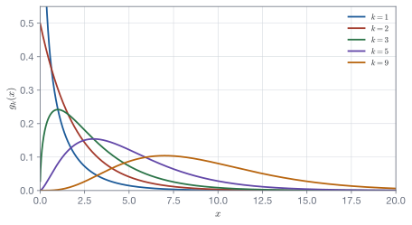

# Probability and statistics {#sec-probability}

Probability theory is the mathematics of uncertainty: it assigns numbers between $0$ and $1$ to the possible
outcomes of an experiment, and it tells how those numbers combine when experiments are repeated, conditioned on
partial information or summed over many independent trials. The subject is indispensable in physics because the
world is described statistically at more than one level: statistical mechanics averages over an ensemble of
microscopic states, quantum mechanics predicts probabilities of measurement outcomes rather than the outcomes
themselves, and every experiment reports a mean with an error bar, which is a statement about a distribution.

The chapter has four sections. @sec-probability-spaces fixes the vocabulary: sample spaces, events, probability
measures and their rules, conditional probability, independence and Bayes' rule. @sec-random-variables introduces
random variables and random vectors, their distributions, expectation, variance and covariance, the characteristic
function, and the standard distributions: Bernoulli, binomial, geometric, Poisson, uniform, exponential and Gaussian.
@sec-limit-theorems defines the modes of convergence and proves Chebyshev's inequality, the weak and strong laws of
large numbers, the central limit theorem with the de Moivre-Laplace theorem, the Poisson limit and Wick's theorem for
Gaussian moments, and closes with the random walk and its diffusion limit. @sec-statistics treats estimators, maximum
likelihood, the Cramér-Rao bound, confidence intervals, the propagation of errors, least squares, the chi-squared
statistic and Monte Carlo sampling.

The scope is set by the integral available. The tutorial has no Lebesgue integral, so the chapter works with the
Riemann integral. That a probability measure on all Borel sets exists with given values on intervals, for example one
with a given density, is stated as a theorem and not proved. The existence of a probability space carrying an infinite
independent sequence is not proved either: the strong law and the statements about whole infinite runs assume such a
space, and say so.
Expectation is defined for two classes, discrete random variables, whose expectations are series, and functions of
random vectors with a density, whose expectations are improper Riemann integrals; each statement says which class it
covers. The central limit theorem is proved by Lindeberg's replacement method, for independent identically distributed
summands with a finite third moment that are discrete or have bounded densities.

Every definition, theorem and proposition is followed by ten examples, graded from the simplest instances through
cases from physics to limits and counterexamples, and by ten exercises, graded from direct checks to proofs that
combine several results. Each exercise has a hand solution with a complete proof and a SageMath solution that
computes or checks a concrete instance, and the closing @sec-probability-exercises combines the four sections. Coin
flips, two dice, the diagnostic test of the first figure, the Gaussian $e^{-x^2/2\sigma^2}$ and the harmonic oscillator
are the running examples.

## Probability spaces {#sec-probability-spaces}

A probability space is the arena of the subject: a set of possible outcomes, a collection of events that can be
assigned probabilities, and the assignment itself. This section defines the three ingredients, derives the rules that
follow from the axioms (complements, inclusion-exclusion, the union bound, continuity and the first Borel-Cantelli
lemma), then treats conditional probability, independence and Bayes' rule, and checks the rational probabilities of
the running examples (two dice, a deck of cards and a diagnostic test) exactly in Sage.

The section builds only on sets and series. The integral available is the Riemann integral, so a probability given by a
density is assigned here to intervals, boxes and regions between graphs, and the existence of a probability measure on
all Borel sets with prescribed values on intervals is stated plainly as a fact not proved here.

For more on this topic, see @baldi2023probability [Ch. 1, Secs. 2.1-2.2 and 4.1], @capinski2001probability [Ch. 1-7] and @cufaropetroni2020probability [Ch. 1, Defs. 1.1-1.19].

### Sample spaces and events

Before any probability can be assigned one must say what the possible outcomes are and which questions about them
are admissible. The definition below names the set of outcomes and the family of events, which for a finite
experiment is simply every subset and for a continuous one is the family generated by the intervals through countable
operations; its five properties are the closure facts used throughout the chapter. For $\sigma$-fields, generated
$\sigma$-fields and Borel sets, see [@kallenberg2021foundations, Ch. 1, p. 10] and [@capinski2001probability, Ch. 3 and 5].

:::: {.statement-box}
::: {#def-sample-space}
#### Sample space

A **sample space** $\Omega$ is the set (@def-set) of all possible outcomes of an experiment. An **event** is a
subset $A \subseteq \Omega$, and "the event $A$ occurs" means that the outcome lies in $A$. The complement $A^c = \Omega
\setminus A$ is the event "not $A$", $A \cup B$ is "$A$ or $B$", $A \cap B$ is "$A$ and $B$", and disjoint events are
**mutually exclusive**. The admissible events form a **$\sigma$-algebra** $\mathcal F$ on $\Omega$: a family of subsets
of $\Omega$ such that

(a) $\Omega \in \mathcal F$; (b) $A \in \mathcal F$ implies $A^c \in \mathcal F$; (c) $A_1, A_2, \dots \in \mathcal F$
implies $\bigcup_{n \geq 1}A_n \in \mathcal F$.

The family $2^\Omega$ of all subsets of $\Omega$ is a $\sigma$-algebra; it is the one used when $\Omega$ is finite or
countable. For a family $\mathcal C$ of subsets of $\Omega$, the **generated $\sigma$-algebra** $\sigma(\mathcal C)$ is the
intersection of all $\sigma$-algebras on $\Omega$ that contain $\mathcal C$. The **Borel $\sigma$-algebra**
$\mathcal B(\mathbb R^n)$ is the $\sigma$-algebra generated by the boxes of @def-multiple-integral, for $n = 1$ the closed
intervals $[a, b]$ with $a < b$; its members are the **Borel sets**. For events $A_1, A_2, \dots$,
$$
\limsup_n A_n = \bigcap_{N \geq 1}\bigcup_{n \geq N}A_n, \qquad \liminf_n A_n = \bigcup_{N \geq 1}\bigcap_{n \geq N}A_n.
$$
Then:

1. $\emptyset \in \mathcal F$, and $\mathcal F$ is closed under finite unions, countable intersections and differences
   $A \setminus B$;
2. the intersection of any non-empty collection of $\sigma$-algebras on $\Omega$ is a $\sigma$-algebra, so $\sigma(\mathcal
   C)$ is a $\sigma$-algebra that contains $\mathcal C$ and lies inside every $\sigma$-algebra containing $\mathcal C$;
3. $\limsup_n A_n$ is the event "$A_n$ occurs for infinitely many $n$", $\liminf_n A_n$ is "$A_n$ occurs for all but
   finitely many $n$", both lie in $\mathcal F$, and $\liminf_n A_n \subseteq \limsup_n A_n$;
4. if non-empty sets $B_1, \dots, B_k$ partition $\Omega$ (they are pairwise disjoint with union $\Omega$), then
   $\sigma(\{B_1, \dots, B_k\})$ consists of the unions $\bigcup_{i \in I}B_i$, $I \subseteq \{1, \dots, k\}$, and has
   exactly $2^k$ members;
5. $\mathcal B(\mathbb R)$ contains every interval, open, closed, half-open or unbounded, every countable subset of
   $\mathbb R$, and every open subset of $\mathbb R$.
:::
::::

*Proof.* (1) $\emptyset = \Omega^c$ lies in $\mathcal F$ by (a) and (b). For $A, B \in \mathcal F$, the sequence $A, B,
\emptyset, \emptyset, \dots$ has union $A \cup B$, which lies in $\mathcal F$ by (c); induction gives every finite union.
For a sequence $A_n \in \mathcal F$, a point lies outside $\bigcup_nA_n^c$ exactly when it lies in every $A_n$, so
$\bigcap_nA_n = (\bigcup_nA_n^c)^c \in \mathcal F$ by (b) and (c). Finally $A \setminus B = A \cap B^c$.

(2) Let $\mathcal G$ be the intersection of a non-empty collection of $\sigma$-algebras $\mathcal F_j$. Each contains
$\Omega$, so $\mathcal G$ does. If $A \in \mathcal G$, then $A \in \mathcal F_j$ for every $j$, so $A^c \in \mathcal F_j$
for every $j$ and $A^c \in \mathcal G$; countable unions are handled in the same way. The collection of $\sigma$-algebras
containing $\mathcal C$ is non-empty, since $2^\Omega$ belongs to it, so $\sigma(\mathcal C)$ is a $\sigma$-algebra; it
contains $\mathcal C$ because every member of the collection does, and it lies in each member of the collection by the
definition of an intersection.

(3) A point $\omega$ lies in $\bigcap_N\bigcup_{n \geq N}A_n$ exactly when for every $N$ some $n \geq N$ has $\omega \in
A_n$, that is, when $\omega \in A_n$ for infinitely many $n$. It lies in $\bigcup_N\bigcap_{n \geq N}A_n$ exactly when
some $N$ has $\omega \in A_n$ for all $n \geq N$, that is, for all but finitely many $n$. Both sets are built from the
$A_n$ by countable unions and intersections, so they lie in $\mathcal F$ by (c) and (1). All but finitely many $n$ are
infinitely many $n$, which gives the inclusion.

(4) Let $\mathcal U$ be the family of unions $\bigcup_{i \in I}B_i$. Taking $I = \{1, \dots, k\}$ gives $\Omega \in
\mathcal U$. Since the blocks are disjoint with union $\Omega$, the complement of $\bigcup_{i \in I}B_i$ is $\bigcup_{i
\notin I}B_i$, and a union of members of $\mathcal U$ with index sets $I_1, I_2, \dots$ is the member with index set
$\bigcup_mI_m$. So $\mathcal U$ is a $\sigma$-algebra containing every $B_i$, and $\sigma(\{B_1, \dots, B_k\}) \subseteq
\mathcal U$ by (2). Conversely every $\sigma$-algebra containing the blocks contains their finite unions by (1), so
$\mathcal U \subseteq \sigma(\{B_1, \dots, B_k\})$. Different index sets give different unions: if $i \in I \setminus J$, a
point of the non-empty $B_i$ lies in $\bigcup_IB_j$ and not in $\bigcup_JB_j$. Hence $\mathcal U$ has as many members as
$\{1, \dots, k\}$ has subsets, $2^k$.

(5) A point is $\{a\} = \bigcap_{n \geq 1}[a, a + 1/n]$, a countable intersection of closed intervals, so it is Borel by
(1). Then $(a, b) = [a, b] \setminus (\{a\} \cup \{b\})$, $[a, b) = [a, b] \setminus \{b\}$ and $(a, b] = [a, b]
\setminus \{a\}$ are Borel by (1), and $(a, \infty) = \bigcup_n(a, a + n)$, $[a, \infty) = \{a\} \cup (a, \infty)$,
$(-\infty, a)$, $(-\infty, a]$ and $\mathbb R = \bigcup_n[-n, n]$ are Borel by (c). A countable set is a countable union of
points. Let $U \subseteq \mathbb R$ be open and $x \in U$; some $(x - \varepsilon, x + \varepsilon)$ lies in $U$, and
choosing rationals $p \in (x - \varepsilon, x)$ and $q \in (x, x + \varepsilon)$ gives $x \in (p, q) \subseteq U$. So $U$ is
the union of the intervals $(p, q) \subseteq U$ with rational $p < q$. There are countably many pairs of rationals
($\mathbb Q$ is countable, and listing the pairs $(p, q)$ by the sum of the sizes of numerators and denominators exhausts
$\mathbb Q \times \mathbb Q$ in countably many finite stages), so $U$ is a countable union of Borel sets. $\square$

:::: {.callout-note .examples-fold collapse="true" title="Examples"}
The simplest experiment has two outcomes, and the next simplest has six. The first example lists the sample spaces
and all events of a coin and of a die, which makes the abstract words concrete and shows how fast the number of
events grows.

::: {#exm-prob-coin-die}
#### A coin and a die

A coin has $\Omega = \{H, T\}$ with four events $\emptyset, \{H\}, \{T\}, \Omega$. A die has $\Omega = \{1, 2,
\dots, 6\}$ and $2^6 = 64$ events, among them "even" $= \{2, 4, 6\}$, "at least $5$" $= \{5, 6\}$ and their
intersection $\{6\}$. Every subset is an event, and the family of all $2^6$ subsets is closed under complement and
union as the definition demands.
:::

A $\sigma$-algebra may be much smaller than the power set, and the smallest ones are worth writing down because every
other $\sigma$-algebra contains them. The second example gives the two smallest kinds, which are the cases $k = 1$ and
$k = 2$ of property (4) [@capinski2001probability, Problems 3.1-3.3].

::: {#exm-prob-small-sigma-algebras}
#### The smallest $\sigma$-algebras

On any $\Omega$, $\{\emptyset, \Omega\}$ is a $\sigma$-algebra: it can answer no question about the outcome. For a
subset $A$ with $\emptyset \neq A \neq \Omega$, the blocks $A, A^c$ partition $\Omega$, and (4) gives $\sigma(\{A\}) =
\{\emptyset, A, A^c, \Omega\}$ with $2^2 = 4$ members: it records whether $A$ occurred and nothing else. For a coin this
is all of $2^\Omega$.
:::

Repeating an experiment, or running two at once, produces outcomes that are pairs, and the sample space is a
Cartesian product (@def-product). The third example is the space of two dice, the running example of the section,
where the events of interest are described by the sum and are drawn in @fig-two-dice-events.

::: {#exm-prob-two-dice-space}
#### Two dice

Rolling two dice gives $\Omega = \{1, \dots, 6\} \times \{1, \dots, 6\}$, the $36$ pairs $(i, j)$. "The sum is $7$" is the
event $C = \{(1, 6), (2, 5), (3, 4), (4, 3), (5, 2), (6, 1)\}$ with six outcomes; "the sum is at least $10$" is $A =
\{(4, 6), (5, 5), (6, 4), (5, 6), (6, 5), (6, 6)\}$; "the first die shows at least $4$" is $B$, the three top rows with
$18$ outcomes, and $A \subseteq B$.

{#fig-two-dice-events width=60%}
:::

A family of subsets that looks natural can fail the definition, and the failures show what each axiom is for. The
fourth example checks three families on a four-point set, two of which fail [@capinski2001probability, Problem 3.4].

::: {#exm-prob-not-sigma-algebra}
#### Families that are not $\sigma$-algebras

On $\Omega = \{1, 2, 3, 4\}$, the family $\{\emptyset, \{1, 2\}, \{3, 4\}\}$ is not a $\sigma$-algebra because it lacks
$\Omega$, and $\{\emptyset, \Omega, \{1\}, \{2, 3, 4\}, \{1, 2\}, \{3, 4\}\}$ is not one because the union $\{1\} \cup
\{3, 4\} = \{1, 3, 4\}$ is missing, and with it its complement $\{2\}$. Adding these two sets gives the eight unions of
the blocks $\{1\}, \{2\}, \{3, 4\}$, the $\sigma$-algebra with $2^3$ members of (4).
:::

When the outcome is a real number, such as the position of a particle or the lifetime of a nucleus, the sample space
is uncountable and the events are taken from the Borel $\sigma$-algebra. The fifth example lists events that property
(5) certifies as Borel, and records which question is left open.

::: {#exm-prob-continuous-space}
#### A continuous sample space

A point chosen in $\Omega = [0, 1]$ has events such as $[0, \tfrac12]$, $(\tfrac13, \tfrac23)$ and $\{x : x^2 <
\tfrac12\} = [0, 1/\sqrt2)$. By (5) every interval, every countable set such as $\mathbb Q \cap [0, 1]$ and every open set
is Borel, and so are complements such as the irrationals of $[0, 1]$. The events of $[0, 1]$ are the Borel sets
contained in $[0, 1]$. Whether a probability can be assigned to all of them consistently with lengths of intervals is a
separate question from which sets are events.
:::

Between the power set and the Borel sets there are $\sigma$-algebras defined by a size condition. The sixth example is
the $\sigma$-algebra of countable and co-countable sets, which shows that "countable" is a condition the axioms respect
[@capinski2001probability, Problem 5.5].

::: {#exm-prob-countable-cocountable}
#### Countable and co-countable sets

On $\Omega = \mathbb R$, let $\mathcal F$ consist of the sets $A$ such that $A$ or $A^c$ is countable. It contains $\Omega$
(its complement is empty) and is closed under complements by its symmetric form. If $A_1, A_2, \dots \in \mathcal F$ are
all countable, their union is countable (list the $m$-th element of $A_n$ at stage $m + n$); if some $A_n^c$ is
countable, the complement of the union lies in $A_n^c$ and is countable. So $\mathcal F$ is a $\sigma$-algebra. It does
not contain $[0, 1]$, since neither $[0, 1]$ nor its complement is countable, so it is strictly smaller than $\mathcal
B(\mathbb R)$.
:::

A system of $N$ spins, each up or down, is the basic finite sample space of statistical mechanics. The seventh example
shows that a macroscopic description by the magnetisation alone is a $\sigma$-algebra generated by a partition.

::: {#exm-prob-spin-configurations}
#### Spin configurations and macrostates

$N$ spins have $\Omega = \{+1, -1\}^N$, with $2^N$ configurations $(s_1, \dots, s_N)$. The magnetisation $M = s_1 +
\dots + s_N$ takes the $N + 1$ values $-N, -N + 2, \dots, N$, and the sets $\{M = m\}$ partition $\Omega$. By (4) the
events that can be decided by measuring $M$ alone form a $\sigma$-algebra with $2^{N + 1}$ members, against $2^{2^N}$
events in all: for $N = 3$, $16$ of the $256$ subsets. The blocks are the **macrostates**, and the configurations in a
block are its **microstates**.
:::

The position of an electron in a hydrogen atom is a point of $\mathbb R^3$, and the events of interest are boxes,
balls and shells around the nucleus. The eighth example checks that these are Borel sets of $\mathbb R^3$.

::: {#exm-prob-position-space}
#### The position of an electron

Take $\Omega = \mathbb R^3$ with $\mathcal B(\mathbb R^3)$. A box is Borel by definition. The open ball $\{\mathbf x :
\lVert\mathbf x\rVert < R\}$ is the union of the boxes with rational corners that lie inside it, countably many, by the
argument of (5) applied to each coordinate. The closed ball is the intersection of the open balls of radii $R + 1/n$,
and the shell $a \leq \lVert\mathbf x\rVert \leq b$ is a closed ball minus an open one, so all are Borel by (1).
:::

The cofinite sets look like a $\sigma$-algebra on a first check, because they pass every finite test. The ninth
example shows that they fail closure under countable unions, which is the axiom that makes limits admissible
[@capinski2001probability, Problems 3.19 and 5.4].

::: {#exm-prob-cofinite}
#### Finite and cofinite sets

On $\Omega = \mathbb N$, let $\mathcal A$ consist of the finite sets and the sets with finite complement. It contains
$\Omega$, is closed under complements, and is closed under finite unions: a union of finite sets is finite, and a union
containing a cofinite set is cofinite. But the even numbers are the countable union $\bigcup_n\{2n\}$ of members of
$\mathcal A$, and neither they nor the odd numbers are finite. So $\mathcal A$ is closed under finite operations only.
:::

Intersections of $\sigma$-algebras are $\sigma$-algebras by (2), and it is natural to ask the same of unions. The last
example shows that the answer is negative already on a three-point set [@capinski2001probability, Problem 5.13].

::: {#exm-prob-union-not-sigma}
#### A union of two $\sigma$-algebras

On $\Omega = \{1, 2, 3\}$, $\mathcal F_1 = \{\emptyset, \{1\}, \{2, 3\}, \Omega\}$ and $\mathcal F_2 = \{\emptyset, \{2\},
\{1, 3\}, \Omega\}$ are $\sigma$-algebras by @exm-prob-small-sigma-algebras. Their union contains $\{1\}$ and $\{2\}$ but not
$\{1, 2\}$, so it is not a $\sigma$-algebra. The smallest $\sigma$-algebra containing both is $\sigma(\mathcal F_1 \cup
\mathcal F_2) = 2^\Omega$, generated by the partition into points.
:::
::::

:::: {.callout-note .exercises-fold collapse="true" title="Exercises"}
Writing out events as sets is the first skill to practise, including the translation of "or", "and" and "not" into
unions, intersections and complements. The first exercise does this for three coin tosses, where the counting is
still by hand.

::: {#exr-prob-three-coins}
#### Events for three coins

For three coin tosses, $\Omega = \{H, T\}^3$, write out the events "exactly two heads", "at least one tail" and
"the first and last tosses agree", count their elements, and express "at least one tail" as the complement of a
simpler event.
:::

::: {.callout-note .solution collapse="true" title="Solution"}
:::: {.panel-tabset .solution-tabs}
## Proof

$\Omega$ has $2^3 = 8$ outcomes. "Exactly two heads" is $\{HHT, HTH, THH\}$, with $3$ outcomes. "At least one tail" fails
only for $HHH$, so it is the complement $\{HHH\}^c$, with $8 - 1 = 7$ outcomes. "First and last agree" is $\{HHH, HTH,
THT, TTT\}$, with $4$ outcomes: the first and middle tosses are free and the last copies the first. Counting the
opposite event is the standard way to handle "at least one".

## SageMath

The code enumerates the eight outcomes and counts the three events.

```{.python .sage}
import itertools
Omega = ["".join(w) for w in itertools.product("HT", repeat=3)]
two_heads = [w for w in Omega if w.count("H") == 2]
one_tail = [w for w in Omega if "T" in w]
agree = [w for w in Omega if w[0] == w[2]]
print("exactly two heads:", two_heads, len(two_heads))
print("at least one tail:", len(one_tail), "; complement:", [w for w in Omega if w not in one_tail])
print("first and last agree:", agree, len(agree))
```

```{.text .sage-output}
exactly two heads: ['HHT', 'HTH', 'THH'] 3
at least one tail: 7 ; complement: ['HHH']
first and last agree: ['HHH', 'HTH', 'THT', 'TTT'] 4
```
::::
:::

A family of sets is completed to a $\sigma$-algebra by adding complements and unions until nothing new appears. The
second exercise does this by hand for two singletons on a three-point set [@capinski2001probability, Problem 3.7].

::: {#exr-prob-complete-family}
#### Completing a family

On $\Omega = \{1, 2, 3\}$, find $\sigma(\{\{2\}, \{3\}\})$.
:::

::: {.callout-note .solution collapse="true" title="Solution"}
:::: {.panel-tabset .solution-tabs}
## Proof

A $\sigma$-algebra containing $\{2\}$ and $\{3\}$ contains $\{2\}^c \cap \{3\}^c = \{1\}$ by (1). So it contains the three
blocks $\{1\}, \{2\}, \{3\}$ of the partition of $\Omega$ into points, and by (4) the $\sigma$-algebra generated by them is
the family of all their unions, $2^\Omega$, with $2^3 = 8$ members. Since every $\sigma$-algebra containing $\{2\}$ and
$\{3\}$ contains these blocks, $\sigma(\{\{2\}, \{3\}\}) = 2^\Omega$.

## SageMath

The code closes the family under complement and union until it stops growing.

```{.python .sage}
Omega = frozenset([1, 2, 3])
F = {frozenset([2]), frozenset([3])}
while True:
    new = set(F) | {Omega - A for A in F} | {A | B for A in F for B in F} | {Omega}
    if new == F:
        break
    F = new
print("number of events:", len(F))
print(sorted(sorted(A) for A in F))
```

```{.text .sage-output}
number of events: 8
[[], [1], [1, 2], [1, 2, 3], [1, 3], [2], [2, 3], [3]]
```
::::
:::

A $\sigma$-algebra need not contain every subset: it records which questions the experiment can answer. The third
exercise builds the smallest one containing two events of a die, which is the structure behind "coarse-grained"
descriptions.

::: {#exr-prob-sigma-partition}
#### The $\sigma$-algebra of a partition

Let $\Omega = \{1, \dots, 6\}$ and let $\mathcal{F}$ be the smallest $\sigma$-algebra containing the events "even" and
"at most $2$". List its elements and show that it is generated by a partition of $\Omega$ into four blocks.
:::

::: {.callout-note .solution collapse="true" title="Solution"}
:::: {.panel-tabset .solution-tabs}
## Proof

Intersections and complements of $E = \{2, 4, 6\}$ and $L = \{1, 2\}$ give the blocks $E \cap L = \{2\}$, $E \cap
L^c = \{4, 6\}$, $E^c \cap L = \{1\}$, $E^c \cap L^c = \{3, 5\}$, which are non-empty and partition $\Omega$; they lie in
$\mathcal F$ by (1). Conversely $E$ and $L$ are unions of blocks, $E = \{2\} \cup \{4, 6\}$ and $L = \{1\} \cup \{2\}$. So
$\mathcal F$ is the $\sigma$-algebra generated by the four blocks, which by (4) consists of their $2^4 = 16$ unions:
$\emptyset$, the four blocks, the six unions of two, the four unions of three, and $\Omega$. No member separates $4$ from
$6$.

## SageMath

The code forms all unions of the four blocks and checks the count and the two generators.

```{.python .sage}
blocks = [Set([2]), Set([4, 6]), Set([1]), Set([3, 5])]
from functools import reduce
F = [reduce(lambda X, Y: X.union(Y), [blocks[i] for i in I], Set([])) for I in Subsets(range(4))]
print("number of events:", len(F))
print("contains 'even' and 'at most 2':", Set([2, 4, 6]) in F, Set([1, 2]) in F)
print("some event separates 4 from 6:", any((4 in A) != (6 in A) for A in F))
```

```{.text .sage-output}
number of events: 16
contains 'even' and 'at most 2': True True
some event separates 4 from 6: False
```
::::
:::

Countable operations on intervals reach sets that no finite operation reaches, such as a single point. The fourth
exercise extracts points and half-open intervals from a sequence of closed intervals [@capinski2001probability,
Problem 5.6].

::: {#exr-prob-sigma-intervals}
#### Points from intervals

Let $\mathcal F$ be a $\sigma$-algebra on $\Omega = [0, 1]$ containing $I_n = [\frac{1}{n + 1}, \frac1n]$ for $n = 1, 2,
\dots$. Show that $\{0\}$, $\{\frac1n : n \geq 2\}$, $(\frac1n, 1]$ and $(0, \frac1n]$ lie in $\mathcal F$.
:::

::: {.callout-note .solution collapse="true" title="Solution"}
:::: {.panel-tabset .solution-tabs}
## Proof

Every $x \in (0, 1]$ lies in some $I_n$, since $\frac{1}{n + 1} \leq x \leq \frac1n$ for $n = \lfloor 1/x\rfloor$, and $0$
lies in none; so $\bigcup_nI_n = (0, 1]$ and $\{0\} = (\bigcup_nI_n)^c \in \mathcal F$. For $n \geq 2$, $I_{n-1} \cap I_n
= \{\frac1n\}$, so each point $\frac1n$ is in $\mathcal F$ by (1), and so is their countable union. Next $\bigcup_{k = 1}^{n
- 1}I_k = [\frac1n, 1]$, so $(\frac1n, 1] = [\frac1n, 1] \setminus \{\frac1n\} \in \mathcal F$. Finally $(0, \frac1n] =
\bigcup_{k \geq n}I_k$, since every $x \in (0, \frac1n]$ lies in $I_k$ for $k = \lfloor 1/x\rfloor \geq n$.

## SageMath

Check on the first intervals with Sage's exact real sets: the union of $I_1, \dots, I_{9}$ and an intersection of
neighbours.

```{.python .sage}
I = lambda n: RealSet.closed(1/(n + 1), 1/n)
U = RealSet()
for k in range(1, 10):
    U = U.union(I(k))
print("I_1 u ... u I_9 =", U)
print("I_4 n I_5 =", I(4).intersection(I(5)))
print("[1/5, 1] minus {1/5}:", RealSet.closed(1/5, 1).difference(RealSet.point(1/5)))
```

```{.text .sage-output}
I_1 u ... u I_9 = [1/10, 1]
I_4 n I_5 = {1/5}
[1/5, 1] minus {1/5}: (1/5, 1]
```
::::
:::

A map between sets carries $\sigma$-algebras backwards, by taking preimages, and this is how questions about a
measured quantity become events of the underlying experiment. The fifth exercise proves it
[@capinski2001probability, Problem 5.8].

::: {#exr-prob-preimage-sigma}
#### Preimages of a $\sigma$-algebra

Let $f : \Omega' \to \Omega$ be a map (@def-map) and $\mathcal F$ a $\sigma$-algebra on $\Omega$. Show that $\{f^{-1}(A) : A
\in \mathcal F\}$ is a $\sigma$-algebra on $\Omega'$.
:::

::: {.callout-note .solution collapse="true" title="Solution"}
:::: {.panel-tabset .solution-tabs}
## Proof

Call the family $\mathcal F'$. First $\Omega' = f^{-1}(\Omega) \in \mathcal F'$. Preimages commute with complements and
unions: $x \in f^{-1}(A^c)$ means $f(x) \notin A$, that is, $x \notin f^{-1}(A)$, so $f^{-1}(A^c) = \Omega' \setminus
f^{-1}(A)$; and $f(x) \in \bigcup_nA_n$ exactly when $f(x) \in A_n$ for some $n$, so $f^{-1}(\bigcup_nA_n) =
\bigcup_nf^{-1}(A_n)$. So if $f^{-1}(A) \in \mathcal F'$ then its complement is $f^{-1}(A^c)$ with $A^c \in \mathcal F$, and
a union of $f^{-1}(A_n)$ is $f^{-1}(\bigcup_nA_n)$ with $\bigcup_nA_n \in \mathcal F$.

## SageMath

Check on the parity map $f : \{1, \dots, 6\} \to \{0, 1\}$, $f(k) = k \bmod 2$, with $\mathcal F = 2^{\{0, 1\}}$.

```{.python .sage}
Omega1 = Set(range(1, 7))
f = lambda k: k % 2
Fp = [Set([k for k in Omega1 if f(k) in A]) for A in Subsets([0, 1])]
print("preimage family:", sorted([sorted(A) for A in Fp]))
print("closed under complement:", all(Omega1.difference(A) in Fp for A in Fp))
print("closed under union:", all(A.union(B) in Fp for A in Fp for B in Fp))
```

```{.text .sage-output}
preimage family: [[], [1, 2, 3, 4, 5, 6], [1, 3, 5], [2, 4, 6]]
closed under complement: True
closed under union: True
```
::::
:::

Knowing that the outcome lies in a subset $B$ restricts attention to the outcomes in $B$, and the events then become the
traces of the old ones on $B$. The sixth exercise shows that the traces form a $\sigma$-algebra on $B$ [@capinski2001probability,
Problem 5.9].

::: {#exr-prob-trace-sigma}
#### The trace on a subset

Let $\mathcal F$ be a $\sigma$-algebra on $\Omega$ and $B \subseteq \Omega$. Show that $\mathcal F_B = \{A \cap B : A \in
\mathcal F\}$ is a $\sigma$-algebra on $B$, and that $\mathcal F_B \subseteq \mathcal F$ when $B \in \mathcal F$.
:::

::: {.callout-note .solution collapse="true" title="Solution"}
:::: {.panel-tabset .solution-tabs}
## Proof

$B = \Omega \cap B \in \mathcal F_B$. The complement of $A \cap B$ in $B$ is $B \setminus (A \cap B) = A^c \cap B$, with
$A^c \in \mathcal F$. A union $\bigcup_n(A_n \cap B) = (\bigcup_nA_n) \cap B$, with $\bigcup_nA_n \in \mathcal F$. So
$\mathcal F_B$ satisfies (a), (b) and (c) on the set $B$. If $B \in \mathcal F$, then $A \cap B \in \mathcal F$ by (1).

## SageMath

Check on the sixteen-member $\sigma$-algebra of @exr-prob-sigma-partition, traced on $B = \{1, 2, 3\}$.

```{.python .sage}
blocks = [Set([2]), Set([4, 6]), Set([1]), Set([3, 5])]
from functools import reduce
F = [reduce(lambda X, Y: X.union(Y), [blocks[i] for i in I], Set([])) for I in Subsets(range(4))]
B = Set([1, 2, 3])
FB = list(set(A.intersection(B) for A in F))
print("trace on B:", sorted([sorted(A) for A in FB]))
print("closed under complement in B:", all(B.difference(A) in FB for A in FB))
print("closed under union:", all(A.union(C) in FB for A in FB for C in FB))
```

```{.text .sage-output}
trace on B: [[], [1], [1, 2], [1, 2, 3], [1, 3], [2], [2, 3], [3]]
closed under complement in B: True
closed under union: True
```
::::
:::

Closure under countable unions, not merely finite ones, is what makes limits of events admissible. The seventh
exercise shows that natural events about an infinite sequence of tosses are built from finite-stage events by
countably many operations, which property (3) names.

::: {#exr-prob-countable-union}
#### Eventually heads

For an infinite sequence of coin tosses, $\Omega = \{H, T\}^{\mathbb{N}}$, let $A_n$ be the event "the $n$-th toss
is heads". Express "at least one head", "heads at every toss from some point on" and "infinitely many heads" in
terms of the $A_n$ using countable unions and intersections.
:::

::: {.callout-note .solution collapse="true" title="Solution"}
:::: {.panel-tabset .solution-tabs}
## Proof

"At least one head" is $\bigcup_nA_n$. "Heads from some point on" means that there is an $N$ such that every toss after
it is heads, which is $\bigcup_N\bigcap_{n \geq N}A_n = \liminf_nA_n$. "Infinitely many heads" means that for every $N$
there is a later head, which is $\bigcap_N\bigcup_{n \geq N}A_n = \limsup_nA_n$; by (3) it is the complement of
$\liminf_nA_n^c$, "tails from some point on". Each uses countably many operations, so each is an event of every
$\sigma$-algebra on $\Omega$ that contains the $A_n$.

## SageMath

Check on three eventually periodic sequences, each given by a finite head and a repeating tail, where "from some point
on" and "infinitely often" are decided by the repeating part.

```{.python .sage}
seqs = {"HTHTHT...": ("", "HT"), "TTHHHH...": ("TT", "H"), "HHTTTT...": ("HH", "T")}
for name, (head, tail) in seqs.items():
    w = lambda n: (head + tail * 50)[n - 1]
    at_least_one = any(w(n) == "H" for n in range(1, 60))
    eventually = all(c == "H" for c in tail)
    infinitely = "H" in tail
    print(name, ": at least one head", at_least_one, "; heads from some point on", eventually, "; infinitely many heads", infinitely)
```

```{.text .sage-output}
HTHTHT... : at least one head True ; heads from some point on False ; infinitely many heads True
TTHHHH... : at least one head True ; heads from some point on True ; infinitely many heads True
HHTTTT... : at least one head True ; heads from some point on False ; infinitely many heads False
```
::::
:::

Upper and lower limits of sets are computed point by point, by asking how often a point lies in the sets. The eighth
exercise does this for intervals that alternate between two families, where the two limits differ
[@capinski2001probability, Problem 5.29].

::: {#exr-prob-limsup-intervals}
#### Upper and lower limits of intervals

Let $A_n = [0, 1 + \frac1n]$ for odd $n$ and $A_n = [-\frac1n, \frac12]$ for even $n$. Find $\limsup_nA_n$ and
$\liminf_nA_n$.
:::

::: {.callout-note .solution collapse="true" title="Solution"}
:::: {.panel-tabset .solution-tabs}
## Proof

Use (3). A point $x \in [0, 1]$ lies in every $A_n$ with $n$ odd, hence in infinitely many. A point $x > 1$ lies in $A_n$
only for odd $n$ with $1 + \frac1n \geq x$, finitely many, and a point $x < 0$ only for even $n$ with $-\frac1n \leq x$,
finitely many. So $\limsup_nA_n = [0, 1]$. A point $x \in [0, \frac12]$ lies in every $A_n$, odd or even. A point of $(\frac12,
1]$ misses every even $A_n$, infinitely many, and points outside $[0, 1]$ lie in only finitely many. So $\liminf_nA_n = [0,
\frac12]$, inside $\limsup_nA_n$ as (3) requires.

## SageMath

The code counts, for sample points, how many of $A_1, \dots, A_{1000}$ contain them, and how many of $A_{501}, \dots,
A_{1000}$ miss them.

```{.python .sage}
A = lambda n: RealSet.closed(0, 1 + 1/n) if n % 2 else RealSet.closed(-1/n, 1/2)
for x in [-1/10, 0, 1/3, 3/4, 1, 11/10]:
    hits = sum(1 for n in range(1, 1001) if x in A(n))
    late_misses = sum(1 for n in range(501, 1001) if x not in A(n))
    print("x =", x, ": in", hits, "of A_1..A_1000 ; missed by", late_misses, "of A_501..A_1000")
```

```{.text .sage-output}
x = -1/10 : in 5 of A_1..A_1000 ; missed by 500 of A_501..A_1000
x = 0 : in 1000 of A_1..A_1000 ; missed by 0 of A_501..A_1000
x = 1/3 : in 1000 of A_1..A_1000 ; missed by 0 of A_501..A_1000
x = 3/4 : in 500 of A_1..A_1000 ; missed by 250 of A_501..A_1000
x = 1 : in 500 of A_1..A_1000 ; missed by 250 of A_501..A_1000
x = 11/10 : in 5 of A_1..A_1000 ; missed by 500 of A_501..A_1000
```
::::
:::

A finite $\sigma$-algebra is always generated by a partition, even on an infinite sample space, and so its size is a
power of two. The ninth exercise proves this with the atoms of the $\sigma$-algebra [@capinski2001probability,
Problems 3.23-3.26].

::: {#exr-prob-finite-sigma-count}
#### Finite $\sigma$-algebras have $2^k$ members

Let $\mathcal F$ be a finite $\sigma$-algebra on $\Omega$ and, for $\omega \in \Omega$, let $A(\omega)$ be the intersection
of the members of $\mathcal F$ that contain $\omega$. Show that the distinct sets $A(\omega)$ partition $\Omega$, that every
member of $\mathcal F$ is a union of them, and that $|\mathcal F| = 2^k$ with $k$ their number.
:::

::: {.callout-note .solution collapse="true" title="Solution"}
:::: {.panel-tabset .solution-tabs}
## Proof

$A(\omega)$ is a finite intersection of members of $\mathcal F$, so it lies in $\mathcal F$ by (1), contains $\omega$, and
lies inside every member containing $\omega$. Suppose $\omega \in A(\omega')$. Then $A(\omega) \subseteq A(\omega')$. If
$\omega' \notin A(\omega)$, the set $C = A(\omega') \setminus A(\omega) \in \mathcal F$ contains $\omega'$, so $A(\omega')
\subseteq C$; but $\omega \in A(\omega')$ and $\omega \notin C$, a contradiction. So $\omega' \in A(\omega)$ and $A(\omega')
\subseteq A(\omega)$, hence $A(\omega) = A(\omega')$. If $A(\omega)$ and $A(\omega')$ share a point $\eta$, this argument
gives $A(\omega) = A(\eta) = A(\omega')$; so two of these sets are equal or disjoint, and since each $\omega$ lies in
$A(\omega)$ they partition $\Omega$. They are members of the finite $\mathcal F$, so there are finitely many, $k$ say. A
member $A$ of $\mathcal F$ contains $A(\omega)$ for each of its points, so it is the union of the blocks it meets. Hence
$\mathcal F \subseteq \sigma(\text{blocks}) \subseteq \mathcal F$, and (4) gives $|\mathcal F| = 2^k$.

## SageMath

Check on the $\sigma$-algebra of @exm-prob-not-sigma-algebra, with atoms $\{1\}, \{2\}, \{3, 4\}$: the code computes the
sets $A(\omega)$ and the count.

```{.python .sage}
atoms0 = [Set([1]), Set([2]), Set([3, 4])]
from functools import reduce
F = [reduce(lambda X, Y: X.union(Y), [atoms0[i] for i in I], Set([])) for I in Subsets(range(3))]
Aw = {w: reduce(lambda X, Y: X.intersection(Y), [A for A in F if w in A]) for w in [1, 2, 3, 4]}
print("A(omega):", {w: sorted(Aw[w]) for w in Aw})
k = len(set(Aw.values()))
print("number of atoms k =", k, "; |F| =", len(F), "= 2^k:", len(F) == 2^k)
```

```{.text .sage-output}
A(omega): {1: [1], 2: [2], 3: [3, 4], 4: [3, 4]}
number of atoms k = 3 ; |F| = 8 = 2^k: True
```
::::
:::

The Borel $\sigma$-algebra contains sets far from intervals, and the Cantor set is the classical one. The last
exercise places the rationals, the irrationals and the Cantor set in $\mathcal B(\mathbb R)$ and computes the total length
of the stages of the Cantor construction [@capinski2001probability, Problems 5.21 and 5.23].

::: {#exr-prob-borel-examples}
#### Rationals, irrationals and the Cantor set

Show that $\mathbb Q$ and $\mathbb R \setminus \mathbb Q$ are Borel. The Cantor set is $K = \bigcap_mK_m$, where $K_0 = [0,
1]$ and $K_{m+1}$ is obtained by removing the open middle third of each interval of $K_m$. Show that $K$ is Borel and that
$K_m$ is a union of $2^m$ disjoint closed intervals of total length $(2/3)^m$.
:::

::: {.callout-note .solution collapse="true" title="Solution"}
:::: {.panel-tabset .solution-tabs}
## Proof

$\mathbb Q$ is countable, hence Borel by (5), and $\mathbb R \setminus \mathbb Q$ is its complement. By induction, $K_m$ is
a union of $2^m$ disjoint closed intervals of length $3^{-m}$: removing the open middle third of $[a, a + 3^{-m}]$ leaves
the two disjoint intervals $[a, a + 3^{-m-1}]$ and $[a + 2\cdot3^{-m-1}, a + 3^{-m}]$, and intervals coming from different
parents stay disjoint. So $K_m$ has total length $2^m3^{-m} = (2/3)^m$, it is a finite union of closed intervals, hence
Borel, and $K$ is a countable intersection of Borel sets, Borel by (1).

## SageMath

The code builds $K_0, \dots, K_6$ as lists of exact intervals and prints their numbers and total lengths.

```{.python .sage}
K = [(QQ(0), QQ(1))]
for m in range(7):
    print("K_%d:" % m, len(K), "intervals, total length", sum(b - a for a, b in K), "= (2/3)^%d:" % m, sum(b - a for a, b in K) == (QQ(2) / 3) ^ m)
    K = [piece for a, b in K for piece in [(a, a + (b - a) / 3), (b - (b - a) / 3, b)]]
```

```{.text .sage-output}
K_0: 1 intervals, total length 1 = (2/3)^0: True
K_1: 2 intervals, total length 2/3 = (2/3)^1: True
K_2: 4 intervals, total length 4/9 = (2/3)^2: True
K_3: 8 intervals, total length 8/27 = (2/3)^3: True
K_4: 16 intervals, total length 16/81 = (2/3)^4: True
K_5: 32 intervals, total length 32/243 = (2/3)^5: True
K_6: 64 intervals, total length 64/729 = (2/3)^6: True
```
::::
:::
::::

### Probability measures

With the outcomes and events in place, probability is a function on the events, and two axioms fix its behaviour: the
whole space has probability one, and probabilities of mutually exclusive events add, also over countably many events.
The definition records the axioms and the two facts that make discrete models work: finite additivity, and the
construction of a probability on a countable space from weights on its points. For a measure as a countably additive set
function, and a probability space as a normalized measure space, see [@kallenberg2021foundations, Ch. 1, p. 18; Ch. 4,
p. 81] and [@capinski2001probability, Ch. 4 and 6].

:::: {.statement-box}
::: {#def-probability-measure}
#### Probability measure

A **probability measure** on $(\Omega, \mathcal{F})$ is a map (@def-map) $\mathbb P : \mathcal{F} \to [0, 1]$ with
$\mathbb P(\Omega) = 1$ and **countable additivity**: $\mathbb P(\bigcup_n A_n) = \sum_n \mathbb P(A_n)$ for every sequence
$A_1, A_2, \dots$ of pairwise disjoint events. The triple $(\Omega, \mathcal{F}, \mathbb P)$ is a **probability space**, and
an event of probability $0$ is **null**. For a set $\Omega$ and weights $p : \Omega \to [0, \infty)$, the sum of $p$ over a
subset $A$ is $\sum_{\omega \in A}p(\omega) = \sup\{\sum_{\omega \in S}p(\omega) : S \subseteq A \text{ finite}\}$, a number in
$[0, \infty]$. Then:

1. $\mathbb P(\emptyset) = 0$, and $\mathbb P$ is **finitely additive**: $\mathbb P(A_1 \cup \dots \cup A_n) = \mathbb P(A_1) +
   \dots + \mathbb P(A_n)$ for pairwise disjoint events;
2. (**sums over sets**) if $A$ is the union of pairwise disjoint sets $A_1, A_2, \dots$, then $\sum_{\omega \in
   A}p(\omega) = \sum_n\sum_{\omega \in A_n}p(\omega)$, and if $A = \{\omega_1, \omega_2, \dots\}$ is countable, $\sum_{\omega
   \in A}p(\omega)$ is the sum of the series $\sum_kp(\omega_k)$;
3. (**discrete probability**) if $\Omega$ is countable and $\sum_{\omega \in \Omega}p(\omega) = 1$, then $\mathbb P(A) =
   \sum_{\omega \in A}p(\omega)$ is a probability measure on $(\Omega, 2^\Omega)$, and every probability measure on $(\Omega,
   2^\Omega)$ is of this form with $p(\omega) = \mathbb P(\{\omega\})$. On a finite $\Omega$ with $N$ equally likely
   outcomes (the **uniform** measure), $\mathbb P(A) = |A|/N$, and probability is counting.
:::
::::

*Proof.* (1) The sequence $\emptyset, \emptyset, \dots$ is pairwise disjoint with union $\emptyset$, so $\mathbb P(\emptyset)
= \sum_n\mathbb P(\emptyset)$. A series with all terms equal to $c \geq 0$ converges only if $c = 0$, so $\mathbb P(\emptyset)
= 0$. For disjoint $A_1, \dots, A_n$, extend the list by $A_k = \emptyset$ for $k > n$; countable additivity gives
$\mathbb P(\bigcup_kA_k) = \sum_{k \leq n}\mathbb P(A_k) + 0$.

(2) Write $\Sigma(A)$ for $\sum_{\omega \in A}p(\omega)$. Let $S \subseteq A$ be finite. It meets only finitely many $A_n$,
and $S$ is the disjoint union of the finite sets $S \cap A_n$, so $\sum_{\omega \in S}p(\omega) = \sum_n\sum_{\omega \in S
\cap A_n}p(\omega) \leq \sum_n\Sigma(A_n)$; taking the supremum over $S$, $\Sigma(A) \leq \sum_n\Sigma(A_n)$. Conversely,
fix $N$ and finite sets $S_n \subseteq A_n$ for $n \leq N$. They are disjoint, so $\sum_{n \leq N}\sum_{\omega \in
S_n}p(\omega) = \sum_{\omega \in S_1 \cup \dots \cup S_N}p(\omega) \leq \Sigma(A)$. Taking the supremum over each $S_n$ in
turn gives $\sum_{n \leq N}\Sigma(A_n) \leq \Sigma(A)$, and letting $N \to \infty$ gives the reverse inequality. For a
countable $A = \{\omega_1, \omega_2, \dots\}$, each partial sum $\sum_{k \leq m}p(\omega_k)$ is a finite sum over a subset of
$A$, hence at most $\Sigma(A)$, and every finite $S \subseteq A$ lies in some $\{\omega_1, \dots, \omega_m\}$, so its sum is at
most a partial sum. The partial sums increase, and their limit is therefore $\Sigma(A)$ (@thm-monotone-convergence).

(3) $\mathbb P(A) = \Sigma(A) \leq \Sigma(\Omega) = 1$, since a finite subset of $A$ is a finite subset of $\Omega$, and
$\mathbb P(\Omega) = 1$. Countable additivity is (2). Conversely, let $\mathbb P$ be a probability measure on $2^\Omega$ and
$p(\omega) = \mathbb P(\{\omega\})$. A subset $A = \{\omega_1, \omega_2, \dots\}$ of the countable $\Omega$ is the disjoint
union of its points (a finite $A$ is padded with empty sets), so $\mathbb P(A) = \sum_kp(\omega_k) = \Sigma(A)$ by countable
additivity and (2). For the uniform measure, $p = 1/N$ and $\Sigma(A) = |A|/N$. $\square$

**Densities, and what is not proved here.** Let $\rho \geq 0$ be integrable on an interval $J$ (@def-riemann-integral,
improper on an unbounded $J$, @def-improper-integral) with $\int_J\rho = 1$. Then $Q(I) = \int_I\rho$ assigns to every
subinterval $I \subseteq J$ a number in $[0, 1]$ with $Q(J) = 1$, and splitting an interval into finitely many adjacent
intervals splits the integral in the same way. In $\mathbb R^n$ the same holds for boxes and for the regions between graphs
of @def-multiple-integral. That there is a probability measure $\mathbb P$ on the Borel sets of $J$ with $\mathbb P(I) =
Q(I)$ for every interval, and only one, is a theorem: Lebesgue measure and Carathéodory's extension theorem
[@kallenberg2021foundations, Thms. 2.2 and 2.5]. Its proof needs outer measures and is **not given in this tutorial**.
When this chapter says that a point is "uniform on $[0, 1]$" or "has density $\rho$", it therefore uses only the values
$Q$ on intervals, boxes and regions between graphs, computed by Riemann integrals. A statement about other events assumes
a probability measure with these values, and says so.

:::: {.callout-note .examples-fold collapse="true" title="Examples"}
The uniform measure on a finite set is the oldest model of chance, and it reduces probability to counting outcomes.
The first example computes a few probabilities for a fair die and checks the axioms directly.

::: {#exm-prob-fair-die}
#### A fair die

By (3) with $p(k) = \tfrac16$ for each face, $\mathbb P(A) = |A|/6$: $\mathbb P(\text{even}) = \tfrac12$, $\mathbb P(\text{at
least } 5) = \tfrac13$, and $\mathbb P(\text{even or at least } 5) = \mathbb P(\{2, 4, 5, 6\}) = \tfrac23$, which is less
than $\tfrac12 + \tfrac13$ because the two events share the outcome $6$. Additivity holds because disjoint subsets have no
common elements, so their sizes add, and $\mathbb P(\Omega) = 6/6 = 1$.
:::

A die need not be fair, and the axioms then fix the probabilities from their ratios alone. The second example finds the
normalising constant of a biased die from $\mathbb P(\Omega) = 1$ [@riley2006mathematical, Sec. 30.2.1].

::: {#exm-prob-biased-die}
#### A biased die

A die shows $1, 2, 3, 4, 5, 6$ with probabilities $\tfrac12p, p, p, p, p, 2p$. Finite additivity (1) over the six faces
and $\mathbb P(\Omega) = 1$ give $\tfrac{13}{2}p = 1$, so $p = \tfrac{2}{13}$. Then $\mathbb P(\text{even}) = p + p + 2p =
\tfrac{8}{13}$ and $\mathbb P(\text{odd}) = \tfrac12p + p + p = \tfrac{5}{13}$, and the two add to $1$.
:::

The $36$ outcomes of two dice are equally likely, but the sums are not, and their probabilities are read off the
grid of @fig-two-dice-events by counting diagonals. The third example tabulates them and recovers the
probabilities of the events $A$, $B$ and $C$.

::: {#exm-prob-two-dice-sums}
#### Sums of two dice

Counting the diagonals of the grid, $\mathbb P(\text{sum} = s)$ is $\tfrac{1}{36}, \tfrac{2}{36}, \dots, \tfrac{6}{36},
\dots, \tfrac{1}{36}$ for $s = 2, \dots, 7, \dots, 12$, that is, $\frac{6 - |s - 7|}{36}$: the sum $7$ is the most likely,
with $\mathbb P(C) = \tfrac16$. The sums $10, 11, 12$ have $3 + 2 + 1 = 6$ outcomes, so $\mathbb P(A) = \tfrac16$; the top
three rows give $\mathbb P(B) = \tfrac12$; and $\mathbb P(A \cup B) = \mathbb P(B) = \tfrac12$ since $A \subseteq B$.
:::

Countable additivity is needed as soon as the outcomes are unbounded in number, as for the number of tails before the
first head. The fourth example is the geometric probability on $\{0, 1, 2, \dots\}$ and the probability of an even
count [@capinski2001probability, Example 6.1].

::: {#exm-prob-geometric-measure}
#### A geometric probability

On $\Omega = \{0, 1, 2, \dots\}$ let $p(n) = 2^{-n-1}$, the probability of $n$ tails before the first head of a fair coin.
The weights sum to $\sum_{n \geq 0}2^{-n-1} = 1$ (@def-series), so (3) gives a probability measure. The event "$n$ is even"
is the disjoint union of the points $0, 2, 4, \dots$, and countable additivity gives $\mathbb P(\text{even}) = \tfrac12 +
\tfrac18 + \tfrac1{32} + \dots = \tfrac12\cdot\frac{1}{1 - 1/4} = \tfrac23$.
:::

The simplest probability measure on any space puts all the probability on one point. The fifth example is this Dirac
measure and its mixtures, which model an outcome that is known in advance or one of finitely many known outcomes
[@capinski2001probability, Problems 6.34-6.36].

::: {#exm-prob-dirac-mixture}
#### Dirac measures and mixtures

For $\omega_0 \in \Omega$ and any $\sigma$-algebra $\mathcal F$, $\delta_{\omega_0}(A) = 1$ if $\omega_0 \in A$ and $0$
otherwise is a probability measure: of pairwise disjoint events at most one contains $\omega_0$, so both sides of countable
additivity are $1$ or both are $0$. For $\omega_1 \neq \omega_2$, $\mathbb P = \tfrac14\delta_{\omega_1} + \tfrac34\delta_{\omega_2}$
satisfies the axioms termwise; on $(\mathbb R, \mathcal B(\mathbb R))$ with $\omega_1 = 0$, $\omega_2 = 1$ it gives $\mathbb
P([0, \tfrac12]) = \tfrac14$, and its null events are the Borel sets containing neither $0$ nor $1$.
:::

On a continuous sample space the probability of an interval is its length, or more generally the integral of a density
over it. The sixth example is the uniform assignment on $[0, 1]$, the continuous analogue of the fair die, and it
states exactly what the Riemann integral provides.

::: {#exm-prob-uniform-interval}
#### The uniform assignment on $[0, 1\rbrack$

The density $\rho = 1$ on $[0, 1]$ gives $Q(I) = b - a$ for every interval $I$ with ends $0 \leq a \leq b \leq 1$, open,
closed or half-open, and lengths of adjacent intervals add. More generally $Q(I) = \int_I \rho(x)\,dx$ for an integrable
$\rho \geq 0$ with $\int_0^1 \rho = 1$, the continuous counterpart of the table of @exm-prob-two-dice-sums. A probability
measure on all Borel subsets of $[0, 1]$ with these values exists by the theorem quoted after the definition, which is not
proved here; every computation of this chapter with a density uses only the values on intervals.
:::

The energy levels of a quantum harmonic oscillator in contact with a heat bath are occupied with Boltzmann
probabilities, a countable discrete model. The seventh example shows that the weights form a geometric sequence and
checks their normalisation.

::: {#exm-prob-oscillator-boltzmann}
#### The thermal harmonic oscillator

The levels $E_n = \hbar\omega(n + \tfrac12)$, $n = 0, 1, 2, \dots$, at inverse temperature $\beta$ have weights
$e^{-\beta E_n}/Z$ with $Z = \sum_ne^{-\beta E_n} = e^{-x/2}\sum_ne^{-nx} = \frac{e^{-x/2}}{1 - e^{-x}}$, where $x =
\beta\hbar\omega > 0$. So $p(n) = (1 - e^{-x})e^{-nx}$, a geometric sequence summing to $1$, and (3) gives a probability on
$\{0, 1, 2, \dots\}$. The probability of an excited level is $\mathbb P(n \geq 1) = \sum_{n \geq 1}p(n) = e^{-x}$, which tends to
$0$ as $T \to 0$ and to $1$ as $T \to \infty$.
:::

The ground state of hydrogen gives the electron a radial density, and the probability of finding it within a given
radius is a Riemann integral. The eighth example computes the probability of $r \leq a_0$, the Bohr radius.

::: {#exm-prob-hydrogen-radial}
#### The hydrogen ground state

The radial density of the ground state is $\rho(r) = \frac{4r^2}{a_0^3}e^{-2r/a_0}$ on $[0, \infty)$. With $u = r/a_0$ and
the antiderivative $-e^{-2u}(2u^2 + 2u + 1)$ of $4u^2e^{-2u}$ (@thm-fundamental-theorem), $\int_0^\infty\rho = 1$ and
$$
Q([0, a_0]) = \int_0^14u^2e^{-2u}\,du = 1 - 5e^{-2} \approx 0.323,
$$
so the electron lies inside the Bohr radius only about a third of the time, although $a_0$ is the most likely radius.
:::

"Choosing at random" on an infinite set means choosing a probability, and different natural choices give different
answers. The ninth example is Bertrand's chord problem, the classical instance [@bricmont2022statistical, Sec. 2.2.5].

::: {#exm-pbr-bertrand}
#### Bertrand's chords

What is the probability that a random chord of the unit circle is longer than $\sqrt3$, the side of the inscribed
equilateral triangle? A chord is fixed by the distance $d$ of its midpoint from the centre and is longer than $\sqrt3$
exactly when $d < \tfrac12$. Uniform $d \in [0, 1]$ gives $\tfrac12$; a uniform angle $\theta \in [0, \pi]$ between the
chord and the tangent at one end, with $d = |\cos\theta|$, gives $Q((\tfrac\pi3, \tfrac{2\pi}3)) = \tfrac13$; and a midpoint
uniform in the disc gives the area ratio $\tfrac14$. Each is a probability assignment by a density, and the question does
not say which one describes the throw. An argument of Jaynes requires the answer to be unchanged under rotations,
rescalings and translations of the circle, and singles out the first.
:::

Translation invariance is what makes length the natural "uniform" probability on a circle, and it is also what forbids
extending it to all subsets. The last example proves that no rotation-invariant probability measure is defined on every
subset of the circle, which is why events are restricted to a $\sigma$-algebra.

::: {#exm-prob-vitali}
#### No uniform probability on all subsets of the circle

Identify $S^1$ with $[0, 1)$, rotations being $x \mapsto x + t \bmod 1$. Suppose $\mathbb P$ were a probability measure on
$2^{[0, 1)}$ with $\mathbb P(A + t \bmod 1) = \mathbb P(A)$ for all $A$ and $t$. Call $x \sim y$ when $x - y \in \mathbb Q$, an
equivalence relation (@def-equivalence-relation), and choose one point of each class (the axiom of choice): a set $V$. For
the countably many rationals $q \in [0, 1)$ the rotated sets $V_q = V + q \bmod 1$ are pairwise disjoint (if $v + q \equiv
v' + q'$ then $v \sim v'$, so $v = v'$ and $q = q'$) and cover $[0, 1)$ (each $x$ is $v + q \bmod 1$ for the representative $v$ of
its class). Countable additivity gives $1 = \sum_q\mathbb P(V_q) = \sum_q\mathbb P(V)$, which is $0$ or diverges: a
contradiction.
:::
::::

:::: {.callout-note .exercises-fold collapse="true" title="Exercises"}
Counting the complementary event is the tool for "at least one" questions on a uniform space. The first exercise applies
it to the birthday problem, where the probability of a coincidence is surprisingly large, and asks Sage for the exact
rational value [@bricmont2022statistical, Exercise 2.2].

::: {#exr-prob-birthday}
#### The birthday problem

Among $n$ people with birthdays uniform over $365$ days, show that the probability that two share a birthday is $1 -
\prod_{k=0}^{n-1}(1 - k/365)$, and find with Sage the smallest $n$ for which it exceeds $\tfrac12$.
:::

::: {.callout-note .solution collapse="true" title="Solution"}
:::: {.panel-tabset .solution-tabs}
## Proof

The sample space is the set of $365^n$ lists of birthdays, with the uniform measure. The lists with all birthdays different
are counted by choosing the first in $365$ ways, the second in $364$, and so on, $365 \cdot 364 \cdots (365 - n + 1)$ in all.
"Two share a birthday" is the set of the other lists, so by (3) its probability is $1 - \frac{365 \cdots (365 - n +
1)}{365^n} = 1 - \prod_{k=0}^{n-1}\frac{365 - k}{365}$. The values below show that it first exceeds $\tfrac12$ at $n = 23$.

## SageMath

The code evaluates the exact rational probability and finds the first $n$ above $\tfrac12$.

```{.python .sage}
def coincidence(n):
    return 1 - prod(1 - QQ(k) / 365 for k in range(n))
for n in [5, 10, 20, 22, 23, 30, 50]:
    print("n =", n, ": P(shared birthday) =", numerical_approx(coincidence(n), digits=4))
first = next(n for n in range(1, 100) if coincidence(n) > QQ(1) / 2)
print("smallest n with probability above 1/2:", first, "; its value", numerical_approx(coincidence(first), digits=6))
```

```{.text .sage-output}
n = 5 : P(shared birthday) = 0.02714
n = 10 : P(shared birthday) = 0.1169
n = 20 : P(shared birthday) = 0.4114
n = 22 : P(shared birthday) = 0.4757
n = 23 : P(shared birthday) = 0.5073
n = 30 : P(shared birthday) = 0.7063
n = 50 : P(shared birthday) = 0.9704
smallest n with probability above 1/2: 23 ; its value 0.507297
```
::::
:::

Weights on the natural numbers define a probability exactly when they sum to one, and the comparison with known series
decides it. The second exercise tests three candidate families [@capinski2001probability, Problems 6.3-6.6].

::: {#exr-prob-weights-on-n}
#### Weights on the natural numbers

On $\Omega = \mathbb N$ with $\mathcal F = 2^{\mathbb N}$, decide whether $p(i) = \frac1i$, $p(i) = 2^{-i}$, $p(i) = \frac{c}{i^2}$
(for some $c$) or a constant $p(i) = a$ define a probability measure by (3).
:::

::: {.callout-note .solution collapse="true" title="Solution"}
:::: {.panel-tabset .solution-tabs}
## Proof

By (3), the weights must be non-negative with sum $1$. The harmonic series $\sum 1/i$ diverges, so $p(i) = 1/i$ fails
already at the value $p(1) = 1$ followed by positive terms. The geometric series gives $\sum 2^{-i} = 1$, so $2^{-i}$ works.
$\sum 1/i^2 = \pi^2/6$ (@prp-series-values), so $c = 6/\pi^2$ works. A constant $a > 0$ gives a divergent series and $a = 0$
gives sum $0$, so no constant works: there is no uniform probability on $\mathbb N$.

## SageMath

The code evaluates the three series in closed form.

```{.python .sage}
i = var("i")
print("partial sums of 1/i for 10, 10^3, 10^5 terms:", [numerical_approx(sum(1/QQ(j) for j in range(1, m + 1)), digits=5) for m in [10, 10^3, 10^5]])
print("sum 2^-i =", sum(2^(-i), i, 1, oo))
print("sum 1/i^2 =", sum(1/i^2, i, 1, oo), "; so c =", 1/sum(1/i^2, i, 1, oo))
```

```{.text .sage-output}
partial sums of 1/i for 10, 10^3, 10^5 terms: [2.9290, 7.4855, 12.090]
sum 2^-i = 1
sum 1/i^2 = 1/6*pi^2 ; so c = 6/pi^2
```
::::
:::

Countable additivity, as opposed to finite additivity, is needed as soon as an experiment can take arbitrarily
long. The third exercise applies it to the waiting time for the first head and shows that the probabilities of the
infinitely many possible waiting times sum to one, so no probability is left for an infinite wait.

::: {#exr-prob-geometric-waiting}
#### Waiting for the first head

A fair coin is tossed until the first head appears. Show that $\mathbb P(\text{first head at toss } k) = 2^{-k}$, that these
probabilities sum to $1$, and deduce that the probability of never seeing a head is $0$; check the sum with Sage.
:::

::: {.callout-note .solution collapse="true" title="Solution"}
:::: {.panel-tabset .solution-tabs}
## Proof

In $k$ tosses the $2^k$ strings are equally likely, and "first head at toss $k$" is the single string $T^{k-1}H$, so its
probability is $2^{-k}$. Take $\Omega = \{1, 2, \dots\} \cup \{\infty\}$, with $\infty$ standing for "no head ever", and
weights $p(k) = 2^{-k}$ and $p(\infty) = 1 - \sum_{k \geq 1}2^{-k}$. The geometric series (@def-series) gives $\sum_{k \geq
1}2^{-k} = 1$, so $p(\infty) = 0$: by (3) this is a probability measure, and the event "never a head" is null. The probability
of no head in the first $m$ tosses is $1 - \sum_{k \leq m}2^{-k} = 2^{-m}$.

## SageMath

The code sums the series and its first partial sums exactly.

```{.python .sage}
k = var("k")
print("sum_{k>=1} 2^-k =", sum(2 ** (-k), k, 1, oo))
partial = [sum(QQ(2) ** (-j) for j in range(1, m + 1)) for m in [1, 2, 5, 10, 20]]
print("partial sums for m = 1, 2, 5, 10, 20:", partial)
print("P(no head in the first 20 tosses) = 1 - partial sum =", 1 - partial[-1], "= 2^-20:", 1 - partial[-1] == QQ(2) ** (-20))
```

```{.text .sage-output}
sum_{k>=1} 2^-k = 1
partial sums for m = 1, 2, 5, 10, 20: [1/2, 3/4, 31/32, 1023/1024, 1048575/1048576]
P(no head in the first 20 tosses) = 1 - partial sum = 1/1048576 = 2^-20: True
```
::::
:::

A density assigns probabilities to intervals once its integral is one, and the normalising constant is found by one
integration. The fourth exercise normalises three densities and evaluates them on intervals
[@capinski2001probability, Problems 6.21-6.25 and 6.29-6.33].

::: {#exr-prob-density-normalise}
#### Normalising densities

Find $c$ so that $\rho(x) = cx(1 - x)$ on $[0, 1]$, $\rho(x) = ce^{-\lambda x}$ on $[0, \infty)$ with $\lambda > 0$, and
$\rho(x) = cx^{-1/2}$ on $(0, 1]$ have integral $1$, and compute $Q([0, \tfrac12])$, $Q([1, 2])$ and $Q((0, \tfrac14])$
respectively.
:::

::: {.callout-note .solution collapse="true" title="Solution"}
:::: {.panel-tabset .solution-tabs}
## Proof

$\int_0^1x(1 - x)\,dx = \tfrac12 - \tfrac13 = \tfrac16$, so $c = 6$, and $Q([0, \tfrac12]) = 6(\tfrac18 - \tfrac1{24}) =
\tfrac12$, as the symmetry $x \mapsto 1 - x$ predicts. $\int_0^\infty e^{-\lambda x}dx = \lim_b(1 - e^{-\lambda b})/\lambda =
1/\lambda$ (@def-improper-integral), so $c = \lambda$ and $Q([1, 2]) = e^{-\lambda} - e^{-2\lambda}$. $\int_0^1x^{-1/2}dx = 2$
by @def-improper-integral (3), so $c = \tfrac12$ and $Q((0, \tfrac14]) = \tfrac12\cdot2\sqrt{1/4} = \tfrac12$.

## SageMath

The code computes the normalising integrals and the three values, with $\lambda$ declared positive.

```{.python .sage}
x, lam = var("x lam")
assume(lam > 0)
print("c for x(1-x):", 1 / integrate(x * (1 - x), x, 0, 1), "; Q([0,1/2]) =", integrate(6 * x * (1 - x), x, 0, 1/2))
print("c for exp(-lam x):", 1 / integrate(exp(-lam * x), x, 0, oo), "; Q([1,2]) =", integrate(lam * exp(-lam * x), x, 1, 2).simplify_full())
print("c for x^(-1/2):", 1 / integrate(x^(-1/2), x, 0, 1), "; Q((0,1/4]) =", integrate(x^(-1/2) / 2, x, 0, 1/4))
forget()
```

```{.text .sage-output}
c for x(1-x): 6 ; Q([0,1/2]) = 1/2
c for exp(-lam x): lam ; Q([1,2]) = (e^lam - 1)*e^(-2*lam)
c for x^(-1/2): 1/2 ; Q((0,1/4]) = 1/2
```
::::
:::

A game that can last for any number of rounds has a countable sample space, and the probability of winning is a
geometric series over the rounds. The fifth exercise is a duel with alternating shots [@riley2006mathematical,
Exercise 30.5].

::: {#exr-prob-duel}
#### A duel

Two duellists fire alternately until one hits; each shot of $A$ hits with probability $\alpha$ and each shot of $B$ with
probability $\beta$, with $0 < \alpha, \beta < 1$. Find the probability $P_1$ that $A$ wins when $A$ fires first, and $P_2$
when $B$ fires first.
:::

::: {.callout-note .solution collapse="true" title="Solution"}
:::: {.panel-tabset .solution-tabs}
## Proof

Let $q = (1 - \alpha)(1 - \beta)$, the probability that a full round of two shots misses twice. When $A$ fires first, $A$
wins at shot $2k + 1$ exactly when the first $2k$ shots miss and the next hits, with probability $q^k\alpha$; the outcomes
"the duel ends at shot $n$" are the points of a countable sample space (with one more point for "never ends", whose weight is
what is left). By countable additivity $P_1 = \sum_{k \geq 0}q^k\alpha = \frac{\alpha}{1 - (1 - \alpha)(1 - \beta)}$. When $B$
fires first, $A$ wins at shot $2k + 2$ with probability $(1 - \beta)q^k\alpha$, and summing, $P_2 = (1 - \beta)P_1$.
The duel ends with probability $\sum_kq^k(\alpha + (1 - \alpha)\beta) = 1$, so "never ends" is null.

## SageMath

The code sums the series symbolically and checks a numerical instance against a truncated sum.

```{.python .sage}
a, b, k = var("a b k")
assume(a > 0, a < 1, b > 0, b < 1)
q = (1 - a) * (1 - b)
P1 = sum(q^k * a, k, 0, oo).factor()
print("P1 =", P1)
print("P(duel ends) =", SR(sum(q^k * (a + (1 - a) * b), k, 0, oo)).simplify_full())
vals = {a: QQ(1) / 3, b: QQ(1) / 2}
print("alpha = 1/3, beta = 1/2: P1 =", P1.subs(vals), "; P2 =", ((1 - b) * P1).subs(vals),
      "; truncated sum:", numerical_approx(sum((QQ(1) / 3) * (QQ(1) / 3)^j for j in range(60)), digits=8))
forget()
```

```{.text .sage-output}
P1 = -a/(a*b - a - b)
P(duel ends) = 1
alpha = 1/3, beta = 1/2: P1 = 1/2 ; P2 = 1/4 ; truncated sum: 0.50000000
```
::::
:::

Finite additivity alone does not give countable additivity, and the gap is visible on a simple field of subsets of the
natural numbers. The sixth exercise exhibits a finitely additive assignment that cannot be countably additive
[@capinski2001probability, Problem 4.28].

::: {#exr-prob-finitely-not-countably}
#### Finitely but not countably additive

Let $\mathcal A$ be the family of finite and cofinite subsets of $\mathbb N$ (@exm-prob-cofinite), and $Q(A) = 0$ for finite
$A$, $Q(A) = 1$ for cofinite $A$. Show that $Q$ is finitely additive on $\mathcal A$ with $Q(\mathbb N) = 1$, but that no
probability measure on $2^{\mathbb N}$ agrees with $Q$ on $\mathcal A$.
:::

::: {.callout-note .solution collapse="true" title="Solution"}
:::: {.panel-tabset .solution-tabs}
## Proof

Two cofinite sets $A, B$ cannot be disjoint: their complements are finite, so $A^c \cup B^c \neq \mathbb N$ and $A \cap B =
(A^c \cup B^c)^c \neq \emptyset$. So of two disjoint members of $\mathcal A$ at least one is finite. If both are finite, so
is the union and both sides of $Q(A \cup B) = Q(A) + Q(B)$ are $0$; if $A$ is cofinite and $B$ finite, the union is cofinite
and both sides are $1$. Induction gives finite additivity, and $Q(\mathbb N) = 1$. A probability measure $\mathbb P$ on
$2^{\mathbb N}$ with $\mathbb P(\{n\}) = Q(\{n\}) = 0$ would give $\mathbb P(\mathbb N) = \sum_n\mathbb P(\{n\}) = 0$ by
countable additivity, against $\mathbb P(\mathbb N) = Q(\mathbb N) = 1$.

## SageMath

Check on the finite and cofinite subsets of $\mathbb N$ represented inside $\{1, \dots, 8\}$, where "cofinite" is read as "its
complement lies in $\{1, \dots, 8\}$": additivity over disjoint pairs, and the failure along singletons.

```{.python .sage}
U = Set(range(1, 9))
fam = [("fin", A) for A in Subsets(U)] + [("cof", A) for A in Subsets(U)]   # ("cof", A) is N minus A
Q = lambda t: 0 if t[0] == "fin" else 1
def disjoint(s, t):
    if s[0] == "fin" and t[0] == "fin": return s[1].intersection(t[1]).cardinality() == 0
    if s[0] == "fin": return s[1].issubset(t[1])
    if t[0] == "fin": return t[1].issubset(s[1])
    return False
pairs = [(s, t) for s in fam for t in fam if disjoint(s, t)]
ok = all(Q(s) + Q(t) == (1 if "cof" in (s[0], t[0]) else 0) for s, t in pairs)
print("disjoint pairs checked:", len(pairs), "; finitely additive:", ok)
print("Q of the singletons {1}, ..., {8}:", [Q(("fin", Set([j]))) for j in range(1, 9)], "; Q(N) =", Q(("cof", Set([]))))
```

```{.text .sage-output}
disjoint pairs checked: 19683 ; finitely additive: True
Q of the singletons {1}, ..., {8}: [0, 0, 0, 0, 0, 0, 0, 0] ; Q(N) = 1
```
::::
:::

The proportion of integers in a set, in the limit, is a natural candidate for a uniform probability on $\mathbb N$.
The seventh exercise shows that it is not countably additive, so it is not a probability measure
[@capinski2001probability, Problem 6.7].

::: {#exr-prob-natural-density}
#### Natural density is not a probability measure

For $A \subseteq \mathbb N$ let $d(A) = \liminf_{n}\frac{|A \cap \{1, \dots, n\}|}{n}$. Compute $d$ for the even numbers, the
squares and the singletons, and show that $d$ is not a probability measure on $2^{\mathbb N}$.
:::

::: {.callout-note .solution collapse="true" title="Solution"}
:::: {.panel-tabset .solution-tabs}
## Proof

The even numbers up to $n$ are $\lfloor n/2\rfloor$ in number, and $\lfloor n/2\rfloor/n \to \tfrac12$. The squares up to
$n$ are $\lfloor\sqrt n\rfloor \leq \sqrt n$, and $\sqrt n/n \to 0$, so $d = 0$. A singleton gives at most $1/n \to 0$. The
singletons are pairwise disjoint with union $\mathbb N$, and $d(\mathbb N) = 1 \neq 0 = \sum_kd(\{k\})$, so countable
additivity fails.

## SageMath

The code evaluates the proportions at $n = 10^6$.

```{.python .sage}
n = 10^6
print("evens:", QQ(n // 2) / n, "; squares:", numerical_approx(QQ(isqrt(n)) / n, digits=4), "; singleton {7}:", QQ(1) / n)
print("proportion of {7} up to m = 10^2, 10^4, 10^6:", [QQ(1) / m for m in [10^2, 10^4, 10^6]], "; proportion of N: 1")
```

```{.text .sage-output}
evens: 1/2 ; squares: 0.001000 ; singleton {7}: 1/1000000
proportion of {7} up to m = 10^2, 10^4, 10^6: [1/100, 1/10000, 1/1000000] ; proportion of N: 1
```
::::
:::

A rigid rotor, such as a diatomic molecule, has the levels of the angular momentum on $S^2$, each degenerate.
The eighth exercise checks that the Boltzmann weights over the states $(l, m)$ define a probability and computes the
probability of the ground level.

::: {#exr-prob-rotor-boltzmann}
#### Boltzmann weights of a rigid rotor

The states of a rigid rotor are the pairs $(l, m)$ with $l = 0, 1, 2, \dots$ and $m = -l, \dots, l$, with energy $E_l =
\frac{\hbar^2}{2I}l(l + 1)$. Show that $Z = \sum_l(2l + 1)e^{-\beta E_l}$ converges for $\beta > 0$, so that $p(l, m) =
e^{-\beta E_l}/Z$ defines a probability on the countable set of states, and compute $\mathbb P(l = 0)$ for
$\beta\hbar^2/2I = \tfrac12$.
:::

::: {.callout-note .solution collapse="true" title="Solution"}
:::: {.panel-tabset .solution-tabs}
## Proof

Let $y = \beta\hbar^2/2I > 0$. For $l \geq 1$, $l(l + 1) \geq 2l$, so $(2l + 1)e^{-yl(l + 1)} \leq (2l + 1)e^{-2yl}$, and the
right side is summable by the ratio test (@thm-convergence-tests): the ratio of consecutive terms tends to $e^{-2y} < 1$. So
$Z$ converges by comparison. The states form a countable set, and sorting them by $l$ is a partition into finite sets of
$2l + 1$ states each, so by (2) the sum of $e^{-\beta E_l}$ over all states is $Z$, and $p = e^{-\beta E_l}/Z$ has sum $1$; (3)
gives the probability. $\mathbb P(l = 0) = 1/Z$, which for $y = \tfrac12$ is $1/(1 + 3e^{-1} + 5e^{-3} + 7e^{-6} + \dots)
\approx 0.4219$.

## SageMath

The code sums the partition function at $y = \tfrac12$ to high accuracy and bounds the tail.

```{.python .sage}
y = QQ(1) / 2
Z = sum((2 * l + 1) * exp(-y * l * (l + 1)) for l in range(0, 40))
print("Z ~", numerical_approx(Z, digits=10))
print("P(l = 0) ~", numerical_approx(1 / Z, digits=6))
print("first omitted term (l = 40):", numerical_approx(81 * exp(-y * 40 * 41), digits=3))
```

```{.text .sage-output}
Z ~ 2.370336905
P(l = 0) ~ 0.421881
first omitted term (l = 40): 6.12e-355
```
::::
:::

A mixture of probability measures, a probability over which measure applies, is again a probability measure, and this
is how a population of different sources is modelled. The ninth exercise proves it for countably many components, using
(2) to exchange two sums [@capinski2001probability, Problems 6.37-6.38].

::: {#exr-prob-mixture-measure}
#### Mixtures

Let $\mathbb P_1, \mathbb P_2, \dots$ be probability measures on $(\Omega, \mathcal F)$ and $c_k \geq 0$ with $\sum_kc_k = 1$.
Show that $\mathbb P(A) = \sum_kc_k\mathbb P_k(A)$ is a probability measure.
:::

::: {.callout-note .solution collapse="true" title="Solution"}
:::: {.panel-tabset .solution-tabs}
## Proof

The series converges with $0 \leq \mathbb P(A) \leq \sum_kc_k = 1$ by comparison, and $\mathbb P(\Omega) = \sum_kc_k = 1$. Let
$A_1, A_2, \dots$ be disjoint with union $A$ and put $a(k, n) = c_k\mathbb P_k(A_n) \geq 0$ on the countable set $\mathbb N
\times \mathbb N$. Partitioning $\mathbb N \times \mathbb N$ into rows $\{k\} \times \mathbb N$ and using (2) twice gives
$\sum_{(k, n)}a = \sum_k\sum_na(k, n) = \sum_kc_k\mathbb P_k(A) = \mathbb P(A)$, by countable additivity of each $\mathbb P_k$.
Partitioning into columns $\mathbb N \times \{n\}$ gives $\sum_{(k, n)}a = \sum_n\sum_kc_k\mathbb P_k(A_n) = \sum_n\mathbb
P(A_n)$. So $\mathbb P(A) = \sum_n\mathbb P(A_n)$.

## SageMath

Check on $\Omega = \{0, 1, 2, \dots\}$ with $\mathbb P_k = $ the geometric probability $p_k(n) = (1 - 2^{-k})2^{-kn}$ and $c_k =
2^{-k}$: the mixture weights of the points, summed over $k$, against their closed form, and the sum of these weights.

```{.python .sage}
R = RealField(200)
mix = lambda m: sum(R(2)^(-k) * (1 - R(2)^(-k)) * R(2)^(-k * m) for k in range(1, 400))
closed = lambda m: QQ(1) / (2^(m + 1) - 1) - QQ(1) / (2^(m + 2) - 1)
print("mixture weights of n = 0, 1, 2, 3 (exact closed form):", [closed(m) for m in range(4)])
print("series over k agrees with the closed form to 1e-50:", all(abs(mix(m) - closed(m)) < R(10)^(-50) for m in range(6)))
print("sum over n < 30 (telescoping):", sum(closed(m) for m in range(30)), "= 1 - 1/(2^31 - 1)")
```

```{.text .sage-output}
mixture weights of n = 0, 1, 2, 3 (exact closed form): [2/3, 4/21, 8/105, 16/465]
series over k agrees with the closed form to 1e-50: True
sum over n < 30 (telescoping): 2147483646/2147483647 = 1 - 1/(2^31 - 1)
```
::::
:::

The three answers to Bertrand's question are three probability assignments on the same chords, and they differ already
in the probability that the midpoint lies within a distance $t$ of the centre. The last exercise computes this function
for the three choices by Riemann integrals and evaluates it at $t = \tfrac12$ [@bricmont2022statistical, Sec. 2.2.5].

::: {#exr-prob-bertrand-sage}
#### The three Bertrand assignments

For the three choices of @exm-pbr-bertrand, find $F(t) = Q(d \leq t)$ for $0 \leq t \leq 1$: $d$ uniform on $[0, 1]$; $d =
|\cos\theta|$ with $\theta$ uniform on $[0, \pi]$; and the midpoint uniform in the unit disc. Evaluate at $t = \tfrac12$.
:::

::: {.callout-note .solution collapse="true" title="Solution"}
:::: {.panel-tabset .solution-tabs}
## Proof

For $d$ uniform, $F(t) = t$. For $d = |\cos\theta|$, $|\cos\theta| \leq t$ exactly when $\theta \in [\arccos t, \pi - \arccos
t]$, an interval of length $\pi - 2\arccos t$, so $F(t) = 1 - \frac2\pi\arccos t$. For a midpoint with density $1/\pi$ on the
unit disc, $\{d \leq t\}$ is the disc of radius $t$, the region between the graphs $\pm\sqrt{t^2 - x^2}$ over $[-t, t]$, of area
$\int_{-t}^t2\sqrt{t^2 - x^2}\,dx = \pi t^2$ (@def-multiple-integral (5)), so $F(t) = t^2$. At $t = \tfrac12$ the three values are
$\tfrac12$, $1 - \frac2\pi\cdot\frac\pi3 = \tfrac13$ and $\tfrac14$, the answers of @exm-pbr-bertrand.

## SageMath

The code evaluates the three functions symbolically at $t = \tfrac12$ and computes the area integral.

```{.python .sage}
t, x = var("t x")
assume(t > 0, t < 1)
F = [t, 1 - 2 / pi * arccos(t), integrate(2 * sqrt(t^2 - x^2), x, -t, t) / pi]
print("F(t):", F)
print("F(1/2):", [f.subs(t=1/2) for f in F])
forget()
```

```{.text .sage-output}
F(t): [t, -2*arccos(t)/pi + 1, t^2]
F(1/2): [1/2, 1/3, 1/4]
```
::::
:::
::::

### Rules of probability

The axioms say nothing directly about complements, overlapping events or limits, and the rules for these are derived
from additivity by cutting events into disjoint pieces. The proposition collects the rules used in the rest of the
chapter: complements and monotonicity, inclusion-exclusion, the union bound, continuity along monotone sequences, and the
first Borel-Cantelli lemma, which turns a convergent series of probabilities into a statement about infinitely many
events [@kallenberg2021foundations, Lemma 1.15 and Thm. 4.18], [@capinski2001probability, Problems 4.9-4.20 and
6.8-6.14], [@riley2006mathematical, Sec. 30.2.1].

:::: {.statement-box}
::: {#prp-probability-rules}
#### Rules of probability

Let $(\Omega, \mathcal F, \mathbb P)$ be a probability space and $A, B, A_1, A_2, \dots$ events.

1. (**complements and monotonicity**) $\mathbb P(A^c) = 1 - \mathbb P(A)$; if $A \subseteq B$, then $\mathbb P(B \setminus A)
   = \mathbb P(B) - \mathbb P(A)$ and $\mathbb P(A) \leq \mathbb P(B)$.
2. (**inclusion-exclusion**) $\mathbb P(A \cup B) = \mathbb P(A) + \mathbb P(B) - \mathbb P(A \cap B)$, and for $n$ events
   $$
   \mathbb P\Big(\bigcup_{i=1}^nA_i\Big) = \sum_{k=1}^n(-1)^{k+1}\sum_{i_1 < \dots < i_k}\mathbb P(A_{i_1} \cap \dots \cap A_{i_k}).
   $$
3. (**union bound**, Boole's inequality) $\mathbb P(\bigcup_nA_n) \leq \sum_n\mathbb P(A_n)$, for finitely or countably many
   events.
4. (**continuity**) If $A_1 \subseteq A_2 \subseteq \dots$, then $\mathbb P(\bigcup_nA_n) = \lim_n\mathbb P(A_n)$ (from below);
   if $A_1 \supseteq A_2 \supseteq \dots$, then $\mathbb P(\bigcap_nA_n) = \lim_n\mathbb P(A_n)$ (from above).
5. (**first Borel-Cantelli lemma**) If $\sum_n\mathbb P(A_n) < \infty$, then $\mathbb P(\limsup_nA_n) = 0$: with probability
   one only finitely many of the $A_n$ occur.
:::
::::

*Proof.* (1) $\Omega$ is the disjoint union of $A$ and $A^c$, so $1 = \mathbb P(A) + \mathbb P(A^c)$ by finite additivity
(@def-probability-measure (1)). If $A \subseteq B$, then $B$ is the disjoint union of $A$ and $B \setminus A$, so $\mathbb
P(B) = \mathbb P(A) + \mathbb P(B \setminus A) \geq \mathbb P(A)$.

(2) $A \cup B$ is the disjoint union of $A$ and $B \setminus A$, and $B$ the disjoint union of $A \cap B$ and $B \setminus
A$, so $\mathbb P(A \cup B) = \mathbb P(A) + \mathbb P(B \setminus A) = \mathbb P(A) + \mathbb P(B) - \mathbb P(A \cap B)$.
For $n$ events argue by induction, the case $n = 1$ being trivial. Let $B = A_1 \cup \dots \cup A_n$. By the case of two
events, $\mathbb P(B \cup A_{n+1}) = \mathbb P(B) + \mathbb P(A_{n+1}) - \mathbb P(B \cap A_{n+1})$, and $B \cap A_{n+1} =
\bigcup_{i \leq n}(A_i \cap A_{n+1})$. Apply the formula for $n$ events to $\mathbb P(B)$ and to $\mathbb P(\bigcup_{i \leq
n}(A_i \cap A_{n+1}))$. The first gives the terms of the formula for $n + 1$ events whose indices avoid $n + 1$; the term
$\mathbb P(A_{n+1})$ is the one with the single index $n + 1$; and the second, with its minus sign, gives the intersections
$A_{i_1} \cap \dots \cap A_{i_k} \cap A_{n+1}$ of $k + 1$ events with the sign $-(-1)^{k+1} = (-1)^{(k+1)+1}$. These are all
the terms, each once.

(3) Let $D_1 = A_1$ and $D_n = A_n \setminus (A_1 \cup \dots \cup A_{n-1})$, events by @def-sample-space (1). They are
pairwise disjoint, $D_n \subseteq A_n$, and they have the same union as the $A_n$: a point of the union lies in $D_n$ for
the first $n$ with $\omega \in A_n$. Countable additivity and (1) give $\mathbb P(\bigcup_nA_n) = \sum_n\mathbb P(D_n) \leq
\sum_n\mathbb P(A_n)$. A finite list is padded with empty sets.

(4) For an increasing sequence the sets $D_n$ of (3) are $D_1 = A_1$ and $D_n = A_n \setminus A_{n-1}$, with $D_1 \cup
\dots \cup D_n = A_n$. So $\mathbb P(\bigcup_nA_n) = \sum_n\mathbb P(D_n) = \lim_n\sum_{k \leq n}\mathbb P(D_k) = \lim_n\mathbb
P(A_n)$. For a decreasing sequence the complements increase, with union $(\bigcap_nA_n)^c$, so by (1) and the first part,
$1 - \mathbb P(\bigcap_nA_n) = \lim_n(1 - \mathbb P(A_n))$.

(5) For every $N$, $\limsup_nA_n \subseteq \bigcup_{n \geq N}A_n$, so by (1) and (3), $\mathbb P(\limsup_nA_n) \leq \sum_{n
\geq N}\mathbb P(A_n)$. The right side is the tail of a convergent series and tends to $0$ as $N \to \infty$ (@def-series),
so $\mathbb P(\limsup_nA_n) = 0$. By @def-sample-space (3), $\limsup_nA_n$ is the event that infinitely many $A_n$ occur.
$\square$

:::: {.callout-note .examples-fold collapse="true" title="Examples"}
The overlap of two events is counted twice when their probabilities are added, and inclusion-exclusion subtracts it once.
The first example does this for a die, and uses the complement rule for an "at least one" event of two rolls.

::: {#exm-prob-die-inclusion-exclusion}
#### Inclusion-exclusion on a die

For a fair die, "even" and "at least $5$" share the outcome $6$, so by (2) $\mathbb P(\text{even or at least } 5) =
\tfrac12 + \tfrac13 - \tfrac16 = \tfrac23$, the value counted directly in @exm-prob-fair-die. For two rolls, the
$36$ pairs are equally likely and "no six" has $25$ of them, so by (1) $\mathbb P(\text{at least one six}) = 1 -
\tfrac{25}{36} = \tfrac{11}{36}$, less than the $\tfrac16 + \tfrac16$ that ignores the overlap $(6, 6)$.
:::

A deck of $52$ cards gives events that overlap in several ways at once, which is where the three-event formula earns its
place. The second example counts the cards that are an ace, a spade or an even number, shown in
@fig-inclusion-exclusion [@riley2006mathematical, Sec. 30.2.1].

::: {#exm-prob-cards-inclusion-exclusion}
#### Aces, spades and even numbers

With $A$ = ace, $B$ = spade and $C$ = an even number ($2, 4, 6, 8, 10$), $\mathbb P(A \cup B) = \tfrac{4}{52} + \tfrac{13}{52} -
\tfrac{1}{52} = \tfrac{4}{13}$. For three events, in units of $\tfrac1{52}$, the singles are $4, 13, 20$, the pairs $A \cap B = 1$,
$A \cap C = 0$, $B \cap C = 5$, and the triple is empty, so (2) gives $\mathbb P(A \cup B \cup C) = \tfrac{37 - 6 + 0}{52} =
\tfrac{31}{52}$.

{#fig-inclusion-exclusion width=55%}
:::

When only the probabilities of two events are known, the probability of both is not determined, but (1) and (2) confine it
to an interval. The third example finds the interval and shows that both ends occur [@capinski2001probability, Problem
4.21].

::: {#exm-prob-intersection-bounds}
#### Bounds on an intersection

By (1), $\mathbb P(A \cap B) \leq \min(\mathbb P(A), \mathbb P(B))$, and by (2), $\mathbb P(A \cap B) = \mathbb P(A) + \mathbb
P(B) - \mathbb P(A \cup B) \geq \mathbb P(A) + \mathbb P(B) - 1$. For $\mathbb P(A) = \tfrac34$ and $\mathbb P(B) = \tfrac13$ this
gives $\tfrac1{12} \leq \mathbb P(A \cap B) \leq \tfrac13$. On twelve equally likely points with $A = \{1, \dots, 9\}$, the
choice $B = \{1, \dots, 4\}$ attains $\tfrac13$, and $B = \{9, \dots, 12\}$ attains $\tfrac1{12}$.
:::

The matching problem asks how likely it is that a random permutation moves every element, and inclusion-exclusion over
the $n$ fixed-point events answers it exactly. The fourth example finds the classical limit $e^{-1}$, independent of $n$
in the limit.

::: {#exm-prob-derangements}
#### Derangements

Put $n$ letters into $n$ addressed envelopes by a uniformly random permutation, and let $A_i$ be "letter $i$ is in its own
envelope". An intersection of $k$ of the $A_i$ fixes $k$ letters and leaves $(n - k)!$ permutations, so its probability is
$\frac{(n - k)!}{n!}$, and there are $\binom nk$ such intersections. By (2), $\mathbb P(\bigcup_iA_i) = \sum_{k=1}^n(-1)^{k+1}
\binom nk\frac{(n - k)!}{n!} = \sum_{k=1}^n\frac{(-1)^{k+1}}{k!}$, so
$$
\mathbb P(\text{no letter in its own envelope}) = \sum_{k=0}^n\frac{(-1)^k}{k!} \longrightarrow e^{-1} \approx 0.3679
$$
as $n \to \infty$, by the exponential series (@prp-series-values) at $x = -1$. Already for $n = 5$ the value is $\tfrac{11}{30}
\approx 0.3667$.
:::

Continuity from below says that the probability of an event reached by an increasing sequence of approximations is the
limit of their probabilities. The fifth example applies it to the wait for the first head, where the approximations are
"a head within $n$ tosses".

::: {#exm-prob-continuity-below}
#### A head eventually

On $\Omega = \{1, 2, \dots\} \cup \{\infty\}$ with $p(k) = 2^{-k}$ and $p(\infty) = 0$, the events $A_n = \{1, \dots, n\}$,
"a head within $n$ tosses", increase with union $\{1, 2, \dots\}$. Their probabilities $1 - 2^{-n}$ increase to $1$, so by (4)
"a head eventually" has probability $1$. Continuity from above gives the same from the other side: $A_n^c$ decreases to
$\{\infty\}$ and $\mathbb P(A_n^c) = 2^{-n} \to 0 = \mathbb P(\{\infty\})$.
:::

The Borel-Cantelli lemma is most striking where the events are defined by an infinite condition. The sixth example
shows that a point of $[0, 1]$, under any probability measure that gives each interval its length, is very well
approximated by fractions only finitely often.

::: {#exm-prob-borel-cantelli-diophantine}
#### Good rational approximations are rare

Assume a probability measure $\mathbb P$ on the Borel sets of $[0, 1]$ with $\mathbb P(I) = $ the length of $I$ for every
interval (its existence is the theorem quoted after @def-probability-measure). For $q \geq 1$ let $A_q$ be the set of $x$
with $|x - p/q| \leq q^{-3}$ for some integer $p \in [0, q]$, a union of $q + 1$ intervals of length at most $2q^{-3}$. The
union bound gives $\mathbb P(A_q) \leq 2(q + 1)q^{-3} \leq 4q^{-2}$, a summable sequence, so by (5) the set of $x$ that have
such an approximation for infinitely many denominators $q$ is null.
:::

A radioactive nucleus decays at a time described by the decay law $1 - e^{-\lambda t}$, which assigns probabilities to
intervals of time. The seventh example uses continuity to show that, in any probability measure with these values, no
instant has positive probability and decay is certain.

::: {#exm-prob-decay-continuity}
#### Decay times

The density $\lambda e^{-\lambda t}$ on $[0, \infty)$ gives $Q([s, t]) = e^{-\lambda s} - e^{-\lambda t}$. Let $\mathbb P$ be any
probability measure on the Borel sets of $[0, \infty)$ with these values on intervals. The intervals $[t, t + \tfrac1n]$
decrease to $\{t\}$, so by (4) $\mathbb P(\{t\}) = \lim_n(e^{-\lambda t} - e^{-\lambda(t + 1/n)}) = 0$. The intervals $[0, n]$
increase to $[0, \infty)$, and $1 - e^{-\lambda n} \to 1$: the nucleus decays at some time with probability one. By (3) every
countable set of instants is null as well.
:::

$N$ distinguishable particles placed in $M$ cells, all placements equally likely, is the classical model of a dilute gas,
and the probability that two share a cell controls when the gas stops being dilute. The eighth example compares the
union bound with the exact value.

::: {#exm-prob-union-bound-cells}
#### Particles in cells

The $M^N$ placements are equally likely. For a pair $i < j$ of particles, "$i$ and $j$ share a cell" has $M\cdot
M^{N-2}$ placements, probability $\frac1M$, and there are $\binom N2$ pairs, so by (3) $\mathbb P(\text{some cell holds two})
\leq \binom N2/M$. Counting the placements with all cells different, as in the birthday problem, the exact value is $1 -
\prod_{k<N}(1 - k/M)$. For $N = 10$ and $M = 1000$ the bound is $0.045$ and the exact value $0.0441$: the union bound is sharp
when the overlaps are rare.
:::

A detector that is run again and again produces a false alarm in run $n$ with some probability, and nothing need be known
about how the runs depend on each other. The ninth example shows that a false-alarm rate falling like $1/n^2$ already
forces finitely many false alarms.

::: {#exm-prob-detector-false-alarms}
#### Finitely many false alarms

Let $F_n$ be the event "false alarm in run $n$" on any probability space modelling the runs, with $\mathbb P(F_n) \leq
c/n^2$. Then $\sum_n\mathbb P(F_n) \leq c\pi^2/6 < \infty$, and by (5) the event "infinitely many false alarms" is null. No
assumption on the dependence between runs is needed. If instead $\mathbb P(F_n) = c/n$, the series diverges and (5) says
nothing.
:::

The rules have hypotheses, and each can fail without them. The last example shows that the converse of the
Borel-Cantelli lemma fails, and that continuity from above needs a finite total mass.

::: {#exm-prob-rules-counterexamples}
#### Where the rules stop

Take $A_n = A$ for all $n$ with $\mathbb P(A) = \tfrac12$. Then $\sum_n\mathbb P(A_n) = \infty$, but $\limsup_nA_n = A$ has
probability $\tfrac12$, not $1$: a divergent series does not force infinitely many occurrences. On $\mathbb N$ the counting
function $\#A$ (the number of elements, or $\infty$) is countably additive, and $A_n = \{n, n + 1, \dots\}$ decreases to
$\emptyset$, yet $\#A_n = \infty$ for every $n$: continuity from above fails because the total is not finite.
:::
::::

:::: {.callout-note .exercises-fold collapse="true" title="Exercises"}
The symmetric difference $A \triangle B = (A \setminus B) \cup (B \setminus A)$ measures how far apart two events are, and its
probability behaves like a distance. The first exercise derives its formula and the triangle inequality from the rules
[@capinski2001probability, Problems 4.23-4.25].

::: {#exr-prob-symmetric-difference}
#### The symmetric difference

Show that $\mathbb P(A \triangle B) = \mathbb P(A) + \mathbb P(B) - 2\mathbb P(A \cap B)$, that $|\mathbb P(A) - \mathbb P(B)|
\leq \mathbb P(A \triangle B)$, and that $\mathbb P(A \triangle C) \leq \mathbb P(A \triangle B) + \mathbb P(B \triangle C)$.
:::

::: {.callout-note .solution collapse="true" title="Solution"}
:::: {.panel-tabset .solution-tabs}
## Proof

$A \setminus B$ and $B \setminus A$ are disjoint, and by (1) $\mathbb P(A \setminus B) = \mathbb P(A) - \mathbb P(A \cap B)$,
since $A \setminus B = A \setminus (A \cap B)$; adding the same for $B \setminus A$ gives the formula. Then $\mathbb P(A) -
\mathbb P(B) = \mathbb P(A \setminus B) - \mathbb P(B \setminus A)$, whose absolute value is at most the sum $\mathbb P(A
\triangle B)$. A point of $A \triangle C$ lies in exactly one of $A, C$; whichever side $B$ falls on, it differs from one of them,
so $A \triangle C \subseteq (A \triangle B) \cup (B \triangle C)$, and (1) and (3) give the triangle inequality.

## SageMath

Check on the two-dice events "first die even", "sum at least $8$" and "second die at most $2$".

```{.python .sage}
Omega = [(i, j) for i in range(1, 7) for j in range(1, 7)]
P = lambda E: QQ(len(E)) / 36
A = set(w for w in Omega if w[0] % 2 == 0); B = set(w for w in Omega if sum(w) >= 8); C = set(w for w in Omega if w[1] <= 2)
D = lambda X, Y: X.symmetric_difference(Y)
print("P(A^B) =", P(D(A, B)), "; formula:", P(A) + P(B) - 2 * P(A & B))
print("|P(A) - P(B)| =", abs(P(A) - P(B)), "<=", P(D(A, B)))
print("P(A^C) =", P(D(A, C)), "<= P(A^B) + P(B^C) =", P(D(A, B)) + P(D(B, C)))
```

```{.text .sage-output}
P(A^B) = 5/12 ; formula: 5/12
|P(A) - P(B)| = 1/12 <= 5/12
P(A^C) = 1/2 <= P(A^B) + P(B^C) = 10/9
```
::::
:::

Inclusion-exclusion for four events has fifteen terms, and a careful count of each intersection is the whole work. The
second exercise is the four-event example of Riley, Hobson and Bence [@riley2006mathematical, Sec. 30.2.1].

::: {#exr-prob-riley-four-events}
#### Four events on a deck

Find the probability that a card drawn from a deck of $52$ is an ace ($A$), a spade ($B$), a black honour card (ace, king,
queen, jack or ten of spades or clubs, $C$) or a black ace ($D$).
:::

::: {.callout-note .solution collapse="true" title="Solution"}
:::: {.panel-tabset .solution-tabs}
## Proof

In units of $\tfrac1{52}$: the singles are $4, 13, 10, 2$; the pairs $AB = 1$, $AC = 2$, $AD = 2$, $BC = 5$, $BD = 1$, $CD = 2$;
the triples $ABC = 1$, $ABD = 1$, $ACD = 2$, $BCD = 1$; and the quadruple, the ace of spades, $1$. By (2) the probability is
$\frac{29 - 13 + 5 - 1}{52} = \frac{20}{52} = \frac{5}{13}$. Directly: the $13$ spades, the $5$ black honours of clubs, and the
ace of hearts and of diamonds, $20$ cards.

## SageMath

The code builds the deck and evaluates both sides of the formula.

```{.python .sage}
import itertools
ranks = ["A", "2", "3", "4", "5", "6", "7", "8", "9", "10", "J", "Q", "K"]
deck = [(r, s) for r in ranks for s in "SHDC"]
ev = [set(c for c in deck if c[0] == "A"), set(c for c in deck if c[1] == "S"),
      set(c for c in deck if c[0] in ["A", "K", "Q", "J", "10"] and c[1] in "SC"), set(c for c in deck if c[0] == "A" and c[1] in "SC")]
P = lambda E: QQ(len(E)) / 52
rhs = sum((-1)^(k + 1) * sum(P(set.intersection(*[ev[i] for i in I])) for I in itertools.combinations(range(4), k)) for k in range(1, 5))
print("inclusion-exclusion:", rhs, "; direct count:", P(set.union(*ev)))
```

```{.text .sage-output}
inclusion-exclusion: 5/13 ; direct count: 5/13
```
::::
:::

Divisibility conditions are events on a uniform set of integers, and inclusion-exclusion over the prime divisors counts
the integers coprime to a given number. The third exercise does this for $30 = 2\cdot3\cdot5$.

::: {#exr-prob-coprime-thirty}
#### Integers coprime to $30$

An integer is chosen uniformly from $\{1, \dots, 30\}$. Find the probability that it is coprime to $30$ by
inclusion-exclusion over the events "divisible by $2$", "by $3$", "by $5$".
:::

::: {.callout-note .solution collapse="true" title="Solution"}
:::: {.panel-tabset .solution-tabs}
## Proof

Divisibility by $d \mid 30$ has probability $\frac{30/d}{30} = \frac1d$, and divisibility by several distinct primes is
divisibility by their product. By (2) the probability of divisibility by $2$, $3$ or $5$ is $\tfrac12 + \tfrac13 + \tfrac15 -
\tfrac16 - \tfrac1{10} - \tfrac1{15} + \tfrac1{30} = \tfrac{22}{30}$, so by (1) the probability of being coprime to $30$ is
$\tfrac{8}{30} = \tfrac{4}{15} = (1 - \tfrac12)(1 - \tfrac13)(1 - \tfrac15)$.

## SageMath

The code counts directly and compares with the product.

```{.python .sage}
coprime = [k for k in range(1, 31) if gcd(k, 30) == 1]
print("coprime to 30:", coprime, "; probability", QQ(len(coprime)) / 30)
print("product (1 - 1/2)(1 - 1/3)(1 - 1/5) =", (1 - QQ(1) / 2) * (1 - QQ(1) / 3) * (1 - QQ(1) / 5))
```

```{.text .sage-output}
coprime to 30: [1, 7, 11, 13, 17, 19, 23, 29] ; probability 4/15
product (1 - 1/2)(1 - 1/3)(1 - 1/5) = 4/15
```
::::
:::

Null events behave like the empty set for all countable operations, and events of probability one like the whole space.
The fourth exercise proves both statements [@capinski2001probability, Problems 4.26-4.27 and 6.11-6.12].

::: {#exr-prob-null-sets}
#### Null and almost sure events

Show that a countable union of null events is null, that a countable intersection of events of probability one has
probability one, and that $\mathbb P(A \cap B) = \mathbb P(A)$ whenever $\mathbb P(B) = 1$.
:::

::: {.callout-note .solution collapse="true" title="Solution"}
:::: {.panel-tabset .solution-tabs}
## Proof

If $\mathbb P(A_n) = 0$ for all $n$, the union bound (3) gives $0 \leq \mathbb P(\bigcup_nA_n) \leq \sum_n0 = 0$. If $\mathbb
P(A_n) = 1$, the complements are null, and $\bigcap_nA_n = (\bigcup_nA_n^c)^c$ has probability $1 - 0 = 1$ by (1). If $\mathbb
P(B) = 1$, then $A \setminus B \subseteq B^c$ is null by (1), and $\mathbb P(A) = \mathbb P(A \cap B) + \mathbb P(A \setminus
B) = \mathbb P(A \cap B)$.

## SageMath

Check on $\{0, 1, 2, \dots, 9\}$ with weights $p = (\tfrac12, \tfrac12, 0, \dots, 0)$: the null events are the subsets of
$\{2, \dots, 9\}$.

```{.python .sage}
from functools import reduce
p = [QQ(1) / 2, QQ(1) / 2] + [0] * 8
P = lambda E: sum(p[w] for w in E)
null = [Set(S) for S in Subsets(range(2, 10))]
print("null events:", len(null), "; union of all of them null:", P(reduce(lambda X, Y: X.union(Y), null)) == 0)
B = Set([0, 1, 5]); A = Set([1, 2, 3])
print("P(B) =", P(B), "; P(A) =", P(A), "; P(A n B) =", P(A.intersection(B)))
```

```{.text .sage-output}
null events: 256 ; union of all of them null: True
P(B) = 1 ; P(A) = 1/2 ; P(A n B) = 1/2
```
::::
:::

The derangement count of @exm-prob-derangements extends to an exact formula for the number of fixed points. The fifth
exercise finds the probability of exactly $k$ fixed points and its limit, which is the first appearance of the weights
$e^{-1}/k!$.

::: {#exr-prob-matching-k-fixed}
#### Exactly $k$ letters in place

Show that the probability that a uniformly random permutation of $n$ letters fixes exactly $k$ of them is
$\frac1{k!}\sum_{j=0}^{n-k}\frac{(-1)^j}{j!}$, and that it tends to $\frac{e^{-1}}{k!}$ as $n \to \infty$.
:::

::: {.callout-note .solution collapse="true" title="Solution"}
:::: {.panel-tabset .solution-tabs}
## Proof

By @exm-prob-derangements, the number of permutations of $m$ letters without fixed points is $D_m = m!\sum_{j=0}^m(-1)^j/j!$
(the probability times $m!$). A permutation of $n$ letters with exactly $k$ fixed points is a choice of the $k$ fixed letters,
in $\binom nk$ ways, and a permutation without fixed points of the other $n - k$, in $D_{n-k}$ ways. So the probability is
$\binom nk\frac{D_{n-k}}{n!} = \frac{1}{k!}\sum_{j=0}^{n-k}\frac{(-1)^j}{j!}$. As $n \to \infty$ the sum tends to $e^{-1}$
(@prp-series-values).

## SageMath

The code counts fixed points over all $8! = 40320$ permutations of $8$ letters and compares with the formula.

```{.python .sage}
n = 8
counts = [0] * (n + 1)
for s in Permutations(n):
    counts[len(s.fixed_points())] += 1
formula = [sum(QQ((-1)^j) / factorial(j) for j in range(n - k + 1)) / factorial(k) for k in range(n + 1)]
print("exact probabilities:", [QQ(c) / factorial(n) for c in counts])
print("agree with the formula:", [QQ(c) / factorial(n) for c in counts] == formula)
print("k = 0, 1, 2 against e^-1/k!:", [(numerical_approx(formula[k], digits=5), numerical_approx(exp(-1) / factorial(k), digits=5)) for k in range(3)])
```

```{.text .sage-output}
exact probabilities: [2119/5760, 103/280, 53/288, 11/180, 1/64, 1/360, 1/1440, 0, 1/40320]
agree with the formula: True
k = 0, 1, 2 against e^-1/k!: [(0.36788, 0.36788), (0.36786, 0.36788), (0.18403, 0.18394)]
```
::::
:::

Truncating inclusion-exclusion after the pairs gives a lower bound, just as truncating after the singles gives the union
bound. The sixth exercise proves this Bonferroni inequality.

::: {#exr-prob-bonferroni}
#### The Bonferroni inequality

Show that $\mathbb P(\bigcup_{i=1}^nA_i) \geq \sum_i\mathbb P(A_i) - \sum_{i<j}\mathbb P(A_i \cap A_j)$.
:::

::: {.callout-note .solution collapse="true" title="Solution"}
:::: {.panel-tabset .solution-tabs}
## Proof

Induction on $n$; for $n = 1$ it is an equality. Let $B = A_1 \cup \dots \cup A_n$. By (2), $\mathbb P(B \cup A_{n+1}) =
\mathbb P(B) + \mathbb P(A_{n+1}) - \mathbb P(\bigcup_{i \leq n}(A_i \cap A_{n+1}))$. The induction hypothesis bounds $\mathbb
P(B)$ below by $\sum_{i \leq n}\mathbb P(A_i) - \sum_{i<j\leq n}\mathbb P(A_i \cap A_j)$, and the union bound (3) bounds the
subtracted term above by $\sum_{i \leq n}\mathbb P(A_i \cap A_{n+1})$. Together they give the inequality for $n + 1$ events.

## SageMath

Check on the derangement events of $n = 5$ letters: the exact probability of at least one fixed point against the two
truncations.

```{.python .sage}
n = 5
exact = sum(QQ((-1)^(k + 1)) / factorial(k) for k in range(1, n + 1))
union_bound = n * QQ(1) / n
bonferroni = union_bound - binomial(n, 2) * QQ(1) / (n * (n - 1))
print("Bonferroni", bonferroni, "<= exact", exact, "<= union bound", union_bound, ":", bonferroni <= exact <= union_bound)
```

```{.text .sage-output}
Bonferroni 1/2 <= exact 19/30 <= union bound 1 : True
```
::::
:::

Continuity from below is not an extra axiom: for a finitely additive function it is equivalent to countable additivity.
The seventh exercise proves this, which is why some texts state the axioms in the continuity form.

::: {#exr-prob-axiom-consequences}
#### Continuity is countable additivity

Let $Q : \mathcal F \to [0, 1]$ be finitely additive with $Q(\Omega) = 1$. Show that $Q$ is countably additive if and only if
$Q(B_n) \to 0$ for every decreasing sequence of events $B_n$ with $\bigcap_nB_n = \emptyset$.
:::

::: {.callout-note .solution collapse="true" title="Solution"}
:::: {.panel-tabset .solution-tabs}
## Proof

If $Q$ is countably additive it is a probability measure, and (4) gives $Q(B_n) \to Q(\emptyset) = 0$. Conversely, let $A_1,
A_2, \dots$ be disjoint with union $A$, and $B_n = A \setminus (A_1 \cup \dots \cup A_n)$. The $B_n$ decrease, and a point of
$A$ lies in some $A_k$ and so not in $B_k$; hence $\bigcap_nB_n = \emptyset$. Finite additivity gives $Q(A) = Q(A_1) + \dots +
Q(A_n) + Q(B_n)$, and letting $n \to \infty$, $Q(A) = \sum_kQ(A_k)$.

## SageMath

Check on the geometric probability $p(k) = 2^{-k}$ on $\{1, 2, \dots\}$: the tails $B_n = \{k > n\}$ decrease to $\emptyset$
and their probabilities are the remainders of the series.

```{.python .sage}
k = var("k")
for n in [1, 5, 10, 20]:
    print("Q(B_%d) =" % n, sum(2^(-k), k, n + 1, oo), "; 1 - partial sum:", 1 - sum(QQ(2)^(-j) for j in range(1, n + 1)))
```

```{.text .sage-output}
Q(B_1) = 1/2 ; 1 - partial sum: 1/2
Q(B_5) = 1/32 ; 1 - partial sum: 1/32
Q(B_10) = 1/1024 ; 1 - partial sum: 1/1024
Q(B_20) = 1/1048576 ; 1 - partial sum: 1/1048576
```
::::
:::

The probabilities of the lower and upper limits of a sequence of events bracket the lower and upper limits of the
probabilities. The eighth exercise proves this with continuity [@capinski2001probability, Problem 6.15].

::: {#exr-prob-limsup-inequality}
#### Limits of events and of probabilities

Show that $\mathbb P(\liminf_nA_n) \leq \liminf_n\mathbb P(A_n) \leq \limsup_n\mathbb P(A_n) \leq \mathbb P(\limsup_nA_n)$.
:::

::: {.callout-note .solution collapse="true" title="Solution"}
:::: {.panel-tabset .solution-tabs}
## Proof

$C_N = \bigcap_{n \geq N}A_n$ increases with $N$ to $\liminf_nA_n$, and $C_N \subseteq A_n$ for $n \geq N$, so $\mathbb P(C_N)
\leq \inf_{n \geq N}\mathbb P(A_n)$ by (1). Letting $N \to \infty$ and using (4), $\mathbb P(\liminf_nA_n) \leq \liminf_n\mathbb
P(A_n)$. Likewise $E_N = \bigcup_{n \geq N}A_n$ decreases to $\limsup_nA_n$ with $\mathbb P(E_N) \geq \sup_{n \geq N}\mathbb
P(A_n)$, which gives the last inequality. The middle one holds for every real sequence.

## SageMath

Check on two dice with $A_n$ alternating between "sum at least $7$" and "first die at least $4$" ($n$ odd, even): here
$\liminf_nA_n$ and $\limsup_nA_n$ are the intersection and the union of the two events.

```{.python .sage}
Omega = [(i, j) for i in range(1, 7) for j in range(1, 7)]
P = lambda E: QQ(len(E)) / 36
S = set(w for w in Omega if sum(w) >= 7); F = set(w for w in Omega if w[0] >= 4)
print("P(liminf) =", P(S & F), "<= liminf P =", min(P(S), P(F)), "<= limsup P =", max(P(S), P(F)), "<= P(limsup) =", P(S | F))
```

```{.text .sage-output}
P(liminf) = 5/12 <= liminf P = 1/2 <= limsup P = 7/12 <= P(limsup) = 2/3
```
::::
:::

On a discrete space where every point has positive weight, a null event is empty, and the Borel-Cantelli lemma becomes a
statement about each single outcome. The ninth exercise proves this form directly.

::: {#exr-prob-borel-cantelli-discrete}
#### Borel-Cantelli on a discrete space

Let $\Omega$ be countable with weights $p(\omega) > 0$ for all $\omega$, and $\sum_n\mathbb P(A_n) < \infty$. Show directly that
every $\omega$ lies in only finitely many $A_n$, so that $\limsup_nA_n = \emptyset$.
:::

::: {.callout-note .solution collapse="true" title="Solution"}
:::: {.panel-tabset .solution-tabs}
## Proof

If $\omega \in A_n$ for infinitely many $n$, then $\mathbb P(A_n) \geq p(\omega)$ for those $n$ by (1), and $\sum_n\mathbb P(A_n)$
has infinitely many terms at least $p(\omega) > 0$, so it diverges. Hence every $\omega$ lies in finitely many $A_n$, and
$\limsup_nA_n = \emptyset$ by @def-sample-space (3). This agrees with (5): a null event on such a space contains no point,
since its probability is at least the weight of any of its points.

## SageMath

Check on $p(k) = 2^{-k}$ with $A_n = \{n, n + 1, n + 2\} \cup \{n^2\}$: the series of probabilities converges, and the code
counts, for the first points, the indices $n \leq 200$ with $k \in A_n$.

```{.python .sage}
A = lambda n: set([n, n + 1, n + 2, n^2])
PA = lambda n: sum(QQ(2)^(-k) for k in A(n))
print("sum of P(A_n), n <= 200 ~", numerical_approx(sum(PA(n) for n in range(1, 201)), digits=8))
print("number of n <= 200 with k in A_n, k = 1..10:", [sum(1 for n in range(1, 201) if k in A(n)) for k in range(1, 11)])
```

```{.text .sage-output}
sum of P(A_n), n <= 200 ~ 1.7519684
number of n <= 200 with k in A_n, k = 1..10: [1, 2, 3, 3, 3, 3, 3, 3, 4, 3]
```
::::
:::

The birthday problem has an exact answer, but the union bound and the Bonferroni inequality give quick estimates that
bracket it, and the comparison shows how good they are. The last exercise computes both bounds for $23$ people and
compares them with the exact value of @exr-prob-birthday.

::: {#exr-prob-birthday-union-bound}
#### Bounds for the birthday problem

For $n$ people with uniform birthdays, let $A_{ij}$ be "persons $i$ and $j$ share a birthday". Show that $\mathbb P(A_{ij}) =
\frac1{365}$ and that the intersection of two different pair events has probability $\frac1{365^2}$. Deduce $\binom n2\frac1{365}
- \binom{\binom n2}{2}\frac1{365^2} \leq \mathbb P(\text{coincidence}) \leq \binom n2\frac1{365}$ and evaluate for $n = 23$.
:::

::: {.callout-note .solution collapse="true" title="Solution"}
:::: {.panel-tabset .solution-tabs}
## Proof

Of the $365^n$ lists, those with equal entries $i$ and $j$ are $365^{n-1}$, so $\mathbb P(A_{ij}) = \frac1{365}$. For two
different pairs, either they are disjoint and two coincidences are imposed on four entries, or they share one person and the
three entries must agree; in both cases $365^{n-2}$ lists qualify, so the probability is $365^{-2}$. "Coincidence" is the union
of the $\binom n2$ pair events, and the union bound (3) and @exr-prob-bonferroni give the two bounds. For $n = 23$, $\binom{23}2 =
253$, and the bounds are $0.4539 \leq 0.5073 \leq 0.6932$.

## SageMath

The code evaluates the two bounds and the exact value, and checks the intersection probabilities on a small case by
enumeration.

```{.python .sage}
n, d = 23, 365
m = binomial(n, 2)
exact = 1 - prod(1 - QQ(k) / d for k in range(n))
print("bounds:", numerical_approx(m / QQ(d) - binomial(m, 2) / QQ(d)^2, digits=4), "<=", numerical_approx(exact, digits=4), "<=", numerical_approx(m / QQ(d), digits=4))
import itertools
L = list(itertools.product(range(5), repeat=4))   # 4 people, 5 days
P = lambda E: QQ(len(E)) / len(L)
print("small case: P(A12) =", P([w for w in L if w[0] == w[1]]), "; P(A12 n A34) =", P([w for w in L if w[0] == w[1] and w[2] == w[3]]),
      "; P(A12 n A23) =", P([w for w in L if w[0] == w[1] == w[2]]))
```

```{.text .sage-output}
bounds: 0.4539 <= 0.5073 <= 0.6932
small case: P(A12) = 1/5 ; P(A12 n A34) = 1/25 ; P(A12 n A23) = 1/25
```
::::
:::
::::

### Conditional probability

Learning that an event $B$ has occurred shrinks the sample space to $B$, and probabilities must be renormalised inside it.
The figure shows this for two dice, where knowing that the first die is at least $4$ doubles the probability of a sum of
ten or more but leaves the probability of a sum of seven unchanged, and for a diagnostic test, where the positive results
are a mixture of true and false positives. The definition below makes the renormalisation precise and records the two
identities, the chain rule and the law of total probability, that follow from it [@capinski2001probability, Ch. 7],
[@riley2006mathematical, Sec. 30.2.2].

{#fig-conditional-probability width=95%}

:::: {.statement-box}
::: {#def-conditional-probability}
#### Conditional probability

For events $A, B$ with $\mathbb P(B) > 0$, the **conditional probability** of $A$ given $B$ is
$$\mathbb P(A \mid B) = \frac{\mathbb P(A \cap B)}{\mathbb P(B)}.$$
Then:

1. for fixed $B$ the map $A \mapsto \mathbb P(A \mid B)$ is a probability measure on $(\Omega, \mathcal F)$, with $\mathbb
   P(A \mid B) = 1$ if $A \supseteq B$ and $\mathbb P(A \mid B) = 0$ if $A \cap B = \emptyset$;
2. (**chain rule**) if $\mathbb P(A_1 \cap \dots \cap A_{n-1}) > 0$, then
   $$\mathbb P(A_1 \cap \dots \cap A_n) = \mathbb P(A_1)\,\mathbb P(A_2 \mid A_1)\,\mathbb P(A_3 \mid A_1 \cap A_2)\cdots\mathbb
   P(A_n \mid A_1 \cap \dots \cap A_{n-1});$$
3. (**law of total probability**) if finitely or countably many events $B_1, B_2, \dots$ of positive probability partition
   $\Omega$, then for every event $A$
   $$\mathbb P(A) = \sum_i \mathbb P(A \mid B_i)\,\mathbb P(B_i).$$
:::
::::

*Proof.* (1) $\mathbb P(A \mid B) \geq 0$, and $\mathbb P(\Omega \mid B) = \mathbb P(B)/\mathbb P(B) = 1$. For disjoint
$A_1, A_2, \dots$ the sets $A_n \cap B$ are disjoint with union $(\bigcup_nA_n) \cap B$, so countable additivity of $\mathbb
P$ gives $\mathbb P(\bigcup_nA_n \mid B) = \sum_n\mathbb P(A_n \cap B)/\mathbb P(B) = \sum_n\mathbb P(A_n \mid B)$; values
lie in $[0, 1]$ because $\mathbb P(A \cap B) \leq \mathbb P(B)$ (@prp-probability-rules (1)). If $A \supseteq B$ then $A \cap
B = B$, and if $A \cap B = \emptyset$ then $\mathbb P(A \cap B) = 0$.

(2) For $n = 2$ the identity is the definition multiplied by $\mathbb P(A_1)$. If it holds for $n$ events and $\mathbb P(A_1
\cap \dots \cap A_n) > 0$, then also $\mathbb P(A_1 \cap \dots \cap A_{n-1}) > 0$ by monotonicity, and $\mathbb P(A_1 \cap
\dots \cap A_{n+1}) = \mathbb P(A_{n+1} \mid A_1 \cap \dots \cap A_n)\,\mathbb P(A_1 \cap \dots \cap A_n)$ by the definition;
the induction hypothesis expands the last factor.

(3) $A$ is the disjoint union of the events $A \cap B_i$, so $\mathbb P(A) = \sum_i\mathbb P(A \cap B_i) = \sum_i\mathbb P(A
\mid B_i)\,\mathbb P(B_i)$ by countable additivity and the definition. $\square$

:::: {.callout-note .examples-fold collapse="true" title="Examples"}
The two-dice grid is the first place to see the definition at work, since conditioning on a row or on a block of
rows is literally restricting the picture. The first example reads off the probabilities of the figure and finds
one event whose probability changes and one whose probability does not.

::: {#exm-prob-dice-conditional}
#### Conditioning on the first die

In @fig-conditional-probability, $\mathbb P(A \mid B) = \mathbb P(A \cap B)/\mathbb P(B) = \tfrac{6/36}{18/36} = \tfrac13$,
twice the unconditional $\mathbb P(A) = \tfrac16$: a high first die makes a high sum likelier. For the sum $7$, $\mathbb P(C
\mid B) = \tfrac{3/36}{18/36} = \tfrac16 = \mathbb P(C)$, and in fact $\mathbb P(C \mid \text{first die} = i) = \tfrac16$ for
every $i$, since each row of @fig-two-dice-events contains exactly one outcome with sum $7$: learning the first die tells
nothing about whether the sum is $7$.
:::

Partial information about a single throw is the simplest kind of conditioning, and it shows that the answer depends on
the probabilities of the outcomes, not only on their number. The second example conditions a die on its colour, first
fair and then biased [@capinski2001probability, Problems 7.1-7.2].

::: {#exm-prob-die-colours}
#### A coloured die

A die has faces $1, 2, 3$ green and $4, 5, 6$ red. If it is fair, $\mathbb P(\text{even}) = \tfrac12$ but $\mathbb P(\text{even}
\mid \text{green}) = \mathbb P(\{2\})/\mathbb P(\{1, 2, 3\}) = \tfrac13$. If each odd face has probability $\tfrac19$ and each
even face $\tfrac29$, then $\mathbb P(\text{even}) = \tfrac23$ and $\mathbb P(\text{even} \mid \text{green}) = \frac{2/9}{4/9} =
\tfrac12$. In both cases seeing green lowers the probability of an even number, because green has one even face of three.
:::

The answer to a conditional question depends on exactly what is known, and the two-children problem is the classical
illustration. The third example shows that "at least one is a girl" and "the elder is a girl" give different answers
[@capinski2001probability, Problem 7.4].

::: {#exm-prob-two-children}
#### Two children

With the four equally likely outcomes $GG, GB, BG, BB$ (elder first), $\mathbb P(\text{a boy} \mid \text{at least one girl})
= \frac{\mathbb P(\{GB, BG\})}{\mathbb P(\{GG, GB, BG\})} = \tfrac23$. Knowing that the elder is a girl conditions on $\{GG,
GB\}$ instead, and then $\mathbb P(\text{a boy}) = \tfrac12$. The first event is larger and contains two of the three outcomes
with a boy.
:::

Drawing without replacement is the standard case where the chain rule does the work, since the second draw is
naturally described conditionally on the first. The fourth example computes the probability of two aces and the
unconditional probability of an ace on the second draw, which is the law of total probability in action.

::: {#exm-prob-cards-chain}
#### Two cards without replacement

From a deck of $52$ cards with $4$ aces, $\mathbb P(\text{ace first}) = \tfrac4{52}$ and $\mathbb P(\text{ace second} \mid
\text{ace first}) = \tfrac3{51}$, so the chain rule (2) gives $\mathbb P(\text{two aces}) = \tfrac4{52}\cdot\tfrac3{51} =
\tfrac1{221}$. By (3) over the first card, $\mathbb P(\text{ace second}) = \tfrac3{51}\cdot\tfrac4{52} +
\tfrac4{51}\cdot\tfrac{48}{52} = \tfrac4{52}$: the second card is an ace with the same probability as the first, although
learning the first card changes the probability for the second.
:::

The law of total probability computes an unconditional probability from a case analysis, and the diagnostic test of
the figure is its standard illustration. The fifth example computes the probability of a positive result from the
prevalence and the two error rates.

::: {#exm-prob-test-total}
#### The probability of a positive test

With prevalence $\mathbb P(\text{ill}) = \tfrac1{10}$, sensitivity $\mathbb P(+ \mid \text{ill}) = \tfrac9{10}$ and
false-positive rate $\mathbb P(+ \mid \text{healthy}) = \tfrac15$, (3) over the partition $\{\text{ill}, \text{healthy}\}$
gives $\mathbb P(+) = \tfrac9{10}\cdot\tfrac1{10} + \tfrac15\cdot\tfrac9{10} = \tfrac{9}{100} + \tfrac{18}{100} =
\tfrac{27}{100}$. Two thirds of the positive results come from healthy people, the orange band of the mosaic in
@fig-conditional-probability, so $\mathbb P(\text{ill} \mid +) = \frac{9/100}{27/100} = \tfrac13$ by the definition.
:::

A route through a network is a sequence of random choices, and the probability of reaching a destination is a total
probability over the first step. The sixth example is the traffic-island network of Riley, Hobson and Bence
[@riley2006mathematical, Sec. 30.2.2].

::: {#exm-prob-traffic-islands}
#### Traffic islands

A driver leaves $O$ by one of four roads, chosen uniformly, to islands $A_1, \dots, A_4$, and then chooses uniformly among
the roads leaving that island. From $A_1$ and $A_2$ one road of three leads to $B$, from $A_3$ none, and from $A_4$ one of two.
By (3), $\mathbb P(B) = \tfrac14(\tfrac13 + \tfrac13 + 0 + \tfrac12) = \tfrac{7}{24}$.
:::

The thermal oscillator of @exm-prob-oscillator-boltzmann has geometric weights, and these have a striking conditional
property. The seventh example shows that, given that the oscillator is at least in level $m$, the excess over $m$ has
the original weights: the populations "forget" the first $m$ levels.

::: {#exm-prob-oscillator-memoryless}
#### The oscillator forgets

With $p(n) = (1 - e^{-x})e^{-nx}$, $\mathbb P(n \geq m) = \sum_{n \geq m}p(n) = e^{-mx}$. So $\mathbb P(n \geq m + k \mid n
\geq m) = \frac{e^{-(m + k)x}}{e^{-mx}} = e^{-kx} = \mathbb P(n \geq k)$, and $\mathbb P(n = m + k \mid n \geq m) = p(k)$. Every
level above $m$ is reached from $m$ with the same relative weights as from the ground state, a consequence of the equal
spacing $\hbar\omega$ of the levels.
:::

A spin measured along successive axes is described by conditional probabilities: each analyser passes the spin with a
probability that depends only on the angle to the previous axis. The eighth example combines these by the chain rule
for a $z$-$x$-$z$ sequence of Stern-Gerlach analysers.

::: {#exm-prob-stern-gerlach}
#### Three Stern-Gerlach analysers

For a spin-$\tfrac12$ particle that has passed an analyser along the unit vector $\mathbf m$, the probability of passing a
following analyser along $\mathbf n$ is $\cos^2(\theta/2)$, with $\theta$ the angle between $\mathbf m$ and $\mathbf n$ (the
Born rule, taken here as the model). A spin that passed "$+z$" passes "$+x$" with probability $\cos^2(\pi/4) = \tfrac12$,
and then "$+z$" again with probability $\tfrac12$. By the chain rule (2) it passes the last two with probability
$\tfrac14$, and it is found "$-z$" at the end with probability $\tfrac14$: the middle measurement undoes the certainty of
the first.
:::

Conditioning on an event of probability zero is not defined, and taking limits of conditionings on shrinking events can
give different answers. The ninth example is the Borel-Kolmogorov paradox on the sphere, where two ways of shrinking to a
great circle give two different "uniform" assignments on it.

::: {#exm-prob-borel-kolmogorov}
#### The Borel-Kolmogorov paradox

A point uniform on $S^2$, in colatitude $\theta \in [0, \pi]$ and longitude $\varphi \in (-\pi, \pi]$, has $Q = \frac{1}{4\pi}\iint
\sin\theta\,d\theta\,d\varphi$ on boxes of $(\theta, \varphi)$, the area divided by $4\pi$. Conditioning on the equatorial band
$|\theta - \frac\pi2| \leq \varepsilon$ gives $Q(0 \leq \varphi \leq \beta \mid \text{band}) = \frac{\beta\cdot2\sin\varepsilon/4\pi}{2\pi
\cdot 2\sin\varepsilon/4\pi} = \frac{\beta}{2\pi}$, uniform along the equator. Conditioning on the wedge $|\varphi| \leq
\varepsilon$ gives $Q(\theta \leq \alpha \mid \text{wedge}) = \frac{2\varepsilon(1 - \cos\alpha)/4\pi}{2\varepsilon\cdot2/4\pi} =
\frac{1 - \cos\alpha}{2}$, not $\frac\alpha\pi$. Both events shrink to a great circle as $\varepsilon \to 0$, yet the limits
differ: a conditional probability given a null event depends on the events that approximate it.
:::

The law of total probability weights the conditional probabilities by the sizes of the parts, and different weights can
reverse a comparison. The last example is Simpson's paradox, with the numbers of a well-known medical study.

::: {#exm-prob-simpson}
#### Simpson's paradox

Treatment $T$ cures $81$ of $87$ small and $192$ of $263$ large kidney stones, treatment $U$ cures $234$ of $270$ small and
$55$ of $80$ large ones. $T$ is better on each kind: $0.931 > 0.867$ and $0.730 > 0.688$. Yet overall $T$ cures $273/350 =
0.780$ and $U$ cures $289/350 = 0.826$. By (3), $\mathbb P(\text{cure} \mid T) = \sum_s\mathbb P(\text{cure} \mid T, s)\,\mathbb
P(s \mid T)$ over the stone sizes $s$, and $T$ was mostly given to the harder, large stones.
:::
::::

:::: {.callout-note .exercises-fold collapse="true" title="Exercises"}
Conditional probabilities on a finite space are ratios of counts, and Sage computes them exactly as rationals. The
first exercise tabulates, for each value of the first die, the conditional probability of the two events of the
figure, which exhibits the dependence of one and the independence of the other row by row.

::: {#exr-prob-conditional-table}
#### Conditional probabilities row by row

With Sage, compute $\mathbb P(\text{sum} \geq 10 \mid \text{first die} = i)$ and $\mathbb P(\text{sum} = 7 \mid \text{first
die} = i)$ for $i = 1, \dots, 6$ as exact rationals, and verify the law of total probability for both events.
:::

::: {.callout-note .solution collapse="true" title="Solution"}
:::: {.panel-tabset .solution-tabs}
## Proof

The row $i$ has six outcomes, each of probability $\tfrac1{36}$, so $\mathbb P(\text{first} = i) = \tfrac16$ and a conditional
probability given the row is the number of qualifying outcomes in the row divided by $6$. The sum $7$ occurs once in every row,
so its conditional probability is $\tfrac16$ for every $i$. A sum of at least $10$ needs $j \geq 10 - i$, which has $0, 0, 0, 1,
2, 3$ solutions for $i = 1, \dots, 6$, giving $0, 0, 0, \tfrac16, \tfrac13, \tfrac12$. By (3) the totals are $\tfrac16\cdot\tfrac{0
+ 0 + 0 + 1 + 2 + 3}{6} = \tfrac16$ and $\tfrac16\cdot6\cdot\tfrac16 = \tfrac16$, the probabilities $\mathbb P(A)$ and $\mathbb P(C)$.

## SageMath

The code computes the two columns of conditional probabilities and the two total-probability sums exactly.

```{.python .sage}
Omega = [(i, j) for i in range(1, 7) for j in range(1, 7)]
P = lambda E: QQ(len(E)) / len(Omega)
A = [w for w in Omega if w[0] + w[1] >= 10]
C = [w for w in Omega if w[0] + w[1] == 7]
rows = {i: [w for w in Omega if w[0] == i] for i in range(1, 7)}
cond = lambda E, F: P([w for w in E if w in F]) / P(F)
for i in range(1, 7):
    print("first die =", i, ": P(sum >= 10 | i) =", cond(A, rows[i]), "  P(sum = 7 | i) =", cond(C, rows[i]))
totA = sum(cond(A, rows[i]) * P(rows[i]) for i in range(1, 7))
totC = sum(cond(C, rows[i]) * P(rows[i]) for i in range(1, 7))
print("total probability: sum_i P(A | i) P(i) =", totA, "= P(A) =", P(A), ":", totA == P(A))
print("total probability: sum_i P(C | i) P(i) =", totC, "= P(C) =", P(C), ":", totC == P(C))
```

```{.text .sage-output}
first die = 1 : P(sum >= 10 | i) = 0   P(sum = 7 | i) = 1/6
first die = 2 : P(sum >= 10 | i) = 0   P(sum = 7 | i) = 1/6
first die = 3 : P(sum >= 10 | i) = 0   P(sum = 7 | i) = 1/6
first die = 4 : P(sum >= 10 | i) = 1/6   P(sum = 7 | i) = 1/6
first die = 5 : P(sum >= 10 | i) = 1/3   P(sum = 7 | i) = 1/6
first die = 6 : P(sum >= 10 | i) = 1/2   P(sum = 7 | i) = 1/6
total probability: sum_i P(A | i) P(i) = 1/6 = P(A) = 1/6 : True
total probability: sum_i P(C | i) P(i) = 1/6 = P(C) = 1/6 : True
```
::::
:::

The information "at least one die shows $1$" is partial information about both dice at once, and it changes the
probability of a large sum. The second exercise computes the change by counting [@capinski2001probability, Problem 7.3].

::: {#exr-prob-dice-at-least-one}
#### At least one die shows $1$

Two fair dice are rolled. Find $\mathbb P(\text{sum} \geq 5)$ and $\mathbb P(\text{sum} \geq 5 \mid \text{at least one die
shows } 1)$.
:::

::: {.callout-note .solution collapse="true" title="Solution"}
:::: {.panel-tabset .solution-tabs}
## Proof

The sums at most $4$ come from $(1, 1), (1, 2), (2, 1), (1, 3), (2, 2), (3, 1)$, six outcomes, so $\mathbb P(\text{sum} \geq
5) = \tfrac{30}{36} = \tfrac56$ by @prp-probability-rules (1). "At least one $1$" has $36 - 25 = 11$ outcomes, and five of the
six small sums contain a $1$ (all but $(2, 2)$), so $\mathbb P(\text{sum} \geq 5 \mid \text{a } 1) = \frac{(11 - 5)/36}{11/36}
= \tfrac{6}{11}$.

## SageMath

The code counts the two events and their intersection.

```{.python .sage}
Omega = [(i, j) for i in range(1, 7) for j in range(1, 7)]
big = [w for w in Omega if sum(w) >= 5]; one = [w for w in Omega if 1 in w]
print("P(sum >= 5) =", QQ(len(big)) / 36)
print("P(sum >= 5 | at least one 1) =", QQ(len([w for w in big if w in one])) / len(one))
```

```{.text .sage-output}
P(sum >= 5) = 5/6
P(sum >= 5 | at least one 1) = 6/11
```
::::
:::

An examination drawn at random from a list of questions is a draw without replacement, and the chain rule multiplies
the conditional probabilities of knowing each successive question. The third exercise computes the probability of
passing [@capinski2001probability, Problem 7.16].

::: {#exr-prob-exam-questions}
#### An oral examination

Three questions are drawn without replacement from a list of $100$, and a student who knows the answers to $90$ of them passes
if he knows all three. Find the probability that he passes.
:::

::: {.callout-note .solution collapse="true" title="Solution"}
:::: {.panel-tabset .solution-tabs}
## Proof

Let $K_i$ be "he knows the $i$-th question drawn". Then $\mathbb P(K_1) = \tfrac{90}{100}$, and given $K_1$ the second is drawn
from $99$ questions of which he knows $89$, so $\mathbb P(K_2 \mid K_1) = \tfrac{89}{99}$; likewise $\mathbb P(K_3 \mid K_1 \cap
K_2) = \tfrac{88}{98}$. By the chain rule (2), $\mathbb P(\text{pass}) = \frac{90 \cdot 89 \cdot 88}{100 \cdot 99 \cdot 98} =
\frac{178}{245} \approx 0.727$. Counting gives the same: $\binom{90}{3}/\binom{100}{3}$.

## SageMath

The code compares the chain-rule product with the ratio of binomial coefficients.

```{.python .sage}
chain = QQ(90) / 100 * QQ(89) / 99 * QQ(88) / 98
print("chain rule:", chain, "; counting:", binomial(90, 3) / binomial(100, 3), "; ~", numerical_approx(chain, digits=4))
```

```{.text .sage-output}
chain rule: 178/245 ; counting: 178/245 ; ~ 0.7265
```
::::
:::

A survey about an embarrassing question can protect the respondents by mixing their answers with chance, and the law
of total probability recovers the proportion asked about. The fourth exercise is the randomised-response method
[@capinski2001probability, Problem 7.22].

::: {#exr-prob-randomized-response}
#### Randomised response

Each respondent rolls a die in secret, answers "no" on a $1$, "yes" on a $6$, and the truth otherwise. If the proportion of
"yes" answers is $\tfrac13$, what is the probability $s$ that a respondent has the property asked about?
:::

::: {.callout-note .solution collapse="true" title="Solution"}
:::: {.panel-tabset .solution-tabs}
## Proof

Partition by the die into $\{1\}$, $\{6\}$ and $\{2, 3, 4, 5\}$, of probabilities $\tfrac16, \tfrac16, \tfrac23$. Given the
last block the respondent tells the truth, and the model takes the conditional probability of the property given that
block to be its overall proportion $s$, since the secret roll does not select the respondents. By (3), $\mathbb P(\text{yes}) = 0\cdot\tfrac16 + 1\cdot\tfrac16 + s\cdot\tfrac23$. Setting this equal to
$\tfrac13$ gives $s = \tfrac14$.

## SageMath

The code solves the total-probability equation for $s$.

```{.python .sage}
s = var("s")
print(solve(QQ(1) / 6 + s * QQ(2) / 3 == QQ(1) / 3, s))
```

```{.text .sage-output}
[
s == (1/4)
]
```
::::
:::

The law of total probability holds over countable partitions, which is needed when the number of trials is itself
random. The fifth exercise rolls a random number of dice and sums the resulting geometric series.

::: {#exr-prob-random-number-dice}
#### A random number of dice

A number $N \geq 1$ is chosen with $\mathbb P(N = n) = 2^{-n}$, and then $N$ fair dice are rolled. Find the probability that all
of them show a six.
:::

::: {.callout-note .solution collapse="true" title="Solution"}
:::: {.panel-tabset .solution-tabs}
## Proof

The sample space is the countable set of pairs $(n, w)$ with $w \in \{1, \dots, 6\}^n$, with weights $2^{-n}6^{-n}$, which sum to
$\sum_n2^{-n} = 1$ by @def-probability-measure (2). The events $\{N = n\}$ partition it, and given $N = n$ the $6^n$ rolls are
equally likely, so $\mathbb P(\text{all six} \mid N = n) = 6^{-n}$. By (3), $\mathbb P(\text{all six}) = \sum_{n \geq 1}2^{-n}6^{-n}
= \sum_{n \geq 1}12^{-n} = \tfrac{1}{11}$.

## SageMath

The code sums the series exactly and checks a partial sum.

```{.python .sage}
n = var("n")
print("sum 2^-n 6^-n =", sum(2^(-n) * 6^(-n), n, 1, oo))
print("first 10 terms:", numerical_approx(sum(QQ(12)^(-j) for j in range(1, 11)), digits=12), "; 1/11 =", numerical_approx(1 / 11, digits=12))
```

```{.text .sage-output}
sum 2^-n 6^-n = 1/11
first 10 terms: 0.0909090909076 ; 1/11 = 0.0909090909091
```
::::
:::

Every rule of the subject may be applied "given $B$", because conditioning gives a probability space on $B$ itself. The
sixth exercise proves this form and a two-level version of the chain rule [@capinski2001probability, Problems 7.10 and
7.13].

::: {#exr-prob-conditional-measure}
#### Conditioning gives a probability space

Show that $(B, \mathcal F_B, \mathbb P(\cdot \mid B))$, with the trace $\sigma$-algebra $\mathcal F_B$ of @exr-prob-trace-sigma, is a
probability space when $B \in \mathcal F$ and $\mathbb P(B) > 0$, and that $\mathbb P(A \mid B \cap C)\,\mathbb P(B \mid C) =
\mathbb P(A \cap B \mid C)$ when $\mathbb P(B \cap C) > 0$.
:::

::: {.callout-note .solution collapse="true" title="Solution"}
:::: {.panel-tabset .solution-tabs}
## Proof

$\mathcal F_B$ is a $\sigma$-algebra on $B$ contained in $\mathcal F$ (@exr-prob-trace-sigma). By (1), $\mathbb P(\cdot \mid B)$
is countably additive on $\mathcal F$, hence on $\mathcal F_B$, and $\mathbb P(B \mid B) = 1$. For the identity, $\mathbb P(C)
\geq \mathbb P(B \cap C) > 0$, and both sides equal $\frac{\mathbb P(A \cap B \cap C)}{\mathbb P(C)}$: the left side is
$\frac{\mathbb P(A \cap B \cap C)}{\mathbb P(B \cap C)}\cdot\frac{\mathbb P(B \cap C)}{\mathbb P(C)}$.

## SageMath

Check on two dice with $A$ = "sum at least $9$", $B$ = "second die even", $C$ = "first die at least $3$".

```{.python .sage}
Omega = [(i, j) for i in range(1, 7) for j in range(1, 7)]
P = lambda E: QQ(len(E)) / 36
cond = lambda E, F: P([w for w in E if w in F]) / P(F)
A = [w for w in Omega if sum(w) >= 9]; B = [w for w in Omega if w[1] % 2 == 0]; C = [w for w in Omega if w[0] >= 3]
BC = [w for w in B if w in C]; AB = [w for w in A if w in B]
print("P(A | BC) P(B | C) =", cond(A, BC) * cond(B, C), "; P(AB | C) =", cond(AB, C))
print("P(first <= 2 | B) + P(first > 2 | B) =", cond([w for w in Omega if w[0] <= 2], B) + cond([w for w in Omega if w[0] > 2], B))
```

```{.text .sage-output}
P(A | BC) P(B | C) = 1/4 ; P(AB | C) = 1/4
P(first <= 2 | B) + P(first > 2 | B) = 1
```
::::
:::

Whether $B$ makes $A$ more likely is a symmetric relation, and it reverses for the complement of $B$. The seventh
exercise proves both facts, which are the precise form of "evidence for $A$" [@capinski2001probability, Problems
7.14-7.15].

::: {#exr-prob-positive-association}
#### Positive association

Let $\mathbb P(A), \mathbb P(B) > 0$. Show that $\mathbb P(A \mid B) \geq \mathbb P(A)$ if and only if $\mathbb P(B \mid A) \geq
\mathbb P(B)$, and that if also $\mathbb P(B) < 1$, then $\mathbb P(A \mid B) \geq \mathbb P(A)$ implies $\mathbb P(A \mid B^c)
\leq \mathbb P(A)$.
:::

::: {.callout-note .solution collapse="true" title="Solution"}
:::: {.panel-tabset .solution-tabs}
## Proof

Both inequalities are equivalent to $\mathbb P(A \cap B) \geq \mathbb P(A)\,\mathbb P(B)$, after multiplying by $\mathbb P(B)$
or by $\mathbb P(A)$. By (3), $\mathbb P(A) = \mathbb P(A \mid B)\,\mathbb P(B) + \mathbb P(A \mid B^c)\,\mathbb P(B^c)$ is a
weighted average of the two conditional probabilities with positive weights summing to $1$. If one of them is at least the
average, the other is at most it.

## SageMath

Check on two dice with $A$ = "sum at least $9$" and $B$ = "first die at least $4$".

```{.python .sage}
Omega = [(i, j) for i in range(1, 7) for j in range(1, 7)]
P = lambda E: QQ(len(E)) / 36
cond = lambda E, F: P([w for w in E if w in F]) / P(F)
A = [w for w in Omega if sum(w) >= 9]; B = [w for w in Omega if w[0] >= 4]; Bc = [w for w in Omega if w not in B]
print("P(A) =", P(A), "; P(A | B) =", cond(A, B), "; P(A | B^c) =", cond(A, Bc))
print("P(B) =", P(B), "; P(B | A) =", cond(B, A))
```

```{.text .sage-output}
P(A) = 5/18 ; P(A | B) = 1/2 ; P(A | B^c) = 1/18
P(B) = 1/2 ; P(B | A) = 9/10
```
::::
:::

Conditional probability is where intuition fails most often, and the Monty Hall problem is the classic trap: a
contestant chooses one of three doors, the host, who knows where the prize is, opens another door showing no prize,
and the contestant may switch. The eighth exercise settles it by exact enumeration of the sample space.

::: {#exr-prob-monty-hall}
#### The Monty Hall problem

Model the game by the pair (prize door, chosen door), uniform over $9$ outcomes, with the host opening a
prize-free unchosen door (chosen uniformly if there are two). Show that switching wins with probability
$\tfrac23$, by hand and by enumerating the outcomes in Sage.
:::

::: {.callout-note .solution collapse="true" title="Solution"}
:::: {.panel-tabset .solution-tabs}
## Proof

The refined sample space consists of the triples (prize, choice, opened door), with weight $\tfrac19$ for a pair where the host
has one door to open and $\tfrac1{18}$ for each of the two doors when the choice is the prize; the weights sum to $1$. Switching
wins exactly when the first choice was wrong, an event of probability $\tfrac69 = \tfrac23$ whatever the host does; staying wins
with probability $\tfrac13$. Conditioning on choice $1$ and door $3$ opened: the triples are $(1, 1, 3)$ with weight $\tfrac1{18}$
and $(2, 1, 3)$ with weight $\tfrac19$, so the prize is behind door $2$ with conditional probability $\frac{1/9}{1/9 + 1/18} =
\tfrac23$.

## SageMath

The code enumerates the weighted triples and computes the two probabilities and the conditional one.

```{.python .sage}
outcomes = []   # (prize, choice, opened, probability)
for prize in [1, 2, 3]:
    for choice in [1, 2, 3]:
        options = [d for d in [1, 2, 3] if d != prize and d != choice]
        for opened in options:
            outcomes.append((prize, choice, opened, QQ(1) / 9 / len(options)))
print("number of weighted outcomes:", len(outcomes), "; total probability:", sum(o[3] for o in outcomes))
stay = sum(o[3] for o in outcomes if o[1] == o[0])
switch = sum(o[3] for o in outcomes if o[1] != o[0])
print("P(stay wins) =", stay, "; P(switch wins) =", switch)
given = [o for o in outcomes if o[1] == 1 and o[2] == 3]
pg = sum(o[3] for o in given)
print("given choice 1 and door 3 opened: P(prize behind 2) =", sum(o[3] for o in given if o[0] == 2) / pg, ", P(prize behind 1) =", sum(o[3] for o in given if o[0] == 1) / pg)
```

```{.text .sage-output}
number of weighted outcomes: 12 ; total probability: 1
P(stay wins) = 1/3 ; P(switch wins) = 2/3
given choice 1 and door 3 opened: P(prize behind 2) = 2/3 , P(prize behind 1) = 1/3
```
::::
:::

Adding an apparently irrelevant detail to the information can change a conditional probability, because it changes
which outcomes remain. The ninth exercise is the "boy born on a Tuesday" variant of @exm-prob-two-children.

::: {#exr-prob-tuesday-boy}
#### A boy born on a Tuesday

Each child is a boy or a girl with probability $\tfrac12$ and born on each of the seven weekdays with probability $\tfrac17$,
all $196$ combinations for two children being equally likely. Find $\mathbb P(\text{two boys} \mid \text{at least one boy born on
a Tuesday})$.
:::

::: {.callout-note .solution collapse="true" title="Solution"}
:::: {.panel-tabset .solution-tabs}
## Proof

Each child has $14$ equally likely (sex, day) types, one of which is "boy, Tuesday". The event "at least one boy born on a
Tuesday" has $196 - 13^2 = 27$ outcomes by @prp-probability-rules (1). Among the $7 \cdot 7 = 49$ outcomes with two boys, those
without a Tuesday are $6 \cdot 6 = 36$, so $13$ have one. The conditional probability is $\tfrac{13}{27}$, between the $\tfrac13$ for
"at least one boy" and the $\tfrac12$ for "the elder is a boy".

## SageMath

The code enumerates the $196$ outcomes.

```{.python .sage}
import itertools
kid = list(itertools.product("BG", range(7)))   # day 2 = Tuesday
Omega = list(itertools.product(kid, repeat=2))
tue = [w for w in Omega if ("B", 2) in w]
both = [w for w in tue if w[0][0] == "B" and w[1][0] == "B"]
print("outcomes:", len(Omega), "; with a Tuesday boy:", len(tue), "; P(two boys | Tuesday boy) =", QQ(len(both)) / len(tue))
```

```{.text .sage-output}
outcomes: 196 ; with a Tuesday boy: 27 ; P(two boys | Tuesday boy) = 13/27
```
::::
:::

A sequence of analysers at small angles can rotate a spin with almost no loss, although each analyser alone would block
half of the spins when the total angle is taken in one step. The last exercise computes the passing probability of $N$
analysers with the chain rule and its limit as $N \to \infty$.

::: {#exr-prob-polarizer-chain}
#### Rotating a spin in small steps

A spin that has passed "$+z$" meets $N$ analysers along axes at angles $\frac{\pi}{2N}, \frac{2\pi}{2N}, \dots, \frac{\pi}{2}$ from
$z$ in the $xz$-plane, with the passing rule of @exm-prob-stern-gerlach. Show that it passes all of them with probability $P_N =
\cos^{2N}\frac{\pi}{4N}$, and that $1 - \frac{\pi^2}{16N} \leq P_N \leq 1$, so $P_N \to 1$.
:::

::: {.callout-note .solution collapse="true" title="Solution"}
:::: {.panel-tabset .solution-tabs}
## Proof

Each analyser is at angle $\frac\pi{2N}$ from the previous one, so given that the spin passed the previous ones it passes the next
with probability $\cos^2\frac{\pi}{4N}$. The chain rule (2) multiplies the $N$ factors. With $u = \frac\pi{4N}$, $\cos^2u = 1 -
\sin^2u$ and $0 \leq \sin^2u \leq u^2$ (since $|\sin u| \leq |u|$ by the mean value theorem, @thm-mean-value). Bernoulli's
inequality $(1 - a)^N \geq 1 - Na$ for $a \in [0, 1]$, proved by induction from $(1 - a)^{N+1} \geq (1 - Na)(1 - a) \geq 1 - (N +
1)a$, gives $P_N \geq 1 - N\sin^2u \geq 1 - Nu^2 = 1 - \frac{\pi^2}{16N}$.

## SageMath

The code tabulates $P_N$ against the lower bound.

```{.python .sage}
for N in [1, 2, 5, 10, 100, 1000]:
    PN = cos(pi / (4 * N))^(2 * N)
    print("N =", N, ": P_N =", numerical_approx(PN, digits=6), " lower bound", numerical_approx(1 - pi^2 / (16 * N), digits=6))
```

```{.text .sage-output}
N = 1 : P_N = 0.500000  lower bound 0.383150
N = 2 : P_N = 0.728553  lower bound 0.691575
N = 5 : P_N = 0.883485  lower bound 0.876630
N = 10 : P_N = 0.940119  lower bound 0.938315
N = 100 : P_N = 0.993856  lower bound 0.993832
N = 1000 : P_N = 0.999404  lower bound 0.999383
```
::::
:::
::::

### Independence

Two events are independent when learning one tells nothing about the other, which in terms of conditional
probability means $\mathbb P(A \mid B) = \mathbb P(A)$ and, symmetrically, means that the probability of both is the product
of the probabilities. The definition uses the product form, which also makes sense when $\mathbb P(B) = 0$, extends it to
families of events, and builds the product space on which independent repetitions of an experiment live
[@capinski2001probability, Ch. 7], [@riley2006mathematical, Sec. 30.2.2], [@kallenberg2021foundations, Ch. 4].

:::: {.statement-box}
::: {#def-independence}
#### Independence

Events $A$ and $B$ are **independent** if $\mathbb P(A \cap B) = \mathbb P(A)\,\mathbb P(B)$. Events $A_1, \dots, A_n$ are
(**mutually**) **independent** if $\mathbb P(A_{i_1} \cap \dots \cap A_{i_k}) = \mathbb P(A_{i_1}) \cdots \mathbb P(A_{i_k})$
for every sub-collection $i_1 < \dots < i_k$, and **pairwise independent** if each two of them are independent. For
countable sample spaces $\Omega_1, \dots, \Omega_n$ with weights $p_1, \dots, p_n$ of sum $1$, the **product space** is
$\Omega = \Omega_1 \times \dots \times \Omega_n$ (@def-product) with the weights $p(\omega) = p_1(\omega_1)\cdots p_n(\omega_n)$ and
$\mathcal F = 2^\Omega$; it models $n$ experiments run without influence on each other. Then:

1. if $\mathbb P(B) > 0$, $A$ and $B$ are independent if and only if $\mathbb P(A \mid B) = \mathbb P(A)$;
2. if $A_1, \dots, A_n$ are independent, they stay independent when any of them are replaced by their complements; in
   particular, with $A$ and $B$ independent so are $A$ and $B^c$, $A^c$ and $B$, and $A^c$ and $B^c$;
3. an event $A$ is independent of every event if and only if $\mathbb P(A) \in \{0, 1\}$, and $A$ is independent of itself
   only in this case;
4. (**product measure**) the product weights define a probability measure on $\Omega$ with $\mathbb P(E_1 \times \dots \times
   E_n) = \mathbb P_1(E_1)\cdots\mathbb P_n(E_n)$ for $E_i \subseteq \Omega_i$, and the events $\{\omega_i \in E_i\}$, $i = 1, \dots,
   n$, are independent.
:::
::::

*Proof.* (1) Divide $\mathbb P(A \cap B) = \mathbb P(A)\,\mathbb P(B)$ by $\mathbb P(B)$, or multiply back
(@def-conditional-probability).

(2) It suffices to replace one event, say $A_1$, and repeat. A sub-collection without the index $1$ is unchanged. For one
containing it, write $A_S$ for the intersection of the others, so that $\mathbb P(A_S) = \prod_{i \in S}\mathbb P(A_i)$ and
$\mathbb P(A_1 \cap A_S) = \mathbb P(A_1)\prod_{i \in S}\mathbb P(A_i)$. Since $A_S$ is the disjoint union of $A_1 \cap A_S$
and $A_1^c \cap A_S$, $\mathbb P(A_1^c \cap A_S) = (1 - \mathbb P(A_1))\prod_{i \in S}\mathbb P(A_i) = \mathbb P(A_1^c)\prod_{i
\in S}\mathbb P(A_i)$ (@prp-probability-rules (1)).

(3) If $\mathbb P(A) = 0$, then $0 \leq \mathbb P(A \cap B) \leq \mathbb P(A) = 0 = \mathbb P(A)\,\mathbb P(B)$. If $\mathbb P(A)
= 1$, then $A^c$ is null, so it is independent of every $B$, and so is $A$ by (2). Conversely, if $A$ is independent of itself,
$\mathbb P(A) = \mathbb P(A)^2$, so $\mathbb P(A)$ is $0$ or $1$.

(4) For $n = 2$, partition $E_1 \times E_2$ into the rows $\{\omega_1\} \times E_2$, $\omega_1 \in E_1$. The sum of $p$ over a row is
$p_1(\omega_1)\mathbb P_2(E_2)$, since multiplying every finite sum by the constant $p_1(\omega_1)$ multiplies their supremum. So
@def-probability-measure (2) gives $\sum_{E_1 \times E_2}p = \sum_{\omega_1 \in E_1}p_1(\omega_1)\mathbb P_2(E_2) = \mathbb
P_1(E_1)\mathbb P_2(E_2)$. For $n$ factors, $\Omega_1 \times \dots \times \Omega_n$ is the product of $\Omega_1 \times \dots \times
\Omega_{n-1}$ and $\Omega_n$ with the product weights, and induction gives the formula. With $E_i = \Omega_i$ the weights sum to
$1$, so they define a probability measure by @def-probability-measure (3). Finally $\{\omega_i \in E_i\}$ is the product with
$E_i$ in place $i$ and $\Omega_j$ elsewhere, and the intersection of a sub-collection $S$ is the product with $E_i$ in the places
$i \in S$; its probability is $\prod_{i \in S}\mathbb P_i(E_i) = \prod_{i \in S}\mathbb P(\omega_i \in E_i)$. $\square$

:::: {.callout-note .examples-fold collapse="true" title="Examples"}
The running example already contains an independent pair: the sum $7$ and the first die. The first example checks
the product formula and explains structurally why it holds, each row of the grid meeting the diagonal exactly once.

::: {#exm-prob-independent-dice}
#### Sum $7$ and the first die

In @fig-two-dice-events, $\mathbb P(C \cap B) = \tfrac{3}{36} = \tfrac16\cdot\tfrac12 = \mathbb P(C)\,\mathbb P(B)$, so "sum $7$"
and "first die at least $4$" are independent; likewise $\mathbb P(C \cap \{\text{first} = i\}) = \tfrac1{36} =
\tfrac16\cdot\tfrac16$ for every $i$. The reason is that for every value of the first die exactly one value of the
second gives sum $7$. No other sum has this property, and $A$ and $B$ are dependent, since $\mathbb P(A \cap B) = \tfrac16 \neq
\tfrac16\cdot\tfrac12$.
:::

Independence on a single draw can come from the structure of the population, here the deck of cards, where rank and suit
are crossed. The second example checks that "ace" and "spade" are independent [@capinski2001probability, Problem 7.31].

::: {#exm-prob-ace-spade}
#### Ace and spade

One card is drawn from $52$. $\mathbb P(\text{ace}) = \tfrac4{52} = \tfrac1{13}$, $\mathbb P(\text{spade}) = \tfrac14$, and
$\mathbb P(\text{ace of spades}) = \tfrac1{52} = \tfrac1{13}\cdot\tfrac14$. So the two are independent, and by (1) $\mathbb
P(\text{ace} \mid \text{spade}) = \tfrac1{13}$: each suit contains one ace. Adding a joker breaks this: then $\mathbb P(\text{ace}
\mid \text{spade}) = \tfrac1{13}$ still, but $\mathbb P(\text{ace}) = \tfrac4{53}$.
:::

Mutually exclusive and independent are often confused, and they are almost opposite. The third example shows that
disjoint events of positive probability are always dependent.

::: {#exm-prob-disjoint-dependent}
#### Disjoint events are dependent

If $A \cap B = \emptyset$ and $\mathbb P(A), \mathbb P(B) > 0$, then $\mathbb P(A \cap B) = 0 < \mathbb P(A)\,\mathbb P(B)$, so
$A$ and $B$ are dependent: learning $B$ excludes $A$. For a die, "even" and "odd" are disjoint with $\mathbb P(\text{even} \mid
\text{odd}) = 0 \neq \tfrac12$. By (3), the only events independent of their own complement are those of probability $0$ or
$1$.
:::

Pairwise independence does not imply mutual independence, and the standard counterexample needs only two coins. The
fourth example gives it, which is why the definition insists on all sub-collections.

::: {#exm-prob-pairwise-not-mutual}
#### Pairwise but not mutually independent

Toss two fair coins and let $A$ = "first is heads", $B$ = "second is heads", $C$ = "the two agree". Each has
probability $\tfrac12$, each pair has intersection of probability $\tfrac14 = \tfrac12\cdot\tfrac12$ (for instance
$A \cap C$ = "both heads"), so the three are pairwise independent. But $A \cap B \cap C = \{HH\}$ has probability
$\tfrac14 \neq \tfrac18$: any two of the events determine the third.
:::

Drawing twice from a deck with or without replacing the first card gives a product space in the first case and not in
the second. The fifth example compares the two probabilities of two aces [@riley2006mathematical, Sec. 30.2.2].

::: {#exm-prob-replacement}
#### With and without replacement

With replacement, the two draws form the product of two uniform spaces on $52$ cards, and by (4) $\mathbb P(\text{two aces}) =
\tfrac1{13}\cdot\tfrac1{13} = \tfrac1{169}$. Without replacement, the chain rule gives $\tfrac1{13}\cdot\tfrac3{51} =
\tfrac1{221}$ (@exm-prob-cards-chain), and "ace first" and "ace second" are dependent although each has probability
$\tfrac1{13}$.
:::

Independent repetitions are the model behind every "repeat the measurement $n$ times" argument, and the product
measure makes the count of successes computable. The sixth example derives the probabilities of the number of
successes in $n$ trials.

::: {#exm-prob-bernoulli-trials}
#### Independent trials and binomial counts

Repeating an experiment with success probability $p$ independently $n$ times is the product of $n$ copies of $\{0, 1\}$ with
weights $1 - p, p$. A particular string with $k$ successes has probability $p^k(1 - p)^{n-k}$ by (4), and there are $\binom
nk$ such strings, so $\mathbb P(k \text{ successes}) = \binom{n}{k}p^k(1 - p)^{n-k}$. For $n = 2$ coin flips this is $\tfrac14,
\tfrac12, \tfrac14$ for $k = 0, 1, 2$, and for $n = 4$ it is $\tfrac1{16}, \tfrac4{16}, \tfrac6{16}, \tfrac4{16}, \tfrac1{16}$; the
binomial theorem shows that the values sum to $(p + 1 - p)^n = 1$.
:::

A paramagnet of non-interacting spins in a magnetic field is the physical model of a product space. The seventh example
shows that its Boltzmann weights are the products of one-spin weights, so different spins are independent.

::: {#exm-prob-paramagnet}
#### A paramagnet

$N$ spins $s_i = \pm1$ in a field $h$ have energy $E(\mathbf s) = -h\sum_is_i$, and the Boltzmann weights are $e^{-\beta
E}/Z = \prod_i\frac{e^{\beta hs_i}}{2\cosh\beta h}$, since $Z = \sum_{\mathbf s}e^{\beta h\sum s_i} = (e^{\beta h} + e^{-\beta h})^N$.
This is the product of $N$ copies of the one-spin weights $p(\pm1) = e^{\pm\beta h}/2\cosh\beta h$, so by (4) the events "spin $i$
is up" are independent, each with probability $\frac{e^{\beta h}}{2\cosh\beta h} = \frac12(1 + \tanh\beta h)$.
:::

Radioactive nuclei decay without influencing each other, and the probability that none of $N$ nuclei has decayed is a
product. The eighth example shows that the first decay in a sample happens $N$ times sooner than for a single nucleus.

::: {#exm-prob-independent-decays}
#### Independent decays

Each of $N$ nuclei has decayed by time $t$ with probability $1 - e^{-\lambda t}$, and the nuclei are modelled by the product of $N$
two-point spaces $\{\text{decayed}, \text{intact}\}$. By (4) and (2), $\mathbb P(\text{all intact at } t) = (e^{-\lambda t})^N =
e^{-N\lambda t}$, the survival law of a single nucleus with rate $N\lambda$. So the probability that no nucleus of the sample has
decayed falls to $\tfrac12$ at $t = \frac{\log 2}{N\lambda}$, $N$ times sooner than the half-life $\frac{\log2}{\lambda}$ of one
nucleus.
:::

An interaction couples spins, and the Boltzmann weights then no longer factorise. The ninth example computes the
dependence for two Ising spins and shows that it vanishes only without coupling.

::: {#exm-prob-ising-pair}
#### Two coupled spins

Two spins with energy $E = -Js_1s_2$ have weights $e^{\beta Js_1s_2}/Z$, $Z = 2e^{\beta J} + 2e^{-\beta J}$. By symmetry $\mathbb
P(s_1 = 1) = \mathbb P(s_2 = 1) = \tfrac12$, while $\mathbb P(s_1 = s_2 = 1) = \frac{e^{\beta J}}{2(e^{\beta J} + e^{-\beta J})}$.
This equals $\tfrac14$ only for $\beta J = 0$: for $J > 0$ aligned spins are favoured and the two events are positively
dependent, with $\mathbb P(s_2 = 1 \mid s_1 = 1) = \frac{1 + \tanh\beta J}{2}$.
:::

Independence is not a transitive relation, and it says nothing about events that are certain or impossible. The last
example collects these limits of the notion.

::: {#exm-prob-independence-limits}
#### Limits of independence

For two fair coins, $A$ = "first heads" is independent of $B$ = "second heads", and $B$ is independent of $C = A$, but $A$ and
$C$ are not independent, since $\mathbb P(A \cap A) = \tfrac12 \neq \tfrac14$. At the other extreme, by (3) the events $\emptyset$
and $\Omega$, and every null event, are independent of every event, including events that they determine.
:::
::::

:::: {.callout-note .exercises-fold collapse="true" title="Exercises"}
Independence is preserved under complements, a fact used silently whenever one says "and the other does not
happen". The first exercise applies (2) to the probability that none of several independent events occurs.

::: {#exr-prob-independent-complement}
#### Independence and complements

Show that if $A_1, \dots, A_n$ are independent with $\mathbb P(A_i) = p_i$, then $\mathbb P(\text{none occurs}) = \prod(1 -
p_i)$ and $\mathbb P(\text{at least one occurs}) = 1 - \prod(1 - p_i)$.
:::

::: {.callout-note .solution collapse="true" title="Solution"}
:::: {.panel-tabset .solution-tabs}
## Proof

By (2) the complements $A_1^c, \dots, A_n^c$ are independent, so $\mathbb P(A_1^c \cap \dots \cap A_n^c) = \prod\mathbb
P(A_i^c) = \prod(1 - p_i)$ by @prp-probability-rules (1). "At least one occurs" is the complement of "none occurs".

## SageMath

Check on three independent tosses of coins with head probabilities $\tfrac12, \tfrac13, \tfrac14$, built as a product space.

```{.python .sage}
import itertools
ps = [QQ(1) / 2, QQ(1) / 3, QQ(1) / 4]
Omega = list(itertools.product([0, 1], repeat=3))
w = lambda s: prod(ps[i] if s[i] else 1 - ps[i] for i in range(3))
print("P(no head) =", sum(w(s) for s in Omega if sum(s) == 0), "; product:", prod(1 - p for p in ps))
print("P(at least one head) =", sum(w(s) for s in Omega if sum(s) > 0))
```

```{.text .sage-output}
P(no head) = 1/4 ; product: 1/4
P(at least one head) = 3/4
```
::::
:::

On a small uniform space, independence of two events is a condition on the size of their intersection that can be
checked case by case. The second exercise lists all events independent of a given one [@capinski2001probability,
Problem 7.35].

::: {#exr-prob-list-independent}
#### All events independent of a given one

On $\Omega = \{1, 2, 3, 4\}$ with the uniform measure, list all $B$ independent of $A = \{1, 2\}$.
:::

::: {.callout-note .solution collapse="true" title="Solution"}
:::: {.panel-tabset .solution-tabs}
## Proof

Independence reads $\frac{|A \cap B|}{4} = \frac12\cdot\frac{|B|}{4}$, that is, $|A \cap B| = |B|/2$. So $|B|$ is even. $B =
\emptyset$ and $B = \Omega$ work; $|B| = 2$ needs exactly one element of $A$ and one of $\{3, 4\}$, giving $\{1, 3\}, \{1, 4\}, \{2,
3\}, \{2, 4\}$; $|B| = 4$ is $\Omega$. Six events in all.

## SageMath

The code tests all $16$ subsets.

```{.python .sage}
A = Set([1, 2])
ind = [sorted(B) for B in Subsets([1, 2, 3, 4]) if QQ(A.intersection(B).cardinality()) / 4 == QQ(1) / 2 * QQ(B.cardinality()) / 4]
print(len(ind), "independent events:", ind)
```

```{.text .sage-output}
6 independent events: [[], [1, 3], [1, 4], [2, 3], [2, 4], [1, 2, 3, 4]]
```
::::
:::

The two-coin counterexample is small enough for Sage to check every sub-collection, which is a good way to
internalise what mutual independence demands. The third exercise does this and extends the construction to three
coins.

::: {#exr-prob-pairwise-sage}
#### Checking independence in Sage

Enumerate the four outcomes of two coins in Sage, verify that the events $A$, $B$, $C$ of
@exm-prob-pairwise-not-mutual are pairwise independent but not mutually independent, and find an analogous family
for three coins using the parity of the number of heads.
:::

::: {.callout-note .solution collapse="true" title="Solution"}
:::: {.panel-tabset .solution-tabs}
## Proof

The two-coin case is @exm-prob-pairwise-not-mutual. For three fair coins, the product space of (4), take $A_i$ = "toss $i$ is
heads" and $D$ = "the number of heads is even". $D$ has $4$ of the $8$ outcomes. Any two or three of $A_1, A_2, A_3$ are
independent by (4). Fixing one or two tosses leaves the others free, and exactly half the completions have an even number of
heads, so $\mathbb P(A_i \cap D) = \tfrac14$ and $\mathbb P(A_i \cap A_j \cap D) = \tfrac18$. But $A_1 \cap A_2 \cap A_3 = \{HHH\}$
has three heads, so $\mathbb P(A_1 \cap A_2 \cap A_3 \cap D) = 0 \neq \tfrac1{16}$: every three of the four events are independent,
the four are not.

## SageMath

The code checks every sub-collection of the two families.

```{.python .sage}
import itertools
def check(Omega, events, names):
    P = lambda E: QQ(len(E)) / len(Omega)
    for r in range(2, len(events) + 1):
        for idx in itertools.combinations(range(len(events)), r):
            inter = [w for w in Omega if all(w in events[i] for i in idx)]
            ok = P(inter) == prod(P(events[i]) for i in idx)
            print("  ", " & ".join(names[i] for i in idx), ": P(intersection) =", P(inter), ", product =", prod(P(events[i]) for i in idx), ", independent:", ok)
two = list(itertools.product("HT", repeat=2))
A = [w for w in two if w[0] == "H"]; B = [w for w in two if w[1] == "H"]; C = [w for w in two if w[0] == w[1]]
print("two coins:")
check(two, [A, B, C], ["A", "B", "C"])
three = list(itertools.product("HT", repeat=3))
A1 = [w for w in three if w[0] == "H"]; A2 = [w for w in three if w[1] == "H"]; A3 = [w for w in three if w[2] == "H"]
D = [w for w in three if w.count("H") % 2 == 0]
print("three coins:")
check(three, [A1, A2, A3, D], ["A1", "A2", "A3", "D"])
```

```{.text .sage-output}
two coins:
   A & B : P(intersection) = 1/4 , product = 1/4 , independent: True
   A & C : P(intersection) = 1/4 , product = 1/4 , independent: True
   B & C : P(intersection) = 1/4 , product = 1/4 , independent: True
   A & B & C : P(intersection) = 1/4 , product = 1/8 , independent: False
three coins:
   A1 & A2 : P(intersection) = 1/4 , product = 1/4 , independent: True
   A1 & A3 : P(intersection) = 1/4 , product = 1/4 , independent: True
   A1 & D : P(intersection) = 1/4 , product = 1/4 , independent: True
   A2 & A3 : P(intersection) = 1/4 , product = 1/4 , independent: True
   A2 & D : P(intersection) = 1/4 , product = 1/4 , independent: True
   A3 & D : P(intersection) = 1/4 , product = 1/4 , independent: True
   A1 & A2 & A3 : P(intersection) = 1/8 , product = 1/8 , independent: True
   A1 & A2 & D : P(intersection) = 1/8 , product = 1/8 , independent: True
   A1 & A3 & D : P(intersection) = 1/8 , product = 1/8 , independent: True
   A2 & A3 & D : P(intersection) = 1/8 , product = 1/8 , independent: True
   A1 & A2 & A3 & D : P(intersection) = 0 , product = 1/16 , independent: False
```
::::
:::

The Chevalier de Méré asked why betting on at least one six in four rolls paid, while betting on at least one double six in
twenty-four rolls of two dice did not. The fourth exercise answers him with the complement rule on product spaces.

::: {#exr-prob-de-mere}
#### De Méré's problem

Compute $\mathbb P(\text{at least one six in } 4 \text{ rolls})$ and $\mathbb P(\text{at least one double six in } 24 \text{ rolls of two
dice})$.
:::

::: {.callout-note .solution collapse="true" title="Solution"}
:::: {.panel-tabset .solution-tabs}
## Proof

The rolls form a product space, and "no six in roll $i$" are independent events of probability $\tfrac56$, so by
@exr-prob-independent-complement the first probability is $1 - (5/6)^4 = \tfrac{671}{1296} \approx 0.5177$. For two dice, "no double
six" has probability $\tfrac{35}{36}$ per roll, and the second probability is $1 - (35/36)^{24} \approx 0.4914$. The naive rule
"$4\cdot\frac16 = 24\cdot\frac1{36}$" ignores the overlaps, which matter more in the second game.

## SageMath

The code evaluates both probabilities exactly and numerically.

```{.python .sage}
p1 = 1 - (QQ(5) / 6)^4; p2 = 1 - (QQ(35) / 36)^24
print("four rolls:", p1, "~", numerical_approx(p1, digits=5))
print("24 double rolls ~", numerical_approx(p2, digits=5))
```

```{.text .sage-output}
four rolls: 671/1296 ~ 0.51775
24 double rolls ~ 0.49140
```
::::
:::

Two players each rolling a die form a product of two uniform spaces, and comparing the scores is a count over the
grid of @fig-two-dice-events. The fifth exercise finds the odds when ties go to one player
[@riley2006mathematical, Exercise 30.8].

::: {#exr-prob-dice-duel}
#### Higher die wins

Players $A$ and $B$ each roll a fair die, and $B$ wins only if his score is strictly greater. Show that the odds are $7$ to $5$ in
$A$'s favour.
:::

::: {.callout-note .solution collapse="true" title="Solution"}
:::: {.panel-tabset .solution-tabs}
## Proof

The $36$ pairs are equally likely by (4). Ties are the $6$ diagonal pairs, and by the symmetry $(a, b) \mapsto (b, a)$ the other $30$
split evenly, $15$ with $b > a$. So $\mathbb P(B \text{ wins}) = \tfrac{15}{36}$ and $\mathbb P(A \text{ wins}) = \tfrac{21}{36}$,
odds $21 : 15 = 7 : 5$.

## SageMath

The code counts the pairs.

```{.python .sage}
pairs = [(a, b) for a in range(1, 7) for b in range(1, 7)]
Bw = len([1 for a, b in pairs if b > a])
print("B wins:", QQ(Bw) / 36, "; A wins:", QQ(36 - Bw) / 36, "; odds", (36 - Bw) / gcd(36 - Bw, Bw), ":", Bw / gcd(36 - Bw, Bw))
```

```{.text .sage-output}
B wins: 5/12 ; A wins: 7/12 ; odds 7 : 5
```
::::
:::

Reliability of a network whose links fail independently is a computation on a product space, organised by conditioning on
one link. The sixth exercise is the telephone network of Riley, Hobson and Bence [@riley2006mathematical, Exercise 30.12].

::: {#exr-prob-network-reliability}
#### A telephone network

Villages $A, B, C, D$ are joined by lines $AB$, $AC$, $BC$, $BD$, $CD$, each broken with probability $p$, independently. Show that
a call from $A$ to $B$ is possible with probability $1 - p^2 - 2p^3 + 3p^4 - p^5$.
:::

::: {.callout-note .solution collapse="true" title="Solution"}
:::: {.panel-tabset .solution-tabs}
## Proof

The states of the five lines form the product of five two-point spaces with weights $p$ (broken) and $q = 1 - p$. An event
that depends only on the lines in a set $S$ and one that depends only on lines outside $S$ are independent: collect the
coordinates as $\Omega_S \times \Omega_{S^c}$, which is again a product with product weights, and apply (4). If $AB$ works the call
goes through. If $AB$ is broken, the call needs $AC$ and then a path from $C$ to $B$, either $BC$ or both $CD$ and $BD$. By (3) of
@def-conditional-probability and the independence of the two sets of lines,
$$
\mathbb P(\text{call}) = q + p\cdot q\cdot\big(q + p\,q^2\big) = q + pq^2 + p^2q^3,
$$
using @prp-probability-rules (1) for "$BC$ works, or $BC$ broken and both $CD$, $BD$ work". Expanding in $p$ gives $1 - p^2 -
2p^3 + 3p^4 - p^5$.

## SageMath

The code sums the weights of all $32$ line states that connect $A$ to $B$, and expands the formula.

```{.python .sage}
import itertools
p = var("p")
lines = ["AB", "AC", "BC", "BD", "CD"]
total = 0
for up in itertools.product([0, 1], repeat=5):
    g = Graph([("A", "B", "C", "D"), [(l[0], l[1]) for l, u in zip(lines, up) if u]], format="vertices_and_edges")
    if g.distance("A", "B") < Infinity:
        total += prod((1 - p) if u else p for u in up)
print("P(call) =", total.expand())
print("matches the formula:", bool(total.expand() == 1 - p^2 - 2*p^3 + 3*p^4 - p^5))
```

```{.text .sage-output}
P(call) = -p^5 + 3*p^4 - 2*p^3 - p^2 + 1
matches the formula: True
```
::::
:::

On a uniform space with $n$ points, the arithmetic of the sizes restricts which events can be independent. The seventh
exercise finds the possible sizes [@capinski2001probability, Problems 7.36-7.37].

::: {#exr-prob-independent-sizes}
#### Sizes of independent events

On $\Omega = \{1, \dots, n\}$ with the uniform measure, let $A$ have $i$ elements and $B$ be independent of $A$. Show that $|B|$ is a
multiple of $n/\gcd(i, n)$. For $n = 6$, $i = 4$, deduce that $|B| \in \{0, 3, 6\}$.
:::

::: {.callout-note .solution collapse="true" title="Solution"}
:::: {.panel-tabset .solution-tabs}
## Proof

Independence reads $\frac{|A \cap B|}{n} = \frac{i}{n}\cdot\frac{|B|}{n}$, so $i|B| = n|A \cap B|$ is a multiple of $n$. With $g =
\gcd(i, n)$, $\frac ig|B|$ is a multiple of $\frac ng$, and $\frac ig$, $\frac ng$ are coprime, so $\frac ng$ divides $|B|$. For $n = 6$,
$i = 4$, $g = 2$ and $|B| \in \{0, 3, 6\}$; all three occur, for instance $B = \{1, 5, 6\}$ with $A = \{1, 2, 3, 4\}$.

## SageMath

The code finds the sizes of all events independent of $A = \{1, 2, 3, 4\}$ in $\{1, \dots, 6\}$.

```{.python .sage}
A = Set([1, 2, 3, 4])
sizes = sorted(set(B.cardinality() for B in Subsets(range(1, 7)) if 6 * A.intersection(B).cardinality() == 4 * B.cardinality()))
print("possible |B|:", sizes, "; n/gcd(i, n) =", 6 / gcd(4, 6))
```

```{.text .sage-output}
possible |B|: [0, 3, 6] ; n/gcd(i, n) = 3
```
::::
:::

Mutual independence of three events gives independence of one of them from any event built from the other two. The
eighth exercise proves this for an intersection, a union and a difference [@capinski2001probability, Problem 7.43].

::: {#exr-prob-independent-combinations}
#### Combining independent events

Let $A, B, C$ be independent. Show that $A$ is independent of $B \cap C$, of $B \cup C$ and of $B \setminus C$.
:::

::: {.callout-note .solution collapse="true" title="Solution"}
:::: {.panel-tabset .solution-tabs}
## Proof

$\mathbb P(A \cap B \cap C) = \mathbb P(A)\mathbb P(B)\mathbb P(C) = \mathbb P(A)\mathbb P(B \cap C)$. By (2), $A, B, C^c$ are
independent, so the same computation gives $\mathbb P(A \cap (B \setminus C)) = \mathbb P(A)\mathbb P(B \setminus C)$. For the
union, $A \cap (B \cup C) = (A \cap B) \cup (A \cap C)$, and inclusion-exclusion gives $\mathbb P(A)[\mathbb P(B) + \mathbb P(C) -
\mathbb P(B)\mathbb P(C)] = \mathbb P(A)\mathbb P(B \cup C)$.

## SageMath

Check on three independent coins with head probabilities $\tfrac12, \tfrac13, \tfrac15$.

```{.python .sage}
import itertools
ps = [QQ(1) / 2, QQ(1) / 3, QQ(1) / 5]
Omega = list(itertools.product([0, 1], repeat=3))
w = lambda s: prod(ps[i] if s[i] else 1 - ps[i] for i in range(3))
P = lambda pred: sum(w(s) for s in Omega if pred(s))
for name, f in [("B n C", lambda s: s[1] and s[2]), ("B u C", lambda s: s[1] or s[2]), ("B - C", lambda s: s[1] and not s[2])]:
    print(name, ": P(A n E) =", P(lambda s: s[0] and f(s)), "; P(A) P(E) =", P(lambda s: s[0]) * P(f))
```

```{.text .sage-output}
B n C : P(A n E) = 1/30 ; P(A) P(E) = 1/30
B u C : P(A n E) = 7/30 ; P(A) P(E) = 7/30
B - C : P(A n E) = 2/15 ; P(A) P(E) = 2/15
```
::::
:::

A rare event repeated many times becomes likely, and the probability that it occurs a given number of times has a
universal limit when the number of trials times the probability is held fixed. The ninth exercise derives the limit
$e^{-\lambda}\lambda^k/k!$ from the binomial counts.

::: {#exr-prob-rare-events}
#### At least one success among many rare trials

An event of probability $1/n$ is tried independently $n$ times. Show that the probability that it never occurs
tends to $e^{-1}$ as $n \to \infty$, and that with $m$ tries of an event of probability $\lambda/m$ the probability
of exactly $k$ occurrences tends to $e^{-\lambda}\lambda^k/k!$.
:::

::: {.callout-note .solution collapse="true" title="Solution"}
:::: {.panel-tabset .solution-tabs}
## Proof

By @exr-prob-independent-complement, the probability of no occurrence is $(1 - 1/n)^n$, the case $\lambda = 1$, $k = 0$ of the
second claim. By @exm-prob-bernoulli-trials, the probability of $k$ occurrences is $\binom mk(\lambda/m)^k(1 - \lambda/m)^{m-k} =
\frac{\lambda^k}{k!}\prod_{j<k}(1 - \tfrac jm)\cdot(1 - \tfrac\lambda m)^{m-k}$. The finite product tends to $1$. Since $\log$ has
derivative $1$ at $1$ (@def-derivative), $\frac{\log(1 + h)}{h} \to 1$ as $h \to 0$, so $(m - k)\log(1 - \lambda/m) = -\lambda\frac{m -
k}{m}\cdot\frac{\log(1 - \lambda/m)}{-\lambda/m} \to -\lambda$, and by continuity of $\exp$ (@def-continuity) $(1 - \lambda/m)^{m-k}
\to e^{-\lambda}$.

## SageMath

The code compares the binomial probabilities for $m = 1000$, $\lambda = 2$ with the limits.

```{.python .sage}
m, lam = 1000, 2
for k in range(5):
    b = binomial(m, k) * (QQ(lam) / m)^k * (1 - QQ(lam) / m)^(m - k)
    print("k =", k, ": binomial", numerical_approx(b, digits=6), " limit", numerical_approx(exp(-lam) * lam^k / factorial(k), digits=6))
print("(1 - 1/n)^n for n = 10^4:", numerical_approx((1 - QQ(1) / 10^4)^(10^4), digits=6), "; e^-1 =", numerical_approx(exp(-1), digits=6))
```

```{.text .sage-output}
k = 0 : binomial 0.135065  limit 0.135335
k = 1 : binomial 0.270670  limit 0.270671
k = 2 : binomial 0.270942  limit 0.270671
k = 3 : binomial 0.180628  limit 0.180447
k = 4 : binomial 0.0902234  limit 0.0902235
(1 - 1/n)^n for n = 10^4: 0.367861 ; e^-1 = 0.367879
```
::::
:::

The paramagnet of @exm-prob-paramagnet has independent spins, and its magnetisation is the number of up spins rescaled.
The last exercise combines (4) with the binomial counts to find the probability of each magnetisation.

::: {#exr-prob-paramagnet-magnetization}
#### The magnetisation of a paramagnet

For $N$ independent spins with $\mathbb P(s_i = 1) = \frac12(1 + \tanh\beta h) = u$, show that $\mathbb P(M = m) = \binom{N}{(N +
m)/2}u^{(N+m)/2}(1 - u)^{(N-m)/2}$ for $m = -N, -N + 2, \dots, N$. For $N = 10$ and $\tanh\beta h = \tfrac12$, find the most likely
$m$ and check that the probabilities sum to $1$.
:::

::: {.callout-note .solution collapse="true" title="Solution"}
:::: {.panel-tabset .solution-tabs}
## Proof

$M = m$ means $k = (N + m)/2$ spins up and $N - k$ down, and by @exm-prob-bernoulli-trials, with success probability $u$, this has
probability $\binom Nku^k(1 - u)^{N-k}$. The probabilities sum to $(u + 1 - u)^N = 1$. For $\tanh\beta h = \tfrac12$, $u = \tfrac34$.
The ratio of consecutive terms is $\frac{N - k}{k + 1}\cdot\frac{u}{1 - u} = \frac{3(10 - k)}{k + 1}$, which exceeds $1$ exactly when $29 >
4k$, that is for $k \leq 7$, so the probabilities increase up to $k = 8$ and decrease after it: the most likely $k$ is $8$, that
is $m = 6$.

## SageMath

The code tabulates the probabilities exactly.

```{.python .sage}
N, u = 10, QQ(3) / 4
probs = {2 * k - N: binomial(N, k) * u^k * (1 - u)^(N - k) for k in range(N + 1)}
print("sum:", sum(probs.values()))
print("most likely m:", max(probs, key=probs.get), "with probability", probs[max(probs, key=probs.get)])
```

```{.text .sage-output}
sum: 1
most likely m: 6 with probability 295245/1048576
```
::::
:::
::::

### Bayes' rule

Conditional probabilities are usually known in one direction, from cause to effect, such as the probability of a
positive test given illness, while the question of interest runs the other way. The theorem below inverts the
conditioning; its proof is two applications of the chain rule, and its content is the correction by the prior
probabilities that intuition tends to omit. For Bayesian updating over several hypotheses and the false-positive
test, see [@bricmont2022statistical, Sec. 2.2.3, eq. (2.2.7)], [@cufaropetroni2020probability, Prop. 1.17],
[@capinski2001probability, Thm. 7.2] and [@riley2006mathematical, Sec. 30.2.3].

:::: {.statement-box}
::: {#thm-bayes-rule}
#### Bayes' rule

For events $A, B$ with $\mathbb P(A), \mathbb P(B) > 0$,
$$\mathbb P(A \mid B) = \frac{\mathbb P(B \mid A)\,\mathbb P(A)}{\mathbb P(B)}.$$
If finitely or countably many events $A_1, A_2, \dots$ of positive probability partition $\Omega$ and $\mathbb P(B) > 0$, then
$$\mathbb P(A_i \mid B) = \frac{\mathbb P(B \mid A_i)\,\mathbb P(A_i)}{\sum_j \mathbb P(B \mid A_j)\,\mathbb P(A_j)}.$$
$\mathbb P(A_i)$ is the **prior** probability of the hypothesis $A_i$, $\mathbb P(B \mid A_i)$ the **likelihood** of the
observation $B$ under it, and $\mathbb P(A_i \mid B)$ its **posterior** after observing $B$.
:::
::::

*Proof.* By the chain rule (@def-conditional-probability (2)), $\mathbb P(A \cap B) = \mathbb P(A \mid B)\,\mathbb P(B) = \mathbb
P(B \mid A)\,\mathbb P(A)$; divide by $\mathbb P(B)$. For the second form, apply the first to $A = A_i$ and substitute the law of
total probability (@def-conditional-probability (3)) for $\mathbb P(B)$. $\square$

:::: {.callout-note .examples-fold collapse="true" title="Examples"}
The diagnostic test is the canonical application, and the mosaic of @fig-conditional-probability makes the answer
visible before any formula: the true positives are a thin column, the false positives a wide band. The first example
computes the posterior probability of illness given a positive result.

::: {#exm-prob-bayes-test}
#### A positive test

With the numbers of @exm-prob-test-total, $\mathbb P(\text{ill} \mid +) = \frac{\mathbb P(+ \mid \text{ill})\mathbb
P(\text{ill})}{\mathbb P(+)} = \frac{9/100}{27/100} = \tfrac13$: a positive result from a test that is right $90\%$ of the time
on the ill leaves a two-thirds chance of being healthy, because the healthy are nine times as numerous.
:::

For a rare condition the effect is far stronger, and the second example uses realistic numbers: a prevalence of one in a
hundred and a test with $99\%$ sensitivity and a $5\%$ false-positive rate. The posterior is only one in six, a number
worth remembering, and @fig-bayes-tree shows the four branches.

::: {#exm-prob-bayes-rare}
#### A rare condition

With $\mathbb P(\text{ill}) = \tfrac1{100}$, $\mathbb P(+ \mid \text{ill}) = \tfrac{99}{100}$ and $\mathbb P(+ \mid
\text{healthy}) = \tfrac1{20}$, $\mathbb P(+) = \tfrac{99}{10000} + \tfrac{99}{100}\cdot\tfrac1{20} = \tfrac{99}{10000} +
\tfrac{495}{10000} = \tfrac{594}{10000}$ and $\mathbb P(\text{ill} \mid +) = \tfrac{99}{594} = \tfrac16$. Five of six positives
are false.

{#fig-bayes-tree width=75%}
:::

The partition form of the theorem applies whenever an observation can come from one of several sources with known
proportions. The third example asks from which drawer a sock came [@capinski2001probability, Problem 7.24].

::: {#exm-prob-bayes-drawers}
#### Socks in the dark

One of two drawers is opened at random: the first holds $6$ socks and $6$ other items, the second $2$ socks and $4$ other items.
An item picked at random is a sock. Then $\mathbb P(\text{sock}) = \tfrac12\cdot\tfrac12 + \tfrac12\cdot\tfrac13 = \tfrac5{12}$
and $\mathbb P(\text{first drawer} \mid \text{sock}) = \frac{1/4}{5/12} = \tfrac35$.
:::

Confusing $\mathbb P(B \mid A)$ with $\mathbb P(A \mid B)$ is the prosecutor's fallacy, and the prior is what separates the two.
The fourth example shows that a forensic match that is very unlikely for an innocent person can still leave innocence likely.

::: {#exm-prob-prosecutor}
#### The prosecutor's fallacy

A trace matches an innocent person with probability $10^{-6}$ and the culprit with probability $1$, and before the match each of
$10^7$ possible people is equally likely to be the culprit. Then $\mathbb P(\text{guilty} \mid \text{match}) = \frac{10^{-7}}{10^{-7} +
(1 - 10^{-7})10^{-6}} \approx \tfrac1{11}$: about ten innocent people in the population also match. The small number $10^{-6}$ is
$\mathbb P(\text{match} \mid \text{innocent})$, not $\mathbb P(\text{innocent} \mid \text{match})$.
:::

Bayes' rule also updates a belief about an unknown object as evidence accumulates, which is how parameters are estimated
in the Bayesian approach to statistics. The fifth example tracks the posterior probability that a coin is two-headed as it
keeps landing heads.

::: {#exm-prob-bayes-coin}
#### Is the coin fair?

A bag holds one two-headed coin and $999$ fair ones; a coin is drawn and lands heads $k$ times in a row. With prior
$\mathbb P(\text{two-headed}) = 10^{-3}$ and likelihoods $\mathbb P(k \text{ heads} \mid \text{two-headed}) = 1$, $\mathbb P(k
\text{ heads} \mid \text{fair}) = 2^{-k}$, the posterior is $\frac{10^{-3}}{10^{-3} + 0.999 \cdot 2^{-k}}$: about $0.002$ after one
head, $0.5$ after ten, $0.999$ after twenty. The evidence overturns a prior of one in a thousand after about $\log_2 1000 \approx 10$
heads.
:::

When the hypotheses are numbers, the posterior is a table over them, and the likelihood may exclude some of them outright.
The sixth example infers the number of faces of a die from a single roll.

::: {#exm-prob-bayes-dice-problem}
#### How many faces?

A die is chosen uniformly from a $4$-, $6$-, $8$-, $12$- and $20$-sided one and rolled once, showing $5$. The likelihood of a $5$ is
$0$ for the $4$-sided die and $1/N$ for the others, so the posteriors are proportional to $\tfrac16, \tfrac18, \tfrac1{12}, \tfrac1{20}$,
that is $\tfrac{20}{51}, \tfrac{15}{51}, \tfrac{10}{51}, \tfrac{6}{51}$ for $N = 6, 8, 12, 20$. The smallest die compatible with the
data is the most probable, because it makes the observed value most likely.
:::

A particle detector identifies the species of a particle only up to errors, and the beam composition is the prior. The
seventh example computes how far a kaon-like signal can be trusted in a pion-dominated beam.

::: {#exm-prob-bayes-particle-id}
#### Particle identification

A beam is $90\%$ pions and $10\%$ kaons. A detector gives a kaon-like signal for a kaon with probability $0.9$ and for a pion with
probability $0.05$. Then $\mathbb P(\text{kaon-like}) = 0.9\cdot0.1 + 0.05\cdot0.9 = 0.135$ and $\mathbb P(\text{kaon} \mid
\text{kaon-like}) = \frac{0.09}{0.135} = \tfrac23$: one tagged kaon in three is a pion.
:::

A measurement on a quantum system can be used to infer how it was prepared, with the Born rule supplying the likelihoods. The
eighth example discriminates two spin preparations with one measurement along $z$.

::: {#exm-prob-bayes-spin-states}
#### Which spin state was prepared?

A source prepares a spin "up along $z$" or "up along $x$", each with probability $\tfrac12$, and the spin is measured along $z$. By
the rule of @exm-prob-stern-gerlach the likelihoods of the result "$+z$" are $1$ and $\cos^2(\pi/4) = \tfrac12$. So $\mathbb
P(\text{prepared along } z \mid +z) = \frac{1/2}{1/2 + 1/4} = \tfrac23$, while the result "$-z$" identifies the preparation along $x$
with certainty.
:::

The occupation of a level of a system in equilibrium carries information about the temperature of the bath. The ninth example
infers which of two temperatures a two-level system was at from one observation of its state.

::: {#exm-prob-bayes-thermometer}
#### A two-level thermometer

A two-level system with gap $\Delta$ is excited with probability $\frac{e^{-\beta\Delta}}{1 + e^{-\beta\Delta}}$. The bath is at
$\beta\Delta = 1$ (hot) or $\beta\Delta = 3$ (cold) with probability $\tfrac12$ each, and the system is found excited. The likelihoods are
$0.2689$ and $0.0474$, so $\mathbb P(\text{hot} \mid \text{excited}) = \frac{0.2689}{0.2689 + 0.0474} \approx 0.850$.
:::

Bayes' rule can only redistribute probability among hypotheses that already have some. The last example records the two
degenerate cases: a hypothesis of prior zero, and an observation of probability zero.

::: {#exm-prob-bayes-zero-prior}
#### Priors and observations of probability zero

If $\mathbb P(A) = 0$, then $\mathbb P(A \mid B) \leq \mathbb P(A)/\mathbb P(B) = 0$ for every $B$ with $\mathbb P(B) > 0$: no evidence
revives a hypothesis that was excluded in advance, which is why a prior should give positive probability to everything that is
possible. If $\mathbb P(B) = 0$, the posterior is not defined at all, and @exm-prob-borel-kolmogorov shows that limits over
approximating events need not agree.
:::
::::

:::: {.callout-note .exercises-fold collapse="true" title="Exercises"}
The partition form of the theorem is how a signal is assigned to its most likely source when several sources with known
output proportions are mixed. The first exercise is the three-urn version, done by hand.

::: {#exr-prob-three-urns}
#### Three urns

Urn $1$ has $2$ red and $1$ blue ball, urn $2$ has $1$ red and $2$ blue, urn $3$ has $3$ blue. An urn is chosen
uniformly and a ball drawn. Find $\mathbb P(\text{urn } i \mid \text{red})$ for $i = 1, 2, 3$ and $\mathbb P(\text{urn } 3 \mid
\text{blue})$.
:::

::: {.callout-note .solution collapse="true" title="Solution"}
:::: {.panel-tabset .solution-tabs}
## Proof

By total probability, $\mathbb P(\text{red}) = \tfrac13(\tfrac23 + \tfrac13 + 0) = \tfrac13$, so the theorem gives $\mathbb
P(\text{urn } 1 \mid \text{red}) = \frac{(2/3)(1/3)}{1/3} = \tfrac23$, $\mathbb P(\text{urn } 2 \mid \text{red}) = \tfrac13$ and
$\mathbb P(\text{urn } 3 \mid \text{red}) = 0$: a red ball excludes urn $3$ and favours urn $1$ two to one. For blue, $\mathbb
P(\text{blue}) = \tfrac13(\tfrac13 + \tfrac23 + 1) = \tfrac23$ and $\mathbb P(\text{urn } 3 \mid \text{blue}) = \frac{1 \cdot
(1/3)}{2/3} = \tfrac12$; the three posteriors given blue are $\tfrac16, \tfrac13, \tfrac12$, proportional to the numbers of blue balls
because the prior is uniform and every urn has three balls.

## SageMath

The code computes the posteriors from the priors and likelihoods.

```{.python .sage}
prior = [QQ(1) / 3] * 3
red = [QQ(2) / 3, QQ(1) / 3, 0]
blue = [1 - r for r in red]
post = lambda lik: [lik[i] * prior[i] / sum(lik[j] * prior[j] for j in range(3)) for i in range(3)]
print("posteriors given red:", post(red), "; given blue:", post(blue))
```

```{.text .sage-output}
posteriors given red: [2/3, 1/3, 0] ; given blue: [1/6, 1/3, 1/2]
```
::::
:::

A gold coin is more likely to come from a box with two gold coins, and Bayes' rule makes "more likely" precise. The
second exercise is Bertrand's box paradox, a relative of the Monty Hall problem of @exr-prob-monty-hall
[@bricmont2022statistical, Exercise 2.14].

::: {#exr-pbr-bertrand-box}
#### Bertrand's boxes

Three boxes contain two gold coins, two silver coins, and one of each. A box is chosen at random and a coin drawn
from it at random is gold. What is the probability that the other coin in the box is gold too?
:::

::: {.callout-note .solution collapse="true" title="Solution"}
:::: {.panel-tabset .solution-tabs}
## Proof

Let $GG$, $SS$, $GS$ be the boxes and $G$ the event of drawing gold: $\mathbb P(G \mid GG) = 1$, $\mathbb P(G \mid SS) = 0$,
$\mathbb P(G \mid GS) = \tfrac12$, each box with prior $\tfrac13$. Bayes' rule gives $\mathbb P(GG \mid G) =
\frac{1\cdot\frac13}{1\cdot\frac13 + 0 + \frac12\cdot\frac13} = \frac23$, and the other coin is gold exactly when the box is $GG$.
The tempting answer $\tfrac12$ treats the two remaining boxes as equally likely, forgetting that the $GG$ box offers two gold coins
to draw.

## SageMath

The code enumerates the six equally likely (box, coin) pairs.

```{.python .sage}
boxes = {"GG": "GG", "SS": "SS", "GS": "GS"}
pairs = [(b, c) for b in boxes for c in range(2)]
gold = [(b, c) for b, c in pairs if boxes[b][c] == "G"]
other_gold = [(b, c) for b, c in gold if boxes[b][1 - c] == "G"]
print("P(other gold | gold drawn) =", QQ(len(other_gold)) / len(gold))
```

```{.text .sage-output}
P(other gold | gold drawn) = 2/3
```
::::
:::

With one biased coin among fair ones, a single head shifts the belief towards the biased coin by a factor that depends on its
bias. The third exercise finds the posterior in closed form [@capinski2001probability, Problem 7.29].

::: {#exr-prob-bayes-biased-coin-p}
#### One biased coin among three

Two fair coins and one with head probability $p \in (0, 1)$ are in a pocket. One drops at random and lands heads. Show that it is
fair with probability $\frac{1}{1 + p}$.
:::

::: {.callout-note .solution collapse="true" title="Solution"}
:::: {.panel-tabset .solution-tabs}
## Proof

The priors are $\tfrac23$ (fair) and $\tfrac13$ (biased), the likelihoods of heads $\tfrac12$ and $p$. By the theorem, $\mathbb
P(\text{fair} \mid H) = \frac{\frac12\cdot\frac23}{\frac12\cdot\frac23 + p\cdot\frac13} = \frac{1/3}{(1 + p)/3} = \frac{1}{1 + p}$. For
$p = \tfrac12$ this is $\tfrac23$, the prior, and it decreases as the bias towards heads grows.

## SageMath

The code simplifies the posterior symbolically.

```{.python .sage}
p = var("p")
print("P(fair | H) =", ((QQ(1) / 2 * QQ(2) / 3) / (QQ(1) / 2 * QQ(2) / 3 + p / 3)).simplify_full())
```

```{.text .sage-output}
P(fair | H) = 1/(p + 1)
```
::::
:::

Updating among several hypotheses works the same way, with the evidence weighted by each prior. The fourth exercise does this
for a drawer of coins with three different biases [@bricmont2022statistical, Exercise 2.15].

::: {#exr-pbr-three-coins}
#### Which coin was tossed?

A drawer holds two fair coins (type $A$), two coins with $\mathbb P(\text{heads}) = 0.6$ (type $B$) and one with $0.9$ (type $C$). A
coin drawn at random is tossed once and shows heads. Find the posterior probabilities of the three types, and then
the probability that a second toss of the same coin shows heads.
:::

::: {.callout-note .solution collapse="true" title="Solution"}
:::: {.panel-tabset .solution-tabs}
## Proof

The priors are $\frac25, \frac25, \frac15$ and $\mathbb P(H) = \frac25\cdot0.5 + \frac25\cdot0.6 + \frac15\cdot0.9 = 0.62$ by total
probability. Bayes' rule gives $\mathbb P(A \mid H) = 0.2/0.62 = 0.323$, $\mathbb P(B \mid H) = 0.24/0.62 = 0.387$ and $\mathbb P(C
\mid H) = 0.18/0.62 = 0.290$: the single head shifts weight towards the biased coins, $C$ gaining most relative to its prior. Given the
type, the two tosses of the coin are modelled as independent, so by the law of total probability for $\mathbb P(\cdot \mid H)$ over the
types, the second toss gives heads with probability $\sum_X\mathbb P(X \mid H)p_X = (0.2\cdot0.5 + 0.24\cdot0.6 + 0.18\cdot0.9)/0.62 =
0.406/0.62 = 0.655$, more than the $0.62$ of the first toss: the tosses of an unknown coin are not independent.

## SageMath

The code computes the posteriors and the predictive probability exactly.

```{.python .sage}
prior = {"A": QQ(2) / 5, "B": QQ(2) / 5, "C": QQ(1) / 5}
ph = {"A": QQ(1) / 2, "B": QQ(3) / 5, "C": QQ(9) / 10}
PH = sum(prior[x] * ph[x] for x in prior)
post = {x: prior[x] * ph[x] / PH for x in prior}
print("P(H) =", PH, "; posteriors:", post)
pred = sum(post[x] * ph[x] for x in prior)
print("P(second H | first H) =", pred, "~", numerical_approx(pred, digits=4))
```

```{.text .sage-output}
P(H) = 31/50 ; posteriors: {'A': 10/31, 'B': 12/31, 'C': 9/31}
P(second H | first H) = 203/310 ~ 0.6548
```
::::
:::

A test that classifies defects into categories turns an observed category into evidence about the supplier. The fifth exercise
is the microchip problem of Riley, Hobson and Bence, where only defective chips can fail a test [@riley2006mathematical,
Exercise 30.9].

::: {#exr-prob-bayes-chips}
#### Which supplier?

Chips come from suppliers $X, Y, Z$ in proportions $50\%, 30\%, 20\%$, with defect rates $2\%, 4\%, 4\%$. A defective chip fails two or
more tests with probability $40\%, 60\%, 80\%$ according to the supplier and escapes detection (fails none) with probability $10\%$;
sound chips fail none. A chip fails exactly one test. Find the probability that it came from $X$.
:::

::: {.callout-note .solution collapse="true" title="Solution"}
:::: {.panel-tabset .solution-tabs}
## Proof

Failing exactly one test requires a defect, and a defective chip fails exactly one with probability $1 - 0.4 - 0.1 = 0.5$, $1 - 0.6 -
0.1 = 0.3$, $1 - 0.8 - 0.1 = 0.1$. By the chain rule the likelihoods of "exactly one" are $0.02\cdot0.5 = 0.01$, $0.04\cdot0.3 = 0.012$
and $0.04\cdot0.1 = 0.004$, and the theorem gives $\mathbb P(X \mid \text{one}) = \frac{0.5\cdot0.01}{0.5\cdot0.01 + 0.3\cdot0.012 +
0.2\cdot0.004} = \frac{0.005}{0.0094} = \frac{25}{47} \approx 0.532$.

## SageMath

The code computes the three posteriors exactly.

```{.python .sage}
prior = [QQ(1) / 2, QQ(3) / 10, QQ(1) / 5]
defect = [QQ(2) / 100, QQ(4) / 100, QQ(4) / 100]
two_plus = [QQ(4) / 10, QQ(6) / 10, QQ(8) / 10]
lik = [defect[i] * (1 - two_plus[i] - QQ(1) / 10) for i in range(3)]
den = sum(prior[i] * lik[i] for i in range(3))
print("posteriors X, Y, Z:", [prior[i] * lik[i] / den for i in range(3)])
```

```{.text .sage-output}
posteriors X, Y, Z: [25/47, 18/47, 4/47]
```
::::
:::

The randomised-response survey of @exr-prob-randomized-response hides each answer, but Bayes' rule says how much a single
answer reveals. The sixth exercise computes the posterior for a "yes" and for a "no" [@capinski2001probability, Problem 7.30].

::: {#exr-prob-randomized-response-posterior}
#### What does one answer reveal?

In the survey of @exr-prob-randomized-response with $s = \tfrac14$, find the probability that a respondent who answered "yes" has
the property, and the same for "no".
:::

::: {.callout-note .solution collapse="true" title="Solution"}
:::: {.panel-tabset .solution-tabs}
## Proof

By total probability over the die, $\mathbb P(\text{yes} \mid \text{property}) = \tfrac16 + \tfrac23 = \tfrac56$ and $\mathbb
P(\text{yes} \mid \text{no property}) = \tfrac16$, with $\mathbb P(\text{yes}) = \tfrac13$. So $\mathbb P(\text{property} \mid
\text{yes}) = \frac{(5/6)(1/4)}{1/3} = \tfrac58$ and $\mathbb P(\text{property} \mid \text{no}) = \frac{(1/6)(1/4)}{2/3} = \tfrac1{16}$.
A "yes" does not prove the property, which is the protection the method offers.

## SageMath

The code applies the theorem to both answers.

```{.python .sage}
s = QQ(1) / 4
yes_given = {True: QQ(1) / 6 + QQ(2) / 3, False: QQ(1) / 6}
Pyes = yes_given[True] * s + yes_given[False] * (1 - s)
print("P(yes) =", Pyes, "; P(property | yes) =", yes_given[True] * s / Pyes, "; P(property | no) =", (1 - yes_given[True]) * s / (1 - Pyes))
```

```{.text .sage-output}
P(yes) = 1/3 ; P(property | yes) = 5/8 ; P(property | no) = 1/16
```
::::
:::

The coin example of @exm-prob-bayes-coin is a sequential update whose posterior can be tabulated, and the table shows the
characteristic sigmoid shape of a belief overturned by evidence. The seventh exercise computes the table and finds the number of
heads needed for a posterior above $0.99$.

::: {#exr-prob-bayes-coin-sage}
#### The two-headed coin in Sage

Compute in Sage the posterior probability of @exm-prob-bayes-coin for $k = 0, 1, \dots, 20$ as exact rationals,
find the smallest $k$ with posterior above $0.99$, and explain why the answer is close to $\log_2(999 \cdot 99)$.
:::

::: {.callout-note .solution collapse="true" title="Solution"}
:::: {.panel-tabset .solution-tabs}
## Proof

The posterior odds of the two-headed coin are the prior odds $\tfrac1{999}$ times the likelihood ratio $2^k$, so the posterior
$\frac{2^k/999}{1 + 2^k/999}$ exceeds $0.99$ exactly when the odds exceed $99$, that is, $2^k > 999\cdot99 = 98901$. Since $2^{16} =
65536$ and $2^{17} = 131072$, the smallest such $k$ is $17$, and $\log_2 98901 \approx 16.6$.

## SageMath

The code tabulates the posterior and finds the first $k$ above $0.99$.

```{.python .sage}
prior = QQ(1) / 1000
post = lambda k: prior / (prior + (1 - prior) * QQ(2) ** (-k))
for k in [0, 1, 5, 8, 10, 12, 15, 17, 20]:
    print("k =", k, ": posterior =", post(k), "=", numerical_approx(post(k), digits=4))
first = next(k for k in range(0, 40) if post(k) > QQ(99) / 100)
print("smallest k with posterior above 0.99:", first, "; log_2(999 * 99) =", numerical_approx(log(999 * 99, 2), digits=4))
```

```{.text .sage-output}
k = 0 : posterior = 1/1000 = 0.001000
k = 1 : posterior = 2/1001 = 0.001998
k = 5 : posterior = 32/1031 = 0.03104
k = 8 : posterior = 256/1255 = 0.2040
k = 10 : posterior = 1024/2023 = 0.5062
k = 12 : posterior = 4096/5095 = 0.8039
k = 15 : posterior = 32768/33767 = 0.9704
k = 17 : posterior = 131072/132071 = 0.9924
k = 20 : posterior = 1048576/1049575 = 0.9990
smallest k with posterior above 0.99: 17 ; log_2(999 * 99) = 16.59
```
::::
:::

The posterior after one observation becomes the prior for the next, and repeated updating multiplies the likelihood
ratios. The eighth exercise formalises this with the odds form of Bayes' rule and applies it to repeated tests with the
numbers of @exm-prob-bayes-rare.

::: {#exr-prob-bayes-sequential}
#### Two tests in a row

Show that Bayes' rule can be written in odds form, $\frac{\mathbb P(A \mid B)}{\mathbb P(A^c \mid B)} = \frac{\mathbb P(B \mid
A)}{\mathbb P(B \mid A^c)}\cdot\frac{\mathbb P(A)}{\mathbb P(A^c)}$, and find the posterior after two positive tests that are
independent under $\mathbb P(\cdot \mid \text{ill})$ and under $\mathbb P(\cdot \mid \text{healthy})$, with the numbers of
@exm-prob-bayes-rare.
:::

::: {.callout-note .solution collapse="true" title="Solution"}
:::: {.panel-tabset .solution-tabs}
## Proof

Dividing Bayes' rule for $A$ by the same for $A^c$ cancels $\mathbb P(B)$ and leaves the prior odds times the likelihood ratio.
For two tests, independence under each conditional measure gives $\mathbb P(+ +\mid \text{ill}) = (\tfrac{99}{100})^2$ and $\mathbb
P(+ + \mid \text{healthy}) = (\tfrac1{20})^2$, so the likelihood ratio is squared. The prior odds are $\tfrac1{99}$ and the ratio of one
test is $\tfrac{99/100}{1/20} = \tfrac{99}{5}$, so the posterior odds are $\tfrac15$ after one test (probability $\tfrac16$) and
$\tfrac{99}{25}$ after two, that is, $\mathbb P = \tfrac{99}{124} \approx 0.798$.

## SageMath

The code iterates the odds form and checks it against the direct formula for one test.

```{.python .sage}
prev, sens, fpr = QQ(1) / 100, QQ(99) / 100, QQ(1) / 20
prior_odds = prev / (1 - prev)
LR = sens / fpr
print("prior odds =", prior_odds, "; likelihood ratio of a positive test =", LR)
for tests in [1, 2, 3]:
    odds = prior_odds * LR ** tests
    post = odds / (1 + odds)
    print("after", tests, "positive test(s): posterior odds =", odds, ", posterior probability =", post, "=", numerical_approx(post, digits=4))
direct = prev * sens / (prev * sens + (1 - prev) * fpr)
print("direct Bayes after one test:", direct, "; agrees with the odds form:", direct == prior_odds * LR / (1 + prior_odds * LR))
```

```{.text .sage-output}
prior odds = 1/99 ; likelihood ratio of a positive test = 99/5
after 1 positive test(s): posterior odds = 1/5 , posterior probability = 1/6 = 0.1667
after 2 positive test(s): posterior odds = 99/25 , posterior probability = 99/124 = 0.7984
after 3 positive test(s): posterior odds = 9801/125 , posterior probability = 9801/9926 = 0.9874
direct Bayes after one test: 1/6 ; agrees with the odds form: True
```
::::
:::

Updating twice with two observations should give the same result as updating once with both, and this holds when the
observations are independent given each hypothesis. The ninth exercise proves it from the theorem.

::: {#exr-prob-bayes-batch}
#### Sequential and batch updating agree

Let $H_1, H_2, \dots$ partition $\Omega$ with $\mathbb P(H_i) > 0$, and let $B_1, B_2$ satisfy $\mathbb P(B_1 \cap B_2 \mid H_i) = \mathbb
P(B_1 \mid H_i)\,\mathbb P(B_2 \mid H_i)$ for every $i$, with $\mathbb P(B_1 \cap B_2) > 0$. Show that updating the prior with $B_1$, and
then the posterior (as a new prior, under $\mathbb P(\cdot \mid B_1)$) with $B_2$, gives $\mathbb P(H_i \mid B_1 \cap B_2)$, which is
proportional to $\mathbb P(B_1 \mid H_i)\,\mathbb P(B_2 \mid H_i)\,\mathbb P(H_i)$.
:::

::: {.callout-note .solution collapse="true" title="Solution"}
:::: {.panel-tabset .solution-tabs}
## Proof

By the theorem with $B = B_1 \cap B_2$, $\mathbb P(H_i \mid B_1 \cap B_2) = \mathbb P(B_1 \cap B_2 \mid H_i)\mathbb P(H_i)/\mathbb P(B_1 \cap
B_2)$, proportional to $\mathbb P(B_1 \mid H_i)\mathbb P(B_2 \mid H_i)\mathbb P(H_i)$. For the sequential update, $\mathbb P(\cdot \mid B_1)$
is a probability measure (@def-conditional-probability (1)), and conditioning it on $H_i$ and then on $B_2$ uses $\mathbb P(B_2 \mid H_i \cap
B_1)$. When $\mathbb P(H_i \cap B_1) > 0$, this is $\frac{\mathbb P(B_1 \cap B_2 \cap H_i)}{\mathbb P(B_1 \cap H_i)} = \frac{\mathbb P(B_1 \mid
H_i)\mathbb P(B_2 \mid H_i)}{\mathbb P(B_1 \mid H_i)} = \mathbb P(B_2 \mid H_i)$. So the second update multiplies $\mathbb P(H_i \mid B_1)
\propto \mathbb P(B_1 \mid H_i)\mathbb P(H_i)$ by $\mathbb P(B_2 \mid H_i)$ and normalises, which gives the same numbers. Hypotheses with
$\mathbb P(H_i \cap B_1) = 0$ get $0$ in both ways.

## SageMath

Check on the drawer of @exr-pbr-three-coins with two heads in two tosses: batch against sequential.

```{.python .sage}
prior = {"A": QQ(2) / 5, "B": QQ(2) / 5, "C": QQ(1) / 5}
ph = {"A": QQ(1) / 2, "B": QQ(3) / 5, "C": QQ(9) / 10}
def update(pr, lik):
    Z = sum(pr[x] * lik[x] for x in pr)
    return {x: pr[x] * lik[x] / Z for x in pr}
batch = update(prior, {x: ph[x]^2 for x in prior})
seq = update(update(prior, ph), ph)
print("batch:", batch)
print("sequential equals batch:", seq == batch)
```

```{.text .sage-output}
batch: {'A': 50/203, 'B': 72/203, 'C': 81/203}
sequential equals batch: True
```
::::
:::

Repeating a question to an unreliable informant helps only when the answers are independent given the truth, and even then a
population of liars can make more answers worse. The last exercise is the Bayesylvania problem of Riley, Hobson and Bence
[@riley2006mathematical, Exercise 30.10].

::: {#exr-prob-bayesylvania}
#### Directions in Bayesylvania

Natives are Asciis and Bisciis in the ratio $11 : 5$. A Biscii always lies; an Ascii tells the truth with probability $\tfrac34$,
independently each time. A traveller, for whom left and right are equally likely a priori to be correct, asks one native twice and
hears "left" twice. Find the probability that left is correct, and the same after a third "left".
:::

::: {.callout-note .solution collapse="true" title="Solution"}
:::: {.panel-tabset .solution-tabs}
## Proof

The hypotheses are the four pairs (native, correct direction), with priors $\tfrac{11}{32}, \tfrac{11}{32}, \tfrac5{32}, \tfrac5{32}$.
Given an Ascii and "left correct", $k$ answers "left" have likelihood $(\tfrac34)^k$; given an Ascii and "right correct", $(\tfrac14)^k$;
a Biscii says "left" every time exactly when right is correct. By the theorem,
$$
\mathbb P(\text{left} \mid k \text{ lefts}) = \frac{11(3/4)^k}{11(3/4)^k + 11(1/4)^k + 5}.
$$
For $k = 2$ this is $\frac{99}{99 + 11 + 80} = \frac{99}{190} \approx 0.521$: take the advice. For $k = 3$ it is $\frac{297}{297 + 11 +
320} = \frac{297}{628} \approx 0.473$: the third "left" makes a Biscii more likely, and right is now the better choice.

## SageMath

The code evaluates the posterior for one to five repetitions.

```{.python .sage}
post = lambda k: 11 * (QQ(3) / 4)^k / (11 * (QQ(3) / 4)^k + 11 * (QQ(1) / 4)^k + 5)
for k in range(1, 6):
    print("k =", k, ": P(left correct) =", post(k), "~", numerical_approx(post(k), digits=4))
```

```{.text .sage-output}
k = 1 : P(left correct) = 33/64 ~ 0.5156
k = 2 : P(left correct) = 99/190 ~ 0.5210
k = 3 : P(left correct) = 297/628 ~ 0.4729
k = 4 : P(left correct) = 891/2182 ~ 0.4083
k = 5 : P(left correct) = 2673/7804 ~ 0.3425
```
::::
:::
::::

### Worked computations

The rational probabilities of this section, the conditional probabilities on the two-dice grid, the card events, the two
Bayes computations, the derangements and the closure properties of a finite $\sigma$-algebra, are collected in one
proposition, together with Buffon's needle, the classical probability computed from a density on a rectangle. Apart from
Buffon's value they are exact rational numbers obtained by counting outcomes, so no rounding enters.

:::: {.statement-box}
::: {#prp-probability-space-values}
#### Probabilities of the running examples

1. On two fair dice, $\mathbb P(\text{sum} \geq 10) = \tfrac16$, $\mathbb P(\text{first} \geq 4) = \tfrac12$, $\mathbb P(\text{sum}
   \geq 10 \mid \text{first} \geq 4) = \tfrac13$, and the event "sum $= s$" is independent of the first die exactly for $s = 7$.
2. On a deck of $52$ cards, $\mathbb P(\text{ace, spade or even number}) = \tfrac{31}{52}$ and $\mathbb P(\text{ace, spade, black
   honour or black ace}) = \tfrac{5}{13}$.
3. Bayes' rule gives posteriors $\tfrac13$ (prevalence $\tfrac1{10}$, sensitivity $\tfrac9{10}$, false-positive rate $\tfrac15$) and
   $\tfrac16$ (prevalence $\tfrac1{100}$, sensitivity $\tfrac{99}{100}$, false-positive rate $\tfrac1{20}$).
4. A uniformly random permutation of $10$ letters has no fixed point with probability $\tfrac{16481}{44800}$, within $2/11!$ of
   $e^{-1}$.
5. The $2^3$ subsets of a three-element set are closed under complement and union, and the partition of $\{1, \dots, 6\}$ into
   $\{2\}, \{4, 6\}, \{1\}, \{3, 5\}$ generates a $\sigma$-algebra of $16$ events.
6. (**Buffon's needle**) A needle of length $l$ dropped on a floor ruled by parallel lines a distance $d \geq l$ apart, with the
   distance $x \in [0, \frac d2]$ of its centre to the nearest line and its angle $\theta \in [0, \pi]$ to the lines given the uniform
   density $\frac{2}{\pi d}$ on $[0, \pi] \times [0, \frac d2]$, crosses a line with probability $\frac{2l}{\pi d}$.
:::
::::

*Proof.* (1) The first three values are @exm-prob-two-dice-sums and @exm-prob-dice-conditional. Given "first $= i$", the six
outcomes $(i, j)$ are equally likely, so $\mathbb P(\text{sum} = s \mid \text{first} = i)$ is $\frac16$ if $s - i \in \{1, \dots, 6\}$ and
$0$ otherwise. By @def-independence (1) the event "sum $= s$" is independent of every event "first $= i$" exactly when these six values
equal $\mathbb P(\text{sum} = s) > 0$; they are then all equal and non-zero, so $s - i \in \{1, \dots, 6\}$ for $i = 1, \dots, 6$, which
forces $s - 1 \leq 6$ and $s - 6 \geq 1$, that is $s = 7$. For $s = 7$ the values are all $\tfrac16 = \mathbb P(C)$.

(2) The first value is @exm-prob-cards-inclusion-exclusion. For the second, the union consists of the $13$ spades, the black honours
of clubs (ace, king, queen, jack, ten: $5$ cards), and the red aces ($2$ cards), since every other card of the four events is a spade
or a club honour; these are $20$ cards, and $\tfrac{20}{52} = \tfrac5{13}$.

(3) These are @exm-prob-bayes-test and @exm-prob-bayes-rare.

(4) By @exm-prob-derangements the probability is $\sum_{k=0}^{10}(-1)^k/k! = \tfrac{1334961}{3628800} = \tfrac{16481}{44800}$. The
exponential series at $-1$ (@prp-series-values) differs from it by $|\sum_{k \geq 11}(-1)^k/k!| \leq \sum_{k \geq 11}\frac1{k!} \leq
\frac1{11!}\sum_{j \geq 0}12^{-j} = \frac{12}{11}\cdot\frac1{11!} < \frac2{11!}$.

(5) $2^\Omega$ is a $\sigma$-algebra on every set (@def-sample-space), and the second claim is @def-sample-space (4) with $k = 4$.

(6) Since $l \leq d$, $\frac l2\sin\theta \leq \frac d2$, and the needle crosses a line exactly when $x \leq \frac l2\sin\theta$. This is
the region between the graphs $0$ and $\frac l2\sin\theta$ over $[0, \pi]$, so by @def-multiple-integral (5) its probability is $\frac{2}{\pi
d}\int_0^\pi\frac l2\sin\theta\,d\theta = \frac{2}{\pi d}\cdot l$. $\square$

The card computations follow @riley2006mathematical [Sec. 30.2.1], and Buffon's needle @riley2006mathematical [Sec. 30.11].

:::: {.callout-note .examples-fold collapse="true" title="Examples"}
Sage represents a finite sample space as a list of tuples and an event as a sub-list, and probabilities as
`QQ(len(A))/len(Omega)`. The first example shows this encoding, which is the one most Sage exercises of the section use.

::: {#exm-prob-sage-encoding}
#### Events as lists

`Omega = [(i, j) for i in range(1, 7) for j in range(1, 7)]` and `A = [w for w in Omega if w[0] + w[1] >= 10]`
encode the sample space and the event; `QQ(len(A))/len(Omega)` is exactly `1/6`, and the conditional probability
is the ratio of two such numbers. Because the arithmetic is rational, the test `== 1/3` is exact rather than
approximate.
:::

Closure of a power set can be tested with Sage's `Subsets`, which enumerates the power set, by brute force. The second
example describes the computation and notes how the count grows, which is why the brute-force test is only sensible for
tiny sets.

::: {#exm-prob-sage-subsets}
#### Closure of the power set

`Subsets([1, 2, 3])` lists the $8$ subsets, and the complement of each and the union of each pair is again in the list.
For a set with $n$ elements the power set has $2^n$ members and $4^n$ pairs to test, so $n = 3$ or $4$ is the practical
range; the result is true for every $n$ by (5), and the computation is a test of the encoding.
:::

The two Bayes values are computed from the same three rationals in the same formula, and exact fractions carry them
without rounding. The third example records the arithmetic of the second one, where the simplification to $\tfrac16$ is the
point.

::: {#exm-prob-sage-bayes-exact}
#### Exact posteriors

In `QQ`, `(1/100 * 99/100) / (1/100 * 99/100 + 99/100 * 1/20)` simplifies to `1/6` because the common factor
$\tfrac{99}{100}$ cancels: $\frac{1/100}{1/100 + 1/20} = \frac{1}{1 + 5} = \tfrac16$. This cancellation is why the posterior
depends only on the ratio of prevalence to false-positive rate when the sensitivity is near one.
:::

The table of the sums of two dice is the first computation of the section, and Sage produces it in one line from the
encoding. The fourth example prints it and checks the formula $\frac{6 - |s - 7|}{36}$ of @exm-prob-two-dice-sums.

::: {#exm-prob-sage-sum-table}
#### The table of sums

```{.python .sage}
Omega = [(i, j) for i in range(1, 7) for j in range(1, 7)]
table = {s: QQ(len([w for w in Omega if sum(w) == s])) / 36 for s in range(2, 13)}
print(table)
print("formula (6 - |s - 7|)/36 holds:", all(table[s] == QQ(6 - abs(s - 7)) / 36 for s in table))
```

```{.text .sage-output}
{2: 1/36, 3: 1/18, 4: 1/12, 5: 1/9, 6: 5/36, 7: 1/6, 8: 5/36, 9: 1/9, 10: 1/12, 11: 1/18, 12: 1/36}
formula (6 - |s - 7|)/36 holds: True
```
:::

Item (1) says that the sum $7$ is the only sum independent of the first die. The fifth example checks this for every
value of the sum by comparing the six conditional probabilities with the unconditional one.

::: {#exm-prob-sage-only-seven}
#### Only the sum $7$

```{.python .sage}
Omega = [(i, j) for i in range(1, 7) for j in range(1, 7)]
P = lambda E: QQ(len(E)) / 36
def independent_of_first(s):
    S = [w for w in Omega if sum(w) == s]
    return all(P([w for w in S if w[0] == i]) == P(S) * QQ(1) / 6 for i in range(1, 7))
print("sums independent of the first die:", [s for s in range(2, 13) if independent_of_first(s)])
```

```{.text .sage-output}
sums independent of the first die: [7]
```
:::

The card events of item (2) are counted most reliably by building the deck. The sixth example evaluates the three-event
inclusion-exclusion of @exm-prob-cards-inclusion-exclusion term by term and compares with the direct count.

::: {#exm-prob-sage-cards-union}
#### Aces, spades and even numbers in Sage

```{.python .sage}
ranks = ["A", "2", "3", "4", "5", "6", "7", "8", "9", "10", "J", "Q", "K"]
deck = [(r, s) for r in ranks for s in "SHDC"]
A = set(c for c in deck if c[0] == "A"); B = set(c for c in deck if c[1] == "S")
C = set(c for c in deck if c[0] in ["2", "4", "6", "8", "10"])
ie = len(A) + len(B) + len(C) - len(A & B) - len(A & C) - len(B & C) + len(A & B & C)
print("inclusion-exclusion:", ie, "cards; direct:", len(A | B | C), "; probability", QQ(len(A | B | C)) / 52)
```

```{.text .sage-output}
inclusion-exclusion: 31 cards; direct: 31 ; probability 31/52
```
:::

The derangement probability of item (4) is a finite alternating sum, and its closeness to $e^{-1}$ is a statement about the
tail of the exponential series. The seventh example evaluates both for $n = 10$ and checks the bound of the proof.

::: {#exm-prob-sage-derangements}
#### Ten letters

```{.python .sage}
p10 = sum(QQ((-1)^k) / factorial(k) for k in range(11))
print("P(no fixed point, n = 10) =", p10, "~", numerical_approx(p10, digits=10))
R = RealField(100)
print("|p10 - e^-1| =", numerical_approx(abs(R(p10) - exp(R(-1))), digits=4), "; bound 2/11! =", numerical_approx(2 / factorial(11), digits=4))
```

```{.text .sage-output}
P(no fixed point, n = 10) = 16481/44800 ~ 0.3678794643
|p10 - e^-1| = 2.311e-8 ; bound 2/11! = 5.010e-8
```
:::

Buffon's needle is the classical probability computed from a density on a rectangle of positions and angles, and the event
is a region under a sine curve. The eighth example explains the model and @fig-buffon-needle draws it.

::: {#exm-prob-buffon}
#### Buffon's needle

A needle of length $l \leq d$ lands with its centre at distance $x$ from the nearest line and at angle $\theta$ to the lines. The
uniform density on the rectangle $[0, \pi] \times [0, \frac d2]$ is the model of a "random" drop, and the crossing event is the region
$x \leq \frac l2\sin\theta$ of area $l$ inside a rectangle of area $\frac{\pi d}{2}$, so by (6) the probability is $\frac{2l}{\pi d}$: for
$l = d$, $\frac2\pi \approx 0.637$. Counting crossings in many drops was historically used to estimate $\pi$.

{#fig-buffon-needle width=90%}
:::

The paramagnet of @exm-prob-paramagnet is the product of one-spin spaces, and Sage can compare the two descriptions term by
term. The ninth example checks for three spins that the product weights are the Boltzmann weights.

::: {#exm-prob-sage-paramagnet}
#### Three spins in a field

```{.python .sage}
import itertools
y = var("y")   # y = exp(beta h)
configs = list(itertools.product([1, -1], repeat=3))
Z = sum(y^sum(c) for c in configs)
print("Z = (y + 1/y)^3, i.e. (2 cosh beta h)^3:", bool((Z - (y + 1/y)^3).expand() == 0))
one = lambda s: y^s / (y + 1/y)
print("product weights = Boltzmann weights:", all(bool((prod(one(s) for s in c) - y^sum(c) / Z).simplify_rational() == 0) for c in configs))
```

```{.text .sage-output}
Z = (y + 1/y)^3, i.e. (2 cosh beta h)^3: True
product weights = Boltzmann weights: True
```
:::

Floating-point numbers cannot represent most fractions, and exact equality tests then fail although the mathematics is exact.
The last example shows the failure for the posterior of item (3), which is why the section computes in `QQ`.

::: {#exm-prob-sage-floating-point}
#### Why exact rationals

```{.python .sage}
f = (0.01 * 0.99) / (0.01 * 0.99 + 0.99 * 0.05)
q = (QQ(1) / 100 * QQ(99) / 100) / (QQ(1) / 100 * QQ(99) / 100 + QQ(99) / 100 * QQ(1) / 20)
print("float:", f, "; equals 1/6:", f == 1 / 6.0)
print("rational:", q, "; equals 1/6:", q == QQ(1) / 6)
```

```{.text .sage-output}
float: 0.166666666666667 ; equals 1/6: False
rational: 1/6 ; equals 1/6: True
```
:::
::::

:::: {.callout-note .exercises-fold collapse="true" title="Exercises"}
Extending the closure test to a four-element set is a direct modification of the computation and also tests closure under
intersection, which the definition obtains through complements. The first exercise does both, and checks item (5).

::: {#exr-prob-subsets-four}
#### A sixteen-element $\sigma$-algebra

With Sage, check that the $16$ subsets of $\{1, 2, 3, 4\}$ are closed under complement, union and intersection, and
check that the four-block partition of @exr-prob-sigma-partition generates exactly $16$ events of $\{1, \dots, 6\}$.
:::

::: {.callout-note .solution collapse="true" title="Solution"}
:::: {.panel-tabset .solution-tabs}
## Proof

$2^{\{1, 2, 3, 4\}}$ contains every subset, so complements, unions and intersections of its members, being subsets, lie in it; it has
$2^4 = 16$ members. The second family is the set of all unions of the four blocks, which by @def-sample-space (4) is the generated
$\sigma$-algebra and has $2^4 = 16$ members, none of which separates $4$ from $6$.

## SageMath

The code checks the three closure properties and builds the unions of the blocks.

```{.python .sage}
from functools import reduce
U = Set([1, 2, 3, 4])
S = Subsets(U)
print("number of subsets:", S.cardinality())
print("closed under complement:", all((U - E) in S for E in S))
print("closed under union:", all((E | F) in S for E in S for F in S))
print("closed under intersection:", all((E & F) in S for E in S for F in S))
blocks = [Set([2]), Set([4, 6]), Set([1]), Set([3, 5])]
F = Set([reduce(lambda E, G: E | G, [blocks[i] for i in idx], Set([])) for idx in Subsets(range(4))])
print("events generated by the four blocks:", F.cardinality())
print("no event separates 4 from 6:", all((4 in E) == (6 in E) for E in F))
```

```{.text .sage-output}
number of subsets: 16
closed under complement: True
closed under union: True
closed under intersection: True
events generated by the four blocks: 16
no event separates 4 from 6: True
```
::::
:::

Inclusion-exclusion for three events has an extra term, and the two-dice grid gives a good test case for it. The second
exercise asks for its exact verification on three overlapping events.

::: {#exr-prob-inclusion-exclusion-three}
#### Inclusion-exclusion for three dice events

Verify inclusion-exclusion (@prp-probability-rules (2)) on the two-dice events "first die even", "second die even" and "sum at least
$8$", computing each term by hand.
:::

::: {.callout-note .solution collapse="true" title="Solution"}
:::: {.panel-tabset .solution-tabs}
## Proof

Let $A$, $B$, $C$ be the three events. $\mathbb P(A) = \mathbb P(B) = \tfrac12$ and $C$ has $5 + 4 + 3 + 2 + 1 = 15$ outcomes, so
$\mathbb P(C) = \tfrac{5}{12}$. $A \cap B$ has $9$ outcomes. $A \cap C$: first die $2$ needs $j = 6$, first $4$ needs $j \geq 4$, first $6$
needs $j \geq 2$, so $1 + 3 + 5 = 9$; by symmetry $B \cap C$ has $9$. $A \cap B \cap C$ consists of the even pairs with sum at least $8$:
$(2, 6), (4, 4), (4, 6), (6, 2), (6, 4), (6, 6)$, six outcomes. So $\mathbb P(A \cup B \cup C) = \frac{18 + 18 + 15 - 9 - 9 - 9 + 6}{36} =
\frac{30}{36} = \frac56$. Directly, the complement is "both odd and sum at most $7$": $(1,1), (1,3), (1,5), (3,1), (3,3), (5,1)$, six
outcomes, and $1 - \tfrac6{36} = \tfrac56$.

## SageMath

The code computes every term and the union directly.

```{.python .sage}
Omega = [(i, j) for i in range(1, 7) for j in range(1, 7)]
P = lambda E: QQ(len(E)) / len(Omega)
A = [w for w in Omega if w[0] % 2 == 0]
B = [w for w in Omega if w[1] % 2 == 0]
C = [w for w in Omega if w[0] + w[1] >= 8]
I = lambda *Es: [w for w in Omega if all(w in E for E in Es)]
union = [w for w in Omega if w in A or w in B or w in C]
rhs = P(A) + P(B) + P(C) - P(I(A, B)) - P(I(A, C)) - P(I(B, C)) + P(I(A, B, C))
print("P(A), P(B), P(C) =", P(A), P(B), P(C))
print("P(AB), P(AC), P(BC), P(ABC) =", P(I(A, B)), P(I(A, C)), P(I(B, C)), P(I(A, B, C)))
print("P(A or B or C) =", P(union), "; inclusion-exclusion gives", rhs, ":", P(union) == rhs)
```

```{.text .sage-output}
P(A), P(B), P(C) = 1/2 1/2 5/12
P(AB), P(AC), P(BC), P(ABC) = 1/4 1/4 1/4 1/6
P(A or B or C) = 5/6 ; inclusion-exclusion gives 5/6 : True
```
::::
:::

Three dice have $216$ outcomes, still small enough to enumerate, and the sums are no longer counted by diagonals of a square.
The third exercise computes the probabilities of the sums of three dice exactly and uses it for a conditional probability.

::: {#exr-prob-three-dice}
#### Three dice

Find $\mathbb P(\text{sum} \geq 15)$ and $\mathbb P(\text{sum} \geq 15 \mid \text{first die} = 6)$ for three fair dice, and check
that the most likely sums are $10$ and $11$.
:::

::: {.callout-note .solution collapse="true" title="Solution"}
:::: {.panel-tabset .solution-tabs}
## Proof

The number of outcomes with sum $s$ is the number of $(a, b, c) \in \{1, \dots, 6\}^3$ with $a + b + c = s$. The sums $18, 17, 16, 15$
have $1, 3, 6, 10$ outcomes (the number of ways to distribute the deficit $18 - s \leq 3$ among three dice, $\binom{18 - s + 2}{2}$), so
$\mathbb P(\text{sum} \geq 15) = \tfrac{20}{216} = \tfrac{5}{54}$. Given a first six, the other two need a sum of at least $9$, which
has $4 + 3 + 2 + 1 = 10$ of $36$ outcomes, so the conditional probability is $\tfrac{10}{36} = \tfrac5{18}$. The map $(a, b, c) \mapsto (7
- a, 7 - b, 7 - c)$ sends sum $s$ to $21 - s$, so the counts are symmetric about $10.5$, and the enumeration shows the maximum $27$ at
$10$ and $11$.

## SageMath

The code enumerates the $216$ outcomes.

```{.python .sage}
import itertools
Omega = list(itertools.product(range(1, 7), repeat=3))
P = lambda E: QQ(len(E)) / len(Omega)
A = [w for w in Omega if sum(w) >= 15]
B = [w for w in Omega if w[0] == 6]
print("P(sum >= 15) =", P(A), "; P(sum >= 15 | first = 6) =", P([w for w in A if w in B]) / P(B))
counts = {s: len([w for w in Omega if sum(w) == s]) for s in range(3, 19)}
print("counts of each sum:", counts)
print("most likely sums:", [s for s, c in counts.items() if c == max(counts.values())])
```

```{.text .sage-output}
P(sum >= 15) = 5/54 ; P(sum >= 15 | first = 6) = 5/18
counts of each sum: {3: 1, 4: 3, 5: 6, 6: 10, 7: 15, 8: 21, 9: 25, 10: 27, 11: 27, 12: 25, 13: 21, 14: 15, 15: 10, 16: 6, 17: 3, 18: 1}
most likely sums: [10, 11]
```
::::
:::

Card hands are uniform on the $\binom{52}{5}$ five-card subsets, and every poker probability is a count. The fourth exercise
counts the full houses.

::: {#exr-prob-poker-full-house}
#### A full house

Find the probability that five cards dealt from a shuffled deck form a full house (three of one rank and two of another).
:::

::: {.callout-note .solution collapse="true" title="Solution"}
:::: {.panel-tabset .solution-tabs}
## Proof

Choose the rank of the triple ($13$ ways) and its three suits ($\binom43 = 4$), then the rank of the pair ($12$) and its two suits
($\binom42 = 6$). This gives $13\cdot4\cdot12\cdot6 = 3744$ hands of $\binom{52}5 = 2598960$, so the probability is $\tfrac{3744}{2598960} =
\tfrac{6}{4165} \approx 0.00144$.

## SageMath

The code evaluates the count, and checks the counting rule by enumerating all hands of a reduced deck with $6$ ranks.

```{.python .sage}
count = 13 * binomial(4, 3) * 12 * binomial(4, 2)
print("full houses:", count, "; probability", QQ(count) / binomial(52, 5))
from collections import Counter
print("the same count on a reduced deck of 6 ranks, by enumeration and by the formula 6*4*5*6:",
      sum(1 for h in Combinations([(r, s) for r in range(6) for s in range(4)], 5) if sorted(Counter(c[0] for c in h).values()) == [2, 3]),
      "=", 6 * 4 * 5 * 6)
```

```{.text .sage-output}
full houses: 3744 ; probability 6/4165
the same count on a reduced deck of 6 ranks, by enumeration and by the formula 6*4*5*6: 720 = 720
```
::::
:::

Two rolls of a die give totals whose probabilities form the triangle of @exm-prob-two-dice-sums, and comparing two such totals
is a computation on a product of two copies of it. The fifth exercise finds the probabilities of the three outcomes
[@riley2006mathematical, Exercise 30.8].

::: {#exr-prob-dice-totals-duel}
#### Comparing two totals

Players $C$ and $D$ each roll a die twice, with totals $T_C$ and $T_D$. Find $\mathbb P(T_D > T_C)$, $\mathbb P(T_D = T_C)$ and $\mathbb
P(T_D < T_C)$.
:::

::: {.callout-note .solution collapse="true" title="Solution"}
:::: {.panel-tabset .solution-tabs}
## Proof

The four rolls form a product space (@def-independence (4)), and $T_C$, $T_D$ each have the probabilities $n_s/36$ with $n_s = 6 - |s -
7|$. A tie has probability $\sum_s(n_s/36)^2 = \frac{1 + 4 + 9 + 16 + 25 + 36 + 25 + 16 + 9 + 4 + 1}{1296} = \frac{146}{1296}$. Swapping the
two players is a bijection of the product space that preserves the weights, so $\mathbb P(T_D > T_C) = \mathbb P(T_D < T_C) = \frac12(1 -
\frac{146}{1296}) = \frac{575}{1296}$.

## SageMath

The code sums over the product of the two triangle tables.

```{.python .sage}
n = {s: 6 - abs(s - 7) for s in range(2, 13)}
P = lambda rel: sum(QQ(n[a] * n[b]) / 1296 for a in n for b in n if rel(a, b))
print("P(T_D > T_C) =", P(lambda c, d: d > c), "; P(tie) =", P(lambda c, d: d == c), "; P(T_D < T_C) =", P(lambda c, d: d < c))
```

```{.text .sage-output}
P(T_D > T_C) = 575/1296 ; P(tie) = 73/648 ; P(T_D < T_C) = 575/1296
```
::::
:::

The generated $\sigma$-algebra can be computed by closing a family under complements and intersections and reading off the atoms.
The sixth exercise does this for two overlapping events of a four-point set.

::: {#exr-prob-sigma-generated-sage}
#### Generating from two overlapping sets

On $\Omega = \{1, 2, 3, 4\}$, find $\sigma(\{\{1, 2\}, \{2, 3\}\})$.
:::

::: {.callout-note .solution collapse="true" title="Solution"}
:::: {.panel-tabset .solution-tabs}
## Proof

The sets $\{1, 2\} \cap \{2, 3\} = \{2\}$, $\{1, 2\} \setminus \{2, 3\} = \{1\}$, $\{2, 3\} \setminus \{1, 2\} = \{3\}$ and $(\{1, 2\} \cup
\{2, 3\})^c = \{4\}$ lie in it by @def-sample-space (1). These four points partition $\Omega$, so by (4) the generated $\sigma$-algebra
contains all $2^4 = 16$ unions of them: it is $2^\Omega$.

## SageMath

The code closes the family under complement and union.

```{.python .sage}
Omega = frozenset([1, 2, 3, 4])
F = {frozenset([1, 2]), frozenset([2, 3])}
while True:
    new = set(F) | {Omega - A for A in F} | {A | B for A in F for B in F} | {Omega}
    if new == F:
        break
    F = new
print("number of events:", len(F), "; atoms:", sorted(sorted(A) for A in F if len(A) == 1))
```

```{.text .sage-output}
number of events: 16 ; atoms: [[1], [2], [3], [4]]
```
::::
:::

The derangement probabilities approach $e^{-1}$ very fast, and the bound in (4) generalises to every $n$. The seventh exercise
proves the general bound and tabulates the error.

::: {#exr-prob-derangements-sage}
#### How fast derangements converge

Show that $|\sum_{k=0}^n(-1)^k/k! - e^{-1}| \leq \frac{2}{(n + 1)!}$ for every $n \geq 1$, and tabulate both sides for $n \leq 8$.
:::

::: {.callout-note .solution collapse="true" title="Solution"}
:::: {.panel-tabset .solution-tabs}
## Proof

The difference is the tail $\sum_{k > n}(-1)^k/k!$ of the exponential series at $-1$ (@prp-series-values), whose absolute value is at
most $\sum_{k > n}\frac1{k!}$ by @def-absolute-convergence. Since $k! \geq (n + 1)!(n + 2)^{k - n - 1}$ for $k > n$, the tail is at most
$\frac1{(n + 1)!}\sum_{j \geq 0}(n + 2)^{-j} = \frac{1}{(n + 1)!}\cdot\frac{n + 2}{n + 1} \leq \frac2{(n + 1)!}$.

## SageMath

The code tabulates the error against the bound.

```{.python .sage}
for n in range(1, 9):
    pn = sum(QQ((-1)^k) / factorial(k) for k in range(n + 1))
    err = abs(RealField(100)(pn) - exp(RealField(100)(-1)))
    print("n =", n, ": P(no fixed point) =", pn, " error", numerical_approx(err, digits=3), " bound", numerical_approx(2 / factorial(n + 1), digits=3))
```

```{.text .sage-output}
n = 1 : P(no fixed point) = 0  error 0.368  bound 1.00
n = 2 : P(no fixed point) = 1/2  error 0.132  bound 0.333
n = 3 : P(no fixed point) = 1/3  error 0.0345  bound 0.0833
n = 4 : P(no fixed point) = 3/8  error 0.00712  bound 0.0167
n = 5 : P(no fixed point) = 11/30  error 0.00121  bound 0.00278
n = 6 : P(no fixed point) = 53/144  error 0.000176  bound 0.000397
n = 7 : P(no fixed point) = 103/280  error 0.0000223  bound 0.0000496
n = 8 : P(no fixed point) = 2119/5760  error 2.50e-6  bound 5.51e-6
```
::::
:::

The thermal oscillator of @exm-prob-oscillator-boltzmann has events defined by infinitely many levels, and countable
additivity turns their probabilities into geometric series. The eighth exercise computes the probability of an even level
and of a level above the mean energy scale.

::: {#exr-prob-oscillator-sage}
#### Even levels of the thermal oscillator

With $p(n) = (1 - e^{-x})e^{-nx}$, find $\mathbb P(n \text{ even})$ and $\mathbb P(n \geq m)$, and evaluate them for $x = \log 2$.
:::

::: {.callout-note .solution collapse="true" title="Solution"}
:::: {.panel-tabset .solution-tabs}
## Proof

The even levels are the disjoint union of the points $0, 2, 4, \dots$, so by countable additivity $\mathbb P(n \text{ even}) = (1 -
e^{-x})\sum_ke^{-2kx} = \frac{1 - e^{-x}}{1 - e^{-2x}} = \frac{1}{1 + e^{-x}}$, always more than $\tfrac12$. Likewise $\mathbb P(n \geq m) =
(1 - e^{-x})\sum_{n \geq m}e^{-nx} = e^{-mx}$. For $x = \log 2$, $p(n) = 2^{-n-1}$, $\mathbb P(n \text{ even}) = \tfrac23$ (as in
@exm-prob-geometric-measure) and $\mathbb P(n \geq m) = 2^{-m}$.

## SageMath

The code sums the series symbolically and at $x = \log 2$.

```{.python .sage}
x, k = var("x k")
assume(x > 0)
even = ((1 - exp(-x)) * sum(exp(-2 * k * x), k, 0, oo)).simplify_full()
print("P(n even) =", even, "; at x = log 2:", even.subs(x=log(2)).simplify_full())
print("P(n >= 3) at x = log 2:", ((1 - exp(-x)) * sum(exp(-k * x), k, 3, oo)).subs(x=log(2)).simplify_full())
forget()
```

```{.text .sage-output}
P(n even) = e^x/(e^x + 1) ; at x = log 2: 2/3
P(n >= 3) at x = log 2: 1/8
```
::::
:::

A needle longer than the spacing of the lines can cross a line from every angle near $\frac\pi2$, and the region of item (6) is then
cut off at $x = \frac d2$. The ninth exercise computes the crossing probability of a long needle by the same Riemann integral.

::: {#exr-prob-buffon-long}
#### Buffon's long needle

For $l > d$, show that the crossing probability is $1 + \frac{2}{\pi d}\big(l - \sqrt{l^2 - d^2}\big) - \frac2\pi\arcsin\frac dl$, and
evaluate it for $l = 2$, $d = 1$.
:::

::: {.callout-note .solution collapse="true" title="Solution"}
:::: {.panel-tabset .solution-tabs}
## Proof

The needle crosses when $x \leq \min(\frac d2, \frac l2\sin\theta)$, the region under the continuous function $\min(\frac d2, \frac
l2\sin\theta)$ over $[0, \pi]$. With $\theta_0 = \arcsin\frac dl$, the minimum is $\frac l2\sin\theta$ on $[0, \theta_0]$ and $[\pi - \theta_0,
\pi]$ and $\frac d2$ in between. By @def-multiple-integral (5) and symmetry, the area is $2\int_0^{\theta_0}\frac l2\sin\theta\,d\theta + (\pi
- 2\theta_0)\frac d2 = l(1 - \cos\theta_0) + (\frac\pi2 - \theta_0)d$, with $\cos\theta_0 = \sqrt{l^2 - d^2}/l$. Multiplying by $\frac{2}{\pi
d}$ gives the formula. For $l = 2$, $d = 1$: $1 + \frac2\pi(2 - \sqrt3) - \frac2\pi\cdot\frac\pi6 = \frac23 + \frac{2(2 - \sqrt3)}{\pi} \approx
0.8372$.

## SageMath

The code integrates the minimum numerically and compares with the formula.

```{.python .sage}
l, d = 2, 1
area = numerical_integral(lambda th: min(d / 2, l / 2 * sin(th)), 0, pi)[0]
formula = 1 + 2 / (pi * d) * (l - sqrt(l^2 - d^2)) - 2 / pi * arcsin(d / l)
print("probability by integration:", round(2 / (pi * d) * area, 6), "; formula:", numerical_approx(formula, digits=6))
```

```{.text .sage-output}
probability by integration: 0.837248 ; formula: 0.837248
```
::::
:::

A screening programme follows a positive result with a second, more specific test, and the two together give a reliable
diagnosis that neither gives alone. The last exercise combines the odds form of @exr-prob-bayes-sequential with
@exr-prob-bayes-batch for two different tests.

::: {#exr-prob-screening}
#### Screening and confirmation

With the first test of @exm-prob-bayes-rare and a confirmation test of sensitivity $\tfrac{95}{100}$ and false-positive rate
$\tfrac1{100}$, independent of the first given the health status, find $\mathbb P(\text{ill} \mid +, +)$ and $\mathbb P(\text{ill} \mid
+, -)$.
:::

::: {.callout-note .solution collapse="true" title="Solution"}
:::: {.panel-tabset .solution-tabs}
## Proof

By @exr-prob-bayes-batch the two updates multiply the prior odds $\tfrac1{99}$ by the likelihood ratios. The first positive has ratio
$\tfrac{99}{5}$, a second positive $\frac{95/100}{1/100} = 95$, a second negative $\frac{5/100}{99/100} = \frac{5}{99}$. So the posterior odds
are $\tfrac1{99}\cdot\tfrac{99}5\cdot95 = 19$ after $+, +$, a probability of $\tfrac{19}{20}$, and $\tfrac1{99}\cdot\tfrac{99}{5}\cdot\tfrac5{99} =
\tfrac1{99}$ after $+, -$, a probability of $\tfrac1{100}$: the negative confirmation sends the patient back to the prior.

## SageMath

The code multiplies the odds and converts to probabilities.

```{.python .sage}
odds = QQ(1) / 99
lr = {"+1": QQ(99) / 5, "+2": QQ(95), "-2": QQ(5) / 99}
for seq in [["+1", "+2"], ["+1", "-2"]]:
    o = odds * prod(lr[s] for s in seq)
    print(seq, ": posterior odds", o, ", probability", o / (1 + o))
```

```{.text .sage-output}
['+1', '+2'] : posterior odds 19 , probability 19/20
['+1', '-2'] : posterior odds 1/99 , probability 1/100
```
::::
:::
::::

## Random variables and distributions {#sec-random-variables}

Most questions about an experiment concern a number attached to the outcome, the sum of the dice, the number of
decays in a second, the position of a particle, rather than the outcome itself. This section defines random
variables and their distributions, random vectors and independence, the expectation, variance and covariance that
summarise them, the characteristic function that packs all moments into one function, and the standard distributions
of physics: Bernoulli, binomial, geometric and Poisson among the discrete ones, uniform, exponential and Gaussian among
those with a density, and the Gaussian in several variables.

The section keeps the restriction of @sec-probability-spaces: the only integral is the Riemann integral, and a
probability given by a density is computed only on intervals, boxes and regions between graphs. Two classes of random
variables are treated, the discrete ones, whose expectations are series, and those with a density, whose expectations
are improper Riemann integrals. The expectation of an arbitrary random variable is a Lebesgue integral, which this
tutorial does not construct. It is not defined here, and each statement below says which class it covers.

For more on this topic, see @capinski2001probability [Chs. 8, 9 and 11], @kallenberg2021foundations [Ch. 4 and Ch. 6,
pp. 125-127], @riley2006mathematical [Secs. 30.4-30.15], @baldi2023probability [Ch. 2] and
@cufaropetroni2020probability [Ch. 1-4].

### Random variables

A random variable is a numerical function on the sample space, and what one usually wants to know about it is not
the function but the probabilities of its values, its distribution. The definition below introduces both, the
distribution function that encodes the distribution, and the two classes used in this chapter: discrete random
variables, described by a table of probabilities, and random variables with a density, described by an integrable
function. Its last property is the rule for the density of a function of a random variable, the change of variables
of real analysis read for probabilities [@capinski2001probability, Ch. 8], [@kallenberg2021foundations, Lemma 4.3],
[@riley2006mathematical, Secs. 30.4 and 30.6].

:::: {.statement-box}
::: {#def-random-variable}
#### Random variable

A **random variable** on a probability space $(\Omega, \mathcal F, \mathbb P)$ is a map $X : \Omega \to \mathbb R$ such
that $\{X \leq x\} = \{\omega : X(\omega) \leq x\}$ is an event for every $x \in \mathbb R$; for $B \subseteq \mathbb R$ one
writes $\{X \in B\} = \{\omega : X(\omega) \in B\}$. Its **distribution function** is $F_X(x) = \mathbb P(X \leq x)$. $X$ is
**discrete** if there are distinct reals $x_1, x_2, \dots$ (finitely or countably many) with $\mathbb P(X \in \{x_1, x_2,
\dots\}) = 1$; its **mass function** is $p_X(x) = \mathbb P(X = x)$, and $p_k = p_X(x_k)$. A **density** is a function
$\rho : \mathbb R \to [0, \infty)$ that is continuous except at finitely many points of each bounded interval and has
$\int_{-\infty}^\infty\rho = 1$, an improper integral at $\pm\infty$ and at the exceptional points
(@def-improper-integral). $X$ **has density** $\rho = \rho_X$ if $\mathbb P(a < X \leq b) = \int_a^b\rho$ for all $a < b$.
Then:

1. (**distribution**) $\{X \in B\}$ is an event for every Borel set $B \subseteq \mathbb R$, and $\mathbb P_X(B) = \mathbb P(X
   \in B)$ is a probability measure on $(\mathbb R, \mathcal B(\mathbb R))$, the **distribution** of $X$;
2. (**distribution function**) $F_X$ is non-decreasing and right-continuous, with $F_X(x) \to 0$ as $x \to -\infty$ and
   $F_X(x) \to 1$ as $x \to \infty$; $\mathbb P(a < X \leq b) = F_X(b) - F_X(a)$, $\mathbb P(X < x) = F_X(x^-)$, the left limit,
   and $\mathbb P(X = x) = F_X(x) - F_X(x^-)$, so $F_X$ is continuous at $x$ exactly when $\mathbb P(X = x) = 0$;
3. (**discrete case**) $\sum_kp_k = 1$, $\mathbb P(X \in B) = \sum_{x_k \in B}p_k$ for every Borel set $B$, and $F_X(x) =
   \sum_{x_k \leq x}p_k$;
4. (**density case**) $F_X(x) = \int_{-\infty}^x\rho$, $F_X$ is continuous, $\mathbb P(X = x) = 0$ for every $x$, every
   interval with ends $a < b$, open, closed or half-open, has probability $\int_a^b\rho$, and $F_X'(x) = \rho(x)$ at every
   point where $\rho$ is continuous;
5. (**functions**) if $g : \mathbb R \to \mathbb R$ is continuous or monotone, then $g(X) = g \circ X$ is a random variable;
6. (**change of variables**) if $X$ has a density $\rho$ that vanishes outside an open interval $J$ and is continuous on
   $J$, and $g : J \to \mathbb R$ is $C^1$ with $g' \neq 0$ on $J$, then $J' = g(J)$ is an open interval, $h = g^{-1} : J' \to
   J$ is $C^1$, and $Y = g(X)$ (on the event $\{X \in J\}$, of probability one; off it $Y$ is given a fixed value in $J'$)
   has the density
   $$
   \rho_Y(y) = \rho(h(y))\,|h'(y)| \quad (y \in J'), \qquad \rho_Y(y) = 0 \quad (y \notin J').
   $$
:::
::::

*Proof.* (1) Let $\mathcal G$ be the family of sets $B \subseteq \mathbb R$ with $\{X \in B\} \in \mathcal F$. Since $\{X \in
\mathbb R\} = \Omega$, $\{X \in B^c\} = \{X \in B\}^c$ and $\{X \in \bigcup_nB_n\} = \bigcup_n\{X \in B_n\}$, $\mathcal G$ is a
$\sigma$-algebra. It contains every half-line $(-\infty, x]$, hence every $(-\infty, a) = \bigcup_n(-\infty, a - 1/n]$ and
every $[a, b] = (-\infty, b] \setminus (-\infty, a)$. By @def-sample-space (2) it contains the $\sigma$-algebra generated by
the closed intervals, which is $\mathcal B(\mathbb R)$. Next, $\mathbb P_X(\mathbb R) = \mathbb P(\Omega) = 1$, and pairwise
disjoint sets $B_n$ have pairwise disjoint events $\{X \in B_n\}$ with union $\{X \in \bigcup_nB_n\}$, so countable additivity
passes from $\mathbb P$ to $\mathbb P_X$ (@def-probability-measure).

(2) For $x \leq y$, $\{X \leq x\} \subseteq \{X \leq y\}$, so $F_X(x) \leq F_X(y)$ and $\mathbb P(x < X \leq y) = F_X(y) -
F_X(x)$ by @prp-probability-rules (1). A non-decreasing function has a limit from the right at $x$, equal to $\lim_nF_X(x +
1/n)$: this decreasing sequence is bounded below and converges (@thm-monotone-convergence), and for $x < y < x + 1/n$ the value
$F_X(y)$ lies between $F_X(x)$ and $F_X(x + 1/n)$, hence between that limit and $F_X(x + 1/n)$. The same holds from the left
and at $\pm\infty$, along $x - 1/n$ and $\pm n$. The events $\{X \leq x + 1/n\}$ decrease to $\{X \leq x\}$, the events $\{X
\leq x - 1/n\}$ increase to $\{X < x\}$, the events $\{X \leq n\}$ increase to $\Omega$ and the events $\{X \leq -n\}$ decrease
to $\emptyset$. Continuity (@prp-probability-rules (4)) therefore gives $F_X(x^+) = F_X(x)$, $F_X(x^-) = \mathbb P(X < x)$, and
the limits $1$ and $0$. Finally $\mathbb P(X = x) = \mathbb P(X \leq x) - \mathbb P(X < x) = F_X(x) - F_X(x^-)$, and a
right-continuous function is continuous at $x$ exactly when its left limit there equals $F_X(x)$.

(3) Let $C = \{x_1, x_2, \dots\}$, a countable and hence Borel set (@def-sample-space (5)). Since $\mathbb P(X \notin C) = 0$,
$\mathbb P(X \in B) = \mathbb P(X \in B \cap C)$ by @prp-probability-rules (1), and $B \cap C$ is the disjoint union of the
points $x_k \in B$. Countable additivity and @def-probability-measure (2) give $\mathbb P(X \in B) = \sum_{x_k \in B}p_k$. The
choices $B = \mathbb R$ and $B = (-\infty, x]$ give the other two claims.

(4) The events $\{-n < X \leq x\}$ increase to $\{X \leq x\}$, so by continuity $F_X(x) = \lim_n\int_{-n}^x\rho =
\int_{-\infty}^x\rho$; the improper integral converges because $\int_{-\infty}^\infty\rho$ does. The function $x \mapsto
\int_{-\infty}^x\rho$ is continuous: at a point $c$ near which $\rho$ is bounded, $|\int_c^x\rho| \leq \sup\rho\,|x - c|$, and
at an exceptional point $c$, $\int_{-\infty}^x\rho \to \int_{-\infty}^c\rho$ as $x \to c^-$ and $\int_c^x\rho \to 0$ as $x \to
c^+$ by the definition of the improper integral at $c$. So $F_X$ is continuous and $\mathbb P(X = x) = 0$ by (2). The intervals
$(a, b)$, $[a, b)$ and $[a, b]$ differ from $(a, b]$ by at most two such points, so they have the probability $\int_a^b\rho$
as well. At a point where $\rho$ is continuous, $F_X' = \rho$ by @thm-fundamental-theorem (1).

(5) Fix $y$ and let $B = \{x : g(x) \leq y\}$, so that $\{g(X) \leq y\} = \{X \in B\}$. If $g$ is continuous and $g(x) > y$, then
$g > y$ on an interval around $x$, so the complement of $B$ is open and $B$ is Borel by @def-sample-space (5). If $g$ is
non-decreasing and $x \in B$, every $x' < x$ lies in $B$, so $B$ is an interval or empty; the same holds with $x' > x$ for a
non-increasing $g$. In both cases $\{X \in B\}$ is an event by (1).

(6) The continuous function $g'$ never vanishes on the interval $J$, so by the intermediate value theorem it has one sign;
take $g' > 0$, the other case being the same with $|h'| = -h'$. Then $g$ is strictly increasing (@thm-mean-value), it maps $J$
onto the open interval $J' = (\inf_Jg, \sup_Jg)$ by the intermediate value theorem, and its inverse $h$ is $C^1$ with $h' =
1/(g' \circ h)$ (@thm-inverse-function). The complement of $J$ consists of at most two closed half-lines, on which $\rho = 0$,
so $\mathbb P(X \notin J) = 0$ by (4). Let $y_0 \in J'$ be the value of $Y$ off $\{X \in J\}$. The event $\{Y \leq y\}$ is
$\{X \in J,\ g(X) \leq y\}$, the event that $X$ lies in an interval, together with $\{X \notin J\}$ when $y_0 \leq y$; both are events
by (1), so $Y$ is a random variable. For $[c, d] \subseteq J'$, the event $\{c \leq Y \leq d\}$ is $\{h(c) \leq X \leq h(d)\}$, together
with the null event $\{X \notin J\}$ when $y_0 \in [c, d]$, so by (4) and the change of
variables @thm-change-of-variables (1) with $n = 1$, $\Phi = h$ and $f = \rho$, continuous on $h([c, d]) = [h(c), h(d)]$,
$$
\mathbb P(c \leq Y \leq d) = \int_{h(c)}^{h(d)}\rho(x)\,dx = \int_c^d\rho(h(y))\,h'(y)\,dy .
$$
The function $\rho_Y$ is continuous on $J'$ and zero outside, so it is continuous except at the ends of $J'$. For $a < b$ the
set $(a, b] \cap J'$, if non-empty, is the union of an increasing sequence of closed intervals $[c_m, d_m] \subseteq J'$, and
$Y$ takes its values in $J'$, so continuity gives $\mathbb P(a < Y \leq b) = \lim_m\int_{c_m}^{d_m}\rho_Y$, an increasing
limit bounded by $1$. This limit is the integral $\int_a^b\rho_Y$, improper at the ends of $J'$ where needed, and taking $(a, b]
\supseteq [c, d]$ with $c, d$ near the ends of $J'$ shows that $\int_{-\infty}^\infty\rho_Y = \mathbb P(Y \in J') = 1$. So
$\rho_Y$ is a density of $Y$. $\square$

:::: {.callout-note .examples-fold collapse="true" title="Examples"}
The face of a die and the indicator of an event are the simplest random variables, and the second is the bridge
between events and random variables used in every counting argument. The first example introduces them and reads
their distribution functions off property (3).

::: {#exm-rv-die-indicator}
#### A die and an indicator

The face $X$ of a fair die is the identity map on $\Omega = \{1, \dots, 6\}$ with $p_k = \tfrac16$ for $k = 1, \dots, 6$;
by (3) its distribution function is $F_X(x) = \lfloor x\rfloor/6$ on $[0, 6]$, with a jump of $\tfrac16$ at each integer. For
an event $A$ the **indicator** $\mathbb 1_A$ equals $1$ on $A$ and $0$ off it; $\{\mathbb 1_A \leq x\}$ is $\emptyset$, $A^c$
or $\Omega$, so $\mathbb 1_A$ is a random variable with $\mathbb P(\mathbb 1_A = 1) = \mathbb P(A)$. "The number of heads
in $n$ tosses" is the sum of $n$ indicators, which is how counts become sums.
:::

The sum of two dice is a random variable on the product space, and its distribution is the table of diagonals already
met in @exm-prob-two-dice-sums. The second example rephrases that table as a mass function and shows that different
random variables can have the same distribution.

::: {#exm-rv-two-dice-sum}
#### The sum of two dice

$S(i, j) = i + j$ on the $36$ pairs has $p_S(s) = (6 - |s - 7|)/36$ for $s = 2, \dots, 12$, the triangular table
$\tfrac1{36}, \tfrac2{36}, \dots, \tfrac6{36}, \dots, \tfrac1{36}$. The random variable $S'(i, j) = i + (7 - j)$ is a
different map on $\Omega$ but has the same distribution, since $j \mapsto 7 - j$ permutes the faces: the distribution
forgets which outcomes produced which value and keeps only the probabilities.
:::

A discrete random variable may take infinitely many values, and the series of property (3) then does real work. The
third example is the number of tosses of a fair coin up to the first head, the random variable of the geometric
probability of @exm-prob-geometric-measure [@capinski2001probability, Problems 8.5, 8.19 and 8.25].

::: {#exm-rv-geometric-tosses}
#### Tosses up to the first head

The number $K$ of tosses up to and including the first head has $p_K(k) = 2^{-k}$ for $k = 1, 2, \dots$, since the first
$k - 1$ tosses must be tails and the $k$-th a head. By (3), $F_K(x) = \sum_{k \leq x}2^{-k} = 1 - 2^{-\lfloor x\rfloor}$ for
$x \geq 1$ and $0$ for $x < 1$, and the event "$K$ is even" has probability $\sum_{m \geq 1}4^{-m} = \tfrac13$, a sum over the
infinite Borel set of even integers.
:::

Continuous random variables are described by densities, and the two basic ones are the uniform density on an interval
and the exponential density of a waiting time. The fourth example gives both with their distribution functions, which
is how the density is actually used to compute probabilities.

::: {#exm-rv-uniform-exponential}
#### Uniform and exponential variables

$U$ **uniform on $[0, 1]$** has $\rho(u) = 1$ there and $0$ elsewhere, so $F_U(u) = u$ on $[0, 1]$ and $\mathbb P(\tfrac14 < U
\leq \tfrac34) = \tfrac12$. $T$ **exponential with rate $\lambda > 0$** has $\rho(t) = \lambda e^{-\lambda t}$ for $t \geq 0$
and $0$ for $t < 0$, so $F_T(t) = 1 - e^{-\lambda t}$ for $t \geq 0$, and models the time to the next decay of a nucleus:
$\mathbb P(T > t) = e^{-\lambda t}$ is the survival probability. Both densities integrate to $1$, the second as an improper
integral.
:::

A distribution function can be drawn, and its picture shows at once which values carry probability. The fifth example
compares the staircase of a die with the smooth curve of an exponential variable in @fig-rv-distribution-functions.

::: {#exm-rv-distribution-functions-figure}
#### Two distribution functions

The left panel of @fig-rv-distribution-functions is the distribution function of a fair die: by (2) each jump of
$\tfrac16$ is the probability of a face, and right-continuity puts the value at the top of each step. The right panel shows
an exponential variable with $\lambda = 1$: by (4) its distribution function $1 - e^{-t}$ has no jumps, every single value
has probability $0$, and the slope of the curve is the density $e^{-t}$ drawn below it.

{#fig-rv-distribution-functions width=90%}
:::

Property (6) produces new densities from old ones, and the simplest maps are affine. The sixth example finds the
uniform density on any interval and shows that a logarithm turns a uniform variable into an exponential one, which is
how exponential waiting times are simulated.

::: {#exm-rv-affine-uniform}
#### Affine maps and a logarithm

For $U$ uniform on $[0, 1]$, take $J = (0, 1)$ and $g(u) = a + (b - a)u$ with $a < b$: then $h(y) = (y - a)/(b - a)$ and $Y = a
+ (b - a)U$ has density $1/(b - a)$ on $(a, b)$, the **uniform** density on $[a, b]$. With $g(u) = -\frac1\lambda\log u$
instead, $g' = -1/(\lambda u) < 0$, $J' = (0, \infty)$, $h(t) = e^{-\lambda t}$ and $|h'(t)| = \lambda e^{-\lambda t}$: the variable
$-\frac1\lambda\log U$ is exponential with rate $\lambda$.
:::

A classical harmonic oscillator observed at a random time is found more often near its turning points, where it moves
slowly. The seventh example derives the density of its position from property (6), a density that is unbounded but
integrable.

::: {#exm-rv-oscillator-arcsine}
#### The position of an oscillator

During a half period the oscillator $x = A\sin\theta$ runs from $-A$ to $A$ while the phase $\theta$ runs through $J =
(-\frac\pi2, \frac\pi2)$; at a time chosen uniformly, $\theta$ has density $\frac1\pi$ on $J$. With $g = A\sin$, $g' = A\cos\theta
> 0$ on $J$, $h(x) = \arcsin(x/A)$ and $h'(x) = 1/\sqrt{A^2 - x^2}$, so the position has the **arcsine** density
$$
\rho(x) = \frac{1}{\pi\sqrt{A^2 - x^2}}, \qquad -A < x < A .
$$
It is unbounded at $\pm A$, but $\int_{-A}^A\rho = \frac1\pi[\arcsin(x/A)]_{-A}^A = 1$ as an improper integral, and $\mathbb P(|x|
\geq A/\sqrt2) = \tfrac12$: half of the time is spent in the outer $29\%$ of the range.
:::

In quantum mechanics the density of the position is $|\psi|^2$, and for a particle in a box it oscillates with the
quantum number. The eighth example computes a probability from it and compares two states [@riley2006mathematical,
Exercise 30.18].

::: {#exm-rv-particle-box}
#### A particle in a box

The state $n$ of a particle in $[0, a]$ gives the position the density $\rho_n(x) = \frac2a\sin^2(n\pi x/a)$ on $[0, a]$ and $0$
outside. Since $\sin^2u = \frac12(1 - \cos2u)$, property (4) gives $F(x) = \frac xa - \frac{\sin(2n\pi x/a)}{2n\pi}$ on $[0, a]$.
For $n = 1$, $\mathbb P(0 \leq X \leq a/4) = \tfrac14 - \tfrac1{2\pi} = 0.091$, much less than the classical $\tfrac14$; for $n =
2$ it is exactly $\tfrac14$, and as $n$ grows the oscillating term shrinks like $1/n$.
:::

Not every random variable is discrete or has a density, and the next example is a simple one that is neither. It is the
reason why the statements of this section always name the class they treat [@capinski2001probability, Problem 8.34].

::: {#exm-rv-mixed}
#### Neither discrete nor with a density

A coin is tossed; on heads you pay $2$, on tails you win an amount uniform on $[0, 10]$. The gain $X$ has $\mathbb P(X = -2) =
\tfrac12$ and $\mathbb P(0 \leq X \leq x) = \tfrac x{20}$ for $0 \leq x \leq 10$ (assuming, as in @sec-probability-spaces, a
probability measure with these values). By (2) the jump of $\tfrac12$ at $-2$ rules out a density, and no countable set carries
probability $1$, since the values in $[0, 10]$ have probability $\tfrac12$ but each single one has probability $0$. Here $F_X$ is
$0$, then $\tfrac12$ on $[-2, 0)$, then $\tfrac12 + \tfrac x{20}$ on $[0, 10]$, and $1$ afterwards.
:::

Whether a function is a random variable depends on the $\sigma$-algebra, and a small $\sigma$-algebra can fail the test.
The last example gives a function on a four-point space that is not a random variable [@capinski2001probability, Problem
8.7].

::: {#exm-rv-not-random-variable}
#### A function that is not a random variable

On $\Omega = \{1, 2, 3, 4\}$ with $\mathcal F = \{\emptyset, \{1\}, \{2, 3, 4\}, \Omega\}$, the map $X(\omega) = 1 + \omega$ has
$\{X \leq 3\} = \{1, 2\} \notin \mathcal F$, so it is not a random variable: $\mathcal F$ cannot tell outcome $2$ from outcome
$3$, while $X$ can. The indicator $\mathbb 1_{\{1\}}$, or any function constant on $\{2, 3, 4\}$, is a random variable.
:::
::::

:::: {.callout-note .exercises-fold collapse="true" title="Exercises"}
The distribution of a function of the outcomes is found by collecting the outcomes with each value, which for a finite
space is a tabulation. The first exercise tabulates the maximum of two dice by hand and in Sage and compares it with the
sum, whose table is known [@capinski2001probability, Problem 8.3].

::: {#exr-rv-max-two-dice}
#### The maximum of two dice

Find the mass function and the distribution function of $M = \max(i, j)$ for two dice, by hand from $\mathbb P(M \leq m) =
(m/6)^2$ and by enumeration in Sage, and compare $\mathbb P(M = 6)$ with $\mathbb P(S = 7)$.
:::

::: {.callout-note .solution collapse="true" title="Solution"}
:::: {.panel-tabset .solution-tabs}
## Proof

The event $\{M \leq m\}$ is $\{i \leq m\} \cap \{j \leq m\}$, which has $m^2$ of the $36$ equally likely outcomes, so $F_M(m) =
m^2/36$ for $m = 1, \dots, 6$. By (2), $p_M(m) = F_M(m) - F_M(m - 1) = (2m - 1)/36$: the values are $\tfrac1{36}, \tfrac3{36},
\dots, \tfrac{11}{36}$. So $\mathbb P(M = 6) = \tfrac{11}{36}$ exceeds $\mathbb P(S = 7) = \tfrac6{36}$, the most likely value of the
sum (@exm-rv-two-dice-sum).

## SageMath

The code enumerates the $36$ outcomes and compares the tables with the formulas.

```{.python .sage}
Omega = [(i, j) for i in range(1, 7) for j in range(1, 7)]
P = lambda E: QQ(len(E)) / len(Omega)
pmf = {m: P([w for w in Omega if max(w) == m]) for m in range(1, 7)}
cdf = {m: P([w for w in Omega if max(w) <= m]) for m in range(1, 7)}
print("pmf of the maximum:", pmf)
print("matches (2m - 1)/36:", all(pmf[m] == QQ(2 * m - 1) / 36 for m in range(1, 7)))
print("distribution function:", cdf)
print("matches m^2/36:", all(cdf[m] == QQ(m * m) / 36 for m in range(1, 7)))
print("P(M = 6) =", pmf[6], "; P(S = 7) =", P([w for w in Omega if sum(w) == 7]))
```

```{.text .sage-output}
pmf of the maximum: {1: 1/36, 2: 1/12, 3: 5/36, 4: 7/36, 5: 1/4, 6: 11/36}
matches (2m - 1)/36: True
distribution function: {1: 1/36, 2: 1/9, 3: 1/4, 4: 4/9, 5: 25/36, 6: 1}
matches m^2/36: True
P(M = 6) = 11/36 ; P(S = 7) = 1/6
```
::::
:::

Property (2) gives the probability of a half-open interval, and the other three kinds of interval differ from it by the
probabilities of the endpoints. The second exercise writes them all in terms of $F_X$ and applies them to the number of
tosses up to the first head [@capinski2001probability, Problem 8.32].

::: {#exr-rv-interval-probabilities}
#### Probabilities of intervals

Express $\mathbb P(a < X < b)$, $\mathbb P(a \leq X \leq b)$ and $\mathbb P(a \leq X < b)$ through $F_X$ and its left limits, and
evaluate the three for $K$ of @exm-rv-geometric-tosses with $a = 2$, $b = 4$.
:::

::: {.callout-note .solution collapse="true" title="Solution"}
:::: {.panel-tabset .solution-tabs}
## Proof

By (2), $\mathbb P(X < x) = F_X(x^-)$ and $\mathbb P(X \leq x) = F_X(x)$, and $\{a < X < b\} = \{X < b\} \setminus \{X \leq a\}$,
$\{a \leq X \leq b\} = \{X \leq b\} \setminus \{X < a\}$, $\{a \leq X < b\} = \{X < b\} \setminus \{X < a\}$, each a difference of
nested events. By @prp-probability-rules (1),
$$
\mathbb P(a < X < b) = F_X(b^-) - F_X(a), \quad \mathbb P(a \leq X \leq b) = F_X(b) - F_X(a^-), \quad \mathbb P(a \leq X < b) =
F_X(b^-) - F_X(a^-).
$$
For $K$, $F_K(x) = 1 - 2^{-\lfloor x\rfloor}$ on $[1, \infty)$, so $F_K(2) = \tfrac34$, $F_K(2^-) = F_K(1) = \tfrac12$, $F_K(4) =
\tfrac{15}{16}$ and $F_K(4^-) = F_K(3) = \tfrac78$. The three probabilities are $\tfrac78 - \tfrac34 = \tfrac18$ (only $K = 3$),
$\tfrac{15}{16} - \tfrac12 = \tfrac7{16}$ ($K = 2, 3, 4$) and $\tfrac78 - \tfrac12 = \tfrac38$ ($K = 2, 3$).

## SageMath

The code evaluates the three formulas and compares them with direct sums of the mass function.

```{.python .sage}
F = lambda x: 0 if x < 1 else 1 - QQ(2) ** (-floor(x))
Fm = lambda x: F(x - QQ(1) / 10 ** 6)  # left limit: F is constant on [n, n + 1)
p = lambda k: QQ(2) ** (-k)
print("P(2 < K < 4):", Fm(4) - F(2), "direct:", p(3))
print("P(2 <= K <= 4):", F(4) - Fm(2), "direct:", p(2) + p(3) + p(4))
print("P(2 <= K < 4):", Fm(4) - Fm(2), "direct:", p(2) + p(3))
```

```{.text .sage-output}
P(2 < K < 4): 1/8 direct: 1/8
P(2 <= K <= 4): 7/16 direct: 7/16
P(2 <= K < 4): 3/8 direct: 3/8
```
::::
:::

A random variable must have its events $\{X \leq x\}$ in the $\sigma$-algebra, and on a finite space the smallest
$\sigma$-algebra that achieves this is generated by the level sets. The third exercise finds it for two functions on a
five-point space [@capinski2001probability, Problem 8.8].

::: {#exr-rv-smallest-sigma}
#### The smallest $\sigma$-algebra for a function

On $\Omega = \{-2, -1, 0, 1, 2\}$ find the smallest $\sigma$-algebra for which $X(\omega) = \omega^2$ is a random variable, and the
smallest for which $Y(\omega) = \omega + 1$ is one, with the number of their members.
:::

::: {.callout-note .solution collapse="true" title="Solution"}
:::: {.panel-tabset .solution-tabs}
## Proof

If $X$ is a random variable for $\mathcal F$, then $\{X = x\} = \{X \leq x\} \setminus \bigcup_n\{X \leq x - 1/n\}$ lies in
$\mathcal F$ for each value $x$, by @def-sample-space (1). For $X = \omega^2$ these level sets are $\{0\}$, $\{-1, 1\}$ and $\{-2,
2\}$, a partition of $\Omega$, so $\mathcal F$ contains the $\sigma$-algebra they generate, which by @def-sample-space (4) consists
of the $2^3 = 8$ unions of blocks. Conversely, for this $\sigma$-algebra every $\{X \leq x\}$ is a union of level sets, so it is
the smallest one. For $Y = \omega + 1$ the level sets are the five points, and the smallest $\sigma$-algebra is $2^\Omega$, with
$2^5 = 32$ members.

## SageMath

The code closes the level sets of each function under complements and unions and counts the result.

```{.python .sage}
Omega = frozenset([-2, -1, 0, 1, 2])
def generated(blocks):
    F = set(blocks) | {Omega, frozenset()}
    while True:
        new = F | {Omega - A for A in F} | {A | B for A in F for B in F}
        if new == F:
            return F
        F = new
for name, f in [("X = w^2", lambda w: w ** 2), ("Y = w + 1", lambda w: w + 1)]:
    levels = {frozenset(w for w in Omega if f(w) == v) for v in set(map(f, Omega))}
    print(name, ": level sets", sorted(sorted(b) for b in levels), "; sigma-algebra size", len(generated(levels)))
```

```{.text .sage-output}
X = w^2 : level sets [[-2, 2], [-1, 1], [0]] ; sigma-algebra size 8
Y = w + 1 : level sets [[-2], [-1], [0], [1], [2]] ; sigma-algebra size 32
```
::::
:::

A density defined in pieces is normalised by integrating each piece, and the distribution function is then an integral
with a variable upper limit. The fourth exercise does this for the duration of a telephone call [@riley2006mathematical,
Exercise 30.15].

::: {#exr-rv-call-box-density}
#### The duration of a call

The duration $T$ of a call, in minutes, has density $\rho(t) = \frac12$ for $0 \leq t < 1$, $\rho(t) = ke^{-2t}$ for $t \geq 1$ and
$0$ for $t < 0$. Find $k$, the distribution function $F_T$, and $\mathbb P(T > 2)$.
:::

::: {.callout-note .solution collapse="true" title="Solution"}
:::: {.panel-tabset .solution-tabs}
## Proof

The first piece has integral $\frac12$, so the second must have $\int_1^\infty ke^{-2t}dt = \frac k2e^{-2} = \frac12$, that is $k =
e^2$. By (4), $F_T(t) = \frac t2$ for $0 \leq t < 1$, and for $t \geq 1$
$$
F_T(t) = \tfrac12 + \int_1^te^{2 - 2s}\,ds = \tfrac12 + \tfrac12\bigl(1 - e^{2 - 2t}\bigr) = 1 - \tfrac12e^{2 - 2t},
$$
with $F_T(t) = 0$ for $t < 0$. Hence $\mathbb P(T > 2) = 1 - F_T(2) = \frac12e^{-2} = 0.068$. At $t = 1$ the density jumps from $\frac12$ to
$ke^{-2} = 1$, while $F_T$ stays continuous there, as (4) requires, with a corner.

## SageMath

The code finds $k$ from the normalisation and evaluates the distribution function.

```{.python .sage}
t, s, k = var("t s k")
kk = solve(QQ(1) / 2 + integrate(k * exp(-2 * t), t, 1, oo) == 1, k)[0].rhs()
F = QQ(1) / 2 + integrate(kk * exp(-2 * s), s, 1, t)
print("k =", kk)
print("F(t) for t >= 1:", F.simplify_full())
print("P(T > 2) =", (1 - F.subs(t=2)).simplify_full(), "=", numerical_approx(1 - F.subs(t=2), digits=4))
print("density just after t = 1:", (kk * exp(-2 * t)).subs(t=1))
```

```{.text .sage-output}
k = e^2
F(t) for t >= 1: -1/2*(e^2 - 2*e^(2*t))*e^(-2*t)
P(T > 2) = 1/2*e^(-2) = 0.06767
density just after t = 1: 1
```
::::
:::

For a continuous variable the density of a function $Y = g(X)$ can also be found by computing the distribution function of
$Y$ and differentiating, which works even when $g$ is not monotone. The fifth exercise does this for the square of a uniform
variable, where the density becomes unbounded [@capinski2001probability, Problem 8.4].

::: {#exr-rv-density-transform}
#### The density of $X^2$

Let $X$ be uniform on $[-1, 1]$, with density $\frac12$ there. Find the distribution function and the density of $Y = X^2$,
check that the density integrates to $1$, and explain why it is unbounded near $0$ although $X$ has a bounded density.
:::

::: {.callout-note .solution collapse="true" title="Solution"}
:::: {.panel-tabset .solution-tabs}
## Proof

$Y$ is a random variable by (5). For $0 \leq y \leq 1$, $\{Y \leq y\} = \{-\sqrt y \leq X \leq \sqrt y\}$, so by (4) $F_Y(y) =
\int_{-\sqrt y}^{\sqrt y}\frac12\,dx = \sqrt y$, with $F_Y = 0$ for $y < 0$ and $F_Y = 1$ for $y > 1$. The function $\rho_Y(y) =
\frac{1}{2\sqrt y}$ on $(0, 1]$, $0$ elsewhere, is continuous except at $0$ and $1$, and $\int_0^1\frac{dy}{2\sqrt y} = \lim_{c \to
0^+}(1 - \sqrt c) = 1$ (@def-improper-integral (3)). For $0 \leq a < b \leq 1$, $\int_a^b\rho_Y = \sqrt b - \sqrt a = F_Y(b) - F_Y(a)$,
and both sides vanish outside $[0, 1]$, so $\rho_Y$ is a density of $Y$. On each half $x > 0$ and $x < 0$ the map $x \mapsto x^2$ is
monotone, and (6) applied to each half gives $\frac12 \cdot \frac{1}{2\sqrt y}$ twice: the factor $1/2\sqrt y$ is $|h'(y)|$ for $h =
\pm\sqrt y$, large near $0$ because the map compresses a whole neighbourhood of $x = 0$ into a tiny interval of $y$.

## SageMath

The code integrates the density and differentiates the distribution function.

```{.python .sage}
y, c = var("y c")
assume(c > 0, c < 1)
FY = sqrt(y)
print("derivative of F_Y:", diff(FY, y))
print("integral over [c, 1]:", integrate(1 / (2 * sqrt(y)), y, c, 1), "; limit c -> 0:", limit(integrate(1 / (2 * sqrt(y)), y, c, 1), c=0, dir="+"))
print("P(Y <= 1/4) =", FY.subs(y=QQ(1) / 4), "= P(|X| <= 1/2)")
forget()
```

```{.text .sage-output}
derivative of F_Y: 1/2/sqrt(y)
integral over [c, 1]: -sqrt(c) + 1 ; limit c -> 0: 1
P(Y <= 1/4) = 1/2 = P(|X| <= 1/2)
```
::::
:::

A continuous strictly increasing distribution function turns its own random variable into a uniform one, and its inverse
does the reverse. The sixth exercise proves both facts, the basis of the inverse-transform method of simulation
[@riley2006mathematical, Exercise 30.19], [@capinski2001probability, Problem 8.56].

::: {#exr-rv-probability-integral-transform}
#### The probability integral transform

Let $X$ have a density $\rho$ that is continuous and positive on an open interval $J$ and zero outside. Show that $U = F_X(X)$ is
uniform on $[0, 1]$, and that for $U$ uniform on $[0, 1]$, $Z = F_X^{-1}(U)$ has distribution function $F_X$. Write $F^{-1}$ for
the exponential distribution with rate $\lambda$.
:::

::: {.callout-note .solution collapse="true" title="Solution"}
:::: {.panel-tabset .solution-tabs}
## Proof

On $J$, $F_X$ is $C^1$ with $F_X' = \rho > 0$ by (4) and @thm-fundamental-theorem (1), and $F_X(J) = (0, 1)$: the limits of $F_X$ at the
ends of $J$ are $0$ and $1$, since $\rho = 0$ outside $J$. By (6) with $g = F_X$ and $h = F_X^{-1}$, $h' = 1/\rho(h)$, the variable $U =
F_X(X)$ has density $\rho(h(u))\,h'(u) = 1$ on $(0, 1)$ and $0$ outside, so it is uniform. Conversely, with $U$ uniform, (6) applied
with $g = F_X^{-1} : (0, 1) \to J$, whose inverse is $F_X$, gives $Z$ the density $1 \cdot F_X'(z) = \rho(z)$ on $J$ and $0$ outside, hence
the distribution function $F_X$ by (4). For the exponential, $F(t) = 1 - e^{-\lambda t}$ on $J = (0, \infty)$ and $F^{-1}(u) =
-\frac1\lambda\log(1 - u)$; since $1 - U$ is again uniform (by (6) with $g(u) = 1 - u$), this is the variable $-\frac1\lambda\log U$ of
@exm-rv-affine-uniform.

## SageMath

Check on the exponential with $\lambda = 2$: the code inverts $F$, composes both ways, and differentiates the distribution function of
$F^{-1}(U)$.

```{.python .sage}
t, u = var("t u")
lam = 2
F = 1 - exp(-lam * t)
Finv = -log(1 - u) / lam
print("F^{-1}(u) =", Finv)
print("F(F^{-1}(u)) =", F.subs(t=Finv).simplify_full())
# P(F^{-1}(U) <= t) = P(U <= F(t)) = F(t); its derivative is the density
print("density of F^{-1}(U):", diff(F, t))
```

```{.text .sage-output}
F^{-1}(u) = -1/2*log(-u + 1)
F(F^{-1}(u)) = u
density of F^{-1}(U): 2*e^(-2*t)
```
::::
:::

A non-monotone function needs the direct computation of the distribution function, splitting the event by the branches of the
inverse. The seventh exercise does this for the chord from a fixed point of a circle to a random one [@riley2006mathematical,
Exercise 30.23].

::: {#exr-rv-point-on-circle}
#### A random point on a circle

A point $P = (\cos\Theta, \sin\Theta)$ is chosen with $\Theta$ uniform on $(0, 2\pi)$, and $X$ is its distance from $(1, 0)$. Show
that $X = 2\sin(\Theta/2)$, find $F_X$ and the density of $X$, and show that $\mathbb P(X > \sqrt2) = \frac12$.
:::

::: {.callout-note .solution collapse="true" title="Solution"}
:::: {.panel-tabset .solution-tabs}
## Proof

$X^2 = (\cos\Theta - 1)^2 + \sin^2\Theta = 2 - 2\cos\Theta = 4\sin^2(\Theta/2)$, and $\sin(\Theta/2) > 0$ on $(0, 2\pi)$, so $X =
2\sin(\Theta/2)$, a random variable by (5). For $0 \leq x \leq 2$ put $\alpha = 2\arcsin(x/2) \in [0, \pi]$; then $X \leq x$ exactly when
$\Theta \leq \alpha$ or $\Theta \geq 2\pi - \alpha$, since $\sin(\theta/2)$ increases on $(0, \pi)$ and decreases on $(\pi, 2\pi)$ symmetrically.
By (4) with density $\frac1{2\pi}$,
$$
F_X(x) = \frac{\alpha}{2\pi} + \frac{\alpha}{2\pi} = \frac2\pi\arcsin\frac x2, \qquad 0 \leq x \leq 2 .
$$
Its derivative $\rho_X(x) = \frac{2}{\pi\sqrt{4 - x^2}}$ on $(0, 2)$ is continuous there and integrates to $F_X(2) - F_X(0) = 1$, so it is
a density of $X$ ($F_X(b) - F_X(a) = \int_a^b\rho_X$ by @thm-fundamental-theorem, improper at $2$). Finally $\mathbb P(X > \sqrt2) = 1 -
\frac2\pi\cdot\frac\pi4 = \frac12$.

## SageMath

The code differentiates the distribution function and integrates the density.

```{.python .sage}
x = var("x")
F = 2 / pi * arcsin(x / 2)
rho = diff(F, x)
print("density:", rho.simplify_full())
print("total probability:", integrate(rho, x, 0, 2))
print("P(X > sqrt 2) =", (1 - F.subs(x=sqrt(2))).simplify_full())
```

```{.text .sage-output}
density: 1/(pi*sqrt(-1/4*x^2 + 1))
total probability: 1
P(X > sqrt 2) = 1/2
```
::::
:::

A distribution function can jump only where a single value carries probability, and these values cannot be too many. The
eighth exercise proves that there are at most countably many, which is why a discrete random variable is described by a list.

::: {#exr-rv-countable-jumps}
#### Countably many jumps

Show that for any random variable at most $m$ points $x$ have $\mathbb P(X = x) > 1/m$, and deduce that the set of points where
$F_X$ is discontinuous is countable.
:::

::: {.callout-note .solution collapse="true" title="Solution"}
:::: {.panel-tabset .solution-tabs}
## Proof

If $x_1, \dots, x_{m+1}$ were distinct points with $\mathbb P(X = x_i) > 1/m$, finite additivity (@def-probability-measure (1)) would give
$\mathbb P(X \in \{x_1, \dots, x_{m+1}\}) > (m + 1)/m > 1$, which is impossible. So the set $A_m$ of points with $\mathbb P(X = x) > 1/m$
has at most $m$ elements. By (2), $F_X$ is discontinuous at $x$ exactly when $\mathbb P(X = x) > 0$, that is, when $x \in A_m$ for some
$m$. The union $\bigcup_mA_m$ of finite sets is countable (list $A_1$, then $A_2$, and so on).

## SageMath

Check on the random variable that takes the value $1/k$ with probability $2^{-k}$, $k \geq 1$: the code counts the atoms above $1/m$.

```{.python .sage}
atoms = {QQ(1) / k: QQ(2) ** (-k) for k in range(1, 60)}
for m in [2, 5, 10, 100, 1000]:
    big = [x for x, q in atoms.items() if q > QQ(1) / m]
    print("m =", m, ": atoms with probability > 1/m:", len(big), "<= m:", len(big) <= m)
```

```{.text .sage-output}
m = 2 : atoms with probability > 1/m: 0 <= m: True
m = 5 : atoms with probability > 1/m: 2 <= m: True
m = 10 : atoms with probability > 1/m: 3 <= m: True
m = 100 : atoms with probability > 1/m: 6 <= m: True
m = 1000 : atoms with probability > 1/m: 9 <= m: True
```
::::
:::

The converse of property (4) holds as well: a distribution function with a continuous derivative comes from the density
$F_X'$. The ninth exercise proves this and applies it to a distribution function that appears as the waiting time for two decays
[@capinski2001probability, Problem 8.52].

::: {#exr-rv-cdf-to-density}
#### From a distribution function to a density

Show that if $F_X$ has a continuous derivative on $\mathbb R$, then $F_X'$ is a density of $X$. Apply this to $F(t) = 1 - (1 + t)e^{-t}$
for $t \geq 0$, $F(t) = 0$ for $t < 0$, and find $\mathbb P(1 < X \leq 2)$.
:::

::: {.callout-note .solution collapse="true" title="Solution"}
:::: {.panel-tabset .solution-tabs}
## Proof

Let $\rho = F_X'$, continuous by assumption and $\geq 0$ because $F_X$ is non-decreasing (2). By @thm-fundamental-theorem (2),
$\int_a^b\rho = F_X(b) - F_X(a) = \mathbb P(a < X \leq b)$, and letting $a \to -\infty$, $b \to \infty$ gives $\int_{-\infty}^\infty\rho
= 1 - 0$ by the limits in (2). So $\rho$ is a density of $X$. For the given $F$, $F'(t) = -e^{-t} + (1 + t)e^{-t} = te^{-t}$ for $t > 0$,
and both one-sided derivatives at $0$ vanish ($F(t) = O(t^2)$ as $t \to 0^+$), so $F'$ is continuous on $\mathbb R$ with $\rho(t) =
te^{-t}$ on $[0, \infty)$. Then $\mathbb P(1 < X \leq 2) = F(2) - F(1) = 2e^{-1} - 3e^{-2} = 0.330$.

## SageMath

The code differentiates $F$, checks the derivative at $0$, and evaluates the probability.

```{.python .sage}
t = var("t")
F = 1 - (1 + t) * exp(-t)
print("F'(t) =", diff(F, t).simplify_full(), "; F'(0) =", diff(F, t).subs(t=0))
print("integral of t e^{-t} over (0, oo):", integrate(t * exp(-t), t, 0, oo))
p = (F.subs(t=2) - F.subs(t=1)).simplify_full()
print("P(1 < X <= 2) =", p, "=", numerical_approx(p, digits=4))
```

```{.text .sage-output}
F'(t) = t*e^(-t) ; F'(0) = 0
integral of t e^{-t} over (0, oo): 1
P(1 < X <= 2) = (2*e - 3)*e^(-2) = 0.3298
```
::::
:::

In a two-dimensional gas the kinetic energy of a molecule has an exponential density, and the speed is a function of the energy.
The last exercise combines the exponential distribution with property (6) to find the density of the speed.

::: {#exr-rv-speed-from-energy}
#### The speed from the energy

The kinetic energy $E$ of a molecule of mass $m$ has density $\beta e^{-\beta E}$ for $E > 0$, with $\beta = 1/k_BT > 0$. Find the
density of the speed $V = \sqrt{2E/m}$, its distribution function, and the speed $v_{1/2}$ with $\mathbb P(V \leq v_{1/2}) = \frac12$.
:::

::: {.callout-note .solution collapse="true" title="Solution"}
:::: {.panel-tabset .solution-tabs}
## Proof

Apply (6) with $J = (0, \infty)$, on which the density $\beta e^{-\beta E}$ is continuous, and $g(E) = \sqrt{2E/m}$, which is $C^1$ with
$g'(E) = 1/\sqrt{2mE} > 0$. Then $J' = (0, \infty)$, $h(v) = \frac12mv^2$, $h'(v) = mv$, and
$$
\rho_V(v) = \beta e^{-\beta mv^2/2}\,mv, \qquad v > 0 .
$$
By (4), $F_V(v) = \int_0^v\beta m s\,e^{-\beta ms^2/2}ds = 1 - e^{-\beta mv^2/2}$ for $v \geq 0$. Setting this equal to $\frac12$ gives
$v_{1/2} = \sqrt{2\log2/(\beta m)} = \sqrt{2\log 2\,k_BT/m}$.

## SageMath

The code applies the change of variables symbolically and solves for the median speed.

```{.python .sage}
v, E, s, beta, m = var("v E s beta m")
assume(beta > 0, m > 0, v > 0, s > 0)
h = m * v ** 2 / 2
rhoV = (beta * exp(-beta * E)).subs(E=h) * diff(h, v)
print("density of V:", rhoV)
FV = integrate(rhoV.subs(v=s), s, 0, v)
print("F_V(v) =", FV.simplify_full())
print("total:", integrate(rhoV, v, 0, oo))
print("median speed:", solve(FV == QQ(1) / 2, v))
forget()
```

```{.text .sage-output}
density of V: beta*m*v*e^(-1/2*beta*m*v^2)
F_V(v) = (e^(1/2*beta*m*v^2) - 1)*e^(-1/2*beta*m*v^2)
total: 1
median speed: [
v == sqrt(2)*sqrt(log(2)/(beta*m))
]
```
::::
:::
::::

### Random vectors and independence

Several random variables on one probability space form a random vector, and their joint behaviour is described by a joint
mass function or a joint density. The definition below fixes these objects and independence of random variables, with
probabilities given by a density computed on boxes and, by property (1), on regions between graphs. Its properties are the
marginal distributions, the factorisation that characterises independence, the convolution rule for sums of independent
variables, and the effect of an invertible linear map on a density [@capinski2001probability, Ch. 8, Problems 8.57-8.74],
[@kallenberg2021foundations, Lemma 4.10 and Corollary 4.12], [@riley2006mathematical, Secs. 30.11 and 30.14].

:::: {.statement-box}
::: {#def-random-vector}
#### Random vectors and independence

Random variables $X_1, \dots, X_n$ on one probability space form the **random vector** $\mathbf X = (X_1, \dots, X_n)^\top :
\Omega \to \mathbb R^n$, and $\{\mathbf X \in B\} = \{\omega : \mathbf X(\omega) \in B\}$. $\mathbf X$ is **discrete** if $\mathbb
P(\mathbf X \in C) = 1$ for a countable set $C \subseteq \mathbb R^n$, with **joint mass function** $p_{\mathbf X}(\mathbf x) = \mathbb
P(\mathbf X = \mathbf x)$. A **region** is a closed bounded set $D \subseteq \mathbb R^n$ whose boundary has content zero
(@def-multiple-integral); boxes are regions. With the cubes $C_a = [-a, a]^n$, a function $F \geq 0$ integrable on every box has
$\int_{\mathbb R^n}F = \lim_{a \to \infty}\int_{C_a}F \in [0, \infty]$, and a real $F$ with $\int_{\mathbb R^n}|F| < \infty$ has
$\int_{\mathbb R^n}F = \lim_{a \to \infty}\int_{C_a}F$. A **joint density** is a function $\rho : \mathbb R^n \to [0, \infty)$ that
is bounded on every box, continuous outside a set meeting every box in a set of content zero, and has $\int_{\mathbb R^n}\rho = 1$;
$\mathbf X$ **has density** $\rho = \rho_{\mathbf X}$ if $\mathbb P(\mathbf X \in R) = \int_R\rho$ for every box $R$. Random variables
$X_1, \dots, X_n$ on one space are **independent** if
$$
\mathbb P(X_1 \in I_1, \dots, X_n \in I_n) = \mathbb P(X_1 \in I_1)\cdots\mathbb P(X_n \in I_n)
$$
for all intervals $I_1, \dots, I_n \subseteq \mathbb R$, bounded or not; a sequence of random variables is independent if every
finite subfamily is. Then:

1. (**events and regions**) $\{\mathbf X \in B\}$ is an event for every Borel set $B \subseteq \mathbb R^n$, and $g(\mathbf X)$ is a
   random variable for every continuous $g : \mathbb R^n \to \mathbb R$. If $\mathbf X$ has density $\rho$, then $\mathbb P(\mathbf X
   \in D) = \int_D\rho$ for every region $D$, and $\mathbb P(\mathbf X \in A) = 0$ for every closed bounded set $A$ of content zero.
2. (**marginals**) $\mathbf X$ is discrete if and only if every $X_i$ is, and then $p_{X_1}(x_1) = \sum_{\mathbf x'}p_{\mathbf X}(x_1,
   \mathbf x')$, the sum over the values $\mathbf x' = (x_2, \dots, x_n)$. Let $\mathbf X$ have density $\rho$, write $\mathbf x = (x_1,
   \mathbf x')$ and $C'_a = [-a, a]^{n-1}$, and assume one of: (a) $\rho$ vanishes outside a box $K_1 \times K'$, every slice $\mathbf x'
   \mapsto \rho(x_1, \mathbf x')$ is integrable on $K'$, and $\rho_1(x_1) = \int_{K'}\rho(x_1, \mathbf x')\,d^{n-1}x'$; (b) $\rho$ is
   continuous and $\int_{C'_a}\rho(x_1, \mathbf x')\,d^{n-1}x' \to \rho_1(x_1)$ as $a \to \infty$, uniformly for $x_1$ in each bounded
   interval; (c) $\rho(\mathbf x) = \rho_1(x_1)\sigma(\mathbf x')$ with $\rho_1$ a density on $\mathbb R$ and $\sigma$ a joint density on
   $\mathbb R^{n-1}$. If $\rho_1$ is continuous except at finitely many points of each bounded interval, it is a density of $X_1$.
   The same holds for every $X_i$.
3. (**independence**) A subfamily of independent random variables is independent. If $X_1, \dots, X_n$ are discrete, they are
   independent if and only if $p_{\mathbf X}(\mathbf x) = p_{X_1}(x_1)\cdots p_{X_n}(x_n)$ for all $\mathbf x$. If each $X_i$ has a
   bounded density $\rho_i$, they are independent if and only if $\mathbf X$ has the density $\rho_1(x_1)\cdots\rho_n(x_n)$.
4. (**sums**) Let $X$ and $Y$ be independent. If they are discrete, $p_{X+Y}(s) = \sum_xp_X(x)\,p_Y(s - x)$, the sum over the values
   of $X$. If they have bounded densities, $X + Y$ has the bounded continuous density $\rho_X * \rho_Y$ (@def-convolution). If $X_1,
   \dots, X_n$ are independent, all discrete or all with bounded densities, then $X_1 + \dots + X_{n-1}$ and $X_n$ are independent,
   and the mass function or the density $\rho_1 * \dots * \rho_n$ of $X_1 + \dots + X_n$ follows by $n - 1$ such steps.
5. (**linear maps**) If $\mathbf X$ has a continuous density $\rho$, $\mathbf A$ is an invertible $n \times n$ matrix and $\mathbf b \in
   \mathbb R^n$, then $\mathbf Y = \mathbf A\mathbf X + \mathbf b$ has the density $\rho_{\mathbf Y}(\mathbf y) = \rho\bigl(\mathbf A^{-1}(\mathbf
   y - \mathbf b)\bigr)/|\det\mathbf A|$.
:::
::::

*Proof.* *The improper integral.* For $F \geq 0$, $a \mapsto \int_{C_a}F$ is non-decreasing, since $F\mathbb 1_{C_a} \leq F\mathbb
1_{C_b}$ on $C_b$ for $a < b$ (@def-multiple-integral (3)), so it has a limit in $[0, \infty]$. If $\int_{\mathbb R^n}|F| < \infty$, then
for $a < b$, $|\int_{C_b}F - \int_{C_a}F| \leq \int_{C_b}|F| - \int_{C_a}|F|$, which tends to $0$; so $\int_{C_a}F$ is Cauchy and
converges.

(1) As in @def-random-variable (1), the sets $B$ with $\{\mathbf X \in B\} \in \mathcal F$ form a $\sigma$-algebra. A box is
$\bigcap_i\{X_i \in [a_i, b_i]\}$, an event, so this $\sigma$-algebra contains $\mathcal B(\mathbb R^n)$. For continuous $g$, $\{g \leq
y\}$ is closed (its complement is open, as in @def-random-variable (5)), and a closed set is Borel, its complement being a countable
union of boxes with rational corners (@exm-prob-position-space). Now let $\rho$ be a density of $\mathbf X$. A closed bounded set $A$ of
content zero is covered, for every $\varepsilon > 0$, by finitely many boxes of side less than $1$ meeting $A$ and of total volume less
than $\varepsilon$; they lie in a fixed box on which $\rho \leq M$, so $\mathbb P(\mathbf X \in A) \leq \sum\int_{\text{box}}\rho \leq
M\varepsilon$ by the union bound (@prp-probability-rules (3)). Hence $\mathbb P(\mathbf X \in A) = 0$; this applies to the faces of
boxes. Let $D$ be a region inside a box $R_0$ on which $\rho \leq M$, and let $P$ be a grid partition of $R_0$. Let $I_P$ be the union of
the cells contained in $D$, and $O_P$ the union of the cells meeting $D$, so that $I_P \subseteq D \subseteq O_P$. The interiors of
the cells are disjoint, and a cell differs from its interior by its faces, so by finite additivity $\mathbb P(\mathbf X \in I_P) =
\sum_{C \subseteq D}\int_C\rho$. The function $\rho\mathbb 1_{I_P} - \sum_{C \subseteq D}\rho\mathbb 1_C$ vanishes outside the faces,
so its integral is $0$ (@def-multiple-integral (2)), and $\mathbb P(\mathbf X \in I_P) = \int_{R_0}\rho\mathbb 1_{I_P}$; in the same
way $\mathbb P(\mathbf X \in O_P) = \int_{R_0}\rho\mathbb 1_{O_P}$. Both $\mathbb P(\mathbf X \in D)$ and $\int_D\rho = \int_{R_0}\rho\mathbb
1_D$ lie between these two numbers, whose difference is at most $M$ times the total volume of the cells that meet $D$ without lying in
it. Such a cell contains a point of $D$ and a point outside $D$, hence on the segment between them a point of $\partial D$. Covering
$\partial D$ by finitely many open boxes of total volume less than $\varepsilon$, every cell of small mesh that meets $\partial D$ lies in
one of these boxes enlarged by the mesh, of total volume less than $2\varepsilon$, as in the proof of @def-multiple-integral (2). So the
difference tends to $0$ with the mesh, and $\mathbb P(\mathbf X \in D) = \int_D\rho$.

(2) If $\mathbf X \in C$ with probability one, then $X_i$ lies in the countable set of $i$-th coordinates of $C$. Conversely, if
$\mathbb P(X_i \in C_i) = 1$ for countable sets $C_i$, then $\mathbf X \in C_1 \times \dots \times C_n$, a countable set, except on the null
event $\bigcup_i\{X_i \notin C_i\}$. The event $\{X_1 = x_1\}$ differs by a null event from the disjoint union of the events $\{\mathbf
X = (x_1, \mathbf x')\}$, $(x_1, \mathbf x') \in C$, which gives the formula for $p_{X_1}$ by countable additivity. For the densities let
$a < b$. In case (a), $\mathbb P(\mathbf X \notin K_1 \times K') = 0$, because $\mathbb P(\mathbf X \in C_m) = \int_{C_m}\rho = \int_{K_1
\times K'}\rho$ for large $m$ and $\mathbb P(\mathbf X \in C_m) \to 1$; so $\mathbb P(a \leq X_1 \leq b) = \mathbb P(\mathbf X \in [a, b]
\times K')$, which by Fubini's theorem (@def-multiple-integral (4)) is $\int_a^b\rho_1$. In case (b), the events $\{X_1 \in [a, b],\
\mathbf X' \in C'_m\}$ increase to $\{a \leq X_1 \leq b\}$, so $\mathbb P(a \leq X_1 \leq b) = \lim_m\int_a^bg_m$ with $g_m(x_1) =
\int_{C'_m}\rho(x_1, \mathbf x')\,d^{n-1}x'$ (Fubini, $\rho$ being continuous); $g_m \to \rho_1$ uniformly on $[a, b]$, so the limit is
$\int_a^b\rho_1$ (@def-uniform-convergence (3)). In case (c), Fubini gives $\int_{[a, b] \times C'_m}\rho = \int_a^b\rho_1 \cdot
\int_{C'_m}\sigma$, which tends to $\int_a^b\rho_1$. In each case the same argument with $a = b$ shows $\mathbb P(X_1 = a) = 0$, since
$\{a\} \times C'_m$ has content zero, so $\mathbb P(a < X_1 \leq b) = \int_a^b\rho_1$; with $a \to -\infty$, $b \to \infty$, $\int\rho_1 =
1$.

(3) For a subfamily take $I_j = \mathbb R$ for the indices left out. *Discrete.* If the $X_i$ are independent, the events $\bigcap_i\{x_i -
1/m < X_i \leq x_i\}$ decrease to $\{\mathbf X = \mathbf x\}$ and each has probability $\prod_i\mathbb P(x_i - 1/m < X_i \leq x_i)$; continuity
(@prp-probability-rules (4)) on both sides gives the product formula. Conversely, with countable sets $C_i$ of values, $\mathbb P(X_1 \in
I_1, \dots, X_n \in I_n)$ is the sum of $\prod_ip_{X_i}(x_i)$ over the product set $(I_1 \cap C_1) \times \dots \times (I_n \cap C_n)$,
which equals $\prod_i\sum_{x_i \in I_i \cap C_i}p_{X_i}(x_i)$ by summing first over rows, as in @def-independence (4), and this is
$\prod_i\mathbb P(X_i \in I_i)$ by @def-random-variable (3). *Densities.* The function $\rho(\mathbf x) = \prod_i\rho_i(x_i)$ is bounded,
continuous outside finitely many hyperplanes $\{x_i = c\}$ in each box, a set of content zero there, and $\int_{C_a}\rho =
\prod_i\int_{-a}^a\rho_i \to 1$ by Fubini, so it is a joint density; Fubini also gives $\int_R\rho = \prod_i\int_{a_i}^{b_i}\rho_i$ for a box
$R = \prod_i[a_i, b_i]$. If the $X_i$ are independent, $\mathbb P(\mathbf X \in R) = \prod_i\mathbb P(a_i \leq X_i \leq b_i) =
\prod_i\int_{a_i}^{b_i}\rho_i = \int_R\rho$. Conversely, if $\mathbf X$ has density $\rho$, the same computation gives the product formula for
closed bounded intervals; a general interval is the union of an increasing sequence of closed bounded intervals, or a single point, of
probability $0$, and continuity from below gives the formula for all intervals.

(4) $X + Y$ is a random variable by (1). *Discrete.* Off a null event, $\{X + Y = s\}$ is the disjoint union over the values $x$ of $X$ of
$\{X = x, Y = s - x\}$, and (3) and countable additivity give the formula. *Densities.* Let $a < b$, $R > 0$, and $D_R = \{(x, y) : |x|
\leq R,\ a - x \leq y \leq b - x\}$, a region between graphs (@def-multiple-integral (5)). By (3) and (1), $\mathbb P((X, Y) \in D_R) =
\int_{D_R}\rho_X(x)\rho_Y(y)$. On a box containing $D_R$ the integrand times $\mathbb 1_{D_R}$ is integrable, and its slices in $y$ are
$\rho_X(x)\rho_Y\mathbb 1_{[a - x, b - x]}$, with finitely many discontinuities; Fubini's theorem and the substitution $y = s - x$ give
$$
\mathbb P((X, Y) \in D_R) = \int_{-R}^R\rho_X(x)\int_a^b\rho_Y(s - x)\,ds\,dx = \int_a^b\Bigl(\int_{-R}^R\rho_X(x)\rho_Y(s - x)\,dx\Bigr)ds ,
$$
the exchange being Fubini on $[-R, R] \times [a, b]$, where the integrand is bounded and continuous off finitely many lines $x = c$ and
$s - x = c$. As $R \to \infty$, $D_R$ increases to $\{(x, y) : a \leq x + y \leq b\}$, so the left side tends to $\mathbb P(a \leq X + Y \leq
b)$; the inner integral differs from $(\rho_Y * \rho_X)(s) = (\rho_X * \rho_Y)(s)$ by at most $\sup\rho_Y\int_{|x| > R}\rho_X$, uniformly in
$s$, so the right side tends to $\int_a^b\rho_X * \rho_Y$ (@def-uniform-convergence (3)). By @def-convolution (1), $\rho_X * \rho_Y$ is
bounded, continuous and integrable with integral $1$; letting $b \downarrow a$ shows $\mathbb P(X + Y = a) = 0$, so it is a density of $X +
Y$. *Several terms.* Let $S' = X_1 + \dots + X_{n-1}$. In the discrete case, $\mathbb P(S' = s, X_n = x)$ is the sum of $\prod_{i < n}p_{X_i}(x_i)
\cdot p_{X_n}(x)$ over the values with $x_1 + \dots + x_{n-1} = s$, which is $\mathbb P(S' = s)\,p_{X_n}(x)$ by (3) for the subfamily $X_1,
\dots, X_{n-1}$; so $S'$ and $X_n$ are independent by (3). With densities, let $D'_R$ be the set of $\mathbf x' \in C'_R$ with $a \leq x_1
+ \dots + x_{n-1} \leq b$, a region in $\mathbb R^{n-1}$, whose boundary lies in the boundary of $C'_R$ and two hyperplanes. By (3) and (1),
and Fubini on the product $D'_R \times [c, d]$, $\mathbb P(\mathbf X' \in D'_R,\ c \leq X_n \leq d) = \mathbb P(\mathbf X' \in D'_R)\,\mathbb
P(c \leq X_n \leq d)$, where $\mathbf X' = (X_1, \dots, X_{n-1})$ has the density $\prod_{i < n}\rho_i$. Letting $R \to \infty$ gives
$\mathbb P(a \leq S' \leq b,\ c \leq X_n \leq d) = \mathbb P(a \leq S' \leq b)\,\mathbb P(c \leq X_n \leq d)$, and the general intervals
follow as in (3), $S'$ having a density by induction on $n$. The density of the sum is then $(\rho_1 * \dots * \rho_{n-1}) * \rho_n$.

(5) For a box $R$, $\{\mathbf Y \in R\} = \{\mathbf X \in \Phi(R)\}$ with the affine bijection $\Phi(\mathbf y) = \mathbf A^{-1}(\mathbf y -
\mathbf b)$, which is $C^1$ with constant Jacobian matrix $\mathbf A^{-1}$. By @thm-change-of-variables (1), $\Phi(R)$ is a region, and by
(1) and the same theorem with $f = \rho$, continuous,
$$
\mathbb P(\mathbf Y \in R) = \int_{\Phi(R)}\rho(\mathbf x)\,d^nx = \int_R\rho(\Phi(\mathbf y))\,|\det\mathbf A^{-1}|\,d^ny .
$$
The function $\rho_{\mathbf Y} = \rho \circ \Phi/|\det\mathbf A|$ is continuous and non-negative, and $\int_{C_a}\rho_{\mathbf Y} = \mathbb
P(\mathbf Y \in C_a) \to 1$, so it is a joint density of $\mathbf Y$. $\square$

:::: {.callout-note .examples-fold collapse="true" title="Examples"}
Two dice are the first random vector, and the faces are the first independent pair. The first example checks the product rule
of (3) for the faces and shows that the first face and the sum fail it.

::: {#exm-rv-two-dice-joint}
#### Two dice as a random vector

The faces $(X, Y)$ of two dice have $p_{(X, Y)}(i, j) = \tfrac1{36} = \tfrac16 \cdot \tfrac16$ for all $i, j$, so $X$ and $Y$ are
independent by (3), and by (2) each marginal is $\tfrac16$ on each face. The pair $(X, S)$ with $S = X + Y$ is discrete as well, but
$p_{(X, S)}(1, 12) = 0$ while $p_X(1)\,p_S(12) = \tfrac16 \cdot \tfrac1{36}$, so $X$ and $S$ are not independent: a low first face
makes a high sum impossible.
:::

The numbers of heads and tails of two coins are a pair of random variables that are completely dependent, since they add up to
two. The second example tabulates their joint mass function and its marginals [@capinski2001probability, Problem 8.59].

::: {#exm-rv-two-coins-joint}
#### Heads and tails

For two fair coins let $H$ be the number of heads and $T$ the number of tails. The pair takes the values $(2, 0)$, $(1, 1)$, $(0,
2)$ with probabilities $\tfrac14, \tfrac12, \tfrac14$. By (2) both marginals are $\tfrac14, \tfrac12, \tfrac14$ on $0, 1, 2$. The
product $p_H(2)\,p_T(2) = \tfrac1{16}$ differs from $p_{(H, T)}(2, 2) = 0$, so $H$ and $T$ are dependent, as $T = 2 - H$ forces.
:::

The uniform density on the unit square is the continuous counterpart of two dice. The third example computes probabilities of
regions between graphs with property (1) and reads off independence from (3).

::: {#exm-rv-uniform-square}
#### A uniform point in the square

$(U, V)$ with density $1$ on $[0, 1]^2$ and $0$ outside has the density $\mathbb 1_{[0, 1]}(u)\mathbb 1_{[0, 1]}(v)$, a product of
bounded densities, so $U$ and $V$ are independent uniform variables by (3). By (1) and @def-multiple-integral (5), $\mathbb P(U + V \leq
1) = \int_0^1(1 - u)\,du = \tfrac12$, the triangle below the diagonal, and $\mathbb P(V \leq U^2) = \int_0^1u^2\,du = \tfrac13$, the region
under the parabola.
:::

A uniform point in a disc has dependent coordinates, although each coordinate has a density. The fourth example finds the
marginal density with property (2)(a) and shows the dependence with one region.

::: {#exm-rv-uniform-disc}
#### A uniform point in the disc

Let $(X, Y)$ have density $\frac1\pi$ on the closed unit disc and $0$ outside. It vanishes outside $[-1, 1]^2$, and the slice at $x$
is $\frac1\pi$ on $[-\sqrt{1 - x^2}, \sqrt{1 - x^2}]$, so by (2)(a) $X$ has the **semicircle** density $\rho_1(x) = \frac2\pi\sqrt{1 -
x^2}$ on $[-1, 1]$. The square $[0.8, 1]^2$ lies outside the disc, since $0.8^2 + 0.8^2 > 1$, so $\mathbb P(X \geq 0.8, Y \geq 0.8) =
0$, while $\mathbb P(X \geq 0.8)^2 > 0$: the coordinates are not independent.
:::

The density of a sum is a convolution, and repeated convolution smooths a density step by step. The fifth example computes the
sums of two and of three independent uniform variables with property (4), drawn in @fig-rv-convolution.

::: {#exm-rv-sum-uniforms}
#### Sums of uniform variables

For independent $U_1, U_2$ uniform on $[0, 1]$, (4) gives $\rho_{U_1 + U_2}(s) = \int_0^1\mathbb 1_{[0, 1]}(s - u)\,du$, the length of $[0,
1] \cap [s - 1, s]$: the **triangle** $s$ on $[0, 1]$ and $2 - s$ on $[1, 2]$. Convolving once more with $\mathbb 1_{[0, 1]}$,
$U_1 + U_2 + U_3$ has the density $\frac{s^2}2$ on $[0, 1]$, $\frac{-2s^2 + 6s - 3}{2}$ on $[1, 2]$ and $\frac{(3 - s)^2}2$ on $[2, 3]$,
continuous with a continuous derivative. Each convolution adds one order of smoothness.

![The densities of $U_1$, $U_1 + U_2$ and $U_1 + U_2 + U_3$ for independent uniform variables on $[0, 1]$: a box, a triangle and three
parabolic arcs.](figures/rv_convolution.svg){#fig-rv-convolution width=75%}
:::

A nucleus that decays in two steps, each exponential and independent of the other, reaches the final state at the sum of two
waiting times. The sixth example computes its density by convolution, the first of the gamma densities of nuclear decay chains.

::: {#exm-rv-sum-exponentials}
#### Two successive decays

Let $T_1, T_2$ be independent exponential with rate $\lambda$. The densities are bounded, so by (4) $T_1 + T_2$ has the density
$$
\rho(t) = \int_0^t\lambda e^{-\lambda x}\,\lambda e^{-\lambda(t - x)}\,dx = \lambda^2te^{-\lambda t}, \qquad t \geq 0,
$$
and $0$ for $t < 0$. It vanishes at $t = 0$, where a single decay is most likely: two decays cannot both happen at once. For $\lambda =
1$ it is the density of @exr-rv-cdf-to-density.
:::

The positions of the molecules of an ideal gas are independent and uniform in their container, and the probability of a
macroscopic fluctuation is a product of many small factors. The seventh example computes the chance that all molecules gather in
one half of the box.

::: {#exm-rv-ideal-gas-positions}
#### Molecules in a box

The $3N$ coordinates of $N$ molecules in $[0, L]^3$ are independent and uniform on $[0, L]$, so by (3) the positions have the density
$L^{-3N}$ on $[0, L]^{3N}$. The event "all molecules in the left half $x < L/2$" constrains $N$ coordinates, each with probability
$\tfrac12$, so its probability is $2^{-N}$: about $7.9 \times 10^{-31}$ for $N = 100$, and about $10^{-1.8 \times 10^{23}}$ for a mole. This is why
a gas fills its container.
:::

A density that depends only on the distance from the origin is unchanged by rotations, and property (5) turns this into a
statement about random vectors. The eighth example applies it to a continuous density on the plane.

::: {#exm-rv-rotation-invariant}
#### A rotation-invariant density

$\rho(\mathbf x) = \frac{1}{\pi(1 + \lVert\mathbf x\rVert^2)^2}$ is continuous on $\mathbb R^2$, and in polar coordinates
(@thm-change-of-variables) $\int_{\lVert\mathbf x\rVert \leq a}\rho = \int_0^a\frac{2r\,dr}{(1 + r^2)^2} = 1 - \frac1{1 + a^2} \to 1$; since
the discs and the cubes are nested in each other, $\int_{\mathbb R^2}\rho = 1$. For a rotation matrix $\mathbf R$, $\det\mathbf R = 1$ and
$\lVert\mathbf R^{-1}\mathbf y\rVert = \lVert\mathbf y\rVert$, so by (5) $\mathbf R\mathbf X$ has the same density as $\mathbf X$: the
distribution of $\mathbf X$ is invariant under rotations.
:::

Independence of a family is more than independence of each pair, and three signs give the standard example. The ninth example
checks the product rule of (3) for pairs and its failure for the triple.

::: {#exm-rv-pairwise-not-mutual}
#### Pairwise but not mutually independent

Let $X, Y$ be independent with values $\pm1$, each with probability $\tfrac12$, and $Z = XY$. Each pair takes its four sign
combinations with probability $\tfrac14 = \tfrac12 \cdot \tfrac12$; for $(X, Z)$, $Z = z$ and $X = x$ happen exactly when $Y = xz$. So
the three pairs are independent by (3). But $\mathbb P(X = Y = Z = 1) = \mathbb P(X = Y = 1) = \tfrac14 \neq \tfrac18$, so the three
variables are not independent: $Z$ is determined by the other two.
:::

Two random variables with densities need not have a joint density, and the simplest case is a variable paired with itself. The last
example shows how property (1) rules out a joint density [@capinski2001probability, Problem 8.66].

::: {#exm-rv-no-joint-density}
#### A vector without a density

Let $U$ be uniform on $[0, 1]$ and $\mathbf X = (U, U)$. Both components have a density, but $\mathbf X$ lies on the diagonal segment
$A = \{(t, t) : 0 \leq t \leq 1\}$ with probability one. $A$ is closed, bounded and of content zero (it is covered by $m$ squares of side
$1/m$, of total area $1/m$), so if $\mathbf X$ had a density, (1) would give $\mathbb P(\mathbf X \in A) = 0$. So $\mathbf X$ has no
joint density.
:::
::::

:::: {.callout-note .exercises-fold collapse="true" title="Exercises"}
The maximum and the minimum of two dice are two functions of the same outcome, and their joint table shows the dependence at a
glance. The first exercise finds it with its marginals [@capinski2001probability, Problem 8.60].

::: {#exr-rv-joint-max-min}
#### The maximum and the minimum of two dice

For two dice let $M$ be the larger and $L$ the smaller face. Find the joint mass function of $(M, L)$, its marginals, and decide
whether $M$ and $L$ are independent.
:::

::: {.callout-note .solution collapse="true" title="Solution"}
:::: {.panel-tabset .solution-tabs}
## Proof

For $i > j$ the event $\{M = i, L = j\}$ consists of the two outcomes $(i, j)$ and $(j, i)$, and for $i = j$ of the single outcome $(i,
i)$; so $p(i, j) = \tfrac2{36}$ for $i > j$, $\tfrac1{36}$ for $i = j$, and $0$ for $i < j$. By (2), $p_M(i) = \frac{2(i - 1) + 1}{36} =
\frac{2i - 1}{36}$, as in @exr-rv-max-two-dice, and $p_L(j) = \frac{2(6 - j) + 1}{36} = \frac{13 - 2j}{36}$. Since $p(1, 2) = 0$ while $p_M(1)\,
p_L(2) = \frac1{36} \cdot \frac9{36} > 0$, the two are dependent by (3).

## SageMath

The code tabulates the joint mass function, sums out each variable and tests the product rule at every point.

```{.python .sage}
Omega = [(i, j) for i in range(1, 7) for j in range(1, 7)]
p = {(m, l): QQ(len([w for w in Omega if (max(w), min(w)) == (m, l)])) / 36 for m in range(1, 7) for l in range(1, 7)}
pM = {m: sum(p[(m, l)] for l in range(1, 7)) for m in range(1, 7)}
pL = {l: sum(p[(m, l)] for m in range(1, 7)) for l in range(1, 7)}
print("p(3,1), p(3,3), p(1,3):", p[(3, 1)], p[(3, 3)], p[(1, 3)])
print("marginal of M:", [pM[m] for m in range(1, 7)])
print("marginal of L:", [pL[l] for l in range(1, 7)])
print("product rule holds everywhere:", all(p[(m, l)] == pM[m] * pL[l] for m in range(1, 7) for l in range(1, 7)))
```

```{.text .sage-output}
p(3,1), p(3,3), p(1,3): 1/18 1/36 0
marginal of M: [1/36, 1/12, 5/36, 7/36, 1/4, 11/36]
marginal of L: [11/36, 1/4, 7/36, 5/36, 1/12, 1/36]
product rule holds everywhere: False
```
::::
:::

Drawing without replacement makes counts of different colours dependent, because they compete for the same draws. The second
exercise computes a joint table for two draws from a small urn [@capinski2001probability, Problem 8.61].

::: {#exr-rv-urn-joint}
#### Two balls from an urn

An urn holds one yellow, two red and three blue balls, and two are drawn without replacement. Find the joint mass function of the
numbers $R$ of red and $B$ of blue balls drawn, and their marginals.
:::

::: {.callout-note .solution collapse="true" title="Solution"}
:::: {.panel-tabset .solution-tabs}
## Proof

The $\binom62 = 15$ unordered pairs of balls are equally likely. A pair is yellow-red ($2$ ways), yellow-blue ($3$), red-red ($1$),
red-blue ($6$) or blue-blue ($3$), and yellow-yellow is impossible. So $p(1, 0) = \tfrac2{15}$, $p(0, 1) = \tfrac3{15}$, $p(2, 0) =
\tfrac1{15}$, $p(1, 1) = \tfrac6{15}$, $p(0, 2) = \tfrac3{15}$, and $p = 0$ elsewhere. By (2), $R$ takes $0, 1, 2$ with probabilities
$\tfrac6{15}, \tfrac8{15}, \tfrac1{15}$, and $B$ with $\tfrac3{15}, \tfrac9{15}, \tfrac3{15}$. Since $p(0, 0) = 0 \neq p_R(0)\,p_B(0)$,
$R$ and $B$ are dependent.

## SageMath

The code enumerates the pairs of balls and counts colours.

```{.python .sage}
import itertools
balls = ["Y", "R", "R", "B", "B", "B"]
pairs = list(itertools.combinations(range(6), 2))
p = {}
for a, b in pairs:
    key = ([balls[a], balls[b]].count("R"), [balls[a], balls[b]].count("B"))
    p[key] = p.get(key, 0) + QQ(1) / len(pairs)
print("joint:", sorted(p.items()))
print("R marginal:", [sum(q for (r, b), q in p.items() if r == k) for k in range(3)])
print("B marginal:", [sum(q for (r, b), q in p.items() if b == k) for k in range(3)])
```

```{.text .sage-output}
joint: [((0, 1), 1/5), ((0, 2), 1/5), ((1, 0), 2/15), ((1, 1), 2/5), ((2, 0), 1/15)]
R marginal: [2/5, 8/15, 1/15]
B marginal: [1/5, 3/5, 1/5]
```
::::
:::

A joint density on an unbounded quadrant needs a normalising constant, a region probability and its marginals, all by improper
integrals over growing boxes. The third exercise does the three for an exponential density [@capinski2001probability, Problem 8.71].

::: {#exr-rv-joint-density-constant}
#### An exponential joint density

Let $(X, Y)$ have density $ce^{x + y}$ on $(-\infty, 0]^2$ and $0$ elsewhere. Find $c$, the marginal densities, $\mathbb P(X < Y)$, and
decide whether $X$ and $Y$ are independent.
:::

::: {.callout-note .solution collapse="true" title="Solution"}
:::: {.panel-tabset .solution-tabs}
## Proof

By Fubini, $\int_{C_a}ce^{x + y} = c\bigl(\int_{-a}^0e^x\,dx\bigr)^2 = c(1 - e^{-a})^2 \to c$, so $c = 1$. The density is $\rho_1(x)\rho_1(y)$
with $\rho_1(x) = e^x$ for $x \leq 0$ and $0$ otherwise, a bounded density on $\mathbb R$; by (2)(c) both marginals equal $\rho_1$, and by
(3) $X$ and $Y$ are independent. For $\mathbb P(X < Y)$ let $D_R = \{(x, y) : -R \leq x \leq 0,\ x \leq y \leq 0\}$, a region between
graphs; by (1),
$$
\mathbb P((X, Y) \in D_R) = \int_{-R}^0e^x\int_x^0e^y\,dy\,dx = \int_{-R}^0(e^x - e^{2x})\,dx \to 1 - \tfrac12 = \tfrac12 .
$$
The $D_R$ increase to $\{X \leq Y \leq 0\}$, and $\mathbb P(Y \leq 0) = 1$, so $\mathbb P(X \leq Y) = \tfrac12$; the diagonal pieces
$\{(t, t) : -R \leq t \leq 0\}$ have content zero, so $\mathbb P(X = Y) = 0$ by (1) and continuity, and $\mathbb P(X < Y) = \tfrac12$.

## SageMath

The code normalises the density, computes the region probability and the marginal.

```{.python .sage}
x, y, a, R = var("x y a R")
assume(a > 0, R > 0)
print("integral over the square [-a, 0]^2:", integrate(integrate(exp(x + y), y, -a, 0), x, -a, 0).factor())
PR = integrate(integrate(exp(x + y), y, x, 0), x, -R, 0)
print("P(D_R) =", PR.simplify_full(), "; limit:", limit(PR, R=oo))
print("marginal of X at x <= 0:", integrate(exp(x + y), y, -oo, 0))
forget()
```

```{.text .sage-output}
integral over the square [-a, 0]^2: (e^a - 1)^2*e^(-2*a)
P(D_R) = 1/2*(e^(2*R) - 2*e^R + 1)*e^(-2*R) ; limit: 1/2
marginal of X at x <= 0: e^x
```
::::
:::

The distribution of a sum of independent discrete variables is the convolution of their mass functions, the operation that
produced the triangular table of the two dice from the flat table of one. The fourth exercise derives the formula and applies it
twice, to two and to three dice.

::: {#exr-rv-convolution}
#### Sums of independent variables

Show that if $X, Y$ are independent and integer-valued then $\mathbb P(X + Y = s) = \sum_k\mathbb P(X = k)\,\mathbb P(Y = s - k)$; verify that it
gives the two-dice table from the one-die table, and compute $\mathbb P(S_3 = 10)$ for three dice from the two-dice table.
:::

::: {.callout-note .solution collapse="true" title="Solution"}
:::: {.panel-tabset .solution-tabs}
## Proof

$\{X + Y = s\}$ is the disjoint union over $k \in \mathbb Z$ of $\{X = k\} \cap \{Y = s - k\}$, and by independence (3) each has
probability $\mathbb P(X = k)\,\mathbb P(Y = s - k)$; countable additivity gives the formula. With $\mathbb P(X = k) = \tfrac16$ for $k = 1,
\dots, 6$, the sum counts the $k$ with $1 \leq s - k \leq 6$, which is $6 - |s - 7|$ terms of $\tfrac1{36}$. The faces of three dice are
independent, so by (4) the sum $S_2$ of the first two and the third face $X_3$ are independent, and $\mathbb P(S_3 = 10) = \sum_{k=1}^6\tfrac16
\mathbb P(S_2 = 10 - k) = \tfrac16 \cdot \tfrac{3 + 4 + 5 + 6 + 5 + 4}{36} = \tfrac{27}{216}$, in agreement with @exr-prob-three-dice.

## SageMath

The code convolves the one-die table with itself twice.

```{.python .sage}
die = {k: QQ(1) / 6 for k in range(1, 7)}
def conv(p, q):
    r = {}
    for a, pa in p.items():
        for b, qb in q.items():
            r[a + b] = r.get(a + b, 0) + pa * qb
    return r
two = conv(die, die)
three = conv(two, die)
print("two dice:", [two[s] for s in range(2, 13)])
print("equals (6 - |s - 7|)/36:", all(two[s] == QQ(6 - abs(s - 7)) / 36 for s in range(2, 13)))
print("P(S_3 = 10) =", three[10], "= 27/216:", three[10] == QQ(27) / 216)
```

```{.text .sage-output}
two dice: [1/36, 1/18, 1/12, 1/9, 5/36, 1/6, 5/36, 1/9, 1/12, 1/18, 1/36]
equals (6 - |s - 7|)/36: True
P(S_3 = 10) = 1/8 = 27/216: True
```
::::
:::

The density of a sum of three uniform variables is piecewise quadratic, and its pieces are worth checking once by machine. The fifth
exercise computes the convolution symbolically and finds a probability that is the volume of a simplex.

::: {#exr-rv-uniform-sum-density}
#### Three uniform variables

For independent $U_1, U_2, U_3$ uniform on $[0, 1]$, derive the density of $S = U_1 + U_2 + U_3$ on $[0, 1]$ and $[1, 2]$ from the triangle
of @exm-rv-sum-uniforms, and show that $\mathbb P(S \leq 1) = \tfrac16$ and $\rho_S(\tfrac32) = \tfrac34$.
:::

::: {.callout-note .solution collapse="true" title="Solution"}
:::: {.panel-tabset .solution-tabs}
## Proof

By (4), $U_1 + U_2$ and $U_3$ are independent and $\rho_S(s) = \int_{s - 1}^s\tau(x)\,dx$ with the triangle $\tau$, the integral over $[s - 1, s]
\cap [0, 2]$. For $0 \leq s \leq 1$ this is $\int_0^sx\,dx = \frac{s^2}2$. For $1 \leq s \leq 2$ it is $\int_{s - 1}^1x\,dx + \int_1^s(2 - x)\,dx
= \frac{1 - (s - 1)^2}{2} + \frac{1 - (2 - s)^2}{2} = \frac{-2s^2 + 6s - 3}{2}$. So $\mathbb P(S \leq 1) = \int_0^1\frac{s^2}2\,ds = \frac16$,
the volume of the simplex $u_1 + u_2 + u_3 \leq 1$ in the unit cube, and $\rho_S(\frac32) = \frac{-\frac92 + 9 - 3}{2} = \frac34$.

## SageMath

The code convolves the triangle with the box piece by piece and checks the total mass.

```{.python .sage}
x, s = var("x s")
tri = lambda u: u if u <= 1 else 2 - u
low = integrate(x, x, 0, s)
mid = integrate(x, x, s - 1, 1) + integrate(2 - x, x, 1, s)
high = integrate(2 - x, x, s - 1, 2)
print("on [0,1]:", low, "; on [1,2]:", mid.expand(), "; on [2,3]:", high.factor())
print("total mass:", integrate(low, s, 0, 1) + integrate(mid, s, 1, 2) + integrate(high, s, 2, 3))
print("P(S <= 1) =", integrate(low, s, 0, 1), "; density at 3/2:", mid.subs(s=QQ(3) / 2))
```

```{.text .sage-output}
on [0,1]: 1/2*s^2 ; on [1,2]: -s^2 + 3*s - 3/2 ; on [2,3]: 1/2*(s - 3)^2
total mass: 1
P(S <= 1) = 1/6 ; density at 3/2: 3/4
```
::::
:::

A polynomial joint density on the square has polynomial marginals, found by integrating out one variable. The sixth exercise
normalises such a density and finds its marginals [@riley2006mathematical, Exercise 30.35].

::: {#exr-rv-riley-joint-polynomial}
#### A polynomial joint density

Let $(X, Y)$ have density $cxy(x - y)^2$ on $[0, 1]^2$ and $0$ elsewhere. Find $c$, the marginal density of $X$, and show that $X$ and $Y$
are not independent.
:::

::: {.callout-note .solution collapse="true" title="Solution"}
:::: {.panel-tabset .solution-tabs}
## Proof

$\int_0^1\int_0^1(x^3y - 2x^2y^2 + xy^3)\,dy\,dx = \frac18 - \frac29 + \frac18 = \frac1{36}$, so $c = 36$. The density vanishes outside $[0,
1]^2$ and its slices are polynomials, so by (2)(a) $X$ has the density $\rho_1(x) = 36\int_0^1(x^3y - 2x^2y^2 + xy^3)\,dy = 18x^3 - 24x^2 + 9x$
on $[0, 1]$, and by symmetry $Y$ has the same one. If $X$ and $Y$ were independent, their bounded densities would give $(X, Y)$ the density
$\rho_1(x)\rho_1(y)$ by (3), and the two densities would have equal integrals over every box. Over $[\frac12 - \varepsilon, \frac12 +
\varepsilon]^2$ the integral of $36xy(x - y)^2$ is at most $36 \cdot 1 \cdot (2\varepsilon)^2 \cdot (2\varepsilon)^2$, of order $\varepsilon^4$, while that
of $\rho_1(x)\rho_1(y)$ is about $\rho_1(\frac12)^2(2\varepsilon)^2 = \frac{9}{16}\cdot 4\varepsilon^2$, of order $\varepsilon^2$; so they differ for small
$\varepsilon$, and $X$, $Y$ are dependent.

## SageMath

The code normalises the density, integrates out $y$, and compares the two integrals over a small square.

```{.python .sage}
x, y = var("x y")
f = x * y * (x - y) ** 2
c = 1 / integrate(integrate(f, y, 0, 1), x, 0, 1)
rho1 = integrate(c * f, y, 0, 1).expand()
print("c =", c, "; marginal:", rho1, "; total:", integrate(rho1, x, 0, 1))
e = QQ(1) / 20
a, b = QQ(1) / 2 - e, QQ(1) / 2 + e
print("joint over the square:", integrate(integrate(c * f, y, a, b), x, a, b))
print("product over the square:", integrate(rho1, x, a, b) ** 2)
```

```{.text .sage-output}
c = 36 ; marginal: 18*x^3 - 24*x^2 + 9*x ; total: 1
joint over the square: 299/2000000
product over the square: 90601/16000000
```
::::
:::

Functions of independent random variables are independent, which is used every time a sum or a square of independent variables is
formed. The seventh exercise proves it in the two cases where it is needed in this chapter.

::: {#exr-rv-functions-independent}
#### Functions of independent variables

Let $X$ and $Y$ be independent. Show that $g(X)$ and $h(Y)$ are independent for all functions $g, h$ if $X, Y$ are discrete, and that
$aX + b$ and $cY + d$ are independent for $a, c \neq 0$ in general.
:::

::: {.callout-note .solution collapse="true" title="Solution"}
:::: {.panel-tabset .solution-tabs}
## Proof

*Discrete.* $g(X)$ and $h(Y)$ are discrete (their values are the images of countably many values), and $\mathbb P(g(X) = u, h(Y) = v)$ is
the sum of $\mathbb P(X = x, Y = y) = p_X(x)\,p_Y(y)$ over the values with $g(x) = u$, $h(y) = v$, by countable additivity. Summing first
over $y$ gives $\mathbb P(g(X) = u)\,\mathbb P(h(Y) = v)$, and (3) gives independence. *Affine.* For an interval $I$, $\{aX + b \in I\} =
\{X \in I'\}$ with $I' = (I - b)/a$, again an interval, and likewise $\{cY + d \in J\} = \{Y \in J'\}$; the product formula for $X, Y$ on
$I', J'$ is the product formula for $aX + b$, $cY + d$ on $I, J$.

## SageMath

Check on two dice with $g(x) = x \bmod 2$ and $h(y) = \lfloor y/3\rfloor$: the code tests the product rule on all value pairs.

```{.python .sage}
Omega = [(i, j) for i in range(1, 7) for j in range(1, 7)]
P = lambda E: QQ(len(E)) / 36
g = lambda x: x % 2
h = lambda y: y // 3
ok = all(P([w for w in Omega if g(w[0]) == u and h(w[1]) == v]) == P([w for w in Omega if g(w[0]) == u]) * P([w for w in Omega if h(w[1]) == v])
         for u in [0, 1] for v in [0, 1, 2])
print("g(X) and h(Y) independent:", ok)
```

```{.text .sage-output}
g(X) and h(Y) independent: True
```
::::
:::

Property (5) gives the joint density of sums and differences, and a continuous product density makes the result explicit. The eighth
exercise does this for the two-sided exponential density and computes a probability over a square [@capinski2001probability, Problem
8.67].

::: {#exr-rv-linear-map-density}
#### Sum and difference

Let $X, Y$ be independent with the continuous density $\frac12e^{-|x|}$. Find the joint density of $U = X + Y$, $V = X - Y$, show that it is
$\frac18e^{-\max(|u|, |v|)}$, and compute $\mathbb P(|U| \leq 1, |V| \leq 1)$.
:::

::: {.callout-note .solution collapse="true" title="Solution"}
:::: {.panel-tabset .solution-tabs}
## Proof

By (3), $(X, Y)$ has the continuous density $\frac14e^{-|x| - |y|}$. With $\mathbf A = \begin{pmatrix} 1 & 1 \\ 1 & -1\end{pmatrix}$, $\det\mathbf
A = -2$ and $\mathbf A^{-1}(u, v)^\top = (\frac{u + v}2, \frac{u - v}2)^\top$, so by (5) $(U, V)$ has density $\frac18e^{-(|u + v| + |u - v|)/2}$.
For real $u, v$, $|u + v| + |u - v| = 2\max(|u|, |v|)$ (check the four sign cases), which gives the formula. Over the square $[-1, 1]^2$ split
by the diagonals into four triangles on which $\max(|u|, |v|)$ is $|u|$ or $|v|$; on the triangle $|v| \leq u \leq 1$ the integral is $\int_0^1
e^{-u}\,2u\,du = 2 - 4e^{-1}$, and by symmetry the four give $\mathbb P = \frac18 \cdot 4(2 - 4e^{-1}) = 1 - 2e^{-1} = 0.264$. Equivalently it is
$\mathbb P(|X| + |Y| \leq 1)$, since $\max(|u|, |v|) = |x| + |y|$.

## SageMath

The code checks the identity at random points and integrates over one triangle.

```{.python .sage}
u, v = var("u v")
set_random_seed(1)
pts = [(RR.random_element(-3, 3), RR.random_element(-3, 3)) for _ in range(5)]
print("identity |u+v| + |u-v| = 2 max(|u|,|v|):", all(abs(abs(a + b) + abs(a - b) - 2 * max(abs(a), abs(b))) < 1e-12 for a, b in pts))
tri = integrate(integrate(exp(-u), v, -u, u), u, 0, 1)
print("one triangle:", tri.simplify_full(), "; P =", (4 * tri / 8).simplify_full(), "=", numerical_approx(4 * tri / 8, digits=4))
```

```{.text .sage-output}
identity |u+v| + |u-v| = 2 max(|u|,|v|): True
one triangle: 2*(e - 2)*e^(-1) ; P = (e - 2)*e^(-1) = 0.2642
```
::::
:::

Two independent exponential processes compete, and the first to happen ends the race. The ninth exercise finds the distribution of the
first time and the probability that a given process wins, the branching ratio of a nucleus with two decay channels.

::: {#exr-rv-min-exponentials}
#### Competing decays

Let $T_1, T_2$ be independent exponential with rates $\lambda$ and $\mu$. Show that $\min(T_1, T_2)$ is exponential with rate $\lambda +
\mu$ and that $\mathbb P(T_1 < T_2) = \frac{\lambda}{\lambda + \mu}$.
:::

::: {.callout-note .solution collapse="true" title="Solution"}
:::: {.panel-tabset .solution-tabs}
## Proof

$\min(T_1, T_2)$ is a random variable by (1). For $t \geq 0$, $\{\min > t\} = \{T_1 > t\} \cap \{T_2 > t\}$, so independence with the
intervals $(t, \infty)$ gives $\mathbb P(\min > t) = e^{-\lambda t}e^{-\mu t}$, the survival function of the rate $\lambda + \mu$; by
@def-random-variable (4) this is the exponential distribution. By (3), $(T_1, T_2)$ has density $\lambda\mu e^{-\lambda x - \mu y}$ on
$[0, \infty)^2$. The regions $D_R = \{0 \leq x \leq R,\ x \leq y \leq R\}$ increase to $\{0 \leq T_1 \leq T_2\}$ up to null events, and by
(1)
$$
\int_0^R\lambda e^{-\lambda x}\bigl(e^{-\mu x} - e^{-\mu R}\bigr)\,dx \to \int_0^\infty\lambda e^{-(\lambda + \mu)x}\,dx = \frac{\lambda}{\lambda + \mu} .
$$
The diagonal has probability $0$ by (1) and continuity, so $\mathbb P(T_1 < T_2) = \frac\lambda{\lambda + \mu}$.

## SageMath

The code integrates the joint density over the region below the diagonal and lets the box grow.

```{.python .sage}
x, y, R, lam, mu = var("x y R lam mu")
assume(lam > 0, mu > 0, R > 0)
PR = integrate(integrate(lam * mu * exp(-lam * x - mu * y), y, x, R), x, 0, R)
print("P(D_R) =", PR.simplify_full())
print("limit:", limit(PR, R=oo).simplify_full())
print("survival of the minimum at t:", (exp(-lam * x) * exp(-mu * x)).simplify_full())
forget()
```

```{.text .sage-output}
P(D_R) = -(mu*(e^(R*lam) - 1) - lam*e^(R*lam + R*mu) + lam*e^(R*lam))*e^(-R*mu)/(lam*e^(R*lam) + mu*e^(R*lam))
limit: lam/(lam + mu)
survival of the minimum at t: e^(-lam*x - mu*x)
```
::::
:::

The largest of several independent measurements has a distribution function that is the product of theirs, and the smallest has
a survival function that is the product. The last exercise uses this for a marksman's shots [@riley2006mathematical, Exercise 30.14].

::: {#exr-rv-marksman-max}
#### The largest and the smallest of $n$ shots

A marksman's shot lands within distance $t$ of the centre of a unit disc with probability $t^2$, $0 \leq t \leq 1$, and $n$ shots have
independent distances $R_1, \dots, R_n$. Find the distribution functions and densities of $Y = \max_iR_i$ and $Z = \min_iR_i$.
:::

::: {.callout-note .solution collapse="true" title="Solution"}
:::: {.panel-tabset .solution-tabs}
## Proof

$\{Y \leq t\} = \bigcap_i\{R_i \leq t\}$ and $\{Z > t\} = \bigcap_i\{R_i > t\}$, so independence with the intervals $(-\infty, t]$ and $(t,
\infty)$ gives $F_Y(t) = t^{2n}$ and $1 - F_Z(t) = (1 - t^2)^n$ for $0 \leq t \leq 1$, with $F_Y = F_Z = 0$ for $t < 0$ and $1$ for
$t > 1$. For $0 \leq a < b \leq 1$, @thm-fundamental-theorem (2) gives $\int_a^b2nt^{2n - 1}dt = F_Y(b) - F_Y(a)$ and $\int_a^b2nt(1 - t^2)^{n -
1}dt = F_Z(b) - F_Z(a)$, and outside $[0, 1]$ both sides vanish; so $Y$ has density $2nt^{2n - 1}$ and $Z$ has density $2nt(1 - t^2)^{n - 1}$
on $[0, 1]$, each $0$ outside.

## SageMath

Check on $n = 3$: the code differentiates both distribution functions and integrates the densities.

```{.python .sage}
t = var("t")
n = 3
FY = t ** (2 * n)
FZ = 1 - (1 - t ** 2) ** n
print("density of Y:", diff(FY, t), "; total:", integrate(diff(FY, t), t, 0, 1))
print("density of Z:", diff(FZ, t).factor(), "; total:", integrate(diff(FZ, t), t, 0, 1))
```

```{.text .sage-output}
density of Y: 6*t^5 ; total: 1
density of Z: 6*(t + 1)^2*(t - 1)^2*t ; total: 1
```
::::
:::
::::

### Expectation

A distribution is summarised first by its average, the value weighted by probability. The definition below gives the
expectation in the two classes this chapter treats, as a series for discrete random variables and as an improper Riemann
integral for functions of a random vector with a density, and proves the properties used everywhere: consistency between the
ways of computing one number, linearity and monotonicity, the product rule for independent variables, and Markov's inequality
[@capinski2001probability, Ch. 9, Defs. 9.1-9.5 and Thm. 9.1], [@kallenberg2021foundations, Ch. 4, pp. 85-86 and Lemma 4.11],
[@riley2006mathematical, Secs. 30.5.1 and 30.6.4].

:::: {.statement-box}
::: {#def-expectation}
#### Expectation

If $X$ is a discrete random variable with distinct values $x_k$ and $p_k = \mathbb P(X = x_k)$, its **expectation** (mean, expected
value) is $\mathbb E X = \sum_kx_kp_k$, provided $\sum_k|x_k|p_k < \infty$; otherwise $X$ has no expectation. A **simple** random
variable, one with finitely many values, always has one. If $\mathbf X$ has a density $\rho$ on $\mathbb R^n$ and $g : \mathbb R^n \to
\mathbb R$ is bounded on every box and continuous outside a set meeting every box in a set of content zero, the **expectation of
$g(\mathbf X)$** is
$$
\mathbb E\,g(\mathbf X) = \int_{\mathbb R^n}g\,\rho, \qquad\text{provided}\quad \int_{\mathbb R^n}|g|\,\rho < \infty
$$
(@def-random-vector); for $n = 1$ and $g(x) = x$ this is $\mathbb E X = \int_{-\infty}^\infty x\rho(x)\,dx$. For a complex $g = u + iv$,
$\mathbb E\,g = \mathbb E\,u + i\,\mathbb E\,v$ when both exist. A random vector $\mathbf X$ is of **discrete type** if it is discrete;
then $\mathbb E\,g(\mathbf X)$ means the expectation of the discrete random variable $g(\mathbf X)$, for any $g$ that makes it a random
variable. It is of **density type** if it has a density and each $X_i$ has the density $\rho_i$ given by @def-random-vector (2). Then:

1. (**consistency**) (a) If $\mathbf X$ is discrete with distinct values $\mathbf x_k$, $p_k = \mathbb P(\mathbf X = \mathbf x_k)$, then
   $g(\mathbf X)$ has an expectation if and only if $\sum_k|g(\mathbf x_k)|p_k < \infty$, and then $\mathbb E\,g(\mathbf X) = \sum_kg(\mathbf
   x_k)p_k$. (b) If $X$ has a density $\rho$ that vanishes outside an open interval $J$ and is continuous on $J$, and $g : J \to \mathbb R$
   is $C^1$ with $g' \neq 0$, then $\int_Jg\rho$ equals the expectation of $Y = g(X)$ computed from its density of @def-random-variable (6),
   one existing if and only if the other does. (c) If $\mathbf X$ is of density type and $h : \mathbb R \to \mathbb R$ is continuous, $\mathbb
   E\,h(X_i)$ computed from $\rho$ equals $\int h\rho_i$, one existing if and only if the other does. (d) If $X, Y$ are independent with
   bounded densities and $h$ is continuous, $\mathbb E\,h(X + Y)$ computed from the density $\rho_X(x)\rho_Y(y)$ of $(X, Y)$ equals $\int
   h\,(\rho_X * \rho_Y)$, computed from the density of $X + Y$, one existing if and only if the other does.
2. (**linearity and monotonicity**) For $\mathbf X$ of discrete type or with a density, if $\mathbb E\,g(\mathbf X)$ and $\mathbb E\,h(\mathbf X)$
   exist, then so does $\mathbb E(ag(\mathbf X) + bh(\mathbf X)) = a\,\mathbb E\,g(\mathbf X) + b\,\mathbb E\,h(\mathbf X)$; $g \leq h$ implies
   $\mathbb E\,g(\mathbf X) \leq \mathbb E\,h(\mathbf X)$; and $|\mathbb E\,g(\mathbf X)| \leq \mathbb E\,|g(\mathbf X)|$. In particular, for
   $\mathbf X$ of discrete or density type whose components have expectations, $\mathbb E(c_0 + c_1X_1 + \dots + c_nX_n) = c_0 + c_1\mathbb E
   X_1 + \dots + c_n\mathbb E X_n$.
3. (**independence**) If $X$ and $Y$ are independent, both discrete or both with bounded densities, and $g, h$ are continuous with $\mathbb
   E\,g(X)$ and $\mathbb E\,h(Y)$ existing, then $\mathbb E\,g(X)h(Y)$, computed on the pair $(X, Y)$, exists and equals $\mathbb E\,g(X)\,\mathbb
   E\,h(Y)$; in particular $\mathbb E(XY) = \mathbb E X\,\mathbb E Y$.
4. (**Markov's inequality**) If $X$ is discrete or has a density and has an expectation, then $\mathbb P(|X| \geq a) \leq \mathbb E|X|/a$ for
   every $a > 0$; in particular $\mathbb P(X \geq a) \leq \mathbb E X/a$ when $X \geq 0$.
:::
::::

*Proof.* *Sums over countable sets.* For a countable set $A$ and $f : A \to \mathbb R$ with $\sum_A|f| < \infty$, put $\sum_Af = \sum_Af^+
- \sum_Af^-$ with $f^\pm = \max(\pm f, 0)$. By @def-probability-measure (2) applied to $f^+$ and $f^-$, $\sum_Af$ is the sum of the series of
the values of $f$ along any enumeration of $A$, so it is linear in $f$ and monotone; and for a partition $A = \bigcup_mA_m$, $\sum_Af =
\sum_m\sum_{A_m}f$.

(1) (a) $g(\mathbf X)$ takes the countably many values $g(\mathbf x_k)$ off a null event, so it is discrete. If $y_j$ are its distinct values,
$\mathbb P(g(\mathbf X) = y_j) = \sum_{k : g(\mathbf x_k) = y_j}p_k$ by countable additivity, and grouping the indices $k$ by the value of
$g(\mathbf x_k)$ gives $\sum_k|g(\mathbf x_k)|p_k = \sum_j|y_j|\,\mathbb P(g(\mathbf X) = y_j)$. So the two absolute sums are finite together,
and the same grouping without absolute values gives the formula.

(b) Take $g' > 0$, the other case being symmetric. By @def-random-variable (6), $Y$ has density $\rho_Y = \rho(h)h'$ on $J' = g(J)$, $h = g^{-1}$.
For $[\alpha, \beta] \subseteq J$, @thm-change-of-variables (1) with $n = 1$, $\Phi = g$ and the continuous $f(y) = |y|\rho_Y(y)$ on $g([\alpha,
\beta])$ gives
$$
\int_{g(\alpha)}^{g(\beta)}|y|\rho_Y(y)\,dy = \int_\alpha^\beta|g(x)|\,\rho(x)\,h'(g(x))\,g'(x)\,dx = \int_\alpha^\beta|g|\rho,
$$
since $h'(g(x))g'(x) = 1$. As $[\alpha, \beta]$ increases to $J$, both sides increase to $\int_{J'}|y|\rho_Y$ and $\int_J|g|\rho$, so these are
finite together. Then the same identity with $y$ in place of $|y|$ passes to the limit and gives $\int y\rho_Y = \int_Jg\rho$.

(c) Take $i = 1$ and write $\mathbf x = (x_1, \mathbf x')$. Let first $h \geq 0$. By Fubini's theorem, $\int_{C_a}h\rho = \int_{-a}^ah(x_1)g_a(x_1)\,dx_1$
with $g_a(x_1) = \int_{C'_a}\rho(x_1, \mathbf x')\,d^{n-1}x'$. In each case of @def-random-vector (2), $0 \leq g_a \leq \rho_1$ and $g_a \to \rho_1$
uniformly on bounded intervals: in (a) $g_a = \rho_1$ once $C'_a \supseteq K'$, in (b) by assumption, and in (c) $g_a = \rho_1\int_{C'_a}\sigma$.
Hence $\int_{C_a}h\rho \leq \int_{-a}^ah\rho_1 \leq \int h\rho_1$, and for $b < a$, $\int_{C_a}h\rho \geq \int_{-b}^bhg_a \to \int_{-b}^bh\rho_1$ as
$a \to \infty$. So $\int_{\mathbb R^n}h\rho = \int h\rho_1$ in $[0, \infty]$. For a general continuous $h$ apply this to $|h|$, $h^+$ and $h^-$.

(d) Let first $|h| \leq B$. By the exchange (b) in the proof of @def-convolution, with $u = \rho_Y$, $v = \rho_X$ and $w(s, x) = h(s)/B$,
$$
\int h(s)(\rho_Y * \rho_X)(s)\,ds = \int\rho_X(x)\Bigl(\int\rho_Y(s - x)h(s)\,ds\Bigr)dx = \int\rho_X(x)I(x)\,dx, \qquad I(x) = \int h(x + y)\rho_Y(y)\,dy .
$$
On the other side, Fubini gives $\int_{C_a}h(x + y)\rho_X(x)\rho_Y(y) = \int_{-a}^a\rho_X(x)I_a(x)\,dx$ with $I_a$ the integral over $|y| \leq a$, and
$|I_a - I| \leq B\int_{|y| > a}\rho_Y$ uniformly in $x$; so the left side tends to $\int\rho_XI$ as well. For $h \geq 0$ put $h_M = \min(h, M)$. On
each cube $C_a$ the function $h(x + y)$ is bounded, so $\int_{C_a}h_M\rho \to \int_{C_a}h\rho$ as $M \to \infty$, and $\int_{C_a}h_M\rho$ increases
in $a$ and in $M$; so $\int_{\mathbb R^2}h\rho = \sup_{a, M}\int_{C_a}h_M\rho = \sup_M\int_{\mathbb R^2}h_M\rho$, and in the same way $\int h(\rho_X *
\rho_Y) = \sup_M\int h_M(\rho_X * \rho_Y)$. The bounded case makes the two suprema equal. A general $h$ is split into $h^+$ and $h^-$.

(2) For a density, linearity and monotonicity of the integrals over $C_a$ (@def-multiple-integral (3)) pass to the limit, and $|ag + bh|\rho \leq
|a||g|\rho + |b||h|\rho$ bounds the integrals over $C_a$ of the left side, which therefore converge; $|\int_{C_a}g\rho| \leq \int_{C_a}|g|\rho$ gives
the last inequality. For a discrete $\mathbf X$, (1)(a) writes every expectation as a sum over the values $\mathbf x_k$, which is linear and monotone
by the first paragraph. For the components: in the discrete case $\mathbb E X_i$ is (1)(a) with $g(\mathbf x) = x_i$, and in the density case
$\mathbb E X_i = \int x\rho_i$ is the integral of $x_i\rho$ by (1)(c); a constant $c_0$ has expectation $c_0$ in both.

(3) *Discrete.* The pair is discrete with $p(x, y) = p_X(x)p_Y(y)$ (@def-random-vector (3)). Summing first over $y$, $\sum_{x, y}|g(x)h(y)|p_X(x)p_Y(y)
= \sum_x|g(x)|p_X(x)\sum_y|h(y)|p_Y(y) < \infty$, and the same grouping with signs and (1)(a) give $\mathbb E\,g(X)h(Y) = \mathbb E\,g(X)\,\mathbb
E\,h(Y)$. *Densities.* $(X, Y)$ has the density $\rho_X(x)\rho_Y(y)$ (@def-random-vector (3)), and by Fubini $\int_{C_a}|g(x)h(y)|\rho_X\rho_Y =
\int_{-a}^a|g|\rho_X\int_{-a}^a|h|\rho_Y$, which converges to a finite limit; the same computation without absolute values gives $\int g\rho_X\int
h\rho_Y$, which is $\mathbb E\,g(X)\,\mathbb E\,h(Y)$.

(4) *Discrete.* $|X|$ is discrete with an expectation by (1)(a), and $\mathbb E|X| = \sum_k|x_k|p_k \geq \sum_{|x_k| \geq a}|x_k|p_k \geq
a\sum_{|x_k| \geq a}p_k = a\,\mathbb P(|X| \geq a)$, by @def-random-variable (3). *Density.* By @def-random-variable (4) and continuity, $\mathbb P(|X| \geq
a) = \int_{-\infty}^{-a}\rho + \int_a^\infty\rho \leq \int\frac{|x|}a\rho = \mathbb E|X|/a$, by comparison of improper integrals, since $|x|/a \geq 1$
on $|x| \geq a$. For $X \geq 0$, $|X| = X$ off a null event. $\square$

**What is not covered.** The expectation is defined here for discrete random variables and for functions of random vectors with a density,
by series and improper Riemann integrals. A random variable of neither kind, such as the gain of @exm-rv-mixed, has no expectation in this
chapter. When a random variable $Y = g(\mathbf X)$ is itself discrete or has a density, two numbers compete: the expectation computed from
$\mathbf X$ and the one computed from the distribution of $Y$. Property (1) proves that they agree in the cases this chapter uses. That they
always agree, and that $\mathbb E$ is linear on all random variables with an expectation, is the theory of the Lebesgue integral $\mathbb E X =
\int_\Omega X\,d\mathbb P$ [@kallenberg2021foundations, Ch. 4, p. 85], [@capinski2001probability, Ch. 9, Def. 9.7], which this tutorial does not
develop.

:::: {.callout-note .examples-fold collapse="true" title="Examples"}
The expectation of an indicator is a probability, and a game with a few outcomes is a simple random variable whose mean is a fair
price. The first example computes both [@capinski2001probability, Ch. 8, p. 117].

::: {#exm-rv-indicator-expectation}
#### Indicators and a dice game

By the definition, $\mathbb E\,\mathbb 1_A = 1 \cdot \mathbb P(A) + 0 \cdot \mathbb P(A^c) = \mathbb P(A)$. In a game on the sum $S$ of two dice
you win $9$ if $S \in \{2, 3, 11, 12\}$, lose $10$ if $S = 7$, and nothing otherwise. The winning sums have $1 + 2 + 2 + 1 = 6$ outcomes and the sum
$7$ has six, so the gain $G$ has $\mathbb E G = 9 \cdot \tfrac6{36} - 10 \cdot \tfrac6{36} = -\tfrac16$: the game loses $\tfrac16$ per round on
average.
:::

A die and the sum of two dice give the first expectations of real interest, and linearity computes the second without the triangular
table. The second example also records $\mathbb E X^2$ for a die, which the variance will need.

::: {#exm-rv-expectation-dice}
#### Dice

$\mathbb E X = \tfrac16(1 + 2 + \dots + 6) = \tfrac72$ for one die, and $\mathbb E X^2 = \tfrac16(1 + 4 + \dots + 36) = \tfrac{91}{6}$ by (1)(a). For
the sum of two dice, linearity (2) gives $\mathbb E S = \tfrac72 + \tfrac72 = 7$ at once; the table gives the same, $\sum_ss\,(6 - |s - 7|)/36 = 7$,
with more work. For the product of two independent faces, (3) gives $\mathbb E(XY) = \tfrac{49}{4}$.
:::

Counts are sums of indicators, and the expectation of an indicator is a probability, so expectations of counts need no distribution
at all. The third example computes the expected number of heads and the expected number of fixed points of a random permutation this
way, the latter a case where the distribution is hard but the mean is trivial.

::: {#exm-rv-sum-of-indicators}
#### Expectations of counts

The number of heads in $n$ tosses is $N = \sum_i\mathbb 1_{A_i}$ with $A_i$ = "toss $i$ is heads", so by (2) $\mathbb E N = \sum_i\mathbb
P(A_i) = n/2$ without the table of $N$. The number of fixed points of a uniformly random permutation of $n$ objects is $\sum_i\mathbb
1_{\{\sigma(i) = i\}}$ with expectation $n \cdot \tfrac1n = 1$ for every $n$, although the indicators are not independent; linearity does not
care.
:::

For random variables with a density, expectations are integrals, and the uniform and exponential densities give the simplest ones. The
fourth example also exhibits a density with no expectation, the Cauchy density, where the defining integral diverges.

::: {#exm-rv-expectation-continuous}
#### Uniform, exponential and Cauchy

$U$ uniform on $[0, 1]$ has $\mathbb E U = \int_0^1u\,du = \tfrac12$ and $\mathbb E U^2 = \tfrac13$. $T$ exponential with rate $\lambda$ has
$\mathbb E T = \int_0^\infty t\lambda e^{-\lambda t}dt = 1/\lambda$ by parts, the mean lifetime. The **Cauchy** density $\rho(x) =
\frac{1}{\pi(1 + x^2)}$ integrates to $1$, but $\int|x|\rho$ diverges logarithmically, so a Cauchy variable has no expectation.
:::

Property (1)(b) says that $\mathbb E\,g(X)$ can be computed without finding the density of $g(X)$. The fifth example computes $\mathbb E U^2$
both ways for a uniform $U$, once with the density of @exr-rv-density-transform and once directly.

::: {#exm-rv-lotus-square}
#### Two ways to compute $\mathbb E U^2$

$U$ uniform on $[0, 1]$ has density $1$ on $J = (0, 1)$, and $g(u) = u^2$ has $g' = 2u > 0$ there. By @def-random-variable (6), $Y = U^2$ has
density $\frac{1}{2\sqrt y}$ on $(0, 1)$, and $\int_0^1y\cdot\frac{1}{2\sqrt y}\,dy = \frac12\cdot\frac23 = \frac13$. Directly, $\int_0^1u^2\,du =
\frac13$. The two agree, as (1)(b) guarantees, and the second needs no density of $Y$.
:::

Linearity holds for variables with densities as well, and property (1)(d) lets the expectation of a sum be computed from either density.
The sixth example does this for the triangle density of @exm-rv-sum-uniforms.

::: {#exm-rv-expectation-sum-uniforms}
#### The mean of a sum of uniform variables

For independent uniform $U_1, U_2$, the pair has density $\mathbb 1_{[0, 1]^2}$, of density type by @def-random-vector (2)(c), so (2) gives $\mathbb
E(U_1 + U_2) = \frac12 + \frac12 = 1$. The density of the sum is the triangle, and by (1)(d) the same number is $\int_0^1s\cdot s\,ds + \int_1^2s(2 -
s)\,ds = \frac13 + \frac23 = 1$: the triangle is symmetric about $1$, its mean.
:::

A quantum harmonic oscillator in thermal equilibrium occupies its level $n$, of energy $n\hbar\omega$ above the ground state, with probability
proportional to $e^{-n\beta\hbar\omega}$. The seventh example computes the mean energy from the series of the definition, which gives
Planck's formula.

::: {#exm-rv-thermal-energy}
#### The mean energy of an oscillator

With $q = e^{-\beta\hbar\omega} < 1$, the probabilities are $p_n = (1 - q)q^n$, $n = 0, 1, 2, \dots$, which sum to $1$. The energy $E =
n\hbar\omega$ has
$$
\mathbb E E = \hbar\omega(1 - q)\sum_{n \geq 0}nq^n = \hbar\omega(1 - q)\frac{q}{(1 - q)^2} = \frac{\hbar\omega}{e^{\beta\hbar\omega} - 1},
$$
using $\sum nq^n = q\frac{d}{dq}\frac1{1 - q}$ (@def-uniform-convergence (5)). At high temperature, $\beta\hbar\omega \to 0$, it tends to $k_BT$, the
classical value; at low temperature it is exponentially small.
:::

The radial position of the electron in the ground state of hydrogen has a density proportional to $r^2e^{-2r/a}$, with $a$ the Bohr radius.
The eighth example computes the mean distance and the mean of $1/r$, which gives the potential energy.

::: {#exm-rv-hydrogen-radius}
#### The hydrogen ground state

The density $\rho(r) = \frac4{a^3}r^2e^{-2r/a}$ on $[0, \infty)$ integrates to $\frac4{a^3}\cdot\frac{2a^3}{8} = 1$, by $\int_0^\infty
r^ne^{-cr}dr = n!/c^{n+1}$. Then $\mathbb E r = \frac4{a^3}\cdot\frac{3!\,a^4}{16} = \frac32a$ and $\mathbb E\frac1r = \frac4{a^3}\cdot\frac{a^2}4 =
\frac1a$, both by (1)(b) with $g(r) = r$ and $g(r) = 1/r$ on $(0, \infty)$. The mean potential energy is $-\frac{e^2}{4\pi\varepsilon_0}\mathbb
E\frac1r = -\frac{e^2}{4\pi\varepsilon_0a}$, twice the ground state energy, as the virial theorem predicts.
:::

Markov's inequality uses only the mean, so it is crude, but it cannot be improved without more information. The ninth example shows the
distribution for which it is an equality, and how far it is from the truth for an exponential variable.

::: {#exm-rv-markov-cases}
#### When Markov's inequality is sharp

If $X = a$ with probability $p$ and $X = 0$ otherwise, then $\mathbb E X = ap$ and $\mathbb P(X \geq a) = p = \mathbb E X/a$: equality. For $T$
exponential with rate $1$, $\mathbb P(T \geq a) = e^{-a}$ against the bound $1/a$: at $a = 1$ the values are $0.37$ and $1$, and at $a = 10$
they are $4.5 \times 10^{-5}$ and $0.1$. The bound decays like $1/a$, the true tail exponentially.
:::

Linearity goes one way only: the expectation of a sum can exist although the terms have none. The last example builds such a sum from a
Cauchy variable.

::: {#exm-rv-expectation-sum-not-terms}
#### A sum with an expectation, terms without

Let $X$ be Cauchy and $Y = -X$. Neither has an expectation, by @exm-rv-expectation-continuous, but $X + Y = 0$ has expectation $0$. So (2) cannot
be read backwards: $\mathbb E(X + Y) = \mathbb E X + \mathbb E Y$ is a statement about variables that already have expectations, and splitting an
expectation into terms is allowed only when each term has one.
:::
::::

:::: {.callout-note .exercises-fold collapse="true" title="Exercises"}
A search through equally likely candidates, discarding each failure, ends at a uniformly distributed step. The first exercise computes the
expected number of attempts for a forgotten password [@capinski2001probability, Problem 9.3].

::: {#exr-rv-password}
#### A forgotten password

The correct password is one of $N$ equally likely ones, which are tried in a random order without repetition. Show that the number $K$ of
attempts is uniform on $\{1, \dots, N\}$, and compute $\mathbb E K$ for the $N = 10^8$ passwords of eight digits.
:::

::: {.callout-note .solution collapse="true" title="Solution"}
:::: {.panel-tabset .solution-tabs}
## Proof

The random order is a uniformly random arrangement of the $N$ candidates, and the correct one is equally likely to stand in each of the $N$
places, so $\mathbb P(K = k) = \frac1N$ for $k = 1, \dots, N$. $K$ is simple, and $\mathbb E K = \frac1N\sum_{k=1}^Nk = \frac{N + 1}{2}$. For $N =
10^8$ this is $50000000.5$ attempts.

## SageMath

The code computes the mean exactly for small $N$ by enumerating arrangements, and the formula for $N = 10^8$.

```{.python .sage}
for N in [3, 4, 5]:
    perms = Permutations(N)
    mean = sum(QQ(list(p).index(1) + 1) for p in perms) / perms.cardinality()
    print("N =", N, ": mean position of the correct password", mean, "= (N+1)/2:", mean == QQ(N + 1) / 2)
print("N = 10^8:", QQ(10 ** 8 + 1) / 2)
```

```{.text .sage-output}
N = 3 : mean position of the correct password 2 = (N+1)/2: True
N = 4 : mean position of the correct password 5/2 = (N+1)/2: True
N = 5 : mean position of the correct password 3 = (N+1)/2: True
N = 10^8: 100000001/2
```
::::
:::

On a finite space the expectation can be written as a sum over outcomes, which makes linearity visible without grouping by values. The
second exercise proves linearity and the product rule from this form, a second proof of (2) and (3) on finite spaces.

::: {#exr-rv-linearity-proof}
#### Linearity and products on a finite space

For random variables $X, Y$ on a finite space with $\mathcal F = 2^\Omega$, show that $\mathbb E X = \sum_\omega X(\omega)\mathbb P(\{\omega\})$, deduce
$\mathbb E(X + Y) = \mathbb E X + \mathbb E Y$, and prove $\mathbb E(XY) = \mathbb E X\,\mathbb E Y$ when $X$ and $Y$ are independent.
:::

::: {.callout-note .solution collapse="true" title="Solution"}
:::: {.panel-tabset .solution-tabs}
## Proof

Group the outcomes by the value of $X$: $\sum_\omega X(\omega)\mathbb P(\{\omega\}) = \sum_xx\sum_{\omega : X(\omega) = x}\mathbb P(\{\omega\}) =
\sum_xx\,\mathbb P(X = x) = \mathbb E X$. This form is visibly linear in $X$, which gives $\mathbb E(X + Y) = \mathbb E X + \mathbb E Y$. For the
product, grouping by the pair of values, $\mathbb E(XY) = \sum_{x, y}xy\,\mathbb P(X = x, Y = y) = \sum_{x, y}xy\,\mathbb P(X = x)\mathbb P(Y = y) =
\bigl(\sum_xx\,\mathbb P(X = x)\bigr)\bigl(\sum_yy\,\mathbb P(Y = y)\bigr)$, using independence in the form of @def-random-vector (3).

## SageMath

Check on two dice: the code compares the sum over outcomes with the sum over values, and tests the product rule.

```{.python .sage}
Omega = [(i, j) for i in range(1, 7) for j in range(1, 7)]
X = lambda w: w[0]; Y = lambda w: w[1]
E = lambda Z: sum(QQ(Z(w)) for w in Omega) / 36
EX_values = sum(QQ(x) * QQ(len([w for w in Omega if X(w) == x])) / 36 for x in range(1, 7))
print("E X over outcomes:", E(X), "; over values:", EX_values)
print("E(X + Y) =", E(lambda w: X(w) + Y(w)), "; E(XY) =", E(lambda w: X(w) * Y(w)), "; E X E Y =", E(X) * E(Y))
```

```{.text .sage-output}
E X over outcomes: 7/2 ; over values: 7/2
E(X + Y) = 7 ; E(XY) = 49/4 ; E X E Y = 49/4
```
::::
:::

Waiting times have expectations given by series, and the series can diverge although every value is finite. The third exercise computes the
expected wait for the first head and then the St Petersburg game, whose expected payoff is infinite [@bricmont2022statistical, Exercise 2.9],
[@capinski2001probability, Problem 9.28].

::: {#exr-rv-st-petersburg}
#### Waiting times and the St Petersburg game

The first head appears at toss $K$ with $\mathbb P(K = k) = 2^{-k}$. Compute $\mathbb E K$ and $\mathbb E K^2$, show that the payoff $2^K$ has no
expectation, and compute the expected payoff if it is capped at $2^{30}$.
:::

::: {.callout-note .solution collapse="true" title="Solution"}
:::: {.panel-tabset .solution-tabs}
## Proof

By (1)(a), $\mathbb E K = \sum_kk2^{-k}$ and $\mathbb E K^2 = \sum_kk^22^{-k}$. Differentiating $\sum_{k \geq 0}x^k = \frac1{1 - x}$ termwise for $|x| <
1$ (@def-uniform-convergence (5)) gives $\sum_kkx^k = \frac{x}{(1 - x)^2}$ and, once more, $\sum_kk^2x^k = \frac{x(1 + x)}{(1 - x)^3}$; at $x = \frac12$,
$\mathbb E K = 2$ and $\mathbb E K^2 = 6$. For the payoff, $\sum_k2^k2^{-k} = \sum_k1$ diverges, so $2^K$ has no expectation. The capped payoff $\min(2^K,
2^{30})$ has expectation $\sum_{k \leq 30}2^k2^{-k} + 2^{30}\sum_{k > 30}2^{-k} = 30 + 2^{30}\cdot2^{-30} = 31$.

## SageMath

The code sums the series symbolically and the capped payoff exactly.

```{.python .sage}
k = var("k")
print("E K =", sum(k * 2 ** (-k), k, 1, oo))
print("E K^2 =", sum(k ** 2 * 2 ** (-k), k, 1, oo))
print("the terms 2^k 2^-k are all", (2 ** k * 2 ** (-k)).simplify_full(), ": the series for E 2^K diverges")
capped = 30 + QQ(2) ** 30 * sum(QQ(2) ** (-j) for j in range(31, 400))
print("capped payoff, tail summed to k = 400:", numerical_approx(capped, digits=12))
```

```{.text .sage-output}
E K = 2
E K^2 = 6
the terms 2^k 2^-k are all 1 : the series for E 2^K diverges
capped payoff, tail summed to k = 400: 31.0000000000
```
::::
:::

The Cauchy distribution is the standard warning that expectations can fail to exist. The fourth exercise checks the divergence, computes a
probability, and produces Cauchy variables as tangents of uniform angles [@capinski2001probability, Problems 9.36 and 9.39].

::: {#exr-rv-cauchy-no-mean}
#### The Cauchy distribution

Show that $\int_{-\infty}^\infty\frac{|x|\,dx}{\pi(1 + x^2)}$ diverges while $\int_{-\infty}^\infty\frac{dx}{\pi(1 + x^2)} = 1$, find $\mathbb P(|X| >
1)$ for a Cauchy variable, and show that $\tan\Theta$ is Cauchy when $\Theta$ is uniform on $(-\pi/2, \pi/2)$.
:::

::: {.callout-note .solution collapse="true" title="Solution"}
:::: {.panel-tabset .solution-tabs}
## Proof

$\int_0^R\frac{x\,dx}{1 + x^2} = \frac12\log(1 + R^2) \to \infty$, so the first integral diverges, while $\int_{-R}^R\frac{dx}{1 + x^2} = 2\arctan R \to
\pi$. By @def-random-variable (4), $\mathbb P(|X| > 1) = 1 - \frac1\pi[\arctan x]_{-1}^1 = 1 - \frac12 = \frac12$. For the tangent apply
@def-random-variable (6) with $J = (-\frac\pi2, \frac\pi2)$, density $\frac1\pi$ there, and $g = \tan$, $g' = 1 + \tan^2 > 0$: then $J' = \mathbb R$,
$h = \arctan$, $h'(x) = \frac1{1 + x^2}$, and $\tan\Theta$ has density $\frac{1}{\pi(1 + x^2)}$.

## SageMath

The code evaluates the integrals and the change of variables.

```{.python .sage}
x, R = var("x R")
assume(R > 0)
print("int_0^R x/(1+x^2):", integrate(x / (1 + x ** 2), x, 0, R), "-> oo")
print("total probability:", integrate(1 / (pi * (1 + x ** 2)), x, -oo, oo))
print("P(|X| > 1) =", 1 - integrate(1 / (pi * (1 + x ** 2)), x, -1, 1))
print("density of tan(Theta):", (1 / pi * diff(arctan(x), x)))
forget()
```

```{.text .sage-output}
int_0^R x/(1+x^2): 1/2*log(R^2 + 1) -> oo
total probability: 1
P(|X| > 1) = 1/2
density of tan(Theta): 1/(pi*(x^2 + 1))
```
::::
:::

How long one waits for a record depends on a comparison of ranks, and its expectation can be infinite although the waiting time is finite
with probability one. The fifth exercise computes the distribution [@bricmont2022statistical, Exercise 2.8].

::: {#exr-pbr-unlucky}
#### Waiting for someone unluckier

You have had a bad result at a game, and you meet people one after another; your result and theirs are independent with a continuous
distribution, so all orderings are equally likely. Let $T$ be the index of the first person whose result is worse than yours. Show that $\mathbb
P(T > n) = \frac1{n + 1}$ and $\mathbb P(T = n) = \frac1{n(n + 1)}$, that $T$ is finite with probability one, and that $T$ has no expectation.
:::

::: {.callout-note .solution collapse="true" title="Solution"}
:::: {.panel-tabset .solution-tabs}
## Proof

$T > n$ means that among you and the first $n$ people you are the worst, and by symmetry each of the $n + 1$ people is the worst with the same
probability $\frac1{n + 1}$. Then $\mathbb P(T = n) = \mathbb P(T > n - 1) - \mathbb P(T > n) = \frac1n - \frac1{n + 1} = \frac1{n(n + 1)}$, and $\mathbb P(T
> n) \to 0$, so $\mathbb P(T = \infty) = 0$ by continuity (@prp-probability-rules (4)). But $\sum_{n \geq 1}n\,\mathbb P(T = n) = \sum_n\frac1{n + 1}$
diverges, so $T$ has no expectation: as in the St Petersburg game of @exr-rv-st-petersburg, a finite random variable without a mean.

## SageMath

The code sums the mass function and the partial sums of $n\,\mathbb P(T = n)$, which grow like $\log n$.

```{.python .sage}
n = var("n")
print("total probability:", sum(1 / (n * (n + 1)), n, 1, oo))
for N in [10, 100, 1000, 10000]:
    print("N =", N, ": sum_{n<=N} n P(T=n) =", numerical_approx(sum(QQ(1) / (m + 1) for m in range(1, N + 1)), digits=6))
```

```{.text .sage-output}
total probability: 1
N = 10 : sum_{n<=N} n P(T=n) = 2.01988
N = 100 : sum_{n<=N} n P(T=n) = 4.19728
N = 1000 : sum_{n<=N} n P(T=n) = 6.48647
N = 10000 : sum_{n<=N} n P(T=n) = 8.78771
```
::::
:::

For a random variable with values in $\{0, 1, 2, \dots\}$ the expectation is the sum of its tail probabilities, which is often easier to
compute than $\sum kp_k$. The sixth exercise proves this and applies it to the tosses up to the first head [@kallenberg2021foundations, Lemma
4.4], [@riley2006mathematical, Exercise 30.20].

::: {#exr-rv-tail-sum}
#### Expectation as a sum of tails

Let $X$ take values in $\{0, 1, 2, \dots\}$. Show that $\sum_kkp_k = \sum_{n \geq 0}\mathbb P(X > n)$ in $[0, \infty]$, so that $\mathbb E X$ is the
right side when it is finite, and evaluate it for $K$ of @exm-rv-geometric-tosses.
:::

::: {.callout-note .solution collapse="true" title="Solution"}
:::: {.panel-tabset .solution-tabs}
## Proof

$\mathbb P(X > n) = \sum_{k > n}p_k$, so $\sum_{n \geq 0}\mathbb P(X > n)$ is the sum of the non-negative weights $p_k$ over the set of pairs $(n, k)$
with $0 \leq n < k$. Summing over $n$ first, each $k$ appears $k$ times, so by @def-probability-measure (2) the total is $\sum_kkp_k$. For $K$,
$\mathbb P(K > n) = 2^{-n}$ (the first $n$ tosses are tails), and $\mathbb E K = \sum_{n \geq 0}2^{-n} = 2$, as in @exr-rv-st-petersburg.

## SageMath

Check on $K$ and on a die: the code compares the two sums.

```{.python .sage}
n, k = var("n k")
print("K: sum of tails", sum(2 ** (-n), n, 0, oo), "; sum k p_k", sum(k * 2 ** (-k), k, 1, oo))
die_tails = sum(QQ(6 - m) / 6 for m in range(0, 6))
print("die: sum of tails", die_tails, "; mean", sum(QQ(j) / 6 for j in range(1, 7)))
```

```{.text .sage-output}
K: sum of tails 2 ; sum k p_k 2
die: sum of tails 7/2 ; mean 7/2
```
::::
:::

The continuous counterpart of the tail sum is an integral of the survival function, and it is proved by integration by parts. The seventh
exercise does this for random variables with a density [@kallenberg2021foundations, Lemma 4.4].

::: {#exr-rv-tail-integral}
#### Expectation as an integral of tails

Let $X \geq 0$ have a density $\rho$, continuous on $[0, \infty)$ except at finitely many points, and an expectation. Show that $\mathbb E X =
\int_0^\infty\mathbb P(X > t)\,dt$, and check it for the exponential distribution.
:::

::: {.callout-note .solution collapse="true" title="Solution"}
:::: {.panel-tabset .solution-tabs}
## Proof

Let $G(t) = \mathbb P(X > t) = \int_t^\infty\rho$, continuous by @def-random-variable (4), with $G' = -\rho$ except at the finitely many exceptional
points. On each interval between consecutive exceptional points in $[0, a]$, integration by parts gives $\int t\rho\,dt = [-tG]  + \int G\,dt$, and
since $tG(t)$ is continuous the boundary terms telescope:
$$
\int_0^at\rho(t)\,dt = -aG(a) + \int_0^aG(t)\,dt .
$$
Now $0 \leq aG(a) = a\int_a^\infty\rho \leq \int_a^\infty t\rho(t)\,dt \to 0$ as $a \to \infty$, because $\mathbb E X = \int_0^\infty t\rho$ converges.
Letting $a \to \infty$ gives $\mathbb E X = \int_0^\infty G$. For the exponential, $\int_0^\infty e^{-\lambda t}dt = \frac1\lambda = \mathbb E T$.

## SageMath

Check on the exponential with rate $\lambda$ and on the density $te^{-t}$: the code integrates the survival function.

```{.python .sage}
t, u, lam = var("t u lam")
assume(lam > 0, t > 0)
print("exponential: int of e^{-lam t} =", integrate(exp(-lam * t), t, 0, oo), "; mean", integrate(t * lam * exp(-lam * t), t, 0, oo))
G = integrate(u * exp(-u), u, t, oo)
print("density t e^{-t}: survival", G.simplify_full(), "; its integral", integrate(G, t, 0, oo), "; mean", integrate(t ** 2 * exp(-t), t, 0, oo))
forget()
```

```{.text .sage-output}
exponential: int of e^{-lam t} = 1/lam ; mean 1/lam
density t e^{-t}: survival gamma(2, t) ; its integral 2 ; mean 2
```
::::
:::

The area of the smallest circle containing a set of shots is a function of the largest distance, and the tail formulas make its expectation
a short computation. The eighth exercise computes it, and then the area after the farthest shot is rejected [@riley2006mathematical, Exercise
30.14].

::: {#exr-rv-marksman-area}
#### The expected area of the shots

In the setting of @exr-rv-marksman-max, show that the smallest circle about the centre containing all $n$ shots has expected area $\frac{n}{n +
1}\pi$, and that after the farthest shot is rejected the expected area is $\frac{n - 1}{n + 1}\pi$.
:::

::: {.callout-note .solution collapse="true" title="Solution"}
:::: {.panel-tabset .solution-tabs}
## Proof

Let $U_i = R_i^2$. By @def-random-variable (6) with $g(t) = t^2$ on $(0, 1)$, $U_i$ is uniform on $[0, 1]$, and the $U_i$ are independent, since
$\{U_i \in I\} = \{R_i \in \sqrt{I \cap [0, 1]}\}$ for an interval $I$. The area is $\pi\max_iU_i$, and $\mathbb P(\max_iU_i > u) = 1 - u^n$; by
@exr-rv-tail-integral, $\mathbb E\max_iU_i = \int_0^1(1 - u^n)\,du = \frac{n}{n + 1}$, the density $nu^{n-1}$ of the maximum being continuous on $[0,
1]$. After the rejection the area is $\pi$ times the second largest $V$ of the $U_i$. $V \leq u$ when at most one $U_i$ exceeds $u$; by independence
and finite additivity over which one does, $\mathbb P(V \leq u) = u^n + nu^{n-1}(1 - u)$, a polynomial with continuous derivative on $[0, 1]$. So
$\mathbb E V = \int_0^1(1 - u^n - nu^{n-1} + nu^n)\,du = 1 - \frac{1}{n + 1} - 1 + \frac{n}{n + 1} = \frac{n - 1}{n + 1}$.

## SageMath

The code integrates the two tail functions for general $n$ and checks the second largest by enumeration for $n = 3$ on a grid of values.

```{.python .sage}
u, n = var("u n")
assume(n > 1)
print("E max U_i:", integrate(1 - u ** n, u, 0, 1).simplify_full())
print("E second largest:", integrate(1 - u ** n - n * u ** (n - 1) * (1 - u), u, 0, 1).simplify_full())
forget()
# discrete check: three independent uniform values on {1/(2m), 3/(2m), ...}, m = 20
m = 20
vals = [QQ(2 * j + 1) / (2 * m) for j in range(m)]
second = sum(sorted([a, b, c])[1] for a in vals for b in vals for c in vals) / m ** 3
print("grid approximation of E V for n = 3:", numerical_approx(second, digits=5), "; exact (n-1)/(n+1) =", numerical_approx(QQ(2) / 4, digits=5))
```

```{.text .sage-output}
E max U_i: n/(n + 1)
E second largest: (n - 1)/(n + 1)
grid approximation of E V for n = 3: 0.50000 ; exact (n-1)/(n+1) = 0.50000
```
::::
:::

A charge that grows in steps of time is a discrete function of a continuous duration, and its mean is computed from the probabilities of the
steps. The ninth exercise compares the average charge of a call with the charge of a call of average length [@riley2006mathematical, Exercise
30.15].

::: {#exr-rv-call-box-cost}
#### The cost of a call

In @exr-rv-call-box-density a call costs $20$ pence at the start and a further $20$ pence after each completed half minute, $C = 20(1 + \lfloor
2T\rfloor)$. Find $\mathbb E T$ and $\mathbb E C$, and by how much $\mathbb E C$ exceeds the cost $40\,\mathbb E T$ of a call of average length at $40$ pence
per minute.
:::

::: {.callout-note .solution collapse="true" title="Solution"}
:::: {.panel-tabset .solution-tabs}
## Proof

$\mathbb E T = \int_0^1\frac t2\,dt + \int_1^\infty te^{2 - 2t}\,dt = \frac14 + \frac34 = 1$, the second integral by parts. $N = \lfloor 2T\rfloor$ takes
values in $\{0, 1, 2, \dots\}$, and $N > m - 1$ means $T \geq m/2$, so by @exr-rv-tail-sum $\mathbb E N = \sum_{m \geq 1}\mathbb P(T \geq m/2)$. With
$F_T$ of @exr-rv-call-box-density, $\mathbb P(T \geq \frac12) = \frac34$ and $\mathbb P(T \geq \frac m2) = \frac12e^{2 - m}$ for $m \geq 2$, so $\mathbb E N
= \frac34 + \frac12\sum_{j \geq 0}e^{-j} = \frac34 + \frac{e}{2(e - 1)}$. By (2), $\mathbb E C = 20 + 20\,\mathbb E N = 35 + \frac{10e}{e - 1} = 50.82$
pence, which exceeds $40\,\mathbb E T = 40$ pence by $10.82$ pence.

## SageMath

The code computes the mean duration and the mean charge from the distribution of the number of half minutes.

```{.python .sage}
t, j = var("t j")
ET = integrate(t / 2, t, 0, 1) + integrate(t * exp(2 - 2 * t), t, 1, oo)
EN = QQ(3) / 4 + sum(exp(-j) / 2, j, 0, oo)
EC = 20 + 20 * EN
print("E T =", ET)
print("E N =", EN.simplify_full(), "; E C =", EC.simplify_full(), "=", numerical_approx(EC, digits=5))
print("excess over 40 E T:", numerical_approx(EC - 40 * ET, digits=4))
```

```{.text .sage-output}
E T = 1
E N = 1/4*(5*e - 3)/(e - 1) ; E C = 5*(9*e - 7)/(e - 1) = 50.820
excess over 40 E T: 10.82
```
::::
:::

A non-negative random variable with mean zero must vanish with probability one, a fact that Markov's inequality proves in two lines. The last
exercise asks for this and draws the consequence for random variables with a density [@capinski2001probability, Problem 9.10].

::: {#exr-rv-expectation-zero}
#### Mean zero forces zero

Let $X \geq 0$ be discrete or have a density, with $\mathbb E X = 0$. Show that $\mathbb P(X = 0) = 1$, and deduce that a non-negative random
variable with a density has $\mathbb E X > 0$.
:::

::: {.callout-note .solution collapse="true" title="Solution"}
:::: {.panel-tabset .solution-tabs}
## Proof

By Markov's inequality (4), $\mathbb P(X \geq 1/m) \leq m\,\mathbb E X = 0$ for every $m$. The events $\{X \geq 1/m\}$ increase to $\{X > 0\}$, so
$\mathbb P(X > 0) = 0$ by continuity (@prp-probability-rules (4)), and with $\mathbb P(X < 0) = 0$ this gives $\mathbb P(X = 0) = 1$. A random variable with
a density has $\mathbb P(X = 0) = 0$ by @def-random-variable (4), so if it is non-negative its mean cannot be $0$, hence $\mathbb E X > 0$.

## SageMath

Check on the random variables $X_c$ equal to $c$ with probability $\frac1{1 + c^2}$ and $0$ otherwise: the code shows the mean and the Markov bound
at $a = c$ shrinking together as $c \to \infty$.

```{.python .sage}
for c in [1, 10, 100, 1000]:
    p = QQ(1) / (1 + c ** 2)
    mean = c * p
    print("c =", c, ": E X =", mean, ", P(X >= c) =", p, ", Markov bound E X / c =", mean / c)
```

```{.text .sage-output}
c = 1 : E X = 1/2 , P(X >= c) = 1/2 , Markov bound E X / c = 1/2
c = 10 : E X = 10/101 , P(X >= c) = 1/101 , Markov bound E X / c = 1/101
c = 100 : E X = 100/10001 , P(X >= c) = 1/10001 , Markov bound E X / c = 1/10001
c = 1000 : E X = 1000/1000001 , P(X >= c) = 1/1000001 , Markov bound E X / c = 1/1000001
```
::::
:::
::::

### Variance

The mean says where a distribution sits; the variance says how wide it is, as the mean squared deviation, and the covariance says how two
random variables move together. The definition below introduces variance, standard deviation, moments, covariance, correlation and the
covariance matrix for random variables that are functions of one random vector of discrete type or with a density, and proves the rules
used constantly: the shortcut formula and scaling, the Cauchy-Schwarz bound, additivity for independent variables, the transformation of the
covariance matrix, and Chebyshev's inequality [@capinski2001probability, Ch. 9, Defs. 9.2, 9.4 and 9.6], [@riley2006mathematical, Secs.
30.5.3-30.5.5 and 30.12], [@kallenberg2021foundations, Lemma 4.11].

:::: {.statement-box}
::: {#def-variance}
#### Variance

Let $X = g(\mathbf W)$ and $Y = h(\mathbf W)$ be functions of one random vector $\mathbf W$ of discrete type or with a density, with $g, h$ as in
@def-expectation, such that $\mathbb E X^2$ and $\mathbb E Y^2$ exist (all expectations computed from $\mathbf W$). The **variance** of $X$ is
$\operatorname{Var}(X) = \mathbb E(X - \mu)^2$ with $\mu = \mathbb E X$, its **standard deviation** is $\sigma_X = \sqrt{\operatorname{Var}(X)}$, the
**covariance** of $X$ and $Y$ is $\operatorname{Cov}(X, Y) = \mathbb E[(X - \mathbb E X)(Y - \mathbb E Y)]$, and when $\sigma_X, \sigma_Y > 0$ their
**correlation coefficient** is $\operatorname{corr}(X, Y) = \operatorname{Cov}(X, Y)/(\sigma_X\sigma_Y)$. The $n$-th **moment** is $\mathbb E X^n$
and the $n$-th **central moment** is $\mathbb E(X - \mu)^n$, when they exist. For $X_1, \dots, X_n$ of this kind, the **mean vector** is
$\boldsymbol\mu = (\mathbb E X_1, \dots, \mathbb E X_n)^\top$ and the **covariance matrix** $\Sigma$ has the entries $\Sigma_{ij} = \operatorname{Cov}(X_i,
X_j)$. Then:

1. $\mathbb E X$, $\mathbb E(XY)$, $\operatorname{Var}(X)$ and $\operatorname{Cov}(X, Y)$ exist; $\operatorname{Var}(X) = \mathbb E X^2 - \mu^2 \geq 0$,
   $\operatorname{Cov}(X, Y) = \mathbb E(XY) - \mathbb E X\,\mathbb E Y$, $\operatorname{Var}(aX + b) = a^2\operatorname{Var}(X)$; if $\mathbf W$ is
   discrete, $\operatorname{Var}(X) = 0$ exactly when $\mathbb P(X = \mu) = 1$;
2. (**Cauchy-Schwarz**) $(\mathbb E XY)^2 \leq \mathbb E X^2\,\mathbb E Y^2$, so $|\operatorname{Cov}(X, Y)| \leq \sigma_X\sigma_Y$ and
   $|\operatorname{corr}(X, Y)| \leq 1$;
3. (**sums**) $\operatorname{Var}(X_1 + \dots + X_n) = \sum_i\operatorname{Var}(X_i) + 2\sum_{i < j}\operatorname{Cov}(X_i, X_j)$; if $X_1, \dots, X_n$ are
   independent, all discrete or all with bounded densities, and $\mathbf W = (X_1, \dots, X_n)$, then $\operatorname{Cov}(X_i, X_j) = 0$ for $i \neq j$
   and $\operatorname{Var}(X_1 + \dots + X_n) = \sum_i\operatorname{Var}(X_i)$;
4. (**covariance matrix**) $\Sigma$ is symmetric and positive semidefinite, with $\mathbf a^\top\Sigma\mathbf a = \operatorname{Var}(\mathbf
   a^\top\mathbf X)$ for $\mathbf X = (X_1, \dots, X_n)^\top$ and $\mathbf a \in \mathbb R^n$; for an $m \times n$ matrix $\mathbf A$ and $\mathbf b \in
   \mathbb R^m$, $\mathbf Y = \mathbf A\mathbf X + \mathbf b$ has mean vector $\mathbf A\boldsymbol\mu + \mathbf b$ and covariance matrix $\mathbf
   A\Sigma\mathbf A^\top$;
5. (**Chebyshev's inequality**) if $X$ is discrete or has a density, with mean $\mu$ and finite variance computed from its own distribution, then
   $\mathbb P(|X - \mu| \geq a) \leq \operatorname{Var}(X)/a^2$ for every $a > 0$.
:::
::::

*Proof.* All expectations are taken in the sense of @def-expectation for the vector $\mathbf W$, and (2) of that definition gives their linearity and
monotonicity.

(1) Since $|x| \leq \frac12(1 + x^2)$ and $|xy| \leq \frac12(x^2 + y^2)$, the comparison of non-negative series or integrals shows that $\mathbb E|X|$
and $\mathbb E|XY|$ are finite. Expanding $(X - \mu)^2 = X^2 - 2\mu X + \mu^2$ and using linearity, $\operatorname{Var}(X) = \mathbb E X^2 - 2\mu^2 + \mu^2$,
which is $\geq 0$ by monotonicity; the covariance formula follows in the same way from $(X - \mathbb E X)(Y - \mathbb E Y) = XY - X\,\mathbb E Y - Y\,\mathbb
E X + \mathbb E X\,\mathbb E Y$. $aX + b$ has mean $a\mu + b$ and $(aX + b - a\mu - b)^2 = a^2(X - \mu)^2$. If $\mathbf W$ is discrete, $X$ is discrete
and $\operatorname{Var}(X) = \sum_k(x_k - \mu)^2p_k$ by @def-expectation (1)(a), a sum of non-negative terms; it vanishes exactly when $p_k = 0$ for
every $x_k \neq \mu$.

(2) For real $t$, $0 \leq \mathbb E(X - tY)^2 = \mathbb E X^2 - 2t\,\mathbb E XY + t^2\,\mathbb E Y^2$. If $\mathbb E Y^2 > 0$, the choice $t = \mathbb
E XY/\mathbb E Y^2$ gives $0 \leq \mathbb E X^2 - (\mathbb E XY)^2/\mathbb E Y^2$. If $\mathbb E Y^2 = 0$, the right side is $\mathbb E X^2 - 2t\,\mathbb E
XY \geq 0$ for all $t$, which forces $\mathbb E XY = 0$. Applied to $X - \mathbb E X$ and $Y - \mathbb E Y$, which are again functions of $\mathbf W$,
this gives $\operatorname{Cov}(X, Y)^2 \leq \operatorname{Var}(X)\operatorname{Var}(Y)$.

(3) Expand $\bigl(\sum_i(X_i - \mathbb E X_i)\bigr)^2 = \sum_i(X_i - \mathbb E X_i)^2 + 2\sum_{i < j}(X_i - \mathbb E X_i)(X_j - \mathbb E X_j)$ and use
linearity. For independent $X_i$: in the discrete case $p_{\mathbf W}$ is the product of the marginals (@def-random-vector (3)), so summing out the
coordinates other than $i, j$ leaves the sum for the pair $(X_i, X_j)$, which is independent, and @def-expectation (3) with $g(x) = x - \mathbb E X_i$,
$h(y) = y - \mathbb E X_j$ gives $\operatorname{Cov}(X_i, X_j) = 0$. With densities, $\mathbf W$ has density $\prod_k\rho_k$ (@def-random-vector (3)), and
Fubini gives
$$
\int_{C_a}(x_i - \mathbb E X_i)(x_j - \mathbb E X_j)\prod_k\rho_k = \int_{-a}^a(x_i - \mathbb E X_i)\rho_i\int_{-a}^a(x_j - \mathbb E X_j)\rho_j\prod_{k \neq
i, j}\int_{-a}^a\rho_k \to 0 \cdot 0 \cdot 1 ,
$$
the same with absolute values converging to a finite limit; the expectations $\mathbb E X_i$ here are those of the marginals, by @def-expectation (1)(c)
with @def-random-vector (2)(c).

(4) $\Sigma$ is symmetric since $\operatorname{Cov}(X, Y) = \operatorname{Cov}(Y, X)$, and by linearity the covariance is bilinear, so $\mathbf
a^\top\Sigma\mathbf a = \sum_{i, j}a_ia_j\operatorname{Cov}(X_i, X_j) = \operatorname{Cov}(\sum_ia_iX_i, \sum_ja_jX_j) = \operatorname{Var}(\mathbf
a^\top\mathbf X) \geq 0$. The components $Y_k = \sum_iA_{ki}X_i + b_k$ are functions of $\mathbf W$; by linearity $\mathbb E Y_k = (\mathbf
A\boldsymbol\mu)_k + b_k$, and by bilinearity $\operatorname{Cov}(Y_k, Y_l) = \sum_{i, j}A_{ki}A_{lj}\Sigma_{ij} = (\mathbf A\Sigma\mathbf A^\top)_{kl}$.

(5) *Discrete.* $(X - \mu)^2$ is discrete with expectation $\operatorname{Var}(X)$, and Markov's inequality (@def-expectation (4)) at the level $a^2$ gives
$\mathbb P(|X - \mu| \geq a) = \mathbb P((X - \mu)^2 \geq a^2) \leq \operatorname{Var}(X)/a^2$. *Density.* By @def-random-variable (4) and continuity,
$\mathbb P(|X - \mu| \geq a) = \int_{-\infty}^{\mu - a}\rho + \int_{\mu + a}^\infty\rho \leq \int\frac{(x - \mu)^2}{a^2}\rho(x)\,dx$, since the last
integrand is $\geq \rho$ where $|x - \mu| \geq a$ and $\geq 0$ everywhere. $\square$

:::: {.callout-note .examples-fold collapse="true" title="Examples"}
The simplest variance is that of an indicator, and it already shows that a fair coin is the most uncertain one. The first example computes it
from the shortcut formula of (1).

::: {#exm-rv-variance-bernoulli}
#### The variance of an indicator

$\mathbb 1_A^2 = \mathbb 1_A$, so with $p = \mathbb P(A)$, (1) gives $\operatorname{Var}(\mathbb 1_A) = p - p^2 = p(1 - p)$. It vanishes for $p = 0$ and
$p = 1$, when the outcome is certain, and is largest, $\tfrac14$, at $p = \tfrac12$. The standard deviation of a fair coin's indicator is $\tfrac12$,
half the distance between its two values.
:::

The die has mean $\tfrac72$, and the second moment already computed gives its variance at once. The second example works out the number and then
the variance of the sum of two dice by additivity, which the table of the sum reproduces.

::: {#exm-rv-variance-dice}
#### The variance of a die

$\operatorname{Var}(X) = \mathbb E X^2 - (\mathbb E X)^2 = \tfrac{91}{6} - \tfrac{49}{4} = \tfrac{35}{12}$, so $\sigma = 1.708$. The two dice are independent,
so by (3) $\operatorname{Var}(S) = \tfrac{35}{12} + \tfrac{35}{12} = \tfrac{35}{6}$ and $\sigma_S = 2.415$; the triangular table gives the same value directly.
For $n$ dice, $\operatorname{Var}(S_n) = 35n/12$ grows linearly in $n$, and so does the mean $7n/2$, so the *relative* spread $\sigma_n/\mu_n$ shrinks
like $1/\sqrt n$.
:::

For the uniform and exponential densities the variances are integrals, and the uniform value $\tfrac1{12}$ is worth memorising since it is the
variance of a rounding error. The third example computes both and notes the scaling rule for an interval of length $L$.

::: {#exm-rv-variance-continuous}
#### Uniform and exponential variances

$U$ uniform on $[0, 1]$: $\operatorname{Var}(U) = \tfrac13 - \tfrac14 = \tfrac1{12}$; uniform on $[a, a + L]$ is $a + LU$ (@exm-rv-affine-uniform), so the
variance is $L^2/12$ by the scaling rule of (1). $T$ exponential with rate $\lambda$: $\mathbb E T^2 = \int_0^\infty t^2\lambda e^{-\lambda t}dt =
2/\lambda^2$, so $\operatorname{Var}(T) = 2/\lambda^2 - 1/\lambda^2 = 1/\lambda^2$ and the standard deviation equals the mean, a signature of exponential
waiting times.
:::

Covariance measures linear dependence, and the formula for the variance of a sum shows why dependent errors do not average out as well as
independent ones. The fourth example contrasts the variance of a sum of two identical copies with that of two independent copies.

::: {#exm-rv-covariance}
#### Correlated and independent sums

If $Y = X$ then $\operatorname{Var}(X + Y) = \operatorname{Var}(2X) = 4\operatorname{Var}(X)$, while for an independent copy $\operatorname{Var}(X + Y) =
2\operatorname{Var}(X)$: the covariance term $2\operatorname{Cov}(X, X) = 2\operatorname{Var}(X)$ accounts for the difference. For a die $X$ and $Y = 7 -
X$, $\operatorname{Cov}(X, Y) = -\operatorname{Var}(X)$ and $X + Y = 7$ has variance $0$: perfectly anticorrelated variables cancel.
:::

A covariance matrix collects all the covariances of a family, and a sum correlates with its terms. The fifth example computes the covariance matrix
of the first die and the sum of two dice.

::: {#exm-rv-covariance-matrix-dice}
#### The first die and the sum

For two dice with faces $X, Y$ and $S = X + Y$, bilinearity and independence give $\operatorname{Cov}(X, S) = \operatorname{Var}(X) + \operatorname{Cov}(X,
Y) = \tfrac{35}{12}$, so
$$
\Sigma = \frac{35}{12}\begin{pmatrix} 1 & 1 \\ 1 & 2\end{pmatrix}, \qquad \operatorname{corr}(X, S) = \frac{35/12}{\sqrt{35/12}\sqrt{35/6}} = \frac{1}{\sqrt2} .
$$
Its determinant is $(\tfrac{35}{12})^2 > 0$, so $\Sigma$ is positive definite, as (4) allows: no combination $aX + bS$ is constant.
:::

Chebyshev's inequality holds for every distribution with a finite variance, and its value lies in this generality. The sixth example compares the bound
with the exact tails of a uniform and an exponential variable, drawn in @fig-rv-chebyshev.

::: {#exm-rv-chebyshev-figure}
#### Chebyshev's bound against exact tails

For $U$ uniform on $[0, 1]$, $\sigma = 1/\sqrt{12}$ and $\mathbb P(|U - \frac12| \geq k\sigma) = 1 - k/\sqrt3$ for $k \leq \sqrt3$ and $0$ beyond. For $T$
exponential with rate $1$, $\mu = \sigma = 1$, and $\mathbb P(|T - 1| \geq k) = e^{-1-k}$ for $k \geq 1$, plus $1 - e^{-(1 - k)}$ for $k < 1$. Both lie
below $1/k^2$, as (5) demands; at $k = 2$ the exact values are $0$ and $0.050$ against the bound $0.25$.

{#fig-rv-chebyshev width=70%}
:::

The energy of a thermal oscillator fluctuates, and its variance is a derivative of its mean with respect to the inverse temperature. The seventh
example computes it from the distribution of @exm-rv-thermal-energy, the fluctuation formula of statistical mechanics in its simplest case.

::: {#exm-rv-energy-fluctuations}
#### Energy fluctuations of an oscillator

With $p_n = (1 - q)q^n$ and $q = e^{-\beta\hbar\omega}$, $\sum n^2q^n = \frac{q(1 + q)}{(1 - q)^3}$ gives $\mathbb E E^2 = (\hbar\omega)^2\frac{q(1 + q)}{(1 -
q)^2}$, and by (1)
$$
\operatorname{Var}(E) = (\hbar\omega)^2\Bigl(\frac{q(1 + q)}{(1 - q)^2} - \frac{q^2}{(1 - q)^2}\Bigr) = \frac{(\hbar\omega)^2q}{(1 - q)^2} = -\frac{\partial\,\mathbb
E E}{\partial\beta} .
$$
Indeed $\frac{d}{d\beta}\frac{\hbar\omega}{e^{\beta\hbar\omega} - 1} = -\frac{(\hbar\omega)^2e^{\beta\hbar\omega}}{(e^{\beta\hbar\omega} - 1)^2}$, the same. Since
$\partial\beta/\partial T = -1/k_BT^2$, $\operatorname{Var}(E) = k_BT^2\,\partial\,\mathbb E E/\partial T$: the energy fluctuations are fixed by the heat capacity.
:::

The uncertainty of the position of a quantum particle in a box differs from the classical value, and approaches it for large quantum numbers. The
eighth example computes both, an instance of the correspondence principle [@riley2006mathematical, Exercise 30.18].

::: {#exm-rv-position-uncertainty}
#### Position spread in a box

Classically the position is uniform on $[0, a]$, with variance $a^2/12$ (@exm-rv-variance-continuous). In the state $n$ the density is $\frac2a\sin^2(n\pi
x/a)$ (@exm-rv-particle-box), symmetric about $\frac a2$, so the mean is $\frac a2$, and integration by parts gives $\mathbb E X^2 = a^2\bigl(\frac13 -
\frac{1}{2n^2\pi^2}\bigr)$. Hence $\operatorname{Var}(X) = a^2\bigl(\frac1{12} - \frac{1}{2n^2\pi^2}\bigr)$, smaller than the classical value, and tending to it
as $n \to \infty$.
:::

Zero covariance does not mean independence: a random variable can be a function of another and still be uncorrelated with it. The ninth example is
the standard one, a symmetric variable and its squared deviation [@riley2006mathematical, Exercise 30.36].

::: {#exm-rv-uncorrelated-dependent}
#### Uncorrelated but dependent

Let $X$ be uniform on $\{0, 1, 2\}$, with mean $1$, and $Y = (X - 1)^2$. Then $\operatorname{Cov}(X, Y) = \mathbb E[(X - 1)^3] - 0 = \tfrac13(-1 + 0 + 1) =
0$, so $X$ and $Y$ are uncorrelated. But $Y$ is a function of $X$: $\mathbb P(X = 1, Y = 1) = 0$ while $\mathbb P(X = 1)\,\mathbb P(Y = 1) = \tfrac13 \cdot
\tfrac23$, so by @def-random-vector (3) they are not independent. Covariance sees only the linear part of a dependence.
:::

A random variable can have a mean but no variance, when its tail decays too slowly. The last example is a density with a power tail, for which
Chebyshev's inequality says nothing [@capinski2001probability, Problem 9.33].

::: {#exm-rv-infinite-variance}
#### A mean without a variance

The density $\rho(x) = 2/x^3$ on $[1, \infty)$ integrates to $1$, and $\mathbb E X = \int_1^\infty\frac{2}{x^2}\,dx = 2$, but $\int_1^\infty x^2\cdot\frac{2}{x^3}\,dx
= \int_1^\infty\frac2x\,dx$ diverges (@def-improper-integral (3)). So $X$ has no variance, and the tail $\mathbb P(X > t) = 1/t^2$ is exactly of the size
that Chebyshev's bound would allow, without the bound being available.
:::
::::

:::: {.callout-note .exercises-fold collapse="true" title="Exercises"}
The variance of a sum or an average of independent copies follows from linearity and additivity in two lines, and these lines are used every time
measurements are averaged. The first exercise asks for them, together with the variance of a difference.

::: {#exr-rv-variance-identities}
#### Sums, averages and differences

Let $X_1, \dots, X_n$ be independent with the same mean $\mu$ and variance $\sigma^2$, all discrete or all with bounded densities. Show that $\mathbb E(X_1 +
\dots + X_n) = n\mu$, $\operatorname{Var}(X_1 + \dots + X_n) = n\sigma^2$, that the average $\bar X_n = \frac1n\sum X_i$ has mean $\mu$ and variance
$\sigma^2/n$, and that $\operatorname{Var}(X_1 - X_2) = 2\sigma^2$.
:::

::: {.callout-note .solution collapse="true" title="Solution"}
:::: {.panel-tabset .solution-tabs}
## Proof

With $\mathbf W = (X_1, \dots, X_n)$, linearity (@def-expectation (2)) gives $\mathbb E\sum X_i = n\mu$, and (3) gives $\operatorname{Var}(\sum X_i) = n\sigma^2$.
By the scaling rule of (1), $\operatorname{Var}(\bar X_n) = n\sigma^2/n^2 = \sigma^2/n$, and $\mathbb E\bar X_n = \mu$. For the difference, (3) gives
$\operatorname{Var}(X_1 - X_2) = \operatorname{Var}(X_1) + \operatorname{Var}(-X_2) + 2\operatorname{Cov}(X_1, -X_2) = \sigma^2 + \sigma^2 - 0$: variances add for
differences as well as for sums.

## SageMath

Check on three dice: the code computes the variance of the sum, the average and a difference from the exact tables.

```{.python .sage}
import itertools
Omega = list(itertools.product(range(1, 7), repeat=3))
E = lambda f: sum(QQ(f(w)) for w in Omega) / len(Omega)
V = lambda f: E(lambda w: f(w) ** 2) - E(f) ** 2
print("Var(X1+X2+X3) =", V(lambda w: sum(w)), "= 3 * 35/12:", V(lambda w: sum(w)) == 3 * QQ(35) / 12)
print("Var(average) =", V(lambda w: QQ(sum(w)) / 3), "= (35/12)/3:", V(lambda w: QQ(sum(w)) / 3) == QQ(35) / 36)
print("Var(X1 - X2) =", V(lambda w: w[0] - w[1]))
```

```{.text .sage-output}
Var(X1+X2+X3) = 35/4 = 3 * 35/12: True
Var(average) = 35/36 = (35/12)/3: True
Var(X1 - X2) = 35/6
```
::::
:::

The variance of a count follows from additivity over independent indicators, which is far quicker than summing over the table of the count. The second
exercise derives $np(1 - p)$ this way and has Sage confirm it, together with the two-dice value, from the exact tables [@capinski2001probability,
Problems 9.20 and 9.25].

::: {#exr-rv-binomial-variance}
#### The variance of a count

Deduce from @exm-rv-variance-bernoulli that the number of successes in $n$ independent trials, each a success with probability $p$, has variance $np(1 -
p)$, and check from the exact tables that $\operatorname{Var}(S) = \tfrac{35}{6}$ for two dice and $\operatorname{Var}(N) = \tfrac52$ for the number of heads in
$n = 10$ fair tosses.
:::

::: {.callout-note .solution collapse="true" title="Solution"}
:::: {.panel-tabset .solution-tabs}
## Proof

The number of successes is $N = \sum_i\mathbb 1_{A_i}$ with $A_i$ = "trial $i$ succeeds", and the indicators are independent and discrete. By
@exm-rv-variance-bernoulli each has variance $p(1 - p)$, and by (3) the variances add: $\operatorname{Var}(N) = np(1 - p)$. For $n = 10$, $p = \frac12$ this is
$\frac52$; for two dice (3) gives $2 \cdot \frac{35}{12} = \frac{35}{6}$.

## SageMath

The code computes both variances from the exact tables.

```{.python .sage}
Omega = [(i, j) for i in range(1, 7) for j in range(1, 7)]
P = lambda E: QQ(len(E)) / len(Omega)
pmf = {s: P([w for w in Omega if sum(w) == s]) for s in range(2, 13)}
mean = sum(s * p for s, p in pmf.items()); vr = sum(s ** 2 * p for s, p in pmf.items()) - mean ** 2
print("two dice: mean", mean, ", variance", vr, "= 2 * 35/12:", vr == 2 * QQ(35) / 12)
n, p = 10, QQ(1) / 2
pm = {j: binomial(n, j) * p ** j * (1 - p) ** (n - j) for j in range(n + 1)}
m = sum(j * q for j, q in pm.items()); v = sum(j ** 2 * q for j, q in pm.items()) - m ** 2
print("10 tosses: mean", m, ", variance", v, "= np(1 - p):", v == n * p * (1 - p))
```

```{.text .sage-output}
two dice: mean 7 , variance 35/6 = 2 * 35/12: True
10 tosses: mean 5 , variance 5/2 = np(1 - p): True
```
::::
:::

Higher moments determine finer features of a distribution, and the third central moment measures its asymmetry. The third exercise shows that symmetric
densities have vanishing odd central moments and computes the skewness of the exponential distribution.

::: {#exr-rv-skewness}
#### Odd moments and skewness

Show that a random variable whose density is symmetric about $\mu$, $\rho(\mu + y) = \rho(\mu - y)$, has all odd central moments equal to zero when they
exist. Compute $\mathbb E(T - 1/\lambda)^3$ for the exponential distribution and its **skewness** $\mathbb E(T - \mu)^3/\sigma^3$.
:::

::: {.callout-note .solution collapse="true" title="Solution"}
:::: {.panel-tabset .solution-tabs}
## Proof

Substituting $x = \mu + y$, $\mathbb E(X - \mu)^{2k+1} = \int y^{2k+1}\rho(\mu + y)\,dy$, an absolutely convergent integral of an odd function of $y$; its parts
over $(-\infty, 0)$ and $(0, \infty)$ cancel (substitute $y \to -y$ in one), so it vanishes. For the exponential, $\mathbb E T^n = n!/\lambda^n$ by $n$
integrations by parts, and expanding $(T - \frac1\lambda)^3$ with linearity,
$$
\mathbb E(T - \mu)^3 = \frac6{\lambda^3} - \frac3\lambda\cdot\frac2{\lambda^2} + \frac3{\lambda^2}\cdot\frac1\lambda - \frac1{\lambda^3} = \frac2{\lambda^3} .
$$
With $\sigma = 1/\lambda$ the skewness is $2$, positive because the long tail is on the right.

## SageMath

The code integrates the third central moment of the exponential distribution.

```{.python .sage}
t, lam = var("t lam")
assume(lam > 0)
rho = lam * exp(-lam * t)
m3 = integrate((t - 1 / lam) ** 3 * rho, t, 0, oo)
sig = sqrt(integrate((t - 1 / lam) ** 2 * rho, t, 0, oo))
print("third central moment:", m3.simplify_full(), "; skewness:", (m3 / sig ** 3).simplify_full())
forget()
```

```{.text .sage-output}
third central moment: 2/lam^3 ; skewness: 2
```
::::
:::

Chebyshev's bound is far from sharp for a well-behaved distribution, and the exponential tails make the gap concrete. The fourth exercise compares the
bound with the exact probabilities.

::: {#exr-rv-chebyshev-exponential}
#### Chebyshev for an exponential variable

For $T$ exponential with rate $\lambda$, compute $\mathbb P(|T - \mu| \geq k\sigma)$ exactly for $k = 2, 3, 5$ and compare with Chebyshev's bound $1/k^2$.
:::

::: {.callout-note .solution collapse="true" title="Solution"}
:::: {.panel-tabset .solution-tabs}
## Proof

$\mu = \sigma = 1/\lambda$ (@exm-rv-variance-continuous), and for $k \geq 1$ the event $|T - \mu| \geq k\sigma$ is $T \geq (1 + k)/\lambda$, since $T \geq 0 >
(1 - k)/\lambda$. By @def-random-variable (4) its probability is $e^{-(1 + k)}$, independent of $\lambda$: $e^{-3} = 0.0498$, $e^{-4} = 0.0183$ and $e^{-6} =
0.0025$, against the bounds $0.25$, $0.111$ and $0.04$ of (5). The bound holds, by factors of $5$ to $16$.

## SageMath

The code evaluates the exact tails and the bounds.

```{.python .sage}
for k in [2, 3, 5]:
    exact = exp(-(1 + k))
    print("k =", k, ": exact", numerical_approx(exact, digits=4), "; Chebyshev", numerical_approx(QQ(1) / k ** 2, digits=4), "; ratio", numerical_approx(1 / (k ** 2 * exact), digits=3))
```

```{.text .sage-output}
k = 2 : exact 0.04979 ; Chebyshev 0.2500 ; ratio 5.02
k = 3 : exact 0.01832 ; Chebyshev 0.1111 ; ratio 6.07
k = 5 : exact 0.002479 ; Chebyshev 0.04000 ; ratio 16.1
```
::::
:::

A correlation coefficient computed from a joint density needs the marginal moments and a double integral, and it can come out negative although the
density is positive. The fifth exercise completes @exr-rv-riley-joint-polynomial [@riley2006mathematical, Exercise 30.35].

::: {#exr-rv-correlation-riley}
#### A negative correlation

For $(X, Y)$ with density $36xy(x - y)^2$ on $[0, 1]^2$, compute $\mathbb E X$, $\operatorname{Var}(X)$, $\mathbb E(XY)$ and show that
$\operatorname{corr}(X, Y) = -\tfrac23$.
:::

::: {.callout-note .solution collapse="true" title="Solution"}
:::: {.panel-tabset .solution-tabs}
## Proof

The vector is of density type by @def-random-vector (2)(a), with marginal $\rho_1(x) = 18x^3 - 24x^2 + 9x$, so by @def-expectation (1)(c) $\mathbb E X =
\int_0^1x\rho_1 = \frac{18}5 - 6 + 3 = \frac35$ and $\mathbb E X^2 = \int_0^1x^2\rho_1 = 3 - \frac{24}5 + \frac94 = \frac9{20}$, so $\operatorname{Var}(X) =
\frac9{20} - \frac9{25} = \frac9{100}$; by symmetry $Y$ has the same. Next $\mathbb E(XY) = 36\int_0^1\int_0^1(x^4y^2 - 2x^3y^3 + x^2y^4)\,dy\,dx = 36\bigl(\frac1{15}
- \frac18 + \frac1{15}\bigr) = \frac{3}{10}$. So $\operatorname{Cov}(X, Y) = \frac3{10} - \frac9{25} = -\frac{3}{50}$ and $\operatorname{corr}(X, Y) =
-\frac{3/50}{9/100} = -\frac23$. The factor $(x - y)^2$ makes points far from the diagonal likely, which is a negative dependence.

## SageMath

The code computes the moments by double integration.

```{.python .sage}
x, y = var("x y")
rho = 36 * x * y * (x - y) ** 2
E = lambda f: integrate(integrate(f * rho, y, 0, 1), x, 0, 1)
EX, EX2, EXY = E(x), E(x ** 2), E(x * y)
cov = EXY - EX ** 2
print("E X =", EX, "; Var X =", EX2 - EX ** 2, "; E XY =", EXY, "; corr =", cov / (EX2 - EX ** 2))
```

```{.text .sage-output}
E X = 3/5 ; Var X = 9/100 ; E XY = 3/10 ; corr = -2/3
```
::::
:::

A covariance matrix fails to be invertible exactly when some linear combination of the variables is constant. The sixth exercise proves this for
discrete random vectors, the reason why a degenerate family is described by fewer variables.

::: {#exr-rv-covariance-singular}
#### Singular covariance matrices

Let $\mathbf X$ be a discrete random vector with covariance matrix $\Sigma$. Show that $\Sigma\mathbf a = \mathbf 0$ for some $\mathbf a \neq \mathbf 0$ if and
only if $\mathbf a^\top\mathbf X$ is constant with probability one, and give an example with two dice.
:::

::: {.callout-note .solution collapse="true" title="Solution"}
:::: {.panel-tabset .solution-tabs}
## Proof

If $\Sigma\mathbf a = \mathbf 0$, then $\operatorname{Var}(\mathbf a^\top\mathbf X) = \mathbf a^\top\Sigma\mathbf a = 0$ by (4), and by (1) $\mathbf a^\top\mathbf
X = \mathbf a^\top\boldsymbol\mu$ with probability one. Conversely, if $\mathbf a^\top\mathbf X$ is constant, its variance $\mathbf a^\top\Sigma\mathbf a$ is
$0$. A positive semidefinite symmetric matrix with $\mathbf a^\top\Sigma\mathbf a = 0$ has $\Sigma\mathbf a = \mathbf 0$: for every $\mathbf b$ and real $t$,
$0 \leq (\mathbf a + t\mathbf b)^\top\Sigma(\mathbf a + t\mathbf b) = 2t\,\mathbf b^\top\Sigma\mathbf a + t^2\,\mathbf b^\top\Sigma\mathbf b$, which forces
$\mathbf b^\top\Sigma\mathbf a = 0$. For two dice, $\mathbf X = (X, Y, X + Y)$ has $\mathbf a = (1, 1, -1)$ with $\mathbf a^\top\mathbf X = 0$.

## SageMath

Check on $(X, Y, X + Y)$ for two dice: the code computes the covariance matrix and its kernel.

```{.python .sage}
Omega = [(i, j) for i in range(1, 7) for j in range(1, 7)]
comps = [lambda w: w[0], lambda w: w[1], lambda w: w[0] + w[1]]
E = lambda f: sum(QQ(f(w)) for w in Omega) / 36
Sigma = matrix(QQ, 3, 3, lambda i, j: E(lambda w: comps[i](w) * comps[j](w)) - E(comps[i]) * E(comps[j]))
print(Sigma)
print("kernel:", Sigma.right_kernel().basis())
```

```{.text .sage-output}
[35/12     0 35/12]
[    0 35/12 35/12]
[35/12 35/12  35/6]
kernel: [
(1, 1, -1)
]
```
::::
:::

Without replacement, the indicators of successive draws are negatively correlated, and the covariance term of (3) corrects the variance of the count. The
seventh exercise computes it for draws from an urn.

::: {#exr-rv-hypergeometric-variance}
#### Drawing without replacement

An urn holds $N$ balls, $K$ of them red, and $n \leq N$ are drawn without replacement. With $p = K/N$, show that the number of red balls drawn has mean
$np$ and variance $np(1 - p)\frac{N - n}{N - 1}$.
:::

::: {.callout-note .solution collapse="true" title="Solution"}
:::: {.panel-tabset .solution-tabs}
## Proof

Let $I_k$ indicate a red ball at draw $k$. By symmetry each draw is equally likely to be any of the $N$ balls, so $\mathbb E I_k = p$, and each ordered pair of
distinct balls is equally likely for draws $k \neq l$, so $\mathbb E I_kI_l = \frac{K(K - 1)}{N(N - 1)}$. Hence $\operatorname{Cov}(I_k, I_l) = \frac{K(K - 1)}{N(N -
1)} - p^2 = -\frac{p(1 - p)}{N - 1}$. By (3), with $n$ variances $p(1 - p)$ and $n(n - 1)$ ordered pairs,
$$
\operatorname{Var}\Bigl(\sum_kI_k\Bigr) = np(1 - p) - n(n - 1)\frac{p(1 - p)}{N - 1} = np(1 - p)\frac{N - n}{N - 1},
$$
and the mean is $np$ by linearity. The factor $\frac{N - n}{N - 1}$ is $0$ for $n = N$, when the count is certainly $K$.

## SageMath

Check on $N = 7$, $K = 3$, $n = 4$: the code enumerates all draws and compares with the formula.

```{.python .sage}
import itertools
N, K, n = 7, 3, 4
draws = list(itertools.combinations(range(N), n))
counts = [len([b for b in d if b < K]) for d in draws]
m = QQ(sum(counts)) / len(draws)
v = QQ(sum(c ** 2 for c in counts)) / len(draws) - m ** 2
p = QQ(K) / N
print("mean", m, "; variance", v, "; formula", n * p * (1 - p) * QQ(N - n) / (N - 1))
```

```{.text .sage-output}
mean 12/7 ; variance 24/49 ; formula 24/49
```
::::
:::

The variance is the smallest mean squared error of a constant prediction, and the covariance gives the best linear prediction of one variable from another.
The eighth exercise proves both, the basis of least-squares fits.

::: {#exr-rv-optimal-predictor}
#### The best constant and the best line

For $X, Y$ as in the definition, show that $c \mapsto \mathbb E(X - c)^2$ is smallest at $c = \mathbb E X$, with value $\operatorname{Var}(X)$, and that for
$\sigma_X > 0$, $\mathbb E(Y - a - bX)^2$ is smallest at $b = \operatorname{Cov}(X, Y)/\operatorname{Var}(X)$, $a = \mathbb E Y - b\,\mathbb E X$, with value
$\operatorname{Var}(Y)(1 - \operatorname{corr}(X, Y)^2)$.
:::

::: {.callout-note .solution collapse="true" title="Solution"}
:::: {.panel-tabset .solution-tabs}
## Proof

By linearity $\mathbb E(X - c)^2 = \operatorname{Var}(X) + (\mathbb E X - c)^2$, smallest at $c = \mathbb E X$. For fixed $b$, the same identity applied to $Y
- bX$ shows that the best $a$ is $\mathbb E(Y - bX)$, leaving $\operatorname{Var}(Y - bX) = \operatorname{Var}(Y) - 2b\operatorname{Cov}(X, Y) +
b^2\operatorname{Var}(X)$ by (3). This quadratic in $b$ is smallest at $b = \operatorname{Cov}(X, Y)/\operatorname{Var}(X)$, with value $\operatorname{Var}(Y) -
\operatorname{Cov}(X, Y)^2/\operatorname{Var}(X) = \operatorname{Var}(Y)(1 - \operatorname{corr}^2)$, which is $\geq 0$ in agreement with (2).

## SageMath

Check on the first die $X$ and the sum $S$ of two dice: the code minimises the mean squared error over $a, b$ symbolically.

```{.python .sage}
a, b = var("a b")
Omega = [(i, j) for i in range(1, 7) for j in range(1, 7)]
mse = sum((i + j - a - b * i) ** 2 for i, j in Omega) / 36
sol = solve([diff(mse, a) == 0, diff(mse, b) == 0], [a, b])[0]
print("best line:", sol, "; minimal error:", mse.subs(sol), "= Var(S)(1 - 1/2) =", QQ(35) / 6 / 2)
```

```{.text .sage-output}
best line: [a == (7/2), b == 1] ; minimal error: 35/12 = Var(S)(1 - 1/2) = 35/12
```
::::
:::

A positive joint density can still produce negatively correlated variables, when it puts weight on opposite corners. The ninth exercise computes another
correlation coefficient from a joint density, as a check of the method [@riley2006mathematical, Exercise 30.37].

::: {#exr-rv-correlation-riley-square}
#### A density growing with the radius

Let $(X, Y)$ have density $A(x^2 + y^2)$ on $[0, a]^2$ and $0$ elsewhere. Find $A$ and show that $\operatorname{corr}(X, Y) = -\tfrac{15}{73}$.
:::

::: {.callout-note .solution collapse="true" title="Solution"}
:::: {.panel-tabset .solution-tabs}
## Proof

$\int_0^a\int_0^a(x^2 + y^2) = \frac{2a^4}3$, so $A = \frac3{2a^4}$. The vector is of density type by @def-random-vector (2)(a), with marginal $\rho_1(x) =
A(ax^2 + \frac{a^3}3)$. Then $\mathbb E X = A(\frac{a^5}4 + \frac{a^5}6) = \frac58a$, $\mathbb E X^2 = A(\frac{a^6}5 + \frac{a^6}9) = \frac{7}{15}a^2$, so
$\operatorname{Var}(X) = \frac7{15}a^2 - \frac{25}{64}a^2 = \frac{73}{960}a^2$; and $\mathbb E XY = A\int\int(x^3y + xy^3) = A\cdot2\cdot\frac{a^4}4\cdot\frac{a^2}2 =
\frac38a^2$. So $\operatorname{Cov}(X, Y) = \frac38a^2 - \frac{25}{64}a^2 = -\frac{1}{64}a^2$ and $\operatorname{corr} = -\frac{1/64}{73/960} = -\frac{15}{73}$. The
weight sits near the corners $(a, 0)$ and $(0, a)$ as much as near $(a, a)$, and the first two pull the correlation below zero.

## SageMath

The code computes the normalisation and the moments for general $a$.

```{.python .sage}
x, y, a = var("x y a")
assume(a > 0)
A = 1 / integrate(integrate(x ** 2 + y ** 2, y, 0, a), x, 0, a)
E = lambda f: integrate(integrate(f * A * (x ** 2 + y ** 2), y, 0, a), x, 0, a)
VX = E(x ** 2) - E(x) ** 2
print("A =", A, "; E X =", E(x), "; Var X =", VX.simplify_full(), "; corr =", ((E(x * y) - E(x) ** 2) / VX).simplify_full())
forget()
```

```{.text .sage-output}
A = 3/2/a^4 ; E X = 5/8*a ; Var X = 73/960*a^2 ; corr = -15/73
```
::::
:::

The covariance matrix of a linear image is $\mathbf A\Sigma\mathbf A^\top$, and a well-chosen map can remove all correlations. The last exercise combines (4)
with the faces of two dice: their sum and difference are uncorrelated but not independent.

::: {#exr-rv-covariance-linear-map}
#### Sum and difference of two dice

For the faces $X, Y$ of two dice, compute the covariance matrix of $(X + Y, X - Y)$ with (4), and show that $X + Y$ and $X - Y$ are uncorrelated but not
independent.
:::

::: {.callout-note .solution collapse="true" title="Solution"}
:::: {.panel-tabset .solution-tabs}
## Proof

$(X, Y)$ has $\Sigma = \frac{35}{12}\mathbf I_2$ by independence (3), and with $\mathbf A = \begin{pmatrix} 1 & 1 \\ 1 & -1\end{pmatrix}$, (4) gives $\mathbf
A\Sigma\mathbf A^\top = \frac{35}{12}\mathbf A\mathbf A^\top = \frac{35}{6}\mathbf I_2$. So $X + Y$ and $X - Y$ are uncorrelated, each with variance
$\frac{35}{6}$. They are not independent: $X + Y$ and $X - Y$ have the same parity, so $\mathbb P(X + Y = 2, X - Y = 1) = 0$ while $\mathbb P(X + Y = 2)\,\mathbb P(X -
Y = 1) = \frac1{36}\cdot\frac5{36}$.

## SageMath

The code computes the covariance matrix from the table and tests one product.

```{.python .sage}
Omega = [(i, j) for i in range(1, 7) for j in range(1, 7)]
E = lambda f: sum(QQ(f(w)) for w in Omega) / 36
U = lambda w: w[0] + w[1]; V = lambda w: w[0] - w[1]
C = matrix(QQ, [[E(lambda w: f(w) * g(w)) - E(f) * E(g) for g in (U, V)] for f in (U, V)])
print(C)
P = lambda cond: QQ(len([w for w in Omega if cond(w)])) / 36
print("P(U=2, V=1) =", P(lambda w: U(w) == 2 and V(w) == 1), "; product:", P(lambda w: U(w) == 2) * P(lambda w: V(w) == 1))
```

```{.text .sage-output}
[35/6    0]
[   0 35/6]
P(U=2, V=1) = 0 ; product: 5/1296
```
::::
:::
::::

### Characteristic functions

All the moments of a distribution can be packed into one function, the expectation of $e^{itX}$. For a bounded density it is the Fourier
transform of @def-fourier-transform evaluated at $-t$: under the site's convention $\hat f(k) = \int f(x)\,e^{-ikx}\,dx$, $\varphi_X(t) = \hat\rho(-t)$,
so the tools of the Fourier chapter apply. The definition records the properties proved with them: derivatives at $0$ give the moments, sums of
independent variables give products, the inversion formulas recover the distribution, and the moment generating function, when it exists, is a
power series in the moments [@capinski2001probability, Ch. 11, Def. 11.1 and Thms. 11.1-11.2], [@kallenberg2021foundations, Ch. 6, p. 126],
[@riley2006mathematical, Secs. 30.7.2-30.7.3], and, with the same sign $e^{+itX}$, [@baldi2023probability, Sec. 2.6, eq. (2.36)] and
[@cufaropetroni2020probability, Sec. 4.2.1, Def. 4.7, Thms. 4.11-4.12].

:::: {.statement-box}
::: {#def-characteristic-function}
#### Characteristic function

The **characteristic function** of a random variable $X$ that is discrete or has a density is
$$
\varphi_X(t) = \mathbb E\,e^{itX} = \sum_ke^{itx_k}p_k \quad\text{or}\quad \int_{-\infty}^\infty e^{itx}\rho(x)\,dx, \qquad t \in \mathbb R,
$$
which exists since $|e^{itX}| = 1$ (@def-expectation, real and imaginary parts). Its **moment generating function** is $M_X(s) = \mathbb E\,e^{sX}$
for the real $s$ at which this expectation exists. Then:

1. (**basic properties**) $\varphi_X(0) = 1$, $|\varphi_X| \leq 1$, $\varphi_X(-t) = \varphi_X(t)^*$, $\varphi_X$ is uniformly continuous, and
   $\varphi_{aX + b}(t) = e^{itb}\varphi_X(at)$ for real $a, b$;
2. (**moments**) if $X$ is discrete or has a bounded density, and $\mathbb E|X|^n < \infty$, then $\varphi_X$ is $n$ times continuously
   differentiable with $\varphi_X^{(m)}(t) = i^m\,\mathbb E(X^me^{itX})$ for $m \leq n$; in particular $\varphi_X^{(n)}(0) = i^n\,\mathbb E X^n$;
3. (**sums**) if $X_1, \dots, X_n$ are independent, all discrete or all with bounded densities, then $\varphi_{X_1 + \dots + X_n} = \varphi_{X_1}\cdots
   \varphi_{X_n}$;
4. (**integer values**) if $X$ takes values in $\mathbb Z$, then $\mathbb P(X = k) = \frac1{2\pi}\int_0^{2\pi}e^{-itk}\varphi_X(t)\,dt$ for every $k \in \mathbb Z$,
   so two integer-valued random variables with the same characteristic function have the same distribution;
5. (**densities**) if $X$ has a bounded density $\rho$ and $\int|\varphi_X| < \infty$, then $\rho(x) = \frac1{2\pi}\int\varphi_X(t)e^{-itx}\,dt$ at every point
   where $\rho$ is continuous; two random variables with bounded densities and the same characteristic function have the same distribution function;
6. (**moment generating function**) if $\mathbb E\,e^{s_0|X|} < \infty$ for some $s_0 > 0$, then every moment exists, $M_X(s) = \sum_{n \geq 0}\frac{s^n}{n!}\mathbb
   E X^n$ for $|s| < s_0$, the series having radius of convergence at least $s_0$, and $M_X^{(n)}(0) = \mathbb E X^n$.
:::
::::

*Proof.* (1) $\varphi_X(0) = \mathbb E\,1 = 1$, and $|\varphi_X(t)| \leq \mathbb E|e^{itX}| = 1$ by @def-expectation (2) (for the complex modulus write
$\varphi_X(t) = re^{i\theta}$ and apply the real inequality to $\operatorname{Re}(e^{-i\theta}e^{itX}) \leq 1$). Conjugation acts termwise on the sum or the
integral. For uniform continuity let $\varepsilon > 0$. In the discrete case choose $N$ with $\sum_{k > N}p_k < \varepsilon$; since $|e^{ihx} - 1| \leq
|hx|$, $|\varphi_X(t + h) - \varphi_X(t)| \leq \sum_k|e^{ihx_k} - 1|p_k \leq |h|\max_{k \leq N}|x_k| + 2\varepsilon$ for all $t$. With a density choose $R$ with
$\int_{|x| > R}\rho < \varepsilon$, and the same estimate gives $|h|R + 2\varepsilon$. For $aX + b$: in the discrete case the values are $ax_k + b$; with a
density and $a \neq 0$, $\mathbb P(c < aX + b \leq d) = \int_c^d\rho\bigl(\frac{y - b}a\bigr)\frac{dy}{|a|}$ by the linear substitution $x = (y - b)/a$, so
$aX + b$ has the density $\rho((y - b)/a)/|a|$, and the same substitution in $\int e^{ity}\rho((y - b)/a)\,dy/|a|$ gives $e^{itb}\varphi_X(at)$. For $a = 0$ both
sides are $e^{itb}$.

(2) *Discrete.* Since $|x|^m \leq 1 + |x|^n$ for $m \leq n$, the series $\sum_k(ix_k)^me^{itx_k}p_k$ are dominated by $\sum_k(1 + |x_k|^n)p_k < \infty$ and
converge uniformly in $t$ (Weierstrass M-test, @def-uniform-convergence (1)). Applying @def-uniform-convergence (4) to the real and imaginary parts of the
partial sums, $m$ times, gives the derivatives, continuous by @def-uniform-convergence (2). *Bounded density.* The functions $x^m\rho$, $m \leq n$, are
integrable on the line (@def-fourier-transform): bounded on bounded intervals, continuous except at finitely many points of each, and absolutely
integrable since $|x|^m \leq 1 + |x|^n$. Here $\varphi_X(t) = \hat\rho(-t)$, and the multiplication rule @def-fourier-transform (5), $\widehat{xf} = i\hat f\,'$,
gives $\hat\rho\,' = -i\widehat{x\rho}$; so $\varphi_X'(t) = -\hat\rho\,'(-t) = i\widehat{x\rho}(-t) = i\int xe^{itx}\rho(x)\,dx$, continuous by
@def-fourier-transform (1). Repeating with $x\rho, x^2\rho, \dots$ gives the formula for every $m \leq n$; at $t = 0$ it is $i^n\,\mathbb E X^n$.

(3) It suffices to treat $n = 2$ and use @def-random-vector (4), by which $X_1 + \dots + X_{n-1}$ and $X_n$ are independent and of the same kind. *Discrete.*
$e^{it(X + Y)} = e^{itX}e^{itY}$; expanding into real and imaginary parts, @def-expectation (3) for the products $\cos(tX)\cos(tY)$, $\cos(tX)\sin(tY)$, $\dots$
gives $\mathbb E\,e^{itX}e^{itY} = \mathbb E\,e^{itX}\,\mathbb E\,e^{itY}$, and by @def-expectation (1)(a) the left side is the characteristic function of the
discrete variable $X + Y$. *Bounded densities.* $X + Y$ has the density $\rho_X * \rho_Y$ (@def-random-vector (4)), and by the convolution theorem
@def-convolution (2), $\varphi_{X+Y}(t) = \widehat{\rho_X * \rho_Y}(-t) = \hat\rho_X(-t)\hat\rho_Y(-t) = \varphi_X(t)\varphi_Y(t)$.

(4) The series $\varphi_X(t) = \sum_jp_je^{itj}$ converges uniformly (M-test with $\sum_jp_j = 1$), so it can be integrated termwise over $[0, 2\pi]$ after
multiplication by $e^{-itk}$ (@def-uniform-convergence (3)). Since $\int_0^{2\pi}e^{imt}\,dt$ is $2\pi$ for $m = 0$ and $[e^{imt}/im]_0^{2\pi} = 0$ for $m \neq 0$,
only the term $j = k$ survives, and the integral is $2\pi p_k$. The values $p_k$, and with them the distribution (@def-random-variable (3)), are determined by
$\varphi_X$.

(5) $\rho$ is integrable on the line and $\hat\rho(k) = \varphi_X(-k)$, so $\int|\hat\rho| < \infty$, and @thm-fourier-inversion (2) gives, at a point of continuity,
$\rho(x) = \frac1{2\pi}\int\hat\rho(k)e^{ikx}\,dk = \frac1{2\pi}\int\varphi_X(t)e^{-itx}\,dt$ after $k = -t$. If $X$ and $Y$ have bounded densities and $\varphi_X =
\varphi_Y$, then $\hat\rho_X = \hat\rho_Y$, and by @thm-fourier-inversion (4) $\rho_X = \rho_Y$ wherever both are continuous, that is, except at finitely many points
of each bounded interval. Changing an integrable function at finitely many points does not change its integral (the difference vanishes outside a set of content
zero, @def-multiple-integral (2) with $n = 1$), so $F_X(b) - F_X(a) = F_Y(b) - F_Y(a)$, and letting $a \to -\infty$, $F_X = F_Y$.

(6) Since $|x|^n \leq \frac{n!}{s_0^n}e^{s_0|x|}$ (one term of the exponential series of $s_0|x|$), every moment exists. Fix $|s| < s_0$. *Discrete.* The double
family $\frac{(sx_k)^n}{n!}p_k$, indexed by $(k, n)$, has absolute sum $\sum_ke^{|s||x_k|}p_k \leq \mathbb E\,e^{s_0|X|}$, by summing over $n$ first. By the
grouping of absolutely convergent sums in the proof of @def-expectation, summing over $k$ first gives $\sum_n\frac{s^n}{n!}\mathbb E X^n$ and summing over $n$
first gives $\sum_ke^{sx_k}p_k = M_X(s)$. *Density.* On $[-a, a]$ the series $\sum_n(sx)^n/n!$ converges uniformly, and its tail beyond $N$ is at most $\varepsilon_N
\to 0$ there, so $\int_{-a}^ae^{sx}\rho = \sum_n\frac{s^n}{n!}\int_{-a}^ax^n\rho$, with an error at most $\varepsilon_N\int\rho$ after $N$ terms, also near the
exceptional points of $\rho$. The terms are bounded by $\frac{|s|^n}{n!}\mathbb E|X|^n$, and $\sum_n\frac{|s|^n}{n!}\mathbb E|X|^n = \mathbb E\,e^{|s||X|} < \infty$ by the
same argument applied to $e^{|sx|}$; so the tails of the series are small uniformly in $a$, and letting $a \to \infty$ termwise gives $M_X(s) = \sum_n\frac{s^n}{n!}\mathbb
E X^n$. In both cases the power series converges for every $|s| < s_0$, so its radius is at least $s_0$ (@def-radius-of-convergence), and @def-uniform-convergence
(5) gives $M_X^{(n)}(0) = \mathbb E X^n$. $\square$

What is not proved here is that the characteristic function determines the distribution of an arbitrary random variable; (4) and (5) prove it for integer-valued
random variables and for bounded densities with integrable characteristic function, which are the cases used below. The general uniqueness theorem
[@kallenberg2021foundations, Ch. 6], [@capinski2001probability, Thm. 11.3] needs the general expectation.

:::: {.callout-note .examples-fold collapse="true" title="Examples"}
A random sign and an indicator have the simplest characteristic functions, a cosine and a shifted exponential. The first example computes both from the sum of
the definition [@capinski2001probability, Problems 11.1-11.2].

::: {#exm-rv-cf-bernoulli}
#### A sign and an indicator

If $X = \pm1$ with probability $\tfrac12$ each, $\varphi_X(t) = \tfrac12(e^{it} + e^{-it}) = \cos t$, real and even because the distribution is symmetric. An
indicator with $\mathbb P(\mathbb 1_A = 1) = p$ has $\varphi(t) = 1 - p + pe^{it}$, and $\varphi'(0) = ip = i\,\mathbb E\,\mathbb 1_A$, as (2) predicts. Since
$\mathbb 1_A = (1 + X)/2$ when $p = \frac12$, (1) gives $e^{it/2}\cos(t/2) = \frac12(1 + e^{it})$, the same.
:::

For a die the characteristic function is a finite sum of exponentials, a trigonometric polynomial whose coefficients are the probabilities. The second example
writes it down and shows that squaring it reproduces the two-dice table, which is the product rule at work.

::: {#exm-rv-cf-die}
#### The die

$\varphi_X(t) = \tfrac16(e^{it} + e^{2it} + \dots + e^{6it})$, and $\varphi_X'(0) = \tfrac{i}{6}(1 + \dots + 6) = \tfrac{7i}{2} = i\,\mathbb E X$. For two
independent dice, (3) gives $\varphi_S = \varphi_X^2 = \tfrac1{36}\sum_{j, k}e^{i(j+k)t}$, and collecting the coefficient of $e^{ist}$ counts the pairs with $j + k
= s$: the product of characteristic functions is the convolution of @exr-rv-convolution in disguise.
:::

Distributions with a density have characteristic functions given by integrals, and the uniform and exponential ones are elementary. The third example computes both
and reads off the first moments from the Taylor expansions, which agree with the direct integrals of @exm-rv-expectation-continuous.

::: {#exm-rv-cf-continuous}
#### Uniform and exponential

$U$ uniform on $[0, 1]$: $\varphi_U(t) = \int_0^1e^{itu}du = \frac{e^{it} - 1}{it} = 1 + \frac{it}{2} + \frac{(it)^2}{6} + \dots$, so $\mathbb E U = \tfrac12$ and
$\mathbb E U^2 = \tfrac13$. $T$ exponential: $\varphi_T(t) = \int_0^\infty e^{itx}\lambda e^{-\lambda x}dx = \frac{\lambda}{\lambda - it} = \sum_n(it/\lambda)^n$ for
$|t| < \lambda$, so by (2) $\mathbb E T^n = n!/\lambda^n$, which includes the mean $1/\lambda$ and the second moment $2/\lambda^2$.
:::

A discrete variable with infinitely many values has a characteristic function given by a geometric series. The fourth example computes it for the tosses up to the
first head and recovers the mean [@capinski2001probability, Problem 11.3].

::: {#exm-rv-cf-geometric}
#### Tosses up to the first head

For $K$ of @exm-rv-geometric-tosses, $\varphi_K(t) = \sum_{k \geq 1}2^{-k}e^{ikt} = \frac{e^{it}/2}{1 - e^{it}/2} = \frac{e^{it}}{2 - e^{it}}$, a geometric series
with ratio of modulus $\frac12$. Its derivative is $\frac{2ie^{it}}{(2 - e^{it})^2}$, which at $0$ is $2i$, so $\mathbb E K = 2$ by (2), as in @exr-rv-st-petersburg.
It is $2\pi$-periodic, like every characteristic function of an integer-valued variable.
:::

The characteristic function of a density can be drawn, and its picture shows the product rule and the decay. The fifth example plots three of them in
@fig-rv-characteristic-functions.

::: {#exm-rv-cf-figure}
#### Three characteristic functions

The uniform density $\frac12$ on $[-1, 1]$ has $\varphi(t) = \frac{\sin t}t$, real because the density is even, with zeros at the multiples of $\pi$. The triangle $1 -
|x|$ on $[-1, 1]$ is the density of the sum of two independent uniform variables on $[-\frac12, \frac12]$ (@exm-rv-sum-uniforms, shifted), so by (3) its characteristic
function is $\bigl(\frac{\sin(t/2)}{t/2}\bigr)^2 \geq 0$, which decays like $t^{-2}$. The exponential with rate $1$ has $|\varphi(t)| = (1 + t^2)^{-1/2}$. All three tend
to $0$, by the Riemann-Lebesgue lemma (@def-fourier-transform (2)).

![The characteristic functions $\sin t/t$ of the uniform density on $[-1, 1]$ and $(\sin(t/2)/(t/2))^2$ of the triangle on $[-1, 1]$, and the modulus $1/\sqrt{1 + t^2}$
for the exponential with rate $1$.](figures/rv_characteristic_functions.svg){#fig-rv-characteristic-functions width=80%}
:::

The moment generating function exists only when the tails decay exponentially, and then it is a power series in the moments. The sixth example computes it for the
exponential distribution and notes its absence for the Cauchy density.

::: {#exm-rv-mgf-exponential}
#### Moment generating functions

For $T$ exponential with rate $\lambda$, $M_T(s) = \int_0^\infty e^{st}\lambda e^{-\lambda t}dt = \frac{\lambda}{\lambda - s}$ for $s < \lambda$, and $\mathbb E\,e^{s_0T}$
is finite for $s_0 < \lambda$. By (6), $\frac{\lambda}{\lambda - s} = \sum_n\frac{s^n}{\lambda^n}$ gives $\mathbb E T^n = n!/\lambda^n$ again. For a Cauchy variable
$\mathbb E\,e^{sX} = \infty$ for every $s \neq 0$, since $e^{sx}/(1 + x^2) \to \infty$ in one direction, while its characteristic function exists.
:::

In statistical mechanics the moment generating function of the energy is a ratio of partition functions, so the moments of the energy are derivatives of $\log Z$.
The seventh example shows this for the oscillator of @exm-rv-thermal-energy.

::: {#exm-rv-cf-partition-function}
#### The partition function as a generating function

With $Z(\beta) = \sum_ne^{-\beta n\hbar\omega} = \frac1{1 - e^{-\beta\hbar\omega}}$, the energy has $p_n = e^{-\beta n\hbar\omega}/Z(\beta)$, and $M_E(s) = \sum_ne^{sn\hbar\omega}p_n
= \frac{Z(\beta - s)}{Z(\beta)}$ for $s < \beta$. By (6), $\mathbb E E = M_E'(0) = -\frac{Z'(\beta)}{Z(\beta)} = -\frac{\partial\log Z}{\partial\beta}$, and $\log M_E(s) = \log Z(\beta -
s) - \log Z(\beta)$ has second derivative $\frac{\partial^2\log Z}{\partial\beta^2}$ at $0$, which is $\operatorname{Var}(E)$ by @exm-rv-energy-fluctuations.
:::

A spectral line of an excited state that decays exponentially has the Lorentzian shape, the Cauchy density, and its characteristic function is the decay itself. The
eighth example derives it from the inversion formula (5) applied to the two-sided exponential.

::: {#exm-rv-cf-lorentzian}
#### The Lorentzian line

The two-sided exponential $\frac12e^{-|x|}$ is a bounded density with $\varphi(t) = \frac12\widehat{e^{-|x|}}(-t) = \frac{1}{1 + t^2}$ by
@prp-fourier-transform-values (2), and $\int\frac{dt}{1 + t^2} = \pi$ converges. By (5), $\frac12e^{-|x|} = \frac{1}{2\pi}\int\frac{e^{-itx}}{1 + t^2}\,dt$, and
exchanging the roles of $x$ and $t$, $\int\frac{e^{itx}}{\pi(1 + x^2)}\,dx = e^{-|t|}$: the Cauchy density has the characteristic function $e^{-|t|}$. It is not
differentiable at $0$, in agreement with (2), since the Cauchy distribution has no mean.
:::

The behaviour of a characteristic function at large $t$ separates lattice distributions from those with a density. The ninth example contrasts the periodicity of the
first with the decay of the second [@capinski2001probability, Problems 11.13 and 11.16].

::: {#exm-rv-cf-decay-periodic}
#### Periodic or decaying

If $X$ is integer-valued, $e^{i(t + 2\pi)k} = e^{itk}$ makes $\varphi_X$ $2\pi$-periodic, so $|\varphi_X(2\pi m)| = 1$ for every integer $m$ and $\varphi_X$ does not
tend to $0$. If $X$ has a bounded density, $\varphi_X(t) = \hat\rho(-t) \to 0$ by the Riemann-Lebesgue lemma (@def-fourier-transform (2)). So a characteristic function
that returns to modulus $1$ at arbitrarily large $t$ cannot come from a bounded density.
:::

The product rule (3) needs independence as a hypothesis, but its conclusion does not imply independence. The last example finds a dependent pair whose sum has the
product of the characteristic functions.

::: {#exm-rv-cf-product-not-independent}
#### A product without independence

Let $X$ be Cauchy and $Y = X$. Then $X + Y = 2X$, and by (1) and @exm-rv-cf-lorentzian, $\varphi_{2X}(t) = \varphi_X(2t) = e^{-2|t|} = \varphi_X(t)\varphi_Y(t)$. Yet $X$
and $Y$ are as dependent as possible. The identity $\varphi_{X+Y} = \varphi_X\varphi_Y$ is a consequence of independence, not a test for it.
:::
::::

:::: {.callout-note .exercises-fold collapse="true" title="Exercises"}
The moments of a discrete variable come out of the derivatives of a trigonometric polynomial, which Sage differentiates symbolically. The first exercise extracts the
first four moments of a die this way and compares with the direct sums.

::: {#exr-rv-cf-moments-sage}
#### Moments from derivatives

Using (2), compute $\varphi_X^{(n)}(0)/i^n$ for a fair die and $n = 1, \dots, 4$, and compare with $\mathbb E X^n = \tfrac16\sum_kk^n$; do the same for the uniform
characteristic function $(e^{it} - 1)/it$ using its power series.
:::

::: {.callout-note .solution collapse="true" title="Solution"}
:::: {.panel-tabset .solution-tabs}
## Proof

$\varphi_X(t) = \frac16\sum_{k=1}^6e^{ikt}$ has $\varphi_X^{(n)}(t) = \frac16\sum_k(ik)^ne^{ikt}$, so $\varphi_X^{(n)}(0)/i^n = \frac16\sum_kk^n$: the values are
$\frac72, \frac{91}6, \frac{147}2, \frac{2275}6$. For the uniform variable, $\frac{e^{it} - 1}{it} = \sum_{n \geq 0}\frac{(it)^n}{(n + 1)!}$, and comparing with the
Taylor series $\sum_n\varphi^{(n)}(0)t^n/n!$ gives $\varphi^{(n)}(0) = \frac{i^n}{n + 1}$, so $\mathbb E U^n = \frac{1}{n + 1} = \int_0^1u^n\,du$.

## SageMath

The code differentiates the trigonometric polynomial and reads the coefficients of the series.

```{.python .sage}
t = var("t")
phi = sum(exp(I * k * t) for k in range(1, 7)) / 6
for n in range(1, 5):
    m = (diff(phi, t, n).subs(t=0) / I ** n).simplify_full()
    direct = sum(QQ(k) ** n for k in range(1, 7)) / 6
    print("n =", n, ": phi^(n)(0)/i^n =", m, ", E X^n =", direct, ":", bool(m == direct))
phiU = (exp(I * t) - 1) / (I * t)
ser = taylor(phiU, t, 0, 5)
for n in range(1, 6):
    coeff = (ser.coefficient(t, n) * factorial(n) / I ** n).simplify_full()
    print("uniform: E U^%d from the series =" % n, coeff, "= 1/(n + 1):", bool(coeff == QQ(1) / (n + 1)))
```

```{.text .sage-output}
n = 1 : phi^(n)(0)/i^n = 7/2 , E X^n = 7/2 : True
n = 2 : phi^(n)(0)/i^n = 91/6 , E X^n = 91/6 : True
n = 3 : phi^(n)(0)/i^n = 147/2 , E X^n = 147/2 : True
n = 4 : phi^(n)(0)/i^n = 2275/6 , E X^n = 2275/6 : True
uniform: E U^1 from the series = 1/2 = 1/(n + 1): True
uniform: E U^2 from the series = 1/3 = 1/(n + 1): True
uniform: E U^3 from the series = 1/4 = 1/(n + 1): True
uniform: E U^4 from the series = 1/5 = 1/(n + 1): True
uniform: E U^5 from the series = 1/6 = 1/(n + 1): True
```
::::
:::

The rules (1) and (3) are what make characteristic functions useful for sums and for standardisation. The second exercise applies them to the number of heads in $n$
fair tosses, centred and divided by its standard deviation.

::: {#exr-rv-cf-rules}
#### Sums and rescalings

Show with (1) and (3) that the standardised number of heads $(N - n/2)/\sqrt{n/4}$ in $n$ fair tosses has characteristic function $\cos(t/\sqrt n)^n$, and evaluate it
at $t = 1$ for $n = 1, 10, 100, 1000$.
:::

::: {.callout-note .solution collapse="true" title="Solution"}
:::: {.panel-tabset .solution-tabs}
## Proof

Write $N = \sum_j\mathbb 1_{A_j}$ with independent indicators, and $\varepsilon_j = 2\mathbb 1_{A_j} - 1 = \pm1$. Then $(N - n/2)/\sqrt{n/4} = \sum_j\varepsilon_j/\sqrt
n$. The $\varepsilon_j$ are independent (@exr-rv-functions-independent), each with $\varphi_{\varepsilon_j}(t) = \cos t$ (@exm-rv-cf-bernoulli), so by (1)
$\varepsilon_j/\sqrt n$ has $\cos(t/\sqrt n)$, and by (3) the sum has $\cos(t/\sqrt n)^n$. At $t = 1$ the values are $\cos 1 = 0.5403$, $0.6014$, $0.6060$ and $0.6065$ for $n = 1, 10, 100, 1000$: they settle as $n$ grows.

## SageMath

The code evaluates $\cos(1/\sqrt n)^n$ and checks the formula against the exact distribution of $N$ for $n = 10$.

```{.python .sage}
t = var("t")
for n in [1, 10, 100, 1000]:
    print("n =", n, ": cos(1/sqrt(n))^n =", "%.6f" % (cos(1 / sqrt(n)) ** n).n(prec=100))
n = 10
phi = sum(binomial(n, k) / 2 ** n * exp(I * t * (k - n / 2) / sqrt(n / 4)) for k in range(n + 1))
val = CC(phi.subs(t=1).n(prec=100))
print("n = 10, exact sum at t = 1:", "%.6f" % val.real(), "; imaginary part below 1e-20:", abs(val.imag()) < 1e-20)
```

```{.text .sage-output}
n = 1 : cos(1/sqrt(n))^n = 0.540302
n = 10 : cos(1/sqrt(n))^n = 0.601359
n = 100 : cos(1/sqrt(n))^n = 0.606024
n = 1000 : cos(1/sqrt(n))^n = 0.606480
n = 10, exact sum at t = 1: 0.601359 ; imaginary part below 1e-20: True
```
::::
:::

The characteristic function determines the distribution, and for integer-valued variables the inversion is a Fourier coefficient. The third exercise uses (4) to recover
the two-dice table from $\varphi_X^2$.

::: {#exr-rv-cf-inversion}
#### Inverting a characteristic function

Use (4) and (3) to recover $\mathbb P(S = s)$ for the sum of two dice from $\varphi_S = \varphi_X^2$, and compute $\mathbb P(S = 0)$ from the same formula.
:::

::: {.callout-note .solution collapse="true" title="Solution"}
:::: {.panel-tabset .solution-tabs}
## Proof

By (3), $\varphi_S(t) = \frac1{36}\sum_{j, k = 1}^6e^{i(j + k)t}$. By (4), $\mathbb P(S = s) = \frac1{2\pi}\int_0^{2\pi}e^{-ist}\varphi_S(t)\,dt$, and since
$\frac1{2\pi}\int_0^{2\pi}e^{i(j + k - s)t}dt$ is $1$ if $j + k = s$ and $0$ otherwise, the integral counts the pairs with $j + k = s$, divided by $36$: $(6 - |s - 7|)/36$
for $2 \leq s \leq 12$, and $0$ for $s = 0$, where no pair qualifies.

## SageMath

The code integrates the $36$ exponentials term by term and returns the triangular table.

```{.python .sage}
t = var("t")
phi = sum(exp(I * k * t) for k in range(1, 7)) / 6
phiS = (phi ** 2).expand()
table = {s: (integrate(exp(-I * t * s) * phiS, t, 0, 2 * pi) / (2 * pi)).simplify_full() for s in range(2, 13)}
print("recovered probabilities:", table)
print("equal to (6 - |s - 7|)/36:", all(bool(table[s] == QQ(6 - abs(s - 7)) / 36) for s in range(2, 13)))
print("P(S = 0) from the same formula:", (integrate(phiS, t, 0, 2 * pi) / (2 * pi)).simplify_full())
```

```{.text .sage-output}
recovered probabilities: {2: 1/36, 3: 1/18, 4: 1/12, 5: 1/9, 6: 5/36, 7: 1/6, 8: 5/36, 9: 1/9, 10: 1/12, 11: 1/18, 12: 1/36}
equal to (6 - |s - 7|)/36: True
P(S = 0) from the same formula: 0
```
::::
:::

A characteristic function given as a short sum of exponentials, or as a geometric series, names its distribution directly. The fourth exercise identifies two
[@capinski2001probability, Problems 11.22 and 11.24].

::: {#exr-rv-cf-identify}
#### Reading off a distribution

Find the distributions of the integer-valued random variables with characteristic functions $\varphi(t) = \frac12e^{-it} + \frac13 + \frac16e^{2it}$ and $\psi(t) =
\frac{2}{3e^{it} - 1}$.
:::

::: {.callout-note .solution collapse="true" title="Solution"}
:::: {.panel-tabset .solution-tabs}
## Proof

By (4) the coefficient of $e^{ikt}$ in an absolutely convergent expansion $\sum_kc_ke^{ikt}$ is $\mathbb P(X = k)$, by the same orthogonality. So the first variable takes
$-1, 0, 2$ with probabilities $\frac12, \frac13, \frac16$. For the second, $\frac{2}{3e^{it} - 1} = \frac{\frac23e^{-it}}{1 - \frac13e^{-it}} = \sum_{k \geq
1}\frac23\bigl(\frac13\bigr)^{k - 1}e^{-ikt}$, a geometric series with ratio of modulus $\frac13$; so $\mathbb P(Y = -k) = \frac23\cdot3^{-(k - 1)}$ for $k = 1, 2, \dots$,
probabilities that sum to $1$.

## SageMath

The code recovers the probabilities with the inversion integral of (4).

```{.python .sage}
t = var("t")
phi = exp(-I * t) / 2 + QQ(1) / 3 + exp(2 * I * t) / 6
print("first:", {k: (integrate(exp(-I * k * t) * phi, t, 0, 2 * pi) / (2 * pi)).simplify_full() for k in range(-2, 3)})
psi = sum(QQ(2) / 3 * QQ(1) / 3 ** (k - 1) * exp(-I * k * t) for k in range(1, 60))
print("geometric series vs 2/(3e^{it} - 1) at t = 0.7:", numerical_approx(psi.subs(t=0.7), digits=8), numerical_approx((2 / (3 * exp(I * t) - 1)).subs(t=0.7), digits=8))
```

```{.text .sage-output}
first: {-2: 0, -1: 1/2, 0: 1/3, 1: 0, 2: 1/6}
geometric series vs 2/(3e^{it} - 1) at t = 0.7: 0.47848430 - 0.71434930*I 0.47848430 - 0.71434930*I
```
::::
:::

The variance can be read off the characteristic function at $0$, and the logarithm of the characteristic function makes the formula shorter. The fifth exercise
derives both and applies them to the exponential distribution [@capinski2001probability, Problem 11.18].

::: {#exr-rv-cf-variance-formula}
#### The variance from the characteristic function

For $X$ discrete or with a bounded density and $\mathbb E X^2 < \infty$, show that $\operatorname{Var}(X) = -\varphi_X''(0) + \varphi_X'(0)^2 = -(\log\varphi_X)''(0)$,
and apply this to $\varphi_T(t) = \frac{\lambda}{\lambda - it}$.
:::

::: {.callout-note .solution collapse="true" title="Solution"}
:::: {.panel-tabset .solution-tabs}
## Proof

By (2), $\varphi'(0) = i\,\mathbb E X$ and $\varphi''(0) = -\mathbb E X^2$, so $-\varphi''(0) + \varphi'(0)^2 = \mathbb E X^2 - (\mathbb E X)^2 = \operatorname{Var}(X)$
(@def-variance (1)). Near $0$, $\varphi$ is continuous with $\varphi(0) = 1$, so $\log\varphi$ is defined there, and $(\log\varphi)'' = \frac{\varphi''}{\varphi} -
\frac{\varphi'^2}{\varphi^2}$, which at $0$ is $\varphi''(0) - \varphi'(0)^2$. For the exponential, $\log\varphi_T = \log\lambda - \log(\lambda - it)$ has first derivative $\frac{i}{\lambda - it}$ and second
derivative $\frac{i^2}{(\lambda - it)^2} = -\frac{1}{(\lambda - it)^2}$, so $-(\log\varphi_T)''(0) = \frac1{\lambda^2}$, in agreement with
@exm-rv-variance-continuous.

## SageMath

The code differentiates $\log\varphi_T$ twice at $0$.

```{.python .sage}
t, lam = var("t lam")
phi = lam / (lam - I * t)
print("-(log phi)''(0) =", (-diff(log(phi), t, 2)).subs(t=0).simplify_full())
print("-phi''(0) + phi'(0)^2 =", (-diff(phi, t, 2) + diff(phi, t) ** 2).subs(t=0).simplify_full())
```

```{.text .sage-output}
-(log phi)''(0) = lam^(-2)
-phi''(0) + phi'(0)^2 = lam^(-2)
```
::::
:::

A triangular density is the convolution of two box densities, so its characteristic function is a square. The sixth exercise computes it directly and uses (5) to
conclude that the sum of two independent uniform variables has the triangle density [@capinski2001probability, Problem 11.6].

::: {#exr-rv-cf-triangle}
#### The triangle

Compute the characteristic function of the density $1 - |x|$ on $[-1, 1]$, show that it equals $\bigl(\frac{\sin(t/2)}{t/2}\bigr)^2$, and deduce with (3) and (5) that
the sum of two independent uniform variables on $[-\frac12, \frac12]$ has this density.
:::

::: {.callout-note .solution collapse="true" title="Solution"}
:::: {.panel-tabset .solution-tabs}
## Proof

The density is even, so $\varphi(t) = 2\int_0^1(1 - x)\cos(tx)\,dx = \frac{2(1 - \cos t)}{t^2}$ by parts, and $1 - \cos t = 2\sin^2(t/2)$ gives
$\bigl(\frac{\sin(t/2)}{t/2}\bigr)^2$. A uniform variable on $[-\frac12, \frac12]$ has $\int_{-1/2}^{1/2}e^{itx}dx = \frac{\sin(t/2)}{t/2}$, so by (3) the sum of two independent
ones has the same characteristic function as the triangle. Both have bounded densities (the sum by @def-random-vector (4)), so by (5) they have the same distribution
function. The characteristic function is integrable, being bounded by $\min(1, 4/t^2)$, so (5) also gives the triangle back from it at every point.

## SageMath

The code computes the characteristic function of the triangle and compares it with the square.

```{.python .sage}
x, t = var("x t")
assume(t > 0)
phi = integrate((1 - abs(x)) * exp(I * t * x), x, -1, 1)
print("phi(t) =", phi.simplify_full())
print("equals (sin(t/2)/(t/2))^2:", bool((phi - (sin(t / 2) / (t / 2)) ** 2).trig_reduce().simplify_full() == 0))
print("total integral of the triangle:", integrate(1 - abs(x), x, -1, 1))
forget()
```

```{.text .sage-output}
phi(t) = -2*(cos(t) - 1)/t^2
equals (sin(t/2)/(t/2))^2: True
total integral of the triangle: 1
```
::::
:::

The inversion formula (5) recovers a density from an integrable characteristic function. The seventh exercise applies it to $\frac{1}{1 + t^2}$ and identifies the
two-sided exponential density [@capinski2001probability, Problem 11.27].

::: {#exr-rv-cf-laplace}
#### Inverting $1/(1 + t^2)$

Assuming that $X$ has a bounded density and characteristic function $\frac1{1 + t^2}$, find the density, and check that the density found has this characteristic function.
:::

::: {.callout-note .solution collapse="true" title="Solution"}
:::: {.panel-tabset .solution-tabs}
## Proof

$\int\frac{dt}{1 + t^2} = \pi$, so (5) gives $\rho(x) = \frac1{2\pi}\int\frac{e^{-itx}}{1 + t^2}\,dt$ at points of continuity. By @prp-fourier-transform-values (2) with $a =
1$, $\widehat{e^{-|x|}}(k) = \frac{2}{1 + k^2}$, and inverting with @thm-fourier-inversion (2), the continuous function $e^{-|x|}$ equals $\frac1{2\pi}\int\frac{2e^{ikx}}{1 +
k^2}\,dk$; so $\rho(x) = \frac12e^{-|x|}$, the **two-sided exponential** or Laplace density. Conversely, $\int\frac12e^{-|x|}e^{itx}\,dx = \frac12\cdot\frac{2}{1 + t^2}$,
since the transform is even.

## SageMath

The code computes the characteristic function of $\frac12e^{-|x|}$ from its two halves.

```{.python .sage}
x, t = var("x t")
half = integrate(exp(-x) * exp(I * t * x), x, 0, oo) + integrate(exp(x) * exp(I * t * x), x, -oo, 0)
print("characteristic function:", (half / 2).simplify_full())
print("density integrates to:", integrate(exp(-x), x, 0, oo))
```

```{.text .sage-output}
characteristic function: 1/(t^2 + 1)
density integrates to: 1
```
::::
:::

Periodicity of a characteristic function detects a lattice of values, and the value at a single point is enough. The eighth exercise proves that $\varphi_X(2\pi) = 1$
forces integer values for a discrete $X$ [@capinski2001probability, Problems 11.13-11.15].

::: {#exr-rv-cf-integer-period}
#### Integer values from one point

For a discrete $X$, show that $\varphi_X(2\pi) = 1$ if and only if $\mathbb P(X \in \mathbb Z) = 1$, and that then $\varphi_X$ has period $2\pi$.
:::

::: {.callout-note .solution collapse="true" title="Solution"}
:::: {.panel-tabset .solution-tabs}
## Proof

$1 - \operatorname{Re}\varphi_X(2\pi) = \sum_k(1 - \cos2\pi x_k)p_k$, a sum of non-negative terms (@def-expectation (1)(a)). If $\varphi_X(2\pi) = 1$, every term vanishes,
so $p_k > 0$ only where $\cos2\pi x_k = 1$, that is, $x_k \in \mathbb Z$. Conversely, if all values with $p_k > 0$ are integers, $e^{2\pi ix_k} = 1$ and $\varphi_X(2\pi) =
\sum_kp_k = 1$; moreover $e^{i(t + 2\pi)x_k} = e^{itx_k}$, so $\varphi_X(t + 2\pi) = \varphi_X(t)$.

## SageMath

Check on a variable with values $0, \frac12, 1$: the code shows $\varphi(2\pi) \neq 1$, and $= 1$ once the value $\frac12$ is removed.

```{.python .sage}
t = var("t")
phi1 = (1 + exp(I * t / 2) + exp(I * t)) / 3
phi2 = (1 + exp(I * t)) / 2
print("values 0, 1/2, 1:", phi1.subs(t=2 * pi).simplify_full())
print("values 0, 1:", phi2.subs(t=2 * pi).simplify_full())
```

```{.text .sage-output}
values 0, 1/2, 1: 1/3
values 0, 1: 1
```
::::
:::

Markov's inequality applied to $e^{sX}$ turns the moment generating function into an exponential tail bound, which is far stronger than Chebyshev's for sums of
independent terms. The ninth exercise derives this Chernoff bound for a sum of random signs.

::: {#exr-rv-mgf-chernoff}
#### A Chernoff bound

Let $S_n = \varepsilon_1 + \dots + \varepsilon_n$ with independent signs $\varepsilon_j = \pm1$ of probability $\frac12$ each. Show that $\mathbb P(S_n \geq a) \leq
e^{-sa}(\cosh s)^n$ for $s > 0$, that $\cosh s \leq e^{s^2/2}$, and deduce $\mathbb P(S_n \geq a) \leq e^{-a^2/2n}$.
:::

::: {.callout-note .solution collapse="true" title="Solution"}
:::: {.panel-tabset .solution-tabs}
## Proof

$e^{sS_n}$ is a discrete non-negative random variable, and $\{S_n \geq a\} = \{e^{sS_n} \geq e^{sa}\}$, so Markov's inequality (@def-expectation (4)) gives $\mathbb P(S_n
\geq a) \leq e^{-sa}\mathbb E\,e^{sS_n}$. By independence and @def-expectation (3), applied $n - 1$ times with @def-random-vector (4), $\mathbb E\,e^{sS_n} = \prod_j\mathbb
E\,e^{s\varepsilon_j} = (\cosh s)^n$. Comparing series, $\cosh s = \sum\frac{s^{2k}}{(2k)!} \leq \sum\frac{s^{2k}}{2^kk!} = e^{s^2/2}$, since $(2k)! \geq 2^kk!$. So $\mathbb
P(S_n \geq a) \leq e^{-sa + ns^2/2}$, and the choice $s = a/n$ gives $e^{-a^2/2n}$.

## SageMath

Check on $n = 100$: the code compares the exact tail $\mathbb P(S_{100} \geq a)$ with the Chernoff and Chebyshev bounds.

```{.python .sage}
n = 100
for a in [10, 20, 30]:
    exact = sum(binomial(n, k) for k in range(n + 1) if 2 * k - n >= a) / QQ(2) ** n
    print("a =", a, ": exact", numerical_approx(exact, digits=3), "; Chernoff", numerical_approx(exp(-a ** 2 / (2 * n)), digits=3), "; Chebyshev", numerical_approx(QQ(n) / a ** 2, digits=3))
```

```{.text .sage-output}
a = 10 : exact 0.184 ; Chernoff 0.607 ; Chebyshev 1.00
a = 20 : exact 0.0284 ; Chernoff 0.135 ; Chebyshev 0.250
a = 30 : exact 0.00176 ; Chernoff 0.0111 ; Chebyshev 0.111
```
::::
:::

The sum of independent exponential waiting times has a characteristic function that is a power, and inversion identifies its density. The last exercise combines (3)
and (5) with the convolution of @exm-rv-sum-exponentials.

::: {#exr-rv-cf-sum-exponentials}
#### Sums of exponential waiting times

Let $T_1, \dots, T_n$ be independent exponential with rate $\lambda$, $n \geq 2$. Show that $\varphi_{T_1 + \dots + T_n}(t) = (\lambda/(\lambda - it))^n$, that the density
$\rho_n(t) = \frac{\lambda^nt^{n-1}}{(n - 1)!}e^{-\lambda t}$ on $[0, \infty)$ has this characteristic function, and conclude that $T_1 + \dots + T_n$ has density $\rho_n$.
:::

::: {.callout-note .solution collapse="true" title="Solution"}
:::: {.panel-tabset .solution-tabs}
## Proof

The first claim is (3) with @exm-rv-cf-continuous. For the second, $\int_0^\infty t^{n-1}e^{-(\lambda - is)t}\,dt = \frac{(n - 1)!}{(\lambda - is)^n}$, by induction on $n$
with integration by parts (the boundary terms vanish since $|e^{-(\lambda - is)t}| = e^{-\lambda t}$), so $\rho_n$ has the characteristic function $(\lambda/(\lambda -
is))^n$. Both $T_1 + \dots + T_n$ (by @def-random-vector (4)) and $\rho_n$ are bounded densities, and their common characteristic function has modulus $(1 +
s^2/\lambda^2)^{-n/2}$, integrable for $n \geq 2$; by (5) they have the same distribution function, so $\rho_n$ is a density of the sum. For $n = 2$ this is
@exm-rv-sum-exponentials.

## SageMath

Check on $n = 3$ and $\lambda = 2$: the code integrates the characteristic function of $\rho_3$ and compares with $(2/(2 - is))^3$.

```{.python .sage}
t, s = var("t s")
assume(s > 0)
lam, n = 2, 3
rho = lam ** n * t ** (n - 1) / factorial(n - 1) * exp(-lam * t)
phi = integrate(rho * exp(I * s * t), t, 0, oo)
print("characteristic function:", phi.simplify_full())
print("equals (lam/(lam - i s))^n:", bool((phi - (lam / (lam - I * s)) ** n).simplify_full() == 0))
forget()
```

```{.text .sage-output}
characteristic function: 8/(I*s^3 - 6*s^2 - 12*I*s + 8)
equals (lam/(lam - i s))^n: True
```
::::
:::
::::

### The Gaussian distribution

The Gaussian, or normal, distribution is the most important one in physics and in statistics: it is the distribution of the position in the ground
state of the harmonic oscillator, of each velocity component of a molecule in a gas, and the weight of every free field theory. The definition records
the density in one and in several variables, and proves its normalisation by the Gaussian integrals of @sec-real-analysis, its moments, its
characteristic function, its stability under sums and linear maps, and the factorisation of a Gaussian vector into independent standard components
[@capinski2001probability, Problems 8.53-8.54 and 9.40], [@riley2006mathematical, Secs. 30.9.1 and 30.15.2], [@kallenberg2021foundations, Ch. 6].

:::: {.statement-box}
::: {#def-gaussian-distribution}
#### Gaussian distribution

A random variable is **Gaussian** (or **normal**) with mean $\mu$ and variance $\sigma^2 > 0$, written $X \sim \mathcal N(\mu, \sigma^2)$, if it has the
density
$$
\rho(x) = \frac{1}{\sqrt{2\pi}\,\sigma}\,e^{-(x - \mu)^2/2\sigma^2} .
$$
$\mathcal N(0, 1)$ is the **standard** Gaussian, with distribution function $\Phi(z) = \frac1{\sqrt{2\pi}}\int_{-\infty}^ze^{-u^2/2}\,du$. For $\boldsymbol\mu \in \mathbb
R^n$ and a symmetric positive definite $n \times n$ matrix $\Sigma$, a random vector $\mathbf X$ is **Gaussian**, $\mathbf X \sim \mathcal N(\boldsymbol\mu,
\Sigma)$, if it has the density
$$
\mathcal N(\mathbf x \mid \boldsymbol\mu, \Sigma) = \frac{1}{(2\pi)^{n/2}(\det\Sigma)^{1/2}}\exp\Bigl(-\tfrac12(\mathbf x - \boldsymbol\mu)^\top\Sigma^{-1}(\mathbf x -
\boldsymbol\mu)\Bigr) .
$$
Then:

1. (**moments**) the density integrates to $1$; $\mathbb E X = \mu$, $\operatorname{Var}(X) = \sigma^2$, and $\mathbb E(X - \mu)^{2k} = (2k - 1)!!\,\sigma^{2k}$ with
   $(2k - 1)!! = 1 \cdot 3 \cdots (2k - 1)$, while the odd central moments vanish;
2. (**characteristic function**) $\varphi_X(t) = e^{i\mu t - \sigma^2t^2/2}$, and $M_X(s) = e^{\mu s + \sigma^2s^2/2}$ for every real $s$;
3. (**standardisation**) for $a \neq 0$, $aX + b \sim \mathcal N(a\mu + b, a^2\sigma^2)$; in particular $Z = (X - \mu)/\sigma \sim \mathcal N(0, 1)$, $F_X(x) =
   \Phi((x - \mu)/\sigma)$, $\Phi(-z) = 1 - \Phi(z)$ and $\Phi(z) = \frac12\bigl(1 + \operatorname{erf}(z/\sqrt2)\bigr)$, with $\operatorname{erf}(w) =
   \frac2{\sqrt\pi}\int_0^we^{-v^2}dv$;
4. (**sums**) if $X_1, \dots, X_n$ are independent with $X_i \sim \mathcal N(\mu_i, \sigma_i^2)$, then $X_1 + \dots + X_n \sim \mathcal N(\sum_i\mu_i,
   \sum_i\sigma_i^2)$;
5. (**several variables**) the density integrates to $1$; there is an invertible $\mathbf P$ with $\Sigma^{-1} = \mathbf P^\top\mathbf P$, and $\mathbf Z = \mathbf
   P(\mathbf X - \boldsymbol\mu)$ has independent $\mathcal N(0, 1)$ components; each $X_i \sim \mathcal N(\mu_i, \Sigma_{ii})$; computed from the density of
   $\mathbf X$, $\mathbb E X_i = \mu_i$ and $\operatorname{Cov}(X_i, X_j) = \Sigma_{ij}$; for an invertible $\mathbf A$ and $\mathbf b \in \mathbb R^n$, $\mathbf A\mathbf X
   + \mathbf b \sim \mathcal N(\mathbf A\boldsymbol\mu + \mathbf b, \mathbf A\Sigma\mathbf A^\top)$; and $X_1, \dots, X_n$ are independent if and only if $\Sigma$ is
   diagonal.
:::
::::

*Proof.* (3) is proved first. By @def-random-variable (6) with $J = \mathbb R$ and $g(x) = ax + b$, $aX + b$ has the density $\frac{1}{|a|}\rho\bigl(\frac{y -
b}a\bigr) = \frac{1}{\sqrt{2\pi}|a|\sigma}e^{-(y - a\mu - b)^2/2a^2\sigma^2}$, the density of $\mathcal N(a\mu + b, a^2\sigma^2)$. With $a = 1/\sigma$, $b = -\mu/\sigma$
this gives $Z$, and $F_X(x) = \mathbb P(Z \leq (x - \mu)/\sigma)$. The standard density is even, so $\Phi(-z) = \mathbb P(Z \geq z) = 1 - \Phi(z)$, which at $z = 0$
gives $\Phi(0) = \frac12$; then $\Phi(z) = \frac12 + \frac1{\sqrt{2\pi}}\int_0^ze^{-u^2/2}du$, and the substitution $u = \sqrt2v$ gives the error function.

(1) By the substitution $x = \mu + \sigma u$, $\int\rho = \frac1{\sqrt{2\pi}}\int e^{-u^2/2}du$, and $u = \sqrt2v$ with $\int e^{-v^2}dv = \sqrt\pi$
(@prp-integral-values) gives $1$; $\rho$ is continuous and bounded, so it is a density. Let $I_m = \int u^me^{-u^2/2}du$, absolutely convergent since $|u|^me^{-u^2/2} \leq
C_me^{-u^2/4}$. For odd $m$ the integrand is odd and $I_m = 0$. For $m = 2k \geq 2$, integration by parts on $[-a, a]$ with $(-e^{-u^2/2})' = ue^{-u^2/2}$ gives
$\int_{-a}^au^{2k}e^{-u^2/2} = [-u^{2k-1}e^{-u^2/2}]_{-a}^a + (2k - 1)\int_{-a}^au^{2k-2}e^{-u^2/2}$, and as $a \to \infty$, $I_{2k} = (2k - 1)I_{2k-2}$, so $I_{2k} = (2k -
1)!!\sqrt{2\pi}$. By @def-expectation and the same substitution, $\mathbb E(X - \mu)^m = \sigma^mI_m/\sqrt{2\pi}$. This gives the central moments, $\mathbb E X = \mu$
from $m = 1$, and $\operatorname{Var}(X) = \sigma^2$ from $m = 2$.

(2) For $\mu = 0$, $\varphi_X(t) = \int e^{itx}\rho = \hat\rho(-t) = \frac1{\sqrt{2\pi}\sigma}\cdot\sigma\sqrt{2\pi}e^{-\sigma^2t^2/2}$ by @eq-gaussian-transform. By (3), $X =
\mu + (X - \mu)$ with $X - \mu \sim \mathcal N(0, \sigma^2)$, and @def-characteristic-function (1) gives the factor $e^{i\mu t}$. For the moment generating function, $sx -
\frac{(x - \mu)^2}{2\sigma^2} = -\frac{(x - \mu - \sigma^2s)^2}{2\sigma^2} + \mu s + \frac{\sigma^2s^2}2$, and the integral of the shifted Gaussian density is $1$ by (1).

(4) Let $n = 2$. The densities are bounded, so $X_1 + X_2$ has the continuous density $\rho_1 * \rho_2$ (@def-random-vector (4)), and by @def-characteristic-function (3)
and (2) its characteristic function is $e^{i(\mu_1 + \mu_2)t - (\sigma_1^2 + \sigma_2^2)t^2/2}$, that of $\mathcal N(\mu_1 + \mu_2, \sigma_1^2 + \sigma_2^2)$, which is
integrable. By @def-characteristic-function (5) the two have the same distribution function, and since both densities are continuous, they coincide: each is the
derivative of the distribution function (@def-random-variable (4)). For $n$ terms, @def-random-vector (4) makes $X_1 + \dots + X_{n-1}$ and $X_n$ independent, and
induction applies.

(5) $\Sigma^{-1}$ is symmetric, and positive definite: for $\mathbf x \neq \mathbf 0$, $\mathbf y = \Sigma^{-1}\mathbf x \neq \mathbf 0$ and $\mathbf x^\top\Sigma^{-1}\mathbf
x = \mathbf y^\top\Sigma\mathbf y > 0$. By @def-signature the form $\mathbf x^\top\Sigma^{-1}\mathbf x$ has a basis in which its matrix is $\mathbf I_n$, that is, there is an
invertible $\mathbf P$ with $\Sigma^{-1} = \mathbf P^\top\mathbf P$, and $(\det\Sigma)^{-1} = (\det\mathbf P)^2$ by @thm-determinant-product and @thm-determinant-transpose. The
density is continuous and bounded; its integral over $C_a$ is, after the translation $\mathbf x \mapsto \mathbf x + \boldsymbol\mu$, squeezed between those over $C_{a -
c}$ and $C_{a + c}$ of the centred density, $c = \max_i|\mu_i|$, which tend to $1$ by @exr-gaussian-matrix with $\mathbf A = \Sigma^{-1}$. By @def-random-vector (5) with
$\mathbf A = \mathbf P$, $\mathbf b = -\mathbf P\boldsymbol\mu$, $\mathbf Z$ has the density
$$
\frac{|\det\mathbf P|}{(2\pi)^{n/2}}\exp\bigl(-\tfrac12\lVert\mathbf z\rVert^2\bigr)\frac{1}{|\det\mathbf P|} = \prod_{i=1}^n\frac{e^{-z_i^2/2}}{\sqrt{2\pi}},
$$
a product of standard Gaussian densities; by @def-random-vector (2)(c) each $Z_i \sim \mathcal N(0, 1)$, and by @def-random-vector (3) they are independent. Now
$X_i = \mu_i + \sum_jc_{ij}Z_j$ with $(c_{ij}) = \mathbf P^{-1}$. The terms $c_{ij}Z_j$ with $c_{ij} \neq 0$ are independent (@exr-rv-functions-independent) and
$\mathcal N(0, c_{ij}^2)$ by (3), so by (4) $X_i \sim \mathcal N(\mu_i, \sum_jc_{ij}^2)$, and $\sum_jc_{ij}^2 = (\mathbf P^{-1}\mathbf P^{-\top})_{ii} = ((\mathbf
P^\top\mathbf P)^{-1})_{ii} = \Sigma_{ii}$. For the expectations, the affine change of variables $\mathbf x = \boldsymbol\mu + \mathbf P^{-1}\mathbf z$ carries the
integral of $g\,\mathcal N(\cdot \mid \boldsymbol\mu, \Sigma)$ over a cube to that of $g(\boldsymbol\mu + \mathbf P^{-1}\mathbf z)$ times the product density over the image
parallelepiped (@thm-change-of-variables (1)); the images are squeezed between cubes, as in @exr-gaussian-matrix, so for a continuous $g$ with $\int|g|\mathcal N <
\infty$ the integrals over $\mathbb R^n$ agree. With $g = x_i$ and Fubini, $\mathbb E X_i = \mu_i + \sum_jc_{ij}\int z_j\prod_k\frac{e^{-z_k^2/2}}{\sqrt{2\pi}} = \mu_i$, and
with $g = (x_i - \mu_i)(x_j - \mu_j)$, $\operatorname{Cov}(X_i, X_j) = \sum_{k, l}c_{ik}c_{jl}\,\mathbb E Z_kZ_l = \sum_kc_{ik}c_{jk} = (\mathbf P^{-1}\mathbf
P^{-\top})_{ij} = \Sigma_{ij}$, using $\mathbb E Z_kZ_l = \delta_{kl}$ (Fubini and (1)). For $\mathbf A\mathbf X + \mathbf b$, @def-random-vector (5) gives the density
$\mathcal N(\mathbf A^{-1}(\mathbf y - \mathbf b) \mid \boldsymbol\mu, \Sigma)/|\det\mathbf A|$, and since $(\mathbf A^{-1}(\mathbf y - \mathbf b) - \boldsymbol\mu)^\top\Sigma^{-1}(\cdots) =
(\mathbf y - \mathbf b - \mathbf A\boldsymbol\mu)^\top(\mathbf A\Sigma\mathbf A^\top)^{-1}(\cdots)$ and $\det(\mathbf A\Sigma\mathbf A^\top) = (\det\mathbf A)^2\det\Sigma$, this is
$\mathcal N(\mathbf y \mid \mathbf A\boldsymbol\mu + \mathbf b, \mathbf A\Sigma\mathbf A^\top)$. Finally, if $\Sigma = \operatorname{diag}(\sigma_i^2)$, the density is the
product of the densities of $\mathcal N(\mu_i, \sigma_i^2)$, which are those of the $X_i$, so the $X_i$ are independent by @def-random-vector (3); conversely, if they are
independent, @def-variance (3) gives $\Sigma_{ij} = \operatorname{Cov}(X_i, X_j) = 0$ for $i \neq j$. $\square$

:::: {.callout-note .examples-fold collapse="true" title="Examples"}
The standard Gaussian is symmetric about $0$, and its distribution function is tabulated once for all Gaussians. The first example records a few of its values and
the symmetry that halves every table.

::: {#exm-rv-gaussian-standard}
#### The standard Gaussian

By (3), $\Phi(0) = \frac12$ and $\Phi(-z) = 1 - \Phi(z)$. With $\operatorname{erf}(1/\sqrt2) = 0.6827$, $\Phi(1) = \frac12(1 + 0.6827) = 0.8413$, so $\mathbb P(Z > 1)
= 0.1587$ and $\mathbb P(-1 \leq Z \leq 1) = 0.6827$. For $X \sim \mathcal N(\mu, \sigma^2)$ every probability reduces to $\Phi$: $\mathbb P(X \leq \mu + \sigma) =
\Phi(1)$ whatever $\mu$ and $\sigma$ are.
:::

The first thing to know about a Gaussian is how much probability lies within one, two and three standard deviations of the mean, numbers that every error bar relies
on. The second example gives them in terms of the error function and records the quantile $1.96$ of the $95\%$ interval.

::: {#exm-rv-gaussian-rule}
#### The $68$-$95$-$99.7$ rule

By (3), $\mathbb P(|X - \mu| \leq k\sigma) = \mathbb P(|Z| \leq k) = 2\Phi(k) - 1 = \operatorname{erf}(k/\sqrt2)$: $0.6827$, $0.9545$, $0.9973$ for $k = 1, 2, 3$.
Conversely $\mathbb P(|Z| \leq 1.96) = 0.9500$, so "$\mu \pm 1.96\sigma$" is the interval that contains a Gaussian measurement with probability $95\%$; the value
$1.96$ is correct to four decimals.
:::

The Gaussian characteristic function is itself a Gaussian, and its power series lists all the moments at once. The third example reads them off and checks them against
the integrals of (1).

::: {#exm-rv-cf-gaussian}
#### Moments from the characteristic function

For $X \sim \mathcal N(0, \sigma^2)$, $\varphi_X(t) = e^{-\sigma^2t^2/2} = \sum_n\frac{(-1)^n\sigma^{2n}t^{2n}}{2^nn!}$. By @def-characteristic-function (2) the Taylor
coefficients are $\varphi_X^{(m)}(0)/m! = i^m\,\mathbb E X^m/m!$, so comparing gives $\mathbb E X^{2n} = \frac{(2n)!}{2^nn!}\sigma^{2n} = (2n - 1)!!\,\sigma^{2n}$, in
agreement with (1), and the odd moments vanish because $\varphi_X$ is even: $\mathbb E X^4 = 3\sigma^4$, $\mathbb E X^6 = 15\sigma^6$.
:::

Sums of independent Gaussians are Gaussian, with means and variances adding. The fourth example applies (4) to the average of $n$ measurements, whose standard
deviation shrinks like $1/\sqrt n$.

::: {#exm-rv-gaussian-sums}
#### Sums and averages of Gaussians

If $X_i \sim \mathcal N(\mu_i, \sigma_i^2)$ are independent, (4) gives $\sum X_i \sim \mathcal N(\sum\mu_i, \sum\sigma_i^2)$; the characteristic functions multiply to
$e^{i(\sum\mu_i)t - (\sum\sigma_i^2)t^2/2}$. For $n$ independent measurements $X_i \sim \mathcal N(\mu, \sigma^2)$ the average $\bar X = \frac1n\sum X_i$ is $\mathcal
N(\mu, \sigma^2/n)$ by (3): averaging $n$ Gaussian measurements divides the standard deviation by $\sqrt n$, exactly and not only approximately.
:::

The Gaussian in several variables has a quadratic form in its exponent and a determinant in its normalisation. The fifth example writes it with the inverse covariance
matrix $\mathbf A = \Sigma^{-1}$, the form in which it appears in field theory, where $\mathbf A$ is a discretised differential operator.

::: {#exm-rv-gaussian-multivariate}
#### Several variables

Independent $X_1, \dots, X_n \sim \mathcal N(0, \sigma_i^2)$ have, by @def-random-vector (3), the joint density $\prod_i\rho_i(x_i) = (2\pi)^{-n/2}(\det\mathbf A)^{1/2}
e^{-\frac12\mathbf x^\top\mathbf A\mathbf x}$ with $\mathbf A = \operatorname{diag}(\sigma_i^{-2})$. For a general symmetric positive definite $\mathbf A$ the same formula is
$\mathcal N(\mathbf 0, \mathbf A^{-1})$, so by (5) $\mathbb E(X_iX_j) = (\mathbf A^{-1})_{ij}$. Its normalisation is the $n$-dimensional Gaussian integral $\int
e^{-\frac12\mathbf x^\top\mathbf A\mathbf x}d^nx = (2\pi)^{n/2}(\det\mathbf A)^{-1/2}$ (@exr-gaussian-matrix), obtained by reducing $\mathbf A$ to $\mathbf I_n$ with a
linear change of variables, as in the proof of (5).
:::

The level sets of a two-dimensional Gaussian density are ellipses, whose axes are the eigenvectors of the covariance matrix. The sixth example draws them for a
correlated pair in @fig-gaussian-bivariate.

::: {#exm-rv-gaussian-bivariate}
#### A correlated pair

Let $\Sigma = \begin{pmatrix} 1 & r \\ r & 1\end{pmatrix}$ with $|r| < 1$, positive definite with eigenvalues $1 \pm r$ and eigenvectors $(1, \pm1)/\sqrt2$. By (5), $X_1,
X_2 \sim \mathcal N(0, 1)$ with $\operatorname{corr}(X_1, X_2) = r$, and the density is constant on the ellipses $\mathbf x^\top\Sigma^{-1}\mathbf x = c$, with semi-axes
$\sqrt{c(1 \pm r)}$ along the eigenvectors. For $r = 0.6$ the ellipses are stretched along the diagonal: large values of $X_1$ come with large values of $X_2$.

{#fig-gaussian-bivariate width=55%}
:::

The velocity of a molecule in a gas at temperature $T$ has independent Gaussian components, and its speed has the Maxwell distribution. The seventh example derives it
from (5) and a spherical change of variables.

::: {#exm-rv-maxwell-velocities}
#### The Maxwell distribution

The velocity $\mathbf v$ of a molecule of mass $m$ is $\mathcal N(\mathbf 0, \frac{k_BT}m\mathbf I_3)$, so by (5) its components are independent $\mathcal N(0, k_BT/m)$.
The ball $\lVert\mathbf v\rVert \leq s$ is a region, so by @def-random-vector (1) and spherical coordinates (@thm-change-of-variables)
$$
\mathbb P(\lVert\mathbf v\rVert \leq s) = \Bigl(\frac{m}{2\pi k_BT}\Bigr)^{3/2}\int_0^s4\pi u^2e^{-mu^2/2k_BT}\,du,
$$
so the speed has the **Maxwell** density $4\pi u^2(m/2\pi k_BT)^{3/2}e^{-mu^2/2k_BT}$ on $[0, \infty)$. Its mean kinetic energy is $\frac m2\mathbb E\lVert\mathbf
v\rVert^2 = \frac m2 \cdot 3\frac{k_BT}m = \frac32k_BT$ by (5).
:::

The ground state of the quantum harmonic oscillator has a Gaussian position density, and its width is fixed by Planck's constant. The eighth example reads off the
variance and combines it with the momentum width into the minimum uncertainty product.

::: {#exm-rv-oscillator-ground-state}
#### The oscillator ground state

The ground state $\psi_0(x) = (m\omega/\pi\hbar)^{1/4}e^{-m\omega x^2/2\hbar}$ gives the position the density $|\psi_0|^2 = (m\omega/\pi\hbar)^{1/2}e^{-m\omega
x^2/\hbar}$, which is $\mathcal N(0, \sigma_x^2)$ with $\sigma_x^2 = \frac{\hbar}{2m\omega}$. The momentum density is the squared modulus of a Fourier transform of $\psi_0$, Gaussian as well by @eq-gaussian-transform, with $\sigma_p^2 =
\frac{m\hbar\omega}2$, so $\sigma_x\sigma_p = \frac\hbar2$. The mean potential energy is $\frac12m\omega^2\sigma_x^2 = \frac14\hbar\omega$, half of the ground state energy.
:::

Gaussian tails fall off much faster than any bound that holds for all distributions with a variance. The ninth example compares the exact tail with Chebyshev's bound
at a few standard deviations.

::: {#exm-rv-gaussian-tails}
#### How thin the tails are

$\mathbb P(|Z| \geq k) = 2(1 - \Phi(k))$ is $0.0455$, $0.0027$, $6.3 \times 10^{-5}$ and $5.7 \times 10^{-7}$ for $k = 2, 3, 4, 5$, against Chebyshev's $\frac14$,
$\frac19$, $\frac1{16}$, $\frac1{25}$ (@def-variance (5)). The tail behaves like $\frac{2}{k\sqrt{2\pi}}e^{-k^2/2}$, which explains why a "five sigma" deviation is taken as
conclusive in particle physics while Chebyshev's bound would allow $4\%$.
:::

Being uncorrelated implies independence for the components of a Gaussian vector, but not for two Gaussian variables that do not form one. The last example shows that a
Gaussian variable and its square are uncorrelated and dependent.

::: {#exm-rv-gaussian-uncorrelated-dependent}
#### Uncorrelated is not independent

Let $X \sim \mathcal N(0, 1)$ and $Y = X^2 - 1$, both functions of $X$. By (1), $\mathbb E Y = 0$ and $\operatorname{Cov}(X, Y) = \mathbb E X^3 - \mathbb E X = 0$.
But $\{Y \leq 0\} = \{|X| \leq 1\}$, so $\mathbb P(|X| > 1, Y \leq 0) = 0$ while $\mathbb P(|X| > 1)\,\mathbb P(Y \leq 0) = 0.3173 \cdot 0.6827$: they are dependent.
The last part of (5) needs $(X, Y)$ to be a Gaussian vector, and here it has no density at all, since it lies on a parabola.
:::
::::

:::: {.callout-note .exercises-fold collapse="true" title="Exercises"}
The normalisation and the first two moments of the Gaussian are integrals of the type computed in @exr-gaussian-moments, and they reduce to $\int e^{-u^2}du = \sqrt\pi$
by one substitution. The first exercise asks for them by hand and in Sage.

::: {#exr-rv-gaussian-normalisation}
#### Normalisation and moments by substitution

Using $\int_{-\infty}^\infty e^{-u^2}du = \sqrt\pi$ and $\int u^2e^{-u^2}du = \sqrt\pi/2$, verify that the Gaussian density integrates to $1$ and that $\mathbb E X =
\mu$, $\operatorname{Var}(X) = \sigma^2$.
:::

::: {.callout-note .solution collapse="true" title="Solution"}
:::: {.panel-tabset .solution-tabs}
## Proof

Substitute $x = \mu + \sqrt2\sigma u$, $dx = \sqrt2\sigma\,du$: $\int\rho\,dx = \frac{\sqrt2\sigma}{\sqrt{2\pi}\sigma}\int e^{-u^2}du = 1$. The mean: $x\rho$ is $\mu\rho$
plus $\sqrt2\sigma u$ times an even function of $u$, whose integral vanishes, so $\mathbb E X = \mu$. The variance: $\int(x - \mu)^2\rho\,dx =
\frac{2\sigma^2\sqrt2\sigma}{\sqrt{2\pi}\sigma}\int u^2e^{-u^2}du = \frac{2\sigma^2}{\sqrt\pi}\cdot\frac{\sqrt\pi}{2} = \sigma^2$.

## SageMath

The code integrates the density, $x\rho$ and $(x - \mu)^2\rho$ symbolically.

```{.python .sage}
x, mu, sigma = var("x mu sigma")
assume(sigma > 0)
rho = exp(-(x - mu) ** 2 / (2 * sigma ** 2)) / (sqrt(2 * pi) * sigma)
print("total:", integrate(rho, x, -oo, oo).simplify_full())
print("mean:", integrate(x * rho, x, -oo, oo).simplify_full())
print("variance:", integrate((x - mu) ** 2 * rho, x, -oo, oo).simplify_full())
forget()
```

```{.text .sage-output}
total: 1
mean: mu
variance: sigma^2
```
::::
:::

The probabilities of the $68$-$95$-$99.7$ rule are values of the error function, and Sage evaluates them both through `erf` and through its `RealDistribution` interface.
The second exercise computes them and the quantiles of the two-sided $90\%$, $95\%$ and $99\%$ intervals.

::: {#exr-rv-gaussian-intervals}
#### Gaussian intervals in Sage

Compute $\mathbb P(|Z| \leq k)$ for $k = 1, 2, 3$ with `erf` and with `RealDistribution('gaussian', 1)`, and find the $z$ with $\mathbb P(|Z| \leq z) = 0.90, 0.95, 0.99$.
:::

::: {.callout-note .solution collapse="true" title="Solution"}
:::: {.panel-tabset .solution-tabs}
## Proof

By (3), $\mathbb P(|Z| \leq k) = 2\Phi(k) - 1 = \operatorname{erf}(k/\sqrt2)$. The quantile $z$ of the level $\ell$ solves $2\Phi(z) - 1 = \ell$, that is $z =
\Phi^{-1}((1 + \ell)/2)$; $\Phi$ is continuous and strictly increasing, so the solution is unique. The values are $1.645$, $1.960$ and $2.576$.

## SageMath

The two methods agree to machine precision.

```{.python .sage}
G = RealDistribution("gaussian", 1)
for k in [1, 2, 3]:
    via_erf = float(erf(k / sqrt(2)))
    via_cdf = G.cum_distribution_function(k) - G.cum_distribution_function(-k)
    print("P(|Z| <= %d) = %.6f (erf), %.6f (cdf)" % (k, via_erf, via_cdf))
for level in [0.90, 0.95, 0.99]:
    z = G.cum_distribution_function_inv((1 + level) / 2)
    print("P(|Z| <= z) = %.2f at z = %.4f" % (level, z))
```

```{.text .sage-output}
P(|Z| <= 1) = 0.682689 (erf), 0.682689 (cdf)
P(|Z| <= 2) = 0.954500 (erf), 0.954500 (cdf)
P(|Z| <= 3) = 0.997300 (erf), 0.997300 (cdf)
P(|Z| <= z) = 0.90 at z = 1.6449
P(|Z| <= z) = 0.95 at z = 1.9600
P(|Z| <= z) = 0.99 at z = 2.5758
```
::::
:::

The characteristic function of the Gaussian is computed by completing the square in the exponent, after which the shifted line of integration costs nothing. The third
exercise asks for this derivation and for its consequence, that a Gaussian is determined by its first two moments [@bricmont2022statistical, Exercise 2.3].

::: {#exr-rv-gaussian-cf}
#### The Gaussian characteristic function

Show that $\int_{-\infty}^\infty e^{itx}e^{-x^2/2\sigma^2}dx = \sqrt{2\pi}\sigma\,e^{-\sigma^2t^2/2}$ by completing the square, deduce $\varphi_X(t)$ for $X \sim \mathcal
N(\mu, \sigma^2)$, and explain why a Gaussian is determined by its mean and variance.
:::

::: {.callout-note .solution collapse="true" title="Solution"}
:::: {.panel-tabset .solution-tabs}
## Proof

$-\frac{x^2}{2\sigma^2} + itx = -\frac{(x - i\sigma^2t)^2}{2\sigma^2} - \frac{\sigma^2t^2}{2}$. The integral of $e^{-(x - i\sigma^2t)^2/2\sigma^2}$ over the line equals
$\sqrt{2\pi}\sigma$: the integrand is entire, it is small on the vertical sides of the rectangle between the real axis and the line $\operatorname{Im}x = -\sigma^2t$,
and Cauchy's theorem moves the line of integration, as in @eq-gaussian-transform. Shifting by $\mu$ multiplies by $e^{i\mu t}$ (@def-characteristic-function (1)). The
characteristic function $e^{i\mu t - \sigma^2t^2/2}$ depends only on $\mu$ and $\sigma^2$, and by the definition so does the density.

## SageMath

The code integrates $e^{itx}$ against the Gaussian.

```{.python .sage}
x, t, sigma = var("x t sigma")
assume(sigma > 0)
print(integrate(exp(I * t * x) * exp(-x ** 2 / (2 * sigma ** 2)), x, -oo, oo).simplify_full())
forget()
```

```{.text .sage-output}
sqrt(2)*sqrt(pi)*sigma*e^(-1/2*sigma^2*t^2)
```
::::
:::

Standardisation turns every Gaussian probability into a value of $\Phi$, and a measurement with a known error is the usual application. The fourth exercise computes
three probabilities for one [@capinski2001probability, Problem 8.54].

::: {#exr-rv-gaussian-standardise}
#### A measurement with a Gaussian error

A length is measured as $X \sim \mathcal N(10, 0.25)$, in millimetres. Compute $\mathbb P(X > 11)$, $\mathbb P(9.5 \leq X \leq 10.5)$ and the length $x_0$ that $X$
exceeds with probability $1\%$.
:::

::: {.callout-note .solution collapse="true" title="Solution"}
:::: {.panel-tabset .solution-tabs}
## Proof

Here $\sigma = 0.5$, and by (3) $Z = (X - 10)/0.5 \sim \mathcal N(0, 1)$. So $\mathbb P(X > 11) = \mathbb P(Z > 2) = 1 - \Phi(2) = 0.0228$; $\mathbb P(9.5 \leq X \leq
10.5) = \mathbb P(|Z| \leq 1) = 0.6827$; and $\mathbb P(X > x_0) = 0.01$ means $\Phi((x_0 - 10)/0.5) = 0.99$, so $x_0 = 10 + 0.5 \cdot 2.326 = 11.163$.

## SageMath

The code uses the error function for the probabilities and the inverse distribution function for the quantile.

```{.python .sage}
Phi = lambda z: (1 + erf(z / sqrt(2))) / 2
print("P(X > 11) =", numerical_approx(1 - Phi(2), digits=4))
print("P(9.5 <= X <= 10.5) =", numerical_approx(Phi(1) - Phi(-1), digits=4))
G = RealDistribution("gaussian", 1)
print("x0 =", round(10 + 0.5 * G.cum_distribution_function_inv(0.99), 4))
```

```{.text .sage-output}
P(X > 11) = 0.02275
P(9.5 <= X <= 10.5) = 0.6827
x0 = 11.1632
```
::::
:::

The exponential of a Gaussian variable is the log-normal distribution, which describes quantities that are products of many positive factors. The fifth exercise finds
its density and its mean [@capinski2001probability, Problems 8.55 and 9.41].

::: {#exr-rv-lognormal}
#### The log-normal distribution

For $X \sim \mathcal N(\mu, \sigma^2)$, find the density of $Y = e^X$ and show that $\mathbb E Y = e^{\mu + \sigma^2/2}$.
:::

::: {.callout-note .solution collapse="true" title="Solution"}
:::: {.panel-tabset .solution-tabs}
## Proof

By @def-random-variable (6) with $J = \mathbb R$, $g = \exp$, $J' = (0, \infty)$, $h = \log$ and $h'(y) = 1/y$, $Y$ has the density $\frac{1}{y\sigma\sqrt{2\pi}}e^{-(\log y
- \mu)^2/2\sigma^2}$ for $y > 0$. By @def-expectation (1)(b), its mean is $\int e^x\rho(x)\,dx = M_X(1)$, which by (2) is $e^{\mu + \sigma^2/2}$. The mean exceeds $e^\mu$,
the median of $Y$ ($\mathbb P(Y \leq e^\mu) = \mathbb P(X \leq \mu) = \frac12$), because the long right tail pulls it up.

## SageMath

The code integrates $y$ against the log-normal density and compares with $e^{\mu + \sigma^2/2}$.

```{.python .sage}
y, mu, sigma = var("y mu sigma")
assume(sigma > 0)
rhoY = exp(-(log(y) - mu) ** 2 / (2 * sigma ** 2)) / (y * sigma * sqrt(2 * pi))
print("total:", integrate(rhoY, y, 0, oo).simplify_full())
print("mean:", integrate(y * rhoY, y, 0, oo).simplify_full())
forget()
```

```{.text .sage-output}
total: 1
mean: e^(1/2*sigma^2 + mu)
```
::::
:::

Property (4) was proved with characteristic functions; the convolution of two Gaussian densities can also be computed directly by completing the square. The sixth
exercise does this for two standard Gaussians.

::: {#exr-rv-gaussian-sum-density}
#### The convolution of two Gaussians

For independent $X, Y \sim \mathcal N(0, 1)$, compute $\rho_X * \rho_Y$ directly and show that $X + Y \sim \mathcal N(0, 2)$.
:::

::: {.callout-note .solution collapse="true" title="Solution"}
:::: {.panel-tabset .solution-tabs}
## Proof

By @def-random-vector (4), $X + Y$ has the density $(\rho * \rho)(s) = \frac1{2\pi}\int e^{-x^2/2 - (s - x)^2/2}dx$. Completing the square, $x^2 + (s - x)^2 = 2(x -
\frac s2)^2 + \frac{s^2}2$, so the integral is $\frac1{2\pi}e^{-s^2/4}\int e^{-(x - s/2)^2}dx = \frac{\sqrt\pi}{2\pi}e^{-s^2/4} = \frac{1}{\sqrt{2\pi}\sqrt2}e^{-s^2/(2
\cdot 2)}$, the density of $\mathcal N(0, 2)$.

## SageMath

The code computes the convolution integral symbolically.

```{.python .sage}
x, s = var("x s")
conv = integrate(exp(-x ** 2 / 2) * exp(-(s - x) ** 2 / 2), x, -oo, oo) / (2 * pi)
print("convolution:", conv.simplify_full())
print("N(0, 2) density:", (exp(-s ** 2 / 4) / sqrt(4 * pi)).simplify_full())
```

```{.text .sage-output}
convolution: 1/2*e^(-1/4*s^2)/sqrt(pi)
N(0, 2) density: 1/2*e^(-1/4*s^2)/sqrt(pi)
```
::::
:::

A linear combination of the components of a Gaussian vector is Gaussian, with the variance given by the quadratic form of the covariance matrix. The seventh exercise
proves this from (5) by completing the combination to an invertible map.

::: {#exr-rv-gaussian-linear-combination}
#### Linear combinations

Let $(X_1, X_2) \sim \mathcal N(\mathbf 0, \Sigma)$ with $\Sigma = \begin{pmatrix} 1 & r \\ r & 1\end{pmatrix}$, $|r| < 1$. Show that $aX_1 + bX_2 \sim \mathcal N(0, a^2 +
2abr + b^2)$ for $(a, b) \neq (0, 0)$, and compute $\mathbb P(X_1 + X_2 > 2)$ for $r = \frac12$.
:::

::: {.callout-note .solution collapse="true" title="Solution"}
:::: {.panel-tabset .solution-tabs}
## Proof

If $a \neq 0$, the matrix $\mathbf A = \begin{pmatrix} a & b \\ 0 & 1\end{pmatrix}$ is invertible, and by (5) $\mathbf A\mathbf X = (aX_1 + bX_2, X_2)$ is $\mathcal
N(\mathbf 0, \mathbf A\Sigma\mathbf A^\top)$, whose first component is Gaussian with variance $(\mathbf A\Sigma\mathbf A^\top)_{11} = a^2 + 2abr + b^2$; if $a = 0$, use
$\begin{pmatrix} a & b \\ 1 & 0\end{pmatrix}$ instead. For $r = \frac12$ and $a = b = 1$ the variance is $3$, so $\mathbb P(X_1 + X_2 > 2) = 1 - \Phi(2/\sqrt3) = 0.124$.

## SageMath

The code computes $\mathbf A\Sigma\mathbf A^\top$ symbolically and the probability numerically.

```{.python .sage}
a, b, r = var("a b r")
Sigma = matrix(SR, [[1, r], [r, 1]])
A = matrix(SR, [[a, b], [0, 1]])
print("variance of a X1 + b X2:", (A * Sigma * A.transpose())[0, 0].expand())
Phi = lambda z: (1 + erf(z / sqrt(2))) / 2
print("P(X1 + X2 > 2) at r = 1/2:", numerical_approx(1 - Phi(2 / sqrt(3)), digits=4))
```

```{.text .sage-output}
variance of a X1 + b X2: 2*a*b*r + a^2 + b^2
P(X1 + X2 > 2) at r = 1/2: 0.1241
```
::::
:::

The standard Gaussian vector is unchanged by rotations, a fact with a short proof from (5) and a useful consequence for sums and differences. The eighth exercise proves
both.

::: {#exr-rv-gaussian-rotation}
#### Rotation invariance

Let $\mathbf Z \sim \mathcal N(\mathbf 0, \mathbf I_n)$ and $\mathbf R$ be orthogonal. Show that $\mathbf R\mathbf Z \sim \mathcal N(\mathbf 0, \mathbf I_n)$, and deduce
that for independent $X, Y \sim \mathcal N(0, 1)$ the variables $(X + Y)/\sqrt2$ and $(X - Y)/\sqrt2$ are independent standard Gaussians.
:::

::: {.callout-note .solution collapse="true" title="Solution"}
:::: {.panel-tabset .solution-tabs}
## Proof

By (5), $\mathbf R\mathbf Z \sim \mathcal N(\mathbf 0, \mathbf R\mathbf I_n\mathbf R^\top) = \mathcal N(\mathbf 0, \mathbf I_n)$, since $\mathbf R\mathbf R^\top = \mathbf
I_n$. $(X, Y) \sim \mathcal N(\mathbf 0, \mathbf I_2)$ by @def-random-vector (3), and $\mathbf R = \frac1{\sqrt2}\begin{pmatrix} 1 & 1 \\ 1 & -1\end{pmatrix}$ is orthogonal,
so $((X + Y)/\sqrt2, (X - Y)/\sqrt2) \sim \mathcal N(\mathbf 0, \mathbf I_2)$; its covariance matrix is diagonal, and by the last part of (5) the two components are
independent, each $\mathcal N(0, 1)$.

## SageMath

Check on $\mathbf R$ above: the code verifies orthogonality and that the transformed density equals the original.

```{.python .sage}
x, y = var("x y")
R = matrix(SR, [[1, 1], [1, -1]]) / sqrt(2)
print("R R^T =", (R * R.transpose()).simplify_full())
rho = exp(-(x ** 2 + y ** 2) / 2) / (2 * pi)
u = R.inverse() * vector([x, y])
print("density of RZ minus density of Z:", (rho.subs(x=u[0], y=u[1]) / abs(R.det()) - rho).simplify_full())
```

```{.text .sage-output}
R R^T = [1 0]
[0 1]
density of RZ minus density of Z: 0
```
::::
:::

The tail of the standard Gaussian has no closed form, but two elementary bounds pin it down to a factor close to $1$ for large $z$. The ninth exercise proves them with
one integration by parts.

::: {#exr-rv-gaussian-mills}
#### Bounds on the Gaussian tail

With $g(z) = e^{-z^2/2}/\sqrt{2\pi}$, show that $\frac{z}{1 + z^2}g(z) \leq 1 - \Phi(z) \leq \frac{g(z)}z$ for $z > 0$.
:::

::: {.callout-note .solution collapse="true" title="Solution"}
:::: {.panel-tabset .solution-tabs}
## Proof

$1 - \Phi(z) = \int_z^\infty g$, and $g' = -ug$. For $u \geq z > 0$, $g(u) \leq \frac uzg(u)$, so $1 - \Phi(z) \leq \frac1z\int_z^\infty ug(u)\,du = \frac{g(z)}z$. For the
lower bound, $\bigl(-\frac{g(u)}{u}\bigr)' = g(u) + \frac{g(u)}{u^2}$, so $\frac{g(z)}{z} = \int_z^\infty\bigl(1 + \frac1{u^2}\bigr)g(u)\,du \leq \bigl(1 +
\frac1{z^2}\bigr)(1 - \Phi(z))$, which rearranges to the claim.

## SageMath

The code evaluates the two bounds and the tail at $z = 1, 2, 3, 5$.

```{.python .sage}
g = lambda z: exp(-z ** 2 / 2) / sqrt(2 * pi)
tail = lambda z: erfc(z / sqrt(2)) / 2
for z in [1, 2, 3, 5]:
    lo, ex, hi = ["%.4g" % v.n(prec=100) for v in (z / (1 + z ** 2) * g(z), tail(z), g(z) / z)]
    print("z =", z, ":", lo, "<=", ex, "<=", hi)
```

```{.text .sage-output}
z = 1 : 0.121 <= 0.1587 <= 0.242
z = 2 : 0.0216 <= 0.02275 <= 0.027
z = 3 : 0.00133 <= 0.00135 <= 0.001477
z = 5 : 2.859e-07 <= 2.867e-07 <= 2.973e-07
```
::::
:::

In polar coordinates a standard Gaussian pair splits into an independent radius and angle, the basis of the Box-Muller method of simulation. The last exercise proves
the splitting with a region in polar coordinates.

::: {#exr-rv-box-muller}
#### Radius and angle of a Gaussian pair

Let $X, Y \sim \mathcal N(0, 1)$ be independent, $R = \sqrt{X^2 + Y^2}$, and $\Theta \in [0, 2\pi)$ the polar angle of $(X, Y)$. Show that $\mathbb P(R \leq r,\ \alpha \leq
\Theta \leq \beta) = \frac{\beta - \alpha}{2\pi}(1 - e^{-r^2/2})$ for $0 \leq \alpha < \beta < 2\pi$, so that $R^2$ is exponential with rate $\frac12$, $\Theta$ is
uniform, and the two are independent.
:::

::: {.callout-note .solution collapse="true" title="Solution"}
:::: {.panel-tabset .solution-tabs}
## Proof

$(X, Y)$ has the density $\frac1{2\pi}e^{-(x^2 + y^2)/2}$ by @def-random-vector (3). The event is that $(X, Y)$ lies in the closed sector $D$ of the disc of radius $r$
between the angles $\alpha$ and $\beta$, a region (its boundary consists of two segments and an arc). By @def-random-vector (1) and polar coordinates
(@thm-change-of-variables (2)), $\mathbb P = \int_\alpha^\beta\int_0^r\frac1{2\pi}e^{-s^2/2}s\,ds\,d\theta = \frac{\beta - \alpha}{2\pi}(1 - e^{-r^2/2})$. Letting $r \to
\infty$ gives $\mathbb P(\alpha \leq \Theta \leq \beta) = \frac{\beta - \alpha}{2\pi}$, and taking $[\alpha, \beta]$ close to $[0, 2\pi]$ gives $\mathbb P(R^2 \leq u) = 1 -
e^{-u/2}$; the product formula for these closed intervals extends to all intervals as in @def-random-vector (3). Conversely, for $U_1, U_2$ independent uniform,
$\sqrt{-2\log U_1}\,(\cos2\pi U_2, \sin2\pi U_2)$ has the radius and angle just found, which is the Box-Muller method.

## SageMath

The code integrates the density over a sector in polar coordinates and compares with the formula.

```{.python .sage}
s, th, r, al, be = var("s th r al be")
assume(r > 0)
P = integrate(integrate(exp(-s ** 2 / 2) * s / (2 * pi), s, 0, r), th, al, be)
print("P(R <= r, al <= Theta <= be) =", P.factor())
print("at r = 1, [0, pi/2]:", numerical_approx(P.subs(r=1, al=0, be=pi / 2), digits=5), "=", numerical_approx((1 - exp(-QQ(1) / 2)) / 4, digits=5))
forget()
```

```{.text .sage-output}
P(R <= r, al <= Theta <= be) = -1/2*(al - be)*(e^(1/2*r^2) - 1)*e^(-1/2*r^2)/pi
at r = 1, [0, pi/2]: 0.098367 = 0.098367
```
::::
:::
::::

### The binomial and Poisson distributions

Counting successes in independent trials gives the binomial distribution, waiting for the first success gives the geometric distribution, and counting rare
events in a large number of trials gives the Poisson distribution. The figure compares binomial and Poisson distributions with the Gaussian density of the same
mean and variance; the definition fixes the four discrete distributions and proves their origin in independent trials, their closure under sums, the Poisson
limit, the lack of memory of waiting times, and their means, variances and characteristic functions [@capinski2001probability, Problems 8.38-8.47, 9.27-9.35
and 11.4], [@riley2006mathematical, Secs. 30.8.1, 30.8.2 and 30.8.4].

{#fig-binomial-poisson-gaussian width=95%}



:::: {.statement-box}
::: {#def-binomial-distribution}
#### Binomial distribution

A **Bernoulli** variable with parameter $p \in [0, 1]$, $X \sim \operatorname{Bern}(p)$, takes the value $1$ with probability $p$ and $0$ with probability $1 - p$.
A random variable $N$ has the **binomial distribution** $\operatorname{Bin}(n, p)$ if
$$
\mathbb P(N = k) = \binom nkp^k(1 - p)^{n-k}, \qquad k = 0, \dots, n,
$$
the **geometric distribution** with parameter $p \in (0, 1]$ if $\mathbb P(K = k) = (1 - p)^{k-1}p$ for $k = 1, 2, \dots$, and the **Poisson distribution**
$\operatorname{Poisson}(\lambda)$, $\lambda > 0$, if
$$
\mathbb P(N = k) = e^{-\lambda}\frac{\lambda^k}{k!}, \qquad k = 0, 1, 2, \dots
$$
Then:

1. (**mass functions**) each of the four lists of probabilities sums to $1$;
2. (**trials**) if $X_1, X_2, \dots$ are independent $\operatorname{Bern}(p)$, the number $X_1 + \dots + X_n$ of successes in the first $n$ trials is
   $\operatorname{Bin}(n, p)$, and for $p > 0$ the index $K$ of the first success is finite with probability one and geometric with parameter $p$;
3. (**sums**) independent $\operatorname{Bin}(n, p)$ and $\operatorname{Bin}(m, p)$ variables have a $\operatorname{Bin}(n + m, p)$ sum, and independent
   $\operatorname{Poisson}(\lambda)$ and $\operatorname{Poisson}(\mu)$ variables a $\operatorname{Poisson}(\lambda + \mu)$ sum;
4. (**Poisson limit**) if $p_n \in [0, 1]$ and $np_n \to \lambda > 0$, then $\binom nkp_n^k(1 - p_n)^{n-k} \to e^{-\lambda}\lambda^k/k!$ for every $k$;
5. (**no memory**) a geometric $K$ has $\mathbb P(K > j) = (1 - p)^j$ and $\mathbb P(K > m + j \mid K > m) = \mathbb P(K > j)$ for integers $m, j \geq 0$;
6. (**moments**) with $q = 1 - p$:

| | mean | variance | characteristic function |
|---|---|---|---|
| $\operatorname{Bern}(p)$ | $p$ | $pq$ | $q + pe^{it}$ |
| $\operatorname{Bin}(n, p)$ | $np$ | $npq$ | $(q + pe^{it})^n$ |
| geometric | $1/p$ | $q/p^2$ | $pe^{it}/(1 - qe^{it})$ |
| $\operatorname{Poisson}(\lambda)$ | $\lambda$ | $\lambda$ | $\exp\bigl(\lambda(e^{it} - 1)\bigr)$ |
:::
::::

*Proof.* (1) By the binomial theorem, $\sum_k\binom nkp^kq^{n-k} = (p + q)^n = 1$; the geometric series gives $\sum_{k \geq 1}q^{k-1}p = p/(1 - q) = 1$ for $p > 0$;
and the exponential series (@prp-series-values) gives $e^{-\lambda}\sum_k\lambda^k/k! = 1$.

(2) For a set $A \subseteq \{1, \dots, n\}$ with $k$ elements, the event that $X_i = 1$ exactly for $i \in A$ has probability $p^kq^{n-k}$ by @def-random-vector (3), and
the $\binom nk$ such events are disjoint with union $\{X_1 + \dots + X_n = k\}$. $K = k$ means $X_1 = \dots = X_{k-1} = 0$ and $X_k = 1$, of probability $q^{k-1}p$; these
probabilities sum to $1$ by (1), so the event that no trial succeeds is null, and $K$ (given any fixed value there) is geometric.

(3) By @def-random-vector (4), $\mathbb P(N + M = k) = \sum_j\binom njp^jq^{n-j}\binom m{k-j}p^{k-j}q^{m-k+j} = p^kq^{n+m-k}\sum_j\binom nj\binom m{k-j}$, and the last sum is
$\binom{n+m}k$, the coefficient of $x^k$ in $(1 + x)^n(1 + x)^m = (1 + x)^{n+m}$. For the Poisson case, $\sum_{j=0}^ke^{-\lambda}\frac{\lambda^j}{j!}e^{-\mu}\frac{\mu^{k-j}}{(k
- j)!} = \frac{e^{-(\lambda + \mu)}}{k!}\sum_j\binom kj\lambda^j\mu^{k-j} = e^{-(\lambda + \mu)}\frac{(\lambda + \mu)^k}{k!}$.

(4) Fix $k$. Then $\binom nkp_n^k = \frac{(np_n)^k}{k!}\prod_{j<k}\bigl(1 - \frac jn\bigr) \to \frac{\lambda^k}{k!}$, and $p_n \to 0$. By Taylor's theorem (@thm-taylor),
$\log(1 - x) = -x + O(x^2)$ as $x \to 0$, so $(n - k)\log(1 - p_n) = -(n - k)p_n + O(np_n^2) \to -\lambda$, and $(1 - p_n)^{n-k} \to e^{-\lambda}$.

(5) $K > j$ means that the first $j$ values of the mass function are missed: $\mathbb P(K > j) = 1 - \sum_{k \leq j}q^{k-1}p = q^j$. Since $\{K > m + j\} \subseteq \{K >
m\}$, $\mathbb P(K > m + j \mid K > m) = q^{m+j}/q^m = q^j$ (@def-conditional-probability).

(6) The expectations depend only on the mass functions (@def-expectation (1)(a)). *Bernoulli*: $\mathbb E X = p$, and $X^2 = X$ gives $\operatorname{Var}(X) = p -
p^2$; $\varphi = q + pe^{it}$. *Binomial*: by @def-independence (4) there are independent $\operatorname{Bern}(p)$ variables on the product space, and by (2) their
sum has the distribution $\operatorname{Bin}(n, p)$; linearity (@def-expectation (2)), additivity of variances (@def-variance (3)) and the product rule
(@def-characteristic-function (3)) give $np$, $npq$ and $(q + pe^{it})^n$. *Geometric*: differentiating $\sum_{k \geq 0}x^k = \frac1{1 - x}$ termwise
(@def-uniform-convergence (5)) gives $\sum_kkx^{k-1} = \frac1{(1 - x)^2}$ and $\sum_kk(k - 1)x^{k-2} = \frac2{(1 - x)^3}$ for $|x| < 1$; at $x = q$, $\mathbb E K =
\frac{p}{p^2} = \frac1p$ and $\mathbb E K(K - 1) = pq\frac2{p^3} = \frac{2q}{p^2}$, so $\operatorname{Var}(K) = \frac{2q}{p^2} + \frac1p - \frac1{p^2} = \frac q{p^2}$; and
$\sum_kq^{k-1}pe^{ikt} = \frac{pe^{it}}{1 - qe^{it}}$, a geometric series of ratio $|qe^{it}| < 1$. *Poisson*: $\sum_kk\frac{\lambda^k}{k!} = \lambda e^\lambda$ and
$\sum_kk(k - 1)\frac{\lambda^k}{k!} = \lambda^2e^\lambda$, so $\mathbb E N = \lambda$, $\mathbb E N^2 = \lambda^2 + \lambda$, $\operatorname{Var}(N) = \lambda$; and
$e^{-\lambda}\sum_k\frac{(\lambda e^{it})^k}{k!} = e^{\lambda(e^{it} - 1)}$. $\square$

:::: {.callout-note .examples-fold collapse="true" title="Examples"}
Every event defines a Bernoulli variable, its indicator, and the parameter is the probability of the event. The first example names a few and reads off their means
and variances from (6).

::: {#exm-rv-bernoulli-coin}
#### Bernoulli variables

The indicator of "the die shows six" is $\operatorname{Bern}(\frac16)$, with mean $\frac16$ and variance $\frac16\cdot\frac56 = \frac5{36}$; a fair coin's indicator of heads
is $\operatorname{Bern}(\frac12)$, with the largest possible variance $\frac14$. Measuring the spin of an electron prepared along a direction at angle $\theta$ to the
measuring axis gives "up" with probability $\cos^2(\theta/2)$, a Bernoulli trial whose parameter is set by geometry.
:::

Four coin tosses give the first binomial table, the top-left panel of the figure, where the symmetry and the central peak are already visible. The second example records
the table, its mean and variance, and the characteristic function as a product.

::: {#exm-rv-binomial-four}
#### Four coin tosses

$\operatorname{Bin}(4, \tfrac12)$ has probabilities $\tfrac1{16}, \tfrac4{16}, \tfrac6{16}, \tfrac4{16}, \tfrac1{16}$ for $k = 0, \dots, 4$, mean $2$ and variance $1$;
$\varphi_N(t) = (\tfrac12 + \tfrac12e^{it})^4$, the fourth power of the characteristic function of one Bernoulli trial, as the product rule for the four independent
indicators requires. Expanding the fourth power by the binomial theorem reproduces the table, which is where the name comes from.
:::

Questions of the form "at least $k$ successes" are tail sums of the binomial table. The third example evaluates one for six tosses of a fair coin
[@bricmont2022statistical, Exercise 2.1].

::: {#exm-pbr-four-heads}
#### At least four heads in six tosses

For $N \sim \operatorname{Bin}(6, \tfrac12)$, $\mathbb P(N \geq 4) = \frac{\binom64 + \binom65 + \binom66}{2^6} = \frac{15 + 6 + 1}{64} = \frac{11}{32} = 0.344$. By the
symmetry $k \leftrightarrow 6 - k$ of the fair coin, $\mathbb P(N \leq 2) = \frac{11}{32}$ as well, and the remaining $\mathbb P(N = 3) = \frac{20}{64} = \frac5{16}$
completes the total; the most likely single value carries less than a third of the probability.
:::

Waiting for a six is the standard geometric waiting time, and its lack of memory surprises everyone once. The fourth example computes its tail and its mean, and applies
(5) after a run of failures.

::: {#exm-rv-geometric-first-six}
#### Waiting for a six

The number $K$ of rolls up to the first six is geometric with $p = \frac16$. By (5), $\mathbb P(K > 6) = (\frac56)^6 = 0.335$: one time in three, six rolls are not enough,
although the mean is $\mathbb E K = 6$ by (6). After ten rolls without a six, $\mathbb P(K > 10 + j \mid K > 10) = (\frac56)^j$: the remaining wait is again geometric
with mean $6$, and the die does not owe a six.
:::

Radioactive decay is the standard Poisson process: each nucleus decays independently with tiny probability in a given interval, and the number of decays in the interval
is Poisson with $\lambda$ equal to the mean count. The fifth example computes the probabilities of observing no decay and of observing at most two.

::: {#exm-rv-poisson-decays}
#### Counting decays

A source producing $\lambda = 2$ decays per second on average gives $\mathbb P(N = 0) = e^{-2} = 0.135$, $\mathbb P(N = 1) = 2e^{-2} = 0.271$, $\mathbb P(N = 2) = 2e^{-2} =
0.271$ and $\mathbb P(N \leq 2) = 5e^{-2} = 0.677$ in one second. The variance equals the mean by (6), so the count $N$ has standard deviation $\sqrt\lambda$: a count of
$N$ decays comes with the **counting error** $\sqrt N$, the Poisson rule of thumb of every counting experiment.
:::

The Poisson limit (4) is numerical as well as formal, and one can measure how fast the binomial probabilities approach it. The sixth example records the numbers, which
show that already $n = 100$ trials of a rare event are well described by the Poisson distribution.

::: {#exm-rv-poisson-limit}
#### How fast the limit is reached

For $\operatorname{Bin}(n, 2/n)$ the largest difference from $\operatorname{Poisson}(2)$ over $k \leq 5$ is $0.031$ at $n = 10$, $0.0027$ at $n = 100$ and $0.00027$ at
$n = 1000$: the error falls like $1/n$. The Poisson distribution is thus the model for any count of rare independent events, decays, photons in a faint beam, misprints per
page, whenever the number of opportunities is large and the chance per opportunity small.
:::

A paramagnet of $N$ independent spins in a magnetic field has a binomial number of spins aligned with the field. The seventh example computes the mean magnetisation and
its fluctuation from (6).

::: {#exm-rv-binomial-spins}
#### A paramagnet

Each of $N$ independent spins with magnetic moment $\mu_B$ points along the field $B$ with probability $p = e^{x}/(e^x + e^{-x})$, $x = \mu_BB/k_BT$, so the number $N_+$ of
aligned spins is $\operatorname{Bin}(N, p)$ by (2). The magnetisation $M = \mu_B(2N_+ - N)$ has $\mathbb E M = \mu_BN(2p - 1) = N\mu_B\tanh x$ and $\operatorname{Var}(M) =
4\mu_B^2Np(1 - p) = N\mu_B^2/\cosh^2x$, by (6) and @def-variance (1). The relative fluctuation is of order $1/\sqrt N$.
:::

The number of photons detected from a laser in a fixed time is Poisson distributed, a property of the coherent states of the field. The eighth example states this and the
Fano factor that distinguishes it from other light.

::: {#exm-rv-photon-counts}
#### Photon counts

A coherent state $|\alpha\rangle$ of a mode of light has $\mathbb P(n \text{ photons}) = e^{-|\alpha|^2}|\alpha|^{2n}/n!$, the distribution $\operatorname{Poisson}(|\alpha|^2)$,
so by (6) the mean and the variance of the photon number are both $|\alpha|^2$. The **Fano factor** $\operatorname{Var}(n)/\mathbb E n$ is $1$; thermal light has a larger one,
and a source that emits exactly one photon per pulse, detected with probability $\eta$, gives $\operatorname{Bern}(\eta)$ with Fano factor $1 - \eta < 1$.
:::

Drawing without replacement from a large urn is almost the same as drawing with replacement, and the binomial distribution is the limit. The ninth example shows the
convergence of the probabilities.

::: {#exm-rv-hypergeometric-binomial}
#### Without replacement, in the limit

From an urn of $N$ balls, $K$ of them red, $n$ are drawn without replacement. The number of red ones has $\mathbb P(k) = \binom Kk\binom{N - K}{n - k}/\binom Nn$, and as $N,
K \to \infty$ with $K/N \to p$ each factor of $\binom Kk\binom{N-K}{n-k}/\binom Nn = \binom nk\frac{K(K - 1)\cdots(K - k + 1)\,(N - K)\cdots(N - K - n + k + 1)}{N(N - 1)\cdots(N
- n + 1)}$ tends to give $\binom nkp^k(1 - p)^{n-k}$. The variance $np(1 - p)\frac{N - n}{N - 1}$ of @exr-rv-hypergeometric-variance tends to $np(1 - p)$ accordingly.
:::

The Poisson approximation needs a small success probability, and it fails when the mean count grows with the number of trials. The last example compares
$\operatorname{Bin}(n, \frac12)$ with the Poisson distribution of the same mean.

::: {#exm-rv-poisson-limit-fails}
#### When the Poisson approximation fails

$\operatorname{Bin}(n, \frac12)$ has mean $\frac n2$ and variance $\frac n4$, while $\operatorname{Poisson}(\frac n2)$ has variance $\frac n2$: twice as wide. At $k = 0$ the
probabilities are $2^{-n}$ and $e^{-n/2} = (0.607)^n$, which differ by an exponentially large factor. The hypothesis $np_n \to \lambda$ of (4) forces $p_n \to 0$, and here
$p_n = \frac12$.
:::
::::

:::: {.callout-note .exercises-fold collapse="true" title="Exercises"}
Consecutive binomial probabilities have a simple ratio, which computes the whole table without large binomial coefficients. The first exercise derives it and the symmetry
between $p$ and $1 - p$ [@capinski2001probability, Problems 8.40-8.41].

::: {#exr-rv-binomial-recursion}
#### A recursion for the binomial table

For $N \sim \operatorname{Bin}(n, p)$ with $0 < p < 1$, show that $\mathbb P(N = k) = \frac p{1 - p}\cdot\frac{n - k + 1}{k}\,\mathbb P(N = k - 1)$ for $k = 1, \dots, n$, and that
$\mathbb P(N = k) = \mathbb P(N' = n - k)$ for $N' \sim \operatorname{Bin}(n, 1 - p)$. Compute the table of $\operatorname{Bin}(10, \frac3{10})$ with the recursion.
:::

::: {.callout-note .solution collapse="true" title="Solution"}
:::: {.panel-tabset .solution-tabs}
## Proof

$\binom nk = \binom n{k-1}\frac{n - k + 1}{k}$, and $p^kq^{n-k} = p^{k-1}q^{n-k+1}\cdot\frac pq$, which gives the ratio. Since $\binom nk = \binom n{n-k}$, $\binom nkp^kq^{n-k} =
\binom n{n-k}q^{n-k}p^{k}$ is the probability of $n - k$ successes with success probability $q$. Starting from $\mathbb P(N = 0) = 0.7^{10}$ and multiplying by $\frac37\cdot\frac{11
- k}{k}$, the table rises to its largest value at $k = 3$ and falls afterwards.

## SageMath

The code builds the table by the recursion and compares it with the binomial formula.

```{.python .sage}
n, p = 10, QQ(3) / 10
table = [(1 - p) ** n]
for k in range(1, n + 1):
    table.append(table[-1] * p / (1 - p) * QQ(n - k + 1) / k)
print("agrees with the formula:", all(table[k] == binomial(n, k) * p ** k * (1 - p) ** (n - k) for k in range(n + 1)))
print("table:", [numerical_approx(v, digits=3) for v in table])
print("most likely value:", table.index(max(table)))
```

```{.text .sage-output}
agrees with the formula: True
table: [0.0282, 0.121, 0.233, 0.267, 0.200, 0.103, 0.0368, 0.00900, 0.00145, 0.000138, 5.91e-6]
most likely value: 3
```
::::
:::

A safety device that sounds at five or more counts in a second is triggered by background radiation with a Poisson probability. The second exercise computes it
[@capinski2001probability, Problem 8.46].

::: {#exr-rv-poisson-alarm}
#### A radiation alarm

The number of particles reaching a detector in one second is $\operatorname{Poisson}(0.5)$, and an alarm sounds at five or more. Find the probability of an alarm in a given
second, and the expected number of alarms in a day of $86400$ seconds.
:::

::: {.callout-note .solution collapse="true" title="Solution"}
:::: {.panel-tabset .solution-tabs}
## Proof

$\mathbb P(N \geq 5) = 1 - e^{-0.5}\bigl(1 + 0.5 + \frac{0.25}2 + \frac{0.125}6 + \frac{0.0625}{24}\bigr) = 1.72 \times 10^{-4}$. The number of alarms in a day is the sum of
$86400$ indicators, so by linearity (@def-expectation (2)) its mean is $86400 \cdot 1.72 \times 10^{-4} = 14.9$.

## SageMath

The code computes the tail exactly in terms of $e^{-1/2}$.

```{.python .sage}
lam = QQ(1) / 2
p = 1 - sum(exp(-lam) * lam ** k / factorial(k) for k in range(5))
print("P(N >= 5) =", p.simplify_full(), "=", "%.4g" % p.n(prec=100))
print("alarms per day:", "%.4g" % (86400 * p).n(prec=100))
```

```{.text .sage-output}
P(N >= 5) = 1/128*(128*e^(1/2) - 211)*e^(-1/2) = 0.0001721
alarms per day: 14.87
```
::::
:::

The mean and variance of the Poisson distribution are sums of series, and Sage evaluates them symbolically once it knows that the summation index is an integer. The third
exercise derives the two by hand from the exponential series and checks them in Sage together with the characteristic function [@bricmont2022statistical, Exercise 2.5].

::: {#exr-rv-poisson-moments}
#### Poisson mean and variance

Show by hand that $\sum_kk\,e^{-\lambda}\lambda^k/k! = \lambda$ and $\sum_kk(k - 1)e^{-\lambda}\lambda^k/k! = \lambda^2$, deduce $\operatorname{Var}(N) = \lambda$, and verify the
sums and $\varphi_N$ with Sage's symbolic summation.
:::

::: {.callout-note .solution collapse="true" title="Solution"}
:::: {.panel-tabset .solution-tabs}
## Proof

$\sum_kk\lambda^k/k! = \lambda\sum_{k \geq 1}\lambda^{k-1}/(k - 1)! = \lambda e^\lambda$, and similarly $\sum_kk(k - 1)\lambda^k/k! = \lambda^2\sum_{k \geq 2}\lambda^{k-2}/(k - 2)! =
\lambda^2e^\lambda$. Multiplying by $e^{-\lambda}$, $\mathbb E N = \lambda$ and $\mathbb E N^2 = \mathbb E N(N - 1) + \mathbb E N = \lambda^2 + \lambda$, so $\operatorname{Var}(N)
= \lambda$ by @def-variance (1).

## SageMath

With `assume(k, 'integer')` the sums are recognised as exponential series.

```{.python .sage}
k, lam, t = var("k lam t")
assume(k, "integer"); assume(lam > 0)
pk = exp(-lam) * lam ** k / factorial(k)
tot = SR(sum(pk, k, 0, oo)).simplify_full()
m1 = SR(sum(k * pk, k, 0, oo)).simplify_full()
fact2 = SR(sum(k * (k - 1) * pk, k, 0, oo)).simplify_full()
m2 = SR(sum(k ** 2 * pk, k, 0, oo)).simplify_full()
cf = SR(sum(exp(I * t * k) * pk, k, 0, oo)).simplify_full()
print("total probability:", tot)
print("mean:", m1)
print("E[k(k-1)]:", fact2)
print("E k^2:", m2, "; variance:", (m2 - m1 ** 2).simplify_full())
print("characteristic function:", cf, "; equals exp(lam (e^{it} - 1)):", bool((cf - exp(lam * (exp(I * t) - 1))).simplify_full() == 0))
forget()
```

```{.text .sage-output}
total probability: 1
mean: lam
E[k(k-1)]: lam^2
E k^2: lam^2 + lam ; variance: lam
characteristic function: e^(lam*e^(I*t) - lam) ; equals exp(lam (e^{it} - 1)): True
```
::::
:::

Property (3) can also be proved with characteristic functions, and the binomial table has a simple most likely value. The fourth exercise gives the second proof of (3) and
finds the mode.

::: {#exr-rv-binomial-closure}
#### Sums of binomials and of Poissons

Using characteristic functions and @def-characteristic-function (4), show again that independent $\operatorname{Bin}(n, p)$ and $\operatorname{Bin}(m, p)$ variables sum to
$\operatorname{Bin}(n + m, p)$, and independent $\operatorname{Poisson}(\lambda)$ and $\operatorname{Poisson}(\mu)$ variables to $\operatorname{Poisson}(\lambda + \mu)$. Show that
for $0 < p < 1$ the mass function of $\operatorname{Bin}(n, p)$ is largest at $k = \lfloor(n + 1)p\rfloor$.
:::

::: {.callout-note .solution collapse="true" title="Solution"}
:::: {.panel-tabset .solution-tabs}
## Proof

By @def-characteristic-function (3) and (6), the sums have the characteristic functions $(q + pe^{it})^n(q + pe^{it})^m = (q + pe^{it})^{n+m}$ and $e^{\lambda(e^{it} - 1)}e^{\mu(e^{it} -
1)} = e^{(\lambda + \mu)(e^{it} - 1)}$, those of $\operatorname{Bin}(n + m, p)$ and $\operatorname{Poisson}(\lambda + \mu)$. All are integer-valued, so by
@def-characteristic-function (4) the distributions agree. The ratio of consecutive binomial probabilities is $\frac{(n - k + 1)p}{kq}$ (@exr-rv-binomial-recursion), which is $\geq
1$ exactly when $k \leq (n + 1)p$, with equality exactly when $k = (n + 1)p$; so the probabilities rise up to $k = \lfloor(n + 1)p\rfloor$ and fall
afterwards, and when $(n + 1)p$ is an integer the values at $(n + 1)p - 1$ and $(n + 1)p$ are equal and both largest.

## SageMath

The code multiplies the characteristic functions and finds the mode for a few cases.

```{.python .sage}
t, p, lam, mu = var("t p lam mu")
q = 1 - p
print("binomial:", bool(((q + p * exp(I * t)) ** 3 * (q + p * exp(I * t)) ** 4 - (q + p * exp(I * t)) ** 7).expand() == 0))
print("Poisson:", bool((exp(lam * (exp(I * t) - 1)) * exp(mu * (exp(I * t) - 1)) - exp((lam + mu) * (exp(I * t) - 1))).simplify_full() == 0))
for n, pp in [(10, QQ(3) / 10), (20, QQ(1) / 3), (7, QQ(1) / 2)]:
    probs = [binomial(n, k) * pp ** k * (1 - pp) ** (n - k) for k in range(n + 1)]
    print("n =", n, "p =", pp, ": largest at", [k for k in range(n + 1) if probs[k] == max(probs)], "; floor((n+1)p) =", floor((n + 1) * pp))
```

```{.text .sage-output}
binomial: True
Poisson: True
n = 10 p = 3/10 : largest at [3] ; floor((n+1)p) = 3
n = 20 p = 1/3 : largest at [6, 7] ; floor((n+1)p) = 7
n = 7 p = 1/2 : largest at [3, 4] ; floor((n+1)p) = 4
```
::::
:::

Counting experiments quote $\sqrt N$ as the uncertainty of a count $N$, and the Poisson distribution is the reason. The fifth exercise computes exact Poisson probabilities and
compares the probability of landing within one standard deviation with the Gaussian value.

::: {#exr-rv-poisson-counts}
#### Counting errors

Compute $\mathbb P(|N - \lambda| \leq \sqrt\lambda)$ for $N \sim \operatorname{Poisson}(\lambda)$ and $\lambda = 2, 10, 100$, compare with the Gaussian value $0.6827$ of
@exm-rv-gaussian-rule, and find $\mathbb P(N = 0)$ and $\mathbb P(N \geq 5)$ for $\lambda = 2$ exactly in terms of $e^{-2}$.
:::

::: {.callout-note .solution collapse="true" title="Solution"}
:::: {.panel-tabset .solution-tabs}
## Proof

$\mathbb P(|N - \lambda| \leq \sqrt\lambda)$ is the finite sum of $e^{-\lambda}\lambda^k/k!$ over the integers $k$ in $[\lambda - \sqrt\lambda, \lambda + \sqrt\lambda]$: for $\lambda = 2$,
$k = 1, 2, 3$, giving $e^{-2}(2 + 2 + \frac43) = \frac{16}3e^{-2} = 0.722$; for $\lambda = 10$ and $100$ the sums are $0.734$ and $0.707$. They exceed $0.683$ because the closed
interval contains whole integers at its ends. For $\lambda = 2$, $\mathbb P(N = 0) = e^{-2}$ and $\mathbb P(N \geq 5) = 1 - e^{-2}(1 + 2 + 2 + \frac43 + \frac23) = 1 - 7e^{-2} =
0.053$.

## SageMath

The code sums the exact probabilities.

```{.python .sage}
pois = lambda lam, k: exp(-lam) * lam ** k / factorial(k)
for lam in [2, 10, 100]:
    s = sqrt(lam)
    pr = sum(pois(lam, k) for k in range(0, 3 * lam + 50) if abs(k - lam) <= s)
    print("lambda = %d: P(|N - lambda| <= sqrt(lambda)) = %.4f (Gaussian: %.4f)" % (lam, float(pr), float(erf(1 / sqrt(2)))))
p0 = pois(2, 0)
p5 = 1 - sum(pois(2, k) for k in range(5))
print("lambda = 2: P(N = 0) =", p0, "=", numerical_approx(p0, digits=4), "; P(N >= 5) =", p5.simplify_full(), "=", numerical_approx(p5, digits=4))
```

```{.text .sage-output}
lambda = 2: P(|N - lambda| <= sqrt(lambda)) = 0.7218 (Gaussian: 0.6827)
lambda = 10: P(|N - lambda| <= sqrt(lambda)) = 0.7343 (Gaussian: 0.6827)
lambda = 100: P(|N - lambda| <= sqrt(lambda)) = 0.7065 (Gaussian: 0.6827)
lambda = 2: P(N = 0) = e^(-2) = 0.1353 ; P(N >= 5) = (e^2 - 7)*e^(-2) = 0.05265
```
::::
:::

With more than two outcomes per trial the binomial becomes the multinomial distribution, which describes the occupation numbers of a histogram. The sixth exercise derives it
and its covariances [@bricmont2022statistical, Exercise 2.12].

::: {#exr-pbr-multinomial}
#### The multinomial distribution

An urn has balls of $L$ colours in proportions $p_1, \dots, p_L$; $n$ balls are drawn with replacement, and $N_i$ counts the colour $i$. Show that $\mathbb P(N_1 = n_1, \dots, N_L =
n_L) = \frac{n!}{n_1!\cdots n_L!}p_1^{n_1}\cdots p_L^{n_L}$ for $n_1 + \dots + n_L = n$, that each $N_i$ is $\operatorname{Bin}(n, p_i)$, and that $\operatorname{Cov}(N_i, N_j) =
-np_ip_j$ for $i \neq j$.
:::

::: {.callout-note .solution collapse="true" title="Solution"}
:::: {.panel-tabset .solution-tabs}
## Proof

The colours of the $n$ draws are independent. Each ordered sequence with the given counts has probability $p_1^{n_1}\cdots p_L^{n_L}$ by @def-random-vector (3), and the number of
such sequences is the multinomial coefficient, the number of ways to assign the $n$ positions to the colours with the given counts. Colour $i$ against all the others is a
Bernoulli trial with parameter $p_i$, so $N_i$ is binomial by (2). Write $N_i = \sum_kI_k$ and $N_j = \sum_kJ_k$ with the indicators of colours $i$ and $j$ at draw $k$: $I_kJ_k =
0$, and draws $k \neq l$ are independent, so $\operatorname{Cov}(I_k, J_k) = -p_ip_j$, $\operatorname{Cov}(I_k, J_l) = 0$, and by bilinearity (@def-variance (4))
$\operatorname{Cov}(N_i, N_j) = -np_ip_j$. The counts are negatively correlated because they add up to $n$.

## SageMath

Check on $L = 3$, $n = 4$ and $p = (\frac12, \frac13, \frac16)$: the code enumerates the sequences of colours.

```{.python .sage}
import itertools
p = [QQ(1) / 2, QQ(1) / 3, QQ(1) / 6]
n = 4
seqs = list(itertools.product(range(3), repeat=n))
P = lambda s: prod(p[c] for c in s)
E = lambda f: sum(f(s) * P(s) for s in seqs)
N = lambda i: (lambda s: s.count(i))
cov01 = E(lambda s: N(0)(s) * N(1)(s)) - E(N(0)) * E(N(1))
print("total:", E(lambda s: 1), "; Cov(N_0, N_1) =", cov01, "; -n p0 p1 =", -n * p[0] * p[1])
print("P(N = (2,1,1)) =", sum(P(s) for s in seqs if [s.count(i) for i in range(3)] == [2, 1, 1]), "; formula:", factorial(4) / (2 * 1 * 1) * p[0] ** 2 * p[1] * p[2])
```

```{.text .sage-output}
total: 1 ; Cov(N_0, N_1) = -2/3 ; -n p0 p1 = -2/3
P(N = (2,1,1)) = 1/6 ; formula: 1/6
```
::::
:::

Waiting for the $r$-th success is a sum of $r$ independent geometric waiting times, and its distribution has a binomial coefficient. The seventh exercise derives the negative
binomial distribution and its mean [@capinski2001probability, Problems 8.43 and 9.30].

::: {#exr-rv-negative-binomial}
#### Waiting for the $r$-th success

In independent $\operatorname{Bern}(p)$ trials, $0 < p < 1$, let $Y$ be the index of the $r$-th success. Show that $\mathbb P(Y = n) = \binom{n - 1}{r - 1}p^r(1 - p)^{n-r}$ for $n \geq
r$, and that $\mathbb E Y = r/p$ and $\operatorname{Var}(Y) = r(1 - p)/p^2$.
:::

::: {.callout-note .solution collapse="true" title="Solution"}
:::: {.panel-tabset .solution-tabs}
## Proof

$Y = n$ means that trial $n$ succeeds and exactly $r - 1$ of the first $n - 1$ do; by (2) and independence of trial $n$ from the earlier ones (@def-random-vector (3)), the probability is
$\binom{n-1}{r-1}p^{r-1}q^{n-r}\cdot p$. The waiting times $G_1, G_2 - G_1, \dots$ between successive successes are independent geometric variables: the event that they take the values
$g_1, \dots, g_r$ fixes the outcomes of the first $g_1 + \dots + g_r$ trials and has probability $\prod_iq^{g_i - 1}p$. So $Y$ is a sum of $r$ independent geometric variables, and by
(6), @def-expectation (2) and @def-variance (3), $\mathbb E Y = r/p$ and $\operatorname{Var}(Y) = rq/p^2$.

## SageMath

Check on $r = 3$, $p = \frac14$: the code sums the series for the total, the mean and the variance.

```{.python .sage}
n = var("n")
r, p = 3, QQ(1) / 4
pn = binomial(n - 1, r - 1) * p ** r * (1 - p) ** (n - r)
tot = SR(sum(pn, n, r, oo)); m = SR(sum(n * pn, n, r, oo)); m2 = SR(sum(n ** 2 * pn, n, r, oo))
print("total:", tot.simplify_full(), "; mean:", m.simplify_full(), "= r/p =", r / p, "; variance:", (m2 - m ** 2).simplify_full(), "= r(1-p)/p^2 =", r * (1 - p) / p ** 2)
```

```{.text .sage-output}
total: 1 ; mean: 12 = r/p = 12 ; variance: 36 = r(1-p)/p^2 = 36
```
::::
:::

A detector registers each particle independently with some efficiency, and the registered count of a Poisson stream is again Poisson. The eighth exercise proves this thinning
property by summing over the unobserved total.

::: {#exr-rv-poisson-thinning}
#### Detector efficiency

$N \sim \operatorname{Poisson}(\lambda)$ particles arrive, and each is detected with probability $\eta$, independently of the others and of $N$: given $N = n$, the detected number
$D$ is $\operatorname{Bin}(n, \eta)$. Show that $D \sim \operatorname{Poisson}(\lambda\eta)$.
:::

::: {.callout-note .solution collapse="true" title="Solution"}
:::: {.panel-tabset .solution-tabs}
## Proof

By the law of total probability (@def-conditional-probability (3)) over the partition $\{N = n\}$,
$$
\mathbb P(D = k) = \sum_{n \geq k}e^{-\lambda}\frac{\lambda^n}{n!}\binom nk\eta^k(1 - \eta)^{n-k} = e^{-\lambda}\frac{(\lambda\eta)^k}{k!}\sum_{m \geq 0}\frac{(\lambda(1 -
\eta))^m}{m!} = e^{-\lambda\eta}\frac{(\lambda\eta)^k}{k!},
$$
with $m = n - k$ and the exponential series. The undetected count is $\operatorname{Poisson}(\lambda(1 - \eta))$ in the same way.

## SageMath

The code sums over the total number of particles symbolically.

```{.python .sage}
n, k, lam, eta = var("n k lam eta")
assume(lam > 0, eta > 0, eta < 1)
for kk in [0, 1, 3]:
    s = sum(exp(-lam) * lam ** n / factorial(n) * binomial(n, kk) * eta ** kk * (1 - eta) ** (n - kk), n, kk, oo)
    print("k =", kk, ":", bool((s - exp(-lam * eta) * (lam * eta) ** kk / factorial(kk)).simplify_full() == 0))
forget()
```

```{.text .sage-output}
k = 0 : True
k = 1 : True
k = 3 : True
```
::::
:::

A lottery with many players and a tiny winning chance has a Poisson number of winners, and no choice of the chance avoids both too few and too many winners. The ninth exercise
quantifies this with the Poisson limit [@riley2006mathematical, Exercise 30.24].

::: {#exr-rv-riley-lottery}
#### Choosing the odds of a lottery

Five million readers each win independently with probability $p$. Using the Poisson approximation with $\lambda = 5 \times 10^6p$, show that the probability of having either no
winner or more than two winners exceeds $40\%$ for every $p$.
:::

::: {.callout-note .solution collapse="true" title="Solution"}
:::: {.panel-tabset .solution-tabs}
## Proof

The number of winners is $\operatorname{Bin}(5 \times 10^6, p)$, close to $\operatorname{Poisson}(\lambda)$ by (4). The good event, one or two winners, has probability $g(\lambda) =
e^{-\lambda}(\lambda + \frac{\lambda^2}2)$, and $g'(\lambda) = e^{-\lambda}(1 - \frac{\lambda^2}2)$ vanishes only at $\lambda = \sqrt2$ for $\lambda > 0$, a maximum, with $g(\sqrt2) =
e^{-\sqrt2}(\sqrt2 + 1) = 0.587$. So the bad event has probability at least $1 - 0.587 = 0.413 > 0.4$.

## SageMath

The code maximises $g$ and compares the Poisson value with the exact binomial one at the optimum.

```{.python .sage}
l = var("l")
g = exp(-l) * (l + l ** 2 / 2)
crit = solve(diff(g, l) == 0, l)
print("critical points:", crit, "; max:", numerical_approx(g.subs(l=sqrt(2)), digits=5))
N = 5 * 10 ** 6
p = sqrt(2.0) / N
exact = sum(binomial(N, k) * p ** k * (1 - p) ** (N - k) for k in [1, 2])
print("exact binomial at the optimum:", numerical_approx(exact, digits=5))
```

```{.text .sage-output}
critical points: [
l == -sqrt(2),
l == sqrt(2)
] ; max: 0.58694
exact binomial at the optimum: 0.58694
```
::::
:::

A cost that depends on the number of corrections on a page is a function of a Poisson variable, and its mean splits by the cases zero, one and more. The last exercise
computes it [@riley2006mathematical, Exercise 30.25].

::: {#exr-rv-poisson-errors-cost}
#### The cost of corrections

The number of errors on a page is $\operatorname{Poisson}(\mu)$. The first correction on a page costs $\alpha$ and each further one $\beta$. Show that the mean cost of a page is
$\alpha + \beta(\mu - 1) - (\alpha - \beta)e^{-\mu}$.
:::

::: {.callout-note .solution collapse="true" title="Solution"}
:::: {.panel-tabset .solution-tabs}
## Proof

The cost is $C = 0$ if $N = 0$ and $C = \alpha + \beta(N - 1)$ if $N \geq 1$, that is, $C = (\alpha - \beta)\mathbb 1_{\{N \geq 1\}} + \beta N$. By linearity (@def-expectation (2)) and (6),
$\mathbb E C = (\alpha - \beta)(1 - e^{-\mu}) + \beta\mu = \alpha + \beta(\mu - 1) - (\alpha - \beta)e^{-\mu}$.

## SageMath

The code sums the cost against the Poisson probabilities.

```{.python .sage}
k, mu, a, b = var("k mu a b")
assume(k, "integer"); assume(mu > 0)
pk = exp(-mu) * mu ** k / factorial(k)
P1 = 1 - exp(-mu)                       # P(N >= 1)
EN = SR(sum(k * pk, k, 0, oo)).simplify_full()
EC = (a - b) * P1 + b * EN              # C = (a - b) 1_{N >= 1} + b N
print("E N =", EN, "; mean cost:", EC.expand())
print("check at mu = 2, a = 5, b = 1 by direct sum:", numerical_approx(sum((5 + (j - 1)) * exp(-2) * 2 ** j / factorial(j) for j in range(1, 80)), digits=8), numerical_approx(EC.subs(mu=2, a=5, b=1), digits=8))
print("matches:", bool((EC - (a + b * (mu - 1) - (a - b) * exp(-mu))).simplify_full() == 0))
forget()
```

```{.text .sage-output}
E N = mu ; mean cost: b*mu - a*e^(-mu) + b*e^(-mu) + a - b
check at mu = 2, a = 5, b = 1 by direct sum: 5.4586589 5.4586589
matches: True
```
::::
:::
::::

### Worked computations

The means, variances and characteristic functions of the standard distributions of this section are collected in one proposition, together with two numerical
comparisons: the Poisson limit at three sizes, and an exact binomial probability set against values of the error function. The discrete statements are exact sums,
those with a density are improper Riemann integrals, and the numerical ones are finite sums of exact rational numbers, rounded at the end.

:::: {.statement-box}
::: {#prp-distribution-values}
#### Moments and characteristic functions of the standard distributions

1. The **uniform** distribution on $[a, b]$, density $\frac1{b - a}$ there, has mean $\frac{a + b}2$, variance $\frac{(b - a)^2}{12}$ and characteristic function
   $\frac{e^{itb} - e^{ita}}{it(b - a)}$ for $t \neq 0$.
2. The **exponential** distribution with rate $\lambda$ has $\mathbb E T^n = n!/\lambda^n$, mean $1/\lambda$, variance $1/\lambda^2$, characteristic function
   $\frac{\lambda}{\lambda - it}$ and moment generating function $\frac{\lambda}{\lambda - s}$ for $s < \lambda$.
3. $\operatorname{Bern}(p)$, $\operatorname{Bin}(n, p)$, the geometric distribution and $\operatorname{Poisson}(\lambda)$ have the means, variances and characteristic
   functions of @def-binomial-distribution (6); $\mathcal N(\mu, \sigma^2)$ has mean $\mu$, variance $\sigma^2$ and characteristic function $e^{i\mu t - \sigma^2t^2/2}$;
   $\mathcal N(\boldsymbol\mu, \Sigma)$ has mean vector $\boldsymbol\mu$ and covariance matrix $\Sigma$.
4. Over $k = 0, \dots, 5$, the mass functions of $\operatorname{Bin}(n, 2/n)$ and $\operatorname{Poisson}(2)$ differ by at most $0.032$ for $n = 10$, $0.0028$ for $n =
   100$ and $0.00028$ for $n = 1000$.
5. For $N \sim \operatorname{Bin}(400, \frac12)$, $\mathbb P(|N - 200| \leq 10) = 0.70629$, while $\operatorname{erf}(1/\sqrt2) = 0.68269$ and
   $\operatorname{erf}(1.05/\sqrt2) = 0.70628$.
:::
::::

*Proof.* (1) The density is continuous except at $a$ and $b$. $\mathbb E U = \frac1{b - a}\int_a^bx\,dx = \frac{a + b}2$, $\mathbb E U^2 = \frac{b^3 - a^3}{3(b - a)} = \frac{a^2 + ab +
b^2}3$, and $\operatorname{Var}(U) = \frac{a^2 + ab + b^2}{3} - \frac{(a + b)^2}4 = \frac{(b - a)^2}{12}$ (@def-variance (1)). The characteristic function is $\frac1{b - a}\int_a^be^{itx}dx
= \frac{e^{itb} - e^{ita}}{it(b - a)}$.

(2) Integration by parts on $[0, R]$ gives $\int_0^Rt^n\lambda e^{-\lambda t}dt = -R^ne^{-\lambda R} + \frac n\lambda\int_0^Rt^{n-1}\lambda e^{-\lambda t}dt$, and $R^ne^{-\lambda R} \to 0$,
so $\mathbb E T^n = \frac n\lambda\mathbb E T^{n-1}$ and by induction $\mathbb E T^n = n!/\lambda^n$. Then $\operatorname{Var}(T) = \frac2{\lambda^2} - \frac1{\lambda^2}$. For $s < \lambda$,
$\int_0^R e^{st}\lambda e^{-\lambda t}dt = \frac{\lambda}{\lambda - s}(1 - e^{-(\lambda - s)R}) \to \frac\lambda{\lambda - s}$, and the same computation with $s$ replaced by $it$, where
$|e^{-(\lambda - it)R}| = e^{-\lambda R} \to 0$, gives the characteristic function.

(3) These are @def-binomial-distribution (6) and @def-gaussian-distribution (1), (2) and (5).

(4) For each $n$ the twelve numbers $\binom nk(2/n)^k(1 - 2/n)^{n-k}$, which are rational, and $e^{-2}2^k/k!$, $k \leq 5$, are evaluated and compared; the largest differences
are $0.0313$, $0.00274$ and $0.000271$, each at $k = 2$ or nearby, below the stated bounds.

(5) The probability is the rational number $2^{-400}\sum_{k=190}^{210}\binom{400}k$, which evaluates to $0.706292\ldots$; the two values of the error function are $0.682689\ldots$ and
$0.706282\ldots$. $\square$

:::: {.callout-note .examples-fold collapse="true" title="Examples"}
Sage's symbolic summation recognises $\sum\lambda^k/k!$ as $e^\lambda$ only when told that $k$ ranges over the integers, a detail that the first example explains. Without the
assumption the sum is returned unevaluated.

::: {#exm-rv-sage-symbolic-sum}
#### Symbolic sums over the integers

After `assume(k, 'integer')` and `assume(lam > 0)`, `sum(k^2 * exp(-lam) * lam^k / factorial(k), k, 0, oo)` returns `lam^2 + lam`, from which the variance $\lambda$ follows; the
characteristic function $\sum e^{itk}\lambda^k/k!$ is recognised as $e^{\lambda e^{it}}$. The result of `sum` can be a plain integer (for the total probability), which is wrapped in
`SR(...)` before simplifying.
:::

The Gaussian integrals need `assume(sigma > 0)`, since Maxima otherwise asks whether $\sigma$ is positive before integrating $e^{-x^2/2\sigma^2}$. The second example records the
three integrals and the simplification that reduces $\sqrt2\sqrt{1/2}$ to $1$.

::: {#exm-rv-sage-gaussian-integrals}
#### Symbolic Gaussian integrals

With `assume(sigma > 0)`, `integrate(rho, x, -oo, oo)` returns `sqrt(2)*sqrt(1/2)`, which `simplify_full()` reduces to `1`; `integrate((x - mu)^2 * rho, x, -oo, oo)` gives `sigma^2`
and `integrate(exp(I*t*x) * rho, x, -oo, oo)` gives `e^(-1/2*sigma^2*t^2 + I*mu*t)`, the characteristic function. The fourth central moment comes out as `3*sigma^4`, the case $k = 2$
of @def-gaussian-distribution (1).
:::

The comparison (5) sets an exact rational, the sum of $21$ binomial probabilities with $n = 400$, against a value of the error function. The third example explains the residual
difference of $0.024$, which is an effect of the integers.

::: {#exm-rv-sage-de-moivre}
#### An exact binomial probability against the Gaussian

The exact $\mathbb P(|N - 200| \leq 10) = 0.7063$ for $400$ tosses is compared with $\operatorname{erf}(1/\sqrt2) = 0.6827$, the Gaussian probability of one standard deviation
($\sigma = 10$). The difference is mostly the **continuity correction**: the integers $190, \dots, 210$ occupy the interval $[189.5, 210.5]$, which has half-width $1.05\sigma$, and
$\operatorname{erf}(1.05/\sqrt2) = 0.7063$ matches to four decimals.
:::

Sage evaluates the binomial sums of the mean and the second moment for a symbolic number of trials, once it knows that $n$ is a positive integer. The fourth example shows the
two sums and the variance that follows.

::: {#exm-rv-sage-binomial-moments}
#### Binomial moments symbolically

The sums $\sum_kk\binom nkp^k(1 - p)^{n-k}$ and $\sum_kk^2\binom nkp^k(1 - p)^{n-k}$ return $np$ and $n(n - 1)p^2 + np$, so the variance is $np(1 - p)$, as in
@def-binomial-distribution (6).

```{.python .sage}
k, n, p = var("k n p")
assume(n, "integer"); assume(n > 0); assume(p > 0, p < 1)
m1 = sum(k * binomial(n, k) * p ** k * (1 - p) ** (n - k), k, 0, n).simplify_full()
m2 = sum(k ** 2 * binomial(n, k) * p ** k * (1 - p) ** (n - k), k, 0, n).simplify_full()
print("mean:", m1, "; second moment:", m2, "; variance:", (m2 - m1 ** 2).factor())
forget()
```

```{.text .sage-output}
mean: n*p ; second moment: (n^2 - n)*p^2 + n*p ; variance: -n*(p - 1)*p
```
:::

The uniform and exponential moments of (1) and (2) are one-line integrals in Sage, with the exponential needing the sign of $\lambda$. The fifth example computes them.

::: {#exm-rv-sage-uniform-exponential}
#### Uniform and exponential moments

For the uniform density on $[a, b]$ the variance simplifies to $(a - b)^2/12$, and for the exponential the $n$-th moment for $n = 1, \dots, 5$ is $n!/\lambda^n$.

```{.python .sage}
x, a, b, lam = var("x a b lam")
assume(lam > 0)
m1 = integrate(x / (b - a), x, a, b); m2 = integrate(x ** 2 / (b - a), x, a, b)
print("uniform: mean", m1.simplify_full(), "; variance", (m2 - m1 ** 2).factor())
print("exponential moments:", [integrate(x ** n * lam * exp(-lam * x), x, 0, oo) for n in range(1, 6)])
forget()
```

```{.text .sage-output}
uniform: mean 1/2*a + 1/2*b ; variance 1/12*(a - b)^2
exponential moments: [1/lam, 2/lam^2, 6/lam^3, 24/lam^4, 120/lam^5]
```
:::

A two-dimensional Gaussian can be integrated in Sage one variable at a time, and the covariance comes out as the off-diagonal entry of $\Sigma$. The sixth example checks the claim
of (3) for one matrix.

::: {#exm-rv-sage-multivariate-gaussian}
#### A covariance by integration

For $\Sigma = \begin{pmatrix} 2 & 1 \\ 1 & 2\end{pmatrix}$ the density $\mathcal N(\mathbf x \mid \mathbf 0, \Sigma)$ integrates to $1$, and $\mathbb E X_1^2 = 2$, $\mathbb E X_1X_2 = 1$, the
entries of $\Sigma$.

```{.python .sage}
x, y = var("x y")
S = matrix(QQ, [[2, 1], [1, 2]])
v = vector([x, y])
rho = exp(-(v * S.inverse() * v) / 2) / (2 * pi * sqrt(S.det()))
E = lambda f: integrate(integrate(f * rho, x, -oo, oo), y, -oo, oo).simplify_full()
print("total:", E(1), "; E X1^2:", E(x ** 2), "; E X1 X2:", E(x * y))
```

```{.text .sage-output}
total: 1 ; E X1^2: 2 ; E X1 X2: 1
```
:::

The mean energy of a thermal oscillator is a sum over a geometric distribution, and Sage returns Planck's formula and its high-temperature limit. The seventh example computes both.

::: {#exm-rv-sage-planck}
#### Planck's formula

With $q = e^{-x}$, $x = \beta\hbar\omega$, the mean energy in units of $\hbar\omega$ is $(1 - q)\sum_nnq^n = \frac1{e^x - 1}$ (@exm-rv-thermal-energy), which behaves like $\frac1x - \frac12$
as $x \to 0$: the classical $k_BT$ minus half a quantum.

```{.python .sage}
n, x = var("n x")
assume(x > 0)
mean = ((1 - exp(-x)) * sum(n * exp(-n * x), n, 0, oo)).simplify_full()
print("mean energy / hbar omega:", mean)
print("expansion at x = 0:", taylor(mean, x, 0, 1))
forget()
```

```{.text .sage-output}
mean energy / hbar omega: 1/(e^x - 1)
expansion at x = 0: 1/12*x + 1/x - 1/2
```
:::

The ratio of the variance to the mean of a photon count distinguishes kinds of light, and the three distributions of this section give the three cases. The eighth example
computes the Fano factors of the Poisson, binomial and thermal photon numbers.

::: {#exm-rv-sage-fano}
#### Fano factors of light

A coherent state gives $\operatorname{Poisson}(\lambda)$, with Fano factor $1$; a single photon detected with efficiency $\eta$ gives $\operatorname{Bern}(\eta)$, with $1 - \eta$; thermal
light gives $p_n = (1 - q)q^n$, the distribution of @exm-rv-thermal-energy, with mean $\bar n = \frac q{1 - q}$ and Fano factor $1 + \bar n$, larger than $1$ (photon bunching).

```{.python .sage}
n, q, lam, eta = var("n q lam eta")
assume(q > 0, q < 1)
pn = (1 - q) * q ** n
m = sum(n * pn, n, 0, oo).simplify_full(); m2 = sum(n ** 2 * pn, n, 0, oo).simplify_full()
print("thermal: mean", m, "; Fano", ((m2 - m ** 2) / m).simplify_full(), "= 1 + mean:", bool(((m2 - m ** 2) / m - 1 - m).simplify_full() == 0))
print("Bernoulli: Fano", ((eta - eta ** 2) / eta).simplify_full(), "; Poisson: Fano", lam / lam)
forget()
```

```{.text .sage-output}
thermal: mean -q/(q - 1) ; Fano -1/(q - 1) = 1 + mean: True
Bernoulli: Fano -eta + 1 ; Poisson: Fano 1
```
:::

The bound (4) suggests that the Poisson error falls like $1/n$, and multiplying the error by $n$ makes the rate visible. The ninth example computes $n$ times the largest difference
for growing $n$.

::: {#exm-rv-sage-poisson-error-rate}
#### The rate of the Poisson limit

For $\operatorname{Bin}(n, 2/n)$ against $\operatorname{Poisson}(2)$, $n$ times the largest difference over $k \leq 5$ settles near $0.27$, so the error is about $0.27/n$.

```{.python .sage}
for n in [10, 100, 1000, 10000]:
    p = QQ(2) / n
    d = max(abs(binomial(n, k) * p ** k * (1 - p) ** (n - k) - exp(-2) * 2 ** k / factorial(k)) for k in range(6))
    print("n =", n, ": n * error =", numerical_approx(n * d, digits=4))
```

```{.text .sage-output}
n = 10 : n * error = 0.3132
n = 100 : n * error = 0.2743
n = 1000 : n * error = 0.2708
n = 10000 : n * error = 0.2670
```
:::

A tail probability computed as one minus a sum in floating point loses everything when the tail is small. The last example shows the failure for a binomial tail and its cure,
summing the tail directly in exact arithmetic.

::: {#exm-rv-sage-floating-point}
#### Cancellation in a tail

For $N \sim \operatorname{Bin}(1000, \frac12)$, $\mathbb P(N \geq 650)$ is about $10^{-21}$. In double precision $1 - \sum_{k < 650}\mathbb P(N = k)$ returns $0$, because the sum
rounds to $1$; the exact rational tail $2^{-1000}\sum_{k \geq 650}\binom{1000}k$ is the true value.

```{.python .sage}
n = 1000
terms = [binomial(n, k) / QQ(2) ** n for k in range(n + 1)]
naive = 1.0 - sum(float(t) for t in terms[:650])
exact = sum(terms[650:])
print("float 1 - sum:", naive, "; exact tail:", numerical_approx(exact, digits=5))
```

```{.text .sage-output}
float 1 - sum: 0.000000000000000 ; exact tail: 8.0782e-22
```
:::
::::

:::: {.callout-note .exercises-fold collapse="true" title="Exercises"}
The geometric distribution of the waiting time for the first success is the discrete counterpart of the exponential, and its moments are sums that Sage handles like the
Poisson ones. The first exercise computes them symbolically in $p$ and checks the characteristic function.

::: {#exr-rv-geometric-sage}
#### The geometric distribution

For $\mathbb P(K = k) = (1 - p)^{k-1}p$, $k \geq 1$, compute in Sage (with $0 < p < 1$ assumed) the total probability, $\mathbb E K$, $\operatorname{Var}(K)$ and $\varphi_K(t)$, and
specialise to $p = \tfrac12$ to recover @exr-rv-st-petersburg.
:::

::: {.callout-note .solution collapse="true" title="Solution"}
:::: {.panel-tabset .solution-tabs}
## Proof

By @def-binomial-distribution (6), $\mathbb E K = 1/p$, $\operatorname{Var}(K) = (1 - p)/p^2$ and $\varphi_K(t) = pe^{it}/(1 - (1 - p)e^{it})$. At $p = \tfrac12$ the mean is $2$ and the variance
$2$, so $\mathbb E K^2 = \operatorname{Var}(K) + (\mathbb E K)^2 = 6$, the values of @exr-rv-st-petersburg.

## SageMath

The code sums the series symbolically.

```{.python .sage}
k, p, t = var("k p t")
assume(k, "integer"); assume(p > 0); assume(p < 1)
pk = (1 - p) ** (k - 1) * p
tot = SR(sum(pk, k, 1, oo)).simplify_full()
m1 = SR(sum(k * pk, k, 1, oo)).simplify_full()
m2 = SR(sum(k ** 2 * pk, k, 1, oo)).simplify_full()
cf = SR(sum(exp(I * t * k) * pk, k, 1, oo)).simplify_full()
print("total probability:", tot)
print("mean:", m1, "; variance:", (m2 - m1 ** 2).simplify_full())
print("characteristic function:", cf, "; equals p e^{it}/(1 - (1-p) e^{it}):", bool((cf - p * exp(I * t) / (1 - (1 - p) * exp(I * t))).simplify_full() == 0))
print("at p = 1/2: mean", m1.subs(p=QQ(1) / 2), ", variance", (m2 - m1 ** 2).simplify_full().subs(p=QQ(1) / 2), ", E K^2 =", m2.subs(p=QQ(1) / 2))
forget()
```

```{.text .sage-output}
total probability: 1
mean: 1/p ; variance: -(p - 1)/p^2
characteristic function: p*e^(I*t)/((p - 1)*e^(I*t) + 1) ; equals p e^{it}/(1 - (1-p) e^{it}): True
at p = 1/2: mean 2 , variance 2 , E K^2 = 6
```
::::
:::

The continuity correction turns the crude Gaussian approximation of a binomial probability into an accurate one, and it is worth seeing the numbers. The second exercise redoes
the comparison of (5) with and without the correction for two sizes.

::: {#exr-rv-continuity-correction}
#### The continuity correction

For $N \sim \operatorname{Bin}(n, \tfrac12)$ with $n = 100$ and $n = 400$, compute exactly $\mathbb P(|N - n/2| \leq \sqrt n/2)$ and compare with $\operatorname{erf}(1/\sqrt2)$ and with
the corrected value $\operatorname{erf}\bigl((\sqrt n/2 + \tfrac12)/(\sqrt n/2)/\sqrt2\bigr)$.
:::

::: {.callout-note .solution collapse="true" title="Solution"}
:::: {.panel-tabset .solution-tabs}
## Proof

$N$ has mean $n/2$ and standard deviation $\sigma = \sqrt n/2$ (@def-binomial-distribution (6)). The exact probability is the finite sum of $\binom nk2^{-n}$ over the integers $k$ with $|k
- n/2| \leq \sigma$. These integers fill the interval $[n/2 - \sigma - \frac12, n/2 + \sigma + \frac12]$ when each is widened to a unit interval, which is the reason for the corrected
half-width $\sigma + \frac12$. The corrected approximation is accurate to within $10^{-4}$ at both sizes, while the uncorrected one is off by $0.046$ and $0.024$.

## SageMath

The code sums the exact probabilities and evaluates the two approximations.

```{.python .sage}
for n in [100, 400]:
    sigma = sqrt(QQ(n)) / 2
    pm = {j: binomial(n, j) / QQ(2) ** n for j in range(n + 1)}
    exact = sum(q for j, q in pm.items() if abs(j - QQ(n) / 2) <= sigma)
    crude = float(erf(1 / sqrt(2)))
    corrected = float(erf((sigma + QQ(1) / 2) / sigma / sqrt(2)))
    print("n = %d: exact %.5f, Gaussian %.5f (error %.4f), corrected %.5f (error %.4f)" % (n, float(exact), crude, float(exact) - crude, corrected, float(exact) - corrected))
```

```{.text .sage-output}
n = 100: exact 0.72875, Gaussian 0.68269 (error 0.0461), corrected 0.72867 (error 0.0001)
n = 400: exact 0.70629, Gaussian 0.68269 (error 0.0236), corrected 0.70628 (error 0.0000)
```
::::
:::

The exponential distribution has no memory: given that a nucleus has survived to time $s$, its remaining lifetime has the same distribution as the original one. The third exercise
proves this and shows that it characterises the exponential among distributions with a continuous survival function [@capinski2001probability, Problem 9.38].

::: {#exr-rv-exponential-memoryless}
#### No memory

Show that an exponential variable satisfies $\mathbb P(T > s + t \mid T > s) = \mathbb P(T > t)$ for all $s, t \geq 0$, and that conversely a random variable $T > 0$ with this property and
$G(t) = \mathbb P(T > t)$ continuous must have $G(t) = e^{-\lambda t}$ for some $\lambda > 0$.
:::

::: {.callout-note .solution collapse="true" title="Solution"}
:::: {.panel-tabset .solution-tabs}
## Proof

$\mathbb P(T > s + t \mid T > s) = e^{-\lambda(s + t)}/e^{-\lambda s} = e^{-\lambda t}$. Conversely the property says $G(s + t) = G(s)G(t)$ whenever $G(s) > 0$, and $G(0) = 1$. Then $G(1/m)^m =
G(1)$ and $G(k/m) = G(1/m)^k$ by induction. If $G(1) = 0$, then $G(1/m) = 0$ for all $m$, contradicting $G(1/m) \to G(0) = 1$; so $G(1) > 0$, and $G(1) < 1$, since otherwise $G(k) = 1$ for
all $k$ while $G(t) \to 0$ as $t \to \infty$ (@def-random-variable (2)). With $\lambda = -\log G(1) > 0$, $G(r) = e^{-\lambda r}$ for every rational $r \geq 0$, and by continuity for every
real $t \geq 0$.

## SageMath

The code checks the functional equation for the exponential survival function and the conditional probability at sample points.

```{.python .sage}
s, t, lam = var("s t lam")
G = exp(-lam * t)
print("G(s + t) - G(s) G(t) =", (G.subs(t=s + t) - G.subs(t=s) * G).simplify_full())
print("P(T > 3 | T > 2) =", (G.subs(t=3) / G.subs(t=2)).simplify_full(), "= P(T > 1) =", G.subs(t=1))
```

```{.text .sage-output}
G(s + t) - G(s) G(t) = 0
P(T > 3 | T > 2) = e^(-lam) = P(T > 1) = e^(-lam)
```
::::
:::

The moments of a uniform variable are those of a power, and the central moments follow from the symmetry about the midpoint. The fourth exercise computes them.

::: {#exr-rv-uniform-moments}
#### Moments of the uniform distribution

For $U$ uniform on $[a, b]$, compute $\mathbb E U^n$ and the central moments $\mathbb E(U - \frac{a + b}2)^n$.
:::

::: {.callout-note .solution collapse="true" title="Solution"}
:::: {.panel-tabset .solution-tabs}
## Proof

$\mathbb E U^n = \frac1{b - a}\int_a^bx^n\,dx = \frac{b^{n+1} - a^{n+1}}{(n + 1)(b - a)}$. With $h = \frac{b - a}2$ and $y = x - \frac{a + b}2$, $\mathbb E(U - \frac{a + b}2)^n = \frac1{2h}\int_{-h}^hy^n\,dy$,
which is $0$ for odd $n$ and $\frac{h^n}{n + 1}$ for even $n$. For $n = 2$ this is $\frac{(b - a)^2}{12}$, the variance of (1).

## SageMath

The code integrates the central moments for $n = 1, \dots, 6$.

```{.python .sage}
x, a, b = var("x a b")
assume(b > a)
for n in range(1, 7):
    c = integrate((x - (a + b) / 2) ** n / (b - a), x, a, b).factor()
    print("n =", n, ":", c)
forget()
```

```{.text .sage-output}
n = 1 : 0
n = 2 : 1/12*(a - b)^2
n = 3 : 0
n = 4 : 1/80*(a - b)^4
n = 5 : 0
n = 6 : 1/448*(a - b)^6
```
::::
:::

The exponential moments $n!/\lambda^n$ are the values of the gamma function, and the moment generating function lists them. The fifth exercise derives them from the moment
generating function with @def-characteristic-function (6).

::: {#exr-rv-exponential-moments-gamma}
#### Exponential moments from the generating function

For $T$ exponential with rate $\lambda$, show that $\mathbb E\,e^{s_0T} < \infty$ for $0 < s_0 < \lambda$, and derive $\mathbb E T^n = n!/\lambda^n$ from $M_T(s) = \frac{\lambda}{\lambda - s}$
with @def-characteristic-function (6).
:::

::: {.callout-note .solution collapse="true" title="Solution"}
:::: {.panel-tabset .solution-tabs}
## Proof

$T \geq 0$, so $\mathbb E\,e^{s_0|T|} = M_T(s_0) = \frac{\lambda}{\lambda - s_0} < \infty$ by (2). By @def-characteristic-function (6), $M_T(s) = \sum_n\frac{s^n}{n!}\mathbb E T^n$ for $|s| <
s_0$, and also $\frac{\lambda}{\lambda - s} = \sum_n\frac{s^n}{\lambda^n}$. Two power series that agree on an interval have the same coefficients (@def-uniform-convergence (5), $c_k =
s^{(k)}(0)/k!$), so $\frac{\mathbb E T^n}{n!} = \lambda^{-n}$.

## SageMath

The code expands $\lambda/(\lambda - s)$ and reads off $n!$ times the coefficients.

```{.python .sage}
s, lam = var("s lam")
ser = taylor(lam / (lam - s), s, 0, 6)
print([(ser.coefficient(s, n) * factorial(n)).simplify_full() for n in range(7)])
```

```{.text .sage-output}
[1, 1/lam, 2/lam^2, 6/lam^3, 24/lam^4, 120/lam^5, 720/lam^6]
```
::::
:::

The third central moment of a Poisson variable equals its mean, so its skewness decreases like $1/\sqrt\lambda$. The sixth exercise computes it from the factorial moments.

::: {#exr-rv-poisson-third-moment}
#### The skewness of a Poisson variable

For $N \sim \operatorname{Poisson}(\lambda)$ show that $\mathbb E N(N - 1)(N - 2) = \lambda^3$, that $\mathbb E(N - \lambda)^3 = \lambda$, and that the skewness is $1/\sqrt\lambda$.
:::

::: {.callout-note .solution collapse="true" title="Solution"}
:::: {.panel-tabset .solution-tabs}
## Proof

As in @exr-rv-poisson-moments, $\sum_kk(k - 1)(k - 2)\frac{\lambda^k}{k!} = \lambda^3e^\lambda$, so $\mathbb E N(N - 1)(N - 2) = \lambda^3$. With $N^3 = N(N - 1)(N - 2) + 3N(N - 1) + N$,
$\mathbb E N^3 = \lambda^3 + 3\lambda^2 + \lambda$, and expanding $(N - \lambda)^3$ with $\mathbb E N = \lambda$, $\mathbb E N^2 = \lambda^2 + \lambda$:
$$
\mathbb E(N - \lambda)^3 = \lambda^3 + 3\lambda^2 + \lambda - 3\lambda(\lambda^2 + \lambda) + 3\lambda^2\cdot\lambda - \lambda^3 = \lambda .
$$
With $\sigma = \sqrt\lambda$ the skewness is $\lambda/\lambda^{3/2} = 1/\sqrt\lambda$.

## SageMath

The code sums the third central moment symbolically.

```{.python .sage}
k, lam = var("k lam")
assume(k, "integer"); assume(lam > 0)
pk = exp(-lam) * lam ** k / factorial(k)
print("E N(N-1)(N-2):", SR(sum(k * (k - 1) * (k - 2) * pk, k, 0, oo)).simplify_full())
print("E (N - lam)^3:", SR(sum((k - lam) ** 3 * pk, k, 0, oo)).simplify_full())
forget()
```

```{.text .sage-output}
E N(N-1)(N-2): lam^3
E (N - lam)^3: lam
```
::::
:::

The factorial moments of a binomial variable are as simple as those of a Poisson variable, and they follow from the derivatives of a polynomial. The seventh exercise derives them
with the generating function $\mathbb E\,x^N$.

::: {#exr-rv-binomial-factorial-moments}
#### Binomial factorial moments

For $N \sim \operatorname{Bin}(n, p)$ show that $\mathbb E\,x^N = (1 - p + px)^n$, and deduce $\mathbb E N(N - 1)\cdots(N - r + 1) = n(n - 1)\cdots(n - r + 1)p^r$.
:::

::: {.callout-note .solution collapse="true" title="Solution"}
:::: {.panel-tabset .solution-tabs}
## Proof

By @def-expectation (1)(a) and the binomial theorem, $\mathbb E\,x^N = \sum_k\binom nk(px)^k(1 - p)^{n-k} = (1 - p + px)^n$, a polynomial in $x$. Differentiating $r$ times termwise,
$\sum_kk(k - 1)\cdots(k - r + 1)\binom nkp^k(1 - p)^{n-k}x^{k-r} = n(n - 1)\cdots(n - r + 1)p^r(1 - p + px)^{n-r}$, and at $x = 1$ the left side is the factorial moment.

## SageMath

Check on $n = 8$, $p = \frac13$: the code compares the factorial moments with the formula for $r = 1, \dots, 4$.

```{.python .sage}
n, p = 8, QQ(1) / 3
pm = [binomial(n, k) * p ** k * (1 - p) ** (n - k) for k in range(n + 1)]
for r in range(1, 5):
    fm = sum(falling_factorial(k, r) * pm[k] for k in range(n + 1))
    print("r =", r, ":", fm, "=", falling_factorial(n, r) * p ** r)
```

```{.text .sage-output}
r = 1 : 8/3 = 8/3
r = 2 : 56/9 = 56/9
r = 3 : 112/9 = 112/9
r = 4 : 560/27 = 560/27
```
::::
:::

The integer part of an exponential waiting time counts the whole time units survived, and it is geometric. The eighth exercise proves this link between the two memoryless
distributions.

::: {#exr-rv-exponential-floor-geometric}
#### Whole units of an exponential time

For $T$ exponential with rate $\lambda$, show that $K = \lfloor T\rfloor + 1$ is geometric with parameter $p = 1 - e^{-\lambda}$, and compare $\mathbb E K$ with $\mathbb E T + 1$.
:::

::: {.callout-note .solution collapse="true" title="Solution"}
:::: {.panel-tabset .solution-tabs}
## Proof

$K$ is a random variable by @def-random-variable (5), the floor being monotone. $K = k$ means $k - 1 \leq T < k$, with probability $e^{-\lambda(k - 1)} - e^{-\lambda k} = (e^{-\lambda})^{k-1}(1 -
e^{-\lambda})$ by @def-random-variable (4), the geometric mass function with $q = e^{-\lambda}$. So $\mathbb E K = \frac1{1 - e^{-\lambda}}$ by @def-binomial-distribution (6). Since $T < K
\leq T + 1$, one expects $\mathbb E T \leq \mathbb E K \leq \mathbb E T + 1$, and indeed $\frac1\lambda < \frac1{1 - e^{-\lambda}} < \frac1\lambda + 1$: the first is $1 - e^{-\lambda} <
\lambda$, and the second is $\lambda < (1 + \lambda)(1 - e^{-\lambda})$, that is $1 + \lambda < e^\lambda$.

## SageMath

The code computes the mass function of $K$ and its mean for $\lambda = \frac12$.

```{.python .sage}
lam = QQ(1) / 2
pK = [exp(-lam * (k - 1)) - exp(-lam * k) for k in range(1, 6)]
print("ratios p_{k+1}/p_k equal e^{-lam}:", [bool((pK[i + 1] / pK[i] - exp(-lam)).simplify_full() == 0) for i in range(4)])
print("E K =", numerical_approx(1 / (1 - exp(-lam)), digits=5), "; E T + 1 =", 1 / lam + 1, "; E T =", 1 / lam)
```

```{.text .sage-output}
ratios p_{k+1}/p_k equal e^{-lam}: [True, True, True, True]
E K = 2.5415 ; E T + 1 = 3 ; E T = 2
```
::::
:::

The median of an odd number of independent uniform values has a density proportional to a power of a parabola, and its variance shrinks like $1/n$. The ninth exercise derives both
by counting how many values fall below a point [@riley2006mathematical, Exercise 30.38].

::: {#exr-rv-riley-median}
#### The median of $2n + 1$ uniform values

Let $X_1, \dots, X_{2n+1}$ be independent and uniform on $[-c, c]$, and $Z$ their median. Show that $Z$ has density $f_n(z) = \frac{(2n + 1)!}{(n!)^2(2c)^{2n+1}}(c^2 - z^2)^n$ on $[-c, c]$ and
variance $\frac{c^2}{2n + 3}$.
:::

::: {.callout-note .solution collapse="true" title="Solution"}
:::: {.panel-tabset .solution-tabs}
## Proof

$Z \leq z$ means that at least $n + 1$ of the values are $\leq z$. Each is with probability $F = \frac{z + c}{2c}$, independently, so by @def-binomial-distribution (2) $\mathbb P(Z \leq z) =
\sum_{k = n+1}^{2n+1}\binom{2n+1}kF^k(1 - F)^{2n+1-k}$. Differentiating in $F$, the sum telescopes, since $\binom{2n+1}kk = (2n + 1)\binom{2n}{k-1}$ and $\binom{2n+1}k(2n + 1 - k) = (2n +
1)\binom{2n}k$, leaving $(2n + 1)\binom{2n}nF^n(1 - F)^n$. With $F' = \frac1{2c}$ and $F(1 - F) = \frac{c^2 - z^2}{4c^2}$ this is $f_n$, continuous on $[-c, c]$, so it is a density of $Z$ by
@thm-fundamental-theorem. It is even, so $\mathbb E Z = 0$, and $\mathbb E Z^2 = \int_{-c}^cz^2f_n$; with $z = c(2u - 1)$ and $\int_0^1u^a(1 - u)^bdu = \frac{a!\,b!}{(a + b + 1)!}$, $\mathbb E Z^2 =
c^2\bigl(4\frac{(n + 1)(n + 2)}{(2n + 2)(2n + 3)} - 4\frac{n + 1}{2n + 2} + 1\bigr) = \frac{c^2}{2n + 3}$.

## SageMath

The code integrates the density and its second moment for $n = 1, 2, 3$.

```{.python .sage}
z, c = var("z c")
assume(c > 0)
for n in [1, 2, 3]:
    f = factorial(2 * n + 1) / (factorial(n) ** 2 * (2 * c) ** (2 * n + 1)) * (c ** 2 - z ** 2) ** n
    print("n =", n, ": total", integrate(f, z, -c, c).simplify_full(), "; variance", integrate(z ** 2 * f, z, -c, c).simplify_full(), "; c^2/(2n+3) =", c ** 2 / (2 * n + 3))
forget()
```

```{.text .sage-output}
n = 1 : total 1 ; variance 1/5*c^2 ; c^2/(2n+3) = 1/5*c^2
n = 2 : total 1 ; variance 1/7*c^2 ; c^2/(2n+3) = 1/7*c^2
n = 3 : total 1 ; variance 1/9*c^2 ; c^2/(2n+3) = 1/9*c^2
```
::::
:::

The squared radius of a standard Gaussian pair is exponential by @exr-rv-box-muller, and its mean and variance can also be computed from the Gaussian moments. The last exercise
compares the two routes.

::: {#exr-rv-chi-square-two}
#### The squared radius of a Gaussian pair

For independent $X, Y \sim \mathcal N(0, 1)$, compute $\mathbb E(X^2 + Y^2)$ and $\operatorname{Var}(X^2 + Y^2)$ from @def-gaussian-distribution (1), and compare with the exponential distribution of
rate $\frac12$ found in @exr-rv-box-muller.
:::

::: {.callout-note .solution collapse="true" title="Solution"}
:::: {.panel-tabset .solution-tabs}
## Proof

With $\mathbf W = (X, Y)$, of density $\rho(x)\rho(y)$, linearity gives $\mathbb E(X^2 + Y^2) = 1 + 1 = 2$. By @def-expectation (3), $\mathbb E X^2Y^2 = \mathbb E X^2\,\mathbb E Y^2$, so
$\operatorname{Cov}(X^2, Y^2) = 0$, and by @def-gaussian-distribution (1) $\operatorname{Var}(X^2) = \mathbb E X^4 - 1 = 3 - 1 = 2$; so $\operatorname{Var}(X^2 + Y^2) = 4$ (@def-variance (3)).
The exponential distribution with rate $\frac12$ has mean $2$ and variance $4$ by (2), in agreement.

## SageMath

The code integrates against the product density and the exponential density.

```{.python .sage}
x, y, u = var("x y u")
rho = exp(-(x ** 2 + y ** 2) / 2) / (2 * pi)
E = lambda f: integrate(integrate(f * rho, x, -oo, oo), y, -oo, oo).simplify_full()
m, m2 = E(x ** 2 + y ** 2), E((x ** 2 + y ** 2) ** 2)
print("Gaussian route: mean", m, "; variance", m2 - m ** 2)
e1 = integrate(u * exp(-u / 2) / 2, u, 0, oo); e2 = integrate(u ** 2 * exp(-u / 2) / 2, u, 0, oo)
print("exponential route: mean", e1, "; variance", e2 - e1 ** 2)
```

```{.text .sage-output}
Gaussian route: mean 2 ; variance 4
exponential route: mean 2 ; variance 4
```
::::
:::
::::

## Limit theorems {#sec-limit-theorems}

The reason probability is useful is that averages of many independent quantities behave predictably: they converge to
the expectation, and their fluctuations around it are Gaussian with a width shrinking like $1/\sqrt n$. This section makes
the two statements precise within the framework of @sec-random-variables, where expectations are series or improper
Riemann integrals. It defines three modes of convergence and proves the implications between them, extends Chebyshev's
inequality to linear combinations of a random vector, and proves the weak law of large numbers from it. The strong law is
proved under a fourth-moment hypothesis, assuming a probability space that carries a whole independent sequence. The
central limit theorem is proved by Lindeberg's replacement method, first for smooth functions and then for intervals, with
the de Moivre-Laplace theorem as a corollary. The section then proves the Poisson limit with an explicit error bound and
Wick's theorem for the moments of Gaussian vectors, whose pairings are used throughout field theory, and closes with the
random walk and its diffusion limit.

For more on this topic, see @capinski2001probability [Ch. 12], @kallenberg2021foundations [Chs. 5-6],
@riley2006mathematical [Sec. 30.10], @baldi2023probability [Ch. 3] and @cufaropetroni2020probability [Secs. 4.1, 4.3-4.6].

### Modes of convergence

A sequence of random variables can converge in several senses, and the limit theorems use three of them: the probability
of a deviation tends to zero, the sequence converges for almost every outcome, or the distribution functions converge. The
figure shows running averages of coin flips settling down, and distributions of standardised sums of dice approaching a
bell shape; the definition below distinguishes the three senses and proves the implications between them
[@capinski2001probability, Defs. 12.1-12.3, Problems 12.17-12.18], [@kallenberg2021foundations, Lemmas 5.2 and 5.7].

{#fig-law-of-large-numbers width=95%}



:::: {.statement-box}
::: {#def-convergence-in-probability}
#### Modes of convergence

Let $Y, Y_1, Y_2, \dots$ be random variables on one probability space $(\Omega, \mathcal F, \mathbb P)$. The $Y_n$
**converge in probability** to $Y$ if $\mathbb P(|Y_n - Y| \geq \varepsilon) \to 0$ for every $\varepsilon > 0$, and
**converge almost surely** to $Y$ if $\mathbb P(\{\omega : Y_n(\omega) \to Y(\omega)\}) = 1$. A **distribution function** is a
function $F : \mathbb R \to [0, 1]$ with the properties of @def-random-variable (2): non-decreasing, right-continuous, with
limits $0$ at $-\infty$ and $1$ at $\infty$. Random variables $Y_n$, possibly on different probability spaces, **converge in
distribution** to $F$ if $F_{Y_n}(x) \to F(x)$ at every point $x$ where $F$ is continuous, and to a random variable $Y$ if
they converge to $F_Y$. Then:

1. (**events**) $|Y_n - Y|$ is a random variable, and $\{Y_n \to Y\} = \bigcap_{k \geq 1}\bigcup_{N \geq 1}\bigcap_{n \geq
   N}\{|Y_n - Y| < 1/k\}$ is an event;
2. (**almost surely implies in probability**) if $Y_n \to Y$ almost surely, then $Y_n \to Y$ in probability;
3. (**in probability implies in distribution**) if $Y_n \to Y$ in probability, then $Y_n \to Y$ in distribution;
4. (**constant limits**) if $Y_n \to c$ in distribution, that is to $F = \mathbb 1_{[c, \infty)}$, and the $Y_n$ are on one
   space, then $Y_n \to c$ in probability;
5. (**continuous limits**) if $F$ is continuous and $Y_n \to F$ in distribution, then $\sup_x|F_{Y_n}(x) - F(x)| \to 0$,
   $\mathbb P(Y_n = x) \to 0$ for every $x$, and $\mathbb P(Y_n \in I) \to F(b) - F(a)$ for every interval $I$ with ends $a <
   b$, open, closed or half-open, where $a = -\infty$ and $b = \infty$ are allowed with $F(-\infty) = 0$, $F(\infty) = 1$;
6. (**summable tails**) if $\sum_n\mathbb P(|Y_n - Y| \geq \varepsilon) < \infty$ for every $\varepsilon > 0$, then $Y_n \to
   Y$ almost surely.
:::
::::

*Proof.* (1) The pair $(Y_n, Y)$ is a random vector and $(x, y) \mapsto |x - y|$ is continuous, so $|Y_n - Y|$ is a random
variable by @def-random-vector (1), and $\{|Y_n - Y| < 1/k\}$ is an event. $Y_n(\omega) \to Y(\omega)$ means that for every
$k$ there is an $N$ with $|Y_n(\omega) - Y(\omega)| < 1/k$ for all $n \geq N$, which is the displayed set, built from events
by countable unions and intersections (@def-sample-space).

(2) Fix $\varepsilon > 0$ and put $B_N = \bigcup_{n \geq N}\{|Y_n - Y| \geq \varepsilon\}$. The $B_N$ decrease, and their
intersection $C$ is disjoint from $\{Y_n \to Y\}$, since on that event $|Y_n - Y| < \varepsilon$ for all large $n$. So
$\mathbb P(C) \leq 1 - 1 = 0$, continuity from above (@prp-probability-rules (4)) gives $\mathbb P(B_N) \to 0$, and
$\mathbb P(|Y_N - Y| \geq \varepsilon) \leq \mathbb P(B_N)$ by monotonicity.

(3) Let $F_Y$ be continuous at $x$ and $\varepsilon > 0$. If $Y_n \leq x$ and $|Y_n - Y| < \varepsilon$ then $Y < x +
\varepsilon$; if $Y \leq x - \varepsilon$ and $|Y_n - Y| < \varepsilon$ then $Y_n < x$. So, with $p_n = \mathbb P(|Y_n - Y|
\geq \varepsilon)$, monotonicity and the union bound (@prp-probability-rules (1), (3)) give
$$
F_Y(x - \varepsilon) - p_n \leq F_{Y_n}(x) \leq F_Y(x + \varepsilon) + p_n .
$$
As $n \to \infty$, $p_n \to 0$, so the upper and lower limits of $F_{Y_n}(x)$ lie in $[F_Y(x - \varepsilon), F_Y(x +
\varepsilon)]$. As $\varepsilon \to 0$ both ends tend to $F_Y(x)$, by right-continuity and by continuity at $x$.

(4) The only discontinuity of $\mathbb 1_{[c, \infty)}$ is $c$, so $F_{Y_n}(c - \varepsilon) \to 0$ and $F_{Y_n}(c +
\varepsilon/2) \to 1$. Since $\{|Y_n - c| \geq \varepsilon\} \subseteq \{Y_n \leq c - \varepsilon\} \cup \{Y_n > c +
\varepsilon/2\}$, $\mathbb P(|Y_n - c| \geq \varepsilon) \leq F_{Y_n}(c - \varepsilon) + 1 - F_{Y_n}(c + \varepsilon/2) \to 0$.

(5) Let $m \geq 2$. $F$ is continuous with limits $0$ and $1$, so by the intermediate value theorem there are points $x_j$
with $F(x_j) = j/m$ for $j = 1, \dots, m - 1$, and $x_1 < \dots < x_{m-1}$ since $F$ is non-decreasing; put $x_0 = -\infty$,
$x_m = \infty$, with $F_{Y_n}$ and $F$ equal to $0$ at $-\infty$ and $1$ at $\infty$. For $x_j \leq x < x_{j+1}$, monotonicity
gives $F_{Y_n}(x) - F(x) \leq F_{Y_n}(x_{j+1}) - F(x_j) = F_{Y_n}(x_{j+1}) - F(x_{j+1}) + \tfrac1m$, and in the same way
$F_{Y_n}(x) - F(x) \geq F_{Y_n}(x_j) - F(x_j) - \tfrac1m$. Hence $\sup_x|F_{Y_n}(x) - F(x)| \leq \tfrac1m + \max_{j}|F_{Y_n}(x_j)
- F(x_j)|$, whose upper limit is at most $\tfrac1m$, and $m$ is arbitrary. For every $\delta > 0$, $\mathbb P(Y_n = x) \leq
F_{Y_n}(x) - F_{Y_n}(x - \delta)$ (@def-random-variable (2)), whose limit $F(x) - F(x - \delta)$ is small with $\delta$, so
$\mathbb P(Y_n = x) \to 0$. Then $\mathbb P(a < Y_n \leq b) = F_{Y_n}(b) - F_{Y_n}(a) \to F(b) - F(a)$, and the other
intervals differ from $(a, b]$ by at most two single points.

(6) For $k \geq 1$ let $A_{n,k} = \{|Y_n - Y| \geq 1/k\}$. By the first Borel-Cantelli lemma (@prp-probability-rules (5)),
$\mathbb P(\limsup_nA_{n,k}) = 0$, and the union $E$ of these events over $k$ is null by the union bound. For $\omega \notin E$
and every $k$, only finitely many $A_{n,k}$ contain $\omega$, so $|Y_n(\omega) - Y(\omega)| < 1/k$ for all large $n$: $Y_n(\omega)
\to Y(\omega)$. $\square$

:::: {.callout-note .examples-fold collapse="true" title="Examples"}
The simplest convergent sequence is a deterministic shift of a fixed random variable, and it already shows why
convergence in distribution is asked only at the points where the limit is continuous. The first example computes the
distribution functions of the shift and reads off all three modes.

::: {#exm-lim-shift}
#### A shrinking shift

Let $Y_n = Y + \tfrac1n$. Then $|Y_n - Y| = \tfrac1n$ for every outcome, so $Y_n \to Y$ almost surely and in probability, and
$F_{Y_n}(x) = F_Y(x - \tfrac1n) \to F_Y(x^-)$, which is $F_Y(x)$ exactly where $F_Y$ is continuous. For the constant $Y = 0$,
$F_{Y_n}(0) = 0$ for all $n$ while $F_Y(0) = 1$: at the jump the distribution functions do not converge, and $\sup_x|F_{Y_n}(x) -
F_Y(x)| = 1$ for every $n$, so the uniform convergence of (5) needs a continuous limit.
:::

Rounding a uniform variable to a grid of mesh $1/n$ produces discrete variables that converge to it at every outcome. The
second example computes their distribution functions and checks the uniform convergence promised by (5).

::: {#exm-lim-discretised-uniform}
#### Rounding a uniform variable

For $U$ uniform on $[0, 1]$ let $Y_n = \lfloor nU\rfloor/n$, which takes the values $k/n$, $k = 0, \dots, n - 1$, with probability
$\tfrac1n$ each (and $1$ on the null event $U = 1$). Since $0 \leq U - Y_n < \tfrac1n$, $Y_n \to U$ for every outcome with $U < 1$.
The distribution function of $Y_n$ is $\lfloor nx\rfloor/n$ on $[0, 1)$, which differs from $F_U(x) = x$ by less than $\tfrac1n$:
discrete variables converge in distribution to a variable with a density, uniformly, as (5) predicts.
:::

The running averages of the figure converge in probability and almost surely, and the third example states what each
assertion would mean for them. The difference is between a statement about each $n$ separately and a statement about whole
sequences of flips.

::: {#exm-lt-coin-averages}
#### Averages of coin flips

Let $\bar X_n$ be the fraction of heads in $n$ fair tosses. Convergence in probability to $\tfrac12$ would say that for each
fixed $n$ the probability of $|\bar X_n - \tfrac12| \geq 0.1$ is small when $n$ is large: it is $0.057$ at $n = 100$, a finite
sum of binomial probabilities. Almost sure convergence would say that the set of infinite sequences of tosses along which
$\bar X_n \not\to \tfrac12$ has probability zero, a statement about a probability space carrying all the tosses at once. The
five runs in @fig-law-of-large-numbers stay between the dotted curves $\tfrac12 \pm 1/\sqrt n$ from $n = 400$ on.
:::

Convergence in distribution is a statement about distribution functions only, and the right panel of the figure shows it
for sums of dice. The fourth example reads the panel: the standardised sum is a discrete variable for every $n$, but its
probabilities, spread over a grid of mesh $1/\sigma\sqrt n$, follow the Gaussian curve.

::: {#exm-lt-dice-distribution}
#### Standardised sums of dice

The standardised sum $(S_n - 7n/2)/\sigma\sqrt n$ of $n$ dice, $\sigma^2 = \frac{35}{12}$, takes $5n + 1$ values on a grid of mesh
$1/\sigma\sqrt n$, so its distribution function is a staircase. Already for $n = 5$ the scaled probabilities of
@fig-law-of-large-numbers lie close to the Gaussian density, and at $n = 20$ they lie on it to plotting accuracy. The staircase
and the Gaussian distribution function never agree at the jumps, which is why the definition compares distribution functions
and not probabilities of single points.
:::

The number of trials up to the first success, measured in units of the trial duration, becomes the waiting time for a
radioactive decay when the trials are short and success is rare. The fifth example proves the convergence in distribution
from the explicit tails.

::: {#exm-lim-geometric-exponential}
#### From discrete trials to a decay time

Let $K_n$ be geometric with parameter $\lambda/n$ (@def-binomial-distribution), the number of time steps of length $\tfrac1n$ up to
a decay of probability $\lambda/n$ per step, and $Y_n = K_n/n$ the decay time. By @def-binomial-distribution (5), $\mathbb P(Y_n > t) =
(1 - \lambda/n)^{\lfloor nt\rfloor}$ for $t \geq 0$, and since $\lfloor nt\rfloor\log(1 - \lambda/n) \to -\lambda t$, this tends to
$e^{-\lambda t}$. So $Y_n$ converges in distribution to the exponential variable with rate $\lambda$ of @exm-rv-uniform-exponential.
:::

A harmonic oscillator observed at a random time spends most of its time near the turning points. The sixth example lets the
observation time be uniform over a long interval, which need not contain a whole number of periods, and shows that the
position converges in distribution to the arcsine law of @exm-rv-oscillator-arcsine.

::: {#exm-lim-oscillator-long-times}
#### An oscillator watched for a long time

Let $X_L = A\sin T$ with $T$ uniform on $[0, L]$. For $L = 2\pi m$, a whole number of periods, $\mathbb P(X_L \leq x)$ is exactly the
arcsine distribution function $F(x) = \tfrac12 + \tfrac1\pi\arcsin(x/A)$, since each period contributes equally. For general $L$ write
$L = 2\pi m + r$ with $0 \leq r < 2\pi$: the last incomplete period has probability $r/L < 2\pi/L$, so $|F_{X_L}(x) - F(x)| \leq
r/L < 2\pi/L$ for every $x$. Hence $X_L \to F$ in distribution, uniformly, as $L \to \infty$.
:::

In the ground state of a harmonic oscillator the position is Gaussian with variance $\hbar/2m\omega$, and the classical limit
$\hbar \to 0$ squeezes it onto the equilibrium point. The seventh example follows the distribution functions to the limit and
meets the discontinuity of a constant limit.

::: {#exm-lim-classical-limit}
#### The classical limit of the ground state

Let $Y_n \sim \mathcal N(0, \sigma_n^2)$ with $\sigma_n^2 = \hbar_n/2m\omega \to 0$. By @def-gaussian-distribution (3), $F_{Y_n}(x) =
\Phi(x/\sigma_n)$, which tends to $0$ for $x < 0$ and to $1$ for $x > 0$, while $F_{Y_n}(0) = \tfrac12$ for all $n$. So $Y_n \to 0$ in
distribution, the limit $\mathbb 1_{[0, \infty)}$ being discontinuous only at $0$, where nothing is required; by (4), if the $Y_n$ lie
on one space, they also converge to $0$ in probability.
:::

Convergence in probability does not control expectations, since a rare but huge value can dominate the mean while
contributing nothing to the probability of a deviation. The eighth example is the standard one, and it also shows that
convergence in distribution is weaker than convergence in probability.

::: {#exm-lt-rare-large}
#### A rare large value

Let $Y_n = n$ with probability $1/n$ and $0$ otherwise. Then $\mathbb P(|Y_n| \geq \varepsilon) = 1/n \to 0$ for $\varepsilon \leq n$,
so $Y_n \to 0$ in probability, yet $\mathbb E Y_n = 1$ for all $n$ and $\mathbb E Y_n^2 = n \to \infty$. Separately, if $Z$ is a fair
sign ($\pm1$) and $Y_n = (-1)^nZ$, every $Y_n$ has the same distribution as $Z$, so $Y_n \to Z$ in distribution, but $|Y_n - Z| = 2$
for odd $n$: there is no convergence in probability.
:::

Distribution functions can converge at every point to something that is not a distribution function, when probability
escapes to infinity. The ninth example shows the simplest case, which is why the definition names the limit $F$ in advance.

::: {#exm-lim-escaping-mass}
#### Probability escaping to infinity

Let $Y_n = n$ with probability one. Then $F_{Y_n}(x) = 0$ as soon as $n > x$, so $F_{Y_n}(x) \to 0$ for every $x$. The limit
function is not a distribution function, since it does not tend to $1$ at $\infty$, and $(Y_n)$ converges in distribution to no
$F$: at a continuity point $x$ of $F$ with $F(x) > 0$ the values $F_{Y_n}(x) = 0$ would have to converge to $F(x)$.
:::

Convergence in distribution sees only the distribution of each $Y_n$ separately, and is therefore not compatible with sums.
The last example gives two sequences that converge in distribution while their sums do not converge to the sum of the limits.

::: {#exm-lim-not-additive}
#### Sums do not follow

Let $Z \sim \mathcal N(0, 1)$, $Y_n = Z$ and $W_n = -Z$. Since $-Z \sim \mathcal N(0, 1)$ (@def-gaussian-distribution (3)), both
sequences converge in distribution to $\Phi$, the distribution function of $Z$. But $Y_n + W_n = 0$ for every $n$, which converges
to the constant $0$, not to a variable with the distribution of $Z + Z = 2Z$, the Gaussian of variance $4$.
:::
::::

:::: {.callout-note .exercises-fold collapse="true" title="Exercises"}
The powers of a uniform number shrink to zero at every outcome but $U = 1$, and the probabilities of the definition can be
computed in closed form. The first exercise checks the definition on this sequence.

::: {#exr-lim-powers-uniform}
#### Powers of a uniform number

Let $U$ be uniform on $[0, 1]$ and $Y_n = U^n$. Compute $\mathbb P(Y_n \geq \varepsilon)$ for $0 < \varepsilon < 1$, and show that
$Y_n \to 0$ in probability and almost surely. How large must $n$ be for $\mathbb P(Y_n \geq 0.01) \leq 0.01$?
:::

::: {.callout-note .solution collapse="true" title="Solution"}
:::: {.panel-tabset .solution-tabs}
## Proof

$\{U^n \geq \varepsilon\} = \{U \geq \varepsilon^{1/n}\}$, so $\mathbb P(Y_n \geq \varepsilon) = 1 - \varepsilon^{1/n}$ by
@def-random-variable (4). Since $\varepsilon^{1/n} = e^{(\log\varepsilon)/n} \to 1$, this tends to $0$: $Y_n \to 0$ in probability.
For every outcome with $U < 1$, $U^n \to 0$, and $\mathbb P(U = 1) = 0$, so $Y_n \to 0$ almost surely. The condition $1 -
0.01^{1/n} \leq 0.01$ means $n \geq \log 0.01/\log 0.99 = 458.2$, so $n \geq 459$: a slow convergence, since $U$ is close to $1$ with
non-negligible probability.

## SageMath

The code evaluates the tail probability and finds the first $n$ that meets the requirement.

```{.python .sage}
eps = QQ(1) / 100
tail = lambda n: 1 - eps ** (QQ(1) / n)
for n in [1, 10, 100, 1000]:
    print("n = %4d: P(U^n >= 0.01) = %.5f" % (n, float(tail(n))))
n0 = min(n for n in range(1, 2000) if tail(n) <= eps)
print("first n with P <= 0.01:", n0, "; log(0.01)/log(0.99) =", float(log(eps) / log(1 - eps)))
```

```{.text .sage-output}
n =    1: P(U^n >= 0.01) = 0.99000
n =   10: P(U^n >= 0.01) = 0.36904
n =  100: P(U^n >= 0.01) = 0.04501
n = 1000: P(U^n >= 0.01) = 0.00459
first n with P <= 0.01: 459 ; log(0.01)/log(0.99) = 458.2105765533884
```
::::
:::

The largest of many uniform numbers approaches $1$, and its distance from $1$, rescaled by $n$, has an exponential limit. The
second exercise computes the distribution functions exactly and passes to the limit.

::: {#exr-lt-maximum-uniform}
#### The maximum of uniform variables

Let $U_1, \dots, U_n$ be independent and uniform on $[0, 1]$ and $M_n = \max_i U_i$. Find $\mathbb P(M_n \leq x)$, show that $M_n \to
1$ in probability, and show that $n(1 - M_n)$ converges in distribution to an exponential variable with rate $1$.
:::

::: {.callout-note .solution collapse="true" title="Solution"}
:::: {.panel-tabset .solution-tabs}
## Proof

For $0 \leq x \leq 1$, $\{M_n \leq x\} = \bigcap_i\{U_i \leq x\}$, so by independence $\mathbb P(M_n \leq x) = x^n$ (@def-random-vector).
Hence $\mathbb P(|M_n - 1| \geq \varepsilon) = \mathbb P(M_n \leq 1 - \varepsilon) = (1 - \varepsilon)^n \to 0$ for $0 < \varepsilon <
1$. For $y \geq 0$ and $n > y$, $\mathbb P(n(1 - M_n) > y) = \mathbb P(M_n < 1 - y/n) = (1 - y/n)^n$, the event $\{M_n = 1 - y/n\}$ being
null. Since $n\log(1 - y/n) \to -y$, this tends to $e^{-y}$, which is $\mathbb P(T > y)$ for an exponential variable with rate $1$
(@exm-rv-uniform-exponential). So the distribution functions $1 - (1 - y/n)^n$ converge to $1 - e^{-y}$ for $y \geq 0$; for $y < 0$ both
are $0$.

## SageMath

The code compares the exact tail $(1 - y/n)^n$ with $e^{-y}$ at a few points.

```{.python .sage}
for n in [10, 100, 1000]:
    worst = max(abs((1 - QQ(y) / 10 / n) ** n - exp(-QQ(y) / 10)).n() for y in range(0, 50))
    print("n = %4d: max over y in [0, 4.9] of |(1 - y/n)^n - e^(-y)| = %.5f" % (n, worst))
```

```{.text .sage-output}
n =   10: max over y in [0, 4.9] of |(1 - y/n)^n - e^(-y)| = 0.02799
n =  100: max over y in [0, 4.9] of |(1 - y/n)^n - e^(-y)| = 0.00272
n = 1000: max over y in [0, 4.9] of |(1 - y/n)^n - e^(-y)| = 0.00027
```
::::
:::

The decay time of @exm-lim-geometric-exponential converges in distribution to a continuous limit, so by (5) the convergence is
uniform. The third exercise measures the uniform distance between the two distribution functions.

::: {#exr-lim-geometric-uniform-distance}
#### How close the decay times are

For $K_n$ geometric with parameter $1/n$ and $Y_n = K_n/n$, show that $\sup_t|F_{Y_n}(t) - (1 - e^{-t})| \geq 1 - e^{-1/n}$, and compute
the supremum in Sage for $n = 10, 100, 1000$.
:::

::: {.callout-note .solution collapse="true" title="Solution"}
:::: {.panel-tabset .solution-tabs}
## Proof

$K_n \geq 1$, so $F_{Y_n}(t) = 0$ for $t < 1/n$, while $1 - e^{-t} \to 1 - e^{-1/n}$ as $t \to 1/n$ from below. Hence the supremum is at
least $1 - e^{-1/n}$, of order $1/n$. Since $F_{Y_n}(t) = 1 - (1 - 1/n)^{\lfloor nt\rfloor}$ (@exm-lim-geometric-exponential) is a step
function and $1 - e^{-t}$ is increasing, the supremum is attained at the jumps $t = j/n$, from one side or the other; there both values
are explicit, which is what the code evaluates. The result is $1 - e^{-1/n}$ to the digits shown: the worst point is the first jump.

## SageMath

The code evaluates both sides of every jump $t = j/n$ for $j < 20n$, beyond which both functions are within $10^{-8}$ of $1$.

```{.python .sage}
for n in [10, 100, 1000]:
    q = 1 - QQ(1) / n
    worst = 0
    for j in range(0, 20 * n):
        F = 1 - exp(-QQ(j) / n).n()
        right = 1 - q ** j
        left = 1 - q ** (j - 1) if j > 0 else 0
        worst = max(worst, abs(right.n() - F), abs(left.n() - F) if j > 0 else F)
    print("n = %4d: sup |F_n - F| = %.6f, 1 - e^(-1/n) = %.6f" % (n, worst, (1 - exp(-QQ(1) / n)).n()))
```

```{.text .sage-output}
n =   10: sup |F_n - F| = 0.095163, 1 - e^(-1/n) = 0.095163
n =  100: sup |F_n - F| = 0.009950, 1 - e^(-1/n) = 0.009950
n = 1000: sup |F_n - F| = 0.001000, 1 - e^(-1/n) = 0.001000
```
::::
:::

Almost sure convergence is strictly stronger than convergence in probability, and the standard counterexample is a bump that
sweeps across the interval again and again, getting narrower. The fourth exercise asks for the details.

::: {#exr-lt-as-implies-prob}
#### Sliding bumps

On $\Omega = [0, 1]$ with the uniform probability, write $n = 2^m + j$ with $0 \leq j < 2^m$ and let $Y_n$ be the indicator of
$[j/2^m, (j + 1)/2^m]$. Show that $Y_n \to 0$ in probability but that $Y_n(\omega)$ converges for no $\omega$, so the converse of (2)
fails.
:::

::: {.callout-note .solution collapse="true" title="Solution"}
:::: {.panel-tabset .solution-tabs}
## Proof

Every $Y_n$ is an indicator of an interval, hence a random variable. For $0 < \varepsilon \leq 1$, $\mathbb P(|Y_n| \geq \varepsilon) =
\mathbb P(Y_n = 1) = 2^{-m}$, and $m = \lfloor\log_2n\rfloor \to \infty$, so $Y_n \to 0$ in probability. For fixed $\omega$ and each
generation $m$, the intervals $[j/2^m, (j + 1)/2^m]$, $j < 2^m$, cover $[0, 1]$, so $Y_n(\omega) = 1$ for at least one $n$ in $[2^m,
2^{m+1})$; and for $m \geq 1$ at least one of them misses $\omega$, so $Y_n(\omega) = 0$ for another. Both values occur infinitely often,
and $Y_n(\omega)$ does not converge.

## SageMath

Check on $\omega = 1/3$ and $\omega = 0.7$: the code lists the indices $n < 2^{12}$ with $Y_n(\omega) = 1$, one per generation.

```{.python .sage}
def Y(n, w):
    m = floor(log(n, 2)); j = n - 2 ** m
    return 1 if QQ(j) / 2 ** m <= w <= QQ(j + 1) / 2 ** m else 0
for w in [QQ(1) / 3, QQ(7) / 10]:
    ones = [n for n in range(1, 2 ** 12) if Y(n, w) == 1]
    print("omega =", w, ": Y_n = 1 for", len(ones), "indices n < 4096, the last few:", ones[-3:])
print("P(Y_n = 1) for n = 2^11:", QQ(1) / 2 ** 11)
```

```{.text .sage-output}
omega = 1/3 : Y_n = 1 for 12 indices n < 4096, the last few: [682, 1365, 2730]
omega = 7/10 : Y_n = 1 for 12 indices n < 4096, the last few: [870, 1740, 3481]
P(Y_n = 1) for n = 2^11: 1/2048
```
::::
:::

The averages of dice converge like those of coins, and Sage can generate seeded runs and compare the deviations from
$\tfrac72$ with the scale $\sigma/\sqrt n$ of the standard deviation of the average. The fifth exercise does this for several
$n$ and several runs.

::: {#exr-lt-dice-averages-sage}
#### Running averages of dice

Simulate in Sage, with a fixed seed, ten runs of $n = 10^4$ die rolls; record the running average at $n = 10, 100, 1000, 10^4$ and
compare the spread of the ten values with $\sigma/\sqrt n$, $\sigma^2 = 35/12$.
:::

::: {.callout-note .solution collapse="true" title="Solution"}
:::: {.panel-tabset .solution-tabs}
## Proof

The average $\bar X_n$ of $n$ independent faces has mean $\tfrac72$ and variance $\sigma^2/n$ by @def-variance (1) and (3), so its
standard deviation is $\sigma/\sqrt n = 0.540, 0.171, 0.054, 0.017$ at the four sizes. The root-mean-square deviation of ten
independent copies of $\bar X_n$ from $\tfrac72$ estimates this number, with a relative scatter of order $1/\sqrt{20}$ for ten copies.
The simulated values below lie within about $25\%$ of the prediction at every size.

## SageMath

The code runs the ten seeded simulations and prints the averages and their root-mean-square deviation.

```{.python .sage}
import random
random.seed(int(5))
N = 10 ** 4
checkpoints = [10, 100, 1000, 10000]
averages = {n: [] for n in checkpoints}
for run in range(10):
    s = 0
    for i in range(1, N + 1):
        s += random.randint(1, 6)
        if i in averages:
            averages[i].append(QQ(s) / i)
sigma = sqrt(QQ(35) / 12)
for n in checkpoints:
    rms = sqrt(sum((a - QQ(7) / 2) ** 2 for a in averages[n]) / 10)
    print("n = %5d: rms deviation from 3.5 = %.4f, sigma/sqrt(n) = %.4f" % (n, float(rms), float(sigma / sqrt(n))))
```

```{.text .sage-output}
n =    10: rms deviation from 3.5 = 0.6091, sigma/sqrt(n) = 0.5401
n =   100: rms deviation from 3.5 = 0.1372, sigma/sqrt(n) = 0.1708
n =  1000: rms deviation from 3.5 = 0.0525, sigma/sqrt(n) = 0.0540
n = 10000: rms deviation from 3.5 = 0.0158, sigma/sqrt(n) = 0.0171
```
::::
:::

Property (6) turns a summable sequence of tail bounds into almost sure convergence, but summability is only sufficient. The sixth
exercise applies (6) to one sequence of indicators and shows that a second sequence converges almost surely without it.

::: {#exr-lt-borel-cantelli}
#### Summable and non-summable tails

For $U$ uniform on $[0, 1]$ let $A_n = \mathbb 1_{\{U \leq 1/n^2\}}$ and $B_n = \mathbb 1_{\{U \leq 1/n\}}$. Show with (6) that $A_n \to 0$
almost surely, show that $\sum_n\mathbb P(B_n \geq \varepsilon)$ diverges, and show directly that $B_n \to 0$ almost surely all the same.
:::

::: {.callout-note .solution collapse="true" title="Solution"}
:::: {.panel-tabset .solution-tabs}
## Proof

For $0 < \varepsilon \leq 1$, $\mathbb P(A_n \geq \varepsilon) = 1/n^2$, a convergent series, and for $\varepsilon > 1$ the probability is
$0$; so (6) gives $A_n \to 0$ almost surely. For $B_n$ the probabilities $1/n$ form the harmonic series, which diverges, so (6) does
not apply. But for $\omega$ with $U(\omega) > 0$, $B_n(\omega) = 0$ as soon as $n > 1/U(\omega)$, so $B_n \to 0$ except on the null event
$\{U = 0\}$. The events $\{U \leq 1/n\}$ are nested, which is what makes the divergent series harmless.

## SageMath

Check on the outcome $U = 0.0123$: the code lists the indices at which $A_n$ and $B_n$ equal $1$ and the partial sums of the tails.

```{.python .sage}
u = QQ(123) / 10000
print("A_n = 1 for n =", [n for n in range(1, 200) if u <= QQ(1) / n ** 2])
print("B_n = 1 for n =", [n for n in range(1, 200) if u <= QQ(1) / n])
print("partial sums of 1/n^2 and 1/n up to 10^4: %.4f, %.4f" % (sum(1.0 / n ** 2 for n in range(1, 10 ** 4 + 1)), sum(1.0 / n for n in range(1, 10 ** 4 + 1))))
```

```{.text .sage-output}
A_n = 1 for n = [1, 2, 3, 4, 5, 6, 7, 8, 9]
B_n = 1 for n = [1, 2, 3, 4, 5, 6, 7, 8, 9, 10, 11, 12, 13, 14, 15, 16, 17, 18, 19, 20, 21, 22, 23, 24, 25, 26, 27, 28, 29, 30, 31, 32, 33, 34, 35, 36, 37, 38, 39, 40, 41, 42, 43, 44, 45, 46, 47, 48, 49, 50, 51, 52, 53, 54, 55, 56, 57, 58, 59, 60, 61, 62, 63, 64, 65, 66, 67, 68, 69, 70, 71, 72, 73, 74, 75, 76, 77, 78, 79, 80, 81]
partial sums of 1/n^2 and 1/n up to 10^4: 1.6448, 9.7876
```
::::
:::

A continuous function of a sequence that converges in probability converges in probability, and the proof needs a small
compactness argument: the limit variable is unlikely to be large, and on a bounded interval the function is uniformly
continuous. The seventh exercise asks for it.

::: {#exr-lim-continuous-mapping}
#### Continuous functions preserve convergence in probability

Let $Y_n \to Y$ in probability and let $g : \mathbb R \to \mathbb R$ be continuous. Show that $g(Y_n) \to g(Y)$ in probability, and apply
it to $Y_n^2$ for $Y_n = Y + Z/n$, with $Z$ any random variable on the same space.
:::

::: {.callout-note .solution collapse="true" title="Solution"}
:::: {.panel-tabset .solution-tabs}
## Proof

$g(Y_n)$ and $g(Y)$ are random variables by @def-random-vector (1). Let $\varepsilon, \eta > 0$. The events $\{|Y| > M\}$ decrease to
$\emptyset$ as $M \to \infty$, so by continuity (@prp-probability-rules (4)) there is an $M$ with $\mathbb P(|Y| > M) < \eta$. On the closed
bounded interval $[-M - 1, M + 1]$, $g$ is uniformly continuous (proof of @def-riemann-integral (3)), so there is a $\delta \in (0, 1)$ with $|g(x) - g(y)| < \varepsilon$ whenever $x, y$ lie in that interval
and $|x - y| < \delta$. If $|Y| \leq M$ and $|Y_n - Y| < \delta$, both values lie in the interval and $|g(Y_n) - g(Y)| < \varepsilon$. So
$$
\mathbb P(|g(Y_n) - g(Y)| \geq \varepsilon) \leq \mathbb P(|Y| > M) + \mathbb P(|Y_n - Y| \geq \delta) < \eta + \mathbb P(|Y_n - Y| \geq
\delta),
$$
whose upper limit is at most $\eta$; $\eta$ is arbitrary. For $Y_n = Y + Z/n$, $\mathbb P(|Y_n - Y| \geq \delta) = \mathbb P(|Z| \geq n\delta)
\to 0$ by continuity from above, so $Y_n^2 \to Y^2$ in probability, although $|Y_n^2 - Y^2| = |2YZ/n + Z^2/n^2|$ need not be small
uniformly in $\omega$.

## SageMath

Check on $Y$ and $Z$ independent standard Gaussians: the code estimates $\mathbb P(|Y_n^2 - Y^2| \geq 0.1)$ from $10^5$ seeded samples.

```{.python .sage}
import numpy as np
rng = np.random.default_rng(int(3))
Yv, Zv = rng.standard_normal(10 ** 5), rng.standard_normal(10 ** 5)
for n in [1, 10, 100, 1000]:
    Yn = Yv + Zv / n
    print("n = %4d: estimated P(|Y_n^2 - Y^2| >= 0.1) = %.4f" % (n, float(np.mean(np.abs(Yn ** 2 - Yv ** 2) >= 0.1))))
```

```{.text .sage-output}
n =    1: estimated P(|Y_n^2 - Y^2| >= 0.1) = 0.8715
n =   10: estimated P(|Y_n^2 - Y^2| >= 0.1) = 0.4107
n =  100: estimated P(|Y_n^2 - Y^2| >= 0.1) = 0.0022
n = 1000: estimated P(|Y_n^2 - Y^2| >= 0.1) = 0.0000
```
::::
:::

Convergence in probability, unlike convergence in distribution (@exm-lim-not-additive), passes to sums. The eighth exercise proves
it with the triangle inequality and the union bound.

::: {#exr-lim-sum-in-probability}
#### Sums of sequences converging in probability

Let $X_n \to X$ and $Y_n \to Y$ in probability, all on one space. Show that $X_n + Y_n \to X + Y$ and $aX_n \to aX$ in probability for
every real $a$, and that $X_n \to X$ in distribution follows by (3).
:::

::: {.callout-note .solution collapse="true" title="Solution"}
:::: {.panel-tabset .solution-tabs}
## Proof

If $|X_n - X| < \varepsilon/2$ and $|Y_n - Y| < \varepsilon/2$ then $|(X_n + Y_n) - (X + Y)| < \varepsilon$. Hence
$$
\mathbb P(|X_n + Y_n - X - Y| \geq \varepsilon) \leq \mathbb P(|X_n - X| \geq \varepsilon/2) + \mathbb P(|Y_n - Y| \geq \varepsilon/2)
\to 0
$$
by the union bound (@prp-probability-rules (3)). For $a \neq 0$, $\mathbb P(|aX_n - aX| \geq \varepsilon) = \mathbb P(|X_n - X| \geq
\varepsilon/|a|) \to 0$, and $a = 0$ is trivial. The last claim is (3).

## SageMath

Check on $X_n = X + 1/n$ and $Y_n = Y - 1/n$ with $X, Y$ independent standard Gaussians: the sum $X_n + Y_n$ equals $X + Y$ exactly, and the
code confirms it on samples together with the separate deviations.

```{.python .sage}
import numpy as np
rng = np.random.default_rng(int(4))
X, Yv = rng.standard_normal(10 ** 4), rng.standard_normal(10 ** 4)
for n in [1, 10, 100]:
    Xn, Yn = X + 1.0 / n, Yv - 1.0 / n
    print("n = %3d: max |X_n - X| = %.3f, max |Y_n - Y| = %.3f, max |X_n + Y_n - X - Y| = %.1e" % (n, np.max(np.abs(Xn - X)), np.max(np.abs(Yn - Yv)), np.max(np.abs(Xn + Yn - X - Yv))))
```

```{.text .sage-output}
n =   1: max |X_n - X| = 1.000, max |Y_n - Y| = 1.000, max |X_n + Y_n - X - Y| = 8.9e-16
n =  10: max |X_n - X| = 0.100, max |Y_n - Y| = 0.100, max |X_n + Y_n - X - Y| = 6.7e-16
n = 100: max |X_n - X| = 0.010, max |Y_n - Y| = 0.010, max |X_n + Y_n - X - Y| = 8.9e-16
```
::::
:::

A limit in probability is essentially unique: two limits of the same sequence agree with probability one. The ninth exercise proves
this, and shows that a limit in distribution is unique as a distribution function.

::: {#exr-lim-limits-unique}
#### Uniqueness of limits

Show that if $Y_n \to Y$ and $Y_n \to Y'$ in probability, then $\mathbb P(Y = Y') = 1$. Show that if $Y_n \to F$ and $Y_n \to G$ in
distribution, then $F = G$.
:::

::: {.callout-note .solution collapse="true" title="Solution"}
:::: {.panel-tabset .solution-tabs}
## Proof

For $\varepsilon > 0$, $|Y - Y'| \leq |Y - Y_n| + |Y_n - Y'|$, so $\{|Y - Y'| \geq \varepsilon\} \subseteq \{|Y_n - Y| \geq
\varepsilon/2\} \cup \{|Y_n - Y'| \geq \varepsilon/2\}$, and its probability is at most a sum that tends to $0$; it does not depend on $n$,
so it is $0$. The event $\{Y \neq Y'\}$ is the union over $k$ of $\{|Y - Y'| \geq 1/k\}$, null by the union bound. For distribution
functions: a non-decreasing function has at most countably many discontinuities, since the jumps of size more than $1/k$ number at most
$k$. So $F$ and $G$ are both continuous outside a countable set $C$, and $F(x) = \lim F_{Y_n}(x) = G(x)$ for $x \notin C$. Every $x$ is the
limit of a decreasing sequence $x_j \notin C$, because a countable set contains no interval, and right-continuity gives $F(x) = \lim
F(x_j) = \lim G(x_j) = G(x)$.

## SageMath

Check on the coin averages: the code computes $\mathbb P(|\bar X_n - \tfrac12| \geq 0.05)$ exactly, which tends to $0$, so $\tfrac12$ is the
limit in probability and no other constant $c$ can be, since $\mathbb P(|\bar X_n - c| \geq |c - \tfrac12|/2)$ tends to $1$.

```{.python .sage}
for n in [100, 400, 1600]:
    p = lambda c, e: sum(binomial(n, k) for k in range(n + 1) if abs(QQ(k) / n - c) >= e) / QQ(2) ** n
    print("n = %4d: P(|mean - 1/2| >= 0.05) = %.5f, P(|mean - 0.6| >= 0.05) = %.5f" % (n, float(p(QQ(1) / 2, QQ(1) / 20)), float(p(QQ(3) / 5, QQ(1) / 20))))
```

```{.text .sage-output}
n =  100: P(|mean - 1/2| >= 0.05) = 0.36820, P(|mean - 0.6| >= 0.05) = 0.86613
n =  400: P(|mean - 1/2| >= 0.05) = 0.05104, P(|mean - 0.6| >= 0.05) = 0.97988
n = 1600: P(|mean - 1/2| >= 0.05) = 0.00007, P(|mean - 0.6| >= 0.05) = 0.99997
```
::::
:::

A sequence converging in distribution to a continuous limit can be rescaled by factors tending to $1$ and shifted by amounts
tending to $0$ without changing its limit. The last exercise proves this from the uniform convergence of (5); it is the form in
which a limit theorem with approximate normalisation is used.

::: {#exr-lim-rescaling}
#### Rescaling a convergent sequence

Let $Y_n \to F$ in distribution with $F$ continuous, and let $c_n \to 1$, $c_n > 0$, and $d_n \to 0$ be real numbers. Show that $c_nY_n + d_n
\to F$ in distribution. Apply it to binomial counts: if $(N_n - n/2)/(\sqrt n/2) \to \Phi$, then $(N_n - n/2)/(\sqrt{n +
1}/2) \to \Phi$.
:::

::: {.callout-note .solution collapse="true" title="Solution"}
:::: {.panel-tabset .solution-tabs}
## Proof

$\mathbb P(c_nY_n + d_n \leq x) = F_{Y_n}(y_n)$ with $y_n = (x - d_n)/c_n \to x$. Then
$$
|F_{Y_n}(y_n) - F(x)| \leq \sup_y|F_{Y_n}(y) - F(y)| + |F(y_n) - F(x)|,
$$
where the first term tends to $0$ by (5) and the second by continuity of $F$. So the distribution functions converge at every $x$. For the
application take $c_n = \sqrt{n/(n + 1)} \to 1$ and $d_n = 0$.

## SageMath

Check on $N_n \sim \operatorname{Bin}(n, \tfrac12)$: the code compares $\mathbb P((N_n - n/2)/(\sqrt{n + 1}/2) \leq 1)$ with $\Phi(1)$.

```{.python .sage}
Phi = lambda z: (1 + erf(z / sqrt(2))) / 2
for n in [100, 1000, 10000]:
    thr = n / 2 + sqrt(n + 1) / 2
    p = sum(binomial(n, k) for k in range(0, floor(thr) + 1)) / QQ(2) ** n
    print("n = %5d: P = %.5f, Phi(1) = %.5f" % (n, float(p), float(Phi(1))))
```

```{.text .sage-output}
n =   100: P = 0.86437, Phi(1) = 0.84134
n =  1000: P = 0.83653, Phi(1) = 0.84134
n = 10000: P = 0.84375, Phi(1) = 0.84134
```
::::
:::
::::

### Chebyshev's inequality

Markov's inequality (@def-expectation (4)) and Chebyshev's inequality (@def-variance (5)) were proved for a random variable that is
discrete or has a density, with its expectation computed from its own distribution. The limit theorems apply them to sums $X_1 + \dots
+ X_n$, whose expectations are computed from the vector $(X_1, \dots, X_n)$; when the $X_i$ have densities, the sum is a function of a
vector, and no consistency statement of @def-expectation covers its probabilities. The theorem below closes this gap for linear
combinations of a random vector, by comparing the probability of a union of intervals with the expectation of any continuous function
above its indicator, and derives Chebyshev's inequality, its one-sided form and the bound for sums of independent variables
[@capinski2001probability, Problems 12.1-12.4 and Thm. 12.1], [@kallenberg2021foundations, Lemma 5.1].

:::: {.statement-box}
::: {#thm-chebyshev-inequality}
#### Chebyshev's inequality for linear combinations

Let $\mathbf W = (W_1, \dots, W_n)^\top$ be a random vector of discrete type or of density type (@def-expectation) such that every
$\mathbb E W_i^2$ exists, let $c_0 \in \mathbb R$, $\mathbf c \in \mathbb R^n$, and let $L = c_0 + \mathbf c^\top\mathbf W$, with $\mu = \mathbb
E L$ and $\sigma^2 = \operatorname{Var}(L)$ computed from $\mathbf W$ (@def-variance).

1. (**comparison**) If $J \subseteq \mathbb R$ is a finite union of intervals and $g : \mathbb R \to [0, \infty)$ is continuous, with $g \geq
   1$ on $J$ and $\mathbb E\,g(L)$ existing, then $\mathbb P(L \in J) \leq \mathbb E\,g(L)$.
2. (**Chebyshev**) $\mathbb P(|L - \mu| \geq a) \leq \sigma^2/a^2$ for every $a > 0$, that is, $\mathbb P(|L - \mu| \geq k\sigma) \leq 1/k^2$
   when $\sigma > 0$.
3. (**Cantelli**) $\mathbb P(L - \mu \geq a) \leq \sigma^2/(\sigma^2 + a^2)$ for every $a > 0$.
4. (**sums**) If $X_1, \dots, X_n$ are independent, all discrete or all with bounded densities, with finite variances $\sigma_i^2$, and $S =
   X_1 + \dots + X_n$, then $\mathbb P(|S - \mathbb E S| \geq a) \leq (\sigma_1^2 + \dots + \sigma_n^2)/a^2$ for every $a > 0$.
:::
::::

*Proof.* $L$ is a continuous function of $\mathbf W$, hence a random variable (@def-random-vector (1)), and $\{L \in J\}$ is an event. Since
$L^2 \leq (n + 1)(c_0^2 + \sum_ic_i^2W_i^2)$, $\mathbb E L^2$ exists by monotonicity, and so do $\mu$ and $\sigma^2$ (@def-variance (1)).

(1) *Discrete type.* $L$ and $g(L)$ are discrete, $\mathbb 1_J(L) \leq g(L)$ pointwise, and $\mathbb E\,\mathbb 1_J(L) = \mathbb P(L \in J)$ by
@def-expectation (1)(a), so monotonicity (@def-expectation (2)) gives the claim. *Density type.* If $\mathbf c = \mathbf 0$, $L = c_0$ is
constant, and either $c_0 \notin J$ and $\mathbb P(L \in J) = 0$, or $g(c_0) \geq 1$. Otherwise choose $j$ with $c_j \neq 0$. The closure
$\bar J$ is a finite union of closed intervals, and $g \geq 1$ on $\bar J$ by continuity. For $b > 0$ let $C_b = [-b, b]^n$ and $D_b =
\{\mathbf x \in C_b : c_0 + \mathbf c^\top\mathbf x \in \bar J\}$, a closed bounded set. A boundary point of $D_b$ lies on the boundary of
$C_b$, or has $c_0 + \mathbf c^\top\mathbf x$ equal to an end $e$ of $\bar J$, since otherwise a whole neighbourhood lies inside or outside
$D_b$. The boundary of $C_b$ has content zero, and so has each set $H_e = \{\mathbf x \in C_b : c_0 + \mathbf c^\top\mathbf x = e\}$: it lies
in the graph $x_j = (e - c_0 - \sum_{i \neq j}c_ix_i)/c_j$ over the box $[-b, b]^{n-1}$, a function with Lipschitz constant $\Lambda =
\sum_{i \neq j}|c_i/c_j|$, so cutting the box into cells of side $\eta$ covers the graph by boxes of total volume at most $(2b)^{n-1}(\Lambda
+ 1)\eta$, as small as we please (for $n = 1$, $H_e$ is a point). So $D_b$ is a region, and by @def-random-vector (1),
$$
\mathbb P(\mathbf W \in D_b) = \int_{D_b}\rho \leq \int_{C_b}g(c_0 + \mathbf c^\top\mathbf x)\rho(\mathbf x)\,d^nx \leq \mathbb E\,g(L),
$$
since $g(c_0 + \mathbf c^\top\mathbf x) \geq 1$ on $D_b$, $g \geq 0$, and the integrals of the non-negative $g(c_0 + \mathbf c^\top\mathbf x)\rho$
over the cubes increase to $\mathbb E\,g(L)$ (@def-random-vector). The event $\{L \in J\} \cap \{\mathbf W \in C_b\}$ lies in $\{\mathbf W \in
D_b\}$, and the events $\{\mathbf W \in C_b\}$, $b = 1, 2, \dots$, increase to $\Omega$, so by continuity (@prp-probability-rules (4))
$\mathbb P(L \in J) = \lim_b\mathbb P(\{L \in J\} \cap \{\mathbf W \in C_b\}) \leq \mathbb E\,g(L)$.

(2) Apply (1) with $J = (-\infty, \mu - a] \cup [\mu + a, \infty)$ and $g(x) = (x - \mu)^2/a^2$, for which $\mathbb E\,g(L) = \sigma^2/a^2$.

(3) For $t > 0$ apply (1) with $J = [\mu + a, \infty)$ and $g(x) = (x - \mu + t)^2/(a + t)^2$, which is at least $1$ on $J$. By linearity,
$\mathbb E\,g(L) = (\sigma^2 + t^2)/(a + t)^2$. If $\sigma > 0$, the choice $t = \sigma^2/a$ gives $(\sigma^2 + \sigma^4/a^2)a^2/(a^2 +
\sigma^2)^2 = \sigma^2/(\sigma^2 + a^2)$; if $\sigma = 0$, letting $t \to 0$ gives the bound $0$.

(4) $\mathbf W = (X_1, \dots, X_n)^\top$ is discrete (@def-random-vector (2)) or has the density $\prod_i\rho_i$ (@def-random-vector (3)), whose
marginals are the $\rho_i$ by @def-random-vector (2)(c); so it is of discrete or density type, and $\mathbb E X_i^2$ computed from $\mathbf W$
is computed from $\rho_i$ (@def-expectation (1)(c)). With $\mathbf c = (1, \dots, 1)^\top$, $\operatorname{Var}(S) = \sum_i\sigma_i^2$ by
@def-variance (3), and (2) applies. $\square$

For $n = 1$ and $L = W_1$, (2) is @def-variance (5) again. The point of the theorem is that (1)-(4) hold for linear combinations whose
probabilities are never computed from a distribution of their own.

:::: {.callout-note .examples-fold collapse="true" title="Examples"}
For the sum of two dice the exact tail probabilities can be compared with the bound of (2) for several $k$. The first example records
the comparison, which shows the bound to be valid but loose for this well-behaved distribution.

::: {#exm-lt-chebyshev-dice}
#### Two dice

The sum $S$ of two dice has $\mu = 7$ and $\sigma = \sqrt{35/6} = 2.415$. Exactly, $\mathbb P(|S - 7| \geq \sigma) = \mathbb P(S \leq 4 \text{
or } S \geq 10) = \tfrac{12}{36} = 0.333$ against the bound $1$; $\mathbb P(|S - 7| \geq 2\sigma) = \mathbb P(S \leq 2 \text{ or } S \geq 12) =
\tfrac{2}{36} = 0.056$ against $\tfrac14$; $\mathbb P(|S - 7| \geq 3\sigma) = 0$ against $\tfrac19$. The bound is far from the truth because it
must also cover distributions with heavy tails.
:::

A difference of two dice is a linear combination with a negative coefficient, and the covariance matrix computes its variance. The second
example compares the exact tail with (2).

::: {#exm-lim-chebyshev-difference}
#### The difference of two dice

For two independent dice, $L = X_1 - X_2$ has $\mu = 0$ and, by @def-variance (4) with $\mathbf c = (1, -1)^\top$ and $\Sigma = \frac{35}{12}\mathbf
I_2$, $\sigma^2 = \mathbf c^\top\Sigma\mathbf c = \tfrac{35}6$. The event $|L| \geq 4$ consists of the six pairs $(1, 5), (1, 6), (2, 6)$ and their
reversals, so $\mathbb P(|L| \geq 4) = \tfrac16 = 0.167$, against the bound $\frac{35/6}{16} = 0.365$ of (2).
:::

The inequality cannot be improved without further assumptions. The third example exhibits the distribution for which it is an equality,
one in which all the variance sits at exactly $k$ standard deviations.

::: {#exm-lt-chebyshev-sharp}
#### The extremal distribution

Let $X = \pm k\sigma$ with probability $\tfrac1{2k^2}$ each and $X = 0$ otherwise, for $k \geq 1$. Then $\mathbb E X = 0$, $\operatorname{Var}(X) =
2 \cdot \tfrac1{2k^2} \cdot k^2\sigma^2 = \sigma^2$ and $\mathbb P(|X| \geq k\sigma) = 1/k^2$ exactly. Any inequality valid for all distributions
with a given variance can therefore be no better than Chebyshev's at the threshold $k\sigma$, though for specific families, such as the
Gaussian, the true tails are much smaller.
:::

The one-sided bound (3) is also attained, by a two-point distribution that puts just enough weight at the threshold. The fourth example
constructs it.

::: {#exm-lim-cantelli-sharp}
#### When Cantelli's bound is an equality

For $a > 0$ and $\sigma > 0$ let $X = a$ with probability $p = \sigma^2/(\sigma^2 + a^2)$ and $X = -\sigma^2/a$ with probability $1 - p$. Then
$\mathbb E X = ap - \frac{\sigma^2}a(1 - p) = \frac{a\sigma^2 - \sigma^2a}{\sigma^2 + a^2} = 0$, $\mathbb E X^2 = a^2p + \frac{\sigma^4}{a^2}(1 - p)
= \frac{\sigma^2a^2 + \sigma^4}{\sigma^2 + a^2} = \sigma^2$, and $\mathbb P(X \geq a) = p$: (3) holds with equality.
:::

Applied to the average of $n$ independent tosses, whose variance is $1/4n$, the inequality gives a first quantitative statement about
frequencies. The fifth example finds how many tosses guarantee a given accuracy with a given confidence.

::: {#exm-lt-chebyshev-average}
#### How many tosses?

The fraction of heads $\bar X_n = S/n$ has mean $\tfrac12$ and variance $\tfrac1{4n}$, so (4) with $a = 0.1n$ gives $\mathbb P(|\bar X_n - \tfrac12|
\geq 0.1) \leq \tfrac{n/4}{0.01n^2} = \tfrac{25}{n}$: $n = 250$ tosses guarantee a deviation below $0.1$ with probability at least $0.9$. The
exact probability at $n = 100$ is the finite binomial sum $0.057$, already far below the bound $0.25$.
:::

When the summands have densities, (4) is a statement about a region in $\mathbb R^n$, and for two uniform variables it can be checked by
hand. The sixth example does so.

::: {#exm-lim-chebyshev-uniform-sum}
#### Two uniform variables

For $U_1, U_2$ independent and uniform on $[0, 1]$, $L = U_1 + U_2$ has mean $1$ and variance $\tfrac16$. The event $|L - 1| \geq \tfrac12$ is
the pair of corner triangles $u_1 + u_2 \leq \tfrac12$ and $u_1 + u_2 \geq \tfrac32$ of the unit square, regions of area $\tfrac18$ each, so its
probability is $\tfrac14$ (@def-random-vector (1)). The bound of (2) is $\frac{1/6}{1/4} = \tfrac23$.
:::

The radius of the electron in the ground state of hydrogen has the density $4r^2e^{-2r}$ on $(0, \infty)$, in units of the Bohr radius. The
seventh example compares the two bounds with the exact probability of finding the electron beyond four Bohr radii.

::: {#exm-lim-chebyshev-hydrogen}
#### The hydrogen atom

By @def-expectation and integration by parts, $\mathbb E r = \tfrac32$ and $\mathbb E r^2 = 3$, so $\sigma^2 = \tfrac34$. The event $r \geq 4$
is $r - \tfrac32 \geq \tfrac52$, so (2) gives $\mathbb P(r \geq 4) \leq \frac{3/4}{25/4} = 0.12$ and (3) gives $\frac{3/4}{3/4 + 25/4} = \tfrac3{28}
= 0.107$. The exact value is $\int_4^\infty4r^2e^{-2r}dr = 41e^{-8} = 0.0138$: the electron rarely strays far, and the distribution-free bounds
see only its variance.
:::

A macroscopic magnet is a sum of an enormous number of independent microscopic moments, and (4) shows that its magnetisation per spin
is sharp. The eighth example puts in the numbers for a paramagnet in zero field.

::: {#exm-lim-chebyshev-paramagnet}
#### Magnetisation of a paramagnet

For $N$ independent spins $s_i = \pm1$ with probability $\tfrac12$ each, $M = \sum_is_i$ has mean $0$ and variance $N$, so by (4)
$\mathbb P(|M| \geq 10^{-2}N) \leq N/(10^{-4}N^2) = 10^4/N$. For $N = 10^{23}$ spins this is $10^{-19}$: a deviation of the magnetisation by
one percent of saturation is never observed, although each spin is as random as a coin.
:::

The bound is empty below one standard deviation, and it needs a finite variance. The ninth example gives a distribution with a mean
but no variance, for which the tail decays exactly like an inverse square all the same.

::: {#exm-lim-chebyshev-no-variance}
#### A mean without a variance

The density $2/x^3$ on $[1, \infty)$ has $\mathbb E X = \int_1^\infty2x^{-2}dx = 2$, but $\int_1^\infty x^2 \cdot 2x^{-3}dx$ diverges, so
$X$ has no variance and (2) says nothing. Its tail is $\mathbb P(X \geq x) = x^{-2}$, which decays at the rate a Chebyshev bound would give.
For $k < 1$, on the other hand, the bound $1/k^2$ exceeds $1$ for every distribution, and (2) says nothing either.
:::

Comparison (1) accepts any continuous function above the indicator, and higher powers give bounds that decay faster. The last example
applies it with a fourth power to the number of heads.

::: {#exm-lim-chebyshev-fourth-power}
#### A fourth-power bound

For $n$ fair tosses write $S - n/2 = \sum_i(B_i - \tfrac12)$ with independent $B_i$; expanding the fourth power and using independence as in
@def-expectation (3), $\mathbb E(S - n/2)^4 = \frac n{16} + \frac{3n(n - 1)}{16}$. With $g(x) = (x - n/2)^4/a^4$, (1) gives $\mathbb P(|S - n/2|
\geq a) \leq \frac{3n^2 - 2n}{16a^4}$. For $n = 100$ and $a = 10$ this is $0.186$, better than the $0.25$ of (2), and the gain grows with $a$.
:::
::::

:::: {.callout-note .exercises-fold collapse="true" title="Exercises"}
Markov's inequality needs nothing but a mean, and the first exercise applies it to an archer about whom only the average distance of her
arrows from the centre is known [@capinski2001probability, Problems 12.1-12.2]. It also shows that the bound cannot be improved.

::: {#exr-lim-chebyshev-archer}
#### An archer

An archer's arrows land at a distance $X \geq 0$ from the centre of a target of radius $20$, with $\mathbb E X = 5$; assume $X$ is
discrete or has a density. Show that an arrow misses the target, $X \geq 20$, with probability at most $\tfrac14$, and give a distribution
of $X$ with mean $5$ for which the probability is exactly $\tfrac14$.
:::

::: {.callout-note .solution collapse="true" title="Solution"}
:::: {.panel-tabset .solution-tabs}
## Proof

By Markov's inequality (@def-expectation (4)), $\mathbb P(X \geq 20) \leq \mathbb E X/20 = \tfrac14$. Equality holds for $X = 20$ with
probability $\tfrac14$ and $X = 0$ with probability $\tfrac34$: its mean is $5$ and $\mathbb P(X \geq 20) = \tfrac14$. No better bound is
possible from the mean alone.

## SageMath

The code checks the extremal distribution and compares the bound with an exponential distance of mean $5$.

```{.python .sage}
vals = {0: QQ(3) / 4, 20: QQ(1) / 4}
print("extremal: mean", sum(x * p for x, p in vals.items()), ", P(X >= 20) =", sum(p for x, p in vals.items() if x >= 20))
x = var("x")
print("exponential with mean 5: P(X >= 20) =", integrate(exp(-x / 5) / 5, x, 20, oo), "=", integrate(exp(-x / 5) / 5, x, 20, oo).n(digits=4))
```

```{.text .sage-output}
extremal: mean 5 , P(X >= 20) = 1/4
exponential with mean 5: P(X >= 20) = e^(-4) = 0.01832
```
::::
:::

The same computation with the variance gives lower bounds for the probability that a frequency is close to $\tfrac12$. The second exercise
evaluates them for several sizes and tolerances and compares them with the exact binomial values [@capinski2001probability, Problems
12.5-12.6].

::: {#exr-lim-chebyshev-coin-bounds}
#### Lower bounds for coin frequencies

For $n$ fair tosses with $S$ heads, use (4) to find lower bounds for $\mathbb P(|S/n - \tfrac12| < \varepsilon)$ for $\varepsilon = 0.1$ and
$0.01$ and $n = 100, 10^4, 10^5$. Compare with the exact probabilities for $n = 100$ and $10^4$.
:::

::: {.callout-note .solution collapse="true" title="Solution"}
:::: {.panel-tabset .solution-tabs}
## Proof

$S$ is a sum of $n$ independent indicators of variance $\tfrac14$, so (4) with $a = n\varepsilon$ gives $\mathbb P(|S/n - \tfrac12| \geq
\varepsilon) \leq \frac{n/4}{n^2\varepsilon^2} = \frac1{4n\varepsilon^2}$, and by complements $\mathbb P(|S/n - \tfrac12| < \varepsilon) \geq 1 -
\frac1{4n\varepsilon^2}$. For $\varepsilon = 0.1$ the bounds are $0.75$, $0.9975$, $0.99975$; for $\varepsilon = 0.01$ they are $-24$ (no
information), $0.75$ and $0.975$. The exact values are much closer to $1$.

## SageMath

The code prints the bounds and the exact binomial sums.

```{.python .sage}
def exact(n, e):
    return sum(binomial(n, k) for k in range(n + 1) if abs(QQ(k) / n - QQ(1) / 2) < e) / QQ(2) ** n
for e in [QQ(1) / 10, QQ(1) / 100]:
    for n in [100, 10 ** 4, 10 ** 5]:
        b = 1 - 1 / (4 * n * e ** 2)
        ex = "%.6f" % float(exact(n, e)) if n <= 10 ** 4 else "not computed"
        print("eps = %.2f, n = %6d: Chebyshev lower bound %9.5f, exact %s" % (float(e), n, float(b), ex))
```

```{.text .sage-output}
eps = 0.10, n =    100: Chebyshev lower bound   0.75000, exact 0.943112
eps = 0.10, n =  10000: Chebyshev lower bound   0.99750, exact 1.000000
eps = 0.10, n = 100000: Chebyshev lower bound   0.99975, exact not computed
eps = 0.01, n =    100: Chebyshev lower bound -24.00000, exact 0.079589
eps = 0.01, n =  10000: Chebyshev lower bound   0.75000, exact 0.953414
eps = 0.01, n = 100000: Chebyshev lower bound   0.97500, exact not computed
```
::::
:::

Applying Markov's inequality to an exponential of $X$ gives bounds that decay exponentially in the threshold. The third exercise derives
such a bound for the number of heads, with a complete proof of the inequality $\cosh u \leq e^{u^2/2}$ that it
needs.

::: {#exr-lt-markov-chernoff}
#### An exponential bound for the number of heads

For $n$ fair tosses with $N$ heads and $s > 0$, show that $\mathbb P(N - n/2 \geq t) \leq e^{-st}\cosh(s/2)^n$, prove $\cosh u \leq e^{u^2/2}$,
and deduce $\mathbb P(N - n/2 \geq t) \leq e^{-2t^2/n}$ for $t > 0$, and $\mathbb P(|N - n/2| \geq t) \leq 2e^{-2t^2/n}$.
:::

::: {.callout-note .solution collapse="true" title="Solution"}
:::: {.panel-tabset .solution-tabs}
## Proof

$N - n/2$ is discrete, so $Y = e^{s(N - n/2)}$ is discrete and non-negative, and $\{N - n/2 \geq t\} = \{Y \geq e^{st}\}$. Markov's inequality
(@def-expectation (4)) gives $\mathbb P(N - n/2 \geq t) \leq e^{-st}\mathbb E Y$, and $\mathbb E Y = \sum_k\binom nk2^{-n}e^{s(k - n/2)} =
(\tfrac12e^{-s/2} + \tfrac12e^{s/2})^n = \cosh(s/2)^n$ by the binomial theorem. Comparing the series termwise, $\cosh u = \sum_k\frac{u^{2k}}{(2k)!}
\leq \sum_k\frac{u^{2k}}{2^kk!} = e^{u^2/2}$, since $(2k)! = \prod_{j=1}^k(2j - 1)(2j) \geq \prod_{j=1}^k2j = 2^kk!$. Hence $\mathbb P(N - n/2 \geq
t) \leq e^{-st + ns^2/8}$, and the choice $s = 4t/n$ gives $e^{-2t^2/n}$. By symmetry ($k \mapsto n - k$) the lower tail has the same bound,
and the union bound gives the factor $2$. Where Chebyshev's bound decays like $n/4t^2$, this one is exponentially small in $t^2/n$.

## SageMath

Check on $n = 100$: the code compares the exact upper tail with $e^{-2t^2/n}$ for several $t$.

```{.python .sage}
n = 100
for t in [5, 10, 15, 20]:
    tail = sum(binomial(n, k) for k in range(n + 1) if k - n / 2 >= t) / QQ(2) ** n
    print("t = %2d: exact %.3e <= bound %.3e: %s" % (t, float(tail), float(exp(-2 * t ** 2 / n)), bool(tail <= exp(-2 * QQ(t) ** 2 / n))))
```

```{.text .sage-output}
t =  5: exact 1.841e-01 <= bound 6.065e-01: True
t = 10: exact 2.844e-02 <= bound 1.353e-01: True
t = 15: exact 1.759e-03 <= bound 1.111e-02: True
t = 20: exact 3.925e-05 <= bound 3.355e-04: True
```
::::
:::

The exact tail of a binomial can be computed in rational arithmetic and set against the Chebyshev and Chernoff bounds. The fourth exercise
tabulates the three for coin flips at several $n$, which shows how pessimistic Chebyshev's bound is for sums.

::: {#exr-lt-binomial-tail-sage}
#### Exact tails against the bounds

For $n = 25, 100, 400$ fair tosses compute exactly $\mathbb P(|\bar X_n - \tfrac12| \geq 0.1)$ in Sage and compare with Chebyshev's
$25/n$ and with the two-sided bound $2e^{-2n(0.1)^2}$ of @exr-lt-markov-chernoff.
:::

::: {.callout-note .solution collapse="true" title="Solution"}
:::: {.panel-tabset .solution-tabs}
## Proof

By @exm-lt-chebyshev-average, Chebyshev's bound is $25/n$. The exact probability is the finite sum of $\binom nk2^{-n}$ over the $k$ with
$|k/n - \tfrac12| \geq 0.1$, a rational number. The exact values $0.42$, $0.057$ and $0.00007$ fall far below Chebyshev's $1$, $0.25$,
$0.0625$, and the exponential bound $1.21$, $0.27$, $0.00067$ tracks their decay much better.

## SageMath

The code evaluates the three quantities.

```{.python .sage}
for n in [25, 100, 400]:
    tail = sum(binomial(n, j) for j in range(n + 1) if abs(QQ(j) / n - QQ(1) / 2) >= QQ(1) / 10) / QQ(2) ** n
    print("n = %3d: exact %.6f, Chebyshev %.4f, exponential bound %.5f" % (n, float(tail), float(QQ(25) / n), float(2 * exp(-2 * n / 100))))
```

```{.text .sage-output}
n =  25: exact 0.424356, Chebyshev 1.0000, exponential bound 1.21306
n = 100: exact 0.056888, Chebyshev 0.2500, exponential bound 0.27067
n = 400: exact 0.000074, Chebyshev 0.0625, exponential bound 0.00067
```
::::
:::

The covariance matrix computes the variance of any linear combination, also of dependent variables. The fifth exercise applies (2) to a
combination of the first die and the sum of two dice, which are correlated.

::: {#exr-lim-chebyshev-covariance}
#### A combination of dependent variables

Let $\mathbf W = (X_1, S)^\top$ with $X_1$ the first of two dice and $S$ their sum. Compute the covariance matrix $\Sigma$ of $\mathbf W$, the
variance of $L = S - 2X_1$ as $\mathbf c^\top\Sigma\mathbf c$, and compare the bound (2) for $\mathbb P(|L| \geq 3)$ with the exact value.
:::

::: {.callout-note .solution collapse="true" title="Solution"}
:::: {.panel-tabset .solution-tabs}
## Proof

$\operatorname{Var}(X_1) = \tfrac{35}{12}$, $\operatorname{Var}(S) = \tfrac{35}6$ and $\operatorname{Cov}(X_1, S) = \operatorname{Var}(X_1) =
\tfrac{35}{12}$ by bilinearity and independence (@def-variance (3)), so $\Sigma = \tfrac{35}{12}\begin{pmatrix}1 & 1\\ 1 & 2\end{pmatrix}$.
With $\mathbf c = (-2, 1)^\top$, @def-variance (4) gives $\operatorname{Var}(L) = \tfrac{35}{12}(4 - 4 + 2) = \tfrac{35}6$, as it must, since $L
= X_2 - X_1$. Its mean is $0$, and (2) gives $\mathbb P(|L| \geq 3) \leq \frac{35/6}9 = 0.648$. Exactly, $|X_2 - X_1| \geq 3$ for the $12$ pairs
with difference $3, 4$ or $5$ in either order, so the probability is $\tfrac13$.

## SageMath

The code enumerates the $36$ outcomes and computes $\Sigma$, the variance of $L$ and the tail.

```{.python .sage}
Om = [(i, j) for i in range(1, 7) for j in range(1, 7)]
E = lambda f: sum(f(w) for w in Om) / QQ(36)
W = lambda w: vector(QQ, [w[0], w[0] + w[1]])
mu = sum(W(w) for w in Om) / 36
Sigma = sum((W(w) - mu).column() * (W(w) - mu).row() for w in Om) / 36
c = vector(QQ, [-2, 1])
print("Sigma =\n", Sigma, "\nc^T Sigma c =", c * Sigma * c)
L = lambda w: c * W(w)
print("E L =", E(L), "; P(|L| >= 3) =", E(lambda w: 1 if abs(L(w)) >= 3 else 0), "; bound", (c * Sigma * c) / 9)
```

```{.text .sage-output}
Sigma =
 [35/12 35/12]
[35/12  35/6]
c^T Sigma c = 35/6
E L = 0 ; P(|L| >= 3) = 1/3 ; bound 35/54
```
::::
:::

Cantelli's one-sided bound (3) locates the median of a distribution within one standard deviation of the mean. The sixth exercise proves
this, a fact that Chebyshev's two-sided bound alone does not give.

::: {#exr-lt-cantelli}
#### The median is within one standard deviation

A **median** of $X$ is a number $m$ with $\mathbb P(X \geq m) \geq \tfrac12$ and $\mathbb P(X \leq m) \geq \tfrac12$. For $X$ discrete or with a
density, with mean $\mu$ and standard deviation $\sigma$, show that $|m - \mu| \leq \sigma$ for every median, and check it on the exponential
distribution with rate $1$.
:::

::: {.callout-note .solution collapse="true" title="Solution"}
:::: {.panel-tabset .solution-tabs}
## Proof

Suppose $m - \mu > \sigma$, and put $a = m - \mu$. By (3) with $L = X$, $\mathbb P(X \geq m) = \mathbb P(X - \mu \geq a) \leq \frac{\sigma^2}{\sigma^2
+ a^2} < \frac{\sigma^2}{2\sigma^2} = \tfrac12$ if $\sigma > 0$ (and $0$ if $\sigma = 0$), contradicting $\mathbb P(X \geq m) \geq \tfrac12$. Applied to
$-X$, with mean $-\mu$ and median $-m$, the same argument excludes $\mu - m > \sigma$. For the exponential with rate $1$, $\mu = \sigma = 1$ and the
median is $\log 2 = 0.693$, which lies within $1$ of the mean.

## SageMath

The code computes the median of the exponential distribution and of the two-point law $\mathbb P(X = 0) = 0.6$, $\mathbb P(X = 10) = 0.4$.

```{.python .sage}
x = var("x")
m = solve(1 - exp(-x) == 1 / 2, x)[0].rhs()
print("exponential: median", m, "=", m.n(digits=4), ", |m - mu| =", abs(m - 1).n(digits=4), "<= sigma = 1")
mu = 0 * QQ(3) / 5 + 10 * QQ(2) / 5; sigma = sqrt(100 * QQ(2) / 5 - mu ** 2)
print("two-point law: mean", mu, ", sigma", sigma.n(digits=4), ", median 0, |0 - mu| =", mu, "<= sigma:", bool(mu <= sigma))
```

```{.text .sage-output}
exponential: median log(2) = 0.6931 , |m - mu| = 0.3069 <= sigma = 1
two-point law: mean 4 , sigma 4.899 , median 0, |0 - mu| = 4 <= sigma: True
```
::::
:::

Chebyshev's inequality has a form for the length of a random vector, with the trace of the covariance matrix in place of the variance. The
seventh exercise proves it for discrete vectors and a weaker form for vectors with a density, where (2) applies to each component.

::: {#exr-lim-chebyshev-norm}
#### Chebyshev for random vectors

Let $\mathbf W$ have mean vector $\boldsymbol\mu$ and covariance matrix $\Sigma$, with every $\mathbb E W_i^2$ existing. Show that $\mathbb
P(|\mathbf W - \boldsymbol\mu| \geq a) \leq \operatorname{tr}\Sigma/a^2$ if $\mathbf W$ is discrete, and $\leq n\operatorname{tr}\Sigma/a^2$ if it
is of density type. Check the first on $\mathbf W = (X_1, X_1 + X_2)^\top$ for two dice.
:::

::: {.callout-note .solution collapse="true" title="Solution"}
:::: {.panel-tabset .solution-tabs}
## Proof

*Discrete.* $Q = |\mathbf W - \boldsymbol\mu|^2 = \sum_i(W_i - \mu_i)^2$ is discrete, with $\mathbb E Q = \sum_i\operatorname{Var}(W_i) =
\operatorname{tr}\Sigma$ by linearity, and Markov's inequality (@def-expectation (4)) gives $\mathbb P(Q \geq a^2) \leq \operatorname{tr}\Sigma/a^2$.
*Density.* If $|\mathbf W - \boldsymbol\mu| \geq a$, some component has $|W_i - \mu_i| \geq a/\sqrt n$, since otherwise the sum of squares is below
$a^2$. The union bound and (2) with $L = W_i$ give $\mathbb P(|\mathbf W - \boldsymbol\mu| \geq a) \leq \sum_i\frac{n\operatorname{Var}(W_i)}{a^2} =
\frac{n\operatorname{tr}\Sigma}{a^2}$. The factor $n$ is the price of using only linear combinations; it is no loss in the order of magnitude.

## SageMath

Check on $\mathbf W = (X_1, X_1 + X_2)^\top$, with $\operatorname{tr}\Sigma = \tfrac{35}{12} + \tfrac{35}{6} = \tfrac{35}4$: the code computes the
exact tail at $a = 4$ and the bound.

```{.python .sage}
Om = [(i, j) for i in range(1, 7) for j in range(1, 7)]
mu = vector(QQ, [QQ(7) / 2, 7])
W = lambda w: vector(QQ, [w[0], w[0] + w[1]])
tr = sum((W(w) - mu).dot_product(W(w) - mu) for w in Om) / 36
tail = QQ(len([w for w in Om if (W(w) - mu).dot_product(W(w) - mu) >= 16])) / 36
print("tr Sigma =", tr, "; P(|W - mu| >= 4) =", tail, "=", float(tail), "<= tr Sigma / 16 =", tr / 16, ":", tail <= tr / 16)
```

```{.text .sage-output}
tr Sigma = 35/4 ; P(|W - mu| >= 4) = 1/6 = 0.16666666666666666 <= tr Sigma / 16 = 35/64 : True
```
::::
:::

Chebyshev's bound decays like $1/n$, but for coin flips the true probability of a deviation of fixed size decays exponentially, at a rate
given by a relative entropy. The eighth exercise computes it for a biased coin [@bricmont2022statistical, Sec. 2.3 and Exercise 2.10].

::: {#exr-pbr-large-deviations}
#### Large deviations of a biased coin

A coin with $\mathbb P(\text{heads}) = p = \tfrac13$ is tossed $n$ times, with $N$ heads. Use Markov's inequality on $e^{sN}$, as in
@exr-lt-markov-chernoff, to show that $\mathbb P(N/n \geq a) \leq e^{-nI(a)}$ for $p < a < 1$, with $I(a) = a\log\frac ap + (1 - a)\log\frac{1 - a}{1 -
p}$. With Sage, compute the exact probability that $|N/n - \frac12| \leq 0.01$ for $n = 100, 1000, 10000$, compare it with the bound, and compare
$-\frac1n\log P$ with $I(0.49)$ and $I(\tfrac12) = \tfrac12\log\tfrac98$.
:::

::: {.callout-note .solution collapse="true" title="Solution"}
:::: {.panel-tabset .solution-tabs}
## Proof

For $s > 0$, $\mathbb P(N \geq na) = \mathbb P(e^{sN} \geq e^{sna}) \leq e^{-sna}\mathbb E e^{sN} = \exp\bigl(-n[sa - \log(1 - p + pe^s)]\bigr)$, since
$\mathbb E e^{sN} = (1 - p + pe^s)^n$ by the binomial theorem. The bracket has derivative $a - \frac{pe^s}{1 - p + pe^s}$ in $s$, which vanishes at $e^s =
\frac{a(1 - p)}{p(1 - a)} > 1$; there $1 - p + pe^s = \frac{1 - p}{1 - a}$ and the bracket equals $a\log\frac{a(1 - p)}{p(1 - a)} - \log\frac{1 - p}{1 - a}
= I(a)$. The window $[0.49, 0.51]$ lies above $p$, so its probability is at most $\mathbb P(N/n \geq 0.49) \leq e^{-nI(0.49)}$. The exact probability decays
like $e^{-nI(0.49)}$ with a prefactor of order $n^{-1/2}$, and $-\frac1n\log P$ approaches $I(0.49) = 0.0522$, close to $I(\tfrac12) = 0.0589$. For a fair
coin the same window has probability $0.956$ at $n = 10^4$: frequencies concentrate at $p$, and $I$ measures how fast the wrong frequencies lose
probability.

## SageMath

The code computes $I$, the exact window probabilities and the bound.

```{.python .sage}
p = QQ(1) / 3; eps = QQ(1) / 100
I = lambda a: a * log(a / p) + (1 - a) * log((1 - a) / (1 - p))
print("I(1/2) = ln(9/8)/2 = %.6f, I(1/2 - eps) = %.6f" % (I(QQ(1) / 2).n(), I(QQ(1) / 2 - eps).n()))
for N in [100, 1000, 10000]:
    P = sum(binomial(N, k) * p ** k * (1 - p) ** (N - k) for k in range(ceil(N * (QQ(1) / 2 - eps)), floor(N * (QQ(1) / 2 + eps)) + 1))
    print("n = %5d: P = %.4e, bound %.4e, -ln(P)/n = %.6f" % (N, P.n(), exp(-N * I(QQ(1) / 2 - eps)).n(), (-log(P) / N).n()))
print("fair coin, same window, n = 10000: P = %.4f" % (sum(binomial(10000, k) for k in range(4900, 5101)) / QQ(2) ** 10000).n())
```

```{.text .sage-output}
I(1/2) = ln(9/8)/2 = 0.058892, I(1/2 - eps) = 0.052160
n =   100: P = 7.6063e-04, bound 5.4290e-03, -ln(P)/n = 0.071814
n =  1000: P = 1.1622e-24, bound 2.2242e-23, -ln(P)/n = 0.055112
n = 10000: P = 4.9270e-229, bound 2.9631e-227, -ln(P)/n = 0.052570
fair coin, same window, n = 10000: P = 0.9556
```
::::
:::

Chebyshev's inequality and the exponential bound give sample sizes that differ by an order of magnitude. The ninth exercise computes both for
pinning down the frequency of heads to $\pm 0.01$ with confidence $0.99$.

::: {#exr-lim-chebyshev-sample-size}
#### Two sample sizes

Find the smallest $n$ for which (4) guarantees $\mathbb P(|N/n - \tfrac12| \geq 0.01) \leq 0.01$ for $n$ fair tosses, and the smallest $n$ for which
the bound $2e^{-2t^2/n}$ of @exr-lt-markov-chernoff does, with $t = 0.01n$. Explain the ratio.
:::

::: {.callout-note .solution collapse="true" title="Solution"}
:::: {.panel-tabset .solution-tabs}
## Proof

By (4), $\mathbb P(|N - n/2| \geq 0.01n) \leq \frac{n/4}{10^{-4}n^2} = \frac{2500}n$, which is at most $0.01$ for $n \geq 250{,}000$. With $t = 0.01n$,
$2e^{-2t^2/n} = 2e^{-2 \cdot 10^{-4}n} \leq 0.01$ when $n \geq \frac{\log 200}{2 \cdot 10^{-4}} = 26{,}491.6$, so $n \geq 26{,}492$. The ratio is about
$9.4$: Chebyshev's bound uses only the variance and must hold for the extremal distribution of @exm-lt-chebyshev-sharp, whereas the exponential bound
uses that the summands are bounded.

## SageMath

The code solves both inequalities.

```{.python .sage}
n_cheb = ceil(2500 / (QQ(1) / 100))
n_exp = ceil(log(200) / (2 * QQ(1) / 10 ** 4))
print("Chebyshev:", n_cheb, "; exponential bound:", n_exp, "; ratio %.2f" % (n_cheb / n_exp))
print("check: 2 exp(-2e-4 n) at n_exp = %.5f, at n_exp - 1 = %.5f" % (2 * exp(-2 * n_exp / 10 ** 4).n(), 2 * exp(-2 * (n_exp - 1) / 10 ** 4).n()))
```

```{.text .sage-output}
Chebyshev: 250000 ; exponential bound: 26492 ; ratio 9.44
check: 2 exp(-2e-4 n) at n_exp = 0.01000, at n_exp - 1 = 0.01000
```
::::
:::

A linear combination of a vector with a density never has variance zero unless it is constant by construction. The last exercise combines (2)
with the probabilities of regions to prove this, which shows that the covariance matrix of a random vector of density type is positive definite.

::: {#exr-lim-chebyshev-positive-definite}
#### Covariance matrices of vectors with a density

Show that $\operatorname{Var}(L) = 0$ implies $\mathbb P(L = \mu) = 1$. Show that if $\mathbf W$ is of density type and $\mathbf c \neq \mathbf 0$, then
$\mathbb P(L = \mu) = 0$. Conclude that the covariance matrix $\Sigma$ of a random vector of density type satisfies $\mathbf c^\top\Sigma\mathbf c > 0$
for $\mathbf c \neq \mathbf 0$, and check it on two independent uniform variables and their sum.
:::

::: {.callout-note .solution collapse="true" title="Solution"}
:::: {.panel-tabset .solution-tabs}
## Proof

If $\sigma^2 = 0$, (2) gives $\mathbb P(|L - \mu| \geq 1/k) = 0$ for every $k$, and $\{L \neq \mu\}$ is the union of these events, null by the union
bound. Now let $\mathbf W$ be of density type with density $\rho$ and $\mathbf c \neq \mathbf 0$. The set $H_b = \{\mathbf x \in C_b : c_0 + \mathbf
c^\top\mathbf x = \mu\}$ is closed, bounded and of content zero, as in the proof of (1), so $\mathbb P(\mathbf W \in H_b) = 0$ by @def-random-vector (1).
The events $\{L = \mu\} \cap \{\mathbf W \in C_b\}$ increase to $\{L = \mu\}$, so $\mathbb P(L = \mu) = 0$ by continuity. The two statements together
exclude $\operatorname{Var}(L) = 0$, and $\operatorname{Var}(\mathbf c^\top\mathbf W) = \mathbf c^\top\Sigma\mathbf c$ by @def-variance (4). For a discrete
vector the conclusion fails: $\mathbf W = (X, X)^\top$ has $\Sigma = \operatorname{Var}(X)\begin{pmatrix}1 & 1\\ 1 & 1\end{pmatrix}$, which is singular.

## SageMath

Check on $\mathbf W = (U_1, U_2, U_1 + U_2)^\top$, which has no density in $\mathbb R^3$, and on $(U_1, U_2)^\top$, which has: the code computes both
covariance matrices from $\operatorname{Var}(U_i) = \tfrac1{12}$ and their determinants.

```{.python .sage}
v = QQ(1) / 12
S2 = matrix(QQ, [[v, 0], [0, v]])
A = matrix(QQ, [[1, 0], [0, 1], [1, 1]])
S3 = A * S2 * A.transpose()
print("(U1, U2): det Sigma =", S2.det(), ", eigenvalues", S2.eigenvalues())
print("(U1, U2, U1 + U2): Sigma =\n", S3, "\ndet =", S3.det(), "; kernel", S3.right_kernel().basis())
```

```{.text .sage-output}
(U1, U2): det Sigma = 1/144 , eigenvalues [1/12, 1/12]
(U1, U2, U1 + U2): Sigma =
 [1/12    0 1/12]
[   0 1/12 1/12]
[1/12 1/12  1/6]
det = 0 ; kernel [
(1, 1, -1)
]
```
::::
:::
::::

### The law of large numbers

The law of large numbers is the statement that averages converge to expectations, and in its weak form it is a corollary of
@thm-chebyshev-inequality applied to the average. The theorem below proves it under a variance hypothesis, which covers every application
in this tutorial [@capinski2001probability, Problems 12.7-12.10 and Thm. 12.2], [@kallenberg2021foundations, Thm. 6.17],
[@riley2006mathematical, Sec. 30.10].

:::: {.statement-box}
::: {#thm-weak-law-large-numbers}
#### Weak law of large numbers

Let $X_1, X_2, \dots$ be independent random variables on one probability space, all discrete or all with bounded densities, with the same
mean $\mu$ and variances $\sigma_i^2 \leq \sigma^2 < \infty$, and let $\bar X_n = \tfrac1n(X_1 + \dots + X_n)$. Then for every $\varepsilon > 0$
and every $n$,
$$
\mathbb P(|\bar X_n - \mu| \geq \varepsilon) \leq \frac{\sigma^2}{n\varepsilon^2},
$$
so $\bar X_n \to \mu$ in probability. In particular this holds for independent variables with a common distribution of mean $\mu$ and
finite variance $\sigma^2$.
:::
::::

*Proof.* $\{|\bar X_n - \mu| \geq \varepsilon\} = \{|S_n - n\mu| \geq n\varepsilon\}$ with $S_n = X_1 + \dots + X_n$, and $\mathbb E S_n = n\mu$ by
linearity (@def-expectation (2)). By @thm-chebyshev-inequality (4) with $a = n\varepsilon$, the probability is at most $\sum_{i \leq n}\sigma_i^2/(n\varepsilon)^2
\leq n\sigma^2/(n^2\varepsilon^2)$. $\square$

For each $n$ the bound involves only $X_1, \dots, X_n$. For discrete variables a space carrying them is the product space of
@def-independence (4); a probability space carrying the whole sequence is needed only to speak of convergence, and in the strong law below.

:::: {.callout-note .examples-fold collapse="true" title="Examples"}
The average of dice is the simplest average, and the bound of the theorem can be evaluated at once. The first example does so.

::: {#exm-lim-wlln-dice}
#### Averages of dice

For independent dice, $\mu = \tfrac72$ and $\sigma^2 = \tfrac{35}{12}$, so $\mathbb P(|\bar X_n - \tfrac72| \geq 0.1) \leq \frac{35/12}{0.01n} =
\frac{291.7}n$. A thousand rolls bring the probability of an error of $0.1$ below $0.3$, and $10^4$ rolls below $0.03$; the runs of
@exr-lt-dice-averages-sage have errors well inside this.
:::

The frequency of an event among independent repetitions is the average of indicators, and the theorem says it converges to the probability of
the event. The second example states this, which is the justification of the frequency interpretation of probability.

::: {#exm-lt-frequency}
#### Frequencies converge to probabilities

For an event of probability $p$ observed in $n$ independent trials, the indicators $B_i$ are discrete with mean $p$ and variance $p(1 - p) \leq
\tfrac14$, so the observed frequency $f_n = \bar B_n$ satisfies $\mathbb P(|f_n - p| \geq \varepsilon) \leq \frac{1}{4n\varepsilon^2}$. The bound
is uniform in $p$: $n = 2500$ trials pin any probability down to $\pm 0.1$ with probability at least $0.99$, and to $\pm 0.02$ with probability at
least $0.75$.
:::

The variance hypothesis concerns the variances only, so the second moment can be averaged as well as the first. The third example obtains the
convergence of the empirical second moment, which together with the first gives the spread of a distribution from data
[@capinski2001probability, Problem 12.14].

::: {#exm-lim-wlln-second-moment}
#### The second moment from data

If the $X_i$ are discrete, independent, identically distributed and $\mathbb E X_1^4 < \infty$, the $X_i^2$ are again discrete and independent
(their joint mass function is obtained by summing the product of the marginals of @def-random-vector (3), and factorises), with mean $\mathbb E X_1^2$ and finite variance $\mathbb E X_1^4 - (\mathbb
E X_1^2)^2$. By the theorem, $\tfrac1n\sum_iX_i^2 \to \mathbb E X_1^2$ in probability, and with @exr-lim-sum-in-probability and
@exr-lim-continuous-mapping, $\tfrac1n\sum_iX_i^2 - \bar X_n^2 \to \operatorname{Var}(X_1)$ in probability.
:::

The hypothesis of equal distributions is not essential: it suffices that the variances be bounded, and the means may even vary. The fourth
example gives the version for unequal means, which covers averages of measurements of unequal precision and is proved by the same two lines.

::: {#exm-lt-unequal-variances}
#### Unequal variances

If the $X_i$ are independent, all discrete or all with bounded densities, with means $\mu_i$ and variances $\sigma_i^2$, then
@thm-chebyshev-inequality (4) gives $\mathbb P(|\bar X_n - \tfrac1n\sum_{i \leq n}\mu_i| \geq \varepsilon) \leq \frac{\sum_{i \leq n}\sigma_i^2}{n^2\varepsilon^2}$.
This tends to $0$ whenever $\sum_{i \leq n}\sigma_i^2 = o(n^2)$, even when the variances grow: $\sigma_i^2 \leq Ci^{1/2}$ gives the bound $Cn^{3/2}/(n^2\varepsilon^2)
\to 0$.
:::

Areas are probabilities of uniform points, and the theorem therefore says that the fraction of random points falling in a region converges to its
area, which is Monte Carlo integration. The fifth example sets this up for the quarter disc.

::: {#exm-lt-monte-carlo-integral}
#### Areas from random points

Let $(U_i, V_i)$ be independent uniform points of the unit square and $B_i$ the indicator of $U_i^2 + V_i^2 \leq 1$. By @def-random-vector (1) and (3), with Fubini's
theorem for products of regions, the $B_i$ are independent Bernoulli variables with $p = \frac\pi4$, the area of the quarter disc, a region between graphs. So the fraction $f_n$ of points
in the quarter disc converges to $\frac\pi4$ in probability, with $\mathbb P(|4f_n - \pi| \geq \varepsilon) \leq \frac{16p(1 - p)}{n\varepsilon^2} =
\frac{2.70}{n\varepsilon^2}$; the same holds for every region of the square.
:::

In statistical mechanics the sequence of outcomes is a microstate and the frequency a macrostate, and the law of large numbers says that almost all
microstates have the same macrostate. The sixth example counts them [@bricmont2022statistical, Secs. 2.3.1-2.3.2].

::: {#exm-pbr-typical}
#### Typical sequences

Of the $2^n$ sequences of $n$ coin flips, those with $|N/n - \frac12| \leq 0.1$ form the fraction $\sum_{|k/n - 1/2| \leq 0.1}\binom nk/2^n$, which is
$0.656$ for $n = 10$, $0.965$ for $n = 100$ and $1 - 1.8\times10^{-10}$ for $n = 1000$. Under the uniform measure, which gives every sequence the same
weight, the event "frequency close to $\frac12$" becomes **typical**: its probability tends to $1$, by the theorem. The sequences with exactly $n/2$ heads
are only a small fraction of all, of order $1/\sqrt n$, but the sequences with frequencies near $\frac12$ together exhaust almost all of them. This
counting is the model for the Boltzmann entropy of a macrostate in statistical mechanics.
:::

A gas spreads evenly over its container because each molecule is independently in either half with probability $\tfrac12$. The seventh example puts
the numbers of a macroscopic sample into the bound (compare @exm-rv-ideal-gas-positions).

::: {#exm-lim-wlln-ideal-gas}
#### The two halves of a box

With $N$ molecules independently in the left half with probability $\tfrac12$, the fraction $f$ in the left half has $\mathbb P(|f - \tfrac12| \geq
10^{-6}) \leq \frac1{4N \cdot 10^{-12}}$. For $N = 10^{23}$ this is $2.5 \times 10^{-12}$: even a deviation of one part in a million from an even split is
practically never seen, which is the content of the statement that the density of a gas in equilibrium is uniform.
:::

The energy of a large number of independent quantum oscillators in thermal equilibrium, divided by their number, is close to the mean energy of one
oscillator. The eighth example shows that the theorem applies to these discrete energies, with the Planck distribution of @exm-rv-thermal-energy.

::: {#exm-lim-wlln-oscillators}
#### Energy per oscillator

An oscillator at inverse temperature $\beta$ has energy $\hbar\omega n$ with $\mathbb P(n) = (1 - q)q^n$, $q = e^{-\beta\hbar\omega}$, a geometric
distribution on $\{0, 1, \dots\}$ with mean $\langle\varepsilon\rangle = \hbar\omega\frac{q}{1 - q}$ and variance $(\hbar\omega)^2\frac{q}{(1 - q)^2}$. For $N$ independent oscillators,
the energy per oscillator $E/N$ converges to the mean in probability, and $\mathbb P(|E/N - \langle\varepsilon\rangle| \geq \delta\langle\varepsilon\rangle)
\leq \frac{1}{N\delta^2q}$. The relative fluctuation is of order $1/\sqrt{Nq}$, negligible for macroscopic $N$: energy per particle is a sharp
thermodynamic quantity.
:::

Without independence the conclusion can fail completely, even with all moments finite. The ninth example is the extreme case of identical copies.

::: {#exm-lim-wlln-dependence}
#### Perfect dependence

Let $X_i = X_1$ for every $i$, with $X_1$ a fair coin. Each $X_i$ has mean $\tfrac12$ and variance $\tfrac14$, but $\bar X_n = X_1$, which is $0$ or $1$,
so $\mathbb P(|\bar X_n - \tfrac12| \geq \tfrac12) = 1$ for every $n$. The proof breaks at the variance of the sum: $\operatorname{Var}(S_n) = n^2/4$,
since all covariances equal the variance (@def-variance (3)).
:::

When the variances grow fast enough, the average can even diverge for every outcome. The last example shows this with summands of geometrically growing
size, where one term dominates the sum of all the earlier ones.

::: {#exm-lim-wlln-exploding}
#### Variances that grow too fast

Let $X_i = \pm3^i$ with probability $\tfrac12$ each, independently. Every $X_i$ has mean $0$ and variance $9^i$. Since $\sum_{i < n}3^i = (3^n - 3)/2$,
the last term outweighs all the others: $|S_n| \geq 3^n - (3^n - 3)/2 = (3^n + 3)/2$ for every outcome, so $|\bar X_n| \geq 3^n/2n \to \infty$. The
condition $\sum_{i \leq n}\sigma_i^2 = o(n^2)$ of @exm-lt-unequal-variances fails badly, and so does the conclusion.
:::
::::

:::: {.callout-note .exercises-fold collapse="true" title="Exercises"}
The bound of the theorem answers how many rolls of a die are needed for a given accuracy, without using the distribution of the sum
[@capinski2001probability, Problem 12.9]. The first exercise computes the number and checks it by simulation.

::: {#exr-lim-wlln-dice-sample}
#### How many rolls?

Find $n$ such that the theorem guarantees $\mathbb P(|\bar X_n - \tfrac72| \geq 0.1) \leq 0.05$ for the average of $n$ dice. Simulate $1000$
seeded runs of that many rolls and report the fraction of runs with an error of at least $0.1$.
:::

::: {.callout-note .solution collapse="true" title="Solution"}
:::: {.panel-tabset .solution-tabs}
## Proof

With $\sigma^2 = \tfrac{35}{12}$ the bound is $\frac{35/12}{0.01n} \leq 0.05$, that is $n \geq \frac{35}{12 \cdot 5 \cdot 10^{-4}} = 5833.3$, so $n =
5834$ rolls suffice. The bound is far from sharp: the simulated fraction of bad runs is well below $0.05$, and indeed a deviation of $0.1$ is about $4.5$
standard deviations of $\bar X_n$, which is $\sigma/\sqrt n = 0.0224$.

## SageMath

The code computes $n$ and simulates the runs with numpy.

```{.python .sage}
import numpy as np
n = ceil(QQ(35) / 12 / (QQ(1) / 100 * QQ(5) / 100))
rng = np.random.default_rng(int(17))
means = rng.integers(1, 7, size=(1000, int(n))).mean(axis=1)
print("n =", n, "; fraction of runs with |mean - 3.5| >= 0.1:", float(np.mean(np.abs(means - 3.5) >= 0.1)))
print("largest error in 1000 runs: %.4f; sigma/sqrt(n) = %.4f" % (float(np.max(np.abs(means - 3.5))), float(sqrt(35 / 12 / n))))
```

```{.text .sage-output}
n = 5834 ; fraction of runs with |mean - 3.5| >= 0.1: 0.0
largest error in 1000 runs: 0.0653; sigma/sqrt(n) = 0.0224
```
::::
:::

For a biased coin the same argument works with the variance $p(1 - p)$ [@capinski2001probability, Problem 12.8]. The second exercise states the
limit and compares the bound with the exact binomial probability.

::: {#exr-lim-wlln-biased-coin}
#### A biased coin

A coin with $\mathbb P(\text{heads}) = p$ is tossed $n$ times, with $S_n$ heads. Show that $\mathbb P(|S_n/n - p| \geq \varepsilon) \leq
\frac{p(1 - p)}{n\varepsilon^2}$, and for $p = 0.3$, $\varepsilon = 0.05$ and $n = 100, 1000$ compare with the exact value.
:::

::: {.callout-note .solution collapse="true" title="Solution"}
:::: {.panel-tabset .solution-tabs}
## Proof

$S_n$ is a sum of $n$ independent $\operatorname{Bern}(p)$ indicators (@def-binomial-distribution (2)), each of mean $p$ and variance $p(1 - p)$
(@def-binomial-distribution (6)), so the theorem with $\sigma^2 = p(1 - p)$ gives the bound, and $S_n/n \to p$ in probability. For $p = 0.3$ and
$\varepsilon = 0.05$ the bounds are $0.84$ and $0.084$; the exact probabilities, finite binomial sums, are $0.33$ and $0.0006$.

## SageMath

The code evaluates the bound and the exact sums in rational arithmetic.

```{.python .sage}
p = QQ(3) / 10; e = QQ(1) / 20
for n in [100, 1000]:
    exact = sum(binomial(n, k) * p ** k * (1 - p) ** (n - k) for k in range(n + 1) if abs(QQ(k) / n - p) >= e)
    print("n = %4d: bound %.4f, exact %.6f" % (n, float(p * (1 - p) / (n * e ** 2)), float(exact)))
```

```{.text .sage-output}
n =  100: bound 0.8400, exact 0.325988
n = 1000: bound 0.0840, exact 0.000634
```
::::
:::

The weak law bounds a probability, and the bound tells how many samples are needed for a prescribed accuracy and confidence. The third exercise applies
it to the estimate of $\pi$ of @exm-lt-monte-carlo-integral and compares the sample size with the actual error of a seeded simulation.

::: {#exr-lt-monte-carlo-sample-size}
#### Sample size for $\pi$

How many uniform points in the unit square does the theorem require for $4f_N$ to be within $0.01$ of $\pi$ with probability at least $0.95$? Run
the simulation in Sage with that $N$ and a fixed seed and report the actual error.
:::

::: {.callout-note .solution collapse="true" title="Solution"}
:::: {.panel-tabset .solution-tabs}
## Proof

$4f_N$ is the average of $N$ independent copies of $4B$, of variance $16p(1 - p)$ with $p = \pi/4$ (@exm-lt-monte-carlo-integral). The bound
$\frac{16p(1 - p)}{N \cdot 10^{-4}} \leq 0.05$ requires $N \geq 320000\,p(1 - p) = 539{,}353.9$, so $N = 539{,}354$. The actual error is far smaller
than $0.01$, of the order of the standard deviation $\sqrt{16p(1 - p)/N} = 0.0022$.

## SageMath

The code computes $N$ and runs the simulation with numpy.

```{.python .sage}
import numpy as np
p = pi / 4
var4 = 16 * p * (1 - p)
N = ceil(var4 / (QQ(1) / 10000 * QQ(1) / 20))
print("Var(4 B) = %.5f; required N = %d" % (float(var4), N))
rng = np.random.default_rng(int(2024))
u, v = rng.random(int(N)), rng.random(int(N))
est = 4.0 * np.mean(u * u + v * v <= 1)
print("estimate %.5f, error %.5f, standard deviation %.5f" % (est, abs(est - float(pi)), float(sqrt(var4 / N))))
```

```{.text .sage-output}
Var(4 B) = 2.69677; required N = 539354
estimate 3.14335, error 0.00176, standard deviation 0.00224
```
::::
:::

The theorem fails without a mean, and the Cauchy distribution shows that averages can then refuse to settle down entirely. The fourth exercise proves
that the average of $n$ Cauchy variables is again Cauchy, so that $\bar X_n$ has the same spread for every $n$.

::: {#exr-lt-cauchy-averages}
#### Cauchy averages do not converge

Let $X_1, \dots, X_n$ be independent with the Cauchy density $\frac1{\pi(1 + x^2)}$, whose characteristic function is $e^{-|t|}$
(@exm-rv-cf-lorentzian). Show that $\bar X_n$ has the Cauchy density, and conclude that $\mathbb P(|\bar X_n| > 1) = \tfrac12$ for every $n$.
:::

::: {.callout-note .solution collapse="true" title="Solution"}
:::: {.panel-tabset .solution-tabs}
## Proof

The Cauchy density is bounded by $1/\pi$, so $S_n = X_1 + \dots + X_n$ has a bounded continuous density (@def-random-vector (4)), and so has $\bar X_n
= S_n/n$, with density $n\rho_{S_n}(nx)$ (@def-random-variable (6)). By @def-characteristic-function (3) and (1), $\varphi_{\bar X_n}(t) =
\varphi_{S_n}(t/n) = (e^{-|t|/n})^n = e^{-|t|}$, which is integrable. Two variables with bounded densities and the same characteristic function have the
same distribution function (@def-characteristic-function (5)), so $\bar X_n$ has the Cauchy distribution function, and $\mathbb P(|\bar X_n| > 1) =
\tfrac12$ by @exr-rv-cauchy-no-mean. No $\varepsilon < 1$ has $\mathbb P(|\bar X_n| \geq \varepsilon) \to 0$: the averages do not concentrate, because the
Cauchy distribution has neither a mean nor a variance.

## SageMath

Check on $n = 2$: the code computes the convolution of two Cauchy densities symbolically and rescales it.

```{.python .sage}
x, y = var("x y")
rho = lambda u: 1 / (pi * (1 + u ** 2))
conv = integrate(rho(y) * rho(x - y), y, -oo, oo).simplify_full()
print("density of X1 + X2:", conv)
mean_density = (2 * conv.subs(x=2 * x)).simplify_full()
print("density of the average:", mean_density, "; equals the Cauchy density:", bool((mean_density - rho(x)).simplify_full() == 0))
print("P(|mean| > 1) =", 2 * integrate(rho(x), x, 1, oo))
```

```{.text .sage-output}
density of X1 + X2: 2/(4*pi + pi*x^2)
density of the average: 1/(pi + pi*x^2) ; equals the Cauchy density: True
P(|mean| > 1) = 1/2
```
::::
:::

The weak law proves the Weierstrass approximation theorem, with explicit polynomials. The fifth exercise asks for the proof, with the Bernstein
polynomials as the expectations of $f(S_n/n)$ for a binomial $S_n$ [@capinski2001probability, Problem 12.11].

::: {#exr-lim-wlln-bernstein}
#### Bernstein polynomials

For $f$ continuous on $[0, 1]$ let $B_nf(x) = \sum_{k=0}^n f(k/n)\binom nkx^k(1 - x)^{n-k}$. Show that $B_nf \to f$ uniformly on $[0, 1]$, and compute
$\max_x|B_nf(x) - f(x)|$ for $f(x) = |x - \tfrac12|$ and $n = 10, 100, 1000$.
:::

::: {.callout-note .solution collapse="true" title="Solution"}
:::: {.panel-tabset .solution-tabs}
## Proof

For $x \in [0, 1]$ let $S_n \sim \operatorname{Bin}(n, x)$; then $B_nf(x) = \mathbb E f(S_n/n)$ by @def-expectation (1)(a), and $f(x) = \mathbb E f(x)$.
Let $\varepsilon > 0$; $f$ is uniformly continuous (proof of @def-riemann-integral (3)), so there is $\delta > 0$ with $|f(y) - f(x)| < \varepsilon$ for
$|y - x| < \delta$, and $|f| \leq M$. Splitting according to $|S_n/n - x| < \delta$,
$$
|B_nf(x) - f(x)| \leq \mathbb E|f(S_n/n) - f(x)| \leq \varepsilon + 2M\,\mathbb P(|S_n/n - x| \geq \delta) \leq \varepsilon + \frac{2Mx(1 - x)}{n\delta^2} \leq
\varepsilon + \frac{M}{2n\delta^2}
$$
by @exr-lim-wlln-biased-coin (for $x \in \{0, 1\}$, $B_nf(x) = f(x)$). The right side does not depend on $x$ and is below $2\varepsilon$ for large $n$. For
$f(x) = |x - \tfrac12|$ the largest error is at $x = \tfrac12$, where $B_nf(\tfrac12) = \mathbb E|S_n/n - \tfrac12|$ is of order $1/\sqrt n$: the
convergence is slow at the kink.

## SageMath

The code evaluates $B_nf$ exactly on a grid of $201$ points.

```{.python .sage}
f = lambda t: abs(t - QQ(1) / 2)
def B(n, x):
    return sum(f(QQ(k) / n) * binomial(n, k) * x ** k * (1 - x) ** (n - k) for k in range(n + 1))
for n in [10, 100, 1000]:
    grid = [QQ(j) / 200 for j in range(201)]
    errs = [(abs(B(n, x) - f(x)), x) for x in grid[::5]] if n == 1000 else [(abs(B(n, x) - f(x)), x) for x in grid]
    e, xm = max(errs)
    print("n = %4d: max error %.5f at x = %s; sqrt(1/(2 pi n)) = %.5f" % (n, float(e), xm, float(sqrt(1 / (2 * pi * n)))))
```

```{.text .sage-output}
n =   10: max error 0.12305 at x = 1/2; sqrt(1/(2 pi n)) = 0.12616
n =  100: max error 0.03979 at x = 1/2; sqrt(1/(2 pi n)) = 0.03989
n = 1000: max error 0.01261 at x = 1/2; sqrt(1/(2 pi n)) = 0.01262
```
::::
:::

Independence is used in the proof only through the vanishing of covariances, and a sequence with short-range correlations obeys the law as well. The
sixth exercise proves this for a moving average of coin flips, with @thm-chebyshev-inequality (2) applied to a linear combination of the underlying flips.

::: {#exr-lim-wlln-moving-average}
#### A correlated sequence

Let $Y_1, Y_2, \dots$ be independent fair indicators and $X_i = Y_i + Y_{i+1}$. Show that $\operatorname{Var}(X_1 + \dots + X_n) = n - \tfrac12$, that
$\bar X_n \to 1$ in probability although the $X_i$ are not independent, and compute the exact $\mathbb P(|\bar X_n - 1| \geq 0.1)$ for $n = 100, 1000$.
:::

::: {.callout-note .solution collapse="true" title="Solution"}
:::: {.panel-tabset .solution-tabs}
## Proof

$X_i$ has mean $1$ and variance $\tfrac12$; $\operatorname{Cov}(X_i, X_{i+1}) = \operatorname{Var}(Y_{i+1}) = \tfrac14$ by bilinearity and independence,
and $X_i, X_j$ with $|i - j| \geq 2$ involve disjoint flips and have covariance $0$. By @def-variance (3), $\operatorname{Var}(S_n) = n \cdot \tfrac12 + 2(n
- 1)\tfrac14 = n - \tfrac12$. Since $S_n = Y_1 + 2Y_2 + \dots + 2Y_n + Y_{n+1}$ is a linear combination of the discrete vector $(Y_1, \dots, Y_{n+1})$,
@thm-chebyshev-inequality (2) gives $\mathbb P(|\bar X_n - 1| \geq \varepsilon) \leq \frac{n - 1/2}{n^2\varepsilon^2} \to 0$. The $X_i$ are dependent:
$\mathbb P(X_1 = 2, X_2 = 0) = 0 \neq \tfrac14 \cdot \tfrac14$.

## SageMath

The code computes the distribution of $S_n$ from its generating polynomial $\bigl(\frac{1 + z}2\bigr)^2\bigl(\frac{1 + z^2}2\bigr)^{n-1}$.

```{.python .sage}
R.<z> = QQ[]
for n in [100, 1000]:
    g = ((1 + z) / 2) ** 2 * ((1 + z ** 2) / 2) ** (n - 1)
    c = g.list()
    var_ = sum(k ** 2 * c[k] for k in range(len(c))) - sum(k * c[k] for k in range(len(c))) ** 2
    tail = sum(c[k] for k in range(len(c)) if abs(QQ(k) / n - 1) >= QQ(1) / 10)
    print("n = %4d: Var S_n = %s, exact tail %.3e, Chebyshev bound %.4f" % (n, var_, float(tail), float((n - QQ(1) / 2) / (n ** 2 / 100))))
```

```{.text .sage-output}
n =  100: Var S_n = 199/2, exact tail 3.415e-01, Chebyshev bound 0.9950
n = 1000: Var S_n = 1999/2, exact tail 1.637e-03, Chebyshev bound 0.0999
```
::::
:::

A poll estimates the share of each candidate by a frequency, and the theorem tells how large the sample must be. The seventh exercise answers the question
for two, three and $k$ candidates, both for each candidate separately and for all at once [@capinski2001probability, Problem 12.22].

::: {#exr-lim-wlln-polling}
#### Sample size for a poll

Voters are sampled independently, each voting for candidate $j$ with probability $p_j$. How large must the sample be for the theorem to guarantee that the
observed share of one given candidate is within $0.01$ of $p_j$ with probability at least $0.95$, whatever the $p_j$? How large for all $k$ candidates
simultaneously, using the union bound, and why is $k = 2$ special?
:::

::: {.callout-note .solution collapse="true" title="Solution"}
:::: {.panel-tabset .solution-tabs}
## Proof

The share of candidate $j$ is a frequency of an event of probability $p_j$, so by @exm-lt-frequency $\mathbb P(|f_j - p_j| \geq 0.01) \leq \frac1{4n
\cdot 10^{-4}}$, which is at most $0.05$ for $n \geq 50{,}000$, independently of $k$. For all candidates at once, the union bound (@prp-probability-rules
(3)) needs each failure probability at most $0.05/k$, so $n \geq 50{,}000k$ suffices. For $k = 2$ the shares satisfy $f_2 = 1 - f_1$ and $p_2 = 1 - p_1$, so
the two errors are equal and $50{,}000$ suffice for both.

## SageMath

The code tabulates the sample sizes and checks the single-candidate bound against the exact binomial probability at $p = \tfrac12$.

```{.python .sage}
for k in [2, 3, 5]:
    print("k = %d: one candidate %d, all simultaneously %d" % (k, 50000, 50000 if k == 2 else 50000 * k))
n = 50000
from math import comb
exact = 1 - sum(comb(n, j) for j in range(n // 2 - 499, n // 2 + 500)) / 2 ** n
print("exact P(|f - 1/2| >= 0.01) at n = 50000, p = 1/2: %.2e" % exact)
```

```{.text .sage-output}
k = 2: one candidate 50000, all simultaneously 50000
k = 3: one candidate 50000, all simultaneously 150000
k = 5: one candidate 50000, all simultaneously 250000
exact P(|f - 1/2| >= 0.01) at n = 50000, p = 1/2: 7.90e-06
```
::::
:::

A sensitive question can be asked so that no single answer reveals anything, at the price of a larger sample. The eighth exercise computes the price for a
coin-based scheme, adapted from [@capinski2001probability, Problem 12.23].

::: {#exr-lim-wlln-randomized-response}
#### Randomised answers

Each respondent tosses a fair coin unobserved: on heads they answer the question "do you sing in the bath?" truthfully, on tails they answer YES. If a
fraction $s$ of the population sings, find the probability of a YES, show that $2f_n - 1 \to s$ in probability for the YES-frequency $f_n$, and compare the
sample size needed for an error below $0.01$ with probability $0.95$ with that of a direct question.
:::

::: {.callout-note .solution collapse="true" title="Solution"}
:::: {.panel-tabset .solution-tabs}
## Proof

By the law of total probability (@def-conditional-probability), $\mathbb P(\text{YES}) = \tfrac12s + \tfrac12 = p_Y$. The answers are independent
indicators with mean $p_Y$, so $f_n \to p_Y$ in probability (@exm-lt-frequency), and $2f_n - 1 \to 2p_Y - 1 = s$ by @exr-lim-sum-in-probability. Since
$|2f_n - 1 - s| = 2|f_n - p_Y|$, $\mathbb P(|2f_n - 1 - s| \geq 0.01) \leq \frac{p_Y(1 - p_Y)}{n(0.005)^2} \leq \frac1{10^{-4}n}$, which is at most
$0.05$ for $n \geq 200{,}000$, four times the $50{,}000$ of a direct question. Privacy costs a factor $4$ in sample size.

## SageMath

The code simulates $200{,}000$ seeded respondents with $s = 0.3$ and reports the error.

```{.python .sage}
import numpy as np
rng = np.random.default_rng(int(23))
n, s = 200000, 0.3
sings = rng.random(n) < s
heads = rng.random(n) < 0.5
yes = np.where(heads, sings, True)
f = yes.mean()
print("YES frequency %.5f (p_Y = %.2f); estimate 2f - 1 = %.5f; error %.5f" % (f, 0.5 * s + 0.5, 2 * f - 1, abs(2 * f - 1 - s)))
```

```{.text .sage-output}
YES frequency 0.65125 (p_Y = 0.65); estimate 2f - 1 = 0.30250; error 0.00250
```
::::
:::

Frequencies estimate conditional probabilities as well: among the trials in which $B$ occurs, the fraction in which $A$ also occurs converges to $\mathbb P(A
\mid B)$. The ninth exercise proves this in probability by combining two weak laws [@capinski2001probability, Problem 12.16].

::: {#exr-lim-wlln-conditional-frequency}
#### Conditional frequencies

An experiment with a countable sample space is repeated independently. Let $S_n$ count the trials among the first $n$ in which $B$ occurs, $\mathbb P(B) >
0$, and $R_n$ those in which $A \cap B$ occurs. Show that $R_n/S_n \to \mathbb P(A \mid B)$ in probability (put $R_n/S_n = 0$ when $S_n = 0$), and check it on
two dice with $B = \{\text{sum} \geq 9\}$ and $A = \{\text{first die} = 6\}$.
:::

::: {.callout-note .solution collapse="true" title="Solution"}
:::: {.panel-tabset .solution-tabs}
## Proof

The trials live on the product space of @def-independence (4), on which the indicators of $B$ in different trials are independent, and so are those of $A \cap
B$. Let $b = \mathbb P(B)$ and $r = \mathbb P(A \cap B)$; by @exm-lt-frequency, $S_n/n \to b$ and $R_n/n \to r$ in probability. Fix $0 < \eta < b/2$. If
$|S_n/n - b| < \eta$ and $|R_n/n - r| < \eta$, then $S_n/n > b/2 > 0$ and
$$
\Bigl|\frac{R_n}{S_n} - \frac rb\Bigr| = \frac{|bR_n/n - rS_n/n|}{bS_n/n} \leq \frac{b\eta + r\eta}{b \cdot b/2} \leq \frac{4\eta}b,
$$
using $|bR_n/n - rS_n/n| \leq b|R_n/n - r| + r|S_n/n - b|$ and $r \leq b$. So $\mathbb P(|R_n/S_n - r/b| \geq 4\eta/b) \leq \mathbb P(|S_n/n - b| \geq \eta) +
\mathbb P(|R_n/n - r| \geq \eta) \to 0$, and $r/b = \mathbb P(A \mid B)$ (@def-conditional-probability).

## SageMath

Check on two dice: $\mathbb P(B) = \tfrac{10}{36}$, $\mathbb P(A \cap B) = \tfrac4{36}$, so $\mathbb P(A \mid B) = \tfrac25$; the code simulates seeded trials.

```{.python .sage}
import numpy as np
rng = np.random.default_rng(int(29))
d = rng.integers(1, 7, size=(10 ** 5, 2))
B = d.sum(axis=1) >= 9
AB = B & (d[:, 0] == 6)
for n in [100, 1000, 10 ** 5]:
    print("n = %6d: R_n/S_n = %.4f (P(A|B) = 0.4)" % (n, AB[:n].sum() / B[:n].sum()))
```

```{.text .sage-output}
n =    100: R_n/S_n = 0.3793 (P(A|B) = 0.4)
n =   1000: R_n/S_n = 0.4725 (P(A|B) = 0.4)
n = 100000: R_n/S_n = 0.4009 (P(A|B) = 0.4)
```
::::
:::

The probability of a long sequence of independent outcomes is a product, and its logarithm is a sum to which the theorem applies. The last exercise proves the
resulting equipartition property, which says that typical sequences all have about the same probability $e^{-nh}$, and that there are about $e^{nh}$ of them,
the counting behind @exm-pbr-typical.

::: {#exr-lim-wlln-typical-entropy}
#### Typical sequences have equal probabilities

Let $X_1, X_2, \dots$ be independent with values in a finite set, $\mathbb P(X_i = k) = p_k > 0$, and $h = -\sum_kp_k\log p_k$. Show that $-\frac1n\log
p(X_1, \dots, X_n) \to h$ in probability, where $p(x_1, \dots, x_n) = \prod_ip_{x_i}$. For a coin with $p = \tfrac13$ compute $h$ and the exact probability
that $|-\frac1n\log p(X_1, \dots, X_n) - h| \geq 0.05$ for $n = 100, 1000$.
:::

::: {.callout-note .solution collapse="true" title="Solution"}
:::: {.panel-tabset .solution-tabs}
## Proof

$-\frac1n\log p(X_1, \dots, X_n) = \frac1n\sum_iY_i$ with $Y_i = -\log p_{X_i}$. The $Y_i$ are functions of independent discrete variables, hence
independent and discrete (@exm-lim-wlln-second-moment), with finitely many values, mean $\sum_kp_k(-\log p_k) = h$ and a finite variance. The theorem gives
the convergence. For a coin with $p = \tfrac13$, $h = \frac13\log3 + \frac23\log\frac32 = 0.6365$, and $-\frac1n\log p$ depends only on the number $N$ of
heads: it equals $-\frac Nn\log\frac13 - (1 - \frac Nn)\log\frac23$, so the probability is a binomial sum.

## SageMath

The code computes $h$ and the binomial sums.

```{.python .sage}
p = QQ(1) / 3
h = -(p * log(p) + (1 - p) * log(1 - p))
print("h = %.5f" % h.n())
for n in [100, 1000]:
    lp = lambda N: (-(QQ(N) / n) * log(p) - (1 - QQ(N) / n) * log(1 - p)).n()
    P = sum(binomial(n, N) * p ** N * (1 - p) ** (n - N) for N in range(n + 1) if abs(lp(N) - h.n()) >= 0.05)
    print("n = %4d: P(|-(1/n) log p - h| >= 0.05) = %.5f" % (n, float(P)))
```

```{.text .sage-output}
h = 0.63651
n =  100: P(|-(1/n) log p - h| >= 0.05) = 0.13734
n = 1000: P(|-(1/n) log p - h| >= 0.05) = 0.00000
```
::::
:::
::::

The strong law upgrades convergence in probability to almost sure convergence: a single long run of an experiment reveals the expectation, not only
most runs of a fixed length. It is a statement about a whole infinite sequence of independent variables, so it needs a probability space that carries
one. For coin flips or decimal digits the space $[0, 1]$ with the uniform probability carries such a sequence, the digits of the outcome; in
general its existence is Kolmogorov's extension theorem [@kallenberg2021foundations, Thm. 4.19], which this tutorial does not prove. The theorem below
assumes the sequence is given, and proves the law under a fourth-moment hypothesis, with the first Borel-Cantelli lemma doing the work
[@kallenberg2021foundations, Thm. 5.23 and Exercise 5.25], [@capinski2001probability, Thm. 12.4].

:::: {.statement-box}
::: {#thm-strong-law-large-numbers}
#### Strong law of large numbers

Let $X_1, X_2, \dots$ be independent random variables on one probability space, all discrete or all with bounded densities, with the same mean $\mu$ and
$\mathbb E(X_i - \mu)^4 \leq K < \infty$ for all $i$. Then for every $\varepsilon > 0$ and every $n$,
$$
\mathbb P(|\bar X_n - \mu| \geq \varepsilon) \leq \frac{3K}{n^2\varepsilon^4}, \qquad\text{and}\qquad \mathbb P\Bigl(\lim_{n \to \infty}\bar X_n =
\mu\Bigr) = 1 .
$$
In particular this holds for independent variables with a common distribution with $\mathbb E X_1^4 < \infty$.
:::
::::

*Proof.* Put $Y_i = X_i - \mu$ and $T_n = Y_1 + \dots + Y_n = S_n - n\mu$. *Products.* For continuous $g_1, \dots, g_n$ with every $\mathbb E|g_i(X_i)|$
finite, $\mathbb E\prod_ig_i(X_i) = \prod_i\mathbb E\,g_i(X_i)$, computed on $\mathbf W = (X_1, \dots, X_n)^\top$: for discrete variables the joint mass
function is $\prod_ip_i(x_i)$ (@def-random-vector (3)) and the absolutely convergent sum factorises; with densities $\mathbf W$ has the density
$\prod_i\rho_i$, and by Fubini's theorem (@def-multiple-integral (4)) the integral over the cube $C_a$ is $\prod_i\int_{-a}^ag_i\rho_i$, which converges
to $\prod_i\mathbb E\,g_i(X_i)$, the same computation with absolute values showing that the expectation exists. This is the argument of @def-expectation (3)
for $n$ factors.

*The fourth moment.* $T_n^4 = \sum_{i,j,k,l}Y_iY_jY_kY_l$, a sum of $n^4$ products, each with an expectation since $|Y_iY_jY_kY_l| \leq \tfrac14(Y_i^4 +
Y_j^4 + Y_k^4 + Y_l^4)$. By the product rule, a term in which some index occurs exactly once has expectation $0$, since $\mathbb E Y_i = 0$. The terms
that remain are the $n$ terms $Y_i^4$, and the terms in which two distinct indices occur twice each: $\binom n2$ choices of the two indices and $\binom42 = 6$
choices of the positions of the first, $3n(n - 1)$ terms in all. By the product rule and Cauchy-Schwarz (@def-variance (2)), $\mathbb E Y_i^2Y_j^2 = \mathbb
E Y_i^2\,\mathbb E Y_j^2 \leq (\mathbb E Y_i^4\,\mathbb E Y_j^4)^{1/2} \leq K$, so
$$
\mathbb E T_n^4 = \sum_i\mathbb E Y_i^4 + \sum_{i \neq j}3\,\mathbb E Y_i^2\,\mathbb E Y_j^2 \leq nK + 3n(n - 1)K \leq 3n^2K .
$$

*The tail and the limit.* $T_n$ is a linear combination of $\mathbf W$, and $\mathbf W$ is of discrete or density type with $\mathbb E X_i^2$ existing,
as in the proof of @thm-chebyshev-inequality (4). With $J = \mathbb R \setminus (-n\varepsilon, n\varepsilon)$ and $g(x) = x^4/(n\varepsilon)^4$,
@thm-chebyshev-inequality (1) gives $\mathbb P(|\bar X_n - \mu| \geq \varepsilon) = \mathbb P(T_n \in J) \leq \mathbb E T_n^4/(n\varepsilon)^4 \leq
3K/(n^2\varepsilon^4)$. This is summable in $n$ for every $\varepsilon > 0$, so $\bar X_n \to \mu$ almost surely by @def-convergence-in-probability (6),
with $Y = \mu$. $\square$

**What is not covered.** Kolmogorov's strong law needs only $\mathbb E|X_1| < \infty$ for identically distributed $X_i$, and conversely, if $\mathbb E|X_1| =
\infty$, the averages diverge almost surely [@kallenberg2021foundations, Thm. 5.23]. The first half needs a truncation argument and the Lebesgue integral
for the variables it produces, which this tutorial does not develop; the converse half needs only the
second Borel-Cantelli lemma and is within reach of the methods here. The theorem above assumes the probability space carrying the sequence.

:::: {.callout-note .examples-fold collapse="true" title="Examples"}
For fair coin flips every moment is finite, and the theorem says that almost every infinite sequence of flips has limiting frequency $\tfrac12$. The
first example computes the constant of the bound.

::: {#exm-lim-slln-coin}
#### Coin flips

For fair indicators $X_i$, $Y_i = X_i - \tfrac12 = \pm\tfrac12$, so $\mathbb E Y_i^4 = \tfrac1{16} = K$ and $\mathbb P(|\bar X_n - \tfrac12| \geq
\varepsilon) \leq \frac{3}{16n^2\varepsilon^4}$. The exact fourth moment of @exm-lim-chebyshev-fourth-power is $\frac{3n^2 - 2n}{16}$, just below the
$3n^2K$ of the proof. Summed over $n \geq 1$ at $\varepsilon = 0.1$, the bounds give $\sum_n\frac{1875}{n^2} < \infty$: only finitely many of the averages
deviate by $0.1$, almost surely.
:::

For a die the constant of the theorem is the central fourth moment, and the bound is explicit. The second example evaluates it.

::: {#exm-lim-slln-dice}
#### Dice

A die has $\mathbb E(X - \tfrac72)^4 = \tfrac16\sum_{k=1}^6(k - \tfrac72)^4 = \tfrac{707}{48} = 14.73$, so $\mathbb P(|\bar X_n - \tfrac72| \geq 0.1) \leq
\frac{3 \cdot 14.73}{10^{-4}n^2} = \frac{4.42 \times 10^5}{n^2}$. For $n = 10^4$ this is $0.0044$, better than the $0.029$ of the variance bound of
@exm-lim-wlln-dice: for large $n$ the fourth moment gives the faster decay $1/n^2$, which is what makes the sum over $n$ converge.
:::

Applied to the digits of a number chosen uniformly in $[0, 1]$, the theorem says that almost every real number has each digit appearing with frequency
$\tfrac1{10}$. The third example states this theorem of Borel, for which the probability space is given and the extension theorem is not needed.

::: {#exm-lt-normal-numbers}
#### Borel's normal numbers

On $\Omega = [0, 1]$ with the uniform probability (assumed in @sec-probability-spaces), the decimal digits $D_1(\omega), D_2(\omega), \dots$ are discrete
random variables: $\{D_1 = d_1, \dots, D_k = d_k\}$ is an interval of length $10^{-k}$, so they are independent and uniform on $\{0, \dots, 9\}$, the
independence being checked on intervals. The theorem applied to the bounded indicators $\mathbb 1_{\{D_i = d\}}$ gives: for almost every $\omega$, each
digit $d$ appears with limiting frequency $\tfrac1{10}$. No specific number, such as $\pi$ or $\sqrt2$, is known to have this property.
:::

The theorem is what makes a single simulation meaningful: one long run, not an ensemble of runs, converges to the answer. The fourth example makes this
point for frequencies and contrasts it with the weak law.

::: {#exm-lt-single-run}
#### One long run

A frequency $f_N$ that estimates a probability $p$ is, for fixed $N$, a random number; the weak law says it is probably close to $p$. The strong law says
more: the *sequence* $f_1, f_2, \dots$ produced by continuing the same run converges to $p$ with probability one, so one can keep adding samples until
the running value stabilises, as in the left panel of @fig-law-of-large-numbers, and the stabilised value is $p$ almost surely. The standard deviation
$\sqrt{p(1 - p)/N}$ of $f_N$ says how long to wait.
:::

Time averages along a single sequence of independent samples and averages over the distribution agree, precisely by the strong law. The fifth example
phrases this equality, which is the pattern that the ergodic hypothesis of statistical mechanics generalises to dependent sequences.

::: {#exm-lt-time-ensemble}
#### Time averages equal ensemble averages

If $g(X_1), g(X_2), \dots$ are the values of an observable along a sequence of independent samples with a common distribution, and the $g(X_i)$ are
discrete or have bounded densities with a finite fourth moment, the theorem gives $\tfrac1n\sum_{i \leq n}g(X_i) \to \mathbb E\,g(X_1)$ almost surely: the
long-time average along one sequence equals the average over the distribution.
:::

A particle that takes independent steps $\pm a$ with probabilities $p$ and $q = 1 - p$ drifts with a definite velocity. The sixth example identifies it,
for almost every path.

::: {#exm-lim-slln-drift}
#### Drift velocity

The position after $N$ steps is $X_N = s_1 + \dots + s_N$ with $\mathbb E s_i = (p - q)a$ and bounded steps, so $X_N/N \to (p - q)a$ almost surely. If a step
takes the time $\Delta t$, the particle moves with the velocity $(p - q)a/\Delta t$ along almost every path. For $p \neq q$ this gives $X_N \to \pm\infty$
almost surely: a biased particle never returns to its starting region for good.
:::

A photon counter records the numbers of counts in successive time bins, independent Poisson numbers with mean $\lambda$. The seventh example shows that the
rate is recovered from one long record.

::: {#exm-lim-slln-photon-counting}
#### A long photon record

A $\operatorname{Poisson}(\lambda)$ count $N$ has $\mathbb E(N - \lambda)^4 = \lambda + 3\lambda^2$ (@exr-rv-poisson-third-moment gives the method), finite,
so the theorem applies: the average count per bin converges to $\lambda$ almost surely. For $\lambda = 2$ the bound reads $\mathbb P(|\bar N_n - 2| \geq
0.1) \leq \frac{3 \cdot 14}{10^{-4}n^2}$, below $0.01$ from $n = 6481$ bins on.
:::

The fraction of observations below a level $x$ is an average of indicators, so it converges to the distribution function at $x$, for many levels at once. The
eighth example states this, the reason that a histogram of a long record reproduces the distribution.

::: {#exm-lim-slln-empirical-distribution}
#### The empirical distribution function

Let the $X_i$ be independent, all discrete or all with bounded densities, with common distribution function $F$, and $F_n(x) = \frac1n\#\{i \leq n : X_i
\leq x\}$. For fixed $x$ the indicators $\mathbb 1_{\{X_i \leq x\}}$ are independent and discrete, with mean $F(x)$, so $F_n(x) \to F(x)$ almost surely. For
the countably many rational $x$, the exceptional null events have a null union, so almost surely $F_n(x) \to F(x)$ at every rational $x$ simultaneously.
:::

Almost sure convergence leaves room for exceptional outcomes, and there are many of them. The ninth example shows that for coin flips the exceptional set
is not empty and in fact contains sequences with every limiting frequency.

::: {#exm-lim-slln-exceptions}
#### Exceptional sequences

The sequence of all heads has frequency $1$, and the periodic sequence HTTHTT$\dots$ has frequency $\tfrac13$; for any $\alpha \in [0, 1]$ the sequence with
a head at position $i$ exactly when $\lfloor i\alpha\rfloor > \lfloor(i - 1)\alpha\rfloor$ has frequency $\lfloor n\alpha\rfloor/n \to \alpha$. Each single
sequence has probability $0$, and so has the whole set of sequences without frequency $\tfrac12$: probability zero does not mean impossible, and the theorem
cannot be checked on a finite record.
:::

Without moments the averages need not converge at all, and the Cauchy distribution again shows it. The last example proves that the Cauchy averages do not
converge almost surely, using the differences of consecutive block averages.

::: {#exm-lim-slln-cauchy}
#### Cauchy averages again

Let the $X_i$ be independent Cauchy variables. $\bar X_{2n} - \bar X_n = \sum_{i \leq 2n}c_iX_i$ with $c_i = -\frac1{2n}$ for $i \leq n$ and $\frac1{2n}$ for
$n < i \leq 2n$. The $c_iX_i$ are independent with bounded densities, so by @def-characteristic-function (1) and (3) the characteristic function of the
difference is $\prod_ie^{-|c_it|} = e^{-|t|}$, and as in @exr-lt-cauchy-averages the difference is Cauchy: $\mathbb P(|\bar X_{2n} - \bar X_n| > 1) = \tfrac12$
for every $n$. If $\bar X_n$ converged almost surely to a finite limit, the differences would tend to $0$ almost surely, hence in probability
(@def-convergence-in-probability (2)), which they do not.
:::
::::

:::: {.callout-note .exercises-fold collapse="true" title="Exercises"}
The constant $3n^2K$ of the proof can be compared with the exact fourth moment for coin flips. The first exercise computes the moment exactly from the
binomial distribution.

::: {#exr-lim-slln-coin-fourth}
#### The fourth moment for coins

For $n$ fair tosses with $N$ heads, show that $\mathbb E(N - n/2)^4 = \frac{3n^2 - 2n}{16}$ by the counting of the proof, and check it in Sage against the
binomial sum for $n = 1, \dots, 8$.
:::

::: {.callout-note .solution collapse="true" title="Solution"}
:::: {.panel-tabset .solution-tabs}
## Proof

With $Y_i = X_i - \tfrac12 = \pm\tfrac12$, $\mathbb E Y_i^4 = \tfrac1{16}$ and $\mathbb E Y_i^2 = \tfrac14$. The counting of the proof gives $\mathbb E(N -
n/2)^4 = n \cdot \tfrac1{16} + 3n(n - 1) \cdot \tfrac1{16} = \frac{3n^2 - 2n}{16}$, with equality since every surviving term is computed exactly. It is below
$3n^2K = \frac{3n^2}{16}$.

## SageMath

The code compares the formula with $\sum_k\binom nk2^{-n}(k - n/2)^4$.

```{.python .sage}
ok = all(sum(binomial(n, k) * (k - QQ(n) / 2) ** 4 for k in range(n + 1)) / 2 ** n == QQ(3 * n ** 2 - 2 * n) / 16 for n in range(1, 9))
print("E(N - n/2)^4 = (3n^2 - 2n)/16 for n = 1..8:", ok)
print([sum(binomial(n, k) * (k - QQ(n) / 2) ** 4 for k in range(n + 1)) / 2 ** n for n in range(1, 9)])
```

```{.text .sage-output}
E(N - n/2)^4 = (3n^2 - 2n)/16 for n = 1..8: True
[1/16, 1/2, 21/16, 5/2, 65/16, 6, 133/16, 11]
```
::::
:::

For identically distributed summands the counting of the proof gives the fourth moment of the sum exactly, in terms of the fourth and second moments of
one summand. The second exercise states the identity and checks it on dice by enumeration.

::: {#exr-lt-fourth-moment-slln}
#### The fourth moment of a sum

Let the $X_i$ be independent and identically distributed, all discrete or all with bounded densities, with mean $\mu$, $\sigma^2 = \operatorname{Var}(X_1)$
and $m_4 = \mathbb E(X_1 - \mu)^4 < \infty$. Show that $\mathbb E(S_n - n\mu)^4 = nm_4 + 3n(n - 1)\sigma^4$, and check it for $n = 2, 3$ dice.
:::

::: {.callout-note .solution collapse="true" title="Solution"}
:::: {.panel-tabset .solution-tabs}
## Proof

In the proof of the theorem, the surviving terms are the $n$ terms $Y_i^4$, each of expectation $m_4$, and the $3n(n - 1)$ terms $Y_i^2Y_j^2$ with $i \neq
j$, each of expectation $\mathbb E Y_i^2\,\mathbb E Y_j^2 = \sigma^4$ by the product rule. For a die, $m_4 = \tfrac{707}{48}$ and $\sigma^2 = \tfrac{35}{12}$,
so the formula gives $\frac{707}{24} + 6\cdot\frac{1225}{144} = \frac{161}{2}$ for $n = 2$ and $\frac{707}{16} + 18\cdot\frac{1225}{144} = \frac{3157}{16}$ for $n = 3$.

## SageMath

The code enumerates the $36$ and $216$ outcomes.

```{.python .sage}
from itertools import product
m4 = sum((QQ(k) - QQ(7) / 2) ** 4 for k in range(1, 7)) / 6; s2 = QQ(35) / 12
for n in [2, 3]:
    lhs = sum((sum(w) - QQ(7 * n) / 2) ** 4 for w in product(range(1, 7), repeat=n)) / 6 ** n
    print("n = %d: E(S - 7n/2)^4 = %s ; n m4 + 3n(n-1) sigma^4 = %s" % (n, lhs, n * m4 + 3 * n * (n - 1) * s2 ** 2))
```

```{.text .sage-output}
n = 2: E(S - 7n/2)^4 = 161/2 ; n m4 + 3n(n-1) sigma^4 = 161/2
n = 3: E(S - 7n/2)^4 = 3157/16 ; n m4 + 3n(n-1) sigma^4 = 3157/16
```
::::
:::

The digits of $\pi$ are not random, but their frequencies behave like those of a random sequence, and the comparison with the theorem's prediction is
instructive. The third exercise counts the first $10^5$ decimal digits in Sage and compares the deviations from $10^4$ with the binomial scale
$\sqrt{Np(1 - p)}$.

::: {#exr-lt-digits-of-pi}
#### Digit frequencies of $\pi$

Count in Sage how often each digit $0, \dots, 9$ occurs among the first $10^5$ decimal digits of $\pi$, and compare the deviations from $10^4$ with the
standard deviation $\sqrt{10^5 \cdot 0.1 \cdot 0.9} = 95$ that independent uniform digits would give.
:::

::: {.callout-note .solution collapse="true" title="Solution"}
:::: {.panel-tabset .solution-tabs}
## Proof

For independent uniform digits, the count of a given digit among $10^5$ is $\operatorname{Bin}(10^5, \tfrac1{10})$, with mean $10^4$ and standard deviation
$\sqrt{9000} = 94.9$ (@def-binomial-distribution (6)). The counts for $\pi$ deviate from $10^4$ by at most $137$, about $1.4$ standard deviations, as random
digits would; the sum of the squared deviations divided by $10^4$ is $4.09$. This is evidence, not a proof: whether $\pi$ is normal is unknown
(@exm-lt-normal-numbers).

## SageMath

The code extracts the digits and counts them.

```{.python .sage}
N = 10 ** 5
digits = str(pi.n(digits=N + 10))[2:N + 2]
print("number of digits used:", len(digits))
sd = sqrt(N * 0.1 * 0.9)
counts = [digits.count(str(d)) for d in range(10)]
for d, c in enumerate(counts):
    print("digit %d: count %5d, deviation %+4d = %+.2f standard deviations" % (d, c, c - N // 10, (c - N // 10) / sd))
print("sum (c - 10^4)^2 / 10^4 = %.2f" % sum((c - N / 10) ** 2 / (N / 10) for c in counts))
```

```{.text .sage-output}
number of digits used: 100000
digit 0: count  9999, deviation   -1 = -0.01 standard deviations
digit 1: count 10137, deviation +137 = +1.44 standard deviations
digit 2: count  9908, deviation  -92 = -0.97 standard deviations
digit 3: count 10025, deviation  +25 = +0.26 standard deviations
digit 4: count  9971, deviation  -29 = -0.31 standard deviations
digit 5: count 10026, deviation  +26 = +0.27 standard deviations
digit 6: count 10029, deviation  +29 = +0.31 standard deviations
digit 7: count 10025, deviation  +25 = +0.26 standard deviations
digit 8: count  9978, deviation  -22 = -0.23 standard deviations
digit 9: count  9902, deviation  -98 = -1.03 standard deviations
sum (c - 10^4)^2 / 10^4 = 4.09
```
::::
:::

The theorem applied to the squares as well as to the variables gives the convergence of the empirical variance for almost every sequence. The fourth
exercise asks for the argument, which is pointwise once the null events are collected [@capinski2001probability, Problems 12.13 and 12.15].

::: {#exr-lim-slln-sample-variance}
#### The empirical variance

Let the $X_i$ be independent, identically distributed and discrete, with $\mathbb E X_1^8 < \infty$. Show that $\tfrac1n\sum_{i \leq n}X_i^2 - \bar X_n^2 \to
\operatorname{Var}(X_1)$ almost surely, and observe it on one seeded run of dice.
:::

::: {.callout-note .solution collapse="true" title="Solution"}
:::: {.panel-tabset .solution-tabs}
## Proof

The $X_i^2$ are independent and discrete (@exm-lim-wlln-second-moment) with $\mathbb E(X_i^2 - \mathbb E X_1^2)^4 \leq 8(\mathbb E X_1^8 + (\mathbb
E X_1^2)^4) < \infty$, by $(u - v)^4 \leq 8(u^4 + v^4)$; the $X_i$ have a finite fourth moment as well, since $x^4 \leq 1 + x^8$. The theorem gives events $E_1,
E_2$ of probability one on which $\bar X_n \to \mathbb E X_1$ and $\tfrac1n\sum X_i^2 \to \mathbb E X_1^2$. On $E_1 \cap E_2$, which has probability one
(@prp-probability-rules (3) for the complements), the difference converges to $\mathbb E X_1^2 - (\mathbb E X_1)^2 = \operatorname{Var}(X_1)$ by the
arithmetic of limits.

## SageMath

Check on dice, $\operatorname{Var} = \tfrac{35}{12} = 2.9167$: the code follows one seeded run.

```{.python .sage}
import numpy as np
rng = np.random.default_rng(int(31))
x = rng.integers(1, 7, 10 ** 6).astype(float)
for n in [10, 100, 10 ** 4, 10 ** 6]:
    print("n = %7d: empirical variance %.4f" % (n, np.mean(x[:n] ** 2) - np.mean(x[:n]) ** 2))
```

```{.text .sage-output}
n =      10: empirical variance 2.4500
n =     100: empirical variance 2.7491
n =   10000: empirical variance 2.8970
n = 1000000: empirical variance 2.9165
```
::::
:::

The conditional frequencies of @exr-lim-wlln-conditional-frequency converge almost surely as well, once the experiment is repeated along one infinite
sequence. The fifth exercise proves it with the theorem and the arithmetic of limits [@capinski2001probability, Problem 12.16].

::: {#exr-lim-slln-conditional}
#### Conditional frequencies along one sequence

In the setting of @exr-lim-wlln-conditional-frequency, assume a probability space carrying the infinite sequence of independent trials. Show that $R_n/S_n
\to \mathbb P(A \mid B)$ almost surely.
:::

::: {.callout-note .solution collapse="true" title="Solution"}
:::: {.panel-tabset .solution-tabs}
## Proof

The indicators of $B$ and of $A \cap B$ in the successive trials are bounded, so the theorem applies to both: $S_n/n \to \mathbb P(B)$ and $R_n/n \to \mathbb
P(A \cap B)$ on events of probability one. On their intersection, $S_n/n > 0$ for large $n$, and $R_n/S_n = (R_n/n)/(S_n/n) \to \mathbb P(A \cap B)/\mathbb
P(B)$, since $\mathbb P(B) > 0$.

## SageMath

Check on the dice of @exr-lim-wlln-conditional-frequency: the code follows the ratio along one seeded run of $10^6$ trials.

```{.python .sage}
import numpy as np
rng = np.random.default_rng(int(37))
d = rng.integers(1, 7, size=(10 ** 6, 2))
B = d.sum(axis=1) >= 9
AB = B & (d[:, 0] == 6)
cs, cr = np.cumsum(B), np.cumsum(AB)
for n in [10 ** 2, 10 ** 4, 10 ** 6]:
    print("n = %7d: R_n/S_n = %.5f" % (n, cr[n - 1] / cs[n - 1]))
```

```{.text .sage-output}
n =     100: R_n/S_n = 0.42857
n =   10000: R_n/S_n = 0.41861
n = 1000000: R_n/S_n = 0.40018
```
::::
:::

The first Borel-Cantelli lemma needs no independence; its partner, which concludes that infinitely many events occur, needs it. The sixth exercise
proves the second lemma from the product formula for complements.

::: {#exr-lim-second-borel-cantelli}
#### The second Borel-Cantelli lemma

Let $A_1, A_2, \dots$ be independent events (every finite subfamily independent) with $\sum_n\mathbb P(A_n) = \infty$. Show that $\mathbb P(\limsup_nA_n) = 1$.
Check numerically that $\prod_{n=N}^M(1 - 1/n) \to 0$ as $M \to \infty$.
:::

::: {.callout-note .solution collapse="true" title="Solution"}
:::: {.panel-tabset .solution-tabs}
## Proof

By @def-independence (2) the complements $A_n^c$ are independent, so for $N \leq M$, $\mathbb P(\bigcap_{n=N}^MA_n^c) = \prod_{n=N}^M(1 - \mathbb P(A_n)) \leq
\exp\bigl(-\sum_{n=N}^M\mathbb P(A_n)\bigr)$, using $1 - x \leq e^{-x}$. As $M \to \infty$ the sum diverges, and continuity from above gives $\mathbb
P(\bigcap_{n \geq N}A_n^c) = 0$. So $\mathbb P(\bigcup_{n \geq N}A_n) = 1$ for every $N$, and these events decrease to $\limsup_nA_n$, which therefore has
probability one by continuity from above (@prp-probability-rules (4)).

## SageMath

The code evaluates $\prod_{n=2}^M(1 - 1/n) = 1/M$ exactly.

```{.python .sage}
for M in [10, 100, 1000]:
    pr = prod(1 - QQ(1) / n for n in range(2, M + 1))
    print("M = %4d: product = %s, exp(-sum 1/n) = %.5f" % (M, pr, exp(-sum(1.0 / n for n in range(2, M + 1)))))
```

```{.text .sage-output}
M =   10: product = 1/10, exp(-sum 1/n) = 0.14530
M =  100: product = 1/100, exp(-sum 1/n) = 0.01519
M = 1000: product = 1/1000, exp(-sum 1/n) = 0.00153
```
::::
:::

Without a finite mean the averages cannot converge, because individual terms are too often as large as the whole sum. The seventh exercise proves this
converse with the second Borel-Cantelli lemma of @exr-lim-second-borel-cantelli [@kallenberg2021foundations, Thm. 4.18].

::: {#exr-lt-converse-slln}
#### Without a mean the averages diverge

Let $X_1, X_2, \dots$ be independent, identically distributed, all discrete or all with densities, on one probability space, with $\mathbb E|X_1| = \infty$.
Show that $\sum_n\mathbb P(|X_n| \geq n) = \infty$, deduce that $|X_n| \geq n$ for infinitely many $n$ almost surely, and conclude that $S_n/n$ converges to a
finite limit with probability zero.
:::

::: {.callout-note .solution collapse="true" title="Solution"}
:::: {.panel-tabset .solution-tabs}
## Proof

*The series.* For a discrete $X_1$ with values $x_k$, $|x_k| \leq \sum_{n \geq 0}\mathbb 1_{\{|x_k| \geq n\}}$, and summing over $k$ with weights $p_k$, a double
series of non-negative terms, gives $\infty = \mathbb E|X_1| \leq \sum_{n \geq 0}\mathbb P(|X_1| \geq n)$. With a density, $\int_{n \leq |x| < n+1}|x|\rho \leq
(n + 1)\mathbb P(n \leq |X_1| < n + 1)$, and summing over $n$ gives the same inequality. The $X_n$ share the distribution of $X_1$, so $\sum_n\mathbb P(|X_n|
\geq n) = \infty$. *Independence.* The complement of $A_n = \{|X_n| \geq n\}$ is $\{X_n \in (-n, n)\}$, and by the definition of independence through
intervals (@def-random-vector) these complements are independent; so are the $A_n$ (@def-independence (2)). By @exr-lim-second-borel-cantelli, almost surely
$|X_n| \geq n$ infinitely often. *Divergence.* If $S_n/n \to L$ finite, then $X_n/n = S_n/n - \frac{n - 1}n\cdot\frac{S_{n-1}}{n - 1} \to L - L = 0$, which
excludes $|X_n|/n \geq 1$ infinitely often. So convergence happens only on a null event.

## SageMath

Check on the density $1/x^2$ on $[1, \infty)$, which has no mean: the code computes $\mathbb P(|X| \geq n) = 1/n$ and follows a seeded run of $S_n/n$.

```{.python .sage}
import numpy as np
x = var("x")
print("P(X >= n) for n = 1, 10, 100:", [integrate(1 / x ** 2, x, n, oo) for n in [1, 10, 100]], "; the harmonic series diverges")
rng = np.random.default_rng(int(41))
X = 1 / rng.random(10 ** 6)
avg = np.cumsum(X) / np.arange(1, 10 ** 6 + 1)
print("S_n/n at n = 10^2, 10^4, 10^6:", [round(float(avg[n - 1]), 2) for n in [10 ** 2, 10 ** 4, 10 ** 6]])
```

```{.text .sage-output}
P(X >= n) for n = 1, 10, 100: [1, 1/10, 1/100] ; the harmonic series diverges
S_n/n at n = 10^2, 10^4, 10^6: [3.62, 13.78, 40.36]
```
::::
:::

For bounded variables a second moment suffices, by a trick: Chebyshev's bound is summable along the squares $n = k^2$, and monotonicity fills the gaps. The
eighth exercise carries out this older proof of the strong law.

::: {#exr-lim-slln-squares}
#### The strong law along squares

Let the $X_i$ be independent, identically distributed, discrete, with values in $[0, 1]$ and mean $\mu$. Show that $\bar X_{k^2} \to \mu$ almost surely using
only the weak law's bound, and then that $\bar X_n \to \mu$ almost surely, using $S_{k^2} \leq S_n \leq S_{(k+1)^2}$ for $k^2 \leq n < (k + 1)^2$.
:::

::: {.callout-note .solution collapse="true" title="Solution"}
:::: {.panel-tabset .solution-tabs}
## Proof

By @thm-weak-law-large-numbers, $\mathbb P(|\bar X_{k^2} - \mu| \geq \varepsilon) \leq \frac{\sigma^2}{k^2\varepsilon^2}$, which is summable in $k$, so
$\bar X_{k^2} \to \mu$ almost surely by @def-convergence-in-probability (6). The $X_i$ are non-negative, so $S_n$ is non-decreasing in $n$, and for $k^2 \leq n
< (k + 1)^2$,
$$
\frac{k^2}{(k + 1)^2}\,\bar X_{k^2} = \frac{S_{k^2}}{(k + 1)^2} \leq \frac{S_n}n \leq \frac{S_{(k+1)^2}}{k^2} = \frac{(k + 1)^2}{k^2}\,\bar X_{(k+1)^2}.
$$
On the almost sure event where $\bar X_{k^2} \to \mu$, both ends tend to $\mu$, since $(k + 1)^2/k^2 \to 1$, and so does $\bar X_n$.

## SageMath

Check on a seeded run of fair indicators: the code prints the sandwich at a few $n$.

```{.python .sage}
import numpy as np
rng = np.random.default_rng(int(43))
S = np.concatenate([[0], np.cumsum(rng.integers(0, 2, 10 ** 6 + 2001))])
for n in [10 ** 2 + 17, 10 ** 4 + 123, 10 ** 6 + 999]:
    k = int(np.floor(np.sqrt(n)))
    print("n = %7d: lower %.5f <= S_n/n = %.5f <= upper %.5f" % (n, S[k * k] / (k + 1) ** 2, S[n] / n, S[(k + 1) ** 2] / k ** 2))
```

```{.text .sage-output}
n =     117: lower 0.38843 <= S_n/n = 0.47009 <= upper 0.58000
n =   10123: lower 0.49819 <= S_n/n = 0.50775 <= upper 0.51820
n = 1000999: lower 0.49962 <= S_n/n = 0.50064 <= upper 0.50162
```
::::
:::

A single long run of the estimate of $\pi$ of @exm-lt-monte-carlo-integral settles down, and after some random time it never again leaves a given band. The
ninth exercise finds that time for one seeded run.

::: {#exr-lim-slln-monte-carlo-run}
#### When does one run settle?

Follow one seeded run of $10^6$ uniform points, record $4f_N$ at $N = 10^2, \dots, 10^6$, and find the last $N \leq 10^6$ at which $|4f_N - \pi| \geq 0.01$.
Explain why the theorem guarantees that such a last time exists almost surely for the infinite run.
:::

::: {.callout-note .solution collapse="true" title="Solution"}
:::: {.panel-tabset .solution-tabs}
## Proof

The indicators $B_i$ of the quarter disc are independent and bounded, so by the theorem $4f_N \to \pi$ almost surely. On that event, for every $\varepsilon > 0$
there is an $N_0(\omega)$ with $|4f_N - \pi| < \varepsilon$ for all $N \geq N_0$: the set of $N$ with an error of at least $\varepsilon$ is finite and has a last
element. Equivalently, by the bound of the theorem and @prp-probability-rules (5), only finitely many of the events $\{|4f_N - \pi| \geq \varepsilon\}$ occur.
The last time is random and can be late: in the simulated run it is $N = 187{,}395$, where an error of $0.01$ is $2.6$ times the standard
deviation $1.64/\sqrt N$ of $4f_N$.

## SageMath

The code runs the simulation and searches the record of errors.

```{.python .sage}
import numpy as np
rng = np.random.default_rng(int(47))
u, v = rng.random(10 ** 6), rng.random(10 ** 6)
est = 4 * np.cumsum(u * u + v * v <= 1) / np.arange(1, 10 ** 6 + 1)
for N in [10 ** 2, 10 ** 3, 10 ** 4, 10 ** 5, 10 ** 6]:
    print("N = %7d: 4 f_N = %.5f" % (N, est[N - 1]))
bad = np.nonzero(np.abs(est - np.pi) >= 0.01)[0]
print("last N with error >= 0.01:", int(bad[-1]) + 1)
```

```{.text .sage-output}
N =     100: 4 f_N = 3.20000
N =    1000: 4 f_N = 3.10400
N =   10000: 4 f_N = 3.11360
N =  100000: 4 f_N = 3.13244
N = 1000000: 4 f_N = 3.13976
last N with error >= 0.01: 187395
```
::::
:::

The number of decays of a long-lived source up to time $t$, divided by $t$, gives the decay rate, and the strong law for the waiting times proves it. The last
exercise inverts the law of large numbers for sums into one for counts.

::: {#exr-lim-slln-renewal}
#### Counting decays

Let $T_1, T_2, \dots$ be independent exponential waiting times with rate $\lambda$, $S_n = T_1 + \dots + T_n$ and $N(t) = \max\{n \geq 0 : S_n \leq t\}$ with $S_0
= 0$. Show that $N(t)/t \to \lambda$ almost surely as $t \to \infty$, and check it on a seeded run with $\lambda = 2$.
:::

::: {.callout-note .solution collapse="true" title="Solution"}
:::: {.panel-tabset .solution-tabs}
## Proof

The $T_i$ have the bounded density $\lambda e^{-\lambda t}$ and $\mathbb E T_1^4 = 24/\lambda^4$ (@prp-distribution-values (2)), so $S_n/n \to 1/\lambda$ on an
event $E$ of probability one. Fix $\omega \in E$ with every $T_i(\omega) > 0$ (the event $T_i = 0$ is null). Then $S_n \to \infty$, so $N(t)$ is finite, and $N(t) \to
\infty$ as $t \to \infty$, since each $S_n$ is finite. By definition $S_{N(t)} \leq t < S_{N(t)+1}$, so for $N(t) \geq 1$
$$
\frac{S_{N(t)}}{N(t)} \leq \frac t{N(t)} < \frac{S_{N(t)+1}}{N(t) + 1}\cdot\frac{N(t) + 1}{N(t)} .
$$
As $t \to \infty$, both ends tend to $1/\lambda$, so $t/N(t) \to 1/\lambda$ and $N(t)/t \to \lambda$.

## SageMath

Check on $\lambda = 2$: the code counts the decays of one seeded run up to several times.

```{.python .sage}
import numpy as np
rng = np.random.default_rng(int(53))
S = np.cumsum(rng.exponential(0.5, 10 ** 6))
for t in [10, 100, 10 ** 4, 10 ** 5]:
    print("t = %6d: N(t)/t = %.5f" % (t, np.searchsorted(S, t, side="right") / t))
```

```{.text .sage-output}
t =     10: N(t)/t = 1.70000
t =    100: N(t)/t = 2.02000
t =  10000: N(t)/t = 2.03090
t = 100000: N(t)/t = 2.00328
```
::::
:::
::::

### The central limit theorem

The law of large numbers says that the fluctuations of the average vanish; the central limit theorem says how they vanish: scaled by $\sqrt n$ they
become Gaussian, whatever the distribution of the summands. The proof below is Lindeberg's: the summands are replaced one at a time by Gaussian ones,
and each replacement changes $\mathbb E f$ of the sum by an amount controlled by the third derivative of $f$ and the third moments. This gives an
explicit bound for smooth $f$, and intervals follow by squeezing their indicators between smooth functions, which works because the Gaussian distribution
function is continuous. No Gaussian variable is ever placed on the probability space of the $X_i$: the replacement acts on functions. The space
$C_b^\infty(\mathbb R)$ of smooth functions all of whose derivatives are bounded, and the supremum norm $\lVert h\rVert_\infty$, are used throughout
[@kallenberg2021foundations, Thms. 6.10 and 6.13], [@capinski2001probability, Thm. 12.5], [@riley2006mathematical, Sec. 30.10].

:::: {.statement-box}
::: {#thm-central-limit-theorem}
#### Central limit theorem

Let $X_1, \dots, X_n$ be independent with a common distribution, all discrete or all with bounded densities, with mean $\mu$, variance $\sigma^2 > 0$
and $\mathbb E|X_1 - \mu|^3 < \infty$. Let $\beta = \mathbb E|X_1 - \mu|^3/\sigma^3$, $Z_n^* = (S_n - n\mu)/(\sigma\sqrt n)$ with $S_n = X_1 + \dots + X_n$,
$Z \sim \mathcal N(0, 1)$ and $\beta_Z = \mathbb E|Z|^3 = 2\sqrt{2/\pi}$.

1. (**smooth functions**) For every $f \in C_b^\infty(\mathbb R)$, with $\mathbb E f(Z_n^*)$ computed from $(X_1, \dots, X_n)$,
   $$
   |\mathbb E f(Z_n^*) - \mathbb E f(Z)| \leq \frac{\lVert f'''\rVert_\infty(\beta + \beta_Z)}{6\sqrt n} .
   $$
2. (**intervals**) Suppose that for every $n$ the hypotheses hold for variables $X_{n,1}, \dots, X_{n,n}$, on a space and with a distribution that may
   depend on $n$, with $\beta_n \leq B$ for a constant $B$; in particular, for the first $n$ terms of one sequence. Then for all $a < b$,
   $$
   \mathbb P(a < Z_n^* \leq b) \to \Phi(b) - \Phi(a) = \frac1{\sqrt{2\pi}}\int_a^be^{-z^2/2}\,dz ,
   $$
   $Z_n^* \to \Phi$ in distribution, $\sup_x|\mathbb P(Z_n^* \leq x) - \Phi(x)| \to 0$, and $\mathbb P(Z_n^* \in I) \to \Phi(b) - \Phi(a)$ for every interval
   $I$ with ends $-\infty \leq a < b \leq \infty$.
:::
::::

*Proof.* *Step 1: averaging operators.* For a random variable $Y$ that is discrete or has a density and a bounded continuous $h$, put $(T_Yh)(y) =
\mathbb E\,h(y + Y)$, the expectation of the bounded continuous function $x \mapsto h(y + x)$ of $Y$. By @def-expectation (2), $T_Y$ is linear and monotone,
and $\lVert T_Yh\rVert_\infty \leq \lVert h\rVert_\infty$. (a) If $|h(x) - h(x')| \leq \Lambda|x - x'|$ for all $x, x'$, monotonicity gives $|T_Yh(y) -
T_Yh(y')| \leq \Lambda|y - y'|$. (b) If $h \in C_b^\infty(\mathbb R)$, then $T_Yh \in C_b^\infty(\mathbb R)$ and $(T_Yh)^{(k)} = T_Y(h^{(k)})$: by Taylor's
theorem (@thm-taylor) with $n = 1$, $|h(z + \delta) - h(z) - \delta h'(z)| \leq \tfrac12\lVert h''\rVert_\infty\delta^2$ for all $z$; putting $z = y + x$ and
taking expectations,
$$
|T_Yh(y + \delta) - T_Yh(y) - \delta\,T_Yh'(y)| \leq \tfrac12\lVert h''\rVert_\infty\delta^2,
$$
so $(T_Yh)' = T_Yh'$, which is continuous by (a), since $h'$ has the Lipschitz constant $\lVert h''\rVert_\infty$ (@thm-mean-value). Induction on $k$ gives
the rest. For $s \geq 0$ let $G_s$ be the operator of a $\mathcal N(0, s^2)$ variable, $(G_sh)(y) = \int h(y + sz)\varphi(z)\,dz$ with $\varphi(z) =
e^{-z^2/2}/\sqrt{2\pi}$; it has the same properties, with the same proofs, and $G_0h = h$.

*Step 2: the sum as iterated averages.* Let $Y = (X_1 - \mu)/(\sigma\sqrt n)$, which is discrete or has a bounded density (@def-random-variable (6)), $T =
T_Y$, and $f$ bounded and continuous. We show $\mathbb E f(Z_n^*) = (T^nf)(0)$. In the discrete case, $\mathbf W = (X_1, \dots, X_n)^\top$ has the mass function
$\prod_ip(x_i)$ (@def-random-vector (3)), and $\mathbb E f(Z_n^*) = \sum_{x_1, \dots, x_n}f(y_1 + \dots + y_n)\prod_ip(x_i)$ with $y_i = (x_i - \mu)/(\sigma\sqrt n)$,
an absolutely convergent sum since $f$ is bounded. Summing first over $x_n$ gives $(Tf)(y_1 + \dots + y_{n-1})$, then over $x_{n-1}$ gives $(T^2f)(y_1 + \dots +
y_{n-2})$, and so on. With densities, $\mathbf W$ has the density $\prod_i\rho(x_i)$, and $F(\mathbf x) = f(y_1 + \dots + y_n)$ is bounded and continuous. On the
cube $C_a$, Fubini's theorem (@def-multiple-integral (4)) writes $\int_{C_a}F\prod_i\rho(x_i)$ as $n$ iterated integrals over $[-a, a]$. Replacing the innermost
$\int_{-a}^a$ by $\int_{-\infty}^\infty$ changes the result by at most $\lVert f\rVert_\infty\int_{|x| > a}\rho$, since the remaining factors integrate to at
most $1$; after all $n$ replacements the error is at most $n\lVert f\rVert_\infty\int_{|x| > a}\rho \to 0$, and the fully iterated integral is $(T^nf)(0)$, as in the
discrete case. So $\mathbb E f(Z_n^*) = \lim_a\int_{C_a}F\prod_i\rho(x_i) = (T^nf)(0)$.

*Step 3: Gaussian averages compose.* For $s, t \geq 0$ and $r = \sqrt{s^2 + t^2} > 0$ we show $G_sG_t = G_r$. Fix $y$ and a bounded continuous $h$, and let
$H(u, v) = h(y + su + tv)\varphi(u)\varphi(v)$. As in Step 2, $(G_sG_th)(y) = \int\varphi(u)\int h(y + su + tv)\varphi(v)\,dv\,du = \lim_{R \to \infty}\int_{C_R}H$.
The disc $D_R$ of radius $R$ satisfies $C_{R/\sqrt2} \subseteq D_R \subseteq C_R$, and $|H| \leq \lVert h\rVert_\infty\varphi(u)\varphi(v)$, whose integral over
$C_R \setminus C_{R/\sqrt2}$ is at most $1 - (\int_{-R/\sqrt2}^{R/\sqrt2}\varphi)^2 \to 0$; so the limit is also $\lim_R\int_{D_R}H$. The rotation $w = (su +
tv)/r$, $w' = (-tu + sv)/r$ maps $D_R$ onto itself, has determinant $1$, and $u^2 + v^2 = w^2 + w'^2$, so $\varphi(u)\varphi(v) = \varphi(w)\varphi(w')$ and
the change of variables (@thm-change-of-variables) gives $\int_{D_R}H = \int_{D_R}h(y + rw)\varphi(w)\varphi(w')\,dw\,dw'$. Passing back from discs to squares
and integrating out $w'$ as in Step 2 gives $\int h(y + rw)\varphi(w)\,dw = (G_rh)(y)$. By induction $G_{1/\sqrt n}^k = G_{\sqrt{k/n}}$, so with $G =
G_{1/\sqrt n}$, $(G^nf)(0) = (G_1f)(0) = \mathbb E f(Z)$.

*Step 4: one replacement.* Let $H \in C_b^\infty(\mathbb R)$. By Taylor's theorem with $n = 2$, $H(y + x) = H(y) + H'(y)x + \tfrac12H''(y)x^2 + R(y, x)$ with
$|R(y, x)| \leq \lVert H'''\rVert_\infty|x|^3/6$, and $R(y, \cdot)$ is continuous. Now $\mathbb E Y = 0$, $\mathbb E Y^2 = 1/n$ and $\mathbb E|Y|^3 =
\beta/n^{3/2}$, while the $\mathcal N(0, 1/n)$ average has the same first two moments and third absolute moment $\beta_Z/n^{3/2}$ (@def-gaussian-distribution (1)
and the substitution $z \mapsto z/\sqrt n$). Taking the two averages of the expansion, the first three terms agree, and by linearity and monotonicity
$$
|(TH)(y) - (GH)(y)| \leq |T_YR(y, \cdot)(0)| + |G\,R(y, \cdot)(0)| \leq \frac{\lVert H'''\rVert_\infty(\beta + \beta_Z)}{6n^{3/2}} .
$$

*Step 5: the telescope.* $T^n - G^n = \sum_{k=1}^n(T^kG^{n-k} - T^{k-1}G^{n-k+1}) = \sum_{k=1}^nT^{k-1}(T - G)G^{n-k}$. By Step 1, $H_k = G^{n-k}f$ lies in
$C_b^\infty(\mathbb R)$ with $\lVert H_k'''\rVert_\infty = \lVert G^{n-k}f'''\rVert_\infty \leq \lVert f'''\rVert_\infty$; $(T - G)H_k$ is bounded and Lipschitz,
so $T^{k-1}$ applies to it and does not increase its supremum. By Step 4, $|(T^nf)(0) - (G^nf)(0)| \leq n \cdot \lVert f'''\rVert_\infty(\beta + \beta_Z)/(6n^{3/2})$,
which by Steps 2 and 3 is (1). Finally $\beta_Z = 2\int_0^\infty z^3\varphi(z)\,dz = \frac{2}{\sqrt{2\pi}}\int_0^\infty2u\,e^{-u}\,du = 2\sqrt{2/\pi}$, with $u =
z^2/2$.

*Step 6: intervals.* Let $\eta(x) = e^{-1/x^2}$ for $x > 0$ and $\eta(x) = 0$ for $x \leq 0$, which is smooth (@exr-smooth-flat), and $\psi(x) = \eta(1 - x)/(\eta(1 -
x) + \eta(x))$. The denominator is positive, since $x > 0$ or $1 - x > 0$, so $\psi$ is smooth, with $0 \leq \psi \leq 1$, $\psi = 1$ on $(-\infty, 0]$ and $\psi = 0$
on $[1, \infty)$; its derivatives vanish outside $[0, 1]$ and are continuous on $[0, 1]$, so $\psi \in C_b^\infty(\mathbb R)$. For $a < b$ and $0 < \delta < (b -
a)/2$ put
$$
g_+(x) = \psi\Bigl(\frac{x - b}\delta\Bigr)\psi\Bigl(\frac{a - x}\delta\Bigr), \qquad g_-(x) = \psi\Bigl(\frac{x - b + \delta}\delta\Bigr)\psi\Bigl(\frac{a +
\delta - x}\delta\Bigr).
$$
Then $g_+ = 1$ on $[a, b]$ and $0$ outside $(a - \delta, b + \delta)$, $g_- = 1$ on $[a + \delta, b - \delta]$ and $0$ outside $(a, b)$, both take values in
$[0, 1]$, and by the product and chain rules $\lVert g_\pm'''\rVert_\infty \leq C/\delta^3$ with $C$ depending only on $\psi$. $Z_n^*$ is a linear combination
of $(X_{n,1}, \dots, X_{n,n})$, which is of discrete or density type with finite second moments (proof of @thm-chebyshev-inequality (4)). By
@thm-chebyshev-inequality (1) with $J = (a, b]$ and $g = g_+$, and with $J = \mathbb R \setminus (a, b]$ and $g = 1 - g_-$,
$$
\mathbb E\,g_-(Z_n^*) \leq \mathbb P(a < Z_n^* \leq b) \leq \mathbb E\,g_+(Z_n^*) .
$$
By (1) with $\beta_n \leq B$, $\mathbb E\,g_+(Z_n^*) \leq \mathbb E\,g_+(Z) + \frac{C(B + \beta_Z)}{6\delta^3\sqrt n} \leq \Phi(b + \delta) - \Phi(a - \delta) +
\frac{C(B + \beta_Z)}{6\delta^3\sqrt n}$, and in the same way $\mathbb E\,g_-(Z_n^*) \geq \Phi(b - \delta) - \Phi(a + \delta) - \frac{C(B + \beta_Z)}{6\delta^3\sqrt n}$.
So the upper and lower limits of $\mathbb P(a < Z_n^* \leq b)$ lie between $\Phi(b - \delta) - \Phi(a + \delta)$ and $\Phi(b + \delta) - \Phi(a - \delta)$,
and letting $\delta \to 0$, by continuity of $\Phi$, both equal $\Phi(b) - \Phi(a)$. For the distribution function, take $M > |x|$: $\mathbb P(-M < Z_n^* \leq x)
\leq \mathbb P(Z_n^* \leq x) \leq 1 - \mathbb P(x < Z_n^* \leq M)$, so the limits of $\mathbb P(Z_n^* \leq x)$ lie between $\Phi(x) - \Phi(-M)$ and $\Phi(x) +
1 - \Phi(M)$, and $M \to \infty$ gives $\Phi(x)$. Since $\Phi$ is continuous, @def-convergence-in-probability (5) gives the uniform convergence and the
intervals of every kind. $\square$

**What is not covered.** The theorem holds with a finite variance alone, and for independent summands with different distributions under Lindeberg's
condition; the usual proof goes through characteristic functions and Lévy's continuity theorem [@kallenberg2021foundations, Thms. 6.3, 6.10 and 6.13], which
needs tools not developed here. The method above gives the rate $1/\sqrt n$ for smooth $f$ only; for intervals the corresponding rate is the Berry-Esseen
theorem, also not proved here.

:::: {.callout-note .examples-fold collapse="true" title="Examples"}
For coin flips the characteristic function of the standardised sum is $\cos(t/\sqrt n)^n$, and its limit can be taken by hand through the logarithm. The first
example does so and identifies the first correction, which is of order $1/n$.

::: {#exm-lt-clt-coins}
#### Coin flips

With steps $\pm1$ of probability $\tfrac12$, $Z_n^* = (\pm1 \pm \dots \pm 1)/\sqrt n$, and by @exr-rv-cf-rules its characteristic function is $\cos(t/\sqrt n)^n$.
Since $\log\cos u = -\frac{u^2}2 - \frac{u^4}{12} + O(u^6)$, $n\log\cos(t/\sqrt n) = -\tfrac{t^2}{2} - \tfrac{t^4}{12n} + O(n^{-2}) \to -\tfrac{t^2}{2}$, the logarithm of
the Gaussian characteristic function (@def-gaussian-distribution (2)). The correction $-t^4/12n$ is the leading deviation from Gaussianity, and it is why the
binomial of @fig-binomial-poisson-gaussian is already Gaussian to the eye at $n = 64$.
:::

The bound of (1) is explicit, and for $f(x) = \cos(tx)$, whose third derivative is bounded by $|t|^3$, it can be set against the exact difference of the first
example. The second example makes the comparison.

::: {#exm-lim-clt-bound-cosine}
#### The bound for a cosine

For coin flips $\beta = 1$, so (1) gives $|\mathbb E\cos(tZ_n^*) - e^{-t^2/2}| \leq \frac{|t|^3(1 + 1.596)}{6\sqrt n} = \frac{0.433|t|^3}{\sqrt n}$, where $\mathbb E\cos(tZ_n^*)
= \operatorname{Re}\varphi_{Z_n^*}(t) = \cos(t/\sqrt n)^n$ and $\mathbb E\cos(tZ) = e^{-t^2/2}$. At $t = 1$ and $n = 100$ the bound is $0.043$, while the true difference is
$\frac{e^{-1/2}}{12n} \approx 0.0005$: the bound is valid but far from sharp here, since coin flips are symmetric and the third-order terms
cancel.
:::

The right panel of @fig-law-of-large-numbers is the theorem for dice, with exact probabilities, and the third example reads numbers off the exact distributions. The
convergence of the probability of a one-sigma deviation to $\operatorname{erf}(1/\sqrt2) = 0.683$ is slow but visible.

::: {#exm-lt-clt-dice}
#### Dice

A die has $\beta = \mathbb E|X - \tfrac72|^3/\sigma^3 = 1.28$, and (2) applies. The exact probability $\mathbb P(|S_n - 7n/2| \leq \sigma\sqrt n)$ is $0.667$ for $n = 1$,
$0.667$ for $n = 2$, $0.687$ for $n = 10$ and $0.689$ for $n = 30$, against the Gaussian $0.683$; the residual is the discreteness effect of @exm-rv-sage-de-moivre, which
vanishes only slowly. Already five dice give a bell-shaped distribution, which is why sums of a handful of comparable random contributions, such as the errors of a
measurement, are so often Gaussian.
:::

A Poisson variable with integer mean $m$ is a sum of $m$ independent $\operatorname{Poisson}(1)$ variables, so the theorem covers the bottom row of
@fig-binomial-poisson-gaussian. The fourth example spells this out.

::: {#exm-lt-clt-binomial-poisson}
#### Poisson counts with a large mean

By @def-binomial-distribution (3), a $\operatorname{Poisson}(m)$ variable has the distribution of the sum of $m$ independent $\operatorname{Poisson}(1)$ variables, which
are discrete with mean and variance $1$ and a finite third moment, since $\sum_kk^3/k!$ converges. By (2), $\mathbb P(a < (N - m)/\sqrt m \leq b) \to \Phi(b)
- \Phi(a)$ as $m \to \infty$ through the integers: the Poisson histograms of the figure approach the Gaussian of the same mean and variance. The rule of thumb is $m \geq 10$.
:::

Sums of exponential waiting times are skewed for small $n$, and their approach to the Gaussian is easy to see in a histogram. The fifth example shows simulated
sums of decay times, the total time for $n$ successive decays of a radioactive chain with equal rates.

::: {#exm-lim-clt-exponential-figure}
#### Sums of decay times

The exponential density $e^{-t}$ is bounded, with mean $1$, variance $1$ and $\beta = \mathbb E|T - 1|^3 = 12/e - 2 = 2.41$. The figure shows $20{,}000$ simulated values of
$(S_n - n)/\sqrt n$ for $n = 1, 4, 16, 64$. At $n = 1$ the histogram is the shifted exponential density, cut off at $-1$; at $n = 64$ the remaining skewness, of order
$2/\sqrt n = 0.25$, is visible only as a slight shift of the peak to the left.

{#fig-clt-exponential-sums width=100%}
:::

A paramagnet in zero field has a magnetisation that is a sum of independent spins, and the theorem gives the size of its fluctuations. The sixth example compares
the Gaussian prediction with the exact binomial value for a small sample.

::: {#exm-lim-clt-paramagnet}
#### Fluctuations of a paramagnet

For $N$ independent spins $s_i = \pm1$, $M/\sqrt N \to \Phi$ in distribution, so $\mathbb P(|M| > 2\sqrt N) \to \mathbb P(|Z| > 2) = 0.0455$. For $N = 10^4$ the event is
$|M| > 200$, that is more than $5100$ or fewer than $4900$ up spins, with exact binomial probability $0.0444$. Where Chebyshev's bound (@exm-lim-chebyshev-paramagnet) gives
only $\tfrac14$, the theorem gives the size of the typical magnetisation, $\sqrt N$ moments, and the probability of each excursion.
:::

The energy of $N$ independent oscillators in thermal equilibrium is a sum of discrete energies, and its distribution is sharply peaked and Gaussian. The seventh
example gives the width, which is the canonical-ensemble energy fluctuation.

::: {#exm-lim-clt-oscillator-energy}
#### The energy of many oscillators

With the Planck distribution of @exm-lim-wlln-oscillators, $\mathbb E|\varepsilon - \langle\varepsilon\rangle|^3 < \infty$ since all moments of a geometric distribution
are finite, so the total energy $E$ satisfies $\mathbb P\bigl(a < (E - N\langle\varepsilon\rangle)/\sqrt{N\operatorname{Var}\varepsilon} \leq b\bigr) \to \Phi(b) - \Phi(a)$.
The energy is Gaussian about $N\langle\varepsilon\rangle$ with relative width $\sqrt{\operatorname{Var}\varepsilon}/(\langle\varepsilon\rangle\sqrt N) = 1/\sqrt{Nq}$, the
energy fluctuation of @exm-rv-energy-fluctuations for a system of $N$ oscillators.
:::

Products of many independent positive factors are not Gaussian, but their logarithms are sums. The eighth example applies the theorem to the attenuation of a beam
through many layers, whose transmitted fraction is log-normal [@riley2006mathematical, Sec. 30.10].

::: {#exm-lim-clt-log-normal}
#### A beam through many layers

Let each of $n$ layers transmit the fraction $X_i = 0.9$ or $0.5$ with probability $\tfrac12$ each, independently. Then $\log W = \sum_i\log X_i$ with $\log X_i$
discrete, of mean $m = \tfrac12\log0.45 = -0.399$ and standard deviation $s = \tfrac12\log1.8 = 0.294$, and by (2) $\mathbb P(a < (\log W - nm)/(s\sqrt n) \leq b) \to
\Phi(b) - \Phi(a)$. So $W$ is approximately **log-normal**: the median transmission is about $e^{nm} = 0.45^{n/2}$, while the mean $\mathbb E W = 0.7^n$ is much larger,
carried by rare favourable sequences.
:::

Convergence in distribution concerns intervals, not arbitrary sets of values. The ninth example shows that the standardised number of heads lives on a grid, which
the Gaussian limit does not see.

::: {#exm-lim-clt-lattice}
#### The lattice is invisible in the limit

For coin flips $Z_n^* = (2N - n)/\sqrt n$ takes values in the countable set $A = \bigcup_m\frac1{\sqrt m}\mathbb Z$, so $\mathbb P(Z_n^* \in A) = 1$ for every $n$, while
$\mathbb P(Z \in A) = 0$ since $Z$ has a density. And $\mathbb P(Z_n^* = 0) = \binom n{n/2}2^{-n} \to 0$ for even $n$. The theorem says nothing about such sets; it compares
interval probabilities, at the scale where the grid spacing $2/\sqrt n$ is invisible.
:::

Without a finite variance the scaling by $\sqrt n$ is wrong, and the Cauchy distribution shows that no Gaussian limit can appear. The last example computes the
distribution of $S_n/\sqrt n$.

::: {#exm-lim-clt-cauchy}
#### No Gaussian limit for Cauchy sums

For independent Cauchy variables, $\bar X_n$ is Cauchy (@exr-lt-cauchy-averages), so $\mathbb P(|S_n/\sqrt n| \leq M) = \mathbb P(|\bar X_n| \leq M/\sqrt n) =
\tfrac2\pi\arctan(M/\sqrt n) \to 0$ for every $M$. The distribution functions of $S_n/\sqrt n$ converge to $\tfrac12$ at every point, which is not a distribution function:
probability escapes to $\pm\infty$, as in @exm-lim-escaping-mass.
:::
::::

:::: {.callout-note .exercises-fold collapse="true" title="Exercises"}
The theorem turns questions about thousands of tosses into values of $\Phi$. The first exercise asks two such questions and compares the answers with the
exact binomial sums [@capinski2001probability, Problem 12.20].

::: {#exr-lim-clt-coin-10000}
#### Ten thousand tosses

For $10^4$ fair tosses with $N$ heads, use (2) to approximate the probability that $N$ differs from $5000$ by less than $1\%$, that is $|N - 5000| < 50$, and
the probability that $N > 5100$. Compare with the exact values.
:::

::: {.callout-note .solution collapse="true" title="Solution"}
:::: {.panel-tabset .solution-tabs}
## Proof

$N$ is a sum of $10^4$ independent fair indicators, with mean $5000$ and standard deviation $50$, so $Z^* = (N - 5000)/50$ and by (2) $\mathbb P(|N - 5000| <
50) = \mathbb P(-1 < Z^* < 1) \approx \Phi(1) - \Phi(-1) = 0.683$ and $\mathbb P(N > 5100) = \mathbb P(Z^* > 2) \approx 1 - \Phi(2) = 0.0228$. The exact values,
$0.6778$ and $0.0222$, are closer still to the continuity-corrected values $\Phi(0.99) - \Phi(-0.99)$ and $1 - \Phi(2.01)$ of @exr-rv-continuity-correction.

## SageMath

The code computes the exact binomial sums and the Gaussian values.

```{.python .sage}
n = 10 ** 4
Phi = lambda z: (1 + erf(z / sqrt(2))) / 2
c = [binomial(n, k) for k in range(n + 1)]
p1 = sum(c[k] for k in range(4951, 5050)) / QQ(2) ** n
p2 = sum(c[k] for k in range(5101, n + 1)) / QQ(2) ** n
print("P(|N - 5000| < 50) = %.4f; Gaussian %.4f; corrected %.4f" % (float(p1), float(Phi(1) - Phi(-1)), float(Phi(0.99) - Phi(-0.99))))
print("P(N > 5100) = %.4f; Gaussian %.4f; corrected %.4f" % (float(p2), float(1 - Phi(2)), float(1 - Phi(2.01))))
```

```{.text .sage-output}
P(|N - 5000| < 50) = 0.6778; Gaussian 0.6827; corrected 0.6778
P(N > 5100) = 0.0222; Gaussian 0.0228; corrected 0.0222
```
::::
:::

The exact distribution of the sum of many dice is a long convolution, and the theorem replaces it by one value of $\Phi$. The second exercise compares the two
for $300$ dice.

::: {#exr-lim-clt-dice-300}
#### Three hundred dice

Approximate $\mathbb P(S_{300} \geq 1100)$ for the sum of $300$ dice by (2), and compute the exact value by convolution in Sage.
:::

::: {.callout-note .solution collapse="true" title="Solution"}
:::: {.panel-tabset .solution-tabs}
## Proof

$\mathbb E S_{300} = 1050$ and $\operatorname{Var}(S_{300}) = 300 \cdot \tfrac{35}{12} = 875$, so $\sigma\sqrt n = 29.58$ and $\mathbb P(S_{300} \geq 1100) =
\mathbb P(Z^* \geq 1.690) \approx 1 - \Phi(1.690) = 0.0455$. With the continuity correction, $S \geq 1100$ is read as $S \geq 1099.5$, at $1.673$ standard
deviations, giving $0.0471$; the exact value is close to the corrected one.

## SageMath

The code convolves the mass function $299$ times with polynomial multiplication.

```{.python .sage}
R.<z> = QQ[]
g = (sum(z ** k for k in range(1, 7)) / 6) ** 300
c = g.list()
exact = sum(c[k] for k in range(1100, len(c)))
Phi = lambda u: (1 + erf(u / sqrt(2))) / 2
s = sqrt(875.0)
print("exact %.5f; Gaussian %.5f; corrected %.5f" % (float(exact), float(1 - Phi(50 / s)), float(1 - Phi(49.5 / s))))
```

```{.text .sage-output}
exact 0.04712; Gaussian 0.04548; corrected 0.04712
```
::::
:::

The limit of $\cos(t/\sqrt n)^n$ and its $1/n$ correction are symbolic computations, and the third exercise has Sage perform them. It then repeats the expansion
for a die, whose standardised characteristic function has a different fourth-order term.

::: {#exr-lt-clt-symbolic}
#### The characteristic-function limit in Sage

Compute in Sage $\lim_{n\to\infty} n\log\cos(t/\sqrt n)$ and the series of $n\log\cos(t/\sqrt n)$ in $u = 1/\sqrt n$ to order $u^2$; then do the same for a standardised
die, $\varphi(t) = \tfrac16\sum_ke^{it(k - 7/2)/\sigma}$, and read off the fourth cumulant.
:::

::: {.callout-note .solution collapse="true" title="Solution"}
:::: {.panel-tabset .solution-tabs}
## Proof

For a standardised $Y$ with $\mathbb E Y^4 < \infty$, @def-characteristic-function (2) and Taylor's theorem give $\varphi(u) = 1 - \frac{u^2}2 - \frac{i\,\mathbb E Y^3}6u^3 +
\frac{\mathbb E Y^4}{24}u^4 + o(u^4)$; for a symmetric $Y$ the cubic term vanishes, and $\log\varphi(u) = -\frac{u^2}2 + \frac{\mathbb E Y^4 - 3}{24}u^4 + o(u^4)$, from $\log(1 +
w) = w - w^2/2 + O(w^3)$. So $n\log\varphi(t/\sqrt n) = -\frac{t^2}2 + \frac{(\mathbb E Y^4 - 3)t^4}{24n} + o(1/n)$, with limit $-t^2/2$. For coins $\mathbb E Y^4 = 1$, giving
$-t^4/12n$; for a die $\mathbb E Y^4 = \frac{303}{175}$, giving $-\frac{37t^4}{700n}$. The **fourth cumulant** $\mathbb E Y^4 - 3 = -\frac{222}{175}$ is negative: a die is flatter
than a Gaussian.

## SageMath

The code takes the limit and the two series.

```{.python .sage}
t, n, u = var("t n u")
assume(n > 0)
print("limit of n log cos(t/sqrt n):", limit(n * log(cos(t / sqrt(n))), n=oo))
print("n log cos(t/sqrt n) =", taylor(log(cos(t * u)) / u ** 2, u, 0, 2), " with u = 1/sqrt n")
sigma = sqrt(QQ(35) / 12)
phi = sum(exp(I * t * u * (k - QQ(7) / 2) / sigma) for k in range(1, 7)) / 6
serD = taylor(log(phi) / u ** 2, u, 0, 2).simplify_full()
print("standardised die:", serD)
m4 = sum((QQ(k) - QQ(7) / 2) ** 4 for k in range(1, 7)) / 6 / sigma ** 4
print("E Y^4 =", m4, "; (E Y^4 - 3)/24 =", (m4 - 3) / 24)
forget()
```

```{.text .sage-output}
limit of n log cos(t/sqrt n): -1/2*t^2
n log cos(t/sqrt n) = -1/12*t^4*u^2 - 1/2*t^2  with u = 1/sqrt n
standardised die: -37/700*t^4*u^2 - 1/2*t^2
E Y^4 = 303/175 ; (E Y^4 - 3)/24 = -37/700
```
::::
:::

The Poisson case can be seen directly on the explicit characteristic function, with a bound on the remainder in place of dots. The fourth exercise asks for it.

::: {#exr-lt-clt-poisson}
#### The Poisson characteristic function

For $N \sim \operatorname{Poisson}(\lambda)$ show that $Z = (N - \lambda)/\sqrt\lambda$ has characteristic function $\exp\bigl(\lambda(e^{is} - 1 - is)\bigr)$ with $s =
t/\sqrt\lambda$, and that its logarithm differs from $-t^2/2$ by at most $\sqrt2|t|^3/(6\sqrt\lambda)$.
:::

::: {.callout-note .solution collapse="true" title="Solution"}
:::: {.panel-tabset .solution-tabs}
## Proof

By @def-characteristic-function (1) and @def-binomial-distribution (6), $\varphi_Z(t) = e^{-it\sqrt\lambda}\varphi_N(t/\sqrt\lambda) = \exp\bigl(\lambda(e^{is} - 1) -
it\sqrt\lambda\bigr)$, and $it\sqrt\lambda = \lambda is$. By Taylor's theorem (@thm-taylor) for $\cos$ and $\sin$, $|\cos s - 1 + s^2/2| \leq |s|^3/6$ and $|\sin s - s| \leq
|s|^3/6$, so $|e^{is} - 1 - is + s^2/2| \leq \sqrt2|s|^3/6$. Multiplying by $\lambda$, with $\lambda s^2/2 = t^2/2$ and $\lambda|s|^3 = |t|^3/\sqrt\lambda$, gives
$|\lambda(e^{is} - 1 - is) + t^2/2| \leq \sqrt2|t|^3/(6\sqrt\lambda) \to 0$. The leading correction is $-i\lambda s^3/6 = -it^3/(6\sqrt\lambda)$, odd in $t$: the Poisson
distribution is skewed, with skewness $1/\sqrt\lambda$.

## SageMath

The code compares the exponent with $-t^2/2$ at $t = 1$ for several $\lambda$, together with the bound.

```{.python .sage}
for lam in [10, 100, 1000]:
    s = 1 / sqrt(RR(lam))
    expo = lam * (exp(I * s) - 1 - I * s)
    print("lambda = %4d: |exponent + 1/2| = %.3e <= %.3e" % (lam, abs(expo + 0.5), sqrt(2.0) / (6 * sqrt(RR(lam)))))
```

```{.text .sage-output}
lambda =   10: |exponent + 1/2| = 5.261e-02 <= 7.454e-02
lambda =  100: |exponent + 1/2| = 1.666e-02 <= 2.357e-02
lambda = 1000: |exponent + 1/2| = 5.270e-03 <= 7.454e-03
```
::::
:::

Simulated sums of uniform variables show the theorem at work in a case where the summands are far from Gaussian. The fifth exercise generates seeded samples of sums
of $n$ uniforms, standardises them, and compares the fractions within one and two standard deviations with the Gaussian values.

::: {#exr-lt-clt-simulation}
#### Sums of uniform variables

With a fixed seed, generate in Sage $10^4$ samples of $S_n = U_1 + \dots + U_n$ for $n = 1, 2, 12$, standardise with $\mu = n/2$ and $\sigma^2 = n/12$, and compare the
fractions within one and two standard deviations with $0.683$ and $0.954$; for $n = 1$ compare with the exact values for the uniform distribution.
:::

::: {.callout-note .solution collapse="true" title="Solution"}
:::: {.panel-tabset .solution-tabs}
## Proof

The uniform density is bounded, with $\mu = \tfrac12$, $\sigma^2 = \tfrac1{12}$ and a finite third moment, so (2) applies. For $n = 1$ the probabilities are exactly
$\mathbb P(|U - \tfrac12| \leq 1/\sqrt{12}) = 2/\sqrt{12} = 0.577$ and $1$, since a uniform variable never exceeds $\sqrt3$ standard deviations. At $n = 2$ the
simulated fractions are already near $0.65$ and $0.97$, and at $n = 12$ they match the Gaussian values within the sampling error $\sqrt{0.68 \cdot 0.32/10^4} =
0.005$.

## SageMath

The code draws the seeded samples.

```{.python .sage}
import random
random.seed(int(31))
M = 10 ** 4
for n in [1, 2, 12]:
    mu, sd = n / 2.0, sqrt(n / 12.0)
    zs = [(sum(random.random() for _ in range(n)) - mu) / sd for _ in range(M)]
    f1 = sum(1 for z in zs if abs(z) <= 1) / float(M)
    f2 = sum(1 for z in zs if abs(z) <= 2) / float(M)
    print("n = %2d: within 1 sd %.4f (Gaussian 0.6827), within 2 sd %.4f (Gaussian 0.9545)" % (n, f1, f2))
print("exact for n = 1: %.4f and 1" % float(2 / sqrt(12)))
```

```{.text .sage-output}
n =  1: within 1 sd 0.5764 (Gaussian 0.6827), within 2 sd 1.0000 (Gaussian 0.9545)
n =  2: within 1 sd 0.6491 (Gaussian 0.6827), within 2 sd 0.9645 (Gaussian 0.9545)
n = 12: within 1 sd 0.6819 (Gaussian 0.6827), within 2 sd 0.9532 (Gaussian 0.9545)
exact for n = 1: 0.5774 and 1
```
::::
:::

The constant $\beta$ of the bound measures how far the summand is from symmetric and concentrated. The sixth exercise computes it for indicators and shows why the
theorem is of no use for rare events.

::: {#exr-lim-clt-bernoulli-beta}
#### The third moment of an indicator

Show that for $X \sim \operatorname{Bern}(p)$, $\beta = \frac{p^2 + q^2}{\sqrt{pq}}$ with $q = 1 - p$. Evaluate it for $p = \tfrac12, 0.1, 0.01$, and find the $n$ at which
the bound (1) for $\lVert f'''\rVert_\infty = 1$ falls below $0.01$.
:::

::: {.callout-note .solution collapse="true" title="Solution"}
:::: {.panel-tabset .solution-tabs}
## Proof

$|X - p|$ is $q$ with probability $p$ and $p$ with probability $q$, so $\mathbb E|X - p|^3 = pq^3 + qp^3 = pq(p^2 + q^2)$ and $\sigma^3 = (pq)^{3/2}$, which gives $\beta$.
At $p = \tfrac12$, $\beta = 1$; at $p = 0.1$, $\beta = 2.73$; at $p = 0.01$, $\beta = 9.85$. The bound $(\beta + \beta_Z)/(6\sqrt n) \leq 0.01$ needs $n \geq
\bigl(100(\beta + \beta_Z)/6\bigr)^2$, which is $1872$, $5206$ and $36{,}400$: for $p \to 0$, $\beta \sim p^{-1/2}$ and the sample must grow like $1/p$, the regime in which
the count is rather Poisson (@def-binomial-distribution (4)).

## SageMath

The code evaluates $\beta$ and the required $n$.

```{.python .sage}
bZ = 2 * sqrt(2 / pi)
for p in [QQ(1) / 2, QQ(1) / 10, QQ(1) / 100]:
    q = 1 - p
    beta = (p ** 2 + q ** 2) / sqrt(p * q)
    print("p = %5s: beta = %.4f, n needed = %d" % (p, float(beta), ceil(((beta + bZ) * 100 / 6) ** 2)))
```

```{.text .sage-output}
p =   1/2: beta = 1.0000, n needed = 1872
p =  1/10: beta = 2.7333, n needed = 5206
p = 1/100: beta = 9.8514, n needed = 36400
```
::::
:::

The proof never uses that the summands have the same distribution, except to count the replacements. The seventh exercise extends it to independent summands with
different distributions, the case of a sum of measurements with different errors.

::: {#exr-lim-clt-unequal}
#### Different distributions

Let $X_1, \dots, X_n$ be independent, all discrete or all with bounded densities, with means $\mu_i$, variances $\sigma_i^2$ and $\gamma_i = \mathbb E|X_i - \mu_i|^3 <
\infty$; let $s_n^2 = \sum_i\sigma_i^2 > 0$ and $Z_n^* = \sum_i(X_i - \mu_i)/s_n$. Show that for $f \in C_b^\infty(\mathbb R)$
$$
|\mathbb E f(Z_n^*) - \mathbb E f(Z)| \leq \lVert f'''\rVert_\infty\sum_{i=1}^n\frac{\gamma_i + \beta_Z\sigma_i^3}{6s_n^3},
$$
and that $\mathbb P(a < Z_n^* \leq b) \to \Phi(b) - \Phi(a)$ when the right side tends to $0$ for every such $f$. Apply it to $X_i$ uniform on $[-i, i]$.
:::

::: {.callout-note .solution collapse="true" title="Solution"}
:::: {.panel-tabset .solution-tabs}
## Proof

Let $Y_i = (X_i - \mu_i)/s_n$, $T_i = T_{Y_i}$ and $G_i = G_{\sigma_i/s_n}$ in the notation of the proof. Step 2 of the proof, with a different operator at each level,
gives $\mathbb E f(Z_n^*) = (T_1 \cdots T_nf)(0)$, and Step 3 gives $G_1 \cdots G_n = G_{\sqrt{\sum_i\sigma_i^2}/s_n} = G_1$, the standard Gaussian average. The telescope is
$T_1 \cdots T_n - G_1 \cdots G_n = \sum_kT_1 \cdots T_{k-1}(T_k - G_k)G_{k+1} \cdots G_n$, and Step 4 applies to each term with the moments $\mathbb E Y_k = 0$, $\mathbb E Y_k^2
= \sigma_k^2/s_n^2$ shared by $Y_k$ and the Gaussian of variance $\sigma_k^2/s_n^2$, and the third absolute moments $\gamma_k/s_n^3$ and $\beta_Z\sigma_k^3/s_n^3$. Summing gives the
bound. Step 6 uses (1) only through a bound tending to $0$, so it gives the interval limit. For $X_i$ uniform on $[-i, i]$, $\sigma_i^2 = i^2/3$, $\gamma_i = i^3/4$ and $s_n^2 =
n(n + 1)(2n + 1)/18 \sim n^3/9$, while $\sum_i(\gamma_i + \beta_Z\sigma_i^3) \sim cn^4$, so the right side is of order $n^4/n^{9/2} = n^{-1/2} \to 0$.

## SageMath

Check on $X_i$ uniform on $[-i, i]$: the code evaluates the sum in the bound for several $n$.

```{.python .sage}
bZ = 2 * sqrt(2 / pi)
for n in [10, 100, 1000]:
    s2 = sum(QQ(i) ** 2 / 3 for i in range(1, n + 1))
    tot = sum(QQ(i) ** 3 / 4 + bZ * (QQ(i) ** 2 / 3) ** (QQ(3) / 2) for i in range(1, n + 1))
    print("n = %4d: s_n^2 = %s, bound factor = %.4f, times sqrt(n) = %.4f" % (n, s2, float(tot / (6 * s2 ** (QQ(3) / 2))), float(sqrt(n) * tot / (6 * s2 ** (QQ(3) / 2)))))
```

```{.text .sage-output}
n =   10: s_n^2 = 385/3, bound factor = 0.1932, times sqrt(n) = 0.6109
n =  100: s_n^2 = 338350/3, bound factor = 0.0625, times sqrt(n) = 0.6252
n = 1000: s_n^2 = 333833500/3, bound factor = 0.0198, times sqrt(n) = 0.6266
```
::::
:::

The bound (1) can be compared with the true error for a die and $f = \cos$, where the expectation is a characteristic function. The eighth exercise computes both.

::: {#exr-lim-clt-cosine-dice}
#### The true error for a die

For $n$ dice show that $\mathbb E\cos(Z_n^*) = c(1/\sigma\sqrt n)^n$ with $c(u) = \tfrac13(\cos\frac u2 + \cos\frac{3u}2 + \cos\frac{5u}2)$, and compare $|\mathbb E\cos(Z_n^*) -
e^{-1/2}|$ with the bound $(\beta + \beta_Z)/(6\sqrt n)$ for $n = 1, 10, 100, 1000$.
:::

::: {.callout-note .solution collapse="true" title="Solution"}
:::: {.panel-tabset .solution-tabs}
## Proof

The centred face $X - \tfrac72$ takes the values $\pm\tfrac12, \pm\tfrac32, \pm\tfrac52$ with probability $\tfrac16$ each, so its characteristic function is real, $c(u)$. By
@def-characteristic-function (1) and (3), $\varphi_{Z_n^*}(t) = c(t/\sigma\sqrt n)^n$, and $\mathbb E\cos(Z_n^*) = \operatorname{Re}\varphi_{Z_n^*}(1)$; $\mathbb E\cos Z =
e^{-1/2}$ by @def-gaussian-distribution (2). With $\lVert\cos'''\rVert_\infty = 1$ and $\beta = 1.28$, the bound is $0.479/\sqrt n$. The true error is of order $1/n$, since the
die is symmetric, as for coins in @exm-lim-clt-bound-cosine.

## SageMath

The code evaluates both sides.

```{.python .sage}
sigma = sqrt(35 / 12.0)
beta = sum(abs(k - 3.5) ** 3 for k in range(1, 7)) / 6 / sigma ** 3
c = lambda u: (cos(u / 2) + cos(3 * u / 2) + cos(5 * u / 2)) / 3
bZ = 2 * sqrt(2 / pi.n())
print("beta = %.4f" % beta)
for n in [1, 10, 100, 1000]:
    err = abs(c(1 / (sigma * sqrt(float(n)))) ** n - exp(-0.5))
    print("n = %4d: true error %.2e, bound %.2e" % (n, err, (beta + bZ) / (6 * sqrt(float(n)))))
```

```{.text .sage-output}
beta = 1.2798
n =    1: true error 3.90e-02, bound 4.79e-01
n =   10: true error 3.26e-03, bound 1.52e-01
n =  100: true error 3.21e-04, bound 4.79e-02
n = 1000: true error 3.21e-05, bound 1.52e-02
```
::::
:::

The scaling $\sqrt n$ is the only one that produces a non-degenerate limit. The ninth exercise proves this by combining Chebyshev's inequality with the theorem.

::: {#exr-lim-clt-scaling}
#### The only scaling

Under the hypotheses of (2) for one sequence, show that $(S_n - n\mu)/n^\alpha \to 0$ in probability for $\alpha > \tfrac12$, and that $\mathbb P(|S_n - n\mu|/n^\alpha \leq M)
\to 0$ for every $M$ when $\alpha < \tfrac12$.
:::

::: {.callout-note .solution collapse="true" title="Solution"}
:::: {.panel-tabset .solution-tabs}
## Proof

For $\alpha > \tfrac12$, @thm-chebyshev-inequality (4) gives $\mathbb P(|S_n - n\mu| \geq \varepsilon n^\alpha) \leq \frac{n\sigma^2}{\varepsilon^2n^{2\alpha}} \to 0$. For
$\alpha < \tfrac12$ and $\varepsilon > 0$, $|S_n - n\mu|/n^\alpha \leq M$ means $|Z_n^*| \leq Mn^{\alpha - 1/2}/\sigma$, which is at most $\varepsilon$ for large $n$. So
the upper limit of the probability is at most $\lim_n\mathbb P(|Z_n^*| \leq \varepsilon) = \Phi(\varepsilon) - \Phi(-\varepsilon) \leq 2\varepsilon/\sqrt{2\pi}$ by (2), and
$\varepsilon$ is arbitrary.

## SageMath

Check on fair coins: the code computes $\mathbb P(|N - n/2| \leq n^\alpha)$ exactly for $\alpha = 0.4, 0.5, 0.6$.

```{.python .sage}
for n in [100, 1000, 10000]:
    c = [binomial(n, k) for k in range(n + 1)]
    row = []
    for a in [0.4, 0.5, 0.6]:
        r = n ** a
        row.append(float(sum(c[k] for k in range(n + 1) if abs(k - n / 2) <= r) / QQ(2) ** n))
    print("n = %5d: alpha = 0.4, 0.5, 0.6 -> %.4f, %.4f, %.4f" % ((n,) + tuple(row)))
```

```{.text .sage-output}
n =   100: alpha = 0.4, 0.5, 0.6 -> 0.8067, 0.9648, 0.9982
n =  1000: alpha = 0.4, 0.5, 0.6 -> 0.6731, 0.9537, 0.9999
n = 10000: alpha = 0.4, 0.5, 0.6 -> 0.5705, 0.9556, 1.0000
```
::::
:::

A particle kicked $n$ times by independent impulses $\pm q$ ends with a Gaussian momentum, and its kinetic energy has the distribution of a squared Gaussian. The last
exercise computes the median energy from the theorem.

::: {#exr-lim-clt-kicks}
#### The energy of a kicked particle

A particle of mass $m$ at rest receives $n$ independent kicks $\pm q$ with probability $\tfrac12$ each. Show that $\mathbb P\bigl(p^2/2m \leq c^2nq^2/2m\bigr) \to 2\Phi(c)
- 1$, and find the limiting median of the energy in units of $nq^2/2m$. Compare with the mean energy.
:::

::: {.callout-note .solution collapse="true" title="Solution"}
:::: {.panel-tabset .solution-tabs}
## Proof

The momentum is $p = q\sum_i\varepsilon_i$ with independent signs, so $Z_n^* = p/(q\sqrt n)$ and $\{p^2/2m \leq c^2nq^2/2m\} = \{|Z_n^*| \leq c\}$, an interval; by (2) its
probability tends to $\Phi(c) - \Phi(-c) = 2\Phi(c) - 1$. The median $c^2$ solves $2\Phi(c) - 1 = \tfrac12$, so $c = 0.6745$ and the median energy is $0.455\,nq^2/2m$,
while the mean energy is exactly $\mathbb E p^2/2m = nq^2/2m$: the distribution of the energy is skewed, with a long tail of large energies.

## SageMath

The code solves for the median and checks it against the exact distribution for $n = 400$.

```{.python .sage}
c = find_root(lambda x: erf(x / sqrt(2)) - 0.5, 0, 2)
print("c = %.4f, median energy / (n q^2 / 2m) = %.4f" % (c, c ** 2))
n = 400
P = sum(binomial(n, k) for k in range(n + 1) if (2 * k - n) ** 2 <= c ** 2 * n) / QQ(2) ** n
print("n = 400: exact P(energy <= median) = %.4f" % float(P))
```

```{.text .sage-output}
c = 0.6745, median energy / (n q^2 / 2m) = 0.4549
n = 400: exact P(energy <= median) = 0.4843
```
::::
:::
::::

The first central limit theorem was de Moivre's, for the number of heads in fair tosses, and Laplace extended it to any success probability. The corollary below
deduces its integral form from @thm-central-limit-theorem and proves the local form, for the probabilities of single values, directly from Stirling's formula
(@exr-ra-stirling) [@riley2006mathematical, Sec. 30.9.1], [@bricmont2022statistical, Exercise 2.11], [@capinski2001probability, Problem 12.19].

:::: {.statement-box}
::: {#cor-de-moivre-laplace}
#### The de Moivre-Laplace theorem

Let $N_n \sim \operatorname{Bin}(n, p)$ with $0 < p < 1$ fixed, $q = 1 - p$, $x_k = (k - np)/\sqrt{npq}$ and $\varphi(x) = e^{-x^2/2}/\sqrt{2\pi}$.

1. (**integral form**) $\mathbb P\bigl(a < (N_n - np)/\sqrt{npq} \leq b\bigr) \to \Phi(b) - \Phi(a)$ for all $a < b$, and the convergence of the distribution functions
   is uniform.
2. (**local form**) For every $M > 0$,
   $$
   \max_{k \in \mathbb Z,\ |x_k| \leq M}\Bigl|\frac{\sqrt{npq}\,\mathbb P(N_n = k)}{\varphi(x_k)} - 1\Bigr| \to 0 .
   $$
:::
::::

*Proof.* (1) On the product space of $n$ trials (@def-independence (4)) the number of successes of $n$ independent $\operatorname{Bern}(p)$ indicators has the
distribution $\operatorname{Bin}(n, p)$ (@def-binomial-distribution (2)), and the probabilities in question depend only on this distribution. The indicators are
discrete with variance $pq > 0$ and $\beta = (p^2 + q^2)/\sqrt{pq}$ (@exr-lim-clt-bernoulli-beta), fixed, so @thm-central-limit-theorem (2) applies.

(2) Let $|x_k| \leq M$ and write $k = np(1 + u)$ and $n - k = nq(1 - v)$ with $u = x_k\sqrt{q/np}$ and $v = x_k\sqrt{p/nq}$; then $|u|, |v| \leq M/\sqrt{n\min(p, q)}
\to 0$ uniformly in $k$, and both $k$ and $n - k$ tend to infinity. By Stirling's formula, $m! = \sqrt{2\pi m}(m/e)^me^{r_m}$ with $r_m \to 0$, so
$$
\mathbb P(N_n = k) = \frac{n!}{k!\,(n - k)!}p^kq^{n-k} = \frac{1}{\sqrt{2\pi npq\,(1 + u)(1 - v)}}\Bigl(\frac{np}k\Bigr)^k\Bigl(\frac{nq}{n - k}\Bigr)^{n-k}e^{r_n - r_k -
r_{n-k}} .
$$
For $|w| \leq \tfrac12$, Taylor's theorem (@thm-taylor) gives $\log(1 + w) = w - \frac{w^2}2 + \rho(w)$ with $|\rho(w)| \leq \frac{16}6|w|^3 \leq 3|w|^3$. Hence
$$
k\log(1 + u) = np(1 + u)\Bigl(u - \frac{u^2}2 + \rho(u)\Bigr) = npu + \frac{npu^2}2 + E_1, \qquad |E_1| \leq np\Bigl(\frac{|u|^3}2 + 6|u|^3\Bigr) \leq \frac{7M^3}{\sqrt{np}},
$$
using $np|u|^3 = |x_k|^3q^{3/2}/\sqrt{np}$, and $npu = x_k\sqrt{npq}$, $npu^2 = x_k^2q$. In the same way $(n - k)\log(1 - v) = -x_k\sqrt{npq} + \frac{x_k^2p}2 + E_2$ with
$|E_2| \leq 7M^3/\sqrt{nq}$. So
$$
\log\Bigl[\Bigl(\frac{np}k\Bigr)^k\Bigl(\frac{nq}{n - k}\Bigr)^{n-k}\Bigr] = -k\log(1 + u) - (n - k)\log(1 - v) = -\frac{x_k^2}2 - E_1 - E_2 ,
$$
and $\sqrt{npq}\,\mathbb P(N_n = k)/\varphi(x_k) = e^{-E_1 - E_2 + r_n - r_k - r_{n-k}}/\sqrt{(1 + u)(1 - v)}$, which tends to $1$ uniformly in $k$, since every error term
tends to $0$ uniformly. $\square$

:::: {.callout-note .examples-fold collapse="true" title="Examples"}
The most likely number of heads in $100$ fair tosses is $50$, and the local form gives its probability as the Gaussian density at the centre. The first example
compares the two.

::: {#exm-lim-dml-fifty}
#### Fifty heads

For $n = 100$, $p = \tfrac12$, $\sqrt{npq} = 5$ and $x_{50} = 0$, so (2) predicts $\mathbb P(N = 50) \approx \varphi(0)/5 = 0.0798$; the exact value $\binom{100}{50}2^{-100}$
is $0.0796$. The probability of the single most likely value is only $8\%$, and it falls like $1/\sqrt n$.
:::

The local form is good already for small $n$, as the comparison for ten trials with $p = 0.6$ shows. The second example reproduces the table of the source
[@riley2006mathematical, Sec. 30.9.1, Table 30.4].

::: {#exm-lim-dml-table}
#### Ten trials

For $n = 10$ and $p = 0.6$, $\sqrt{npq} = 1.549$, and the exact probabilities $0.0425, 0.1115, 0.2007, 0.2508, 0.2150, 0.1209$ of $k = 3, \dots, 8$ compare with the
Gaussian values $\varphi(x_k)/1.549 = 0.0395, 0.1119, 0.2091, 0.2575, 0.2091, 0.1119$. The errors are a few percent near the centre and larger in the tails, where the
binomial is skewed ($p \neq \tfrac12$): at $k = 10$ the exact $0.0060$ against $0.0092$.
:::

The integral form approximates sums of many probabilities, and it is much improved by widening the integration interval by half a unit at each end. The third
example shows the size of the improvement for $100$ tosses, as in @exr-rv-continuity-correction.

::: {#exm-lim-dml-continuity}
#### The continuity correction

For $n = 100$, $p = \tfrac12$, the exact $\mathbb P(N \leq 55) = 0.8644$, while (1) at $x = (55 - 50)/5 = 1$ gives $\Phi(1) = 0.8413$. The integers $k \leq 55$ fill the
interval up to $55.5$ when each is widened to a unit interval, and $\Phi(1.1) = 0.8643$ agrees to four digits. The local form explains why: the probabilities are
Riemann sums of $\varphi$ with step $1/\sqrt{npq}$, centred at the integers.
:::

The local form implies the integral form for bounded intervals, since the sum of the probabilities is a Riemann sum of the Gaussian density. The fourth example
spells out this reading of the corollary.

::: {#exm-lim-dml-riemann-sum}
#### Probabilities as a Riemann sum

The points $x_k$ are spaced by $h = 1/\sqrt{npq}$, so by (2), $\mathbb P(a < x_{N_n} \leq b) = \sum_{a < x_k \leq b}\mathbb P(N_n = k) = (1 + o(1))\sum_{a < x_k \leq b}h\,\varphi(x_k)$,
and the last sum is a Riemann sum of $\varphi$ over $[a, b]$, which tends to $\int_a^b\varphi$ (@def-riemann-integral). This is de Moivre's own route to (1), and it
gives a proof of (1) for bounded intervals independent of @thm-central-limit-theorem.
:::

For small $p$ the binomial is skewed, and the Gaussian approximation is poor until $npq$ is large. The fifth example shows the failure at $npq = 4.75$, which is
behind the rule of thumb $npq \geq 10$.

::: {#exm-lim-dml-skewed}
#### A skewed binomial

For $n = 100$ and $p = 0.05$, $np = 5$ and $\sqrt{npq} = 2.18$. The exact $\mathbb P(N = 0) = 0.95^{100} = 0.0059$ against the local value $\varphi(-2.29)/2.18 = 0.0132$, and
$\mathbb P(N = 12) = 0.0028$ against $0.0011$: the Gaussian is symmetric about $5$ and cannot follow the long right tail. The corollary is a statement for fixed $p$ and
$n \to \infty$, and for these values $n$ is not yet large.
:::

A paramagnet in a field $B$ has each spin up with probability $p = e^{\beta\mu B}/(2\cosh\beta\mu B)$, and the local form gives the probability of each value of the
magnetisation. The sixth example writes it down.

::: {#exm-lim-dml-paramagnet}
#### Magnetisation in a field

With $N$ spins and $k$ of them up, the magnetisation is $M = (2k - N)\mu$, with mean $N\mu\tanh(\beta\mu B)$ and variance $4Npq\mu^2 = N\mu^2/\cosh^2(\beta\mu B)$. By
(2), $\mathbb P(k \text{ up}) \approx \frac{1}{\sqrt{2\pi Npq}}\exp\bigl(-\frac{(k - Np)^2}{2Npq}\bigr)$: the magnetisation is Gaussian about its thermal mean, with
fluctuations of relative size $1/\sqrt N$ that shrink in a strong field, where $pq \to 0$.
:::

The number of molecules in one half of a box, among $N$ placed independently, is $\operatorname{Bin}(N, \tfrac12)$, and the local form gives the probability of each
imbalance. The seventh example relates it to the entropy of the macrostate [@bricmont2022statistical, Sec. 2.3].

::: {#exm-lim-dml-gas-halves}
#### An imbalance in a gas

The probability of $N/2 + j$ molecules in the left half is $\binom N{N/2 + j}2^{-N} \approx \sqrt{\frac2{\pi N}}e^{-2j^2/N}$ for $|j| \leq M\sqrt N$, by (2) with $\sqrt{Npq} =
\sqrt N/2$. Its logarithm, up to the constant $-N\log2$, is the Boltzmann entropy $\log\binom N{N/2 + j}$ of the macrostate, and the quadratic decrease $-2j^2/N$ is the
entropy cost of an imbalance: Einstein's formula for the probability of a fluctuation, $e^{\Delta S}$ with entropy in units of $k_B$.
:::

Among $n$ nuclei of a radioactive sample, each decays by time $t$ with probability $p = 1 - e^{-\lambda t}$, independently. The eighth example gives the number of decays
for a macroscopic sample observed over a fixed fraction of the half-life.

::: {#exm-lim-dml-decays}
#### Decays in a large sample

For $n = 10^{20}$ nuclei observed for one half-life, $p = \tfrac12$, and the number of decays is Gaussian about $5 \times 10^{19}$ with standard deviation $5 \times 10^9$.
The relative fluctuation $10^{-10}$ is why the exponential decay law is deterministic for macroscopic samples. For a weak source in a short time, $np$ stays moderate
while $p \to 0$, and the corollary does not apply; the count is then rather Poisson (@def-binomial-distribution (4)).
:::

The local form holds in a window $|x_k| \leq M$ that grows like $\sqrt n$ in $k$, and it fails far outside it. The ninth example compares the two sides at the extreme
value $k = n$.

::: {#exm-lim-dml-far-tail}
#### Far outside the window

For $p = \tfrac12$ and $k = n$, $x_n = \sqrt n$, and the exact $\mathbb P(N = n) = 2^{-n} = e^{-0.693n}$, while $\varphi(\sqrt n)/(\sqrt n/2) = \frac2{\sqrt{2\pi n}}e^{-n/2}$
is larger by a factor that grows exponentially: $1.7$ at $n = 10$, $8.5$ at $n = 20$, $286$ at $n = 40$. In this region the exponent is the relative entropy of
@exr-pbr-large-deviations, not the quadratic of the Gaussian, which is only its leading term near the centre.
:::

The corollary does not cover a success probability that shrinks with $n$, and the next example shows what happens then. When $np_n \to \lambda$, the standardised count
has variance tending to $\lambda$ and does not become Gaussian.

::: {#exm-lim-dml-shrinking-p}
#### A shrinking success probability

If $p_n = \lambda/n$, then $\operatorname{Bin}(n, p_n)$ converges pointwise to $\operatorname{Poisson}(\lambda)$ (@def-binomial-distribution (4)). The standardised
variable $(N_n - \lambda)/\sqrt{\lambda(1 - \lambda/n)}$ then converges in distribution to a standardised Poisson variable, which takes the value $-\sqrt\lambda$ with
probability $e^{-\lambda}$ and is not Gaussian. In (2) the error terms are of order $1/\sqrt{np}$, which does not tend to $0$ here.
:::
::::

:::: {.callout-note .exercises-fold collapse="true" title="Exercises"}
The ratio in (2) can be computed exactly for any $n$, and its distance from $1$ measures the quality of the local approximation. The first exercise evaluates it at
the centre and across a window of two standard deviations for $100$ tosses.

::: {#exr-lim-dml-ratio-centre}
#### The ratio at the centre

For $n = 100$ and $p = \tfrac12$ compute $\sqrt{npq}\,\mathbb P(N = k)/\varphi(x_k)$ at $k = 50$ and its largest distance from $1$ over $|x_k| \leq 2$.
:::

::: {.callout-note .solution collapse="true" title="Solution"}
:::: {.panel-tabset .solution-tabs}
## Proof

Here $\sqrt{npq} = 5$ and $x_k = (k - 50)/5$, so $|x_k| \leq 2$ means $40 \leq k \leq 60$. At $k = 50$ the ratio is $5\binom{100}{50}2^{-100}\sqrt{2\pi} = 0.9975$, close to
$1 - \frac1{4n}$, the next term of Stirling's series for this ratio. Over the window the ratio stays within $0.005$ of $1$: for $p = \tfrac12$ the
corrections are of order $1/n$.

## SageMath

The code evaluates the ratio exactly in the window.

```{.python .sage}
n = 100
r = lambda k: (5 * binomial(n, k) / 2 ** n * sqrt(2 * pi) * exp(((k - 50) / 5) ** 2 / 2)).n()
print("ratio at k = 50: %.5f; 1 - 1/(4n) = %.5f" % (r(50), 1 - 1 / 400))
worst = max((abs(r(k) - 1), k) for k in range(40, 61))
print("largest |ratio - 1| for 40 <= k <= 60: %.5f at k = %d" % worst)
```

```{.text .sage-output}
ratio at k = 50: 0.99750; 1 - 1/(4n) = 0.99750
largest |ratio - 1| for 40 <= k <= 60: 0.00501 at k = 59
```
::::
:::

The rate at which the ratio tends to $1$ depends on the symmetry of the binomial. The second exercise measures it for $p = \tfrac12$ and $p = 0.6$ and finds the orders
$1/n$ and $1/\sqrt n$.

::: {#exr-lim-dml-rates}
#### How fast the local form converges

For $p = \tfrac12$ and $p = 0.6$ compute $\max_{|x_k| \leq 2}|\sqrt{npq}\,\mathbb P(N = k)/\varphi(x_k) - 1|$ for $n = 100, 1000, 10000$, and read off how it scales with $n$.
:::

::: {.callout-note .solution collapse="true" title="Solution"}
:::: {.panel-tabset .solution-tabs}
## Proof

In the proof of (2), the next terms of the expansions of $k\log(1 + u)$ and $(n - k)\log(1 - v)$ are $-\frac{npu^3}6 + \frac{nqv^3}6 = \frac{x^3(p - q)}{6\sqrt{npq}}$, which
vanishes for $p = q$, and the prefactor $((1 + u)(1 - v))^{-1/2}$ contributes $-\frac{x(q - p)}{2\sqrt{npq}}$. So the error is of order $1/\sqrt n$ for $p \neq \tfrac12$ and of
order $1/n$ for $p = \tfrac12$: multiplying $n$ by $100$ divides the maximum by about $10$ and $100$ respectively, as the computed values show.

## SageMath

The code computes the maxima with exact binomial coefficients and floating-point evaluation.

```{.python .sage}
for p in [QQ(1) / 2, QQ(3) / 5]:
    q = 1 - p
    for n in [100, 1000, 10000]:
        s = sqrt(n * p * q).n(digits=30)
        ks = [k for k in range(n + 1) if abs(k - n * p) <= 2 * s]
        worst = max(abs((s * binomial(n, k) * p ** k * q ** (n - k)).n(digits=30) * sqrt(2 * pi).n(digits=30) * exp(((k - n * p) / s) ** 2 / 2) - 1) for k in ks)
        print("p = %s, n = %5d: max |ratio - 1| = %.3e" % (p, n, worst))
```

```{.text .sage-output}
p = 1/2, n =   100: max |ratio - 1| = 5.006e-03
p = 1/2, n =  1000: max |ratio - 1| = 4.999e-04
p = 1/2, n = 10000: max |ratio - 1| = 5.000e-05
p = 3/5, n =   100: max |ratio - 1| = 1.602e-02
p = 3/5, n =  1000: max |ratio - 1| = 4.511e-03
p = 3/5, n = 10000: max |ratio - 1| = 1.380e-03
```
::::
:::

The first central limit theorem was de Moivre's, proved for coin flips from Stirling's formula. The third exercise repeats the computation in the fair case, with the
scaling of de Moivre [@bricmont2022statistical, Exercise 2.11].

::: {#exr-pbr-stirling}
#### De Moivre's theorem from Stirling's formula

For $N \sim \operatorname{Bin}(n, \tfrac12)$ write $N = \frac n2 + \sqrt n\,x$. Using $\log m! = m\log m - m + \tfrac12\log(2\pi m) + o(1)$ (@exr-ra-stirling), show that
$\mathbb P(N = \frac n2 + \sqrt nx) = \frac{2}{\sqrt{2\pi n}}e^{-2x^2}(1 + o(1))$ for $x$ in a bounded set, and conclude that $x$ has approximately the density of
$\mathcal N(0, \tfrac14)$.
:::

::: {.callout-note .solution collapse="true" title="Solution"}
:::: {.panel-tabset .solution-tabs}
## Proof

With $k = \frac n2(1 + \varepsilon)$, $\varepsilon = 2x/\sqrt n$, Stirling's formula gives $\log\binom nk = -\frac n2[(1 + \varepsilon)\log(1 + \varepsilon) + (1 - \varepsilon)\log(1
- \varepsilon)] + n\log2 + \tfrac12\log\frac2{\pi n(1 - \varepsilon^2)} + o(1)$. By Taylor's theorem, $(1 + \varepsilon)\log(1 + \varepsilon) + (1 - \varepsilon)\log(1 - \varepsilon) =
\varepsilon^2 + O(\varepsilon^4)$, and $\frac n2\varepsilon^4 = 8x^4/n \to 0$, so $\log(\binom nk2^{-n}) = -\frac n2\varepsilon^2 + \tfrac12\log\frac2{\pi n} + o(1) = -2x^2 +
\log\frac2{\sqrt{2\pi n}} + o(1)$. This is (2) with $\sqrt{npq} = \sqrt n/2$ and $x_k = 2x$. Consecutive values of $N$ are $1/\sqrt n$ apart in $x$, so the probability per unit
$x$ is $\frac2{\sqrt{2\pi}}e^{-2x^2}$, the density of $\mathcal N(0, \tfrac14)$; and $\operatorname{Var}x = \operatorname{Var}N/n = \tfrac14$.

## SageMath

The code compares $\sqrt n\,\mathbb P(N = n/2 + \sqrt nx)$ with $\frac2{\sqrt{2\pi}}e^{-2x^2}$ at $x = 0.5$.

```{.python .sage}
for n in [100, 10000, 1000000]:
    k = n // 2 + int(sqrt(n) / 2)
    x = (k - n / 2) / sqrt(n)
    lhs = sqrt(RR(n)) * exp(log_gamma(RR(n + 1)) - log_gamma(RR(k + 1)) - log_gamma(RR(n - k + 1)) - n * log(RR(2)))
    print("n = %7d: sqrt(n) P = %.6f, Gaussian %.6f" % (n, lhs, (2 / sqrt(2 * pi) * exp(-2 * x ** 2)).n()))
```

```{.text .sage-output}
n =     100: sqrt(n) P = 0.484743, Gaussian 0.483941
n =   10000: sqrt(n) P = 0.483950, Gaussian 0.483941
n = 1000000: sqrt(n) P = 0.483942, Gaussian 0.483941
```
::::
:::

The most likely number of successes and its probability follow from the ratio of consecutive binomial probabilities and from (2). The fourth exercise derives both.

::: {#exr-lim-dml-mode}
#### The most likely count

Show that $\frac{\mathbb P(N = k + 1)}{\mathbb P(N = k)} = \frac{(n - k)p}{(k + 1)q}$, deduce that the mass function increases up to $k^* = \lfloor(n + 1)p\rfloor$ and decreases
after it, and that $\mathbb P(N = k^*)\sqrt{2\pi npq} \to 1$. Check for $n = 1000$, $p = 0.3$.
:::

::: {.callout-note .solution collapse="true" title="Solution"}
:::: {.panel-tabset .solution-tabs}
## Proof

$\binom n{k+1}/\binom nk = \frac{n - k}{k + 1}$, which gives the ratio. It exceeds $1$ exactly when $(n - k)p > (k + 1)q$, that is $k < (n + 1)p - 1$; so the probabilities increase
while $k + 1 \leq \lfloor(n + 1)p\rfloor$ and decrease afterwards (with a tie when $(n + 1)p$ is an integer), and $k^* = \lfloor(n + 1)p\rfloor$ is a most likely value. Since $|k^* -
np| \leq 1$, $|x_{k^*}| \leq 1/\sqrt{npq} \to 0$, so by (2) $\sqrt{npq}\,\mathbb P(N = k^*) = \varphi(x_{k^*})(1 + o(1)) \to \varphi(0) = 1/\sqrt{2\pi}$.

## SageMath

Check on $n = 1000$, $p = 0.3$: the code finds the mode by search and evaluates the product.

```{.python .sage}
n, p = 1000, QQ(3) / 10
pm = [binomial(n, k) * p ** k * (1 - p) ** (n - k) for k in range(n + 1)]
kstar = max(range(n + 1), key=lambda k: pm[k])
print("mode by search:", kstar, "; floor((n + 1) p) =", floor((n + 1) * p))
print("P(mode) sqrt(2 pi n p q) = %.5f" % (pm[kstar] * sqrt(2 * pi * n * p * (1 - p))).n())
```

```{.text .sage-output}
mode by search: 300 ; floor((n + 1) p) = 300
P(mode) sqrt(2 pi n p q) = 0.99969
```
::::
:::

The local form gives the integral form for bounded intervals, and Chebyshev's inequality controls the tails. The fifth exercise turns @exm-lim-dml-riemann-sum into a proof
of (1) for every interval, independent of @thm-central-limit-theorem.

::: {#exr-lim-dml-local-to-integral}
#### From the local to the integral form

Prove (1) from (2): first for bounded $a < b$, by the Riemann sums of @exm-lim-dml-riemann-sum, then for the distribution functions, using $\mathbb P(|x_{N_n}| \geq M)
\leq 1/M^2$.
:::

::: {.callout-note .solution collapse="true" title="Solution"}
:::: {.panel-tabset .solution-tabs}
## Proof

Fix $a < b$ and $M > \max(|a|, |b|)$. By (2), $\mathbb P(N_n = k) = h\varphi(x_k)(1 + \epsilon_{n,k})$ with $h = 1/\sqrt{npq}$ and $\max_{|x_k| \leq M}|\epsilon_{n,k}| =
\epsilon_n \to 0$. The points $x_k$ with $a < x_k \leq b$ are consecutive points of a grid of mesh $h$, so $\sum_{a < x_k \leq b}h\varphi(x_k)$ differs from a Riemann sum of the
continuous $\varphi$ on $[a, b]$ by at most $2h\max\varphi$, and tends to $\int_a^b\varphi$ (@def-riemann-integral). Then $|\mathbb P(a < x_{N_n} \leq b) - \sum h\varphi(x_k)| \leq
\epsilon_n\sum h\varphi(x_k) \to 0$. For the distribution functions, $|\mathbb P(x_{N_n} \leq x) - \mathbb P(-M < x_{N_n} \leq x)| \leq \mathbb P(|x_{N_n}| \geq M) \leq 1/M^2$ by
@thm-chebyshev-inequality (2), since $x_{N_n}$ has mean $0$ and variance $1$; and $|\Phi(x) - (\Phi(x) - \Phi(-M))| = \Phi(-M) \leq 1/M^2$ in the same way. So the upper and lower
limits of $\mathbb P(x_{N_n} \leq x)$ are within $2/M^2$ of $\Phi(x)$, for every $M$.

## SageMath

Check on $p = 0.3$, $[a, b] = [-1, 1.5]$: the code compares the Riemann sum $\sum h\varphi(x_k)$, the exact probability and $\Phi(1.5) - \Phi(-1)$.

```{.python .sage}
Phi = lambda z: (1 + erf(z / sqrt(2))) / 2
p = QQ(3) / 10
for n in [100, 1000, 10000]:
    s = sqrt(n * p * (1 - p)).n()
    ks = [k for k in range(n + 1) if -1 < (k - n * p) / s <= 1.5]
    riem = sum(exp(-((k - n * p) / s) ** 2 / 2) / sqrt(2 * pi) / s for k in ks)
    exact = sum(binomial(n, k) * p ** k * (1 - p) ** (n - k) for k in ks)
    print("n = %5d: Riemann sum %.5f, exact %.5f, Gaussian %.5f" % (n, riem.n(), exact.n(), (Phi(1.5) - Phi(-1)).n()))
```

```{.text .sage-output}
n =   100: Riemann sum 0.75980, exact 0.75699, Gaussian 0.77454
n =  1000: Riemann sum 0.77262, exact 0.77185, Gaussian 0.77454
n = 10000: Riemann sum 0.77214, exact 0.77190, Gaussian 0.77454
```
::::
:::

A poll of $1000$ voters can get the winner wrong when the race is close, and the integral form gives the probability. The sixth exercise computes it with and without the
continuity correction and compares with the exact sum.

::: {#exr-lim-dml-election}
#### A close election

A candidate has the support of $52\%$ of the voters. In a poll of $1000$ voters chosen independently, estimate the probability that fewer than half support her, and compare
with the exact value.
:::

::: {.callout-note .solution collapse="true" title="Solution"}
:::: {.panel-tabset .solution-tabs}
## Proof

The number $N$ of supporters is $\operatorname{Bin}(1000, 0.52)$, with mean $520$ and $\sqrt{npq} = 15.80$. By (1), $\mathbb P(N < 500) = \mathbb P(N \leq 499) \approx
\Phi((499.5 - 520)/15.80) = \Phi(-1.297) = 0.0972$ with the continuity correction, and $\Phi(-1.266) = 0.103$ without; the exact value is $0.0973$. A poll of this size names
the wrong winner about one time in ten.

## SageMath

The code computes the three values.

```{.python .sage}
Phi = lambda z: (1 + erf(z / sqrt(2))) / 2
n, p = 1000, QQ(52) / 100
s = sqrt(n * p * (1 - p)).n()
exact = sum(binomial(n, k) * p ** k * (1 - p) ** (n - k) for k in range(500))
print("exact %.5f; corrected %.5f; uncorrected %.5f" % (exact.n(), Phi((499.5 - 520) / s).n(), Phi((500 - 520) / s).n()))
```

```{.text .sage-output}
exact 0.09725; corrected 0.09722; uncorrected 0.10277
```
::::
:::

A particle stepping $\pm1$ with equal probabilities returns to its starting point at time $2n$ with a binomial probability, and the local form gives its decay. The seventh
exercise deduces that the expected number of returns grows without bound.

::: {#exr-lim-dml-returns}
#### Returns to the origin

For $2n$ independent fair steps $\pm1$, show that $\mathbb P(S_{2n} = 0) = \binom{2n}n4^{-n}$, that $\sqrt{\pi n}\,\mathbb P(S_{2n} = 0) \to 1$, and that the expected number of
returns up to time $2n$, $\sum_{k=1}^n\binom{2k}k4^{-k}$, is asymptotic to $2\sqrt{n/\pi}$.
:::

::: {.callout-note .solution collapse="true" title="Solution"}
:::: {.panel-tabset .solution-tabs}
## Proof

$S_{2n} = 0$ means exactly $n$ steps up among $2n$, of probability $\binom{2n}n2^{-2n}$ (@def-binomial-distribution (2)). By (2) with $2n$ trials, $p = \tfrac12$ and $x = 0$,
$\sqrt{2n/4}\,\mathbb P = \varphi(0)(1 + o(1))$, that is $\mathbb P(S_{2n} = 0) = \frac{1 + o(1)}{\sqrt{\pi n}}$. The number of returns is $\sum_{k \leq n}\mathbb 1_{\{S_{2k} = 0\}}$, with
expectation $\sum_{k \leq n}\binom{2k}k4^{-k}$ by linearity. Given $\epsilon > 0$, the terms lie between $(1 \pm \epsilon)/\sqrt{\pi k}$ for $k \geq K$, and $\sum_{k \leq n}k^{-1/2}$
lies between $\int_1^{n+1}x^{-1/2}dx$ and $1 + \int_1^nx^{-1/2}dx$, both $2\sqrt n(1 + o(1))$; so the expectation is $2\sqrt{n/\pi}(1 + o(1))$, which tends to infinity.

## SageMath

The code compares the exact expected number of returns with $2\sqrt{n/\pi}$.

```{.python .sage}
for n in [10, 100, 1000, 10000]:
    term, tot = 1.0, 0.0
    for k in range(1, n + 1):
        term *= (2 * k - 1) / (2.0 * k)
        tot += term
    print("n = %5d: expected returns %.4f, 2 sqrt(n/pi) = %.4f" % (n, float(tot), float(2 * sqrt(n / pi))))
```

```{.text .sage-output}
n =    10: expected returns 2.7001, 2 sqrt(n/pi) = 3.5682
n =   100: expected returns 10.3260, 2 sqrt(n/pi) = 11.2838
n =  1000: expected returns 34.6959, 2 sqrt(n/pi) = 35.6825
n = 10000: expected returns 111.8421, 2 sqrt(n/pi) = 112.8379
```
::::
:::

The logarithm of a binomial coefficient is the Boltzmann entropy of a macrostate with $k$ of $n$ particles in one state. The eighth exercise derives its expansion from
Stirling's formula, which is the computation behind (2) and @exm-lim-dml-gas-halves.

::: {#exr-lim-dml-entropy}
#### The entropy of a macrostate

Let $k/n \to s \in (0, 1)$. Show that $\log\binom nk = nH(k/n) - \tfrac12\log\bigl(2\pi n\tfrac kn(1 - \tfrac kn)\bigr) + o(1)$ with $H(s) = -s\log s - (1 - s)\log(1 - s)$, and
check it in Sage for $n = 1000$, $k = 300$.
:::

::: {.callout-note .solution collapse="true" title="Solution"}
:::: {.panel-tabset .solution-tabs}
## Proof

By @exr-ra-stirling, $\log m! = m\log m - m + \tfrac12\log(2\pi m) + r_m$ with $r_m \to 0$, and $k, n - k \to \infty$. So $\log\binom nk = n\log n - k\log k - (n - k)\log(n - k) +
\tfrac12\log\frac{2\pi n}{2\pi k \cdot 2\pi(n - k)} + o(1)$. With $k = ns$ (here $s = k/n$), $n\log n - k\log k - (n - k)\log(n - k) = -k\log\frac kn - (n - k)\log\frac{n - k}n =
nH(k/n)$, and $\frac{n}{2\pi k(n - k)} = \frac1{2\pi ns(1 - s)}$. The leading term $nH$ is extensive, the entropy per particle times $n$; the correction is of order $\log n$.

## SageMath

The code compares both sides.

```{.python .sage}
n, k = 1000, 300
s = QQ(k) / n
H = -(s * log(s) + (1 - s) * log(1 - s))
lhs = log(binomial(n, k)).n()
rhs = (n * H - log(2 * pi * n * s * (1 - s)) / 2).n()
print("log binomial = %.6f, n H - (1/2) log(2 pi n s(1 - s)) = %.6f, difference %.2e" % (lhs, rhs, lhs - rhs))
```

```{.text .sage-output}
log binomial = 607.271496, n H - (1/2) log(2 pi n s(1 - s)) = 607.271810, difference -3.13e-04
```
::::
:::

The difference of two independent binomial counts is not binomial, but the extension of the theorem to unequal summands (@exr-lim-clt-unequal) applies. The ninth exercise
uses it for two districts voting on the same question.

::: {#exr-lim-dml-two-districts}
#### Two districts

In district $1$, $n_1 = 600$ independent voters each vote YES with probability $0.55$; in district $2$, $n_2 = 400$ vote YES with probability $0.45$. Approximate the probability
that the total YES vote exceeds $500$, and compare with the exact value.
:::

::: {.callout-note .solution collapse="true" title="Solution"}
:::: {.panel-tabset .solution-tabs}
## Proof

The total is a sum of $1000$ independent indicators with two different parameters: mean $330 + 180 = 510$, variance $600 \cdot 0.2475 + 400 \cdot 0.2475 = 247.5$, standard
deviation $15.73$. The third absolute moments are bounded, and the ratio of @exr-lim-clt-unequal is of order $1/\sqrt{1000}$, so the total is approximately Gaussian: $\mathbb
P(\text{total} > 500) = \mathbb P(\text{total} \geq 500.5) \approx 1 - \Phi(-9.5/15.73) = \Phi(0.604) = 0.727$ with the continuity correction. The exact value is a convolution of two
binomials (@def-random-vector (4)).

## SageMath

The code convolves the two binomial mass functions with polynomials.

```{.python .sage}
R.<z> = QQ[]
g = (QQ(45) / 100 + QQ(55) / 100 * z) ** 600 * (QQ(55) / 100 + QQ(45) / 100 * z) ** 400
c = g.list()
exact = sum(c[k] for k in range(501, len(c)))
Phi = lambda u: (1 + erf(u / sqrt(2))) / 2
print("exact %.5f; Gaussian with correction %.5f" % (float(exact), float(Phi(9.5 / sqrt(247.5)))))
```

```{.text .sage-output}
exact 0.72707; Gaussian with correction 0.72703
```
::::
:::

Convergence of interval probabilities gives convergence of expectations only with control of the tails, which Chebyshev's inequality provides. The last exercise combines
(1) with that control to find the mean absolute deviation of a binomial count.

::: {#exr-lim-dml-mean-deviation}
#### The mean absolute deviation

Show that $\mathbb E|N_n - np|/\sqrt{npq} \to \mathbb E|Z| = \sqrt{2/\pi}$, using $\mathbb E|Y| = \int_0^\infty\mathbb P(|Y| > t)\,dt$ for a discrete $Y$ with finitely many values, the
uniform convergence of (1) on $[0, R]$, and $\mathbb P(|Y| > t) \leq 1/t^2$. Check for $p = 0.3$.
:::

::: {.callout-note .solution collapse="true" title="Solution"}
:::: {.panel-tabset .solution-tabs}
## Proof

For $Y$ with values $y_k$, $\mathbb E|Y| = \sum_kp_k|y_k| = \sum_kp_k\int_0^\infty\mathbb 1_{\{t < |y_k|\}}dt = \int_0^\infty\mathbb P(|Y| > t)\,dt$, a finite sum of integrals. Let
$Y_n = (N_n - np)/\sqrt{npq}$ and $g_n(t) = \mathbb P(|Y_n| > t) = 1 - \mathbb P(-t \leq Y_n \leq t)$. By (1) and @def-convergence-in-probability (5), $g_n(t) \to g(t) = 2(1 -
\Phi(t))$ uniformly in $t$, since $|g_n(t) - g(t)| \leq 2\sup_x|F_{Y_n}(x) - \Phi(x)| + \mathbb P(Y_n = -t)$, and the last term, a jump of $F_{Y_n}$, is at most $2\sup_x|F_{Y_n}(x) - \Phi(x)|$
because $\Phi$ is continuous. So $\int_0^Rg_n \to \int_0^Rg$ for each $R$. By @thm-chebyshev-inequality (2), $g_n(t) \leq 1/t^2$, so $\int_R^\infty g_n \leq 1/R$, and likewise for $g$. Hence the upper and lower
limits of $\mathbb E|Y_n| = \int_0^\infty g_n$ are within $2/R$ of $\int_0^\infty g = \mathbb E|Z|$, and $\mathbb E|Z| = 2\int_0^\infty z\varphi(z)\,dz = \sqrt{2/\pi} = 0.7979$.

## SageMath

The code computes $\mathbb E|N_n - np|/\sqrt{npq}$ exactly for $p = 0.3$.

```{.python .sage}
p = QQ(3) / 10
for n in [10, 100, 1000]:
    mad = sum(binomial(n, k) * p ** k * (1 - p) ** (n - k) * abs(k - n * p) for k in range(n + 1))
    print("n = %4d: E|N - np|/sqrt(npq) = %.5f; sqrt(2/pi) = %.5f" % (n, (mad / sqrt(n * p * (1 - p))).n(), sqrt(2 / pi).n()))
```

```{.text .sage-output}
n =   10: E|N - np|/sqrt(npq) = 0.77334; sqrt(2/pi) = 0.79788
n =  100: E|N - np|/sqrt(npq) = 0.79539; sqrt(2/pi) = 0.79788
n = 1000: E|N - np|/sqrt(npq) = 0.79763; sqrt(2/pi) = 0.79788
```
::::
:::
::::

### Rare events and the Poisson limit

When the success probability is small, the number of successes is not Gaussian but Poisson. Pointwise convergence of the mass functions was proved in
@def-binomial-distribution (4); the theorem below gives an explicit bound on the total error, for independent trials with different success probabilities, by
comparing mass functions under convolution, and deduces convergence in distribution. It needs no characteristic functions and no common probability space
[@kallenberg2021foundations, Thm. 6.7], [@riley2006mathematical, Sec. 30.8.4].

:::: {.statement-box}
::: {#thm-poisson-limit}
#### Poisson limit with Le Cam's bound

For mass functions $u, v$ on $\{0, 1, 2, \dots\}$ write $\lVert u - v\rVert_1 = \sum_{k \geq 0}|u(k) - v(k)|$, and let $\pi_\lambda(k) = e^{-\lambda}\lambda^k/k!$.

1. (**Le Cam's bound**) If $B_1, \dots, B_n$ are independent with $B_i \sim \operatorname{Bern}(p_i)$, $N = B_1 + \dots + B_n$ has mass function $p_N$, and $\lambda = p_1
   + \dots + p_n > 0$, then
   $$
   \lVert p_N - \pi_\lambda\rVert_1 \leq 2\sum_{i=1}^np_i^2, \qquad\text{and}\qquad \Bigl|\mathbb P(N \in A) - \sum_{k \in A}\pi_\lambda(k)\Bigr| \leq \sum_{i=1}^np_i^2
   $$
   for every set $A \subseteq \{0, 1, 2, \dots\}$.
2. (**Poisson limit**) If $N_n \sim \operatorname{Bin}(n, p_n)$ with $np_n \to \lambda > 0$, then $\lVert p_{N_n} - \pi_\lambda\rVert_1 \to 0$, and $N_n$ converges in
   distribution to $\operatorname{Poisson}(\lambda)$, uniformly: $\sup_x|F_{N_n}(x) - F(x)| \to 0$ with $F$ the Poisson distribution function.
:::
::::

*Proof.* *Convolution.* For mass functions $u, w$ the convolution $(u * w)(k) = \sum_{j=0}^ku(j)w(k - j)$ is a mass function, and for real sequences $u, v$ with
$\lVert u\rVert_1, \lVert v\rVert_1 < \infty$,
$$
\lVert u * w - v * w\rVert_1 \leq \sum_k\sum_{j \leq k}|u(j) - v(j)|\,w(k - j) = \sum_j|u(j) - v(j)|\sum_{m \geq 0}w(m) = \lVert u - v\rVert_1,
$$
exchanging the order of a double series of non-negative terms. Convolution of absolutely summable sequences is commutative and associative, by the same exchange. Hence for
mass functions $u_i, v_i$, by induction on $n$ and the triangle inequality,
$$
\lVert u_1 * \dots * u_n - v_1 * \dots * v_n\rVert_1 \leq \lVert u_1 * \dots * u_{n-1} * u_n - u_1 * \dots * u_{n-1} * v_n\rVert_1 + \lVert(u_1 * \dots * u_{n-1} - v_1 *
\dots * v_{n-1}) * v_n\rVert_1 \leq \sum_{i=1}^n\lVert u_i - v_i\rVert_1 .
$$

(1) By @def-random-vector (4), applied $n - 1$ times, $p_N$ is the convolution of the mass functions $b_i$ of $\operatorname{Bern}(p_i)$, and by the identity proved in
@def-binomial-distribution (3), $\pi_{p_1} * \dots * \pi_{p_n} = \pi_\lambda$. So $\lVert p_N - \pi_\lambda\rVert_1 \leq \sum_i\lVert b_i - \pi_{p_i}\rVert_1$. For one
indicator with parameter $p$, using $1 - p \leq e^{-p}$ and $pe^{-p} \leq p$,
$$
\lVert b - \pi_p\rVert_1 = (e^{-p} - 1 + p) + (p - pe^{-p}) + (1 - e^{-p} - pe^{-p}) = 2p(1 - e^{-p}) \leq 2p^2 .
$$
For a set $A$, both mass functions sum to $1$, so $\sum_{k \in A}(p_N - \pi_\lambda)(k) = -\sum_{k \notin A}(p_N - \pi_\lambda)(k)$, and each side is at most half of
$\lVert p_N - \pi_\lambda\rVert_1$ in absolute value.

(2) Put $\lambda_n = np_n$; then $p_n \to 0$ and $2np_n^2 = 2\lambda_np_n \to 0$, so $\lVert p_{N_n} - \pi_{\lambda_n}\rVert_1 \to 0$ by (1). Also $\pi_{\lambda_n}(k) \to
\pi_\lambda(k)$ for each $k$, and for mass functions converging pointwise to a mass function the $\ell^1$ distance tends to $0$: since both sum to $1$, $\lVert\pi_{\lambda_n} -
\pi_\lambda\rVert_1 = 2\sum_k(\pi_\lambda(k) - \pi_{\lambda_n}(k))^+$, and for each $K$ the terms with $k \leq K$ tend to $0$ while those with $k > K$ are at most
$\sum_{k > K}\pi_\lambda(k)$, which is small for large $K$. The triangle inequality gives $\lVert p_{N_n} - \pi_\lambda\rVert_1 \to 0$, and $|F_{N_n}(x) - F(x)| \leq
\tfrac12\lVert p_{N_n} - \pi_\lambda\rVert_1$ for every $x$, by (1) with $A = \{k \leq x\}$. $\square$

:::: {.callout-note .examples-fold collapse="true" title="Examples"}
For a single trial the bound can be compared with the exact distance, which it nearly equals for small $p$. The first example computes both.

::: {#exm-lim-poisson-single}
#### One trial

For $n = 1$, $\lVert b - \pi_p\rVert_1 = 2p(1 - e^{-p})$ exactly, against the bound $2p^2$: for $p = 0.1$ these are $0.0190$ and $0.0200$, for $p = 0.01$ they are
$0.000199$ and $0.000200$. The ratio tends to $1$ as $p \to 0$, so the constant $2$ in (1) cannot be improved by this method.
:::

The standard application is a large batch with a small defect rate. The second example adapts the light-bulb problem of the source and compares the exact and the
Poisson probabilities with the bound [@riley2006mathematical, Sec. 30.8.4].

::: {#exm-lim-poisson-bulbs}
#### Defective bulbs

In a sample of $200$ bulbs, each defective with probability $0.005$ independently, the number of defectives is $\operatorname{Bin}(200, 0.005)$, with $\lambda = 1$. The exact
probabilities of $0, 1, 2$ defectives are $0.3670, 0.3688, 0.1844$, the Poisson ones $0.3679, 0.3679, 0.1839$. The total distance is $0.0028$, well within the bound $2 \cdot 200
\cdot 0.005^2 = 0.01$ of (1).
:::

The trials need not have the same probability, which is the case for detectors of different efficiency or nuclei of different species. The third example takes
$100$ trials with probabilities growing linearly.

::: {#exm-lim-poisson-uneven}
#### Unequal probabilities

For $p_i = i/5000$, $i = 1, \dots, 100$, $\lambda = \frac{5050}{5000} = 1.01$ and $2\sum_ip_i^2 = 2 \cdot \frac{338350}{25 \times 10^6} = 0.0271$. The exact mass function of
$N$, a polynomial product computed by convolution, is at distance $0.0075$ from $\pi_{1.01}$: no common parameter is needed, only small ones.
:::

A radioactive sample with many nuclei, each decaying in a short time with a small probability, produces a Poisson number of decays. The fourth example puts in numbers for a
weak source.

::: {#exm-lim-poisson-decays}
#### Decays of a weak source

A sample of $n = 10^{12}$ nuclei with decay rate $\lambda_0 = 10^{-12}\,\mathrm s^{-1}$, observed for $t = 3\,\mathrm s$, has each nucleus decaying with probability $p = 1 -
e^{-\lambda_0t} \approx 3 \times 10^{-12}$, independently. The count is within $\ell^1$ distance $2np^2 = 1.8 \times 10^{-11}$ of $\operatorname{Poisson}(np) =
\operatorname{Poisson}(3)$: the Poisson law of counting statistics is exact to all practical purposes.
:::

The molecules of an ideal gas are independently placed in the container, and the number in a small subvolume is a count of rare events. The fifth example derives the
Poisson density fluctuations of an ideal gas.

::: {#exm-lim-poisson-gas}
#### Molecules in a small volume

With $N$ molecules uniformly and independently in a volume $V$, the number in a subvolume $v$ is $\operatorname{Bin}(N, v/V)$. In the limit $N, V \to \infty$ at fixed density
$\rho = N/V$, $Nv/V = \rho v$ and the error bound $2N(v/V)^2 = 2\rho v \cdot v/V \to 0$, so the count is $\operatorname{Poisson}(\rho v)$: its variance equals its mean, and the
relative fluctuation is $1/\sqrt{\rho v}$, the density fluctuation of an ideal gas.
:::

A detector made of many independent cells, each hit by a cosmic ray with a small probability, counts a Poisson number of hits, and the counts of disjoint groups of cells are
added. The sixth example combines the bound with the closure of Poisson laws under sums.

::: {#exm-lim-poisson-detector}
#### Hits in a segmented detector

A detector of $10^4$ cells in two groups, $6000$ cells with hit probability $10^{-4}$ and $4000$ with $2.5 \times 10^{-4}$ per second, has a total count within $\ell^1$ distance
$2(6000 \cdot 10^{-8} + 4000 \cdot 6.25 \times 10^{-8}) = 6.2 \times 10^{-4}$ of $\operatorname{Poisson}(0.6 + 1) = \operatorname{Poisson}(1.6)$, by (1) applied to all $10^4$ cells at once.
The probability of a silent second is $e^{-1.6} = 0.20$ to within $3.1 \times 10^{-4}$.
:::

The oldest problem of this kind is the Chevalier de Méré's: is it favourable to bet on at least one double six in $24$ throws of two dice? The seventh example answers it
exactly and with the Poisson approximation, and shows how far the bound goes.

::: {#exm-lim-poisson-de-mere}
#### De Méré's double sixes

The number of double sixes in $24$ throws is $\operatorname{Bin}(24, \frac1{36})$, and $\mathbb P(\text{at least one}) = 1 - (35/36)^{24} = 0.4914$: unfavourable. The Poisson value
is $1 - e^{-2/3} = 0.4866$, and (1) with $A = \{0\}$ bounds the error by $24/36^2 = 0.0185$. The approximation places the probability in $[0.468, 0.505]$, which does not quite
decide the bet; the exact value does.
:::

Independence is essential to the bound as stated, and dependent rare events can still be close to Poisson without being covered. The eighth example is the birthday problem,
where the coincidences of pairs are dependent.

::: {#exm-lim-poisson-birthday}
#### Shared birthdays

Among $23$ people with independent uniform birthdays, the $\binom{23}2 = 253$ pairs each share a birthday with probability $\frac1{365}$, but the events are not independent: if persons
$1, 2$ and persons $1, 3$ share a birthday, so do $2, 3$. The exact probability of no coincidence is $\prod_{i<23}(1 - i/365) = 0.4927$, and the Poisson value $e^{-253/365} = 0.5000$ is close,
but (1) does not apply; its bound $253/365^2 = 0.0019$ for $A = \{0\}$ would be too optimistic, since the true error is $0.0073$.
:::

When one probability is not small, the bound gives nothing, and the count is not Poisson. The ninth example adds one fair coin to many rare events, a case of
@exm-rv-poisson-limit-fails.

::: {#exm-lim-poisson-one-large}
#### One large probability

Let $B_1$ be a fair coin and $B_2, \dots, B_{n}$ have $p_i = 1/n$. Then $\lambda \to \tfrac32$, but $2\sum_ip_i^2 \geq \tfrac12$, and indeed $N = B_1 + N'$ with $N'$ nearly
$\operatorname{Poisson}(1)$, so $\mathbb P(N = 0) \approx \tfrac12e^{-1} = 0.184$ while $\pi_{3/2}(0) = 0.223$. The Poisson law describes sums of many small contributions, as the
Gaussian does sums of many comparable ones.
:::

Convergence of mass functions in $\ell^1$ does not imply convergence of the moments. The last example moves a vanishing amount of probability far away.

::: {#exm-lim-poisson-moments}
#### Moments need not follow

Let $u_n = (1 - \tfrac1n)\pi_\lambda + \tfrac1n\delta_{n^2}$, the mass function that puts the extra weight $\tfrac1n$ at $n^2$. Then $\lVert u_n - \pi_\lambda\rVert_1 \leq
\tfrac2n \to 0$, so the distributions converge, but the mean is $(1 - \tfrac1n)\lambda + n \to \infty$. For the binomials of (2) the moments do converge, $\mathbb E N_n = np_n \to
\lambda$ and $\operatorname{Var}(N_n) = np_n(1 - p_n) \to \lambda$, but this is a property of the binomial, not of the mode of convergence.
:::
::::

:::: {.callout-note .exercises-fold collapse="true" title="Exercises"}
The bound of (1) for $\operatorname{Bin}(n, 2/n)$ is $8/n$, and the exact distance can be computed from the two mass functions. The first exercise compares them.

::: {#exr-lim-poisson-distances}
#### Distances to the Poisson law

Compute $\lVert p_{N_n} - \pi_2\rVert_1$ for $N_n \sim \operatorname{Bin}(n, 2/n)$ and $n = 10, 100, 1000$, and compare with the bound $8/n$ of (1).
:::

::: {.callout-note .solution collapse="true" title="Solution"}
:::: {.panel-tabset .solution-tabs}
## Proof

Here $p_i = 2/n$ for all $i$, so $2\sum_ip_i^2 = 8/n$ and $\lambda = 2$ exactly. The distance is $\sum_{k \leq n}|p_{N_n}(k) - \pi_2(k)| + \sum_{k > n}\pi_2(k)$, where the last
sum is $1 - \sum_{k \leq n}\pi_2(k)$. The computed distances are about an eighth of the bound and decrease like $1/n$, the order of the bound.

## SageMath

The code evaluates the distances exactly and converts at the end.

```{.python .sage}
for n in [10, 100, 1000]:
    p = QQ(2) / n
    pois = [exp(-2) * 2 ** k / factorial(k) for k in range(n + 1)]
    d = sum(abs(binomial(n, k) * p ** k * (1 - p) ** (n - k) - pois[k]) for k in range(n + 1)) + 1 - sum(pois)
    print("n = %4d: distance %.5f, bound %.5f" % (n, d.n(), 8.0 / n))
```

```{.text .sage-output}
n =   10: distance 0.10440, bound 0.80000
n =  100: distance 0.00914, bound 0.08000
n = 1000: distance 0.00090, bound 0.00800
```
::::
:::

The bound for sets in (1) is half the $\ell^1$ distance, and this is the best possible: some set attains it. The second exercise identifies the set.

::: {#exr-lim-poisson-best-set}
#### The worst set

For mass functions $u, v$ show that $\max_A|\sum_{k \in A}(u(k) - v(k))| = \tfrac12\lVert u - v\rVert_1$, attained at $A = \{k : u(k) > v(k)\}$. Check it for $u$ the mass function of
$\operatorname{Bin}(10, 0.1)$ and $v = \pi_1$.
:::

::: {.callout-note .solution collapse="true" title="Solution"}
:::: {.panel-tabset .solution-tabs}
## Proof

Let $A^+ = \{u > v\}$. For any $A$, $\sum_A(u - v) \leq \sum_{A \cap A^+}(u - v) \leq \sum_{A^+}(u - v)$, and in the same way $\sum_A(u - v) \geq \sum_{A^-}(u - v)$ with $A^- =
\{u < v\}$. Since $\sum_k(u - v) = 0$, $\sum_{A^+}(u - v) = -\sum_{A^-}(u - v) = \tfrac12\sum_k|u - v|$. So every $|\sum_A(u - v)|$ is at most $\tfrac12\lVert u - v\rVert_1$, with
equality at $A = A^+$.

## SageMath

Check on $\operatorname{Bin}(10, 0.1)$ against $\pi_1$: the code computes $A^+$ and both sides.

```{.python .sage}
p = QQ(1) / 10
u = [binomial(10, k) * p ** k * (1 - p) ** (10 - k) for k in range(11)]
v = [exp(-1) / factorial(k) for k in range(60)]
Aplus = [k for k in range(11) if u[k] > v[k]]
half = (sum(abs(u[k] - v[k]) for k in range(11)) + sum(v[11:])) / 2
print("A+ =", Aplus, "; sum over A+ of u - v = %.6f; half the distance = %.6f" % (sum(u[k] - v[k] for k in Aplus).n(), half.n()))
```

```{.text .sage-output}
A+ = [1, 2] ; sum over A+ of u - v = 0.029312; half the distance = 0.029312
```
::::
:::

Misprints in a book are rare and independent, so their number on a page is nearly Poisson. The third exercise computes the expected number of pages with several misprints and
bounds the error of the approximation.

::: {#exr-lim-poisson-misprints}
#### Misprints

A book has $400$ pages of $3000$ characters each, and each character is misprinted with probability $10^{-4}$, independently. Approximate the probability that a page has no misprint,
and the expected number of pages with at least two, and bound the error of the first approximation by (1).
:::

::: {.callout-note .solution collapse="true" title="Solution"}
:::: {.panel-tabset .solution-tabs}
## Proof

The misprints on one page are $\operatorname{Bin}(3000, 10^{-4})$, within $\ell^1$ distance $2 \cdot 3000 \cdot 10^{-8} = 6 \times 10^{-5}$ of $\operatorname{Poisson}(0.3)$. So
$\mathbb P(\text{no misprint}) \approx e^{-0.3} = 0.7408$ with error at most $3 \times 10^{-5}$ by (1) with $A = \{0\}$, and $\mathbb P(\geq 2) \approx 1 - 1.3e^{-0.3} = 0.0369$.
By linearity, the expected number of pages with at least two misprints is $400$ times this, about $14.8$.

## SageMath

The code compares the binomial and Poisson values.

```{.python .sage}
n, p = 3000, QQ(1) / 10 ** 4
b0 = (1 - p) ** n; b1 = n * p * (1 - p) ** (n - 1)
print("P(no misprint): binomial %.6f, Poisson %.6f, difference %.1e" % (b0.n(), exp(-0.3), abs(b0.n() - exp(-0.3))))
print("expected pages with >= 2: binomial %.3f, Poisson %.3f" % ((400 * (1 - b0 - b1)).n(), 400 * (1 - 1.3 * exp(-0.3))))
```

```{.text .sage-output}
P(no misprint): binomial 0.740807, Poisson 0.740818, difference 1.1e-05
expected pages with >= 2: binomial 14.771, Poisson 14.775
```
::::
:::

The key step of the proof is that convolution with a mass function does not increase the $\ell^1$ distance. The fourth exercise asks when it is preserved and when it shrinks.

::: {#exr-lim-poisson-contraction}
#### Convolution contracts

Show that $\lVert u * w - v * w\rVert_1 = \lVert u - v\rVert_1$ when $w$ is the point mass at $m$, and give an example with strict inequality, using $u = \delta_0$, $v = \delta_1$ and $w$
the mass function of a fair coin.
:::

::: {.callout-note .solution collapse="true" title="Solution"}
:::: {.panel-tabset .solution-tabs}
## Proof

For $w = \delta_m$, $(u * w)(k) = u(k - m)$, a shift, so the distance is unchanged. For $u = \delta_0$, $v = \delta_1$ and $w = \tfrac12\delta_0 + \tfrac12\delta_1$, $u * w =
\tfrac12\delta_0 + \tfrac12\delta_1$ and $v * w = \tfrac12\delta_1 + \tfrac12\delta_2$, at distance $\tfrac12 + 0 + \tfrac12 = 1$, while $\lVert u - v\rVert_1 = 2$. The overlap of the
smoothed functions is where the inequality of the proof is strict, since there terms of opposite signs cancel inside the absolute value.

## SageMath

The code computes the two convolutions as products of generating polynomials.

```{.python .sage}
R.<z> = QQ[]
u, v, w = R(1), z, (1 + z) / 2
d = lambda f, g: sum(abs(c) for c in (f - g).list())
print("||u - v|| =", d(u, v), "; ||u*w - v*w|| =", d(u * w, v * w), "; with w = z^3:", d(u * z ** 3, v * z ** 3))
```

```{.text .sage-output}
||u - v|| = 2 ; ||u*w - v*w|| = 1 ; with w = z^3: 2
```
::::
:::

The number of fixed points of a random permutation is a sum of dependent indicators, so (1) does not apply, yet it converges to $\operatorname{Poisson}(1)$. The fifth exercise proves
this with inclusion-exclusion.

::: {#exr-lim-poisson-matching}
#### Fixed points of a random permutation

For a uniformly random permutation of $n$ objects, show that $\mathbb P(\text{exactly } k \text{ fixed points}) = \frac1{k!}\sum_{j=0}^{n-k}\frac{(-1)^j}{j!}$, and that this tends to
$e^{-1}/k!$. Compare the $\ell^1$ distance to $\pi_1$ for $n = 5, 10$.
:::

::: {.callout-note .solution collapse="true" title="Solution"}
:::: {.panel-tabset .solution-tabs}
## Proof

Let $A_i$ be the event that $i$ is fixed. For $i_1 < \dots < i_r$, $\mathbb P(A_{i_1} \cap \dots \cap A_{i_r}) = (n - r)!/n!$, so by inclusion-exclusion (@prp-probability-rules (2)) the
probability $d_m$ that a random permutation of $m$ objects has no fixed point is $\sum_{r=0}^m(-1)^r\binom mr\frac{(m - r)!}{m!} = \sum_{r=0}^m\frac{(-1)^r}{r!}$. A permutation with
exactly $k$ fixed points is a choice of the $k$ fixed objects and a permutation without fixed points of the others, so there are $\binom nk(n - k)!\,d_{n-k}$ of them, and dividing by
$n!$ gives $\frac{d_{n-k}}{k!}$. As $n \to \infty$, $d_{n-k} \to e^{-1}$ by the exponential series (@prp-series-values).

## SageMath

The code counts permutations by fixed points and compares with $\pi_1$.

```{.python .sage}
for n in [5, 10]:
    cnt = [0] * (n + 1)
    if n == 5:
        for s in Permutations(n):
            cnt[sum(1 for i in range(n) if s[i] == i + 1)] += 1
        exact = [QQ(c) / factorial(n) for c in cnt]
    else:
        exact = [sum(QQ((-1) ** j) / factorial(j) for j in range(n - k + 1)) / factorial(k) for k in range(n + 1)]
    pois = [exp(-1) / factorial(k) for k in range(n + 1)]
    dist = sum(abs(exact[k] - pois[k]) for k in range(n + 1)) + 1 - sum(pois)
    print("n = %2d: P(0), P(1), P(2) = %s; l1 distance to Poisson(1) = %.2e" % (n, [round(float(x), 5) for x in exact[:3]], dist.n()))
```

```{.text .sage-output}
n =  5: P(0), P(1), P(2) = [0.36667, 0.375, 0.16667]; l1 distance to Poisson(1) = 6.88e-02
n = 10: P(0), P(1), P(2) = [0.36788, 0.36788, 0.18394]; l1 distance to Poisson(1) = 4.39e-05
```
::::
:::

Two independent sources of rare events add up to a Poisson count with the summed rate, and (1) applied to all the trials together bounds the error. The sixth exercise compares this
with adding two Poisson approximations.

::: {#exr-lim-poisson-superposition}
#### Two sources

Let $N_1 \sim \operatorname{Bin}(500, 0.002)$ and $N_2 \sim \operatorname{Bin}(300, 0.005)$ be independent. Bound the distance of $N_1 + N_2$ from $\pi_{2.5}$ by (1), and compute the exact
distance.
:::

::: {.callout-note .solution collapse="true" title="Solution"}
:::: {.panel-tabset .solution-tabs}
## Proof

$N_1 + N_2$ has the distribution of a sum of $800$ independent indicators, $500$ with $p = 0.002$ and $300$ with $p = 0.005$ (@def-random-vector (4)), with $\lambda = 1 + 1.5 = 2.5$. By (1) the
distance is at most $2(500 \cdot 4 \times 10^{-6} + 300 \cdot 2.5 \times 10^{-5}) = 0.019$. The same bound follows by approximating each count separately and adding, since $\pi_1 *
\pi_{1.5} = \pi_{2.5}$ (@def-binomial-distribution (3)) and convolution contracts the errors.

## SageMath

The code multiplies the generating polynomials and compares with $\pi_{2.5}$.

```{.python .sage}
R.<z> = QQ[]
g = (QQ(998) / 1000 + QQ(2) / 1000 * z) ** 500 * (QQ(995) / 1000 + QQ(5) / 1000 * z) ** 300
c = g.list()
lam = QQ(5) / 2
pois = [exp(-lam) * lam ** k / factorial(k) for k in range(len(c))]
dist = sum(abs(c[k] - pois[k]) for k in range(len(c))) + 1 - sum(pois)
print("exact distance %.5f, bound %.5f" % (dist.n(), 2 * (500 * 0.002 ** 2 + 300 * 0.005 ** 2)))
```

```{.text .sage-output}
exact distance 0.00194, bound 0.01900
```
::::
:::

The bound $2np^2$ is of the right order but not sharp. The seventh exercise measures the ratio of the true distance to the bound for $n = 100$ and three values of $p$.

::: {#exr-lim-poisson-ratio}
#### How sharp is the bound?

For $n = 100$ and $p = 0.01, 0.05, 0.1$ compute $\lVert\operatorname{Bin}(n, p) - \pi_{np}\rVert_1$ and its ratio to $2np^2$.
:::

::: {.callout-note .solution collapse="true" title="Solution"}
:::: {.panel-tabset .solution-tabs}
## Proof

The bound is $2np^2 = 0.02, 0.5, 2$; the last is useless, since every $\ell^1$ distance between mass functions is at most $2$. The computed distances are about $p/2$, so the ratio
to the bound is about $1/(4np)$: $0.28$, $0.05$, $0.026$. Le Cam's method adds the errors of the single trials without the cancellations of the convolution, and it loses most when $np$ is large.

## SageMath

The code computes the distances.

```{.python .sage}
n = 100
for p in [QQ(1) / 100, QQ(1) / 20, QQ(1) / 10]:
    lam = n * p
    pois = [exp(-lam) * lam ** k / factorial(k) for k in range(n + 1)]
    d = sum(abs(binomial(n, k) * p ** k * (1 - p) ** (n - k) - pois[k]) for k in range(n + 1)) + 1 - sum(pois)
    print("p = %4s: distance %.5f, bound %.4f, ratio %.3f" % (p, d.n(), float(2 * n * p ** 2), float(d.n() / (2 * n * p ** 2))))
```

```{.text .sage-output}
p = 1/100: distance 0.00555, bound 0.0200, ratio 0.278
p = 1/20: distance 0.02520, bound 0.5000, ratio 0.050
p = 1/10: distance 0.05166, bound 2.0000, ratio 0.026
```
::::
:::

For a large mean the Poisson law itself becomes Gaussian (@exm-lt-clt-binomial-poisson), so a binomial with a small $p$ and a large $np$ is approximated by both. The eighth exercise
compares the three for $np = 100$.

::: {#exr-lim-poisson-then-gauss}
#### Binomial, Poisson and Gaussian

For $N \sim \operatorname{Bin}(10^4, 0.01)$ compute $\mathbb P(|N - 100| \leq 10)$ exactly, from $\pi_{100}$, and from $\Phi$ with the continuity correction. Bound the binomial-Poisson
error by (1).
:::

::: {.callout-note .solution collapse="true" title="Solution"}
:::: {.panel-tabset .solution-tabs}
## Proof

By (1) with $A = \{90, \dots, 110\}$ the binomial and Poisson probabilities differ by at most $10^4 \cdot 10^{-4} = 1$, which is useless; the bound $\sum p_i^2 = np^2$ is small only when
$p \ll 1/\sqrt n$. The Gaussian approximation applies to the binomial directly (@cor-de-moivre-laplace): with $\sqrt{npq} = 9.95$, $\mathbb P \approx 2\Phi(10.5/9.95) - 1 = 0.709$. The
Poisson value uses the variance $100$ instead of $99$ and comes out slightly smaller; all three agree to about $0.01$.

## SageMath

The code computes the three values.

```{.python .sage}
Phi = lambda u: (1 + erf(u / sqrt(2))) / 2
n, p = 10 ** 4, QQ(1) / 100
b = sum(binomial(n, k) * p ** k * (1 - p) ** (n - k) for k in range(90, 111))
po = sum(exp(-100) * 100 ** k / factorial(k) for k in range(90, 111))
print("binomial %.5f, Poisson %.5f, Gaussian %.5f" % (b.n(), po.n(), (2 * Phi(10.5 / sqrt(99.0)) - 1).n()))
```

```{.text .sage-output}
binomial 0.70894, Poisson 0.70652, Gaussian 0.70871
```
::::
:::

The distance from a molecule of an ideal gas to its nearest neighbour has a distribution determined by the probability that a ball contains no other molecule, a Poisson
probability in the limit. The ninth exercise derives it and the mean nearest-neighbour distance.

::: {#exr-lim-poisson-nearest-neighbour}
#### The nearest neighbour in a gas

$N$ molecules are placed independently and uniformly in a volume $V$; for one of them let $R$ be the distance to the nearest other molecule. Assuming the ball of radius $r$ lies in
the container, show that $\mathbb P(R > r) = (1 - v(r)/V)^{N-1}$ with $v(r) = \frac43\pi r^3$, and that this tends to $e^{-\frac43\pi\rho r^3}$ at fixed density $\rho = N/V$, with
error at most $(N - 1)(v/V)^2$. Compute the mean of the limit distribution.
:::

::: {.callout-note .solution collapse="true" title="Solution"}
:::: {.panel-tabset .solution-tabs}
## Proof

$R > r$ means that none of the other $N - 1$ molecules lies in the ball of radius $r$ around the first; each does with probability $p = v(r)/V$, independently, so the count is
$\operatorname{Bin}(N - 1, p)$ and $\mathbb P(R > r) = (1 - p)^{N-1}$. By (1) with $A = \{0\}$ it differs from $e^{-(N-1)p}$ by at most $(N - 1)p^2 = (N - 1)v^2/V^2 \to 0$, and $(N -
1)p \to \rho v(r)$. The limit $\mathbb P(R > r) = e^{-\frac43\pi\rho r^3}$ has mean $\int_0^\infty e^{-\frac43\pi\rho r^3}dr = \Gamma(\tfrac43)\bigl(\tfrac{3}{4\pi\rho}\bigr)^{1/3} =
0.554\,\rho^{-1/3}$, by the substitution $s = \frac43\pi\rho r^3$: the typical spacing is about half the cube root of the volume per molecule.

## SageMath

The code computes the mean of the limit distribution for $\rho = 1$ and the finite-$N$ probability at $r = 0.5$.

```{.python .sage}
r = var("r")
m = integrate(exp(-4 * pi * r ** 3 / 3), r, 0, oo)
print("mean nearest-neighbour distance at rho = 1:", m, "=", m.n(digits=5), "; Gamma(4/3)(3/(4 pi))^(1/3) =", (gamma(4 / 3) * (3 / (4 * pi)) ** (1 / 3)).n(digits=5))
v = 4 * pi * (0.5) ** 3 / 3
for N in [100, 10000]:
    print("N = %5d, V = N: (1 - v/V)^(N-1) = %.6f, limit %.6f" % (N, (1 - v / N) ** (N - 1), exp(-v)))
```

```{.text .sage-output}
mean nearest-neighbour distance at rho = 1: 1/4*(4/3)^(2/3)*gamma(1/3)/pi^(1/3) = 0.55396 ; Gamma(4/3)(3/(4 pi))^(1/3) = 0.55396
N =   100, V = N: (1 - v/V)^(N-1) = 0.594684, limit 0.592385
N = 10000, V = N: (1 - v/V)^(N-1) = 0.592408, limit 0.592385
```
::::
:::

A detector registers each decay with an efficiency $\eta$, independently, and the detected count is again a count of rare events. The last exercise combines (1) with the
independence of the detection and the decay.

::: {#exr-lim-poisson-efficiency}
#### Detector efficiency

Each of $n$ nuclei decays with probability $p$, and a decay is detected with probability $\eta$, all independently. Show that the detected count is $\operatorname{Bin}(n, p\eta)$ and
within $\ell^1$ distance $2np^2\eta^2$ of $\operatorname{Poisson}(np\eta)$. For $n = 10^6$, $p = 2 \times 10^{-6}$ and $\eta = 0.3$ compute the probability of no detection.
:::

::: {.callout-note .solution collapse="true" title="Solution"}
:::: {.panel-tabset .solution-tabs}
## Proof

The detection of nucleus $i$ is $D_i = B_iC_i$, with $B_i$ the decay and $C_i$ the detection indicator, independent, so $\mathbb P(D_i = 1) = p\eta$ by @def-random-vector (3). The pairs
$(B_i, C_i)$ are independent for different $i$, so the $D_i$ are independent, their joint mass function being a sum of products that factorises. So the count is $\operatorname{Bin}(n,
p\eta)$ (@def-binomial-distribution (2)), and (1) gives the distance. Here $np\eta = 0.6$, the distance is at most $2 \cdot 10^6 \cdot 3.6 \times 10^{-13} = 7.2 \times 10^{-7}$, and the
probability of no detection is $e^{-0.6} = 0.5488$ to within $3.6 \times 10^{-7}$.

## SageMath

The code compares the binomial value with the Poisson value.

```{.python .sage}
n, q = 10 ** 6, QQ(2) / 10 ** 6 * QQ(3) / 10
R100 = RealField(100)
b0 = (1 - R100(q)) ** n
print("binomial %.9f, Poisson %.9f, difference %.1e <= %.1e" % (b0, exp(R100(-0.6)), abs(b0 - exp(R100(-0.6))), float(n * q ** 2)))
```

```{.text .sage-output}
binomial 0.548811537, Poisson 0.548811636, difference 9.9e-08 <= 3.6e-07
```
::::
:::
::::

### Wick's theorem for Gaussian moments

The moments of a Gaussian variable are all determined by its variance, through a recursion that integration by parts produces, and the resulting double factorials count the
ways of pairing the factors. The theorem below proves the one-variable moments with their pairing interpretation, and the form for a Gaussian vector, in which each pairing
contributes a product of covariances; this is the form used for Gaussian integrals of any number of variables and for free fields [@bricmont2022statistical, Exercises 2.3-2.4,
eqs. (2.8.1)-(2.8.2)], [@riley2006mathematical, Sec. 30.15.2].

:::: {.statement-box}
::: {#thm-wick-moments}
#### Wick's theorem for Gaussian moments

If $X \sim \mathcal N(0, \sigma^2)$ then $\mathbb E X^{2n+1} = 0$ and
$$
\mathbb E X^{2n} = (2n - 1)!!\,\sigma^{2n} = (2n - 1)(2n - 3)\cdots 3 \cdot 1\;\sigma^{2n},
$$
where $(2n - 1)!!$ is the number of ways to partition $2n$ labelled points into $n$ unordered pairs (**pairings** or **Wick contractions**). More generally, let $\mathbf X \sim
\mathcal N(\mathbf 0, \Sigma)$ be a Gaussian vector in $\mathbb R^m$ with $\Sigma$ positive definite (@def-gaussian-distribution). Then:

1. (**Gaussian integration by parts**) for every polynomial $F$ on $\mathbb R^m$ and every $i$, $\mathbb E[X_iF(\mathbf X)] = \sum_k\Sigma_{ik}\,\mathbb E[\partial_kF(\mathbf X)]$;
2. (**Wick's theorem**) for indices $i_1, \dots, i_r \in \{1, \dots, m\}$, repetitions allowed, $\mathbb E(X_{i_1}\cdots X_{i_r}) = 0$ if $r$ is odd, and
   $$
   \mathbb E(X_{i_1}X_{i_2}\cdots X_{i_r}) = \sum_{\text{pairings } P \text{ of } \{1, \dots, r\}}\ \prod_{\{a, b\} \in P}\Sigma_{i_ai_b}
   $$
   if $r$ is even.
:::
::::

*Proof.* *Integrability.* The quadratic form $\mathbf x^\top\Sigma^{-1}\mathbf x$ is continuous and positive on the unit sphere, a closed bounded set, so it has a minimum $\lambda > 0$ there,
and by homogeneity $\mathbf x^\top\Sigma^{-1}\mathbf x \geq \lambda|\mathbf x|^2$. So the density satisfies $\rho(\mathbf x) \leq c\prod_ie^{-\lambda x_i^2/2}$, and since $|\mathbf x|^d \leq
m^{d/2}\sum_i|x_i|^d$, every polynomial times $\rho$ is absolutely integrable over $\mathbb R^m$: all the expectations below exist (@def-expectation).

(1) Since $\partial_k\rho = -(\Sigma^{-1}\mathbf x)_k\rho$ and $x_i = \sum_k\Sigma_{ik}(\Sigma^{-1}\mathbf x)_k$, we have $x_i\rho = -\sum_k\Sigma_{ik}\partial_k\rho$. On the cube $C_a$, Fubini's
theorem (@def-multiple-integral (4)) with $x_k$ innermost and integration by parts (@thm-fundamental-theorem) give
$$
\int_{C_a}F\,\partial_k\rho = \int_{\text{face}}\bigl[F\rho\bigr]_{x_k = -a}^{x_k = a} - \int_{C_a}\partial_kF\,\rho .
$$
On the two faces $x_k = \pm a$, $|\mathbf x| \geq a$, so $|F\rho| \leq C(1 + |\mathbf x|)^de^{-\lambda|\mathbf x|^2/2}$ is at most $C(1 + \sqrt ma)^de^{-\lambda a^2/2}$, and the face integral is
at most $2(2a)^{m-1}$ times this, which tends to $0$. Letting $a \to \infty$, $\mathbb E[X_iF] = -\sum_k\Sigma_{ik}\int F\partial_k\rho = \sum_k\Sigma_{ik}\,\mathbb E[\partial_kF]$.

(2) Induction on $r$. For $r = 0$ the expectation is $1$, the empty pairing. For $r \geq 1$ apply (1) with $i = i_1$ and $F = X_{i_2}\cdots X_{i_r}$, whose derivative $\partial_kF$ is the sum
over $b = 2, \dots, r$ with $i_b = k$ of the product of the other factors:
$$
\mathbb E(X_{i_1}\cdots X_{i_r}) = \sum_{b=2}^r\Sigma_{i_1i_b}\,\mathbb E\Bigl(\prod_{c \neq 1, b}X_{i_c}\Bigr).
$$
For $r = 1$ the sum is empty and the expectation is $0$; for odd $r$ every term has an odd number $r - 2$ of factors and vanishes by induction. For even $r$, a pairing of $\{1, \dots, r\}$
is the choice of the partner $b$ of $1$ together with a pairing of the other $r - 2$ points, so by induction the right side is the sum over pairings. For one variable, $m = 1$, $\Sigma_{11}
= \sigma^2$ and all indices equal $1$: every pairing contributes $\sigma^{2n}$, and the number $P_n$ of pairings of $2n$ points satisfies $P_n = (2n - 1)P_{n-1}$, $P_0 = 1$, by the same choice
of the partner of the first point. So $P_n = (2n - 1)!!$, in agreement with @def-gaussian-distribution (1). $\square$

:::: {.callout-note .examples-fold collapse="true" title="Examples"}
The case $r = 2$ of (2) has one pairing and is the definition of the covariance. The first example checks it against (1).

::: {#exm-lim-wick-two}
#### Two factors

For $r = 2$, the only pairing of $\{1, 2\}$ is $\{1, 2\}$, so $\mathbb E(X_iX_j) = \Sigma_{ij}$, the covariance of @def-gaussian-distribution (5). From (1) with $F(\mathbf x) = x_j$, $\partial_kF =
\delta_{kj}$, and $\mathbb E[X_iX_j] = \sum_k\Sigma_{ik}\delta_{kj} = \Sigma_{ij}$; with $F = 1$, $\mathbb E X_i = 0$. The theorem is consistent with what is already known.
:::

The fourth moment $3\sigma^4$ is the case that recurs most, and the three pairings of four points are easy to list. The second example lists them and connects the number $3$ with the fourth
moment of sums in the proof of @thm-strong-law-large-numbers.

::: {#exm-lt-wick-fourth}
#### $\mathbb{E}X^4 = 3\sigma^4$

Four points $1, 2, 3, 4$ can be paired as $\{12\}\{34\}$, $\{13\}\{24\}$ or $\{14\}\{23\}$: three pairings, so $\mathbb E X^4 = 3\sigma^4$, and the **kurtosis** $\mathbb E X^4/\sigma^4 = 3$
is the Gaussian reference value. For six points there are $5 \cdot 3 = 15$ pairings and $\mathbb E X^6 = 15\sigma^6$. The count $3$ is the same that appeared in $\mathbb E T_n^4$ in the proof of
the strong law, where the pairs of equal indices play the role of contractions.
:::

The moments can also be read off the characteristic function, which gives a second proof of the one-variable case and a closed form for the double factorial. The third example performs the
comparison of coefficients, already sketched in @exm-rv-cf-gaussian.

::: {#exm-lt-wick-from-cf}
#### From the characteristic function

$M_X(s) = e^{\sigma^2s^2/2} = \sum_n \frac{\sigma^{2n}s^{2n}}{2^nn!}$ by @def-gaussian-distribution (2), while by @def-characteristic-function (6) $M_X(s) = \sum_m\frac{s^m}{m!}\mathbb E
X^m$ for all $s$, since $\mathbb E e^{s_0|X|} < \infty$ for every $s_0$. Two power series that agree on an interval have the same coefficients. Matching $s^{2n}$: $\mathbb E X^{2n} = \frac{(2n)!}{2^nn!}\sigma^{2n}$, and $\frac{(2n)!}{2^nn!} = (2n - 1)!!$ since
$(2n)! = (2n)!!\,(2n - 1)!!$ and $(2n)!! = 2^nn!$. The odd powers of $s$ are absent, so the odd moments vanish.
:::

The multivariate form is the one used for Gaussian integrals over many variables, and the fourth example writes out the four-point case, where the three pairings produce three products of
covariances. For independent components only some of them survive.

::: {#exm-lt-wick-multivariate}
#### Four variables

For $\mathbf X \sim \mathcal N(\mathbf 0, \Sigma)$, $\mathbb E(X_1X_2X_3X_4) = \Sigma_{12}\Sigma_{34} + \Sigma_{13}\Sigma_{24} + \Sigma_{14}\Sigma_{23}$. For a pair $(X, Y)$ with $\Sigma_{XX} =
\Sigma_{YY} = \sigma^2$ and $\Sigma_{XY} = c$, the indices $(X, X, Y, Y)$ give $\mathbb E(X^2Y^2) = \sigma^4 + 2c^2$: one pairing contracts $X$ with $X$ and $Y$ with $Y$, the other two contract
$X$ with $Y$ twice. For independent $X, Y$, $c = 0$ and $\mathbb E(X^2Y^2) = \sigma^4 = \mathbb E X^2\,\mathbb E Y^2$, as independence requires.
:::

Six factors have $15$ pairings, and the general formula organises them by which indices are contracted with which. The fifth example writes out a mixed sixth moment.

::: {#exm-lim-wick-sixth}
#### A sixth moment

For the indices $(1, 1, 1, 1, 2, 2)$, the pairings in which the two $2$s are contracted with each other leave a pairing of four $1$s, $3$ ways; those in which each $2$ is contracted with a $1$
choose partners in $4 \cdot 3 = 12$ ways and pair the remaining two $1$s. So $\mathbb E(X_1^4X_2^2) = 3\Sigma_{11}^2\Sigma_{22} + 12\Sigma_{11}\Sigma_{12}^2$, with $3 + 12 = 15$ terms, as for $\mathbb E
X^6$ when $X_1 = X_2$ formally.
:::

The ground state of a harmonic oscillator has a Gaussian position, so all its moments are Wick moments. The sixth example gives the first-order energy shift of an anharmonic perturbation.

::: {#exm-lim-wick-oscillator}
#### The anharmonic oscillator

In the ground state of an oscillator of mass $m$ and frequency $\omega$ the position is $\mathcal N(0, \sigma^2)$ with $\sigma^2 = \hbar/2m\omega$ (@exm-rv-oscillator-ground-state). A perturbation
$gx^4$ shifts the energy to first order by $g\,\mathbb E X^4 = 3g\sigma^4 = \frac{3g\hbar^2}{4m^2\omega^2}$, and $gx^6$ by $15g\sigma^6$. The factors $3$ and $15$ are the numbers of pairings, the
diagrams of perturbation theory at this order.
:::

The velocity components of a molecule in a gas are independent Gaussians of variance $k_BT/m$ (@exm-rv-maxwell-velocities). The seventh example computes the mean fourth power of the speed by
contractions.

::: {#exm-lim-wick-maxwell}
#### The fourth moment of the speed

With $s = k_BT/m$, $|\mathbf v|^4 = (\sum_iv_i^2)^2 = \sum_iv_i^4 + \sum_{i \neq j}v_i^2v_j^2$, and by (2) with the diagonal covariance $s\mathbf I_3$, $\mathbb E v_i^4 = 3s^2$ and $\mathbb E v_i^2v_j^2 = s^2$
for $i \neq j$. So $\mathbb E|\mathbf v|^4 = 3 \cdot 3s^2 + 6s^2 = 15s^2$, and the relative variance of the kinetic energy is $\frac{15s^2 - 9s^2}{9s^2} = \tfrac23$.
:::

A free scalar field on a lattice is a Gaussian vector with covariance $G(x - y)$, the lattice propagator. The eighth example gives the connected part of a four-point function, the starting point of
perturbative field theory.

::: {#exm-lim-wick-free-field}
#### A free field on a lattice

For a Gaussian field $\phi_x$ with $\mathbb E\phi_x\phi_y = G(x - y)$, (2) gives $\mathbb E(\phi_x^2\phi_y^2) = G(0)^2 + 2G(x - y)^2$. The **connected** correlation $\mathbb E(\phi_x^2\phi_y^2) - \mathbb
E\phi_x^2\,\mathbb E\phi_y^2 = 2G(x - y)^2$ comes from the two pairings that link $x$ to $y$, and it decays like the square of the propagator: twice as fast in the exponent as $G$ itself.
:::

Integration by parts (1) is a characterisation in disguise: it fixes all the moments. The ninth example applies it to the exponential moment, where a whole series of moments is summed.

::: {#exm-lim-wick-exponential}
#### Shifting by a source

For $X \sim \mathcal N(0, \sigma^2)$ and $F(x) = x^{2n-1}$, (1) is the recursion of the one-variable proof, and with $F(x) = e^{ax}$, not a polynomial but covered by the same integration by parts,
$\mathbb E[Xe^{aX}] = a\sigma^2\,\mathbb E e^{aX}$. Since $\mathbb E e^{aX} = e^{a^2\sigma^2/2}$ (@def-gaussian-distribution (2)), both sides equal $a\sigma^2e^{a^2\sigma^2/2}$: a linear source term
shifts a Gaussian, the device behind generating functionals.
:::

Wick's formula characterises Gaussian vectors, and it fails for other distributions, even with Gaussian marginals. The last example gives a uniform variable and a pair with Gaussian marginals that
is not a Gaussian vector.

::: {#exm-lim-wick-fails}
#### When Wick fails

For $U$ uniform on $[-1, 1]$, $\mathbb E U^4/(\mathbb E U^2)^2 = \frac{1/5}{1/9} = \tfrac95 \neq 3$. For $X \sim \mathcal N(0, 1)$ and an independent sign $\varepsilon$, $Y = \varepsilon X$ is
$\mathcal N(0, 1)$ and uncorrelated with $X$ (@exm-rv-gaussian-uncorrelated-dependent), so Wick's formula would give $\mathbb E(X^2Y^2) = 1 + 0 = 1$. But $X^2Y^2 = X^4$, with expectation $3$: the pair is not
a Gaussian vector, and has no density on $\mathbb R^2$.
:::
::::

:::: {.callout-note .exercises-fold collapse="true" title="Exercises"}
The recursion of the proof and the double factorial can be checked symbolically for as many moments as one likes, and the pairings counted by brute force. The first exercise
does both in Sage up to the twelfth moment.

::: {#exr-lt-wick-moments-sage}
#### Moments and pairings in Sage

Compute $\mathbb E X^{2n}$ for $X \sim \mathcal N(0, \sigma^2)$ and $n \leq 6$ by symbolic integration, check the recursion $\mathbb E X^{2n} = (2n - 1)\sigma^2\,\mathbb E X^{2n-2}$, and count
the pairings of $2n$ points with `SetPartitions(2n, [2]*n)` for $n \leq 6$.
:::

::: {.callout-note .solution collapse="true" title="Solution"}
:::: {.panel-tabset .solution-tabs}
## Proof

By the theorem, $\mathbb E X^{2n} = (2n - 1)!!\,\sigma^{2n}$, that is $\sigma^2, 3\sigma^4, 15\sigma^6, 105\sigma^8, 945\sigma^{10}, 10395\sigma^{12}$, each $(2n - 1)\sigma^2$ times the previous
one, and the pairing counts are the same double factorials. The odd moments vanish.

## SageMath

The code integrates against the density and counts set partitions into pairs.

```{.python .sage}
x, sigma = var("x sigma")
assume(sigma > 0)
rho = exp(-x ** 2 / (2 * sigma ** 2)) / (sqrt(2 * pi) * sigma)
prev = 1
for n in range(1, 7):
    m = integrate(x ** (2 * n) * rho, x, -oo, oo).simplify_full()
    rec = bool((m - (2 * n - 1) * sigma ** 2 * prev).simplify_full() == 0)
    print("n = %d: E X^%d = %s; recursion: %s; pairings of %d points: %d" % (n, 2 * n, m, rec, 2 * n, SetPartitions(2 * n, [2] * n).cardinality()))
    prev = m
print("odd moments E X, E X^3, E X^5:", [integrate(x ** k * rho, x, -oo, oo) for k in [1, 3, 5]])
forget()
```

```{.text .sage-output}
n = 1: E X^2 = sigma^2; recursion: True; pairings of 2 points: 1
n = 2: E X^4 = 3*sigma^4; recursion: True; pairings of 4 points: 3
n = 3: E X^6 = 15*sigma^6; recursion: True; pairings of 6 points: 15
n = 4: E X^8 = 105*sigma^8; recursion: True; pairings of 8 points: 105
n = 5: E X^10 = 945*sigma^10; recursion: True; pairings of 10 points: 945
n = 6: E X^12 = 10395*sigma^12; recursion: True; pairings of 12 points: 10395
odd moments E X, E X^3, E X^5: [0, 0, 0]
```
::::
:::

The double factorial has a closed form in ordinary factorials, and the count of pairings can be done in a second way, by ordering. The second exercise asks for both.

::: {#exr-lim-wick-pairings-count}
#### Counting pairings twice

Show that the number of pairings of $2n$ points is $\frac{(2n)!}{2^nn!}$, by listing the points in all $(2n)!$ orders and pairing consecutive ones, and check that this equals $(2n - 1)!!$ for $n
\leq 10$.
:::

::: {.callout-note .solution collapse="true" title="Solution"}
:::: {.panel-tabset .solution-tabs}
## Proof

An ordering $(a_1, \dots, a_{2n})$ defines the pairing $\{a_1a_2\}, \{a_3a_4\}, \dots$. A given pairing arises from exactly $2^nn!$ orderings: the $n$ pairs can be listed in $n!$ orders, and the
two points of each pair in $2$ orders. So there are $(2n)!/(2^nn!)$ pairings. And $(2n)! = \prod_{j=1}^n(2j)(2j - 1) = 2^nn!\,(2n - 1)!!$.

## SageMath

The code compares the two formulas.

```{.python .sage}
print(all(factorial(2 * n) / (2 ** n * factorial(n)) == (2 * n - 1).multifactorial(2) for n in range(1, 11)), [(2 * n - 1).multifactorial(2) for n in range(1, 11)])
```

```{.text .sage-output}
True [1, 3, 15, 105, 945, 10395, 135135, 2027025, 34459425, 654729075]
```
::::
:::

The integration by parts in (1) holds for functions other than polynomials, provided the boundary terms vanish. The third exercise asks for this one-variable form, Stein's identity.

::: {#exr-lt-stein-identity}
#### Stein's identity

Show that for $X \sim \mathcal N(0, \sigma^2)$ and every $C^1$ function $f$ with $|f(x)| + |f'(x)| \leq Ce^{c|x|}$ for some constants, $\mathbb E[Xf(X)] = \sigma^2\,\mathbb E[f'(X)]$. Derive the moment
recursion from it, and compute $\mathbb E[Xe^{aX}]$.
:::

::: {.callout-note .solution collapse="true" title="Solution"}
:::: {.panel-tabset .solution-tabs}
## Proof

The growth bound makes $xf\rho$ and $f'\rho$ absolutely integrable. $\rho'(x) = -(x/\sigma^2)\rho(x)$, so on $[-a, a]$ integration by parts gives $\int_{-a}^axf\rho = -\sigma^2\int_{-a}^af\rho' =
-\sigma^2[f\rho]_{-a}^a + \sigma^2\int_{-a}^af'\rho$, and $|f(\pm a)\rho(\pm a)| \leq Ce^{ca - a^2/2\sigma^2} \to 0$. So $\mathbb E[Xf(X)] = \sigma^2\mathbb E[f'(X)]$. With $f = x^{2n-1}$, $\mathbb E
X^{2n} = (2n - 1)\sigma^2\mathbb E X^{2n-2}$. With $f = e^{ax}$, $\mathbb E[Xe^{aX}] = a\sigma^2\,\mathbb E e^{aX} = a\sigma^2e^{a^2\sigma^2/2}$, which is also $\frac{d}{da}\mathbb E e^{aX}$.

## SageMath

Check on $f(x) = \sin x$ and $f(x) = e^{ax}$: the code integrates both sides symbolically.

```{.python .sage}
x, s, a = var("x s a")
assume(s > 0)
rho = exp(-x ** 2 / (2 * s ** 2)) / (sqrt(2 * pi) * s)
for f in [sin(x), exp(a * x)]:
    lhs = integrate(x * f * rho, x, -oo, oo).simplify_full()
    rhs = (s ** 2 * integrate(diff(f, x) * rho, x, -oo, oo)).simplify_full()
    print("f =", f, ": E[X f(X)] =", lhs, "; sigma^2 E f'(X) =", rhs, ";", bool((lhs - rhs).simplify_full() == 0))
forget()
```

```{.text .sage-output}
f = sin(x) : E[X f(X)] = s^2*e^(-1/2*s^2) ; sigma^2 E f'(X) = s^2*e^(-1/2*s^2) ; True
f = e^(a*x) : E[X f(X)] = a*s^2*e^(1/2*a^2*s^2) ; sigma^2 E f'(X) = a*s^2*e^(1/2*a^2*s^2) ; True
```
::::
:::

The multivariate theorem can be tested on two correlated Gaussians by direct symbolic integration against the pairing formula. The fourth exercise does this for the moments $\mathbb E(X^2Y^2)$
and $\mathbb E(X^3Y)$ with a general covariance matrix.

::: {#exr-lt-wick-bivariate-sage}
#### Two correlated Gaussians

For the density proportional to $\exp\bigl(-\tfrac12\mathbf x^\top\mathbf A\mathbf x\bigr)$ with $\mathbf A = \begin{pmatrix} 2 & 1 \\ 1 & 3\end{pmatrix}$, compute in Sage the covariance
matrix $\Sigma = \mathbf A^{-1}$ and verify by symbolic integration that $\mathbb E(X^2Y^2) = \Sigma_{xx}\Sigma_{yy} + 2\Sigma_{xy}^2$, $\mathbb E(X^3Y) = 3\Sigma_{xx}\Sigma_{xy}$ and $\mathbb E X^4
= 3\Sigma_{xx}^2$.
:::

::: {.callout-note .solution collapse="true" title="Solution"}
:::: {.panel-tabset .solution-tabs}
## Proof

$\Sigma = \mathbf A^{-1} = \tfrac15\begin{pmatrix}3 & -1\\ -1 & 2\end{pmatrix}$ (@def-gaussian-distribution (5)). By (2), the indices $(x, x, y, y)$ give $\Sigma_{xx}\Sigma_{yy} + 2\Sigma_{xy}^2 =
\tfrac6{25} + \tfrac2{25} = \tfrac8{25}$; the indices $(x, x, x, y)$ give three pairings, each contracting $y$ with one of the $x$s and the other two $x$s together, so $3\Sigma_{xx}\Sigma_{xy} =
-\tfrac9{25}$; and $\mathbb E X^4 = 3\Sigma_{xx}^2 = \tfrac{27}{25}$.

## SageMath

The code normalises the density and integrates the moments.

```{.python .sage}
x, y = var("x y")
A = matrix(QQ, [[2, 1], [1, 3]])
C = A.inverse()
Q = (vector([x, y]) * A * vector([x, y])) / 2
Z = integrate(integrate(exp(-Q), y, -oo, oo), x, -oo, oo)
E = lambda f: (integrate(integrate(f * exp(-Q), y, -oo, oo), x, -oo, oo) / Z).simplify_full()
print("Sigma = A^-1:", C.list())
print("E X^2 Y^2 =", E(x ** 2 * y ** 2), "; Wick:", C[0, 0] * C[1, 1] + 2 * C[0, 1] ** 2)
print("E X^3 Y =", E(x ** 3 * y), "; Wick:", 3 * C[0, 0] * C[0, 1])
print("E X^4 =", E(x ** 4), "; Wick:", 3 * C[0, 0] ** 2)
```

```{.text .sage-output}
Sigma = A^-1: [3/5, -1/5, -1/5, 2/5]
E X^2 Y^2 = 8/25 ; Wick: 8/25
E X^3 Y = -9/25 ; Wick: -9/25
E X^4 = 27/25 ; Wick: 27/25
```
::::
:::

A mixed sixth moment has fifteen pairings grouped by type, as in @exm-lim-wick-sixth. The fifth exercise checks the grouping by symbolic integration.

::: {#exr-lim-wick-mixed-sixth}
#### A mixed sixth moment

For the covariance $\Sigma = \begin{pmatrix}1 & r\\ r & 1\end{pmatrix}$, $|r| < 1$, show that $\mathbb E(X_1^4X_2^2) = 3 + 12r^2$, and verify it by integration for $r = \tfrac12$.
:::

::: {.callout-note .solution collapse="true" title="Solution"}
:::: {.panel-tabset .solution-tabs}
## Proof

By @exm-lim-wick-sixth, $\mathbb E(X_1^4X_2^2) = 3\Sigma_{11}^2\Sigma_{22} + 12\Sigma_{11}\Sigma_{12}^2 = 3 + 12r^2$. At $r = \tfrac12$ this is $6$; at $r = 0$ it is $3 = \mathbb E X_1^4\,\mathbb E X_2^2$,
as independence requires, and as $r \to 1$ it tends to $15 = \mathbb E X^6$.

## SageMath

The code integrates against the density $\mathcal N(\mathbf x \mid \mathbf 0, \Sigma)$ with $r = \tfrac12$.

```{.python .sage}
x, y = var("x y")
S = matrix(QQ, [[1, QQ(1) / 2], [QQ(1) / 2, 1]])
A = S.inverse()
dens = exp(-(vector([x, y]) * A * vector([x, y])) / 2) / (2 * pi * sqrt(S.det()))
print("E X1^4 X2^2 =", integrate(integrate(x ** 4 * y ** 2 * dens, y, -oo, oo), x, -oo, oo).simplify_full(), "; 3 + 12 r^2 =", 3 + 12 * QQ(1) / 4)
```

```{.text .sage-output}
E X1^4 X2^2 = 6 ; 3 + 12 r^2 = 6
```
::::
:::

The theorem gives every moment of a linear combination $\mathbf u^\top\mathbf X$ at once, by collecting the pairings. The sixth exercise derives the moments of the combination and
recovers the fact that it is Gaussian in its moments.

::: {#exr-lt-wick-reduction}
#### Moments of a linear combination

For $\mathbf X \sim \mathcal N(\mathbf 0, \Sigma)$ in $\mathbb R^m$ and $\mathbf u \in \mathbb R^m$, show from (2) that $\mathbb E(\mathbf u^\top\mathbf X)^{2n} = (2n - 1)!!(\mathbf
u^\top\Sigma\mathbf u)^n$ and that the odd moments vanish, so that $\mathbf u^\top\mathbf X$ has the moments of $\mathcal N(0, \mathbf u^\top\Sigma\mathbf u)$.
:::

::: {.callout-note .solution collapse="true" title="Solution"}
:::: {.panel-tabset .solution-tabs}
## Proof

By linearity, $\mathbb E(\mathbf u^\top\mathbf X)^{r} = \sum_{i_1, \dots, i_r}u_{i_1}\cdots u_{i_r}\,\mathbb E(X_{i_1}\cdots X_{i_r})$, which is $0$ for odd $r$. For $r = 2n$, insert (2) and
exchange the finite sums: for each fixed pairing $P$, $\sum_{i_1, \dots, i_{2n}}\prod_{\{a, b\} \in P}u_{i_a}\Sigma_{i_ai_b}u_{i_b} = \prod_{\{a, b\} \in P}\bigl(\sum_{i, j}u_i\Sigma_{ij}u_j\bigr) =
(\mathbf u^\top\Sigma\mathbf u)^n$, since the indices of different pairs are summed independently. There are $(2n - 1)!!$ pairings.

## SageMath

Check on $\Sigma = \begin{pmatrix}2 & 1\\ 1 & 3\end{pmatrix}$ and $\mathbf u = (1, -2)^\top$: the code sums the pairing formula over all index tuples for $2n = 4, 6$.

```{.python .sage}
from itertools import product
S = matrix(QQ, [[2, 1], [1, 3]]); u = vector(QQ, [1, -2])
def wick(idx):
    if not idx: return 1
    return sum(S[idx[0], idx[b]] * wick(idx[1:b] + idx[b + 1:]) for b in range(1, len(idx)))
for r in [4, 6]:
    tot = sum(prod(u[i] for i in idx) * wick(list(idx)) for idx in product(range(2), repeat=r))
    print("2n = %d: sum = %s; (2n-1)!! (u^T S u)^n = %s" % (r, tot, (r - 1).multifactorial(2) * (u * S * u) ** (r // 2)))
```

```{.text .sage-output}
2n = 4: sum = 300; (2n-1)!! (u^T S u)^n = 300
2n = 6: sum = 15000; (2n-1)!! (u^T S u)^n = 15000
```
::::
:::

The vanishing of the odd moments needs no recursion: the Gaussian density is even. The seventh exercise proves it from the symmetry of the cubes.

::: {#exr-lim-wick-odd-symmetry}
#### Odd moments by symmetry

Let $\rho$ be a density on $\mathbb R^m$ with $\rho(-\mathbf x) = \rho(\mathbf x)$, and $F$ a polynomial with $F(-\mathbf x) = -F(\mathbf x)$ such that $\mathbb E|F(\mathbf X)| < \infty$. Show that
$\mathbb E F(\mathbf X) = 0$, and deduce the odd case of (2).
:::

::: {.callout-note .solution collapse="true" title="Solution"}
:::: {.panel-tabset .solution-tabs}
## Proof

The map $\mathbf x \mapsto -\mathbf x$ maps the cube $C_a$ onto itself with $|\det| = 1$, so by the change of variables (@thm-change-of-variables) $\int_{C_a}F\rho = \int_{C_a}F(-\mathbf x)\rho(-\mathbf
x)\,d^mx = -\int_{C_a}F\rho$, hence $\int_{C_a}F\rho = 0$ for every $a$, and the limit $\mathbb E F(\mathbf X)$ is $0$. The density $\mathcal N(\mathbf x \mid \mathbf 0, \Sigma)$ is even, and a product of
an odd number of coordinates is odd.

## SageMath

Check on the density of @exr-lt-wick-bivariate-sage: the code integrates $X^3$, $X^2Y$ and $XY^4$.

```{.python .sage}
x, y = var("x y")
A = matrix(QQ, [[2, 1], [1, 3]])
w = exp(-(vector([x, y]) * A * vector([x, y])) / 2)
print([integrate(integrate(f * w, y, -oo, oo), x, -oo, oo) for f in [x ** 3, x ** 2 * y, x * y ** 4]])
```

```{.text .sage-output}
[0, 0, 0]
```
::::
:::

The kurtosis of a standardised sum of independent variables approaches the Gaussian value $3$, which is one way to see the central limit theorem in the moments. The eighth exercise computes it
exactly with the fourth-moment formula of @exr-lt-fourth-moment-slln.

::: {#exr-lim-wick-kurtosis-sum}
#### The kurtosis of a sum

Let $Y_1, \dots, Y_n$ be independent with a common distribution, mean $0$, variance $1$ and $\mathbb E Y^4 = 3 + \kappa$, all discrete or all with bounded densities. Show that $Z_n^* = (Y_1 + \dots +
Y_n)/\sqrt n$ has $\mathbb E Z_n^{*4} = 3 + \kappa/n$. Evaluate for dice and for exponential summands.
:::

::: {.callout-note .solution collapse="true" title="Solution"}
:::: {.panel-tabset .solution-tabs}
## Proof

By @exr-lt-fourth-moment-slln, $\mathbb E(Y_1 + \dots + Y_n)^4 = n(3 + \kappa) + 3n(n - 1)$, and dividing by $n^2$ gives $3 + \kappa/n$. The excess $\kappa$ is the fourth cumulant, and it is diluted by
the sum like $1/n$: in the fourth moment, the sum approaches the Gaussian value $3$ of @exm-lt-wick-fourth. For a die $\kappa = -\frac{222}{175}$ (@exr-lt-clt-symbolic); for an exponential variable,
$\mathbb E(T - 1)^4 = 9$ and $\kappa = 6$.

## SageMath

The code computes $3 + \kappa/n$ for both and checks the die case by exact convolution at $n = 5$.

```{.python .sage}
t = var("t")
k_die = sum((QQ(k) - QQ(7) / 2) ** 4 for k in range(1, 7)) / 6 / (QQ(35) / 12) ** 2 - 3
k_exp = integrate((t - 1) ** 4 * exp(-t), t, 0, oo) - 3
print("kappa die =", k_die, ", kappa exponential =", k_exp)
R.<z> = QQ[]
c = ((sum(z ** k for k in range(1, 7)) / 6) ** 5).list()
m4 = sum(c[s] * (s - QQ(35) / 2) ** 4 for s in range(len(c))) / (5 * QQ(35) / 12) ** 2
print("n = 5 dice: E Z^4 =", m4, "; 3 + kappa/5 =", 3 + k_die / 5)
```

```{.text .sage-output}
kappa die = -222/175 , kappa exponential = 6
n = 5 dice: E Z^4 = 2403/875 ; 3 + kappa/5 = 2403/875
```
::::
:::

The first-order energy shift of an anharmonic oscillator is a Gaussian moment, and so is the mean of any even polynomial perturbation. The ninth exercise computes them from the ground-state wave
function and compares with the pairing counts.

::: {#exr-lim-wick-anharmonic}
#### Anharmonic shifts

For the ground state $\psi_0(x) = (m\omega/\pi\hbar)^{1/4}e^{-m\omega x^2/2\hbar}$ of the oscillator, show that $|\psi_0|^2$ is the density of $\mathcal N(0, \hbar/2m\omega)$ and compute
$\langle x^4\rangle$ and $\langle x^6\rangle$ by integration and by (2).
:::

::: {.callout-note .solution collapse="true" title="Solution"}
:::: {.panel-tabset .solution-tabs}
## Proof

$|\psi_0|^2 = (m\omega/\pi\hbar)^{1/2}e^{-m\omega x^2/\hbar}$, which is $\frac1{\sqrt{2\pi}\sigma}e^{-x^2/2\sigma^2}$ with $\sigma^2 = \hbar/2m\omega$. By the one-variable theorem, $\langle x^4\rangle =
3\sigma^4 = \frac{3\hbar^2}{4m^2\omega^2}$ and $\langle x^6\rangle = 15\sigma^6 = \frac{15\hbar^3}{8m^3\omega^3}$.

## SageMath

The code integrates with $\hbar$, $m$ and $\omega$ positive symbols.

```{.python .sage}
x, hb, m, w = var("x hbar m omega")
assume(hb > 0); assume(m > 0); assume(w > 0)
dens = sqrt(m * w / (pi * hb)) * exp(-m * w * x ** 2 / hb)
s2 = hb / (2 * m * w)
for k, c in [(4, 3), (6, 15)]:
    val = integrate(x ** k * dens, x, -oo, oo).canonicalize_radical()
    print("<x^%d> =" % k, val, "; pairings * sigma^%d:" % k, bool((val - c * s2 ** (k // 2)).canonicalize_radical() == 0))
forget()
```

```{.text .sage-output}
<x^4> = 3/4*hbar^2/(m^2*omega^2) ; pairings * sigma^4: True
<x^6> = 15/8*hbar^3/(m^3*omega^3) ; pairings * sigma^6: True
```
::::
:::

A free field on a ring of lattice sites is a Gaussian vector whose covariance is the inverse of a lattice Laplacian with a mass term. The last exercise computes the connected four-point function
of @exm-lim-wick-free-field and checks it against seeded samples.

::: {#exr-lim-wick-lattice-field}
#### The connected correlation on a ring

On a ring of $L = 8$ sites let $\boldsymbol\phi$ have the density proportional to $e^{-\frac12\boldsymbol\phi^\top\mathbf A\boldsymbol\phi}$ with $\mathbf A = (2 + \mu^2)\mathbf I - \mathbf S - \mathbf
S^\top$, $\mathbf S$ the cyclic shift, $\mu^2 = \tfrac12$. Compute $\mathbf G = \mathbf A^{-1}$, the connected correlation $2G_{0j}^2$ of $\phi_0^2$ and $\phi_j^2$ from (2), and compare with $4 \times 10^5$ seeded
samples.
:::

::: {.callout-note .solution collapse="true" title="Solution"}
:::: {.panel-tabset .solution-tabs}
## Proof

$\boldsymbol\phi^\top\mathbf A\boldsymbol\phi = \sum_x[(\phi_{x+1} - \phi_x)^2 + \mu^2\phi_x^2] > 0$ for $\boldsymbol\phi \neq \mathbf 0$, so $\mathbf A$ is positive definite and $\boldsymbol\phi \sim
\mathcal N(\mathbf 0, \mathbf A^{-1})$ (@def-gaussian-distribution). By (2), $\mathbb E(\phi_0^2\phi_j^2) - \mathbb E\phi_0^2\,\mathbb E\phi_j^2 = 2G_{0j}^2$. The propagator decays roughly like $e^{-mj}$
with $\cosh m = 1 + \mu^2/2$, corrected by the ring, and the connected correlation like its square. Samples are $\mathbf L\mathbf z$ with $\mathbf L\mathbf L^\top = \mathbf G$ and $\mathbf z$ standard, by
@def-gaussian-distribution (5).

## SageMath

The code inverts $\mathbf A$ exactly and samples with a Cholesky factor.

```{.python .sage}
import numpy as np
L = 8; mu2 = QQ(1) / 2
A = matrix(QQ, L, L, lambda i, j: (2 + mu2) if i == j else (-1 if (i - j) % L in (1, L - 1) else 0))
G = A.inverse()
rng = np.random.default_rng(int(59))
Lc = np.linalg.cholesky(np.array(G, dtype=float))
phi = rng.standard_normal((4 * 10 ** 5, L)) @ Lc.T
for j in range(1, 5):
    emp = np.mean(phi[:, 0] ** 2 * phi[:, j] ** 2) - np.mean(phi[:, 0] ** 2) * np.mean(phi[:, j] ** 2)
    print("j = %d: G_0j = %.5f, 2 G_0j^2 = %.5f, sampled %.5f" % (j, float(G[0, j]), float(2 * G[0, j] ** 2), emp))
```

```{.text .sage-output}
j = 1: G_0j = 0.33987, 2 G_0j^2 = 0.23102, sampled 0.22824
j = 2: G_0j = 0.17778, 2 G_0j^2 = 0.06321, sampled 0.06014
j = 3: G_0j = 0.10458, 2 G_0j^2 = 0.02187, sampled 0.02255
j = 4: G_0j = 0.08366, 2 G_0j^2 = 0.01400, sampled 0.01420
```
::::
:::
::::

### Random walks

A sum of independent steps, followed as the number of steps grows, is a path: the position of a particle kicked at random by the molecules around it, as in Brownian
motion. The definition below names this process; the limit theorems of this section describe where the walker is after many steps, and the proposition after the examples
connects the walk with the diffusion equation [@foulaadvand2023computational, Sec. 10.3].

:::: {.statement-box}
::: {#def-random-walk}
#### Random walk

A **random walk** on the lattice $a\mathbb{Z}$ with step length $a > 0$ is the sequence of positions $X_0 = 0$, $X_N = s_1 + \dots + s_N$, where the steps $s_i$ are independent
and equal $+a$ with probability $p$ and $-a$ with probability $q = 1 - p$; it is **symmetric** if $p = q = \tfrac12$. On the square lattice $a\mathbb{Z}^2$ the position is
$\mathbf X_N = \mathbf s_1 + \dots + \mathbf s_N$ with independent steps, each one of the four vectors $\pm a\mathbf e_1$, $\pm a\mathbf e_2$, with probability $\tfrac14$ each in the
symmetric case.
:::
::::

For $N$ steps a probability space is the product space of $N$ steps (@def-independence (4)); statements about the whole path, such as the strong law for $X_N/N$, assume a
space carrying all the steps, as in @thm-strong-law-large-numbers.

:::: {.callout-note .examples-fold collapse="true" title="Examples"}
After two steps of the symmetric walk the walker is at $-2a$, $0$ or $2a$. The first example lists the four paths and the distribution of the position.

::: {#exm-lim-rw-two-steps}
#### Two steps

The four equally likely step sequences $(+, +)$, $(+, -)$, $(-, +)$, $(-, -)$ give the positions $2a, 0, 0, -2a$, so $\mathbb P(X_2 = 2a) = \mathbb P(X_2 = -2a) = \tfrac14$ and
$\mathbb P(X_2 = 0) = \tfrac12$. The odd sites are never occupied at even times: the position has the parity of $N$, in units of $a$.
:::

The position is a sum of independent variables, so its mean and variance add up step by step. The second example computes them and identifies the diffusive growth of the
spread [@foulaadvand2023computational, Sec. 10.3.1, eqs. (10.6)-(10.11)].

::: {#exm-rw-moments}
#### Mean and spread

Each step has $\mathbb E s_i = (p - q)a$ and $\mathbb E s_i^2 = a^2$, so $\operatorname{Var}(s_i) = a^2 - (p - q)^2a^2 = 4pqa^2$, using $1 - (p - q)^2 = (p + q)^2 - (p - q)^2 = 4pq$.
By linearity and independence (@def-variance (3)), $\mathbb E X_N = N(p - q)a$ and $\operatorname{Var}(X_N) = 4pqNa^2$. The mean drifts linearly, but the spread grows only like
$\sqrt N$: if a step takes the time $\Delta t$, then $\operatorname{Var}(X_N) = 2Dt$ at $t = N\Delta t$ with $D = 2pqa^2/\Delta t$, the **diffusion constant** of the walk, largest
for the symmetric walk.
:::

The number of right steps determines the position, and it is binomial. The third example writes the distribution of the position and its Gaussian approximation
[@foulaadvand2023computational, eq. (10.12)].

::: {#exm-rw-distribution}
#### Where the walker is after $N$ steps

With $R$ right steps among $N$, $X_N = (2R - N)a$, and $R \sim \operatorname{Bin}(N, p)$ by @def-binomial-distribution (2). Hence $\mathbb P(X_N = ma) = \binom N{(N + m)/2}p^{(N +
m)/2}q^{(N - m)/2}$ for $|m| \leq N$ with $m$ of the parity of $N$, and $0$ otherwise. By @cor-de-moivre-laplace (2) with $x = (R - Np)/\sqrt{Npq}$, for the symmetric walk
$\mathbb P(X_N = ma) = \frac2{\sqrt{2\pi N}}e^{-m^2/2N}(1 + o(1))$ uniformly for $|m| \leq M\sqrt N$, the factor $2$ because only every second site can be occupied.
:::

The positions at different times are strongly correlated, since the later one contains the earlier one. The fourth example computes the covariance, which shows that the
increments, not the positions, are independent.

::: {#exm-lim-rw-covariance}
#### Positions at two times

For $N \leq M$, $X_M = X_N + (s_{N+1} + \dots + s_M)$, and the bracket is independent of $X_N$ (@def-random-vector (4)), so $\operatorname{Cov}(X_N, X_M) = \operatorname{Var}(X_N) =
4pqNa^2$. The correlation coefficient is $\sqrt{N/M}$: positions far apart in time are nearly uncorrelated, and $X_{2N}$ shares half of its variance with $X_N$.
:::

In two dimensions the components of the position are not independent, since each step moves only one of them, but they are uncorrelated, and their variances still add. The fifth
example computes the spread of the square-lattice walk [@foulaadvand2023computational, Sec. 10.3.2, eq. (10.15)].

::: {#exm-rw-square}
#### The walk on the square lattice

For the symmetric walk on $a\mathbb{Z}^2$ a step has $\mathbb E\mathbf s = \mathbf 0$, $\mathbb E s_x^2 = \mathbb E s_y^2 = \tfrac12a^2$ and $\mathbb E s_xs_y = 0$. Summing over
independent steps, $\mathbb E|\mathbf X_N|^2 = Na^2$, half from each component, so $\mathbb E X_{N,x}^2 = 2Dt$ with $D = a^2/4\Delta t$. With bias, a step to the right, left, up
and down with probabilities $p_r, p_l, p_u, p_d$ gives $\operatorname{Var}(X_{N,x}) = N[(p_r + p_l) - (p_r - p_l)^2]a^2$ and similarly in $y$. The root-mean-square distance
$\sqrt{Na^2}$ grows like $N^{1/2}$ in every dimension, the exponent of diffusion.
:::

Returns to the starting point become rarer as time goes on, but not rare enough to stop. The sixth example gives the probability of being back at the origin after $2n$ steps.

::: {#exm-lim-rw-return}
#### Back at the origin

For the symmetric walk, $\mathbb P(X_{2n} = 0) = \binom{2n}n4^{-n}$, which is $0.2461$ for $n = 5$ and, by @cor-de-moivre-laplace (2), asymptotic to $1/\sqrt{\pi n}$: $0.0564$ at $n =
100$. The sum of these probabilities, the expected number of returns, diverges like $2\sqrt{n/\pi}$, so the walker comes back infinitely often on average.
:::

A polymer made of $N$ freely jointed segments of length $\ell$ has an end-to-end vector that is a sum of independent random directions. The seventh example uses the walk to give
its size, the random-coil law of polymer physics.

::: {#exm-lim-rw-polymer}
#### A random-coil polymer

If each segment points independently along one of the six lattice directions $\pm\ell\mathbf e_i$ of $\mathbb R^3$ with probability $\tfrac16$, the end-to-end vector $\mathbf R$
has $\mathbb E\mathbf R = \mathbf 0$ and $\mathbb E|\mathbf R|^2 = N\ell^2$, as in @exm-rw-square. A polyethylene chain with $N = 10^4$ segments of $\ell = 0.15\,\mathrm{nm}$ is
$1.5\,\mu\mathrm m$ long when stretched, but its root-mean-square size is only $\sqrt N\ell = 15\,\mathrm{nm}$.
:::

Light produced in the core of the Sun is absorbed and re-emitted many times before it escapes. The eighth example estimates the escape time from the variance of a
three-dimensional walk, the classic illustration of the slowness of diffusion.

::: {#exm-lim-rw-photon-sun}
#### A photon leaving the Sun

With a mean free path $\ell \approx 1\,\mathrm{cm}$ and steps in independent directions, after $N$ steps $\mathbb E|\mathbf X_N|^2 = N\ell^2$. Reaching the radius $R = 7 \times
10^{10}\,\mathrm{cm}$ needs $N \approx (R/\ell)^2 = 5 \times 10^{21}$ steps, each taking $\ell/c$, a total of $N\ell/c = R^2/(\ell c) \approx 1.6 \times 10^{11}\,\mathrm s$, about
$5000$ years, against $2.3\,\mathrm s$ for a straight flight. The estimate depends strongly on $\ell$, which varies by orders of magnitude inside the Sun.
:::

A biased walk escapes to infinity, at a definite speed. The ninth example applies the strong law to the walk and contrasts the biased with the symmetric case.

::: {#exm-lim-rw-escape}
#### A biased walk escapes

By @thm-strong-law-large-numbers, with bounded steps, $X_N/N \to (p - q)a$ almost surely, on a space carrying all the steps. For $p > q$ this forces $X_N \to \infty$ almost surely:
the walker visits each site only finitely often. For the symmetric walk the limit is $0$, which leaves open whether it returns; @exm-lim-rw-return shows that it returns infinitely often
on average.
:::

The walk is not a Gaussian process in disguise: its maximum, for instance, is not Gaussian, and it is always non-negative. The last example compares the maximum of the walk with the
final position.

::: {#exm-lim-rw-maximum}
#### The maximum is not the endpoint

For the symmetric walk with $a = 1$ and $N = 2$, $\max(X_0, X_1, X_2)$ equals $2$ on $(+, +)$, $1$ on $(+, -)$, and $0$ on the other two paths, so $\mathbb E\max = \tfrac34$, while $\mathbb E
X_2 = 0$ and $\mathbb E|X_2| = 1$. The maximum is a functional of the whole path, and its distribution is not that of the endpoint; it is
never negative, so it cannot become Gaussian.
:::
::::

:::: {.callout-note .exercises-fold collapse="true" title="Exercises"}
For a few steps the distribution of the position can be found by listing all paths. The first exercise does this for six steps and compares with the binomial formula of
@exm-rw-distribution.

::: {#exr-lim-rw-enumerate}
#### All paths of six steps

For the walk with $a = 1$ and $p = \tfrac13$, list the $2^6$ step sequences in Sage, compute $\mathbb P(X_6 = m)$ for every $m$, and compare with $\binom 6{(6 + m)/2}p^{(6 + m)/2}q^{(6 - m)/2}$.
:::

::: {.callout-note .solution collapse="true" title="Solution"}
:::: {.panel-tabset .solution-tabs}
## Proof

On the product space of six steps a sequence with $R$ right steps has probability $p^Rq^{6-R}$ (@def-independence (4)) and ends at $m = 2R - 6$. There are $\binom6R$ such sequences, which gives the
formula with $R = (6 + m)/2$; for $m$ odd or $|m| > 6$ there are none.

## SageMath

The code sums the probabilities of the sequences by endpoint.

```{.python .sage}
from itertools import product
p = QQ(1) / 3; q = 1 - p
P = {}
for steps in product([1, -1], repeat=6):
    w = prod(p if s == 1 else q for s in steps)
    P[sum(steps)] = P.get(sum(steps), 0) + w
formula = {m: binomial(6, (6 + m) // 2) * p ** ((6 + m) // 2) * q ** ((6 - m) // 2) for m in range(-6, 7, 2)}
print(sorted(P.items())); print("equal to the formula:", P == formula)
```

```{.text .sage-output}
[(-6, 64/729), (-4, 64/243), (-2, 80/243), (0, 160/729), (2, 20/243), (4, 4/243), (6, 1/729)]
equal to the formula: True
```
::::
:::

The spread of the walk can be computed without any formula for its distribution. The second exercise does this for a walker on the integers and adds the Gaussian estimate of a large
excursion [@bricmont2022statistical, Exercise 2.13].

::: {#exr-rw-sailor}
#### The drunken sailor

A sailor on $\mathbb{Z}$ steps one unit to the left or to the right with probability $\tfrac12$ each, independently. Show that $\mathbb E x(T)^2 = T$ after $T$ steps, by expanding $(s_1 + \dots +
s_T)^2$, and find the limit distribution of $x(T)/\sqrt T$. What is the probability that after $10^4$ steps he is more than $200$ units from the start?
:::

::: {.callout-note .solution collapse="true" title="Solution"}
:::: {.panel-tabset .solution-tabs}
## Proof

$\mathbb E(\sum_is_i)^2 = \sum_i\mathbb E s_i^2 + \sum_{i \neq j}\mathbb E s_i\,\mathbb E s_j = T + 0$ by @def-expectation (3). The steps are discrete with $\beta = 1$, so by
@thm-central-limit-theorem (2), $x(T)/\sqrt T \to \Phi$ in distribution. At $T = 10^4$, $200 = 2\sqrt T$, so the probability is about $\mathbb P(|Z| > 2) = 0.046$; the exact value is $0.044$. The
sailor is typically $100$ units away after $10^4$ steps of one unit, which is the inefficiency of diffusion compared with straight motion.

## SageMath

The code computes the exact probability from the binomial distribution of the right steps.

```{.python .sage}
T = 10 ** 4
c = [binomial(T, k) for k in range(T + 1)]
exact = sum(c[k] for k in range(T + 1) if abs(2 * k - T) > 200) / QQ(2) ** T
print("exact P(|x| > 200) = %.5f; Gaussian P(|Z| > 2) = %.5f" % (float(exact), float(1 - erf(2 / sqrt(2)))))
```

```{.text .sage-output}
exact P(|x| > 200) = 0.04443; Gaussian P(|Z| > 2) = 0.04550
```
::::
:::

A biased walk has a drift and a spread that both depend on $p$, and the formulas of @exm-rw-moments can be checked on the exact distribution. The third exercise does this for $p = 0.7$ and $N = 20$.

::: {#exr-lim-rw-biased-moments}
#### Mean and variance of a biased walk

For $a = 1$, $p = 0.7$ and $N = 20$, compute $\mathbb E X_{20}$ and $\operatorname{Var}(X_{20})$ from the formulas of @exm-rw-moments and from the exact distribution of @exm-rw-distribution, and
the probability that the walker is to the left of the origin.
:::

::: {.callout-note .solution collapse="true" title="Solution"}
:::: {.panel-tabset .solution-tabs}
## Proof

$\mathbb E X_{20} = 20(0.7 - 0.3) = 8$ and $\operatorname{Var}(X_{20}) = 4 \cdot 0.21 \cdot 20 = 16.8$. The walker is left of the origin when $R \leq 9$, so $\mathbb P(X_{20} < 0) = \mathbb P(R \leq 9)$ for
$R \sim \operatorname{Bin}(20, 0.7)$, a finite sum; it is about $1.7\%$, roughly the Gaussian probability of being two standard deviations ($4.1$) below the mean.

## SageMath

The code computes the moments and the probability from the exact distribution.

```{.python .sage}
N, p = 20, QQ(7) / 10
P = {2 * R - N: binomial(N, R) * p ** R * (1 - p) ** (N - R) for R in range(N + 1)}
mean = sum(m * w for m, w in P.items()); var = sum(m ** 2 * w for m, w in P.items()) - mean ** 2
print("mean", mean, ", variance", var, "; P(X < 0) = %.5f" % float(sum(w for m, w in P.items() if m < 0)))
```

```{.text .sage-output}
mean 8 , variance 84/5 ; P(X < 0) = 0.01714
```
::::
:::

The mean square displacement of many independent walkers grows linearly in time, and a simulation shows it directly. The fourth exercise measures it for $1000$ seeded walks.

::: {#exr-lim-rw-msd}
#### The mean square displacement

Simulate $1000$ independent symmetric walks of $400$ steps with $a = 1$ and a fixed seed, and compute the average of $X_N^2$ at $N = 25, 100, 400$. Bound by Chebyshev's inequality the probability
that the average at $N = 400$ differs from $400$ by more than $40$.
:::

::: {.callout-note .solution collapse="true" title="Solution"}
:::: {.panel-tabset .solution-tabs}
## Proof

$\mathbb E X_N^2 = N$ (@exm-rw-moments), and $\mathbb E X_N^4 = N + 3N(N - 1)$ by @exr-lt-fourth-moment-slln with $m_4 = \sigma^2 = 1$, so $\operatorname{Var}(X_N^2) = 3N^2 - 2N - N^2 = 2N^2 - 2N$. The
average of $1000$ independent copies has variance $(2N^2 - 2N)/1000$, which at $N = 400$ is $319.2$, and by @thm-weak-law-large-numbers the probability of an error of $40$ is at most $319.2/1600 =
0.20$. The simulated averages are within about $8\%$ of $N$.

## SageMath

The code simulates the walks with numpy.

```{.python .sage}
import numpy as np
rng = np.random.default_rng(int(61))
X = np.cumsum(rng.choice([-1, 1], size=(1000, 400)), axis=1)
for N in [25, 100, 400]:
    print("N = %3d: average X_N^2 = %.2f" % (N, float(np.mean(X[:, N - 1] ** 2))))
print("Chebyshev bound at N = 400: %.3f" % ((2 * 400 ** 2 - 2 * 400) / 1000 / 40 ** 2))
```

```{.text .sage-output}
N =  25: average X_N^2 = 27.01
N = 100: average X_N^2 = 103.63
N = 400: average X_N^2 = 410.24
Chebyshev bound at N = 400: 0.200
```
::::
:::

Whether the lattice matters for the large-scale motion is answered by the variance per step alone. The fifth exercise compares the triangular and the square lattice
[@foulaadvand2023computational, Problem 10.11].

::: {#exr-rw-triangular}
#### The triangular lattice

A walker on the triangular lattice steps to one of its six neighbours $a(\cos\frac{\pi k}3, \sin\frac{\pi k}3)^\top$, $k = 0, \dots, 5$, with probability $\frac16$ each. Find $\mathbb E|\mathbf
X_N|^2$ and the diffusion constant, and compare with the square lattice of @exm-rw-square.
:::

::: {.callout-note .solution collapse="true" title="Solution"}
:::: {.panel-tabset .solution-tabs}
## Proof

$\mathbb E\mathbf s = \mathbf 0$ because the six unit vectors sum to zero, and $|\mathbf s|^2 = a^2$ for every step, so by independence $\mathbb E|\mathbf X_N|^2 = Na^2$ exactly as on the square lattice.
Moreover $\mathbb E s_x^2 = \frac{a^2}6\sum_k\cos^2\frac{\pi k}3 = \frac{a^2}2 = \mathbb E s_y^2$ and $\mathbb E s_xs_y = 0$, so the walk is isotropic at second order with the same $D = a^2/4\Delta t$. Only the
step length and the time per step enter: the large-scale diffusion forgets the lattice.

## SageMath

The code computes the second moments of the six steps exactly.

```{.python .sage}
steps = [vector([cos(pi * k / 3), sin(pi * k / 3)]) for k in range(6)]
print("mean step:", sum(steps) / 6)
print("E s_x^2, E s_y^2, E s_x s_y:", [(sum(s[i] * s[j] for s in steps) / 6).simplify_full() for i, j in [(0, 0), (1, 1), (0, 1)]])
```

```{.text .sage-output}
mean step: (0, 0)
E s_x^2, E s_y^2, E s_x s_y: [1/2, 1/2, 0]
```
::::
:::

The distribution of the maximum of a symmetric walk follows from that of the endpoint by reflecting paths. The sixth exercise proves the reflection principle.

::: {#exr-lim-rw-reflection}
#### The reflection principle

For the symmetric walk with $a = 1$ and an integer $m \geq 1$, show that $\mathbb P(\max_{k \leq N}X_k \geq m) = \mathbb P(X_N \geq m) + \mathbb P(X_N > m)$, by reflecting the part of a path after its first
visit to $m$. Check it in Sage for $N = 10$.
:::

::: {.callout-note .solution collapse="true" title="Solution"}
:::: {.panel-tabset .solution-tabs}
## Proof

All $2^N$ step sequences have probability $2^{-N}$. If $X_N \geq m$, the maximum is at least $m$. Let $A$ be the set of sequences with $\max_kX_k \geq m$ and $X_N < m$, and $B$ those with $X_N > m$. For a
sequence in $A$ let $\tau$ be the first time with $X_\tau = m$, and change the signs of all steps after $\tau$: the new path agrees up to $\tau$ and ends at $2m - X_N > m$, so it lies in $B$. Every
path in $B$ reaches $m$ (it starts at $0$ and moves by $\pm1$), and reflecting after its first visit returns a path in $A$. So the reflection is a bijection between $A$ and $B$, and $\mathbb P(A) =
\mathbb P(B)$. Hence $\mathbb P(\max \geq m) = \mathbb P(X_N \geq m) + \mathbb P(A) = \mathbb P(X_N \geq m) + \mathbb P(X_N > m)$.

## SageMath

The code checks the identity over all $2^{10}$ paths for $m = 1, \dots, 5$.

```{.python .sage}
from itertools import product, accumulate
paths = [list(accumulate(s)) for s in product([1, -1], repeat=10)]
for m in range(1, 6):
    lhs = sum(1 for x in paths if max([0] + x) >= m)
    rhs = sum(1 for x in paths if x[-1] >= m) + sum(1 for x in paths if x[-1] > m)
    print("m = %d: %d paths with max >= m, formula %d" % (m, lhs, rhs))
```

```{.text .sage-output}
m = 1: 772 paths with max >= m, formula 772
m = 2: 562 paths with max >= m, formula 562
m = 3: 352 paths with max >= m, formula 352
m = 4: 232 paths with max >= m, formula 232
m = 5: 112 paths with max >= m, formula 112
```
::::
:::

The reflection argument also counts the paths that stay strictly positive, the content of Bertrand's ballot theorem. The seventh exercise derives the count.

::: {#exr-lim-rw-ballot}
#### The ballot theorem

Show that the number of step sequences of length $N$ with $X_N = m > 0$ and $X_k > 0$ for $1 \leq k \leq N$ is $\frac mN\binom N{(N + m)/2}$, so that given $X_N = m$, the walk stays positive with
probability $m/N$. Check it for $N = 12$.
:::

::: {.callout-note .solution collapse="true" title="Solution"}
:::: {.panel-tabset .solution-tabs}
## Proof

Let $k = (N + m)/2$ be the number of up steps. Such a path starts with an up step and then goes from $1$ to $m$ in $N - 1$ steps without visiting $0$. All paths from $1$ to $m$ in $N - 1$ steps number
$\binom{N-1}{k-1}$. Those that visit $0$ correspond bijectively, by reflecting the part before the first visit to $0$, to the paths from $-1$ to $m$ in $N - 1$ steps, which number $\binom{N-1}k$. So the
count is $\binom{N-1}{k-1} - \binom{N-1}k = \binom Nk\bigl(\frac kN - \frac{N - k}N\bigr) = \frac{2k - N}N\binom Nk = \frac mN\binom Nk$.

## SageMath

The code counts the positive paths for $N = 12$ and every $m$.

```{.python .sage}
from itertools import product, accumulate
N = 12
paths = [list(accumulate(s)) for s in product([1, -1], repeat=N)]
for m in range(2, N + 1, 2):
    cnt = sum(1 for x in paths if x[-1] == m and min(x) > 0)
    print("m = %2d: %4d positive paths, (m/N) binomial = %s" % (m, cnt, QQ(m) / N * binomial(N, (N + m) // 2)))
```

```{.text .sage-output}
m =  2:  132 positive paths, (m/N) binomial = 132
m =  4:  165 positive paths, (m/N) binomial = 165
m =  6:  110 positive paths, (m/N) binomial = 110
m =  8:   44 positive paths, (m/N) binomial = 44
m = 10:   10 positive paths, (m/N) binomial = 10
m = 12:    1 positive paths, (m/N) binomial = 1
```
::::
:::

The relaxation of a gas between two halves of a box can be modelled by a walk whose steps depend on the current position, and its mean obeys a difference equation. The eighth exercise solves the
model exactly in Sage [@foulaadvand2023computational, Sec. 10.2, eqs. (10.2)-(10.5)].

::: {#exr-rw-ehrenfest}
#### Particles leaking between two halves of a box

$N$ particles start in the left half of a box; at each step one particle, chosen at random, moves to the other half. The number $n_t$ in the left half moves to $n - 1$ with probability $n/N$ and to $n +
1$ with probability $(N - n)/N$. Show that $\mathbb E n_{t+1} = (1 - \frac2N)\mathbb E n_t + 1$, so $\mathbb E n_t = \frac N2 + \frac N2(1 - \frac2N)^t \approx \frac N2(1 + e^{-2t/N})$, and that
$\operatorname{Bin}(N, \tfrac12)$ is stationary. Check both with Sage's exact transition matrix for $N = 8, 64$, and simulate $N = 400$ to measure the relative fluctuation of $n$ about $N/2$.
:::

::: {.callout-note .solution collapse="true" title="Solution"}
:::: {.panel-tabset .solution-tabs}
## Proof

Let $\mathbf p_t$ be the row vector of the probabilities of $n_t = 0, \dots, N$, and $\mathbf T$ the matrix with $T_{n,n-1} = n/N$ and $T_{n,n+1} = (N - n)/N$, so that $\mathbf p_{t+1} = \mathbf p_t\mathbf T$
by the law of total probability (@def-conditional-probability). The mean of the row $n$ of $\mathbf T$ is $(n - 1)\frac nN + (n + 1)\frac{N - n}N = (1 - \frac2N)n + 1$, so $\mathbb E n_{t+1} = (1 -
\frac2N)\mathbb E n_t + 1$; the recursion about the fixed point $N/2$ gives the formula. For stationarity, $\binom Nn\frac nN = \binom N{n-1}\frac{N - n + 1}N$, so the flow from $n$ to $n - 1$ balances the flow
back (detailed balance), and summing gives $\boldsymbol\pi\mathbf T = \boldsymbol\pi$ for the binomial row $\boldsymbol\pi$. In equilibrium $\operatorname{Var}(n) = N/4$, so the relative fluctuation is
$\frac{\sqrt N/2}{N/2} = N^{-1/2}$. The source describes the step as "choose a half at random, then move one of its particles"; that rule has no drift while both halves are occupied and does not give its
rate equation (10.3), which is the rule used here, the Ehrenfest model. The chain has period $2$, $n$ changing parity at each step, so its distribution converges only along even and along odd times.

## SageMath

The code iterates the exact transition matrix and runs one seeded simulation.

```{.python .sage}
for N in [8, 64]:
    T = matrix(QQ, N + 1, N + 1)
    for n in range(N + 1):
        if n > 0: T[n, n - 1] = QQ(n) / N
        if n < N: T[n, n + 1] = QQ(N - n) / N
    p = vector(QQ, [0] * N + [1])
    ok = True
    for t in range(1, 41):
        p = p * T
        ok = ok and (sum(k * p[k] for k in range(N + 1)) == QQ(N) / 2 + QQ(N) / 2 * (1 - QQ(2) / N) ** t)
    pi_ = vector(QQ, [binomial(N, k) / QQ(2) ** N for k in range(N + 1)])
    print("N = %d: mean formula exact for t = 1..40: %s; binomial stationary: %s" % (N, ok, pi_ * T == pi_))
set_random_seed(1)
N, steps = 400, 20000
n, traj = N, []
for t in range(steps):
    n += -1 if random() < n / N else 1
    traj.append(n)
tail = traj[5000:]
m = sum(tail) / len(tail); s = sqrt(sum((x - m) ** 2 for x in tail) / len(tail))
print("N = 400: time average after t = 5000 %.1f, relative fluctuation %.4f (1/sqrt(N) = %.4f)" % (m, s / m, 1 / sqrt(400.0)))
```

```{.text .sage-output}
N = 8: mean formula exact for t = 1..40: True; binomial stationary: True
N = 64: mean formula exact for t = 1..40: True; binomial stationary: True
N = 400: time average after t = 5000 202.4, relative fluctuation 0.0471 (1/sqrt(N) = 0.0500)
```
::::
:::

In two dimensions the symmetric walk on the square lattice splits into two independent one-dimensional walks after a rotation by $45°$. The ninth exercise uses this to find the return
probability, which decays like $1/n$.

::: {#exr-lim-rw-2d-return}
#### Returns in two dimensions

For the symmetric walk on $\mathbb Z^2$, put $u = x + y$ and $v = x - y$. Show that the increments of $u$ and $v$ are independent fair signs, deduce $\mathbb P(\mathbf X_{2n} = \mathbf 0) =
\bigl(\binom{2n}n4^{-n}\bigr)^2 \sim \frac1{\pi n}$, and that the expected number of returns up to time $2n$ grows like $\frac1\pi\log n$.
:::

::: {.callout-note .solution collapse="true" title="Solution"}
:::: {.panel-tabset .solution-tabs}
## Proof

The four steps $\pm\mathbf e_1$, $\pm\mathbf e_2$ change $(u, v)$ by $(1, 1)$, $(-1, -1)$, $(1, -1)$, $(-1, 1)$, each with probability $\tfrac14 = \tfrac12 \cdot \tfrac12$: the increments $\Delta u$ and
$\Delta v$ are independent fair signs, and independent across steps. So $u$ and $v$ are independent symmetric walks, and $\mathbf X_{2n} = \mathbf 0$ exactly when $u_{2n} = v_{2n} = 0$, with probability
$\bigl(\binom{2n}n4^{-n}\bigr)^2$. By @exr-lim-dml-returns each factor is $(1 + o(1))/\sqrt{\pi n}$, so the product is $(1 + o(1))/(\pi n)$, and $\sum_{k \leq n}\frac1{\pi k} \sim \frac1\pi\log n$, which still
diverges, but much more slowly than in one dimension.

## SageMath

The code compares the exact return probabilities and expected returns with the asymptotic forms.

```{.python .sage}
term, tot = 1.0, 0.0
for k in range(1, 10001):
    term *= (2 * k - 1) / (2.0 * k)
    tot += float(term) ** 2
    if k in (10, 100, 1000, 10000):
        print("n = %5d: P(return) = %.3e, 1/(pi n) = %.3e; expected returns %.4f, log(n)/pi = %.4f" % (k, float(term) ** 2, 1 / (pi.n() * k), tot, log(RR(k)) / pi.n()))
```

```{.text .sage-output}
n =    10: P(return) = 3.105e-02, 1/(pi n) = 3.183e-02; expected returns 0.8224, log(n)/pi = 0.7329
n =   100: P(return) = 3.175e-03, 1/(pi n) = 3.183e-03; expected returns 1.5345, log(n)/pi = 1.4659
n =  1000: P(return) = 3.182e-04, 1/(pi n) = 3.183e-04; expected returns 2.2653, log(n)/pi = 2.1988
n = 10000: P(return) = 3.183e-05, 1/(pi n) = 3.183e-05; expected returns 2.9980, log(n)/pi = 2.9317
```
::::
:::

The diffusion constant of a walk can be estimated from one long trajectory, by cutting it into windows whose displacements are independent. The last exercise combines the weak law with the
fourth moment of a displacement to bound the error.

::: {#exr-lim-rw-estimate-d}
#### Measuring the diffusion constant

For the symmetric walk with $a = \Delta t = 1$ ($D = \tfrac12$), cut $X_0, \dots, X_{Mw}$ into $M$ windows of $w$ steps and let $\hat D = \frac1{2wM}\sum_{j<M}(X_{(j+1)w} - X_{jw})^2$. Show that $\mathbb E\hat D =
\tfrac12$ and $\mathbb P(|\hat D - \tfrac12| \geq \varepsilon) \leq \frac{1}{2M\varepsilon^2}$, and test it on a seeded trajectory with $w = 50$, $M = 2000$.
:::

::: {.callout-note .solution collapse="true" title="Solution"}
:::: {.panel-tabset .solution-tabs}
## Proof

The window displacements $\Delta_j$ are sums of disjoint blocks of steps, hence independent and discrete, with $\mathbb E\Delta_j^2 = w$ and $\mathbb E\Delta_j^4 = w + 3w(w - 1)$ (@exr-lt-fourth-moment-slln), so
$\operatorname{Var}(\Delta_j^2) = 2w^2 - 2w \leq 2w^2$. $\hat D$ is the average of the $M$ variables $\Delta_j^2/2w$, of mean $\tfrac12$ and variance at most $\frac{2w^2}{4w^2} = \tfrac12$, and
@thm-weak-law-large-numbers gives the bound. With $M = 2000$ and $\varepsilon = 0.05$ it is $0.1$; the simulated $\hat D$ is within about $0.02$ of $\tfrac12$.

## SageMath

The code generates one seeded trajectory of $10^5$ steps and computes $\hat D$.

```{.python .sage}
import numpy as np
rng = np.random.default_rng(int(67))
X = np.concatenate([[0], np.cumsum(rng.choice([-1, 1], 10 ** 5))])
w, M = 50, 2000
d = X[w::w][:M] - X[:-1:w][:M]
print("D estimate %.4f (D = 0.5); Chebyshev bound for eps = 0.05: %.2f" % (float(np.mean(d.astype(float) ** 2)) / (2 * w), 1 / (2 * M * 0.05 ** 2)))
```

```{.text .sage-output}
D estimate 0.4829 (D = 0.5); Chebyshev bound for eps = 0.05: 0.10
```
::::
:::
::::

The probabilities of the walk obey an update rule, and when small steps are taken often this rule approximates a partial differential equation. The proposition proves the
update rule, shows that it is a consistent discretisation of the drift-diffusion equation, identifies the Gaussian solution, and proves with @thm-central-limit-theorem that the walk
converges to it; for $v = 0$ the equation is the heat equation of @def-heat-equation [@foulaadvand2023computational, Sec. 10.5, eqs. (10.18)-(10.23)].

:::: {.statement-box}
::: {#prp-rw-diffusion-limit}
#### The diffusion limit of the random walk

Let $P_N(m) = \mathbb P(X_N = ma)$ for the walk of @def-random-walk on $a\mathbb Z$.

1. (**master equation**) $P_{N+1}(m) = pP_N(m - 1) + qP_N(m + 1)$.
2. (**consistency**) Let $D > 0$, $v \in \mathbb R$, $\Delta t > 0$, $a = \sqrt{2D\Delta t}$ and $p = \frac12(1 + v\Delta t/a)$, with $|v|\Delta t < a$. If $\rho(t, x)$ has continuous
   partial derivatives $\rho_t, \rho_{tt}, \rho_x, \rho_{xx}, \rho_{xxx}$, all bounded by $K$, then for all $t, x$
   $$
   \Bigl|\frac{\rho(t + \Delta t, x) - p\rho(t, x - a) - q\rho(t, x + a)}{\Delta t} - (\rho_t + v\rho_x - D\rho_{xx})(t, x)\Bigr| \leq K\Bigl(\frac{\Delta t}2 + \frac{Da}3\Bigr).
   $$
3. (**Gaussian solution**) For $t > 0$, $\rho(t, x) = \frac1{\sqrt{4\pi Dt}}e^{-(x - vt)^2/4Dt}$, the density of $\mathcal N(vt, 2Dt)$, solves the **drift-diffusion equation** $\rho_t =
   -v\rho_x + D\rho_{xx}$; for $v = 0$ it is the heat kernel.
4. (**diffusion limit**) Fix $t > 0$, let $\Delta t = t/N$ and $a, p$ as in (2). Then $\mathbb P(\alpha < X_N \leq \beta) \to \int_\alpha^\beta\rho(t, x)\,dx$ for all $\alpha < \beta$, as $N \to \infty$.
:::
::::

*Proof.* (1) The walker is at $m$ after $N + 1$ steps exactly if it was at $m - 1$ and the step $s_{N+1}$ is $+a$, or at $m + 1$ and $s_{N+1} = -a$. $X_N$ and $s_{N+1}$ are independent
(@def-random-vector (4)), so these disjoint events have probabilities $P_N(m - 1)p$ and $P_N(m + 1)q$.

(2) By Taylor's theorem (@thm-taylor) in $x$, $\rho(t, x \mp a) = \rho \mp a\rho_x + \frac{a^2}2\rho_{xx} + R_\mp$ with $|R_\mp| \leq Ka^3/6$, so $p\rho(t, x - a) + q\rho(t, x + a) = \rho - (p -
q)a\rho_x + \frac{a^2}2\rho_{xx} + R$ with $|R| \leq Ka^3/6$. Here $(p - q)a = v\Delta t$ and $a^2/2 = D\Delta t$. In $t$, $\rho(t + \Delta t, x) = \rho + \Delta t\rho_t + E$ with $|E| \leq
K\Delta t^2/2$. Subtracting and dividing by $\Delta t$ leaves $\rho_t + v\rho_x - D\rho_{xx} + (E - R)/\Delta t$, and $|R|/\Delta t \leq Ka^3/(6\Delta t) = KDa/3$.

(3) With $u = x - vt$, $\log\rho = -\frac12\log(4\pi Dt) - \frac{u^2}{4Dt}$, so $\rho_x = -\frac u{2Dt}\rho$, $\rho_{xx} = \bigl(\frac{u^2}{4D^2t^2} - \frac1{2Dt}\bigr)\rho$ and $\rho_t =
\bigl(-\frac1{2t} + \frac{2uv}{4Dt} + \frac{u^2}{4Dt^2}\bigr)\rho$. Then $-v\rho_x + D\rho_{xx} = \bigl(\frac{uv}{2Dt} + \frac{u^2}{4Dt^2} - \frac1{2t}\bigr)\rho = \rho_t$. It is the density of
$\mathcal N(vt, 2Dt)$ by @def-gaussian-distribution.

(4) $X_N$ is a sum of $N$ independent steps with $\mathbb E s = (p - q)a = v\Delta t$ and $\operatorname{Var}(s) = 4pqa^2 = a^2(1 - b_N^2)$, where $b_N = v\Delta t/a = v\sqrt{\Delta t/2D} \to 0$
(@exm-rw-moments). So $\mathbb E X_N = vt$ and $\operatorname{Var}(X_N) = \tau_N^2 = 2Dt(1 - b_N^2)$. For $b_N^2 \leq \tfrac12$ the standardised step $(s - v\Delta t)/(a\sqrt{1 - b_N^2})$ is bounded by
$2/\sqrt{1 - b_N^2} \leq 2\sqrt2$, so its $\beta_N \leq 16\sqrt2$, and @thm-central-limit-theorem (2) applies to $Z_N = (X_N - vt)/\tau_N$: $\sup_z|F_{Z_N}(z) - \Phi(z)| \to 0$. Now $\mathbb P(\alpha <
X_N \leq \beta) = F_{Z_N}(\beta_N') - F_{Z_N}(\alpha_N')$ with $\alpha_N' = (\alpha - vt)/\tau_N$ and $\beta_N' = (\beta - vt)/\tau_N$, which tend to $\alpha' = (\alpha - vt)/\sqrt{2Dt}$ and $\beta'$
similarly. Since $|F_{Z_N}(\beta_N') - \Phi(\beta')| \leq \sup_z|F_{Z_N} - \Phi| + |\Phi(\beta_N') - \Phi(\beta')| \to 0$, and likewise at $\alpha$, the probability tends to $\Phi(\beta') - \Phi(\alpha')
= \int_\alpha^\beta\rho(t, x)\,dx$ (@def-gaussian-distribution (3)). $\square$

:::: {.callout-note .examples-fold collapse="true" title="Examples"}
The master equation can be iterated by hand for the first few steps. The first example does this for a biased walk started at the origin.

::: {#exm-lim-rwd-first-steps}
#### Two steps of the master equation

With $P_0(0) = 1$, (1) gives $P_1(1) = p$, $P_1(-1) = q$, and then $P_2(2) = p^2$, $P_2(0) = pq + qp = 2pq$, $P_2(-2) = q^2$: the binomial probabilities of @exm-rw-distribution, built one step at a
time. Each step spreads every probability to its two neighbours, which is the discrete form of diffusion.
:::

For a solution that is a polynomial of low degree the error terms of (2) vanish, and the scheme is exact. The second example checks this for the quadratic solution of the heat equation.

::: {#exm-lim-rwd-quadratic}
#### An exact solution of the scheme

$\rho(t, x) = x^2 + 2Dt$ solves $\rho_t = D\rho_{xx}$. For the symmetric walk, $v = 0$ and $p = q = \tfrac12$, $\frac12\rho(t, x - a) + \frac12\rho(t, x + a) = x^2 + a^2 + 2Dt = \rho(t + \Delta t, x)$,
since $a^2 = 2D\Delta t$. It says $\mathbb E X_{N+1}^2 = \mathbb E X_N^2 + a^2$: the mean square displacement of the walk grows exactly like that of the diffusion.
:::

The heat kernel spreads like the walk, and the lattice distribution approaches it quickly at the scale of the spread. The third example compares the two at the peak and in the tails
[@foulaadvand2023computational, Sec. 10.5, and Problem 10.4].

::: {#exm-rw-kernel}
#### The walk against the heat kernel

For the symmetric walk with $a = \Delta t = 1$, $D = \tfrac12$ and the kernel is $\frac1{\sqrt{2\pi t}}e^{-x^2/2t}$. At $N = 10$ the exact $P_{10}(0) = \binom{10}5/2^{10} = 0.2461$, against twice the kernel,
$0.2523$; at $N = 1000$ the two agree to four digits at the peak. The agreement holds on the scale $|m| \sim \sqrt N$, not in the far tails: $P_N(N) = 2^{-N} = e^{-0.69N}$, while the kernel at $x = N$ is
of order $e^{-N/2}$, much larger, and it gives positive weight to $|x| > N$, which the walk cannot reach. The diffusion equation describes the walk at large scales, where single steps are not resolved.
:::

A bias in the steps adds a drift term, and the cloud of walkers moves while it spreads. The fourth example interprets the two coefficients [@foulaadvand2023computational, Sec. 10.5, eq. (10.23)].

::: {#exm-rw-drift}
#### Drift and spreading

With $p = 0.6$, $a = 1$ and $\Delta t = 1$, the mean moves by $0.2$ per step and the variance grows by $4pq = 0.96$ per step, so after $N$ steps the cloud is centred at $0.2N$ with width
$\sqrt{0.96N}$. The centre outruns the width after $N \approx 0.96/0.04 = 24$ steps; from then on the motion is dominated by the drift, the regime in which a charged particle diffusing in a field moves
with a net velocity. In the drift-diffusion equation the ratio $vL/D$ for a distance $L$, the **Péclet number**, measures the same competition, and for $D = 0$ the equation is the advection equation
$\rho_t + v\rho_x = 0$, transport without spreading.
:::

A small molecule in water diffuses with $D \approx 2 \times 10^{-9}\,\mathrm m^2/\mathrm s$. The fifth example converts this into the displacement over a second and into the parameters of a walk.

::: {#exm-lim-rwd-molecule}
#### A molecule in water

By (3) the displacement along one axis after $t = 1\,\mathrm s$ has standard deviation $\sqrt{2Dt} = 63\,\mu\mathrm m$. A walk with steps of $a = 0.3\,\mathrm{nm}$, a molecular diameter, reproduces
this $D$ if $\Delta t = a^2/2D = 2.3 \times 10^{-11}\,\mathrm s$: about $4 \times 10^{10}$ steps per second, each a collision-scale displacement, add up to a fraction of a millimetre.
:::

The equation describes heat as well as walkers: the temperature of a thin rod obeys the heat equation of @def-heat-equation with the diffusivity of the material. The sixth example reads the
diffusion limit as a statement about heat.

::: {#exm-lim-rwd-heat}
#### Heat as a random walk

A pulse of heat deposited at $x = 0$ at $t = 0$ in a long rod spreads as the kernel of (3) with $v = 0$ and $D = \kappa$, the thermal diffusivity. By (4), the same profile is the distribution of a walker
taking steps $\pm a$ every $\Delta t = a^2/2\kappa$: heat carriers performing random walks, a picture made quantitative by kinetic theory. For copper, $\kappa \approx 1.1 \times
10^{-4}\,\mathrm m^2/\mathrm s$, and the width $\sqrt{2\kappa t}$ reaches $1.5\,\mathrm{cm}$ after one second.
:::

A walk confined between reflecting walls spreads until it fills the available sites. The seventh example sets up the master equation with walls, correcting the version in the source
[@foulaadvand2023computational, Sec. 10.6, eqs. (10.24)-(10.26)].

::: {#exm-rw-reflecting}
#### A walk between reflecting walls

On the sites $-L, \dots, L$, a walker at $\pm L$ steps back to $\pm(L - 1)$. The master equation is $P_{N+1}(m) = \frac12P_N(m - 1) + \frac12P_N(m + 1)$ for $|m| \leq L - 2$, with $P_{N+1}(\pm(L - 1)) =
P_N(\pm L) + \frac12P_N(\pm(L - 2))$ and $P_{N+1}(\pm L) = \frac12P_N(\pm(L - 1))$. The source omits the factors $\frac12$ and imposes $P(\pm L) = 0$, which describes absorbing, not reflecting, walls.
The distribution in which every interior site has weight $1$ and the two walls weight $\frac12$, normalised, is stationary.
:::

Particles in a gravitational field sediment under a downward drift and diffuse upwards, and the drift-diffusion equation has a stationary solution in which the two balance. The eighth example
finds it, the barometric formula.

::: {#exm-lim-rwd-barometric}
#### Sedimentation equilibrium

With $v < 0$, a stationary solution of $\rho_t = -v\rho_x + D\rho_{xx}$ satisfies $D\rho_x = v\rho$ when the flux $v\rho - D\rho_x$ vanishes, as it must at a reflecting floor; so $\rho(x) =
\frac{|v|}De^{vx/D}$ on $x \geq 0$. For a particle of mass $m$ with friction coefficient $\gamma$, $v = -mg/\gamma$ and $D = k_BT/\gamma$ (Einstein), and $\rho \propto e^{-mgx/k_BT}$: the barometric
law, with mean height $k_BT/mg$.
:::

Only one scaling of the step length with the time step gives a non-trivial limit. The ninth example shows what happens with the others.

::: {#exm-lim-rwd-scalings}
#### The diffusive scaling

For the symmetric walk, $\operatorname{Var}(X_N) = Na^2 = (a^2/\Delta t)t$ at $t = N\Delta t$. If $a^2/\Delta t \to 0$, the variance at fixed $t$ tends to $0$ and the walker stays at the origin; if $a^2/\Delta t
\to \infty$, the variance at fixed $t$ diverges and the probability of any bounded interval tends to $0$ (as in @exm-lim-escaping-mass). Only $a^2/\Delta t \to 2D$ fixed gives a limit, which is why the
diffusion constant has units of length squared per time.
:::

The convergence in (4) is of interval probabilities, and the lattice probabilities themselves do not converge to the density. The last example shows the parity effect.

::: {#exm-lim-rwd-parity}
#### The lattice probabilities do not converge pointwise

For the symmetric walk, $P_N(m) = 0$ whenever $m$ and $N$ have different parities, while on the other sites $P_N(m) \approx 2a\rho(t, ma)$ by @exm-rw-distribution. So $P_N(m)/a$ does not converge to
$\rho(t, ma)$: it alternates between $0$ and twice the density. Averaged over two neighbouring sites, as in an interval probability, the factor $2$ and the $0$ combine to the density, which is what (4)
asserts.
:::
::::

:::: {.callout-note .exercises-fold collapse="true" title="Exercises"}
The master equation can be iterated in exact arithmetic, and the result must be the binomial distribution. The first exercise checks this for a biased walk.

::: {#exr-lim-rwd-master-sage}
#### Iterating the master equation

For $p = 0.6$ iterate (1) ten times from $P_0 = \delta_0$ in exact arithmetic, and compare $P_{10}$ with the formula of @exm-rw-distribution.
:::

::: {.callout-note .solution collapse="true" title="Solution"}
:::: {.panel-tabset .solution-tabs}
## Proof

By (1) and induction on $N$, $P_N(m) = \binom N{(N + m)/2}p^{(N + m)/2}q^{(N - m)/2}$: if it holds for $N$, then $pP_N(m - 1) + qP_N(m + 1) = p^{(N + 1 + m)/2}q^{(N + 1 - m)/2}\bigl[\binom
N{(N + m - 1)/2} + \binom N{(N + m + 1)/2}\bigr]$, and Pascal's rule gives $\binom{N+1}{(N + 1 + m)/2}$. So the iteration must reproduce the formula exactly.

## SageMath

The code iterates (1) with rational probabilities.

```{.python .sage}
p = QQ(3) / 5; q = 1 - p
P = {0: QQ(1)}
for N in range(10):
    Q = {}
    for m, w in P.items():
        Q[m + 1] = Q.get(m + 1, 0) + p * w
        Q[m - 1] = Q.get(m - 1, 0) + q * w
    P = Q
formula = {m: binomial(10, (10 + m) // 2) * p ** ((10 + m) // 2) * q ** ((10 - m) // 2) for m in range(-10, 11, 2)}
print("P_10 equals the binomial formula:", P == formula, "; P_10(2) =", P[2])
```

```{.text .sage-output}
P_10 equals the binomial formula: True ; P_10(2) = 489888/1953125
```
::::
:::

That the Gaussian of (3) solves the equation is a computation that Sage can do symbolically. The second exercise asks for it, together with the normalisation.

::: {#exr-lim-rwd-kernel-check}
#### The Gaussian solves the equation

Verify in Sage that $\rho(t, x) = (4\pi Dt)^{-1/2}e^{-(x - vt)^2/4Dt}$ satisfies $\rho_t + v\rho_x - D\rho_{xx} = 0$ and $\int\rho\,dx = 1$ for $t > 0$.
:::

::: {.callout-note .solution collapse="true" title="Solution"}
:::: {.panel-tabset .solution-tabs}
## Proof

The derivatives are computed in the proof of (3), and the normalisation is that of the density of $\mathcal N(vt, 2Dt)$ (@def-gaussian-distribution (1)).

## SageMath

The code differentiates and integrates symbolically.

```{.python .sage}
t, x, D, v = var("t x D v")
assume(t > 0); assume(D > 0)
rho = exp(-(x - v * t) ** 2 / (4 * D * t)) / sqrt(4 * pi * D * t)
print("rho_t + v rho_x - D rho_xx =", (diff(rho, t) + v * diff(rho, x) - D * diff(rho, x, 2)).simplify_full())
print("integral of rho =", integrate(rho, x, -oo, oo).canonicalize_radical())
forget()
```

```{.text .sage-output}
rho_t + v rho_x - D rho_xx = 0
integral of rho = 1
```
::::
:::

The Gaussian limit is approached at a rate that can be measured on the exact binomial table. The third exercise does this in Sage and checks the mean and variance
[@foulaadvand2023computational, Problems 10.2-10.4].

::: {#exr-rw-gaussian}
#### The approach to the Gaussian

For the symmetric walk with $a = 1$ compute with Sage the exact $P_N(m)$ for $N = 10, 100, 1000$, its mean and variance, its maximum, and the largest difference from $\frac2{\sqrt{2\pi N}}e^{-m^2/2N}$
over the occupied sites. How does the relative error at the peak scale with $N$?
:::

::: {.callout-note .solution collapse="true" title="Solution"}
:::: {.panel-tabset .solution-tabs}
## Proof

The mean is $0$ and the variance $N$ exactly (@exm-rw-moments). The maximum is at $m = 0$ for even $N$, and by @cor-de-moivre-laplace (2) the ratio to the Gaussian value tends to $1$; the relative error at
the peak is about $\frac1{4N}$, from Stirling's series $\binom N{N/2}2^{-N} = \sqrt{\frac2{\pi N}}(1 - \frac1{4N} + \dots)$, so it falls by a factor $10$ when $N$ grows by a factor $10$.

## SageMath

The code tabulates the exact distribution and compares it with the lattice Gaussian.

```{.python .sage}
for N in [10, 100, 1000]:
    P = {m: binomial(N, (N + m) // 2) / QQ(2) ** N for m in range(-N, N + 1, 2)}
    G = lambda m: 2 * exp(-m ** 2 / (2 * N)) / sqrt(2 * pi * N)
    mean = sum(m * p for m, p in P.items()); var_ = sum(m ** 2 * p for m, p in P.items()) - mean ** 2
    worst = max(abs(P[m] - G(m)).n() for m in P)
    print("N = %4d: mean %s, variance %s, P(0) = %.5f, Gaussian %.5f, largest |P - G| = %.2e, relative at peak %.2e" % (N, mean, var_, P[0].n(), G(0).n(), worst, abs(P[0] - G(0)).n() / G(0).n()))
```

```{.text .sage-output}
N =   10: mean 0, variance 10, P(0) = 0.24609, Gaussian 0.25231, largest |P - G| = 6.22e-03, relative at peak 2.46e-02
N =  100: mean 0, variance 100, P(0) = 0.07959, Gaussian 0.07979, largest |P - G| = 1.99e-04, relative at peak 2.50e-03
N = 1000: mean 0, variance 1000, P(0) = 0.02523, Gaussian 0.02523, largest |P - G| = 6.31e-06, relative at peak 2.50e-04
```
::::
:::

The bound of (2) is linear in $a$, but for the symmetric walk the odd terms of the Taylor expansion cancel and the error is of order $a^2$. The fourth exercise measures the error of the scheme
on the exact solution of (3).

::: {#exr-lim-rwd-truncation}
#### The error of the scheme

For $v = 0$, $D = \tfrac12$ (so $\Delta t = a^2$) and the Gaussian $\rho$ of (3), compute $e(a) = \frac{\rho(t + \Delta t, x) - \frac12\rho(t, x - a) - \frac12\rho(t, x + a)}{\Delta t}$ at $t = 1$, $x =
\tfrac12$ for $a = 0.1, 0.05, 0.025$, and show that $e(a) = O(a^2)$.
:::

::: {.callout-note .solution collapse="true" title="Solution"}
:::: {.panel-tabset .solution-tabs}
## Proof

Since $\rho$ solves the equation, $e(a)$ is the error of (2). By Taylor's theorem to fourth order in $x$, $\frac12\rho(t, x - a) + \frac12\rho(t, x + a) = \rho + \frac{a^2}2\rho_{xx} + \frac{a^4}{24}\rho_{xxxx}
+ O(a^6)$, the odd terms cancelling, and $\rho(t + \Delta t) = \rho + \Delta t\rho_t + \frac{\Delta t^2}2\rho_{tt} + O(\Delta t^3)$. With $\Delta t = a^2$ and $\rho_t = \frac12\rho_{xx}$, $e(a) = \frac{a^2}2\rho_{tt} -
\frac{a^2}{24}\rho_{xxxx} + O(a^4)$, of order $a^2$: halving $a$ divides the error by $4$.

## SageMath

The code evaluates $e(a)$ with $100$-digit precision.

```{.python .sage}
R = RealField(100)
rho = lambda t, x: exp(-x ** 2 / (2 * t)) / sqrt(2 * R(pi) * t)
prev = None
for a in [R(1) / 10, R(1) / 20, R(1) / 40]:
    dt = a ** 2
    e = (rho(1 + dt, R(1) / 2) - (rho(1, R(1) / 2 - a) + rho(1, R(1) / 2 + a)) / 2) / dt
    print("a = %.3f: e(a) = %.4e%s" % (a, e, "" if prev is None else ", ratio to previous %.3f" % (prev / e)))
    prev = e
```

```{.text .sage-output}
a = 0.100: e(a) = 4.5523e-04
a = 0.050: e(a) = 1.1440e-04, ratio to previous 3.979
a = 0.025: e(a) = 2.8639e-05, ratio to previous 3.995
```
::::
:::

The mean and the variance of the Gaussian solution grow linearly in time, at the rates $v$ and $2D$. The fifth exercise derives these rates directly from the equation, by integration by parts.

::: {#exr-lim-rwd-moments}
#### Moments from the equation

For the Gaussian $\rho$ of (3), show by differentiating under the integral and integrating by parts that $\frac{d}{dt}\int x\rho\,dx = v$ and $\frac{d}{dt}\int x^2\rho\,dx = 2D + 2v\int x\rho\,dx$, and deduce
the mean $vt$ and variance $2Dt$.
:::

::: {.callout-note .solution collapse="true" title="Solution"}
:::: {.panel-tabset .solution-tabs}
## Proof

For $t$ in a compact subinterval of $(0, \infty)$, $|x^k\rho_t|$ is bounded by a polynomial times $e^{-cx^2}$, uniformly, so @thm-differentiation-under-integral (3) gives $\frac d{dt}\int x^k\rho = \int x^k\rho_t =
\int x^k(-v\rho_x + D\rho_{xx})$. Integrating by parts, the boundary terms vanishing by the Gaussian decay: $\int x\rho_x = -1$, $\int x\rho_{xx} = 0$, $\int x^2\rho_x = -2\int x\rho$, $\int x^2\rho_{xx} = 2$. So
$\frac d{dt}\int x\rho = v$ and $\frac d{dt}\int x^2\rho = 2v\int x\rho + 2D$. As $t \to 0$, $\int x\rho = vt \to 0$ and $\int x^2\rho = 2Dt + v^2t^2 \to 0$, consistent with these rates: the mean is $vt$, and the
second moment $2Dt + v^2t^2$ gives the variance $2Dt$.

## SageMath

The code computes the moments of the Gaussian symbolically and their time derivatives.

```{.python .sage}
t, x, D, v = var("t x D v")
assume(t > 0); assume(D > 0)
rho = exp(-(x - v * t) ** 2 / (4 * D * t)) / sqrt(4 * pi * D * t)
m1 = integrate(x * rho, x, -oo, oo).canonicalize_radical(); m2 = integrate(x ** 2 * rho, x, -oo, oo).canonicalize_radical()
print("mean", m1, "; second moment", m2, "; d/dt:", diff(m1, t), ",", diff(m2, t).expand(), "; variance", (m2 - m1 ** 2).canonicalize_radical())
forget()
```

```{.text .sage-output}
mean t*v ; second moment t^2*v^2 + 2*D*t ; d/dt: v , 2*t*v^2 + 2*D ; variance 2*D*t
```
::::
:::

The time a walker needs to leave an interval obeys a second-order difference equation, the discrete counterpart of a boundary value problem. The sixth exercise solves the equation exactly and
checks the mean exit time by simulation [@foulaadvand2023computational, Sec. 10.4.4, Fig. 10.25].

::: {#exr-rw-first-passage}
#### Leaving an interval

Show that $\tau(x) = x(L - x)$ is the unique solution of $\tau(x) = 1 + \frac12\tau(x - 1) + \frac12\tau(x + 1)$ for $1 \leq x \leq L - 1$ with $\tau(0) = \tau(L) = 0$. Check it for $L = 20$ by solving
the linear system, and compare with the simulated mean number of steps a symmetric walker started at $x$ needs to reach $0$ or $L = 100$.
:::

::: {.callout-note .solution collapse="true" title="Solution"}
:::: {.panel-tabset .solution-tabs}
## Proof

The equation says that the second difference $\tau(x + 1) - 2\tau(x) + \tau(x - 1)$ equals $-2$, which $x(L - x)$ satisfies, with the boundary values $0$. If $\tau_1, \tau_2$ are two solutions, $\delta = \tau_1 -
\tau_2$ is the average of its two neighbours at every interior point and vanishes at the ends; at a point where $\delta$ is largest both neighbours are equally large, and following them to an end shows
$\max\delta = 0$; likewise $\min\delta = 0$, so the solution is unique. It is the discrete form of $D\tau'' = -1$ with $D = \frac12$. That the mean exit time of the walk satisfies the equation follows
by conditioning on the first step and restarting the walk from the new position, which uses the Markov property of the walk, not developed in this tutorial; the simulation agrees with $x(L - x)$ within
about one and a half standard errors.

## SageMath

The code solves the linear system exactly and simulates $2000$ seeded walks from two starting points.

```{.python .sage}
L = 20
A = matrix(QQ, L - 1, L - 1); b = vector(QQ, [1] * (L - 1))
for i in range(L - 1):
    A[i, i] = 1
    if i > 0: A[i, i - 1] = -QQ(1) / 2
    if i < L - 2: A[i, i + 1] = -QQ(1) / 2
tau = A.solve_right(b)
print("L = 20: tau(x) = x(L - x) for all x:", all(tau[x - 1] == x * (L - x) for x in range(1, L)))
import numpy as np
rng = np.random.default_rng(int(71))
L = 100
for x0 in [10, 50]:
    times = []
    for trial in range(2000):
        x, n = x0, 0
        while 0 < x < L:
            steps = rng.choice([-1, 1], 256)
            path = x + np.cumsum(steps)
            hit = np.nonzero((path <= 0) | (path >= L))[0]
            if len(hit):
                n += int(hit[0]) + 1; x = 0
            else:
                n += 256; x = int(path[-1])
        times.append(n)
    print("L = 100, x0 = %d: simulated mean %.1f +- %.1f, x0(L - x0) = %d" % (x0, np.mean(times), np.std(times) / np.sqrt(2000), x0 * (L - x0)))
```

```{.text .sage-output}
L = 20: tau(x) = x(L - x) for all x: True
L = 100, x0 = 10: simulated mean 854.0 +- 35.0, x0(L - x0) = 900
L = 100, x0 = 50: simulated mean 2562.1 +- 47.7, x0(L - x0) = 2500
```
::::
:::

The barometric profile of @exm-lim-rwd-barometric can be checked against the equation and its mean height computed. The seventh exercise does this for a colloidal particle.

::: {#exr-lim-rwd-barometric}
#### Colloids in sedimentation equilibrium

Verify that $\rho(x) = \frac{|v|}De^{vx/D}$, $v < 0$, is a stationary solution with zero flux $v\rho - D\rho_x$, normalised on $[0, \infty)$, with mean height $D/|v|$. For a colloidal sphere with
buoyant mass $m = 10^{-17}\,\mathrm{kg}$ at $T = 300\,\mathrm K$, compute the mean height $k_BT/mg$.
:::

::: {.callout-note .solution collapse="true" title="Solution"}
:::: {.panel-tabset .solution-tabs}
## Proof

$\rho_x = \frac vD\rho$, so the flux $v\rho - D\rho_x = 0$ and $\rho_t = -\frac{\partial}{\partial x}(v\rho - D\rho_x) = 0$: the equation $\rho_t = -v\rho_x + D\rho_{xx}$ is the conservation law with this flux,
and a zero flux means no exchange through the floor. $\int_0^\infty\frac{|v|}De^{-|v|x/D}dx = 1$ and $\int_0^\infty x\frac{|v|}De^{-|v|x/D}dx = D/|v|$, the mean of an exponential distribution
(@prp-distribution-values (2)). With $D/|v| = k_BT/mg = \frac{1.38 \times 10^{-23} \cdot 300}{10^{-17} \cdot 9.81} = 4.2 \times 10^{-5}\,\mathrm m$, the colloids form an atmosphere about $42\,\mu\mathrm m$ high,
which Perrin used to measure Boltzmann's constant.

## SageMath

The code checks the flux, the normalisation, the mean, and evaluates the height.

```{.python .sage}
x, D, w = var("x D w")
assume(D > 0); assume(w > 0)
rho = w / D * exp(-w * x / D)
print("flux:", (-w * rho - D * diff(rho, x)).simplify_full(), "; normalisation:", integrate(rho, x, 0, oo), "; mean height:", integrate(x * rho, x, 0, oo))
print("k_B T/(m g) = %.3e m" % (1.380649e-23 * 300 / (1e-17 * 9.81)))
forget()
```

```{.text .sage-output}
flux: 0 ; normalisation: 1 ; mean height: D/w
k_B T/(m g) = 4.222e-05 m
```
::::
:::

The entropy $-\sum P\log P$ of the distribution of the walk measures how far it has spread, and with walls it must level off. The eighth exercise computes it from the master equation of
@exm-rw-reflecting [@foulaadvand2023computational, Problem 10.12].

::: {#exr-rw-entropy}
#### Entropy growth between walls

For the walk between reflecting walls at $\pm L$ started at $0$, compute with Sage the entropy $S(N) = -\sum_mP_N(m)\log P_N(m)$ for $L = 10$ and $L = 50$ up to $N = 20000$. Compare $S$ at early times with the
entropy $\frac12\log(2\pi eN) - \log2$ of the lattice Gaussian, and the late value with the entropy of the stationary distribution on the sites of even parity.
:::

::: {.callout-note .solution collapse="true" title="Solution"}
:::: {.panel-tabset .solution-tabs}
## Proof

Early on the walls are not felt, and $P_N(m) \approx \frac2{\sqrt{2\pi N}}e^{-m^2/2N}$ on the occupied sites (@exm-rw-distribution); the entropy of this lattice Gaussian is $\frac12\log(2\pi eN) - \log2$, the
entropy of $\mathcal N(0, N)$ minus $\log2$ for occupying every second site. The position changes parity at every step, so at even times the distribution converges to the stationary distribution of
@exm-rw-reflecting restricted to the even sites, renormalised. Once $\sqrt N$ reaches $L$ the entropy saturates at the value for that distribution, slightly above $\log L$: about $L + 1$ even sites, the two walls
with half weight. The saturation time grows like $L^2$, the diffusive time to cross the box.

## SageMath

The code iterates the master equation in floating point and prints the entropies.

```{.python .sage}
from math import log, pi, e
def step(P, L):
    Q = [0.0] * (2 * L + 1)
    for k, p in enumerate(P):
        if p == 0: continue
        if k == 0: Q[1] += p
        elif k == 2 * L: Q[2 * L - 1] += p
        else: Q[k - 1] += p / 2; Q[k + 1] += p / 2
    return Q
S = lambda P: -sum(p * log(p) for p in P if p > 0)
for L in [10, 50]:
    P = [0.0] * (2 * L + 1); P[L] = 1.0
    out = []
    for n in range(1, 20001):
        P = step(P, L)
        if n in (10, 100, 1000, 20000): out.append("S(%d) = %.4f" % (n, S(P)))
    sites = [i for i in range(-L, L + 1) if i % 2 == 0]
    w = [0.5 if abs(i) == L else 1.0 for i in sites]; Z = sum(w)
    print("L = %2d: %s | Gaussian at n = 10: %.4f | stationary even sites %.4f, log L = %.4f" % (L, ", ".join(out), log(2 * pi * e * 10) / 2 - log(2), -sum((x / Z) * log(x / Z) for x in w), log(L)))
```

```{.text .sage-output}
L = 10: S(10) = 1.8760, S(100) = 2.3709, S(1000) = 2.3719, S(20000) = 2.3719 | Gaussian at n = 10: 1.8771 | stationary even sites 2.3719, log L = 2.3026
L = 50: S(10) = 1.8760, S(100) = 3.0284, S(1000) = 3.9026, S(20000) = 3.9259 | Gaussian at n = 10: 1.8771 | stationary even sites 3.9259, log L = 3.9120
```
::::
:::

The same consistency computation works on the square lattice, where the four neighbours produce the Laplacian. The ninth exercise derives the two-dimensional diffusion equation from the master
equation of @def-random-walk on $a\mathbb Z^2$.

::: {#exr-lim-rwd-square-lattice}
#### The diffusion limit on the square lattice

For the symmetric walk on $a\mathbb Z^2$, write the master equation for $P_N(\mathbf m) = \mathbb P(\mathbf X_N = a\mathbf m)$, and show that for $\rho(t, \mathbf x)$ with bounded continuous derivatives up to
$\rho_{tt}$ and third order in $\mathbf x$, the scheme approximates $\rho_t = D\Delta\rho$ with $D = a^2/4\Delta t$, with an error of order $\Delta t + a$ at fixed $D$.
:::

::: {.callout-note .solution collapse="true" title="Solution"}
:::: {.panel-tabset .solution-tabs}
## Proof

As in (1), $P_{N+1}(\mathbf m) = \frac14\sum_{\pm, i}P_N(\mathbf m \mp \mathbf e_i)$: the walker arrives from one of the four neighbours. By Taylor's theorem along each axis, $\rho(t, \mathbf x + a\mathbf e_i) +
\rho(t, \mathbf x - a\mathbf e_i) = 2\rho + a^2\partial_i^2\rho + R_i$ with $|R_i| \leq Ka^3/3$, so $\frac14\sum_{\pm, i}\rho(t, \mathbf x \pm a\mathbf e_i) = \rho + \frac{a^2}4\Delta\rho + R$ with $|R| \leq
Ka^3/6$. With $\rho(t + \Delta t) = \rho + \Delta t\rho_t + E$, $|E| \leq K\Delta t^2/2$, the scheme's defect divided by $\Delta t$ is $\rho_t - \frac{a^2}{4\Delta t}\Delta\rho + O(\Delta t + a^3/\Delta t)$, and
$a^3/\Delta t = 4Da$. The diffusion constant $a^2/4\Delta t$ is the one of @exm-rw-square. For this symmetric scheme the third-order terms cancel
in pairs, and the defect is in fact of order $a^2$, as the check shows.

## SageMath

Check on the Gaussian $\rho = \frac1{4\pi Dt}e^{-|\mathbf x|^2/4Dt}$ with $D = \tfrac14$, so $\Delta t = a^2$: the code evaluates the defect at $t = 1$, $\mathbf x = (0.3, 0.2)$.

```{.python .sage}
R = RealField(100)
rho = lambda t, x, y: exp(-(x ** 2 + y ** 2) / t) / (R(pi) * t)
x0, y0 = R(3) / 10, R(2) / 10
for a in [R(1) / 10, R(1) / 20, R(1) / 40]:
    dt = a ** 2
    avg = (rho(1, x0 + a, y0) + rho(1, x0 - a, y0) + rho(1, x0, y0 + a) + rho(1, x0, y0 - a)) / 4
    print("a = %.3f: defect / dt = %.4e" % (a, (rho(1 + dt, x0, y0) - avg) / dt))
```

```{.text .sage-output}
a = 0.100: defect / dt = 1.0341e-03
a = 0.050: defect / dt = 2.6126e-04
a = 0.025: defect / dt = 6.5489e-05
```
::::
:::

A wall that absorbs the walker can be handled by the method of images, the continuous counterpart of the reflection principle of @exr-lim-rw-reflection. The last exercise computes the survival probability
of a diffusing particle started at distance $x_0$ from an absorbing wall.

::: {#exr-lim-rwd-absorbing}
#### An absorbing wall

For $v = 0$ show that $\rho_A(t, x) = \rho(t, x - x_0) - \rho(t, x + x_0)$, with $\rho$ the heat kernel of (3), solves the heat equation on $x > 0$ with $\rho_A(t, 0) = 0$, and that $\int_0^\infty\rho_A\,dx =
\operatorname{erf}(x_0/\sqrt{4Dt})$. Compare with the walk: for $a = 1$ and $x_0 = 10$, compute the exact probability that the symmetric walk started at $10$ has not reached $0$ after $N = 400$ steps.
:::

::: {.callout-note .solution collapse="true" title="Solution"}
:::: {.panel-tabset .solution-tabs}
## Proof

Translates of a solution solve the heat equation, and so does a difference of solutions; at $x = 0$ the two terms are equal by the evenness of $\rho$. By @def-gaussian-distribution (3),
$\int_0^\infty\rho(t, x - x_0)dx = \Phi(x_0/\sqrt{2Dt})$ and $\int_0^\infty\rho(t, x + x_0)dx = 1 - \Phi(x_0/\sqrt{2Dt})$, and the difference is $2\Phi(x_0/\sqrt{2Dt}) - 1 = \operatorname{erf}(x_0/\sqrt{4Dt})$.
For the walk, by @exr-lim-rw-reflection applied to the walk $-(X_k - 10)$, the probability of having reached $0$ by step $N$ is $\mathbb P(X_N \leq 0) + \mathbb P(X_N < 0)$ for the walk started at $10$, so the
survival probability is $1 - \mathbb P(S_N \geq 10) - \mathbb P(S_N > 10)$ for the walk $S$ started at $0$. With $D = \tfrac12$, $t = 400$, the diffusion value is $\operatorname{erf}(10/\sqrt{800}) = \operatorname{erf}(0.354) =
0.383$.

## SageMath

The code computes the exact survival probability from the binomial distribution and the diffusion value.

```{.python .sage}
N, x0 = 400, 10
P = lambda m: binomial(N, (N + m) // 2) / QQ(2) ** N if (N + m) % 2 == 0 and abs(m) <= N else 0
ge = sum(P(m) for m in range(x0, N + 1)); gt = sum(P(m) for m in range(x0 + 1, N + 1))
print("walk: survival %.5f; diffusion: erf(%.2f) = %.5f" % (float(1 - ge - gt), float(x0 / sqrt(2 * N)), float(erf(x0 / sqrt(2 * N)))))
```

```{.text .sage-output}
walk: survival 0.38243; diffusion: erf(0.35) = 0.38292
```
::::
:::
::::

### Worked computations

The exact computations of this section are collected in one proposition: Chebyshev's bound against exact tails, the convergence of exact dice probabilities, the pairing counts, the
Lindeberg bound against the exact characteristic function of coin flips, and Le Cam's bound against exact distances. All of them are finite sums of exact rational numbers or values of
elementary functions, rounded at the end.

:::: {.statement-box}
::: {#prp-limit-theorem-values}
#### Limit theorems on the running examples

1. For the sum $S$ of two dice, $\mathbb P(|S - 7| \geq k\sigma) = \tfrac13, \tfrac16, \tfrac1{18}, 0$ for $k = 1, \tfrac32, 2, 3$, each below $1/k^2$.
2. For $100$ fair tosses, $\mathbb P(|\bar X_{100} - \tfrac12| \geq 0.1) = 0.0569 \leq \tfrac14$.
3. For $n$ dice, $\mathbb P(|S_n - 7n/2| \leq \sigma\sqrt n) = 0.6667, 0.6667, 0.6870, 0.6887$ for $n = 1, 2, 10, 30$, against $\operatorname{erf}(1/\sqrt2) = 0.6827$.
4. The pairings of $2n$ points number $1, 3, 15, 105, 945$ for $n = 1, \dots, 5$, and $\mathbb E X^{2n} = (2n - 1)!!\,\sigma^{2n}$ for $X \sim \mathcal N(0, \sigma^2)$.
5. For coin flips ($\pm1$ steps), $|\cos(1/\sqrt n)^n - e^{-1/2}| = 0.0052, 0.00051, 0.000051$ for $n = 10, 100, 1000$, below the bound $0.137, 0.043, 0.014$ of
   @thm-central-limit-theorem (1) with $f = \cos$.
6. $\lVert\operatorname{Bin}(n, 2/n) - \pi_2\rVert_1 = 0.104, 0.0091, 0.00090$ for $n = 10, 100, 1000$, below the bound $8/n$ of @thm-poisson-limit (1).
:::
::::

*Proof.* (1) $\sigma = \sqrt{35/6} = 2.415$, so the thresholds $k\sigma = 2.42, 3.62, 4.83, 7.25$ mean $|S - 7| \geq 3, 4, 5, 8$, with $12, 6, 2, 0$ of the $36$ outcomes; and $\tfrac13 \leq 1$,
$\tfrac16 \leq \tfrac49$, $\tfrac1{18} \leq \tfrac14$, $0 \leq \tfrac19$. (2) The probability is the rational number $2^{-100}\sum_{|k - 50| \geq 10}\binom{100}k$, which evaluates to $0.05688\ldots$. (3) The
distribution of $S_n$ is the $n$-fold convolution of the uniform mass function on $\{1, \dots, 6\}$ (@def-random-vector (4)), whose coefficients are rational; the four sums evaluate to the stated values,
and $\operatorname{erf}(1/\sqrt2) = 0.68269\ldots$. (4) is @thm-wick-moments, with $P_n = (2n - 1)P_{n-1}$. (5) By @def-characteristic-function (1) and (3), $\mathbb E\cos(Z_n^*) =
\operatorname{Re}\varphi_{Z_n^*}(1) = \cos(1/\sqrt n)^n$, and $\mathbb E\cos Z = e^{-1/2}$ (@def-gaussian-distribution (2)). With $\beta = 1$ and $\lVert\cos'''\rVert_\infty = 1$, the bound is $(1 +
2\sqrt{2/\pi})/(6\sqrt n) = 0.4326/\sqrt n$; the differences evaluate to the stated values. (6) The distances are finite sums plus the Poisson tail $1 - \sum_{k \leq n}\pi_2(k)$, evaluated exactly and rounded.
$\square$

:::: {.callout-note .examples-fold collapse="true" title="Examples"}
The distribution of the sum of $n$ dice is computed by repeated exact convolution, the algorithm of @exr-rv-convolution. The first example describes the representation by polynomials, which makes
the convolution a product.

::: {#exm-lt-sage-convolution}
#### Exact convolutions

In Sage, the mass function of a die is the polynomial $\frac16(z + z^2 + \dots + z^6)$ in `QQ[z]`, and the mass function of $S_n$ is its $n$-th power: the coefficient of $z^s$ is $\mathbb P(S_n = s)$.
For $n = 30$ this is $151$ rationals with denominator $6^{30}$, obtained in a fraction of a second; the standardised values of @fig-law-of-large-numbers are such probabilities converted to floats at
the last step.
:::

The Gaussian moments are computed by `integrate` with `assume(sigma > 0)`, and the comparison with the double factorial uses Sage's `multifactorial`. The second example notes the idiom and the reason
for the symbolic rather than numerical computation.

::: {#exm-lt-sage-moments}
#### Symbolic moments

`integrate(x^(2*r) * rho, x, -oo, oo)` returns $(2r - 1)!!\,\sigma^{2r}$ as a symbolic expression, which agrees with `(2*r - 1).multifactorial(2) * sigma^(2*r)` after `simplify_full()`; the identity holds
for the symbol $\sigma$, not merely for a numerical value. The pairings are counted by `SetPartitions(2*r, [2]*r).cardinality()`. Without the assumption, Maxima asks whether $\sigma$ is positive, and `forget()`
removes the assumption at the end.
:::

The limit of $\cos(t/\sqrt n)^n$ is taken through the logarithm, because Sage's `limit` handles $n\log\cos(t/\sqrt n)$ directly while the power form needs a rewriting. The third example records this
choice of form.

::: {#exm-lt-sage-limit}
#### A limit through the logarithm

`limit(n * log(cos(t/sqrt(n))), n=oo)` returns `-1/2*t^2`. Exponentiating gives the Gaussian characteristic function, and the series of the same expression in $u = 1/\sqrt n$ (@exr-lt-clt-symbolic)
exhibits the $-t^4/12n$ correction. The logarithmic form turns a product of $n$ factors into a sum, which is the form in which the limit is immediate.
:::

The difference in (5) is tiny, and computing it as `cos(1/sqrt(n))^n - exp(-0.5)` in double precision loses most of its digits for large $n$. The fourth example shows how working precision is raised.

::: {#exm-lim-values-precision}
#### Raising the precision

In double precision, `cos(1/sqrt(n))` for $n = 10^6$ is $1 - 5 \times 10^{-7}$ with about $16$ significant digits, and its $10^6$-th power keeps only about $10$ correct digits, enough here; for $n =
10^{10}$ the computation would be meaningless. With `R = RealField(100)` and `cos(1/sqrt(R(n)))^n` the result has about $30$ digits, and the cancellation in the difference with $e^{-1/2}$ costs only the
leading digits.
:::

Probabilities of binomial tails are ratios of huge integers, and Sage keeps them exact. The fifth example compares the exact and the floating-point evaluation of the tail in (2).

::: {#exm-lim-values-exact-tails}
#### Exact binomial tails

`sum(binomial(100, k) for k in range(101) if abs(k - 50) >= 10) / 2^100` is a rational number with a $31$-digit denominator, converted by `float` only at the end. For $n = 10^4$ the same sum has
$10^4$ terms with numbers of $3000$ digits, still fast; for the probabilities of large deviations, such as $10^{-229}$ in @exr-pbr-large-deviations, floating point would underflow, while the rational
value and its logarithm are exact.
:::

Simulations must be reproducible, and Sage offers two random generators. The sixth example records how to seed each.

::: {#exm-lim-values-seeds}
#### Seeds

`set_random_seed(5)` seeds Sage's own generator, used by `random()` and `randint`; Python's `random` module is seeded separately with `random.seed(int(5))`, the `int` because the preparser turns `5`
into a Sage integer; and numpy's generator is created as `np.random.default_rng(int(5))`. The simulations of this section use one of these, so that every printed number can be reproduced.
:::

The $\ell^1$ distance to a Poisson law involves an infinite sum, which is split into a finite part and a tail with a closed form. The seventh example gives the formula used in (6).

::: {#exm-lim-values-poisson-tail}
#### A Poisson tail in closed form

For a mass function $u$ supported on $\{0, \dots, n\}$, $\lVert u - \pi_\lambda\rVert_1 = \sum_{k \leq n}|u(k) - \pi_\lambda(k)| + \bigl(1 - \sum_{k \leq n}\pi_\lambda(k)\bigr)$, since $u = 0$ beyond $n$ and the
Poisson probabilities sum to $1$ (@def-binomial-distribution (1)). In Sage the tail is computed as `1 - sum(pois)`, a symbolic expression in $e^{-\lambda}$ that is exact until it is converted.
:::

Vectorised numpy code is much faster than Python loops for simulations, and the larger simulations of this section rely on it. The eighth example compares the two styles on the estimate of $\pi$.

::: {#exm-lim-values-numpy}
#### Loops and arrays

A Python loop over $5 \times 10^5$ pairs of random numbers takes about half a second in Sage; `u, v = rng.random(N), rng.random(N)` followed by `np.mean(u*u + v*v <= 1)` takes a few milliseconds. Results
from numpy are numpy floats; `float(...)` converts them for printing, and Sage numbers must be converted with `int(...)` before they are used as numpy sizes.
:::

Transition matrices of walks and chains are exact rational matrices in Sage, and iterating them gives exact distributions. The ninth example notes the idiom used for the Ehrenfest model.

::: {#exm-lim-values-matrices}
#### Exact transition matrices

`T = matrix(QQ, N + 1, N + 1)` with the entries $T_{n,n\pm1}$ filled in, and a row vector `p` updated by `p = p * T`, gives the exact distribution at every step; the stationary distribution is checked by
`pi_ * T == pi_`, a comparison of rational vectors that is either true or false, with no rounding. For $N = 64$ forty steps take a fraction of a second.
:::

Symbolic integrals of Gaussian densities in several variables are done one variable at a time. The last example records the order of integration and the normalisation used in @exr-lt-wick-bivariate-sage.

::: {#exm-lim-values-double-integrals}
#### Gaussian integrals in two variables

With `Q = (vector([x, y]) * A * vector([x, y])) / 2`, `integrate(integrate(f * exp(-Q), y, -oo, oo), x, -oo, oo)` integrates over $y$ first, completing the square in $y$ for each $x$. Dividing by the same
integral with $f = 1$ normalises the density, which avoids writing $\det\mathbf A$ by hand; the results are exact rationals when $\mathbf A$ is rational.
:::
::::

:::: {.callout-note .exercises-fold collapse="true" title="Exercises"}
The values in (1) come from counting outcomes. The first exercise recomputes them by enumeration.

::: {#exr-lim-values-two-dice}
#### Two dice

Verify (1) by enumerating the $36$ outcomes in Sage.
:::

::: {.callout-note .solution collapse="true" title="Solution"}
:::: {.panel-tabset .solution-tabs}
## Proof

The thresholds and counts are those of the proof of (1): $|S - 7| \geq 3$ for $S \in \{2, 3, 4, 10, 11, 12\}$, $1 + 2 + 3 + 3 + 2 + 1 = 12$ outcomes; $|S - 7| \geq 4$ for $S \in \{2, 3, 11, 12\}$, $6$
outcomes; $|S - 7| \geq 5$ for $S \in \{2, 12\}$, $2$ outcomes; and none with $|S - 7| \geq 8$.

## SageMath

The code enumerates the outcomes.

```{.python .sage}
Om = [(i, j) for i in range(1, 7) for j in range(1, 7)]
sigma = sqrt(QQ(35) / 6)
for k in [1, QQ(3) / 2, 2, 3]:
    t = QQ(len([w for w in Om if abs(sum(w) - 7) >= k * sigma])) / 36
    print("k = %s: P = %s <= 1/k^2 = %s: %s" % (k, t, 1 / k ** 2, t <= 1 / k ** 2))
```

```{.text .sage-output}
k = 1: P = 1/3 <= 1/k^2 = 1: True
k = 3/2: P = 1/6 <= 1/k^2 = 4/9: True
k = 2: P = 1/18 <= 1/k^2 = 1/4: True
k = 3: P = 0 <= 1/k^2 = 1/9: True
```
::::
:::

The tail in (2) is a binomial sum. The second exercise computes it exactly.

::: {#exr-lim-values-coin-tail}
#### One hundred tosses

Verify (2), and compute the same probability for $n = 400$.
:::

::: {.callout-note .solution collapse="true" title="Solution"}
:::: {.panel-tabset .solution-tabs}
## Proof

$|\bar X_n - \tfrac12| \geq 0.1$ means $|k - n/2| \geq n/10$. For $n = 100$ the sum over $k \leq 40$ and $k \geq 60$ of $\binom{100}k2^{-100}$ is $0.0569$; for $n = 400$ it is $7.4 \times 10^{-5}$, while Chebyshev's
bound is $25/400 = 0.0625$.

## SageMath

The code evaluates the two sums.

```{.python .sage}
for n in [100, 400]:
    t = sum(binomial(n, k) for k in range(n + 1) if abs(k - n / 2) >= n / 10) / QQ(2) ** n
    print("n = %d: P = %.3e" % (n, float(t)))
```

```{.text .sage-output}
n = 100: P = 5.689e-02
n = 400: P = 7.427e-05
```
::::
:::

The values in (3) need the distribution of $S_{30}$, a convolution of thirty tables. The third exercise computes them with polynomial powers.

::: {#exr-lim-values-dice-sigma}
#### One standard deviation for dice

Verify (3) with the polynomial representation of @exm-lt-sage-convolution.
:::

::: {.callout-note .solution collapse="true" title="Solution"}
:::: {.panel-tabset .solution-tabs}
## Proof

The coefficient of $z^s$ in $\bigl(\frac16\sum_{k=1}^6z^k\bigr)^n$ is $\mathbb P(S_n = s)$, by @def-random-vector (4) and the rule for multiplying polynomials; the probability is the sum of the coefficients with
$|s - 7n/2| \leq \sigma\sqrt n$. For $n = 1$ these are the faces $2, \dots, 5$, for $n = 2$ the sums $5, \dots, 9$, both $\tfrac23$.

## SageMath

The code raises the polynomial to the powers.

```{.python .sage}
R.<z> = QQ[]
s = sqrt(QQ(35) / 12)
for n in [1, 2, 10, 30]:
    c = ((sum(z ** k for k in range(1, 7)) / 6) ** n).list()
    print("n = %2d: %.4f" % (n, float(sum(c[k] for k in range(len(c)) if abs(k - QQ(7 * n) / 2) <= s * sqrt(n)))))
print("erf(1/sqrt 2) = %.4f" % erf(1 / sqrt(2)).n())
```

```{.text .sage-output}
n =  1: 0.6667
n =  2: 0.6667
n = 10: 0.6870
n = 30: 0.6887
erf(1/sqrt 2) = 0.6827
```
::::
:::

The pairing numbers can be generated from the recursion of @thm-wick-moments and compared with a brute-force count. The fourth exercise does both.

::: {#exr-lim-values-pairings}
#### Pairing numbers

Generate $P_n$ from $P_n = (2n - 1)P_{n-1}$, $P_0 = 1$, for $n \leq 5$, and count the perfect matchings of the complete graph on $2n$ vertices in Sage.
:::

::: {.callout-note .solution collapse="true" title="Solution"}
:::: {.panel-tabset .solution-tabs}
## Proof

A pairing of $2n$ points is a perfect matching of the complete graph on them, so the two counts agree, and the recursion gives $1, 3, 15, 105, 945$.

## SageMath

The code compares the recursion with the number of perfect matchings.

```{.python .sage}
P = [1]
for n in range(1, 6):
    P.append((2 * n - 1) * P[-1])
print(P[1:], [len(list(graphs.CompleteGraph(2 * n).perfect_matchings())) for n in range(1, 6)])
```

```{.text .sage-output}
[1, 3, 15, 105, 945] [1, 3, 15, 105, 945]
```
::::
:::

The values in (5) compare an exact expectation with the bound of the central limit theorem. The fifth exercise computes them in high precision.

::: {#exr-lim-values-lindeberg}
#### The Lindeberg bound for coins

Verify (5) with `RealField(100)`, and add $n = 10^4$.
:::

::: {.callout-note .solution collapse="true" title="Solution"}
:::: {.panel-tabset .solution-tabs}
## Proof

By the proof of (5) the quantities are $|\cos(1/\sqrt n)^n - e^{-1/2}|$ and $0.4326/\sqrt n$. The differences decrease like $e^{-1/2}/(12n)$, from the expansion of @exm-lt-clt-coins, so they are about
$100$ to $1000$ times smaller than the bound, which decreases only like $1/\sqrt n$.

## SageMath

The code evaluates both sides.

```{.python .sage}
R = RealField(100)
bound = (1 + 2 * sqrt(2 / R(pi))) / 6
for n in [10, 100, 1000, 10 ** 4]:
    d = abs(cos(1 / sqrt(R(n))) ** n - exp(R(-1) / 2))
    print("n = %5d: difference %.3e, e^(-1/2)/(12 n) = %.3e, bound %.3e" % (n, d, exp(R(-1) / 2) / (12 * n), bound / sqrt(R(n))))
```

```{.text .sage-output}
n =    10: difference 5.171e-03, e^(-1/2)/(12 n) = 5.054e-03, bound 1.368e-01
n =   100: difference 5.066e-04, e^(-1/2)/(12 n) = 5.054e-04, bound 4.326e-02
n =  1000: difference 5.056e-05, e^(-1/2)/(12 n) = 5.054e-05, bound 1.368e-02
n = 10000: difference 5.055e-06, e^(-1/2)/(12 n) = 5.054e-06, bound 4.326e-03
```
::::
:::

The values in (6) are distances between two explicit mass functions. The sixth exercise computes them and the ratio to the bound.

::: {#exr-lim-values-le-cam}
#### Le Cam's bound in numbers

Verify (6), and compute the ratio of each distance to $8/n$.
:::

::: {.callout-note .solution collapse="true" title="Solution"}
:::: {.panel-tabset .solution-tabs}
## Proof

The distance is computed as in @exm-lim-values-poisson-tail. The ratios to the bound are about $0.13$, $0.11$ and $0.11$: the bound overestimates by a factor near $9$ for this family, uniformly in $n$.

## SageMath

The code evaluates the distances.

```{.python .sage}
for n in [10, 100, 1000]:
    p = QQ(2) / n
    pois = [exp(-2) * 2 ** k / factorial(k) for k in range(n + 1)]
    d = (sum(abs(binomial(n, k) * p ** k * (1 - p) ** (n - k) - pois[k]) for k in range(n + 1)) + 1 - sum(pois)).n()
    print("n = %4d: distance %.5f, bound %.4f, ratio %.3f" % (n, d, 8.0 / n, d / (8.0 / n)))
```

```{.text .sage-output}
n =   10: distance 0.10440, bound 0.8000, ratio 0.130
n =  100: distance 0.00914, bound 0.0800, ratio 0.114
n = 1000: distance 0.00090, bound 0.0080, ratio 0.113
```
::::
:::

Three dice give a distribution with $16$ values, and the exact tail probabilities can be compared with Chebyshev's bound and with the Gaussian value. The seventh exercise makes the comparison for several
thresholds.

::: {#exr-lt-three-dice-chebyshev}
#### Three dice against the bounds

For the sum of three dice ($\mu = 10.5$, $\sigma^2 = 35/4$), compute exactly $\mathbb P(|S_3 - 10.5| \geq k\sigma)$ for $k = 1, \tfrac32, 2$, and compare with $1/k^2$ and with the Gaussian $1 -
\operatorname{erf}(k/\sqrt2)$.
:::

::: {.callout-note .solution collapse="true" title="Solution"}
:::: {.panel-tabset .solution-tabs}
## Proof

$\sigma = 2.958$, so the thresholds are $|S - 10.5| \geq 2.96, 4.44, 5.92$, that is $S \leq 7$ or $S \geq 14$, $S \leq 6$ or $S \geq 15$, and $S \leq 4$ or $S \geq 17$. Counting among the $216$ outcomes gives
$\tfrac{35}{108} = 0.324$, $\tfrac5{27} = 0.185$ and $\tfrac1{27} = 0.037$, below Chebyshev's $1, 0.44, 0.25$ and close to the Gaussian $0.32, 0.13, 0.046$.

## SageMath

The code enumerates the outcomes.

```{.python .sage}
import itertools
Om = list(itertools.product(range(1, 7), repeat=3))
mu, sigma = QQ(21) / 2, sqrt(QQ(35) / 4)
for k in [1, QQ(3) / 2, 2]:
    tail = QQ(len([w for w in Om if abs(sum(w) - mu) >= k * sigma])) / len(Om)
    print("k = %.1f: exact %s = %.4f, Chebyshev %.4f, Gaussian %.4f" % (float(k), tail, float(tail), float(1 / k ** 2), float(1 - erf(k / sqrt(2)))))
```

```{.text .sage-output}
k = 1.0: exact 35/108 = 0.3241, Chebyshev 1.0000, Gaussian 0.3173
k = 1.5: exact 5/27 = 0.1852, Chebyshev 0.4444, Gaussian 0.1336
k = 2.0: exact 1/27 = 0.0370, Chebyshev 0.2500, Gaussian 0.0455
```
::::
:::

Chebyshev's inequality applied to $\bar X_n$ gives a sample size that is very pessimistic, and the central limit theorem gives a realistic one. The eighth exercise compares the two prescriptions for pinning
down a probability to $\pm 0.01$ with confidence $0.99$.

::: {#exr-lt-sample-size-comparison}
#### Chebyshev versus Gaussian sample sizes

To estimate an unknown probability $p$ to within $0.01$ with confidence $0.99$, find the number of trials required by Chebyshev's inequality (worst case $p = \tfrac12$) and by the Gaussian approximation of
@cor-de-moivre-laplace ($z = 2.576$ with $2\Phi(z) - 1 = 0.99$), and explain the ratio.
:::

::: {.callout-note .solution collapse="true" title="Solution"}
:::: {.panel-tabset .solution-tabs}
## Proof

Chebyshev: $\frac{1/4}{n(0.01)^2} \leq 0.01$ gives $n \geq 250{,}000$. Gaussian: $z\sqrt{1/4n} \leq 0.01$ with $z = 2.5758$ gives $n \geq (z/0.02)^2 = 16{,}587.4$, so $n = 16{,}588$. The ratio of about $15$ is $\frac{1}{0.01 \cdot 2.576^2}$:
Chebyshev bounds a tail of probability $0.01$ by $1/k^2$ with $k = 10$, whereas the Gaussian tail reaches $0.01$ already at $k = 2.576$.

## SageMath

The code solves both conditions.

```{.python .sage}
z = find_root(lambda t: erf(t / sqrt(2)) - 0.99, 1, 4)
print("z = %.4f; Chebyshev n = %d; Gaussian n = %d" % (z, 250000, ceil((z / 0.02) ** 2)))
```

```{.text .sage-output}
z = 2.5758; Chebyshev n = 250000; Gaussian n = 16588
```
::::
:::

The bound of @thm-strong-law-large-numbers makes the strong law quantitative: it bounds the probability that any of the averages from $n$ on deviates. The ninth exercise evaluates it for dice.

::: {#exr-lim-values-slln-bound}
#### A uniform bound for all later averages

For dice, use the bound of @thm-strong-law-large-numbers and the union bound to find $n_0$ such that $\mathbb P(|\bar X_n - \tfrac72| \geq 0.1 \text{ for some } n \geq n_0) \leq 0.01$.
:::

::: {.callout-note .solution collapse="true" title="Solution"}
:::: {.panel-tabset .solution-tabs}
## Proof

By the union bound (@prp-probability-rules (3)) the probability is at most $\sum_{n \geq n_0}\frac{3K}{n^2\varepsilon^4}$ with $K = \tfrac{707}{48}$ and $\varepsilon = 0.1$, and $\sum_{n \geq n_0}n^{-2} \leq
\frac1{n_0 - 1}$ by comparison with $\int_{n_0-1}^\infty x^{-2}dx$. So it suffices that $\frac{3K \cdot 10^4}{n_0 - 1} \leq 0.01$, that is $n_0 \geq 3K \cdot 10^6 + 1 = 44{,}187{,}501$. A cruder statement than
the weak law for one $n$, but it controls the whole future of the run.

## SageMath

The code computes $n_0$.

```{.python .sage}
K = sum((QQ(k) - QQ(7) / 2) ** 4 for k in range(1, 7)) / 6
n0 = ceil(3 * K * 10 ** 4 / QQ(1 / 100) + 1)
print("K =", K, "; n0 =", n0, "; check:", float(3 * K * 10 ** 4 / (n0 - 1)))
```

```{.text .sage-output}
K = 707/48 ; n0 = 44187501 ; check: 0.01
```
::::
:::

For a hundred dice the exact tail beyond two standard deviations can be computed and set against the three approximations of this section. The last exercise does so.

::: {#exr-lim-values-hundred-dice}
#### A hundred dice

Compute exactly $\mathbb P(|S_{100} - 350| \geq 2\sigma\sqrt{100})$, $\sigma^2 = \tfrac{35}{12}$, and compare with Chebyshev's $\tfrac14$, the Gaussian $1 - \operatorname{erf}(\sqrt2) = 0.0455$, and the
Gaussian value with the continuity correction.
:::

::: {.callout-note .solution collapse="true" title="Solution"}
:::: {.panel-tabset .solution-tabs}
## Proof

$2\sigma\sqrt{100} = 34.16$, so the event is $|S - 350| \geq 35$, that is $S \leq 315$ or $S \geq 385$. With the continuity correction this is $|S - 350| \geq 34.5$, at $34.5/17.08 = 2.020$ standard deviations,
giving $1 - \operatorname{erf}(2.020/\sqrt2) = 0.0434$. The exact value from the polynomial power is close to the corrected one, and Chebyshev's bound is almost six times too large.

## SageMath

The code computes the exact probability and the two Gaussian values.

```{.python .sage}
R.<z> = QQ[]
c = ((sum(z ** k for k in range(1, 7)) / 6) ** 100).list()
s = sqrt(35 / 12.0) * 10
exact = sum(c[k] for k in range(len(c)) if abs(k - 350) >= 2 * s)
print("exact %.5f; Gaussian %.5f; corrected %.5f" % (float(exact), float(1 - erf(sqrt(2.0))), float(1 - erf(34.5 / s / sqrt(2.0)))))
```

```{.text .sage-output}
exact 0.04322; Gaussian 0.04550; corrected 0.04337
```
::::
:::
::::

## Statistics and estimation {#sec-statistics}

Statistics turns the theory around: the distribution is unknown, a sample from it is given, and one wants to infer
the distribution's parameters and say how reliable the inference is. This section defines estimators with their bias,
variance and mean squared error, and proves that the sample mean and the sample variance are unbiased and consistent. It
then treats maximum likelihood, proves the Cramér-Rao lower bound for regular families, and builds confidence intervals in
two ways: with exact but conservative levels from Chebyshev's inequality, and with asymptotic levels from the central limit
theorem. The propagation of errors through smooth functions, least squares as an orthogonal projection, the chi-squared
statistic, and Monte Carlo sampling with its $1/\sqrt N$ error complete the section.

The setting is that of @sec-random-variables: a sample is discrete or has bounded densities, and every expectation is a
series or a Riemann integral computed from the joint distribution of the sample. Where a classical result needs more, such
as the chi-squared limit law of Pearson's statistic for more than two categories or the asymptotic normality of maximum
likelihood estimators, the text says so and does not use it.

For more on this topic, see @riley2006mathematical [Ch. 31], @aggarwalProbabilityStatisticsMachine2024 [Chs. 5-6],
@baldi2023probability [Secs. 2.9, 3.9 and 6.1] and @boudreau2018applied [Ch. 7].

### Estimators

An estimator is a rule that computes a guess for a parameter from the data, and since the data are random so is the
guess; the first questions are whether it is right on average and how much it fluctuates. The definition fixes these
notions, proves the decomposition of the mean squared error into variance and squared bias, and proves the basic properties
of the sample mean and the sample variance [@riley2006mathematical, Secs. 31.3-31.4], [@aggarwalProbabilityStatisticsMachine2024, Sec. 6.1].

:::: {.statement-box}
::: {#def-estimator}
#### Estimator

Let $X_1, \dots, X_n$ be independent random variables, all discrete or all with bounded densities, with a common distribution
that depends on a parameter $\theta$: a **random sample** of size $n$. Write $\mathbf W = (X_1, \dots, X_n)^\top$; it is of
discrete or density type (@def-expectation), and all expectations below are computed from $\mathbf W$. An **estimator** of
$\theta$ is a random variable $\hat\theta_n = g(\mathbf W)$ with $g : \mathbb R^n \to \mathbb R$ continuous (any function if the
sample is discrete). When $\mathbb E\hat\theta_n$ exists, the **bias** is $b(\theta) = \mathbb E\hat\theta_n - \theta$, and
$\hat\theta_n$ is **unbiased** if $b(\theta) = 0$ for every $\theta$. When $\mathbb E\hat\theta_n^2$ exists, the **standard error**
is $\sqrt{\operatorname{Var}(\hat\theta_n)}$ and the **mean squared error** is $\operatorname{MSE}(\hat\theta_n) = \mathbb E(\hat\theta_n -
\theta)^2$. A sequence $(\hat\theta_n)$ is **consistent** if $\hat\theta_n \to \theta$ in probability for every $\theta$
(@def-convergence-in-probability). The **sample mean** and, for $n \geq 2$, the **sample variance** are
$$
\bar X_n = \frac1n\sum_{i=1}^nX_i, \qquad s^2 = \frac1{n-1}\sum_{i=1}^n(X_i - \bar X_n)^2 .
$$
Then:

1. (**mean squared error**) if $\mathbb E\hat\theta_n^2$ exists, $\operatorname{MSE}(\hat\theta_n) = \operatorname{Var}(\hat\theta_n) +
   b(\theta)^2$;
2. (**Markov for estimators**) if $h : \mathbb R^n \to [0, \infty)$ is continuous (any $h \geq 0$ if the sample is discrete) and
   $\mathbb E\,h(\mathbf W)$ exists, then $\mathbb P(h(\mathbf W) \geq a) \leq \mathbb E\,h(\mathbf W)/a$ for every $a > 0$; in particular
   $\mathbb P(|\hat\theta_n - \theta| \geq \varepsilon) \leq \operatorname{MSE}(\hat\theta_n)/\varepsilon^2$, and $\hat\theta_n$ is consistent if
   $\operatorname{MSE}(\hat\theta_n) \to 0$ for every $\theta$;
3. (**sample mean**) if $\mathbb E X_1^2$ exists, with $\mu = \mathbb E X_1$ and $\sigma^2 = \operatorname{Var}(X_1)$: $\mathbb E\bar X_n = \mu$,
   $\operatorname{Var}(\bar X_n) = \sigma^2/n$, and $\bar X_n$ is consistent for $\mu$;
4. (**sample variance**) if $\mathbb E X_1^2$ exists, $\mathbb E s^2 = \sigma^2$, while $\hat\sigma^2 = \frac{n-1}{n}s^2$ has $\mathbb E\hat\sigma^2 =
   \frac{n-1}n\sigma^2$; if moreover $\mathbb E X_1^4$ exists, with $\mu_4 = \mathbb E(X_1 - \mu)^4$,
   $$
   \operatorname{Var}(s^2) = \frac{\mu_4}{n} - \frac{(n - 3)\sigma^4}{n(n - 1)},
   $$
   which tends to $0$, so $s^2$ is consistent for $\sigma^2$.
:::
::::

*Proof.* (1) Put $m = \mathbb E\hat\theta_n$, so that $b = m - \theta$. Then $(\hat\theta_n - \theta)^2 = (\hat\theta_n - m)^2 + 2b(\hat\theta_n
- m) + b^2$, and taking expectations, by linearity (@def-expectation (2)), gives $\operatorname{Var}(\hat\theta_n) + 0 + b^2$.

(2) *Discrete.* $h(\mathbf W)$ is a discrete random variable with an expectation (@def-expectation (1)(a)), and Markov's inequality
(@def-expectation (4)) applies. *Density.* Let $\rho$ be the density of $\mathbf W$, $0 < \eta < a$ and $b > 0$, and put $C_b = [-b, b]^n$
and $K = \{\mathbf x \in C_b : h(\mathbf x) \geq a\}$, a closed bounded set. On the cube $C_{b+1}$ the function $h$ is uniformly continuous,
so there is $\delta \in (0, \tfrac12)$ with $|h(\mathbf x) - h(\mathbf y)| < \eta$ whenever $\mathbf x, \mathbf y \in C_{b+1}$ and $|\mathbf x - \mathbf
y| < 2\delta$. With $d(\mathbf x)$ the distance from $\mathbf x$ to $K$, a $1$-Lipschitz function, let $\phi(\mathbf x) = \min(1, \max(0, 2 -
d(\mathbf x)/\delta))$: it is continuous, equal to $1$ where $d < \delta$ and to $0$ where $d \geq 2\delta$. Where $\phi(\mathbf x) > 0$ there is
$\mathbf y \in K$ with $|\mathbf x - \mathbf y| < 2\delta$, so $\mathbf x \in C_{b+1}$ and $h(\mathbf x) > a - \eta$; hence $\phi \leq h/(a - \eta)$
everywhere. Take a grid partition of $C_{b+1}$ whose cells have diameter less than $\delta$ (@def-multiple-integral). The cells meeting $K$
cover $K$ and lie where $\phi = 1$, so by the union bound (@prp-probability-rules (3)) and the definition of a density on boxes
(@def-random-vector),
$$
\mathbb P(\mathbf W \in K) \leq \sum_{C \cap K \neq \emptyset}\int_C\rho = \sum_{C \cap K \neq \emptyset}\int_C\phi\rho \leq \sum_C\int_C\phi\rho =
\int_{C_{b+1}}\phi\rho \leq \frac{1}{a - \eta}\int_{C_{b+1}}h\rho \leq \frac{\mathbb E\,h(\mathbf W)}{a - \eta},
$$
where the integrals over the cells add up to the integral over the cube because the cells meet only in boundaries of content zero
(@def-multiple-integral (3)), and the integrals of $h\rho \geq 0$ over the cubes increase to $\mathbb E\,h(\mathbf W)$ (@def-expectation). The
event $\{h(\mathbf W) \geq a\} \cap \{\mathbf W \in C_b\}$ lies in $\{\mathbf W \in K\}$, and these events increase with $b$ to $\{h(\mathbf W) \geq a\}$,
so continuity (@prp-probability-rules (4)) gives $\mathbb P(h(\mathbf W) \geq a) \leq \mathbb E\,h(\mathbf W)/(a - \eta)$; let $\eta \to 0$. The
particular case is $h = (g - \theta)^2$ and $a = \varepsilon^2$.

(3) Linearity gives $\mathbb E\bar X_n = \mu$; @def-variance (3) and (1) give $\operatorname{Var}(\bar X_n) = n\sigma^2/n^2$; consistency is
@thm-weak-law-large-numbers, or (2) with $\operatorname{MSE}(\bar X_n) = \sigma^2/n$.

(4) Put $Y_i = X_i - \mu$, so $\mathbb E Y_i = 0$, $\mathbb E Y_i^2 = \sigma^2$, and products of functions of distinct $Y_i$ factorise in expectation
(@def-expectation (3), extended to several factors as in the proof of @thm-strong-law-large-numbers). Since $X_i - \bar X_n = Y_i - \bar Y$ with
$\bar Y = \frac1n\sum Y_i$, expanding the square gives
$$
(n - 1)s^2 = \sum_iY_i^2 - n\bar Y^2 = \frac{n - 1}{n}A - \frac1nB, \qquad A = \sum_iY_i^2, \quad B = \sum_{i \neq j}Y_iY_j .
$$
$\mathbb E A = n\sigma^2$ and $\mathbb E B = 0$, so $\mathbb E s^2 = \sigma^2$ and $\mathbb E\hat\sigma^2 = \frac{n-1}{n}\sigma^2$. If $\mathbb E X_1^4$ exists,
every product of four $Y$'s has an expectation, since $|Y_iY_jY_kY_l| \leq \frac14(Y_i^4 + Y_j^4 + Y_k^4 + Y_l^4)$. A product in which some index
occurs exactly once has expectation $0$. Hence $\mathbb E A^2 = n\mu_4 + n(n - 1)\sigma^4$; $\mathbb E AB = 0$, since each term $Y_k^2Y_iY_j$, $i \neq j$,
has an index occurring once; and $\mathbb E B^2 = 2n(n - 1)\sigma^4$, since $Y_iY_jY_kY_l$ with $i \neq j$, $k \neq l$ has a non-zero expectation only for
$(k, l) = (i, j)$ or $(j, i)$. Therefore
$$
\operatorname{Var}\bigl((n - 1)s^2\bigr) = \frac{(n - 1)^2}{n^2}\operatorname{Var}(A) + \frac{\mathbb E B^2}{n^2} = \frac{(n - 1)^2}{n}(\mu_4 - \sigma^4) +
\frac{2(n - 1)}{n}\sigma^4,
$$
and dividing by $(n - 1)^2$ gives $\frac{\mu_4 - \sigma^4}{n} + \frac{2\sigma^4}{n(n - 1)}$, which is the stated formula. It tends to $0$, and (2) with
$\operatorname{MSE}(s^2) = \operatorname{Var}(s^2)$ gives consistency. $\square$

The proof of (2) is needed because $h(\mathbf W)$ need not be discrete or have a density of its own, so Markov's inequality of @def-expectation (4) does
not apply to it directly; for linear $h$ it is @thm-chebyshev-inequality (1).

:::: {.callout-note .examples-fold collapse="true" title="Examples"}
The sample mean is unbiased and consistent by (3), and its standard error $\sigma/\sqrt n$ is the origin of the "$1/\sqrt n$" rule of every
error bar. The first example records this and the estimate of the standard error from the data itself.

::: {#exm-st-sample-mean}
#### The sample mean

By (3), $\bar X_n$ is unbiased, consistent and has standard error $\sigma/\sqrt n$. Since $\sigma$ is usually unknown, one reports $\bar X_n \pm s/\sqrt n$,
replacing $\sigma$ by the sample standard deviation $s$, which is consistent by (4) and @exr-lim-continuous-mapping when $\mathbb E X_1^4$ exists. For the
five runs of $2000$ fair coin flips in @fig-law-of-large-numbers, $\sigma/\sqrt n = 0.5/\sqrt{2000} = 0.011$, and the five averages scatter around
$\tfrac12$ by about that much.
:::

The divisor $n - 1$ in the sample variance is the one that makes it unbiased, because the deviations are measured from $\bar X_n$ rather than from $\mu$.
The second example isolates the identity behind (4) and shows the size of the bias of the divisor $n$.

::: {#exm-st-sample-variance}
#### Why $n - 1$

The identity $\sum_i(X_i - \bar X_n)^2 = \sum_i(X_i - \mu)^2 - n(\bar X_n - \mu)^2$ follows by expanding, since $\sum_i(X_i - \mu) = n(\bar X_n - \mu)$.
Taking expectations gives $n\sigma^2 - n\cdot\sigma^2/n = (n - 1)\sigma^2$: the sum of squared deviations from the sample mean is smaller on average than the
sum from the true mean by exactly one $\sigma^2$. The divisor $n$ therefore estimates $\frac{n-1}n\sigma^2$, a relative bias of $-1/n$; for $n = 1$ the
deviation from $\bar X_1 = X_1$ is $0$, and there is no information about the spread at all.
:::

A frequency is the sample mean of indicators, and the third example applies (3) to it. It is the simplest estimator with an exactly computable mean
squared error, the starting point of every opinion poll and every efficiency measurement.

::: {#exm-st-frequency}
#### A frequency

For tosses $X_i \sim \operatorname{Bern}(p)$, the frequency $\hat p = \bar X_n$ of heads has $\mathbb E\hat p = p$ and $\operatorname{MSE}(\hat p) = \operatorname{Var}(\hat p) =
p(1 - p)/n \leq 1/4n$ (@def-binomial-distribution (6)). By (2), $\mathbb P(|\hat p - p| \geq \varepsilon) \leq 1/(4n\varepsilon^2)$ whatever $p$ is: $n = 2500$
tosses give $|\hat p - p| < 0.05$ with probability at least $0.96$.
:::

Unbiasedness is not the only virtue, and an estimator with a small bias and a much smaller variance can be preferable. The fourth example compares two
estimators of the upper end of a uniform distribution, where the natural one is biased but far more precise than the unbiased moment estimator.

::: {#exm-st-uniform-endpoint}
#### Estimating the endpoint of a uniform distribution

For $X_i$ uniform on $[0, \theta]$, the moment estimator $2\bar X_n$ is unbiased with variance $4\cdot\theta^2/12n = \theta^2/3n$ by (3). The maximum $M_n = \max_i
X_i$, a continuous function of $\mathbf W$, has $\mathbb E M_n = \frac{n}{n+1}\theta$ (biased low) and variance $\frac{n\theta^2}{(n+1)^2(n+2)}$, by @exr-lt-maximum-uniform
rescaled from $[0, 1]$ to $[0, \theta]$. The corrected $\frac{n+1}{n}M_n$ is unbiased with variance $\frac{\theta^2}{n(n+2)}$, of order $1/n^2$ instead of $1/n$:
for $n = 100$ its standard error is $0.0099\,\theta$ against $0.058\,\theta$ for $2\bar X_n$.
:::

A multiple of the sample mean shows how a deliberate bias can lower the mean squared error. The fifth example optimises the multiple, which is the simplest
case of the shrinkage estimators used when many means are estimated at once.

::: {#exm-st-shrinkage}
#### Shrinking the sample mean

For $c \in \mathbb R$, $c\bar X_n$ has bias $(c - 1)\mu$ and variance $c^2\sigma^2/n$, so by (1) $\operatorname{MSE}(c\bar X_n) = c^2\sigma^2/n + (1 - c)^2\mu^2$. This
quadratic in $c$ is smallest at $c^* = \mu^2/(\mu^2 + \sigma^2/n) < 1$, where it equals $\frac{\mu^2\sigma^2/n}{\mu^2 + \sigma^2/n} < \sigma^2/n$. The optimum depends on
the unknown $\mu$ and $\sigma$, so $c^*\bar X_n$ is not an estimator, but it shows that the unbiased $\bar X_n$ is not the estimator of smallest mean squared error.
:::

A radioactive lifetime is estimated from the observed decay times of independent nuclei, and the sixth example applies (3) and (4) to the exponential
distribution. The relative standard error $1/\sqrt n$ does not depend on the lifetime.

::: {#exm-st-lifetime}
#### The mean lifetime of a nucleus

Decay times $T_i$ with the exponential density $\tau^{-1}e^{-t/\tau}$ on $[0, \infty)$ have $\mathbb E T_i = \tau$ and $\operatorname{Var}(T_i) = \tau^2$
(@exm-rv-uniform-exponential, @exm-rv-variance-continuous). So $\hat\tau = \bar T_n$ is unbiased with standard error $\tau/\sqrt n$: $100$ observed decays fix
the lifetime to $10\%$. With $\mu_4 = 9\tau^4$ for the exponential distribution, (4) gives $\operatorname{Var}(s^2) = \frac{9\tau^4}{n} - \frac{(n - 3)\tau^4}{n(n - 1)}$,
about $8\tau^4/n$: the variance $\tau^2$ is known only to about $2.8/\sqrt n$ relatively.
:::

The radius of the electron in the hydrogen ground state has the density $\frac4{a^3}r^2e^{-2r/a}$, and the seventh example asks how well a sample of measured
radii determines the Bohr radius $a$. The answer uses the moments of @exm-rv-hydrogen-radius.

::: {#exm-st-hydrogen-radius}
#### Estimating the Bohr radius

By @exm-rv-hydrogen-radius, $\mathbb E r = \frac32a$, and $\mathbb E r^2 = \frac4{a^3}\cdot\frac{4!\,a^5}{32} = 3a^2$, so $\operatorname{Var}(r) = 3a^2 - \frac94a^2 =
\frac34a^2$. The estimator $\hat a = \frac23\bar r_n$ is unbiased by (3), with variance $\frac49\cdot\frac{3a^2}{4n} = \frac{a^2}{3n}$: a relative standard error of
$1/\sqrt{3n}$, so $300$ measured radii determine $a$ to $3\%$.
:::

A spin prepared at angle $\vartheta$ to the field of a Stern-Gerlach analyser exits "up" with probability $p = \cos^2(\vartheta/2)$, and the angle is estimated from the
frequency of "up". The eighth example shows an estimator that is consistent but biased, because it is a nonlinear function of an unbiased one.

::: {#exm-st-stern-gerlach-angle}
#### An angle from spin counts

With $\hat p$ the frequency of "up" in $n$ runs, $\hat\vartheta = 2\arccos\sqrt{\hat p}$ is a continuous function of $\hat p$, so $\hat\vartheta \to \vartheta$ in
probability by @exr-lim-continuous-mapping: it is consistent. It is not unbiased: for $n = 1$, $\hat\vartheta$ is $0$ or $\pi$, with mean $\pi(1 - p) = \pi\sin^2(\vartheta/2)$,
which equals $\vartheta$ only at $\vartheta = 0, \tfrac\pi2, \pi$. A nonlinear function of an unbiased estimator is in general biased, and only consistency survives.
:::

An unbiased estimator need not exist at all, and the ninth example gives a parameter for which none exists. The argument is that an expectation over a finite sample
space is a polynomial in the parameter.

::: {#exm-st-no-unbiased}
#### No unbiased estimator of $1/p$

For $n$ tosses of a coin with head probability $p \in (0, 1)$, any estimator is a function $g$ of the outcomes, and $\mathbb E\,g(\mathbf W) = \sum_{\mathbf x}g(\mathbf
x)\,p^{k(\mathbf x)}(1 - p)^{n - k(\mathbf x)}$, with $k(\mathbf x)$ the number of heads, is a polynomial in $p$ of degree at most $n$. It stays bounded as $p \to 0$,
while $1/p \to \infty$, so no estimator is unbiased for $1/p$, the mean number of tosses up to the first head.
:::

The sample mean fails completely without a finite mean, and the tenth example records the Cauchy case. It is the reason the hypotheses of (3) include $\mathbb E X_1^2$.

::: {#exm-st-cauchy-mean}
#### The sample mean of Cauchy data

For independent $X_i$ with the Cauchy density $\frac1{\pi(1 + (x - \theta)^2)}$, $\bar X_n - \theta$ has the standard Cauchy density for every $n$ (@exr-lt-cauchy-averages,
shifted by $\theta$), so $\mathbb P(|\bar X_n - \theta| > 1) = \tfrac12$ for every $n$: the sample mean is not consistent for the centre $\theta$, and averaging more data does
not help at all. The centre is still the median of the distribution, and estimators built from the order of the data, such as the sample median, do not suffer from the
heavy tails.
:::
::::

:::: {.callout-note .exercises-fold collapse="true" title="Exercises"}
The definitions are checked first on estimators built from two dice, where every expectation is a finite sum. The first exercise compares three unbiased or biased
estimators of the mean of a die by their mean squared errors.

::: {#exr-st-dice-estimators}
#### Three estimators from two dice

For two independent fair dice $X_1, X_2$, with $\mu = \tfrac72$, compute the bias, the variance and the mean squared error of $\frac12(X_1 + X_2)$, of $X_1$ and of
$\frac13(X_1 + 2X_2)$, and of $\frac25(X_1 + X_2)$, and check (1) in each case.
:::

::: {.callout-note .solution collapse="true" title="Solution"}
:::: {.panel-tabset .solution-tabs}
## Proof

With $\sigma^2 = \frac{35}{12}$ and independence (@def-variance (3)), $aX_1 + cX_2$ has mean $(a + c)\mu$ and variance $(a^2 + c^2)\sigma^2$. So $\frac12(X_1 + X_2)$:
bias $0$, variance $\frac{35}{24}$; $X_1$: bias $0$, variance $\frac{35}{12}$; $\frac13(X_1 + 2X_2)$: bias $0$, variance $\frac59\cdot\frac{35}{12} = \frac{175}{108}$;
$\frac25(X_1 + X_2)$: bias $-\frac15\cdot\frac72 = -\frac7{10}$, variance $\frac8{25}\cdot\frac{35}{12} = \frac{14}{15}$, and mean squared error $\frac{14}{15} + \frac{49}{100} =
\frac{427}{300}$, which is smaller than $\frac{35}{24}$: here the biased estimator wins, as in @exm-st-shrinkage. For each, (1) holds because the mean squared error is also
computed directly as a sum over the $36$ outcomes.

## SageMath

The code computes each quantity as an exact sum over the $36$ equally likely outcomes.

```{.python .sage}
O = [(i, j) for i in range(1, 7) for j in range(1, 7)]
E = lambda f: sum(QQ(f(x, y)) for x, y in O) / 36
mu = QQ(7) / 2
ests = {"(X1+X2)/2": lambda x, y: QQ(x + y) / 2, "X1": lambda x, y: x,
        "(X1+2X2)/3": lambda x, y: QQ(x + 2 * y) / 3, "2(X1+X2)/5": lambda x, y: QQ(2 * (x + y)) / 5}
for name, g in ests.items():
    m = E(g); v = E(lambda x, y: (g(x, y) - m) ** 2); mse = E(lambda x, y: (g(x, y) - mu) ** 2)
    print("%-11s bias %5s, variance %7s, MSE %7s, Var + bias^2 = MSE: %s" % (name, m - mu, v, mse, v + (m - mu) ** 2 == mse))
```

```{.text .sage-output}
(X1+X2)/2   bias     0, variance   35/24, MSE   35/24, Var + bias^2 = MSE: True
X1          bias     0, variance   35/12, MSE   35/12, Var + bias^2 = MSE: True
(X1+2X2)/3  bias     0, variance 175/108, MSE 175/108, Var + bias^2 = MSE: True
2(X1+X2)/5  bias -7/10, variance   14/15, MSE 427/300, Var + bias^2 = MSE: True
```
::::
:::

The unbiasedness of $s^2$ is a polynomial identity in the sample, and Sage can verify it by computing expectations monomial by monomial. The second exercise implements
this expectation and checks (3) and (4) for several sizes $n$.

::: {#exr-st-unbiased-sage}
#### Unbiasedness by symbolic expectation

Implement in Sage the expectation of a polynomial in independent $X_1, \dots, X_n$ with common mean $\mu$ and variance $\sigma^2$, and check for $n = 2, 3, 6$ that
$\mathbb E\bar X_n = \mu$, $\mathbb E\bar X_n^2 = \mu^2 + \sigma^2/n$ and $\mathbb E s^2 = \sigma^2$. Explain why the method is correct.
:::

::: {.callout-note .solution collapse="true" title="Solution"}
:::: {.panel-tabset .solution-tabs}
## Proof

A monomial $\prod_iX_i^{e_i}$ has expectation $\prod_i\mathbb E X_i^{e_i}$, because functions of distinct independent components factorise in expectation (@def-expectation
(3)), and $\mathbb E X_i^{e}$ is $1$, $\mu$ or $\sigma^2 + \mu^2$ for $e = 0, 1, 2$ by @def-variance (1). By linearity, the expectation of a polynomial of degree at most two in
each variable is obtained by replacing each $x_i^e$ by these moments. For $\bar X_n$ and $s^2$ the result is $\mu$, $\mu^2 + \sigma^2/n$ and $\sigma^2$, as (3) and (4) prove for
every $n$; the computation verifies them for each fixed $n$ separately.

## SageMath

The code expands $\bar x$, $\bar x^2$ and $s^2$ in a polynomial ring and replaces the powers by the moments.

```{.python .sage}
mu, sigma = var("mu sigma")
moments = {0: 1, 1: mu, 2: sigma ** 2 + mu ** 2}
def expectation(poly):
    total = 0
    for mono, coeff in poly.dict().items():
        term = coeff
        for e in mono:
            term *= moments[e]
        total += term
    return SR(total).expand()
for n in [2, 3, 6]:
    R = PolynomialRing(SR, ["x%d" % i for i in range(n)])
    xs = R.gens()
    xbar = sum(xs) / n
    s2 = sum((xi - xbar) ** 2 for xi in xs) / (n - 1)
    print("n = %d: E xbar = %s, E xbar^2 = %s, E s^2 = %s" % (n, expectation(xbar), expectation(xbar ** 2).simplify_full(), expectation(s2).simplify_full()))
```

```{.text .sage-output}
n = 2: E xbar = mu, E xbar^2 = mu^2 + 1/2*sigma^2, E s^2 = sigma^2
n = 3: E xbar = mu, E xbar^2 = mu^2 + 1/3*sigma^2, E s^2 = sigma^2
n = 6: E xbar = mu, E xbar^2 = mu^2 + 1/6*sigma^2, E s^2 = sigma^2
```
::::
:::

The variance formula of (4) contains the fourth central moment, which the symbolic method handles once the moments up to order four are supplied. The third exercise
checks the formula for several $n$ and specialises it to Gaussian samples.

::: {#exr-st-variance-of-variance}
#### The variance of $s^2$

Check the formula of (4) for $\operatorname{Var}(s^2)$ symbolically for $n = 2, 3, 4, 5$ with $\mu = 0$, and deduce that for a Gaussian sample $\operatorname{Var}(s^2) =
2\sigma^4/(n - 1)$. Deduce also the relative standard error of $s^2$ for large $n$.
:::

::: {.callout-note .solution collapse="true" title="Solution"}
:::: {.panel-tabset .solution-tabs}
## Proof

Since $s^2$ does not change when the same constant is subtracted from every $X_i$, $\mu = 0$ is no restriction. For a Gaussian, $\mu_4 = 3\sigma^4$ by
@def-gaussian-distribution (1), and (4) gives
$$
\operatorname{Var}(s^2) = \frac{3\sigma^4}{n} - \frac{(n - 3)\sigma^4}{n(n - 1)} = \frac{\sigma^4\bigl(3(n - 1) - (n - 3)\bigr)}{n(n - 1)} = \frac{2\sigma^4}{n - 1} .
$$
The relative standard error of $s^2$ is $\sqrt{2/(n - 1)}$: about $14\%$ at $n = 100$. In general it is $\sqrt{(\mu_4/\sigma^4 - 1)/n}$ to leading order, larger for
distributions with heavier tails.

## SageMath

The code computes $\mathbb E s^4 - (\mathbb E s^2)^2$ monomial by monomial with $\mathbb E X = 0$, $\mathbb E X^2 = \sigma^2$, $\mathbb E X^3 = m_3$ and $\mathbb E X^4 = m_4$.

```{.python .sage}
sigma, m3, m4 = var("sigma m3 m4")
moments = {0: 1, 1: 0, 2: sigma ** 2, 3: m3, 4: m4}
def expectation(poly):
    return SR(sum(c * prod(moments[e] for e in mono) for mono, c in poly.dict().items())).expand()
for n in [2, 3, 4, 5]:
    R = PolynomialRing(QQ, ["x%d" % i for i in range(n)])
    xs = R.gens(); xbar = sum(xs) / n
    s2 = sum((x - xbar) ** 2 for x in xs) / (n - 1)
    v = (expectation(s2 ** 2) - expectation(s2) ** 2).expand()
    formula = m4 / n - (n - 3) * sigma ** 4 / (n * (n - 1))
    print("n = %d: Var s^2 = %s ; formula holds: %s ; Gaussian (m4 = 3 sigma^4): %s" % (n, v, bool((v - formula).expand() == 0), v.subs(m4=3 * sigma ** 4).factor()))
```

```{.text .sage-output}
n = 2: Var s^2 = 1/2*sigma^4 + 1/2*m4 ; formula holds: True ; Gaussian (m4 = 3 sigma^4): 2*sigma^4
n = 3: Var s^2 = 1/3*m4 ; formula holds: True ; Gaussian (m4 = 3 sigma^4): sigma^4
n = 4: Var s^2 = -1/12*sigma^4 + 1/4*m4 ; formula holds: True ; Gaussian (m4 = 3 sigma^4): 2/3*sigma^4
n = 5: Var s^2 = -1/10*sigma^4 + 1/5*m4 ; formula holds: True ; Gaussian (m4 = 3 sigma^4): 1/2*sigma^4
```
::::
:::

Since $s^2$ and the divisor-$n$ estimator differ by a constant factor, their mean squared errors can be compared exactly for Gaussian samples. The fourth exercise finds
the divisor that minimises the mean squared error.

::: {#exr-st-best-divisor}
#### The best divisor

For a Gaussian sample and $c > 0$, compute $\operatorname{MSE}\bigl(c\sum_i(X_i - \bar X_n)^2\bigr)$, show that it is smallest for $c = 1/(n + 1)$, and compare the values for
the divisors $n - 1$, $n$ and $n + 1$.
:::

::: {.callout-note .solution collapse="true" title="Solution"}
:::: {.panel-tabset .solution-tabs}
## Proof

Let $Q = \sum_i(X_i - \bar X_n)^2 = (n - 1)s^2$. By (4) and @exr-st-variance-of-variance, $\mathbb E Q = (n - 1)\sigma^2$ and $\operatorname{Var}(Q) = (n - 1)^2\cdot
2\sigma^4/(n - 1) = 2(n - 1)\sigma^4$, so $\mathbb E Q^2 = (n^2 - 1)\sigma^4$. By (1),
$$
\operatorname{MSE}(cQ) = c^2\,\mathbb E Q^2 - 2c\sigma^2\,\mathbb E Q + \sigma^4 = \sigma^4\bigl(c^2(n^2 - 1) - 2c(n - 1) + 1\bigr),
$$
a quadratic in $c$ with minimum at $c = (n - 1)/(n^2 - 1) = 1/(n + 1)$. The values are $\frac{2\sigma^4}{n-1}$ for $c = \frac1{n-1}$, $\frac{(2n - 1)\sigma^4}{n^2}$ for $c =
\frac1n$, and $\frac{2\sigma^4}{n+1}$ for $c = \frac1{n+1}$, in decreasing order: the unbiased estimator has the largest mean squared error of the three.

## SageMath

The code minimises the quadratic symbolically and evaluates it at the three divisors.

```{.python .sage}
c, n, sigma = var("c n sigma")
assume(n > 1)
mse = sigma ** 4 * (c ** 2 * (n ** 2 - 1) - 2 * c * (n - 1) + 1)
print("minimiser:", solve(diff(mse, c) == 0, c))
for d in [n - 1, n, n + 1]:
    print("divisor", d, ": MSE =", mse.subs(c=1 / d).factor())
print("n = 10:", [mse.subs(c=1 / d, n=10, sigma=1) for d in [9, 10, 11]])
forget()
```

```{.text .sage-output}
minimiser: [
c == (1/(n + 1))
]
divisor n - 1 : MSE = 2*sigma^4/(n - 1)
divisor n : MSE = (2*n - 1)*sigma^4/n^2
divisor n + 1 : MSE = 2*sigma^4/(n + 1)
n = 10: [2/9, 19/100, 2/11]
```
::::
:::

Consistency does not require unbiasedness, and an unbiased estimator need not be consistent. The fifth exercise proves both facts with (2), (3) and (4).

::: {#exr-st-consistency}
#### Consistency and bias

Show that $\hat\sigma^2 = \frac1n\sum_i(X_i - \bar X_n)^2$ is consistent when $\mathbb E X_1^4$ exists, and that $\tilde\mu = X_1$ is an unbiased estimator of the mean that is not
consistent unless $X_1$ is constant. Check the second claim for coin tosses.
:::

::: {.callout-note .solution collapse="true" title="Solution"}
:::: {.panel-tabset .solution-tabs}
## Proof

By (1) and (4), $\operatorname{MSE}(\hat\sigma^2) = \frac{(n-1)^2}{n^2}\operatorname{Var}(s^2) + \frac{\sigma^4}{n^2} \to 0$, so $\hat\sigma^2$ is consistent by (2). The estimator
$X_1$ has mean $\mu$, but its distribution does not depend on $n$, so $\mathbb P(|X_1 - \mu| \geq \varepsilon)$ is the same number for all $n$; if it were $0$ for every
$\varepsilon > 0$, then $\mathbb P(X_1 = \mu) = 1$ by continuity (@prp-probability-rules (4)). For a fair coin, $|X_1 - \tfrac12| = \tfrac12$ always, so $\mathbb P(|X_1 - \tfrac12|
\geq \tfrac14) = 1$ for every $n$, while $\mathbb P(|\bar X_n - \tfrac12| \geq \tfrac14)$ tends to $0$.

## SageMath

The code compares the two probabilities exactly for coin tosses, using the binomial distribution of the number of heads.

```{.python .sage}
for n in [4, 16, 64, 256]:
    p_mean = sum(binomial(n, k) for k in range(n + 1) if abs(QQ(k) / n - QQ(1) / 2) >= QQ(1) / 4) / QQ(2) ** n
    print("n = %3d: P(|X1 - 1/2| >= 1/4) = 1, P(|mean - 1/2| >= 1/4) = %.6f" % (n, float(p_mean)))
```

```{.text .sage-output}
n =   4: P(|X1 - 1/2| >= 1/4) = 1, P(|mean - 1/2| >= 1/4) = 0.625000
n =  16: P(|X1 - 1/2| >= 1/4) = 1, P(|mean - 1/2| >= 1/4) = 0.076813
n =  64: P(|X1 - 1/2| >= 1/4) = 1, P(|mean - 1/2| >= 1/4) = 0.000077
n = 256: P(|X1 - 1/2| >= 1/4) = 1, P(|mean - 1/2| >= 1/4) = 0.000000
```
::::
:::

The two estimators of the endpoint of a uniform distribution in @exm-st-uniform-endpoint can be ranked by mean squared error, and a multiple of the maximum does better
still. The sixth exercise finds the best multiple.

::: {#exr-st-uniform-endpoint-mse}
#### The best multiple of the maximum

For a sample from the uniform distribution on $[0, \theta]$, compute $\operatorname{MSE}(cM_n)$ for $M_n = \max_iX_i$, find the $c$ that minimises it, and compare with
$2\bar X_n$ and $\frac{n+1}nM_n$.
:::

::: {.callout-note .solution collapse="true" title="Solution"}
:::: {.panel-tabset .solution-tabs}
## Proof

$M_n/\theta$ is the maximum of $n$ uniform variables on $[0, 1]$, with density $nu^{n-1}$ (@exr-lt-maximum-uniform), so $\mathbb E M_n = \frac{n}{n+1}\theta$ and $\mathbb E M_n^2 =
\frac{n}{n+2}\theta^2$. Then $\operatorname{MSE}(cM_n) = c^2\frac{n}{n+2}\theta^2 - 2c\frac{n}{n+1}\theta^2 + \theta^2$, minimal at $c = \frac{n+2}{n+1}$, with value
$\theta^2\bigl(1 - \frac{n(n+2)}{(n+1)^2}\bigr) = \frac{\theta^2}{(n+1)^2}$. For comparison, $\operatorname{MSE}(2\bar X_n) = \frac{\theta^2}{3n}$ and $\operatorname{MSE}(\frac{n+1}nM_n) =
\frac{\theta^2}{n(n+2)}$, both larger.

## SageMath

The code integrates against the density of $M_n$ for symbolic $n$ and minimises.

```{.python .sage}
c, n, u = var("c n u")
assume(n > 0)
EM = integrate(u * n * u ** (n - 1), u, 0, 1); EM2 = integrate(u ** 2 * n * u ** (n - 1), u, 0, 1)
mse = c ** 2 * EM2 - 2 * c * EM + 1          # theta = 1
cstar = solve(diff(mse, c) == 0, c)[0].rhs()
print("E M =", EM, "; E M^2 =", EM2, "; best c =", cstar.factor(), "; minimal MSE =", mse.subs(c=cstar).factor())
print("MSE of (n+1)M/n:", mse.subs(c=(n + 1) / n).factor())
print("n = 10: MSE of 2 xbar, (n+1)M/n, best cM:", [QQ(1) / 30, mse.subs(c=QQ(11) / 10).subs(n=10), mse.subs(c=cstar).subs(n=10)])
forget()
```

```{.text .sage-output}
E M = n/(n + 1) ; E M^2 = n/(n + 2) ; best c = (n + 2)/(n + 1) ; minimal MSE = (n + 1)^(-2)
MSE of (n+1)M/n: 1/((n + 2)*n)
n = 10: MSE of 2 xbar, (n+1)M/n, best cM: [1/30, 1/120, 1/121]
```
::::
:::

Among all weighted averages of the data, the equal weights of $\bar X_n$ give the smallest variance, and the proof is a Cauchy-Schwarz argument. The seventh exercise
proves this optimality of the sample mean among linear unbiased estimators [@riley2006mathematical, Exercise 31.6].

::: {#exr-st-best-linear}
#### The best linear unbiased estimator

Show that $\hat\mu = \sum_ia_iX_i$ is unbiased for $\mu$ (for every $\mu$) if and only if $\sum_ia_i = 1$, and that among these the variance $\sigma^2\sum_ia_i^2$ is smallest
for $a_i = 1/n$. Check the inequality on random weights.
:::

::: {.callout-note .solution collapse="true" title="Solution"}
:::: {.panel-tabset .solution-tabs}
## Proof

$\mathbb E\hat\mu = \mu\sum_ia_i$ by linearity, which equals $\mu$ for every $\mu$ exactly when $\sum_ia_i = 1$; the variance is $\sigma^2\sum_ia_i^2$ by @def-variance (3).
By the Cauchy-Schwarz inequality in $\mathbb R^n$ (@def-inner-product), $1 = (\sum_ia_i\cdot 1)^2 \leq n\sum_ia_i^2$, so $\sum_ia_i^2 \geq 1/n$, with equality exactly when
$(a_i)$ is proportional to $(1, \dots, 1)$, that is, $a_i = 1/n$.

## SageMath

Check on $n = 5$ with seeded random rational weights normalised to sum $1$: the code compares $\sum a_i^2$ with $1/5$.

```{.python .sage}
set_random_seed(3)
n = 5
for _ in range(4):
    w = [QQ(randint(1, 20)) for _ in range(n)]
    a = [x / sum(w) for x in w]
    print("sum a_i = %s, sum a_i^2 = %s >= 1/5: %s" % (sum(a), sum(x ** 2 for x in a), sum(x ** 2 for x in a) >= QQ(1) / n))
```

```{.text .sage-output}
sum a_i = 1, sum a_i^2 = 419/1800 >= 1/5: True
sum a_i = 1, sum a_i^2 = 133/484 >= 1/5: True
sum a_i = 1, sum a_i^2 = 93/392 >= 1/5: True
sum a_i = 1, sum a_i^2 = 925/3721 >= 1/5: True
```
::::
:::

Sampling separately from known subpopulations of a population reduces the variance of the estimated mean, and the reduction is exactly the spread of the subpopulation means.
The eighth exercise proves this for stratified sampling [@riley2006mathematical, Exercise 31.7].

::: {#exr-st-stratified}
#### Stratified sampling

A population consists of $k$ types in equal proportions; a quantity has mean $\mu_j$ and variance $\sigma^2$ in type $j$. Scheme A draws $nk$ individuals independently from
the whole population; scheme B draws $n$ independently from each type. Show that both sample means are unbiased for $\mu = \frac1k\sum_j\mu_j$ and that the variance of A
exceeds that of B by $\frac{1}{k^2n}\sum_j(\mu_j - \mu)^2$.
:::

::: {.callout-note .solution collapse="true" title="Solution"}
:::: {.panel-tabset .solution-tabs}
## Proof

In scheme A one draw has mean $\sum_j\frac1k\mu_j = \mu$ and, by total probability over the type (@def-conditional-probability), second moment $\frac1k\sum_j(\sigma^2 + \mu_j^2)$,
so variance $\sigma^2 + \frac1k\sum_j\mu_j^2 - \mu^2 = \sigma^2 + \frac1k\sum_j(\mu_j - \mu)^2$; the mean of $nk$ draws has variance $\frac{1}{nk}$ times this (3). In scheme B the
mean is $\frac1k\sum_j\bar X^{(j)}$ with independent $\bar X^{(j)}$ of mean $\mu_j$ and variance $\sigma^2/n$, so it has mean $\mu$ and variance $\frac1{k^2}\cdot k\frac{\sigma^2}{n} =
\frac{\sigma^2}{nk}$. The difference is $\frac1{nk}\cdot\frac1k\sum_j(\mu_j - \mu)^2$.

## SageMath

Check on $k = 3$ types with Gaussian values of means $0, 1, 4$ and $\sigma = 1$: the code compares the exact difference with the formula and with a seeded simulation.

```{.python .sage}
import random
random.seed(int(5))
mus, n, k = [0, 1, 4], 4, 3
mu = sum(mus) / k
varA = (1 + sum((m - mu) ** 2 for m in mus) / k) / (n * k); varB = QQ(1) / (n * k)
print("exact: Var A = %s, Var B = %s, difference = %s = formula %s" % (varA, varB, varA - varB, sum((m - mu) ** 2 for m in mus) / (k ** 2 * n)))
R = 20000
A = [sum(random.gauss(mus[random.randrange(k)], 1) for _ in range(n * k)) / (n * k) for _ in range(R)]
B = [sum(random.gauss(m, 1) for m in mus for _ in range(n)) / (n * k) for _ in range(R)]
v = lambda xs: sum((x - sum(xs) / R) ** 2 for x in xs) / (R - 1)
print("simulated: Var A = %.4f, Var B = %.4f" % (v(A), v(B)))
```

```{.text .sage-output}
exact: Var A = 35/108, Var B = 1/12, difference = 13/54 = formula 13/54
simulated: Var A = 0.3271, Var B = 0.0850
```
::::
:::

The bound of (2) can be compared with an exact probability when the sample is small and discrete. The ninth exercise does so for the sample variance of four dice,
where all $1296$ outcomes can be enumerated.

::: {#exr-st-dice-variance-bound}
#### The sample variance of four dice

For $n = 4$ fair dice, compute $\operatorname{Var}(s^2)$ from (4), the exact probability $\mathbb P(|s^2 - \frac{35}{12}| \geq 2)$ by enumeration, and the bound
$\operatorname{Var}(s^2)/4$ of (2).
:::

::: {.callout-note .solution collapse="true" title="Solution"}
:::: {.panel-tabset .solution-tabs}
## Proof

For a die, $\sigma^2 = \frac{35}{12}$ and $\mu_4 = \frac16\sum_{k=1}^6(k - \frac72)^4 = \frac{707}{48}$. By (4), $\operatorname{Var}(s^2) = \frac{707}{192} -
\frac{1}{12}\cdot\frac{1225}{144} = \frac{707}{192} - \frac{1225}{1728} = \frac{5138}{1728} = \frac{2569}{864} \approx 2.973$. Since $s^2 - \frac{35}{12}$ has mean $0$ and
variance $\frac{2569}{864}$, (2) with $h = (s^2 - \frac{35}{12})^2$ gives $\mathbb P(|s^2 - \frac{35}{12}| \geq 2) \leq \frac{2569}{3456} \approx 0.743$. The enumeration of the
$6^4$ outcomes gives the exact probability $\frac{73}{216} = 0.338$, less than half the bound: valid but crude.

## SageMath

The code enumerates the $1296$ outcomes with exact rationals.

```{.python .sage}
from itertools import product
O = list(product(range(1, 7), repeat=4))
def s2(x):
    m = QQ(sum(x)) / 4
    return sum((xi - m) ** 2 for xi in x) / 3
vals = [s2(x) for x in O]
Es2 = sum(vals) / 1296; Var = sum((v - Es2) ** 2 for v in vals) / 1296
mu4 = sum((k - QQ(7) / 2) ** 4 for k in range(1, 7)) / 6
print("E s^2 =", Es2, "; Var s^2 =", Var, "; formula:", mu4 / 4 - (4 - 3) * (QQ(35) / 12) ** 2 / (4 * 3))
p = QQ(sum(1 for v in vals if abs(v - QQ(35) / 12) >= 2)) / 1296
print("P(|s^2 - 35/12| >= 2) =", p, "=", float(p), "; bound Var/4 =", float(Var / 4))
```

```{.text .sage-output}
E s^2 = 35/12 ; Var s^2 = 2569/864 ; formula: 2569/864
P(|s^2 - 35/12| >= 2) = 73/216 = 0.33796296296296297 ; bound Var/4 = 0.7433449074074074
```
::::
:::

The covariance of two quantities measured together is estimated by the sample covariance, the analogue of $s^2$ for pairs. The last exercise proves its unbiasedness
with the method of (4) and @def-variance, and checks it on two dice and their sum.

::: {#exr-st-sample-covariance}
#### The sample covariance

Let $(X_i, Y_i)$, $i = 1, \dots, n$, be independent pairs, each distributed like $(X, Y)$, with $\mathbb E X^2$, $\mathbb E Y^2$ finite. Show that
$s_{XY} = \frac1{n-1}\sum_i(X_i - \bar X_n)(Y_i - \bar Y_n)$ has $\mathbb E s_{XY} = \operatorname{Cov}(X, Y)$. Check it for $X$ a die and $Y$ the sum of $X$ and an independent die, with
$n = 2$.
:::

::: {.callout-note .solution collapse="true" title="Solution"}
:::: {.panel-tabset .solution-tabs}
## Proof

Replacing $X_i$ by $X_i - \mathbb E X$ and $Y_i$ by $Y_i - \mathbb E Y$ changes nothing, so assume both means are $0$. Expanding as in (4), $\sum_i(X_i - \bar X_n)(Y_i - \bar Y_n) =
\sum_iX_iY_i - n\bar X_n\bar Y_n = \frac{n-1}n\sum_iX_iY_i - \frac1n\sum_{i \neq j}X_iY_j$. For $i \neq j$ the pairs are independent, so $\mathbb E X_iY_j = \mathbb E X_i\,\mathbb E
Y_j = 0$ (@def-expectation (3)), while $\mathbb E X_iY_i = \operatorname{Cov}(X, Y)$ (@def-variance (1)). Hence the expectation is $(n - 1)\operatorname{Cov}(X, Y)$. For the dice,
$\operatorname{Cov}(X, X + X') = \operatorname{Var}(X) = \frac{35}{12}$.

## SageMath

The code enumerates the $6^4$ outcomes of two independent pairs (die, die + die).

```{.python .sage}
from itertools import product
total = 0
for a, a2, b, b2 in product(range(1, 7), repeat=4):
    xs, ys = [a, b], [a + a2, b + b2]
    mx, my = QQ(sum(xs)) / 2, QQ(sum(ys)) / 2
    total += sum((x - mx) * (y - my) for x, y in zip(xs, ys)) / 1
print("E s_XY =", total / 6 ** 4, "; Cov(X, X + X') = Var X =", QQ(35) / 12)
```

```{.text .sage-output}
E s_XY = 35/12 ; Cov(X, X + X') = Var X = 35/12
```
::::
:::
::::

### Maximum likelihood

When the family of distributions is known up to a parameter, the most widely used estimator is the parameter value that makes
the observed data most probable. The definition introduces the likelihood, the score and the Fisher information, and proves the
facts behind the method: the likelihood equations, the invariance under reparametrisation, Gibbs' inequality, which says that the
true parameter maximises the expected log-likelihood, and from it the consistency of maximum likelihood on a finite set of
parameters [@riley2006mathematical, Sec. 31.5], [@aggarwalProbabilityStatisticsMachine2024, Secs. 6.2-6.3].

:::: {.statement-box}
::: {#def-maximum-likelihood}
#### Maximum likelihood estimator

A **parametric family** is a set of mass functions $f(x \mid \theta)$ on a common countable set $S$, or of densities $f(x \mid \theta)$
(@def-random-variable), indexed by $\theta$ in a set $\Theta \subseteq \mathbb R^k$. For observed values $x_1, \dots, x_n$ the
**likelihood** is $L(\theta) = \prod_if(x_i \mid \theta)$, a function of $\theta$ for the fixed data, and where $L > 0$ the
**log-likelihood** is $\ell(\theta) = \sum_i\log f(x_i \mid \theta)$. A **maximum likelihood estimate** is a $\hat\theta \in \Theta$
with $L(\hat\theta) = \max_\Theta L$; as a function of a random sample it is the **maximum likelihood estimator**. For $k = 1$, where
$\theta \mapsto \log f(x \mid \theta)$ is differentiable, the **score** is $\partial_\theta\log f(x \mid \theta)$, and the **Fisher
information** of one observation is $I(\theta) = \mathbb E_\theta\bigl[(\partial_\theta\log f(X \mid \theta))^2\bigr]$ when this exists,
$\mathbb E_\theta$ denoting the expectation for $X \sim f(\cdot \mid \theta)$. Then:

1. (**likelihood equations**) if $\Theta$ is open, $L > 0$ on $\Theta$ and $\ell$ is differentiable, every maximum likelihood estimate
   satisfies $\nabla\ell(\hat\theta) = \mathbf 0$; if $k = 1$, $\Theta$ is an open interval, $\ell'' < 0$ on $\Theta$ and $\ell'(\theta_0) = 0$,
   then $\theta_0$ is the only maximum likelihood estimate;
2. (**invariance**) if $h : \Theta \to \Theta'$ is a bijection and the family is written as $\tilde f(x \mid \tau) = f(x \mid h^{-1}(\tau))$,
   then $\tau$ is a maximum likelihood estimate for $\tilde f$ exactly when $h^{-1}(\tau)$ is one for $f$: $\hat\tau = h(\hat\theta)$;
3. (**Gibbs' inequality**) let $f = f(\cdot \mid \theta)$ and $f' = f(\cdot \mid \theta')$ be both positive mass functions on $S$, or both
   densities that are positive and continuous on an open interval $J$ and zero outside, such that $\mathbb E_\theta\log f(X)$ and $\mathbb
   E_\theta\log f'(X)$ exist. Then
   $$
   \mathbb E_\theta\log f'(X) \leq \mathbb E_\theta\log f(X),
   $$
   with equality only if $f' = f$ on $S$, respectively on $J$;
4. (**consistency on a finite set**) let $\Theta$ be finite, the $f(\cdot \mid \theta)$ distinct positive mass functions on $S$, and $X_1,
   X_2, \dots$ independent with mass function $f(\cdot \mid \theta)$, such that $\mathbb E_\theta\bigl[\log^2 f(X \mid \theta')\bigr]$ exists for every
   $\theta' \in \Theta$. Then the probability that $\theta$ is the only maximum likelihood estimate from $X_1, \dots, X_n$ tends to $1$.
:::
::::

*Proof.* (1) A maximum of $L > 0$ is a maximum of $\ell = \log L$, since $\log$ is increasing; at an interior maximum each partial
derivative vanishes (@thm-mean-value (1)). If $\ell'' < 0$, $\ell'$ is strictly decreasing (@thm-mean-value (4)), so $\ell' > 0$ left of
$\theta_0$ and $\ell' < 0$ right of it: $\ell$ increases strictly up to $\theta_0$ and decreases strictly after it, and $\theta_0$ is the
unique maximiser.

(2) The likelihood of $\tilde f$ is $\tilde L(\tau) = L(h^{-1}(\tau))$, and $h^{-1}$ is a bijection of $\Theta'$ onto $\Theta$, so $\tilde L$
attains its maximum at $\tau$ exactly when $L$ attains its maximum at $h^{-1}(\tau)$.

(3) For $u > 0$, $\log u \leq u - 1$, with equality only at $u = 1$, since $u - 1 - \log u$ has derivative $1 - 1/u$, negative on $(0, 1)$
and positive on $(1, \infty)$ (@thm-mean-value (4)). *Discrete.* With $u = f'(x)/f(x)$ and linearity (@def-expectation (2)),
$$
\mathbb E_\theta\log f'(X) - \mathbb E_\theta\log f(X) = \sum_{x \in S}f(x)\log\frac{f'(x)}{f(x)} \leq \sum_{x \in S}f(x)\Bigl(\frac{f'(x)}{f(x)} - 1\Bigr) = 1 - 1 = 0 .
$$
In case of equality the series $\sum_xf(x)\bigl(u(x) - 1 - \log u(x)\bigr)$ of non-negative terms is $0$, so every $u(x) = 1$. *Density.* The
same computation with integrals over $J$ (@def-expectation (1)(c) and (2)) gives $\int_Jf\log(f'/f) \leq \int_J(f' - f) = 0$. In case of equality,
the continuous non-negative function $f\,(u - 1 - \log u)$ on $J$ has integral $0$, so it vanishes on $J$, and $f > 0$ forces $u = 1$.

(4) Fix $\theta' \neq \theta$ and put $V_i = \log f(X_i \mid \theta') - \log f(X_i \mid \theta)$. The $V_i$ are functions of the independent discrete
$X_i$, hence independent and discrete with a common distribution (the argument of @exr-rv-functions-independent for $n$ variables), with
finite variance since $V_i^2 \leq 2\log^2f(X_i \mid \theta') + 2\log^2f(X_i \mid \theta)$. By (3) their mean is $-D < 0$, strictly because the mass
functions differ. With $\bar V_n = \frac1n\sum_{i \leq n}V_i = \frac1n\bigl(\ell(\theta') - \ell(\theta)\bigr)$, @thm-weak-law-large-numbers gives
$\mathbb P(\ell(\theta') \geq \ell(\theta)) \leq \mathbb P(|\bar V_n + D| \geq D) \to 0$. By the union bound over the finitely many $\theta' \neq \theta$, the
probability that $\ell(\theta') \geq \ell(\theta)$ for some $\theta' \neq \theta$ tends to $0$. $\square$

**What is not covered.** For a parameter in an interval, under regularity conditions, the maximum likelihood estimator is consistent and
$\sqrt n(\hat\theta_n - \theta)$ converges in distribution to $\mathcal N(0, 1/I(\theta))$ [@riley2006mathematical, Sec. 31.5.6],
[@aggarwalProbabilityStatisticsMachine2024, Sec. 6.6]. The proof needs a uniform law of large numbers for the log-likelihood and a Taylor
expansion of the score with a random remainder, and is not given here. What is proved below is the finite-sample counterpart: the
Cramér-Rao bound $1/nI(\theta)$ on the variance of every unbiased estimator.

:::: {.callout-note .examples-fold collapse="true" title="Examples"}
A probability is the simplest parameter, and the first example estimates the head probability of a coin from the number of heads. The
answer is the observed frequency, and the information of one toss reappears as the inverse variance of a single toss.

::: {#exm-st-mle-bernoulli}
#### A probability

With $k$ heads in $n$ tosses, $L(p) = p^k(1 - p)^{n-k}$ on $\Theta = (0, 1)$. For $0 < k < n$, $\ell'(p) = k/p - (n - k)/(1 - p)$ vanishes at
$\hat p = k/n$ and $\ell'' = -k/p^2 - (n - k)/(1 - p)^2 < 0$, so by (1) $\hat p = k/n$, the observed frequency. The score of one toss is $X/p -
(1 - X)/(1 - p)$, and $I(p) = \mathbb E\bigl[X/p^2 + (1 - X)/(1 - p)^2\bigr] = 1/p(1 - p)$; the standard error of $\hat p$ is $\sqrt{p(1 - p)/n} =
1/\sqrt{nI(p)}$ (@exm-st-frequency).
:::

Counting data are fitted by a Poisson rate, and the second example shows that the maximum likelihood rate is again the sample mean. Its
standard error reproduces the $\sqrt N$ counting error of @exm-rv-poisson-decays.

::: {#exm-st-mle-poisson}
#### The Poisson rate

For counts $k_1, \dots, k_n$, not all $0$, $\ell(\lambda) = \sum_i(k_i\log\lambda - \lambda - \log k_i!)$ on $(0, \infty)$, $\ell'(\lambda) = \sum_ik_i/\lambda - n$
vanishes at $\hat\lambda = \bar k$, and $\ell'' = -\sum_ik_i/\lambda^2 < 0$, so $\hat\lambda = \bar k$ by (1). The score is $K/\lambda - 1$, so $I(\lambda) =
\operatorname{Var}(K)/\lambda^2 = 1/\lambda$, and the standard error $\sqrt{\lambda/n}$ of $\bar k$ (@def-estimator (3)) is $1/\sqrt{nI(\lambda)}$; for $n = 1$ it is
$\sqrt\lambda \approx \sqrt k$. For the counts $(2, 0, 3, 1, 4)$, $\hat\lambda = 2$.
:::

The Gaussian family has two parameters, and the third example maximises in two steps, first over the mean and then over the variance. The
answer is the sample mean and the biased sample variance of @def-estimator (4).

::: {#exm-st-mle-gaussian}
#### Gaussian mean and variance

$\ell(\mu, v) = -\frac n2\log(2\pi v) - \frac1{2v}\sum_i(x_i - \mu)^2$ on $\mathbb R \times (0, \infty)$. For each $v$, the sum $\sum_i(x_i - \mu)^2 =
\sum_i(x_i - \bar x)^2 + n(\bar x - \mu)^2$ is smallest at $\mu = \bar x$; then $v \mapsto -\frac n2\log v - Q/2v$, with $Q = \sum_i(x_i - \bar x)^2 > 0$,
has derivative $\frac{1}{2v^2}(Q - nv)$, positive below $Q/n$ and negative above. So $\hat\mu = \bar x$ and $\hat v = Q/n = \hat\sigma^2$, biased by the
factor $\frac{n-1}n$. For the data $(1, 2, 2, 5)$, $\hat\mu = \frac52$ and $\hat v = \frac{9}{4}$.
:::

The likelihood of many observations is sharply peaked, and its width shrinks like $1/\sqrt n$. The figure shows the likelihood of a coin for
seeded samples of three sizes, each scaled to maximum $1$, and the fourth example reads off its width from the second derivative of $\ell$.

{#fig-st-likelihood width=80%}

::: {#exm-st-mle-likelihood-figure}
#### The likelihood sharpens

Near its maximum, $\ell(p) \approx \ell(\hat p) + \frac12\ell''(\hat p)(p - \hat p)^2$ with $\ell''(\hat p) = -n/\hat p(1 - \hat p)$, so $L(p)/L(\hat p)
\approx \exp\bigl(-(p - \hat p)^2/2w^2\bigr)$ with $w = \sqrt{\hat p(1 - \hat p)/n}$, the estimated standard error of $\hat p$. In @fig-st-likelihood the
samples give $\hat p = 0.400$, $0.260$ and $0.309$, with $w = 0.155$, $0.044$ and $0.015$, and the true value $0.3$ lies within one width of each peak.
:::

The maximum need not be a stationary point, and the fifth example meets a likelihood whose maximum is at a boundary of the allowed set. The
estimate is the largest observation, the biased estimator of @exm-st-uniform-endpoint.

::: {#exm-st-mle-uniform}
#### The endpoint of a uniform distribution

For a sample from the uniform density $\theta^{-1}$ on $[0, \theta]$, $L(\theta) = \theta^{-n}$ if $\theta \geq m = \max_ix_i$ and $L(\theta) = 0$ otherwise.
$L$ is decreasing on $[m, \infty)$, so $\hat\theta = m$: the maximum is attained where $L$ jumps, and $\ell' = -n/\theta$ never vanishes. By
@exm-st-uniform-endpoint, $\mathbb E\hat\theta = \frac{n}{n+1}\theta$: maximum likelihood estimators can be biased.
:::

A decay rate and a mean lifetime are two parametrisations of one family, and the sixth example applies the invariance (2). The estimate of the
rate is the inverse of the estimate of the lifetime.

::: {#exm-st-mle-decay-rate}
#### Rate and lifetime

For decay times $t_1, \dots, t_n$ with density $\lambda e^{-\lambda t}$, $\ell(\lambda) = n\log\lambda - \lambda\sum_it_i$, $\ell' = n/\lambda - \sum_it_i$ and
$\ell'' = -n/\lambda^2 < 0$, so $\hat\lambda = 1/\bar t$ by (1). In terms of $\tau = h(\lambda) = 1/\lambda$, (2) gives $\hat\tau = \bar t$, the unbiased
estimator of @exm-st-lifetime. The estimate $\hat\lambda = 1/\hat\tau$ of the rate is the inverse of an unbiased estimator, and like the angle of
@exm-st-stern-gerlach-angle it is in general biased.
:::

A gas temperature is measured by the velocities of its molecules, each component Gaussian with mean $0$ and variance $k_BT/m$. The seventh example
estimates the temperature by maximum likelihood with the mean known.

::: {#exm-st-mle-temperature}
#### Temperature from molecular velocities

For velocity components $v_1, \dots, v_n$ with density $\sqrt{m/2\pi k_BT}\,e^{-mv^2/2k_BT}$ (@exm-rv-maxwell-velocities), put $u = k_BT/m$: $\ell(u) =
-\frac n2\log(2\pi u) - \frac1{2u}\sum_iv_i^2$, with $\ell'(u) = \frac{1}{2u^2}(\sum_iv_i^2 - nu)$ positive below $\frac1n\sum_iv_i^2$ and negative above. So
$k_B\hat T = \frac mn\sum_iv_i^2$, twice the mean kinetic energy per component divided by $k_B$, unbiased since $\mathbb E v_i^2 = k_BT/m$; with the mean
known, no degree of freedom is lost.
:::

A Stern-Gerlach analyser gives the angle of a spin through the probability $\cos^2(\vartheta/2)$ of "up", and the eighth example estimates the angle by
invariance. It is the estimator of @exm-st-stern-gerlach-angle, now justified as a maximum likelihood estimate.

::: {#exm-st-mle-spin-angle}
#### The angle of a spin

The family of outcomes is $\operatorname{Bern}(p)$ with $p = h^{-1}(\vartheta) = \cos^2(\vartheta/2)$, a bijection of $\vartheta \in (0, \pi)$ onto $p \in (0, 1)$. By
@exm-st-mle-bernoulli and (2), the maximum likelihood estimate from $k$ "up" results in $n$ runs, $0 < k < n$, is $\hat\vartheta = 2\arccos\sqrt{k/n}$. For $k =
30$ of $n = 40$, $\hat\vartheta = 2\arccos\sqrt{0.75} = \pi/3$.
:::

A maximum likelihood estimate need not exist, and the ninth example gives the simplest case. The Gaussian likelihood of a single observation grows
without bound when the variance shrinks to zero around it.

::: {#exm-st-mle-unbounded}
#### A likelihood without a maximum

For one observation $x$ from $\mathcal N(\mu, v)$ with both parameters unknown, $L(x, v) = (2\pi v)^{-1/2} \to \infty$ as $v \to 0$, so $L$ has no maximum
on $\mathbb R \times (0, \infty)$. The same happens for a mixture of two Gaussians with any number of observations: one component centred at a data point
with variance tending to $0$ drives the likelihood to infinity, and maximum likelihood fits of mixtures must bound the variances from below.
:::

A maximum likelihood estimate need not be unique either, and the tenth example gives a family in which a whole interval of parameters maximises the
likelihood. Gibbs' inequality is not contradicted, since it concerns expectations, not one sample.

::: {#exm-st-mle-not-unique}
#### A whole interval of estimates

For a sample from the uniform density on $[\theta, \theta + 1]$, $L(\theta) = 1$ if $\theta \leq \min_ix_i$ and $\max_ix_i \leq \theta + 1$, and $0$ otherwise.
Every $\theta \in [\max_ix_i - 1, \min_ix_i]$, an interval of length $1 - (\max_ix_i - \min_ix_i) > 0$ with probability one, is a maximum likelihood estimate.
The midpoint $\frac12(\max_ix_i + \min_ix_i) - \frac12$ is a natural choice, unbiased by the symmetry of the problem.
:::
::::

:::: {.callout-note .exercises-fold collapse="true" title="Exercises"}
The geometric distribution counts the trials up to the first success, and its parameter is estimated from repeated counts. The first exercise applies
(1) and checks the answer on data.

::: {#exr-st-mle-geometric}
#### The geometric parameter

From independent counts $k_1, \dots, k_n \geq 1$ of a geometric distribution with parameter $p$ (@def-binomial-distribution), find the maximum likelihood
estimate of $p$ and the Fisher information $I(p)$. Evaluate both for the counts $(3, 1, 4, 1, 5, 9, 2, 6)$.
:::

::: {.callout-note .solution collapse="true" title="Solution"}
:::: {.panel-tabset .solution-tabs}
## Proof

$\ell(p) = \sum_i\bigl((k_i - 1)\log(1 - p) + \log p\bigr)$ on $(0, 1)$, so $\ell'(p) = n/p - \sum_i(k_i - 1)/(1 - p)$, which vanishes at $\hat p = 1/\bar k$,
and $\ell'' = -n/p^2 - \sum_i(k_i - 1)/(1 - p)^2 < 0$; by (1), $\hat p = 1/\bar k$ (if all $k_i = 1$, $L$ increases to $p = 1$ and the estimate is $1$, outside
$(0, 1)$). The score of one count is $1/p - (K - 1)/(1 - p)$, with mean $0$ since $\mathbb E K = 1/p$, so $I(p) = \operatorname{Var}(K)/(1 - p)^2 = \frac{(1 -
p)/p^2}{(1 - p)^2} = \frac{1}{p^2(1 - p)}$ by @def-binomial-distribution (6). For the data, $\bar k = \frac{31}{8}$ and $\hat p = \frac8{31}$.

## SageMath

The code maximises the log-likelihood for the data and computes $I(p)$ as an exact series.

```{.python .sage}
p, k = var("p k")
assume(p > 0, p < 1)
data = [3, 1, 4, 1, 5, 9, 2, 6]
ll = sum((ki - 1) * log(1 - p) + log(p) for ki in data)
print("solutions of l'(p) = 0:", solve(diff(ll, p) == 0, p), "; 1/mean =", QQ(len(data)) / sum(data))
score = 1 / p - (k - 1) / (1 - p)
I = sum(score ** 2 * (1 - p) ** (k - 1) * p, k, 1, oo).simplify_full()
print("I(p) =", I.factor())
forget()
```

```{.text .sage-output}
solutions of l'(p) = 0: [
p == (8/31)
] ; 1/mean = 8/31
I(p) = -1/((p - 1)*p^2)
```
::::
:::

The Gaussian and Poisson maximisations are symbolic computations that Sage performs in a few lines. The second exercise repeats them for symbolic data, so
that the general formulas of @exm-st-mle-gaussian and @exm-st-mle-poisson appear.

::: {#exr-st-mle-sage}
#### Maximum likelihood in Sage

With symbolic data $x_1, \dots, x_4$, solve $\partial_\mu\ell = 0$ and $\partial_v\ell = 0$ for the Gaussian log-likelihood and simplify the solution to $\bar x$ and
$\frac14\sum_i(x_i - \bar x)^2$; then maximise the Poisson log-likelihood for symbolic counts $k_1, \dots, k_4$ and check $\ell'' < 0$. Explain why the solutions
are maxima.
:::

::: {.callout-note .solution collapse="true" title="Solution"}
:::: {.panel-tabset .solution-tabs}
## Proof

The Gaussian stationary point is unique and is the maximum by the two-step argument of @exm-st-mle-gaussian: for each $v$ the mean $\bar x$ is best, and the
remaining function of $v$ increases up to $\hat\sigma^2$ and decreases after it. For the Poisson rate with $\sum_ik_i > 0$, $\ell'' = -\sum_ik_i/\lambda^2 < 0$ on
$(0, \infty)$, so the stationary point $\bar k$ is the unique maximum by (1).

## SageMath

The code solves the likelihood equations symbolically and compares with the sample mean and the biased sample variance.

```{.python .sage}
m, v, lam = var("m v lam")
assume(v > 0); assume(lam > 0)
xs = var("x1 x2 x3 x4")
ll = sum(-(xi - m) ** 2 / (2 * v) - log(2 * pi * v) / 2 for xi in xs)
sol = solve([diff(ll, m) == 0, diff(ll, v) == 0], [m, v], solution_dict=True)
xbar = sum(xs) / 4
vb = sum((xi - xbar) ** 2 for xi in xs) / 4
for s in sol:
    print("Gaussian: mu_hat equals the sample mean:", bool((s[m] - xbar).expand() == 0), "; sigma_hat^2 equals the biased sample variance:", bool((s[v] - vb).expand() == 0))
ks = var("k1 k2 k3 k4")
for kk in ks:
    assume(kk > 0)
llp = sum(ki * log(lam) - lam - log(factorial(ki)) for ki in ks)
solp = solve(diff(llp, lam) == 0, lam)
print("Poisson: lambda_hat =", solp[0].rhs(), "; l'' there:", diff(llp, lam, 2).subs(lam=solp[0].rhs()).simplify_full())
forget()
```

```{.text .sage-output}
Gaussian: mu_hat equals the sample mean: True ; sigma_hat^2 equals the biased sample variance: True
Poisson: lambda_hat = 1/4*k1 + 1/4*k2 + 1/4*k3 + 1/4*k4 ; l'' there: -16/(k1 + k2 + k3 + k4)
```
::::
:::

The exponential rate is estimated by the inverse of the mean lifetime, and the inverse of an unbiased estimator is biased. The third exercise computes the
bias exactly from the density of a sum of exponential times [@riley2006mathematical, Exercise 31.8].

::: {#exr-st-mle-exponential}
#### The bias of the exponential rate

For decay times $T_1, \dots, T_n$, $n \geq 2$, with rate $\lambda$, show that $\hat\lambda = 1/\bar T_n$ has $\mathbb E\hat\lambda = \frac{n}{n-1}\lambda$, so that
$\frac{n-1}{n}\hat\lambda$ is unbiased, and that $\hat\lambda$ is consistent. Compute $I(\lambda)$.
:::

::: {.callout-note .solution collapse="true" title="Solution"}
:::: {.panel-tabset .solution-tabs}
## Proof

$S = T_1 + \dots + T_n$ has the density $\lambda^nt^{n-1}e^{-\lambda t}/(n - 1)!$ on $[0, \infty)$ (@exr-rv-cf-sum-exponentials), so by @def-expectation (1)(b)
with $g(t) = n/t$,
$$
\mathbb E\hat\lambda = n\int_0^\infty\frac1t\,\frac{\lambda^nt^{n-1}e^{-\lambda t}}{(n - 1)!}\,dt = \frac{n\lambda^n}{(n - 1)!}\cdot\frac{(n - 2)!}{\lambda^{n-1}} =
\frac{n\lambda}{n - 1},
$$
using $\int_0^\infty t^je^{-\lambda t}dt = j!/\lambda^{j+1}$. Consistency: $\bar T_n \to 1/\lambda$ in probability (@def-estimator (3)), and $g(x) = 1/x$ is continuous
at $1/\lambda$, so $1/\bar T_n \to \lambda$ by the argument of @exr-lim-continuous-mapping (only continuity at the limit point is used there). The score is $1/\lambda - T$,
so $I(\lambda) = \operatorname{Var}(T) = 1/\lambda^2$.

## SageMath

The code integrates against the density of the sum for several $n$.

```{.python .sage}
t, lam = var("t lam")
assume(lam > 0)
for n in [2, 3, 5, 10]:
    dens = lam ** n * t ** (n - 1) * exp(-lam * t) / factorial(n - 1)
    print("n = %2d: E lambda_hat = %s" % (n, integrate(n / t * dens, t, 0, oo).factor()))
forget()
```

```{.text .sage-output}
n =  2: E lambda_hat = 2*lam
n =  3: E lambda_hat = 3/2*lam
n =  5: E lambda_hat = 5/4*lam
n = 10: E lambda_hat = 10/9*lam
```
::::
:::

The invariance (2) gives the maximum likelihood estimate of a standard deviation as the square root of that of the variance, and square roots introduce bias.
The fourth exercise shows that the estimate of $\sigma$ is biased low and computes the bias for two observations.

::: {#exr-st-mle-sigma}
#### The standard deviation of a Gaussian

For a Gaussian sample, show that the maximum likelihood estimate of $\sigma$ is $\hat\sigma = \sqrt{\hat\sigma^2}$, that $\mathbb E\hat\sigma < \sigma$, and that for $n = 2$,
$\mathbb E\hat\sigma = \sigma/\sqrt\pi$.
:::

::: {.callout-note .solution collapse="true" title="Solution"}
:::: {.panel-tabset .solution-tabs}
## Proof

$v \mapsto \sqrt v$ is a bijection of $(0, \infty)$, so (2) and @exm-st-mle-gaussian give $\hat\sigma = \sqrt{\hat\sigma^2}$. Since $\operatorname{Var}(\hat\sigma) \geq 0$
(@def-variance (1)), $(\mathbb E\hat\sigma)^2 \leq \mathbb E\hat\sigma^2 = \frac{n-1}n\sigma^2 < \sigma^2$ by @def-estimator (4). For $n = 2$, $\hat\sigma = \frac12|X_1 - X_2|$
and $X_1 - X_2 \sim \mathcal N(0, 2\sigma^2)$ (@def-gaussian-distribution (3), (4)); for $Y \sim \mathcal N(0, \tau^2)$, $\mathbb E|Y| = 2\int_0^\infty y\,\frac{e^{-y^2/2\tau^2}}{\sqrt{2\pi}\tau}dy =
\tau\sqrt{2/\pi}$, so $\mathbb E\hat\sigma = \frac12\sigma\sqrt2\sqrt{2/\pi} = \sigma/\sqrt\pi \approx 0.564\,\sigma$.

## SageMath

The code computes $\mathbb E\frac12|X_1 - X_2|$ as a double integral against the product density with $\sigma = 1$.

```{.python .sage}
x, y = var("x y")
phi = lambda u: exp(-u ** 2 / 2) / sqrt(2 * pi)
inner = integrate((x - y) / 2 * phi(y), y, -oo, x)       # the region y < x; the other half is equal by symmetry
val = 2 * integrate(inner * phi(x), x, -oo, oo)
print("E sigma_hat (n = 2) =", val.simplify_full(), "; 1/sqrt(pi) =", n(1 / sqrt(pi)))
```

```{.text .sage-output}
E sigma_hat (n = 2) = 1/sqrt(pi) ; 1/sqrt(pi) = 0.564189583547756
```
::::
:::

Gibbs' inequality (3) can be checked directly on Bernoulli and die distributions, where the difference of the two sides is a finite sum. The fifth exercise
computes it as a function of the trial parameter.

::: {#exr-st-gibbs-bernoulli}
#### Gibbs' inequality for a coin

For $X \sim \operatorname{Bern}(p)$ and $0 < q < 1$, show that $G(q) = \mathbb E_p\log f(X \mid q) = p\log q + (1 - p)\log(1 - q)$ is maximal exactly at $q = p$, and compute
the gap $G(p) - G(q)$ for $p = \frac13$ and $q = \frac12$.
:::

::: {.callout-note .solution collapse="true" title="Solution"}
:::: {.panel-tabset .solution-tabs}
## Proof

(3) gives $G(q) \leq G(p)$ with equality only for $q = p$, the two mass functions being positive on $S = \{0, 1\}$. Directly: $G'(q) = p/q - (1 - p)/(1 - q)$ vanishes
only at $q = p$ and $G'' < 0$. The gap is $p\log(p/q) + (1 - p)\log\frac{1 - p}{1 - q}$; for $p = \frac13$, $q = \frac12$ it is $\frac13\log\frac23 + \frac23\log\frac43 =
\log\frac{2^{5/3}}{3} \approx 0.0566$.

## SageMath

The code evaluates the gap on a grid of $q$ and finds its minimum.

```{.python .sage}
p = QQ(1) / 3
G = lambda q: p * log(q) + (1 - p) * log(1 - q)
grid = [QQ(j) / 30 for j in range(1, 30)]
gaps = [(n(G(p) - G(q)), q) for q in grid]
print("smallest gap on the grid:", min(gaps), "; gap at q = 1/2:", (G(p) - G(QQ(1) / 2)).simplify_log(), "=", n(G(p) - G(QQ(1) / 2)))
print("all gaps >= 0:", all(g >= 0 for g, q in gaps))
```

```{.text .sage-output}
smallest gap on the grid: (0.000000000000000, 1/3) ; gap at q = 1/2: -1/3*log(3) + log(2) + 2/3*log(2/3) = 0.0566330122651325
all gaps >= 0: True
```
::::
:::

Deciding which of two coins was tossed is maximum likelihood on a parameter set with two points, and (4) says the decision becomes reliable. The sixth
exercise computes the probability of a correct decision exactly.

::: {#exr-st-mle-two-coins}
#### Which coin?

A coin has head probability $p \in \Theta = \{\frac12, \frac23\}$, and $p = \frac23$ is the truth. Show that the maximum likelihood estimate from $k$ heads in $n$
tosses is $\frac23$ exactly when $k > cn$ with $c = \log\frac32/\log 2$, and compute the probability of this event for $n = 10, 100, 1000$.
:::

::: {.callout-note .solution collapse="true" title="Solution"}
:::: {.panel-tabset .solution-tabs}
## Proof

$\ell(\frac23) - \ell(\frac12) = k\log\frac43 + (n - k)\log\frac23 = k\log 2 - n\log\frac32$, which is positive exactly when $k > cn$, $c = \log1.5/\log2 \approx 0.585$
(at equality both are estimates). Under $p = \frac23$, $k \sim \operatorname{Bin}(n, \frac23)$ (@def-binomial-distribution (2)), and $\mathbb P(k > cn) = \sum_{k > cn}\binom
nk(\frac23)^k(\frac13)^{n-k}$, which tends to $1$ by (4) since $\frac23 > c$.

## SageMath

The code sums the binomial probabilities exactly.

```{.python .sage}
c = log(QQ(3) / 2) / log(2)
for n in [10, 100, 1000]:
    pr = sum(binomial(n, k) * (QQ(2) / 3) ** k * (QQ(1) / 3) ** (n - k) for k in range(n + 1) if k > c * n)
    print("n = %4d: P(MLE = 2/3) = %.6f" % (n, float(pr)))
```

```{.text .sage-output}
n =   10: P(MLE = 2/3) = 0.786872
n =  100: P(MLE = 2/3) = 0.956629
n = 1000: P(MLE = 2/3) = 1.000000
```
::::
:::

For Cauchy data the likelihood equation for the scale has no closed form but a unique root, which a monotonicity argument locates. The seventh exercise
solves it for a data set drawn from a Cauchy distribution [@riley2006mathematical, Exercise 31.10].

::: {#exr-st-mle-cauchy-scale}
#### The scale of Cauchy data

For data $x_1, \dots, x_n$, none equal to $0$, from the density $\frac{a}{\pi(a^2 + x^2)}$, show that the maximum likelihood estimate of $a > 0$ is the unique root of
$\sum_i\frac{1}{1 + x_i^2/a^2} = \frac n2$, and compute it for the ten values $4.81, -1.24, 1.30, -0.23, 2.98, -1.13, -8.32, 2.62, -0.79, -2.85$, which were drawn with
$a = 1.6$.
:::

::: {.callout-note .solution collapse="true" title="Solution"}
:::: {.panel-tabset .solution-tabs}
## Proof

$\ell(a) = n\log a - \sum_i\log(a^2 + x_i^2) - n\log\pi$, so $\ell'(a) = \frac1a\bigl(n - 2s(a)\bigr)$ with $s(a) = \sum_i\frac{a^2}{a^2 + x_i^2} = \sum_i\frac1{1 + x_i^2/a^2}$.
Each term increases strictly from $0$ to $1$ as $a$ runs over $(0, \infty)$, so $s$ increases strictly from $0$ to $n$ and takes the value $\frac n2$ exactly once, at $a_0$.
Then $\ell' > 0$ on $(0, a_0)$ and $\ell' < 0$ on $(a_0, \infty)$, so $a_0$ is the unique maximum likelihood estimate (@thm-mean-value (4)).

## SageMath

The code finds the root of $s(a) = n/2$ by bisection and checks that $\ell$ is smaller on both sides.

```{.python .sage}
xs = [4.81, -1.24, 1.30, -0.23, 2.98, -1.13, -8.32, 2.62, -0.79, -2.85]
a = var("a")
s = sum(1 / (1 + x ** 2 / a ** 2) for x in xs)
a0 = find_root(s - len(xs) / 2, 0.01, 100)
ll = lambda b: len(xs) * log(b) - sum(log(b ** 2 + x ** 2) for x in xs)
print("a_hat = %.4f ; l(a_hat) - l(0.9 a_hat) = %.4f, l(a_hat) - l(1.1 a_hat) = %.4f" % (a0, ll(a0) - ll(0.9 * a0), ll(a0) - ll(1.1 * a0)))
```

```{.text .sage-output}
a_hat = 1.8491 ; l(a_hat) - l(0.9 a_hat) = 0.0347, l(a_hat) - l(1.1 a_hat) = 0.0285
```
::::
:::

An asymmetry in an angular distribution, such as the forward-backward asymmetry of a decay, is a parameter of a density on $[-1, 1]$. The eighth exercise
estimates it by maximum likelihood from seeded simulated data, using the concavity of $\ell$.

::: {#exr-st-mle-asymmetry}
#### An angular asymmetry

For $x_i = \cos\vartheta_i$ with density $\frac12(1 + \alpha x)$ on $[-1, 1]$, $|\alpha| < 1$, show that $\ell$ is strictly concave in $\alpha$, so that a root of $\ell'$ is the
unique estimate, and compute $\hat\alpha$ for $n = 2000$ seeded values with $\alpha = 0.4$, sampled by inverting the distribution function.
:::

::: {.callout-note .solution collapse="true" title="Solution"}
:::: {.panel-tabset .solution-tabs}
## Proof

$\ell(\alpha) = \sum_i\log(1 + \alpha x_i) - n\log2$, so $\ell'(\alpha) = \sum_i\frac{x_i}{1 + \alpha x_i}$ and $\ell''(\alpha) = -\sum_i\frac{x_i^2}{(1 + \alpha x_i)^2} < 0$ unless every
$x_i = 0$. By (1), a root of $\ell'$ in $(-1, 1)$ is the only estimate. The distribution function is $F(x) = \frac12(x + 1) + \frac\alpha4(x^2 - 1)$; solving $F(x) = u$, a
quadratic, gives $x = \bigl(-1 + \sqrt{(1 - \alpha)^2 + 4\alpha u}\bigr)/\alpha$, and $F^{-1}(U)$ has distribution function $F$ for $U$ uniform
(@exr-rv-probability-integral-transform).

## SageMath

The code samples by inversion, solves $\ell'(\alpha) = 0$, and checks the sign of $\ell''$.

```{.python .sage}
import random
from math import sqrt
random.seed(int(21))
alpha0, n = 0.4, 2000
xs = [(-1 + sqrt((1 - alpha0) ** 2 + 4 * alpha0 * random.random())) / alpha0 for _ in range(n)]
f = lambda b: sum(x / (1 + b * x) for x in xs)
lo, hi = -0.99, 0.99
for _ in range(60):
    mid = (lo + hi) / 2
    lo, hi = (mid, hi) if f(mid) > 0 else (lo, mid)
ahat = (lo + hi) / 2
print("alpha_hat = %.4f (true 0.4); l''(alpha_hat) = %.1f < 0" % (ahat, -sum(x ** 2 / (1 + ahat * x) ** 2 for x in xs)))
print("standard error from the curvature: %.4f" % (1 / sqrt(sum(x ** 2 / (1 + ahat * x) ** 2 for x in xs))))
```

```{.text .sage-output}
alpha_hat = 0.4163 (true 0.4); l''(alpha_hat) = -734.5 < 0
standard error from the curvature: 0.0369
```
::::
:::

A detector registers counts whose mean grows linearly with the source strength, on top of a background, and both parameters are fitted at once. The ninth
exercise maximises the Poisson likelihood in two parameters, after proving its concavity [@riley2006mathematical, Exercise 31.15].

::: {#exr-st-mle-background}
#### Signal and background

Counts $n_j$ at source strengths $s_j$ are independent Poisson with means $a + bs_j$. Show that $\ell(a, b)$ is concave, strictly if two different $s_j$ have $n_j > 0$, and
compute the estimates for $s = 0, 1, \dots, 6$ and $n = 6, 11, 20, 42, 44, 62, 61$.
:::

::: {.callout-note .solution collapse="true" title="Solution"}
:::: {.panel-tabset .solution-tabs}
## Proof

$\ell(a, b) = \sum_j\bigl(n_j\log(a + bs_j) - (a + bs_j) - \log n_j!\bigr)$ on the open set where all $a + bs_j > 0$. Its Hessian is $-\sum_jn_j\,\mathbf u_j\mathbf u_j^\top/(a
+ bs_j)^2$ with $\mathbf u_j = (1, s_j)^\top$, so $\mathbf c^\top\mathbf H\mathbf c = -\sum_jn_j(\mathbf c^\top\mathbf u_j)^2/(a + bs_j)^2 \leq 0$, and it is $< 0$ for $\mathbf c \neq
\mathbf 0$ when two different $s_j$ have $n_j > 0$, since $\mathbf c^\top\mathbf u_j = 0$ for both forces $\mathbf c = \mathbf 0$. Along each segment in the domain $\ell$ is then
strictly concave, so a stationary point is the unique maximum (the one-variable argument of (1) applied on each segment through it). The equations $\partial_a\ell =
\sum_j(n_j/(a + bs_j) - 1) = 0$ and $\partial_b\ell = \sum_js_j(n_j/(a + bs_j) - 1) = 0$ are solved numerically.

## SageMath

The code solves the two likelihood equations by Newton's method from the least-squares line, and prints the estimates.

```{.python .sage}
s = [0, 1, 2, 3, 4, 5, 6]; cnt = [6, 11, 20, 42, 44, 62, 61]
a, b = var("a b")
ll = sum(nj * log(a + b * sj) - (a + b * sj) for sj, nj in zip(s, cnt))
g = vector([diff(ll, a), diff(ll, b)]); H = jacobian(g, (a, b))
x = vector(RDF, [4.0, 10.0])
for _ in range(20):
    d = {a: x[0], b: x[1]}
    x = x - H.subs(d).change_ring(RDF).solve_right(g.subs(d).change_ring(RDF))
print("a_hat = %.4f, b_hat = %.4f ; gradient there: %s" % (x[0], x[1], g.subs({a: x[0], b: x[1]}).change_ring(RDF).norm() < 1e-9))
print("Hessian eigenvalues (negative):", [round(e, 3) for e in H.subs({a: x[0], b: x[1]}).change_ring(RDF).eigenvalues()])
```

```{.text .sage-output}
a_hat = 4.8194, b_hat = 10.1078 ; gradient there: True
Hessian eigenvalues (negative): [-0.278, -1.997]
```
::::
:::

Counts collected over unequal exposure times combine into one rate, and the estimate is the total count over the total time. The last exercise derives it by
maximum likelihood and proves with @def-estimator that it is unbiased and consistent.

::: {#exr-st-mle-exposure}
#### Counts with unequal exposures

Counts $K_j \sim \operatorname{Poisson}(\lambda t_j)$, $j = 1, \dots, m$, are independent, with known exposure times $t_j > 0$. Show that $\hat\lambda = \sum_jK_j/\sum_jt_j$, that it is
unbiased with variance $\lambda/\sum_jt_j$, and that it is consistent as $\sum_jt_j \to \infty$. Evaluate it for counts $3, 7, 12$ in times $1, 2, 4$.
:::

::: {.callout-note .solution collapse="true" title="Solution"}
:::: {.panel-tabset .solution-tabs}
## Proof

$\ell(\lambda) = \sum_j(K_j\log\lambda - \lambda t_j) + \text{const}$, $\ell' = \sum_jK_j/\lambda - \sum_jt_j$, $\ell'' < 0$ when $\sum_jK_j > 0$, so $\hat\lambda = \sum_jK_j/T$ with $T =
\sum_jt_j$ by (1). By @def-binomial-distribution (3), $\sum_jK_j \sim \operatorname{Poisson}(\lambda T)$, with mean and variance $\lambda T$ (6), so $\mathbb E\hat\lambda = \lambda$ and
$\operatorname{Var}(\hat\lambda) = \lambda/T$, and @def-estimator (2) gives $\mathbb P(|\hat\lambda - \lambda| \geq \varepsilon) \leq \lambda/(T\varepsilon^2) \to 0$. For the data,
$\hat\lambda = \frac{22}{7}$.

## SageMath

The code checks the mean and the variance of $\hat\lambda$ by summing the Poisson series of the total count, and evaluates the estimate.

```{.python .sage}
lam, k = var("lam k")
assume(lam > 0)
T = 1 + 2 + 4
pmf = exp(-lam * T) * (lam * T) ** k / factorial(k)
m1 = sum(k / T * pmf, k, 0, oo).simplify_full(); m2 = sum((k / T) ** 2 * pmf, k, 0, oo).simplify_full()
print("E lambda_hat =", m1, "; Var lambda_hat =", (m2 - m1 ** 2).simplify_full(), "; estimate:", QQ(3 + 7 + 12) / T)
forget()
```

```{.text .sage-output}
E lambda_hat = lam ; Var lambda_hat = 1/7*lam ; estimate: 22/7
```
::::
:::
::::

### The Cramér-Rao bound

The Fisher information measures how sharply the distribution of one observation changes with the parameter, and therefore how much one
observation can reveal about it. The theorem below turns this into a lower bound: in a regular family no unbiased estimator from $n$
observations has a variance below $1/nI(\theta)$. The regularity hypotheses are stated as hypotheses, since they are exactly the conditions
under which the derivative of an expectation may be taken inside the integral [@riley2006mathematical, Secs. 31.3.1-31.3.2].

:::: {.statement-box}
::: {#thm-cramer-rao}
#### Cramér-Rao bound

Let $\Theta$ be an open interval and $f(x \mid \theta)$, $\theta \in \Theta$, a **regular family**: either densities that are positive on a
fixed open interval $J$ and zero outside it, with $f$ and $\partial_\theta f$ continuous on $J \times \Theta$, or mass functions that are positive on
a fixed countable set $S$, differentiable in $\theta$. Write $s(x \mid \theta) = \partial_\theta\log f(x \mid \theta)$ for the score, $I(\theta)$ for
the Fisher information (@def-maximum-likelihood), and, for a random sample $X_1, \dots, X_n$ from $f(\cdot \mid \theta)$, $f_n(\mathbf x \mid \theta) =
\prod_if(x_i \mid \theta)$ and $S_n = \sum_is(X_i \mid \theta)$. Integrals over $J^n$ are limits over boxes increasing to $J^n$, as in
@def-random-vector. Assume, for every $\theta \in \Theta$:

- (R1) $0 < I(\theta) < \infty$;
- (R2) $\int_J\partial_\theta f(x \mid \theta)\,dx = 0$, respectively $\sum_{x \in S}\partial_\theta f(x \mid \theta) = 0$, the series converging absolutely;
- (R3) $T = g(\mathbf W)$ is an estimator (@def-estimator) with $\mathbb E_\theta T^2 < \infty$, $\psi(\theta) = \mathbb E_\theta T$ is differentiable, and
  $\psi'(\theta) = \int_{J^n}g(\mathbf x)\,\partial_\theta f_n(\mathbf x \mid \theta)\,d^nx$, respectively the corresponding sum over $S^n$.

Then:

1. (**score**) $\mathbb E_\theta s(X \mid \theta) = 0$ and $\operatorname{Var}_\theta s(X \mid \theta) = I(\theta)$; $\mathbb E_\theta S_n = 0$ and $\mathbb E_\theta S_n^2 = nI(\theta)$;
2. (**Cramér-Rao**) $\operatorname{Var}_\theta(T) \geq \psi'(\theta)^2/nI(\theta)$; in particular $\operatorname{Var}_\theta(T) \geq 1/nI(\theta)$ if $T$ is unbiased;
3. (**equality**) equality holds at $\theta$ if and only if $g(\mathbf x) - \psi(\theta) = c\sum_is(x_i \mid \theta)$ for a constant $c$ and every $\mathbf x \in
   J^n$, respectively $S^n$;
4. (**second form**) if moreover $\partial_\theta^2f$ is continuous on $J \times \Theta$ (or exists, in the discrete case), $\int_J\partial_\theta^2f\,dx = 0$
   (respectively $\sum_x\partial_\theta^2f = 0$, absolutely convergent) and $\mathbb E_\theta\,\partial_\theta^2\log f(X \mid \theta)$ exists, then $I(\theta) =
   -\mathbb E_\theta\,\partial_\theta^2\log f(X \mid \theta)$.
:::
::::

*Proof.* We write the density case; in the discrete case every integral over $J$ or $J^n$ becomes an absolutely convergent sum over $S$ or $S^n$, and
the same lines apply. Fix $\theta$ and write $f(x)$ for $f(x \mid \theta)$.

(1) Since $f > 0$ on $J$, $s = \partial_\theta f/f$ is continuous there, and $\mathbb E_\theta s(X) = \int_J\partial_\theta f = 0$ by (R2), the integral converging
absolutely because $\int_J|s|f \leq (\int_Js^2f)^{1/2}$ by the Cauchy-Schwarz step below with $b = 1$. So $\operatorname{Var}_\theta s(X) = \mathbb E_\theta s(X)^2 =
I(\theta)$. For the sample, $\int_{J^n}s(x_i)^2f_n = I(\theta)$ and $\int_{J^n}s(x_i)s(x_j)f_n = (\int_Jsf)^2 = 0$ for $i \neq j$: on a box $\prod_k[a, b] \subseteq J^n$
these integrals of products of functions of separate variables are products of one-dimensional integrals (Fubini, @def-multiple-integral (4)), the
remaining factors $\int_a^bf$ tend to $1$, and the products converge, absolutely, as the box increases. Expanding $S_n^2$ gives $\mathbb E_\theta S_n^2 =
nI(\theta)$, and $\mathbb E_\theta S_n = 0$ in the same way.

*Cauchy-Schwarz.* If $a, b$ are continuous on $J^n$ with $\int a^2f_n$ and $\int b^2f_n$ finite, then $\bigl(\int abf_n\bigr)^2 \leq \int a^2f_n\int b^2f_n$:
the integral of $|ab|f_n \leq \frac12(a^2 + b^2)f_n$ converges, and the quadratic $t \mapsto \int(a - tb)^2f_n = \int a^2f_n - 2t\int abf_n + t^2\int b^2f_n$ is
non-negative, so its discriminant is $\leq 0$ (if $\int b^2f_n = 0$ then $b = 0$ on $J^n$, by continuity and positivity, and both sides vanish).

(2) Since $f_n > 0$ on $J^n$, $\partial_\theta f_n = f_n\sum_i\partial_\theta f(x_i)/f(x_i) = f_n\sum_is(x_i)$. By (R3) and (1),
$$
\psi'(\theta) = \int_{J^n}g\,\partial_\theta f_n = \int_{J^n}g\,S_nf_n = \int_{J^n}\bigl(g - \psi(\theta)\bigr)S_nf_n ,
$$
writing $S_n$ also for the function $\sum_is(x_i)$. The Cauchy-Schwarz step with $a = g - \psi(\theta)$ and $b = S_n$ gives $\psi'(\theta)^2 \leq \operatorname{Var}_\theta(T)
\cdot nI(\theta)$, and $nI(\theta) > 0$ by (R1).

(3) Equality in the Cauchy-Schwarz step means that the quadratic has a double root $t = c$, that is, $\int(a - cb)^2f_n = 0$. The integrand is continuous and
non-negative and $f_n > 0$ on $J^n$, so $a = cb$ on $J^n$. Conversely, $a = cb$ gives $\int abf_n = c\int b^2f_n$ and equality.

(4) $\partial_\theta^2\log f = \partial_\theta^2f/f - (\partial_\theta f/f)^2$, so $\mathbb E_\theta\,\partial_\theta^2\log f(X) = \int_J\partial_\theta^2f - I(\theta) = -I(\theta)$. $\square$

**Checking the hypotheses.** (R2) says that $\frac{d}{d\theta}\int_Jf(x \mid \theta)\,dx = 0$ may be computed under the integral sign. It holds when $|\partial_\theta f(x
\mid \theta)| \leq G(x)$ for all $\theta$ in a neighbourhood of each $\theta_0$, with $\int_JG < \infty$: then @thm-differentiation-under-integral (3) applies on $J$
(on each half of $J$ if $J$ is unbounded on both sides). (R3) is the same exchange for the integral of $g\,f_n$ over $J^n$, and in the examples it is checked by
computing $\psi'(\theta)$ and $\mathbb E_\theta[TS_n]$ separately. The uniform family on $[0, \theta]$ is the standard family that is not regular: its support moves
with $\theta$.

:::: {.callout-note .examples-fold collapse="true" title="Examples"}
The Gaussian mean is the model case, and the first example shows that the sample mean attains the bound. It is therefore the unbiased estimator of smallest
variance, which is the precise sense of "the mean is the best estimate".

::: {#exm-st-cr-gaussian-mean}
#### The Gaussian mean

For $f(x \mid \mu) = e^{-(x - \mu)^2/2\sigma^2}/\sqrt{2\pi}\sigma$ with $\sigma$ known, $J = \mathbb R$, $s = (x - \mu)/\sigma^2$ and $I(\mu) = \operatorname{Var}(X)/\sigma^4 =
1/\sigma^2$. (R2) holds by domination: for $|\mu - \mu_0| \leq 1$, $|\partial_\mu f| \leq \frac{|x - \mu_0| + 1}{\sigma^2}\,\frac{e^{-(|x - \mu_0| - 1)^2/2\sigma^2}}{\sqrt{2\pi}\sigma}$
when $|x - \mu_0| \geq 1$, an integrable bound. For $T = \bar X_n$, $\psi(\mu) = \mu$ and $\mathbb E[TS_n] = \frac1{n\sigma^2}\sum_i\mathbb E[X_i(X_i - \mu)] = 1 = \psi'$, so (R3)
holds, and $\operatorname{Var}(\bar X_n) = \sigma^2/n = 1/nI(\mu)$: equality, and indeed $\bar x - \mu = \frac{\sigma^2}n\sum_is(x_i)$, as (3) requires.
:::

The Poisson family is discrete, and the second example shows that its sample mean attains the bound too. The information $1/\lambda$ decreases with the rate:
large counts determine the rate less precisely in absolute terms.

::: {#exm-st-cr-poisson}
#### The Poisson rate

For $f(k \mid \lambda) = e^{-\lambda}\lambda^k/k!$ on $S = \{0, 1, 2, \dots\}$, $s = k/\lambda - 1$ and $I(\lambda) = \operatorname{Var}(K)/\lambda^2 = 1/\lambda$. The series
$\sum_k\partial_\lambda f = \sum_k(k/\lambda - 1)f$ converges absolutely to $0$, which is (R2). For $T = \bar K_n$, $\psi' = 1$ and the bound is $\lambda/n$, which is
$\operatorname{Var}(\bar K_n)$: the sample mean is efficient, and $\bar k - \lambda = \frac\lambda n\sum_is(k_i)$.
:::

The frequency of heads attains the bound for a coin, and the third example computes the information. At $p = \frac12$ the information is smallest and the bound
largest: a fair coin is the hardest to pin down.

::: {#exm-st-cr-bernoulli}
#### A probability

For $\operatorname{Bern}(p)$, $s = x/p - (1 - x)/(1 - p)$, $I(p) = 1/p(1 - p)$ (@exm-st-mle-bernoulli), and the bound for unbiased estimators from $n$ tosses is $p(1 - p)/n$,
the variance of the frequency $\hat p$. The equality condition holds: $\hat p - p = \frac{p(1 - p)}n\sum_is(x_i)$, as one checks for $x_i \in \{0, 1\}$.
:::

The parametrisation matters for unbiasedness, and the exponential family shows it. The fourth example compares the mean lifetime, estimated efficiently, with the
decay rate, for which the best unbiased estimator misses the bound.

::: {#exm-st-cr-lifetime-rate}
#### Lifetime against rate

With $f = \tau^{-1}e^{-t/\tau}$ on $J = (0, \infty)$, $s = (t - \tau)/\tau^2$ and $I(\tau) = \operatorname{Var}(T)/\tau^4 = 1/\tau^2$; $\bar T_n$ is unbiased with variance $\tau^2/n$,
the bound. In the rate $\lambda = 1/\tau$, $I(\lambda) = 1/\lambda^2$ and the bound is $\lambda^2/n$. The unbiased estimator $\frac{n-1}{n\bar T_n}$ has variance
$\lambda^2/(n - 2)$ for $n \geq 3$, strictly larger. No unbiased estimator of $\lambda$ attains the bound at every $\lambda$: by (3) its $g$ would equal $\lambda + c(\lambda)(n/\lambda
- \sum_it_i)$ for every $\lambda$; two points with different $\sum_it_i$ force $c(\lambda)$ to be a constant $c$, and then $\lambda + cn/\lambda$ would not depend on $\lambda$.
:::

The variance of a Gaussian with known mean is estimated by the average squared deviation from that mean. The fifth example shows that this estimator is
efficient, using the second form (4) of the information.

::: {#exm-st-cr-gaussian-variance}
#### The Gaussian variance with known mean

For $f(x \mid v) = e^{-x^2/2v}/\sqrt{2\pi v}$, $\partial_v^2\log f = \frac1{2v^2} - \frac{x^2}{v^3}$, so by (4) $I(v) = -\frac1{2v^2} + \frac{v}{v^3} = \frac{1}{2v^2}$ and the
bound is $2v^2/n$. The estimator $\frac1n\sum_iX_i^2$ is unbiased with variance $\frac1n(\mathbb E X^4 - v^2) = \frac{2v^2}n$ (@def-gaussian-distribution (1)), so it is
efficient. With the mean unknown, $s^2$ has the larger variance $2v^2/(n - 1)$ (@exr-st-variance-of-variance): one observation's worth of information goes into the mean.
:::

A fluorescent molecule is localised by fitting the positions of the photons it emits, each spread by the optics around the true position. The sixth example
gives the resulting limit on the localisation precision, the basis of super-resolution microscopy.

::: {#exm-st-cr-localisation}
#### Localising a molecule

If each of $N$ detected photons lands at a position $X_i \sim \mathcal N(x_0, \sigma_{\mathrm{psf}}^2)$, independent, the information about $x_0$ is $N/\sigma_{\mathrm{psf}}^2$
(@exm-st-cr-gaussian-mean), and no unbiased estimate of $x_0$ has a standard deviation below $\sigma_{\mathrm{psf}}/\sqrt N$. With a blur of $\sigma_{\mathrm{psf}} = 120$ nm and
$N = 1000$ photons, the bound is $3.8$ nm, far below the width of the blur, and the mean of the photon positions attains it.
:::

An angular distribution $\frac12(1 + \alpha\cos\vartheta)$ carries an asymmetry $\alpha$, and the information about it depends on $\alpha$. The seventh example compares the
simple moment estimator $3\bar x$ with the bound.

::: {#exm-st-cr-asymmetry}
#### An angular asymmetry

For $f(x \mid \alpha) = \frac12(1 + \alpha x)$ on $J = (-1, 1)$, $|\alpha| < 1$, $s = x/(1 + \alpha x)$ and $I(\alpha) = \frac12\int_{-1}^1\frac{x^2}{1 + \alpha x}dx$. Averaging the
integrand at $x$ and $-x$ gives $I(\alpha) = \frac12\int_{-1}^1\frac{x^2}{1 - \alpha^2x^2}dx$, which is $\frac13$ at $\alpha = 0$ and larger otherwise.
Since $\mathbb E x = \alpha/3$ and $\mathbb E x^2 = \frac13$, $3\bar x$ is unbiased with variance $(3 - \alpha^2)/n$, equal to the bound $3/n$ only at $\alpha = 0$.
:::

A spin measured by a Stern-Gerlach analyser carries information about its angle, and the eighth example computes it. The information is the same for every
angle, which gives the "standard quantum limit" $1/\sqrt n$ for estimating an angle from $n$ spins measured one by one.

::: {#exm-st-cr-spin-angle}
#### The standard quantum limit

With $p(\vartheta) = \cos^2(\vartheta/2)$, the score of one outcome $x \in \{0, 1\}$ is $p'(\vartheta)\bigl(x/p - (1 - x)/(1 - p)\bigr)$, so $I(\vartheta) = p'(\vartheta)^2/p(1 - p)$.
Since $p' = -\cos(\vartheta/2)\sin(\vartheta/2)$ and $p(1 - p) = \cos^2(\vartheta/2)\sin^2(\vartheta/2)$, $I(\vartheta) = 1$ for every $\vartheta \in (0, \pi)$. Every unbiased
estimate of the angle from $n$ spins has standard deviation at least $1/\sqrt n$ radians.
:::

The regularity hypotheses are not decoration, and the ninth example shows the bound failing for a family whose support moves with the parameter. The estimator
of @exm-st-uniform-endpoint beats the formal bound by a factor of order $n$.

::: {#exm-st-cr-uniform-fails}
#### The uniform family is not regular

For $f(x \mid \theta) = \theta^{-1}$ on $[0, \theta]$, formally $s = -1/\theta$ and "$I(\theta)$" $= 1/\theta^2$, which would give the bound $\theta^2/n$. But
$\frac{n+1}nM_n$ is unbiased with variance $\frac{\theta^2}{n(n+2)}$ (@exm-st-uniform-endpoint). Here (R2) fails: $\int_0^\theta\partial_\theta f\,dx = -1/\theta \neq 0$, because
the derivative of $\int_0^\theta\theta^{-1}dx = 1$ also receives a contribution from the moving end.
:::

The bound applies to unbiased estimators, or more generally involves the derivative of the mean, and biased estimators can have any variance. The tenth example
gives the extreme case, an estimator with variance zero.

::: {#exm-st-cr-biased-beats}
#### A constant beats the bound

$T = \theta_0$, a fixed number, has variance $0 < 1/nI(\theta)$. It is not a counterexample: $\psi(\theta) = \theta_0$ has $\psi' = 0$, and (2) gives $0 \geq 0$. Its mean squared
error is $(\theta - \theta_0)^2$, excellent near $\theta_0$ and poor elsewhere, which is why the bound is stated for unbiased estimators, those that are right on average for
every $\theta$.
:::
::::

:::: {.callout-note .exercises-fold collapse="true" title="Exercises"}
The two forms of the Fisher information, the variance of the score and the mean of minus the second derivative, are computed first for the standard families.
The first exercise checks that they agree.

::: {#exr-st-cr-information-forms}
#### Two forms of the information

Compute $I(\theta)$ in both forms of (1) and (4) for the Gaussian mean, the Poisson rate and the exponential rate, and check that they agree.
:::

::: {.callout-note .solution collapse="true" title="Solution"}
:::: {.panel-tabset .solution-tabs}
## Proof

Gaussian mean: $s = (x - \mu)/\sigma^2$, $\partial_\mu s = -1/\sigma^2$, both forms give $1/\sigma^2$. Poisson: $s = k/\lambda - 1$, $\mathbb E s^2 = \operatorname{Var}(K)/\lambda^2 =
1/\lambda$, and $\partial_\lambda s = -k/\lambda^2$ has mean $-1/\lambda$. Exponential rate: $s = 1/\lambda - t$, $\mathbb E s^2 = \operatorname{Var}(T) = 1/\lambda^2$, and
$\partial_\lambda s = -1/\lambda^2$. The hypotheses of (4) hold in the three cases by domination, as for (R2) in @exm-st-cr-gaussian-mean.

## SageMath

The code integrates or sums both forms symbolically.

```{.python .sage}
x, mu, sigma, lam, k = var("x mu sigma lam k")
assume(sigma > 0); assume(lam > 0)
fg = exp(-(x - mu) ** 2 / (2 * sigma ** 2)) / (sqrt(2 * pi) * sigma)
sg = diff(log(fg), mu)
print("Gaussian:", integrate(sg ** 2 * fg, x, -oo, oo).simplify_full(), integrate(-diff(sg, mu) * fg, x, -oo, oo).simplify_full())
fp = exp(-lam) * lam ** k / factorial(k); sp = k / lam - 1
print("Poisson:", sum(sp ** 2 * fp, k, 0, oo).simplify_full(), sum(k / lam ** 2 * fp, k, 0, oo).simplify_full())
fe = lam * exp(-lam * x); se = diff(log(fe), lam)
print("exponential:", integrate(se ** 2 * fe, x, 0, oo).simplify_full(), integrate(-diff(se, lam) * fe, x, 0, oo).simplify_full())
forget()
```

```{.text .sage-output}
Gaussian: sigma^(-2) sigma^(-2)
Poisson: 1/lam 1/lam
exponential: lam^(-2) lam^(-2)
```
::::
:::

The sample median is a robust alternative to the sample mean, and the bound says that for Gaussian data it must have a larger variance. The second exercise
computes the variance of the median of three observations exactly as an integral and compares it with $1/nI$.

::: {#exr-st-cramer-rao}
#### The median of three Gaussian observations

For $X_1, X_2, X_3$ independent $\mathcal N(\mu, 1)$, show that the median $M$ has the density $6\Phi(x - \mu)\bigl(1 - \Phi(x - \mu)\bigr)\varphi(x - \mu)$, that it is unbiased, and
compute $\operatorname{Var}(M)$ numerically; compare with the bound $\frac13$.
:::

::: {.callout-note .solution collapse="true" title="Solution"}
:::: {.panel-tabset .solution-tabs}
## Proof

Take $\mu = 0$. $M \leq x$ exactly when at least two of the three are $\leq x$, so $F_M(x) = 3\Phi(x)^2(1 - \Phi(x)) + \Phi(x)^3 = 3\Phi^2 - 2\Phi^3$, with derivative
$6\Phi(1 - \Phi)\varphi$, continuous, which is a density of $M$ (@def-random-variable (4)); the median is a continuous function of $\mathbf W$, hence an estimator. The density
is even since $\Phi(-x) = 1 - \Phi(x)$, so $\mathbb E M = 0 = \mu$. Its variance, $\int x^2\cdot6\Phi(1 - \Phi)\varphi\,dx \approx 0.4487$, exceeds $\frac13 = 1/nI$, as (2) requires;
the ratio $0.743$ is the efficiency of the median of three.

## SageMath

The code integrates the density of the median numerically.

```{.python .sage}
x = var("x")
Phi = (1 + erf(x / sqrt(2))) / 2; phi = exp(-x ** 2 / 2) / sqrt(2 * pi)
dens = 6 * Phi * (1 - Phi) * phi
print("total probability: %.10f" % numerical_integral(dens, -oo, oo)[0])
print("mean: %.10f" % numerical_integral(x * dens, -oo, oo)[0])
v = numerical_integral(x ** 2 * dens, -oo, oo)[0]
print("Var(median of 3) = %.6f >= 1/3; efficiency %.4f" % (v, (1 / 3) / v))
```

```{.text .sage-output}
total probability: 1.0000000000
mean: -0.0000000000
Var(median of 3) = 0.448671 >= 1/3; efficiency 0.7429
```
::::
:::

The unbiased estimator of the exponential rate misses the bound, as @exm-st-cr-lifetime-rate claims, and the third exercise proves its variance formula. The
computation uses the density of the sum of the decay times.

::: {#exr-st-cr-rate-variance}
#### The unbiased rate estimator

For decay times with rate $\lambda$ and $n \geq 3$, show that $\hat\lambda_u = (n - 1)/S$ with $S = \sum_iT_i$ is unbiased with variance $\lambda^2/(n - 2)$, and compute its
efficiency $(\lambda^2/n)/\operatorname{Var}(\hat\lambda_u)$.
:::

::: {.callout-note .solution collapse="true" title="Solution"}
:::: {.panel-tabset .solution-tabs}
## Proof

With the density $\lambda^nt^{n-1}e^{-\lambda t}/(n - 1)!$ of $S$ (@exr-rv-cf-sum-exponentials) and $\int_0^\infty t^je^{-\lambda t}dt = j!/\lambda^{j+1}$, $\mathbb E S^{-1} =
\lambda/(n - 1)$ and $\mathbb E S^{-2} = \lambda^2/((n - 1)(n - 2))$. So $\mathbb E\hat\lambda_u = \lambda$ and $\operatorname{Var}(\hat\lambda_u) = \frac{(n - 1)^2\lambda^2}{(n -
1)(n - 2)} - \lambda^2 = \frac{\lambda^2}{n - 2}$. The efficiency is $\frac{n - 2}n$, below $1$ for every $n$ and tending to $1$.

## SageMath

The code integrates against the density of $S$ for $n = 3, 5, 10$.

```{.python .sage}
t, lam = var("t lam")
assume(lam > 0)
for n in [3, 5, 10]:
    dens = lam ** n * t ** (n - 1) * exp(-lam * t) / factorial(n - 1)
    m1 = integrate((n - 1) / t * dens, t, 0, oo).simplify_full()
    m2 = integrate(((n - 1) / t) ** 2 * dens, t, 0, oo).simplify_full()
    v = (m2 - m1 ** 2).simplify_full()
    print("n = %2d: E = %s, Var = %s = lam^2/(n - 2): %s, efficiency %s" % (n, m1, v, bool(v == lam ** 2 / (n - 2)), (lam ** 2 / n / v).simplify_full()))
forget()
```

```{.text .sage-output}
n =  3: E = lam, Var = lam^2 = lam^2/(n - 2): True, efficiency 1/3
n =  5: E = lam, Var = 1/3*lam^2 = lam^2/(n - 2): True, efficiency 3/5
n = 10: E = lam, Var = 1/8*lam^2 = lam^2/(n - 2): True, efficiency 4/5
```
::::
:::

Changing the parameter rescales the information by the square of the derivative, and the fourth exercise proves the rule. It explains @exm-st-cr-spin-angle and
@exm-st-cr-lifetime-rate in one line.

::: {#exr-st-cr-reparametrise}
#### Reparametrisation

Let $\tau = h(\theta)$ with $h$ a $C^1$ bijection of $\Theta$ onto an open interval and $h' \neq 0$, and $\tilde f(x \mid \tau) = f(x \mid h^{-1}(\tau))$. Show that $\tilde I(\tau) =
I(\theta)/h'(\theta)^2$, and check it for the exponential family with $\tau = 1/\lambda$.
:::

::: {.callout-note .solution collapse="true" title="Solution"}
:::: {.panel-tabset .solution-tabs}
## Proof

By the chain rule, $\partial_\tau\log\tilde f(x \mid \tau) = s(x \mid \theta)\,(h^{-1})'(\tau) = s(x \mid \theta)/h'(\theta)$ with $\theta = h^{-1}(\tau)$, so squaring and taking the
expectation gives $\tilde I(\tau) = I(\theta)/h'(\theta)^2$. For $\tau = 1/\lambda$, $h'(\lambda) = -1/\lambda^2$ and $I(\lambda) = 1/\lambda^2$, so $\tilde I(\tau) = \lambda^2 = 1/\tau^2$,
as in @exm-st-cr-lifetime-rate. For the spin, $p = \cos^2(\vartheta/2)$ gives $I(\vartheta) = I(p)\,p'(\vartheta)^2$, which is the computation of @exm-st-cr-spin-angle.

## SageMath

The code computes the information of the lifetime family directly and by the rule.

```{.python .sage}
x, lam, tau = var("x lam tau")
assume(lam > 0); assume(tau > 0)
f_tau = exp(-x / tau) / tau
direct = integrate(diff(log(f_tau), tau) ** 2 * f_tau, x, 0, oo).simplify_full()
rule = ((1 / lam ** 2) / diff(1 / lam, lam) ** 2).subs(lam=1 / tau).simplify_full()
print("I(tau) directly:", direct, "; by the rule:", rule)
forget()
```

```{.text .sage-output}
I(tau) directly: tau^(-2) ; by the rule: tau^(-2)
```
::::
:::

Equality in the bound for one observation forces the family into an exponential form, and the fifth exercise derives it from (3). This explains why the
efficient examples above are all of this form.

::: {#exr-st-cr-exponential-family}
#### When the bound is attained

Suppose that for $n = 1$ an unbiased estimator $T = g(X)$ of $\psi(\theta)$ attains the bound for every $\theta$, with $c = c(\theta)$ in (3) continuous and non-zero. Show that
$\log f(x \mid \theta) = A(\theta)g(x) + B(\theta) + C(x)$ for functions $A, B, C$, and verify the form for the Poisson family.
:::

::: {.callout-note .solution collapse="true" title="Solution"}
:::: {.panel-tabset .solution-tabs}
## Proof

By (3), $\partial_\theta\log f(x \mid \theta) = (g(x) - \psi(\theta))/c(\theta)$ for every $x$ and $\theta$. Fix $\theta_0 \in \Theta$ and integrate in $\theta$ (@thm-mean-value
(4): two functions with the same derivative differ by a constant): $\log f(x \mid \theta) - \log f(x \mid \theta_0) = g(x)A(\theta) + B(\theta)$ with $A(\theta) = \int_{\theta_0}^\theta
dt/c(t)$ and $B(\theta) = -\int_{\theta_0}^\theta\psi(t)\,dt/c(t)$; put $C(x) = \log f(x \mid \theta_0)$. For the Poisson family, $\log f = k\log\lambda - \lambda - \log k!$:
$g(k) = k$, $A = \log\lambda$, $B = -\lambda$, $C = -\log k!$.

## SageMath

The code checks that $\partial_\lambda\log f$ is affine in $k$ with the coefficient $1/c(\lambda) = 1/\lambda$ for the Poisson family.

```{.python .sage}
k, lam = var("k lam")
assume(lam > 0)
score = diff(k * log(lam) - lam - log(factorial(k)), lam)
print("score:", score, "; equals (k - lam)/lam:", bool((score - (k - lam) / lam).simplify_full() == 0))
forget()
```

```{.text .sage-output}
score: k/lam - 1 ; equals (k - lam)/lam: True
```
::::
:::

For a location family $f(x - \theta)$ the information does not depend on $\theta$, and for heavy tails it is small. The sixth exercise computes it for the Cauchy
density, the line shape of a decaying state.

::: {#exr-st-cr-location}
#### A location family

For a density $f$ positive and $C^1$ on $\mathbb R$ with $\int f'^2/f < \infty$, show that the family $f(x - \theta)$ has $I(\theta) = \int f'^2/f$, and compute it for the Cauchy
density $1/\pi(1 + x^2)$ and for $\mathcal N(0, \sigma^2)$.
:::

::: {.callout-note .solution collapse="true" title="Solution"}
:::: {.panel-tabset .solution-tabs}
## Proof

$\partial_\theta\log f(x - \theta) = -f'(x - \theta)/f(x - \theta)$, and the substitution $y = x - \theta$ gives $I(\theta) = \int f'(y)^2/f(y)\,dy$. For the Cauchy density, $f'/f =
-2y/(1 + y^2)$ and $I = \frac1\pi\int\frac{4y^2}{(1 + y^2)^3}dy = \frac4\pi\cdot\frac\pi8 = \frac12$; for the Gaussian, $f'/f = -y/\sigma^2$ and $I = 1/\sigma^2$. The bound for the
Cauchy centre from $n$ observations is $2/n$, while the sample mean is not even consistent (@exm-st-cauchy-mean).

## SageMath

The code integrates $f'^2/f$ for both densities.

```{.python .sage}
y, sigma = var("y sigma")
assume(sigma > 0)
for name, f in [("Cauchy", 1 / (pi * (1 + y ** 2))), ("Gaussian", exp(-y ** 2 / (2 * sigma ** 2)) / (sqrt(2 * pi) * sigma))]:
    print(name, ": I =", integrate(diff(f, y) ** 2 / f, y, -oo, oo).simplify_full())
forget()
```

```{.text .sage-output}
Cauchy : I = 1/2
Gaussian : I = sigma^(-2)
```
::::
:::

The hypothesis (R2) is checked by domination, and the seventh exercise does so for the exponential family, whose support $(0, \infty)$ is unbounded. The bound
must be uniform in $\lambda$ near each $\lambda_0$.

::: {#exr-st-cr-check-r2}
#### Checking the regularity

For $f(x \mid \lambda) = \lambda e^{-\lambda x}$ on $J = (0, \infty)$, find an integrable $G$ with $|\partial_\lambda f(x \mid \lambda)| \leq G(x)$ for $\lambda \in [\lambda_1, \lambda_2]
\subseteq (0, \infty)$, and conclude (R2) and the hypotheses of (4).
:::

::: {.callout-note .solution collapse="true" title="Solution"}
:::: {.panel-tabset .solution-tabs}
## Proof

$\partial_\lambda f = (1 - \lambda x)e^{-\lambda x}$, so $|\partial_\lambda f| \leq (1 + \lambda_2x)e^{-\lambda_1x} = G(x)$, with $\int_0^\infty G = \frac1{\lambda_1} + \frac{\lambda_2}{\lambda_1^2}
< \infty$. By @thm-differentiation-under-integral (3), $\frac{d}{d\lambda}\int_0^\infty f = \int_0^\infty\partial_\lambda f$, and the left side is $0$ since $\int_0^\infty f = 1$: this is
(R2). Likewise $|\partial_\lambda^2f| = |x(\lambda x - 2)|e^{-\lambda x} \leq x(\lambda_2x + 2)e^{-\lambda_1x}$, integrable, and the same theorem applied to $\partial_\lambda f$ gives
$\int\partial_\lambda^2f = \frac{d}{d\lambda}\int\partial_\lambda f = 0$.

## SageMath

The code evaluates $\int_0^\infty G$ and the two integrals that must vanish.

```{.python .sage}
x, lam, l1, l2 = var("x lam l1 l2")
assume(lam > 0); assume(l1 > 0); assume(l2 > 0)
f = lam * exp(-lam * x)
print("int G =", integrate((1 + l2 * x) * exp(-l1 * x), x, 0, oo).simplify_full())
print("int d f/d lam =", integrate(diff(f, lam), x, 0, oo), "; int d^2 f/d lam^2 =", integrate(diff(f, lam, 2), x, 0, oo))
forget()
```

```{.text .sage-output}
int G = (l1 + l2)/l1^2
int d f/d lam = 0 ; int d^2 f/d lam^2 = 0
```
::::
:::

A function of a probability can have an unbiased estimator that misses the bound for every parameter value. The eighth exercise treats $p(1 - p)$, the variance of a
single toss, from $n$ tosses.

::: {#exr-st-cr-bernoulli-variance}
#### Estimating $p(1 - p)$

From $k$ heads in $n \geq 2$ tosses, show that $T = \frac{k(n - k)}{n(n - 1)}$ is unbiased for $\psi(p) = p(1 - p)$, and compare $\operatorname{Var}(T)$ with the bound $\psi'(p)^2/nI(p) =
(1 - 2p)^2p(1 - p)/n$ for $n = 5$. Where does the bound vanish, and why is $T$ not constant there?
:::

::: {.callout-note .solution collapse="true" title="Solution"}
:::: {.panel-tabset .solution-tabs}
## Proof

With $k \sim \operatorname{Bin}(n, p)$, $\mathbb E k = np$ and $\mathbb E k^2 = np(1 - p) + n^2p^2$, so $\mathbb E\,k(n - k) = n^2p - np(1 - p) - n^2p^2 = n(n - 1)p(1 - p)$: $T$ is
unbiased. (R3) holds since $\psi(p) = \mathbb E T$ is a polynomial and the finite sum may be differentiated term by term. The bound vanishes at $p = \frac12$, where $\psi' = 0$; but $T$
is not constant, so $\operatorname{Var}(T) > 0$ there, and by (3) equality would require $T - \psi(p)$ to be a multiple of the score $\frac{k - np}{p(1 - p)}$, affine in $k$, while $T$ is
quadratic in $k$. So the inequality is strict for every $p$.

## SageMath

The code computes $\operatorname{Var}(T)$ as an exact polynomial in $p$ for $n = 5$ and compares it with the bound.

```{.python .sage}
R.<p> = QQ[]
n = 5
pmf = [binomial(n, k) * p ** k * (1 - p) ** (n - k) for k in range(n + 1)]
T = [QQ(k * (n - k)) / (n * (n - 1)) for k in range(n + 1)]
ET = sum(t * q for t, q in zip(T, pmf)); VT = sum(t ** 2 * q for t, q in zip(T, pmf)) - ET ** 2
bound = (1 - 2 * p) ** 2 * p * (1 - p) / n
print("E T =", ET.factor(), "; Var T - bound =", (VT - bound).factor())
print("at p = 1/2: Var T =", VT(1 / 2), ", bound =", bound(1 / 2))
```

```{.text .sage-output}
E T = (-1) * (p - 1) * p ; Var T - bound = (1/10) * (p - 1)^2 * p^2
at p = 1/2: Var T = 1/160 , bound = 0
```
::::
:::

The square of a Gaussian mean has an unbiased estimator, and the ninth exercise shows that it never attains the bound. It is an example where efficiency fails in a
regular family for a smooth function of the parameter.

::: {#exr-st-cr-mean-squared}
#### Estimating $\mu^2$

For a sample from $\mathcal N(\mu, \sigma^2)$ with $\sigma$ known, show that $T = \bar X_n^2 - \sigma^2/n$ is unbiased for $\mu^2$, that $\operatorname{Var}(T) = 4\mu^2\sigma^2/n + 2\sigma^4/n^2$, and
compare with the bound $4\mu^2\sigma^2/n$.
:::

::: {.callout-note .solution collapse="true" title="Solution"}
:::: {.panel-tabset .solution-tabs}
## Proof

$\bar X_n = \mu + Y$ with $Y \sim \mathcal N(0, \sigma^2/n)$ (@exm-rv-gaussian-sums). Then $\mathbb E\bar X_n^2 = \mu^2 + \sigma^2/n$, so $T$ is unbiased, and $T - \mu^2 = 2\mu Y + Y^2 -
\sigma^2/n$ has variance $4\mu^2\,\mathbb E Y^2 + \operatorname{Var}(Y^2) + 4\mu\,\mathbb E Y^3 = 4\mu^2\sigma^2/n + 2\sigma^4/n^2$, using $\mathbb E Y^3 = 0$ and $\mathbb E Y^4 = 3\sigma^4/n^2$
(@def-gaussian-distribution (1)). The bound is $\psi'(\mu)^2/nI = 4\mu^2\sigma^2/n$, exceeded by $2\sigma^4/n^2$ for every $\mu$, a correction of relative order $1/n$.

## SageMath

The code integrates $T$ against the Gaussian density of $\bar X_n$, writing $v = \sigma^2/n$ for its variance.

```{.python .sage}
y, mu, v = var("y mu v")          # v = sigma^2/n, the variance of the sample mean
assume(v > 0)
dens = exp(-(y - mu) ** 2 / (2 * v)) / sqrt(2 * pi * v)
T = y ** 2 - v
ET = integrate(T * dens, y, -oo, oo).canonicalize_radical()
VT = (integrate(T ** 2 * dens, y, -oo, oo) - ET ** 2).canonicalize_radical()
print("E T =", ET, "; Var T =", VT.expand(), "; Var T - bound =", (VT - 4 * mu ** 2 * v).expand())
forget()
```

```{.text .sage-output}
E T = mu^2 ; Var T = 4*mu^2*v + 2*v^2 ; Var T - bound = 2*v^2
```
::::
:::

Measurements of one quantity with different precisions are combined by weighting each with its inverse variance, and the bound shows that nothing does better. The last
exercise derives the weights by minimisation and identifies the minimum with the Cramér-Rao bound of the combined sample.

::: {#exr-st-weighted-mean}
#### Combining measurements

Independent measurements $X_i \sim \mathcal N(\mu, \sigma_i^2)$, $i = 1, \dots, m$, with known $\sigma_i$, are combined into $\sum_iw_iX_i$ with $\sum_iw_i = 1$. Show that the variance is
smallest for $w_i \propto \sigma_i^{-2}$, with minimum $(\sum_i\sigma_i^{-2})^{-1}$, and that this is $1/I$ for the total information $I = \sum_i\sigma_i^{-2}$ of the sample, computed as in (1).
Evaluate it for $\sigma = 1, 2, 2$.
:::

::: {.callout-note .solution collapse="true" title="Solution"}
:::: {.panel-tabset .solution-tabs}
## Proof

The variance is $\sum_iw_i^2\sigma_i^2$ (@def-variance (3)). By Cauchy-Schwarz in $\mathbb R^m$, $1 = (\sum_iw_i\sigma_i\cdot\sigma_i^{-1})^2 \leq \sum_iw_i^2\sigma_i^2\sum_i\sigma_i^{-2}$, with
equality when $w_i\sigma_i \propto \sigma_i^{-1}$, that is $w_i \propto \sigma_i^{-2}$. The measurements are not identically distributed, but the proof of (1) and (2) applies with
$f_n = \prod_if_i$ and score $\sum_i(x_i - \mu)/\sigma_i^2$, whose variance is $\sum_i\sigma_i^{-2}$; the weighted mean has variance $1/I$ and attains the bound. For $\sigma = 1, 2, 2$,
$I = 1 + \frac14 + \frac14 = \frac32$ and the weights are $\frac23, \frac16, \frac16$.

## SageMath

The code minimises the variance with a Lagrange multiplier for $\sigma = (1, 2, 2)$.

```{.python .sage}
w1, w2, w3, L = var("w1 w2 w3 L")
sig = [1, 2, 2]
V = sum(w ** 2 * s ** 2 for w, s in zip([w1, w2, w3], sig))
eqs = [diff(V - L * (w1 + w2 + w3 - 1), w) == 0 for w in [w1, w2, w3]] + [w1 + w2 + w3 == 1]
sol = solve(eqs, [w1, w2, w3, L], solution_dict=True)[0]
print("weights:", [sol[w] for w in [w1, w2, w3]], "; minimal variance:", V.subs(sol), "; 1/I =", 1 / sum(QQ(1) / s ** 2 for s in sig))
```

```{.text .sage-output}
weights: [2/3, 1/6, 1/6] ; minimal variance: 2/3 ; 1/I = 2/3
```
::::
:::
::::

### Confidence intervals

A point estimate without an error is incomplete, and a confidence interval states the error as a probability: an interval computed from the
data that covers the true parameter with a guaranteed probability. The definition gives three constructions with their proofs: exact but
conservative intervals from Chebyshev's inequality, exact intervals for Gaussian samples, and intervals of asymptotic level from the central limit
theorem, also when the standard deviation is replaced by a consistent estimate [@riley2006mathematical, Sec. 31.3.4],
[@aggarwalProbabilityStatisticsMachine2024, Secs. 5.3-5.4].

:::: {.statement-box}
::: {#def-confidence-interval}
#### Confidence interval

Let $0 < \alpha < 1$. A **confidence interval** of level $1 - \alpha$ for a parameter $\theta$ is a pair of estimators $A_n \leq B_n$ (@def-estimator)
such that the **coverage** $\mathbb P_\theta(A_n \leq \theta \leq B_n)$ is at least $1 - \alpha$ for every $\theta$; a sequence of such pairs has
**asymptotic level** $1 - \alpha$ if the coverage tends to $1 - \alpha$ for every $\theta$. For $0 < \beta < 1$, $z_\beta$ is the number with $\Phi(z_\beta) =
1 - \beta$; it exists and is unique since $\Phi$ is continuous and strictly increasing from $0$ to $1$, and $z_{0.025} = 1.960$, $z_{0.005} = 2.576$. For a
random sample with mean $\mu$ and variance $\sigma^2 > 0$:

1. (**Chebyshev intervals**) $\bar X_n \pm \sigma/\sqrt{n\alpha}$ has level $1 - \alpha$ for every $n$; for tosses $X_i \sim \operatorname{Bern}(p)$, so does $\hat p
   \pm 1/(2\sqrt{n\alpha})$, without knowledge of $p$;
2. (**Gaussian samples**) if $X_i \sim \mathcal N(\mu, \sigma^2)$, the coverage of $\bar X_n \pm z_{\alpha/2}\sigma/\sqrt n$ is exactly $1 - \alpha$;
3. (**central limit intervals**) if $\mathbb E|X_1|^3 < \infty$, the coverage of $\bar X_n \pm z_{\alpha/2}\sigma/\sqrt n$ tends to $1 - \alpha$;
4. (**estimated standard deviation**) if moreover $\hat\sigma_n$ are estimators with $\hat\sigma_n \to \sigma$ in probability, the interval $\bar X_n \pm
   z_{\alpha/2}\hat\sigma_n/\sqrt n$ has asymptotic level $1 - \alpha$; this applies to $\hat\sigma_n = s$ when $\mathbb E X_1^4$ exists, and to $\hat\sigma_n =
   \sqrt{\hat p(1 - \hat p)}$ for tosses with $0 < p < 1$.
:::
::::

*Proof.* (1) By @thm-weak-law-large-numbers with $\varepsilon = \sigma/\sqrt{n\alpha}$, $\mathbb P(|\bar X_n - \mu| \geq \varepsilon) \leq \sigma^2/n\varepsilon^2 = \alpha$, so the
coverage $\mathbb P(|\bar X_n - \mu| \leq \varepsilon) \geq 1 - \alpha$. For tosses $\sigma^2 = p(1 - p) \leq \frac14$, and the same computation with $\varepsilon = 1/(2\sqrt{n\alpha})$
gives the bound $p(1 - p)/n\varepsilon^2 \leq \alpha$.

(2) $\bar X_n \sim \mathcal N(\mu, \sigma^2/n)$ by @def-gaussian-distribution (3) and (4), so $Z = \sqrt n(\bar X_n - \mu)/\sigma \sim \mathcal N(0, 1)$, and the coverage is $\mathbb P(|Z|
\leq z_{\alpha/2}) = \Phi(z_{\alpha/2}) - \Phi(-z_{\alpha/2}) = 2(1 - \alpha/2) - 1 = 1 - \alpha$, using $\Phi(-z) = 1 - \Phi(z)$ and @def-random-variable (4).

(3) The coverage is $\mathbb P(-z_{\alpha/2} \leq Z_n^* \leq z_{\alpha/2})$ with $Z_n^* = \sqrt n(\bar X_n - \mu)/\sigma$, which tends to $\Phi(z_{\alpha/2}) - \Phi(-z_{\alpha/2}) = 1 - \alpha$ by
@thm-central-limit-theorem (2), applied to the closed interval.

(4) Put $R_n = \hat\sigma_n/\sigma$, so the coverage is $\mathbb P(|Z_n^*| \leq z_{\alpha/2}R_n)$, and let $0 < \delta < 1$. If $|R_n - 1| \leq \delta$, then $|Z_n^*| \leq z_{\alpha/2}(1 -
\delta)$ implies $|Z_n^*| \leq z_{\alpha/2}R_n$, which implies $|Z_n^*| \leq z_{\alpha/2}(1 + \delta)$. With $q_n = \mathbb P(|R_n - 1| > \delta) \to 0$, monotonicity and the union bound
(@prp-probability-rules) give
$$
\mathbb P\bigl(|Z_n^*| \leq z_{\alpha/2}(1 - \delta)\bigr) - q_n \leq \mathbb P(|Z_n^*| \leq z_{\alpha/2}R_n) \leq \mathbb P\bigl(|Z_n^*| \leq z_{\alpha/2}(1 + \delta)\bigr) + q_n .
$$
By @thm-central-limit-theorem (2) the outer terms tend to $2\Phi(z_{\alpha/2}(1 \mp \delta)) - 1$, and as $\delta \to 0$ both tend to $1 - \alpha$ by continuity of $\Phi$. For $\hat\sigma_n = s$:
$s^2 \to \sigma^2$ in probability by @def-estimator (4), and $\sqrt{\cdot}$ is continuous, so $s \to \sigma$ (@exr-lim-continuous-mapping). For tosses, $\hat p \to p$ (@def-estimator (3))
and $x \mapsto \sqrt{x(1 - x)}$ is continuous. $\square$

The probability in the definition is about the interval, which is random, and not about $\theta$, which is fixed: of many intervals computed from independent samples, a fraction
of about $1 - \alpha$ covers $\theta$, and a particular computed interval either covers it or does not.

:::: {.callout-note .examples-fold collapse="true" title="Examples"}
For the mean of a Gaussian sample the interval is exact, since $\bar X_n$ is exactly Gaussian, and the first example gives it. The interpretation in terms of repeated sampling
is what "$95\%$" means.

::: {#exm-st-ci-mean}
#### The mean of a Gaussian sample

If $X_i \sim \mathcal N(\mu, \sigma^2)$ with $\sigma$ known, (2) makes $\bar X_n \pm 1.96\sigma/\sqrt n$ an exact $95\%$ interval and $\bar X_n \pm \sigma/\sqrt n$ an exact
$2\Phi(1) - 1 = 68.3\%$ interval, the "one standard error" bar of experimental papers. With $\sigma$ replaced by $s$, the coverage of the first interval is no longer exactly
$0.95$; by (4) it tends to $0.95$, and for small $n$ it is noticeably lower.
:::

The Chebyshev interval of (1) holds for every distribution and every $n$, and the price is width. The second example compares its half-width with that of the central limit
interval.

::: {#exm-st-ci-chebyshev-width}
#### The price of an exact guarantee

At level $95\%$, the Chebyshev interval has half-width $\sigma/\sqrt{0.05n} = 4.47\,\sigma/\sqrt n$, against $1.96\,\sigma/\sqrt n$ for the interval of (3): $2.3$ times wider, so
$5.2$ times as many observations are needed for the same width. At $99\%$ the factor is $10/2.576 = 3.9$. The Chebyshev interval is the one to quote when nothing is known about
the distribution beyond its variance and the sample is small.
:::

A proportion is estimated by a frequency, and its confidence interval is the "margin of error" of opinion polls. The third example computes it for a poll in both versions.

::: {#exm-st-ci-proportion}
#### A proportion

With $k = 520$ favourable answers among $n = 1000$, $\hat p = 0.52$ and $\sqrt{\hat p(1 - \hat p)/n} = 0.0158$, so the interval of (4) at $95\%$ is $0.52 \pm 0.031$, which
includes $0.50$: the poll does not establish a majority. The Chebyshev interval of (1) is $0.52 \pm 1/(2\sqrt{50}) = 0.52 \pm 0.071$. Halving the margin of the first requires
$n = 4000$, four times the sample.
:::

Coverage is a statement about many repetitions, and a simulation shows it directly. The figure draws $95\%$ intervals from fifty seeded Gaussian samples, and the fourth example
counts the misses.

{#fig-st-ci-coverage width=85%}

::: {#exm-st-ci-coverage-figure}
#### Fifty intervals

In @fig-st-ci-coverage, three of the fifty intervals miss $\mu = 0$. By (2) each interval misses with probability $0.05$, independently, so the number of misses is
$\operatorname{Bin}(50, 0.05)$, with mean $2.5$ and standard deviation $1.54$ (@def-binomial-distribution (6)); any count from $0$ to $6$ is unremarkable. The intervals all have
the same length because $\sigma$ is known; with $s$ in place of $\sigma$ their lengths would vary too.
:::

Counting experiments report $N \pm \sqrt N$, and the fifth example identifies this as the interval of (4) for a Poisson mean observed once, with $N$ itself as the estimate
of the variance. For small counts the approximation breaks down.

::: {#exm-st-ci-poisson}
#### A count

A detector registers $N = 400$ events. With $\hat\lambda = N$ and the estimated standard deviation $\sqrt N = 20$, the intervals are $[380, 420]$ at about $68\%$ and $[361, 439]$
at about $95\%$, the levels being asymptotic: a $\operatorname{Poisson}(\lambda)$ count is a sum of $m$ independent $\operatorname{Poisson}(\lambda/m)$ counts
(@def-binomial-distribution (3)), to which (3) applies as $\lambda \to \infty$. For $N = 3$ the interval $3 \pm 1.96\sqrt3$ has a negative lower end, and an interval must be
built from the Poisson distribution itself.
:::

A class measuring the acceleration of free fall with a pendulum reports a mean and a standard error, and one value is far from the others. The sixth example shows how much a
single outlier changes the interval [@riley2006mathematical, Exercise 31.1].

::: {#exm-st-ci-pendulum}
#### The acceleration of free fall

The eleven values $9.80, 9.84, 9.72, 9.74, 9.87, 9.77, 9.28, 9.86, 9.81, 9.79, 9.82$ (in m s$^{-2}$) give $\bar x = 9.755$, $s = 0.164$ and $s/\sqrt{11} = 0.049$: the interval
$9.755 \pm 0.097$ at nominal $95\%$. Without the value $9.28$, $\bar x = 9.802$, $s = 0.049$ and the interval is $9.802 \pm 0.030$, three times narrower. The level of (4) is
asymptotic and assumes independent values from one distribution; a single blunder violates the second assumption, and the two intervals barely overlap.
:::

For exponential decay times the sum $S$ divided by the lifetime has a distribution that does not depend on the lifetime, and an exact interval follows. The seventh example
builds it for ten decays.

::: {#exm-st-ci-lifetime}
#### An exact interval for a lifetime

For decay times with mean $\tau$, $S/\tau$ has the density $t^{n-1}e^{-t}/(n - 1)!$ (@exr-rv-cf-sum-exponentials with $\lambda = 1$, rescaled by @def-random-variable (6)), free of
$\tau$. If $a < b$ have $\int_a^bt^{n-1}e^{-t}dt/(n - 1)! = 1 - \alpha$, then $a \leq S/\tau \leq b$ exactly when $S/b \leq \tau \leq S/a$, an interval of coverage exactly $1 - \alpha$.
For $n = 10$ and the quantiles $a = 4.795$, $b = 17.08$ of this density at $0.025$ and $0.975$, a total time $S = 10$ s gives $0.585\text{ s} \leq \tau \leq 2.085\text{ s}$, asymmetric
about $\hat\tau = 1$ s.
:::

A monotone function carries an interval for a parameter to an interval for the transformed parameter, with the same coverage. The eighth example converts an interval for the
probability of "up" into one for the angle of a spin.

::: {#exm-st-ci-spin-angle}
#### An interval for an angle

If $A \leq p \leq B$ with probability at least $1 - \alpha$ and $h(p) = 2\arccos\sqrt p$, which is continuous and strictly decreasing on $[0, 1]$, then $h(B) \leq h(p) \leq h(A)$ on the
same event. For $k = 30$ "up" in $n = 40$ runs, the interval $0.75 \pm 1.96\sqrt{0.75 \cdot 0.25/40} = [0.616, 0.884]$ of (4) becomes $\vartheta \in [0.69, 1.34]$ radians, around
$\hat\vartheta = \pi/3 = 1.047$ (@exm-st-mle-spin-angle), with the same asymptotic level.
:::

The level is a property of the procedure, not a measure of its quality, and a useless procedure can have any level. The ninth example builds a valid $95\%$ interval that tells
nothing about the data.

::: {#exm-st-ci-useless}
#### A valid but useless interval

Let $V$ be an independent uniform number on $[0, 1]$, and let the interval be $\mathbb R$ if $V \leq 0.95$ and empty otherwise. It covers every $\theta$ with probability exactly
$0.95$, ignoring the data. Level is necessary but not sufficient: among intervals of the same level one prefers the shorter, and the central limit interval of (3) has length
of order $1/\sqrt n$.
:::

Asymptotic level is a limit for each fixed parameter, and the convergence can be very slow near the edge of the parameter range. The tenth example shows the frequency interval
failing badly for a rare event.

::: {#exm-st-ci-rare-failure}
#### Coverage near the edge

For $n = 20$ tosses with $p = 0.01$, the probability of no head is $0.99^{20} = 0.818$, and then $\hat p = 0$ and the interval of (4) is the single point $\{0\}$, which misses $p$.
The coverage is at most $0.182$, far below the nominal $0.95$, although for this fixed $p$ it does tend to $0.95$ as $n \to \infty$. The Chebyshev interval of (1), $\hat p \pm 0.5$,
covers $p$ always, at a uselessly large width.
:::
::::

:::: {.callout-note .exercises-fold collapse="true" title="Exercises"}
The constructions are first applied to a list of measurements. The first exercise computes the central limit, Chebyshev and $50\%$ intervals for twelve values
[@riley2006mathematical, Exercise 31.2].

::: {#exr-st-ci-measurements}
#### Twelve measurements

For the values $296, 316, 307, 278, 312, 317, 314, 307, 313, 306, 320, 309$, compute $\bar x$, $s$, the intervals $\bar x \pm z_{\alpha/2}s/\sqrt n$ for $1 - \alpha = 0.5$ and $0.95$,
and the Chebyshev interval of (1) at $95\%$ with $s$ in place of $\sigma$. Which levels are guaranteed?
:::

::: {.callout-note .solution collapse="true" title="Solution"}
:::: {.panel-tabset .solution-tabs}
## Proof

$\bar x = 307.92$, $s = 11.35$ and $s/\sqrt{12} = 3.276$. With $z_{0.25} = 0.674$ and $z_{0.025} = 1.960$, the intervals are $307.92 \pm 2.21$ and $307.92 \pm 6.42$; the Chebyshev
interval is $307.92 \pm 3.276/\sqrt{0.05} = 307.92 \pm 14.65$. None of these levels is guaranteed: (3) and (4) give asymptotic levels, and (1) needs the true $\sigma$, here
replaced by an estimate from twelve values.

## SageMath

The code computes the statistics, the Gaussian quantiles by inverting $\Phi$, and the three intervals.

```{.python .sage}
xs = [296, 316, 307, 278, 312, 317, 314, 307, 313, 306, 320, 309]
n = len(xs); m = QQ(sum(xs)) / n
s = sqrt(sum((x - m) ** 2 for x in xs) / (n - 1)).n()
x = var("x")
z = lambda beta: find_root((1 + erf(x / sqrt(2))) / 2 - (1 - beta), -10, 10)
print("mean = %.3f, s = %.3f, s/sqrt(n) = %.3f" % (m, s, s / sqrt(n)))
for level in [0.5, 0.95]:
    zz = z((1 - level) / 2)
    print("%.0f%% interval: %.2f +- %.2f (z = %.3f)" % (100 * level, m, zz * s / sqrt(n), zz))
print("Chebyshev 95%%: %.2f +- %.2f" % (m, s / sqrt(n * 0.05)))
```

```{.text .sage-output}
mean = 307.917, s = 11.349, s/sqrt(n) = 3.276
50% interval: 307.92 +- 2.21 (z = 0.674)
95% interval: 307.92 +- 6.42 (z = 1.960)
Chebyshev 95%: 307.92 +- 14.65
```
::::
:::

The coverage of a confidence interval is a probability about repeated samples, and a simulation estimates it. The second exercise measures the coverage of the interval of (4)
for skewed data, where the central limit approximation is slow.

::: {#exr-st-coverage-sage}
#### Coverage by simulation

With a fixed seed, draw $2000$ samples of size $n = 30$ from the exponential distribution with mean $1$, compute for each the interval $\bar x \pm 1.96\,s/\sqrt{30}$, and find the
fraction of intervals containing $1$. Repeat with $n = 5$ and $n = 200$, and explain the trend with (4).
:::

::: {.callout-note .solution collapse="true" title="Solution"}
:::: {.panel-tabset .solution-tabs}
## Proof

The exponential distribution has all moments, so by (4) the coverage tends to $0.95$ as $n \to \infty$. For small $n$ it is lower: the distribution is skewed, so $\bar X_n$ is not
yet close to Gaussian, and $s$ tends to be small exactly when $\bar X_n$ is small (they are positively correlated for a right-skewed distribution), which makes the interval short when
it is off-centre. The fraction of covering intervals among $2000$ independent ones estimates the coverage with standard error $\sqrt{0.95 \cdot 0.05/2000} = 0.005$
(@exm-st-frequency).

## SageMath

The code samples by inversion, $-\log(1 - U)$, and counts the covering intervals.

```{.python .sage}
import random
from math import log, sqrt
random.seed(int(17))
for n in [5, 30, 200]:
    covered = 0
    for _ in range(2000):
        xs = [-log(1 - random.random()) for _ in range(n)]
        xbar = sum(xs) / n
        s = sqrt(sum((x - xbar) ** 2 for x in xs) / (n - 1))
        covered += (abs(xbar - 1) <= 1.96 * s / sqrt(n))
    print("n = %3d: coverage %.3f (nominal 0.95)" % (n, covered / 2000))
```

```{.text .sage-output}
n =   5: coverage 0.817 (nominal 0.95)
n =  30: coverage 0.924 (nominal 0.95)
n = 200: coverage 0.947 (nominal 0.95)
```
::::
:::

For small counts the interval must be built from the Poisson distribution, by inverting its distribution function in the parameter. The third exercise proves that the
construction has level $1 - \alpha$ and computes the interval for $N = 3$.

::: {#exr-st-poisson-exact-interval}
#### An exact Poisson interval

For $k \geq 0$ let $\lambda_{\mathrm{hi}}(k)$ solve $\mathbb P_\lambda(K \leq k) = \alpha/2$, and for $k \geq 1$ let $\lambda_{\mathrm{lo}}(k)$ solve $\mathbb P_\lambda(K \geq k) = \alpha/2$,
with $\lambda_{\mathrm{lo}}(0) = 0$, where $K \sim \operatorname{Poisson}(\lambda)$. Show that these are well defined and that $[\lambda_{\mathrm{lo}}(N), \lambda_{\mathrm{hi}}(N)]$ has level
$1 - \alpha$. Compute it for $N = 3$ and $\alpha = 0.05$.
:::

::: {.callout-note .solution collapse="true" title="Solution"}
:::: {.panel-tabset .solution-tabs}
## Proof

$G_k(\lambda) = \mathbb P_\lambda(K \leq k) = \sum_{j \leq k}e^{-\lambda}\lambda^j/j!$ has derivative $-e^{-\lambda}\lambda^k/k! < 0$ (the sum telescopes), with $G_k(0) = 1$ and $G_k(\lambda) \to
0$; so $\lambda_{\mathrm{hi}}(k)$ is unique, and likewise $\lambda_{\mathrm{lo}}(k)$ for $1 - G_{k-1}$, which increases from $0$ to $1$. Fix $\lambda$. Since $G_k(\lambda)$ increases in $k$,
$\{k : \lambda_{\mathrm{hi}}(k) < \lambda\} = \{k : G_k(\lambda) < \alpha/2\} = \{k \leq k_1\}$ for some $k_1$ (possibly empty), and $\mathbb P_\lambda(N \leq k_1) = G_{k_1}(\lambda) < \alpha/2$.
In the same way $\{k : \lambda_{\mathrm{lo}}(k) > \lambda\} = \{k : \mathbb P_\lambda(K \geq k) < \alpha/2\} = \{k \geq k_2\}$, of probability $< \alpha/2$. By the union bound the interval misses
$\lambda$ with probability less than $\alpha$. For $N = 3$ the interval is $[0.619, 8.767]$, against the central limit interval $[-0.39, 6.39]$.

## SageMath

The code solves the two equations numerically and checks them.

```{.python .sage}
lam = var("lam")
G = lambda k, l: sum(exp(-l) * l ** j / factorial(j) for j in range(k + 1))
lo = find_root(1 - G(2, lam) - 0.025, 0.01, 3)
hi = find_root(G(3, lam) - 0.025, 3, 20)
print("exact interval: [%.3f, %.3f]" % (lo, hi))
print("check: P(N >= 3 | lo) = %.4f, P(N <= 3 | hi) = %.4f" % (1 - G(2, lo), G(3, hi)))
print("central limit interval: [%.3f, %.3f]" % (3 - 1.96 * sqrt(3.0), 3 + 1.96 * sqrt(3.0)))
```

```{.text .sage-output}
exact interval: [0.619, 8.767]
check: P(N >= 3 | lo) = 0.0250, P(N <= 3 | hi) = 0.0250
central limit interval: [-0.395, 6.395]
```
::::
:::

The sample size needed for a given margin follows from either construction, and the exact guarantee of (1) costs a factor of about five. The fourth exercise compares the two
for a poll.

::: {#exr-st-ci-sample-size}
#### How large a poll?

Find the smallest $n$ for which the Chebyshev interval $\hat p \pm 1/(2\sqrt{n\alpha})$ has half-width at most $0.03$ at $95\%$, and the smallest $n$ for which $1.96\sqrt{p(1 - p)/n} \leq 0.03$
for every $p$.
:::

::: {.callout-note .solution collapse="true" title="Solution"}
:::: {.panel-tabset .solution-tabs}
## Proof

$1/(2\sqrt{0.05n}) \leq 0.03$ means $n \geq 1/(4 \cdot 0.05 \cdot 0.0009) = 5555.6$, so $n = 5556$. Since $p(1 - p) \leq \frac14$, with equality at $p = \frac12$, the second condition for every $p$
is $1.96/(2\sqrt n) \leq 0.03$, $n \geq (1.96/0.06)^2 = 1067.1$, so $n = 1068$. The guaranteed level of (1) costs $5.2$ times as many interviews as the asymptotic level of (3).

## SageMath

The code finds both thresholds by search.

```{.python .sage}
n1 = min(n for n in range(1, 10 ** 5) if 1 / (2 * sqrt(0.05 * n)) <= 0.03)
n2 = min(n for n in range(1, 10 ** 5) if 1.96 / (2 * sqrt(n)) <= 0.03)
print("Chebyshev:", n1, "; central limit:", n2, "; ratio %.2f" % (n1 / n2))
```

```{.text .sage-output}
Chebyshev: 5556 ; central limit: 1068 ; ratio 5.20
```
::::
:::

The exact Gaussian interval of (2) has a coverage for every multiple of $\sigma/\sqrt n$, and the fifth exercise computes it for the common error bars. The answer is the
$68$-$95$-$99.7$ rule read as coverage.

::: {#exr-st-ci-gaussian-coverage}
#### The coverage of error bars

For a Gaussian sample with known $\sigma$, compute the coverage of $\bar X_n \pm c\,\sigma/\sqrt n$ for $c = 1, 2, 3$, and the $c$ that gives coverage $0.9$, $0.95$ and $0.99$.
:::

::: {.callout-note .solution collapse="true" title="Solution"}
:::: {.panel-tabset .solution-tabs}
## Proof

As in the proof of (2), the coverage is $\mathbb P(|Z| \leq c) = 2\Phi(c) - 1 = \operatorname{erf}(c/\sqrt2)$ (@def-gaussian-distribution (3)): $0.6827$, $0.9545$, $0.9973$ for $c = 1, 2, 3$.
Coverage $1 - \alpha$ needs $c = z_{\alpha/2}$: $1.645$, $1.960$, $2.576$.

## SageMath

The code evaluates $\operatorname{erf}(c/\sqrt2)$ and inverts it.

```{.python .sage}
c = var("c")
for cc in [1, 2, 3]:
    print("c = %d: coverage %.4f" % (cc, erf(cc / sqrt(2)).n()))
for level in [0.9, 0.95, 0.99]:
    print("coverage %.2f: c = %.3f" % (level, find_root(erf(c / sqrt(2)) - level, 0, 5)))
```

```{.text .sage-output}
c = 1: coverage 0.6827
c = 2: coverage 0.9545
c = 3: coverage 0.9973
coverage 0.90: c = 1.645
coverage 0.95: c = 1.960
coverage 0.99: c = 2.576
```
::::
:::

An interval for a parameter gives an interval for any monotone function of it, as @exm-st-ci-spin-angle used. The sixth exercise proves the rule and applies it to the decay
rate.

::: {#exr-st-ci-transform}
#### Transforming an interval

Let $[A_n, B_n]$ have level $1 - \alpha$ for $\theta \in \Theta$, an interval, and let $h$ be continuous and strictly increasing on $\Theta$, with $A_n, B_n \in \Theta$. Show that $[h(A_n), h(B_n)]$
has level $1 - \alpha$ for $h(\theta)$, and state the version for decreasing $h$. Apply it to the interval of @exm-st-ci-lifetime and the rate $\lambda = 1/\tau$.
:::

::: {.callout-note .solution collapse="true" title="Solution"}
:::: {.panel-tabset .solution-tabs}
## Proof

For strictly increasing $h$, $A_n \leq \theta \leq B_n$ holds exactly when $h(A_n) \leq h(\theta) \leq h(B_n)$, so the two events coincide and have the same probability; $h(A_n)$ and $h(B_n)$ are
estimators since $h$ is continuous. For decreasing $h$ the interval is $[h(B_n), h(A_n)]$. With $h(\tau) = 1/\tau$, the interval $[S/b, S/a]$ for $\tau$ becomes $[a/S, b/S]$ for $\lambda$: for
$S = 10$ s, $0.480\text{ s}^{-1} \leq \lambda \leq 1.708\text{ s}^{-1}$, with coverage exactly $0.95$.

## SageMath

The code computes the quantiles $a, b$ of the density $t^9e^{-t}/9!$ and both intervals.

```{.python .sage}
t, x = var("t x")
F = lambda u: numerical_integral(t ** 9 * exp(-t) / factorial(9), 0, u)[0]
a = find_root(lambda u: F(u) - 0.025, 0.1, 30); b = find_root(lambda u: F(u) - 0.975, 0.1, 40)
S = 10
print("a = %.3f, b = %.3f ; tau in [%.3f, %.3f] ; lambda in [%.3f, %.3f]" % (a, b, S / b, S / a, a / S, b / S))
```

```{.text .sage-output}
a = 4.795, b = 17.085 ; tau in [0.585, 2.085] ; lambda in [0.480, 1.708]
```
::::
:::

When the standard deviation of a Gaussian sample is estimated from two observations, the standardised mean has a Cauchy distribution, and the interval must be much wider than
$1.96$ estimated standard errors. The seventh exercise proves this, the case $n = 2$ of Student's $t$ distribution.

::: {#exr-st-student-t}
#### Student's $t$ for two observations

For $X_1, X_2$ independent $\mathcal N(\mu, \sigma^2)$, show that $T = (\bar X_2 - \mu)/(s/\sqrt2)$ has the Cauchy density $\frac1{\pi(1 + t^2)}$. Deduce that $\bar X_2 \pm c\,s/\sqrt2$ has coverage
$0.95$ for $c = \tan(0.475\pi) = 12.71$, and compute the coverage for $c = 1.96$.
:::

::: {.callout-note .solution collapse="true" title="Solution"}
:::: {.panel-tabset .solution-tabs}
## Proof

Put $U = (X_1 + X_2 - 2\mu)/\sqrt2\sigma$ and $V = (X_1 - X_2)/\sqrt2\sigma$. By @def-gaussian-distribution (5), $(U, V)$ is Gaussian with the identity covariance, so $U, V$ are independent
$\mathcal N(0, 1)$. Since $\bar X_2 - \mu = \sigma U/\sqrt2$ and $s = |X_1 - X_2|/\sqrt2 = \sigma|V|$, $T = U/|V|$. The event $\{U \leq t|V|\}$ is the event that the point $(V, U)$ lies in the
union of two sectors: below the ray of angle $\arctan t$ in the half-plane $v > 0$, and its mirror image in $v < 0$, of total angle $2(\arctan t + \frac\pi2)$ (the axis
$v = 0$ has probability $0$). By @exr-rv-box-muller the polar angle of $(V, U)$ is uniform on $[0, 2\pi)$, so this has probability $(\arctan t + \frac\pi2)/\pi$. This is $\mathbb P(T \leq t)$, and its derivative is the Cauchy density. Then $\mathbb P(|T| \leq c) = \frac2\pi\arctan c$, which is $0.95$ for $c = \tan(0.475\pi) =
12.71$, and only $\frac2\pi\arctan1.96 = 0.700$ for $c = 1.96$.

## SageMath

The code evaluates the two coverages and checks the second with a seeded simulation.

```{.python .sage}
import random
from math import sqrt as msqrt
print("c for coverage 0.95: %.3f ; coverage with c = 1.96: %.4f" % (tan(0.475 * pi).n(), (2 / pi * arctan(1.96)).n()))
random.seed(int(4))
hits = 0
for _ in range(20000):
    x1, x2 = random.gauss(0, 1), random.gauss(0, 1)
    hits += abs((x1 + x2) / 2) <= 1.96 * (abs(x1 - x2) / msqrt(2)) / msqrt(2)
print("simulated coverage with c = 1.96: %.4f" % (hits / 20000))
```

```{.text .sage-output}
c for coverage 0.95: 12.706 ; coverage with c = 1.96: 0.6997
simulated coverage with c = 1.96: 0.7087
```
::::
:::

The interval of (4) for a proportion has exactly computable coverage, since $\hat p$ takes only $n + 1$ values. The eighth exercise computes it for a fair coin and for a rare
event, and compares with the limit $0.95$.

::: {#exr-st-ci-wald-coverage}
#### The exact coverage for a proportion

For $k \sim \operatorname{Bin}(n, p)$ and $\hat p = k/n$, compute the coverage of $\hat p \pm 1.96\sqrt{\hat p(1 - \hat p)/n}$ exactly for $(n, p) = (100, 0.5)$, $(100, 0.05)$ and $(1000, 0.05)$, and
explain the pattern with (4).
:::

::: {.callout-note .solution collapse="true" title="Solution"}
:::: {.panel-tabset .solution-tabs}
## Proof

The coverage is $\sum_k\binom nkp^k(1 - p)^{n-k}$ over the $k$ with $|k/n - p| \leq 1.96\sqrt{(k/n)(1 - k/n)/n}$, a finite sum. By (4) it tends to $0.95$ for each fixed $p \in (0, 1)$. For $p = 0.05$
and $n = 100$ the expected count $np = 5$ is small, the binomial is skewed, and $\hat p(1 - \hat p)$ is often a poor estimate of $p(1 - p)$, so the coverage falls short; at $n = 1000$, with $np = 50$, it is
close to $0.95$.

## SageMath

The code sums the binomial probabilities over the covering counts.

```{.python .sage}
def coverage(n, p):
    tot = 0
    for k in range(n + 1):
        ph = QQ(k) / n
        if abs(ph - p) <= 1.96 * sqrt(ph * (1 - ph) / n):
            tot += binomial(n, k) * p ** k * (1 - p) ** (n - k)
    return float(tot)
for n, p in [(100, QQ(1) / 2), (100, QQ(1) / 20), (1000, QQ(1) / 20)]:
    print("n = %4d, p = %.2f: coverage %.4f" % (n, p, coverage(n, p)))
```

```{.text .sage-output}
n =  100, p = 0.50: coverage 0.9431
n =  100, p = 0.05: coverage 0.8775
n = 1000, p = 0.05: coverage 0.9417
```
::::
:::

A Gaussian interval for one mean extends to the difference of two independent means. The ninth exercise proves its coverage for known standard deviations and applies it to two
sets of measurements [@riley2006mathematical, Exercise 31.11].

::: {#exr-st-ci-difference}
#### The difference of two means

Let $X_1, \dots, X_m \sim \mathcal N(\mu_X, \sigma^2)$ and $Y_1, \dots, Y_n \sim \mathcal N(\mu_Y, \sigma^2)$ be independent. Show that $\bar X_m - \bar Y_n \pm z_{\alpha/2}\sigma\sqrt{1/m + 1/n}$ has
coverage exactly $1 - \alpha$ for $\mu_X - \mu_Y$. Apply it with $\sigma = 5$ to $X$: $22, 11, 19, 19, 14, 27, 8, 24, 18$ and $Y$: $11, 14, 17, 14, 19, 16, 14$. Is $\mu_X = \mu_Y$ inside?
:::

::: {.callout-note .solution collapse="true" title="Solution"}
:::: {.panel-tabset .solution-tabs}
## Proof

$\bar X_m \sim \mathcal N(\mu_X, \sigma^2/m)$ and $-\bar Y_n \sim \mathcal N(-\mu_Y, \sigma^2/n)$ are independent, being functions of disjoint families of independent Gaussians (their joint density
factorises), so @def-gaussian-distribution (4) gives $\bar X_m - \bar Y_n \sim \mathcal N(\mu_X - \mu_Y, \sigma^2(1/m + 1/n))$, and the proof of (2) applies. For the data, $\bar x = 18$, $\bar y = 15$,
$\sigma\sqrt{1/9 + 1/7} = 2.520$, and the $95\%$ interval is $3 \pm 4.94 = [-1.94, 7.94]$, which contains $0$: the data are compatible with equal means.

## SageMath

The code computes the interval.

```{.python .sage}
X = [22, 11, 19, 19, 14, 27, 8, 24, 18]; Y = [11, 14, 17, 14, 19, 16, 14]
d = QQ(sum(X)) / len(X) - QQ(sum(Y)) / len(Y)
half = (1.96 * 5 * sqrt(QQ(1) / len(X) + QQ(1) / len(Y))).n()
print("difference of means:", d, "; 95%% interval: [%.2f, %.2f] ; contains 0: %s" % (d - half, d + half, d - half <= 0 <= d + half))
```

```{.text .sage-output}
difference of means: 3 ; 95% interval: [-1.94, 7.94] ; contains 0: True
```
::::
:::

The guaranteed interval of (1) and the central limit interval of (3) can be compared on one sample of dice, where the variance is known exactly. The last exercise computes both
and the exact coverage of each for $n = 10$ dice, by summing over the distribution of the total.

::: {#exr-st-ci-dice-coverage}
#### Two intervals for dice

For $n = 10$ fair dice with $\sigma^2 = \frac{35}{12}$, compute the exact coverage of $\bar X_{10} \pm \sigma/\sqrt{0.05 \cdot 10}$ and of $\bar X_{10} \pm 1.96\sigma/\sqrt{10}$ for $\mu = \frac72$, using
the distribution of the total of ten dice.
:::

::: {.callout-note .solution collapse="true" title="Solution"}
:::: {.panel-tabset .solution-tabs}
## Proof

The total $S$ has the mass function obtained by convolving the die's mass function ten times (@def-random-vector (4)), and $\bar X_{10} = S/10$. The coverage of $\bar X_{10} \pm h$ is $\sum_s\mathbb P(S =
s)$ over $|s/10 - \frac72| \leq h$. By (1) the first is at least $0.95$; in fact the half-width $2.415$ exceeds the largest possible deviation $2.5$ only barely, and the coverage is essentially $1$. The second,
with half-width $1.059$, has coverage close to the nominal $0.95$, as (3) predicts.

## SageMath

The code builds the distribution of the total by repeated convolution of the mass function and sums over the covering totals.

```{.python .sage}
R.<x> = QQ[]
gen = (sum(x ** k for k in range(1, 7)) / 6) ** 10
sigma = sqrt(QQ(35) / 12)
for name, h in [("Chebyshev", sigma / sqrt(0.5)), ("central limit", 1.96 * sigma / sqrt(10))]:
    cov = sum(c for s, c in enumerate(gen.list()) if abs(QQ(s) / 10 - QQ(7) / 2) <= h)
    print("%-13s: half-width %.3f, exact coverage %.4f" % (name, h, float(cov)))
```

```{.text .sage-output}
Chebyshev    : half-width 2.415, exact coverage 1.0000
central limit: half-width 1.059, exact coverage 0.9495
```
::::
:::
::::

### Propagation of errors

A measured quantity is usually computed from others, a density from a mass and a volume or $g$ from a length and a period, and its error must be
derived from theirs. For linear functions the rule is exact, and for smooth functions it is the first term of a Taylor expansion; the proposition
proves the linear rule and bounds the error of the first-order rule explicitly, which shows when it can be trusted
[@riley2006mathematical, Sec. 31.2], [@boudreau2018applied, Ch. 7].

:::: {.statement-box}
::: {#prp-error-propagation}
#### Propagation of errors

Let $\mathbf W$ be a random vector of discrete or density type whose components have fourth moments (@def-expectation), all expectations being computed
from $\mathbf W$, and let $X = c_0 + \mathbf c^\top\mathbf W$ have mean $\mu$, variance $\sigma^2$ and fourth central moment $\mu_4 = \mathbb E(X - \mu)^4$.

1. (**linear functions**) For $\mathbf X = \mathbf A\mathbf W + \mathbf b$ with covariance matrix $\Sigma$ and $\mathbf a \in \mathbb R^m$, $\operatorname{Var}(a_0 + \mathbf a^\top\mathbf X) =
   \mathbf a^\top\Sigma\mathbf a$, which is $\sum_ka_k^2\operatorname{Var}(X_k)$ when the $X_k$ are uncorrelated.
2. (**the mean of a function**) Let $f : \mathbb R \to \mathbb R$ be twice differentiable with $|f''| \leq M$ on an interval $K$ containing $\mu$ and every value $c_0 + \mathbf c^\top\mathbf w$
   with $\mathbf w$ a value of $\mathbf W$ (discrete case) or with $\rho(\mathbf w) > 0$ ($\mathbf W$ with density $\rho$); $K = \mathbb R$ is allowed. Then $f(X)$ has finite variance, and
   $$
   |\mathbb E f(X) - f(\mu)| \leq \tfrac12M\sigma^2 .
   $$
3. (**the spread of a function**) Under the hypotheses of (2), with $\sigma_{f(X)} = \sqrt{\operatorname{Var}(f(X))}$,
   $$
   \bigl|\sigma_{f(X)} - |f'(\mu)|\,\sigma\bigr| \leq \tfrac12M\sqrt{\mu_4} .
   $$
4. (**averages**) If $X = \bar X_n$ for a random sample with $\mathbb E X_1^4$ finite, mean $\mu$, variance $\sigma^2$ and $\mu_4 = \mathbb E(X_1 - \mu)^4$, then $\mathbb E(\bar X_n - \mu)^4 =
   (\mu_4 + 3(n - 1)\sigma^4)/n^3 \leq 3\mu_4/n^2$, and under the hypotheses of (2)
   $$
   |\mathbb E f(\bar X_n) - f(\mu)| \leq \frac{M\sigma^2}{2n}, \qquad \Bigl|\sigma_{f(\bar X_n)} - \frac{|f'(\mu)|\,\sigma}{\sqrt n}\Bigr| \leq \frac{\sqrt3M\sqrt{\mu_4}}{2n} .
   $$
5. (**several variables**) Let $\mathbf X = \mathbf A\mathbf W + \mathbf b$ have mean $\boldsymbol\mu$ and covariance $\Sigma$, and let $f : \mathbb R^m \to \mathbb R$ be $C^2$ with $|\mathbf v^\top\mathbf H(\mathbf
   x)\mathbf v| \leq M|\mathbf v|^2$ for its Hessian matrix $\mathbf H$ at every $\mathbf x$. Then $|\mathbb E f(\mathbf X) - f(\boldsymbol\mu)| \leq \frac12M\,\mathbb E|\mathbf X - \boldsymbol\mu|^2$ and
   $$
   \Bigl|\sigma_{f(\mathbf X)} - \sqrt{\nabla f(\boldsymbol\mu)^\top\Sigma\,\nabla f(\boldsymbol\mu)}\Bigr| \leq \tfrac12M\sqrt{\mathbb E|\mathbf X - \boldsymbol\mu|^4} .
   $$
:::
::::

*Proof.* *Standard deviations of sums.* For $U, V$ functions of $\mathbf W$ with finite second moments, $\operatorname{Var}(U + V) = \operatorname{Var}(U) + \operatorname{Var}(V) +
2\operatorname{Cov}(U, V) \leq (\sigma_U + \sigma_V)^2$ by @def-variance (1)-(3) and Cauchy-Schwarz (@def-variance (2)); so $\sigma_{U+V} \leq \sigma_U + \sigma_V$, and applied to $U + V$ and $-V$,
$|\sigma_{U+V} - \sigma_U| \leq \sigma_V \leq \sqrt{\mathbb E V^2}$.

(1) is @def-variance (4) applied to $\mathbf X$ and then to $a_0 + \mathbf a^\top\mathbf X = a_0 + \mathbf a^\top\mathbf b + (\mathbf A^\top\mathbf a)^\top\mathbf W$; for uncorrelated $X_k$, $\Sigma$ is diagonal.

(2) For $x \in K$, Taylor's theorem (@thm-taylor with $n = 1$, between $\mu$ and $x$, both in the interval $K$) gives $f(x) = f(\mu) + f'(\mu)(x - \mu) + r(x)$ with $|r(x)| \leq \frac12M(x -
\mu)^2$. Put $R = r(X)$, a function of $\mathbf W$; the bound holds wherever the integrand or the sum defining an expectation is evaluated. Then $f(X)^2 \leq 3f(\mu)^2 + 3f'(\mu)^2(X - \mu)^2 +
\frac34M^2(X - \mu)^4$ has an expectation, so $f(X)$ has finite variance, and by linearity $\mathbb E f(X) - f(\mu) = \mathbb E R$, with $|\mathbb E R| \leq \mathbb E|R| \leq \frac12M\sigma^2$
(@def-expectation (2)).

(3) With $U = f(\mu) + f'(\mu)(X - \mu)$, $\sigma_U = |f'(\mu)|\sigma$ (@def-variance (1)), and $f(X) = U + R$, so $|\sigma_{f(X)} - \sigma_U| \leq \sqrt{\mathbb E R^2} \leq \frac12M\sqrt{\mu_4}$.

(4) With $Y_i = X_i - \mu$, $\bar X_n - \mu = \frac1n\sum_iY_i$; expanding the fourth power, the terms with an index occurring once have expectation $0$, as in the proof of @def-estimator (4),
leaving $n\mu_4 + 3n(n - 1)\sigma^4$. Since $\sigma^4 \leq \mu_4$ (@def-variance (2) with $Y = 1$), this is at most $3n^2\mu_4$. Apply (2) and (3) with $\operatorname{Var}(\bar X_n) = \sigma^2/n$
(@def-estimator (3)) and this fourth moment.

(5) For $\mathbf x \in \mathbb R^m$, $g(t) = f(\boldsymbol\mu + t(\mathbf x - \boldsymbol\mu))$ is twice differentiable with $g'(0) = \nabla f(\boldsymbol\mu)^\top(\mathbf x - \boldsymbol\mu)$ and
$g''(t) = (\mathbf x - \boldsymbol\mu)^\top\mathbf H(\boldsymbol\mu + t(\mathbf x - \boldsymbol\mu))(\mathbf x - \boldsymbol\mu)$, by the chain rule. @thm-taylor applied to $g$ on $[0, 1]$ gives $f(\mathbf x) =
f(\boldsymbol\mu) + \nabla f(\boldsymbol\mu)^\top(\mathbf x - \boldsymbol\mu) + r(\mathbf x)$ with $|r(\mathbf x)| \leq \frac12M|\mathbf x - \boldsymbol\mu|^2$. The linear part has variance $\nabla f(\boldsymbol\mu)^\top\Sigma\nabla
f(\boldsymbol\mu)$ by (1), and the argument of (2) and (3) applies to $R = r(\mathbf X)$, whose expectations exist since $|\mathbf X - \boldsymbol\mu|^4$ is a polynomial of degree four in $\mathbf W$. $\square$

The usual rule of error propagation, $\sigma_f \approx |f'(\mu)|\sigma$ or $\sqrt{\nabla f^\top\Sigma\nabla f}$, is the leading term of (3) and (5). It is reliable when $M\sqrt{\mu_4}$ is small compared with
$|f'(\mu)|\sigma$, that is, when $f$ is nearly linear over a few standard deviations of $X$; by (4) this always becomes true for averages of many measurements, at the rate $1/n$ against $1/\sqrt n$.

:::: {.callout-note .examples-fold collapse="true" title="Examples"}
The linear rule is exact, and the simplest case is a length measured in two pieces. The first example applies (1) to a sum and a difference of independent measurements.

::: {#exm-st-ep-linear}
#### Sums and differences

For independent measurements $X_1, X_2$ with standard deviations $\sigma_1, \sigma_2$, both $X_1 + X_2$ and $X_1 - X_2$ have standard deviation $\sqrt{\sigma_1^2 + \sigma_2^2}$ by (1). A length
of $1.20 \pm 0.03$ m plus one of $0.85 \pm 0.04$ m is $2.05 \pm 0.05$ m. The difference of two nearly equal quantities keeps the full absolute error, so its relative error can be huge: $1.20 - 1.18$
with errors $0.03$ each is $0.02 \pm 0.042$.
:::

The area of a rectangle is a product, and the second example applies (5) to it. For a product the relative errors add in quadrature, to first order.

::: {#exm-st-ep-product}
#### The area of a rectangle

For $f(x, y) = xy$, $\nabla f = (y, x)^\top$ and $\mathbf H = \begin{pmatrix}0 & 1\\ 1 & 0\end{pmatrix}$, with $|\mathbf v^\top\mathbf H\mathbf v| = 2|v_1v_2| \leq |\mathbf v|^2$, so $M = 1$. For
independent sides with means $a, b$ and standard deviations $\sigma_a, \sigma_b$, the first-order standard deviation is $\sqrt{b^2\sigma_a^2 + a^2\sigma_b^2}$, so $\sigma_A/A \approx
\sqrt{(\sigma_a/a)^2 + (\sigma_b/b)^2}$. Here $\mathbb E(XY) = ab$ exactly (@def-expectation (3)), inside the bound $\frac12\mathbb E|\mathbf X - \boldsymbol\mu|^2$ of (5).
:::

The square is the simplest nonlinear function, and the third example shows that the bound of (2) is attained for it. The second derivative is constant, so the bias is exactly $\frac12f''\sigma^2$.

::: {#exm-st-ep-square}
#### The square of a measurement

For $f(x) = x^2$, $M = 2$, and $\mathbb E X^2 - \mu^2 = \sigma^2 = \frac12M\sigma^2$ (@def-variance (1)): equality in (2). So the square of an unbiased estimate overestimates the square of the
parameter by $\sigma^2$ on average, which is why @exr-st-cr-mean-squared subtracts $\sigma^2/n$ from $\bar X_n^2$.
:::

A logarithm turns relative errors into absolute ones, and the fourth example applies (3) to a variable confined to an interval away from $0$, where $\log$ has a bounded second derivative.

::: {#exm-st-ep-log}
#### Relative errors and logarithms

If $X$ is uniform on $[0.9, 1.1]$, so $\mu = 1$, $\sigma^2 = 0.2^2/12 = 0.00333$ and $\mu_4 = 0.1^4/5 = 2 \cdot 10^{-5}$, take $K = [0.9, 1.1]$ and $f = \log$, with $|f''| = 1/x^2 \leq M = 1.235$. Then
$\sigma_{\log X}$ differs from $\sigma/\mu = 0.0577$ by at most $\frac12M\sqrt{\mu_4} = 0.0028$, and $|\mathbb E\log X| \leq 0.0021$. In general the standard deviation of $\log X$ is, to first order, the relative
standard deviation $\sigma/\mu$.
:::

The acceleration of free fall from a pendulum combines a length and a period, and the fifth example propagates both errors. The period enters squared, so its relative error counts twice.

::: {#exm-st-ep-pendulum}
#### $g$ from a pendulum

For $g = 4\pi^2L/T^2$, $\nabla g = (4\pi^2/T^2, -8\pi^2L/T^3)^\top$, so for independent $L$ and $T$ the first-order relative error is $\sigma_g/g = \sqrt{(\sigma_L/L)^2 + 4(\sigma_T/T)^2}$. With $L = 1.000 \pm
0.002$ m and $T = 2.007 \pm 0.004$ s, $g = 9.80$ m s$^{-2}$ with relative error $\sqrt{0.002^2 + 4 \cdot 0.00199^2} = 0.0045$, that is $\pm 0.044$ m s$^{-2}$. The Hessian of $g$ is unbounded near $T = 0$, so (5) does not apply
literally to Gaussian errors; for errors confined to a box of a few standard deviations around the measured values its entries are below $20$ in these units, and the
correction of (5) is then a few parts in a thousand of the leading term.
:::

A resistance is computed from a voltage and a current, and the sixth example applies (5) to a quotient on a region where the denominator stays away from $0$. The relative errors again add in
quadrature.

::: {#exm-st-ep-resistance}
#### Ohm's law

For $R = V/I$ with independent $V$ and $I$, $\nabla R = (1/I, -V/I^2)^\top$ and $\sigma_R/R \approx \sqrt{(\sigma_V/V)^2 + (\sigma_I/I)^2}$. With $V = 12.0 \pm 0.1$ V and $I = 2.00 \pm 0.02$ A, $R = 6.0 \pm
0.078\ \Omega$. If $I$ took values near $0$, the second derivatives $2V/I^3$ would be unbounded, and no bound of the form (5) would be available: a quotient by a noisy small quantity has no reliable first-order
error.
:::

The mean magnetic moment of a spin-$\frac12$ paramagnet is $\tanh(\mu_BB/k_BT)$ per spin, and a field known only up to an error propagates into the magnetisation. The seventh example uses a function whose
second derivative is bounded on the whole line.

::: {#exm-st-ep-paramagnet}
#### The error of a magnetisation

$f(x) = \tanh x$ has $f'' = -2\tanh x\,(1 - \tanh^2x)$, whose maximum modulus is $\frac{4}{3\sqrt3} = 0.770$ (at $\tanh x = 1/\sqrt3$), so (2)-(3) apply with $K = \mathbb R$, $M = 0.770$. For $x = \mu_BB/k_BT$
measured as $1.00$ with a Gaussian error $\sigma = 0.05$, $\mu_4 = 3\sigma^4$ and $f(x) = 0.762 \pm 0.021$, the first-order error $(1 - \tanh^21)\sigma = 0.0210$ being accurate to $\frac12M\sqrt3\sigma^2 =
0.0017$. Near saturation, $x \gg 1$, $f' \to 0$ and the first-order error vanishes while the bound does not: the error of the magnetisation is then of second order.
:::

When $f'(\mu) = 0$ the first-order rule predicts no error at all, and the eighth example shows what happens instead. The bound of (3) is then the whole answer.

::: {#exm-st-ep-zero-slope}
#### A vanishing first derivative

For $X \sim \mathcal N(0, \sigma^2)$ and $f(x) = x^2$, $f'(0) = 0$, but $\sigma_{X^2} = \sqrt{\mathbb E X^4 - \sigma^4} = \sqrt2\sigma^2$ (@def-gaussian-distribution (1)). The bound of (3) is $\frac12 \cdot 2 \cdot
\sqrt{3\sigma^4} = \sqrt3\sigma^2$, consistent. An interference intensity $\cos^2\phi$ near a maximum, or the energy $\frac12kx^2$ of an oscillator near equilibrium, has an error of second order in the error of
its argument.
:::

A function with a singularity at a value $X$ can take produces a quantity with no mean at all, and the ninth example records the simplest case. The hypotheses of (2) exclude it.

::: {#exm-st-ep-no-mean}
#### The inverse of a Gaussian measurement

For $X \sim \mathcal N(\mu, \sigma^2)$, $1/X$ has no expectation: near $x = 0$ the integrand $|1/x|\rho(x)$ behaves like $\rho(0)/|x|$ with $\rho(0) > 0$, whose integral diverges. The first-order rule would give
$\sigma/\mu^2$, a useful approximation of the spread of $1/X$ in the bulk when $\mu \gg \sigma$, but not a standard deviation. Here no interval $K$ containing the values of $X$ has bounded $|f''| = 2/|x|^3$.
:::

The rate $1/n$ of the correction in (4) against $1/\sqrt n$ of the leading term is the content of the delta method, and the tenth example sees it in exact numbers. The function is the exponential on $[0, 1]$.

::: {#exm-st-ep-delta-rate}
#### The correction falls like $1/n$

For $X_i$ uniform on $[0, 1]$ and $f(x) = e^x$ on $K = [0, 1]$, $M = e$, and $\mathbb E e^{\bar X_n} = \bigl(n(e^{1/n} - 1)\bigr)^n$ exactly, by independence (@def-expectation (3)) and $\mathbb E e^{X/n} = n(e^{1/n} -
1)$. For $n = 1, 10, 100$ this exceeds $e^{1/2} = f(\mu)$ by $0.0696$, $0.00687$, $0.000687$, decreasing like $1/n$ as (4) predicts, within the bound $M\sigma^2/2n = 0.113/n$.
:::
::::

:::: {.callout-note .exercises-fold collapse="true" title="Exercises"}
The first-order rule is a gradient computation, and the first exercise applies it to the volume of a cylinder. The relative errors of the radius count twice, since the radius enters squared.

::: {#exr-st-ep-cylinder}
#### The volume of a cylinder

For $V = \pi r^2h$ with independent $r = 2.00 \pm 0.01$ cm and $h = 5.00 \pm 0.02$ cm, compute $V$ and its first-order standard deviation, and the relative error formula.
:::

::: {.callout-note .solution collapse="true" title="Solution"}
:::: {.panel-tabset .solution-tabs}
## Proof

$\nabla V = (2\pi rh, \pi r^2)^\top$, so by the leading term of (5) $\sigma_V^2 \approx (2\pi rh)^2\sigma_r^2 + (\pi r^2)^2\sigma_h^2$, that is $\sigma_V/V \approx \sqrt{4(\sigma_r/r)^2 + (\sigma_h/h)^2} =
\sqrt{4 \cdot 0.005^2 + 0.004^2} = 0.0108$. With $V = 20\pi = 62.83$ cm$^3$, $\sigma_V \approx 0.68$ cm$^3$.

## SageMath

The code computes the gradient and the first-order standard deviation.

```{.python .sage}
r, h = var("r h")
V = pi * r ** 2 * h
grad = vector([diff(V, r), diff(V, h)]).subs(r=2, h=5)
Sigma = diagonal_matrix([0.01 ** 2, 0.02 ** 2])
sd = sqrt(grad * Sigma * grad)
print("V = %.3f, first-order sd = %.4f, relative %.5f" % (V.subs(r=2, h=5).n(), sd.n(), (sd / V.subs(r=2, h=5)).n()))
```

```{.text .sage-output}
V = 62.832, first-order sd = 0.6767, relative 0.01077
```
::::
:::

For the square of a Gaussian measurement everything is exactly computable, so the first-order rule and the bounds of (2) and (3) can be compared with the truth. The second exercise does
this.

::: {#exr-st-ep-square-exact}
#### The square of a Gaussian measurement

For $X \sim \mathcal N(\mu, \sigma^2)$, compute $\mathbb E X^2$ and $\sigma_{X^2}$ exactly, compare $\sigma_{X^2}$ with $2|\mu|\sigma$, and verify the bound of (3).
:::

::: {.callout-note .solution collapse="true" title="Solution"}
:::: {.panel-tabset .solution-tabs}
## Proof

With $X = \mu + Y$, $Y \sim \mathcal N(0, \sigma^2)$: $X^2 = \mu^2 + 2\mu Y + Y^2$, so $\mathbb E X^2 = \mu^2 + \sigma^2$ and $\operatorname{Var}(X^2) = 4\mu^2\sigma^2 + 2\sigma^4$, using $\mathbb E Y^3 = 0$
and $\mathbb E Y^4 = 3\sigma^4$ (@def-gaussian-distribution (1)). So $\sigma_{X^2} = \sqrt{4\mu^2\sigma^2 + 2\sigma^4}$, and $0 \leq \sigma_{X^2} - 2|\mu|\sigma = \frac{2\sigma^4}{\sigma_{X^2} + 2|\mu|\sigma} \leq
\sqrt2\sigma^2 \leq \sqrt3\sigma^2$, the bound of (3) with $M = 2$, $\mu_4 = 3\sigma^4$.

## SageMath

The code integrates against the Gaussian density and compares.

```{.python .sage}
x, mu, sigma = var("x mu sigma")
assume(sigma > 0)
rho = exp(-(x - mu) ** 2 / (2 * sigma ** 2)) / (sqrt(2 * pi) * sigma)
m1 = integrate(x ** 2 * rho, x, -oo, oo).simplify_full(); m2 = integrate(x ** 4 * rho, x, -oo, oo).simplify_full()
print("E X^2 =", m1, "; Var X^2 =", (m2 - m1 ** 2).simplify_full().expand())
for mm in [0, 1, 10]:
    sd = sqrt((m2 - m1 ** 2).subs(mu=mm, sigma=1))
    print("mu = %2d, sigma = 1: sd X^2 = %.4f, first order %.4f, difference %.4f <= sqrt(3) = %.4f" % (mm, sd.n(), 2 * mm, (sd - 2 * mm).n(), sqrt(3).n()))
forget()
```

```{.text .sage-output}
E X^2 = mu^2 + sigma^2 ; Var X^2 = 4*mu^2*sigma^2 + 2*sigma^4
mu =  0, sigma = 1: sd X^2 = 1.4142, first order 0.0000, difference 1.4142 <= sqrt(3) = 1.7321
mu =  1, sigma = 1: sd X^2 = 2.4495, first order 2.0000, difference 0.4495 <= sqrt(3) = 1.7321
mu = 10, sigma = 1: sd X^2 = 20.0499, first order 20.0000, difference 0.0499 <= sqrt(3) = 1.7321
```
::::
:::

The bound of (2) is attained by a quadratic and is close for a cosine of a small uniform angle. The third exercise computes the exact mean of the cosine and compares it with the bound.

::: {#exr-st-ep-cosine}
#### The cosine of a small angle

For $X$ uniform on $[-a, a]$, compute $\mathbb E\cos X$ exactly and show that $1 - \mathbb E\cos X \leq a^2/6 = \frac12M\sigma^2$ with $M = 1$, the ratio tending to $1$ as $a \to 0$.
:::

::: {.callout-note .solution collapse="true" title="Solution"}
:::: {.panel-tabset .solution-tabs}
## Proof

$\mathbb E\cos X = \frac1{2a}\int_{-a}^a\cos x\,dx = \frac{\sin a}a$, and $\sigma^2 = a^2/3$, $\mu = 0$, $|\cos''| \leq 1$, so (2) gives $|\frac{\sin a}a - 1| \leq a^2/6$. By the series $\sin a = a - a^3/6 + a^5/120 -
\dots$, $1 - \frac{\sin a}a = \frac{a^2}6 - \frac{a^4}{120} + \dots$, and the ratio to $a^2/6$ tends to $1$: (2) is sharp to leading order, because $\cos'' = -1$ at $0$.

## SageMath

The code evaluates the gap and its ratio to the bound for small and large $a$.

```{.python .sage}
a = var("a")
gap = 1 - sin(a) / a
print("series:", gap.series(a, 6))
for aa in [0.1, 1, 3]:
    print("a = %.1f: 1 - E cos X = %.6f, bound a^2/6 = %.6f, ratio %.4f" % (aa, gap.subs(a=aa), aa ** 2 / 6, gap.subs(a=aa) / (aa ** 2 / 6)))
```

```{.text .sage-output}
series: 1/6*a^2 + (-1/120)*a^4 + Order(a^6)
a = 0.1: 1 - E cos X = 0.001666, bound a^2/6 = 0.001667, ratio 0.9995
a = 1.0: 1 - E cos X = 0.158529, bound a^2/6 = 0.166667, ratio 0.9512
a = 3.0: 1 - E cos X = 0.952960, bound a^2/6 = 1.500000, ratio 0.6353
```
::::
:::

The rate of (4) can be checked exactly for the exponential of an average of uniform variables, where both moments of $e^{\bar X_n}$ have closed forms. The fourth exercise computes them and
compares with both bounds.

::: {#exr-st-ep-delta-exact}
#### An exact delta method

For $X_i$ uniform on $[0, 1]$, compute $\mathbb E e^{\bar X_n}$ and $\mathbb E e^{2\bar X_n}$ exactly, and compare $\sigma_{e^{\bar X_n}}$ with $e^{1/2}/\sqrt{12n}$ and the bound of (4) for $n = 1, 10, 100$.
:::

::: {.callout-note .solution collapse="true" title="Solution"}
:::: {.panel-tabset .solution-tabs}
## Proof

By independence, $\mathbb E e^{t\bar X_n} = \prod_i\mathbb E e^{tX_i/n} = \bigl(\frac nt(e^{t/n} - 1)\bigr)^n$ (@def-expectation (3) for $n$ factors), for $t = 1, 2$. Here $\mu = \frac12$, $\sigma^2 = \frac1{12}$,
$\mu_4 = \int_0^1(x - \frac12)^4dx = \frac1{80}$, $f = \exp$, $K = [0, 1]$, $M = e$, and $f'(\mu)\sigma/\sqrt n = e^{1/2}/\sqrt{12n}$; (4) bounds the difference by $\sqrt3e\sqrt{1/80}/2n = 0.263/n$.

## SageMath

The code evaluates the exact standard deviation and the two sides of (4).

```{.python .sage}
for n in [1, 10, 100]:
    m1 = (n * (exp(QQ(1) / n) - 1)) ** n; m2 = ((n / 2) * (exp(QQ(2) / n) - 1)) ** n
    sd = sqrt(m2 - m1 ** 2).n(digits=12); first = (exp(QQ(1) / 2) / sqrt(12 * n)).n(digits=12)
    print("n = %3d: sd = %.6f, first order = %.6f, |difference| = %.2e <= bound %.2e" % (n, sd, first, abs(sd - first), (sqrt(3) * e * sqrt(QQ(1) / 80) / (2 * n)).n()))
```

```{.text .sage-output}
n =   1: sd = 0.491971, first order = 0.475945, |difference| = 1.60e-02 <= bound 2.63e-01
n =  10: sd = 0.151406, first order = 0.150507, |difference| = 8.99e-04 <= bound 2.63e-02
n = 100: sd = 0.047624, first order = 0.047594, |difference| = 2.96e-05 <= bound 2.63e-03
```
::::
:::

For a product of independent quantities the variance is exactly computable, and the first-order formula of @exm-st-ep-product drops one term. The fifth exercise derives the exact variance.

::: {#exr-st-ep-product-exact}
#### The exact variance of a product

For independent $X, Y$ with means $\mu_X, \mu_Y$ and variances $\sigma_X^2, \sigma_Y^2$ (both discrete or both with bounded densities), show $\operatorname{Var}(XY) = \mu_Y^2\sigma_X^2 + \mu_X^2\sigma_Y^2 + \sigma_X^2\sigma_Y^2$,
and check it for two dice.
:::

::: {.callout-note .solution collapse="true" title="Solution"}
:::: {.panel-tabset .solution-tabs}
## Proof

By @def-expectation (3), $\mathbb E(XY) = \mu_X\mu_Y$ and $\mathbb E(X^2Y^2) = \mathbb E X^2\,\mathbb E Y^2 = (\sigma_X^2 + \mu_X^2)(\sigma_Y^2 + \mu_Y^2)$, so $\operatorname{Var}(XY) = (\sigma_X^2 + \mu_X^2)(\sigma_Y^2 + \mu_Y^2)
- \mu_X^2\mu_Y^2$, which expands to the formula. The term $\sigma_X^2\sigma_Y^2$ is the second-order correction to the first-order rule; for two dice it is $\frac{1225}{144}$, against $2 \cdot \frac{49}{4} \cdot
\frac{35}{12} = \frac{1715}{24}$ for the first-order part.

## SageMath

The code computes $\operatorname{Var}(XY)$ for two dice exactly and compares with the formula.

```{.python .sage}
O = [(i, j) for i in range(1, 7) for j in range(1, 7)]
E = lambda f: sum(QQ(f(x, y)) for x, y in O) / 36
m, v = QQ(7) / 2, QQ(35) / 12
V = E(lambda x, y: (x * y) ** 2) - E(lambda x, y: x * y) ** 2
print("Var(XY) =", V, "; formula:", 2 * m ** 2 * v + v ** 2, "; first-order part:", 2 * m ** 2 * v)
```

```{.text .sage-output}
Var(XY) = 11515/144 ; formula: 11515/144 ; first-order part: 1715/24
```
::::
:::

Correlated errors do not add in quadrature, and a difference of positively correlated quantities can be much more precise than either. The sixth exercise applies (1) with a covariance matrix.

::: {#exr-st-ep-correlated}
#### A difference of correlated measurements

Two quantities measured with a common systematic error have standard deviations $\sigma_1 = \sigma_2 = 0.5$ and correlation $r = 0.9$. Compute the standard deviation of $X_1 - X_2$ and of $X_1 + X_2$, and compare
with the uncorrelated values.
:::

::: {.callout-note .solution collapse="true" title="Solution"}
:::: {.panel-tabset .solution-tabs}
## Proof

By (1), $\operatorname{Var}(X_1 \mp X_2) = \sigma_1^2 + \sigma_2^2 \mp 2r\sigma_1\sigma_2 = 0.5 \mp 0.45$: standard deviations $\sqrt{0.05} = 0.224$ for the difference and $\sqrt{0.95} = 0.975$ for the sum, against
$\sqrt{0.5} = 0.707$ for both without correlation. A common error cancels in a difference and adds coherently in a sum.

## SageMath

The code evaluates $\mathbf a^\top\Sigma\mathbf a$ for $\mathbf a = (1, \mp1)^\top$.

```{.python .sage}
Sigma = matrix(QQ, [[1 / 4, 9 / 40], [9 / 40, 1 / 4]])
for name, a in [("difference", vector(QQ, [1, -1])), ("sum", vector(QQ, [1, 1]))]:
    print("%-10s: variance %s, sd %.4f" % (name, a * Sigma * a, sqrt(a * Sigma * a).n()))
print("uncorrelated: sd %.4f" % sqrt(QQ(1) / 2).n())
```

```{.text .sage-output}
difference: variance 1/20, sd 0.2236
sum       : variance 19/20, sd 0.9747
uncorrelated: sd 0.7071
```
::::
:::

Including the next Taylor term improves the estimate of the mean of a function, and the seventh exercise proves the second-order formula with a bound in the third derivative. It is checked on
the log-normal mean.

::: {#exr-st-ep-second-order}
#### The second-order correction

Under the hypotheses of (2) with $K = \mathbb R$, suppose also that $f'''$ exists with $|f'''| \leq M_3$ and that $\mathbb E|X - \mu|^3$ exists. Show that $|\mathbb E f(X) - f(\mu) - \frac12f''(\mu)\sigma^2| \leq
\frac16M_3\,\mathbb E|X - \mu|^3$. Check the size of the correction for $f = \exp$ on $X \sim \mathcal N(0, \sigma^2)$, where $\mathbb E e^X = e^{\sigma^2/2}$.
:::

::: {.callout-note .solution collapse="true" title="Solution"}
:::: {.panel-tabset .solution-tabs}
## Proof

@thm-taylor with $n = 2$ gives $f(x) = f(\mu) + f'(\mu)(x - \mu) + \frac12f''(\mu)(x - \mu)^2 + r_2(x)$ with $|r_2(x)| \leq \frac16M_3|x - \mu|^3$; take expectations and use linearity and $|\mathbb E r_2(X)| \leq
\mathbb E|r_2(X)|$. For $\exp$ the third derivative is not bounded on $\mathbb R$, so the bound does not apply as stated, but the expansion can be compared with the exact value $\mathbb E e^X = e^{\sigma^2/2} = 1 +
\frac12\sigma^2 + \frac18\sigma^4 + \dots$ (@def-gaussian-distribution (2)): the second-order formula $1 + \frac12\sigma^2$ is correct up to $\frac18\sigma^4$, a term of the order of $\mathbb E(X - \mu)^4$, since $\mathbb E(X -
\mu)^3 = 0$ here.

## SageMath

The code compares $e^{\sigma^2/2}$ with $1 + \sigma^2/2$ for several $\sigma$.

```{.python .sage}
for s in [0.05, 0.1, 0.3]:
    exact = exp(s ** 2 / 2); second = 1 + s ** 2 / 2
    print("sigma = %.2f: E e^X = %.8f, second order %.8f, difference %.2e, sigma^4/8 = %.2e" % (s, exact, second, exact - second, s ** 4 / 8))
```

```{.text .sage-output}
sigma = 0.05: E e^X = 1.00125078, second order 1.00125000, difference 7.82e-07, sigma^4/8 = 7.81e-07
sigma = 0.10: E e^X = 1.00501252, second order 1.00500000, difference 1.25e-05, sigma^4/8 = 1.25e-05
sigma = 0.30: E e^X = 1.04602786, second order 1.04500000, difference 1.03e-03, sigma^4/8 = 1.01e-03
```
::::
:::

The pendulum of @exm-st-ep-pendulum gives numbers to check by computer, and a simulation shows how well the first-order error describes the actual spread. The eighth exercise does both.

::: {#exr-st-ep-pendulum-sim}
#### Simulating the pendulum

With $L \sim \mathcal N(1.000, 0.002^2)$ and $T \sim \mathcal N(2.007, 0.004^2)$ independent, compute the first-order standard deviation of $g = 4\pi^2L/T^2$, and compare it with the sample standard deviation of
$10^5$ seeded simulated values of $g$.
:::

::: {.callout-note .solution collapse="true" title="Solution"}
:::: {.panel-tabset .solution-tabs}
## Proof

As in @exm-st-ep-pendulum, $\sigma_g/g \approx \sqrt{(0.002)^2 + 4(0.004/2.007)^2} = 0.00448$, so $\sigma_g \approx 0.0439$ m s$^{-2}$. The simulated standard deviation estimates the true one with relative
standard error about $1/\sqrt{2 \cdot 10^5} = 0.2\%$ (@exr-st-variance-of-variance, for nearly Gaussian values). The second-order terms are a few parts in a thousand of the leading term, as estimated in
@exm-st-ep-pendulum, so the two should agree to about that accuracy.

## SageMath

The code computes the first-order error and simulates.

```{.python .sage}
import numpy as np
rng = np.random.default_rng(int(31))
L0, T0, sL, sT = 1.000, 2.007, 0.002, 0.004
g0 = 4 * np.pi ** 2 * L0 / T0 ** 2
first = g0 * np.sqrt((sL / L0) ** 2 + 4 * (sT / T0) ** 2)
g = 4 * np.pi ** 2 * rng.normal(L0, sL, 10 ** 5) / rng.normal(T0, sT, 10 ** 5) ** 2
print("g = %.4f, first-order sd = %.5f, simulated mean %.4f and sd %.5f" % (g0, first, g.mean(), g.std(ddof=1)))
```

```{.text .sage-output}
g = 9.8009, first-order sd = 0.04371, simulated mean 9.8011 and sd 0.04371
```
::::
:::

A refractive index from Snell's law depends on two measured angles through sines, and the ninth exercise propagates their errors. Angles must be in radians for the derivatives.

::: {#exr-st-ep-snell}
#### A refractive index

For $n = \sin i/\sin r$ with independent $i = 45.0° \pm 0.5°$ and $r = 28.0° \pm 0.5°$, compute $n$ and its first-order standard deviation, and check that $|\mathbf v^\top\mathbf H\mathbf v| \leq M|\mathbf v|^2$ holds with
a moderate $M$ on the box of angles within $3°$ of the measured ones.
:::

::: {.callout-note .solution collapse="true" title="Solution"}
:::: {.panel-tabset .solution-tabs}
## Proof

$\partial_in = \cos i/\sin r$ and $\partial_rn = -\sin i\cos r/\sin^2r$, so with $\sigma = 0.5° = 0.00873$ rad, $\sigma_n^2 \approx \sigma^2\bigl((\cos i/\sin r)^2 + (\sin i\cos r/\sin^2r)^2\bigr)$. Numerically $n = 1.506$
and $\sigma_n \approx 0.028$. The Hessian entries are continuous, and on the box of $\pm 3°$ the largest eigenvalue modulus of $\mathbf H$, which bounds $|\mathbf v^\top\mathbf H\mathbf v|/|\mathbf v|^2$, is about $18.5$; the
correction $\frac12M\sqrt{\mathbb E|\mathbf X - \boldsymbol\mu|^4}$ of (5) (for errors confined to that box) is then of order $20\sigma^2 \approx 2 \cdot 10^{-3}$, small against $\sigma_n$.

## SageMath

The code computes $n$, the gradient, the first-order error and the largest Hessian eigenvalue on a grid of the box.

```{.python .sage}
i, r = var("i r")
f = sin(i) / sin(r)
d = pi / 180; i0, r0, s = 45 * d, 28 * d, 0.5 * d
g = vector([diff(f, i), diff(f, r)]).subs(i=i0, r=r0).n()
print("n = %.4f, first-order sd = %.4f" % (f.subs(i=i0, r=r0).n(), (s * g.norm()).n()))
H = jacobian(vector([diff(f, i), diff(f, r)]), (i, r))
M = max(max(abs(ev) for ev in H.subs(i=i0 + a * d, r=r0 + b * d).change_ring(RDF).eigenvalues()) for a in [-3, 0, 3] for b in [-3, 0, 3])
print("largest |eigenvalue| of the Hessian on the grid: %.2f" % M)
```

```{.text .sage-output}
n = 1.5062, first-order sd = 0.0280
largest |eigenvalue| of the Hessian on the grid: 18.50
```
::::
:::

The leading term of (4) gives a confidence interval for a smooth function of a mean, the interval used whenever a derived quantity is reported with an error bar. The last exercise proves that it has
asymptotic level $1 - \alpha$, combining (2) with the central limit theorem and the argument of @def-confidence-interval (4).

::: {#exr-st-ep-delta-interval}
#### An interval for a function of a mean

Let $X_1, X_2, \dots$ be a random sample with $\mathbb E|X_1|^3 < \infty$, variance $\sigma^2 > 0$ known, and let $f$ be twice differentiable on $\mathbb R$ with $|f''| \leq M$ and $f'(\mu) \neq 0$. Show that
$f(\bar X_n) \pm z_{\alpha/2}|f'(\mu)|\sigma/\sqrt n$ has asymptotic level $1 - \alpha$ for $f(\mu)$. Check the coverage by simulation for $f = \sin$ and uniform data on $[0, 2]$.
:::

::: {.callout-note .solution collapse="true" title="Solution"}
:::: {.panel-tabset .solution-tabs}
## Proof

Write $f(\bar X_n) - f(\mu) = f'(\mu)(\bar X_n - \mu) + R_n$ with $|R_n| \leq \frac12M(\bar X_n - \mu)^2$, as in (2). With $Z_n^* = \sqrt n(\bar X_n - \mu)/\sigma$ and $D_n = \sqrt nR_n/(|f'(\mu)|\sigma)$, the
interval covers $f(\mu)$ exactly when $|\pm Z_n^* + D_n| \leq z_{\alpha/2}$, the sign being that of $f'(\mu)$. By @def-estimator (2), $\mathbb P(|D_n| \geq \delta) \leq \mathbb E|D_n|/\delta \leq \frac{M\sigma}{2|f'(\mu)|\delta\sqrt n}
\to 0$ for each $\delta > 0$. On $\{|D_n| < \delta\}$, $|Z_n^*| \leq z_{\alpha/2} - \delta$ implies coverage, and coverage implies $|Z_n^*| \leq z_{\alpha/2} + \delta$; so, as in @def-confidence-interval (4), the coverage lies
between $\mathbb P(|Z_n^*| \leq z_{\alpha/2} - \delta) - \mathbb P(|D_n| \geq \delta)$ and $\mathbb P(|Z_n^*| \leq z_{\alpha/2} + \delta) + \mathbb P(|D_n| \geq \delta)$, whose limits $2\Phi(z_{\alpha/2} \mp \delta) - 1$ by
@thm-central-limit-theorem (2) tend to $1 - \alpha$ as $\delta \to 0$. For uniform data on $[0, 2]$, $\mu = 1$, $\sigma^2 = \frac13$, $f'(1) = \cos1 \neq 0$.

## SageMath

The code simulates $4000$ samples of size $n = 50$ and counts the covering intervals.

```{.python .sage}
import numpy as np
rng = np.random.default_rng(int(12))
n, reps = 50, 4000
xbar = rng.uniform(0, 2, size=(reps, n)).mean(axis=1)
half = 1.96 * abs(np.cos(1.0)) * np.sqrt(1 / 3) / np.sqrt(n)
cov = np.mean(np.abs(np.sin(xbar) - np.sin(1.0)) <= half)
print("coverage of sin(xbar) +- %.4f: %.4f (nominal 0.95)" % (half, cov))
```

```{.text .sage-output}
coverage of sin(xbar) +- 0.0865: 0.9423 (nominal 0.95)
```
::::
:::
::::

### Least squares

Fitting a model that is linear in its parameters to measured data is a problem of linear algebra: the fitted values are the orthogonal projection of the data
vector onto the column space of the design matrix. The theorem proves this, and then adds the probability: under uncorrelated errors of equal variance the
least-squares estimator is unbiased, its covariance matrix is explicit, the residuals give an unbiased estimate of the error variance, and no other linear
unbiased estimator has a smaller variance [@riley2006mathematical, Sec. 31.6], [@aggarwalProbabilityStatisticsMachine2024, Sec. 6.4].

:::: {.statement-box}
::: {#thm-least-squares}
#### Least squares

Let $\mathbf A$ be a real $n \times p$ matrix whose columns are linearly independent (@def-linear-independence), $\mathbf y \in \mathbb R^n$, and $|\cdot|$ the Euclidean norm of the dot
product of $\mathbb R^n$ (@def-inner-product). Let $\operatorname{col}(\mathbf A) = \{\mathbf A\boldsymbol\beta : \boldsymbol\beta \in \mathbb R^p\}$.

1. (**normal equations**) $\mathbf A^\top\mathbf A$ is invertible, and $\hat{\boldsymbol\beta} = (\mathbf A^\top\mathbf A)^{-1}\mathbf A^\top\mathbf y$ is the unique minimiser of $|\mathbf y -
   \mathbf A\boldsymbol\beta|^2$ over $\boldsymbol\beta \in \mathbb R^p$; it is the only solution of $\mathbf A^\top\mathbf A\boldsymbol\beta = \mathbf A^\top\mathbf y$.
2. (**projection**) $\mathbf P = \mathbf A(\mathbf A^\top\mathbf A)^{-1}\mathbf A^\top$ satisfies $\mathbf P^\top = \mathbf P$, $\mathbf P^2 = \mathbf P$, has range $\operatorname{col}(\mathbf A)$ and
   trace $p$; $\mathbf P\mathbf y = \mathbf A\hat{\boldsymbol\beta}$ is the point of $\operatorname{col}(\mathbf A)$ nearest to $\mathbf y$, the residual $\mathbf r = \mathbf y - \mathbf P\mathbf y$ is
   orthogonal to $\operatorname{col}(\mathbf A)$, and $|\mathbf y|^2 = |\mathbf P\mathbf y|^2 + |\mathbf r|^2$.
3. (**the linear model**) Let $\mathbf Y = \mathbf A\boldsymbol\beta + \boldsymbol\varepsilon$, where the errors $\varepsilon_1, \dots, \varepsilon_n$ are independent, all discrete or all with
   bounded densities, with mean $0$ and variance $\sigma^2$, and let $\hat{\boldsymbol\beta} = (\mathbf A^\top\mathbf A)^{-1}\mathbf A^\top\mathbf Y$ and $\mathbf r = \mathbf Y - \mathbf
   P\mathbf Y$. Then $\mathbb E\hat{\boldsymbol\beta} = \boldsymbol\beta$, the covariance matrix of $\hat{\boldsymbol\beta}$ is $\sigma^2(\mathbf A^\top\mathbf A)^{-1}$, and $\mathbb E|\mathbf r|^2 =
   (n - p)\sigma^2$, so $\hat\sigma^2 = |\mathbf r|^2/(n - p)$ is unbiased for $\sigma^2$ when $n > p$.
4. (**Gauss-Markov**) In the model of (3), let $\mathbf c \in \mathbb R^p$ and $\boldsymbol\ell \in \mathbb R^n$ with $\mathbb E(\boldsymbol\ell^\top\mathbf Y) = \mathbf c^\top\boldsymbol\beta$ for every
   $\boldsymbol\beta$. Then $\operatorname{Var}(\boldsymbol\ell^\top\mathbf Y) \geq \operatorname{Var}(\mathbf c^\top\hat{\boldsymbol\beta}) = \sigma^2\mathbf c^\top(\mathbf A^\top\mathbf A)^{-1}\mathbf c$.
5. (**weighted least squares**) If instead $\operatorname{Var}(\varepsilon_i) = \sigma_i^2 > 0$ and $\mathbf V = \operatorname{diag}(\sigma_1^{-2}, \dots, \sigma_n^{-2})$, the minimiser of $\sum_i(Y_i -
   (\mathbf A\boldsymbol\beta)_i)^2/\sigma_i^2$ is $\hat{\boldsymbol\beta}_w = (\mathbf A^\top\mathbf V\mathbf A)^{-1}\mathbf A^\top\mathbf V\mathbf Y$; it is unbiased with covariance matrix $(\mathbf
   A^\top\mathbf V\mathbf A)^{-1}$, the expected minimum of the weighted sum is $n - p$, and (4) holds with $\operatorname{Var}(\mathbf c^\top\hat{\boldsymbol\beta}_w) = \mathbf c^\top(\mathbf A^\top\mathbf
   V\mathbf A)^{-1}\mathbf c$ on the right.
:::
::::

*Proof.* (1) If $\mathbf A^\top\mathbf A\mathbf v = \mathbf 0$, then $|\mathbf A\mathbf v|^2 = \mathbf v^\top\mathbf A^\top\mathbf A\mathbf v = 0$, so $\mathbf A\mathbf v = \mathbf 0$, which is a vanishing
linear combination of the columns, so $\mathbf v = \mathbf 0$. The $p$ columns of $\mathbf A^\top\mathbf A$ are therefore independent, a basis of $\mathbb R^p$ (@def-dimension), and $\mathbf A^\top\mathbf A$
is invertible (@thm-determinant-invertible). For every $\boldsymbol\beta$, $\mathbf y - \mathbf A\boldsymbol\beta = (\mathbf y - \mathbf A\hat{\boldsymbol\beta}) + \mathbf A(\hat{\boldsymbol\beta} -
\boldsymbol\beta)$, and $\mathbf A^\top(\mathbf y - \mathbf A\hat{\boldsymbol\beta}) = \mathbf A^\top\mathbf y - \mathbf A^\top\mathbf y = \mathbf 0$, so the cross term $2(\hat{\boldsymbol\beta} -
\boldsymbol\beta)^\top\mathbf A^\top(\mathbf y - \mathbf A\hat{\boldsymbol\beta})$ vanishes and
$$
|\mathbf y - \mathbf A\boldsymbol\beta|^2 = |\mathbf y - \mathbf A\hat{\boldsymbol\beta}|^2 + |\mathbf A(\hat{\boldsymbol\beta} - \boldsymbol\beta)|^2 ,
$$
which exceeds the first term unless $\mathbf A(\hat{\boldsymbol\beta} - \boldsymbol\beta) = \mathbf 0$, that is $\boldsymbol\beta = \hat{\boldsymbol\beta}$. A solution of the normal equations is
$(\mathbf A^\top\mathbf A)^{-1}\mathbf A^\top\mathbf y$, since $\mathbf A^\top\mathbf A$ is invertible.

(2) $(\mathbf A^\top\mathbf A)^{-1}$ is symmetric, being the inverse of a symmetric matrix, so $\mathbf P^\top = \mathbf P$, and $\mathbf P^2 = \mathbf A(\mathbf A^\top\mathbf A)^{-1}(\mathbf A^\top\mathbf A)(\mathbf
A^\top\mathbf A)^{-1}\mathbf A^\top = \mathbf P$. Its range lies in $\operatorname{col}(\mathbf A)$, and $\mathbf P\mathbf A\boldsymbol\beta = \mathbf A\boldsymbol\beta$ shows equality. By @prp-trace-cyclic,
$\operatorname{tr}\mathbf P = \operatorname{tr}\bigl((\mathbf A^\top\mathbf A)^{-1}\mathbf A^\top\mathbf A\bigr) = \operatorname{tr}\mathbf I_p = p$. The nearest point is (1), since every point of
$\operatorname{col}(\mathbf A)$ is some $\mathbf A\boldsymbol\beta$. $\mathbf A^\top\mathbf r = \mathbf 0$ was shown in (1), so $\mathbf r$ is orthogonal to every $\mathbf A\boldsymbol\beta$, in particular to
$\mathbf P\mathbf y$, and expanding $|\mathbf P\mathbf y + \mathbf r|^2$ gives the last identity. So $\mathbf P\mathbf y$ is the projection of $\mathbf y$ onto the closed subspace
$\operatorname{col}(\mathbf A)$ of $\mathbb R^n$ given by @thm-projection (2).

(3) The errors form a random vector of discrete or density type (as in the proof of @thm-chebyshev-inequality (4)), with mean $\mathbf 0$ and covariance matrix $\sigma^2\mathbf I_n$ (@def-variance (3)). Now
$\hat{\boldsymbol\beta} = \boldsymbol\beta + \mathbf B\boldsymbol\varepsilon$ with $\mathbf B = (\mathbf A^\top\mathbf A)^{-1}\mathbf A^\top$, so by @def-variance (4) its mean is $\boldsymbol\beta$ and its
covariance matrix is $\sigma^2\mathbf B\mathbf B^\top = \sigma^2(\mathbf A^\top\mathbf A)^{-1}$. Since $(\mathbf I - \mathbf P)\mathbf A = \mathbf 0$, $\mathbf r = (\mathbf I - \mathbf P)\boldsymbol\varepsilon$,
and $\mathbf Q = \mathbf I - \mathbf P$ is symmetric with $\mathbf Q^2 = \mathbf Q$, so $|\mathbf r|^2 = \boldsymbol\varepsilon^\top\mathbf Q\boldsymbol\varepsilon = \sum_{i,j}Q_{ij}\varepsilon_i\varepsilon_j$. With
$\mathbb E\varepsilon_i\varepsilon_j = \sigma^2\delta_{ij}$, linearity gives $\mathbb E|\mathbf r|^2 = \sigma^2\operatorname{tr}\mathbf Q = \sigma^2(n - p)$ by (2).

(4) $\mathbb E(\boldsymbol\ell^\top\mathbf Y) = \boldsymbol\ell^\top\mathbf A\boldsymbol\beta$ equals $\mathbf c^\top\boldsymbol\beta$ for every $\boldsymbol\beta$ exactly when $\mathbf A^\top\boldsymbol\ell =
\mathbf c$. Then $\operatorname{Var}(\boldsymbol\ell^\top\mathbf Y) = \sigma^2|\boldsymbol\ell|^2$ by @def-variance (4). Put $\boldsymbol\ell_0 = \mathbf A(\mathbf A^\top\mathbf A)^{-1}\mathbf c$, so that
$\boldsymbol\ell_0^\top\mathbf Y = \mathbf c^\top\hat{\boldsymbol\beta}$ and $\mathbf A^\top\boldsymbol\ell_0 = \mathbf c$. The difference $\boldsymbol\ell - \boldsymbol\ell_0$ has $\mathbf A^\top(\boldsymbol\ell -
\boldsymbol\ell_0) = \mathbf 0$, so it is orthogonal to $\boldsymbol\ell_0 \in \operatorname{col}(\mathbf A)$, and $|\boldsymbol\ell|^2 = |\boldsymbol\ell_0|^2 + |\boldsymbol\ell - \boldsymbol\ell_0|^2 \geq
|\boldsymbol\ell_0|^2 = \mathbf c^\top(\mathbf A^\top\mathbf A)^{-1}\mathbf c$.

(5) Let $\mathbf D = \mathbf V^{1/2} = \operatorname{diag}(\sigma_i^{-1})$. Then $\mathbf D\mathbf Y = \mathbf D\mathbf A\boldsymbol\beta + \mathbf D\boldsymbol\varepsilon$, the errors $\varepsilon_i/\sigma_i$ are
independent (@exr-rv-functions-independent), all discrete or all with bounded densities, with variance $1$, the columns of $\mathbf D\mathbf A$ are independent since $\mathbf D$ is invertible, and the weighted sum is $|\mathbf D\mathbf
Y - \mathbf D\mathbf A\boldsymbol\beta|^2$. Applying (1), (3) and (4) to $\mathbf D\mathbf A$ and $\mathbf D\mathbf Y$ with $\sigma = 1$ gives every claim, since $(\mathbf D\mathbf A)^\top\mathbf D\mathbf A = \mathbf
A^\top\mathbf V\mathbf A$ and a linear estimator $\boldsymbol\ell^\top\mathbf Y$ is $(\mathbf D^{-1}\boldsymbol\ell)^\top\mathbf D\mathbf Y$. $\square$

:::: {.callout-note .examples-fold collapse="true" title="Examples"}
The simplest design matrix is a single column of ones, and the first example shows that least squares then reduces to the sample mean. The residual variance of (3) is the
sample variance $s^2$.

::: {#exm-st-ls-mean}
#### A constant

For $\mathbf A = (1, \dots, 1)^\top$, $\mathbf A^\top\mathbf A = n$ and $\mathbf A^\top\mathbf y = \sum_iy_i$, so $\hat\beta = \bar y$; $\mathbf P = \frac1n\mathbf 1\mathbf 1^\top$ replaces each $y_i$ by $\bar y$,
and $\mathbf r$ has entries $y_i - \bar y$. By (3), $\operatorname{Var}(\hat\beta) = \sigma^2/n$ and $|\mathbf r|^2/(n - 1) = s^2$ is unbiased: @def-estimator (3) and (4) are the case $p = 1$ of the theorem.
:::

A straight line $y = \beta_0 + \beta_1x$ is the most common fit, and the second example writes the normal equations and their solution. The slope is the ratio of the sample covariance
to the sample variance of the $x_i$.

::: {#exm-st-ls-line}
#### A straight line

With rows $(1, x_i)$, $\mathbf A^\top\mathbf A = \begin{pmatrix}n & \sum x_i\\ \sum x_i & \sum x_i^2\end{pmatrix}$, invertible when the $x_i$ are not all equal. Solving, $\hat\beta_1 =
S_{xy}/S_{xx}$ and $\hat\beta_0 = \bar y - \hat\beta_1\bar x$, with $S_{xx} = \sum_i(x_i - \bar x)^2$ and $S_{xy} = \sum_i(x_i - \bar x)(y_i - \bar y)$. By (3) the slope has variance
$\sigma^2/S_{xx}$, so spreading the $x_i$ out improves it.
:::

The geometry of (2) is visible in a plot: the residuals are the vertical distances from the points to the line, and the fit makes their sum of squares smallest. The figure
shows a seeded data set, and the third example reads off the fit.

{#fig-st-least-squares width=75%}

::: {#exm-st-ls-figure}
#### Residuals of a fitted line

The data of @fig-st-least-squares give $\hat\beta_0 = 1.17$ and $\hat\beta_1 = 0.46$, against the true $1$ and $0.5$. With $x_i$ evenly spaced on $[0, 5.5]$, $S_{xx} = 35.75$, so the slope has standard error
$0.4/\sqrt{35.75} = 0.067$ and the true slope lies within one standard error. The squared residuals sum to $|\mathbf r|^2 = 1.61$, and $\hat\sigma^2 = 1.61/10 = 0.161$ estimates $\sigma^2 = 0.16$.
:::

The orthogonality of (2) gives two identities that every fitted line satisfies, and the fourth example states them. They are a quick check of any least-squares computation.

::: {#exm-st-ls-orthogonality}
#### The residuals sum to zero

For a line fit, $\mathbf A^\top\mathbf r = \mathbf 0$ says $\sum_ir_i = 0$ and $\sum_ix_ir_i = 0$: the residuals have mean zero and are uncorrelated with the $x_i$. In particular the line passes through $(\bar x,
\bar y)$. In @fig-st-least-squares the red segments above and below the line balance exactly, in this weighted sense.
:::

A falling body has a position quadratic in time, and its initial position, velocity and acceleration enter linearly. The fifth example sets up the design matrix of a parabola, a
model linear in its parameters though not in $t$.

::: {#exm-st-ls-falling-body}
#### A falling body

For positions $z_i$ measured at times $t_i$, the model $z = z_0 + v_0t - \frac12gt^2$ has $\boldsymbol\beta = (z_0, v_0, g)^\top$ and rows $(1, t_i, -\frac12t_i^2)$. The columns are independent as soon as three times are
distinct (a nonzero quadratic has at most two roots), so (1) applies, and (3) gives the covariance of $(\hat z_0, \hat v_0, \hat g)$, whose estimates are correlated because the columns are not orthogonal.
:::

A spring constant from extensions under known loads is a fit of a line through the origin. The sixth example applies (1) with a single column that is not constant.

::: {#exm-st-ls-hooke}
#### A spring constant

For loads $F_i$ and extensions $x_i = F_i/k + \varepsilon_i$, put $\beta = 1/k$ and $\mathbf A = (F_1, \dots, F_n)^\top$: $\hat\beta = \sum_iF_ix_i/\sum_iF_i^2$ with variance $\sigma^2/\sum_iF_i^2$. For loads $1, 2, 3, 4$ N
and extensions $0.021, 0.039, 0.062, 0.080$ m, $\hat\beta = 0.605/30 = 0.0202$ m/N, so $k \approx 49.6$ N/m; heavier loads, with larger $F_i^2$, constrain the fit most.
:::

Exponential decay becomes linear after a logarithm, but the logarithm changes the errors, and the fit must be weighted. The seventh example applies (5) to decay counts.

::: {#exm-st-ls-decay}
#### Fitting a decay

For counts $N_i \approx N_0e^{-\lambda t_i}$, $\log N_i \approx \log N_0 - \lambda t_i$ is linear in $(\log N_0, \lambda)$. A Poisson count has variance $N_i$, and by the first-order rule of @prp-error-propagation the
standard deviation of $\log N_i$ is about $1/\sqrt{N_i}$. So the weights of (5) are $\sigma_i^{-2} \approx N_i$: late bins with few counts carry little weight, and an unweighted fit of the logarithms would overrate them.
:::

When the errors are Gaussian, least squares is maximum likelihood, and the estimator is exactly Gaussian. The eighth example derives both facts.

::: {#exm-st-ls-gaussian-mle}
#### Least squares as maximum likelihood

If $\varepsilon_i \sim \mathcal N(0, \sigma^2)$ independent, the log-likelihood of $\boldsymbol\beta$ is $-\frac n2\log(2\pi\sigma^2) - |\mathbf y - \mathbf A\boldsymbol\beta|^2/2\sigma^2$, largest exactly at $\hat{\boldsymbol\beta}$ by
(1). Each $\mathbf c^\top\hat{\boldsymbol\beta} = \mathbf c^\top\boldsymbol\beta + \boldsymbol\ell_0^\top\boldsymbol\varepsilon$ is a sum of independent Gaussians, hence Gaussian with mean $\mathbf c^\top\boldsymbol\beta$ and variance
$\sigma^2\mathbf c^\top(\mathbf A^\top\mathbf A)^{-1}\mathbf c$ (@def-gaussian-distribution (3), (4)), so the interval $\mathbf c^\top\hat{\boldsymbol\beta} \pm 1.96\,\sigma\sqrt{\mathbf c^\top(\mathbf A^\top\mathbf A)^{-1}\mathbf c}$ has
coverage exactly $0.95$, as in @def-confidence-interval (2).
:::

Independence of the columns is needed for uniqueness, and the ninth example shows the failure when it is missing. A line cannot be fitted to points that all have the same $x$.

::: {#exm-st-ls-collinear}
#### Dependent columns

If all $x_i = x_0$, the columns $(1, \dots, 1)^\top$ and $(x_0, \dots, x_0)^\top$ are dependent, $\det\mathbf A^\top\mathbf A = n\sum x_i^2 - (\sum x_i)^2 = 0$, and every line through $(x_0, \bar y)$ minimises $|\mathbf y -
\mathbf A\boldsymbol\beta|^2$. The fitted values $\mathbf P\mathbf y$ are still unique, the projection onto the one-dimensional column space, but the parameters are not; nearly equal $x_i$ give a nearly singular $\mathbf A^\top\mathbf
A$ and a huge slope variance $\sigma^2/S_{xx}$.
:::

Least squares weights every residual by its square, so one wild point can move the fit a long way. The tenth example measures the effect of a single outlier on a line.

::: {#exm-st-ls-outlier}
#### One outlier

For the points $(0, 0), (1, 1), (2, 2), (3, 3)$ the fit is $y = x$ exactly. Moving the last point to $(3, 9)$ changes $\bar y$ from $\frac32$ to $3$ and $S_{xy}$ from $5$ to $14$, so the slope becomes $14/5 = 2.8$ and the
intercept $3 - 2.8 \cdot 1.5 = -1.2$. The residual of the outlier is $9 - 7.2 = 1.8$, while the good point $(2, 2)$ has residual $2 - 4.4 = -2.4$: the outlier
hides by pulling the line towards itself, and the largest residual sits at a point that lies on the true line. The Gauss-Markov property of (4) is
optimality among linear estimators for errors of finite variance, not robustness.
:::
::::

:::: {.callout-note .exercises-fold collapse="true" title="Exercises"}
The normal equations of a line can be solved by hand for a few points, and exact rational arithmetic makes the check of (2) transparent. The first exercise fits a line to five points.

::: {#exr-st-ls-line-fit}
#### Fitting five points

Fit $y = \beta_0 + \beta_1x$ to $(0, 1), (1, 3), (2, 2), (3, 5), (4, 4)$ by least squares, compute the residuals, and check $\sum_ir_i = 0$, $\sum_ix_ir_i = 0$ and $|\mathbf y|^2 = |\mathbf P\mathbf y|^2 + |\mathbf r|^2$.
:::

::: {.callout-note .solution collapse="true" title="Solution"}
:::: {.panel-tabset .solution-tabs}
## Proof

$\bar x = 2$, $\bar y = 3$, $S_{xx} = 10$, $S_{xy} = (-2)(-2) + (-1)(0) + 0 + (1)(2) + (2)(1) = 8$, so $\hat\beta_1 = \frac45$ and $\hat\beta_0 = 3 - \frac85 = \frac75$ (@exm-st-ls-line). The fitted values are $\frac75, \frac{11}5,
3, \frac{19}5, \frac{23}5$ and the residuals $-\frac25, \frac45, -1, \frac65, -\frac35$, which sum to $0$ and have $\sum_ix_ir_i = 0 + \frac45 - 2 + \frac{18}5 - \frac{12}5 = 0$. Then $|\mathbf y|^2 = 55$, $|\mathbf r|^2 = \frac{18}5$ and
$|\mathbf P\mathbf y|^2 = \frac{257}5$, which add up, as (2) requires.

## SageMath

The code solves the normal equations over $\mathbb Q$ and checks the identities.

```{.python .sage}
xs = [0, 1, 2, 3, 4]; ys = [1, 3, 2, 5, 4]
A = matrix(QQ, [[1, x] for x in xs]); y = vector(QQ, ys)
beta = (A.T * A).solve_right(A.T * y)
P = A * (A.T * A).inverse() * A.T
r = y - P * y
print("beta =", beta, "; residuals =", r)
print("A^T r =", A.T * r, "; |y|^2 =", y * y, "= |Py|^2 + |r|^2 =", (P * y) * (P * y), "+", r * r)
```

```{.text .sage-output}
beta = (7/5, 4/5) ; residuals = (-2/5, 4/5, -1, 6/5, -3/5)
A^T r = (0, 0) ; |y|^2 = 55 = |Py|^2 + |r|^2 = 257/5 + 18/5
```
::::
:::

The projection matrix of (2) can be checked on any design matrix, and its diagonal entries, the leverages, sum to $p$. The second exercise checks the properties of (2) for a quadratic
design and proves that the leverages lie in $[0, 1]$.

::: {#exr-st-ls-projection}
#### The projection matrix

For the design matrix with rows $(1, x, x^2)$, $x = 0, 1, \dots, 5$, check $\mathbf P^\top = \mathbf P$, $\mathbf P^2 = \mathbf P$, $\mathbf P\mathbf A = \mathbf A$ and $\operatorname{tr}\mathbf P = 3$, and prove that every diagonal entry $P_{ii}$
lies in $[0, 1]$.
:::

::: {.callout-note .solution collapse="true" title="Solution"}
:::: {.panel-tabset .solution-tabs}
## Proof

By (2), $P_{ii} = \mathbf e_i^\top\mathbf P\mathbf e_i = \mathbf e_i^\top\mathbf P^\top\mathbf P\mathbf e_i = |\mathbf P\mathbf e_i|^2 \geq 0$, and by the Pythagorean identity of (2) applied to $\mathbf y = \mathbf e_i$, $|\mathbf P\mathbf e_i|^2 \leq
|\mathbf e_i|^2 = 1$. Their sum is $\operatorname{tr}\mathbf P = p = 3$. The matrix identities are those of (2).

## SageMath

The code builds $\mathbf P$ exactly and checks each property.

```{.python .sage}
A = matrix(QQ, [[1, x, x ** 2] for x in range(6)])
P = A * (A.T * A).inverse() * A.T
print("symmetric:", P.T == P, "; idempotent:", P * P == P, "; PA = A:", P * A == A, "; trace:", P.trace())
print("leverages:", [P[i, i] for i in range(6)], "; all in [0, 1]:", all(0 <= P[i, i] <= 1 for i in range(6)))
```

```{.text .sage-output}
symmetric: True ; idempotent: True ; PA = A: True ; trace: 3
leverages: [23/28, 43/140, 13/35, 13/35, 43/140, 23/28] ; all in [0, 1]: True
```
::::
:::

The covariance matrix of (3) for a line gives the variances of slope and intercept and their correlation. The third exercise computes them and explains why the correlation is negative
when the $x_i$ are positive.

::: {#exr-st-ls-line-covariance}
#### Errors of slope and intercept

For the line fit of @exm-st-ls-line, show from (3) that $\operatorname{Var}(\hat\beta_1) = \sigma^2/S_{xx}$, $\operatorname{Var}(\hat\beta_0) = \sigma^2\sum_ix_i^2/(nS_{xx})$ and $\operatorname{Cov}(\hat\beta_0, \hat\beta_1) =
-\sigma^2\bar x/S_{xx}$. Evaluate them for $x = 0, 1, 2, 3, 4$ and $\sigma = 1$.
:::

::: {.callout-note .solution collapse="true" title="Solution"}
:::: {.panel-tabset .solution-tabs}
## Proof

$\det\mathbf A^\top\mathbf A = n\sum x_i^2 - (\sum x_i)^2 = nS_{xx}$, so $(\mathbf A^\top\mathbf A)^{-1} = \frac1{nS_{xx}}\begin{pmatrix}\sum x_i^2 & -\sum x_i\\ -\sum x_i & n\end{pmatrix}$, and (3) gives the three entries,
using $\sum x_i = n\bar x$. For positive $x_i$ an overestimated slope must be compensated by an underestimated intercept for the line to pass near $(\bar x, \bar y)$, hence the negative covariance. For $x = 0, \dots, 4$:
$S_{xx} = 10$, $\operatorname{Var}(\hat\beta_1) = \frac1{10}$, $\operatorname{Var}(\hat\beta_0) = \frac{30}{50} = \frac35$, $\operatorname{Cov} = -\frac15$.

## SageMath

The code inverts $\mathbf A^\top\mathbf A$ exactly.

```{.python .sage}
A = matrix(QQ, [[1, x] for x in range(5)])
C = (A.T * A).inverse()
print("covariance / sigma^2 =", C.rows(), "; correlation:", (C[0, 1] / sqrt(C[0, 0] * C[1, 1])).n(digits=4))
```

```{.text .sage-output}
covariance / sigma^2 = [(3/5, -1/5), (-1/5, 1/10)] ; correlation: -0.8165
```
::::
:::

The residual variance estimate of (3) divides by $n - p$, and the diagonal of $\mathbf Q = \mathbf I - \mathbf P$ shows how each residual is shrunk. The fourth exercise proves $\mathbb E r_i^2 = \sigma^2(1 - P_{ii})$ and checks
$\mathbb E|\mathbf r|^2 = (n - 2)\sigma^2$ for a line by simulation.

::: {#exr-st-ls-residuals}
#### The size of the residuals

In the model of (3), show $\mathbb E r_i^2 = \sigma^2(1 - P_{ii})$, and check by a seeded simulation with $10^4$ data sets that $|\mathbf r|^2$ averages to $(n - 2)\sigma^2$ for a line fit to $n = 6$ points with $\sigma = 1$.
:::

::: {.callout-note .solution collapse="true" title="Solution"}
:::: {.panel-tabset .solution-tabs}
## Proof

$r_i = \sum_jQ_{ij}\varepsilon_j$, so $\mathbb E r_i^2 = \sigma^2\sum_jQ_{ij}^2 = \sigma^2(\mathbf Q\mathbf Q^\top)_{ii} = \sigma^2Q_{ii} = \sigma^2(1 - P_{ii})$, since $\mathbf Q$ is symmetric and idempotent. Summing over $i$ gives
$\sigma^2(n - \operatorname{tr}\mathbf P) = (n - p)\sigma^2$, the statement of (3). Points of high leverage $P_{ii}$ have small residuals: the line is pulled towards them.

## SageMath

The code simulates the fit and averages $|\mathbf r|^2$.

```{.python .sage}
import numpy as np
rng = np.random.default_rng(int(9))
x = np.arange(6.0); A = np.column_stack([np.ones(6), x])
Q = np.eye(6) - A @ np.linalg.solve(A.T @ A, A.T)
eps = rng.normal(0, 1, size=(10 ** 4, 6))
r2 = ((eps @ Q.T) ** 2).sum(axis=1)
print("mean |r|^2 = %.4f (expected n - p = 4); diagonal of Q: %s" % (r2.mean(), np.round(np.diag(Q), 4)))
```

```{.text .sage-output}
mean |r|^2 = 4.0384 (expected n - p = 4); diagonal of Q: [0.4762 0.7048 0.819  0.819  0.7048 0.4762]
```
::::
:::

A weighted fit of a quadratic with unequal errors is a direct application of (5), and the covariance matrix can be compared with a published one. The fifth exercise does this for five
points [@riley2006mathematical, Exercise 31.16].

::: {#exr-st-ls-quadratic}
#### A weighted quadratic

The values $y(x) = 3.5 \pm 0.5$, $2.0 \pm 0.5$, $3.0 \pm 0.5$, $6.5 \pm 1.0$, $10.5 \pm 1.0$ at $x = 1, \dots, 5$ are fitted by $y = \beta_1 + \beta_2x + \beta_3x^2$. Compute $(\mathbf A^\top\mathbf V\mathbf A)^{-1}$, check that it is
$\frac{1}{9184}\begin{pmatrix}12592 & -9708 & 1580\\ -9708 & 8413 & -1461\\ 1580 & -1461 & 269\end{pmatrix}$, and give the coefficients with their standard errors.
:::

::: {.callout-note .solution collapse="true" title="Solution"}
:::: {.panel-tabset .solution-tabs}
## Proof

By (5), with rows $(1, x_i, x_i^2)$ and $\mathbf V = \operatorname{diag}(4, 4, 4, 1, 1)$, the estimate is $(\mathbf A^\top\mathbf V\mathbf A)^{-1}\mathbf A^\top\mathbf V\mathbf y$ with covariance $(\mathbf A^\top\mathbf V\mathbf A)^{-1}$; the
standard errors are the square roots of its diagonal. The exact computation gives the stated matrix and $\hat{\boldsymbol\beta} \approx (6.73, -4.34, 1.03)$, with standard errors about $(1.17, 0.957, 0.171)$.

## SageMath

The code computes everything over $\mathbb Q$.

```{.python .sage}
xs = [1, 2, 3, 4, 5]; ys = [QQ(35) / 10, 2, 3, QQ(65) / 10, QQ(105) / 10]; sig = [QQ(1) / 2] * 3 + [1, 1]
A = matrix(QQ, [[1, x, x ** 2] for x in xs]); V = diagonal_matrix([1 / s ** 2 for s in sig]); y = vector(QQ, ys)
C = (A.T * V * A).inverse()
print("9184 * covariance =", (9184 * C).rows())
beta = C * A.T * V * y
print("beta =", [b.n(digits=4) for b in beta], "; standard errors =", [sqrt(C[i, i]).n(digits=3) for i in range(3)])
```

```{.text .sage-output}
9184 * covariance = [(12592, -9708, 1580), (-9708, 8413, -1461), (1580, -1461, 269)]
beta = [6.727, -4.342, 1.032] ; standard errors = [1.17, 0.957, 0.171]
```
::::
:::

The detector counts of @exr-st-mle-background can also be fitted by weighted least squares with the counts as variance estimates. The sixth exercise compares the two fits and reads off the
correlation of the two parameters [@riley2006mathematical, Exercise 31.15].

::: {#exr-st-ls-detector}
#### Signal and background by least squares

Fit $n_j = a + bs_j$ to the counts $6, 11, 20, 42, 44, 62, 61$ at $s = 0, \dots, 6$ by (5) with $\sigma_j^2 = n_j$, give the standard errors of $a$ and $b$ and their correlation, and compare with the maximum likelihood
estimates of @exr-st-mle-background.
:::

::: {.callout-note .solution collapse="true" title="Solution"}
:::: {.panel-tabset .solution-tabs}
## Proof

The Poisson variance of $n_j$ equals its mean, estimated here by $n_j$ itself, so (5) applies with $\mathbf V = \operatorname{diag}(1/n_j)$, the covariance $(\mathbf A^\top\mathbf V\mathbf A)^{-1}$ being then approximate. The
off-diagonal entry is negative: as in @exr-st-ls-line-covariance, the source strengths are positive, so a larger background is compensated by a smaller slope. Weighting by the observed counts favours bins that fluctuated
low, so the weighted fit lies a little below the maximum likelihood fit.

## SageMath

The code computes the weighted fit and the correlation.

```{.python .sage}
s = list(range(7)); cnt = [6, 11, 20, 42, 44, 62, 61]
A = matrix(QQ, [[1, sj] for sj in s]); V = diagonal_matrix([QQ(1) / c for c in cnt]); y = vector(QQ, cnt)
C = (A.T * V * A).inverse(); beta = C * A.T * V * y
print("a = %.3f +- %.3f, b = %.3f +- %.3f, correlation %.3f" % (beta[0], sqrt(C[0, 0]), beta[1], sqrt(C[1, 1]), C[0, 1] / sqrt(C[0, 0] * C[1, 1])))
```

```{.text .sage-output}
a = 4.255 +- 2.065, b = 10.061 +- 0.941, correlation -0.627
```
::::
:::

The slope through the two end points is also linear and unbiased, and (4) says it cannot beat least squares. The seventh exercise compares the two variances directly.

::: {#exr-st-ls-endpoints}
#### The slope through the end points

For $x_1 < \dots < x_n$ and the model of (3) for a line, show that $(Y_n - Y_1)/(x_n - x_1)$ is a linear unbiased estimator of $\beta_1$ with variance $2\sigma^2/(x_n - x_1)^2$, and verify $2/(x_n - x_1)^2 \geq 1/S_{xx}$ directly.
Compute the ratio for $x = 0, 1, \dots, 10$.
:::

::: {.callout-note .solution collapse="true" title="Solution"}
:::: {.panel-tabset .solution-tabs}
## Proof

$\mathbb E(Y_n - Y_1) = \beta_1(x_n - x_1)$, and $\operatorname{Var}(Y_n - Y_1) = 2\sigma^2$ by independence, so (4) applies. Directly: $S_{xx} \geq (x_n - \bar x)^2 + (x_1 - \bar x)^2 \geq \frac12(x_n - x_1)^2$, by $a^2 + b^2 \geq \frac12(a - b)^2$,
which is the inequality $1/S_{xx} \leq 2/(x_n - x_1)^2$. For $x = 0, \dots, 10$, $S_{xx} = 110$ and
the ratio of variances is $2 \cdot 110/100 = 2.2$.

## SageMath

The code computes $S_{xx}$ and the ratio exactly.

```{.python .sage}
xs = list(range(11)); xb = QQ(sum(xs)) / len(xs)
Sxx = sum((x - xb) ** 2 for x in xs)
print("S_xx =", Sxx, "; Var(endpoint slope)/Var(LS slope) =", (QQ(2) / (xs[-1] - xs[0]) ** 2) / (1 / Sxx))
```

```{.text .sage-output}
S_xx = 110 ; Var(endpoint slope)/Var(LS slope) = 11/5
```
::::
:::

For equally spaced angles the columns $1$, $\cos\vartheta$, $\cos2\vartheta$ are orthogonal, and the least-squares coefficients decouple into discrete Fourier sums. The eighth exercise proves the
orthogonality and the formulas [@riley2006mathematical, Exercise 31.17].

::: {#exr-st-ls-orthogonal-design}
#### An orthogonal design

For $\vartheta_j = 2\pi j/N$, $j = 0, \dots, N - 1$, $N \geq 5$, show that the columns $(1)$, $(\cos\vartheta_j)$, $(\cos2\vartheta_j)$ are orthogonal, so that $\hat a_1 = \bar y$ and $\hat a_{k+1} = \frac2N\sum_jy_j\cos k\vartheta_j$ for $k =
1, 2$, with variances $\sigma^2/N$ and $2\sigma^2/N$. Check it for $N = 8$ on data generated from $1 + 2\cos\vartheta - \cos2\vartheta$.
:::

::: {.callout-note .solution collapse="true" title="Solution"}
:::: {.panel-tabset .solution-tabs}
## Proof

For an integer $m$ not divisible by $N$, $\sum_je^{im\vartheta_j}$ is a geometric sum with ratio $e^{2\pi im/N} \neq 1$ and value $(e^{2\pi im} - 1)/(e^{2\pi im/N} - 1) = 0$, so $\sum_j\cos m\vartheta_j = 0$. Products of cosines
are sums of cosines of $m = k \pm l$ with $|m| \leq 4 < N$, so $\sum_j\cos k\vartheta_j\cos l\vartheta_j = 0$ for $k \neq l$ in $\{0, 1, 2\}$ and $= N/2$ for $k = l \geq 1$. So $\mathbf A^\top\mathbf A = \operatorname{diag}(N, N/2,
N/2)$, and (1) and (3) give the formulas.

## SageMath

Check on $N = 8$ with exact data from $1 + 2\cos\vartheta - \cos2\vartheta$: the code computes $\mathbf A^\top\mathbf A$ and the coefficients.

```{.python .sage}
N = 8
th = [2 * pi * j / N for j in range(N)]
A = matrix(SR, [[1, cos(t), cos(2 * t)] for t in th])
y = vector(SR, [1 + 2 * cos(t) - cos(2 * t) for t in th])
print("A^T A =", (A.T * A).simplify_full().rows())
print("coefficients:", [c.simplify_full() for c in (A.T * A).inverse() * A.T * y], "; Fourier sums:", [(sum(y) / N).simplify_full()] + [(2 / N * sum(yj * cos(k * t) for yj, t in zip(y, th))).simplify_full() for k in [1, 2]])
```

```{.text .sage-output}
A^T A = [(8, 0, 0), (0, 4, 0), (0, 0, 4)]
coefficients: [1, 2, -1] ; Fourier sums: [1, 2, -1]
```
::::
:::

A fitted line predicts the response at a new point, and the error of the prediction grows away from the centre of the data. The ninth exercise derives the variance of the predicted mean
from (3).

::: {#exr-st-ls-prediction}
#### Predicting from a line

For a line fit, show that $\hat\beta_0 + \hat\beta_1x_0$ has variance $\sigma^2\bigl(\frac1n + \frac{(x_0 - \bar x)^2}{S_{xx}}\bigr)$, smallest at $x_0 = \bar x$. Evaluate it for $x = 0, \dots, 4$ at $x_0 = 2$ and $x_0 = 10$.
:::

::: {.callout-note .solution collapse="true" title="Solution"}
:::: {.panel-tabset .solution-tabs}
## Proof

With $\mathbf c = (1, x_0)^\top$, (3) gives $\sigma^2\mathbf c^\top(\mathbf A^\top\mathbf A)^{-1}\mathbf c = \frac{\sigma^2}{nS_{xx}}(\sum x_i^2 - 2x_0\sum x_i + nx_0^2)$, and $\sum x_i^2 - 2x_0n\bar x + nx_0^2 = S_{xx} + n(x_0 - \bar
x)^2$. For $x = 0, \dots, 4$ ($n = 5$, $\bar x = 2$, $S_{xx} = 10$): $\sigma^2/5$ at $x_0 = 2$ and $\sigma^2(\frac15 + \frac{64}{10}) = 6.6\sigma^2$ at $x_0 = 10$; extrapolation is expensive.

## SageMath

The code evaluates $\mathbf c^\top(\mathbf A^\top\mathbf A)^{-1}\mathbf c$ exactly.

```{.python .sage}
A = matrix(QQ, [[1, x] for x in range(5)]); C = (A.T * A).inverse()
for x0 in [2, 10]:
    c = vector(QQ, [1, x0])
    print("x0 = %2d: variance / sigma^2 = %s" % (x0, c * C * c))
```

```{.text .sage-output}
x0 =  2: variance / sigma^2 = 1/5
x0 = 10: variance / sigma^2 = 33/5
```
::::
:::

A pendulum's period squared is proportional to its length, so $g$ comes from the slope of a line through the origin, and its error from (3) and error propagation. The last exercise combines the two.

::: {#exr-st-ls-pendulum-g}
#### $g$ from several lengths

For lengths $L = 0.4, 0.6, 0.8, 1.0, 1.2$ m and measured periods $T = 1.270, 1.553, 1.795, 2.006, 2.198$ s, fit $T^2 = \beta L$ by (1) with one column, estimate $\sigma^2$ by (3), and give $g = 4\pi^2/\hat\beta$ with its
first-order error (@prp-error-propagation).
:::

::: {.callout-note .solution collapse="true" title="Solution"}
:::: {.panel-tabset .solution-tabs}
## Proof

With $\mathbf A = (L_i)$, $\hat\beta = \sum_iL_iT_i^2/\sum_iL_i^2$ with variance $\sigma^2/\sum_iL_i^2$ (@exm-st-ls-hooke), and $\hat\sigma^2 = |\mathbf r|^2/(n - 1)$ by (3). The derivative of $4\pi^2/\beta$ is $-4\pi^2/\beta^2$, so to first order
$\sigma_g = g\,\sigma_\beta/\beta$. The data give $\hat\beta = 4.025$ s$^2$/m with standard error $0.0013$, so $g = 9.807$ m s$^{-2}$ with a first-order error of about $0.003$ m s$^{-2}$.

## SageMath

The code fits the slope, estimates $\sigma$ from the residuals and propagates the error.

```{.python .sage}
L = vector(RDF, [0.4, 0.6, 0.8, 1.0, 1.2]); T = vector(RDF, [1.270, 1.553, 1.795, 2.006, 2.198])
y = vector(RDF, [t ** 2 for t in T])
beta = (L * y) / (L * L); r = y - beta * L
s2 = (r * r) / (len(L) - 1); sb = sqrt(s2 / (L * L))
g = 4 * pi.n() ** 2 / beta
print("beta = %.4f +- %.4f ; g = %.3f +- %.3f m/s^2" % (beta, sb, g, g * sb / beta))
```

```{.text .sage-output}
beta = 4.0254 +- 0.0013 ; g = 9.807 +- 0.003 m/s^2
```
::::
:::
::::

### The chi-squared statistic

Besides estimating parameters one often needs to decide whether counted data are compatible with a hypothesised distribution at all. The definition introduces
the chi-squared distributions as the distributions of sums of squares of independent standard Gaussians, proves their densities where the convolution of
@def-random-vector (4) reaches, and proves two facts about Pearson's statistic: its exact mean $m - 1$, and its chi-squared limit for two categories
[@riley2006mathematical, Secs. 30.9.4 and 31.7], [@baldi2023probability, Sec. 3.9].

:::: {.statement-box}
::: {#def-chi-squared-statistic}
#### Chi-squared statistic

For $k \geq 1$ the **chi-squared density** with $k$ degrees of freedom is
$$
g_k(x) = \frac{x^{k/2 - 1}e^{-x/2}}{2^{k/2}\,\Gamma(k/2)} \quad (x > 0), \qquad g_k(x) = 0 \quad (x \leq 0),
$$
with $\Gamma$ of @def-gamma-function, and $\chi^2_k$ denotes a random variable with this density. Let $n$ independent observations fall into $m \geq 2$ categories
with probabilities $p_1, \dots, p_m > 0$ under a hypothesis, $\sum_ip_i = 1$, with observed counts $O_1, \dots, O_m$ and expected counts $E_i = np_i$. **Pearson's
statistic** is
$$
X^2 = \sum_{i=1}^m\frac{(O_i - E_i)^2}{E_i} .
$$
Its **$p$-value** is $\int_{X^2}^\infty g_{m-1}$, and the **chi-squared test** at level $\alpha$ rejects the hypothesis when the $p$-value is below $\alpha$. Then:

1. (**densities and moments**) $g_k$ is a density, bounded exactly when $k \geq 2$, and $\chi^2_k$ has mean $k$ and variance $2k$;
2. (**one and two squares**) if $Z \sim \mathcal N(0, 1)$, then $Z^2$ has density $g_1$; if $Z_1, Z_2$ are independent $\mathcal N(0, 1)$, then $Z_1^2 + Z_2^2$ has density
   $g_2(x) = \frac12e^{-x/2}$;
3. (**additivity**) if $Q, Q'$ are independent with densities $g_k, g_l$, $k, l \geq 2$, then $Q + Q'$ has density $g_{k+l}$; for independent $Z_1, \dots, Z_{2j} \sim \mathcal
   N(0, 1)$, $Z_1^2 + \dots + Z_{2j}^2$ has density $g_{2j}$;
4. (**the mean of Pearson's statistic**) under the hypothesis, $\mathbb E X^2 = m - 1$ exactly;
5. (**two categories**) for $m = 2$, $X^2 = Z_n^2$ with $Z_n = (O_1 - np_1)/\sqrt{np_1p_2}$, and $\mathbb P(X^2 \leq x) \to \int_0^xg_1$ for every $x > 0$; so the
   probability that the test rejects a true hypothesis tends to $\alpha$.
:::
::::

*Proof.* (1) The substitution $x = 2u$ gives $\int_0^\infty x^{a-1}e^{-x/2}dx = 2^a\Gamma(a)$ for $a > 0$, an improper integral at $0$ for $a < 1$ (@def-gamma-function), so
$\int g_k = 1$; $g_k$ is continuous except at $0$, bounded near $0$ exactly when $k/2 - 1 \geq 0$. With $a = k/2 + 1$ and $a = k/2 + 2$ and $\Gamma(a + 1) = a\Gamma(a)$, $\mathbb E
\chi^2_k = 2\Gamma(\frac k2 + 1)/\Gamma(\frac k2) = k$ and $\mathbb E(\chi^2_k)^2 = 4(\frac k2 + 1)\frac k2 = k(k + 2)$, so the variance is $2k$ (@def-expectation (1)(c),
@def-variance (1)).

(2) For $y > 0$, $\mathbb P(Z^2 \leq y) = \mathbb P(-\sqrt y \leq Z \leq \sqrt y) = 2\Phi(\sqrt y) - 1$ (@def-gaussian-distribution (3)), a continuous function of $y \geq 0$ vanishing at $0$,
with derivative $\Phi'(\sqrt y)/\sqrt y = e^{-y/2}/\sqrt{2\pi y} = g_1(y)$ on $(0, \infty)$, since $\Gamma(\frac12) = \sqrt\pi$. By the fundamental theorem of calculus on $[a, b] \subset (0,
\infty)$ and continuity at $0$, $\mathbb P(a < Z^2 \leq b) = \int_a^bg_1$ for all $a < b$, so $Z^2$ has density $g_1$. For two variables, @exr-rv-box-muller gives $\mathbb P(Z_1^2 + Z_2^2 \leq x) =
1 - e^{-x/2}$, whose derivative is $g_2$.

(3) $g_k$ and $g_l$ are bounded, so by @def-random-vector (4) $Q + Q'$ has the density $g_k * g_l$, which vanishes for $x \leq 0$; for $x > 0$, with $t = xu$,
$$
(g_k * g_l)(x) = \int_0^xg_k(t)g_l(x - t)\,dt = \frac{x^{(k+l)/2 - 1}e^{-x/2}}{2^{(k+l)/2}\Gamma(\frac k2)\Gamma(\frac l2)}\int_0^1u^{k/2 - 1}(1 - u)^{l/2 - 1}du = g_{k+l}(x),
$$
by @def-beta-function (2). For the sums of squares, put $Q_r = Z_{2r-1}^2 + Z_{2r}^2$, $r = 1, \dots, j$, each with density $g_2$ by (2). They are independent: for bounded intervals $I_r \subseteq
[0, \infty)$, $\{Q_r \in I_r\}$ is the event that $(Z_{2r-1}, Z_{2r})$ lies in an annulus $D_r$ (a disc or a closed annulus, up to circles of probability zero), the product $D_1 \times \dots \times D_j$
is a closed bounded set whose boundary has content zero, and the integral of the product density $\prod_i\varphi(z_i)$ over it factorises by Fubini (@def-multiple-integral (4)) into $\prod_r\mathbb
P(Q_r \in I_r)$; unbounded intervals follow by continuity (@prp-probability-rules (4)). Then $Q_1 + \dots + Q_{r-1}$ and $Q_r$ are independent with bounded densities (@def-random-vector (4)), and
induction on $r$ with the first part gives the density $g_{2j}$.

(4) $O_i$ counts the observations in category $i$, a sum of $n$ independent $\operatorname{Bern}(p_i)$ indicators, so $O_i \sim \operatorname{Bin}(n, p_i)$ (@def-binomial-distribution (2)) with
$\mathbb E(O_i - E_i)^2 = np_i(1 - p_i)$ (@def-binomial-distribution (6)). By linearity $\mathbb E X^2 = \sum_i(1 - p_i) = m - 1$.

(5) $O_2 - E_2 = (n - O_1) - n(1 - p_1) = -(O_1 - E_1)$, so $X^2 = (O_1 - E_1)^2\bigl(\frac1{np_1} + \frac1{np_2}\bigr) = (O_1 - np_1)^2/np_1p_2 = Z_n^2$. By @cor-de-moivre-laplace (1) the
distribution functions of $Z_n$ converge uniformly to $\Phi$, so $\mathbb P(-\sqrt x \leq Z_n \leq \sqrt x) \to 2\Phi(\sqrt x) - 1$ by @def-convergence-in-probability (5); by (2) this limit is
$\mathbb P(Z^2 \leq x) = \int_0^xg_1$. The test rejects when $X^2 > c$ with $\int_c^\infty g_1 = \alpha$, and $\mathbb P(X^2 > c) \to \alpha$. $\square$

**What is not covered.** For $m \geq 3$ categories, $X^2$ converges in distribution to $\chi^2_{m-1}$ under the hypothesis, and to $\chi^2_{m-1-q}$ when $q$ parameters are estimated from the same
data by maximum likelihood [@riley2006mathematical, Sec. 31.7.5], [@baldi2023probability, Thm. 3.42]. The proof needs the central limit theorem for random vectors, which is not proved here, so the
$p$-values quoted below for $m \geq 3$ are computed from this limit law as an approximation, and are labelled as such. Additivity (3) also holds for odd $k$ or $l$, where a density is unbounded at $0$
and the convolution theorem of @def-random-vector (4) does not apply as stated.

:::: {.callout-note .examples-fold collapse="true" title="Examples"}
A coin tossed many times is the case $m = 2$, where (5) makes the chi-squared test rigorous in the limit. The first example shows that the test is the two-sided test of the standardised number of
heads.

::: {#exm-st-chi-squared-coin}
#### Is the coin fair?

For $100$ tosses with $60$ heads and $p_1 = p_2 = \frac12$, $X^2 = \frac{100}{50} + \frac{100}{50} = 4 = Z_n^2$ with $Z_n = 10/5 = 2$. The $p$-value is $\int_4^\infty g_1 = \mathbb P(Z^2 \geq 4) = \mathbb P(|Z| \geq 2) =
0.0455$, so the test rejects fairness at the $5\%$ level and not at the $1\%$ level; the exact binomial probability of a deviation of $10$ or more is $0.0569$.
:::

A die has six categories, so its test uses the approximation of the "not covered" remark, while the mean of (4) is exact. The second example computes both for sixty rolls.

::: {#exm-st-chi-squared-die}
#### Is the die fair?

Counts $(8, 12, 9, 11, 7, 13)$ in $60$ rolls have $E_i = 10$ and $X^2 = \frac{4 + 4 + 1 + 1 + 9 + 9}{10} = 2.8$, below the exact mean $5$ of (4). The approximate $p$-value $\int_{2.8}^\infty g_5 = 0.73$
shows nothing unusual. Counts $(5, 5, 5, 5, 5, 35)$ would give $X^2 = 90$, eighteen times the mean, and $\int_{90}^\infty g_5 \approx 7 \cdot 10^{-18}$.
:::

The chi-squared densities change shape with $k$, from a pole at $0$ to a nearly Gaussian bump. The figure shows five of them, and the third example reads off their shapes.

{#fig-st-chi-squared width=75%}

::: {#exm-st-chi-squared-densities}
#### The shapes of $g_k$

In @fig-st-chi-squared, $g_1$ has an integrable pole $1/\sqrt{2\pi x}$ at $0$, $g_2 = \frac12e^{-x/2}$ is exponential, and for $k \geq 3$ the density vanishes at $0$ and has its maximum at $x = k - 2$, where
$\frac{d}{dx}\log g_k = \frac{k/2 - 1}{x} - \frac12$ vanishes. By (1) the mean $k$ and the standard deviation $\sqrt{2k}$ grow, so the relative width $\sqrt{2/k}$ shrinks, and for $g_9$ the bump is already
nearly symmetric.
:::

The constraint $\sum_iO_i = n$ removes one degree of freedom, and (4) shows the effect exactly in the mean. The fourth example explains where the $m - 1$ comes from, and what part of the argument for the
limit law is not proved here.

::: {#exm-st-chi-squared-why}
#### Why $m - 1$ degrees of freedom

Each term $(O_i - E_i)^2/E_i$ has mean $1 - p_i$, slightly less than $1$, because the deviations $O_i - E_i$ are negatively correlated: they sum to $0$. Their total, $m - 1$, is what a sum of $m - 1$
independent squares of standard Gaussians would give. The limit law $\chi^2_{m-1}$ comes from the vector of standardised deviations being approximately a standard Gaussian vector confined to the
$(m - 1)$-dimensional hyperplane $\sum_i\sqrt{p_i}\,z_i = 0$; for $m = 2$ the hyperplane is a line, and this is (5).
:::

Large data sets are tested the same way, and the fifth example tests the decimal digits of $\pi$ for uniformity. A small statistic is not suspicious here: it is near its mean.

::: {#exm-st-chi-squared-digits}
#### The digits of $\pi$

The counts of the ten digits among the first $10^5$ decimals of $\pi$ (@exr-lt-digits-of-pi) have $E_i = 10^4$ and give $X^2 = 4.093$, below the exact mean $9$ of (4). The approximate $p$-value
$\int_{4.093}^\infty g_9 = 0.905$ shows no departure from uniformity; values below about $3.3$, the $5\%$ point of $g_9$, would suggest counts too even to be random.
:::

A Stern-Gerlach analyser splits a beam into two, and a test of an equal split is a two-category test. The sixth example applies (5) to counts of spin measurements.

::: {#exm-st-chi-squared-spins}
#### An equal split of spins

Of $1000$ spins prepared perpendicular to the analyser, $532$ exit "up". Under $p = \frac12$, $X^2 = 32^2/250 = 4.096$, and by (5) the $p$-value is approximately $\mathbb P(|Z| \geq \sqrt{4.096}) = 0.043$: the split
is rejected at the $5\%$ level, pointing to a misaligned analyser. With $516$ "up", $X^2 = 1.024$ and the $p$-value is $0.31$.
:::

The energy of a molecule moving in a plane is a sum of two squared Gaussian velocities, and (2)-(3) give its distribution exactly. The seventh example derives the exponential Boltzmann law and the energy
distribution of many molecules.

::: {#exm-st-chi-squared-gas}
#### Energies in a two-dimensional gas

With velocity components $v_x, v_y$ independent $\mathcal N(0, k_BT/m)$, $2E/k_BT = (m/k_BT)(v_x^2 + v_y^2)$ is a sum of two squares of standard Gaussians, so it has density $g_2$ by (2): $E$ has the density
$e^{-E/k_BT}/k_BT$, the Boltzmann factor. For $N$ independent molecules the total energy has $2E_{\mathrm{tot}}/k_BT \sim \chi^2_{2N}$ by (3), with mean $2N$ and relative fluctuation $\sqrt{2 \cdot 2N}/2N = 1/\sqrt N$ by (1).
:::

The approximation of (5) needs large expected counts, and the eighth example shows a small sample in which the test rejects a true hypothesis far too often. The statistic then takes only a few values.

::: {#exm-st-chi-squared-small-counts}
#### Small expected counts

For $n = 10$ and $p_1 = 0.05$, $E_1 = 0.5$ and $X^2 = (O_1 - 0.5)^2/0.475$, which is $0.53$ for $O_1 = 0, 1$ and at least $4.74$ for $O_1 \geq 2$. The test at $5\%$ rejects when $X^2 > 3.84$, that is when $O_1 \geq 2$,
which happens with probability $1 - 0.95^{10} - 10 \cdot 0.05 \cdot 0.95^9 = 0.086$, not $0.05$. The rule of thumb $E_i \geq 5$ keeps such discreteness effects small.
:::

A statistic far below its mean is as unusual as one far above it, and the ninth example computes the probability of perfectly even counts. Data that fit too well have been suspected of being adjusted.

::: {#exm-st-chi-squared-too-good}
#### Too good to be true

For $60$ rolls of a fair die, the probability that every face appears exactly $10$ times, so that $X^2 = 0$, is $\frac{60!}{(10!)^6\,6^{60}} = 7.5 \cdot 10^{-5}$ (@exr-pbr-multinomial). A report of perfectly flat counts is
therefore strong evidence against the claim that the rolls were random, although it agrees with the hypothesis "as well as possible".
:::

Pearson's statistic needs counts, and applying it to measurements in other units gives nonsense. The tenth example shows that the statistic is not invariant under a change of units, which is why the
expected counts must be counts.

::: {#exm-st-chi-squared-units}
#### Counts, not measurements

If the counts $(8, 12, 9, 11, 7, 13)$ of @exm-st-chi-squared-die are reported per hundred rolls, as $(13.3, 20, 15, 18.3, 11.7, 21.7)$ against $16.7$ each, the formula gives $X^2 = 4.67$ instead of $2.8$; in units of per
thousand it gives $46.7$. The proof of (4) uses $\operatorname{Var}(O_i) = np_i(1 - p_i)$, true only for counts, and scaling the counts by $c$ scales $X^2$ by $c$.
:::
::::

:::: {.callout-note .exercises-fold collapse="true" title="Exercises"}
For two categories the test is equivalent to the standardised count, and the first exercise checks this on a coin. The $p$-value from $g_1$ is the two-sided Gaussian tail.

::: {#exr-st-chi-squared-coin-test}
#### A coin with $115$ heads

For $200$ tosses with $115$ heads, compute $X^2$, the $p$-value $\int_{X^2}^\infty g_1$, and $2(1 - \Phi(|Z_n|))$, and show that the last two are equal for every observed value.
:::

::: {.callout-note .solution collapse="true" title="Solution"}
:::: {.panel-tabset .solution-tabs}
## Proof

$E_1 = E_2 = 100$, $X^2 = \frac{225}{100} + \frac{225}{100} = 4.5$, and $Z_n = 15/\sqrt{50} = 2.121$ with $Z_n^2 = 4.5$ (5). By (2), $\int_x^\infty g_1 = \mathbb P(Z^2 > x) = \mathbb P(|Z| > \sqrt x) = 2(1 - \Phi(\sqrt x))$, so with
$x = Z_n^2$ the two coincide: $0.0339$.

## SageMath

The code integrates $g_1$ and compares with the Gaussian tail.

```{.python .sage}
x = var("x")
g1 = x ** (-1 / 2) * exp(-x / 2) / (sqrt(2) * gamma(1 / 2))
X2 = QQ(225) / 100 * 2
print("X^2 =", X2, "; int g_1 from X^2 = %.6f ; 2(1 - Phi(sqrt X^2)) = %.6f" % (numerical_integral(g1, X2, oo)[0], (1 - erf(sqrt(X2) / sqrt(2))).n()))
```

```{.text .sage-output}
X^2 = 9/2 ; int g_1 from X^2 = 0.033895 ; 2(1 - Phi(sqrt X^2)) = 0.033895
```
::::
:::

The digit test of @exm-st-chi-squared-digits is a computation on $10^5$ digits, and the second exercise carries it out. The $p$-value is the incomplete Gamma function, and its use for ten categories is the
approximation of the remark.

::: {#exr-st-chi-squared-digits-sage}
#### The digit test in Sage

Compute the digit counts of $\pi$ and $X^2$ exactly, the approximate $p$-value $\int_{X^2}^\infty g_9$ from the incomplete Gamma function and from `RealDistribution`, and the $5\%$ and $95\%$ points of $g_9$ and $g_5$.
:::

::: {.callout-note .solution collapse="true" title="Solution"}
:::: {.panel-tabset .solution-tabs}
## Proof

With $t = x/2$, $\int_c^\infty g_k = \Gamma(\frac k2, \frac c2)/\Gamma(\frac k2)$, the normalised upper incomplete Gamma function, so both evaluations compute the same integral. $X^2$ is a rational number computed
from the counts, with mean $9$ by (4) if the digits were independent and uniform.

## SageMath

The code counts the digits, forms $X^2$ exactly, and evaluates the tail and the quantiles.

```{.python .sage}
N = 10 ** 5
digits = str(pi.n(digits=N + 10))[2:N + 2]
counts = [digits.count(str(d)) for d in range(10)]
X2 = sum((QQ(c) - N / 10) ** 2 / (N / 10) for c in counts)
print("counts:", counts, "; X^2 =", X2, "=", X2.n(digits=4))
p_gamma = (gamma_inc(QQ(9) / 2, X2 / 2) / gamma(QQ(9) / 2)).n()
p_rd = 1 - RealDistribution("chisquared", 9).cum_distribution_function(float(X2))
print("p-value: incomplete Gamma %.4f, RealDistribution %.4f" % (p_gamma, p_rd))
for k in [9, 5]:
    C = RealDistribution("chisquared", k)
    print("g_%d: 5%% point %.3f, 95%% point %.3f" % (k, C.cum_distribution_function_inv(0.05), C.cum_distribution_function_inv(0.95)))
```

```{.text .sage-output}
counts: [9999, 10137, 9908, 10025, 9971, 10026, 10029, 10025, 9978, 9902] ; X^2 = 4093/1000 = 4.093
p-value: incomplete Gamma 0.9052, RealDistribution 0.9052
g_9: 5% point 3.325, 95% point 16.919
g_5: 5% point 1.145, 95% point 11.070
```
::::
:::

The moments of (1) can also be computed from the Gaussian moments when $k$ is even, and the two computations must agree. The third exercise does both.

::: {#exr-st-chi-squared-moments}
#### Mean and variance

Compute $\int xg_k$ and $\int x^2g_k$ for $k = 1, \dots, 6$, and check $\mathbb E Q = k$ and $\operatorname{Var}(Q) = 2k$ for $Q = Z_1^2 + \dots + Z_k^2$ with $k$ even using $\mathbb E Z^2 = 1$ and $\mathbb E Z^4 = 3$.
:::

::: {.callout-note .solution collapse="true" title="Solution"}
:::: {.panel-tabset .solution-tabs}
## Proof

The integrals are the computation of (1). For $Q = \sum_iZ_i^2$, by (3) $Q$ has density $g_k$, and also $\mathbb E Q = k\,\mathbb E Z^2 = k$ by linearity and $\operatorname{Var}(Q) = k\operatorname{Var}(Z^2) = k(\mathbb E Z^4 - 1) =
2k$, the $Z_i^2$ being uncorrelated: $\mathbb E Z_i^2Z_j^2 = 1$ for $i \neq j$ by @def-expectation (3) and $\mathbb E Z^4 = 3$ by @def-gaussian-distribution (1).

## SageMath

The code integrates against $g_k$ for $k = 1, \dots, 6$.

```{.python .sage}
x = var("x")
assume(x > 0)
for k in range(1, 7):
    g = x ** (QQ(k) / 2 - 1) * exp(-x / 2) / (2 ** (QQ(k) / 2) * gamma(QQ(k) / 2))
    m1 = integrate(x * g, x, 0, oo); m2 = integrate(x ** 2 * g, x, 0, oo)
    print("k = %d: total %s, mean %s, variance %s" % (k, integrate(g, x, 0, oo), m1, m2 - m1 ** 2))
forget()
```

```{.text .sage-output}
k = 1: total 1, mean 1, variance 2
k = 2: total 1, mean 2, variance 4
k = 3: total 1, mean 3, variance 6
k = 4: total 1, mean 4, variance 8
k = 5: total 1, mean 5, variance 10
k = 6: total 1, mean 6, variance 12
```
::::
:::

The exact mean of (4) can be checked by summing over all outcomes of a small multinomial experiment, and the same sum gives the exact rejection probability. The fourth exercise does this for three
categories.

::: {#exr-st-chi-squared-exact-small}
#### Three categories exactly

For $n = 10$ observations in three categories with $p = (\frac12, \frac14, \frac14)$, compute $\mathbb E X^2$ and $\mathbb P(X^2 > 5.991)$ exactly by summing over the multinomial distribution (@exr-pbr-multinomial),
and compare with $2$ and with the nominal $0.05$ of the approximation.
:::

::: {.callout-note .solution collapse="true" title="Solution"}
:::: {.panel-tabset .solution-tabs}
## Proof

The counts $(O_1, O_2, O_3)$ have the multinomial mass function $\frac{n!}{o_1!o_2!o_3!}p_1^{o_1}p_2^{o_2}p_3^{o_3}$ on $o_1 + o_2 + o_3 = n$, so both quantities are finite sums. By (4) the mean is exactly $m - 1 = 2$ for every
$n$; the rejection probability is only approximately $0.05$, since $5.991$ is the $95\%$ point of $g_2$ and the limit law for $m = 3$ is not proved here.

## SageMath

The code enumerates the $66$ outcomes.

```{.python .sage}
n = 10; p = [QQ(1) / 2, QQ(1) / 4, QQ(1) / 4]
EX2, rej = 0, 0
for o1 in range(n + 1):
    for o2 in range(n + 1 - o1):
        o = [o1, o2, n - o1 - o2]
        pr = multinomial(o) * prod(pi_ ** oi for pi_, oi in zip(p, o))
        X2 = sum((oi - n * pi_) ** 2 / (n * pi_) for oi, pi_ in zip(o, p))
        EX2 += pr * X2; rej += pr * (X2 > 5.991)
print("E X^2 =", EX2, "; P(X^2 > 5.991) = %.4f" % rej)
```

```{.text .sage-output}
E X^2 = 2 ; P(X^2 > 5.991) = 0.0552
```
::::
:::

The convolution identity of (3) is a Beta integral, and Sage can carry out the convolution of two chi-squared densities symbolically. The fifth exercise checks (3) for several pairs and proves the case
$k = l = 2$ by hand.

::: {#exr-st-chi-squared-convolution}
#### Convolving chi-squared densities

Show by direct integration that $g_2 * g_2 = g_4$, and check $g_k * g_l = g_{k+l}$ symbolically for $(k, l) = (2, 4), (4, 6), (3, 5)$.
:::

::: {.callout-note .solution collapse="true" title="Solution"}
:::: {.panel-tabset .solution-tabs}
## Proof

$(g_2 * g_2)(x) = \int_0^x\frac14e^{-t/2}e^{-(x-t)/2}dt = \frac x4e^{-x/2}$, and $g_4(x) = \frac{xe^{-x/2}}{4\Gamma(2)} = \frac x4e^{-x/2}$. The general identity is the computation of (3); for $(3, 5)$ the densities are bounded, so the
convolution theorem applies there too.

## SageMath

The code computes the convolution integrals.

```{.python .sage}
x, t = var("x t")
assume(x > 0); assume(t > 0); assume(x - t > 0)
g = lambda k, u: u ** (QQ(k) / 2 - 1) * exp(-u / 2) / (2 ** (QQ(k) / 2) * gamma(QQ(k) / 2))
for k, l in [(2, 2), (2, 4), (4, 6), (3, 5)]:
    conv = integrate(g(k, t) * g(l, x - t), t, 0, x)
    print("(k, l) = (%d, %d): g_k * g_l = g_{k+l}:" % (k, l), bool((conv - g(k + l, x)).simplify_full() == 0))
forget()
```

```{.text .sage-output}
(k, l) = (2, 2): g_k * g_l = g_{k+l}: True
(k, l) = (2, 4): g_k * g_l = g_{k+l}: True
(k, l) = (4, 6): g_k * g_l = g_{k+l}: True
(k, l) = (3, 5): g_k * g_l = g_{k+l}: True
```
::::
:::

Counts of decays per time interval are tested against a Poisson distribution whose rate is estimated from the same data, which is the case of the remark with one fitted parameter. The sixth exercise asks
for the binning that keeps every expected count at least five.

::: {#exr-st-chi-squared-poisson-fit}
#### Testing a Poisson fit

Counts of decays in $100$ one-second intervals: $0$ decays in $28$ intervals, $1$ in $36$, $2$ in $22$, $3$ in $10$, $4$ or more in $4$. Estimate $\lambda$ by maximum likelihood (treat "$4$ or more" as $4$), compute the expected
counts, merge bins so that every $E_i \geq 5$, compute $X^2$, and judge the fit with the $\chi^2_2$ approximation.
:::

::: {.callout-note .solution collapse="true" title="Solution"}
:::: {.panel-tabset .solution-tabs}
## Proof

$\hat\lambda = (36 + 44 + 30 + 16)/100 = 1.26$ (@exm-st-mle-poisson). The expected counts $100e^{-1.26}1.26^k/k!$ are $28.4, 35.7, 22.5, 9.5$, and $3.9$ for "$4$ or more"; merging the last two bins gives $13.4$ against the
observed $14$. With four bins, $X^2 \approx 0.05$. The remark gives the approximate law $\chi^2_{4-1-1} = \chi^2_2$, with $95\%$ point $5.99$: the Poisson model fits very well. This judgement uses the limit law that is
not proved here; what is proved is that, for a known rate, $X^2$ would have mean $3$ exactly (4).

## SageMath

The code computes the expected counts, merges the last bins and evaluates $X^2$ and the approximate $p$-value.

```{.python .sage}
obs = [28, 36, 22, 10, 4]
lam = QQ(0 * 28 + 1 * 36 + 2 * 22 + 3 * 10 + 4 * 4) / 100
pk = [exp(-lam) * lam ** k / factorial(k) for k in range(4)]
exp_counts = [100 * q for q in pk] + [100 * (1 - sum(pk))]
O = obs[:3] + [obs[3] + obs[4]]; E = exp_counts[:3] + [exp_counts[3] + exp_counts[4]]
X2 = sum((o - e) ** 2 / e for o, e in zip(O, E))
print("lambda_hat =", lam, "; expected:", [round(e.n(), 2) for e in exp_counts])
print("X^2 = %.4f ; approximate p-value from g_2: %.4f" % (X2.n(), exp(-X2 / 2).n()))
```

```{.text .sage-output}
lambda_hat = 63/50 ; expected: [28.37, 35.74, 22.52, 9.46, 3.92]
X^2 = 0.0474 ; approximate p-value from g_2: 0.9766
```
::::
:::

The limit of (5) can be compared with the exact rejection probability for a fair coin. The seventh exercise computes the exact level of the test for several numbers of tosses.

::: {#exr-st-chi-squared-exact-level}
#### The exact level for a coin

For a fair coin, compute $\mathbb P(X^2 > 3.841)$ exactly for $n = 20, 100, 1000$, where $3.841$ is the $95\%$ point of $g_1$, and compare with the limit $0.05$ of (5).
:::

::: {.callout-note .solution collapse="true" title="Solution"}
:::: {.panel-tabset .solution-tabs}
## Proof

$X^2 = (O_1 - n/2)^2/(n/4)$, so $X^2 > c$ exactly when $|O_1 - n/2| > \frac12\sqrt{cn}$, and the probability is a sum of binomial probabilities. By (5) it tends to $\int_c^\infty g_1 = 0.05$; for finite $n$ it oscillates around
$0.05$ because $O_1$ is an integer.

## SageMath

The code sums the binomial probabilities.

```{.python .sage}
c = 3.841
print("int g_1 from c = %.4f" % (1 - erf(sqrt(c / 2))).n())
for n in [20, 100, 1000]:
    pr = sum(binomial(n, k) for k in range(n + 1) if (k - n / 2) ** 2 / (n / 4) > c) / QQ(2) ** n
    print("n = %4d: P(X^2 > 3.841) = %.5f" % (n, float(pr)))
```

```{.text .sage-output}
int g_1 from c = 0.0500
n =   20: P(X^2 > 3.841) = 0.04139
n =  100: P(X^2 > 3.841) = 0.05689
n = 1000: P(X^2 > 3.841) = 0.05368
```
::::
:::

Standardised residuals of Gaussian measurements against a known model are independent standard Gaussians, so their sum of squares is exactly chi-squared for an even number of points. The eighth
exercise uses (3) to test a model and checks the law by simulation.

::: {#exr-st-chi-squared-residuals}
#### A goodness-of-fit sum

For $10$ independent measurements $y_i \sim \mathcal N(f(x_i), \sigma_i^2)$ with $f$ and $\sigma_i$ known, show that $\chi^2 = \sum_i(y_i - f(x_i))^2/\sigma_i^2$ has density $g_{10}$, find the $c$ with $\int_c^\infty g_{10} = 0.05$, and check
by a seeded simulation that $\chi^2 > c$ in about $5\%$ of data sets.
:::

::: {.callout-note .solution collapse="true" title="Solution"}
:::: {.panel-tabset .solution-tabs}
## Proof

$Z_i = (y_i - f(x_i))/\sigma_i \sim \mathcal N(0, 1)$ (@def-gaussian-distribution (3)), independent by @exr-rv-functions-independent, so by (3) with $2j = 10$, $\chi^2$ has density $g_{10}$. Integrating by parts, $\int_c^\infty g_{10} =
e^{-c/2}\sum_{r=0}^4(c/2)^r/r!$, and $c = 18.307$ makes it $0.05$.

## SageMath

The code solves for $c$ and simulates $20000$ data sets.

```{.python .sage}
import numpy as np
cc = var("cc")
tail = exp(-cc / 2) * sum((cc / 2) ** r / factorial(r) for r in range(5))
c = find_root(tail - 0.05, 1, 50)
rng = np.random.default_rng(int(2))
chi2 = (rng.normal(0, 1, size=(20000, 10)) ** 2).sum(axis=1)
print("c = %.3f ; fraction of simulated chi^2 above c: %.4f ; mean %.3f (expected 10)" % (c, (chi2 > c).mean(), chi2.mean()))
```

```{.text .sage-output}
c = 18.307 ; fraction of simulated chi^2 above c: 0.0512 ; mean 10.018 (expected 10)
```
::::
:::

A two-by-two table compares two proportions, and Pearson's statistic for it is the square of the standardised difference of the proportions. The ninth exercise proves the identity, which makes the
table test a two-sample version of (5).

::: {#exr-st-chi-squared-two-by-two}
#### A two-by-two table

Two samples of sizes $n_1, n_2$ have $k_1, k_2$ successes. With the pooled proportion $\hat p = (k_1 + k_2)/(n_1 + n_2)$, the expected counts are $n_j\hat p$ and $n_j(1 - \hat p)$. Show that the statistic $\sum(O - E)^2/E$ over the
four cells equals $(\hat p_1 - \hat p_2)^2/\bigl(\hat p(1 - \hat p)(1/n_1 + 1/n_2)\bigr)$ with $\hat p_j = k_j/n_j$.
:::

::: {.callout-note .solution collapse="true" title="Solution"}
:::: {.panel-tabset .solution-tabs}
## Proof

In sample $j$ the success and failure deviations are $\pm d_j$ with $d_j = k_j - n_j\hat p$, so sample $j$ contributes $d_j^2\bigl(\frac1{n_j\hat p} + \frac1{n_j(1 - \hat p)}\bigr) = \frac{d_j^2}{n_j\hat p(1 - \hat p)}$. Since $k_1 + k_2 =
(n_1 + n_2)\hat p$, $d_2 = -d_1$, and $d_1 = n_1(\hat p_1 - \hat p) = \frac{n_1n_2}{n_1 + n_2}(\hat p_1 - \hat p_2)$. The sum is $\frac{d_1^2}{\hat p(1 - \hat p)}\bigl(\frac1{n_1} + \frac1{n_2}\bigr) = \frac{(\hat p_1 - \hat p_2)^2}{\hat
p(1 - \hat p)}\cdot\frac{n_1n_2}{n_1 + n_2}$, which is the stated expression.

## SageMath

The code checks the identity symbolically in $n_1, n_2, k_1, k_2$.

```{.python .sage}
n1, n2, k1, k2 = var("n1 n2 k1 k2")
p = (k1 + k2) / (n1 + n2)
cells = [(k1, n1 * p), (n1 - k1, n1 * (1 - p)), (k2, n2 * p), (n2 - k2, n2 * (1 - p))]
X2 = sum((o - e) ** 2 / e for o, e in cells)
target = (k1 / n1 - k2 / n2) ** 2 / (p * (1 - p) * (1 / n1 + 1 / n2))
print("identity holds:", bool((X2 - target).simplify_full() == 0))
```

```{.text .sage-output}
identity holds: True
```
::::
:::

The variance of $X^2$ for two categories can be computed exactly from the fourth central moment of a binomial count, and it tends to the value $2$ of $\chi^2_1$. The last exercise combines (5) with the
fourth-moment formula of @prp-error-propagation (4).

::: {#exr-st-chi-squared-variance-two}
#### The variance of $X^2$ for a coin

For $m = 2$ and $q = 1 - p$, show that $\operatorname{Var}(X^2) = 2 + \frac{1 - 6pq}{npq}$, and check it exactly for $n = 7$, $p = \frac13$.
:::

::: {.callout-note .solution collapse="true" title="Solution"}
:::: {.panel-tabset .solution-tabs}
## Proof

$O_1 - np = \sum_iY_i$ with $Y_i = X_i - p$ for independent $X_i \sim \operatorname{Bern}(p)$, and $\mathbb E Y_i^2 = pq$, $\mathbb E Y_i^4 = pq^4 + qp^4 = pq(1 - 3pq)$. By the expansion in the proof of @prp-error-propagation (4),
$\mathbb E(O_1 - np)^4 = npq(1 - 3pq) + 3n(n - 1)p^2q^2 = npq\bigl(1 + 3(n - 2)pq\bigr)$. With $X^2 = Z_n^2$ from (5), $\mathbb E X^2 = 1$ and $\mathbb E X^4 = \frac{npq(1 + 3(n - 2)pq)}{n^2p^2q^2} = 3 + \frac{1 - 6pq}{npq}$, so
$\operatorname{Var}(X^2) = 2 + \frac{1 - 6pq}{npq} \to 2 = \operatorname{Var}(\chi^2_1)$ by (1).

## SageMath

The code sums over the binomial distribution exactly.

```{.python .sage}
n, p = 7, QQ(1) / 3; q = 1 - p
X2 = lambda k: (k - n * p) ** 2 / (n * p * q)
pmf = lambda k: binomial(n, k) * p ** k * q ** (n - k)
m1 = sum(X2(k) * pmf(k) for k in range(n + 1)); m2 = sum(X2(k) ** 2 * pmf(k) for k in range(n + 1))
print("E X^2 =", m1, "; Var X^2 =", m2 - m1 ** 2, "; formula:", 2 + (1 - 6 * p * q) / (n * p * q))
```

```{.text .sage-output}
E X^2 = 1 ; Var X^2 = 25/14 ; formula: 25/14
```
::::
:::
::::

### Monte Carlo sampling

Monte Carlo methods compute integrals and expectations by averaging over random samples, so they are estimators in the sense of @def-estimator. The figure shows the method
for $\pi$; the definition proves that the estimate is unbiased with variance $\tau^2/N$ in every dimension, gives an exact error bound from Chebyshev's inequality and error
bars of asymptotic level from the central limit theorem, and proves the identity behind importance sampling [@boudreau2018applied, Secs. 7.2.7-7.2.9 and 7.4-7.4.1],
[@baldi2023probability, Sec. 6.1].

{#fig-monte-carlo-pi width=95%}

:::: {.statement-box}
::: {#def-monte-carlo-estimate}
#### Monte Carlo estimate

Let $\mathbf X = (X^{(1)}, \dots, X^{(d)})^\top$ be a random vector with independent coordinates, all discrete or all with bounded densities, and let $g : \mathbb R^d \to \mathbb R$ be
continuous (any function if $\mathbf X$ is discrete) with $\mathbb E\,g(\mathbf X)^2$ finite. Put $I = \mathbb E\,g(\mathbf X)$ and $\tau^2 = \operatorname{Var}(g(\mathbf X))$. Let $\mathbf X_1, \dots,
\mathbf X_N$ be **samples** of $\mathbf X$: random vectors distributed like $\mathbf X$ whose $Nd$ coordinates together are independent. The **Monte Carlo estimate** of $I$ is
$$
\hat I_N = \frac1N\sum_{i=1}^Ng(\mathbf X_i),
$$
and $s_N^2 = \frac1{N-1}\sum_i(g(\mathbf X_i) - \hat I_N)^2$ is its **sample variance**. Then:

1. (**unbiased, in every dimension**) $\mathbb E\hat I_N = I$ and $\operatorname{Var}(\hat I_N) = \tau^2/N$, whatever $d$ is;
2. (**exact error bound**) $\mathbb P(|\hat I_N - I| \geq \varepsilon) \leq \tau^2/N\varepsilon^2$ for every $N$ and $\varepsilon > 0$, so $\hat I_N \to I$ in probability;
3. (**estimating the error**) $\mathbb E s_N^2 = \tau^2$, and $s_N^2 \to \tau^2$ in probability if $\mathbb E\,g(\mathbf X)^4$ is finite;
4. (**error bars**) if $\mathbf X$ is discrete, or $g$ is the indicator of a region $D$ (@def-random-vector) or of its complement, and $\tau > 0$ and $\mathbb E|g(\mathbf X)|^3$ is finite, then
   $\hat I_N \pm z_{\alpha/2}s_N/\sqrt N$ has asymptotic level $1 - \alpha$ for $I$ (@def-confidence-interval);
5. (**importance sampling**) for $d = 1$, let $\mathbf X = X$ have a density $\rho$, and let $q$ be a bounded density with $q > 0$ wherever $g\rho \neq 0$ such that $h = g\rho/q$ (set to $0$ where $q = 0$)
   is continuous except at finitely many points of each bounded interval and $\int g^2\rho^2/q < \infty$. For $Y$ with density $q$, $\mathbb E\,h(Y) = I$ and $\operatorname{Var}(h(Y)) = \int g^2\rho^2/q -
   I^2 \geq \bigl(\int|g|\rho\bigr)^2 - I^2$, with equality for $q = |g|\rho/\int|g|\rho$; in particular the variance is $0$ for $q = g\rho/I$ when $g \geq 0$.
:::
::::

*Proof.* The $Nd$ coordinates have a joint mass function or the bounded product density (@def-random-vector (3)), so $\mathbf W = (\mathbf X_1, \dots, \mathbf X_N)$ is of discrete or density type, and
all expectations below are computed from it. For $i \neq j$, $\mathbb E[g(\mathbf X_i)g(\mathbf X_j)] = I^2$: in the discrete case the joint mass function factorises over the two blocks of coordinates, and
in the density case the integral over a box factorises by Fubini (@def-multiple-integral (4)), and the boxes increase to the whole space, as in the proof of @thm-strong-law-large-numbers.

(1) By linearity $\mathbb E\hat I_N = I$; by @def-variance (3), with the covariances $\mathbb E[g(\mathbf X_i)g(\mathbf X_j)] - I^2 = 0$, $\operatorname{Var}(N\hat I_N) = N\tau^2$. None of this depends on $d$.

(2) $\hat I_N$ is an estimator of $I$ in the sense of @def-estimator, with $\operatorname{MSE}(\hat I_N) = \tau^2/N$ by (1); apply @def-estimator (2).

(3) The proof of @def-estimator (4) uses only the means, variances and fourth moments of the $Y_i = g(\mathbf X_i) - I$ and the factorisation of expectations of products of functions of distinct $Y_i$,
which holds here by the factorisation above; so $\mathbb E s_N^2 = \tau^2$, $\operatorname{Var}(s_N^2) \to 0$, and @def-estimator (2) gives the convergence.

(4) If $\mathbf X$ is discrete, the $g(\mathbf X_i)$ are independent and discrete (the argument of @exr-rv-functions-independent). If $g = \mathbb 1_D$, the $g(\mathbf X_i)$ are $\operatorname{Bern}(I)$ variables,
and they are independent: for a subfamily $i_1 < \dots < i_r$, $\mathbb P(\mathbf X_{i_1} \in D, \dots, \mathbf X_{i_r} \in D)$ is the integral of the product density over $D \times \dots \times D$, a closed bounded set
with boundary of content zero, which factorises by Fubini into $\prod_s\mathbb P(\mathbf X_{i_s} \in D)$, and complements are handled by @def-independence (2); the complement of $D$ only exchanges $0$ and $1$. In both
cases the $g(\mathbf X_i)$ are a random sample in the sense of @def-estimator, and @def-confidence-interval (4) with $\hat\sigma_N = s_N$ applies.

(5) $\mathbb E\,h(Y) = \int hq = \int g\rho = I$, the integrals over the set where $q > 0$, outside which $g\rho = 0$ (@def-expectation). Likewise $\mathbb E\,h(Y)^2 = \int g^2\rho^2/q$. By Cauchy-Schwarz for the
integral against $q$ (the step in the proof of @thm-cramer-rao, here with $n = 1$), $\bigl(\int|h|q\bigr)^2 \leq \int h^2q$, that is $(\int|g|\rho)^2 \leq \int g^2\rho^2/q$, with equality when $|h|$ is constant where $q > 0$,
which is the case for $q = |g|\rho/\int|g|\rho$. $\square$

:::: {.callout-note .examples-fold collapse="true" title="Examples"}
The estimate of $\pi$ by the fraction of points in the quarter disc is the standard first example, and its error can be predicted exactly from the variance of an indicator. The first example
gives the numbers and compares them with the seeded runs of the figure.

::: {#exm-st-mc-pi}
#### $\pi$ from random points

With $g$ the indicator of the quarter disc $x^2 + y^2 \leq 1$ in the unit square, a region, $I = \pi/4$ and $\tau^2 = \frac\pi4(1 - \frac\pi4) = 0.169$, so the estimate $4\hat I_N$ of $\pi$ has
standard deviation $4\tau/\sqrt N = 1.642/\sqrt N$ by (1): $0.016$ at $N = 10^4$ and $0.0016$ at $N = 10^6$. In the right panel of @fig-monte-carlo-pi the $42$ recorded errors of the three seeded
runs (fourteen values of $N$ each) all lie within two predicted standard deviations, the largest at $1.78$. Getting $\pi$ to six decimals this way needs $N \approx 10^{12}$ points.
:::

An integral over the unit interval is the expectation of the integrand at a uniform point, and the second example applies (1) to it. The variance $\tau^2$ measures how far the integrand is from a
constant.

::: {#exm-st-mc-interval}
#### An integral over $[0, 1]$

For $U$ uniform on $[0, 1]$ and $g$ continuous, $\mathbb E\,g(U) = \int_0^1g$ (@def-expectation), so $\hat I_N$ estimates the integral with variance $\tau^2/N$, $\tau^2 = \int_0^1g^2 - (\int_0^1g)^2$. For $g(x) =
\sqrt{1 - x^2}$, $I = \pi/4$ and $\tau^2 = \frac23 - \frac{\pi^2}{16} = 0.0498$, a third of the indicator's $0.169$: averaging the integrand instead of counting hits reduces the variance by a factor of $3.4$ for the same
points.
:::

The rate $1/\sqrt N$ is slow compared with quadrature rules in one dimension but does not get worse with the dimension, and the third example makes the comparison. It is the reason Monte Carlo methods
dominate for integrals over many variables.

::: {#exm-st-mc-dimension}
#### Why high dimensions

A product midpoint rule with $M$ points per axis in $d$ dimensions uses $N = M^d$ evaluations, and for smooth integrands its error is of order $M^{-2} = N^{-2/d}$, which for $d = 20$ is $N^{-0.1}$. By (1) the
Monte Carlo error is $\tau N^{-1/2}$ in every dimension, so for $d > 4$ it wins at large $N$; for the integrals over thousands of variables that arise from discretised fields nothing else is feasible.
:::

The variance of the estimate can be reduced by sampling more often where the integrand is large, and the fourth example applies (5) to a one-dimensional integral. The sampling density only has to
resemble the integrand.

::: {#exm-st-mc-importance}
#### Importance sampling

For $I = \int_0^1e^{-x}dx = 1 - e^{-1}$, uniform sampling has $\tau^2 = \frac12(1 - e^{-2}) - (1 - e^{-1})^2 = 0.0328$. With the linear density $q(x) = \frac23(2 - x)$ on $[0, 1]$, which decreases like the integrand, (5)
gives $\operatorname{Var}(h(Y)) = \int_0^1\frac{3e^{-2x}}{2(2 - x)}dx - I^2 = 0.00364$, nine times smaller. The ideal density $e^{-x}/I$ would give $0$, but sampling from it requires knowing $I$.
:::

A thermal average is an expectation under the Boltzmann distribution, and the fifth example estimates one for a classical oscillator with a quartic correction. The samples are Gaussian, and the
variance follows from Wick's theorem.

::: {#exm-st-mc-thermal}
#### A thermal average

For a classical oscillator at temperature $T$, the position is $\mathcal N(0, \sigma^2)$ with $\sigma^2 = k_BT/m\omega^2$, and the first-order effect of a quartic term $\lambda x^4$ in the energy involves $\langle x^4\rangle =
3\sigma^4$ (@thm-wick-moments). A Monte Carlo estimate from $N$ Gaussian samples has $\tau^2 = \mathbb E X^8 - 9\sigma^8 = 105\sigma^8 - 9\sigma^8 = 96\sigma^8$ by (1), a relative error $\sqrt{96}/(3\sqrt N) = 3.3/\sqrt N$:
high powers are dominated by rare large samples.
:::

The fraction of a cube occupied by the inscribed ball shrinks rapidly with the dimension, and hit-or-miss sampling of the ball becomes a rare-event problem. The sixth example computes the relative
error from (1).

::: {#exm-st-mc-ball}
#### The volume of a ball

A uniform point in $[-1, 1]^d$ lies in the unit ball with probability $p_d = \pi^{d/2}/(2^d\Gamma(\frac d2 + 1))$: $0.785$, $0.164$ and $0.0025$ for $d = 2, 5, 10$. The frequency of hits has relative standard deviation
$\sqrt{(1 - p_d)/p_dN}$ by (1), which is $0.52/\sqrt N$, $2.25/\sqrt N$ and $20/\sqrt N$: in ten dimensions $4 \cdot 10^4$ points give only $10\%$ accuracy. Here the dimension enters through $\tau/I$, not through the rate.
:::

Photons crossing a thick shield are rare, and simulating them one by one is expensive. The seventh example estimates the transmission of a slab, where the exact answer is known, by sampling free paths.

::: {#exm-st-mc-shield}
#### Transmission through a shield

A photon in a slab with attenuation coefficient $\mu$ travels an exponential distance with mean $1/\mu$ before interacting, so the probability of crossing a thickness $L$ without interaction is $e^{-\mu L}$. Sampling
paths by $-\log U/\mu$ (@exr-rv-probability-integral-transform) and counting those longer than $L$ estimates $p = e^{-\mu L}$ with relative error $\sqrt{(1 - p)/pN}$; for $\mu L = 10$, $p = 4.5 \cdot 10^{-5}$, and a $10\%$ estimate
needs $N \approx 2 \cdot 10^6$ paths. Sampling from a stretched exponential and reweighting by (5) is the standard cure.
:::

Every Monte Carlo computation needs samples from a given distribution, made from uniform random numbers. The eighth example collects the two methods proved earlier in the chapter.

::: {#exm-st-mc-generation}
#### Making samples

If $F$ is continuous and strictly increasing on the interval where the density is positive, $F^{-1}(U)$ has distribution function $F$ (@exr-rv-probability-integral-transform): $-\log(1 - U)/\lambda$ is exponential.
For Gaussian samples, @exr-rv-box-muller shows that the radius and angle of a pair of independent standard Gaussians are independent, with $R^2$ exponential of rate $\frac12$ and the angle uniform, so $\sqrt{-2\log
U_1}\,(\cos2\pi U_2, \sin2\pi U_2)$ is a pair of independent standard Gaussians.
:::

The error bars of (4) need a finite variance, and an integrand with an integrable singularity can have an infinite one. The ninth example shows an unbiased estimate whose errors the theorem cannot
control.

::: {#exm-st-mc-infinite-variance}
#### An integrand with infinite variance

For $g(x) = 1/(2\sqrt x)$ on $(0, 1]$, $\int_0^1g = 1$, but $\int_0^1g^2 = \int_0^1\frac{dx}{4x} = \infty$, so the hypothesis of the definition fails: $\tau^2 = \infty$, and (2)-(4) say nothing. In a simulation the
sample variance $s_N^2$ keeps jumping upward whenever a very small $U_i$ appears, and the quoted error bars are meaningless; the substitution $x = u^2$, $\int_0^1g\,dx = \int_0^1du$, removes the singularity and the
variance.
:::

Independence of the samples is used in (1) through the vanishing covariances, and correlated samples change the variance in either direction. The tenth example uses a negative correlation on purpose.

::: {#exm-st-mc-antithetic}
#### Antithetic samples

For $g(x) = e^{-x}$ on $[0, 1]$, pair each $U$ with $1 - U$, also uniform. Then $\operatorname{Cov}(g(U), g(1 - U)) = e^{-1} - (1 - e^{-1})^2 = -0.0317$, and the average of a pair has variance $\frac12(\tau^2 + \operatorname{Cov}) =
0.00053$ (@def-variance (3)), against $\tau^2/2 = 0.0164$ for two independent points: a factor of $31$. With $U_i$ repeated instead, the covariance would be $+\tau^2$ and nothing would be gained.
:::
::::

:::: {.callout-note .exercises-fold collapse="true" title="Exercises"}
Estimating the error from the samples themselves is part of every Monte Carlo computation, and the first exercise practises it on a one-dimensional integral with a known answer. The estimated
standard error $s_N/\sqrt N$ should match the actual error in scale.

::: {#exr-st-mc-integral-sage}
#### A one-dimensional integral with error estimate

Estimate $\int_0^1\sqrt{1 - x^2}\,dx = \pi/4$ from $N = 10^4$ seeded uniform points, report the estimate with $s_N/\sqrt N$, compare $s_N^2$ with the exact $\tau^2 = \frac23 - \frac{\pi^2}{16}$, and check that the actual error
is of the predicted size.
:::

::: {.callout-note .solution collapse="true" title="Solution"}
:::: {.panel-tabset .solution-tabs}
## Proof

$\mathbb E\,g(U)^2 = \int_0^1(1 - x^2)dx = \frac23$, so $\tau^2 = \frac23 - \frac{\pi^2}{16} = 0.0498$ and $\tau/\sqrt N = 0.0022$ by (1). By (3), $s_N^2$ estimates $\tau^2$, and by (2) the actual error exceeds $3\tau/\sqrt N$ with
probability at most $\frac19$.

## SageMath

The code draws the points with a fixed seed and computes the estimate, its error bar and the exact values.

```{.python .sage}
import random
from math import sqrt as msqrt
random.seed(int(42))
N = 10 ** 4
g = [msqrt(1 - x * x) for x in (random.random() for _ in range(N))]
est = sum(g) / N
s2 = sum((v - est) ** 2 for v in g) / (N - 1)
tau2 = QQ(2) / 3 - pi ** 2 / 16
print("estimate of pi/4: %.5f +- %.5f (exact %.5f, actual error %.5f)" % (est, msqrt(s2 / N), float(pi / 4), abs(est - float(pi / 4))))
print("s_N^2 = %.5f ; exact tau^2 = %.5f" % (s2, float(tau2)))
```

```{.text .sage-output}
estimate of pi/4: 0.78576 +- 0.00223 (exact 0.78540, actual error 0.00037)
s_N^2 = 0.04957 ; exact tau^2 = 0.04982
```
::::
:::

Importance sampling is best understood by trying it, and the second exercise does so for the integral of @exm-st-mc-importance with samples generated by inverting the distribution function of the
linear density. The variance reduction should match (5).

::: {#exr-st-mc-importance-sage}
#### Importance sampling in Sage

Estimate $\int_0^1e^{-x}dx$ with $N = 10^4$ samples in two ways: uniformly, and with samples from $q(x) = \frac23(2 - x)$ obtained by inverting $Q(x) = \frac23(2x - x^2/2)$. Compare the sample variances with the exact values
$0.0328$ and $0.00364$.
:::

::: {.callout-note .solution collapse="true" title="Solution"}
:::: {.panel-tabset .solution-tabs}
## Proof

$Q$ is continuous and strictly increasing on $[0, 1]$ from $0$ to $1$, and $Q(x) = u$ means $x^2 - 4x + 3u = 0$, with the root $x = 2 - \sqrt{4 - 3u}$ in $[0, 1]$; by @exr-rv-probability-integral-transform this has
density $q$. By (5) the weighted integrand $e^{-Y}/q(Y)$ has mean $I$ and the variance computed in @exm-st-mc-importance, and by (3) the sample variances estimate the two exact variances.

## SageMath

The code uses the same uniform numbers for both estimates.

```{.python .sage}
import random
from math import exp, sqrt
random.seed(int(8))
N = 10 ** 4
us = [random.random() for _ in range(N)]
q = lambda x: 2.0 / 3 * (2 - x)
gu = [exp(-u) for u in us]
gw = [exp(-x) / q(x) for x in (2 - sqrt(4 - 3 * u) for u in us)]
for name, g in [("uniform", gu), ("importance", gw)]:
    est = sum(g) / N; s2 = sum((v - est) ** 2 for v in g) / (N - 1)
    print("%-10s: estimate %.5f (exact %.5f), sample variance %.5f" % (name, est, 1 - exp(-1), s2))
```

```{.text .sage-output}
uniform   : estimate 0.63382 (exact 0.63212), sample variance 0.03289
importance: estimate 0.63271 (exact 0.63212), sample variance 0.00366
```
::::
:::

Discrete distributions are sampled by inverting a distribution function that has jumps, and the third exercise proves that the generalised inverse works. It then samples Poisson counts.

::: {#exr-st-inversion-sampling}
#### Sampling a discrete distribution

Let $K$ take the values $0, 1, 2, \dots$ with distribution function $F$, and for $U$ uniform on $[0, 1]$ let $G(U)$ be the smallest $k$ with $F(k) \geq U$. Show that $G(U)$ has the distribution of $K$, and use it to sample
$10^4$ seeded $\operatorname{Poisson}(2)$ counts; compare the frequencies with $e^{-2}2^k/k!$.
:::

::: {.callout-note .solution collapse="true" title="Solution"}
:::: {.panel-tabset .solution-tabs}
## Proof

$F$ is non-decreasing with $F(k) \to 1$, so for $0 < u < 1$ the smallest $k$ with $F(k) \geq u$ exists, and $G(u) \leq k$ exactly when $u \leq F(k)$. So $\mathbb P(G(U) \leq k) = \mathbb P(U \leq F(k)) = F(k)$ for every $k$
(@def-random-variable (4)); $G(U)$ is discrete with the distribution function of $K$, hence the same mass function (@def-random-variable (2)). The frequencies of $10^4$ samples estimate the probabilities with standard
errors $\sqrt{p_k(1 - p_k)/10^4} \leq 0.005$ (@exm-st-frequency).

## SageMath

The code inverts the Poisson distribution function by a running sum.

```{.python .sage}
import random
from math import exp, factorial
random.seed(int(6))
def poisson_sample(lam):
    u, k, p = random.random(), 0, exp(-lam)
    F = p
    while F < u:
        k += 1; p *= lam / k; F += p
    return k
xs = [poisson_sample(2.0) for _ in range(10 ** 4)]
for k in range(7):
    print("k = %d: frequency %.4f, probability %.4f" % (k, xs.count(k) / 10 ** 4, exp(-2) * 2 ** k / factorial(k)))
```

```{.text .sage-output}
k = 0: frequency 0.1383, probability 0.1353
k = 1: frequency 0.2663, probability 0.2707
k = 2: frequency 0.2719, probability 0.2707
k = 3: frequency 0.1784, probability 0.1804
k = 4: frequency 0.0938, probability 0.0902
k = 5: frequency 0.0347, probability 0.0361
k = 6: frequency 0.0120, probability 0.0120
```
::::
:::

Monte Carlo estimates of small probabilities have a relative error that grows as the probability shrinks, and the fourth exercise quantifies the cost. Importance sampling with a likelihood ratio is
the remedy.

::: {#exr-st-rare-event-cost}
#### The cost of rare events

For an event of probability $p$ estimated by the frequency in $N$ samples, show that the relative standard error is $\sqrt{(1 - p)/pN}$, and find the $N$ needed for a $10\%$ relative error when $p = 0.5$, $10^{-3}$ and
$10^{-6}$. Then estimate $p = \mathbb P(Z > 4)$, $Z \sim \mathcal N(0, 1)$, by (5) with samples from $\mathcal N(4, 1)$ and the weight $\varphi(y)/\varphi(y - 4) = e^{8 - 4y}$.
:::

::: {.callout-note .solution collapse="true" title="Solution"}
:::: {.panel-tabset .solution-tabs}
## Proof

The frequency has variance $p(1 - p)/N$ (@exm-st-frequency), so the relative error is $\sqrt{(1 - p)/pN}$, and $10\%$ needs $N = 100(1 - p)/p$: $100$, about $10^5$ and $10^8$. For the tail, (5) with $g = \mathbb 1_{(4,
\infty)}$, $\rho = \varphi$ and $q = \varphi(\cdot - 4)$ gives $h(y) = \mathbb 1_{y > 4}e^{8 - 4y}$, with $\mathbb E\,h(Y) = 1 - \Phi(4) = 3.17 \cdot 10^{-5}$; half the samples land in the event, and $h \leq 1$ there, so a few
thousand samples give a few per cent, where direct sampling would need about $3 \cdot 10^7$ for $10\%$. The function $h$ is continuous except at $4$, as (5) requires.

## SageMath

The code compares the reweighted estimate with the exact tail.

```{.python .sage}
import numpy as np
rng = np.random.default_rng(int(13))
for p in [0.5, 1e-3, 1e-6]:
    print("p = %.0e: N for 10%% relative error = %.3g" % (p, 100 * (1 - p) / p))
y = rng.normal(4, 1, 4000)
h = np.where(y > 4, np.exp(8 - 4 * y), 0.0)
exact = float((1 - erf(4 / sqrt(2))) / 2)
print("importance estimate %.4e +- %.1e, exact %.4e" % (h.mean(), h.std(ddof=1) / np.sqrt(4000), exact))
```

```{.text .sage-output}
p = 5e-01: N for 10% relative error = 100
p = 1e-03: N for 10% relative error = 9.99e+04
p = 1e-06: N for 10% relative error = 1e+08
importance estimate 3.2146e-05 +- 1.1e-06, exact 3.1671e-05
```
::::
:::

The exact bound (2) and the error bars (4) lead to different sample sizes for the same accuracy, and the fifth exercise compares them for $\pi$. The bound holds for every $N$, the error bar only in the
limit.

::: {#exr-st-mc-sample-size}
#### How many points for $\pi$?

Find the $N$ that (2) requires for $\mathbb P(|4\hat I_N - \pi| \geq 0.01) \leq 0.05$, and the $N$ for which $1.96 \cdot 4\tau/\sqrt N = 0.01$, with $\tau^2 = \frac\pi4(1 - \frac\pi4)$.
:::

::: {.callout-note .solution collapse="true" title="Solution"}
:::: {.panel-tabset .solution-tabs}
## Proof

$|4\hat I_N - \pi| \geq 0.01$ means $|\hat I_N - I| \geq 0.0025$, so (2) asks for $\tau^2/(N \cdot 0.0025^2) \leq 0.05$: $N \geq 16\tau^2/(0.01^2 \cdot 0.05) = 5.39 \cdot 10^5$. The central limit condition gives $N = (1.96 \cdot
4\tau/0.01)^2 = 1.04 \cdot 10^5$, five times fewer, at the price of an asymptotic rather than guaranteed level.

## SageMath

The code evaluates both sample sizes.

```{.python .sage}
tau2 = (pi / 4 * (1 - pi / 4)).n()
print("Chebyshev: N >= %.4g ; central limit: N = %.4g" % (16 * tau2 / (0.01 ** 2 * 0.05), (1.96 * 4 / 0.01) ** 2 * tau2))
```

```{.text .sage-output}
Chebyshev: N >= 5.394e+05 ; central limit: N = 1.036e+05
```
::::
:::

The variance of an importance-sampling estimate vanishes when the sampling density is proportional to the integrand, and the sixth exercise constructs that density for a simple integrand. The
weighted integrand is then constant.

::: {#exr-st-mc-zero-variance}
#### A zero-variance density

For $I = \int_0^1x\,dx$, show that $q(x) = 2x$ makes $h = g/q$ constant, so that $\operatorname{Var}(h(Y)) = 0$, that $Y = \sqrt U$ has density $q$, and compare with the uniform variance $\frac1{12}$.
:::

::: {.callout-note .solution collapse="true" title="Solution"}
:::: {.panel-tabset .solution-tabs}
## Proof

$q = g/I$ with $I = \frac12$, so $h = g/q = \frac12$ on $(0, 1]$, constant, and $\operatorname{Var}(h(Y)) = 0$ by (5); every single sample gives the exact answer. $Q(y) = y^2$ on $[0, 1]$, so $Q^{-1}(U) = \sqrt U$ has density
$q$ (@exr-rv-probability-integral-transform). Uniform sampling has $\tau^2 = \frac13 - \frac14 = \frac1{12}$.

## SageMath

The code evaluates $h$ at a few seeded samples and computes the uniform variance exactly.

```{.python .sage}
import random
random.seed(int(1))
ys = [sqrt(random.random()) for _ in range(5)]
print("h(Y) at five samples:", [round(y / (2 * y), 12) for y in ys])
x = var("x")
print("uniform variance:", integrate(x ** 2, x, 0, 1) - integrate(x, x, 0, 1) ** 2)
```

```{.text .sage-output}
h(Y) at five samples: [0.5, 0.5, 0.5, 0.5, 0.5]
uniform variance: 1/12
```
::::
:::

Antithetic pairs reduce the variance for every monotone integrand, and the seventh exercise proves the covariance inequality behind @exm-st-mc-antithetic. The proof is a double integral of a product
of two differences.

::: {#exr-st-mc-antithetic}
#### Antithetic pairs work for monotone integrands

Let $g$ be continuous and increasing on $[0, 1]$ and $U$ uniform. Show that $\operatorname{Cov}(g(U), g(1 - U)) \leq 0$, so that the average of an antithetic pair has variance at most $\tau^2/2$. Check it for $g(x) = x^3$.
:::

::: {.callout-note .solution collapse="true" title="Solution"}
:::: {.panel-tabset .solution-tabs}
## Proof

Put $h(x) = g(1 - x)$, decreasing. For all $x, y$, $(g(x) - g(y))(h(x) - h(y)) \leq 0$, so its integral over $[0, 1]^2$ is $\leq 0$. By Fubini (@def-multiple-integral (4)) the integral is $2\int_0^1gh - 2\int_0^1g\int_0^1h$,
which is $2\operatorname{Cov}(g(U), h(U))$. Then $\operatorname{Var}(\frac12(g(U) + g(1 - U))) = \frac12(\tau^2 + \operatorname{Cov}) \leq \frac12\tau^2$, both terms having variance $\tau^2$ since $1 - U$ is uniform. For $g = x^3$:
$\operatorname{Cov} = \int_0^1x^3(1 - x)^3dx - \frac1{16} = \frac1{140} - \frac1{16} = -\frac{31}{560}$, and $\tau^2 = \frac17 - \frac1{16} = \frac9{112}$.

## SageMath

The code computes the covariance and the two variances exactly.

```{.python .sage}
x = var("x")
g = x ** 3
I = integrate(g, x, 0, 1); tau2 = integrate(g ** 2, x, 0, 1) - I ** 2
cov = integrate(g * g.subs(x=1 - x), x, 0, 1) - I ** 2
print("tau^2 =", tau2, "; Cov =", cov, "; antithetic pair variance =", (tau2 + cov) / 2, "<= tau^2/2 =", tau2 / 2)
```

```{.text .sage-output}
tau^2 = 9/112 ; Cov = -31/560 ; antithetic pair variance = 1/80 <= tau^2/2 = 9/224
```
::::
:::

The volume of a ball in five dimensions is known in closed form, and hit-or-miss sampling estimates it with the error of (1). The eighth exercise runs the estimate and compares the error bar of (4)
with the actual error.

::: {#exr-st-mc-ball-volume}
#### A five-dimensional ball

Estimate the volume $8\pi^2/15$ of the unit ball in $\mathbb R^5$ from $N = 10^5$ seeded uniform points in $[-1, 1]^5$, with the error bar of (4) at $95\%$, and check that the exact value lies inside.
:::

::: {.callout-note .solution collapse="true" title="Solution"}
:::: {.panel-tabset .solution-tabs}
## Proof

The ball is a region (its boundary, the sphere, has content zero, being the union of the graphs of $\pm\sqrt{1 - |\mathbf x'|^2}$ over the closed four-dimensional ball), so (4) applies to $g = \mathbb 1_{\text{ball}}$, with
$I = p_5 = \operatorname{vol}/32$ (@exm-st-mc-ball). The volume estimate is $32\hat I_N$, with error bar $32 \cdot 1.96\,s_N/\sqrt N$; the interval covers the exact value with probability close to $0.95$.

## SageMath

The code samples the points and counts those in the ball.

```{.python .sage}
import numpy as np
rng = np.random.default_rng(int(25))
N = 10 ** 5
hits = ((rng.uniform(-1, 1, size=(N, 5)) ** 2).sum(axis=1) <= 1).astype(float)
est = 32 * hits.mean(); err = 32 * 1.96 * hits.std(ddof=1) / np.sqrt(N)
exact = float(8 * pi ** 2 / 15)
print("volume %.4f +- %.4f ; exact %.4f ; inside: %s" % (est, err, exact, abs(est - exact) <= err))
```

```{.text .sage-output}
volume 5.2285 +- 0.0733 ; exact 5.2638 ; inside: True
```
::::
:::

The asymptotic level of the error bars of (4) can itself be checked by repeating a Monte Carlo computation many times. The ninth exercise measures the coverage of the $95\%$ error bars for the estimate of
$\pi$.

::: {#exr-st-mc-coverage}
#### Do the error bars cover?

Repeat the estimate of $\pi$ from $N = 1000$ points $2000$ times with a fixed seed, and find the fraction of the intervals $4\hat I_N \pm 1.96 \cdot 4s_N/\sqrt N$ that contain $\pi$.
:::

::: {.callout-note .solution collapse="true" title="Solution"}
:::: {.panel-tabset .solution-tabs}
## Proof

The quarter disc is a region, so by (4) the coverage tends to $0.95$ as $N \to \infty$; at $N = 1000$, with $NI = 785$ expected hits, the binomial is close to Gaussian. The fraction among $2000$ repetitions estimates the
coverage with standard error $\sqrt{0.95 \cdot 0.05/2000} = 0.005$ (@exm-st-frequency).

## SageMath

The code runs the repetitions with numpy.

```{.python .sage}
import numpy as np
rng = np.random.default_rng(int(14))
N, reps = 1000, 2000
pts = rng.random(size=(reps, N, 2))
hits = ((pts ** 2).sum(axis=2) <= 1).astype(float)
est = 4 * hits.mean(axis=1); half = 1.96 * 4 * hits.std(axis=1, ddof=1) / np.sqrt(N)
print("coverage of the 95%% error bars: %.4f" % np.mean(np.abs(est - np.pi) <= half))
```

```{.text .sage-output}
coverage of the 95% error bars: 0.9420
```
::::
:::

A Gaussian tail probability can be computed exactly, bounded by Chebyshev's inequality, and estimated by Monte Carlo from Box-Muller samples. The last exercise combines the three and the error bar of (4).

::: {#exr-st-mc-gaussian-tail}
#### A Gaussian tail three ways

For $Z \sim \mathcal N(0, 1)$, compute $\mathbb P(|Z| > 2)$ exactly, bound it by Chebyshev's inequality (@def-variance (5)), and estimate it from $10^5$ seeded Box-Muller samples (@exm-st-mc-generation) with the error bar of (4).
:::

::: {.callout-note .solution collapse="true" title="Solution"}
:::: {.panel-tabset .solution-tabs}
## Proof

$\mathbb P(|Z| > 2) = 1 - \operatorname{erf}(\sqrt2) = 0.0455$ (@def-gaussian-distribution (3)), and Chebyshev gives $\leq \frac14$. The event is the complement of the region $[-2, 2]$, so (4) applies to its indicator; the
estimate has standard error $\sqrt{0.0455 \cdot 0.9545/10^5} = 0.00066$ by (1).

## SageMath

The code generates Gaussian pairs by Box-Muller and counts the samples beyond $\pm 2$.

```{.python .sage}
import numpy as np
rng = np.random.default_rng(int(27))
u1, u2 = 1 - rng.random(50000), rng.random(50000)
r = np.sqrt(-2 * np.log(u1))
z = np.concatenate([r * np.cos(2 * np.pi * u2), r * np.sin(2 * np.pi * u2)])
hits = (np.abs(z) > 2).astype(float)
print("exact %.5f ; Chebyshev bound 0.25 ; Monte Carlo %.5f +- %.5f" % ((1 - erf(sqrt(2))).n(), hits.mean(), 1.96 * hits.std(ddof=1) / np.sqrt(len(z))))
```

```{.text .sage-output}
exact 0.04550 ; Chebyshev bound 0.25 ; Monte Carlo 0.04623 +- 0.00130
```
::::
:::
::::

### Worked computations

The numbers quoted in this section are collected in one proposition: exact moments of the sample variance of dice, maximum likelihood estimates for the data of the examples, Gaussian and
Gamma quantiles, chi-squared statistics, the seeded Monte Carlo errors of the figure, and two least-squares fits. They are finite sums of rationals, values of elementary and special functions, or
seeded computations, rounded at the end.

:::: {.statement-box}
::: {#prp-statistics-values}
#### Estimators and tests on the running examples

1. For $n = 4$ fair dice, $\mathbb E s^2 = \frac{35}{12}$, $\operatorname{Var}(s^2) = \frac{2569}{864}$ and $\mathbb P(|s^2 - \frac{35}{12}| \geq 2) = \frac{73}{216} = 0.338$.
2. The Gaussian maximum likelihood estimates for the data $(1, 2, 2, 5)$ are $\hat\mu = \frac52$ and $\hat\sigma^2 = \frac94$; the Poisson estimate for $(2, 0, 3, 1, 4)$ is $\hat\lambda = 2$; the Cauchy scale
   estimate for the ten values of @exr-st-mle-cauchy-scale is $\hat a = 1.849$.
3. $z_{0.05} = 1.6449$, $z_{0.025} = 1.9600$, $z_{0.005} = 2.5758$, and $2\Phi(1) - 1 = 0.6827$; the density $t^9e^{-t}/9!$ has its $0.025$ and $0.975$ points at $4.795$ and $17.085$.
4. The die counts $(8, 12, 9, 11, 7, 13)$ give $X^2 = \frac{14}5$ with $\int_{14/5}^\infty g_5 = 0.7308$; the digits of $\pi$ give $X^2 = \frac{4093}{1000}$ with $\int_{4.093}^\infty g_9 = 0.9052$.
5. The $42$ errors $|\pi_N - \pi|$ of the three seeded runs of @fig-monte-carlo-pi are all below $1.78$ times the predicted standard deviation $4\sqrt{p(1 - p)/N}$.
6. The line fitted to $(0, 1), (1, 3), (2, 2), (3, 5), (4, 4)$ is $\frac75 + \frac45x$ with $|\mathbf r|^2 = \frac{18}5$; the weighted quadratic of @exr-st-ls-quadratic has $9184(\mathbf A^\top\mathbf V\mathbf A)^{-1} =
   \begin{pmatrix}12592 & -9708 & 1580\\ -9708 & 8413 & -1461\\ 1580 & -1461 & 269\end{pmatrix}$.
:::
::::

*Proof.* (1) The mean and variance are @def-estimator (4) with $\sigma^2 = \frac{35}{12}$ and $\mu_4 = \frac{707}{48}$, and the probability is a sum over the $1296$ equally likely outcomes
(@exr-st-dice-variance-bound). (2) The first two are @exm-st-mle-gaussian and @exm-st-mle-poisson; the third is the unique root of the equation of @exr-st-mle-cauchy-scale, located by bisection to the stated
accuracy. (3) $\Phi$ is continuous and strictly increasing (@def-gaussian-distribution (3)), so the quantiles are unique roots of $\Phi(z) = 1 - \beta$, found numerically, and the Gamma quantiles are roots of
$\int_0^ut^9e^{-t}dt/9! = 0.025, 0.975$. (4) $X^2$ is a finite sum of rationals, and the tails are $\Gamma(\frac k2, \frac x2)/\Gamma(\frac k2)$ (@exr-st-chi-squared-digits-sage). (5) The errors are computed from the
seeded points of the figure, a finite computation. (6) is @thm-least-squares (1) and (5) over $\mathbb Q$ (@exr-st-ls-line-fit, @exr-st-ls-quadratic). $\square$

:::: {.callout-note .examples-fold collapse="true" title="Examples"}
A symbolic expectation treats a polynomial in $x_1, \dots, x_n$ monomial by monomial, replacing each power by a moment. The first example explains this small piece of code, which is the computational
form of the independence rule for products.

::: {#exm-st-sage-expectation}
#### Expectation of a polynomial

The computation builds `PolynomialRing(SR, ['x0', ..., 'x{n-1}'])`, expands $\bar x$ and $s^2$ there, and for each monomial, read from `poly.dict()` as an exponent tuple with a coefficient, multiplies the
coefficient by the moment $\mathbb E X^e$ for each exponent $e$. Independence enters through the product over distinct variables (@def-expectation (3)), identical distribution through the common moments, and the
result simplifies to the formulas of @def-estimator (3) and (4).
:::

The maximum likelihood equations are solved by `solve` on the derivatives of the symbolic log-likelihood, after `assume(v > 0)` for the variance. The second example records the calls and the
second-order check.

::: {#exm-st-sage-mle}
#### Solving the likelihood equations

`solve([diff(ll, m) == 0, diff(ll, v) == 0], [m, v], solution_dict=True)` on the Gaussian log-likelihood returns $m = \frac52$, $v = \frac94$ for the data $(1, 2, 2, 5)$, and `solve(diff(llp, lam) == 0, lam)`
returns $\lambda = 2$ for the Poisson counts; the sign of `diff(llp, lam, 2)` at the root confirms the maximum, as in @def-maximum-likelihood (1). The same code with symbolic data gives the general formulas
(@exr-st-mle-sage).
:::

The chi-squared tail is one minus the distribution function of `RealDistribution('chisquared', 5)`, or the normalised incomplete Gamma function. The third example records the call and the meaning of the
number for the die.

::: {#exm-st-sage-chi-squared}
#### The $p$-value of the die

`1 - RealDistribution('chisquared', 5).cum_distribution_function(2.8)` returns $0.7308$, the tail of $g_5$ beyond $\frac{14}5$. It is the approximate probability that a fair die gives $X^2 \geq 2.8$ in $60$ rolls,
the approximation being the limit law of the remark after @def-chi-squared-statistic; the statistic itself is computed as the exact rational $\frac{14}5$, and only the tail is numerical.
:::

Gaussian quantiles are not elementary numbers, and Sage computes them by inverting $\Phi = \frac12(1 + \operatorname{erf}(z/\sqrt2))$. The fourth example shows the two ways used in this section.

::: {#exm-st-sage-quantiles}
#### Gaussian quantiles

`find_root((1 + erf(x/sqrt(2)))/2 - 0.975, 0, 5)` returns $1.959964$, using that $\Phi$ is continuous and increasing so that the root is bracketed by $0$ and $5$; equivalently
`RealDistribution('gaussian', 1).cum_distribution_function_inv(0.975)`. The values $1.6449$, $1.9600$, $2.5758$ of (3) are the quantiles behind the $90\%$, $95\%$ and $99\%$ intervals of @def-confidence-interval.
:::

Seeded simulations are reproducible only if every random number comes from a seeded generator. The fifth example lists the three generators used in this section and the reason for the `int(...)`
around every seed.

::: {#exm-st-sage-seeds}
#### Seeds

Python's `random.seed(int(17))`, numpy's `np.random.default_rng(int(31))` and Sage's `set_random_seed(3)` each fix their own generator, and a code block uses one of them throughout. Sage's preparser turns the
literal `17` into a Sage `Integer`, which numpy does not accept as a seed, hence `int(...)`. The recorded outputs are therefore reproducible, and a different seed changes the numbers by amounts of the size of the
quoted error bars.
:::

Least-squares fits with rational data can be solved exactly, which makes the identities of @thm-least-squares checkable without rounding. The sixth example describes the matrix calls.

::: {#exm-st-sage-least-squares}
#### Exact least squares

With `A = matrix(QQ, ...)`, `(A.T * A).solve_right(A.T * y)` solves the normal equations over $\mathbb Q$, and `A * (A.T * A).inverse() * A.T` is the projection of @thm-least-squares (2), for which `P * P == P` and
`P.T == P` are exact comparisons. For the weighted fit, `diagonal_matrix([1/s^2 for s in sig])` is $\mathbf V$, and $9184(\mathbf A^\top\mathbf V\mathbf A)^{-1}$ has integer entries, which is how (6) is stated.
:::

The upper incomplete Gamma function gives chi-squared and Poisson tails in closed form. The seventh example states the normalisation used in Sage.

::: {#exm-st-sage-gamma-inc}
#### The incomplete Gamma function

`gamma_inc(a, x)` is $\Gamma(a, x) = \int_x^\infty t^{a-1}e^{-t}dt$, so $\int_c^\infty g_k = $ `gamma_inc(k/2, c/2)/gamma(k/2)` after the substitution $t = x/2$. For integer $a$ it is $e^{-x}\sum_{r < a}x^r/r!\,(a - 1)!$, the
Poisson tail identity used in @exr-st-chi-squared-residuals; for half-integer $a$ it involves $\operatorname{erfc}$, as for $g_1$ in @exr-st-chi-squared-coin-test.
:::

The distribution of a total of dice is a power of a polynomial, and exact coverages are sums of its coefficients. The eighth example records the representation used in @exr-st-ci-dice-coverage.

::: {#exm-st-sage-dice-polynomial}
#### Totals of dice as polynomials

In `QQ[x]`, `(sum(x^k for k in range(1, 7))/6)^10` has the coefficient of $x^s$ equal to $\mathbb P(S_{10} = s)$, by @def-random-vector (4) for discrete sums; `gen.list()` gives the coefficients in order, so the coverage
of an interval for $\bar X_{10}$ is a sum over a range of indices. The $6^{10}$ outcomes are never listed.
:::

Integrals without closed form are evaluated by `numerical_integral`, which returns the value and an error estimate. The ninth example shows the call for the median of three Gaussian observations.

::: {#exm-st-sage-numerical-integral}
#### Numerical integrals

`numerical_integral(x^2 * dens, -oo, oo)` returns a pair $(0.448671, \varepsilon)$ for the density $6\Phi(1 - \Phi)\varphi$ of @exr-st-cramer-rao, with $\varepsilon$ an estimate of the quadrature error; the first entry is
the variance of the median. Integrating the density itself first, to $1$ within $\varepsilon$, checks that the integrand was typed correctly.
:::

Floating-point and exact arithmetic are mixed in this section, and the tenth example states the convention. Exact rationals are used for statistics computed from integer data, floats for simulations.

::: {#exm-st-sage-exact-float}
#### Exact and floating values

$X^2$ for the die is `sum((QQ(o) - 10)^2/10 for o in counts)`, the rational $\frac{14}5$, and comparisons such as `P * P == P` are exact. Simulated quantities are floats, and are compared with exact values only through
inequalities with a tolerance of the size of the error bar, never by equality.
:::
::::

:::: {.callout-note .exercises-fold collapse="true" title="Exercises"}
The values of (1) come from the formula of @def-estimator (4) and from an enumeration, and the first exercise recomputes both. The probability is the one bounded by $0.743$ in @exr-st-dice-variance-bound.

::: {#exr-st-values-dice-variance}
#### The sample variance of four dice

Verify (1): compute $\mathbb E s^2$, $\operatorname{Var}(s^2)$ and $\mathbb P(|s^2 - \frac{35}{12}| \geq 2)$ for four dice exactly, the variance both from the formula and from the enumeration.
:::

::: {.callout-note .solution collapse="true" title="Solution"}
:::: {.panel-tabset .solution-tabs}
## Proof

By @def-estimator (4), $\mathbb E s^2 = \frac{35}{12}$ and $\operatorname{Var}(s^2) = \frac{707}{192} - \frac{1225}{1728} = \frac{2569}{864}$. The probability is the number of the $6^4$ equally likely outcomes with $|s^2 - \frac{35}{12}|
\geq 2$, divided by $1296$; the enumeration gives $438/1296 = \frac{73}{216}$.

## SageMath

The code enumerates the outcomes.

```{.python .sage}
from itertools import product
O = list(product(range(1, 7), repeat=4))
def s2(x):
    m = QQ(sum(x)) / 4
    return sum((xi - m) ** 2 for xi in x) / 3
v = [s2(x) for x in O]
E = sum(v) / 1296; V = sum((t - E) ** 2 for t in v) / 1296
print("E s^2 =", E, "; Var s^2 =", V, "; formula:", QQ(707) / 192 - QQ(1225) / 1728)
print("P(|s^2 - 35/12| >= 2) =", QQ(sum(1 for t in v if abs(t - QQ(35) / 12) >= 2)) / 1296)
```

```{.text .sage-output}
E s^2 = 35/12 ; Var s^2 = 2569/864 ; formula: 2569/864
P(|s^2 - 35/12| >= 2) = 73/216
```
::::
:::

The three estimates of (2) are computed by the formulas of their examples and by a root-finder for the Cauchy scale. The second exercise recomputes them.

::: {#exr-st-values-mle}
#### Three maximum likelihood estimates

Verify (2), computing the Cauchy scale by bisection on $s(a) = \frac n2$ to six decimals.
:::

::: {.callout-note .solution collapse="true" title="Solution"}
:::: {.panel-tabset .solution-tabs}
## Proof

$\bar x = \frac{10}4 = \frac52$, $\frac14\sum(x_i - \frac52)^2 = \frac14(\frac94 + \frac14 + \frac14 + \frac{25}4) = \frac94$ and $\bar k = \frac{10}5 = 2$ by @exm-st-mle-gaussian and @exm-st-mle-poisson. In @exr-st-mle-cauchy-scale,
$s$ is strictly increasing, so bisection on $[0.01, 100]$ converges to the unique root.

## SageMath

The code evaluates the formulas and bisects for $\hat a$.

```{.python .sage}
d = [1, 2, 2, 5]; m = QQ(sum(d)) / 4
print("mu_hat =", m, "; sigma_hat^2 =", sum((x - m) ** 2 for x in d) / 4, "; lambda_hat =", QQ(2 + 0 + 3 + 1 + 4) / 5)
xs = [4.81, -1.24, 1.30, -0.23, 2.98, -1.13, -8.32, 2.62, -0.79, -2.85]
s = lambda a: sum(1 / (1 + x ** 2 / a ** 2) for x in xs)
lo, hi = 0.01, 100.0
for _ in range(80):
    mid = (lo + hi) / 2
    lo, hi = (mid, hi) if s(mid) < 5 else (lo, mid)
print("a_hat = %.6f" % ((lo + hi) / 2))
```

```{.text .sage-output}
mu_hat = 5/2 ; sigma_hat^2 = 9/4 ; lambda_hat = 2
a_hat = 1.849057
```
::::
:::

The quantiles of (3) are roots of monotone functions, and the third exercise computes them. The Gamma quantiles are the ones of @exm-st-ci-lifetime.

::: {#exr-st-values-quantiles}
#### Quantiles

Verify (3): compute $z_{0.05}$, $z_{0.025}$, $z_{0.005}$ and $2\Phi(1) - 1$, and the $0.025$ and $0.975$ points of $t^9e^{-t}/9!$.
:::

::: {.callout-note .solution collapse="true" title="Solution"}
:::: {.panel-tabset .solution-tabs}
## Proof

Each quantile is the unique root of a continuous strictly increasing function minus a constant on an interval where it changes sign (@def-confidence-interval), so `find_root` on a bracketing interval finds it. The
Gamma distribution function has the closed form $1 - e^{-u}\sum_{r=0}^9u^r/r!$, by repeated integration by parts.

## SageMath

The code solves the five equations.

```{.python .sage}
x, u = var("x u")
Phi = (1 + erf(x / sqrt(2))) / 2
print("z:", [round(find_root(Phi - (1 - b), 0, 5), 4) for b in [0.05, 0.025, 0.005]], "; 2 Phi(1) - 1 = %.4f" % (2 * Phi.subs(x=1) - 1).n())
F = 1 - exp(-u) * sum(u ** r / factorial(r) for r in range(10))
print("Gamma(10) points:", round(find_root(F - 0.025, 0.1, 30), 3), round(find_root(F - 0.975, 0.1, 40), 3))
```

```{.text .sage-output}
z: [1.6449, 1.96, 2.5758] ; 2 Phi(1) - 1 = 0.6827
Gamma(10) points: 4.795 17.085
```
::::
:::

The statistics of (4) are rational, and the tails are values of the incomplete Gamma function. The fourth exercise recomputes the die value and checks the tail of $g_5$ by numerical integration.

::: {#exr-st-values-chi-squared}
#### The die statistic

Verify the die part of (4): compute $X^2$ exactly, and $\int_{14/5}^\infty g_5$ by numerical integration and by the incomplete Gamma function.
:::

::: {.callout-note .solution collapse="true" title="Solution"}
:::: {.panel-tabset .solution-tabs}
## Proof

$X^2 = \frac{(8 - 10)^2 + (12 - 10)^2 + (9 - 10)^2 + (11 - 10)^2 + (7 - 10)^2 + (13 - 10)^2}{10} = \frac{28}{10} = \frac{14}5$, and $\int_c^\infty g_5 = \Gamma(\frac52, \frac c2)/\Gamma(\frac52)$ by the substitution $t = x/2$
(@exm-st-sage-gamma-inc).

## SageMath

The code computes both forms of the tail.

```{.python .sage}
x = var("x")
counts = [8, 12, 9, 11, 7, 13]
X2 = sum((QQ(o) - 10) ** 2 / 10 for o in counts)
g5 = x ** (QQ(3) / 2) * exp(-x / 2) / (2 ** (QQ(5) / 2) * gamma(QQ(5) / 2))
print("X^2 =", X2, "; tail by integration %.4f ; by gamma_inc %.4f" % (numerical_integral(g5, X2, oo)[0], (gamma_inc(QQ(5) / 2, X2 / 2) / gamma(QQ(5) / 2)).n()))
```

```{.text .sage-output}
X^2 = 14/5 ; tail by integration 0.7308 ; by gamma_inc 0.7308
```
::::
:::

The claim (5) about the figure is checked by recomputing the figure's errors with the same seeds. The fifth exercise does this and reports the largest ratio to the predicted standard deviation.

::: {#exr-st-values-monte-carlo-errors}
#### The errors of the figure

Recompute the $42$ errors of @fig-monte-carlo-pi with the seeds $11, 12, 13$ and $N = 2^4, \dots, 2^{17}$, divide each by $4\sqrt{p(1 - p)/N}$, and report the largest ratio.
:::

::: {.callout-note .solution collapse="true" title="Solution"}
:::: {.panel-tabset .solution-tabs}
## Proof

For each seed, the $2^{17}$ points are generated once and the estimate at $N$ uses the first $N$ of them, so the $14$ estimates of a run are dependent, and the runs are independent of each other. By @def-monte-carlo-estimate (1)
each error has standard deviation $4\sqrt{p(1 - p)/N}$, and by @def-monte-carlo-estimate (2) a ratio above $2$ has probability at most $\frac14$ for each $N$; all $42$ ratios are below $1.78$.

## SageMath

The code repeats the computation of the figure.

```{.python .sage}
import numpy as np
Ns = 2 ** np.arange(4, 18); p = np.pi / 4
ratios = []
for seed in [11, 12, 13]:
    r = np.random.default_rng(int(seed))
    x, y = r.random(Ns[-1]), r.random(Ns[-1])
    hits = np.cumsum(x ** 2 + y ** 2 <= 1)
    ratios += list(np.abs(4 * hits[Ns - 1] / Ns - np.pi) / (4 * np.sqrt(p * (1 - p) / Ns)))
print("number of errors:", len(ratios), "; largest ratio %.4f ; all below 2: %s" % (max(ratios), max(ratios) < 2))
```

```{.text .sage-output}
number of errors: 42 ; largest ratio 1.7772 ; all below 2: True
```
::::
:::

The two fits of (6) are exact rational computations, and the sixth exercise repeats them. The weighted covariance matrix has the denominator $9184$.

::: {#exr-st-values-least-squares}
#### Two exact fits

Verify (6) with exact arithmetic.
:::

::: {.callout-note .solution collapse="true" title="Solution"}
:::: {.panel-tabset .solution-tabs}
## Proof

By @thm-least-squares (1), the line is $(\mathbf A^\top\mathbf A)^{-1}\mathbf A^\top\mathbf y$, computed in @exr-st-ls-line-fit; by (5) the weighted covariance is $(\mathbf A^\top\mathbf V\mathbf A)^{-1}$ with $\mathbf V = \operatorname{diag}(4, 4, 4,
1, 1)$, and the exact inverse, multiplied by $9184$, has the integer entries of (6).

## SageMath

The code solves both problems over $\mathbb Q$.

```{.python .sage}
A = matrix(QQ, [[1, x] for x in range(5)]); y = vector(QQ, [1, 3, 2, 5, 4])
b = (A.T * A).solve_right(A.T * y); r = y - A * b
print("line:", b, "; |r|^2 =", r * r)
B = matrix(QQ, [[1, x, x ** 2] for x in range(1, 6)]); V = diagonal_matrix(QQ, [4, 4, 4, 1, 1])
print("det(A^T V A) =", (B.T * V * B).det(), "; 9184 * inverse =", (9184 * (B.T * V * B).inverse()).rows())
```

```{.text .sage-output}
line: (7/5, 4/5) ; |r|^2 = 18/5
det(A^T V A) = 9184 ; 9184 * inverse = [(12592, -9708, 1580), (-9708, 8413, -1461), (1580, -1461, 269)]
```
::::
:::

The covariance between $\bar X_n$ and $s^2$ vanishes for symmetric distributions but not in general, and the symbolic method computes it once third moments are supplied. The seventh exercise does so.

::: {#exr-st-mean-variance-covariance}
#### The covariance of $\bar X$ and $s^2$

Extend the symbolic expectation to third moments, with $\mathbb E X^3 = \mu_3'$, compute $\operatorname{Cov}(\bar X_n, s^2)$ for $n = 3$ and $n = 4$, and show that it equals $\kappa_3/n$ for every $n$, where $\kappa_3 =
\mathbb E(X - \mu)^3$.
:::

::: {.callout-note .solution collapse="true" title="Solution"}
:::: {.panel-tabset .solution-tabs}
## Proof

Both $\bar X_n - \mu$ and $s^2$ are unchanged in form when $\mu$ is subtracted from every $X_i$, so take $\mu = 0$ and write $(n - 1)s^2 = \frac{n-1}nA - \frac1nB$ as in the proof of @def-estimator (4). Then $\operatorname{Cov}(\bar X_n,
s^2) = \mathbb E[\bar X_ns^2]$, and $\mathbb E[X_kA] = \mathbb E X^3 = \kappa_3$ for each $k$ (only $i = k$ survives in $\sum_iX_kX_i^2$), while $\mathbb E[X_kB] = 0$ (every term $X_kX_iX_j$, $i \neq j$, has an index occurring once).
So $\mathbb E[\bar X_ns^2] = \frac1n\cdot n\cdot\frac{1}{n-1}\cdot\frac{n-1}n\kappa_3 = \kappa_3/n$. It vanishes for symmetric distributions.

## SageMath

The code computes the covariance symbolically for $n = 3, 4$ with general $\mu$.

```{.python .sage}
mu, sigma, mu3 = var("mu sigma mu3")
moments = {0: 1, 1: mu, 2: sigma ** 2 + mu ** 2, 3: mu3}
def expectation(poly):
    return SR(sum(c * prod(moments[e] for e in mono) for mono, c in poly.dict().items())).expand()
kappa3 = mu3 - 3 * mu * (sigma ** 2 + mu ** 2) + 2 * mu ** 3
for n in [3, 4]:
    R = PolynomialRing(SR, ["x%d" % i for i in range(n)]); xs = R.gens()
    xbar = sum(xs) / n; s2 = sum((xi - xbar) ** 2 for xi in xs) / (n - 1)
    cov = (expectation(xbar * s2) - expectation(xbar) * expectation(s2)).simplify_full()
    print("n = %d: Cov(xbar, s^2) =" % n, cov, "; equals kappa_3/n:", bool((cov - kappa3 / n).simplify_full() == 0))
```

```{.text .sage-output}
n = 3: Cov(xbar, s^2) = -1/3*mu^3 - mu*sigma^2 + 1/3*mu3 ; equals kappa_3/n: True
n = 4: Cov(xbar, s^2) = -1/4*mu^3 - 3/4*mu*sigma^2 + 1/4*mu3 ; equals kappa_3/n: True
```
::::
:::

The hypothesis (R3) of @thm-cramer-rao exchanges a derivative and a sum, and for a finite sample space it can be checked exactly. The eighth exercise does so for the frequency of heads.

::: {#exr-st-values-r3}
#### Checking (R3) for coin tosses

For $n = 4$ tosses and $T = \hat p$, compute $\mathbb E[TS_n]$ as a polynomial in $p$ by summing over the $16$ outcomes, and compare with $\psi'(p) = 1$.
:::

::: {.callout-note .solution collapse="true" title="Solution"}
:::: {.panel-tabset .solution-tabs}
## Proof

$S_n = \sum_i\bigl(x_i/p - (1 - x_i)/(1 - p)\bigr) = (k - np)/p(1 - p)$, so $\mathbb E[TS_n] = \mathbb E[k(k - np)]/(np(1 - p)) = \operatorname{Var}(k)/(np(1 - p)) = 1$, using $\mathbb E(k - np) = 0$. For a finite sum, the derivative of
$\psi(p) = \sum_{\mathbf x}g(\mathbf x)f_n(\mathbf x \mid p)$ is taken term by term, so (R3) holds automatically.

## SageMath

The code sums over the $16$ outcomes in $\mathbb Q[p]$, with $S_n$ multiplied out by $p(1 - p)$.

```{.python .sage}
from itertools import product
R.<p> = QQ[]
total = 0
for xs in product([0, 1], repeat=4):
    k = sum(xs); f = p ** k * (1 - p) ** (4 - k)
    total += (QQ(k) / 4) * (k - 4 * p) * f      # T * S_n * p(1 - p)
print("E[T S_n] * p(1 - p) =", total.factor(), "; so E[T S_n] = 1:", total == p * (1 - p))
```

```{.text .sage-output}
E[T S_n] * p(1 - p) = (-1) * (p - 1) * p ; so E[T S_n] = 1: True
```
::::
:::

The bounds of @prp-error-propagation (2) and (3) can be checked exactly on a die with $f(x) = x^2$. The ninth exercise computes both sides.

::: {#exr-st-values-error-propagation}
#### Error propagation on a die

For a fair die $X$ and $f(x) = x^2$, compute $\mathbb E f(X) - f(\mu)$, $\sigma_{f(X)}$ and $|f'(\mu)|\sigma$ exactly, and check the bounds $\frac12M\sigma^2$ and $\frac12M\sqrt{\mu_4}$ with $M = 2$.
:::

::: {.callout-note .solution collapse="true" title="Solution"}
:::: {.panel-tabset .solution-tabs}
## Proof

$\mathbb E X^2 - \mu^2 = \sigma^2 = \frac{35}{12}$, equal to the bound (@exm-st-ep-square). $\sigma_{X^2}^2 = \mathbb E X^4 - (\mathbb E X^2)^2 = \frac{2275}{6} - \frac{8281}{36} = \frac{5369}{36}$, so $\sigma_{X^2} = 12.21$, against
$|f'(\mu)|\sigma = 7\sqrt{35/12} = 11.95$; the difference $0.26$ is below $\sqrt{\mu_4} = \sqrt{707/48} = 3.84$.

## SageMath

The code computes the moments exactly.

```{.python .sage}
vals = range(1, 7)
E = lambda f: sum(QQ(f(k)) for k in vals) / 6
mu = E(lambda k: k); s2 = E(lambda k: (k - mu) ** 2); mu4 = E(lambda k: (k - mu) ** 4)
sdf = sqrt(E(lambda k: k ** 4) - E(lambda k: k ** 2) ** 2)
print("E f - f(mu) =", E(lambda k: k ** 2) - mu ** 2, "= sigma^2 =", s2)
print("sd f(X) = %.4f, first order %.4f, difference %.4f <= %.4f" % (sdf.n(), (2 * mu * sqrt(s2)).n(), (sdf - 2 * mu * sqrt(s2)).n(), sqrt(mu4).n()))
```

```{.text .sage-output}
E f - f(mu) = 35/12 = sigma^2 = 35/12
sd f(X) = 12.2122, first order 11.9548, difference 0.2575 <= 3.8379
```
::::
:::

The covariance formula of @thm-least-squares (3) can be checked exactly when the errors take finitely many values. The last exercise uses independent fair signs as errors and enumerates all patterns.

::: {#exr-st-values-ls-covariance}
#### An exact check of the least-squares covariance

For the line fit at $x = 0, 1, 2, 3$ with errors $\varepsilon_i = \pm1$ independent and equally likely, compute the covariance matrix of $\hat{\boldsymbol\beta}$ by enumerating the $16$ sign patterns, and compare with $(\mathbf
A^\top\mathbf A)^{-1}$; compute also $\mathbb E|\mathbf r|^2$.
:::

::: {.callout-note .solution collapse="true" title="Solution"}
:::: {.panel-tabset .solution-tabs}
## Proof

The signs have mean $0$ and variance $1$, and they are discrete and independent, so @thm-least-squares (3) gives the covariance $(\mathbf A^\top\mathbf A)^{-1} = \frac1{20}\begin{pmatrix}14 & -6\\ -6 & 4\end{pmatrix}$ and $\mathbb
E|\mathbf r|^2 = 4 - 2 = 2$; the value of $\boldsymbol\beta$ does not matter, since $\hat{\boldsymbol\beta} - \boldsymbol\beta$ and $\mathbf r$ depend only on $\boldsymbol\varepsilon$.

## SageMath

The code enumerates the sign patterns with $\boldsymbol\beta = \mathbf 0$.

```{.python .sage}
from itertools import product
A = matrix(QQ, [[1, x] for x in range(4)]); B = (A.T * A).inverse() * A.T; P = A * B
C = matrix(QQ, 2, 2); R2 = 0
for e in product([-1, 1], repeat=4):
    e = vector(QQ, e); b = B * e
    C += b.outer_product(b) / 16; R2 += (e - P * e) * (e - P * e) / 16
print("enumerated covariance:", C.rows(), "; (A^T A)^{-1}:", (A.T * A).inverse().rows(), "; E|r|^2 =", R2)
```

```{.text .sage-output}
enumerated covariance: [(7/10, -3/10), (-3/10, 1/5)] ; (A^T A)^{-1}: [(7/10, -3/10), (-3/10, 1/5)] ; E|r|^2 = 2
```
::::
:::
::::

## Exercises {#sec-probability-exercises}

:::: {.callout-note .exercises-fold collapse="true" title="Exercises"}
Three exercises that combine the sections of this chapter: the gambler's ruin, which uses product spaces, conditioning on the first step and a linear recurrence; cumulants, which tie the moment generating
function to Wick's theorem and to the central limit theorem; and a complete simulation study, which combines sampling, estimation, confidence intervals and a chi-squared test. For cumulants see
[@cufaropetroni2020probability, App. E], and for the chi-squared test of a fitted continuous distribution on binned data see [@aggarwalProbabilityStatisticsMachine2024, Sec. 5.6.2].

Conditioning on the first bet turns a probability about a long game into a recursion, and the recursion is solved exactly. The first exercise works through the gambler's ruin on finite product spaces,
which avoids any assumption beyond @def-independence. For solving a second-order linear recurrence through its characteristic equation, see [@riley2006mathematical, Sec. 15.1.4, pp. 499-500].

::: {#exr-pr-gamblers-ruin}
#### The gambler's ruin

A gambler with $k$ units, $0 \leq k \leq N$, bets one unit at a time, winning with probability $p \in (0, 1)$ and losing with probability $q = 1 - p$, and stops on reaching $0$ or $N$. On the product space of $t$ independent
bets (@def-independence (4)) let $r_k^{(t)}$ be the probability of reaching $0$ within the $t$ bets before reaching $N$, and $r_k = \lim_tr_k^{(t)}$. Show that the limit exists, that $r_k = pr_{k+1} + qr_{k-1}$ for $0 < k < N$
with $r_0 = 1$, $r_N = 0$, and that
$$
r_k = 1 - \frac kN \quad (p = q), \qquad r_k = \frac{(q/p)^k - (q/p)^N}{1 - (q/p)^N} \quad (p \neq q).
$$
Show that $r_k \to 1$ as $N \to \infty$ when $p \leq q$, and check the formula against the exact linear system and the finite-horizon probabilities for $N = 6$.
:::

::: {.callout-note .solution collapse="true" title="Solution"}
:::: {.panel-tabset .solution-tabs}
## Proof

*The limit.* A sequence of $t + 1$ bets that leads to ruin within $t$ bets has a prefix of length $t$ that does or does not, and the probability of a set of $t$-sequences equals that of its extensions to length $t + 1$,
since the weights of the product space sum to $1$ over the last bet. So $r_k^{(t)}$ is non-decreasing in $t$ and bounded by $1$, and converges (@thm-monotone-convergence). On a space carrying the infinite sequence of
bets, $r_k$ is the probability of ruin, by continuity (@prp-probability-rules (4)).

*The recursion.* For $0 < k < N$ and $t \geq 1$, split the $t$-sequences by the first bet. The sequences with a first win have total weight $p$, and among them ruin within $t$ bets from $k$ happens exactly when the
remaining $t - 1$ bets ruin a gambler starting from $k + 1$; the weights of the remaining bets form the product space of $t - 1$ bets, so this part has probability $p\,r_{k+1}^{(t-1)}$, and likewise $q\,r_{k-1}^{(t-1)}$ for a first loss
(@def-conditional-probability, total probability). So $r_k^{(t)} = pr_{k+1}^{(t-1)} + qr_{k-1}^{(t-1)}$, with $r_0^{(t)} = 1$ and $r_N^{(t)} = 0$, and letting $t \to \infty$ gives the recursion for $r_k$.

*The solution.* The recursion $r_{k+1} = (r_k - qr_{k-1})/p$ determines $r_2, \dots, r_N$ from $r_0$ and $r_1$, so the solutions form a two-dimensional space, and two independent solutions span it. For $p \neq q$, $1$ and $(q/p)^k$ are
solutions, since $p(q/p)^{k+1} + q(q/p)^{k-1} = (q/p)^k(q + p)$; for $p = q$, $1$ and $k$ are. Fitting $r_0 = 1$, $r_N = 0$ determines the coefficients uniquely, which gives the two formulas. For $p < q$, $(q/p)^N \to \infty$, and
dividing numerator and denominator by $(q/p)^N$ gives $r_k \to 1$; for $p = q$, $1 - k/N \to 1$. The law of large numbers explains this for $p < q$: the fortune after $n$ bets is $k + S_n$ with $S_n/n \to p - q < 0$ in probability
(@thm-weak-law-large-numbers), so the gambler drifts towards ruin.

## SageMath

The code solves the linear system exactly, compares with the closed form, and iterates the finite-horizon recursion.

```{.python .sage}
N = 6
def ruin(p):
    q = 1 - p
    M = matrix(QQ, N + 1, N + 1); b = vector(QQ, N + 1)
    M[0, 0] = 1; b[0] = 1; M[N, N] = 1
    for k in range(1, N):
        M[k, k] = 1; M[k, k + 1] = -p; M[k, k - 1] = -q
    return M.solve_right(b)
for p in [QQ(1) / 2, QQ(2) / 5]:
    q = 1 - p; r = ruin(p)
    closed = [1 - QQ(k) / N for k in range(N + 1)] if p == q else [((q / p) ** k - (q / p) ** N) / (1 - (q / p) ** N) for k in range(N + 1)]
    rt = [1] + [0] * N
    for t in range(200):
        rt = [1] + [p * rt[k + 1] + q * rt[k - 1] for k in range(1, N)] + [0]
    print("p =", p, ": r =", list(r), "; closed form:", list(r) == closed, "; after 200 bets r_3 = %.8f" % float(rt[3]))
p = QQ(9) / 20; q = 1 - p
print("p = 9/20, k = 3, N = 6, 20, 100:", [numerical_approx(((q / p) ** 3 - (q / p) ** n) / (1 - (q / p) ** n), digits=4) for n in [6, 20, 100]])
```

```{.text .sage-output}
p = 1/2 : r = [1, 5/6, 2/3, 1/2, 1/3, 1/6, 0] ; closed form: True ; after 200 bets r_3 = 0.50000000
p = 2/5 : r = [1, 633/665, 117/133, 27/35, 81/133, 243/665, 0] ; closed form: True ; after 200 bets r_3 = 0.77142857
p = 9/20, k = 3, N = 6, 20, 100: [0.6461, 0.9848, 1.000]
```
::::
:::

The moment generating function $\mathbb E e^{sX}$ generates the moments, and its logarithm generates the cumulants, which vanish beyond the second for the Gaussian. The second exercise develops this, re-derives the
Gaussian moments of @thm-wick-moments from it, and shows how the cumulants of a standardised sum behave, the cumulant form of the central limit theorem.

::: {#exr-pr-cumulants}
#### Cumulants and the Gaussian

Let $X$ be discrete or have a bounded density, with $\mathbb E e^{s_0|X|} < \infty$ for some $s_0 > 0$. Define $K(s) = \log M_X(s)$ for $|s| < s_0$ and the cumulants $\kappa_r = K^{(r)}(0)$. Show that $\kappa_1 = \mu$, $\kappa_2 = \sigma^2$, $\kappa_3 =
\mathbb E(X - \mu)^3$; that $K$ is additive over independent variables of the same type; that the Gaussian has $\kappa_r = 0$ for $r \geq 3$, and deduce $\mathbb E X^{2n} = (2n - 1)!!\,\sigma^{2n}$ for $X \sim \mathcal N(0, \sigma^2)$; and that
for a sum of $n$ independent copies, standardised, $\kappa_r(Z_n^*) = n^{1 - r/2}\kappa_r(X)/\sigma^r$ for $r \geq 2$. Compute the cumulants of the Poisson distribution and of a die.
:::

::: {.callout-note .solution collapse="true" title="Solution"}
:::: {.panel-tabset .solution-tabs}
## Proof

By @def-characteristic-function (6), $M = M_X$ is given by a power series with $M^{(r)}(0) = \mathbb E X^r$, and $M(0) = 1$, so $K = \log M$ is smooth near $0$. Differentiating, $K' = M'/M$, $K'' = M''/M - (M'/M)^2$, $K''' = M'''/M -
3M''M'/M^2 + 2(M'/M)^3$; at $0$ these give $\mu$, $\mathbb E X^2 - \mu^2 = \sigma^2$ and $\mathbb E X^3 - 3\mu\mathbb E X^2 + 2\mu^3 = \mathbb E(X - \mu)^3$. For independent $X, Y$, $\mathbb E e^{s(X+Y)} = \mathbb E e^{sX}\,\mathbb E e^{sY}$ by
@def-expectation (3) with the continuous functions $e^{sx}$, $e^{sy}$, so $K_{X+Y} = K_X + K_Y$. For $X \sim \mathcal N(0, \sigma^2)$, $M(s) = e^{\sigma^2s^2/2}$ for all $s$ (@def-gaussian-distribution (2)), so $K = \sigma^2s^2/2$ and $\kappa_r = 0$ for
$r \geq 3$. Expanding $e^{\sigma^2s^2/2} = \sum_n\sigma^{2n}s^{2n}/(2^nn!)$ and comparing coefficients with $M(s) = \sum_ms^m\mathbb E X^m/m!$ (power series with the same sum on an interval have the same coefficients) gives $\mathbb E X^{2n} =
(2n)!\,\sigma^{2n}/(2^nn!) = (2n - 1)!!\,\sigma^{2n}$ and vanishing odd moments, as in @thm-wick-moments. For $Z_n^* = (S_n - n\mu)/\sigma\sqrt n$, additivity and $K_{aX + b}(s) = bs + K_X(as)$ give $K_{Z_n^*}(s) = -\sqrt n\mu s/\sigma + nK_X(s/\sigma\sqrt n)$,
so for $r \geq 2$, $\kappa_r(Z_n^*) = n(\sigma\sqrt n)^{-r}\kappa_r(X) = n^{1-r/2}\kappa_r(X)/\sigma^r$: $\kappa_2 = 1$, and every higher cumulant tends to $0$, those of the standard Gaussian. For the Poisson distribution $M(s) = \sum_ke^{sk}e^{-\lambda}\lambda^k/k! = e^{\lambda(e^s - 1)}$, so
$K(s) = \lambda(e^s - 1)$ and every $\kappa_r = \lambda$. For the die, $\kappa_3 = 0$ by symmetry about $\frac72$, and $\kappa_4 = \mathbb E(X - \mu)^4 - 3\sigma^4 = \frac{707}{48} - \frac{1225}{48} = -\frac{259}{24}$,
since $K_{X - \mu}(s) = K_X(s) - \mu s$ leaves $\kappa_r$, $r \geq 2$, unchanged, and for a centred variable the expansion of $K^{(4)}(0)$ is
$\mathbb E X^4 - 3(\mathbb E X^2)^2$.

## SageMath

The code differentiates the cumulant generating functions of the Poisson distribution, the die and the Gaussian, and checks the scaling of the standardised sum of dice.

```{.python .sage}
s, lam, mu, sigma = var("s lam mu sigma")
assume(lam > 0); assume(sigma > 0)
K_pois = lam * (exp(s) - 1)
print("Poisson cumulants kappa_1..kappa_5:", [diff(K_pois, s, r).subs(s=0) for r in range(1, 6)])
K_die = log(sum(exp(s * k) for k in range(1, 7)) / 6)
kap = [diff(K_die, s, r).subs(s=0).simplify_full() for r in range(1, 5)]
print("die cumulants kappa_1..kappa_4:", kap, "; kappa_4 = 707/48 - 1225/48:", bool(kap[3] == QQ(707) / 48 - QQ(1225) / 48))
K_gauss = mu * s + sigma ** 2 * s ** 2 / 2
print("Gaussian cumulants kappa_1..kappa_5:", [diff(K_gauss, s, r).subs(s=0) for r in range(1, 6)])
n = 10; sg = sqrt(QQ(35) / 12)
K_Z = -sqrt(n) * QQ(7) / 2 * s / sg + n * K_die.subs(s=s / (sg * sqrt(n)))
print("standardised sum of 10 dice: kappa_4 =", diff(K_Z, s, 4).subs(s=0).simplify_full(), "; formula:", (n ** (1 - 2) * kap[3] / sg ** 4).simplify_full())
forget()
```

```{.text .sage-output}
Poisson cumulants kappa_1..kappa_5: [lam, lam, lam, lam, lam]
die cumulants kappa_1..kappa_4: [7/2, 35/12, 0, -259/24] ; kappa_4 = 707/48 - 1225/48: True
Gaussian cumulants kappa_1..kappa_5: [mu, sigma^2, 0, 0, 0]
standardised sum of 10 dice: kappa_4 = -111/875 ; formula: -111/875
```
::::
:::

A complete simulation study combines sampling, estimation and testing: generate data from a known distribution, estimate its parameters with confidence intervals, and test the fit. The last exercise does this for a
Gaussian mixture, where a chi-squared test detects a departure from a single Gaussian that the mean and variance alone do not show.

::: {#exr-pr-simulation-study}
#### A complete simulation study

The mixture density $\rho(x) = \frac12\varphi(x + 1) + \frac12\varphi(x - 1)$, $\varphi$ the standard Gaussian density, describes a draw from $\mathcal N(-1, 1)$ or $\mathcal N(1, 1)$ with probability $\frac12$ each. Show that it has mean $0$,
variance $2$ and $\mathbb E X^4 = 10$. With a fixed seed, generate $N = 5000$ samples, give the interval $\bar x \pm 1.96\,s/\sqrt N$ for the mean (@def-confidence-interval (4)) and the Chebyshev interval of guaranteed level $95\%$ for
the variance based on $\hat V = \frac1N\sum_ix_i^2$ (the mean being known), fit a single Gaussian $\mathcal N(\bar x, s^2)$, bin the data into ten equiprobable bins of the fitted Gaussian and compute Pearson's statistic. Is the single
Gaussian rejected?
:::

::: {.callout-note .solution collapse="true" title="Solution"}
:::: {.panel-tabset .solution-tabs}
## Proof

$\rho$ is a bounded density, and by linearity of the integral and @def-gaussian-distribution (1) for $\mathcal N(\pm1, 1)$, $\int x\rho = \frac12(-1 + 1) = 0$, $\int x^2\rho = \frac12(2 + 2) = 2$ and $\int x^4\rho = \frac12(10 + 10) = 10$, since $\mathbb E(Z \pm
1)^4 = 3 + 6 + 1$ for $Z \sim \mathcal N(0, 1)$. The mixture has $\mathbb E X^4/\sigma^4 = 2.5 < 3$, flatter than a Gaussian. Since all moments exist, @def-confidence-interval (4) gives the mean interval asymptotic level $95\%$. $\hat V$ is unbiased for $2$
with $\operatorname{Var}(\hat V) = (\mathbb E X^4 - 4)/N = 6/N$ (by linearity, and @def-expectation (3) for the continuous functions $x^2$ of distinct $X_i$, computed from the sample vector), so @def-estimator (2) gives $\mathbb P(|\hat V - 2| \geq \varepsilon) \leq
6/(N\varepsilon^2) = 0.05$ for $\varepsilon = \sqrt{6/(0.05N)} = 0.155$: the interval $\hat V \pm 0.155$ has level at least $95\%$ for every $N$. For the fit, the ten bins have expected counts $500$ under the fitted Gaussian, and the statistic is
compared with the $95\%$ point $14.07$ of $g_7$, ten bins less one constraint and two fitted parameters; this uses the limit law of the remark after @def-chi-squared-statistic, which is not proved here. With $5000$ samples the statistic is far
above $14.07$: the single Gaussian is rejected although its mean and variance are right, which is what a goodness-of-fit test is for.

## SageMath

The code samples the mixture, computes the intervals, and bins the data.

```{.python .sage}
import random
from math import sqrt
random.seed(int(99))
N = 5000
xs = [random.gauss(-1 if random.random() < 0.5 else 1, 1) for _ in range(N)]
xbar = sum(xs) / N
s2 = sum((x - xbar) ** 2 for x in xs) / (N - 1)
V = sum(x * x for x in xs) / N
print("mean: %.4f +- %.4f (exact 0)" % (xbar, 1.96 * sqrt(s2 / N)))
print("variance: V = %.4f, Chebyshev 95%% interval +- %.4f (exact 2)" % (V, sqrt(6 / (0.05 * N))))
G = RealDistribution("gaussian", 1)
edges = [xbar + sqrt(s2) * G.cum_distribution_function_inv(j / 10.0) for j in range(1, 10)]
counts = [0] * 10
for x in xs:
    counts[sum(1 for e in edges if x > e)] += 1
X2 = sum((c - N / 10.0) ** 2 / (N / 10.0) for c in counts)
C7 = RealDistribution("chisquared", 7)
print("bin counts (expected 500 each):", counts)
print("X^2 = %.2f ; 95%% point of g_7 = %.2f ; rejected: %s" % (X2, C7.cum_distribution_function_inv(0.95), X2 > C7.cum_distribution_function_inv(0.95)))
```

```{.text .sage-output}
mean: -0.0084 +- 0.0395 (exact 0)
variance: V = 2.0283, Chebyshev 95% interval +- 0.1549 (exact 2)
bin counts (expected 500 each): [530, 574, 486, 463, 438, 424, 463, 518, 572, 532]
X^2 = 50.92 ; 95% point of g_7 = 14.07 ; rejected: True
```
::::
:::
::::
