# Real analysis {#sec-real-analysis}

Real analysis is the theory behind calculus: what a limit is, when an infinite sum has a value, what it means for
a function to be continuous, differentiable or integrable, and how these notions extend to functions of several
variables. This chapter develops it in eight sections, each on explicit examples. Real numbers, sequences and limits
fixes the completeness of the real line and the vocabulary of limits, Cauchy sequences and monotone convergence.
Series treats infinite sums, absolute convergence, the convergence tests and power series with their radius of
convergence. Continuity and differentiability defines limits of functions, continuity, the derivative, and the
mean value and Taylor theorems. The Riemann integral defines the integral as a limit of sums, proves the
fundamental theorem of calculus and treats improper integrals, with the Gaussian integral as the central example.
Calculus on $\mathbb{R}^n$ extends derivatives to several variables, with partial derivatives, the Jacobian matrix,
the chain rule, the second derivative test and diffeomorphisms. Inverse and implicit functions proves the inverse and
implicit function theorems, describes the level sets of regular values and finds constrained extrema with Lagrange
multipliers. Multiple integrals and convergence of functions integrates over boxes and regions of $\mathbb{R}^n$, proves
the change of variables formula, and treats uniform convergence and differentiation under the integral sign. Vector
calculus introduces the cross product, gradient, divergence and curl, line and surface integrals, and the theorems of
Green, Gauss and Stokes that relate them.
Every definition, theorem and proposition is followed by ten examples of increasing complexity and ten exercises of
increasing difficulty, each exercise with a hidden solution worked by hand and in SageMath, and the chapter closes with
three exercises that combine its sections. The reader who knows this material can skim the definitions and try the
exercises; the sequences $1/n$, $(1 + 1/n)^n$, the geometric and harmonic series, the exponential function and the
Gaussian $e^{-x^2}$ are the running examples, and the harmonic oscillator and the Kepler problem are the running
systems from physics.

## Real numbers, sequences and limits {#sec-sequences-limits}

The real numbers are the complete ordered field: every non-empty set that is bounded above has a least upper bound.
The chapter Sets, relations and topology already defined convergent sequences, Cauchy sequences and complete spaces for
any metric (@sec-metric-spaces), and it obtained the completeness of $\mathbb{R}$ from the compactness of closed
intervals (@prp-compact-metric-complete). This section specialises those notions to the line, with the distance
$d(x, y) = |x - y|$, and adds what only the line has: its order. The order gives suprema and the completeness axiom,
divergence to $\pm\infty$, the rules that compare limits, the monotone convergence theorem and the upper and lower limits
of a bounded sequence. The section ends with the limits of the running sequences $1/n$, $(1 + 1/n)^n$, $n^{1/n}$ and
$H_n - \log n$, checked in Sage.

For more on this topic, see @radozycki2020solving [Ch. 5] and @abbott2015understanding [Secs. 1.3-1.4, 2.2-2.6].
For suprema and completeness, see @radozycki2020solving [Sec. 1.3, pp. 18-21], @karpfingerCalculusLinearAlgebra2022 [Sec. 3.6, pp. 25-26] and @ventreCalculusLinearAlgebra2023 [Sec. 6.7, pp. 95-96].
For limits, monotone sequences and the Cauchy criterion, see @karpfingerCalculusLinearAlgebra2022 [Chs. 20-21, pp. 201-215].

### Suprema

Before limits can be discussed at all one needs to know which numbers exist, and the answer is encoded in a single
property of the real line. The definition below introduces the least upper bound of a set and states the
completeness axiom, the promise that every bounded set has one.

:::: {.statement-box}
::: {#def-supremum}
#### Supremum

A number $M$ is an **upper bound** of a set $S \subseteq \mathbb{R}$ if $s \leq M$ for every $s \in S$; the set is
**bounded above** if it has an upper bound. The **supremum** $\sup S$ is the least upper bound: an upper bound $M$
such that no $M' < M$ is an upper bound. The **completeness axiom** of the real numbers states that every non-empty
set bounded above has a supremum. The **infimum** $\inf S$, the greatest lower bound, is defined the same way with
the inequalities reversed, and $\inf S = -\sup(-S)$.
:::
::::

The supremum is unique, since of two least upper bounds each is at most the other. When $\sup S$ belongs to $S$ it is
the **maximum** $\max S$, and likewise the infimum of $S$ is its **minimum** $\min S$ when it belongs to $S$. The
definition is that of @abbott2015understanding [Def. 1.3.2, Axiom 1.3.1].

:::: {.callout-note .examples-fold collapse="true" title="Examples"}
The first thing to see is that a least upper bound may or may not belong to the set, and that an unbounded set has
none at all. Sets with finitely many elements and intervals already show all three behaviours.

::: {#exm-sup-finite}
#### Finite sets and intervals

$\sup\{1, 4, 2\} = 4$, a maximum; $\sup [0, 1) = 1$, which is not an element of the set: a supremum need not be
attained. $\inf (0, \infty) = 0$ and the set $(0, \infty)$ has no supremum, being unbounded above.
:::

The next example is the set of values of a sequence, where the supremum is approached but never reached. Verifying
it requires the $\varepsilon$-argument that reappears in every limit: nothing smaller than $1$ can be an upper bound.

::: {#exm-sup-sequence-set}
#### The set $\{1 - 1/n\}$

$S = \{1 - 1/n : n = 1, 2, \dots\} = \{0, \tfrac12, \tfrac23, \dots\}$ has $\sup S = 1$: every element is below
$1$, and for every $\varepsilon > 0$ the element with $n > 1/\varepsilon$ exceeds $1 - \varepsilon$, so nothing
smaller than $1$ is an upper bound. Its infimum $0$ is attained at $n = 1$, so $\min S = 0$.
:::

Sets of fractions with two free integers are a step harder, since the supremum is approached along a whole family of
elements. The two sets below are taken from @abbott2015understanding [Exercise 1.3.8].

::: {#exm-sup-fractions}
#### Sets of fractions

$A = \{m/n : m, n \in \mathbb{N},\ m < n\}$ has $\inf A = 0$ and $\sup A = 1$, neither attained: every element lies in
$(0, 1)$, the elements $1/n$ come below any $\varepsilon > 0$, and the elements $(n - 1)/n$ come above $1 - \varepsilon$.
$B = \{n/(3n + 1) : n \in \mathbb{N}\}$ is increasing in $n$, since $n/(3n + 1) = \tfrac13 - 1/(3(3n + 1))$, so
$\min B = \tfrac14$ at $n = 1$ and $\sup B = \tfrac13$, not attained.
:::

Suprema behave well under the operations of arithmetic, and the proofs check the two halves of the definition
separately. Translation is the simplest case [@abbott2015understanding, Example 1.3.7].

::: {#exm-sup-translate}
#### Translating a set

For $c \in \mathbb{R}$ and $c + A = \{c + a : a \in A\}$, $\sup(c + A) = c + \sup A$. With $s = \sup A$, every $c + a \leq
c + s$, so $c + s$ is an upper bound. If $b$ is any upper bound of $c + A$, then $b - c$ is an upper bound of $A$, so $s
\leq b - c$ and $c + s \leq b$. For instance $\sup\{2 - 1/n\} = 2 + \sup\{-1/n\} = 2$.
:::

The Archimedean property, that some natural number exceeds any given real, was used freely in the previous chapter.
It is the first consequence of the completeness axiom, and it fails in ordered fields without that axiom.

::: {#exm-sup-archimedean}
#### $\mathbb{N}$ is not bounded above

Suppose $\mathbb{N}$ had an upper bound. By the completeness axiom it would have a supremum $s$, and $s - 1$ would not
be an upper bound, so some $n \in \mathbb{N}$ has $n > s - 1$. Then $n + 1 > s$ is a natural number above the supremum,
a contradiction. So for every $x \in \mathbb{R}$ some $n$ exceeds $x$, and for every $\varepsilon > 0$ some $n$ has $1/n
< \varepsilon$ [@abbott2015understanding, Thm. 1.4.2].
:::

A spectrum is a set of numbers, and its supremum and infimum are often its physically distinguished values. The bound
states of hydrogen are the standard case: the infimum is the ground state and the supremum is the ionisation
threshold, at which the levels accumulate.

::: {#exm-sup-hydrogen}
#### The hydrogen levels

The bound-state energies $E_n = -13.6\,\mathrm{eV}/n^2$, $n \in \mathbb{N}$, form a set with
$\min = E_1 = -13.6\,\mathrm{eV}$, the ground state, and $\sup = 0$, not attained: all $E_n < 0$, and $E_n > -\varepsilon$
once $n^2 > 13.6/\varepsilon$. The supremum is the energy at which the electron is no longer bound.

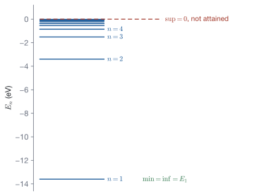{#fig-sup-hydrogen width=60%}
:::

The quantum harmonic oscillator has the opposite behaviour, and it shows that a set can have an infimum without having
a supremum. The lowest energy is attained, while the energies grow without bound.

::: {#exm-sup-oscillator}
#### The oscillator spectrum

The energies $E_n = \hbar\omega(n + \tfrac12)$, $n = 0, 1, 2, \dots$, have $\min = \tfrac12\hbar\omega$, the zero-point energy.
They have no upper bound: for any $M$, @exm-sup-archimedean gives $n > M/(\hbar\omega)$, and then $E_n > M$. So the
spectrum has no supremum in $\mathbb{R}$.
:::

Speeds in special relativity are bounded by the speed of light, and repeated boosts approach it without reaching it.
The velocities below come from adding the speed $c/2$ again and again with the relativistic rule $v \oplus u = (v + u)/(1
+ vu/c^2)$.

::: {#exm-sup-boosts}
#### Repeated boosts

Starting from rest and adding $c/2$ $n$ times gives $v_n = c\,(3^n - 1)/(3^n + 1)$: for $n = 1$ this is $c/2$, and
$(v_n \oplus c/2)/c = (3^{n+1} - 1)/(3^{n+1} + 1)$ by direct simplification. Every $v_n < c$, and $c - v_n = 2c/(3^n + 1)
< 2c/3^n$, which is below any $\varepsilon c > 0$ for large $n$. So $\sup_n v_n = c$, not attained.
:::

Thermodynamics bounds the efficiency of a heat engine between two reservoirs, and the bound is a supremum that no
engine reaches. The example computes it for a cold reservoir held fixed and a hot reservoir of any temperature.

::: {#exm-sup-carnot}
#### Carnot efficiencies

A Carnot engine between reservoirs at $T_\mathrm{c}$ and $T_\mathrm{h} > T_\mathrm{c}$ has efficiency $1 - T_\mathrm{c}/T_\mathrm{h}$.
With $T_\mathrm{c} > 0$ fixed and $T_\mathrm{h}$ ranging over $(T_\mathrm{c}, \infty)$, the set of efficiencies is $(0, 1)$, with
$\inf = 0$ and $\sup = 1$, neither attained: no engine converts all its heat into work.
:::

Why should completeness be an axiom rather than a theorem? The last example answers by exhibiting a bounded set of
rationals with no rational least upper bound, so the property genuinely separates $\mathbb{R}$ from $\mathbb{Q}$.

::: {#exm-sup-rationals}
#### Why completeness is an axiom

The set $\{q \in \mathbb{Q} : q^2 < 2\}$ is bounded above in $\mathbb{Q}$ but has no least upper bound in
$\mathbb{Q}$: the rational upper bounds $1.5, 1.42, 1.415, \dots$ can always be improved, since the least upper bound
would have square $2$ and $\sqrt2$ is irrational [@abbott2015understanding, Example 1.3.6]. In $\mathbb{R}$ its
supremum is $\sqrt2$, and the completeness axiom is exactly what guarantees that such numbers exist.
:::
::::

:::: {.callout-note .exercises-fold collapse="true" title="Exercises"}
Finding suprema and infima of concrete sets is the first skill to practise, including deciding whether they are
attained. The three sets below range from an alternating sequence to the values of $\sin n$, where the positions of
the integers on the circle come in.

::: {#exr-sup-examples}
#### Suprema and infima of explicit sets

Find $\sup$ and $\inf$ of $\{(-1)^n + 1/n : n \geq 1\}$, of $\{x \in \mathbb{R} : x^2 < 3\}$ and of
$\{\sin n : n \in \mathbb{N}\}$, and say which are attained.
:::

::: {.callout-note .solution collapse="true" title="Solution"}
:::: {.panel-tabset .solution-tabs}
## Proof

The first set is $\{0, \tfrac32, -\tfrac23, \tfrac54, -\tfrac45, \dots\}$. Its even terms $1 + 1/n$ decrease from
$\tfrac32$ and its odd terms $-1 + 1/n$ are at most $0$, so $\sup = \tfrac32$, attained at $n = 2$. Every term is above
$-1$, and the odd terms $-1 + 1/n$ come below $-1 + \varepsilon$, so $\inf = -1$, not attained. The second set is the
interval $(-\sqrt3, \sqrt3)$, with $\sup = \sqrt3$ and $\inf = -\sqrt3$, neither attained.

For the third, $|\sin n| \leq 1$, and $\sin n = \pm1$ would need $n = \pi/2 + k\pi$, which is impossible as $\pi$ is
irrational. Fix $K \in \mathbb{N}$. Of the $K + 1$ angles $0, 1, \dots, K$ taken modulo $2\pi$, two lie within $2\pi/K$ of
each other, so some integer $d \neq 0$ is within $2\pi/K$ of a multiple of $2\pi$, and not equal to one. The multiples
$d, 2d, 3d, \dots$ then step around the circle by less than $2\pi/K$, so some $jd$ comes within $2\pi/K$ of $\pi/2$ and some
$j'd$ within $2\pi/K$ of $3\pi/2$, modulo $2\pi$. If $d < 0$, replace $jd$ and $j'd$ by their negatives, which swaps the two
targets. So for every $K$ there are natural numbers $n$ with $\sin n$ within $2\pi/K$ of $1$ and of $-1$, and $\sup = 1$,
$\inf = -1$, neither attained.

## SageMath

Sage lists the first set, and finds the integers $n \leq 10^4$ at which $\sin n$ comes closest to $\pm 1$.

```{.python .sage}
S = [(-1)^n + QQ(1) / n for n in range(1, 21)]
print("max of first 20 terms:", max(S), "; min:", min(S))
best_hi = max(range(1, 10^4), key=lambda n: sin(RDF(n)))
best_lo = min(range(1, 10^4), key=lambda n: sin(RDF(n)))
print("closest to 1: n =", best_hi, ", sin n =", sin(RDF(best_hi)))
print("closest to -1: n =", best_lo, ", sin n =", sin(RDF(best_lo)))
```

```{.text .sage-output}
max of first 20 terms: 3/2 ; min: -18/19
closest to 1: n = 9929 , sin n = 0.9999935858249229
closest to -1: n = 9574 , sin n = -0.9999934774036733
```
::::
:::

The hydrogen levels of @exm-sup-hydrogen also determine the energies of the photons that hydrogen emits, the
differences $E_m - E_n$ for $m > n$. The second exercise asks for the supremum and infimum of this set of differences.

::: {#exr-sup-hydrogen-photons}
#### Photon energies of hydrogen

Find the supremum and the infimum of $\{E_m - E_n : m > n \geq 1\}$, with $E_n = -13.6\,\mathrm{eV}/n^2$, and decide whether
they are attained.
:::

::: {.callout-note .solution collapse="true" title="Solution"}
:::: {.panel-tabset .solution-tabs}
## Proof

$E_m - E_n = 13.6\,(1/n^2 - 1/m^2)\,\mathrm{eV}$, which is positive and below $13.6/n^2 \leq 13.6$. For $n = 1$ the values
$13.6(1 - 1/m^2)$ come above $13.6 - \varepsilon$ once $m^2 > 13.6/\varepsilon$, so $\sup = 13.6\,\mathrm{eV}$, the ionisation energy, not
attained. For $m = n + 1$, $1/n^2 - 1/(n + 1)^2 = (2n + 1)/(n^2(n + 1)^2) \leq 3/n^2$, which is below any $\varepsilon > 0$ for large
$n$. All values are positive, so $\inf = 0$, not attained.

## SageMath

Sage computes the largest and smallest photon energies among the levels $n < m \leq 200$.

```{.python .sage}
E = lambda n: -QQ(136) / 10 / n^2
D = [E(m) - E(n) for n in range(1, 200) for m in range(n + 1, 201)]
print("largest:", N(max(D), digits=6), "eV  (below 13.6)")
print("smallest:", N(min(D), digits=4), "eV  =", min(D) == E(200) - E(199))
```

```{.text .sage-output}
largest: 13.5997 eV  (below 13.6)
smallest: 3.426e-6 eV  = True
```
::::
:::

Sage can list terms, test inequalities and compute limits exactly, which makes the relation between a supremum and
a limit concrete. The third exercise does this for the two running sets, one whose supremum is a maximum and one
whose supremum is not attained.

::: {#exr-supremum-sage}
#### Approaching a supremum

With Sage, list the first terms of $1 - 1/n$, check that they stay below $1$, find a term above $1 - 1/1000$, and
compare the limit of the sequence with the supremum of its set of values; do the same for $\{1/n\}$.
:::

::: {.callout-note .solution collapse="true" title="Solution"}
:::: {.panel-tabset .solution-tabs}
## Proof

Every $1 - 1/n$ is below $1$, and $1 - 1/n > 1 - 1/1000$ exactly when $n > 1000$, for instance $n = 1001$; so $\sup\{1 - 1/n\}
= 1$, not attained (@exm-sup-sequence-set), and the terms approach it. For $\{1/n\}$ the supremum $1$ is attained at $n = 1$,
a maximum, while the infimum $0$ is not attained and is approached by the terms.

## SageMath

Sage lists the terms, tests the bounds and computes the two limits.

```{.python .sage}
n = var("n")
terms = [1 - QQ(1) / k for k in range(1, 11)]
print("first terms 1 - 1/n:", terms)
print("every term is < 1:", all(t < 1 for t in terms), "; the largest of the first 10 is", max(terms))
print("limit of 1 - 1/n:", limit(1 - 1 / n, n=oo), "; n = 1001 exceeds 1 - 1/1000:", 1 - QQ(1) / 1001 > 1 - QQ(1) / 1000)
S = {QQ(1) / k for k in range(1, 11)}
print("max of {1/n} =", max(S), "; limit of 1/n =", limit(1 / n, n=oo))
```

```{.text .sage-output}
first terms 1 - 1/n: [0, 1/2, 2/3, 3/4, 4/5, 5/6, 6/7, 7/8, 8/9, 9/10]
every term is < 1: True ; the largest of the first 10 is 9/10
limit of 1 - 1/n: 1 ; n = 1001 exceeds 1 - 1/1000: True
max of {1/n} = 1 ; limit of 1/n = 0
```
::::
:::

The property that singled out $1$ as the supremum of $\{1 - 1/n\}$ is in fact a characterisation of the supremum,
and it is the form in which completeness is used in proofs. The fourth exercise asks for both directions of the
equivalence [@abbott2015understanding, Lemma 1.3.8].

::: {#exr-sup-characterisation}
#### The $\varepsilon$-characterisation

Prove that $M$ is the supremum of a non-empty set $S$ if and only if $M$ is an upper bound and for every
$\varepsilon > 0$ there is an $s \in S$ with $s > M - \varepsilon$.
:::

::: {.callout-note .solution collapse="true" title="Solution"}
:::: {.panel-tabset .solution-tabs}
## Proof

If $M = \sup S$ and some $\varepsilon > 0$ had no $s > M - \varepsilon$, then $M - \varepsilon$ would be an upper
bound smaller than $M$, contradicting leastness. Conversely, if $M$ is an upper bound with the $\varepsilon$
property, any $M' < M$ fails to be an upper bound: take $\varepsilon = M - M'$ and the corresponding $s > M'$. So
$M$ is the least upper bound.

## SageMath

Check on $S = \{n/(3n + 1)\}$ with $M = 1/3$ (@exm-sup-fractions): Sage finds, for several $\varepsilon$, the first element above
$M - \varepsilon$, and confirms that $M$ is an upper bound of the first thousand elements.

```{.python .sage}
s = lambda n: QQ(n) / (3 * n + 1)
M = QQ(1) / 3
print("upper bound:", all(s(n) < M for n in range(1, 1001)))
for eps in [QQ(1) / 10, QQ(1) / 100, QQ(1) / 1000]:
    n0 = next(n for n in range(1, 10^5) if s(n) > M - eps)
    print("eps =", eps, ": first n with s_n > M - eps is", n0)
```

```{.text .sage-output}
upper bound: True
eps = 1/10 : first n with s_n > M - eps is 1
eps = 1/100 : first n with s_n > M - eps is 11
eps = 1/1000 : first n with s_n > M - eps is 111
```
::::
:::

The completeness axiom speaks only of upper bounds, and the existence of infima has to be derived from it. The fifth
exercise does so by taking the supremum of the set of lower bounds [@abbott2015understanding, Exercise 1.3.3].

::: {#exr-sup-lower-bounds}
#### Infima from suprema

Let $A$ be non-empty and bounded below, and $B$ the set of its lower bounds. Prove that $\sup B$ exists and equals $\inf
A$, so that every non-empty set bounded below has an infimum.
:::

::: {.callout-note .solution collapse="true" title="Solution"}
:::: {.panel-tabset .solution-tabs}
## Proof

$B$ is non-empty, as $A$ is bounded below, and every $a \in A$ is an upper bound of $B$. By the completeness axiom $\beta = \sup B$
exists, and $\beta \leq a$ for every $a \in A$ because each $a$ is an upper bound of $B$. So $\beta$ is a lower bound of $A$, that
is $\beta \in B$. Any lower bound $b$ of $A$ lies in $B$, so $b \leq \beta$. Hence $\beta$ is the greatest lower bound: $\beta = \inf A$.

## SageMath

Check on $A = \{1/n : n \leq 50\}$: Sage takes a grid of candidate lower bounds and compares the largest one with $\min A$.

```{.python .sage}
A = [QQ(1) / n for n in range(1, 51)]
grid = [QQ(k) / 1000 for k in range(-100, 1001)]
B = [b for b in grid if all(b <= a for a in A)]
print("largest lower bound on the grid:", max(B), "; inf A =", min(A))
```

```{.text .sage-output}
largest lower bound on the grid: 1/50 ; inf A = 1/50
```
::::
:::

Scaling a set by a positive number scales its supremum, and a negative factor exchanges suprema and infima. The sixth
exercise proves both rules, which are used whenever a bound is multiplied through an inequality
[@abbott2015understanding, Exercise 1.3.5].

::: {#exr-sup-scaling}
#### Scaling a set

Let $A$ be non-empty and bounded, and $cA = \{ca : a \in A\}$. Prove $\sup(cA) = c\sup A$ for $c \geq 0$ and $\sup(cA) =
c\inf A$ for $c < 0$.
:::

::: {.callout-note .solution collapse="true" title="Solution"}
:::: {.panel-tabset .solution-tabs}
## Proof

For $c = 0$ both sides are $0$. Let $c > 0$ and $s = \sup A$. Then $ca \leq cs$ for all $a$, so $cs$ is an upper bound of $cA$. If
$b$ is an upper bound of $cA$, then $b/c$ is an upper bound of $A$, so $s \leq b/c$ and $cs \leq b$. Hence $\sup(cA) = cs$.
For $c < 0$, write $c = -|c|$: $cA = -(|c|A)$, so $\sup(cA) = -\inf(|c|A)$. The same argument with lower bounds gives
$\inf(|c|A) = |c|\inf A$, and so $\sup(cA) = -|c|\inf A = c\inf A$.

## SageMath

Check on $A = \{(-1)^n + 1/n : n \leq 40\}$, a finite set, with $c = 3$ and $c = -2$.

```{.python .sage}
A = [(-1)^n + QQ(1) / n for n in range(1, 41)]
for c in [3, -2]:
    cA = [c * a for a in A]
    rhs = c * max(A) if c >= 0 else c * min(A)
    print("c =", c, ": sup(cA) =", max(cA), "; formula:", rhs, ";", max(cA) == rhs)
```

```{.text .sage-output}
c = 3 : sup(cA) = 9/2 ; formula: 9/2 ; True
c = -2 : sup(cA) = 76/39 ; formula: 76/39 ; True
```
::::
:::

The supremum of a sum of two sets is the sum of the suprema. The seventh exercise proves it from the definition,
treating the two halves of the definition in turn [@abbott2015understanding, Exercise 1.3.6].

::: {#exr-sup-sum}
#### Sums of sets

For non-empty sets $A$, $B$ bounded above, let $A + B = \{a + b : a \in A, b \in B\}$. Prove $\sup(A + B) = \sup A + \sup B$.
:::

::: {.callout-note .solution collapse="true" title="Solution"}
:::: {.panel-tabset .solution-tabs}
## Proof

Let $s = \sup A$ and $t = \sup B$. Every $a + b \leq s + t$, so $s + t$ is an upper bound. Given $\varepsilon > 0$, the
characterisation of @exr-sup-characterisation gives $a > s - \varepsilon/2$ and $b > t - \varepsilon/2$, so $a + b > s + t - \varepsilon$. By
the same characterisation $s + t = \sup(A + B)$.

## SageMath

Check on $A = \{1 - 1/n\}$ and $B = \{-1/m\}$, both with supremum not attained: for several $\varepsilon$, Sage finds a sum
above $\sup A + \sup B - \varepsilon = 1 - \varepsilon$, and checks that it stays below $1$.

```{.python .sage}
for eps in [QQ(1) / 10, QQ(1) / 1000, QQ(1) / 10^6]:
    n = ceil(2 / eps) + 1
    a, b = 1 - QQ(1) / n, -QQ(1) / n
    print("eps =", eps, ": a + b =", a + b, "; above 1 - eps:", a + b > 1 - eps, "; below 1:", a + b < 1)
```

```{.text .sage-output}
eps = 1/10 : a + b = 19/21 ; above 1 - eps: True ; below 1: True
eps = 1/1000 : a + b = 1999/2001 ; above 1 - eps: True ; below 1: True
eps = 1/1000000 : a + b = 1999999/2000001 ; above 1 - eps: True ; below 1: True
```
::::
:::

The completeness axiom is what makes $\sqrt2$ a real number, and the eighth exercise carries this out. The supremum of the
set of @exm-sup-rationals is shown to have square exactly $2$ [@abbott2015understanding, Thm. 1.4.5].

::: {#exr-sup-sqrt2}
#### $\sqrt2$ exists

Let $\alpha = \sup\{x \in \mathbb{R} : x^2 < 2\}$. Prove that $\alpha^2 = 2$, by excluding $\alpha^2 < 2$ and $\alpha^2 > 2$.
:::

::: {.callout-note .solution collapse="true" title="Solution"}
:::: {.panel-tabset .solution-tabs}
## Proof

The set contains $1$ and is bounded by $2$, so $1 \leq \alpha \leq 2$. If $\alpha^2 < 2$, choose $n$ with $1/n < (2 - \alpha^2)/(2\alpha +
1)$ (@exm-sup-archimedean). Then $(\alpha + 1/n)^2 \leq \alpha^2 + (2\alpha + 1)/n < 2$, so $\alpha + 1/n$ is in the set and $\alpha$ is
not an upper bound. If $\alpha^2 > 2$, choose $n$ with $1/n < (\alpha^2 - 2)/(2\alpha)$. Then $(\alpha - 1/n)^2 > \alpha^2 - 2\alpha/n > 2$, so
every $x$ with $x^2 < 2$ satisfies $|x| < \alpha - 1/n$, and $\alpha - 1/n$ is a smaller upper bound. Both cases are impossible, so
$\alpha^2 = 2$.

## SageMath

Check on the bisection of $[1, 2]$: Sage keeps the half whose left end has square below $2$ and compares the result with
$\sqrt2$.

```{.python .sage}
a, b = QQ(1), QQ(2)
for _ in range(30):
    m = (a + b) / 2
    if m^2 < 2:
        a = m
    else:
        b = m
print("interval after 30 halvings:", N(a, digits=12), N(b, digits=12))
print("sqrt(2) inside:", bool(a < sqrt(2) < b), "; width:", b - a == QQ(1) / 2^30)
```

```{.text .sage-output}
interval after 30 halvings: 1.41421356145 1.41421356238
sqrt(2) inside: True ; width: True
```
::::
:::

The completeness axiom has equivalent forms, and the cut property is one that speaks of splitting the line in two. The
ninth exercise proves the two directions of the equivalence [@abbott2015understanding, Exercise 1.3.10].

::: {#exr-sup-cut}
#### The cut property

Prove that the completeness axiom is equivalent to the **cut property**: if $\mathbb{R} = A \cup B$ with $A$, $B$ non-empty,
disjoint and $a < b$ for all $a \in A$, $b \in B$, then there is $c$ with $a \leq c \leq b$ for all $a \in A$, $b \in B$. Show also
that the cut property fails in $\mathbb{Q}$.
:::

::: {.callout-note .solution collapse="true" title="Solution"}
:::: {.panel-tabset .solution-tabs}
## Proof

Assume the completeness axiom. $A$ is non-empty and bounded above by any $b \in B$, so $c = \sup A$ exists, $a \leq c$ for all
$a \in A$, and $c \leq b$ for all $b \in B$ because each $b$ is an upper bound of $A$. Conversely, assume the cut property and let
$E$ be non-empty and bounded above. Let $B$ be the set of upper bounds of $E$ and $A = \mathbb{R} \setminus B$. $B$ is non-empty by
hypothesis, and $A$ is non-empty since $e - 1 \in A$ for $e \in E$. If $a \in A$ and $b \in B$, then $a$ is not an upper bound, so
$a < e \leq b$ for some $e \in E$. The cut property gives $c$. Every $e \in E$ satisfies $e \leq c$: otherwise $(c + e)/2$ would be in
$A$ (it is below $e$) and above $c$. So $c$ is an upper bound, $c \in B$, and $c \leq b$ for every $b \in B$: $c = \sup E$. In
$\mathbb{Q}$, $A = \{q : q < 0 \text{ or } q^2 < 2\}$ and $B = \{q > 0 : q^2 > 2\}$ form a cut, and a $c$ as required would be a
rational with $c^2 = 2$.

## SageMath

Check on the rational cut at $\sqrt2$: Sage shows that every rational candidate $c$, taken from the continued fraction
approximations of $\sqrt2$, lies on one side and fails to separate.

```{.python .sage}
in_A = lambda q: q < 0 or q^2 < 2
for c in [QQ(7) / 5, QQ(17) / 12, QQ(41) / 29, QQ(99) / 70]:
    if in_A(c):
        a = 4 * c / (c^2 + 2)            # 2/((c + 2/c)/2), an element of A above c
        print(c, "in A; a =", a, "in A and a > c:", in_A(a) and a > c)
    else:
        b = (c + 2 / c) / 2               # an element of B below c
        print(c, "in B; b =", b, "in B and b < c:", not in_A(b) and b < c)
```

```{.text .sage-output}
7/5 in A; a = 140/99 in A and a > c: True
17/12 in B; b = 577/408 in B and b < c: True
41/29 in A; a = 4756/3363 in A and a > c: True
99/70 in B; b = 19601/13860 in B and b < c: True
```
::::
:::

Suprema interact with the open and closed sets of the line, defined in @def-open-set. The last exercise shows that a
closed set contains its supremum and a bounded open set never does.

::: {#exr-sup-open-closed}
#### Suprema of open and closed sets

Let $S \subseteq \mathbb{R}$ be non-empty and bounded above. Prove that $\sup S \in S$ if $S$ is closed, and $\sup S \notin S$ if $S$ is
open. Apply this to $[0, 1]$, $(0, 1)$ and $\{1 - 1/n\} \cup \{1\}$.
:::

::: {.callout-note .solution collapse="true" title="Solution"}
:::: {.panel-tabset .solution-tabs}
## Proof

Let $s = \sup S$. If $S$ is closed and $s \notin S$, then $s$ lies in the open complement, so some ball $(s - \varepsilon, s + \varepsilon)$
misses $S$. But @exr-sup-characterisation gives an element of $S$ in $(s - \varepsilon, s]$, a contradiction. If $S$ is open and $s \in S$,
then some $(s - \varepsilon, s + \varepsilon) \subseteq S$, and $s + \varepsilon/2 \in S$ exceeds the supremum, a contradiction. So $\sup[0, 1] = 1 \in
[0, 1]$ and $\sup(0, 1) = 1 \notin (0, 1)$. The set $\{1 - 1/n\} \cup \{1\}$ is closed, since its complement is a union of open
intervals, and it contains its supremum $1$.

## SageMath

Check on $S = \{1 - 1/n\} \cup \{1\}$: Sage verifies that the gaps between consecutive elements are open intervals free of
$S$, so that the complement in $(-\infty, 1]$ is a union of open intervals, and that $\max S = 1$.

```{.python .sage}
S = sorted([1 - QQ(1) / n for n in range(1, 30)] + [QQ(1)])
gaps = [(S[i], S[i + 1]) for i in range(len(S) - 2)]
mid_free = all(not any(a < s < b for s in S) for a, b in gaps)
print("gaps between consecutive elements contain no element:", mid_free, "; max S =", max(S))
```

```{.text .sage-output}
gaps between consecutive elements contain no element: True ; max S = 1
```
::::
:::
::::

### Limits of sequences

A sequence converges when its terms eventually stay as close to a number as one demands; the figure shows three
sequences entering a band of half-width $\varepsilon$ around their limits and never leaving it. The definition below
is the convergence of @def-metric-convergence on the line, and the order of the line adds two things to it: divergence
to $\pm\infty$, and a rule that compares limits.

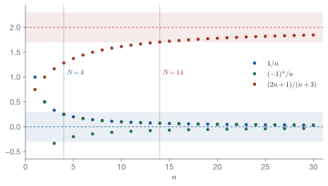{#fig-sequence-limits width=75%}



The bands are the balls $B_\varepsilon(L)$ of the line about the limits, and the index from which a sequence stays in its band
is the $N$ of the definition. The definition asks for such an index for every $\varepsilon > 0$, however small.

:::: {.statement-box}
::: {#def-sequence-limit}
#### Limit of a real sequence

A **real sequence** is a sequence $(a_n)$ in $\mathbb{R}$, a map $n \mapsto a_n$ on $\mathbb{N}$. It **converges** to the
**limit** $L$, written $a_n \to L$ or $\lim_{n \to \infty} a_n = L$, if it converges to $L$ in the sense of
@def-metric-convergence for the distance $d(x, y) = |x - y|$: for every $\varepsilon > 0$ there is an $N$ such that $|a_n - L|
< \varepsilon$ for all $n \geq N$. It **diverges to $\infty$**, written $a_n \to \infty$, if for every $M$ there is an $N$ with $a_n >
M$ for all $n \geq N$, and it diverges to $-\infty$ if $-a_n \to \infty$. If $a_n \to L$ and $b_n \to M$, then $a_n + b_n \to L + M$,
$a_n b_n \to LM$ and $a_n / b_n \to L/M$ when $M \neq 0$ (the **limit rules**), and $a_n \leq b_n$ for all $n$ implies $L \leq M$
(the **order rule**).
:::
::::

The limit is unique by @exr-metric-convergence-unique, and the sum and product rules are @exr-metric-convergence-sum-product.
The quotient rule and the order rule are proved in the exercises below. A sequence that diverges to $\infty$ diverges in the
sense of @def-metric-convergence, since it is not bounded (@exr-metric-convergence-bounded); "$a_n \to \infty$" records how
it diverges. The order rule is @abbott2015understanding [Thm. 2.3.4].

:::: {.callout-note .examples-fold collapse="true" title="Examples"}
The simplest limits are those of powers of $1/n$, and their proofs are the model for every $\varepsilon$-$N$ argument: given
the tolerance, exhibit the index. The same estimate handles alternating signs, since only absolute values enter.

::: {#exm-limit-reciprocal}
#### $1/\sqrt n \to 0$ and $(-1)^n/n \to 0$

Given $\varepsilon > 0$, take $N > 1/\varepsilon^2$; then $|1/\sqrt n - 0| = 1/\sqrt n \leq 1/\sqrt N < \varepsilon$ for $n \geq N$. For
$(-1)^n/n$, $|(-1)^n/n - 0| = 1/n$, so the $N$ of @exm-metric-convergence-reciprocal works; in @fig-sequence-limits, with $\varepsilon =
0.3$, $N = 4$ (green). The signs alternate, but the distance to the limit shrinks.
:::

Rational expressions in $n$ are decided by their leading terms, and the limit rules make the computation routine. The
example also compares the explicit $N$ of the definition with what the rules give for free.

::: {#exm-limit-rational-function}
#### Quotients of polynomials

$(2n + 1)/(n + 3) \to 2$: dividing numerator and denominator by $n$ gives $(2 + 1/n)/(1 + 3/n)$, and the limit
rules give $2/1$. Directly, $|a_n - 2| = 5/(n + 3) < \varepsilon$ as soon as $n > 5/\varepsilon - 3$, which is $n \geq 14$ for $\varepsilon = 0.3$
(@fig-sequence-limits, red) and $n \geq 498$ for $\varepsilon = 1/100$ (@exr-metric-convergence-find-n). The leading terms decide in
general: $(3n^2 + 1)/(n^2 - 5) \to 3$, $(2n + 1)/(5n + 4) \to \tfrac25$ and $n/(n^2 + 1) \to 0$.
:::

Divergence to $\infty$ is a statement about every bound $M$ rather than every tolerance $\varepsilon$. The example gives the
index for three sequences that grow at very different rates, and one that is unbounded without diverging to $\infty$.

::: {#exm-limit-to-infinity}
#### Divergence to $\infty$

$n^2 \to \infty$ ($n > \sqrt M$ suffices), $\sqrt n \to \infty$ ($n > M^2$) and $\log n \to \infty$ ($n > e^M$, as $\log$ is
increasing). The sequence $(-1)^n n$ is unbounded but diverges neither to $\infty$ nor to $-\infty$: its odd terms are negative and
its even terms positive, so no $N$ makes all later terms exceed $M = 0$, or fall below it.
:::

Differences of two large terms, of the form "$\infty - \infty$", are decided by multiplying with a conjugate until the leading
terms cancel. The second case is taken from @radozycki2020solving [Sec. 5.1, Problem 1].

::: {#exm-limit-conjugate}
#### Cancelling leading terms

$\sqrt{n^2 + n} - n = n/(\sqrt{n^2 + n} + n) = 1/(\sqrt{1 + 1/n} + 1) \to \tfrac12$, since $|\sqrt{1 + x} - 1| = x/(\sqrt{1 + x} + 1)
\leq x$ for $x \geq 0$ gives $\sqrt{1 + 1/n} \to 1$. Multiplying twice by conjugates,
$$
\sqrt[4]{n^4 + 2n^3} - \sqrt[4]{n^4 + n^3} = \frac{1}{\big(\sqrt[4]{1 + 2/n} + \sqrt[4]{1 + 1/n}\big)\big(\sqrt{1 + 2/n} + \sqrt{1 +
1/n}\big)} \to \frac{1}{2 \cdot 2} = \frac14,
$$
where $0 \leq \sqrt[4]{1 + x} - 1 \leq \sqrt{1 + x} - 1 \leq x$ for $x \geq 0$ gives $\sqrt[4]{1 + 1/n} \to 1$ and $\sqrt[4]{1 + 2/n} \to 1$.
:::

A sum of $n$ terms that each tend to zero need not tend to zero, because the number of terms grows. The example traps
such a sum between two simpler sequences with the same limit [@radozycki2020solving, Sec. 5.1, Problem 2].

::: {#exm-limit-squeeze-sum}
#### A sum of $n$ small terms

$a_n = \sum_{k = 1}^n 1/\sqrt{n^2 + k}$ lies between $b_n = n/\sqrt{n^2 + n}$ and $c_n = n/\sqrt{n^2 + 1}$, replacing every term by the
smallest and by the largest one. Both bounds tend to $1$ by the limit rules and @exm-limit-conjugate. Since $b_n - 1 \leq a_n - 1
\leq c_n - 1$, $|a_n - 1| \leq \max(|b_n - 1|, |c_n - 1|) < \varepsilon$ from some $N$ on, so $a_n \to 1$.
:::

The hydrogen atom supplies one sequence that converges and one that diverges to $\infty$, indexed by the same principal
quantum number. The energies of @exm-sup-hydrogen tend to the ionisation threshold, and the orbits grow without bound.

::: {#exm-limit-hydrogen}
#### Hydrogen levels and radii

$E_n = -13.6\,\mathrm{eV}/n^2 \to 0$: $|E_n| < \varepsilon$ once $n^2 > 13.6/\varepsilon$. The Bohr radii $r_n = n^2 a_0$, with $a_0 =
0.529 \cdot 10^{-10}\,\mathrm{m}$, diverge to $\infty$: $r_n > M$ once $n^2 > M/a_0$. A highly excited atom is large and barely bound,
which is why Rydberg atoms with $n \sim 100$ are micrometres across.
:::

The repeated boosts of @exm-sup-boosts give a speed that converges and a Lorentz factor that diverges. The second follows
from the first by the algebra of limits and a lower bound.

::: {#exm-limit-boosts}
#### Speed and Lorentz factor after $n$ boosts

$\beta_n = v_n/c = (3^n - 1)/(3^n + 1) = 1 - 2/(3^n + 1) \to 1$, since $2/(3^n + 1) < 2/n$ by $3^n > n$. The Lorentz factor
$\gamma_n = 1/\sqrt{1 - \beta_n^2}$ is $(3^n + 1)/(2 \cdot 3^{n/2})$, from $1 - \beta_n^2 = 4 \cdot 3^n/(3^n + 1)^2$. So $\gamma_n \geq 3^{n/2}/2 >
\sqrt n/2$, and $\gamma_n \to \infty$: the energy $\gamma_n mc^2$ needed for the boosts grows without bound.
:::

Bohr's correspondence principle says that quantum spectra look continuous at large quantum numbers. For the harmonic
oscillator of @exm-sup-oscillator this is a limit: the spacing of the levels becomes negligible relative to the energy.

::: {#exm-limit-oscillator-spacing}
#### Relative level spacing of the oscillator

With $E_n = \hbar\omega(n + \tfrac12)$, $(E_{n + 1} - E_n)/E_n = 1/(n + \tfrac12) \to 0$, while the spacing $E_{n + 1} - E_n = \hbar\omega$
itself is constant. At $n = 10^6$ the relative spacing is $10^{-6}$, so a classical oscillator with that energy sees a
continuous range of energies.
:::

The limit rules need their hypotheses, and the next example shows what goes wrong without them. Sums and products of
divergent sequences can converge, and the quotient rule fails when the denominator tends to zero
[@abbott2015understanding, Exercise 2.3.7].

::: {#exm-limit-rules-fail}
#### When the rules do not apply

$a_n = n$ and $b_n = -n$ diverge, but $a_n + b_n = 0$ converges; $(-1)^n$ diverges, but $(-1)^n \cdot (-1)^n = 1$ converges. With
$b_n = 1/n \to 0$, the quotients $1/b_n = n$ diverge to $\infty$, $(1/n)/b_n = 1$ converges, and $(1/n^2)/b_n \to 0$: when $M = 0$, the
quotient of the limits says nothing.
:::

The order rule turns strict inequalities into non-strict ones, and this cannot be improved. The last example is the
standard counterexample.

::: {#exm-limit-strict}
#### Strict inequalities are not kept

$-1/n < 1/n$ for every $n$, but both sides tend to $0$; likewise $1/n > 0$ for all $n$ while $\lim 1/n = 0$. So $a_n < b_n$ for all $n$
gives only $\lim a_n \leq \lim b_n$, and a sequence of positive numbers can have limit $0$ [@abbott2015understanding, Thm. 2.3.4].
:::
::::

:::: {.callout-note .exercises-fold collapse="true" title="Exercises"}
Making the definition quantitative means producing the actual threshold $N$ for a given tolerance, not just proving
that one exists. The first exercise does this for a quotient of linear terms [@abbott2015understanding, Exercise 2.2.2].

::: {#exr-limit-epsilon-N}
#### Finding $N$ for a given $\varepsilon$

For $a_n = (2n + 1)/(5n + 4)$, show $a_n \to \tfrac25$ and find the smallest $N$ such that $|a_n - \tfrac25| < \varepsilon$ for all $n \geq
N$, for $\varepsilon = 10^{-1}, 10^{-2}, 10^{-3}$.
:::

::: {.callout-note .solution collapse="true" title="Solution"}
:::: {.panel-tabset .solution-tabs}
## Proof

$a_n - \tfrac25 = (5(2n + 1) - 2(5n + 4))/(5(5n + 4)) = -3/(5(5n + 4))$, so $|a_n - \tfrac25| = 3/(25n + 20)$, which decreases in
$n$ and is below $\varepsilon$ exactly when $n > (3/\varepsilon - 20)/25$. Hence $a_n \to \tfrac25$, with $N = 1$, $12$ and $120$ for $\varepsilon = 10^{-1}$,
$10^{-2}$ and $10^{-3}$.

## SageMath

Sage simplifies the gap and finds the first index at which it falls below each $\varepsilon$.

```{.python .sage}
a = lambda n: QQ(2 * n + 1) / (5 * n + 4)
print("gap formula holds:", all(abs(a(n) - QQ(2) / 5) == QQ(3) / (25 * n + 20) for n in range(1, 100)))
for eps in [QQ(1) / 10, QQ(1) / 100, QQ(1) / 1000]:
    N0 = next(n for n in range(1, 10^4) if abs(a(n) - QQ(2) / 5) < eps)
    print("eps =", eps, ": N =", N0)
```

```{.text .sage-output}
gap formula holds: True
eps = 1/10 : N = 1
eps = 1/100 : N = 12
eps = 1/1000 : N = 120
```
::::
:::

The second exercise asks for the index of @def-sequence-limit for divergence to $\infty$, given a bound $M$ instead of a
tolerance. It also asks to decide a case in which the terms grow in absolute value but change sign.

::: {#exr-limit-divergence}
#### Finding $N$ for a given $M$

Show that $a_n = n^2 - 10n \to \infty$ and find the smallest $N$ with $a_n > 10^6$ for all $n \geq N$. Does $(-1)^n n^2$ diverge to
$\infty$?
:::

::: {.callout-note .solution collapse="true" title="Solution"}
:::: {.panel-tabset .solution-tabs}
## Proof

For $n \geq 5$, $a_{n + 1} - a_n = 2n - 9 > 0$, so $a_n$ increases from $n = 5$ on. Also $a_n > M$ exactly when $n > 5 + \sqrt{25 +
M}$, so for every $M$ the index $N = \lfloor 5 + \sqrt{25 + M}\rfloor + 1$ works and $a_n \to \infty$. For $M = 10^6$, $5 + \sqrt{1000025}
= 1005.01\ldots$, so $N = 1006$. The sequence $(-1)^n n^2$ has negative odd terms, so no $N$ makes all later terms exceed $0$: it
does not diverge to $\infty$, nor to $-\infty$.

## SageMath

Sage finds the first index with $a_n > 10^6$ and checks that the following terms stay above.

```{.python .sage}
a = lambda n: n^2 - 10 * n
N0 = next(n for n in range(1, 10^5) if a(n) > 10^6)
print("N =", N0, "; a_(N-1) =", a(N0 - 1), "; a_N =", a(N0))
print("all of the next 10^4 terms above 10^6:", all(a(n) > 10^6 for n in range(N0, N0 + 10^4)))
```

```{.text .sage-output}
N = 1006 ; a_(N-1) = 999975 ; a_N = 1001976
all of the next 10^4 terms above 10^6: True
```
::::
:::

Combining the rules with the conjugate trick of @exm-limit-conjugate disposes of most limits met in practice. The third
exercise shows how sensitive such limits are to terms that look negligible [@radozycki2020solving, Sec. 5.1, Problem 1].

::: {#exr-limit-rules}
#### Limits by the rules and by Sage

Compute $\lim (3n^2 + 1)/(n^2 - 5)$, $\lim(\sqrt{n + 1} - \sqrt n)$, $\lim(\sqrt[4]{n^4 + 2n^2} - \sqrt[4]{n^4 + n^2})$ and decide the
behaviour of $\sqrt[4]{n^4 + 2\sqrt n\, n^3} - \sqrt[4]{n^4 + \sqrt n\, n^3}$, by hand and with Sage.
:::

::: {.callout-note .solution collapse="true" title="Solution"}
:::: {.panel-tabset .solution-tabs}
## Proof

$(3 + 1/n^2)/(1 - 5/n^2) \to 3$. $\sqrt{n + 1} - \sqrt n = 1/(\sqrt{n + 1} + \sqrt n) < 1/(2\sqrt n) \to 0$. For the fourth roots, write
$u = n^4 + 2n^2$, $v = n^4 + n^2$: $\sqrt[4]u - \sqrt[4]v = (u - v)/((\sqrt[4]u + \sqrt[4]v)(\sqrt u + \sqrt v))$, with $u - v = n^2$ and a
denominator at least $2n \cdot 2n^2 = 4n^3$, so the difference lies in $(0, 1/(4n)]$ and tends to $0$. With $u - v = \sqrt n\, n^3$
instead, and the denominator at most $2\sqrt[4]{3}\,n \cdot 2\sqrt3\,n^2 < 10n^3$ (as $u, v \leq 3n^4$), the difference exceeds $\sqrt
n/10$ and diverges to $\infty$. The non-leading terms decide everything once the leading ones cancel.

## SageMath

Sage computes the four limits symbolically.

```{.python .sage}
n = var("n")
for expr in [(3 * n^2 + 1) / (n^2 - 5), sqrt(n + 1) - sqrt(n), (n^4 + 2 * n^2)^(1/4) - (n^4 + n^2)^(1/4),
             (n^4 + 2 * sqrt(n) * n^3)^(1/4) - (n^4 + sqrt(n) * n^3)^(1/4)]:
    print(limit(expr, n=oo))
```

```{.text .sage-output}
3
0
0
+Infinity
```
::::
:::

The quotient rule needs a lower bound on the denominators, which the hypothesis $M \neq 0$ supplies from some index on. The
fourth exercise proves it, after which the quotient rule follows from the product rule.

::: {#exr-limit-quotient-rule}
#### The quotient rule

Let $b_n \to M \neq 0$ with all $b_n \neq 0$. Prove $1/b_n \to 1/M$, and deduce $a_n/b_n \to L/M$ when $a_n \to L$.
:::

::: {.callout-note .solution collapse="true" title="Solution"}
:::: {.panel-tabset .solution-tabs}
## Proof

With $\varepsilon = |M|/2$, there is $N_1$ such that $|b_n - M| < |M|/2$ for $n \geq N_1$, hence $|b_n| > |M|/2$. Then $|1/b_n - 1/M| = |M -
b_n|/(|b_n||M|) < 2|b_n - M|/|M|^2$ for $n \geq N_1$. Given $\varepsilon > 0$, choose $N \geq N_1$ with $|b_n - M| < \varepsilon|M|^2/2$ for $n \geq N$; then
$|1/b_n - 1/M| < \varepsilon$. So $1/b_n \to 1/M$, and $a_n/b_n = a_n \cdot (1/b_n) \to L/M$ by the product rule
(@exr-metric-convergence-sum-product).

## SageMath

Check on $b_n = 2 + (-1)^n/n \to 2$, for which $N_1 = 2$: Sage confirms the lower bound $|b_n| > 1$ and the estimate $|1/b_n - 1/2| <
2|b_n - 2|/4$ for $2 \leq n \leq 1000$.

```{.python .sage}
b = lambda n: 2 + QQ((-1)^n) / n
print("|b_n| > |M|/2 = 1:", all(abs(b(n)) > 1 for n in range(2, 1001)))
print("estimate holds:", all(abs(1 / b(n) - QQ(1) / 2) < 2 * abs(b(n) - 2) / 4 for n in range(2, 1001)))
print("|1/b_1000 - 1/2| =", abs(1 / b(1000) - QQ(1) / 2))
```

```{.text .sage-output}
|b_n| > |M|/2 = 1: True
estimate holds: True
|1/b_1000 - 1/2| = 1/4002
```
::::
:::

The order rule rests on one observation: a sequence of non-negative numbers cannot converge to a negative number. The fifth
exercise proves this and derives the order rule from it [@abbott2015understanding, Thm. 2.3.4].

::: {#exr-limit-order}
#### The order rule

Prove that $a_n \geq 0$ for all $n$ and $a_n \to L$ imply $L \geq 0$. Deduce the order rule, and show that $c \leq b_n$ for all $n$
implies $c \leq \lim b_n$.
:::

::: {.callout-note .solution collapse="true" title="Solution"}
:::: {.panel-tabset .solution-tabs}
## Proof

If $L < 0$, take $\varepsilon = |L|$: for some $N$, $|a_N - L| < |L|$, so $a_N < L + |L| = 0$, a contradiction. If $a_n \leq b_n$ with $a_n \to L$,
$b_n \to M$, then $b_n - a_n \geq 0$ and $b_n - a_n \to M - L$ by the sum rule, so $M - L \geq 0$. Taking $a_n = c$ for all $n$ gives $c \leq
\lim b_n$. The same proof works when the inequalities hold only from some index on.

## SageMath

Check on $b_n = (n + 1)/n \geq 1$ and $a_n = 1 - 1/n \leq b_n$: Sage confirms the inequalities on the first terms and compares
the limits.

```{.python .sage}
n = var("n")
a, b = 1 - 1 / n, (n + 1) / n
print("a_n <= b_n and 1 <= b_n for n <= 100:", all(a(n=k) <= b(n=k) and 1 <= b(n=k) for k in range(1, 101)))
print("limits:", limit(a, n=oo), "<=", limit(b, n=oo))
```

```{.text .sage-output}
a_n <= b_n and 1 <= b_n for n <= 100: True
limits: 1 <= 1
```
::::
:::

Square roots pass to the limit, and the proof treats a zero limit separately from a positive one. The sixth exercise
proves both cases [@abbott2015understanding, Exercise 2.3.1].

::: {#exr-limit-sqrt}
#### Square roots of limits

Let $x_n \geq 0$ and $x_n \to x$. Prove that $\sqrt{x_n} \to \sqrt x$.
:::

::: {.callout-note .solution collapse="true" title="Solution"}
:::: {.panel-tabset .solution-tabs}
## Proof

By the order rule $x \geq 0$. If $x = 0$, given $\varepsilon > 0$ choose $N$ with $x_n < \varepsilon^2$ for $n \geq N$; then $\sqrt{x_n} < \varepsilon$. If $x > 0$,
$|\sqrt{x_n} - \sqrt x| = |x_n - x|/(\sqrt{x_n} + \sqrt x) \leq |x_n - x|/\sqrt x$, which is below $\varepsilon$ once $|x_n - x| < \varepsilon\sqrt x$.

## SageMath

Check on $x_n = 4 + 1/n \to 4$ and $x_n = 1/n^2 \to 0$: Sage compares $|\sqrt{x_n} - \sqrt x|$ with the bound of the proof.

```{.python .sage}
for k in [10, 100, 1000]:
    xk = 4 + QQ(1) / k
    print("k =", k, ": |sqrt(x_k) - 2| =", N(abs(sqrt(xk) - 2), digits=5), "<= |x_k - 4|/2 =", N(abs(xk - 4) / 2, digits=5),
          "; sqrt(1/k^2) =", sqrt(QQ(1) / k^2))
```

```{.text .sage-output}
k = 10 : |sqrt(x_k) - 2| = 0.024845 <= |x_k - 4|/2 = 0.050000 ; sqrt(1/k^2) = 1/10
k = 100 : |sqrt(x_k) - 2| = 0.0024986 <= |x_k - 4|/2 = 0.0050000 ; sqrt(1/k^2) = 1/100
k = 1000 : |sqrt(x_k) - 2| = 0.00025177 <= |x_k - 4|/2 = 0.00050000 ; sqrt(1/k^2) = 1/1000
```
::::
:::

A bounded sequence times a sequence tending to zero tends to zero, even when the bounded factor has no limit. The seventh
exercise proves this and applies it where the limit rules cannot [@abbott2015understanding, Exercises 2.2.2, 2.3.9].

::: {#exr-limit-bounded-null}
#### Bounded times null

Let $|a_n| \leq K$ for all $n$ and $b_n \to 0$. Prove $a_n b_n \to 0$, and deduce $\sin(n^2)/\sqrt[3]n \to 0$. Why does the product rule
not give this?
:::

::: {.callout-note .solution collapse="true" title="Solution"}
:::: {.panel-tabset .solution-tabs}
## Proof

Given $\varepsilon > 0$, choose $N$ with $|b_n| < \varepsilon/(K + 1)$ for $n \geq N$; then $|a_n b_n| \leq K|b_n| < \varepsilon$. With $a_n = \sin(n^2)$, $|a_n|
\leq 1$, and $b_n = n^{-1/3} \to 0$ (take $n > \varepsilon^{-3}$), so $\sin(n^2)/\sqrt[3]n \to 0$. The product rule needs both factors to converge,
and $\sin(n^2)$ has no limit.

## SageMath

Sage evaluates $\sin(n^2)/\sqrt[3]n$ at $n = 10^k$ and compares with the bound $n^{-1/3}$.

```{.python .sage}
for k in range(1, 7):
    m = 10^k
    print("n = 10^%d:" % k, N(sin(m^2) / m^(1/3), digits=4), " bound:", N(m^(-1/3), digits=4))
```

```{.text .sage-output}
n = 10^1: -0.2350  bound: 0.4642
n = 10^2: -0.06584  bound: 0.2154
n = 10^3: -0.03500  bound: 0.1000
n = 10^4: -0.01857  bound: 0.04642
n = 10^5: -0.02151  bound: 0.02154
n = 10^6: -0.0001432  bound: 0.01000
```
::::
:::

Divergence to $\infty$ and convergence to $0$ are exchanged by taking reciprocals of positive terms. The eighth exercise
proves the exchange and applies it to the boosts of @exm-limit-boosts, where $1/\gamma_n$ is the factor by which moving clocks
run slow.

::: {#exr-limit-infinity-reciprocal}
#### Reciprocals of divergent sequences

Let $a_n > 0$. Prove that $a_n \to \infty$ if and only if $1/a_n \to 0$. For the boosts of @exm-limit-boosts, find the first $n$ with
$1/\gamma_n < 10^{-3}$.
:::

::: {.callout-note .solution collapse="true" title="Solution"}
:::: {.panel-tabset .solution-tabs}
## Proof

If $a_n \to \infty$ and $\varepsilon > 0$, take $M = 1/\varepsilon$: from some $N$ on $a_n > 1/\varepsilon$, so $0 < 1/a_n < \varepsilon$. Conversely, if $1/a_n \to 0$
and $M > 0$, take $\varepsilon = 1/M$: from some $N$ on $1/a_n < 1/M$, so $a_n > M$. Here $1/\gamma_n = 2 \cdot 3^{n/2}/(3^n + 1)$, which decreases
for $n \geq 1$; it is about $2 \cdot 3^{-n/2}$, below $10^{-3}$ once $3^{n/2} > 2000$, that is $n \geq 14$, and the exact values confirm $n =
14$.

## SageMath

Sage computes $1/\gamma_n$ exactly and finds the first index below $10^{-3}$.

```{.python .sage}
inv_gamma = lambda n: 2 * sqrt(3)^n / (3^n + 1)
n0 = next(n for n in range(1, 100) if inv_gamma(n) < 1/1000)
print("first n:", n0, "; 1/gamma_n at n0 - 1, n0:", N(inv_gamma(n0 - 1), digits=4), N(inv_gamma(n0), digits=4))
```

```{.text .sage-output}
first n: 14 ; 1/gamma_n at n0 - 1, n0: 0.001584 0.0009145
```
::::
:::

Averaging a sequence smooths it, and the averages of a convergent sequence converge to the same limit. The ninth exercise
proves this and shows that averages can converge when the sequence does not [@abbott2015understanding, Exercise 2.3.11].

::: {#exr-limit-cesaro}
#### Averages of a sequence

Let $y_n = (x_1 + \dots + x_n)/n$. Prove that $x_n \to L$ implies $y_n \to L$, and give a divergent $(x_n)$ with convergent averages.
:::

::: {.callout-note .solution collapse="true" title="Solution"}
:::: {.panel-tabset .solution-tabs}
## Proof

Replacing $x_n$ by $x_n - L$, assume $L = 0$. Given $\varepsilon > 0$, choose $N$ with $|x_k| < \varepsilon/2$ for $k > N$, and let $C = |x_1| + \dots +
|x_N|$. For $n > N$, $|y_n| \leq C/n + (n - N)\varepsilon/(2n) < C/n + \varepsilon/2$, which is below $\varepsilon$ once $n > 2C/\varepsilon$. So $y_n \to 0$. The
sequence $x_n = (-1)^n$ diverges, but its averages are $0$ or $-1/n$, so $y_n \to 0$.

## SageMath

Check on $x_n = 1/\sqrt n \to 0$ and on $x_n = (-1)^n$: Sage computes the averages at $n = 10^2, 10^4$.

```{.python .sage}
for m in [100, 10^4]:
    y1 = sum(1 / sqrt(RDF(k)) for k in range(1, m + 1)) / m
    y2 = QQ(sum((-1)^k for k in range(1, m + 1))) / m
    print("n =", m, ": average of 1/sqrt(k) =", N(y1, digits=4), "; average of (-1)^k =", y2)
```

```{.text .sage-output}
n = 100 : average of 1/sqrt(k) = 0.1859 ; average of (-1)^k = 0
n = 10000 : average of 1/sqrt(k) = 0.01985 ; average of (-1)^k = 0
```
::::
:::

Some properties of the terms pass to the limit and others do not, and the order rule, closedness and completeness decide
which. The last exercise combines the order rule with @def-supremum and @exr-metric-convergence-closed
[@abbott2015understanding, Exercise 2.3.12].

::: {#exr-limit-inherited}
#### What passes to the limit

Let $a_n \to a$. Decide, with a proof or a counterexample: (a) if every $a_n$ is an upper bound of a set $B$, so is $a$; (b) if every
$a_n$ lies outside $(0, 1)$, so does $a$; (c) if every $a_n$ is rational, so is $a$.
:::

::: {.callout-note .solution collapse="true" title="Solution"}
:::: {.panel-tabset .solution-tabs}
## Proof

(a) True: for $b \in B$, $b \leq a_n$ for all $n$, so $b \leq a$ by the order rule. Hence $a$ is an upper bound, and in particular $\sup B
\leq a$. (b) True: the complement of $(0, 1)$ is closed (@def-open-set), and closed sets contain the limits of their convergent
sequences (@exr-metric-convergence-closed). (c) False: the decimal truncations $1, 1.4, 1.41, \dots$ of $\sqrt2$ are rational and
converge to $\sqrt2$, which is irrational (@exm-sup-rationals).

## SageMath

Check on (c): Sage forms the decimal truncations $\lfloor 10^k\sqrt2\rfloor/10^k$, which are rational, and their distances to $\sqrt2$.

```{.python .sage}
for k in range(1, 7):
    q = QQ(floor(10^k * sqrt(2))) / 10^k
    print(q, "rational:", q in QQ, "; sqrt(2) - q < 10^-k:", bool(0 < sqrt(2) - q < QQ(1) / 10^k))
```

```{.text .sage-output}
7/5 rational: True ; sqrt(2) - q < 10^-k: True
141/100 rational: True ; sqrt(2) - q < 10^-k: True
707/500 rational: True ; sqrt(2) - q < 10^-k: True
7071/5000 rational: True ; sqrt(2) - q < 10^-k: True
141421/100000 rational: True ; sqrt(2) - q < 10^-k: True
1414213/1000000 rational: True ; sqrt(2) - q < 10^-k: True
```
::::
:::
::::

### Monotone convergence

Monotone sequences are the case in which completeness gives convergence directly, with the supremum as the limit.
The theorem below is the first real theorem of the chapter, and its proof is the $\varepsilon$-characterisation of
the supremum applied once.

:::: {.statement-box}
::: {#thm-monotone-convergence}
#### Monotone convergence theorem

A sequence is **increasing** if $a_n \leq a_{n+1}$ for all $n$, **decreasing** if $a_n \geq a_{n+1}$ for all $n$, and **monotone** if
it is one or the other. An increasing sequence that is bounded above converges, to the supremum of its set of values; a
decreasing sequence bounded below converges to the infimum. *Proof.* Let $L = \sup_n a_n$, which exists by completeness. For
$\varepsilon > 0$ some $a_N > L - \varepsilon$ (@exr-sup-characterisation), and for $n \geq N$ monotonicity gives
$L - \varepsilon < a_N \leq a_n \leq L$, so $|a_n - L| < \varepsilon$. The decreasing case follows by applying this to $(-a_n)$.
:::
::::

The increasing case was met as @exr-compact-complete-monotone; here it becomes the main tool for sequences given by a
recursion, whose terms have no closed formula. The theorem gives the existence of the limit, and the recursion, passed to the
limit with the rules of @def-sequence-limit, then identifies it [@abbott2015understanding, Thm. 2.4.2].

:::: {.callout-note .examples-fold collapse="true" title="Examples"}
The theorem applies at once to the sequence $1/n$, which decreases to its infimum. The first example records this,
showing how the theorem bypasses the $\varepsilon$-$N$ argument.

::: {#exm-monotone-reciprocal}
#### Decreasing to the infimum

$1/n$ is decreasing and bounded below by $0$, so it converges to $\inf\{1/n\} = 0$, and the same holds for $1/\sqrt n$. The
theorem reproves @exm-metric-convergence-reciprocal and @exm-limit-reciprocal without an $\varepsilon$-$N$ argument; the
work has moved into the computation of the infimum.
:::

Increasing sequences converge to their suprema, and the supremum is often easy to read off. The second example takes two
increasing sequences whose suprema are computed directly from @def-supremum.

::: {#exm-monotone-fraction}
#### Increasing to the supremum

$n/(n + 1) = 1 - 1/(n + 1)$ increases, and its supremum is $1$ as in @exm-sup-sequence-set, so $n/(n + 1) \to 1$. Likewise $1 -
2^{-n}$ increases to $\sup\{1 - 2^{-n}\} = 1$, since $2^{-n} \leq 1/n$ comes below every $\varepsilon > 0$.
:::

The theorem is most useful for recursively defined sequences, whose terms have no closed formula. Newton's
iteration for $\sqrt2$ is decreasing and bounded below, so it converges, and the recursion then identifies the
limit.

::: {#exm-monotone-sqrt2}
#### Newton's recursion for $\sqrt2$

$a_0 = 2$, $a_{n+1} = \tfrac12(a_n + 2/a_n)$ gives $2, 1.5, 1.4167, 1.41422, \dots$. The terms satisfy $a_n^2 \geq 2$, since
$a_{n+1}^2 - 2 = \tfrac14(a_n - 2/a_n)^2$, so $a_{n+1} - a_n = (2 - a_n^2)/(2a_n) \leq 0$: decreasing and bounded below by $1$, so
convergent. The limit $L \geq 1$ satisfies $L = \tfrac12(L + 2/L)$ by the limit rules, that is, $L^2 = 2$. The theorem gives
existence of the limit, the recursion identifies it.
:::

The sequence $(1 + 1/n)^n$ appeared among the running examples, and its limit is the number $e$. Monotonicity and the bound
by $3$ both come from the binomial theorem.

::: {#exm-monotone-euler}
#### The number $e$

$(1 + 1/n)^n$ is increasing (by the binomial theorem, each term of the expansion grows with $n$ and new terms
appear) and bounded above by $3$ (compare with $\sum_{k \leq n} 1/k! < 1 + 1 + \tfrac12 + \tfrac14 + \dots = 3$), so it
converges. Its limit is, by definition, the number $e = 2.71828\ldots$, and $e \leq 3$.
:::

Nested square roots define an increasing sequence by a recursion, and the limit solves a quadratic equation. The example
is @abbott2015understanding [Exercise 2.4.3].

::: {#exm-monotone-nested-radicals}
#### $\sqrt2, \sqrt{2 + \sqrt2}, \dots$

Let $a_1 = \sqrt2$ and $a_{n+1} = \sqrt{2 + a_n}$. By induction $a_n < 2$ (as $\sqrt{2 + a_n} < \sqrt4$) and $a_{n+1} > a_n$ (as $2 + a_n >
a_n^2$ for $0 < a_n < 2$). So $a_n \to L$, and passing to the limit with @exr-limit-sqrt, $L = \sqrt{2 + L}$, so $L^2 - L - 2 = 0$ and $L
= 2$, the positive root.
:::

A recursion $a_{n+1} = f(a_n)$ can be drawn as a staircase between the graph of $f$ and the diagonal. The cobweb diagram
shows the two monotone regimes of one recursion, from below and from above its fixed point
[@radozycki2020solving, Sec. 5.3].

::: {#exm-monotone-cobweb}
#### A recursion from both sides

For $a_{n+1} = 3a_n/(a_n + 1)$, $a_{n+1} - 2 = (a_n - 2)/(a_n + 1)$ and $a_{n+1} = a_n \cdot 3/(a_n + 1)$. If $0 < a_0 < 2$, by induction $0 < a_n < 2$
and $3/(a_n + 1) > 1$, so the sequence increases; if $a_0 > 2$, it stays above $2$ and decreases. Either way it converges, and the
limit $L > 0$ satisfies $L = 3L/(L + 1)$, so $L = 2$.

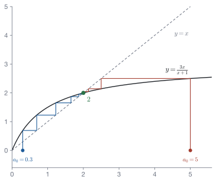{#fig-monotone-cobweb width=60%}
:::

Spectral lines come in families that converge to a limit, and the limit is a supremum. The Lyman lines of hydrogen, emitted
in transitions to the ground state, have increasing wavenumbers.

::: {#exm-monotone-lyman}
#### The Lyman limit

The wavenumbers of the transitions $n \to 1$ are $\tilde\nu_n = R(1 - 1/n^2)$, $n \geq 2$, with the Rydberg constant $R = 1.097 \cdot
10^7\,\mathrm{m}^{-1}$. They increase and are bounded by $R$, so they converge, to $\sup_n \tilde\nu_n = R$. The wavelengths $1/\tilde\nu_n$
decrease to $1/R = 91.2\,\mathrm{nm}$, the Lyman limit, below which hydrogen absorbs in a continuum.
:::

Newton's law of cooling, sampled at equal time steps, is an affine recursion. A hot body loses a fixed fraction of its
excess temperature in each step, and the sequence of temperatures decreases to that of the surroundings.

::: {#exm-monotone-cooling}
#### Cooling in steps

With ambient temperature $T_\mathrm{a}$ and $T_{n+1} = T_\mathrm{a} + q(T_n - T_\mathrm{a})$, $0 < q < 1$, a body starting at $T_0 >
T_\mathrm{a}$ has $T_n - T_\mathrm{a} = q^n(T_0 - T_\mathrm{a}) > 0$, decreasing in $n$. By the theorem $T_n \to L$, and the recursion gives $L =
T_\mathrm{a} + q(L - T_\mathrm{a})$, so $L = T_\mathrm{a}$. A cup at $90\,^\circ\mathrm{C}$ in a room at $20\,^\circ\mathrm{C}$ with $q = 0.9$
per minute is below $21\,^\circ\mathrm{C}$ after $41$ minutes.
:::

Boundedness cannot be dropped, and without it a monotone sequence diverges in the most orderly way. The oscillator energies
of @exm-sup-oscillator are the physical case.

::: {#exm-monotone-oscillator}
#### Increasing and unbounded

An increasing sequence that is not bounded above diverges to $\infty$: given $M$, some $a_N > M$, and then $a_n \geq a_N > M$ for $n \geq
N$. So the energies $E_n = \hbar\omega(n + \tfrac12)$ increase to $\infty$, and a monotone sequence either converges or diverges to
$\pm\infty$.
:::

The limit of a recursion can only be computed after its existence is known, and the last example shows what happens when
this step is skipped. The argument looks correct and gives a wrong answer [@abbott2015understanding, Exercise 2.4.2].

::: {#exm-monotone-false-fixed-point}
#### A limit that does not exist

Let $y_1 = 1$ and $y_{n+1} = 3 - y_n$. "Passing to the limit" in $L = 3 - L$ gives $L = \tfrac32$, but the sequence is $1, 2, 1, 2, \dots$,
which is not monotone and diverges, like the alternating sign of @exm-metric-convergence-alternating. The limit rules apply only
to sequences known to converge.
:::
::::

:::: {.callout-note .exercises-fold collapse="true" title="Exercises"}
Newton's recursion is also a fast algorithm, and exact arithmetic in Sage shows how the error shrinks at each step.
The first exercise iterates it, checks the hypotheses of the theorem, and solves the fixed-point equation.

::: {#exr-monotone-sqrt2}
#### Newton's recursion in Sage

Iterate $a_{n+1} = \tfrac12(a_n + 2/a_n)$ from $a_0 = 2$ six times in exact arithmetic, check monotonicity and the
lower bound, measure $|a_6 - \sqrt2|$, and solve the fixed-point equation.
:::

::: {.callout-note .solution collapse="true" title="Solution"}
:::: {.panel-tabset .solution-tabs}
## Proof

By @exm-monotone-sqrt2 the sequence is decreasing with all $a_n^2 \geq 2$, so it converges by the theorem. The fixed-point
equation $L = \tfrac12(L + 2/L)$ is $L^2 = 2$, with roots $\pm\sqrt2$, and the limit is the positive one since all $a_n > 0$. From
$a_{n+1} - \sqrt2 = (a_n - \sqrt2)^2/(2a_n)$, the error is roughly squared at each step, so six iterations exceed double
precision.

## SageMath

Sage iterates in $\mathbb{Q}$, checks the two hypotheses and solves the fixed-point equation.

```{.python .sage}
a = [QQ(2)]
for _ in range(6):
    a.append((a[-1] + 2 / a[-1]) / 2)
print("terms:", [N(t, digits=17) for t in a[:4]])
print("decreasing:", all(a[i + 1] < a[i] for i in range(len(a) - 1)), "; a_n^2 > 2:", all(t^2 > 2 for t in a))
print("|a_6 - sqrt 2| =", N(abs(a[6] - sqrt(2)), prec=400).n(digits=3))
L = var("L")
print("fixed points:", solve(L == (L + 2 / L) / 2, L))
```

```{.text .sage-output}
terms: [2.0000000000000000, 1.5000000000000000, 1.4166666666666667, 1.4142156862745098]
decreasing: True ; a_n^2 > 2: True
|a_6 - sqrt 2| = 2.86e-49
fixed points: [
L == -sqrt(2),
L == sqrt(2)
]
```
::::
:::

The second exercise applies the theorem to a recursion whose limit is a root of a quadratic. The fixed-point equation has two
roots, and the monotonicity and the bounds decide which one is the limit [@abbott2015understanding, Exercise 2.4.1].

::: {#exr-monotone-recursion}
#### A recursion with two candidate limits

Let $x_1 = 3$ and $x_{n+1} = 1/(4 - x_n)$. Prove that $(x_n)$ converges, and compute its limit.
:::

::: {.callout-note .solution collapse="true" title="Solution"}
:::: {.panel-tabset .solution-tabs}
## Proof

Let $r = 2 - \sqrt3$ and $R = 2 + \sqrt3$, the roots of $x^2 - 4x + 1 = 0$, so that $1/(4 - r) = r$. The map $x \mapsto 1/(4 - x)$ is increasing
on $(-\infty, 4)$, so $r < x_n < 4$ gives $x_{n+1} > 1/(4 - r) = r$; by induction all $x_n > r$, and all $x_n \leq 3$. Then $x_{n+1} - x_n = (x_n^2 -
4x_n + 1)/(4 - x_n) = (x_n - r)(x_n - R)/(4 - x_n) < 0$, since $r < x_n < R$. So the sequence decreases, is bounded below by $r$, and
converges to some $L \in [r, 3]$. Passing to the limit, $L(4 - L) = 1$, so $L \in \{r, R\}$, and $L \leq 3 < R$ gives $L = 2 - \sqrt3$.

## SageMath

Sage iterates exactly and compares with $2 - \sqrt3$.

```{.python .sage}
x = [QQ(3)]
for _ in range(10):
    x.append(1 / (4 - x[-1]))
print("first terms:", x[:5])
print("decreasing:", all(x[i + 1] < x[i] for i in range(10)), "; x_11 - (2 - sqrt 3) =", N(x[10] - (2 - sqrt(3)), prec=400).n(digits=3))
```

```{.text .sage-output}
first terms: [3, 1, 1/3, 3/11, 11/41]
decreasing: True ; x_11 - (2 - sqrt 3) = 4.71e-11
```
::::
:::

Equations without closed-form roots are solved by recasting them as $x = \varphi(x)$ and iterating. The third exercise applies the
theorem to the example of @riley2006mathematical [Sec. 27.1.1, pp. 987-988], the real root of $x^5 - 2x^2 - 3 = 0$.

::: {#exr-monotone-rearrangement}
#### Iterating a rearranged equation

Let $x_1 = 1.7$ and $x_{n+1} = (2x_n^2 + 3)^{1/5}$. Prove that $(x_n)$ decreases to the real root $\xi$ of $f(x) = x^5 - 2x^2 - 3$, and compute
$x_n$ until it agrees with $\xi$ to six decimals.
:::

::: {.callout-note .solution collapse="true" title="Solution"}
:::: {.panel-tabset .solution-tabs}
## Proof

Let $\varphi(x) = (2x^2 + 3)^{1/5}$, increasing for $x \geq 0$. For $x > \sqrt[3]2$, $x^5 - 2x^2 = x^2(x^3 - 2)$ is a product of two positive increasing
factors, so $f$ is increasing there. Since $f(\sqrt[3]2) = -3 < 0 < f(1.7)$, and $f < 0$ on $[0, \sqrt[3]2]$ (where $x^5 \leq 2x^2$), $f$ has
exactly one root $\xi \geq 0$, with $\sqrt[3]2 < \xi < 1.7$, and $f > 0$ on $(\xi, \infty)$. Now $x > \xi$ gives $\varphi(x) > \varphi(\xi) = \xi$, and
$\varphi(x) < x$ is $2x^2 + 3 < x^5$, that is $f(x) > 0$. By induction $\xi < x_{n+1} < x_n$, so $x_n \to L \geq \xi$. Passing to the limit in
$x_{n+1}^5 = 2x_n^2 + 3$ with the product rule, $f(L) = 0$, so $L = \xi$.

## SageMath

Sage iterates the recursion and compares with the root found by `find_root`.

```{.python .sage}
x = var("x")
xi = find_root(x^5 - 2 * x^2 - 3, 1, 2)
xs = [RDF(1.7)]
while abs(xs[-1] - xi) >= 5e-7:
    xs.append((2 * xs[-1]^2 + 3)^(1/5))
print("xi =", round(xi, 8), "; iterations:", len(xs) - 1)
print("terms:", [round(t, 6) for t in xs[:5]], "...", round(xs[-1], 6))
print("decreasing:", all(xs[i + 1] < xs[i] for i in range(len(xs) - 1)))
```

```{.text .sage-output}
xi = 1.4951064 ; iterations: 10
terms: [1.7, 1.544183, 1.506861, 1.49792, 1.49578] ... 1.495107
decreasing: True
```
::::
:::

The two estimates behind the convergence of $(1 + 1/n)^n$ in @exm-monotone-euler are both binomial expansions, and the
fourth exercise works them out in full. The same computation yields the bound $e \leq 3$.

::: {#exr-monotone-e}
#### $(1 + 1/n)^n$ is increasing and bounded

Prove that $a_n = (1 + 1/n)^n$ is increasing and that $a_n < 3$ for all $n$, and conclude that it converges.
:::

::: {.callout-note .solution collapse="true" title="Solution"}
:::: {.panel-tabset .solution-tabs}
## Proof

By the binomial theorem $a_n = \sum_{k=0}^n \binom{n}{k} n^{-k} = \sum_{k=0}^n \tfrac{1}{k!}\prod_{j=0}^{k-1}(1 -
j/n)$. Each product increases with $n$ and $a_{n+1}$ has one more positive term, so $a_{n+1} > a_n$. Each product
is at most $1$, and $k! \geq 2^{k-1}$, so $a_n \leq \sum_{k=0}^n 1/k! \leq 1 + \sum_{k=1}^n 2^{1-k} < 3$. By the monotone convergence
theorem $a_n$ converges, and the limit is by definition $e$; the order rule gives $e \leq 3$.

## SageMath

Check on $n \leq 200$: Sage verifies that the terms increase and stay below $3$, and computes the term at $n = 200$.

```{.python .sage}
a = [(1 + QQ(1) / n)^n for n in range(1, 201)]
print("increasing:", all(a[i] < a[i + 1] for i in range(199)), "; below 3:", all(t < 3 for t in a))
print("a_200 =", N(a[-1], digits=8), "; e =", N(e, digits=8))
```

```{.text .sage-output}
increasing: True ; below 3: True
a_200 = 2.7115171 ; e = 2.7182818
```
::::
:::

A nested sequence of shrinking closed intervals pins down exactly one point; this is the form in which completeness
drives bisection arguments. The fifth exercise proves it from the monotone convergence theorem, applied to the two
sequences of endpoints, and uses it to locate the root of @exr-monotone-rearrangement by halving
[@riley2006mathematical, Sec. 27.1.3, p. 990].

::: {#exr-nested-intervals}
#### Nested intervals

Prove that a nested sequence of closed intervals $[a_n, b_n] \supseteq [a_{n+1}, b_{n+1}]$ with $b_n - a_n \to 0$
has exactly one common point. Apply it to the bisection of $[1, 1.7]$ for $x^5 - 2x^2 - 3$.
:::

::: {.callout-note .solution collapse="true" title="Solution"}
:::: {.panel-tabset .solution-tabs}
## Proof

$a_n$ is increasing and bounded above by $b_1$, $b_n$ decreasing and bounded below by $a_1$, so both converge, to
$a$ and $b$ with $a \leq b$ by the order rule; from $b_n - a_n \to 0$, $a = b$. The point $a$ lies in every interval ($a_n \leq a \leq
b_n$), and any other common point $c$ would satisfy $|c - a| \leq b_n - a_n$ for all $n$, forcing $c = a$. In the bisection, each
step keeps the half $[a_n, b_n]$ with $f(a_n) < 0 < f(b_n)$, so the intervals are nested with $b_n - a_n = 0.7/2^{n-1} \to 0$. Their
common point is the root $\xi$: $\xi$ lies in every interval by the sign analysis of @exr-monotone-rearrangement, since $f < 0$ on
$[1, \xi)$ and $f > 0$ on $(\xi, 1.7]$.

## SageMath

Sage bisects in exact arithmetic for $30$ steps and prints the first intervals and the last one.

```{.python .sage}
f = lambda x: x^5 - 2 * x^2 - 3
a, b = QQ(1), QQ(17) / 10
for k in range(30):
    m = (a + b) / 2
    if f(m) < 0:
        a = m
    else:
        b = m
    if k < 4:
        print("step", k + 1, ":", [N(a, digits=5), N(b, digits=5)])
print("after 30 steps:", [N(a, digits=10), N(b, digits=10)], "; width:", b - a == QQ(7) / 10 / 2^30)
```

```{.text .sage-output}
step 1 : [1.3500, 1.7000]
step 2 : [1.3500, 1.5250]
step 3 : [1.4375, 1.5250]
step 4 : [1.4813, 1.5250]
after 30 steps: [1.495106397, 1.495106398] ; width: True
```
::::
:::

Newton's recursion works for every square root, and the proof of convergence uses the inequality between the arithmetic and
geometric means. The sixth exercise proves it for $\sqrt c$ [@abbott2015understanding, Exercise 2.4.5].

::: {#exr-monotone-sqrt-c}
#### Newton's recursion for $\sqrt c$

Let $c > 0$, $x_1 > 0$ and $x_{n+1} = \tfrac12(x_n + c/x_n)$. Prove that $x_n \geq \sqrt c$ for $n \geq 2$, that the sequence decreases from $n = 2$
on, and that $x_n \to \sqrt c$.
:::

::: {.callout-note .solution collapse="true" title="Solution"}
:::: {.panel-tabset .solution-tabs}
## Proof

$x_{n+1}^2 - c = \tfrac14(x_n - c/x_n)^2 \geq 0$, so $x_{n+1} \geq \sqrt c$ for every $n \geq 1$. Then for $n \geq 2$, $x_{n+1} - x_n = (c - x_n^2)/(2x_n) \leq 0$.
So $(x_n)_{n \geq 2}$ decreases and is bounded below by $\sqrt c$, and converges to some $L \geq \sqrt c > 0$. The limit rules give $L =
\tfrac12(L + c/L)$, so $L^2 = c$ and $L = \sqrt c$.

## SageMath

Check on $c = 10$ from $x_1 = 1$: Sage iterates exactly, checks the claims and compares with $\sqrt{10}$.

```{.python .sage}
c = 10
x = [QQ(1)]
for _ in range(6):
    x.append((x[-1] + c / x[-1]) / 2)
print("x_n >= sqrt c for n >= 2:", all(t^2 >= c for t in x[1:]), "; decreasing from n = 2:", all(x[i + 1] <= x[i] for i in range(1, 6)))
print("x_7 - sqrt 10 =", N(x[6] - sqrt(10), prec=400).n(digits=3))
```

```{.text .sage-output}
x_n >= sqrt c for n >= 2: True ; decreasing from n = 2: True
x_7 - sqrt 10 = 3.96e-18
```
::::
:::

Two monotone sequences can squeeze each other to a common limit. The seventh exercise does this for the arithmetic-geometric
mean, whose two sequences approach each other remarkably fast
[@abbott2015understanding, Exercise 2.4.6].

::: {#exr-monotone-agm}
#### The arithmetic-geometric mean

Let $0 < x_1 \leq y_1$, $x_{n+1} = \sqrt{x_n y_n}$ and $y_{n+1} = (x_n + y_n)/2$. Prove that both sequences converge, to the same limit.
:::

::: {.callout-note .solution collapse="true" title="Solution"}
:::: {.panel-tabset .solution-tabs}
## Proof

$\sqrt{xy} \leq (x + y)/2$ for $x, y > 0$, since the difference is $(\sqrt y - \sqrt x)^2/2$. So $x_{n+1} \leq y_{n+1}$ for all $n$. Then $x_{n+1} =
\sqrt{x_n y_n} \geq \sqrt{x_n^2} = x_n$ and $y_{n+1} = (x_n + y_n)/2 \leq y_n$. So $(x_n)$ increases and is bounded by $y_1$, $(y_n)$ decreases and is
bounded below by $x_1$, and both converge, to $x$ and $y$. Passing to the limit in $y_{n+1} = (x_n + y_n)/2$ gives $y = (x + y)/2$, so $x = y$.

## SageMath

Check on $x_1 = 1$, $y_1 = 2$: Sage iterates to $50$ digits and compares with Sage's `agm`.

```{.python .sage}
R = RealField(170)
x, y = R(1), R(2)
for k in range(5):
    x, y = sqrt(x * y), (x + y) / 2
    print(k + 1, N(x, digits=20), N(y, digits=20))
print("agm(1, 2) =", N(R(1).agm(R(2)), digits=20))
```

```{.text .sage-output}
1 1.4142135623730950488 1.5000000000000000000
2 1.4564753151219702609 1.4571067811865475244
3 1.4567910139395549462 1.4567910481542588926
4 1.4567910310469068190 1.4567910310469069194
5 1.4567910310469068692 1.4567910310469068692
agm(1, 2) = 1.4567910310469068692
```
::::
:::

The monotone convergence theorem assigns two numbers to every bounded sequence, convergent or not: the limits of the suprema and
of the infima of its tails. The eighth exercise defines them and proves that they agree exactly for convergent sequences
[@abbott2015understanding, Exercise 2.4.7].

::: {#exr-monotone-limsup}
#### Upper and lower limits

Let $(a_n)$ be bounded, $y_n = \sup\{a_k : k \geq n\}$ and $z_n = \inf\{a_k : k \geq n\}$. Prove that $(y_n)$ and $(z_n)$ converge; their limits are
the **upper limit** $\limsup a_n$ and the **lower limit** $\liminf a_n$. Prove $\liminf a_n \leq \limsup a_n$, with equality if and only if $(a_n)$
converges, and compute both for $a_n = (-1)^n(1 + 1/n)$.
:::

::: {.callout-note .solution collapse="true" title="Solution"}
:::: {.panel-tabset .solution-tabs}
## Proof

The tails shrink as $n$ grows, so $y_{n+1} \leq y_n$ and $z_{n+1} \geq z_n$, with $z_1 \leq z_n \leq y_n \leq y_1$; both converge by the theorem, and
$\liminf a_n \leq \limsup a_n$ by the order rule. If $a_n \to L$, then for $k \geq N$, $L - \varepsilon < a_k < L + \varepsilon$, so $L - \varepsilon \leq z_n \leq y_n \leq L
+ \varepsilon$ for $n \geq N$, and both limits are $L$. Conversely, if both equal $L$, then $z_n \leq a_n \leq y_n$ traps $a_n$ between two sequences
tending to $L$, so $|a_n - L| \leq \max(|z_n - L|, |y_n - L|) \to 0$. For $a_n = (-1)^n(1 + 1/n)$, $y_n$ is $1 + 1/n$ or $1 + 1/(n + 1)$, whichever
index is even, and $z_n$ is $-(1 + 1/n)$ or $-(1 + 1/(n + 1))$; so $\limsup a_n = 1$, $\liminf a_n = -1$, and the sequence diverges.

## SageMath

Check on $a_n = (-1)^n(1 + 1/n)$: Sage computes the suprema and infima of the tails $\{a_k : n \leq k \leq 2000\}$.

```{.python .sage}
a = [(-1)^n * (1 + QQ(1) / n) for n in range(1, 2001)]
for n in [1, 10, 100, 1000]:
    tail = a[n - 1:]
    print("n =", n, ": sup of tail =", max(tail), "; inf of tail =", min(tail))
```

```{.text .sage-output}
n = 1 : sup of tail = 3/2 ; inf of tail = -2
n = 10 : sup of tail = 11/10 ; inf of tail = -12/11
n = 100 : sup of tail = 101/100 ; inf of tail = -102/101
n = 1000 : sup of tail = 1001/1000 ; inf of tail = -1002/1001
```
::::
:::

A recursion with a decreasing map oscillates around its fixed point, and the theorem then applies to the terms of even and of
odd index separately. The ninth exercise combines it with subsequences (@exr-metric-cauchy-subsequence)
[@radozycki2020solving, Sec. 5.4, Problem 1].

::: {#exr-monotone-oscillating}
#### An oscillating recursion

Let $a_0 \in (0, \tfrac32)$ and $a_{n+1} = 6/(2a_n + 1)$. Show that $a_{n+2} = g(a_n)$ with $g(x) = 6(2x + 1)/(2x + 13)$, that $(a_{2k})$ increases and
$(a_{2k+1})$ decreases, that both tend to $\tfrac32$, and conclude $a_n \to \tfrac32$.
:::

::: {.callout-note .solution collapse="true" title="Solution"}
:::: {.panel-tabset .solution-tabs}
## Proof

Substituting, $a_{n+2} = 6/(12/(2a_n + 1) + 1) = 6(2a_n + 1)/(2a_n + 13) = g(a_n)$. One computes $g(x) - \tfrac32 = 9(x - \tfrac32)/(2x + 13)$ and $g(x)
- x = 2(x + 2)(\tfrac32 - x)/(2x + 13)$. For $0 < x < \tfrac32$ this gives $x < g(x) < \tfrac32$, and for $x > \tfrac32$, $\tfrac32 < g(x) < x$. Since $a_1 =
6/(2a_0 + 1) > \tfrac32$, induction shows that $(a_{2k})$ increases and stays below $\tfrac32$, and $(a_{2k+1})$ decreases and stays above. Both
converge, and each limit $L$ satisfies $L = g(L)$ with $L > 0$, so $(L + 2)(\tfrac32 - L) = 0$ and $L = \tfrac32$. Given $\varepsilon > 0$, the even terms
are within $\varepsilon$ of $\tfrac32$ from some $2K_0$ on and the odd terms from some $2K_1 + 1$ on, so every term with index at least $\max(2K_0,
2K_1 + 1)$ is within $\varepsilon$: $a_n \to \tfrac32$.

## SageMath

Check on $a_0 = \tfrac15$: Sage iterates exactly and prints the even and odd terms.

```{.python .sage}
a = [QQ(1) / 5]
for _ in range(14):
    a.append(6 / (2 * a[-1] + 1))
even, odd = a[0::2], a[1::2]
print("even increasing:", all(even[i] < even[i + 1] for i in range(len(even) - 1)), "; odd decreasing:",
      all(odd[i] > odd[i + 1] for i in range(len(odd) - 1)))
print("a_13, a_14:", N(a[13], digits=8), N(a[14], digits=8))
```

```{.text .sage-output}
even increasing: True ; odd decreasing: True
a_13, a_14: 1.5498339 1.4635332
```
::::
:::

The monotone convergence theorem was derived from the completeness axiom, and the converse holds as well. The last exercise
proves the axiom of @def-supremum from the theorem, so that either can serve as the starting point for the real numbers
[@abbott2015understanding, Exercise 2.4.4].

::: {#exr-monotone-completeness}
#### Monotone convergence implies completeness

Assume only the monotone convergence theorem. Prove that $2^{-n} \to 0$, and that every non-empty set $E$ bounded above has a supremum,
by bisecting an interval $[a_1, b_1]$ with $a_1$ not an upper bound and $b_1$ an upper bound.
:::

::: {.callout-note .solution collapse="true" title="Solution"}
:::: {.panel-tabset .solution-tabs}
## Proof

$2^{-n}$ decreases and is bounded below by $0$, so it converges to some $L$; since $2^{-(n+1)} = \tfrac12 2^{-n}$, $L = L/2$ and $L = 0$. Take $a_1 = x_0 - 1$
for some $x_0 \in E$ and $b_1$ an upper bound. Given $[a_n, b_n]$ with $a_n$ not an upper bound and $b_n$ an upper bound, let $m$ be its midpoint, and
set $[a_{n+1}, b_{n+1}] = [a_n, m]$ if $m$ is an upper bound and $[m, b_n]$ otherwise. Then $(a_n)$ increases, $(b_n)$ decreases, $a_n < b_n$, and $b_n - a_n
= 2^{1-n}(b_1 - a_1) \to 0$, so both converge to one limit $s$. Every $x \in E$ has $x \leq b_n$, so $x \leq s$ by the order rule: $s$ is an upper bound.
Each $a_n$ is not an upper bound, so some $x_n \in E$ has $x_n > a_n$; if $t < s$, then $a_n > t$ for large $n$, and $x_n > t$, so $t$ is not an upper
bound. Hence $s = \sup E$.

## SageMath

Check on $E = \{1 - 1/n\}$, with $a_1 = -1$ and $b_1 = 2$: Sage runs the bisection, testing upper bounds exactly (an $m < 1$ is not an upper
bound, as some $1 - 1/n$ exceeds it), and compares with $\sup E = 1$.

```{.python .sage}
is_upper = lambda m: m >= 1          # for E = {1 - 1/n}: m is an upper bound iff m >= 1
a, b = QQ(-1), QQ(2)
for _ in range(40):
    m = (a + b) / 2
    if is_upper(m):
        b = m
    else:
        a = m
print("a_41, b_41:", N(a, digits=14), N(b, digits=14), "; b - a =", b - a)
```

```{.text .sage-output}
a_41, b_41: 0.99999999999818 1.0000000000009 ; b - a = 3/1099511627776
```
::::
:::
::::

### Cauchy sequences

The definition of a limit requires knowing the limit in advance, which is often exactly what one does not know, and the
monotone convergence theorem needs a sequence that moves in one direction only. Cauchy's condition asks only that the terms
eventually cluster together, whatever their pattern. On the line it is the condition of @def-metric-cauchy for the
distance $|x - y|$, and the completeness of $\mathbb{R}$ makes it equivalent to convergence.
For more on this topic, see @cheung2024metric [Sec. 2.2, pp. 145-146], @karpfingerCalculusLinearAlgebra2022 [Sec. 20.2, p. 206]
and @abbott2015understanding [Sec. 2.6].

:::: {.statement-box}
::: {#def-cauchy-sequence}
#### Cauchy sequence of reals

A real sequence $(a_n)$ is a **Cauchy sequence** if it is a Cauchy sequence in the sense of @def-metric-cauchy for the
distance $d(x, y) = |x - y|$: for every $\varepsilon > 0$ there is an $N$ such that $|a_m - a_n| < \varepsilon$ for all $m, n \geq N$.
A real sequence converges if and only if it is a Cauchy sequence (the **Cauchy criterion**): convergence can be tested
without knowing the limit.
:::
::::

One direction of the criterion is @exr-metric-cauchy-convergent, and the other is the completeness of $\mathbb{R}$
(@prp-compact-metric-complete). On the line the second direction also follows from the completeness axiom directly, through
the lower limit of @exr-monotone-limsup, as the exercises below show [@abbott2015understanding, Thm. 2.6.4].

:::: {.callout-note .examples-fold collapse="true" title="Examples"}
The first example checks the condition for a sequence of quotients directly, by bounding the distance between two terms
uniformly in both indices. The bound depends only on the smaller index.

::: {#exm-cauchy-quotients}
#### A quotient of linear terms

For $a_n = (2n + 1)/(n + 3) = 2 - 5/(n + 3)$, $|a_m - a_n| = 5\,|1/(n + 3) - 1/(m + 3)| < 5/(N + 3)$ for $m, n \geq N$, since both
fractions lie in $(0, 1/(N + 3)]$. So $N > 5/\varepsilon$ suffices, and the sequence of @fig-sequence-limits is Cauchy.
:::

A Cauchy sequence need not be monotone, and this is where the criterion goes beyond the monotone convergence theorem. The
alternating sequence below is the simplest case [@abbott2015understanding, Exercise 2.6.2].

::: {#exm-cauchy-oscillating-sign}
#### Cauchy but not monotone

$a_n = (-1)^n/n$ alternates in sign, so it is neither increasing nor decreasing. Still $|a_m - a_n| \leq 1/m + 1/n \leq 2/N$ for $m, n \geq
N$, so it is a Cauchy sequence, and by the criterion it converges (to $0$, by @exm-limit-reciprocal).
:::

Sums with alternating signs and decreasing terms are the standard case in which the criterion proves convergence without
naming the limit. The sums settle down because each later sum lies between two consecutive ones.

::: {#exm-cauchy-alternating}
#### Alternating sums

Let $s_n = \sum_{k=1}^n (-1)^{k+1}/k$. For $m > n$, $s_m - s_n = \pm\big(\tfrac{1}{n+1} - \tfrac{1}{n+2} + \dots\big)$, and grouping the
bracket in pairs shows that it lies between $0$ and $\tfrac{1}{n+1}$. So $|s_m - s_n| \leq 1/(n + 1)$, the sequence is Cauchy, and it
converges.

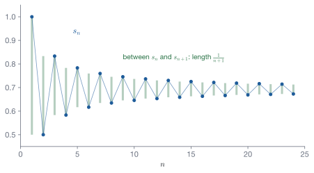{#fig-cauchy-alternating width=75%}
:::

The partial sums of $1/k!$ increase, but the criterion gives more than convergence: an explicit bound on the distance
between terms, which turns into an error estimate for the limit. That limit is the number $e$ of @exm-monotone-euler.

::: {#exm-cauchy-factorial}
#### The partial sums of $\sum 1/k!$

$s_n = \sum_{k=0}^n 1/k!$ satisfies, for $m > n$, $0 < s_m - s_n \leq \tfrac{1}{(n+1)!}\big(1 + \tfrac{1}{n+2} + \tfrac{1}{(n+2)^2} + \dots\big) \leq
2/(n + 1)!$, so it is Cauchy and converges to some $s$. The limit is $e$: the binomial expansion of $(1 + 1/n)^n$ in
@exr-monotone-e gives $(1 + 1/n)^n \leq s_n$, so $e \leq s$; and for fixed $m \leq n$, $(1 + 1/n)^n \geq \sum_{k \leq m} \tfrac{1}{k!}\prod_{j<k}(1 -
j/n)$, whose right side tends to $s_m$ as $n \to \infty$, so $e \geq s_m$ and $e \geq s$.
:::

A recursion that oscillates around its limit cannot be handled by monotonicity, but it can be by the criterion when each step
at least halves the previous one. The continued fraction of the golden ratio is the classical case.

::: {#exm-cauchy-golden}
#### The golden ratio

Let $a_1 = 1$ and $a_{n+1} = 1 + 1/a_n$, giving $1, 2, \tfrac32, \tfrac53, \tfrac85, \dots$, ratios of consecutive Fibonacci numbers. All $a_n \geq 1$,
and $a_n a_{n-1} = a_{n-1} + 1 \geq 2$, so $|a_{n+1} - a_n| = |a_n - a_{n-1}|/(a_n a_{n-1}) \leq \tfrac12|a_n - a_{n-1}|$. Hence $|a_{n+1} - a_n| \leq 2^{1-n}$,
and for $m > n$ the triangle inequality gives $|a_m - a_n| \leq 2^{1-n} + 2^{-n} + \dots \leq 2^{2-n}$. The sequence is Cauchy, and its limit $L
\geq 1$ solves $L = 1 + 1/L$: $L = (1 + \sqrt5)/2$.
:::

An oscillator sampled at equal time steps gives a sequence that is not monotone. With damping it is Cauchy, and without
damping it never settles, which the criterion detects without any knowledge of a limit.

::: {#exm-cauchy-damped}
#### Sampling an oscillator

The damped oscillation $x(t) = e^{-t/10}\cos t$ sampled at $t = n$ gives $x_n$ with $|x_m - x_n| \leq e^{-m/10} + e^{-n/10} \leq 2e^{-N/10}$ for $m, n
\geq N$, a Cauchy sequence. Without damping, $y_n = \cos n$ is not Cauchy: if it converged to $L$, then so would $y_{n+1}$, and $\sin n =
(\cos n \cos 1 - \cos(n + 1))/\sin 1 \to M = L(\cos 1 - 1)/\sin 1$. Passing to the limit in $\sin(n + 1) = \sin n\cos 1 + \cos n\sin 1$ gives
$M(1 - \cos 1) = L\sin 1$, and with the value of $M$ this is $-L(1 - \cos 1)^2 = L\sin^2 1$, so $L = 0$, $M = 0$, against $\cos^2 n + \sin^2 n = 1$.
:::

Light trapped between two partially reflecting mirrors leaks out a little at each round trip. The transmitted intensity is a
sum of contributions that shrink geometrically, and its Cauchy bound tells how many round trips matter.

::: {#exm-cauchy-mirrors}
#### Multiple reflections between mirrors

Two parallel mirrors with reflectance $R$ and transmittance $1 - R$, adding intensities (an incoherent source), transmit $I_n = I_0(1 -
R)^2\sum_{k=0}^n R^{2k}$ after $n$ round trips. For $m > n$, $0 < I_m - I_n \leq I_0(1 - R)^2 R^{2n+2}/(1 - R^2)$, so $(I_n)$ is Cauchy, and its limit is
$I_0(1 - R)^2/(1 - R^2) = I_0(1 - R)/(1 + R)$. For $R = 0.9$ the bound falls below $10^{-3}I_0$ from $n = 18$ round trips on.
:::

A row of ions of alternating charge is the one-dimensional model of an ionic crystal. The electrostatic potential at one ion,
due to its neighbours on one side, is an alternating sum of the kind of @exm-cauchy-alternating.

::: {#exm-cauchy-ionic-chain}
#### A one-dimensional ionic crystal

Ions of charges $\mp q$ at distances $a, 2a, 3a, \dots$ from an ion of charge $+q$ produce there the potential $V_n = -(q/(4\pi\varepsilon_0 a))
\sum_{k=1}^n (-1)^{k+1}/k$ from the first $n$ neighbours. By @exm-cauchy-alternating, $|V_m - V_n| \leq q/(4\pi\varepsilon_0 a(n + 1))$, so the potential
converges as the chain grows. The limit, the potential of the infinite chain, is a finite multiple of $q/(4\pi\varepsilon_0 a)$, a Madelung constant.
:::

Steps that shrink to zero do not make a sequence Cauchy, because many small steps can add up to a large distance. The
square roots are the standard counterexample [@abbott2015understanding, Exercise 2.6.5].

::: {#exm-cauchy-small-steps}
#### Small steps, no Cauchy property

$a_n = \sqrt n$ has $a_{n+1} - a_n = 1/(\sqrt{n+1} + \sqrt n) \to 0$, but $a_{4n} - a_n = \sqrt n$, so no $N$ makes $|a_m - a_n| < 1$ for all $m, n \geq N$.
The condition of @def-cauchy-sequence constrains all pairs of late terms, not only neighbours.
:::

The direction of the criterion from Cauchy to convergent is where completeness enters, and it fails in the rationals.
The last example recalls this with the decimal expansion of $\sqrt2$, as in @exm-complete-rationals.

::: {#exm-cauchy-not-convergent-rationals}
#### Cauchy in $\mathbb{Q}$, not convergent in $\mathbb{Q}$

The decimal approximations $1, 1.4, 1.41, 1.414, \dots$ of $\sqrt2$ form a Cauchy sequence of rationals ($|a_m -
a_n| < 10^{-n}$ for $m > n$) with no rational limit. The Cauchy criterion fails in $\mathbb{Q}$ and holds in $\mathbb{R}$: it is
a form of completeness.
:::
::::

:::: {.callout-note .exercises-fold collapse="true" title="Exercises"}
The bound of @exm-cauchy-alternating gives an explicit $N$ for every tolerance, and the first exercise computes it. Sage then
compares the bound with the actual gaps between late terms.

::: {#exr-cauchy-alternating-n}
#### An index for the alternating sums

For $s_n = \sum_{k=1}^n (-1)^{k+1}/k$, find an $N$ such that $|s_m - s_n| < 10^{-3}$ for all $m, n \geq N$, and check it numerically.
:::

::: {.callout-note .solution collapse="true" title="Solution"}
:::: {.panel-tabset .solution-tabs}
## Proof

By @exm-cauchy-alternating, for $m > n \geq N$, $|s_m - s_n| \leq 1/(n + 1) \leq 1/(N + 1)$. This is below $10^{-3}$ when $N + 1 > 1000$, so $N = 1000$
works. It is close to optimal: $|s_{N+1} - s_N| = 1/(N + 1)$, so no $N < 999$ works.

## SageMath

Sage computes the largest gap $|s_m - s_n|$ for $1000 \leq n < m \leq 3000$, which is the spread of these sums.

```{.python .sage}
s = [RDF(0)]
for k in range(1, 3001):
    s.append(s[-1] + (-1)^(k + 1) / RDF(k))
tail = s[1000:3001]
print("max |s_m - s_n| over 1000 <= n, m <= 3000:", max(tail) - min(tail), "< 1e-3:", max(tail) - min(tail) < 1e-3)
```

```{.text .sage-output}
max |s_m - s_n| over 1000 <= n, m <= 3000: 0.0009990009990009652 < 1e-3: True
```
::::
:::

The partial sums of a geometric progression are the simplest sequence whose Cauchy property can be checked by an explicit
bound on $|a_m - a_n|$. The second exercise asks for this bound and for the limit.

::: {#exr-cauchy-geometric}
#### Geometric tails

Show that $a_n = \sum_{k=0}^n r^k$ is a Cauchy sequence for $|r| < 1$ by bounding $|a_m - a_n|$, and find its
limit.
:::

::: {.callout-note .solution collapse="true" title="Solution"}
:::: {.panel-tabset .solution-tabs}
## Proof

For $m > n$, $|a_m - a_n| = |r^{n+1} + \dots + r^m| \leq |r|^{n+1}(1 + |r| + \dots + |r|^{m-n-1}) \leq |r|^{n+1}/(1 - |r|)$, which is
below $\varepsilon$ for $n$ large since $|r|^{n+1} \to 0$ (@exm-metric-convergence-geometric). The limit is $1/(1 - r)$, from $a_n = (1 -
r^{n+1})/(1 - r)$ and the limit rules.

## SageMath

Check on $r = -\tfrac23$: Sage compares the largest gap $|a_m - a_n|$ for $n < m \leq n + 50$ with the bound, and the closed form with
the limit.

```{.python .sage}
r = QQ(-2) / 3
a = lambda n: sum(r^k for k in range(n + 1))
for n in [5, 10, 20]:
    gap = max(abs(a(m) - a(n)) for m in range(n + 1, n + 51))
    print("n =", n, ": max gap", N(gap, digits=4), "<= bound", N(abs(r)^(n + 1) / (1 - abs(r)), digits=4))
print("a_20 =", N(a(20), digits=8), "; 1/(1 - r) =", 1 / (1 - r))
```

```{.text .sage-output}
n = 5 : max gap 0.08779 <= bound 0.2634
n = 10 : max gap 0.01156 <= bound 0.03468
n = 20 : max gap 0.0002005 <= bound 0.0006015
a_20 = 0.60012029 ; 1/(1 - r) = 3/5
```
::::
:::

The tail bound of @exm-cauchy-factorial can be tested numerically, and it shows how quickly the partial sums settle
down. The third exercise compares the actual gaps with the bound $2/(n + 1)!$ and uses the sequence to compute $e$
to nine decimals.

::: {#exr-cauchy-decimal}
#### Cauchy estimates for $\sum 1/k!$

Compute $\max_{n < m < n + 20} |s_m - s_n|$ for $s_n = \sum_{k \leq n} 1/k!$ and $n = 2, 4, 6, 8$, compare with the
bound $2/(n + 1)!$, and check that $s_{12}$ agrees with $e$ to nine decimals.
:::

::: {.callout-note .solution collapse="true" title="Solution"}
:::: {.panel-tabset .solution-tabs}
## Proof

$s_m - s_n = \sum_{k=n+1}^m 1/k! \leq \tfrac{1}{(n+1)!}(1 + \tfrac{1}{n+2} + \tfrac{1}{(n+2)^2} + \dots) \leq
\tfrac{2}{(n+1)!}$. Letting $m \to \infty$ with the order rule, $0 < e - s_{12} \leq 2/13! = 3.2 \cdot 10^{-10}$, so $s_{12}$ agrees with $e$ to nine
decimals.

## SageMath

Sage computes the gaps exactly, compares them with the bound, and measures $|s_{12} - e|$.

```{.python .sage}
s = lambda m: sum(1 / factorial(k) for k in range(0, m + 1))
for n in [2, 4, 6, 8]:
    d = max(abs(s(m) - s(n)) for m in range(n + 1, n + 20))
    print("n =", n, ": max gap", N(d, digits=6), "<= 2/(n+1)! =", N(2 / factorial(n + 1), digits=6), ":", d <= 2 / factorial(n + 1))
print("|s_12 - e| =", N(abs(s(12) - e), prec=400).n(digits=4), "< 1e-9:", bool(abs(s(12) - e) < 10^-9))
```

```{.text .sage-output}
n = 2 : max gap 0.218282 <= 2/(n+1)! = 0.333333 : True
n = 4 : max gap 0.00994849 <= 2/(n+1)! = 0.0166667 : True
n = 6 : max gap 0.000226273 <= 2/(n+1)! = 0.000396825 : True
n = 8 : max gap 3.05862e-6 <= 2/(n+1)! = 5.51146e-6 : True
|s_12 - e| = 1.729e-10 < 1e-9: True
```
::::
:::

The golden-ratio recursion of @exm-cauchy-golden comes with the explicit bound $|a_m - a_n| \leq 2^{2-n}$. The fourth exercise turns it
into an error estimate for the limit and checks it against the actual errors.

::: {#exr-cauchy-golden-limit}
#### Errors of the golden-ratio recursion

For $a_1 = 1$, $a_{n+1} = 1 + 1/a_n$, show that $a_n = F_{n+1}/F_n$ with the Fibonacci numbers $F_1 = F_2 = 1$, $F_{n+1} = F_n + F_{n-1}$, and that
$|a_n - \varphi| \leq 2^{2-n}$ for $\varphi = (1 + \sqrt5)/2$. Compare with the actual errors.
:::

::: {.callout-note .solution collapse="true" title="Solution"}
:::: {.panel-tabset .solution-tabs}
## Proof

$a_1 = F_2/F_1$, and if $a_n = F_{n+1}/F_n$ then $a_{n+1} = 1 + F_n/F_{n+1} = (F_{n+1} + F_n)/F_{n+1} = F_{n+2}/F_{n+1}$. By @exm-cauchy-golden, $|a_m - a_n|
\leq 2^{2-n}$ for $m > n$ and $a_m \to \varphi$; letting $m \to \infty$ with the order rule gives $|a_n - \varphi| \leq 2^{2-n}$. The actual errors are smaller:
$|a_{n+1} - \varphi| = |a_n - \varphi|/(a_n\varphi)$, a factor of about $1/\varphi^2 \approx 0.38$ per step rather than $\tfrac12$.

## SageMath

Sage computes $F_{n+1}/F_n$, the errors and the bound.

```{.python .sage}
phi = (1 + sqrt(5)) / 2
for n in [2, 5, 10, 20]:
    a = QQ(fibonacci(n + 1)) / fibonacci(n)
    print("n =", n, ": a_n =", a, "; |a_n - phi| =", N(abs(a - phi), prec=400).n(digits=4), "<= 2^(2-n) =", N(2^(2 - n), digits=4))
```

```{.text .sage-output}
n = 2 : a_n = 2 ; |a_n - phi| = 0.3820 <= 2^(2-n) = 1.000
n = 5 : a_n = 8/5 ; |a_n - phi| = 0.01803 <= 2^(2-n) = 0.1250
n = 10 : a_n = 89/55 ; |a_n - phi| = 0.0001478 <= 2^(2-n) = 0.003906
n = 20 : a_n = 10946/6765 ; |a_n - phi| = 9.772e-9 <= 2^(2-n) = 3.815e-6
```
::::
:::

The equivalence of the Cauchy criterion with completeness deserves a proof that uses only the order of the line. The fifth
exercise asks for the failure in $\mathbb{Q}$ and for the derivation of the criterion from the completeness axiom, through the
infima of tails of @exr-monotone-limsup.

::: {#exr-cauchy-rationals}
#### Completeness and the rationals

Explain why the sequence of decimal approximations of $\sqrt2$ shows that the Cauchy criterion fails in
$\mathbb{Q}$, and deduce from the completeness axiom, without @prp-compact-metric-complete, that every Cauchy sequence of reals
converges.
:::

::: {.callout-note .solution collapse="true" title="Solution"}
:::: {.panel-tabset .solution-tabs}
## Proof

The approximations $a_n$ are rational and Cauchy, and if they converged in $\mathbb{Q}$ their limit would also be the real limit $\sqrt2$,
which is irrational; so a Cauchy sequence of rationals need not converge in $\mathbb{Q}$. In $\mathbb{R}$, a Cauchy sequence is bounded
(@exr-metric-cauchy-bounded), so $z_n = \inf_{k \geq n} a_k$ increases to $L = \liminf a_n$ (@exr-monotone-limsup). Given $\varepsilon > 0$, choose $N$
with $|a_k - a_n| < \varepsilon$ for $k, n \geq N$. For $p \geq N$ all $a_k$ with $k \geq p$ exceed $a_p - \varepsilon$, so $a_p - \varepsilon \leq z_p \leq a_p$. For $n, p \geq
N$ this gives $a_n - 2\varepsilon < z_p < a_n + \varepsilon$, and letting $p \to \infty$, $a_n - 2\varepsilon \leq L \leq a_n + \varepsilon$. So $|a_n - L| \leq 2\varepsilon$ for $n \geq N$,
and $a_n \to L$.

## SageMath

Check on the alternating sums of @exm-cauchy-alternating, with $|s_k - s_n| \leq 1/(n + 1)$ for $k \geq n$: Sage computes the infima $z_n$ of the
tails up to $n = 4000$ and their distance to $s_n$, which stays within that bound.

```{.python .sage}
s = [RDF(0)]
for k in range(1, 4001):
    s.append(s[-1] + (-1)^(k + 1) / RDF(k))
for n in [11, 101, 1001]:
    z = min(s[n:])
    print("n =", n, ": z_n =", round(z, 6), "; s_n - z_n =", round(s[n] - z, 7), "; bound 1/(n+1) =", round(1 / (n + 1), 7))
```

```{.text .sage-output}
n = 11 : z_n = 0.653211 ; s_n - z_n = 0.0833333 ; bound 1/(n+1) = 0.0833333
n = 101 : z_n = 0.688269 ; s_n - z_n = 0.0098039 ; bound 1/(n+1) = 0.0098039
n = 1001 : z_n = 0.692648 ; s_n - z_n = 0.000998 ; bound 1/(n+1) = 0.000998
```
::::
:::

Operations on Cauchy sequences can preserve or destroy the property, and the sixth exercise sorts three of them. It is
@abbott2015understanding [Exercise 2.6.4].

::: {#exr-cauchy-decide}
#### Which sequences stay Cauchy?

Let $(a_n)$, $(b_n)$ be Cauchy. Decide whether $|a_n - b_n|$, $(-1)^n a_n$ and $\lfloor a_n \rfloor$ (the integer part) are Cauchy.
:::

::: {.callout-note .solution collapse="true" title="Solution"}
:::: {.panel-tabset .solution-tabs}
## Proof

$c_n = |a_n - b_n|$ is Cauchy: $|c_m - c_n| \leq |(a_m - b_m) - (a_n - b_n)| \leq |a_m - a_n| + |b_m - b_n|$, by the reverse triangle inequality. $(-1)^n
a_n$ need not be: for $a_n = 1$ it is $(-1)^n$, which is not Cauchy since consecutive terms differ by $2$; it is Cauchy when $a_n \to 0$.
$\lfloor a_n \rfloor$ need not be: for $a_n = (-1)^n/n$ it is $-1, 0, -1, 0, \dots$. If $a_n \to L$ with $L \notin \mathbb{Z}$, then $a_n$ eventually lies in
an interval $(k, k + 1)$ and $\lfloor a_n \rfloor = k$ from some index on.

## SageMath

Check on $a_n = (-1)^n/n$ and $b_n = 1$: Sage prints the first terms of the three sequences.

```{.python .sage}
a = [QQ((-1)^n) / n for n in range(1, 9)]
print("|a_n - 1|:", [abs(x - 1) for x in a])
print("(-1)^n * 1:", [(-1)^n for n in range(1, 9)])
print("floor(a_n):", [floor(x) for x in a])
```

```{.text .sage-output}
|a_n - 1|: [2, 1/2, 4/3, 3/4, 6/5, 5/6, 8/7, 7/8]
(-1)^n * 1: [-1, 1, -1, 1, -1, 1, -1, 1]
floor(a_n): [-1, 0, -1, 0, -1, 0, -1, 0]
```
::::
:::

A condition on consecutive terms only is weaker than the Cauchy condition, as @exm-cauchy-small-steps showed. The seventh
exercise examines that weaker condition [@abbott2015understanding, Exercise 2.6.5].

::: {#exr-cauchy-pseudo}
#### Consecutive terms only

Call $(s_n)$ **pseudo-Cauchy** if for every $\varepsilon > 0$ there is $N$ with $|s_{n+1} - s_n| < \varepsilon$ for $n \geq N$. Prove that sums of pseudo-Cauchy
sequences are pseudo-Cauchy, and that pseudo-Cauchy sequences need not be bounded.
:::

::: {.callout-note .solution collapse="true" title="Solution"}
:::: {.panel-tabset .solution-tabs}
## Proof

If $(x_n)$, $(y_n)$ are pseudo-Cauchy, choose $N$ with $|x_{n+1} - x_n| < \varepsilon/2$ and $|y_{n+1} - y_n| < \varepsilon/2$ for $n \geq N$; then $|(x_{n+1} + y_{n+1})
- (x_n + y_n)| < \varepsilon$. The sequence $\sqrt n$ of @exm-cauchy-small-steps is pseudo-Cauchy, since $\sqrt{n+1} - \sqrt n < 1/(2\sqrt n)$, and unbounded
(@exm-limit-to-infinity). So pseudo-Cauchy sequences can diverge, unlike Cauchy sequences (@exr-metric-cauchy-bounded).

## SageMath

Check on $\sqrt n$: Sage shows the consecutive steps shrinking while the terms grow.

```{.python .sage}
for n in [10, 10^3, 10^5, 10^7]:
    print("n =", n, ": step", N(sqrt(n + 1) - sqrt(n), prec=200).n(digits=4), "; term", N(sqrt(n), digits=6))
```

```{.text .sage-output}
n = 10 : step 0.1543 ; term 3.16228
n = 1000 : step 0.01581 ; term 31.6228
n = 100000 : step 0.001581 ; term 316.228
n = 10000000 : step 0.0001581 ; term 3162.28
```
::::
:::

A sequence is determined by any family of subsequences that covers all its indices, provided their limits are compatible. The
eighth exercise is @gasinski2014exercises [Problem 1.2], on the line, with subsequences as in @exr-metric-cauchy-subsequence.

::: {#exr-cauchy-three-subsequences}
#### Three subsequences decide

Let $(a_n)$ be a real sequence whose subsequences $(a_{2n})$, $(a_{2n+1})$ and $(a_{3n})$ converge. Prove that $(a_n)$ converges. Show that the first two
alone are not enough.
:::

::: {.callout-note .solution collapse="true" title="Solution"}
:::: {.panel-tabset .solution-tabs}
## Proof

Let $a_{2n} \to p$, $a_{2n+1} \to q$, $a_{3n} \to r$. The indices $6n$ are even and multiples of $3$, so $(a_{6n})$ is a subsequence of both $(a_{2n})$ and $(a_{3n})$,
and $p = r$, since a subsequence of a convergent sequence has the same limit (the $N$ of the sequence serves it). The indices $3(2n + 1)$ are odd multiples of $3$, so $q = r$. Hence $p = q$,
and given $\varepsilon > 0$, the even terms are within $\varepsilon$ of $p$ from some index $2K$ on and the odd terms from some $2K' + 1$ on; all terms with index at least
$\max(2K, 2K' + 1)$ are within $\varepsilon$ of $p$, and $a_n \to p$. The sequence $(-1)^n$ has convergent even and odd subsequences and diverges.

## SageMath

Check on $a_n = (-1)^n/n + [3 \mid n]/n$: Sage prints the three subsequences, which all tend to $0$.

```{.python .sage}
a = lambda n: QQ((-1)^n) / n + (QQ(1) / n if n % 3 == 0 else 0)
print("a_2n:", [a(2 * n) for n in range(1, 6)])
print("a_(2n+1):", [a(2 * n + 1) for n in range(1, 6)])
print("a_3n:", [a(3 * n) for n in range(1, 6)], "; a_3000 =", a(3000))
```

```{.text .sage-output}
a_2n: [1/2, 1/4, 1/3, 1/8, 1/10]
a_(2n+1): [0, -1/5, -1/7, 0, -1/11]
a_3n: [0, 1/3, 0, 1/6, 0] ; a_3000 = 1/1500
```
::::
:::

From any Cauchy sequence one can extract a subsequence whose terms approach each other geometrically fast. This is the device
used to prove completeness of spaces of functions, and the ninth exercise proves it [@gasinski2014exercises, Problem 1.4].

::: {#exr-cauchy-fast-subsequence}
#### A fast subsequence

Let $(a_n)$ be a Cauchy sequence of reals. Prove that there are indices $n_1 < n_2 < \dots$ with $|a_{n_k} - a_{n_m}| \leq 2^{-k}$ for all $m \geq k$.
:::

::: {.callout-note .solution collapse="true" title="Solution"}
:::: {.panel-tabset .solution-tabs}
## Proof

For each $k$ choose $N_k$ with $|a_p - a_q| < 2^{-k}$ for $p, q \geq N_k$, and let $n_1 = N_1$ and $n_k = \max(N_k, n_{k-1} + 1)$. The indices increase, and
$n_m \geq n_k \geq N_k$ for $m \geq k$, so $|a_{n_k} - a_{n_m}| < 2^{-k}$.

## SageMath

Check on the alternating sums of @exm-cauchy-alternating: by the bound $|s_p - s_q| \leq 1/(\min(p, q) + 1)$ one may take $N_k = 2^k$, and Sage verifies
the conclusion for $k, m \leq 10$.

```{.python .sage}
s = [RDF(0)]
for k in range(1, 2^11 + 1):
    s.append(s[-1] + (-1)^(k + 1) / RDF(k))
nk = [2^k for k in range(1, 11)]
print("indices:", nk)
print("|s_(n_k) - s_(n_m)| <= 2^-k for k <= m <= 10:",
      all(abs(s[nk[k - 1]] - s[nk[m - 1]]) <= 2^-k for k in range(1, 11) for m in range(k, 11)))
```

```{.text .sage-output}
indices: [2, 4, 8, 16, 32, 64, 128, 256, 512, 1024]
|s_(n_k) - s_(n_m)| <= 2^-k for k <= m <= 10: True
```
::::
:::

The Cauchy criterion can also be reached through subsequences, and the route passes through the monotone convergence theorem. The
last exercise combines @thm-monotone-convergence with @exr-metric-cauchy-bounded and @exr-metric-cauchy-subsequence
[@abbott2015understanding, Exercise 2.5.8, Thm. 2.6.4].

::: {#exr-cauchy-bolzano-weierstrass}
#### Bolzano-Weierstrass and the Cauchy criterion

Call $a_m$ a **peak** of $(a_n)$ if $a_m \geq a_n$ for all $n \geq m$. Prove that every real sequence has a monotone subsequence, deduce that every
bounded real sequence has a convergent subsequence (the **Bolzano-Weierstrass theorem**), and deduce the Cauchy criterion.
:::

::: {.callout-note .solution collapse="true" title="Solution"}
:::: {.panel-tabset .solution-tabs}
## Proof

If there are infinitely many peaks $a_{m_1}, a_{m_2}, \dots$ with $m_1 < m_2 < \dots$, they form a decreasing subsequence. Otherwise, after the last peak
choose $n_1$; it is not a peak, so some $n_2 > n_1$ has $a_{n_2} > a_{n_1}$, and $n_2$ is not a peak either, so the construction continues and gives an
increasing subsequence. A bounded sequence therefore has a bounded monotone subsequence, which converges by @thm-monotone-convergence. A Cauchy
sequence is bounded (@exr-metric-cauchy-bounded), so it has a convergent subsequence, and a Cauchy sequence with a convergent subsequence converges
(@exr-metric-cauchy-subsequence).

## SageMath

Check on $a_n = \sin n$: Sage lists the peaks among the first $2000$ terms, which form a decreasing subsequence.

```{.python .sage}
a = [sin(RDF(n)) for n in range(1, 2001)]
peaks = [m for m in range(1950) if all(a[m] >= a[n] for n in range(m, 2000))]
print("first peak indices:", [m + 1 for m in peaks[:8]])
print("peak values decrease:", all(a[peaks[i]] >= a[peaks[i + 1]] for i in range(len(peaks) - 1)))
```

```{.text .sage-output}
first peak indices: [1409, 1786, 1830, 1874]
peak values decrease: True
```
::::
:::
::::

### Limits of the running sequences

The limits claimed for the running sequences are collected in one proposition, together with an explicit error
bound for the harmonic numbers $H_n = 1 + \tfrac12 + \dots + \tfrac1n$. The list adds $n^{1/n} \to 1$ and the convergence of $H_n
- \log n$ to Euler's constant, both proved right after the statement with the monotone convergence theorem and two brackets around $e$.

:::: {.statement-box}
::: {#prp-sequence-limits}
#### Limits of the running sequences

$1/n \to 0$, $(-1)^n/n \to 0$, $(1 + 1/n)^n \to e$, $n^{1/n} \to 1$, and the harmonic numbers satisfy $H_n - \log n
\to \gamma = 0.5772\ldots$ (Euler's constant), with $|H_{10^4} - \log 10^4 - \gamma| < 10^{-4}$.
:::
::::

The logarithm is the natural logarithm, the inverse of $\exp$, increasing on $(0, \infty)$ with $\log(xy) = \log x +
\log y$.

*Proof.* The first three limits were proved in @exm-limit-reciprocal, @exm-monotone-reciprocal and
@exm-monotone-euler. For $n^{1/n}$, write $n^{1/n} = 1 + h_n$ with $h_n \geq 0$. The binomial theorem gives $n = (1 +
h_n)^n \geq \binom{n}{2} h_n^2$, so $0 \leq h_n \leq \sqrt{2/(n - 1)}$ for $n \geq 2$, and $h_n \to 0$.

For Euler's constant we first bracket $e$. The sequence $(1 + 1/n)^n$ increases strictly to $e$ (@exm-monotone-euler),
so $(1 + 1/n)^n < e$. Let $b_n = (1 + 1/n)^{n+1}$. For $n \geq 2$, Bernoulli's inequality $(1 + x)^n \geq 1 + nx$ gives
$$
\frac{b_{n-1}}{b_n} = \Big(\frac{n^2}{n^2 - 1}\Big)^{n}\frac{n}{n + 1} \geq \Big(1 + \frac{n}{n^2 - 1}\Big)\frac{n}{n + 1}
> \Big(1 + \frac1n\Big)\frac{n}{n + 1} = 1,
$$
so $(b_n)$ decreases strictly. Since $b_n = (1 + 1/n)^n(1 + 1/n) \to e$ by the product rule, $e < b_n$ for every $n$.
Taking logarithms in $(1 + 1/n)^n < e < (1 + 1/n)^{n+1}$ gives
$$
\frac{1}{n + 1} < \log\Big(1 + \frac1n\Big) < \frac1n.
$$
Let $a_n = H_n - \log n$ and $c_n = H_n - \log(n + 1)$. Then $a_n - a_{n+1} = \log(1 + 1/n) - 1/(n + 1) > 0$ and
$c_{n+1} - c_n = 1/(n + 1) - \log(1 + 1/(n + 1)) > 0$, so $(a_n)$ decreases and $(c_n)$ increases. Moreover $a_n - c_n
= \log(1 + 1/n) \in (0, 1/n)$, so $c_1 \leq c_n < a_n \leq a_1$. Both sequences are monotone and bounded, so they
converge by @thm-monotone-convergence, and their limits agree because $a_n - c_n \to 0$. Call the common limit
$\gamma$. Since $(a_n)$ decreases strictly and $(c_n)$ increases strictly to $\gamma$, $c_n < \gamma < a_n$, hence
$0 < a_n - \gamma < a_n - c_n < 1/n$. At $n = 10^4$ this is the bound $|H_{10^4} - \log 10^4 - \gamma| < 10^{-4}$. $\square$

:::: {.callout-note .examples-fold collapse="true" title="Examples"}
The limit $n^{1/n} \to 1$ is less obvious than it looks, since base and exponent pull in opposite directions. The
first example isolates the binomial estimate of the proof, which settles it by hand without logarithms.

::: {#exm-limits-nroot}
#### $n^{1/n} \to 1$ by hand

Write $n^{1/n} = 1 + h_n$ with $h_n \geq 0$; the binomial theorem gives $n = (1 + h_n)^n \geq \binom{n}{2} h_n^2$,
so $h_n^2 \leq 2/(n - 1)$ for $n \geq 2$, and $0 \leq h_n \leq \sqrt{2/(n - 1)} \to 0$.
:::

The number $e$ is approached from below by $(1 + 1/n)^n$, and a second sequence approaches it from above. Together they trap
$e$ in intervals of length about $e/n$; the example restates the bracket of the proof and draws it.

::: {#exm-limits-upper-e}
#### $e$ from above

Let $b_n = (1 + 1/n)^{n+1}$. Then $b_{n-1}/b_n = \big(\tfrac{n^2}{n^2 - 1}\big)^{n}\tfrac{n}{n + 1} \geq \big(1 + \tfrac{n}{n^2 - 1}\big)\tfrac{n}{n + 1} > (1 +
\tfrac1n)\tfrac{n}{n+1} = 1$ by Bernoulli's inequality, so $(b_n)$ decreases. It is bounded below by $1$, so it converges, and $b_n = (1 + 1/n)^n(1 +
1/n) \to e$ by the product rule. So $(1 + 1/n)^n < e < (1 + 1/n)^{n+1}$ for every $n$, the two strict inequalities holding because the
sequences are strictly monotone.

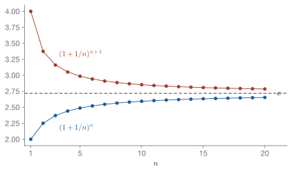{#fig-e-brackets width=70%}
:::

Taking logarithms in the brackets around $e$ gives bounds on $\log(1 + 1/n)$ that are used in all that follows. They show
how $\log$ compares with the reciprocals $1/n$.

::: {#exm-limits-log-bounds}
#### Bounds for $\log(1 + 1/n)$

Since $\log$ is increasing, @exm-limits-upper-e gives $n\log(1 + 1/n) < 1 < (n + 1)\log(1 + 1/n)$, that is,
$$
\frac{1}{n + 1} < \log\Big(1 + \frac1n\Big) < \frac1n.
$$
Multiplying by $n$, $n/(n + 1) < n\log(1 + 1/n) < 1$, and squeezing, $n\log(1 + 1/n) \to 1$.
:::

Sage returns limits symbolically, not as decimal approximations, and the next example shows the commands. For $(1 + 1/n)^n$
the computation reduces to the exponent $n\log(1 + 1/n)$, whose limit @exm-limits-log-bounds found by hand.

::: {#exm-limits-sage}
#### How Sage finds a limit

`limit((1 + 1/n)^n, n=oo)` returns `e`, the exact constant. Sage writes the power as $\exp(n\log(1 + 1/n))$ and finds the limit
$1$ of the exponent, as in @exm-limits-log-bounds; a decimal value is asked for separately.

```{.python .sage}
n = var("n")
print(limit((1 + 1 / n)^n, n=oo), limit(n * log(1 + 1 / n), n=oo), limit(n^(1 / n), n=oo))
print(N(e, digits=20))
```

```{.text .sage-output}
e 1 1
2.7182818284590452354
```
:::

The harmonic numbers grow like $\log n$, and the difference converges to a constant with no known closed form. The
example retraces the proof with a single sequence, using the bounds of @exm-limits-log-bounds and a telescoping error sum.

::: {#exm-limits-euler-constant}
#### Euler's constant

Let $d_n = H_n - \log n$. Then $d_n - d_{n+1} = \log(1 + 1/n) - 1/(n + 1) > 0$, so $(d_n)$ decreases; and $\log(n + 1) = \sum_{k \leq n}\log(1 +
1/k) < H_n$, so $d_n > H_n - \log(n + 1) > 0$. By @thm-monotone-convergence $d_n \to \gamma$, which has no known closed form. The error is
$d_n - \gamma = \sum_{k \geq n}(d_k - d_{k+1}) < \sum_{k \geq n}(1/k - 1/(k + 1)) = 1/n$, so at $n = 10^4$ the difference $H_n - \log n$ is within
$10^{-4}$ of $\gamma$.
:::

Two consequences of the convergence of $H_n - \log n$ concern the harmonic numbers themselves. They grow without bound,
and the sum of the reciprocals from $n + 1$ to $2n$ has a limit.

::: {#exm-limits-harmonic-growth}
#### Harmonic numbers

$H_n > \log(n + 1) \to \infty$, so $H_n \to \infty$, as slowly as $\log n$: $H_{10^6} \approx 14.39$. And $H_{2n} - H_n = (H_{2n} - \log 2n) - (H_n - \log
n) + \log 2 \to \gamma - \gamma + \log 2 = \log 2$, by the sum rule.
:::

Radioactive decay in many small steps is a physical source of the number $e$. A sample that loses the fraction $1/n$ of its
nuclei in each of $n$ short intervals keeps a fraction that tends to $1/e$.

::: {#exm-limits-decay}
#### Decay in $n$ steps

$(1 - 1/n)^n = 1/(1 + 1/(n - 1))^n = 1/\big((1 + \tfrac{1}{n - 1})^{n-1}(1 + \tfrac{1}{n - 1})\big) \to 1/(e \cdot 1) = 1/e$, by the product and
quotient rules. A sample with mean life $\tau$, followed for a time $\tau$ in $n$ steps that each remove the fraction $1/n$ of the
remaining nuclei, keeps the fraction $(1 - 1/n)^n \to e^{-1} \approx 0.368$, the fraction left after one mean life.
:::

The electrostatic energy of a charge at the end of a long row of equal charges grows like the harmonic numbers. The example
reads off its logarithmic growth and the constant correction from the proposition.

::: {#exm-limits-charge-chain}
#### A row of equal charges

Charges $q$ at distances $a, 2a, \dots, na$ from a charge $q$ give it the energy $U_n = (q^2/(4\pi\varepsilon_0 a))H_n$. So $U_n \to \infty$, a row of
equal charges cannot be assembled with finite energy per charge, and $U_n - (q^2/(4\pi\varepsilon_0 a))\log n \to (q^2/(4\pi\varepsilon_0 a))\gamma$.
Doubling the row adds energy tending to $(q^2/(4\pi\varepsilon_0 a))\log 2$, by @exm-limits-harmonic-growth.
:::

Bohr's correspondence principle compares quantum and classical frequencies at large quantum numbers. For hydrogen the frequency
of the transition $n + 1 \to n$ divided by the classical orbital frequency $2E'/(hn^3)$ of the $n$-th orbit, with $E' = 13.6\,\mathrm{eV}$,
is a rational sequence.

::: {#exm-limits-correspondence}
#### Bohr's correspondence principle

The transition energy is $E'(1/n^2 - 1/(n + 1)^2) = E'(2n + 1)/(n^2(n + 1)^2)$, so the ratio of the two frequencies is
$$
\rho_n = \frac{(2n + 1)/(n^2(n + 1)^2)}{2/n^3} = \frac{n(2n + 1)}{2(n + 1)^2} = \frac{2 + 1/n}{2(1 + 1/n)^2} \to 1.
$$
At large $n$ the emitted light has the frequency of the classical orbit; at $n = 1$ the ratio is $\tfrac38$.
:::

Limits of the form $1^\infty$ are not decided by their form, and the last example shows three such sequences with three
different behaviours. The base tends to $1$ and the exponent to $\infty$ in each.

::: {#exm-limits-one-to-infinity}
#### The form $1^\infty$

$(1 + 1/n)^n \to e$, but $(1 + 1/n)^{n^2} = ((1 + 1/n)^n)^n \geq 2^n \to \infty$, while $1 \leq (1 + 1/n^2)^n \leq 1/(1 - 1/n)$ for $n \geq 2$, so
$(1 + 1/n^2)^n \to 1$. The upper bound follows from $(1 + x)^n \leq (1 - x)^{-n} \leq 1/(1 - nx)$ for $0 \leq nx < 1$, using $(1 + x)(1 - x) \leq 1$
and Bernoulli's inequality.
:::
::::

:::: {.callout-note .exercises-fold collapse="true" title="Exercises"}
The proofs above give explicit error bounds, and the first exercise compares them with the actual errors. It is a direct
check of the proposition at three values of $n$.

::: {#exr-limits-table}
#### Errors of the running sequences

Show that $0 < e - (1 + 1/n)^n < 3/n$, $0 \leq n^{1/n} - 1 \leq \sqrt{2/(n - 1)}$ and $0 < H_n - \log n - \gamma < 1/n$, and compare with the actual
errors at $n = 10, 100, 1000$.
:::

::: {.callout-note .solution collapse="true" title="Solution"}
:::: {.panel-tabset .solution-tabs}
## Proof

By @exm-limits-upper-e, $0 < e - (1 + 1/n)^n < (1 + 1/n)^{n+1} - (1 + 1/n)^n = (1 + 1/n)^n/n < 3/n$, using $(1 + 1/n)^n < 3$ (@exr-monotone-e).
The second bound is @exm-limits-nroot and the third is @exm-limits-euler-constant.

## SageMath

Sage computes the three errors and the three bounds.

```{.python .sage}
R = RealField(200)
for n in [10, 100, 1000]:
    Hn = R(sum(QQ(1) / k for k in range(1, n + 1)))
    e1, e2, e3 = R(e) - R(1 + QQ(1) / n)^n, R(n)^(1 / R(n)) - 1, Hn - log(R(n)) - R(euler_gamma)
    print("n =", n, ":", [N(x, digits=4) for x in (e1, R(3 / n), e2, sqrt(R(2 / (n - 1))), e3, R(1 / n))])
```

```{.text .sage-output}
n = 10 : [0.1245, 0.3000, 0.2589, 0.4714, 0.04917, 0.1000]
n = 100 : [0.01347, 0.03000, 0.04713, 0.1421, 0.004992, 0.01000]
n = 1000 : [0.001358, 0.003000, 0.006932, 0.04474, 0.0004999, 0.001000]
```
::::
:::

The correspondence principle of @exm-limits-correspondence becomes quantitative when one asks how large $n$ must be. The second
exercise finds the first quantum number at which the two frequencies agree to one percent.

::: {#exr-limits-correspondence}
#### How large is classical?

For $\rho_n = n(2n + 1)/(2(n + 1)^2)$, show that $1 - \rho_n = (3n + 2)/(2(n + 1)^2)$, and find the smallest $N$ with $1 - \rho_n < 10^{-2}$ for all $n \geq N$.
:::

::: {.callout-note .solution collapse="true" title="Solution"}
:::: {.panel-tabset .solution-tabs}
## Proof

$2(n + 1)^2 - n(2n + 1) = 3n + 2$, which gives the formula. It is positive and decreasing for $n \geq 1$, since $(3n + 2)/(n + 1)^2 = 3/(n + 1) - 1/(n
+ 1)^2$ and $3t - t^2$ increases for $0 < t \leq \tfrac12$. The condition $(3n + 2)/(2(n + 1)^2) < 1/100$ is $n^2 - 148n - 99 > 0$, that is $n > 74 + \sqrt{74^2
+ 99} = 148.66\ldots$, so $N = 149$.

## SageMath

Sage computes $1 - \rho_n$ exactly and finds the first index below $1/100$.

```{.python .sage}
rho = lambda n: QQ(n * (2 * n + 1)) / (2 * (n + 1)^2)
print("formula:", all(1 - rho(n) == QQ(3 * n + 2) / (2 * (n + 1)^2) for n in range(1, 500)))
N0 = next(n for n in range(1, 10^4) if 1 - rho(n) < QQ(1) / 100)
print("N =", N0, "; 1 - rho at N-1 and N:", N(1 - rho(N0 - 1), digits=5), N(1 - rho(N0), digits=5))
```

```{.text .sage-output}
formula: True
N = 149 ; 1 - rho at N-1 and N: 0.010045 0.0099778
```
::::
:::

Convergence to $\gamma$ is slow, and the rate is worth measuring. The third exercise computes the differences $H_n -
\log n - \gamma$ and finds that they behave like $1/(2n)$, inside the bound $1/n$ of @exm-limits-euler-constant.

::: {#exr-euler-constant}
#### The rate of convergence to $\gamma$

Compute $H_n - \log n$ for $n = 10, 10^2, 10^3, 10^4$, the differences to $\gamma$, and show numerically that they
behave like $1/(2n)$.
:::

::: {.callout-note .solution collapse="true" title="Solution"}
:::: {.panel-tabset .solution-tabs}
## Proof

By @exm-limits-euler-constant the differences lie in $(0, 1/n)$. Bounding each $d_k - d_{k+1} = \log(1 + 1/k) - 1/(k + 1)$ more closely, by the
mean of the bounds of @exm-limits-log-bounds, gives $d_k - d_{k+1} \approx \tfrac12(1/k - 1/(k + 1))$ and suggests $d_n - \gamma \approx 1/(2n)$. The
products $2n(H_n - \log n - \gamma)$ computed below approach $1$, consistent with the asymptotic formula $H_n = \log n + \gamma + 1/(2n) - 1/(12n^2) +
\dots$, quoted here without proof.

## SageMath

Sage computes the differences and the products $2n(H_n - \log n - \gamma)$.

```{.python .sage}
R = RealField(200)
H = lambda m: R(sum(1 / QQ(k) for k in range(1, m + 1)))
for m in [10, 100, 1000, 10000]:
    d = H(m) - log(R(m)) - R(euler_gamma)
    print("n =", m, ": H_n - log n =", N(H(m) - log(R(m)), digits=10), "; difference to gamma =", N(d, digits=6), "; times 2n:", N(2 * m * d, digits=6))
print("gamma =", N(euler_gamma, digits=12))
```

```{.text .sage-output}
n = 10 : H_n - log n = 0.6263831610 ; difference to gamma = 0.0491675 ; times 2n: 0.983350
n = 100 : H_n - log n = 0.5822073317 ; difference to gamma = 0.00499167 ; times 2n: 0.998333
n = 1000 : H_n - log n = 0.5777155816 ; difference to gamma = 0.000499917 ; times 2n: 0.999833
n = 10000 : H_n - log n = 0.5772656641 ; difference to gamma = 0.0000499992 ; times 2n: 0.999983
gamma = 0.577215664902
```
::::
:::

The binomial estimate used for $n^{1/n}$ extends to $a^{1/n}$ for every fixed $a > 0$, by squeezing between $1$ and
$n^{1/n}$. The fourth exercise asks for both limits, with the quotient rule handling $a < 1$.

::: {#exr-limit-nroot}
#### $n^{1/n}$ and $a^{1/n}$

Prove that $n^{1/n} \to 1$ and that $a^{1/n} \to 1$ for every $a > 0$.
:::

::: {.callout-note .solution collapse="true" title="Solution"}
:::: {.panel-tabset .solution-tabs}
## Proof

For $n^{1/n}$, @exm-limits-nroot gives $0 \leq h_n \leq \sqrt{2/(n - 1)} \to 0$. For $a \geq 1$, $1 \leq a^{1/n} \leq n^{1/n}$ once $n \geq a$, so $0 \leq a^{1/n}
- 1 \leq n^{1/n} - 1$ and $a^{1/n} \to 1$. For $0 < a < 1$, $a^{1/n} = 1/(1/a)^{1/n} \to 1/1 = 1$ by the case $1/a > 1$ and the quotient rule.

## SageMath

Check on $a = 1000$ and $a = 10^{-3}$: Sage compares $a^{1/n}$ with $n^{1/n}$ for $n = 10^k$.

```{.python .sage}
for k in [3, 4, 6]:
    n = 10^k
    print("n = 10^%d:" % k, "n^(1/n) =", N(n^(1 / n), digits=8), "; 1000^(1/n) =", N(1000^(1 / n), digits=8),
          "; (1/1000)^(1/n) =", N((QQ(1) / 1000)^(1 / n), digits=8))
```

```{.text .sage-output}
n = 10^3: n^(1/n) = 1.0069317 ; 1000^(1/n) = 1.0069317 ; (1/1000)^(1/n) = 0.99311605
n = 10^4: n^(1/n) = 1.0009215 ; 1000^(1/n) = 1.0006910 ; (1/1000)^(1/n) = 0.99930946
n = 10^6: n^(1/n) = 1.0000138 ; 1000^(1/n) = 1.0000069 ; (1/1000)^(1/n) = 0.99999309
```
::::
:::

Squeezing a sequence between two others with the same limit was used in @exm-limit-squeeze-sum and @exr-monotone-limsup, and
it deserves a statement of its own. The fifth exercise states and proves it and applies it to two trigonometric sequences.

::: {#exr-limit-squeeze}
#### The squeeze theorem

State and prove the squeeze theorem, and apply it to $n\sin(1/n)$ and to $\sin(n)/n$, using $x\cos x \leq \sin x \leq x$ for $0 \leq x \leq 1$.
:::

::: {.callout-note .solution collapse="true" title="Solution"}
:::: {.panel-tabset .solution-tabs}
## Proof

If $a_n \leq b_n \leq c_n$ and $a_n, c_n \to L$, then $b_n \to L$: for $n \geq N$, $L - \varepsilon < a_n \leq b_n \leq c_n < L + \varepsilon$. With $x = 1/n$, $\cos x
\leq \sin x/x \leq 1$, and $0 \leq 1 - \cos x = 2\sin^2(x/2) \leq x^2/2$ gives $\cos(1/n) \to 1$, so $n\sin(1/n) \to 1$. And $-1/n \leq \sin(n)/n \leq 1/n$
gives $\sin(n)/n \to 0$.

## SageMath

Sage computes both limits and evaluates the sequences at $n = 10^6$.

```{.python .sage}
n = var("n")
print("lim n sin(1/n) =", limit(n * sin(1 / n), n=oo), "; lim cos(1/n) =", limit(cos(1 / n), n=oo), "; lim sin(n)/n =", limit(sin(n) / n, n=oo))
print("at n = 10^6:", numerical_approx(10^6 * sin(1 / 10^6), digits=15), numerical_approx(sin(10^6) / 10^6, digits=6))
```

```{.text .sage-output}
lim n sin(1/n) = 1 ; lim cos(1/n) = 1 ; lim sin(n)/n = 0
at n = 10^6: 0.999999999999833 -3.49993e-7
```
::::
:::

The Cauchy bound of @exm-cauchy-factorial is sharp enough to show that $e$ is not a fraction. The sixth exercise turns the bound
on $e - s_n$ into a contradiction with integrality.

::: {#exr-limits-e-irrational}
#### $e$ is irrational

With $s_n = \sum_{k=0}^n 1/k!$, show that $0 < e - s_n < 1/(n!\,n)$, and deduce that $e$ is irrational.
:::

::: {.callout-note .solution collapse="true" title="Solution"}
:::: {.panel-tabset .solution-tabs}
## Proof

By @exm-cauchy-factorial, $e = \lim s_m$, and $s_m - s_n \leq \tfrac{1}{(n+1)!}\sum_{j \geq 0}(n + 2)^{-j} = \tfrac{n + 2}{(n + 1)!\,(n + 1)}$ for $m > n$. Letting $m \to \infty$,
$0 < s_{n+1} - s_n \leq e - s_n \leq (n + 2)/((n + 1)!(n + 1))$, and this is less than $1/(n!\,n)$ because $n(n + 2) < (n + 1)^2$. If $e = p/q$ with $p, q \in
\mathbb{N}$, then $q!\,e$ and $q!\,s_q$ are integers, and their difference lies in $(0, 1/q) \subseteq (0, 1)$, which contains no integer.

## SageMath

Check on $n \leq 10$: Sage computes $n!\,n\,(e - s_n)$, which lies in $(0, 1)$, and $q!(e - s_q)$, which is not an integer.

```{.python .sage}
s = lambda n: sum(QQ(1) / factorial(k) for k in range(n + 1))
print([N(factorial(n) * n * (e - s(n)), prec=400).n(digits=4) for n in range(1, 11)])
print("q!(e - s_q) for q = 5:", N(factorial(5) * (e - s(5)), prec=400).n(digits=6))
```

```{.text .sage-output}
[0.7183, 0.8731, 0.9291, 0.9551, 0.9691, 0.9775, 0.9829, 0.9866, 0.9892, 0.9911]
q!(e - s_q) for q = 5: 0.193819
```
::::
:::

The decay fraction of @exm-limits-decay is one case of a general pattern. The seventh exercise treats two more, by reducing
each to $(1 + 1/n)^n$ with the limit rules.

::: {#exr-limits-decay}
#### Variations on $e$

Prove that $(1 - 1/n)^n \to 1/e$ and that $(1 + 2/n)^n \to e^2$, using $1 + 2/n = (1 + 1/n)(1 + 1/(n + 1))$.
:::

::: {.callout-note .solution collapse="true" title="Solution"}
:::: {.panel-tabset .solution-tabs}
## Proof

The first is @exm-limits-decay. For the second, $(1 + 1/n)(1 + 1/(n + 1)) = \tfrac{n+1}{n}\tfrac{n+2}{n+1} = 1 + 2/n$, so
$$
\Big(1 + \frac2n\Big)^n = \Big(1 + \frac1n\Big)^n \cdot \frac{(1 + 1/(n + 1))^{n+1}}{1 + 1/(n + 1)} \to e \cdot \frac{e}{1} = e^2,
$$
by the product and quotient rules, the middle factor being a shifted copy of $(1 + 1/n)^n$.

## SageMath

Sage computes the two limits and checks the factorisation.

```{.python .sage}
n = var("n")
print(limit((1 - 1 / n)^n, n=oo), limit((1 + 2 / n)^n, n=oo))
print("factorisation:", bool(((1 + 1 / n) * (1 + 1 / (n + 1)) - (1 + 2 / n)).simplify_full() == 0))
```

```{.text .sage-output}
e^(-1) e^2
factorisation: True
```
::::
:::

The alternating sums of @exm-cauchy-alternating were shown to converge without naming the limit. The eighth exercise names it,
with an identity that turns them into a difference of harmonic numbers.

::: {#exr-limits-harmonic-difference}
#### The limit of the alternating sums

Prove that $s_{2n} = \sum_{k=1}^{2n} (-1)^{k+1}/k$ equals $H_{2n} - H_n$, and deduce that $s_n \to \log 2$.
:::

::: {.callout-note .solution collapse="true" title="Solution"}
:::: {.panel-tabset .solution-tabs}
## Proof

$s_{2n} = H_{2n} - 2\sum_{j=1}^{n} 1/(2j) = H_{2n} - H_n$, removing the even reciprocals twice. By @exm-limits-harmonic-growth, $s_{2n} \to \log 2$, and
$s_{2n+1} = s_{2n} + 1/(2n + 1) \to \log 2$ as well; the even and odd terms together give $s_n \to \log 2$, as in @exr-cauchy-three-subsequences.

## SageMath

Sage checks the identity exactly for $n \leq 50$ and compares $s_{2000}$ with $\log 2$.

```{.python .sage}
s = lambda m: sum(QQ((-1)^(k + 1)) / k for k in range(1, m + 1))
H = lambda m: sum(QQ(1) / k for k in range(1, m + 1))
print("s_2n = H_2n - H_n for n <= 50:", all(s(2 * n) == H(2 * n) - H(n) for n in range(1, 51)))
print("s_2000 - log 2 =", N(s(2000) - log(2), digits=4))
```

```{.text .sage-output}
s_2n = H_2n - H_n for n <= 50: True
s_2000 - log 2 = -0.0002518
```
::::
:::

The two monotone sequences $H_n - \log(n + 1)$ and $H_n - \log n$ trap $\gamma$ between them, the way the brackets of
@exm-limits-upper-e trap $e$. The ninth exercise proves this and computes the bracket.

::: {#exr-limits-gamma-bounds}
#### Brackets for $\gamma$

Prove that $c_n = H_n - \log(n + 1)$ increases to $\gamma$, so that $c_n < \gamma < d_n = H_n - \log n$ for every $n$, and compute the bracket at $n = 1$ and
$n = 1000$.
:::

::: {.callout-note .solution collapse="true" title="Solution"}
:::: {.panel-tabset .solution-tabs}
## Proof

$c_{n+1} - c_n = 1/(n + 1) - \log(1 + 1/(n + 1)) > 0$ by @exm-limits-log-bounds, so $(c_n)$ increases. And $d_n - c_n = \log(1 + 1/n) \to 0$, so $c_n = d_n -
(d_n - c_n) \to \gamma$. As $(c_n)$ increases strictly and $(d_n)$ decreases strictly, both to $\gamma$, $c_n < \gamma < d_n$. At $n = 1$ this gives $1 - \log 2 =
0.307 < \gamma < 1$; at $n = 1000$ the bracket has length $\log(1.001) < 10^{-3}$.

## SageMath

Sage computes the brackets at $n = 1$ and $n = 1000$ and compares with $\gamma$.

```{.python .sage}
for n in [1, 1000]:
    Hn = RealField(200)(sum(QQ(1) / k for k in range(1, n + 1)))
    print("n =", n, ":", N(Hn - log(Hn.parent()(n + 1)), digits=8), "< gamma =", N(euler_gamma, digits=8), "<", N(Hn - log(Hn.parent()(n)), digits=8))
```

```{.text .sage-output}
n = 1 : 0.30685282 < gamma = 0.57721567 < 1.0000000
n = 1000 : 0.57671608 < gamma = 0.57721567 < 0.57771558
```
::::
:::

Running sequences multiplied by an alternating sign lose their limits, and the upper and lower limits record what remains. The
last exercise combines @exr-monotone-limsup with the Cauchy criterion of @def-cauchy-sequence.

::: {#exr-limits-limsup-running}
#### Alternating signs on running sequences

Compute $\limsup$ and $\liminf$ of $a_n = (-1)^n(1 + 1/n)^n$ and of $b_n = (-1)^n(n^{1/n} - 1)$, and decide which is a Cauchy sequence.
:::

::: {.callout-note .solution collapse="true" title="Solution"}
:::: {.panel-tabset .solution-tabs}
## Proof

The even terms of $(a_n)$ increase to $e$ and the odd terms decrease to $-e$, so every tail contains terms near $e$ and near $-e$ and lies in
$(-e, e)$: the suprema of the tails are $e$ minus a quantity tending to $0$, and $\limsup a_n = e$, $\liminf a_n = -e$. The limits differ, so $(a_n)$
diverges by @exr-monotone-limsup and is not Cauchy. For $(b_n)$, $|b_n| = n^{1/n} - 1 \to 0$, so $b_n \to 0$, $\limsup b_n = \liminf b_n = 0$, and $(b_n)$ is
Cauchy by the criterion.

## SageMath

Sage computes the suprema and infima of the tails from $n = 1000$ to $n = 5000$.

```{.python .sage}
a = [(-1)^n * (1 + 1 / RDF(n))^n for n in range(1000, 5001)]
b = [(-1)^n * (RDF(n)^(1 / RDF(n)) - 1) for n in range(1000, 5001)]
print("a: sup, inf of tail:", round(max(a), 5), round(min(a), 5), "; e =", round(RDF(e), 5))
print("b: sup, inf of tail:", round(max(b), 5), round(min(b), 5))
```

```{.text .sage-output}
a: sup, inf of tail: 2.71801 -2.71801 ; e = 2.71828
b: sup, inf of tail: 0.00693 -0.00693
```
::::
:::
::::

## Series {#sec-series}

A series is a sequence of partial sums; it converges when they do. This section defines series and absolute
convergence, proves the comparison, condensation, ratio and root tests, introduces power series and their radius of
convergence, and ends with the values of the running series: the geometric series, $\sum 1/n^2 = \pi^2/6$, the
exponential series and the alternating harmonic series. Everything rests on the limits, the monotone convergence
theorem and the Cauchy criterion of @sec-sequences-limits.

For more on this topic, see @radozycki2020solving [Ch. 13] and @abbott2015understanding [Secs. 2.4, 2.7-2.8].
For series, the convergence tests and power series, see also @karpfingerCalculusLinearAlgebra2022 [Ch. 22, pp. 217-225; Ch. 24, pp. 241-252]
and @riley2006mathematical [Secs. 4.1-4.5].

### Series and partial sums

An infinite sum has no meaning until one says which sequence is supposed to converge; the figure shows the partial
sums of three series, two settling down and one drifting off like $\log n$. The definition below identifies a
series with its sequence of partial sums and records the first necessary condition for convergence.

{#fig-series-partial-sums width=75%}



The dotted curve is the comparison of @prp-sequence-limits: $H_n - \log n$ tends to Euler's constant $\gamma$, so the
harmonic partial sums $H_n$ grow without bound, as slowly as $\log n$.

:::: {.statement-box}
::: {#def-series}
#### Series

The **series** $\sum_{k=1}^\infty a_k$ with terms $a_k$ is the sequence of **partial sums** $s_n = a_1 + \dots +
a_n$. It **converges** to the **sum** $S$ if $s_n \to S$, and **diverges** otherwise. If the series converges then
$a_n = s_n - s_{n-1} \to 0$; the converse fails.
:::
::::

Four facts are used throughout, each a statement about the sequence $(s_n)$. *Linearity*: if $\sum a_k = A$ and $\sum
b_k = B$, then $\sum (\alpha a_k + \beta b_k) = \alpha A + \beta B$, by the limit rules of @def-sequence-limit applied to the
partial sums. *Finitely many terms do not matter*: changing, adding or removing finitely many terms changes the partial
sums from some index on by a constant, so convergence is unaffected (the sum changes by that constant). *Positive
terms*: if all $a_k \geq 0$, the partial sums increase, so the series converges if and only if they are bounded
(@thm-monotone-convergence). *Cauchy criterion*: the series converges if and only if for every $\varepsilon > 0$ there is
an $N$ with $|a_{m+1} + \dots + a_n| < \varepsilon$ for all $n > m \geq N$, since this sum is $s_n - s_m$
(@def-cauchy-sequence). The special case $n = m + 1$ is again the necessary condition $a_n \to 0$
[@abbott2015understanding, Thms. 2.7.1-2.7.3].

:::: {.callout-note .examples-fold collapse="true" title="Examples"}
Powers of a fixed ratio form the one series whose partial sums have a closed form for every ratio, which makes its
convergence a direct computation. The first example reads off the sum $1/(1 - r)$ and the condition $|r| < 1$.

::: {#exm-series-geometric}
#### The geometric series

$\sum_{k=0}^\infty r^k$ has $s_n = (1 - r^{n+1})/(1 - r)$ for $r \neq 1$, so it converges to $1/(1 - r)$ when $|r| <
1$, since then $r^{n+1} \to 0$. It diverges when $|r| \geq 1$, because its terms do not tend to $0$. So $\sum 2^{-k} =
2$, $\sum_{k \geq 1} 2^{-k} = 1$ (@fig-series-partial-sums, blue) and $\sum (-1/3)^k = 3/4$.
:::

Decimal expansions are geometric series in disguise, and the geometric sum explains why a repeating decimal is a
fraction. It also settles the old puzzle of whether $0.999\ldots$ equals $1$.

::: {#exm-series-decimals}
#### Repeating decimals

$0.999\ldots = \sum_{k \geq 1} 9 \cdot 10^{-k} = 9 \cdot \tfrac{1/10}{1 - 1/10} = 1$: the two decimals name the same real
number. A block of $p$ repeating digits $d$ gives $d\sum_{k \geq 1}10^{-pk} = d/(10^p - 1)$, so $0.\overline{142857} =
142857/999999 = 1/7$.
:::

When each term is a difference $b_k - b_{k+1}$, the partial sums collapse to $b_1 - b_{n+1}$, and the series converges
exactly when $(b_n)$ does. Partial fractions often produce such differences [@riley2006mathematical, Sec. 4.2.4].

::: {#exm-series-difference-method}
#### The difference method

$\frac{1}{k(k + 2)} = \frac12\big(\frac1k - \frac{1}{k + 2}\big)$, so in $s_n = \sum_{k=1}^n \frac{1}{k(k + 2)}$ all terms
cancel except two at each end:
$$
s_n = \frac12\Big(1 + \frac12 - \frac{1}{n + 1} - \frac{1}{n + 2}\Big) \to \frac34.
$$
:::

The converse of the necessary condition fails, and the harmonic series is the standard witness: its terms tend to
zero but the sums grow without bound. The grouping argument below is Oresme's, from the fourteenth century.

::: {#exm-series-harmonic}
#### The harmonic series diverges

$\sum 1/k$ has terms tending to $0$ but diverges: grouping $1 + \tfrac12 + (\tfrac13 + \tfrac14) + (\tfrac15 + \dots +
\tfrac18) + \dots$, each group exceeds $\tfrac12$, so $s_{2^m} \geq 1 + m/2$. The partial sums are the harmonic numbers
$H_n$, which grow like $\log n$ (@fig-series-partial-sums, red).
:::

A term that is a polynomial times a power is summed by the same trick as the geometric series: multiply by the ratio and
subtract. The example is the arithmetico-geometric series of @riley2006mathematical [Sec. 4.2.3].

::: {#exm-series-arithmetico-geometric}
#### An arithmetico-geometric series

Let $S_N = \sum_{n=0}^{N-1}(2 + 3n)2^{-n} = 2 + \tfrac52 + \tfrac84 + \tfrac{11}{8} + \dots$. Subtracting $\tfrac12 S_N$ leaves
$\tfrac12 S_N = 2 + 3\sum_{n=1}^{N-1}2^{-n} - (3N - 1)2^{-N}$. As $N \to \infty$, $\sum_{n \geq 1} 2^{-n} = 1$ and $N2^{-N} \to 0$, so
$\tfrac12 S_N \to 5$ and the sum is $10$.
:::

A series can converge without a closed form for its partial sums; one then proves convergence by bounding them. The
series $\sum 1/n^2$ is the showcase, with a telescoping bound.

::: {#exm-series-basel}
#### $\sum 1/n^2$ converges

The terms are positive and $1/k^2 \leq 1/(k(k - 1)) = 1/(k - 1) - 1/k$ for $k \geq 2$, so $s_n \leq 1 + (1 - 1/n) < 2$. The
partial sums are bounded and increase, so the series converges to a limit $L \leq 2$ (@fig-series-partial-sums, green).
The argument gives no closed form for $L$: the partial sums only pin it down to within the tail $\sum_{k > n}1/k^2 < 1/n$.
:::

A bouncing ball that keeps a fixed fraction of its energy at each bounce travels a geometric series of distances. The
example adds them up [@riley2006mathematical, Sec. 4.2.2].

::: {#exm-series-bouncing-ball}
#### A bouncing ball

A ball dropped from $27\,\mathrm{m}$ that keeps a third of its kinetic energy at each bounce rises to $9, 3, 1, \dots$ metres.
It travels $27$ metres down and then twice each rise, in all $27 + 2\sum_{m \geq 0} 9 \cdot 3^{-m} = 27 + 2 \cdot 9 \cdot \tfrac32 =
54$ metres, although it bounces infinitely often.
:::

In statistical mechanics the weights $e^{-E_n/k_BT}$ of the levels of a system are summed into the partition function.
For the harmonic oscillator the levels are equally spaced, and the sum is geometric.

::: {#exm-series-oscillator-partition}
#### The oscillator partition function

With $E_n = \hbar\omega(n + \tfrac12)$ and $x = \hbar\omega/k_BT > 0$, the ratio $q = e^{-x}$ lies in $(0, 1)$, and
$$
Z = \sum_{n \geq 0} e^{-x(n + 1/2)} = e^{-x/2}\sum_{n \geq 0} q^n = \frac{e^{-x/2}}{1 - e^{-x}}.
$$
At high temperature, $x \to 0$, the sum grows like $1/x$; at low temperature it is dominated by the ground state.
:::

The hydrogen levels of @exm-sup-hydrogen accumulate at $0$, and the spacings between consecutive levels form a
telescoping series. Its sum is the ionisation energy from the ground state.

::: {#exm-series-hydrogen-spacings}
#### The hydrogen level spacings

With $E_n = -E'/n^2$ and $E' = 13.6\,\mathrm{eV}$, the spacings $E_{n+1} - E_n = E'(1/n^2 - 1/(n + 1)^2)$ are positive and
$\sum_{n=1}^N (E_{n+1} - E_n) = E_{N+1} - E_1 \to 0 - E_1 = E'$. Climbing the ladder one level at a time costs in all the
$13.6\,\mathrm{eV}$ needed to free the electron.
:::

Brackets may be inserted into a convergent series, since the bracketed partial sums are a subsequence of the old ones.
They may not be removed: Grandi's series shows a bracketed sum converging while the series itself diverges.

::: {#exm-series-grandi}
#### Grandi's series

$1 - 1 + 1 - 1 + \dots$ has partial sums $1, 0, 1, 0, \dots$ and diverges. Bracketed as $(1 - 1) + (1 - 1) + \dots$ it gives
$0$, and as $1 + (-1 + 1) + (-1 + 1) + \dots$ it gives $1$. Each bracketing picks a convergent subsequence of the partial
sums, and different subsequences have different limits.
:::
::::

:::: {.callout-note .exercises-fold collapse="true" title="Exercises"}
The closed form of the geometric partial sums is a one-line telescoping identity, and it explains the three
behaviours at $|r| < 1$, $r = 2$ and $r = -1$. The first exercise verifies it and evaluates several cases.

::: {#exr-geometric-partial-sums}
#### The geometric series in closed form

Verify $s_n = \sum_{k=0}^n r^k = (1 - r^{n+1})/(1 - r)$, evaluate the sum for $r = \tfrac12, -\tfrac13,
\tfrac{9}{10}$, and describe the partial sums for $r = 2$ and $r = -1$.
:::

::: {.callout-note .solution collapse="true" title="Solution"}
:::: {.panel-tabset .solution-tabs}
## Proof

$(1 - r)s_n = (1 + r + \dots + r^n) - (r + \dots + r^{n+1}) = 1 - r^{n+1}$. For $|r| < 1$, $r^{n+1} \to 0$ and the sum is
$1/(1 - r)$: $2$, $\tfrac34$ and $10$ for the three ratios. For $r = 2$ the partial sums are $2^{n+1} - 1$, unbounded; for
$r = -1$ they alternate between $1$ and $0$, so they have no limit.

## SageMath

Sage checks the closed form symbolically, sums the three series and lists the partial sums for $r = 2$ and $r = -1$.

```{.python .sage}
n, r, k = var("n r k")
s = sum(r^k, k, 0, n)
print("closed form:", bool((s - (1 - r^(n + 1)) / (1 - r)).simplify_full() == 0))
for rv in [QQ(1) / 2, QQ(-1) / 3, QQ(9) / 10]:
    print("r =", rv, ": sum =", sum(rv^k, k, 0, oo), "; 1/(1 - r) =", 1 / (1 - rv))
print("r = 2:", [2^(m + 1) - 1 for m in range(6)], "; r = -1:", [sum((-1)^j for j in range(m + 1)) for m in range(6)])
```

```{.text .sage-output}
closed form: True
r = 1/2 : sum = 2 ; 1/(1 - r) = 2
r = -1/3 : sum = 3/4 ; 1/(1 - r) = 3/4
r = 9/10 : sum = 10 ; 1/(1 - r) = 10
r = 2: [1, 3, 7, 15, 31, 63] ; r = -1: [1, 0, 1, 0, 1, 0]
```
::::
:::

Telescoping is the other mechanism that gives partial sums in closed form, when each term is a difference $b_k -
b_{k+1}$. The second exercise has one convergent and one divergent telescoping series, the latter with terms tending to
zero.

::: {#exr-telescoping}
#### Telescoping series

Evaluate $\sum_{k=1}^\infty \frac{1}{k(k+1)}$ and decide the convergence of $\sum_{k=1}^\infty \left(\sqrt{k+1} - \sqrt{k}\right)$.
:::

::: {.callout-note .solution collapse="true" title="Solution"}
:::: {.panel-tabset .solution-tabs}
## Proof

$\frac{1}{k(k+1)} = \frac1k - \frac{1}{k+1}$, so $s_n = 1 - \frac{1}{n+1} \to 1$. The second has $s_n = \sqrt{n+1} - 1 \to
\infty$: it diverges although its terms $\sqrt{k+1} - \sqrt k = 1/(\sqrt{k+1} + \sqrt k)$ tend to $0$.

## SageMath

Sage computes both partial sums in closed form and their limits.

```{.python .sage}
k, n = var("k n")
s1 = sum(1 / (k * (k + 1)), k, 1, n).simplify_full()
print("s_n =", s1, "; limit:", limit(s1, n=oo))
print("sqrt partial sums at n = 10^2, 10^4, 10^6:", [N(sqrt(m + 1) - 1, digits=6) for m in (10^2, 10^4, 10^6)])
```

```{.text .sage-output}
s_n = n/(n + 1) ; limit: 1
sqrt partial sums at n = 10^2, 10^4, 10^6: [9.04988, 99.0050, 999.000]
```
::::
:::

The difference method extends to terms that are differences of squares of reciprocals. The third exercise is
@riley2006mathematical [Problem 4.7].

::: {#exr-series-riley-difference}
#### A difference of squares

Show that $\frac{2n - 1}{n^2(n - 1)^2} = \frac{1}{(n - 1)^2} - \frac{1}{n^2}$, and sum $\sum_{n=2}^N \frac{2n - 1}{2n^2(n - 1)^2}$ and the
infinite series.
:::

::: {.callout-note .solution collapse="true" title="Solution"}
:::: {.panel-tabset .solution-tabs}
## Proof

$n^2 - (n - 1)^2 = 2n - 1$, which divided by $n^2(n - 1)^2$ gives the identity. So the terms are $\tfrac12(b_{n-1} - b_n)$ with
$b_n = 1/n^2$, and $\sum_{n=2}^N = \tfrac12(b_1 - b_N) = \tfrac12(1 - 1/N^2)$. As $N \to \infty$ the sum tends to $\tfrac12$.

## SageMath

Sage computes the finite sum in closed form and its limit.

```{.python .sage}
n, N0 = var("n N0")
S = sum((2 * n - 1) / (2 * n^2 * (n - 1)^2), n, 2, N0).simplify_full()
print("S_N =", S, "; equals (1 - 1/N^2)/2:", bool((S - (1 - 1 / N0^2) / 2).simplify_full() == 0), "; limit:", limit(S, N0=oo))
```

```{.text .sage-output}
S_N = 1/2*(N0^2 - 1)/N0^2 ; equals (1 - 1/N^2)/2: True ; limit: 1/2
```
::::
:::

Closed forms of partial sums decide convergence, divergence and oscillation at once. The fourth exercise has one series
of each kind [@riley2006mathematical, Problem 4.5].

::: {#exr-series-three-behaviours}
#### Three series in closed form

Find the partial sums of $\sum_{n \geq 1}\log\frac{n + 1}{n}$, of $\sum_{n \geq 0}(-2)^n$ and of $\sum_{n \geq 1}(-1)^{n+1}n/3^n$, and
decide what each series does.
:::

::: {.callout-note .solution collapse="true" title="Solution"}
:::: {.panel-tabset .solution-tabs}
## Proof

The first telescopes: $\sum_{n=1}^N(\log(n + 1) - \log n) = \log(N + 1) \to \infty$, so it diverges. The second has $s_N =
(1 - (-2)^{N+1})/3$, which takes ever larger values of both signs: it oscillates unboundedly. For the third let $r = -\tfrac13$
and $T_N = \sum_{n=1}^N n r^n$. Then $(1 - r)T_N = \sum_{n=1}^N r^n - Nr^{N+1}$, and since $\sum_{n \geq 1}r^n = r/(1 - r)$ and
$Nr^{N+1} \to 0$, $T_N \to r/(1 - r)^2 = -\tfrac{3}{16}$. The series is $-\sum n r^n$, so it converges to $\tfrac{3}{16}$.

## SageMath

Sage computes the three partial sums.

```{.python .sage}
n, N0 = var("n N0")
print("log series, N = 20:", N(sum(log(RDF(m + 1) / m) for m in range(1, 21)), digits=8), "; log 21 =", N(log(21), digits=8))
print("(-2)^n:", [sum((-2)^j for j in range(m + 1)) for m in range(7)])
print("(-1)^(n+1) n/3^n:", sum((-1)^(n + 1) * n / 3^n, n, 1, oo))
```

```{.text .sage-output}
log series, N = 20: 3.0445224 ; log 21 = 3.0445224
(-2)^n: [1, -1, 3, -5, 11, -21, 43]
(-1)^(n+1) n/3^n: 3/16
```
::::
:::

The necessary condition $a_n \to 0$ and its failure as a sufficient condition are worth proving carefully. The fifth
exercise asks for the proof and for two divergent series with vanishing terms.

::: {#exr-series-necessary-condition}
#### Terms tending to zero are not enough

Prove that $a_n \to 0$ is necessary for convergence, and give two divergent series with $a_n \to 0$, proving the
divergence of each.
:::

::: {.callout-note .solution collapse="true" title="Solution"}
:::: {.panel-tabset .solution-tabs}
## Proof

If $s_n \to S$ then $a_n = s_n - s_{n-1} \to S - S = 0$. The harmonic series diverges by the grouping of @exm-series-harmonic;
equivalently $s_{2n} - s_n \geq n \cdot \frac{1}{2n} = \frac12$, so its partial sums are not Cauchy. The series $\sum 1/\sqrt k$
has terms decreasing to $0$, and its partial sums satisfy $s_n \geq n \cdot 1/\sqrt n = \sqrt n \to \infty$, since each of the $n$ terms
is at least $1/\sqrt n$.

## SageMath

Check on the two series: Sage prints $s_{2n} - s_n$ for the harmonic series and $s_n/\sqrt n$ for $\sum 1/\sqrt k$.

```{.python .sage}
H = lambda m: sum(QQ(1) / k for k in range(1, m + 1))
print("H_2n - H_n:", [N(H(2 * n) - H(n), digits=5) for n in (10, 100, 1000)])
print("s_n / sqrt n:", [N(sum(1 / sqrt(RDF(k)) for k in range(1, n + 1)) / sqrt(RDF(n)), digits=5) for n in (10, 100, 1000)])
```

```{.text .sage-output}
H_2n - H_n: [0.66877, 0.69065, 0.69290]
s_n / sqrt n: [1.5878, 1.8590, 1.9543]
```
::::
:::

The Cauchy criterion decides convergence when the terms are not of one sign, by bounding a block of consecutive terms.
The sixth exercise proves the criterion and applies it to a series with oscillating signs
[@abbott2015understanding, Thm. 2.7.2, Exercise 2.7.2].

::: {#exr-series-cauchy-criterion}
#### The Cauchy criterion for series

Prove the Cauchy criterion for series, and use it to show that $\sum \sin(k)/k^2$ converges.
:::

::: {.callout-note .solution collapse="true" title="Solution"}
:::: {.panel-tabset .solution-tabs}
## Proof

For $n > m$, $s_n - s_m = a_{m+1} + \dots + a_n$, so the condition says that $(s_n)$ is a Cauchy sequence, which by
@def-cauchy-sequence is equivalent to its convergence. For $a_k = \sin(k)/k^2$,
$$
|a_{m+1} + \dots + a_n| \leq \sum_{k=m+1}^n \frac{1}{k^2} \leq \sum_{k=m+1}^n \Big(\frac{1}{k - 1} - \frac1k\Big) = \frac1m - \frac1n < \frac1m,
$$
which is below $\varepsilon$ once $m \geq N > 1/\varepsilon$.

## SageMath

Check on $m = 10, 100, 1000$: Sage compares the largest block $|a_{m+1} + \dots + a_n|$ for $n \leq m + 500$ with the bound $1/m$.

```{.python .sage}
for m in (10, 100, 1000):
    blocks, t = [], 0
    for k in range(m + 1, m + 501):
        t += sin(RDF(k)) / k^2
        blocks.append(abs(t))
    print("m =", m, ": max block =", N(max(blocks), digits=4), "< 1/m =", N(1 / m, digits=4), ":", max(blocks) < 1 / m)
```

```{.text .sage-output}
m = 10 : max block = 0.01199 < 1/m = 0.1000 : True
m = 100 : max block = 0.0001987 < 1/m = 0.01000 : True
m = 1000 : max block = 1.127e-6 < 1/m = 0.001000 : True
```
::::
:::

Grandi's series of @exm-series-grandi shows that brackets cannot be removed in general. The seventh exercise proves
that they can be inserted, and that they can be removed when the brackets are short and the terms tend to zero.

::: {#exr-series-brackets}
#### Inserting and removing brackets

Prove: (a) if $\sum a_k$ converges to $S$, every bracketing of it converges to $S$; (b) if a bracketing with at most $L$
terms per bracket converges to $S$ and $a_k \to 0$, then $\sum a_k$ converges to $S$.
:::

::: {.callout-note .solution collapse="true" title="Solution"}
:::: {.panel-tabset .solution-tabs}
## Proof

(a) If the brackets end at indices $n_1 < n_2 < \dots$, the partial sums of the bracketed series are $s_{n_1}, s_{n_2}, \dots$, a
subsequence of $(s_n)$, which converges to $S$. (b) Let $\varepsilon > 0$. Choose $J$ with $|s_{n_j} - S| < \varepsilon/2$ for $j \geq J$,
and $K$ with $|a_k| < \varepsilon/(2L)$ for $k \geq K$. For $n \geq \max(n_J, K)$, let $n_j \leq n < n_{j+1}$; then $s_n = s_{n_j} + a_{n_j + 1} +
\dots + a_n$ with fewer than $L$ terms added, so $|s_n - S| < \varepsilon/2 + L \cdot \varepsilon/(2L) = \varepsilon$. Grandi's series fails (b)
only because its terms do not tend to $0$.

## SageMath

Check on $\sum (-1)^{k+1}/k$ bracketed in pairs: Sage compares the bracketed partial sums with the ordinary ones.

```{.python .sage}
s = lambda n: sum(QQ((-1)^(k + 1)) / k for k in range(1, n + 1))
pairs = lambda j: sum(QQ(1) / (2 * i - 1) - QQ(1) / (2 * i) for i in range(1, j + 1))
print("bracketed s_2j equals s_2j:", all(pairs(j) == s(2 * j) for j in range(1, 40)))
print("s_199, s_200, bracketed s_200:", N(s(199), digits=6), N(s(200), digits=6), N(pairs(100), digits=6))
```

```{.text .sage-output}
bracketed s_2j equals s_2j: True
s_199, s_200, bracketed s_200: 0.695653 0.690653 0.690653
```
::::
:::

The bouncing ball of @exm-series-bouncing-ball travels a finite distance, and it also comes to rest in a finite time,
the resolution of a Zeno-like paradox. The eighth exercise computes that time.

::: {#exr-series-bouncing-time}
#### When does the ball stop?

A ball dropped from height $h$ falls for $t_0 = \sqrt{2h/g}$, and each bounce keeps the fraction $\rho \in (0, 1)$ of its
energy. Show that the total time of flight is $t_0(1 + \sqrt\rho)/(1 - \sqrt\rho)$, and evaluate it for $h = 27\,\mathrm{m}$,
$\rho = \tfrac13$ and $g = 9.81\,\mathrm{m/s^2}$.
:::

::: {.callout-note .solution collapse="true" title="Solution"}
:::: {.panel-tabset .solution-tabs}
## Proof

After the $m$-th bounce the ball rises to $\rho^m h$, and the time up and down is $2\sqrt{2\rho^m h/g} = 2t_0(\sqrt\rho)^m$. The
total is $t_0 + 2t_0\sum_{m \geq 1}(\sqrt\rho)^m = t_0\big(1 + \tfrac{2\sqrt\rho}{1 - \sqrt\rho}\big) = t_0\tfrac{1 + \sqrt\rho}{1 - \sqrt\rho}$, a geometric
series with ratio $\sqrt\rho < 1$. With $t_0 = \sqrt{54/9.81} = 2.346\,\mathrm{s}$ and $\sqrt\rho = 0.5774$, the ball stops after
$8.76\,\mathrm{s}$.

## SageMath

Sage evaluates the formula and compares it with a partial sum of 60 bounces.

```{.python .sage}
h, g, rho = 27, 9.81, 1 / 3
t0 = sqrt(2 * h / g)
formula = t0 * (1 + sqrt(rho)) / (1 - sqrt(rho))
partial = t0 + sum(2 * t0 * sqrt(rho)^m for m in range(1, 61))
print("t0 =", N(t0, digits=4), "; total time =", N(formula, digits=4), "; 60 bounces:", N(partial, digits=4))
```

```{.text .sage-output}
t0 = 2.346 ; total time = 8.756 ; 60 bounces: 8.756
```
::::
:::

Saving a fixed amount every year at a fixed interest rate produces a finite geometric sum, which grows without bound as
the years go on. The ninth exercise is @riley2006mathematical [Problem 4.2].

::: {#exr-series-annuity}
#### Saving every year

You invest $1000$ on the first day of each year and receive $5\%$ interest on the balance at the end of each year. Find the
balance after $25$ years, and explain why the balance has no limit as the number of years grows.
:::

::: {.callout-note .solution collapse="true" title="Solution"}
:::: {.panel-tabset .solution-tabs}
## Proof

The deposit of year $j$ (for $j = 1, \dots, 25$) has earned interest $26 - j$ times at the end of year 25, so the balance is
$1000\sum_{m=1}^{25}1.05^m = 1000 \cdot 1.05\,\frac{1.05^{25} - 1}{0.05} = 50113.45$. The ratio $1.05$ exceeds $1$, so the terms
grow and the partial sums diverge to $\infty$.

## SageMath

Sage sums the deposits exactly and compares with the closed form.

```{.python .sage}
q = QQ(105) / 100
balance = 1000 * sum(q^m for m in range(1, 26))
print("balance =", N(balance, digits=8), "; closed form:", N(1000 * q * (q^25 - 1) / (q - 1), digits=8))
```

```{.text .sage-output}
balance = 50113.454 ; closed form: 50113.454
```
::::
:::

The contraction mapping theorem (@thm-contraction-mapping) builds its fixed point as the limit of iterates, and the
geometric series bounds the distance to it. The last exercise makes the bound explicit for a recursion on $[0, 1]$.

::: {#exr-series-contraction}
#### Iterates of a contraction as a series

Let $f(x) = 1/(2 + x)$ on $[0, 1]$, $x_0 = 0$ and $x_{n+1} = f(x_n)$. Show that $|f(x) - f(y)| \leq \tfrac14|x - y|$, write $x_n = \sum_{k=0}^{n-1}
(x_{k+1} - x_k)$, prove that this series converges, and deduce $|x_n - x^*| \leq \tfrac{4}{3}\,4^{-n}|x_1 - x_0|$ for the fixed point
$x^* = \sqrt2 - 1$.
:::

::: {.callout-note .solution collapse="true" title="Solution"}
:::: {.panel-tabset .solution-tabs}
## Proof

For $x, y \in [0, 1]$, $|f(x) - f(y)| = |x - y|/((2 + x)(2 + y)) \leq \tfrac14|x - y|$, and $f$ maps $[0, 1]$ into $[\tfrac13, \tfrac12]$. By
induction $|x_{k+1} - x_k| \leq 4^{-k}|x_1 - x_0|$. For $n > m$,
$$
|x_n - x_m| \leq \sum_{k=m}^{n-1}4^{-k}|x_1 - x_0| \leq \frac{4^{-m}}{1 - 1/4}|x_1 - x_0| = \frac43\,4^{-m}|x_1 - x_0|,
$$
so the partial sums $x_n$ form a Cauchy sequence and converge to some $x^*$ (@def-cauchy-sequence), and letting $n \to \infty$ gives
the bound with $m$ in place of $n$. Passing to the limit in $x_{n+1}(2 + x_n) = 1$ gives $x^{*2} + 2x^* - 1 = 0$, whose root in
$[0, 1]$ is $\sqrt2 - 1$, as @thm-contraction-mapping also guarantees.

## SageMath

Check on $n \leq 8$: Sage computes the iterates exactly and compares $|x_n - x^*|$ with the bound.

```{.python .sage}
x, xs = QQ(0), [QQ(0)]
for _ in range(8):
    x = 1 / (2 + x); xs.append(x)
star = sqrt(2) - 1
print(all(abs(N(xs[n] - star, digits=30)) <= QQ(4) / 3 * 4^(-n) * (xs[1] - xs[0]) for n in range(9)))
print("x_8 =", xs[8], "; |x_8 - x*| =", RealField(100)(abs(xs[8] - star)).n(digits=4), "; bound:", N(QQ(4) / 3 * 4^(-8) / 2, digits=4))
```

```{.text .sage-output}
True
x_8 = 408/985 ; |x_8 - x*| = 3.644e-7 ; bound: 0.00001017
```
::::
:::
::::

### Absolute convergence

Series with terms of both signs can converge because of cancellations, and such convergence is fragile. The
definition below separates the robust case, where the absolute values already converge, from the conditional one, and
states what the robust case buys: the order of the terms does not matter.

:::: {.statement-box}
::: {#def-absolute-convergence}
#### Absolute convergence

A series $\sum a_k$ **converges absolutely** if $\sum |a_k|$ converges. A convergent series that does not converge
absolutely is **conditionally convergent**. A **rearrangement** of $\sum a_k$ is a series $\sum a_{\sigma(k)}$ with $\sigma$ a
bijection of $\mathbb{N}$. An absolutely convergent series converges, $|\sum a_k| \leq \sum |a_k|$, and every rearrangement of
it converges to the same sum.
:::
::::

*Proof.* Let $s_n$ and $t_n$ be the partial sums of $\sum a_k$ and $\sum |a_k|$. By the triangle inequality, $|s_n - s_m| \leq
t_n - t_m$ for $n > m$; $(t_n)$ converges, so it is Cauchy, hence so is $(s_n)$, which converges by @def-cauchy-sequence, to
$S$ say. The order rule applied to $-t_n \leq s_n \leq t_n$ gives $|S| \leq \sum|a_k|$. For a rearrangement with partial sums $u_m
= \sum_{k \leq m}a_{\sigma(k)}$, let $\varepsilon > 0$ and choose $N$ with $|s_N - S| < \varepsilon/2$ and $\sum_{k > N}|a_k| < \varepsilon/2$. Let $M$
be the largest of $\sigma^{-1}(1), \dots, \sigma^{-1}(N)$. For $m \geq M$ the sum $u_m$ contains $a_1, \dots, a_N$, so $u_m - s_N$ is a sum
of distinct terms $a_j$ with $j > N$, and $|u_m - S| \leq |u_m - s_N| + |s_N - S| < \sum_{j > N}|a_j| + \varepsilon/2 < \varepsilon$. $\square$

The definitions and the rearrangement argument are those of @abbott2015understanding [Def. 2.7.8, Thms. 2.7.6 and 2.7.10].
For terms of one sign, convergence and absolute convergence are the same thing.

:::: {.callout-note .examples-fold collapse="true" title="Examples"}
Series whose absolute values are a convergent series already known converge absolutely at once. The geometric series
and $\sum 1/k^2$ are the first such partners.

::: {#exm-absolute-geometric}
#### Geometric series and $\sum (-1)^k/k^2$

$\sum (-\tfrac12)^k$ converges absolutely, since $\sum 2^{-k}$ converges. $\sum (-1)^k/k^2$ converges absolutely, since its
absolute values form the series $\sum 1/k^2$ of @exm-series-basel. More generally $\sum r^k$ converges absolutely exactly
when $|r| < 1$.
:::

The terms need only be bounded by those of a convergent positive series, since then the partial sums of the absolute values
are bounded. A bounded oscillating factor in front of a convergent positive series is the typical case.

::: {#exm-absolute-bounded-factor}
#### A bounded factor

$\sum \sin(k)/2^k$ and $\sum \cos(k)/k^2$ converge absolutely: $|\sin(k)/2^k| \leq 2^{-k}$ and $|\cos(k)/k^2| \leq 1/k^2$, so the partial
sums of the absolute values are at most $1$ and $2$, and an increasing bounded sequence converges
(@thm-monotone-convergence).
:::

The series $1 - \tfrac12 + \tfrac13 - \dots$ converges by the interlacing of its partial sums, yet its absolute values form
the divergent harmonic series. It is the basic example of conditional convergence.

::: {#exm-absolute-alternating-harmonic}
#### The alternating harmonic series

$\sum (-1)^{k+1}/k = 1 - \tfrac12 + \tfrac13 - \dots$ converges by @exm-cauchy-alternating, to $\log 2$ by
@exr-limits-harmonic-difference. It does not converge absolutely, its series of absolute values being the harmonic series
of @exm-series-harmonic, so it converges conditionally.
:::

The same interlacing works for any alternating series whose terms decrease to zero, however slowly. With terms
$1/\sqrt k$ the cancellation is even more delicate.

::: {#exm-absolute-alternating-root}
#### $\sum (-1)^{k+1}/\sqrt k$

The even partial sums $s_{2n} = \sum_{j \leq n}(1/\sqrt{2j - 1} - 1/\sqrt{2j})$ increase, the odd ones $s_{2n+1} = s_{2n} + 1/\sqrt{2n + 1}$
decrease since $s_{2n+1} - s_{2n-1} = 1/\sqrt{2n+1} - 1/\sqrt{2n} < 0$, and $s_{2n} < s_{2n+1}$. Both converge by
@thm-monotone-convergence, to the same limit as their difference tends to $0$. The absolute values have partial sums at least
$n/\sqrt n = \sqrt n$, so the convergence is conditional.
:::

Splitting a series into its positive and negative terms shows where the difference between the two kinds of convergence
lies. With $a^+ = \max(a, 0)$ and $a^- = \max(-a, 0)$, one has $a = a^+ - a^-$ and $|a| = a^+ + a^-$.

::: {#exm-absolute-parts}
#### Positive and negative parts

For $\sum (-1)^k/k^2$ both $\sum a_k^+$ and $\sum a_k^-$ converge, being bounded by $\sum 1/k^2$, and $\sum a_k = \sum a_k^+ - \sum a_k^-$. For the
alternating harmonic series the positive part $1 + \tfrac13 + \tfrac15 + \dots$ exceeds $\tfrac12 + \tfrac14 + \tfrac16 + \dots = \tfrac12\sum 1/k$, so
it diverges, and so does the negative part. The finite sum arises from two infinite ones cancelling.
:::

What goes wrong with conditional convergence is that the sum depends on the order of the terms. The example rearranges
the alternating harmonic series and halves its sum.

::: {#exm-absolute-rearrangement}
#### Rearranging a conditionally convergent series

Taking the terms of the alternating harmonic series in the order $1 - \tfrac12 - \tfrac14 + \tfrac13 - \tfrac16 -
\tfrac18 + \dots$ (one positive, two negative) gives the sum $\tfrac12\log 2$ instead of $\log 2$. The rearrangement uses every term
exactly once, yet the partial sums settle at a different value. Riemann's rearrangement theorem states that a conditionally
convergent series can be rearranged to any sum [@abbott2015understanding, Sec. 2.9].

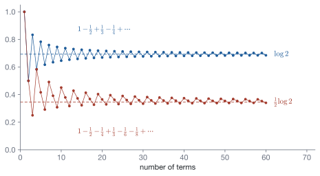{#fig-rearrangement-partial-sums width=75%}
:::

A damped oscillator released from rest swings back and forth with shrinking turning points. Its net displacement and
the total distance it travels are a series and its series of absolute values.

::: {#exm-absolute-damped-path}
#### Distance travelled by a damped oscillator

Released at $x_0 > 0$, an oscillator whose amplitude shrinks by the factor $r \in (0, 1)$ per half swing has turning points $x_0(-r)^k$. The
$k$-th swing is $d_k = x_0(-r)^k - x_0(-r)^{k-1}$, with $|d_k| = x_0(1 + r)r^{k-1}$. The net displacement $\sum d_k = -x_0$ brings it to
equilibrium, and the distance travelled is $\sum |d_k| = x_0(1 + r)/(1 - r)$, finite: the series converges absolutely.
:::

The ionic chain of @exm-cauchy-ionic-chain is summed shell by shell, in the order of distance from the ion. Because its
series converges only conditionally, the potential depends on that order.

::: {#exm-absolute-ionic-order}
#### The order of summation in an ionic chain

With neighbours on both sides, the ion of @exm-cauchy-ionic-chain feels $V = -(2q/(4\pi\varepsilon_0 a))\sum_{k \geq 1}(-1)^{k+1}/k = -(2\log 2)\,q/(4\pi\varepsilon_0 a)$,
and $2\log 2$ is the Madelung constant of the chain. Adding the charges in the order of @exm-absolute-rearrangement, one
attracting pair followed by two repelling pairs, gives half that value. The physical prescription is to add whole neutral
shells in the order of distance.
:::

Changing signs can destroy convergence as well as create it. The pattern $+ + -$ applied to the harmonic terms does
not cancel enough [@abbott2015understanding, Exercise 2.7.2].

::: {#exm-absolute-sign-pattern}
#### A sign pattern that does not cancel

$1 + \tfrac12 - \tfrac13 + \tfrac14 + \tfrac15 - \tfrac16 + \dots$ diverges. Grouped in threes, the $m$-th group is $\tfrac{1}{3m - 2} + \tfrac{1}{3m - 1} - \tfrac{1}{3m} >
\tfrac{1}{3m}$, so the grouped partial sums exceed a third of the harmonic numbers and are unbounded. By @exr-series-brackets, a
convergent series would have convergent groupings.
:::

Products of series are another place where conditional convergence fails. The **Cauchy product** of $\sum_{k \geq 0} a_k$ and
$\sum_{k \geq 0} b_k$ is the series with terms $c_n = \sum_{j=0}^n a_j b_{n-j}$, collecting the terms of $a_jb_k$ with $j + k = n$.

::: {#exm-absolute-cauchy-product-fail}
#### Squaring a conditionally convergent series

$\sum_{k \geq 0}(-1)^k/\sqrt{k + 1}$ converges by @exm-absolute-alternating-root. Its Cauchy product with itself has $c_n = (-1)^n\sum_{j=0}^n
1/\sqrt{(j + 1)(n - j + 1)}$, and $\sqrt{(j + 1)(n - j + 1)} \leq (n + 2)/2$ by the inequality of means, so $|c_n| \geq 2(n + 1)/(n + 2) \geq 1$.
The terms do not tend to $0$, and the product series diverges.
:::
::::

:::: {.callout-note .exercises-fold collapse="true" title="Exercises"}
Deciding between absolute convergence, conditional convergence and divergence is the basic skill of this unit. The first
exercise has five alternating series [@riley2006mathematical, Problem 4.13].

::: {#exr-absolute-classify}
#### Five alternating series

Decide whether each converges absolutely, conditionally or not at all: $\sum (-1)^n/n^{5/2}$, $\sum (-1)^n(2n + 1)/n$, $\sum_{n \geq 0}
(-1)^n x^n/n!$ for $x > 0$, $\sum_{n \geq 0}(-1)^n/(n^2 + 3n + 2)$ and $\sum (-1)^n 2^n/\sqrt n$.
:::

::: {.callout-note .solution collapse="true" title="Solution"}
:::: {.panel-tabset .solution-tabs}
## Proof

(a) $1/n^{5/2} \leq 1/n^2$, so the absolute values have partial sums below $2$: absolutely convergent. (b) $|a_n| = 2 + 1/n \to 2$, so
$a_n \not\to 0$: divergent. (c) For $n \geq N > 2x$, $x^{n+1}/(n + 1)! \leq \tfrac12 x^n/n!$, so the absolute values from $N$ on are bounded
by a geometric series with ratio $\tfrac12$: absolutely convergent. (d) $1/(n^2 + 3n + 2) = 1/(n + 1) - 1/(n + 2)$, a telescoping series of
absolute values with sum $1$: absolutely convergent. (e) $2^n/\sqrt n \geq 2^n/2^{n/2} = 2^{n/2} \to \infty$, using $\sqrt n \leq 2^{n/2}$:
divergent.

## SageMath

Sage evaluates the three absolutely convergent series at $x = 3$ and prints terms of the two divergent ones.

```{.python .sage}
n = var("n")
print([round(sum((-1)^k / RDF(k)^2.5 for k in range(1, 10^5)), 6), sum((-1)^n * 3^n / factorial(n), n, 0, oo), sum(1 / (n^2 + 3 * n + 2), n, 0, oo)])
print("(2n+1)/n:", [N((2 * m + 1) / m, digits=4) for m in (10, 100, 1000)], "; 2^n/sqrt n:", [N(2^m / sqrt(m), digits=4) for m in (10, 20, 30)])
```

```{.text .sage-output}
[-0.8672, e^(-3), 1]
(2n+1)/n: [2.100, 2.010, 2.001] ; 2^n/sqrt n: [323.8, 234500., 1.960e8]
```
::::
:::

The interlacing argument of @exm-absolute-alternating-root works for every alternating series whose terms decrease to
$0$, and it gives an error bound. The second exercise proves this test of Leibniz and checks the bound on the alternating
harmonic series.

::: {#exr-absolute-alternating}
#### Leibniz's test

Let $b_k$ decrease to $0$ and $S = \sum_{k \geq 1}(-1)^{k+1}b_k$. Prove that the series converges and that $|S - s_m| \leq b_{m+1}$, with $S - s_m$
of the sign of $(-1)^m$. Check this for $b_k = 1/k$ and $m = 10, 11, 100, 101$.
:::

::: {.callout-note .solution collapse="true" title="Solution"}
:::: {.panel-tabset .solution-tabs}
## Proof

$s_{2n+2} - s_{2n} = b_{2n+1} - b_{2n+2} \geq 0$ and $s_{2n+1} - s_{2n-1} = b_{2n+1} - b_{2n} \leq 0$, so the even partial sums increase and
the odd ones decrease; and $s_{2n+1} - s_{2n} = b_{2n+1} \geq 0$. So $s_2 \leq s_{2n} \leq s_{2n+1} \leq s_1$, both subsequences converge by
@thm-monotone-convergence, and their limits agree because $b_{2n+1} \to 0$. Hence $s_n \to S$ with $s_{2n} \leq S \leq s_{2n+1}$ for all $n$.
For even $m$, $0 \leq S - s_m \leq s_{m+1} - s_m = b_{m+1}$; for odd $m$, $0 \leq s_m - S \leq s_m - s_{m+1} = b_{m+1}$. With $b_k = 1/k$ the sum is
$\log 2$ (@exr-limits-harmonic-difference) and the error after $m$ terms is at most $1/(m + 1)$.

## SageMath

Check on $b_k = 1/k$: Sage prints $\log 2 - s_m$, its sign and the comparison with $1/(m + 1)$.

```{.python .sage}
s = lambda m: sum((-1)^(k + 1) / QQ(k) for k in range(1, m + 1))
for m in [10, 11, 100, 101]:
    err = N(log(2) - s(m), digits=30)
    print("m =", m, ": log 2 - s_m =", err.n(digits=6), "; |error| <= 1/(m+1):", abs(err) <= QQ(1) / (m + 1))
```

```{.text .sage-output}
m = 10 : log 2 - s_m = 0.0475123 ; |error| <= 1/(m+1): True
m = 11 : log 2 - s_m = -0.0433968 ; |error| <= 1/(m+1): True
m = 100 : log 2 - s_m = 0.00497500 ; |error| <= 1/(m+1): True
m = 101 : log 2 - s_m = -0.00492599 ; |error| <= 1/(m+1): True
```
::::
:::

That a series with convergent absolute values converges was proved through the Cauchy criterion. The third exercise
asks for a second proof, by splitting into positive and negative parts, and for the converse's failure.

::: {#exr-absolute-conditional-proof}
#### Absolute convergence implies convergence

Using $0 \leq a_k^\pm \leq |a_k|$, prove again that $\sum |a_k| < \infty$ implies that $\sum a_k$ converges, and give a convergent series whose
absolute values diverge.
:::

::: {.callout-note .solution collapse="true" title="Solution"}
:::: {.panel-tabset .solution-tabs}
## Proof

The partial sums of $\sum a_k^+$ and of $\sum a_k^-$ increase and are bounded by $\sum |a_k|$, so both converge by
@thm-monotone-convergence. Then $\sum a_k = \sum (a_k^+ - a_k^-)$ converges by linearity. The alternating harmonic series of
@exm-absolute-alternating-harmonic converges, and its absolute values form the divergent harmonic series.

## SageMath

Check on $a_k = \cos(k)/k^2$: Sage computes the partial sums of $a_k^+$, $a_k^-$ and $a_k$ up to $k = 10^4$.

```{.python .sage}
a = [cos(RDF(k)) / k^2 for k in range(1, 10^4 + 1)]
P, M = sum(max(x, 0) for x in a), sum(max(-x, 0) for x in a)
print("sum a+ =", round(P, 6), "; sum a- =", round(M, 6), "; difference =", round(P - M, 6), "; sum a =", round(sum(a), 6))
```

```{.text .sage-output}
sum a+ = 0.625858 ; sum a- = 0.30172 ; difference = 0.324138 ; sum a = 0.324138
```
::::
:::

Absolute convergence licenses splitting a series into subseries. The fourth exercise splits $\sum 1/n^2$ into odd and
even terms [@riley2006mathematical, Problem 4.6].

::: {#exr-absolute-odd-squares}
#### Odd and even squares

With $S = \sum_{n \geq 1}1/n^2$, show that $\sum_{n \text{ odd}}1/n^2 = \tfrac34 S$ and $\sum_{n \geq 1}(-1)^{n+1}/n^2 = \tfrac12 S$.
:::

::: {.callout-note .solution collapse="true" title="Solution"}
:::: {.panel-tabset .solution-tabs}
## Proof

The even terms form $\sum 1/(2m)^2 = \tfrac14 S$. The odd terms form a series of positive terms whose partial sums are bounded by $S$, so
it converges, to $S_o$ say. The partial sums satisfy $s_{2N} = \sum_{m \leq N}1/(2m - 1)^2 + \sum_{m \leq N}1/(2m)^2$, and letting $N \to \infty$
gives $S = S_o + \tfrac14 S$, so $S_o = \tfrac34 S$. In the same way the alternating series has $s_{2N} \to S_o - \tfrac14 S = \tfrac12 S$, and
$s_{2N+1} - s_{2N} \to 0$.

## SageMath

Sage evaluates the three sums and their ratios.

```{.python .sage}
n = var("n")
S, So, Sa = sum(1 / n^2, n, 1, oo), sum(1 / (2 * n - 1)^2, n, 1, oo), sum((-1)^(n + 1) / n^2, n, 1, oo)
print(S, So, Sa, "; ratios:", So / S, Sa / S)
```

```{.text .sage-output}
1/6*pi^2 1/8*pi^2 1/12*pi^2 ; ratios: 3/4 1/2
```
::::
:::

The rearranged sum $\tfrac12\log 2$ of @exm-absolute-rearrangement can be computed exactly by regrouping the blocks. The
fifth exercise does so and explains why an absolutely convergent series cannot be disturbed this way.

::: {#exr-absolute-rearrangement}
#### A rearrangement with a different sum

Show that after $b$ blocks (one positive term, then two negative) the rearranged alternating harmonic series has partial sum
$\tfrac12 s_{2b}$, where $s_n$ are the partial sums of the original series, and deduce that the rearrangement converges to
$\tfrac12\log 2$.
:::

::: {.callout-note .solution collapse="true" title="Solution"}
:::: {.panel-tabset .solution-tabs}
## Proof

The $j$-th block is $\tfrac{1}{2j-1} - \tfrac{1}{4j-2} - \tfrac{1}{4j} = \tfrac{1}{4j-2} - \tfrac{1}{4j} = \tfrac12\big(\tfrac{1}{2j-1} - \tfrac{1}{2j}\big)$, so $b$
blocks sum to $\tfrac12 s_{2b} \to \tfrac12\log 2$. Within a block the partial sums move by at most the first term $1/(2j - 1) \to 0$, so the
whole rearranged series converges to $\tfrac12\log 2$ (@exr-series-brackets). For an absolutely convergent series every rearrangement has
the same sum, by @def-absolute-convergence.

## SageMath

Sage computes the rearranged partial sums after $10$, $100$ and $1000$ blocks and checks the identity exactly.

```{.python .sage}
def rearranged(blocks):
    total, p, q = QQ(0), 1, 2
    for _ in range(blocks):
        total += QQ(1) / p; p += 2
        total -= QQ(1) / q; q += 2
        total -= QQ(1) / q; q += 2
    return total
s = lambda n: sum(QQ((-1)^(k + 1)) / k for k in range(1, n + 1))
print("identity:", all(rearranged(b) == s(2 * b) / 2 for b in range(1, 30)))
print([N(rearranged(b), digits=8) for b in (10, 100, 1000)], "; (1/2) log 2 =", N(log(2) / 2, digits=8))
```

```{.text .sage-output}
identity: True
[0.33438570, 0.34532672, 0.34644862] ; (1/2) log 2 = 0.34657359
```
::::
:::

The positive and negative parts of @exm-absolute-parts tell the two kinds of convergence apart in general. The sixth
exercise proves it.

::: {#exr-absolute-positive-parts}
#### The parts of a conditionally convergent series

Prove that $\sum a_k$ converges absolutely if and only if $\sum a_k^+$ and $\sum a_k^-$ both converge, and that if $\sum a_k$ converges
conditionally then both diverge.
:::

::: {.callout-note .solution collapse="true" title="Solution"}
:::: {.panel-tabset .solution-tabs}
## Proof

If $\sum |a_k|$ converges, both parts converge as in @exr-absolute-conditional-proof; conversely $|a_k| = a_k^+ + a_k^-$ and linearity give
$\sum |a_k| = \sum a_k^+ + \sum a_k^-$. Now let $\sum a_k$ converge but not absolutely. If $\sum a_k^+$ converged, then $\sum a_k^- = \sum (a_k^+ - a_k)$
would converge by linearity, and so would $\sum |a_k|$, a contradiction; the same argument applies to $\sum a_k^-$. Both parts have
increasing unbounded partial sums.

## SageMath

Check on the alternating harmonic series: Sage prints the partial sums of the positive and negative parts up to $10^2$, $10^4$, $10^6$ terms.

```{.python .sage}
for n in (10^2, 10^4, 10^6):
    P = sum(1.0 / k for k in range(1, n + 1, 2)); M = sum(1.0 / k for k in range(2, n + 1, 2))
    print("n =", n, ": positive part", round(P, 4), "; negative part", round(M, 4), "; difference", round(P - M, 6))
```

```{.text .sage-output}
n = 100 : positive part 2.9378 ; negative part 2.2496 ; difference 0.688172
n = 10000 : positive part 5.2404 ; negative part 4.5473 ; difference 0.693097
n = 1000000 : positive part 7.5429 ; negative part 6.8498 ; difference 0.693147
```
::::
:::

Absolute and conditional convergence interact with products and growing weights in ways that are easy to get wrong.
The seventh exercise has three claims to prove or refute [@abbott2015understanding, Exercise 2.7.8].

::: {#exr-absolute-claims}
#### True or false

Prove or give a counterexample: (a) if $\sum a_n$ converges absolutely, so does $\sum a_n^2$; (b) if $\sum a_n$ converges and $b_n \to b$, then $\sum
a_nb_n$ converges; (c) if $\sum a_n$ converges conditionally, then $\sum n^2 a_n$ diverges.
:::

::: {.callout-note .solution collapse="true" title="Solution"}
:::: {.panel-tabset .solution-tabs}
## Proof

(a) True: $a_n \to 0$, so $|a_n| \leq 1$ for $n \geq N$, and then $a_n^2 \leq |a_n|$; the partial sums of $\sum a_n^2$ are bounded. (b) False:
$a_n = b_n = (-1)^n/\sqrt n$ gives $\sum a_n$ convergent (@exm-absolute-alternating-root) and $b_n \to 0$, but $\sum a_nb_n = \sum 1/n$ diverges.
(c) True: if $\sum n^2a_n$ converged, then $n^2a_n \to 0$, so $|a_n| \leq 1/n^2$ for $n \geq N$, and $\sum a_n$ would converge absolutely.

## SageMath

Check on (b): Sage prints partial sums of $\sum a_n$ and of $\sum a_nb_n$ for $a_n = b_n = (-1)^n/\sqrt n$.

```{.python .sage}
for n in (10^2, 10^4, 10^6):
    A = sum((-1)^k / sqrt(float(k)) for k in range(1, n + 1)); AB = sum(1.0 / k for k in range(1, n + 1))
    print("n =", n, ": sum a_n =", round(A, 4), "; sum a_n b_n =", round(AB, 4))
```

```{.text .sage-output}
n = 100 : sum a_n = -0.555 ; sum a_n b_n = 5.1874
n = 10000 : sum a_n = -0.5999 ; sum a_n b_n = 9.7876
n = 1000000 : sum a_n = -0.6044 ; sum a_n b_n = 14.3927
```
::::
:::

For absolutely convergent factors the Cauchy product of @exm-absolute-cauchy-product-fail behaves as the product of two
finite sums. The eighth exercise proves this and squares the geometric series [@abbott2015understanding, Exercise 2.8.7].

::: {#exr-absolute-cauchy-product}
#### The Cauchy product of absolutely convergent series

Let $\sum_{k \geq 0} a_k = A$ and $\sum_{k \geq 0} b_k = B$ converge absolutely, and $c_n = \sum_{j=0}^n a_jb_{n-j}$. Prove that $\sum c_n$ converges
absolutely to $AB$. Deduce $\sum_{n \geq 0}(n + 1)x^n = 1/(1 - x)^2$ for $|x| < 1$.
:::

::: {.callout-note .solution collapse="true" title="Solution"}
:::: {.panel-tabset .solution-tabs}
## Proof

Let $A_N, B_N, C_N$ be the partial sums up to index $N$, and $\alpha = \sum |a_k|$, $\beta = \sum |b_k|$. First, $\sum_{n \leq N}|c_n| \leq
\sum_{j \leq N}|a_j|\sum_{k \leq N}|b_k| \leq \alpha\beta$, so $\sum c_n$ converges absolutely. Next, $C_{2N} - A_NB_N$ is the sum of $a_jb_k$ over the
pairs with $j + k \leq 2N$ and $j > N$ or $k > N$, so
$$
|C_{2N} - A_NB_N| \leq \sum_{j > N}|a_j|\,\beta + \alpha\sum_{k > N}|b_k| \to 0.
$$
Since $A_NB_N \to AB$ and $(C_n)$ converges, its subsequence $C_{2N}$ identifies the limit: $\sum c_n = AB$. For $a_k = b_k = x^k$ with $|x| < 1$,
$c_n = \sum_{j=0}^n x^jx^{n-j} = (n + 1)x^n$, and $A = B = 1/(1 - x)$.

## SageMath

Check on $x = \tfrac13$: Sage compares the partial sums of $\sum(n + 1)x^n$ with $1/(1 - x)^2 = \tfrac94$.

```{.python .sage}
x = QQ(1) / 3
C = lambda N: sum((n + 1) * x^n for n in range(N + 1))
print([N(C(m), digits=10) for m in (5, 10, 20, 40)], "; 1/(1 - x)^2 =", 1 / (1 - x)^2)
```

```{.text .sage-output}
[2.234567901, 2.249894156, 2.249999997, 2.250000000] ; 1/(1 - x)^2 = 9/4
```
::::
:::

Riemann's rearrangement theorem is proved by a greedy construction: add positive terms until the target is passed, then
negative terms until it is undercut, and repeat. The ninth exercise proves it for the alternating harmonic series.

::: {#exr-absolute-riemann}
#### Reaching any sum by rearrangement

For a target $c \in \mathbb{R}$, rearrange $\sum (-1)^{k+1}/k$ greedily: take the unused positive terms $1, \tfrac13, \tfrac15, \dots$ in order while the
partial sum is at most $c$, and the unused negative terms $-\tfrac12, -\tfrac14, \dots$ in order while it exceeds $c$. Prove that this is a
rearrangement converging to $c$, and run it for $c = 1.5$.
:::

::: {.callout-note .solution collapse="true" title="Solution"}
:::: {.panel-tabset .solution-tabs}
## Proof

The positive and negative parts both diverge (@exm-absolute-parts), so each phase ends after finitely many terms and both kinds of term are
used infinitely often: every term is eventually used, exactly once, and the result is a rearrangement. After the first crossing of $c$, each
partial sum differs from $c$ by at most the last term added at a switch of phase: at the switch the sum has just crossed $c$ by less than
that term, and between switches it moves monotonically towards $c$. The terms used at the switches are terms of the series taken further and
further out, so they tend to $0$, and the partial sums converge to $c$.

## SageMath

Sage runs the construction for $c = 1.5$ and prints the partial sum after $10^3$, $10^4$ and $10^5$ terms.

```{.python .sage}
c, total, p, q, out = 1.5, 0.0, 1, 2, {}
for m in range(1, 10^5 + 1):
    if total <= c:
        total += 1.0 / p; p += 2
    else:
        total -= 1.0 / q; q += 2
    if m in (10^3, 10^4, 10^5):
        out[m] = round(total, 6)
print(out, "; positive terms used:", (p - 1) // 2, "; negative:", (q - 2) // 2)
```

```{.text .sage-output}
{1000: 1.498766, 10000: 1.499758, 100000: 1.500002} ; positive terms used: 83393 ; negative: 16607
```
::::
:::

Absolute convergence makes sense wherever there is a length, and completeness turns it into convergence. The last exercise
combines @def-absolute-convergence with the completeness of $\mathbb{R}^n$ (@prp-compact-metric-complete).

::: {#exr-absolute-vectors}
#### Absolutely convergent series of vectors

Let $\mathbf v_k \in \mathbb{R}^n$ with $\sum \|\mathbf v_k\| < \infty$, for the Euclidean norm. Prove that $\sum \mathbf v_k$ converges in $\mathbb{R}^n$, with
$\|\sum \mathbf v_k\| \leq \sum \|\mathbf v_k\|$, and apply it to $\mathbf v_k = (\cos k, \sin k)/k^2$ in $\mathbb{R}^2$.
:::

::: {.callout-note .solution collapse="true" title="Solution"}
:::: {.panel-tabset .solution-tabs}
## Proof

Let $\mathbf s_N = \sum_{k \leq N}\mathbf v_k$ and $t_N = \sum_{k \leq N}\|\mathbf v_k\|$. For $N > M$, the triangle inequality gives $\|\mathbf s_N - \mathbf s_M\| \leq
t_N - t_M$, so $(\mathbf s_N)$ is Cauchy for the distance $d_2$, and it converges because $\mathbb{R}^n$ is complete
(@prp-compact-metric-complete). Passing to the limit in $\|\mathbf s_N\| \leq t_N$, by continuity of the norm, gives the inequality. For the
example $\|\mathbf v_k\| = 1/k^2$, so the series converges, to a vector of length at most $\sum 1/k^2 < 2$ (@exm-series-basel).

## SageMath

Check on $\mathbf v_k = (\cos k, \sin k)/k^2$: Sage computes $\mathbf s_N$ for $N = 10^2, 10^3, 10^4$ and its length.

```{.python .sage}
for Nn in (10^2, 10^3, 10^4):
    s = sum(vector(RDF, [cos(RDF(k)), sin(RDF(k))]) / k^2 for k in range(1, Nn + 1))
    print("N =", Nn, ": s_N =", s.apply_map(lambda t: round(t, 6)), "; |s_N| =", round(s.norm(), 6))
```

```{.text .sage-output}
N = 100 : s_N = (0.324133, 1.013856) ; |s_N| = 1.064409
N = 1000 : s_N = (0.324139, 1.013959) ; |s_N| = 1.064509
N = 10000 : s_N = (0.324138, 1.013959) ; |s_N| = 1.064509
```
::::
:::
::::

### Convergence tests

Most series met in practice are not telescoping, and their convergence is decided by comparing them with a series that is
already understood. The theorem below collects the workhorses: comparison with a dominating series, Cauchy's condensation
of decreasing terms into blocks of length $2^m$, and the ratio and root tests, whose proofs reduce to a geometric comparison.
The root test uses the upper limit $\limsup$ of @exr-monotone-limsup.

:::: {.statement-box}
::: {#thm-convergence-tests}
#### Comparison, condensation, ratio and root tests

Let $(a_k)$ and $(b_k)$ be real sequences.

1. **Comparison test**: if $0 \leq a_k \leq b_k$ for all $k \geq K$ and $\sum b_k$ converges, then $\sum a_k$ converges; if $\sum a_k$ diverges,
   so does $\sum b_k$. If $a_k, b_k > 0$ and $a_k/b_k \to L$ with $0 < L < \infty$, the two series converge or diverge together (the **limit
   comparison test**).
2. **Condensation test**: if $a_k \geq a_{k+1} \geq 0$ for all $k$, then $\sum_{k \geq 1} a_k$ converges if and only if $\sum_{m \geq 0} 2^m a_{2^m}$ does.
3. **Ratio test**: if $a_k \neq 0$ and $|a_{k+1}/a_k| \to L$, then $\sum a_k$ converges absolutely when $L < 1$ and diverges when $L > 1$.
4. **Root test**: if $(|a_k|^{1/k})$ is bounded and $L = \limsup |a_k|^{1/k}$, then $\sum a_k$ converges absolutely when $L < 1$ and diverges
   when $L > 1$; if $(|a_k|^{1/k})$ is unbounded, $\sum a_k$ diverges.

When the limit $L$ of the ratio or root test equals $1$, the test decides nothing.
:::
::::

*Proof.* (1) Finitely many terms do not matter, so take $K = 1$. The partial sums of $\sum a_k$ increase and are bounded by
$\sum b_k$, so they converge (@thm-monotone-convergence); the second statement is the first read backwards. For the limit form,
$\tfrac L2 b_k < a_k < 2L\,b_k$ for $k$ large, and the first part applies in both directions.

(2) Let $s_n = \sum_{k \leq n}a_k$ and $t_m = \sum_{j=0}^m 2^ja_{2^j}$. The block $2^j \leq k < 2^{j+1}$ has $2^j$ terms, each between $a_{2^{j+1}}$
and $a_{2^j}$, so its sum lies between $\tfrac12 2^{j+1}a_{2^{j+1}}$ and $2^ja_{2^j}$. Summing over $j = 0, \dots, m$,
$$
\tfrac12(t_{m+1} - a_1) \leq s_{2^{m+1} - 1} \leq t_m .
$$
Both sequences increase, so the right inequality bounds $(s_n)$ when $(t_m)$ is bounded, and the left one bounds $(t_m)$ when $(s_n)$
is bounded.

(3) For $L < 1$ pick $r$ with $L < r < 1$. For $k \geq N$, $|a_{k+1}| \leq r|a_k|$, so $|a_k| \leq |a_N|r^{k-N}$, and (1) with the geometric series
gives absolute convergence. For $L > 1$, $|a_{k+1}| > |a_k|$ for $k \geq N$, so $|a_k| \geq |a_N| > 0$ and $a_k \not\to 0$.

(4) Let $y_n = \sup_{k \geq n}|a_k|^{1/k}$, which decreases to $L$. If $L < 1$, pick $L < r < 1$; some $y_N < r$, so $|a_k| < r^k$ for
$k \geq N$, and (1) applies. If $L > 1$, every $y_n > 1$, so for every $n$ some $k \geq n$ has $|a_k| > 1$, and $a_k \not\to 0$. The same holds if
$(|a_k|^{1/k})$ is unbounded. $\square$

The condensation test is @abbott2015understanding [Thm. 2.4.6], and the ratio test is @abbott2015understanding [Exercise 2.7.9].
@radozycki2020solving [Sec. 13.2] applies all four tests to many series.

:::: {.callout-note .examples-fold collapse="true" title="Examples"}
The comparison test needs a convergent series that lies above the given one term by term. Factorials and powers of $2$
supply such majorants at once [@riley2006mathematical, Sec. 4.3.2; @abbott2015understanding, Exercise 2.7.2].

::: {#exm-tests-comparison-basic}
#### Dominating by known series

$\sum 1/(n! + 1)$ converges: $1/(n! + 1) < 1/n!$, and $\sum 1/n!$ converges (@exm-cauchy-factorial). $\sum 1/(2^n + n)$ converges:
$1/(2^n + n) < 2^{-n}$. And $\sum 1/(n - \tfrac12)$ diverges, since its terms exceed $1/n$.
:::

The $p$-series $\sum 1/k^p$ are the standard measuring sticks of the comparison test, and condensation decides them all at
once. The figure shows the blocks of length $2^m$ for the harmonic series.

::: {#exm-tests-p-series}
#### The $p$-series by condensation

For $p > 0$ the terms $1/k^p$ decrease, and the condensed series is $\sum_m 2^m 2^{-mp} = \sum_m (2^{1-p})^m$, a geometric series with ratio
$2^{1-p}$. So $\sum 1/k^p$ converges exactly when $p > 1$. For $p \leq 0$ the terms do not tend to $0$. The case $p = 1$ is the grouping
of @exm-series-harmonic, and $p = 2$ recovers @exm-series-basel.

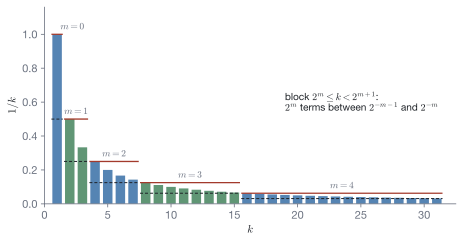{#fig-condensation-blocks width=75%}
:::

When a term is a rational function of $n$, only the leading powers matter, and the limit comparison test makes this precise.
The first series is from @riley2006mathematical [Sec. 4.3.2].

::: {#exm-tests-limit-comparison}
#### Leading powers decide

$a_n = (4n^2 - n - 3)/(n^3 + 2n)$ has $a_n/(1/n) = (4n^3 - n^2 - 3n)/(n^3 + 2n) \to 4$, so $\sum a_n$ diverges with the harmonic series.
$b_n = (2n + 1)/(n^3 + 1)$ has $b_n/(1/n^2) \to 2$, so $\sum b_n$ converges with $\sum 1/n^2$.
:::

The ratio test is tailored to series with factorials, where consecutive terms have a simple ratio. The exponential series is
the first application, converging for every real $x$.

::: {#exm-tests-exponential}
#### The exponential series

$\sum x^k/k!$ has ratio $|x|/(k + 1) \to 0$ for every $x \neq 0$: it converges absolutely for all real $x$. For $x = 1$ this is the series
of @exm-cauchy-factorial, with sum $e$.
:::

The ratio test also handles mixtures of powers and factorials, and the limit of the ratio can be any number below $1$. The
example has two convergent cases and shows the test's silence when the limit is exactly $1$.

::: {#exm-tests-factorial}
#### $n!/n^n$ and $n^2/2^n$

$a_{n+1}/a_n = (n/(n+1))^n = 1/(1 + 1/n)^n \to 1/e < 1$ for $n!/n^n$, and $\to \tfrac12$ for $n^2/2^n$: both series converge. For $1/n$ and
$1/n^2$ the ratio tends to $1$ and the test says nothing, although one diverges and the other converges.
:::

When the term is an $n$-th power, the root test removes the power. If the root has no limit, the upper limit still decides
[@radozycki2020solving, Sec. 13.2, Problem 4].

::: {#exm-tests-root}
#### $n$-th powers

$\sum (n/(2n + 1))^n$ has $|a_n|^{1/n} = n/(2n + 1) \to \tfrac12$: it converges. For $a_n = ((a + \cos n)/(b + \cos n))^n$ with $1 < a < b$, the root
$(a + \cos n)/(b + \cos n)$ has no limit, but it is at most $(a + 1)/(b + 1) < 1$, since $t \mapsto (a + t)/(b + t)$ increases on $[-1, 1]$. So
$\limsup |a_n|^{1/n} < 1$ and the series converges.
:::

Logarithms in the denominator slow the decay of a term only a little, and condensation shows exactly how much. The series
$\sum 1/(n(\log n)^\alpha)$ sits between $\sum 1/n$ and every $\sum 1/n^p$ with $p > 1$ [@radozycki2020solving, Sec. 13.2, Problem 5].

::: {#exm-tests-log-condensation}
#### $\sum 1/(n(\log n)^\alpha)$

For $\alpha > 0$ the terms decrease from $n = 2$ on, and the condensed series is $\sum_m 2^m/(2^m(m\log 2)^\alpha) = (\log 2)^{-\alpha}\sum_m 1/m^\alpha$. So
the series converges exactly when $\alpha > 1$: $\sum 1/(n\log n)$ diverges and $\sum 1/(n(\log n)^2)$ converges.
:::

The partition function of the hydrogen atom sums the Boltzmann weights of all bound levels, with their degeneracies $n^2$.
The necessary condition decides it where the ratio test cannot.

::: {#exm-tests-hydrogen-partition}
#### The hydrogen partition function diverges

With $E_n = -E'/n^2$ and $x = E'/k_BT > 0$, the bound-state sum is $\sum_n n^2e^{x/n^2}$. Its terms exceed $n^2$, so they do not tend to $0$ and
the series diverges at every temperature. The ratio of consecutive terms tends to $1$, so the ratio test is silent. Physically, the
divergence is cured by the finite size of the container, which removes the highly excited levels.
:::

A rigid rotor, a molecule turning freely on the sphere $S^2$, has levels $E_l = \hbar^2 l(l + 1)/2I$ with degeneracy $2l + 1$. Its
partition function converges at every temperature, by the ratio test.

::: {#exm-tests-rotor}
#### The rotor partition function

With $x = \hbar^2/(2Ik_BT) > 0$, $Z = \sum_{l \geq 0}(2l + 1)e^{-l(l+1)x}$ has ratio
$$
\frac{a_{l+1}}{a_l} = \frac{2l + 3}{2l + 1}\,e^{-2(l + 1)x} \to 0,
$$
so it converges. The levels grow quadratically in $l$, fast enough to beat the linear growth of the degeneracy.
:::

The tests have blind spots, and the last example shows two. Both the ratio and the root test are silent on $\sum 1/n$ and
$\sum 1/n^2$, and the limit comparison test fails for terms of changing sign [@radozycki2020solving, Sec. 13.2, Problem 7].

::: {#exm-tests-silent}
#### Where the tests are silent

For $1/n$ and $1/n^2$ the ratios tend to $1$ and the roots $n^{-1/n}$, $n^{-2/n}$ tend to $1$ by @prp-sequence-limits, yet one series diverges
and the other converges. For $a_n = (-1)^n/\sqrt n$ and $b_n = a_n + 1/n$, $b_n/a_n = 1 + (-1)^n/\sqrt n \to 1$, but $\sum a_n$ converges
(@exm-absolute-alternating-root) while $\sum b_n$ diverges, being a convergent series plus the harmonic series.
:::
::::

:::: {.callout-note .exercises-fold collapse="true" title="Exercises"}
By hand, the ratio test is a matter of simplifying $a_{k+1}/a_k$ and recognising the limit. The first exercise has three
series with factorials and powers, one of which produces the limit $e$.

::: {#exr-ratio-factorial}
#### Applying the ratio test by hand

Decide the convergence of $\sum k!/10^k$, $\sum 10^k/k!$ and $\sum k^k/k!$.
:::

::: {.callout-note .solution collapse="true" title="Solution"}
:::: {.panel-tabset .solution-tabs}
## Proof

The ratios are $(k + 1)/10 \to \infty$, so the first diverges; $10/(k + 1) \to 0$, so the second converges; and
$(k + 1)^{k+1}k!/((k + 1)!\,k^k) = (1 + 1/k)^k \to e > 1$ (@exm-monotone-euler), so the third diverges.

## SageMath

Sage computes the three ratio limits.

```{.python .sage}
k = var("k")
for a in (factorial(k) / 10^k, 10^k / factorial(k), k^k / factorial(k)):
    print(a, ":", limit((a.subs(k=k + 1) / a).simplify_full(), k=oo))
```

```{.text .sage-output}
factorial(k)/10^k : +Infinity
10^k/factorial(k) : 0
k^k/factorial(k) : e
```
::::
:::

Sage computes ratio limits symbolically and, when the series converges, often the sum as well. The second exercise runs
the test on four sequences.

::: {#exr-ratio-sage}
#### Ratio limits in Sage

Compute $\lim a_{n+1}/a_n$ for $a_n = 2^n/n!$, $n!/n^n$, $n^2/2^n$ and $1/n$, and draw the conclusion of the ratio test.
:::

::: {.callout-note .solution collapse="true" title="Solution"}
:::: {.panel-tabset .solution-tabs}
## Proof

The ratios are $2/(n + 1) \to 0$, $1/(1 + 1/n)^n \to 1/e$, $(1 + 1/n)^2/2 \to \tfrac12$ and $n/(n + 1) \to 1$. The first three series converge by
@thm-convergence-tests, and the test is silent on the harmonic series, which diverges (@exm-series-harmonic).

## SageMath

Sage computes the four limits and the verdicts, and sums the first and third series.

```{.python .sage}
n = var("n")
for a, name in [(2^n / factorial(n), "2^n/n!"), (factorial(n) / n^n, "n!/n^n"), (n^2 / 2^n, "n^2/2^n"), (1 / n, "1/n")]:
    L = limit(a.subs(n=n + 1) / a, n=oo)
    print(name, ": lim a_{n+1}/a_n =", L, "->", "converges" if bool(L < 1) else ("diverges" if bool(L > 1) else "inconclusive"))
print("sum 2^n/n! =", sum(2^n / factorial(n), n, 1, oo).simplify_full(), "; sum n^2/2^n =", sum(n^2 / 2^n, n, 1, oo))
```

```{.text .sage-output}
2^n/n! : lim a_{n+1}/a_n = 0 -> converges
n!/n^n : lim a_{n+1}/a_n = e^(-1) -> converges
n^2/2^n : lim a_{n+1}/a_n = 1/2 -> converges
1/n : lim a_{n+1}/a_n = 1 -> inconclusive
sum 2^n/n! = 2*e*sinh(1) ; sum n^2/2^n = 6
```
::::
:::

A mixture of tests is needed in practice, one chosen to suit each term. The third exercise has five series
[@riley2006mathematical, Problems 4.10 and 4.12].

::: {#exr-tests-mixed}
#### Choosing the test

Decide the convergence of $\sum 2\sin(n\theta)/(n(n + 1))$, $\sum n^p/n!$ for $p > 0$, $\sum (\log n)^n/n^{n/2}$, $\sum n^n/n!$ and $\sum
\sqrt{n/(n + 1)}$.
:::

::: {.callout-note .solution collapse="true" title="Solution"}
:::: {.panel-tabset .solution-tabs}
## Proof

(a) $|2\sin(n\theta)/(n(n + 1))| \leq 2/(n(n + 1))$, a telescoping majorant with sum $2$: absolutely convergent by comparison. (b) The ratio is
$(1 + 1/n)^p/(n + 1) \to 0$: convergent. (c) The root is $\log n/\sqrt n$. From $\log y < y$ for $y > 0$, $\log n = 4\log n^{1/4} < 4n^{1/4}$, so the
root is below $4n^{-1/4} \to 0$: convergent. (d) The ratio is $(1 + 1/n)^n \to e > 1$: divergent. (e) The terms tend to $1$: divergent.

## SageMath

Sage computes the ratio and root limits of (b), (c) and (d), for $p = 3$.

```{.python .sage}
n = var("n")
print(limit(((n + 1)^3 / factorial(n + 1)) / (n^3 / factorial(n)), n=oo), limit(log(n) / sqrt(n), n=oo),
      limit(((n + 1)^(n + 1) / factorial(n + 1)) / (n^n / factorial(n)), n=oo), limit(sqrt(n / (n + 1)), n=oo))
```

```{.text .sage-output}
0 0 e 1
```
::::
:::

The ratio test leaves a gap at $L = 1$, and sometimes an earlier inequality closes it. The fourth exercise uses the bracket
$(1 + 1/n)^n < e$ of @prp-sequence-limits [@radozycki2020solving, Sec. 13.2, Problem 3].

::: {#exr-tests-c-factorial}
#### $\sum c^n n!/n^n$

For $c > 0$, decide the convergence of $\sum c^n n!/n^n$, including the case $c = e$ where the ratio test is silent.
:::

::: {.callout-note .solution collapse="true" title="Solution"}
:::: {.panel-tabset .solution-tabs}
## Proof

The ratio is $a_{n+1}/a_n = c/(1 + 1/n)^n \to c/e$, so the series converges for $c < e$ and diverges for $c > e$. For $c = e$ the ratio is
$e/(1 + 1/n)^n > 1$, because $(1 + 1/n)^n < e$ for every $n$ (@prp-sequence-limits). So the terms increase, $a_n \geq a_1 = e$, and they do not
tend to $0$: the series diverges.

## SageMath

Check on $c = e$: Sage prints the terms $a_n$ for $n = 1, 10, 100, 1000$, which increase.

```{.python .sage}
a = lambda n: N(e^n * factorial(n) / n^n, digits=8)
print([a(n) for n in (1, 10, 100, 1000)])
```

```{.text .sage-output}
[2.7182818, 7.9929639, 25.087180, 79.273152]
```
::::
:::

The root test is stronger than the ratio test: it decides series whose consecutive ratios jump about. The fifth exercise
is an interleaving of two geometric series [@riley2006mathematical, Problem 4.4].

::: {#exr-tests-interleaved}
#### Ratio fails, root succeeds

For $0 < x < y < 1$, show that the ratio test does not apply to $x + y + x^2 + y^2 + x^3 + y^3 + \dots$, that the root test proves its
convergence, and find its sum.
:::

::: {.callout-note .solution collapse="true" title="Solution"}
:::: {.panel-tabset .solution-tabs}
## Proof

The terms are $a_{2k-1} = x^k$ and $a_{2k} = y^k$. The ratios $a_{2k}/a_{2k-1} = (y/x)^k \to \infty$ and $a_{2k+1}/a_{2k} = x(x/y)^k \to 0$
alternate, so the ratio has no limit. The roots are $a_{2k-1}^{1/(2k-1)} = x^{k/(2k-1)} \to \sqrt x$ and $a_{2k}^{1/(2k)} = y^{1/2}$, so $\limsup = \sqrt y
< 1$ and the series converges. Its partial sums $s_{2K} = \sum_{k \leq K}x^k + \sum_{k \leq K}y^k$ tend to $x/(1 - x) + y/(1 - y)$, and $s_{2K+1} -
s_{2K} = x^{K+1} \to 0$, so this is the sum.

## SageMath

Check on $x = \tfrac14$, $y = \tfrac12$: Sage sums $40$ terms and compares with $x/(1 - x) + y/(1 - y) = \tfrac43$.

```{.python .sage}
x, y = QQ(1) / 4, QQ(1) / 2
terms = [t for k in range(1, 21) for t in (x^k, y^k)]
print(N(sum(terms), digits=10), "; formula:", x / (1 - x) + y / (1 - y))
print("roots of the last two terms:", N(terms[-2]^(1 / 39), digits=5), N(terms[-1]^(1 / 40), digits=5))
```

```{.text .sage-output}
1.333332380 ; formula: 4/3
roots of the last two terms: 0.49119 0.70711
```
::::
:::

The comparison test was proved with the monotone convergence theorem. The sixth exercise asks for the second proof, through
the Cauchy criterion, which also covers terms of both signs [@abbott2015understanding, Exercise 2.7.3].

::: {#exr-comparison-proof}
#### The comparison test by the Cauchy criterion

Prove, using the Cauchy criterion for series (@def-series), that if $|a_k| \leq b_k$ and $\sum b_k$ converges then $\sum a_k$ converges, and deduce
that $\sum \cos(k^2)/k^{3/2}$ converges.
:::

::: {.callout-note .solution collapse="true" title="Solution"}
:::: {.panel-tabset .solution-tabs}
## Proof

For $n > m$, $|a_{m+1} + \dots + a_n| \leq b_{m+1} + \dots + b_n$. The right side is below $\varepsilon$ for $n > m \geq N$, by the Cauchy criterion for
$\sum b_k$, and then so is the left side, so $\sum a_k$ converges by the criterion. For the example, $|\cos(k^2)/k^{3/2}| \leq 1/k^{3/2}$, and $\sum
1/k^{3/2}$ converges (@exm-tests-p-series, $p = \tfrac32$).

## SageMath

Check on the example: Sage computes partial sums of $\sum \cos(k^2)/k^{3/2}$ and the majorant tails $\sum_{k > m}1/k^{3/2}$ that bound
their changes.

```{.python .sage}
s = lambda n: sum(cos(RDF(k)^2) / RDF(k)^1.5 for k in range(1, n + 1))
print([round(s(n), 5) for n in (10^2, 10^3, 10^4)], "; tail of majorant after 10^3:", round(sum(RDF(k)^-1.5 for k in range(1001, 10^5)), 5))
```

```{.text .sage-output}
[0.25699, 0.25492, 0.25445] ; tail of majorant after 10^3: 0.05691
```
::::
:::

The two limits of the ratio and the root test are related: if the ratios converge, the roots converge to the same limit.
The seventh exercise proves this, which shows that the root test decides every series the ratio test decides.

::: {#exr-tests-ratio-root}
#### Ratio limits are root limits

Let $a_k > 0$ and $a_{k+1}/a_k \to L$. Prove that $a_k^{1/k} \to L$, and deduce $(n!)^{1/n}/n \to 1/e$.
:::

::: {.callout-note .solution collapse="true" title="Solution"}
:::: {.panel-tabset .solution-tabs}
## Proof

Let $\varepsilon > 0$ with $L - \varepsilon > 0$ (the case $L = 0$ needs only the upper bound). For $k \geq N$, $L - \varepsilon < a_{k+1}/a_k < L + \varepsilon$, so
$a_N(L - \varepsilon)^{k-N} \leq a_k \leq a_N(L + \varepsilon)^{k-N}$. Taking $k$-th roots, $C_1^{1/k}(L - \varepsilon) \leq a_k^{1/k} \leq C_2^{1/k}(L + \varepsilon)$ with
constants $C_1, C_2 > 0$, and $C^{1/k} \to 1$ by @exr-limit-nroot. So $L - 2\varepsilon < a_k^{1/k} < L + 2\varepsilon$ for $k$ large. For $a_n = n!/n^n$
the ratio tends to $1/e$ (@exm-tests-factorial), so $a_n^{1/n} = (n!)^{1/n}/n \to 1/e$.

## SageMath

Check on $a_n = n!/n^n$: Sage prints $a_n^{1/n}$ for $n = 10, 100, 1000$ and compares with $1/e$.

```{.python .sage}
print([N((factorial(n) / n^n)^(1 / n), digits=6) for n in (10, 100, 1000)], "; 1/e =", N(exp(-1), digits=6))
```

```{.text .sage-output}
[0.452873, 0.379927, 0.369492] ; 1/e = 0.367879
```
::::
:::

Condensation turns powers of logarithms into powers of $m$, and applied twice it reaches iterated logarithms. The eighth
exercise has three such series [@radozycki2020solving, Sec. 13.4, Exercise 1].

::: {#exr-tests-log-powers}
#### Logarithms in the exponent and iterated

Decide the convergence of $\sum_{n \geq 2} 2^{-\log n}$, $\sum_{n \geq 2} 3^{-\log n}$ and $\sum_{n \geq 3} 1/(n\log n\log\log n)$.
:::

::: {.callout-note .solution collapse="true" title="Solution"}
:::: {.panel-tabset .solution-tabs}
## Proof

$a^{-\log n} = e^{-\log a\log n} = n^{-\log a}$, so the first two are $p$-series with $p = \log 2 < 1$ (divergent) and $p = \log 3 > 1$ (convergent),
by @exm-tests-p-series. The third has decreasing terms, and condensation gives $\sum_m 2^m/(2^m\, m\log 2\,\log(m\log 2))$, which is a constant times
$\sum 1/(m\log(m\log 2))$. Its terms exceed $1/(m\log m)$ for $m \geq 2$, since $\log 2 < 1$, and $\sum 1/(m\log m)$ diverges
(@exm-tests-log-condensation). So the series diverges.

## SageMath

Sage checks $2^{-\log n} = n^{-\log 2}$ and prints partial sums of the third series, which grow like $\log\log\log n$.

```{.python .sage}
n = var("n")
print("2^(-log n) = n^(-log 2) at n = 10, 1000:", [abs(N(2^(-log(m)) - m^(-log(2)), digits=30)) < 10^-25 for m in (10, 1000)], "; log 2, log 3:", N(log(2), digits=5), N(log(3), digits=5))
print([round(sum(1 / (k * log(RDF(k)) * log(log(RDF(k)))) for k in range(3, m)), 4) for m in (10^3, 10^4, 10^5)])
```

```{.text .sage-output}
2^(-log n) = n^(-log 2) at n = 10, 1000: [True, True] ; log 2, log 3: 0.69315 1.0986
[5.3227, 5.4615, 5.5573]
```
::::
:::

The convergence of the rotor partition function of @exm-tests-rotor can be made quantitative: the proof of the ratio test
bounds the tail by a geometric series. The ninth exercise computes $Z$ with a guaranteed error.

::: {#exr-tests-rotor}
#### The rotor partition function with an error bound

For $x > 0$ and $a_l = (2l + 1)e^{-l(l+1)x}$, show that for $L \geq 0$ the ratio $a_{l+1}/a_l$ is at most $\rho_L = \tfrac{2L + 3}{2L + 1}e^{-2(L+1)x}$ for
all $l \geq L$, and that the tail $\sum_{l > L}a_l$ is at most $a_L\rho_L/(1 - \rho_L)$ when $\rho_L < 1$. Compute $Z$ for $x = 1$ and $x = 0.1$ to
within $10^{-10}$.
:::

::: {.callout-note .solution collapse="true" title="Solution"}
:::: {.panel-tabset .solution-tabs}
## Proof

$a_{l+1}/a_l = \tfrac{2l + 3}{2l + 1}e^{-2(l+1)x}$, and both factors decrease in $l$, so the ratio is at most $\rho_L$ for $l \geq L$. Then $a_{L+j} \leq
a_L\rho_L^j$, and the tail is at most $a_L\sum_{j \geq 1}\rho_L^j = a_L\rho_L/(1 - \rho_L)$. Choosing $L$ with that bound below $10^{-10}$ gives $Z$ to
that accuracy: $L = 4$ suffices for $x = 1$ and $L = 15$ for $x = 0.1$. At high temperature $Z$ is close to $1/x$: for $x = 0.1$ the sum is
$10.34$.

## SageMath

Sage finds the first $L$ whose tail bound is below $10^{-10}$ and sums the series up to it.

```{.python .sage}
R = RealField(80)
for x in (R(1), R(1) / 10):
    a = lambda l: (2 * l + 1) * exp(-l * (l + 1) * x)
    rho = lambda L: (2 * L + 3) / (2 * L + 1) * exp(-2 * (L + 1) * x)
    L = next(L for L in range(200) if rho(L) < 1 and a(L) * rho(L) / (1 - rho(L)) < R(10)^-10)
    print("x =", x.n(digits=2), ": L =", L, "; Z =", sum(a(l) for l in range(L + 1)).n(digits=12), "; 1/x + 1/3 =", (1 / x + R(1) / 3).n(digits=6))
```

```{.text .sage-output}
x = 1.0 : L = 4 ; Z = 1.41844263863 ; 1/x + 1/3 = 1.33333
x = 0.10 : L = 15 ; Z = 10.3401302801 ; 1/x + 1/3 = 10.3333
```
::::
:::

The log bounds of @prp-sequence-limits feed directly into the comparison tests. The last exercise combines them to show that
Euler's constant is the sum of a series, and that an alternating series of logarithms converges only conditionally
[@radozycki2020solving, Sec. 13.1, Problem 2, and Sec. 13.2, Problem 1].

::: {#exr-tests-gamma-series}
#### Euler's constant as a series

Prove that $\sum_{n \geq 1}\big(\tfrac1n - \log(1 + \tfrac1n)\big)$ converges, with sum $\gamma$, and that $\sum (-1)^n\log(1 + 1/n)$ converges
conditionally.
:::

::: {.callout-note .solution collapse="true" title="Solution"}
:::: {.panel-tabset .solution-tabs}
## Proof

By the bounds $1/(n + 1) < \log(1 + 1/n) < 1/n$ of @prp-sequence-limits, the terms of the first series satisfy $0 < 1/n - \log(1 + 1/n) <
1/n - 1/(n + 1) < 1/n^2$, so it converges by comparison. Its partial sums are $H_N - \sum_{n \leq N}\log\frac{n + 1}{n} = H_N - \log(N + 1)$, which
tend to $\gamma$ by @prp-sequence-limits. For the second, $b_n = \log(1 + 1/n)$ decreases to $0$, so the series converges by Leibniz's test
(@exr-absolute-alternating). And $b_n/(1/n) = n\log(1 + 1/n) \to 1$, so $\sum b_n$ diverges with the harmonic series by the limit comparison test:
the convergence is conditional.

## SageMath

Sage computes partial sums of both series and compares the first with $\gamma$.

```{.python .sage}
R = RealField(100)
s1 = sum(1 / R(n) - log(1 + 1 / R(n)) for n in range(1, 10^4 + 1))
s2 = sum((-1)^n * log(1 + 1 / R(n)) for n in range(1, 10^4 + 1))
print("first:", s1.n(digits=8), "; gamma - 1/(2*10^4) approx", (R(euler_gamma) - 1 / R(2 * 10^4)).n(digits=8), "; second:", s2.n(digits=8))
```

```{.text .sage-output}
first: 0.57716567 ; gamma - 1/(2*10^4) approx 0.57716567 ; second: -0.45153271
```
::::
:::
::::

### Power series

Series whose terms are powers of a variable define functions, and many of the functions of analysis arise this way. The
definition below introduces them and proves the basic fact about where they converge: convergence at one point forces
absolute convergence at every point closer to the centre.

:::: {.statement-box}
::: {#def-power-series}
#### Power series

A **power series** centred at $x_0 \in \mathbb{R}$ is a series $\sum_{k=0}^\infty c_k (x - x_0)^k$ with real **coefficients** $c_k$ and a real
variable $x$. The set of $x$ at which it converges is its **domain of convergence**, which contains $x_0$, and on it the sum is a function of
$x$. If the series converges at some $x_1 \neq x_0$, it converges absolutely at every $x$ with $|x - x_0| < |x_1 - x_0|$ (**Abel's lemma**).
:::
::::

*Proof of Abel's lemma.* The terms $c_k(x_1 - x_0)^k$ tend to $0$ (@def-series), so they are bounded, $|c_k||x_1 - x_0|^k \leq M$. For $|x - x_0|
< |x_1 - x_0|$ let $q = |x - x_0|/|x_1 - x_0| < 1$. Then $|c_k(x - x_0)^k| \leq Mq^k$, and the comparison test with the geometric series
(@thm-convergence-tests) gives absolute convergence. $\square$

Abel's lemma shows that the domain of convergence is an interval centred at $x_0$, possibly reduced to the point $x_0$ or equal to
all of $\mathbb{R}$: if the series converges at a point, it converges on the whole open interval of the same radius. The examples
show each case. Power series are treated in @riley2006mathematical [Sec. 4.5] and @abbott2015understanding [Sec. 6.5].

:::: {.callout-note .examples-fold collapse="true" title="Examples"}
The geometric series is the first power series, and its partial sums can be drawn against the sum. The figure shows how
they approach $1/(1 - x)$ inside $(-1, 1)$ and fail outside.

::: {#exm-power-geometric}
#### The geometric series as a function

$\sum_{k \geq 0} x^k = 1/(1 - x)$ for $|x| < 1$ (@exm-series-geometric), and the series diverges for $|x| \geq 1$, its terms not tending to $0$.
So the domain of convergence is $(-1, 1)$, and on it the series represents a function that is defined everywhere except at $x = 1$.

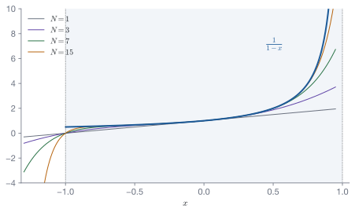{#fig-geometric-power-series width=70%}
:::

A polynomial is a power series with finitely many non-zero coefficients, so it converges everywhere. Expanding it about a
different centre changes the coefficients but not the function.

::: {#exm-power-polynomial}
#### Polynomials and a change of centre

$p(x) = x^2$ is the power series centred at $0$ with $c_2 = 1$ and all other coefficients $0$. Centred at $x_0 = 1$, $x^2 = (1 + (x -
1))^2 = 1 + 2(x - 1) + (x - 1)^2$, with coefficients $1, 2, 1$. Both domains of convergence are $\mathbb{R}$.
:::

The centre need not be $0$, and the domain of convergence is then an interval about the centre. The example is a geometric
series in $(x - 1)/2$ [@riley2006mathematical, Sec. 4.5.1].

::: {#exm-power-shifted}
#### A series centred at $1$

$\sum_{k \geq 0}(x - 1)^k/2^k$ is geometric with ratio $(x - 1)/2$, so it converges exactly for $|x - 1| < 2$, that is on $(-1, 3)$, with sum
$1/(1 - (x - 1)/2) = 2/(3 - x)$. At $x = 3$ and $x = -1$ the terms are $\pm 1$, and the series diverges.
:::

Three power series converge on all of $\mathbb{R}$ by the ratio test, and they are the most important ones in analysis.
Their convergence is all that this unit needs.

::: {#exm-power-exponential}
#### Three series that converge everywhere

$E(x) = \sum_{k \geq 0} x^k/k!$, $S(x) = \sum_{k \geq 0}(-1)^k x^{2k+1}/(2k + 1)!$ and $C(x) = \sum_{k \geq 0}(-1)^k x^{2k}/(2k)!$ have ratios of
consecutive terms $|x|/(k + 1)$, $x^2/((2k + 2)(2k + 3))$ and $x^2/((2k + 1)(2k + 2))$, all tending to $0$. So they converge absolutely for
every $x$ (@thm-convergence-tests). $E(1) = e$ by @exm-cauchy-factorial, $S$ is odd and $C$ is even. They are the series of $e^x$, $\sin x$
and $\cos x$, a fact taken here as background.
:::

Power series can be multiplied term by term inside their domains, because they converge absolutely there. Squaring the
geometric series gives a new sum in closed form.

::: {#exm-power-product}
#### Squaring the geometric series

For $|x| < 1$ both factors converge absolutely, so the Cauchy product of $\sum x^k$ with itself converges to the product of the sums
(@exr-absolute-cauchy-product). Its terms are $\sum_{j=0}^n x^jx^{n-j} = (n + 1)x^n$, so $\sum_{n \geq 0}(n + 1)x^n = 1/(1 - x)^2$ for $|x| < 1$.
:::

Substituting a power of $x$ into a known series gives new series with known sums. Replacing $x$ by $-x$ and by $-x^2$ in the
geometric series gives two of the most used ones.

::: {#exm-power-substitution}
#### Substituting $-x$ and $-x^2$

For $|x| < 1$, $\frac{1}{1 + x} = \sum_{k \geq 0}(-1)^kx^k$ and $\frac{1}{1 + x^2} = \sum_{k \geq 0}(-1)^kx^{2k}$, since $|-x| < 1$ and $|-x^2| < 1$. Both
diverge for $|x| \geq 1$, the second although $1/(1 + x^2)$ is defined for every real $x$.
:::

The potential of a point charge seen from a nearby point is a geometric series in the ratio of the distances. This is the
simplest case of the multipole expansion of electrostatics.

::: {#exm-power-axis-potential}
#### A charge on the axis

A charge $q$ at $z = a > 0$ produces at $z$ on the axis the potential $V(z) = q/(4\pi\varepsilon_0|a - z|)$. For $|z| < a$,
$$
V(z) = \frac{q}{4\pi\varepsilon_0 a}\,\frac{1}{1 - z/a} = \frac{q}{4\pi\varepsilon_0 a}\sum_{k \geq 0}\Big(\frac za\Big)^k,
$$
a power series in $z$ with domain $(-a, a)$. The first term is the potential at the origin, and the next ones are corrections in powers of $z/a$.
:::

The oscillator of @exm-series-oscillator-partition has the probability $p_n = (1 - q)q^n$ of being in level $n$, with $q = e^{-\hbar\omega/k_BT}$.
Its mean quantum number is a power series in $q$, summed by @exm-power-product.

::: {#exm-power-planck}
#### Planck's mean occupation number

$\langle n\rangle = \sum_n n p_n = (1 - q)\sum_{n \geq 1}nq^n = (1 - q)\,q\sum_{m \geq 0}(m + 1)q^m = \frac{(1 - q)q}{(1 - q)^2} = \frac{q}{1 - q} =
\frac{1}{e^{\hbar\omega/k_BT} - 1}$. This is Planck's formula for the mean number of quanta in a mode of frequency $\omega$.
:::

The domain of convergence can be as small as the centre alone and as large as the whole line. The ratio test settles both
extremes at once.

::: {#exm-power-domain-shapes}
#### From a point to the whole line

$\sum k!\,x^k$ has ratio $(k + 1)|x| \to \infty$ for $x \neq 0$: it converges only at $x = 0$. $\sum x^k/k!$ converges on $\mathbb{R}$
(@exm-power-exponential). $\sum x^k$ converges on $(-1, 1)$. By Abel's lemma there is no fourth shape: the domain is always an interval
centred at $x_0$, with or without its endpoints.
:::

Abel's lemma gives absolute convergence strictly inside, and nothing at the edge. The series $\sum x^k/k$ converges at one
endpoint only, and there only conditionally.

::: {#exm-power-boundary-conditional}
#### Conditional convergence at the edge

$\sum_{k \geq 1}x^k/k$ converges at $x = -1$, to $-\log 2$ (@exm-absolute-alternating-harmonic), so by Abel's lemma it converges absolutely on
$(-1, 1)$. At $x = 1$ it is the harmonic series and diverges, and for $|x| > 1$ its terms are unbounded. At $x = -1$ the convergence is
conditional: Abel's lemma cannot be extended to the boundary.
:::
::::

:::: {.callout-note .exercises-fold collapse="true" title="Exercises"}
The partial sums of the exponential series converge fast, and a geometric bound on the remainder says how fast. The first
exercise derives the bound and tests it at $x = 1$.

::: {#exr-power-series-exp}
#### The remainder of the exponential series

Show that for $m + 2 > |x|$, $\big|E(x) - \sum_{k \leq m}x^k/k!\big| \leq \frac{|x|^{m+1}}{(m + 1)!}\,\frac{1}{1 - |x|/(m + 2)}$, and check that at $x = 1$ the
error is below $1/m!$ for $m = 3, 6, 9$.
:::

::: {.callout-note .solution collapse="true" title="Solution"}
:::: {.panel-tabset .solution-tabs}
## Proof

The remainder is $\sum_{k > m}x^k/k!$. For $k \geq m + 1$, $|x|^{k+1}/(k + 1)! = |x|^k/k! \cdot |x|/(k + 1) \leq |x|^k/k! \cdot |x|/(m + 2)$, so the
remainder is bounded by the geometric series $\frac{|x|^{m+1}}{(m+1)!}\sum_{j \geq 0}(|x|/(m + 2))^j$, which gives the bound. At $x = 1$ it is
$\frac{1}{(m+1)!}\frac{m + 2}{m + 1} < \frac{1}{m!}$, because $(m + 2) < (m + 1)^2$.

## SageMath

Sage computes $e - \sum_{k \leq m}1/k!$, the bound and $1/m!$ for $m = 3, 6, 9$.

```{.python .sage}
for m in [3, 6, 9]:
    T = sum(QQ(1) / factorial(k) for k in range(m + 1))
    err, bound = N(e - T, digits=30), QQ(1) / factorial(m + 1) * (m + 2) / (m + 1)
    print("m =", m, ": error =", err.n(digits=4), "; bound =", N(bound, digits=4), "; 1/m! =", N(1 / factorial(m), digits=4), ":", err <= bound < 1 / factorial(m))
```

```{.text .sage-output}
m = 3 : error = 0.05162 ; bound = 0.05208 ; 1/m! = 0.1667 : True
m = 6 : error = 0.0002263 ; bound = 0.0002268 ; 1/m! = 0.001389 : True
m = 9 : error = 3.029e-7 ; bound = 3.031e-7 ; 1/m! = 2.756e-6 : True
```
::::
:::

Power series add and multiply like polynomials wherever both converge. The second exercise proves this and checks it on two
geometric series [@riley2006mathematical, Sec. 4.5.2].

::: {#exr-power-sum-product}
#### Sums and products of power series

Let $P(x) = \sum a_kx^k$ and $Q(x) = \sum b_kx^k$ converge for $|x| < r$. Prove that $\sum (a_k + b_k)x^k = P + Q$ and $\sum_n\big(\sum_{j \leq n}a_jb_{n-j}\big)x^n =
PQ$ for $|x| < r$, and check $\big(\sum x^k\big)\big(\sum (-1)^kx^k\big) = \sum x^{2k}$.
:::

::: {.callout-note .solution collapse="true" title="Solution"}
:::: {.panel-tabset .solution-tabs}
## Proof

The sum is linearity (@def-series). For the product fix $|x| < r$ and pick $|x| < \rho < r$; both series converge at $\rho$, so by Abel's lemma
they converge absolutely at $x$. Their Cauchy product has terms $\sum_j a_jx^jb_{n-j}x^{n-j} = \big(\sum_j a_jb_{n-j}\big)x^n$ and converges to $PQ$
(@exr-absolute-cauchy-product). For $a_k = 1$, $b_k = (-1)^k$, the product coefficient is $\sum_{j \leq n}(-1)^{n-j}$, which is $1$ for even $n$ and
$0$ for odd $n$: $\frac{1}{1 - x}\cdot\frac{1}{1 + x} = \sum x^{2k} = \frac{1}{1 - x^2}$.

## SageMath

Sage multiplies the truncated series and compares the coefficients with those of $\sum x^{2k}$.

```{.python .sage}
R.<x> = PowerSeriesRing(QQ, default_prec=12)
print((1 / (1 - x)) * (1 / (1 + x)))
print("coefficients of the Cauchy product:", [sum((-1)^(n - j) for j in range(n + 1)) for n in range(12)])
```

```{.text .sage-output}
1 + x^2 + x^4 + x^6 + x^8 + x^10 + O(x^12)
coefficients of the Cauchy product: [1, 0, 1, 0, 1, 0, 1, 0, 1, 0, 1, 0]
```
::::
:::

The domain of convergence of a series in a function of $x$ is found by naming the inner function and using a known
series. The third exercise has five cases [@riley2006mathematical, Problem 4.11].

::: {#exr-power-domains}
#### Five domains of convergence

Find the real $x$ for which each series converges: $\sum_{n \geq 1}x^n/(n + 1)$, $\sum (\sin x)^n$, $\sum n^x$, $\sum e^{nx}$ and $\sum_{n \geq 2}(\log n)^x$.
:::

::: {.callout-note .solution collapse="true" title="Solution"}
:::: {.panel-tabset .solution-tabs}
## Proof

(a) For $|x| < 1$ the terms are bounded by $|x|^n$; at $x = 1$ the series is harmonic without its first term, and diverges; at $x = -1$ it
converges by Leibniz's test (@exr-absolute-alternating); for $|x| > 1$ the terms are unbounded. Domain $[-1, 1)$. (b) Geometric in $\sin x$:
converges when $|\sin x| < 1$, that is $x \neq \pi/2 + k\pi$. (c) $\sum 1/n^{-x}$ converges exactly when $-x > 1$ (@exm-tests-p-series): $x < -1$.
(d) Geometric in $e^x$: $x < 0$. (e) For $x \geq 0$ the terms are at least $1$ from $n = 3$ on. For $x = -p < 0$, $\log y < y$ with $y =
n^{1/(2p)}$ gives $\log n < 2p\,n^{1/(2p)} \leq n^{1/p}$ once $n^{1/(2p)} \geq 2p$, so $(\log n)^{-p} \geq 1/n$ eventually and the series diverges by
comparison with the harmonic series. The domain is empty.

## SageMath

Sage prints partial sums for the boundary cases $x = \pm 1$ of (a) and for (e) at $x = -2$.

```{.python .sage}
a = lambda x, N0: sum(RDF(x)^n / (n + 1) for n in range(1, N0))
print("(a) at -1:", [round(a(-1, M), 5) for M in (10^3, 10^4, 10^5)], "; at 1:", [round(a(1, M), 3) for M in (10^3, 10^4, 10^5)])
print("(e) at x = -2:", [round(sum(log(RDF(n))^-2 for n in range(2, M)), 2) for M in (10^3, 10^4, 10^5)])
```

```{.text .sage-output}
(a) at -1: [-0.30735, -0.3069, -0.30686] ; at 1: [6.485, 8.788, 11.09]
(e) at x = -2: [35.94, 163.5, 947.02]
```
::::
:::

Multiplying a power series by $x$, shifting the index and subtracting turns sums with polynomial weights into rational
functions. The fourth exercise evaluates two such sums at $x = \tfrac12$.

::: {#exr-power-series-geometric-derivative}
#### Sums of $kx^k$ and $k^2x^k$

Show that $\sum_{k \geq 1}kx^k = x/(1 - x)^2$ and $\sum_{k \geq 1}k^2x^k = x(1 + x)/(1 - x)^3$ for $|x| < 1$, and evaluate $\sum k/2^k$ and $\sum k^2/2^k$.
:::

::: {.callout-note .solution collapse="true" title="Solution"}
:::: {.panel-tabset .solution-tabs}
## Proof

By @exm-power-product, $\sum_{k \geq 1}kx^k = x\sum_{m \geq 0}(m + 1)x^m = x/(1 - x)^2$. Let $T = \sum k^2x^k$, which converges absolutely for $|x| < 1$
by the ratio test. Then $(1 - x)T = \sum_{k \geq 1}(k^2 - (k - 1)^2)x^k = \sum (2k - 1)x^k = \frac{2x}{(1 - x)^2} - \frac{x}{1 - x} = \frac{x(1 + x)}{(1 - x)^2}$, by
linearity. At $x = \tfrac12$ the two sums are $\tfrac12 \cdot 4 = 2$ and $\tfrac12 \cdot \tfrac32 \cdot 8 = 6$.

## SageMath

Sage sums the two series symbolically and evaluates them at $x = \tfrac12$.

```{.python .sage}
x, k = var("x k")
assume(abs(x) < 1)
S1, S2 = sum(k * x^k, k, 1, oo), sum(k^2 * x^k, k, 1, oo)
print(S1.factor(), ";", S2.factor(), "; at x = 1/2:", S1.subs(x=1 / 2), S2.subs(x=1 / 2))
forget()
```

```{.text .sage-output}
x/(x - 1)^2 ; -(x + 1)*x/(x - 1)^3 ; at x = 1/2: 2 6
```
::::
:::

Abel's lemma needs only bounded terms at $x_1$, not convergence there. The fifth exercise proves the stronger form, which
is what the proof really used.

::: {#exr-power-bounded}
#### Bounded terms are enough

Prove that if the terms $c_k(x_1 - x_0)^k$ are bounded, then $\sum c_k(x - x_0)^k$ converges absolutely for $|x - x_0| < |x_1 - x_0|$. Apply it to
$\sum (-1)^{k(k-1)/2}x^k$, whose partial sums at $x = 1$ oscillate.
:::

::: {.callout-note .solution collapse="true" title="Solution"}
:::: {.panel-tabset .solution-tabs}
## Proof

The proof of Abel's lemma used convergence at $x_1$ only to get $|c_k||x_1 - x_0|^k \leq M$; with that bound as hypothesis, $|c_k(x - x_0)^k| \leq Mq^k$
and the comparison test gives absolute convergence. For $c_k = (-1)^{k(k-1)/2}$ (signs $+ + - - + + \dots$) the terms at $x = 1$ are $\pm 1$,
bounded, while the partial sums $1, 2, 1, 0, 1, 2, \dots$ do not converge. So the series converges absolutely for $|x| < 1$, and its
absolute values form $\sum |x|^k$.

## SageMath

Check on $c_k = (-1)^{k(k-1)/2}$: Sage prints the partial sums at $x = 1$ and the sum at $x = \tfrac12$.

```{.python .sage}
c = lambda k: (-1)^(k * (k - 1) // 2)
print("at x = 1:", [sum(c(k) for k in range(m + 1)) for m in range(10)])
print("at x = 1/2:", N(sum(c(k) * QQ(1 / 2)^k for k in range(200)), digits=12), "; (1 + x)/(1 + x^2) =", N((1 + QQ(1) / 2) / (1 + QQ(1) / 4), digits=12))
```

```{.text .sage-output}
at x = 1: [1, 2, 1, 0, 1, 2, 1, 0, 1, 2]
at x = 1/2: 1.20000000000 ; (1 + x)/(1 + x^2) = 1.20000000000
```
::::
:::

A power series that vanishes near its centre has only zero coefficients. The sixth exercise proves this uniqueness, which
lets one compare coefficients of two series that agree.

::: {#exr-power-uniqueness}
#### Uniqueness of coefficients

Prove that if $\sum c_kx^k = 0$ for all $|x| < r$, with $r > 0$, then every $c_k = 0$. Deduce that two power series with the same sum on $(-r, r)$ have
the same coefficients.
:::

::: {.callout-note .solution collapse="true" title="Solution"}
:::: {.panel-tabset .solution-tabs}
## Proof

Suppose not, and let $c_m$ be the first non-zero coefficient. Fix $0 < \rho < r$; the terms $c_k\rho^k$ are bounded by some $M$. For $0 < |x| < \rho$,
$0 = x^{-m}\sum_{k \geq m}c_kx^k = c_m + \sum_{k > m}c_kx^{k-m}$, and
$$
\Big|\sum_{k > m}c_kx^{k-m}\Big| \leq \frac{M}{\rho^m}\sum_{j \geq 1}\Big(\frac{|x|}{\rho}\Big)^j = \frac{M}{\rho^m}\,\frac{|x|/\rho}{1 - |x|/\rho},
$$
which tends to $0$ as $x \to 0$ along $x = \rho/n$. So $c_m = 0$, a contradiction. For two series, apply this to their difference (@exr-power-sum-product).

## SageMath

Check on the coefficients of $\frac{1}{1 - x}\cdot\frac{1}{1 + x}$ and of $\frac{1}{1 - x^2}$: Sage expands both and compares the coefficient lists.

```{.python .sage}
R.<x> = PowerSeriesRing(QQ, default_prec=15)
A, B = (1 / (1 - x)) * (1 / (1 + x)), 1 / (1 - x^2)
print(A.list() == B.list(), A.list())
```

```{.text .sage-output}
True [1, 0, 1, 0, 1, 0, 1, 0, 1, 0, 1, 0, 1, 0, 1]
```
::::
:::

Two opposite charges close together produce a potential that falls off faster than that of either charge. The seventh
exercise expands the potential on the axis in powers of the separation, with @exm-power-axis-potential as the model.

::: {#exr-power-dipole}
#### A dipole on its axis

Charges $q$ at $z = d/2$ and $-q$ at $z = -d/2$ produce at $z > d/2$ the potential $V = \frac{q}{4\pi\varepsilon_0}\big(\frac{1}{z - d/2} - \frac{1}{z + d/2}\big)$.
Expand $V$ as a power series in $u = d/(2z)$, find its domain, and show that $V = \frac{qd}{4\pi\varepsilon_0 z^2}(1 + O(u^2))$.
:::

::: {.callout-note .solution collapse="true" title="Solution"}
:::: {.panel-tabset .solution-tabs}
## Proof

$\frac{1}{z \mp d/2} = \frac1z\,\frac{1}{1 \mp u} = \frac1z\sum_k(\pm u)^k$ for $|u| < 1$. Subtracting, the even powers cancel:
$$
V = \frac{q}{4\pi\varepsilon_0 z}\,2\sum_{j \geq 0}u^{2j+1} = \frac{qd}{4\pi\varepsilon_0 z^2}\big(1 + u^2 + u^4 + \dots\big) = \frac{qd}{4\pi\varepsilon_0 z^2}\,\frac{1}{1 - u^2},
$$
valid for $|u| < 1$, that is $z > d/2$. The leading term is the dipole potential $p/(4\pi\varepsilon_0 z^2)$ with $p = qd$, and the correction factor
$1/(1 - u^2) = 1 + u^2 + \dots$ is close to $1$ far away.

## SageMath

Sage expands $V$ in $d$ for fixed $z$ and checks the closed form.

```{.python .sage}
q, d, z, e0 = var("q d z e0")
V = q / (4 * pi * e0) * (1 / (z - d / 2) - 1 / (z + d / 2))
print(V.taylor(d, 0, 5))
print(bool((V - q * d / (4 * pi * e0 * z^2) / (1 - (d / (2 * z))^2)).simplify_full() == 0))
```

```{.text .sage-output}
1/64*d^5*q/(pi*e0*z^6) + 1/16*d^3*q/(pi*e0*z^4) + 1/4*d*q/(pi*e0*z^2)
True
```
::::
:::

The energy of an oscillator in thermal equilibrium fluctuates, and the size of the fluctuation is again a power series in
$q = e^{-\hbar\omega/k_BT}$. The eighth exercise computes it with the sums of @exr-power-series-geometric-derivative.

::: {#exr-power-planck-fluctuations}
#### Fluctuations of the occupation number

With $p_n = (1 - q)q^n$, show that $\langle n^2\rangle - \langle n\rangle^2 = \langle n\rangle(\langle n\rangle + 1)$, and evaluate both sides for $q = \tfrac12$.
:::

::: {.callout-note .solution collapse="true" title="Solution"}
:::: {.panel-tabset .solution-tabs}
## Proof

$\langle n\rangle = q/(1 - q)$ (@exm-power-planck), and by @exr-power-series-geometric-derivative $\langle n^2\rangle = (1 - q)\sum n^2q^n = q(1 + q)/(1 -
q)^2$. Then $\langle n^2\rangle - \langle n\rangle^2 = \frac{q(1 + q) - q^2}{(1 - q)^2} = \frac{q}{(1 - q)^2} = \frac{q}{1 - q}\big(\frac{q}{1 - q} + 1\big)$. For
$q = \tfrac12$: $\langle n\rangle = 1$, $\langle n^2\rangle = 3$, and both sides equal $2$.

## SageMath

Sage computes the moments for $q = \tfrac12$ from $200$ terms and exactly.

```{.python .sage}
q = QQ(1) / 2
m1, m2 = sum((1 - q) * n * q^n for n in range(200)), sum((1 - q) * n^2 * q^n for n in range(200))
print(N(m1, digits=12), N(m2, digits=12), "; variance:", N(m2 - m1^2, digits=12), "; <n>(<n> + 1) with <n> = q/(1-q):", q / (1 - q) * (q / (1 - q) + 1))
```

```{.text .sage-output}
1.00000000000 3.00000000000 ; variance: 2.00000000000 ; <n>(<n> + 1) with <n> = q/(1-q): 2
```
::::
:::

The product rule for absolutely convergent series and the binomial theorem combine into the functional equation of the
exponential series. The ninth exercise proves it and deduces the values of $E$ at rational points.

::: {#exr-power-series-exp-product}
#### $E(x + y) = E(x)E(y)$

For $E(x) = \sum x^k/k!$, prove $E(x + y) = E(x)E(y)$, deduce $E(x) > 0$ and $E(-x) = 1/E(x)$, and show that $E(p/q) = e^{p/q}$ for integers $p$ and
$q \geq 1$.
:::

::: {.callout-note .solution collapse="true" title="Solution"}
:::: {.panel-tabset .solution-tabs}
## Proof

Both series converge absolutely (@exm-power-exponential), so their Cauchy product converges to $E(x)E(y)$ (@exr-absolute-cauchy-product). Its
$n$-th term is $\sum_{j=0}^n\frac{x^j}{j!}\frac{y^{n-j}}{(n - j)!} = \frac{(x + y)^n}{n!}$ by the binomial theorem, so the product is $E(x + y)$. Then
$E(x)E(-x) = E(0) = 1$; $E(x) \geq 1$ for $x \geq 0$, so $E(-x) = 1/E(x) > 0$ as well. By induction $E(n) = E(1)^n = e^n$ for $n \in \mathbb{N}$, and $E(-n) =
e^{-n}$. Finally $E(p/q)^q = E(p) = e^p$, and $E(p/q) > 0$, so $E(p/q)$ is the positive $q$-th root of $e^p$, that is $e^{p/q}$.

## SageMath

Check on truncations: Sage compares $E(x)E(y)$ with $E(x + y)$ at $x = \tfrac13$, $y = -\tfrac54$, and $E(\tfrac12)^2$ with $e$.

```{.python .sage}
E = lambda x, m=40: sum(QQ(x)^k / factorial(k) for k in range(m))
x, y = QQ(1) / 3, QQ(-5) / 4
print(N(E(x) * E(y) - E(x + y), digits=5), N(E(QQ(1) / 2)^2 - e, digits=5), N(E(QQ(1) / 2), digits=12), N(sqrt(e), digits=12))
```

```{.text .sage-output}
-1.2487e-44 0.00000 1.64872127070 1.64872127070
```
::::
:::

Power series turn recursions into equations between functions. The last exercise does this for the Fibonacci numbers,
combining the product rule, uniqueness of coefficients and the golden ratio of @exm-cauchy-golden.

::: {#exr-power-fibonacci}
#### The Fibonacci generating function

Let $F_0 = 0$, $F_1 = 1$, $F_{k+2} = F_{k+1} + F_k$, and $F(x) = \sum F_kx^k$. Show that $F_k \leq 2^k$, so $F$ converges for $|x| < \tfrac12$, and that $(1 - x -
x^2)F(x) = x$ there. Show that the series diverges for $|x| > 1/\phi$, with $\phi = (1 + \sqrt5)/2$.
:::

::: {.callout-note .solution collapse="true" title="Solution"}
:::: {.panel-tabset .solution-tabs}
## Proof

By induction $F_{k+2} = F_{k+1} + F_k \leq 2^{k+1} + 2^k < 2^{k+2}$, so the terms are bounded by $(2|x|)^k$. For $|x| < \tfrac12$ the product of $F$ with the
polynomial $1 - x - x^2$ has coefficients $F_k - F_{k-1} - F_{k-2} = 0$ for $k \geq 2$, and $F_0 = 0$, $F_1 - F_0 = 1$ (@exr-power-sum-product), so it is
$x$. The ratios $F_{k+1}/F_k$ tend to $\phi$ (@exm-cauchy-golden), so the ratio of the terms of $F(x)$ tends to $\phi|x|$, and the series diverges for
$|x| > 1/\phi$ by the ratio test (and converges for $|x| < 1/\phi$).

## SageMath

Sage expands $x/(1 - x - x^2)$ and compares with the Fibonacci numbers, and prints $F_{31}/F_{30}$ against $\phi$.

```{.python .sage}
R.<x> = PowerSeriesRing(QQ, default_prec=12)
print((x / (1 - x - x^2)).list()[:12], [fibonacci(k) for k in range(12)])
print(N(fibonacci(31) / fibonacci(30), digits=12), N(golden_ratio, digits=12))
```

```{.text .sage-output}
[0, 1, 1, 2, 3, 5, 8, 13, 21, 34, 55, 89] [0, 1, 1, 2, 3, 5, 8, 13, 21, 34, 55, 89]
1.61803398875 1.61803398875
```
::::
:::
::::

### Radius of convergence

By Abel's lemma a power series converges on an interval centred at $x_0$, and the half-length of that interval is determined by
the coefficients alone. The definition below names it and gives two formulas for computing it, one from the root test and one
from the ratio test.

:::: {.statement-box}
::: {#def-radius-of-convergence}
#### Radius of convergence

The **radius of convergence** of $\sum c_k (x - x_0)^k$ is $R = \sup\{|x - x_0| : \text{the series converges at } x\} \in [0, \infty]$. The series
converges absolutely for $|x - x_0| < R$ and diverges for $|x - x_0| > R$. If $(|c_k|^{1/k})$ is bounded, $R = 1/\limsup |c_k|^{1/k}$, read as $\infty$
when the upper limit is $0$, and $R = 0$ if it is unbounded (the **Cauchy-Hadamard formula**). If all $c_k \neq 0$ and $|c_k/c_{k+1}|$ has a limit in
$[0, \infty]$, then $R = \lim |c_k/c_{k+1}|$. At the endpoints $|x - x_0| = R$ anything can happen.
:::
::::

*Proof.* If $|x - x_0| < R$, some $x_1$ with $|x - x_0| < |x_1 - x_0|$ is a point of convergence, by the definition of the supremum, and Abel's lemma
(@def-power-series) gives absolute convergence at $x$. If $|x - x_0| > R$, the series diverges at $x$ by the definition of $R$. For the formula, let
$x \neq x_0$ and $a_k = c_k(x - x_0)^k$. Then $|a_k|^{1/k} = |c_k|^{1/k}|x - x_0|$; if $(|c_k|^{1/k})$ is unbounded so is this, and the series diverges by
the root test (@thm-convergence-tests), so $R = 0$. Otherwise $\limsup |a_k|^{1/k} = |x - x_0|\,\limsup|c_k|^{1/k}$, since multiplying by a positive
constant multiplies every supremum of a tail by it. The root test gives convergence when this is below $1$ and divergence when it is above $1$,
which is the formula. For the ratio formula, $|a_{k+1}/a_k| = |x - x_0|\,|c_{k+1}/c_k| \to |x - x_0|/\lim|c_k/c_{k+1}|$, and the ratio test applies in
the same way. $\square$

The formula is that of @riley2006mathematical [Sec. 4.5.1] for the ratio, and @abbott2015understanding [Sec. 6.5] treats the
boundary. The interval $(x_0 - R, x_0 + R)$ is the **interval of convergence**, to which the domain of convergence adds the endpoints at which
the series converges.

:::: {.callout-note .examples-fold collapse="true" title="Examples"}
The series met so far illustrate the three possibilities: a finite positive radius, an infinite one and zero. The first
example computes all of them from the ratio formula.

::: {#exm-radius-standard}
#### The standard series

$\sum x^k$, $\sum x^k/k$ and $\sum x^k/k^2$ all have $R = 1$, since $|c_k/c_{k+1}| \to 1$; $\sum x^k/k!$ has $|c_k/c_{k+1}| = k + 1 \to \infty$, so $R = \infty$;
and $\sum k!\,x^k$ has $|c_k/c_{k+1}| = 1/(k + 1) \to 0$, so $R = 0$, converging only at $x = 0$.
:::

The radius leaves the two endpoints undecided, and the three series with radius $1$ show three different behaviours there.
The second example lists them.

::: {#exm-radius-boundary}
#### Behaviour at the endpoints

At $x = \pm1$: $\sum x^k$ diverges at both ends, its terms not tending to $0$; $\sum x^k/k$ diverges at $1$ (harmonic) and converges at $-1$
(alternating harmonic); $\sum x^k/k^2$ converges absolutely at both. The radius says nothing about the endpoints.
:::

A geometric series in $2x$ has radius $\tfrac12$, and at its endpoints it shows the two kinds of divergence. The example is from
@riley2006mathematical [Sec. 4.5.1].

::: {#exm-radius-riley}
#### $1 + 2x + 4x^2 + \dots$

$|c_k/c_{k+1}| = \tfrac12$, so $R = \tfrac12$ and the sum is $1/(1 - 2x)$ on $(-\tfrac12, \tfrac12)$. At $x = \tfrac12$ the series is $1 + 1 + 1 + \dots$, which
diverges to $\infty$; at $x = -\tfrac12$ it is $1 - 1 + 1 - \dots$, which oscillates.
:::

Central binomial coefficients grow like $4^k$ up to a slower factor, and the ratio formula finds exactly the $4$. They count
lattice paths, and their series appears in random walks.

::: {#exm-radius-central-binomial}
#### $\sum \binom{2k}{k}x^k$

$\binom{2k+2}{k+1}/\binom{2k}{k} = \frac{(2k + 1)(2k + 2)}{(k + 1)^2} \to 4$, so $R = \lim|c_k/c_{k+1}| = \tfrac14$. The coefficients lie between $4^k/(2k + 1)$
and $4^k$, since $\binom{2k}{k}$ is the largest of the $2k + 1$ terms summing to $(1 + 1)^{2k} = 4^k$.
:::

The ratio formula needs the ratios to converge, and the Cauchy-Hadamard formula does not. Coefficients that alternate between two
geometric rates show the difference.

::: {#exm-radius-root}
#### When only the root formula works

$c_k = (2 + (-1)^k)^{-k}$ is $3^{-k}$ for even $k$ and $1$ for odd $k$, so $|c_k/c_{k+1}|$ alternates between values tending to $0$ and to $\infty$.
But $|c_k|^{1/k} \in \{\tfrac13, 1\}$ has upper limit $1$, so $R = 1$.
:::

Many coefficients may vanish, as for series in $x^2$ or with gaps, and then the ratio formula is not even defined. The upper
limit only looks at the non-zero coefficients that matter.

::: {#exm-radius-gaps}
#### A series with gaps

$\sum_{j \geq 0}x^{j^2} = 1 + x + x^4 + x^9 + \dots$ has $c_k = 1$ when $k$ is a square and $0$ otherwise. So $|c_k|^{1/k}$ takes the values $0$ and
$1$, with $\limsup = 1$, and $R = 1$. At $x = \pm1$ the terms do not tend to $0$.
:::

The occupation number of a thermal oscillator is a power series in $q = e^{-\hbar\omega/k_BT}$ with radius $1$. Every temperature lies
inside the interval of convergence, and infinite temperature is its endpoint.

::: {#exm-radius-planck}
#### Temperature and the radius

$\sum nq^n$ has $|c_n/c_{n+1}| = n/(n + 1) \to 1$, so $R = 1$. For every $T > 0$, $q \in (0, 1)$ lies inside, and $\langle n\rangle = q/(1 - q)$
(@exm-power-planck). As $T \to \infty$, $q \to 1$, the edge of the interval, and $\langle n\rangle \to \infty$: the classical limit sits at the boundary.
:::

The rotor partition function of @exm-tests-rotor is a power series in $y = e^{-x}$ with large gaps. The Cauchy-Hadamard formula gives
its radius, and with it the convergence at every temperature again.

::: {#exm-radius-rotor}
#### The rotor as a series with gaps

$Z = \sum_l (2l + 1)y^{l(l+1)}$ has $c_k = 2l + 1$ when $k = l(l + 1)$ and $0$ otherwise. Since $(2l + 1)^{1/(l(l+1))} \to 1$ (as $1 \leq (2l + 1)^{1/k} \leq
k^{1/k}$ for $k = l(l + 1) \geq 2l + 1$ when $l \geq 2$, and $k^{1/k} \to 1$ by @prp-sequence-limits), $\limsup|c_k|^{1/k} = 1$ and $R = 1$. Every temperature gives
$y = e^{-x} < 1$.
:::

A function can be defined on the whole line and still have a power series of finite radius. The figure shows the partial
sums of $1/(1 + x^2)$ running away outside $[-1, 1]$.

::: {#exm-radius-singularity}
#### A finite radius for a function defined everywhere

$\frac{1}{1 + x^2} = \sum (-1)^kx^{2k}$ for $|x| < 1$ (@exm-power-substitution). The coefficients have $\limsup|c_k|^{1/k} = 1$, so $R = 1$, although
$1/(1 + x^2)$ is defined and bounded on all of $\mathbb{R}$. Nothing on the real line explains the radius: it is a property of the series, not visibly
of the function.

![The partial sums $\sum_{k \leq N}(-1)^kx^{2k}$ for $N = 2, 5, 10, 20$ and the function $1/(1 + x^2)$. Inside $[-1, 1]$ (shaded) the partial sums approach the function; outside they run away.](figures/radius_lorentzian.svg){#fig-radius-lorentzian width=70%}
:::

The radius of a product can be larger than the radii of its factors, because cancellations can remove the obstruction. A
polynomial times the geometric series is the simplest case.

::: {#exm-radius-product-larger}
#### A product with a larger radius

$\sum x^k$ has $R = 1$, and the polynomial $1 - x$ has $R = \infty$. Their product, computed by @exr-power-sum-product, has coefficients $1 - 1 = 0$
from $k = 1$ on, so it is the constant $1$, with $R = \infty$. The product of the sums, $(1 - x)/(1 - x) = 1$, is defined on all of $\mathbb{R}$, but the
product series only shows this after the cancellation.
:::
::::

:::: {.callout-note .exercises-fold collapse="true" title="Exercises"}
The ratio formula $R = \lim |c_k/c_{k+1}|$ is the quickest route to the radius when the coefficients have a simple form. The
first exercise applies it to four series by hand and in Sage.

::: {#exr-radius-ratio}
#### Radii by the ratio formula

Compute the radii of convergence of $\sum k!\,x^k$, $\sum x^k/k^2$, $\sum 2^k x^k$ and $\sum x^k/k!$ by the ratio formula.
:::

::: {.callout-note .solution collapse="true" title="Solution"}
:::: {.panel-tabset .solution-tabs}
## Proof

$|c_k/c_{k+1}|$ equals $1/(k+1) \to 0$, $(k+1)^2/k^2 \to 1$, $\tfrac12$, and $k + 1 \to \infty$, so $R = 0, 1, \tfrac12, \infty$
(@def-radius-of-convergence).

## SageMath

Sage computes the four limits.

```{.python .sage}
n = var("n")
for a, name in [(factorial(n), "n! x^n"), (1 / n^2, "x^n/n^2"), (2^n, "2^n x^n"), (1 / factorial(n), "x^n/n!")]:
    print(name, ": R =", limit(abs(a / a.subs(n=n + 1)), n=oo))
```

```{.text .sage-output}
n! x^n : R = 0
x^n/n^2 : R = 1
2^n x^n : R = 1/2
x^n/n! : R = +Infinity
```
::::
:::

Determining the exact set of convergence requires the radius and a separate check of each endpoint. The second exercise does
this for three series, using the harmonic and alternating harmonic series at the ends.

::: {#exr-radius-boundary}
#### Endpoints of the interval of convergence

Determine the exact set of real $x$ for which $\sum x^k/k$ converges, and the same for $\sum x^k/k^2$ and $\sum (-1)^k x^{2k}$.
:::

::: {.callout-note .solution collapse="true" title="Solution"}
:::: {.panel-tabset .solution-tabs}
## Proof

$\sum x^k/k$: $R = 1$; at $x = 1$ harmonic (diverges), at $x = -1$ alternating harmonic (converges): the set is $[-1, 1)$. $\sum x^k/k^2$: $R = 1$, and
it converges on $[-1, 1]$, absolutely at both endpoints since $\sum 1/k^2$ converges. $\sum (-1)^k x^{2k}$: a geometric series in $-x^2$, converging
exactly for $|x| < 1$, the open interval $(-1, 1)$.

## SageMath

Sage prints partial sums at the endpoints.

```{.python .sage}
for name, f in [("x^k/k", lambda x, k: x^k / k), ("x^k/k^2", lambda x, k: x^k / k^2)]:
    print(name, ": at 1:", [round(sum(f(1.0, k) for k in range(1, M)), 4) for M in (10^2, 10^4)], "; at -1:", [round(sum(f(-1.0, k) for k in range(1, M)), 4) for M in (10^2, 10^4)])
print("(-1)^k x^(2k) at x = 1:", [sum((-1)^k for k in range(M + 1)) for M in range(6)])
```

```{.text .sage-output}
x^k/k : at 1: [5.1774, 9.7875] ; at -1: [-0.6982, -0.6932]
x^k/k^2 : at 1: [1.6349, 1.6448] ; at -1: [-0.8225, -0.8225]
(-1)^k x^(2k) at x = 1: [1, 0, 1, 0, 1, 0]
```
::::
:::

A series in a power of $x$ times a geometric factor is turned into a power series by naming the right variable. The third
exercise is @riley2006mathematical [Problem 4.14].

::: {#exr-radius-substitution}
#### A series in $\sqrt x$

Find the positive $x$ for which $\sum_{n \geq 1} x^{n/2}e^{-n}/n$ converges.
:::

::: {.callout-note .solution collapse="true" title="Solution"}
:::: {.panel-tabset .solution-tabs}
## Proof

With $y = \sqrt x/e > 0$ the series is $\sum y^n/n$, of radius $1$ (@exm-radius-standard). It converges for $y < 1$ and diverges for $y > 1$; at $y = 1$
it is the harmonic series and diverges. So the series converges exactly for $0 < x < e^2$.

## SageMath

Sage prints partial sums just below and at $x = e^2$.

```{.python .sage}
f = lambda x, M: sum((sqrt(RDF(x)) / RDF(e))^n / n for n in range(1, M))
print("x = 0.9 e^2:", [round(f(0.9 * e^2, M), 5) for M in (10^2, 10^3, 10^4)], "; x = e^2:", [round(f(e^2, M), 3) for M in (10^2, 10^3, 10^4)])
```

```{.text .sage-output}
x = 0.9 e^2: [2.96887, 2.96974, 2.96974] ; x = e^2: [5.177, 7.484, 9.788]
```
::::
:::

When the coefficients are $k$-th powers, the Cauchy-Hadamard formula is the natural tool. The fourth exercise has one series
with a limit of the root and one with an upper limit only.

::: {#exr-radius-root-formula}
#### Radii by the root formula

Find the radii of $\sum (k/(k + 1))^{k^2}x^k$ and of $\sum (2 + (-1)^k)^kx^k$.
:::

::: {.callout-note .solution collapse="true" title="Solution"}
:::: {.panel-tabset .solution-tabs}
## Proof

$|c_k|^{1/k} = (k/(k + 1))^k = 1/(1 + 1/k)^k \to 1/e$ (@exm-monotone-euler), so $R = e$. For the second, $|c_k|^{1/k} = 2 + (-1)^k \in \{1, 3\}$, with
upper limit $3$, so $R = \tfrac13$.

## SageMath

Sage computes the root of the first coefficient at $k = 10^4$ and the roots of the second for $k \leq 6$.

```{.python .sage}
k = 10^4
print(N((QQ(k) / (k + 1))^k, digits=8), N(exp(-1), digits=8), [((2 + (-1)^j)^j)^(1 / j) for j in range(1, 7)])
```

```{.text .sage-output}
0.36789783 0.36787944 [1, 3, 1, 3, 1, 3]
```
::::
:::

Multiplying the coefficients by $k$ or dividing them by $k + 1$ does not change the radius, because $k^{1/k} \to 1$. The fifth exercise
proves this, a fact that keeps the radius fixed under many operations on power series.

::: {#exr-radius-same-radius}
#### Polynomial weights do not change the radius

Prove that $\sum c_kx^k$, $\sum kc_kx^k$ and $\sum c_kx^k/(k + 1)$ have the same radius of convergence.
:::

::: {.callout-note .solution collapse="true" title="Solution"}
:::: {.panel-tabset .solution-tabs}
## Proof

$k^{1/k} \to 1$ and $(k + 1)^{1/k} = ((k + 1)^{1/(k+1)})^{(k+1)/k} \to 1$, by @prp-sequence-limits and the limit rules. If $b_k \to 1$ with $b_k > 0$, then for
every $\varepsilon \in (0, 1)$ the sequences $|c_k|^{1/k}$ and $b_k|c_k|^{1/k}$ have tails whose suprema differ by at most the factor $1 \pm \varepsilon$, so
they are both bounded or both unbounded, and in the first case have the same upper limit. Applying this with $b_k = k^{1/k}$ and $b_k = (k + 1)^{-1/k}$,
the Cauchy-Hadamard formula gives the same $R$ for the three series.

## SageMath

Check on $c_k = 2^k$: Sage computes the ratio limits of the three coefficient sequences.

```{.python .sage}
n = var("n")
for c in (2^n, n * 2^n, 2^n / (n + 1)):
    print(c, ": R =", limit(abs(c / c.subs(n=n + 1)), n=oo))
```

```{.text .sage-output}
2^n : R = 1/2
2^n*n : R = 1/2
2^n/(n + 1) : R = 1/2
```
::::
:::

The product of two power series converges where both do, and @exm-radius-product-larger showed that it may converge further. The
sixth exercise proves the general lower bound.

::: {#exr-radius-product}
#### The radius of a product

Let $P$ and $Q$ have radii $R_1$ and $R_2$. Prove that their product series has radius at least $\min(R_1, R_2)$, and that it equals $\min(R_1, R_2)$
for $P = \sum x^k$ and $Q = \sum x^k/2^k$.
:::

::: {.callout-note .solution collapse="true" title="Solution"}
:::: {.panel-tabset .solution-tabs}
## Proof

For $|x| < \min(R_1, R_2)$ both series converge absolutely, and the product series converges at $x$ (@exr-power-sum-product), so its radius is at least
$\min(R_1, R_2)$. For the example the coefficients are $\sum_{j \leq n}2^{-j} = 2 - 2^{-n}$, which tend to $2$, so $|c_n|^{1/n} \to 1$ and the radius is
$1 = \min(1, 2)$.

## SageMath

Sage multiplies the two series and prints the first coefficients of the product.

```{.python .sage}
R.<x> = PowerSeriesRing(QQ, default_prec=8)
print((1 / (1 - x)) * (1 / (1 - x / 2)))
```

```{.text .sage-output}
1 + 3/2*x + 7/4*x^2 + 15/8*x^3 + 31/16*x^4 + 63/32*x^5 + 127/64*x^6 + 255/128*x^7 + O(x^8)
```
::::
:::

The four combinations of open and closed endpoints all occur, and series of the form $\sum (\pm x)^k/k^p$ realise them. The
seventh exercise asks for one example of each.

::: {#exr-radius-endpoints-design}
#### All four kinds of interval

Give power series centred at $0$ whose domains of convergence are exactly $(-1, 1)$, $[-1, 1)$, $(-1, 1]$ and $[-1, 1]$, with proofs.
:::

::: {.callout-note .solution collapse="true" title="Solution"}
:::: {.panel-tabset .solution-tabs}
## Proof

$\sum x^k$ has domain $(-1, 1)$ (@exm-power-geometric). $\sum x^k/k$ has domain $[-1, 1)$ (@exr-radius-boundary). $\sum (-x)^k/k = \sum (-1)^kx^k/k$ is the
previous series at $-x$, so its domain is $(-1, 1]$. $\sum x^k/k^2$ has domain $[-1, 1]$ (@exr-radius-boundary). All four have radius $1$, so they
diverge for $|x| > 1$.

## SageMath

Sage prints partial sums of the four series at $x = 1$ and $x = -1$ after $10^4$ terms.

```{.python .sage}
series = [("x^k", lambda x, k: x^k), ("x^k/k", lambda x, k: x^k / k), ("(-x)^k/k", lambda x, k: (-x)^k / k), ("x^k/k^2", lambda x, k: x^k / k^2)]
for name, f in series:
    print(name, ": at 1:", round(sum(f(1.0, k) for k in range(1, 10^4)), 4), "; at -1:", round(sum(f(-1.0, k) for k in range(1, 10^4)), 4))
```

```{.text .sage-output}
x^k : at 1: 9999.0 ; at -1: -1.0
x^k/k : at 1: 9.7875 ; at -1: -0.6932
(-x)^k/k : at 1: -0.6932 ; at -1: 9.7875
x^k/k^2 : at 1: 1.6448 ; at -1: -0.8225
```
::::
:::

The potential of several charges, expanded about a point between them, has a radius set by the nearest charge. The eighth
exercise shows this on the axis.

::: {#exr-radius-axis-charges}
#### The nearest charge sets the radius

Charges $q$ at $z = a$ and $-q$ at $z = -2a$, with $a > 0$, produce on the axis $V(z) = \frac{q}{4\pi\varepsilon_0}\big(\frac{1}{|z - a|} - \frac{1}{|z + 2a|}\big)$.
Expand $V$ in powers of $z$ and show that the radius of convergence is $a$.
:::

::: {.callout-note .solution collapse="true" title="Solution"}
:::: {.panel-tabset .solution-tabs}
## Proof

For $|z| < a$, $\frac{1}{a - z} = \frac1a\sum(z/a)^k$ and $\frac{1}{z + 2a} = \frac{1}{2a}\sum(-z/(2a))^k$, so $V = \frac{q}{4\pi\varepsilon_0}\sum_k c_kz^k$ with
$c_k = a^{-k-1} - (-1)^k(2a)^{-k-1}$. Then $|c_k|^{1/k} = a^{-1}a^{-1/k}|1 - (-1)^k2^{-k-1}|^{1/k} \to 1/a$, since the last factor lies in $[\tfrac34, \tfrac54]$
and its $k$-th root tends to $1$ (@exr-limit-nroot). So $R = a$, the distance to the nearer charge.

## SageMath

Check on $a = 1$: Sage expands $V$ and prints $|c_k|^{1/k}$ for $k = 10, 20, 40$.

```{.python .sage}
R.<z> = PowerSeriesRing(QQ, default_prec=45)
c = (1 / (1 - z) - 1 / (z + 2)).list()
print(c[:5], [N(abs(c[k])^(1 / k), digits=6) for k in (10, 20, 40)])
```

```{.text .sage-output}
[1/2, 5/4, 7/8, 17/16, 31/32] [0.999951, 1.00000, 1.00000]
```
::::
:::

Partial fractions split a rational function into geometric series, and the radius is the distance from the centre to the
nearest root of the denominator. The ninth exercise works this out from two centres.

::: {#exr-radius-partial-fractions}
#### Radius by partial fractions

Expand $f(x) = 1/((x - 2)(x + 3))$ as a power series about $0$ and find its radius; then find the radius of its series about $x_0 = 1$.
:::

::: {.callout-note .solution collapse="true" title="Solution"}
:::: {.panel-tabset .solution-tabs}
## Proof

$f(x) = \tfrac15\big(\tfrac{1}{x - 2} - \tfrac{1}{x + 3}\big) = -\tfrac15\sum_k\big(2^{-k-1} + (-1)^k3^{-k-1}\big)x^k$ for $|x| < 2$. The coefficients satisfy
$|c_k|^{1/k} \to \tfrac12$, since $|c_k| = \tfrac15 2^{-k-1}|1 + (-1)^k(2/3)^{k+1}|$ and the last factor lies in $[\tfrac13, \tfrac53]$, so $R = 2$. About $x_0 = 1$, with
$t = x - 1$: $\tfrac{1}{x - 2} = \tfrac{1}{t - 1} = -\sum t^k$ and $\tfrac{1}{x + 3} = \tfrac{1}{4 + t} = \tfrac14\sum(-t/4)^k$, and the same argument gives
$R = 1$, the distance from $1$ to the root $2$.

## SageMath

Sage expands $f$ about $0$ and about $1$ and prints $|c_k|^{1/k}$ for $k = 40$.

```{.python .sage}
R.<t> = PowerSeriesRing(QQ, default_prec=42)
f0 = (1 / ((t - 2) * (t + 3))).list()
f1 = (1 / ((t - 1) * (t + 4))).list()
print(f0[:4], N(abs(f0[40])^(1 / 40), digits=5), "; about 1:", f1[:4], N(abs(f1[40])^(1 / 40), digits=5))
```

```{.text .sage-output}
[-1/6, -1/36, -7/216, -13/1296] 0.47203 ; about 1: [-1/4, -3/16, -13/64, -51/256] 0.96056
```
::::
:::

The harmonic numbers grow like $\log n$, too slowly to change a radius, and their series is a product of two known series. The last
exercise combines @prp-sequence-limits, the Cauchy product and the endpoint behaviour of $\sum x^k/k$.

::: {#exr-radius-harmonic}
#### The series of the harmonic numbers

Show that $\sum_{k \geq 1}H_kx^k$ has radius $1$, that it equals $\frac{1}{1 - x}\sum_{k \geq 1}\frac{x^k}{k}$ for $|x| < 1$, and that it diverges at $x = \pm 1$.
:::

::: {.callout-note .solution collapse="true" title="Solution"}
:::: {.panel-tabset .solution-tabs}
## Proof

$1 \leq H_k \leq k$, so $1 \leq H_k^{1/k} \leq k^{1/k} \to 1$, and $R = 1$ by the Cauchy-Hadamard formula. For $|x| < 1$ both $\sum x^j$ and $\sum x^k/k$ converge
absolutely, and their product series has coefficients $\sum_{j=1}^n 1/j = H_n$ (@exr-power-sum-product). At $x = \pm 1$ the terms $\pm H_k$ do not tend to $0$,
since $H_k \to \infty$ (@prp-sequence-limits).

## SageMath

Sage multiplies the two series and compares the coefficients with the harmonic numbers.

```{.python .sage}
R.<x> = PowerSeriesRing(QQ, default_prec=8)
L = sum(x^k / k for k in range(1, 8))
print((L / (1 - x)).list()[:8], [sum(QQ(1) / j for j in range(1, k + 1)) for k in range(8)])
```

```{.text .sage-output}
[0, 1, 3/2, 11/6, 25/12, 137/60, 49/20, 363/140] [0, 1, 3/2, 11/6, 25/12, 137/60, 49/20, 363/140]
```
::::
:::
::::

### Sums of the running series

The values of the running series found in this section are collected in one proposition, and two of them are proved here for
the first time. Euler's value of $\sum 1/n^2$ comes from an identity for cotangents at equally spaced angles, and the exponential
series is identified with $e^x$ at every real $x$.

:::: {.statement-box}
::: {#prp-series-values}
#### Sums of the running series

$\sum_{n \geq 1} 2^{-n} = 1$, $\sum_{n \geq 1} 1/n^2 = \pi^2/6$, the harmonic series diverges, $\sum_{n \geq 0} x^n/n! = e^x$ for every real $x$, and
$\sum_{n \geq 1} (-1)^{n+1}/n = \log 2$.
:::
::::

*Proof.* The geometric value is @exm-series-geometric, the divergence is @exm-series-harmonic, and $\log 2$ is
@exr-limits-harmonic-difference.

For the exponential series $E(x) = \sum_{n \geq 0}x^n/n!$, the first step is the functional equation $E(x + y) = E(x)E(y)$. Fix $x$, $y$ and
put $a_j = x^j/j!$, $b_k = y^k/k!$, with partial sums $A_N = \sum_{j \leq N}a_j$ and $B_N = \sum_{k \leq N}b_k$. Both series converge absolutely
(@exm-power-exponential), with $\alpha = \sum_j|a_j| = E(|x|)$ and $\beta = \sum_k|b_k| = E(|y|)$. The binomial theorem gives
$$
c_n = \sum_{j=0}^n a_jb_{n-j} = \frac{1}{n!}\sum_{j=0}^n\binom{n}{j}x^jy^{n-j} = \frac{(x + y)^n}{n!},
$$
so $C_N = \sum_{n \leq N}c_n$ is the $N$-th partial sum of $E(x + y)$, which converges (@exm-power-exponential). The product $A_NB_N$ is the
sum of $a_jb_k$ over the square $j, k \leq N$, and $C_{2N}$ is the sum over the triangle $j + k \leq 2N$, which contains the square. The
pairs in the triangle but not in the square have $j > N$ or $k > N$, so
$$
|C_{2N} - A_NB_N| \leq \sum_{j > N}|a_j|\sum_{k \geq 0}|b_k| + \sum_{j \geq 0}|a_j|\sum_{k > N}|b_k| = \beta\sum_{j > N}|a_j| + \alpha\sum_{k > N}|b_k|,
$$
and both tails tend to $0$ because the series of absolute values converge. Hence $E(x + y) = \lim C_{2N} = \lim A_NB_N = E(x)E(y)$ by the
limit rules (@def-sequence-limit). Then $E(x)E(-x) = E(0) = 1$; for $x \geq 0$ all terms are non-negative, so $E(x) \geq 1$, and
$E(-x) = 1/E(x) > 0$: $E > 0$ everywhere. By induction $E(n) = E(1)^n = e^n$ for $n \in \mathbb{N}$, since $E(1) = e$
(@exm-power-exponential), and $E(-n) = 1/E(n) = e^{-n}$. For integers $p$ and $q \geq 1$, $E(p/q)^q = E(p) = e^p$ with $E(p/q) > 0$, so
$E(p/q)$ is the positive $q$-th root of $e^p$, that is $E(q') = e^{q'}$ for every rational $q'$.

Next, $E$ is increasing: for $h > 0$, $E(h) > 1$ and $E(x + h) = E(x)E(h) > E(x)$. For real $x$ and rationals $q < x < r$, $e^q = E(q) <
E(x) < E(r) = e^r$, and letting $q$ and $r$ tend to $x$, $E(x) = e^x$, using that $t \mapsto e^t$ is increasing and continuous (a background fact).

For $\sum 1/n^2$, fix $m \geq 1$, let $N = 2m + 1$ and $\theta_k = k\pi/N$ for $k = 1, \dots, m$, so that $0 < \theta_k < \pi/2$. De Moivre's formula
$(\cos\theta + i\sin\theta)^N = \cos N\theta + i\sin N\theta$, which follows from the addition formulas by induction, gives on taking imaginary parts
$$
\sin N\theta = \sum_{j=0}^m (-1)^j\binom{N}{2j + 1}\cos^{N-2j-1}\theta\,\sin^{2j+1}\theta = \sin^N\theta\;P(\cot^2\theta), \qquad P(t) = \sum_{j=0}^m(-1)^j\binom{N}{2j + 1}t^{m-j}.
$$
At $\theta_k$, $\sin N\theta_k = \sin k\pi = 0$ and $\sin\theta_k \neq 0$, so $t_k = \cot^2\theta_k$ is a root of $P$. These $m$ roots are distinct, since $\cot^2$
decreases strictly on $(0, \pi/2)$, and $P$ has degree $m$, so they are all its roots, and their sum is $\binom{N}{3}/\binom{N}{1} = m(2m - 1)/3$. For $0 < x < \pi/2$,
$\sin x < x < \tan x$ gives $\cot^2 x < 1/x^2 < 1 + \cot^2 x$. Summing at $x = \theta_k$,
$$
\frac{m(2m - 1)}{3} < \frac{N^2}{\pi^2}\sum_{k=1}^m\frac{1}{k^2} < m + \frac{m(2m - 1)}{3} = \frac{m(2m + 2)}{3}.
$$
Multiplying by $\pi^2/N^2 = \pi^2/(2m + 1)^2$, both bounds tend to $\pi^2/6$ as $m \to \infty$, and so does $\sum_{k \leq m}1/k^2$. $\square$

This proof of Euler's value is classical; another proof is @abbott2015understanding [Sec. 8.3, Exercise 8.3.13].

:::: {.callout-note .examples-fold collapse="true" title="Examples"}
For the geometric series the partial sums are known exactly at every finite $N$, not only in the limit. The first example
records their closed form and deduces the sum.

::: {#exm-values-geometric}
#### The geometric value by the closed form

$s_N = \sum_{n=1}^N 2^{-n} = 1 - 2^{-N}$ exactly, and $2^{-N} \to 0$: the sum is $1$. This is the one running series whose partial sums are known in
closed form for every $N$.
:::

The odd squares carry three quarters of the Basel sum, by the splitting of @exr-absolute-odd-squares. With Euler's value this
becomes a second exact sum.

::: {#exm-values-odd-squares}
#### $\sum 1/(2k + 1)^2 = \pi^2/8$

$\sum_{k \geq 0}1/(2k + 1)^2 = \tfrac34\sum 1/n^2 = \tfrac34\cdot\tfrac{\pi^2}{6} = \tfrac{\pi^2}{8}$, by @exr-absolute-odd-squares and the proposition.
:::

The alternating version of the Basel series converges absolutely, so it may be split freely too. Its value is half of
Euler's.

::: {#exm-values-alternating-squares}
#### $\sum (-1)^{n+1}/n^2 = \pi^2/12$

By @exr-absolute-odd-squares, $\sum (-1)^{n+1}/n^2 = \tfrac12\sum 1/n^2 = \pi^2/12$. Its terms decrease in absolute value, so by
@exr-absolute-alternating its partial sums alternate about $\pi^2/12$, each within the first omitted term $1/(N + 1)^2$.
:::

Sage finds the Basel sum by recognising the series as a value of the zeta function $\zeta(s) = \sum 1/n^s$. The same call handles
the other even powers, and returns odd ones as symbols.

::: {#exm-values-basel}
#### How Sage gets $\pi^2/6$

`sum(1/n^2, n, 1, oo)` returns Euler's closed form; the same call with $1/n^4$ gives $\pi^4/90$ and with $1/n^3$ gives $\zeta(3)$, which has no
known closed form.

```{.python .sage}
n = var("n")
print(sum(1 / n^2, n, 1, oo), sum(1 / n^4, n, 1, oo), sum(1 / n^3, n, 1, oo), N(zeta(3), digits=10))
```

```{.text .sage-output}
1/6*pi^2 1/90*pi^4 zeta(3) 1.202056903
```
:::

The proof brackets $\sum_{k \leq m}1/k^2$ between two explicit numbers for every $m$. The example evaluates the bracket, which pins down
$\pi^2/6$ with an error of order $1/m$.

::: {#exm-values-basel-bracket}
#### The bracket of the proof

For $m = 10$, $N = 21$, the bounds are $\pi^2\cdot 190/1323 = 1.4174$ and $\pi^2\cdot 220/1323 = 1.6412$, and $s_{10} = 1.5498$ lies between them. The
bracket has length $\pi^2 \cdot 3m/(3(2m + 1)^2) \approx \pi^2/(4m)$, so it shrinks like $1/m$, as slowly as the tail of the series itself.
:::

The identification $E(x) = e^x$ gives series for every power of $e$. At $x = -1$ the series alternates, and its partial sums bracket
$1/e$.

::: {#exm-values-exp-points}
#### $\sqrt e$ and $1/e$

$E(\tfrac12) = \sum 1/(2^nn!) = \sqrt e = 1.6487\ldots$ and $E(-1) = 1 - 1 + \tfrac12 - \tfrac16 + \tfrac1{24} - \dots = 1/e = 0.3679\ldots$. In the second
the terms $1/n!$ decrease to $0$, so by @exr-absolute-alternating the partial sums alternate about $1/e$ with error below the first omitted
term: the partial sum up to $n = 4$ is $0.375$, within $1/5! = 1/120$ of $1/e$.
:::

Hydrogen's bound levels add up to a finite total binding energy, because $\sum 1/n^2$ converges. Counting each level with its
degeneracy $n^2$ destroys this.

::: {#exm-values-hydrogen-binding}
#### The total binding energy of the hydrogen levels

$\sum_{n \geq 1}|E_n| = E'\sum 1/n^2 = 13.6\,\mathrm{eV}\cdot\pi^2/6 = 22.4\,\mathrm{eV}$. Weighted with the degeneracies $n^2$, the sum becomes $E'\sum 1 = \infty$: the
highly excited states are too many, as in @exm-tests-hydrogen-partition.
:::

A particle in a box of length $L$ has levels $E_n = n^2\pi^2\hbar^2/(2mL^2)$. The sum of the reciprocal energies, a quantity that appears
in second-order perturbation theory, is Euler's sum in disguise.

::: {#exm-values-box}
#### A sum rule for the particle in a box

$\sum_{n \geq 1}\frac{1}{E_n} = \frac{2mL^2}{\pi^2\hbar^2}\sum\frac{1}{n^2} = \frac{2mL^2}{\pi^2\hbar^2}\cdot\frac{\pi^2}{6} = \frac{mL^2}{3\hbar^2}$. The ground state alone
contributes $6/\pi^2 = 61\%$ of the sum.
:::

A charge at the end of a semi-infinite row of equal charges feels a finite force but has infinite potential energy. The field
is a Basel sum and the potential a harmonic one.

::: {#exm-values-charge-row}
#### The end of a row of charges

Charges $q$ at distances $a, 2a, 3a, \dots$ produce at the origin the field $\frac{q}{4\pi\varepsilon_0a^2}\sum\frac{1}{n^2} = \frac{\pi^2}{6}\frac{q}{4\pi\varepsilon_0a^2}$, along the row.
The potential is $\frac{q}{4\pi\varepsilon_0a}\sum\frac1n = \infty$, as in @exm-limits-charge-chain: the force converges because it falls off one power faster.
:::

A convergent series can still be a bad way to compute its sum in floating point. For $x = -20$ the terms of the exponential series
reach $4 \cdot 10^7$ before they decrease, and their cancellation loses every digit of $e^{-20} \approx 2 \cdot 10^{-9}$.

::: {#exm-values-exp-cancellation}
#### Cancellation in $E(-20)$

Summing $\sum (-20)^n/n!$ in double precision gives a result with the wrong digits, while $1/E(20)$, with positive terms, is accurate. The
identity $E(-x) = 1/E(x)$ of @exr-power-series-exp-product is what rescues the computation.

```{.python .sage}
direct = sum(RDF(-20)^n / factorial(n) for n in range(120))
rescued = 1 / sum(RDF(20)^n / factorial(n) for n in range(120))
print("direct:", direct, "; 1/E(20):", rescued, "; exact:", N(exp(-20), digits=16))
```

```{.text .sage-output}
direct: 4.782359460438542e-09 ; 1/E(20): 2.0611536224385583e-09 ; exact: 2.061153622438558e-9
```
:::
::::

:::: {.callout-note .exercises-fold collapse="true" title="Exercises"}
Convergence of $\sum 1/n^2$ is slow, with a tail of order $1/N$, and telescoping bounds show it. The first exercise computes the
tails and confirms the rate.

::: {#exr-basel-numeric}
#### The slow convergence of $\sum 1/n^2$

Show that $\frac{1}{N + 1} < \frac{\pi^2}{6} - s_N < \frac1N$ for $s_N = \sum_{n \leq N}1/n^2$, compute the tails for $N = 10, 100, 1000$, and show that $N(\pi^2/6 -
s_N) \to 1$.
:::

::: {.callout-note .solution collapse="true" title="Solution"}
:::: {.panel-tabset .solution-tabs}
## Proof

$\frac{1}{k(k + 1)} < \frac{1}{k^2} < \frac{1}{(k - 1)k}$, and the outer terms telescope: $\sum_{k > N}\frac{1}{k(k + 1)} = \frac{1}{N + 1}$ and $\sum_{k > N}\frac{1}{(k -
1)k} = \frac1N$. So the tail $\pi^2/6 - s_N = \sum_{k > N}1/k^2$ lies strictly between them (@prp-series-values), and $N/(N + 1) < N(\pi^2/6 - s_N) < 1$ gives
the limit $1$ by squeezing.

## SageMath

Sage computes the tails and $N$ times the tail.

```{.python .sage}
S = lambda N: sum(1 / QQ(k)^2 for k in range(1, N + 1))
for N0 in [10, 100, 1000]:
    err = N(pi^2 / 6 - S(N0), digits=20)
    print("N =", N0, ": tail =", err.n(digits=6), "; N * tail =", (N0 * err).n(digits=5), "; in (1/(N+1), 1/N):", 1 / (N0 + 1) < err < 1 / N0)
```

```{.text .sage-output}
N = 10 : tail = 0.0951663 ; N * tail = 0.95166 ; in (1/(N+1), 1/N): True
N = 100 : tail = 0.00995017 ; N * tail = 0.99502 ; in (1/(N+1), 1/N): True
N = 1000 : tail = 0.000999500 ; N * tail = 0.99950 ; in (1/(N+1), 1/N): True
```
::::
:::

The remainder bound of the exponential series answers a practical question: how many terms give $e$ to a given accuracy. The second
exercise finds the number for ten digits.

::: {#exr-exp-series-estimate}
#### How many terms for $e$ to ten digits?

Using the remainder bound of @exr-power-series-exp, find the smallest $m$ for which the bound guarantees that $\sum_{k \leq m} 1/k!$ agrees with $e$ to
within $10^{-10}$, and compare with the actual error and with the value $|s_{12} - e|$ computed in @exr-cauchy-decimal.
:::

::: {.callout-note .solution collapse="true" title="Solution"}
:::: {.panel-tabset .solution-tabs}
## Proof

At $x = 1$ the bound is $\frac{1}{(m + 1)!}\frac{m + 2}{m + 1}$. For $m = 12$ it is $\frac{14}{13 \cdot 13!} = 1.73 \cdot 10^{-10}$, too large; for $m = 13$ it is
$\frac{15}{14 \cdot 14!} = 1.23 \cdot 10^{-11}$. So $m = 13$ is the smallest guaranteed value. The actual error at $m = 12$ is $1.7 \cdot 10^{-10}$, close to the
bound, which is sharp because the remainder is dominated by its first term.

## SageMath

Sage computes the bound and the actual error for $m = 11, 12, 13$.

```{.python .sage}
for m in (11, 12, 13):
    bound = QQ(1) / factorial(m + 1) * (m + 2) / (m + 1)
    err = N(e - sum(QQ(1) / factorial(k) for k in range(m + 1)), digits=30)
    print("m =", m, ": bound =", N(bound, digits=4), "; error =", err.n(digits=4))
```

```{.text .sage-output}
m = 11 : bound = 2.262e-9 ; error = 2.261e-9
m = 12 : bound = 1.729e-10 ; error = 1.729e-10
m = 13 : bound = 1.229e-11 ; error = 1.229e-11
```
::::
:::

The proof of Euler's value rests on the identity $\sum_{k \leq m}\cot^2(k\pi/(2m + 1)) = m(2m - 1)/3$. The third exercise checks it by hand for small
$m$ and evaluates the resulting bracket.

::: {#exr-values-cot-identity}
#### The cotangent identity

Verify $\sum_{k=1}^m\cot^2\frac{k\pi}{2m + 1} = \frac{m(2m - 1)}{3}$ for $m = 1$ and $m = 2$ by hand, and compute the bracket of the proof for $m = 100$.
:::

::: {.callout-note .solution collapse="true" title="Solution"}
:::: {.panel-tabset .solution-tabs}
## Proof

For $m = 1$: $\cot^2(\pi/3) = (1/\sqrt3)^2 = \tfrac13 = 1 \cdot 1/3$. For $m = 2$, $P(t) = 5t^2 - 10t + 1$ has roots $t = 1 \pm 2/\sqrt5$, whose sum $2 = 2 \cdot 3/3$
is the sum of $\cot^2(\pi/5)$ and $\cot^2(2\pi/5)$ by the argument of @prp-series-values. For $m = 100$, $N = 201$, the bounds $\pi^2 \cdot 100 \cdot 199/(3 \cdot 201^2)$ and
$\pi^2 \cdot 100 \cdot 202/(3 \cdot 201^2)$ are $1.6205$ and $1.6449$, around $s_{100} = 1.6350$.

## SageMath

Sage evaluates the cotangent sums numerically for $m \leq 6$ and the bracket at $m = 100$.

```{.python .sage}
print([(m, N(sum(cot(k * pi / (2 * m + 1))^2 for k in range(1, m + 1)), digits=12), QQ(m * (2 * m - 1)) / 3) for m in range(1, 7)])
m, M = 100, 201
print(N(pi^2 * m * (2 * m - 1) / (3 * M^2), digits=5), N(sum(1 / QQ(k)^2 for k in range(1, m + 1)), digits=5), N(pi^2 * m * (2 * m + 2) / (3 * M^2), digits=5))
```

```{.text .sage-output}
[(1, 0.333333333333, 1/3), (2, 2.00000000000, 2), (3, 5.00000000000, 5), (4, 9.33333333333, 28/3), (5, 15.0000000000, 15), (6, 22.0000000000, 22)]
1.6205 1.6350 1.6449
```
::::
:::

The same roots give the sum of the fourth powers of the cotangents, and with it the next even zeta value. The fourth exercise
carries out the computation.

::: {#exr-values-zeta4}
#### $\sum 1/n^4 = \pi^4/90$

With the roots $t_k$ of the proof of @prp-series-values, show that $\sum t_k^2 = (\sum t_k)^2 - 2e_2$ with $e_2 = \binom{N}{5}/\binom N1$, and use $\cot^4 x < 1/x^4 <
(1 + \cot^2 x)^2$ to prove $\sum 1/n^4 = \pi^4/90$.
:::

::: {.callout-note .solution collapse="true" title="Solution"}
:::: {.panel-tabset .solution-tabs}
## Proof

The sum of the products of pairs of roots of $P$ is the ratio of its third to its first coefficient, $e_2 = \binom N5/N$, and $\sum t_k^2 = (\sum t_k)^2 - 2e_2$.
With $N = 2m + 1$, $(\sum t_k)^2 = m^2(2m - 1)^2/9 = \tfrac49 m^4 + O(m^3)$ and $2e_2 = 2(2m)(2m - 1)(2m - 2)(2m - 3)/120 = \tfrac{4}{15}m^4 + O(m^3)$, so $\sum t_k^2
= \tfrac{8}{45}m^4 + O(m^3)$. The bounds give $\sum t_k^2 < \frac{N^4}{\pi^4}\sum_{k \leq m}\frac{1}{k^4} < \sum t_k^2 + 2\sum t_k + m$, and the extra terms are $O(m^2)$.
Dividing by $N^4/\pi^4 = 16m^4/\pi^4 + O(m^3)$ and letting $m \to \infty$ gives $\sum 1/k^4 = \pi^4 \cdot \tfrac{8}{45}/16 = \pi^4/90$.

## SageMath

Check on $m = 50$: Sage computes $\sum t_k^2$ from the formula and numerically, and the bracket for $\sum_{k \leq m}1/k^4$.

```{.python .sage}
m = 50; Nn = 2 * m + 1
t = [cot(k * pi / Nn)^2 for k in range(1, m + 1)]
S1, S2 = QQ(m * (2 * m - 1)) / 3, (QQ(m * (2 * m - 1)) / 3)^2 - 2 * binomial(Nn, 5) / Nn
print(S2, N(sum(x^2 for x in t), digits=12), N(S2, digits=12))
print(N(pi^4 * S2 / Nn^4, digits=6), N(sum(1 / QQ(k)^4 for k in range(1, m + 1)), digits=6), N(pi^4 * (S2 + 2 * S1 + m) / Nn^4, digits=6), N(pi^4 / 90, digits=6))
```

```{.text .sage-output}
1154010 1.15401000000e6 1.15401000000e6
1.08025 1.08232 1.08338 1.08232
```
::::
:::

Euler's formula expresses all even zeta values through Bernoulli numbers and powers of $\pi$; the proposition proves the first case.
The fifth exercise evaluates the next ones and checks the formula against them.

::: {#exr-zeta-values}
#### Even and odd zeta values

Evaluate $\sum 1/n^s$ for $s = 2, 4, 6, 3$, and compare the even values with Euler's formula $\zeta(2k) = (-1)^{k+1}B_{2k}(2\pi)^{2k}/(2\,(2k)!)$ for
$k = 1, 2, 3$, with $B_2 = \tfrac16$, $B_4 = -\tfrac1{30}$, $B_6 = \tfrac1{42}$.
:::

::: {.callout-note .solution collapse="true" title="Solution"}
:::: {.panel-tabset .solution-tabs}
## Proof

For $k = 1$ the formula gives $\tfrac16(2\pi)^2/4 = \pi^2/6$, the value of @prp-series-values. For $k = 2$ it gives $\tfrac1{30}(2\pi)^4/48 = \pi^4/90$, the
value proved in @exr-values-zeta4 by the same method as the proposition, and for $k = 3$, $\tfrac1{42}(2\pi)^6/1440 = \pi^6/945$. Euler's formula in
general, and the value $\pi^6/945$, are quoted here; $\zeta(3) = 1.2020569\ldots$ has no known closed form.

## SageMath

Sage evaluates the zeta values and the Bernoulli formula.

```{.python .sage}
for s in (2, 4, 6, 3):
    print("zeta(%d) = %s" % (s, zeta(s)))
for k in (1, 2, 3):
    formula = (-1)^(k + 1) * bernoulli(2 * k) * (2 * pi)^(2 * k) / (2 * factorial(2 * k))
    print("k = %d: formula %s, equal: %s" % (k, formula, bool(formula == zeta(2 * k))))
```

```{.text .sage-output}
zeta(2) = 1/6*pi^2
zeta(4) = 1/90*pi^4
zeta(6) = 1/945*pi^6
zeta(3) = zeta(3)
k = 1: formula 1/6*pi^2, equal: True
k = 2: formula 1/90*pi^4, equal: True
k = 3: formula 1/945*pi^6, equal: True
```
::::
:::

The particle in a box of @exm-values-box has a second sum rule, in the squares of the reciprocal energies. The sixth exercise
evaluates it with the value just proved.

::: {#exr-values-box-squares}
#### A second sum rule for the box

With $E_n = n^2\pi^2\hbar^2/(2mL^2)$, compute $\sum 1/E_n^2$ and the fraction contributed by the ground state.
:::

::: {.callout-note .solution collapse="true" title="Solution"}
:::: {.panel-tabset .solution-tabs}
## Proof

$\sum 1/E_n^2 = \big(\tfrac{2mL^2}{\pi^2\hbar^2}\big)^2\sum 1/n^4 = \tfrac{4m^2L^4}{\pi^4\hbar^4}\cdot\tfrac{\pi^4}{90} = \tfrac{2m^2L^4}{45\hbar^4}$, by @exr-values-zeta4. The
ground state contributes $1/\zeta(4) = 90/\pi^4 = 92.4\%$, more than in the first sum rule: higher powers weight the lowest level more.

## SageMath

Sage computes the two ground-state fractions.

```{.python .sage}
print(N(6 / pi^2, digits=4), N(90 / pi^4, digits=4))
```

```{.text .sage-output}
0.6079 0.9239
```
::::
:::

The exponential series lies above its tangent line at $0$, and this inequality is used again and again in estimates. The seventh
exercise proves it from the series [@radozycki2020solving, Sec. 13.2, Problem 1].

::: {#exr-values-exp-inequality}
#### $e^x \geq 1 + x$

Prove $E(x) \geq 1 + x$ for every real $x$, with equality only at $x = 0$, and deduce $\log(1 + x) \leq x$ for $x > -1$.
:::

::: {.callout-note .solution collapse="true" title="Solution"}
:::: {.panel-tabset .solution-tabs}
## Proof

For $x > 0$ all terms are positive, so $E(x) > 1 + x$. For $x \leq -1$, $E(x) > 0 \geq 1 + x$ (@exr-power-series-exp-product). For $-1 < x < 0$, the terms
$|x|^n/n!$ decrease to $0$, so by @exr-absolute-alternating the sum lies between consecutive partial sums: $E(x) \geq 1 + x$, with $E(x) - (1 + x) \geq x^2/2 -
|x|^3/6 > 0$. By @prp-series-values $E(x) = e^x$, and taking logarithms of $1 + x < e^x$ for $x > -1$, $x \neq 0$, gives $\log(1 + x) < x$.

## SageMath

Check on a grid: Sage evaluates $e^x - 1 - x$ at $x = -3, -1, -\tfrac12, 0, \tfrac12, 2$.

```{.python .sage}
print([(x, N(exp(x) - 1 - x, digits=4)) for x in (-3, -1, -1 / 2, 0, 1 / 2, 2)])
```

```{.text .sage-output}
[(-3, 2.050), (-1, 0.3679), (-1/2, 0.1065), (0, 0.0000), (1/2, 0.1487), (2, 4.389)]
```
::::
:::

The alternating harmonic series converges slowly, with error about half the first omitted term. The eighth exercise shows that the
mean of two consecutive partial sums is much better.

::: {#exr-values-log2-mean}
#### Averaging the partial sums of $\log 2$

With $s_N = \sum_{n \leq N}(-1)^{n+1}/n$, show that $\log 2$ lies between $s_N$ and $s_{N+1}$, so that $|m_N - \log 2| \leq \frac{1}{2(N + 1)}$ for $m_N = (s_N + s_{N+1})/2$, and
compare the actual errors of $s_N$ and $m_N$ at $N = 10, 100, 1000$.
:::

::: {.callout-note .solution collapse="true" title="Solution"}
:::: {.panel-tabset .solution-tabs}
## Proof

By @exr-absolute-alternating the sum $\log 2$ (@prp-series-values) lies between $s_N$ and $s_{N+1}$, which differ by $1/(N + 1)$. The midpoint $m_N$ of an interval
of length $1/(N + 1)$ containing $\log 2$ is within half that length of it. The actual error of $m_N$ is much smaller, of order $1/N^2$, because the errors of $s_N$ and
$s_{N+1}$ have opposite signs and nearly equal sizes.

## SageMath

Sage computes the errors of $s_N$ and $m_N$.

```{.python .sage}
s = lambda n: sum((-1)^(k + 1) / QQ(k) for k in range(1, n + 1))
for n in (10, 100, 1000):
    a, b = N(s(n) - log(2), digits=20), N((s(n) + s(n + 1)) / 2 - log(2), digits=20)
    print("N =", n, ": s_N error =", a.n(digits=4), "; m_N error =", b.n(digits=4), "; N^2 * m_N error =", (n^2 * b).n(digits=4))
```

```{.text .sage-output}
N = 10 : s_N error = -0.04751 ; m_N error = -0.002058 ; N^2 * m_N error = -0.2058
N = 100 : s_N error = -0.004975 ; m_N error = -0.00002451 ; N^2 * m_N error = -0.2451
N = 1000 : s_N error = -0.0004997 ; m_N error = -2.495e-7 ; N^2 * m_N error = -0.2495
```
::::
:::

Partial fractions reduce many rational series to combinations of telescoping series and the Basel sum. The ninth exercise
evaluates two of them.

::: {#exr-values-partial-fractions}
#### Rational series through the Basel sum

Prove $\sum_{n \geq 1}\frac{1}{n^2(n + 1)} = \frac{\pi^2}{6} - 1$ and $\sum_{n \geq 1}\frac{1}{n^2(n + 1)^2} = \frac{\pi^2}{3} - 3$.
:::

::: {.callout-note .solution collapse="true" title="Solution"}
:::: {.panel-tabset .solution-tabs}
## Proof

$\frac{1}{n^2(n + 1)} = \frac{1}{n^2} - \frac1n + \frac{1}{n + 1}$, and $\sum(\frac1n - \frac{1}{n + 1}) = 1$ (@exr-telescoping), so by linearity the first sum is $\frac{\pi^2}{6} - 1$.
For the second, $\frac{1}{n^2(n + 1)^2} = \big(\frac1n - \frac{1}{n + 1}\big)^2 = \frac{1}{n^2} + \frac{1}{(n + 1)^2} - \frac{2}{n(n + 1)}$, and the three series converge to $\frac{\pi^2}{6}$,
$\frac{\pi^2}{6} - 1$ and $2$, so the sum is $\frac{\pi^2}{3} - 3$.

## SageMath

Sage sums both series symbolically.

```{.python .sage}
n = var("n")
print(sum(1 / (n^2 * (n + 1)), n, 1, oo), ";", sum(1 / (n^2 * (n + 1)^2), n, 1, oo))
```

```{.text .sage-output}
1/6*pi^2 - 1 ; 1/3*pi^2 - 3
```
::::
:::

Weighting the exponential series with $n$ or $n^2$ shifts its index and returns multiples of $E$ itself. The last exercise combines the
shift with the identification of @prp-series-values and the functional equation of @exr-power-series-exp-product.

::: {#exr-values-exp-moments}
#### $\sum n/n!$ and $\sum n^2/n!$

Show that $\sum_{n \geq 0}nx^n/n! = xe^x$ and $\sum_{n \geq 0}n^2x^n/n! = (x^2 + x)e^x$, and deduce $\sum n/n! = e$, $\sum n^2/n! = 2e$ and $\sum 2^n/n! = e^2$.
:::

::: {.callout-note .solution collapse="true" title="Solution"}
:::: {.panel-tabset .solution-tabs}
## Proof

$\sum_{n \geq 1}nx^n/n! = x\sum_{n \geq 1}x^{n-1}/(n - 1)! = xE(x)$. Since $n^2 = n(n - 1) + n$, $\sum n^2x^n/n! = x^2\sum_{n \geq 2}x^{n-2}/(n - 2)! + xE(x) = (x^2 +
x)E(x)$; all series converge absolutely by the ratio test, so linearity applies. With $E(x) = e^x$ (@prp-series-values), $x = 1$ gives $e$ and $2e$, and $\sum 2^n/n!
= E(2) = E(1)^2 = e^2$ (@exr-power-series-exp-product).

## SageMath

Sage sums the three series symbolically.

```{.python .sage}
n = var("n")
print(sum(n / factorial(n), n, 0, oo), sum(n^2 / factorial(n), n, 0, oo), sum(2^n / factorial(n), n, 0, oo))
```

```{.text .sage-output}
e 2*e e^2
```
::::
:::
::::

## Continuity and differentiability {#sec-continuity-differentiability}

Limits of functions are limits of sequences of values; continuity says the limit is the value, differentiability that
the function is linear to first order. The chapter Sets, relations and topology already defined continuous maps between
topological spaces (@def-continuous-map), and for subsets of the line with the distance $|x - y|$ the metric topology
(@prp-metric-topology) turns that definition into the $\varepsilon$-$\delta$ condition (@exr-metric-topology-epsilon-delta).
It also proved that continuous images of compact spaces are compact and of connected spaces connected
(@exr-compact-image, @exr-connected-image). This section specialises all of this to real functions of a real variable,
where the order of the line adds one-sided and infinite limits, and then adds what only the line has: the derivative.
It proves the rules of differentiation, the mean value theorem and Taylor's theorem with the Lagrange remainder, with
$\sin x$ and $e^x$ as the running examples, and collects the values found in Sage.

The trigonometric functions are used with their background facts from geometry: the addition formulas, $\sin^2 x +
\cos^2 x = 1$, and $\sin x < x < \tan x$ for $0 < x < \pi/2$, which gives $|\sin x| \leq |x|$ for every $x$. The
exponential is the series $E(x) = e^x$ of @prp-series-values, with $e^{x + y} = e^xe^y$, and $\log$ is its inverse on
$(0, \infty)$.

For more on this topic, see @abbott2015understanding [Chs. 4-5, Sec. 6.6] and @radozycki2020solving [Ch. 7-8, Ch. 9-12].
See also @karpfingerCalculusLinearAlgebra2022 [Chs. 25-28, pp. 255-308] and @ventreCalculusLinearAlgebra2023 [Chs. 18-21, pp. 291-383].

### Limits of functions

What a function approaches near a point concerns the values nearby, not the value at the point itself. The figure shows
$\sin x/x$, which is undefined at $0$, with a band of half-width $\varepsilon$ about $1$ and a window $|x| < \delta$ inside
which the graph stays in the band.

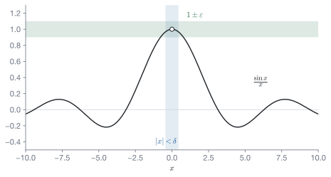{#fig-flimit-sinc width=75%}

The definition below is the $\varepsilon$-$\delta$ version of this picture, its reformulation through sequences, and the
one-sided and infinite variants. Through sequences, the limit rules of @def-sequence-limit carry over to functions.

:::: {.statement-box}
::: {#def-function-limit}
#### Limit of a function

Let $f$ be defined on $(a - r, a) \cup (a, a + r)$ for some $r > 0$, not necessarily at $a$. Then $\lim_{x \to a} f(x) = L$ means: for every
$\varepsilon > 0$ there is a $\delta > 0$ such that $|f(x) - L| < \varepsilon$ whenever $0 < |x - a| < \delta$. Equivalently, $f(x_n) \to L$ for every
sequence $x_n \to a$ with $x_n \neq a$ (the **sequential characterisation**). **One-sided limits** $\lim_{x \to a^\pm}$ restrict $x$ to one side
of $a$; $\lim_{x \to a} f(x) = \infty$ means that for every $M$ there is a $\delta > 0$ with $f(x) > M$ whenever $0 < |x - a| < \delta$; and
$\lim_{x \to \infty} f(x) = L$ means that for every $\varepsilon > 0$ there is an $X$ with $|f(x) - L| < \varepsilon$ for all $x > X$. The limit, when
it exists, is unique, and the limit rules and the order rule of @def-sequence-limit hold for limits of functions.
:::
::::

*Proof.* Suppose the $\varepsilon$-$\delta$ condition holds and $x_n \to a$ with $x_n \neq a$. Given $\varepsilon > 0$, take the $\delta$ of the
condition and $N$ with $|x_n - a| < \delta$ for $n \geq N$; then $0 < |x_n - a| < \delta$, so $|f(x_n) - L| < \varepsilon$ for $n \geq N$, and $f(x_n) \to L$.
Conversely, if the condition fails, there is an $\varepsilon > 0$ such that for every $\delta = 1/n$ (with $1/n < r$) some $x_n$ has $0 < |x_n - a| <
1/n$ and $|f(x_n) - L| \geq \varepsilon$. This is a sequence $x_n \to a$, $x_n \neq a$, with $f(x_n) \not\to L$. The same argument, with $x_n$ on one
side of $a$, or with $f(x_n) > M$, or with $x_n > X$ and $x_n \to \infty$, gives the sequential form of the other limits. Uniqueness and the
limit rules now follow from the same facts for sequences: if $f(x) \to L$ and $g(x) \to M$, then along any $x_n \to a$, $x_n \neq a$, the
values satisfy $f(x_n) + g(x_n) \to L + M$, $f(x_n)g(x_n) \to LM$, $f(x_n)/g(x_n) \to L/M$ when $M \neq 0$, and $f \leq g$ gives $L \leq M$
(@def-sequence-limit, @exr-limit-quotient-rule, @exr-limit-order). $\square$

The sequential characterisation is @abbott2015understanding [Thm. 4.2.3], and the two forms of the definition are Heine's and
Cauchy's in @radozycki2020solving [Ch. 7]. A consequence used below is the squeeze rule: if $g \leq f \leq h$ near $a$ and $g$, $h$
tend to $L$, then so does $f$, by @exr-limit-squeeze applied along every sequence.

:::: {.callout-note .examples-fold collapse="true" title="Examples"}
The simplest limits are those of polynomials, where the value at the point is the limit and $\delta$ can be read off from a
factorisation. The second limit below is a quotient that is undefined at the point, and cancelling a common factor removes the
difficulty [@abbott2015understanding, Exercise 4.2.5; @radozycki2020solving, Sec. 7.1, Problem 2].

::: {#exm-flimit-polynomial}
#### A polynomial and a cancelled quotient

$\lim_{x \to 2}(3x + 4) = 10$: $|3x + 4 - 10| = 3|x - 2| < \varepsilon$ when $|x - 2| < \delta = \varepsilon/3$. For
$$
f(x) = \frac{x^3 - x^2 - x - 2}{x^3 + x^2 - 4x - 4} = \frac{(x - 2)(x^2 + x + 1)}{(x - 2)(x + 2)(x + 1)},
$$
undefined at $x = 2$, the values at $x \neq 2$ are $(x^2 + x + 1)/((x + 2)(x + 1))$; along any $x_n \to 2$, $x_n \neq 2$, the limit rules
give $(4 + 2 + 1)/(4 \cdot 3) = 7/12$. So $\lim_{x \to 2}f(x) = 7/12$, although $f(2)$ does not exist.
:::

The limit $\sin x/x \to 1$ at $0$ is the basic limit of the trigonometric functions, and the squeeze rule gives it from the geometric
inequality. The same inequality and the exponential series give two companions of the same kind, one for the cosine and one for the exponential
[@radozycki2020solving, Sec. 7.1, Problem 1].

::: {#exm-flimit-sinx-x}
#### $\sin x/x \to 1$, $(1 - \cos x)/x^2 \to \tfrac12$, $(e^x - 1)/x \to 1$

For $0 < |x| < \pi/2$, $\sin x < x < \tan x$ (for $x > 0$, and by symmetry for $x < 0$) gives $\cos x < \sin x/x < 1$, and $1 - \cos x = 2\sin^2(x/2)
\leq x^2/2$. So $0 < 1 - \sin x/x < x^2/2$, which is below $\varepsilon$ for $0 < |x| < \sqrt{2\varepsilon}$ (@fig-flimit-sinc). Next, $(1 - \cos x)/x^2 =
\tfrac12\big(\sin(x/2)/(x/2)\big)^2 \to \tfrac12$ by the product rule. Finally, for $0 < |x| \leq 1$,
$$
\Big|\frac{e^x - 1}{x} - 1\Big| = \Big|\sum_{k \geq 2}\frac{x^{k-1}}{k!}\Big| \leq |x|\sum_{k \geq 2}\frac{1}{k!} = (e - 2)|x| < |x|,
$$
so $(e^x - 1)/x \to 1$, with $\delta = \min(1, \varepsilon)$.
:::

A limit can fail to exist in two different ways: the one-sided limits can disagree, or the function can oscillate without
settling. The example has one case of each, and the second is decided by two sequences with different limits of values
[@abbott2015understanding, Example 4.2.6].

::: {#exm-flimit-one-sided}
#### A jump and an oscillation

$|x|/x$ equals $1$ for $x > 0$ and $-1$ for $x < 0$: the one-sided limits at $0$ are $\pm1$, and the two-sided limit does not exist. For
$\sin(1/x)$ take $x_n = 1/(2\pi n)$ and $y_n = 1/(2\pi n + \pi/2)$: both tend to $0$, but $\sin(1/x_n) = 0$ and $\sin(1/y_n) = 1$, so by the
sequential characterisation $\sin(1/x)$ has no limit at $0$, not even a one-sided one.
:::

Limits at infinity compare the growth of the elementary functions, and the ordering exponentials, powers, logarithms is used
constantly. The example proves the three basic cases from lower bounds by single terms of the exponential series.

::: {#exm-flimit-infinity}
#### Growth at infinity

For $x > 0$ every term of $e^x = \sum x^k/k!$ is positive, so $e^x > x^2/2$ and $e^x > x^3/6$. Hence $0 < xe^{-x} < 2/x$ and $0 < x^2e^{-x} <
6/x$, and both tend to $0$ as $x \to \infty$. For $(\log x)/x$ put $t = \log x$, which tends to $\infty$ with $x$: $(\log x)/x = te^{-t} \to 0$.
Exponentials beat powers, and powers beat logarithms.
:::

An infinite limit at a point is a statement about every bound $M$ rather than every tolerance $\varepsilon$. The example gives $\delta$
for $1/x^2$ and shows that the tangent has infinite one-sided limits of opposite signs at $\pi/2$ [@abbott2015understanding, Exercise
4.2.9; @riley2006mathematical, Sec. 4.7].

::: {#exm-flimit-infinite}
#### Infinite limits

$\lim_{x \to 0}1/x^2 = \infty$: $1/x^2 > M$ whenever $0 < |x| < \delta = 1/\sqrt M$ (for $M > 0$). Near $\pi/2$, $\tan x = \sin x/\cos x$ with $\sin x \to
1$ and $\cos x \to 0$, positive on the left and negative on the right, so $\lim_{x \to \pi/2^-}\tan x = \infty$ and $\lim_{x \to \pi/2^+}\tan x =
-\infty$. The two-sided limit is neither.
:::

Differences of two large terms, "$\infty - \infty$", are decided as for sequences, by multiplying with a conjugate. The second case
below also uses the bounded-times-null rule for functions, which holds along every sequence by @exr-limit-bounded-null
[@radozycki2020solving, Sec. 7.1, Problem 3].

::: {#exm-flimit-conjugate}
#### Cancelling at infinity

$\sqrt{x^2 + 1} - \sqrt{x^2 - 1} = 2/(\sqrt{x^2 + 1} + \sqrt{x^2 - 1}) \to 0$ as $x \to \infty$. For $a > 0$, the difference formula for cosines gives
$$
\cos\sqrt{x^2 + a^2} - \cos x = -2\sin\frac{\sqrt{x^2 + a^2} + x}{2}\,\sin\frac{a^2}{2(\sqrt{x^2 + a^2} + x)},
$$
a factor bounded by $2$ times a factor of absolute value at most $a^2/(2(\sqrt{x^2 + a^2} + x)) \leq a^2/(4x)$, by $|\sin t| \leq |t|$. So the
difference tends to $0$, although neither cosine has a limit at infinity.
:::

Special relativity reduces to Newtonian mechanics at small speeds, and the statement is a limit. The kinetic energy $(\gamma - 1)mc^2$, with
$\gamma = 1/\sqrt{1 - \beta^2}$ and $\beta = v/c$, approaches $\tfrac12mv^2$ in ratio.

::: {#exm-flimit-relativistic-kinetic}
#### Newtonian kinetic energy as a limit

With $u = \beta^2 \in (0, 1)$,
$$
\frac{\gamma - 1}{\beta^2} = \frac{1 - \sqrt{1 - u}}{u\sqrt{1 - u}} = \frac{1}{\sqrt{1 - u}\,(1 + \sqrt{1 - u})} \to \frac12 \quad (u \to 0^+),
$$
since $\sqrt{1 - u} \to 1$ along every sequence $u_n \to 0$ (@exr-limit-sqrt). Hence $(\gamma - 1)mc^2/(\tfrac12mv^2) = 2(\gamma - 1)/\beta^2 \to 1$:
at small speeds the relativistic kinetic energy is the Newtonian one.
:::

Planck's mean occupation number $\langle n\rangle = 1/(e^x - 1)$, with $x = \hbar\omega/k_BT$, has two limits of physical meaning. At high
temperature $x \to 0^+$ the classical value appears, at low temperature $x \to \infty$ the mode freezes out.

::: {#exm-flimit-planck}
#### Equipartition and freezing out

By @exm-flimit-sinx-x, $x\langle n\rangle = x/(e^x - 1) \to 1$ as $x \to 0^+$, so the mean energy $\hbar\omega\langle n\rangle = k_BT\cdot x\langle n\rangle$
tends to $k_BT$ in ratio: the equipartition value of a classical oscillator. As $x \to \infty$, $e^x\langle n\rangle = 1/(1 - e^{-x}) \to 1$, so
$\langle n\rangle$ behaves like $e^{-x}$; as $e^x > x^{k+1}/(k + 1)!$ gives $x^ke^{-x} \to 0$ for every $k$, as in @exm-flimit-infinity, it tends to $0$
faster than any power of $1/x$.
:::

A harmonic oscillator of natural frequency $\omega_0$, driven at frequency $\omega \neq \omega_0$ from rest, moves as $x(t) = \frac{F}{m}\frac{\cos\omega t -
\cos\omega_0 t}{\omega_0^2 - \omega^2}$. At resonance the formula is $0/0$, and the limit $\omega \to \omega_0$ gives the motion there.

::: {#exm-flimit-resonance}
#### The driven oscillator at resonance

The difference formula gives $\cos\omega t - \cos\omega_0 t = -2\sin\frac{(\omega + \omega_0)t}{2}\sin\frac{(\omega - \omega_0)t}{2}$, so for fixed $t \neq 0$
$$
\frac{\cos\omega t - \cos\omega_0 t}{\omega_0^2 - \omega^2} = \frac{t}{\omega_0 + \omega}\sin\frac{(\omega + \omega_0)t}{2}\cdot\frac{\sin s}{s}, \qquad s =
\frac{(\omega - \omega_0)t}{2} \to 0,
$$
which tends to $\frac{t}{2\omega_0}\sin\omega_0t$ by @exm-flimit-sinx-x. At resonance $x(t) = \frac{F}{2m\omega_0}\,t\sin\omega_0t$: the amplitude grows
linearly in time instead of staying bounded.
:::

Limits do not always pass through compositions, and some functions have no limit anywhere. The last example shows both, the
first from @abbott2015understanding [Exercise 4.3.4].

::: {#exm-flimit-composition-fails}
#### When limits do not compose

Let $f(x) = 0$ for all $x$, and $g(y) = 1$ for $y \neq 0$, $g(0) = 0$. Then $\lim_{x \to 0}f(x) = 0$ and $\lim_{y \to 0}g(y) = 1$, but $g(f(x)) = 0$
for all $x$, so $\lim_{x \to 0}g(f(x)) = 0 \neq 1$: the limit of $g$ ignores the value $g(0)$, which is the only value $g \circ f$ takes.
Dirichlet's function, $1$ on $\mathbb{Q}$ and $0$ elsewhere, has no limit at any point: rationals and irrationals tending to $a$ give
values $1$ and $0$.
:::
::::

:::: {.callout-note .exercises-fold collapse="true" title="Exercises"}
Sage's `limit` handles one-sided and infinite limits, and reports when no limit exists. The first exercise runs the limits of the
examples through it, as a check on the hand computations.

::: {#exr-function-limits-sage}
#### Limits of functions in Sage

Compute with Sage the limits of $\sin x / x$, $(1 - \cos x)/x^2$ and $(e^x - 1)/x$ at $0$, the one-sided limits of $|x|/x$ at $0$, the limit of
$\sin(1/x)$ at $0$, and the limits of $x e^{-x}$, $(\log x)/x$, $x^2/e^x$ at infinity, and compare with the examples.
:::

::: {.callout-note .solution collapse="true" title="Solution"}
:::: {.panel-tabset .solution-tabs}
## Proof

By @exm-flimit-sinx-x the first three limits are $1$, $\tfrac12$ and $1$. By @exm-flimit-one-sided the one-sided limits of $|x|/x$ are
$\pm1$ and $\sin(1/x)$ has no limit at $0$. By @exm-flimit-infinity the three limits at infinity are $0$.

## SageMath

Sage computes the same limits; `ind` means that the function stays bounded without a limit.

```{.python .sage}
x = var("x")
print(limit(sin(x) / x, x=0), limit((1 - cos(x)) / x^2, x=0), limit((exp(x) - 1) / x, x=0))
print(limit(abs(x) / x, x=0, dir="+"), limit(abs(x) / x, x=0, dir="-"))
print(limit(sin(1 / x), x=0))
print(limit(x * exp(-x), x=oo), limit(log(x) / x, x=oo), limit(x^2 / exp(x), x=oo))
```

```{.text .sage-output}
1 1/2 1
1 -1
ind
0 0 0
```
::::
:::

A proof from the definition requires producing $\delta$ from $\varepsilon$ explicitly, which for a polynomial means a factorisation and a
bound on the remaining factor. The second exercise does this for $x^2$ at $2$ and for $x^2 + x - 1$ [@abbott2015understanding, Exercise 4.2.5].

::: {#exr-flimit-epsilon-delta}
#### An $\varepsilon$-$\delta$ proof

Prove from the definition that $\lim_{x \to 2} x^2 = 4$ and $\lim_{x \to 2}(x^2 + x - 1) = 5$, giving $\delta$ in terms of $\varepsilon$.
:::

::: {.callout-note .solution collapse="true" title="Solution"}
:::: {.panel-tabset .solution-tabs}
## Proof

$|x^2 - 4| = |x - 2|\,|x + 2|$. If $|x - 2| < 1$ then $|x + 2| < 5$, so $|x^2 - 4| < 5|x - 2|$; $\delta = \min(1, \varepsilon/5)$ gives $|x^2 - 4| < \varepsilon$
whenever $0 < |x - 2| < \delta$. Likewise $x^2 + x - 6 = (x - 2)(x + 3)$ and $|x + 3| < 6$ for $|x - 2| < 1$, so $\delta = \min(1, \varepsilon/6)$ works
for the second limit.

## SageMath

Check on $\varepsilon = 10^{-3}$: Sage samples the window $0 < |x - 2| < \delta$ and takes the largest deviation from the limit.

```{.python .sage}
eps = QQ(1) / 1000
for f, L, d in [(lambda t: t^2, 4, min(1, eps / 5)), (lambda t: t^2 + t - 1, 5, min(1, eps / 6))]:
    pts = [2 + d * k / 1000 for k in range(-999, 1000) if k != 0]
    print("delta =", d, "; max deviation =", N(max(abs(f(t) - L) for t in pts), digits=6), "< eps:", max(abs(f(t) - L) for t in pts) < eps)
```

```{.text .sage-output}
delta = 1/5000 ; max deviation = 0.000799240 < eps: True
delta = 1/6000 ; max deviation = 0.000832528 < eps: True
```
::::
:::

The largest $\delta$ that answers a given $\varepsilon$ shows how the definition depends on the shape of the graph near the point. The third
exercise finds it for a square root and for a quotient of the floor function [@abbott2015understanding, Exercises 4.2.2 and 4.2.4].

::: {#exr-flimit-largest-delta}
#### The largest $\delta$

(a) For $\lim_{x \to 4}\sqrt x = 2$ and $\varepsilon = 1$, find the largest $\delta$ such that $|\sqrt x - 2| < 1$ whenever $0 < |x - 4| < \delta$ and
$x \geq 0$. (b) The claim $\lim_{x \to 10}1/\lfloor x\rfloor = 1/10$ is false. Find the largest $\delta$ that answers $\varepsilon = 1/2$, and the largest
$\varepsilon$ for which no $\delta$ works.
:::

::: {.callout-note .solution collapse="true" title="Solution"}
:::: {.panel-tabset .solution-tabs}
## Proof

(a) $|\sqrt x - 2| < 1$ means $1 < \sqrt x < 3$, that is $1 < x < 9$. The window $(4 - \delta, 4 + \delta)$ must lie in $(1, 9)$, so $\delta \leq 3$; and
$\delta = 3$ works. (b) $|1/\lfloor x\rfloor - 1/10| < 1/2$ holds exactly when $\lfloor x\rfloor \geq 2$, that is $x \geq 2$: for $1 \leq x < 2$ the value is
$1$, $9/10$ away, and for $x < 1$ it is negative or undefined. So the window $(10 - \delta, 10 + \delta)$ must lie in $[2, \infty)$, and the largest
$\delta$ is $8$. Points just left of $10$ give $1/9$, which is $1/90$ away from $1/10$, so no $\delta$ answers any $\varepsilon \leq 1/90$; for $\varepsilon > 1/90$,
$\delta = 1$ works. The largest $\varepsilon$ without a $\delta$ is $1/90$: the one-sided limits are $1/9$ and $1/10$, and the limit does not exist.

## SageMath

Sage evaluates $1/\lfloor x\rfloor$ on both sides of $10$ and the distances to $1/10$.

```{.python .sage}
for t in [QQ(1.5), QQ(2), QQ(9.5), QQ(9.999), QQ(10), QQ(17.9)]:
    v = 1 / floor(t)
    print("x =", t, ": 1/floor(x) =", v, ", distance to 1/10 =", abs(v - QQ(1) / 10))
print("sqrt(1), sqrt(4), sqrt(9) =", sqrt(1), sqrt(4), sqrt(9), "; largest window about 4 inside (1, 9): delta =", min(4 - 1, 9 - 4))
```

```{.text .sage-output}
x = 3/2 : 1/floor(x) = 1 , distance to 1/10 = 9/10
x = 2 : 1/floor(x) = 1/2 , distance to 1/10 = 2/5
x = 19/2 : 1/floor(x) = 1/9 , distance to 1/10 = 1/90
x = 9999/1000 : 1/floor(x) = 1/9 , distance to 1/10 = 1/90
x = 10 : 1/floor(x) = 1/10 , distance to 1/10 = 0
x = 179/10 : 1/floor(x) = 1/17 , distance to 1/10 = 7/170
sqrt(1), sqrt(4), sqrt(9) = 1 2 3 ; largest window about 4 inside (1, 9): delta = 3
```
::::
:::

The definition of a one-sided limit is used at a junction where two formulas meet, and the two one-sided limits decide whether
the two-sided limit exists. The fourth exercise computes them for a function defined by cases.

::: {#exr-flimit-one-sided-cases}
#### One-sided limits at a junction

Let $f(x) = (x^2 - 1)/(x - 1)$ for $x < 1$, $f(x) = \sqrt{x + 3}$ for $x > 1$. Find $\lim_{x \to 1^\pm}f(x)$ and decide whether $\lim_{x \to 1}f(x)$
exists. Then find $\lim_{x \to 0^+}1/(1 + 2e^{-1/x})$ and $\lim_{x \to 0^-}1/(1 + 2e^{-1/x})$ [@radozycki2020solving, Sec. 7.3, Exercise 1].
:::

::: {.callout-note .solution collapse="true" title="Solution"}
:::: {.panel-tabset .solution-tabs}
## Proof

For $x < 1$, $f(x) = x + 1 \to 2$. For $x > 1$, $\sqrt{x + 3} \to 2$ along every sequence (@exr-limit-sqrt). Both one-sided limits are $2$, so
the limit is $2$: given $\varepsilon$, the smaller of the two $\delta$'s works on both sides. For $x \to 0^+$, $1/x \to \infty$ and $e^{-1/x} = 1/e^{1/x} \to
0$ (as $e^t > t$), so the quotient tends to $1$. For $x \to 0^-$, $-1/x \to \infty$ and $e^{-1/x} > -1/x \to \infty$, so the quotient tends to $0$.

## SageMath

Sage computes the four one-sided limits.

```{.python .sage}
x = var("x")
print(limit((x^2 - 1) / (x - 1), x=1, dir="-"), limit(sqrt(x + 3), x=1, dir="+"))
print(limit(1 / (1 + 2 * exp(-1 / x)), x=0, dir="+"), limit(1 / (1 + 2 * exp(-1 / x)), x=0, dir="-"))
```

```{.text .sage-output}
2 2
1 0
```
::::
:::

Many limits reduce to the three of @exm-flimit-sinx-x after a substitution. The fifth exercise collects five of them, all of the form
"$0/0$" at the point [@radozycki2020solving, Sec. 7.3, Exercises 2 and 3].

::: {#exr-flimit-substitutions}
#### Limits by substitution

Find $\lim_{x \to 0}\frac{\tan x}{x}$, $\lim_{x \to 0}\frac{e^{ax} - e^{bx}}{x}$, $\lim_{x \to 0}\big(\frac{1}{\sin x} - \cot x\big)$, $\lim_{x \to \pi}\frac{\sin
x}{x^2 - \pi^2}$ and $\lim_{x \to 0}\frac{\cosh x - 1}{x^2}$, with $\cosh x = (e^x + e^{-x})/2$.
:::

::: {.callout-note .solution collapse="true" title="Solution"}
:::: {.panel-tabset .solution-tabs}
## Proof

$\tan x/x = (\sin x/x)/\cos x \to 1$. $\frac{e^{ax} - e^{bx}}{x} = a\frac{e^{ax} - 1}{ax} - b\frac{e^{bx} - 1}{bx} \to a - b$ (for $a, b \neq 0$; a zero
coefficient gives a zero term). $\frac1{\sin x} - \cot x = \frac{1 - \cos x}{\sin x} = \frac{1 - \cos x}{x^2}\cdot\frac{x}{\sin x}\cdot x \to \tfrac12\cdot 1 \cdot 0 = 0$.
With $t = x - \pi$, $\sin x = -\sin t$ and $x^2 - \pi^2 = t(t + 2\pi)$, so the quotient is $-\frac{\sin t}{t}\cdot\frac1{t + 2\pi} \to -\frac{1}{2\pi}$. Finally
$\cosh x - 1 = (e^{x/2} - e^{-x/2})^2/2$, so $\frac{\cosh x - 1}{x^2} = \frac{e^{-x}}{2}\big(\frac{e^x - 1}{x}\big)^2 \to \tfrac12$.

## SageMath

Sage computes the five limits, with $a = 3$ and $b = -2$ in the second.

```{.python .sage}
x = var("x")
for expr, pt in [(tan(x) / x, 0), ((exp(3 * x) - exp(-2 * x)) / x, 0), (1 / sin(x) - cot(x), 0),
                 (sin(x) / (x^2 - pi^2), pi), ((cosh(x) - 1) / x^2, 0)]:
    print(limit(expr, x=pt))
```

```{.text .sage-output}
1
5
0
-1/2/pi
1/2
```
::::
:::

The uniqueness of the limit and the limit rules were deduced from the sequential characterisation. The sixth exercise proves two of
them directly from the $\varepsilon$-$\delta$ definition, which is how they are proved when no sequences are at hand
[@abbott2015understanding, Exercise 4.2.1].

::: {#exr-flimit-direct-rules}
#### The sum and product rules from the definition

Let $f(x) \to L$ and $g(x) \to M$ as $x \to a$. Prove from the $\varepsilon$-$\delta$ definition, without sequences, that the limit is unique and that
$f(x) + g(x) \to L + M$ and $f(x)g(x) \to LM$.
:::

::: {.callout-note .solution collapse="true" title="Solution"}
:::: {.panel-tabset .solution-tabs}
## Proof

If $f \to L$ and $f \to L'$ with $L \neq L'$, take $\varepsilon = |L - L'|/2$ and the smaller of the two $\delta$'s; a point $x$ with $0 < |x - a| < \delta$
gives $|L - L'| \leq |L - f(x)| + |f(x) - L'| < 2\varepsilon$, a contradiction. For the sum, choose $\delta_1$, $\delta_2$ with $|f - L| < \varepsilon/2$ and $|g - M| <
\varepsilon/2$, and $\delta = \min(\delta_1, \delta_2)$. For the product, $|fg - LM| \leq |f||g - M| + |M||f - L|$. With $\varepsilon = 1$ there is $\delta_0$ with $|f(x)| <
|L| + 1$ for $0 < |x - a| < \delta_0$. Given $\varepsilon$, choose $\delta_1$ with $|g - M| < \varepsilon/(2(|L| + 1))$ and $\delta_2$ with $|f - L| < \varepsilon/(2(|M| + 1))$;
for $\delta = \min(\delta_0, \delta_1, \delta_2)$, $|fg - LM| < \varepsilon/2 + \varepsilon/2$.

## SageMath

Check on $f(x) = x^2$, $g(x) = 3x - 1$ at $a = 1$, where $L = 1$, $M = 2$: Sage samples the window built from $\varepsilon = 10^{-2}$ in the proof.

```{.python .sage}
eps = QQ(1) / 100
L, M = 1, 2
d0 = min(1, sqrt(2) - 1)                                # |x^2| < 2 = |L| + 1 when |x - 1| < sqrt(2) - 1
d1 = eps / (2 * (abs(L) + 1)) / 3                       # |3x - 1 - 2| = 3|x - 1|
d2 = min(1, eps / (2 * (abs(M) + 1)) / 3)               # |x^2 - 1| <= 3|x - 1| for |x - 1| < 1
d = min(d0, d1, d2)
pts = [1 + d * k / 500 for k in range(-499, 500) if k != 0]
print("delta =", d, "; max |fg - LM| =", N(max(abs(t^2 * (3 * t - 1) - L * M) for t in pts), digits=5), "< eps:",
      max(abs(t^2 * (3 * t - 1) - L * M) for t in pts) < eps)
```

```{.text .sage-output}
delta = 1/1800 ; max |fg - LM| = 0.0038836 < eps: True
```
::::
:::

The bounded-times-null rule for functions gives limits that the product rule cannot, because one factor has no limit. The seventh
exercise proves it and applies it at $0$ and at infinity [@abbott2015understanding, Exercise 4.2.7].

::: {#exr-flimit-bounded-null}
#### Bounded times null

Let $|g(x)| \leq K$ near $a$ and $f(x) \to 0$ as $x \to a$. Prove $f(x)g(x) \to 0$. Deduce $\lim_{x \to 0}x\sin(1/x) = 0$ and $\lim_{x \to \infty}
\big(\sin(x + 1/x) - \sin x\big) = 0$.
:::

::: {.callout-note .solution collapse="true" title="Solution"}
:::: {.panel-tabset .solution-tabs}
## Proof

Given $\varepsilon > 0$, choose $\delta$ with $|f(x)| < \varepsilon/(K + 1)$ for $0 < |x - a| < \delta$; then $|f(x)g(x)| \leq K\varepsilon/(K + 1) < \varepsilon$. With $f(x) = x$
and $g(x) = \sin(1/x)$, $|g| \leq 1$, so $x\sin(1/x) \to 0$. At infinity, $\sin(x + 1/x) - \sin x = 2\cos(x + \tfrac1{2x})\sin\tfrac1{2x}$, a bounded factor
times $\sin(1/(2x))$, whose absolute value is at most $1/(2x) \to 0$; the same proof with "$x > X$" in place of "$0 < |x - a| < \delta$" gives the limit $0$.

## SageMath

Sage evaluates both expressions and the bounds $|x|$ and $1/x$ of the proof.

```{.python .sage}
R = RealField(200)
for k in range(1, 6):
    t, T = R(10)^(-k), R(10)^k
    print("x = 1e-%d:" % k, N(t * sin(1 / t), digits=4), "bound", N(t, digits=2), "| x = 1e%d:" % k,
          N(sin(T + 1 / T) - sin(T), digits=4), "bound", N(1 / T, digits=2))
```

```{.text .sage-output}
x = 1e-1: -0.05440 bound 0.10 | x = 1e1: -0.08105 bound 0.10
x = 1e-2: -0.005064 bound 0.010 | x = 1e2: 0.008648 bound 0.010
x = 1e-3: 0.0008269 bound 0.0010 | x = 1e3: 0.0005620 bound 0.0010
x = 1e-4: -0.00003056 bound 0.00010 | x = 1e4: -0.00009521 bound 0.00010
x = 1e-5: 3.575e-7 bound 0.000010 | x = 1e5: -9.994e-6 bound 0.000010
```
::::
:::

The sequential characterisation also detects limits that do not exist, by producing two sequences with different limits of values.
The eighth exercise applies it to functions built from the floor function and to Dirichlet's function times $x$
[@abbott2015understanding, Exercise 4.2.8].

::: {#exr-flimit-divergence}
#### Limits that do not exist

Decide whether the limits exist: $\lim_{x \to 2}|x - 2|/(x - 2)$, $\lim_{x \to 0}(-1)^{\lfloor 1/x\rfloor}$, $\lim_{x \to 0}\sqrt[3]x\,(-1)^{\lfloor 1/x\rfloor}$, and
$\lim_{x \to 0}xD(x)$ with $D$ Dirichlet's function of @exm-flimit-composition-fails.
:::

::: {.callout-note .solution collapse="true" title="Solution"}
:::: {.panel-tabset .solution-tabs}
## Proof

$|x - 2|/(x - 2)$ is $1$ to the right of $2$ and $-1$ to the left: no limit. For $x_n = 1/(2n)$, $\lfloor 1/x_n\rfloor = 2n$ and the value is $1$; for $y_n =
1/(2n + 1)$ it is $-1$. Both sequences tend to $0$, so $(-1)^{\lfloor 1/x\rfloor}$ has no limit. The third is a bounded factor times $\sqrt[3]x \to 0$
(with $|\sqrt[3]x| < \varepsilon$ for $|x| < \varepsilon^3$), so it tends to $0$ by the bounded-times-null rule; so does $xD(x)$, as $|D| \leq 1$.

## SageMath

Sage evaluates $(-1)^{\lfloor 1/x\rfloor}$ along the two sequences of the proof, and the third function along both.

```{.python .sage}
for n in [10, 100, 1000]:
    x1, y1 = QQ(1) / (2 * n), QQ(1) / (2 * n + 1)
    print(n, (-1)^floor(1 / x1), (-1)^floor(1 / y1), N(x1^(1/3) * (-1)^floor(1 / x1), digits=4), N(y1^(1/3) * (-1)^floor(1 / y1), digits=4))
```

```{.text .sage-output}
10 1 -1 0.3684 -0.3625
100 1 -1 0.1710 -0.1707
1000 1 -1 0.07937 -0.07936
```
::::
:::

A limit at infinity can be turned into a limit at $0$ by the substitution $t = 1/x$, and the ninth exercise proves this in general and
uses it twice. It also shows that a limit through exponents is found by taking logarithms [@riley2006mathematical, Sec. 4.7].

::: {#exr-flimit-reciprocal}
#### Infinity and zero exchanged

Prove that $\lim_{x \to \infty}f(x) = L$ if and only if $\lim_{t \to 0^+}f(1/t) = L$. Use it to find $\lim_{x \to \infty}x\sin(1/x)$ and $\lim_{x \to
\infty}x(e^{1/x} - 1)$, and show $\lim_{x \to \infty}x\log(1 + 1/x) = 1$.
:::

::: {.callout-note .solution collapse="true" title="Solution"}
:::: {.panel-tabset .solution-tabs}
## Proof

If $|f(x) - L| < \varepsilon$ for $x > X$ (with $X > 0$), then $|f(1/t) - L| < \varepsilon$ for $0 < t < 1/X$; conversely a $\delta$ for $t \to 0^+$ gives $X = 1/\delta$.
So $x\sin(1/x) = \sin t/t \to 1$ and $x(e^{1/x} - 1) = (e^t - 1)/t \to 1$ (@exm-flimit-sinx-x). For the logarithm put $s = \log(1 + t)$, so $t = e^s - 1$
and $s \to 0$ as $t \to 0^+$, because $\log$ is increasing with $\log(1 + t) < t$ (from $e^t > 1 + t$). Then $\log(1 + t)/t = s/(e^s - 1) \to 1$. So
$x\log(1 + 1/x) \to 1$.

## SageMath

Sage computes the three limits at infinity.

```{.python .sage}
x = var("x")
print(limit(x * sin(1 / x), x=oo), limit(x * (exp(1 / x) - 1), x=oo), limit(x * log(1 + 1 / x), x=oo))
```

```{.text .sage-output}
1 1 1
```
::::
:::

Limits pass through a continuous outer function, but not through an arbitrary one, as @exm-flimit-composition-fails showed. The last
exercise proves the positive statement for limits and combines it with the earlier examples [@abbott2015understanding, Exercise 4.3.4].

::: {#exr-flimit-composition}
#### Limits of compositions

Suppose $\lim_{x \to a}f(x) = b$ and $\lim_{y \to b}g(y) = c$. Prove $\lim_{x \to a}g(f(x)) = c$ if in addition $f(x) \neq b$ for $0 < |x - a| < r$, or $g(b)
= c$. Use it to find $\lim_{x \to 0}\frac{\sin(x^2)}{x^2}$, $\lim_{x \to 0}\frac{e^{\sin x} - 1}{\sin x}$ and $\lim_{x \to 0}\frac{e^{\sin x} - 1}{x}$.
:::

::: {.callout-note .solution collapse="true" title="Solution"}
:::: {.panel-tabset .solution-tabs}
## Proof

Let $x_n \to a$, $x_n \neq a$. Then $y_n = f(x_n) \to b$. In the first case $y_n \neq b$ for large $n$, so $g(y_n) \to c$ by the sequential characterisation.
In the second, $g(y_n) = c$ whenever $y_n = b$, and $|g(y) - c| < \varepsilon$ for $0 < |y - b| < \delta$, so $|g(y_n) - c| < \varepsilon$ as soon as $|y_n - b| < \delta$.
Either way $g(f(x_n)) \to c$. With $f(x) = x^2 \neq 0$ near $0$ and $g(y) = \sin y/y$, $\sin(x^2)/x^2 \to 1$. With $f = \sin$, nonzero for $0 < |x| < \pi$, and
$g(y) = (e^y - 1)/y$, the second limit is $1$, and the third is the second times $\sin x/x$, so it is $1$ too.

## SageMath

Sage computes the three limits.

```{.python .sage}
x = var("x")
print(limit(sin(x^2) / x^2, x=0), limit((exp(sin(x)) - 1) / sin(x), x=0), limit((exp(sin(x)) - 1) / x, x=0))
```

```{.text .sage-output}
1 1 1
```
::::
:::
::::

### Continuity

Continuity at a point means that the limit equals the value. On the line this is the continuity of @def-continuous-map for the
metric topology, and the definition below records that, the algebraic rules, continuity of inverse functions, and the two
theorems on intervals, which are compactness and connectedness of intervals seen through a continuous function.

:::: {.statement-box}
::: {#def-continuity}
#### Continuous function

Let $D \subseteq \mathbb{R}$. A function $f : D \to \mathbb{R}$ is **continuous at** $a \in D$ if for every $\varepsilon > 0$ there is a $\delta > 0$ with
$|f(x) - f(a)| < \varepsilon$ for all $x \in D$ with $|x - a| < \delta$; when $D$ contains an interval $(a - r, a + r)$ this says $\lim_{x \to a}f(x) =
f(a)$. It is **continuous** if it is continuous at every point of $D$, which is continuity of the map $f : D \to \mathbb{R}$ (@def-continuous-map)
for the metric topologies of $D$ and $\mathbb{R}$. Then:

1. $f$ is continuous at $a$ if and only if $f(x_n) \to f(a)$ for every sequence $x_n \to a$ in $D$;
2. sums, products, quotients with non-zero denominator and compositions of continuous functions are continuous, and polynomials,
   $\exp$, $\sin$ and $\cos$ are continuous on $\mathbb{R}$;
3. a continuous, strictly increasing or strictly decreasing function on an interval $I$ maps it onto an interval $J$, and its inverse
   $J \to I$ is continuous; so $\log$ on $(0, \infty)$, $\sqrt[n]x$ on $[0, \infty)$, $\arcsin$ on $[-1, 1]$ and $\arctan$ on $\mathbb{R}$ are continuous;
4. a continuous function on $[a, b]$ is bounded and attains its maximum and minimum (the **extreme value theorem**);
5. a continuous function on an interval takes every value between any two of its values (the **intermediate value theorem**).
:::
::::

*Proof.* The $\varepsilon$-$\delta$ condition at every point is continuity of $f : D \to \mathbb{R}$ for the distance $|x - y|$ on $D$ and on $\mathbb{R}$,
by @exr-metric-topology-epsilon-delta.

(1) If $f$ is continuous at $a$ and $x_n \to a$ in $D$, take the $\delta$ of $\varepsilon$ and $N$ with $|x_n - a| < \delta$ for $n \geq N$; then $|f(x_n) - f(a)| < \varepsilon$.
If $f$ is not continuous at $a$, some $\varepsilon > 0$ has no $\delta$: for each $n$ there is $x_n \in D$ with $|x_n - a| < 1/n$ and $|f(x_n) - f(a)| \geq \varepsilon$,
a sequence $x_n \to a$ with $f(x_n) \not\to f(a)$.

(2) By (1) and the limit rules of @def-sequence-limit and @exr-limit-quotient-rule, $f + g$, $fg$ and $f/g$ are continuous at $a$ when $f$ and
$g$ are. If $f$ is continuous at $a$ and $g$ at $f(a)$, then $x_n \to a$ gives $f(x_n) \to f(a)$ and then $g(f(x_n)) \to g(f(a))$. Constants and
$x \mapsto x$ are continuous, so polynomials are. For $\exp$, $|e^h - 1| = |\sum_{k \geq 1}h^k/k!| \leq |h|\sum_{k \geq 1}1/k! = (e - 1)|h|$ for $|h| \leq 1$,
so $|e^x - e^a| = e^a|e^{x-a} - 1| < \varepsilon$ when $|x - a| < \min(1, \varepsilon e^{-a}/(e - 1))$. For the sine and cosine,
$|\sin x - \sin a| = 2|\cos\tfrac{x + a}{2}||\sin\tfrac{x - a}{2}| \leq |x - a|$ and $|\cos x - \cos a| = 2|\sin\tfrac{x + a}{2}||\sin\tfrac{x - a}{2}| \leq |x - a|$,
by $|\sin t| \leq |t|$, so $\delta = \varepsilon$ works.

(3) Replacing $f$ by $-f$, let $f$ be strictly increasing. The interval $I$ is connected (@exr-connected-interval), so $J = f(I)$ is connected
(@exr-connected-image), hence an interval (@exm-connected-intervals). The inverse $g : J \to I$ is strictly increasing. Let $y_0 \in J$, $x_0
= g(y_0)$ and $\varepsilon > 0$. If $x_0$ is not the right end of $I$, choose $x_2 \in I$ with $x_0 < x_2 < x_0 + \varepsilon$; if it is not the left end,
choose $x_1 \in I$ with $x_0 - \varepsilon < x_1 < x_0$. Let $\delta$ be the smaller of $f(x_2) - y_0$ and $y_0 - f(x_1)$, for the points that exist. If
$y \in J$ and $|y - y_0| < \delta$, then $y < f(x_2)$ (or $y \leq y_0$ when $x_0$ is the right end, since then $y_0 = \max J$) and $y > f(x_1)$ (or $y \geq
y_0$), so $g(y)$ lies between $x_1$ and $x_2$ and $|g(y) - x_0| < \varepsilon$. The exponential is strictly increasing (@prp-series-values) and maps $\mathbb{R}$
onto $(0, \infty)$: its values are positive, $e^x > x$ for $x > 0$ and $e^{-x} = 1/e^x$, and the image is an interval. Its inverse is $\log$.
Likewise $x^n$ on $[0, \infty)$, $\sin$ on $[-\pi/2, \pi/2]$ and $\tan$ on $(-\pi/2, \pi/2)$ are continuous and strictly increasing, with inverses
$\sqrt[n]x$, $\arcsin$ and $\arctan$.

(4) $[a, b]$ is compact (@exr-compact-closed-interval), so $f$ is bounded and attains its extremes by @exr-compact-image.

(5) An interval $I$ is connected, so $f(I)$ is an interval (@exr-connected-interval, @exr-connected-image, @exm-connected-intervals), and
it contains every number between two of its points. $\square$

The theorems are @abbott2015understanding [Thms. 4.3.2, 4.4.2, 4.5.1], proved there from the completeness of the line directly; here
completeness enters through the compactness and connectedness of intervals. The inverse function statement is @abbott2015understanding
[Exercise 4.5.8].

:::: {.callout-note .examples-fold collapse="true" title="Examples"}
The simplest continuous functions are those for which $\delta$ can be written down at once from $\varepsilon$. The absolute value and the square
root are the first two, and the square root needs a different $\delta$ at $0$ than elsewhere.

::: {#exm-continuity-abs-sqrt}
#### $|x|$ and $\sqrt x$

$\big||x| - |a|\big| \leq |x - a|$, so $\delta = \varepsilon$ works for $|x|$ at every $a$. For $\sqrt x$ on $[0, \infty)$ and $a > 0$, $|\sqrt x - \sqrt a| = |x -
a|/(\sqrt x + \sqrt a) \leq |x - a|/\sqrt a$, so $\delta = \varepsilon\sqrt a$ works; at $a = 0$, $\sqrt x < \varepsilon$ for $0 \leq x < \delta = \varepsilon^2$. The $\delta$ shrinks with
$a$ near $0$, where the graph is steep.
:::

Continuity of a function defined by several formulas is checked at the junctions, where the one-sided limits must agree with the
value. The example shows a continuous and a discontinuous gluing, and then fixes the parameters of a three-piece function
[@radozycki2020solving, Sec. 8.2, Problem 1].

::: {#exm-continuity-piecewise}
#### Gluing formulas

$f(x) = x^2$ for $x < 1$ and $2x - 1$ for $x \geq 1$ is continuous at $1$: both one-sided limits equal $1 = f(1)$. With $2x$ in place of $2x - 1$ the
right limit is $2 \neq 1$ and the function jumps. The function equal to $ax + b$ for $x < -1$, $\sin(\pi x/2)$ on $[-1, 1]$ and $c(x - 2)^2$ for
$x > 1$ is continuous inside each piece by (2); at $-1$ the left limit is $b - a$ and the value $-1$, at $1$ the value is $1$ and the right limit
$c$. It is continuous on $\mathbb{R}$ exactly when $b - a = -1$ and $c = 1$.
:::

Some discontinuities can be removed by choosing the right value, others cannot. The example classifies the three functions $\sin x/x$,
$|x|/x$ and $1/x$ at $0$ with the limits of @def-function-limit.

::: {#exm-continuity-removable}
#### Removable discontinuities

$\sin x / x$ is undefined at $0$, but setting its value to $1$ there makes it continuous on $\mathbb{R}$ (@exm-flimit-sinx-x): the discontinuity
is removable. $|x|/x$ has a jump at $0$ that no value removes (@exm-flimit-one-sided), and $1/x$ is unbounded near $0$, so no value at $0$
makes it continuous either.
:::

The intermediate value theorem proves the existence of roots without a formula, and bisection makes the proof constructive. The
example locates $\sqrt[3]2$ this way; the figure shows the first six intervals.

::: {#exm-continuity-ivt}
#### A root by the intermediate value theorem

$f(x) = x^3 - 2$ has $f(1) = -1 < 0 < f(2) = 6$, so it has a root in $(1, 2)$, namely $\sqrt[3]{2}$. Halving the interval and keeping the half on
which $f$ changes sign gives nested intervals $I_k$ of length $2^{-k}$ (@exr-nested-intervals), whose common point is the root.

![The function $x^3 - 2$ on $[1, 2]$ and the first six bisection intervals $I_0, \dots, I_5$, each half of the previous one and each with a sign change of the function at its ends.](figures/continuity_bisection.svg){#fig-continuity-bisection width=70%}

After $k$ steps the midpoint of $I_k$ is within $2^{-k-1}$ of $\sqrt[3]2 = 1.2599\ldots$; six steps give $I_5 = [1.25, 1.28125]$.
:::

The extreme value theorem needs a closed bounded interval, and on such an interval the extremes of a simple function can be found by
monotonicity alone. The example compares $[-1, 2]$ with the whole line.

::: {#exm-continuity-extreme-values}
#### Extremes of $1/(1 + x^2)$

$f(x) = 1/(1 + x^2)$ is continuous on $\mathbb{R}$, increasing on $(-\infty, 0]$ and decreasing on $[0, \infty)$, as $1 + x^2$ is. On $[-1, 2]$ it attains
its maximum $1$ at $0$ and its minimum $\min(f(-1), f(2)) = 1/5$ at $2$, as the theorem promises. On $\mathbb{R}$ the maximum $1$ is still attained, but
the infimum $0$ is not: $f > 0$ everywhere and $f(x) \to 0$ as $x \to \infty$.
:::

Statement (3) gives the continuity of the inverse functions of analysis at once. The example lists them with the intervals on which the
original functions are strictly monotone.

::: {#exm-continuity-inverse}
#### Logarithm, roots and inverse trigonometric functions

$\exp : \mathbb{R} \to (0, \infty)$ is strictly increasing and onto, so $\log : (0, \infty) \to \mathbb{R}$ is continuous; then $x^a = e^{a\log x}$ is continuous on
$(0, \infty)$ for every real $a$, by (2). $x^n$ on $[0, \infty)$ gives $\sqrt[n]x$, $\sin$ on $[-\pi/2, \pi/2]$ gives $\arcsin$ on $[-1, 1]$, $\cos$ on $[0,
\pi]$ (strictly decreasing) gives $\arccos$, and $\tan$ on $(-\pi/2, \pi/2)$ gives $\arctan : \mathbb{R} \to (-\pi/2, \pi/2)$.
:::

Kepler's equation $M = E - e\sin E$ relates the mean anomaly $M$ of a planet, proportional to time, to its eccentric anomaly $E$, which
fixes its position on the ellipse of eccentricity $0 \leq e < 1$. Statement (3) shows that the position is a continuous function of time.

::: {#exm-continuity-kepler}
#### Kepler's equation

$K(E) = E - e\sin E$ is continuous, and strictly increasing: for $E < E'$, $K(E') - K(E) = (E' - E) - e(\sin E' - \sin E) \geq (1 - e)(E' - E) > 0$, by
$|\sin E' - \sin E| \leq |E' - E|$. As $K(E) \to \pm\infty$ with $E$, its image is all of $\mathbb{R}$. So for every $M$ there is exactly one $E$, and $E(M)$ is
continuous. For the Earth, $e = 0.0167$, and $E$ never differs from $M$ by more than $e$.
:::

An oscillator with a stiffening spring has potential $V(x) = \tfrac12kx^2 + \lambda x^4$ with $k, \lambda > 0$, and a particle of energy $E > 0$ moves
between two turning points where $V(x) = E$. The intermediate value theorem shows that they exist for every energy.

::: {#exm-continuity-turning-points}
#### Turning points of an anharmonic oscillator

$V$ is continuous with $V(0) = 0 < E$, and $V(x) \geq \lambda x^4 > E$ for $x > X = (E/\lambda)^{1/4}$. So $V$ takes the value $E$ at some $x_+ \in (0, X]$,
and by symmetry at $-x_+$. $V$ is strictly increasing on $[0, \infty)$, so $x_+$ is unique, and the motion is confined to $[-x_+, x_+]$. For
$\lambda = 0$ the turning points are $\pm\sqrt{2E/k}$, the amplitude of the harmonic oscillator.
:::

A particle of rest energy $mc^2$ and total energy $E \geq mc^2$ has speed $v(E) = c\sqrt{1 - (mc^2/E)^2}$. This continuous function shows a half-open
image, because its domain is not compact.

::: {#exm-continuity-relativistic-speed}
#### Speed as a function of energy

$v$ is continuous and strictly increasing on $[mc^2, \infty)$, with $v(mc^2) = 0$ and $v(E) \to c$ as $E \to \infty$, so its image is the interval
$[0, c)$: every speed below $c$ is reached, and $c$ is not. The supremum $c$ is not attained, which the extreme value theorem allows,
since $[mc^2, \infty)$ is not bounded. The inverse $E(v) = mc^2/\sqrt{1 - v^2/c^2}$ is continuous on $[0, c)$ by (3).
:::

A function can fail to be continuous everywhere, or be continuous at exactly one point. The last example gives both, with Dirichlet's
function of @exm-flimit-composition-fails [@abbott2015understanding, Exercise 4.3.7].

::: {#exm-continuity-dirichlet}
#### Nowhere and once continuous

Dirichlet's function $D$ ($1$ on $\mathbb{Q}$, $0$ elsewhere) is continuous nowhere: every interval contains rationals and irrationals, so sequences of
both kinds tend to any $a$ with values $1$ and $0$. The function $xD(x)$ is continuous at $0$, since $|xD(x)| \leq |x|$, and at no other point: at $a
\neq 0$ the two kinds of sequences give the values $a$ and $0$.
:::
::::

:::: {.callout-note .exercises-fold collapse="true" title="Exercises"}
Checking continuity where two formulas meet is a matter of computing one-sided limits, and Sage does this directly. The first exercise
treats the two gluings of @exm-continuity-piecewise.

::: {#exr-continuity-check}
#### Continuity at a junction

Decide whether $f(x) = x^2$ ($x < 1$), $2x - 1$ ($x \geq 1$) and $g(x) = x^2$ ($x < 1$), $2x$ ($x \geq 1$) are continuous at $1$, and check it in Sage.
:::

::: {.callout-note .solution collapse="true" title="Solution"}
:::: {.panel-tabset .solution-tabs}
## Proof

Each piece is a polynomial, continuous by (2). For $f$ the left limit $\lim_{x \to 1^-}x^2 = 1$, the right limit $\lim_{x \to 1^+}(2x - 1) = 1$ and
the value $f(1) = 1$ agree, so $f$ is continuous at $1$. For $g$ the right limit and the value are $2 \neq 1$: $g$ jumps at $1$.

## SageMath

Sage computes the one-sided limits and the values.

```{.python .sage}
x = var("x")
for name, left_piece, right_piece in [("f", x^2, 2 * x - 1), ("g", x^2, 2 * x)]:
    left = limit(left_piece, x=1, dir="-"); right = limit(right_piece, x=1, dir="+"); value = right_piece.subs(x=1)
    print(name, ": left limit", left, ", right limit", right, ", value", value, "-> continuous at 1:", bool(left == right == value))
```

```{.text .sage-output}
f : left limit 1 , right limit 1 , value 1 -> continuous at 1: True
g : left limit 1 , right limit 2 , value 2 -> continuous at 1: False
```
::::
:::

The cube root is continuous by statement (3), and the second exercise proves it directly from the definition. The identity for $a^3 - b^3$
plays the part that the conjugate played for the square root [@abbott2015understanding, Exercise 4.3.1].

::: {#exr-continuity-cube-root}
#### The cube root from the definition

Prove that $g(x) = \sqrt[3]x$ is continuous at $0$ and at every $c \neq 0$, giving $\delta$ in terms of $\varepsilon$.
:::

::: {.callout-note .solution collapse="true" title="Solution"}
:::: {.panel-tabset .solution-tabs}
## Proof

At $0$, $|\sqrt[3]x| < \varepsilon$ when $|x| < \delta = \varepsilon^3$. For $c \neq 0$ write $a = \sqrt[3]x$, $b = \sqrt[3]c$. Then $x - c = (a - b)(a^2 + ab + b^2)$ and
$a^2 + ab + b^2 = (a + b/2)^2 + \tfrac34b^2 \geq \tfrac34b^2$, so $|\sqrt[3]x - \sqrt[3]c| \leq \frac{4|x - c|}{3|c|^{2/3}}$, and $\delta = \tfrac34|c|^{2/3}\varepsilon$ works.

## SageMath

Check on $c = -8$ and $\varepsilon = 10^{-3}$: Sage samples the window $|x - c| < \delta$ and compares the largest change of $\sqrt[3]x$ with $\varepsilon$.

```{.python .sage}
c, eps = -8, 1e-3
d = 3 / 4 * abs(c)^(2/3) * eps
cbrt = lambda t: sign(t) * abs(t)^(1/3)
pts = [c + d * k / 1000 for k in range(-999, 1000)]
m = max(abs(cbrt(t) - cbrt(c)) for t in pts)
print("delta =", N(d, digits=5), "; max |cbrt(x) - cbrt(c)| =", N(m, digits=5), "< eps:", bool(m < eps))
```

```{.text .sage-output}
delta = 0.0030000 ; max |cbrt(x) - cbrt(c)| = 0.00024978 < eps: True
```
::::
:::

At a point where the formula is $0/0$, the value that makes the function continuous is the limit there. The third exercise finds it for a
trigonometric quotient at two points [@radozycki2020solving, Sec. 8.2, Problem 2].

::: {#exr-continuity-parameters}
#### Choosing the values at the gaps

Let $f(x) = \frac{\sin^2 x - 1}{(4x^2 - \pi^2)^2}$ for $|x| \neq \pi/2$, $f(-\pi/2) = \alpha$ and $f(\pi/2) = \beta$. For which $\alpha$, $\beta$ is $f$ continuous on
$\mathbb{R}$?
:::

::: {.callout-note .solution collapse="true" title="Solution"}
:::: {.panel-tabset .solution-tabs}
## Proof

Away from $\pm\pi/2$, $f$ is a quotient of continuous functions with non-zero denominator. Near $\pi/2$ put $t = x - \pi/2$: $\sin^2x - 1 = -\cos^2x = -\sin^2t$
and $4x^2 - \pi^2 = (2x - \pi)(2x + \pi) = 2t(2t + 2\pi)$, so
$$
f(x) = -\frac{\sin^2t}{4t^2(2t + 2\pi)^2} = -\Big(\frac{\sin t}{t}\Big)^2\frac{1}{4(2t + 2\pi)^2} \to -\frac{1}{16\pi^2}.
$$
$f$ is even, so the limit at $-\pi/2$ is the same. $f$ is continuous exactly when $\alpha = \beta = -1/(16\pi^2)$.

## SageMath

Sage computes the two limits.

```{.python .sage}
x = var("x")
f = (sin(x)^2 - 1) / (4 * x^2 - pi^2)^2
print(limit(f, x=pi / 2), limit(f, x=-pi / 2), N(-1 / (16 * pi^2)))
```

```{.text .sage-output}
-1/16/pi^2 -1/16/pi^2 -0.00633257397764611
```
::::
:::

The intermediate value theorem does more than prove existence: bisection computes the point it promises. The fourth exercise solves
Kepler's equation of @exm-continuity-kepler for an eccentric orbit.

::: {#exr-continuity-kepler-bisection}
#### Solving Kepler's equation by bisection

For $e = 1/2$ and $M = 1$, show that $E - e\sin E = M$ has its solution in $[1, 2]$, and find it to six decimals by bisection. How many
steps are needed?
:::

::: {.callout-note .solution collapse="true" title="Solution"}
:::: {.panel-tabset .solution-tabs}
## Proof

$K(E) = E - \tfrac12\sin E - 1$ has $K(1) = -\tfrac12\sin 1 < 0$ and $K(2) = 1 - \tfrac12\sin 2 > 0$, so the root lies in $(1, 2)$, and it is unique by
@exm-continuity-kepler. After $k$ bisection steps the root lies in an interval of length $2^{-k}$, and its midpoint is within $2^{-k-1}$; an error
below $5 \cdot 10^{-7}$ needs $2^{-k-1} \leq 5 \cdot 10^{-7}$, that is $k \geq 20$.

## SageMath

Sage runs twenty bisection steps and compares with `find_root`.

```{.python .sage}
K = lambda E: E - sin(E) / 2 - 1
a, b = RDF(1), RDF(2)
for k in range(20):
    m = (a + b) / 2
    a, b = (a, m) if K(m) > 0 else (m, b)
print("bisection:", round((a + b) / 2, 7), "; interval length:", b - a, "; find_root:", round(find_root(K, 1, 2), 7))
```

```{.text .sage-output}
bisection: 1.4987016 ; interval length: 9.5367431640625e-07 ; find_root: 1.4987011
```
::::
:::

The extreme value theorem needs a closed and bounded interval, and dropping either hypothesis breaks it. The fifth exercise asks for
counterexamples and for the hypothesis that fails in each.

::: {#exr-continuity-extreme}
#### Why closed and bounded

Give continuous functions on $(0, 1]$ and on $[0, \infty)$ that are unbounded or do not attain their supremum, and explain which hypothesis of
the extreme value theorem fails in each case.
:::

::: {.callout-note .solution collapse="true" title="Solution"}
:::: {.panel-tabset .solution-tabs}
## Proof

$1/x$ on $(0, 1]$ is continuous and unbounded: the interval is not closed at $0$. $x/(1 + x)$ on $[0, \infty)$ is bounded by $1$ and never attains it,
since $x/(1 + x) = 1 - 1/(1 + x) < 1$ and tends to $1$: the interval is not bounded. $x$ on $(0, 1)$ attains neither its supremum $1$ nor its infimum
$0$. The theorem needs both closedness and boundedness, that is, compactness (@sec-compact-connected).

## SageMath

Sage evaluates the three functions near the missing ends.

```{.python .sage}
for t in [QQ(1) / 10, QQ(1) / 1000, QQ(1) / 10^6]:
    print("1/x at", t, "=", 1 / t, "; x/(1 + x) at", 1 / t, "=", N((1 / t) / (1 + 1 / t), digits=8))
```

```{.text .sage-output}
1/x at 1/10 = 10 ; x/(1 + x) at 10 = 0.90909091
1/x at 1/1000 = 1000 ; x/(1 + x) at 1000 = 0.99900100
1/x at 1/1000000 = 1000000 ; x/(1 + x) at 1000000 = 0.99999900
```
::::
:::

A polynomial of odd degree has a real root, whatever its coefficients, because it takes both signs. The sixth exercise proves this with
limits at infinity and the intermediate value theorem.

::: {#exr-continuity-odd-degree}
#### Polynomials of odd degree

Prove that every polynomial $p(x) = x^n + a_{n-1}x^{n-1} + \dots + a_0$ of odd degree $n$ has a real root. Find a real root of $x^5 - 3x + 1$ in an
interval of length $1$, and give an example of even degree without one.
:::

::: {.callout-note .solution collapse="true" title="Solution"}
:::: {.panel-tabset .solution-tabs}
## Proof

For $x \neq 0$, $p(x) = x^n(1 + a_{n-1}/x + \dots + a_0/x^n)$, and the bracket tends to $1$ as $x \to \pm\infty$. So for $|x| \geq R$ large it exceeds $\tfrac12$,
and $p(R) > 0$, $p(-R) < 0$ since $n$ is odd. By the intermediate value theorem $p$ vanishes in $(-R, R)$. For $x^5 - 3x + 1$, $p(0) = 1 > 0 > p(1) =
-1$, so a root lies in $(0, 1)$. $x^2 + 1$ has no real root.

## SageMath

Sage finds the real roots of $x^5 - 3x + 1$.

```{.python .sage}
x = polygen(QQ)
p = x^5 - 3 * x + 1
print("p(0), p(1):", p(0), p(1), "; real roots:", [N(r, digits=6) for r in p.real_roots()])
```

```{.text .sage-output}
p(0), p(1): 1 -1 ; real roots: [-1.38879, 0.334734, 1.21465]
```
::::
:::

A continuous function is determined by its values on a dense set, and its zero set is closed. The seventh exercise proves both, with the
sequential form of continuity [@abbott2015understanding, Exercises 4.3.8 and 4.3.9].

::: {#exr-continuity-rationals}
#### Values on the rationals

Let $g : \mathbb{R} \to \mathbb{R}$ be continuous. Prove that $K = \{x : g(x) = 0\}$ is closed, and that $g(r) = 0$ for all $r \in \mathbb{Q}$ implies $g = 0$.
Deduce that two continuous functions that agree on $\mathbb{Q}$ are equal.
:::

::: {.callout-note .solution collapse="true" title="Solution"}
:::: {.panel-tabset .solution-tabs}
## Proof

$K = g^{-1}(\{0\})$ is the preimage of a closed set, hence closed (@exr-continuous-closed-preimage). Every $x \in \mathbb{R}$ is the limit of rationals
$r_n = \lfloor nx\rfloor/n$, since $|x - r_n| \leq 1/n$; then $g(x) = \lim g(r_n) = 0$ by (1). For two functions $f$, $h$ that agree on $\mathbb{Q}$,
apply this to $g = f - h$.

## SageMath

Check on $g(x) = x^2 - 2$, which vanishes at $\sqrt 2 \notin \mathbb{Q}$: Sage computes $g$ along the rationals $\lfloor n\sqrt2\rfloor/n$.

```{.python .sage}
for n in [10, 1000, 10^6]:
    r = floor(n * sqrt(2)) / n
    print(n, r, N(r^2 - 2, digits=5))
```

```{.text .sage-output}
10 7/5 -0.040000
1000 707/500 -0.00060400
1000000 1414213/1000000 -1.5906e-6
```
::::
:::

A continuous injective function on an interval cannot turn back, by the intermediate value theorem. The eighth exercise proves that it is
strictly monotone, so that statement (3) applies to every continuous injective function, as in @abbott2015understanding [Exercise 4.5.8].

::: {#exr-continuity-injective}
#### Continuous and injective means monotone

Let $f$ be continuous and injective on an interval $I$. Prove that $f$ is strictly increasing or strictly decreasing, and deduce that its inverse
is continuous on $f(I)$.
:::

::: {.callout-note .solution collapse="true" title="Solution"}
:::: {.panel-tabset .solution-tabs}
## Proof

First, for $x < y < z$ in $I$, $f(y)$ lies between $f(x)$ and $f(z)$: if, say, $f(y) > \max(f(x), f(z))$, a value $v$ with $\max(f(x), f(z)) < v < f(y)$ is
taken in $(x, y)$ and in $(y, z)$ by the intermediate value theorem, contradicting injectivity; likewise for $f(y) < \min$. Now fix $a < b$ in $I$
with, say, $f(a) < f(b)$, and let $x < y$ in $I$. Applying the first step to the triples formed by $a$, $b$, $x$, $y$ in their order shows that
$f(x) < f(y)$; for instance if $a < x < y$ then $f(a) < f(x)$ (from $a < x < b$ or $a < b < x$) and then $f(x) < f(y)$ from $a < x < y$. So $f$ is
strictly increasing, and its inverse is continuous by (3).

## SageMath

Check on $f(x) = x^3 + x$ on $[-2, 2]$: Sage confirms on a grid that it is injective and increasing.

```{.python .sage}
f = lambda t: t^3 + t
pts = [QQ(k) / 50 - 2 for k in range(201)]
vals = [f(t) for t in pts]
print("injective on the grid:", len(set(vals)) == len(vals), "; increasing:", all(vals[i] < vals[i + 1] for i in range(200)))
```

```{.text .sage-output}
injective on the grid: True ; increasing: True
```
::::
:::

A continuous self-map of $[0, 1]$ has a fixed point, and a continuous function with equal values at the ends has a horizontal chord of
half the length. The ninth exercise proves both with an auxiliary function and the intermediate value theorem [@abbott2015understanding,
Exercises 4.5.6 and 4.5.7].

::: {#exr-continuity-fixed-point}
#### A fixed point and a horizontal chord

(a) Prove that a continuous $f : [0, 1] \to [0, 1]$ has a fixed point. (b) Let $f : [0, 1] \to \mathbb{R}$ be continuous with $f(0) = f(1)$. Prove that
$f(x) = f(x + \tfrac12)$ for some $x \in [0, \tfrac12]$.
:::

::: {.callout-note .solution collapse="true" title="Solution"}
:::: {.panel-tabset .solution-tabs}
## Proof

(a) $h(x) = f(x) - x$ is continuous with $h(0) = f(0) \geq 0$ and $h(1) = f(1) - 1 \leq 0$; by the intermediate value theorem $h$ vanishes somewhere, and
there $f(x) = x$. (b) $g(x) = f(x + \tfrac12) - f(x)$ is continuous on $[0, \tfrac12]$ with $g(0) + g(\tfrac12) = f(1) - f(0) = 0$. So $g(0)$ and $g(\tfrac12)$
are zero or of opposite signs, and $g$ vanishes on $[0, \tfrac12]$.

## SageMath

Check on $f(x) = \cos^2(\pi x/2)$ for (a) and $f(x) = \sin(2\pi x) + x(1 - x)$ for (b): Sage finds the points with `find_root`.

```{.python .sage}
p = find_root(lambda t: cos(pi * t / 2)^2 - t, 0, 1)
f = lambda t: sin(2 * pi * t) + t * (1 - t)
q = find_root(lambda t: f(t + 1 / 2) - f(t), 0, 1 / 2)
print("fixed point:", round(p, 6), "; chord at x =", round(q, 6), "; f(x), f(x + 1/2):", round(f(q), 6), round(f(q + 1 / 2), 6))
```

```{.text .sage-output}
fixed point: 0.5 ; chord at x = 0.018466 ; f(x), f(x + 1/2): 0.133892 0.133892
```
::::
:::

The equation $x = \cos x$ has a solution by the intermediate value theorem, and the contraction mapping theorem of the chapter Sets,
relations and topology shows that it is unique and computes it. The last exercise combines the two, with the bound on cosines of
statement (2).

::: {#exr-continuity-cos-contraction}
#### $x = \cos x$

Show that $x = \cos x$ has a solution in $[0, 1]$, that $\cos$ maps $[0, 1]$ into itself with $|\cos x - \cos y| \leq \sin(1)\,|x - y|$ there, and deduce
that the solution is unique in $[0, 1]$ and is the limit of the iterates $x_{k+1} = \cos x_k$. How many iterations from $x_0 = 0$ guarantee six
decimals?
:::

::: {.callout-note .solution collapse="true" title="Solution"}
:::: {.panel-tabset .solution-tabs}
## Proof

$h(x) = x - \cos x$ has $h(0) = -1 < 0 < h(1) = 1 - \cos 1$, so a solution exists. On $[0, 1]$, $\cos$ decreases from $1$ to $\cos 1 > 0$, so it maps $[0,
1]$ into itself. For $x, y \in [0, 1]$, $|\cos x - \cos y| = 2\sin\tfrac{x + y}{2}\,|\sin\tfrac{x - y}{2}| \leq 2\sin(1)\tfrac{|x - y|}{2}$, as $\tfrac{x + y}{2} \in [0, 1]$
where $\sin$ is increasing, and $|\sin t| \leq |t|$. So $\cos$ is a contraction of $[0, 1]$, which is complete as a compact metric space (@prp-compact-metric-complete) with $c
= \sin 1 = 0.841\ldots$, and @thm-contraction-mapping gives the uniqueness, the convergence and the bound $c^k d(x_1, x_0)/(1 - c) = c^k/(1 - c)$
for $x_0 = 0$, $x_1 = 1$. It falls below $5 \cdot 10^{-7}$ for $k \geq 95$, as $\log(5 \cdot 10^{-7}(1 - c))/\log c = 94.7\ldots$.

## SageMath

Sage iterates the cosine and finds the first $k$ at which the bound of the theorem is below $5 \cdot 10^{-7}$.

```{.python .sage}
c = sin(1.0)
k0 = next(k for k in range(1, 500) if c^k / (1 - c) < 5e-7)
xk = 0.0
for k in range(k0):
    xk = cos(xk)
print("k =", k0, "; x_k =", round(xk, 7), "; find_root:", round(find_root(lambda t: t - cos(t), 0, 1), 7))
```

```{.text .sage-output}
k = 95 ; x_k = 0.7390851 ; find_root: 0.7390851
```
::::
:::
::::

### The derivative

Differentiability means that a function is well approximated by a straight line near a point. The slope of the secant through
two points of the graph is a difference quotient, and the derivative is its limit as the two points merge; the definition below
introduces it, with the rules for computing it.

:::: {.statement-box}
::: {#def-derivative}
#### Derivative

Let $f$ be defined on an open interval containing $a$. It is **differentiable at** $a$ if the **difference quotient** $(f(a + h) - f(a))/h$ has a
limit as $h \to 0$; the limit is the **derivative** $f'(a) = \frac{df}{dx}(a)$, the slope of the **tangent line** $y = f(a) + f'(a)(x - a)$.
Equivalently, $f(a + h) = f(a) + f'(a)h + r(h)$ with $r(h)/h \to 0$. The one-sided limits of the quotient are the **one-sided derivatives**
$f'_\pm(a)$. A function differentiable at every point of an open interval has a derivative function $f'$ there, and the **higher
derivatives** are $f'' = (f')'$ and $f^{(n)} = (f^{(n-1)})'$, when they exist. Then:

1. a function differentiable at $a$ is continuous at $a$;
2. $(f + g)' = f' + g'$, $(cf)' = cf'$, $(fg)' = f'g + fg'$ (the **product rule**) and $(f/g)' = (f'g - fg')/g^2$ where $g \neq 0$ (the **quotient
   rule**), at every point where $f$ and $g$ are differentiable;
3. if $f$ is differentiable at $a$ and $g$ at $f(a)$, then $(g \circ f)'(a) = g'(f(a))\,f'(a)$ (the **chain rule**);
4. if $f$ is continuous and strictly monotone on an open interval and differentiable at $x$ with $f'(x) \neq 0$, then $f^{-1}$ is differentiable at
   $y = f(x)$ with $(f^{-1})'(y) = 1/f'(x)$.
:::
::::

*Proof.* With $r(h) = f(a + h) - f(a) - f'(a)h$, $r(h)/h$ is the difference quotient minus $f'(a)$, so the two forms are equivalent.

(1) $f(a + h) - f(a) = h \cdot \frac{f(a + h) - f(a)}{h} \to 0 \cdot f'(a) = 0$ by the product rule for limits (@def-function-limit).

(2) The sum and constant rules are the limit rules. For the product,
$$
\frac{f(a + h)g(a + h) - f(a)g(a)}{h} = \frac{f(a + h) - f(a)}{h}\,g(a + h) + f(a)\,\frac{g(a + h) - g(a)}{h} \to f'(a)g(a) + f(a)g'(a),
$$
using $g(a + h) \to g(a)$ from (1). The quotient rule follows from the product rule and $(1/g)' = -g'/g^2$, which is the chain rule (3) with
$y \mapsto 1/y$, whose derivative at $y \neq 0$ is $\lim_h \frac{1}{h}\big(\frac{1}{y + h} - \frac1y\big) = \lim_h \frac{-1}{y(y + h)} = -\frac{1}{y^2}$.

(3) First, $f$ is differentiable at $a$ if and only if $f(x) - f(a) = \varphi(x)(x - a)$ near $a$ for a function $\varphi$ continuous at $a$, and then $\varphi(a)
= f'(a)$: take $\varphi(x)$ to be the difference quotient for $x \neq a$ and $\varphi(a) = f'(a)$, and conversely the quotient is $\varphi(x) \to \varphi(a)$. Write
$g(y) - g(b) = \psi(y)(y - b)$ with $b = f(a)$ and $\psi$ continuous at $b$. Then
$$
g(f(x)) - g(f(a)) = \psi(f(x))\big(f(x) - f(a)\big) = \psi(f(x))\,\varphi(x)\,(x - a),
$$
and $x \mapsto \psi(f(x))\varphi(x)$ is continuous at $a$, since $f$ is continuous at $a$ by (1) (@def-continuity). So $g \circ f$ is differentiable at $a$
with derivative $\psi(f(a))\varphi(a) = g'(f(a))f'(a)$.

(4) The inverse $g = f^{-1}$ is continuous on the interval $f(I)$ by @def-continuity, and $y$ is an interior point of it, since $f$ is strictly
monotone. Let $y_n \to y$, $y_n \neq y$, and $x_n = g(y_n)$. Then $x_n \to x$ and $x_n \neq x$, so
$$
\frac{g(y_n) - g(y)}{y_n - y} = \frac{x_n - x}{f(x_n) - f(x)} = \Big(\frac{f(x_n) - f(x)}{x_n - x}\Big)^{-1} \to \frac{1}{f'(x)},
$$
and the sequential characterisation gives $g'(y) = 1/f'(x)$. $\square$

The criterion with $\varphi$ in (3) is @abbott2015understanding [Exercise 5.2.4], and (4) is @abbott2015understanding [Exercise 5.2.12];
the rules are summarised in @radozycki2020solving [Ch. 9].

:::: {.callout-note .examples-fold collapse="true" title="Examples"}
The derivatives of powers come from the definition by algebra alone: the binomial theorem, a common denominator, or a conjugate.
The last case below is a square root of a polynomial [@radozycki2020solving, Sec. 9.1, Problem 1].

::: {#exm-derivative-power}
#### Powers, reciprocals and roots

$\frac{(x + h)^n - x^n}{h} = nx^{n-1} + \binom n2x^{n-2}h + \dots + h^{n-1} \to nx^{n-1}$. For $x \neq 0$, $\frac1h\big(\frac{1}{x + h} - \frac1x\big) = \frac{-1}{x(x + h)} \to -\frac1{x^2}$.
For $x > 0$, $\frac{\sqrt{x + h} - \sqrt x}{h} = \frac{1}{\sqrt{x + h} + \sqrt x} \to \frac{1}{2\sqrt x}$. For $f(x) = \sqrt{1 + x^2}$,
$$
\frac{\sqrt{1 + (x + h)^2} - \sqrt{1 + x^2}}{h} = \frac{2x + h}{\sqrt{1 + (x + h)^2} + \sqrt{1 + x^2}} \to \frac{x}{\sqrt{1 + x^2}}.
$$
:::

The derivative is the limit of the slopes of secants, and the figure shows three secants of $x^2$ through $(1, 1)$ approaching the
tangent. The tangent line then gives the linear approximation of a value near the point.

::: {#exm-derivative-tangent-line}
#### Secants, the tangent and a linear approximation

For $f(x) = x^2$ at $a = 1$, the secant through $(1, 1)$ and $(1 + h, (1 + h)^2)$ has slope $2 + h \to 2$, and the tangent is $y = 2x - 1$.

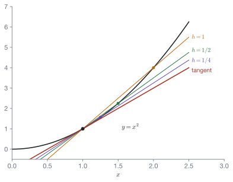{#fig-derivative-secants width=65%}

For $\sqrt x$ at $4$, $f'(4) = 1/4$, so $\sqrt{4.1} \approx 2 + 0.1/4 = 2.025$; the true value is $2.02485\ldots$, and the error $0.00015$ is the
remainder $r(0.1)$, much smaller than $h = 0.1$ itself.
:::

The exponential and the sine have derivatives built from the limits of @exm-flimit-sinx-x. The addition formulas reduce the difference
quotient at $x$ to those limits at $0$.

::: {#exm-derivative-exp-sin}
#### $(e^x)' = e^x$, $(\sin x)' = \cos x$, $(\cos x)' = -\sin x$

$\frac{e^{x+h} - e^x}{h} = e^x\frac{e^h - 1}{h} \to e^x$. By the addition formula,
$$
\frac{\sin(x + h) - \sin x}{h} = \sin x\,\frac{\cos h - 1}{h} + \cos x\,\frac{\sin h}{h} \to \cos x,
$$
since $\frac{\cos h - 1}{h} = -h\,\frac{1 - \cos h}{h^2} \to 0 \cdot \tfrac12 = 0$. In the same way $\frac{\cos(x + h) - \cos x}{h} = \cos x\frac{\cos h - 1}{h} - \sin x\frac{\sin h}{h} \to
-\sin x$.
:::

Composite functions are differentiated by the chain rule, and with the product and quotient rules it differentiates every elementary
expression. The example has three cases that recur through the rest of the section.

::: {#exm-derivative-chain}
#### The chain rule

$(\sin x^2)' = \cos(x^2)\cdot 2x$ by the chain rule with $f(x) = x^2$ and $g = \sin$; $(x^2e^x)' = 2xe^x + x^2e^x = (x^2 + 2x)e^x$ by the product rule;
$(\tan x)' = (\sin/\cos)' = (\cos^2 x + \sin^2 x)/\cos^2 x = 1/\cos^2 x = 1 + \tan^2 x$ by the quotient rule, wherever $\cos x \neq 0$.
:::

Statement (4) differentiates the inverse functions once the original ones are known. The exponential gives the logarithm and the
general powers, and the tangent gives the arctangent [@radozycki2020solving, Sec. 9.1, Problem 2].

::: {#exm-derivative-inverse-functions}
#### Logarithm, general powers and arctangent

$\exp$ is strictly increasing with $\exp' = \exp > 0$, so $(\log)'(y) = 1/e^{\log y} = 1/y$ for $y > 0$. For $a > 0$, $a^x = e^{x\log a}$ gives $(a^x)' = a^x\log a$,
and for $x > 0$, $x^\alpha = e^{\alpha\log x}$ gives $(x^\alpha)' = x^\alpha\cdot\alpha/x = \alpha x^{\alpha - 1}$ for every real $\alpha$. With $y = \tan x$ on $(-\pi/2,
\pi/2)$, $(\arctan)'(y) = 1/(1 + \tan^2 x) = 1/(1 + y^2)$.
:::

The harmonic oscillator moves as $x(t) = A\cos(\omega t + \phi)$, and its velocity and acceleration are derivatives. The second derivative
gives back the equation of motion, and the energy is computed from the first.

::: {#exm-derivative-oscillator}
#### Velocity and acceleration of the oscillator

By the chain rule, $\dot x = -A\omega\sin(\omega t + \phi)$ and $\ddot x = -A\omega^2\cos(\omega t + \phi) = -\omega^2x$, which is Newton's law $m\ddot x = -kx$ with
$k = m\omega^2$. The energy is $\tfrac12m\dot x^2 + \tfrac12kx^2 = \tfrac12m\omega^2A^2(\sin^2 + \cos^2)(\omega t + \phi) = \tfrac12m\omega^2A^2$, the same at every time.
:::

A point moving uniformly on the circle $S^1$ is $\gamma(t) = (\cos\omega t, \sin\omega t)$, differentiated componentwise. The derivatives show the
velocity tangent to the circle and the acceleration pointing to the centre.

::: {#exm-derivative-circle}
#### Uniform motion on $S^1$

$\dot\gamma(t) = (-\omega\sin\omega t, \omega\cos\omega t)$ has length $|\omega|$ and is orthogonal to $\gamma(t)$: $\gamma\cdot\dot\gamma = -\omega\cos\sin + \omega\sin\cos = 0$.
The acceleration $\ddot\gamma = -\omega^2\gamma$ points to the centre with magnitude $\omega^2$: the centripetal acceleration $v^2/r$ with $v = |\omega|$, $r = 1$.
:::

In special relativity the momentum of a particle moving on a line is $p = m\gamma v$ with $\gamma = (1 - v^2/c^2)^{-1/2}$. Its derivative with
respect to $v$ says how hard it is to accelerate a fast particle.

::: {#exm-derivative-relativistic-momentum}
#### The longitudinal mass

By the chain rule, $\gamma'(v) = -\tfrac12(1 - v^2/c^2)^{-3/2}\cdot(-2v/c^2) = \gamma^3v/c^2$. By the product rule $p'(v) = m(\gamma + v\gamma^3v/c^2) =
m\gamma(1 + \gamma^2v^2/c^2) = m\gamma^3$, since $1 + \gamma^2\beta^2 = \gamma^2$. By the chain rule again, a force along the motion gives $F = \dot p = m\gamma^3\dot v$:
the effective mass $m\gamma^3$ grows without bound as $v \to c$.
:::

Continuity does not imply differentiability, and a derivative need not be continuous. The example shows a corner, a vertical tangent,
and a differentiable function whose derivative has no limit [@abbott2015understanding, Sec. 5.1].

::: {#exm-derivative-corner}
#### A corner, a vertical tangent and an oscillating derivative

$|x|$ is continuous at $0$, but $|h|/h$ has one-sided limits $\pm1$: $f'_\pm(0) = \pm1$ and there is no derivative, a corner. For $\sqrt[3]x$ the
quotient $h^{1/3}/h = h^{-2/3}$ tends to $\infty$: a vertical tangent. For $f(x) = x^2\sin(1/x)$, $f(0) = 0$, the quotient $h\sin(1/h)$ tends to $0$, so
$f'(0) = 0$; but $f'(x) = 2x\sin(1/x) - \cos(1/x)$ for $x \neq 0$ has no limit at $0$, so $f'$ is not continuous.
:::

A continuous function can fail to be differentiable at every point, and the figure shows partial sums of such a function. It is built
from the sawtooth $h(y)$, the distance from $y$ to the nearest even integer [@abbott2015understanding, Sec. 5.4].

::: {#exm-derivative-nowhere}
#### A continuous function with no derivative at $0$

Let $g(x) = \sum_{n \geq 0}h(2^nx)/2^n$, a series with terms in $[0, 2^{-n}]$, hence convergent. Since $|h(y) - h(z)| \leq |y - z|$, the partial sums
satisfy $|g(x) - g(y)| \leq m|x - y| + \sum_{n \geq m}2 \cdot 2^{-n} = m|x - y| + 4 \cdot 2^{-m}$, so $g$ is continuous: choose $m$ with $4 \cdot 2^{-m} < \varepsilon/2$, then
$\delta = \varepsilon/(2m)$. At $x_m = 2^{-m}$, $h(2^nx_m) = 2^{n-m}$ for $n \leq m$ and $0$ for $n > m$, so $g(x_m) = (m + 1)2^{-m}$ and
$$
\frac{g(x_m) - g(0)}{x_m - 0} = m + 1 \to \infty:
$$
$g$ has no derivative at $0$. The same argument at the dyadic points and a finer one elsewhere show that $g$ is differentiable nowhere
[@abbott2015understanding, Exercises 5.4.5-5.4.7].

![Partial sums $g_m(x) = \sum_{n \leq m}h(2^nx)/2^n$ on $[0, 2]$ for $m = 0, 1, 3, 10$, where $h(y)$ is the distance from $y$ to the nearest even integer; each step adds corners at a finer scale.](figures/sawtooth_nowhere.svg){#fig-sawtooth-nowhere width=75%}
:::
::::

:::: {.callout-note .exercises-fold collapse="true" title="Exercises"}
Differentiating by the rules and then with Sage is a check on both, and computing a derivative from the definition with `limit` shows
what the rules encode. The first exercise does all three.

::: {#exr-derivative-sage}
#### Derivatives by the rules and by Sage

Differentiate $\sin x^2$, $x^2 e^x$ and $\tan x$ by the rules and with Sage; compute $(\log x)'$ from the definition with Sage's `limit`; and check
that $|x|$ has no derivative at $0$.
:::

::: {.callout-note .solution collapse="true" title="Solution"}
:::: {.panel-tabset .solution-tabs}
## Proof

By @exm-derivative-chain the three derivatives are $2x\cos x^2$, $(x^2 + 2x)e^x$ and $1/\cos^2x = 1 + \tan^2x$. The difference quotient of $\log$ is
$\log(1 + h/x)/h$, whose limit is $1/x$ (@exm-derivative-inverse-functions), and $|h|/h$ has one-sided limits $\pm1$ (@exm-derivative-corner).

## SageMath

Sage differentiates symbolically and takes the limit of the difference quotient.

```{.python .sage}
x, h = var("x h")
print(diff(sin(x^2), x), "|", diff(x^2 * exp(x), x).factor(), "|", diff(tan(x), x), bool((diff(tan(x), x) - 1 / cos(x)^2).simplify_trig() == 0))
print(limit((log(x + h) - log(x)) / h, h=0))
print(limit(abs(h) / h, h=0, dir="+"), limit(abs(h) / h, h=0, dir="-"))
```

```{.text .sage-output}
2*x*cos(x^2) | (x + 2)*x*e^x | tan(x)^2 + 1 True
1/x
1 -1
```
::::
:::

Derivatives from the definition need the algebra of @exm-derivative-power and the limits of @exm-flimit-sinx-x. The second exercise
computes four of them [@radozycki2020solving, Sec. 9.5, Exercise 1].

::: {#exr-derivative-definition}
#### Derivatives from the definition

From the definition, find the derivatives of $1/x^2$ ($x \neq 0$), $\sqrt[3]x$ ($x \neq 0$), $\cosh x = (e^x + e^{-x})/2$ and $\sinh x = (e^x - e^{-x})/2$.
:::

::: {.callout-note .solution collapse="true" title="Solution"}
:::: {.panel-tabset .solution-tabs}
## Proof

$\frac1h\big(\frac{1}{(x + h)^2} - \frac{1}{x^2}\big) = \frac{-(2x + h)}{x^2(x + h)^2} \to -\frac{2}{x^3}$. With $a = \sqrt[3]{x + h}$, $b = \sqrt[3]x$, $h = a^3 - b^3 = (a - b)(a^2
+ ab + b^2)$, so the quotient is $1/(a^2 + ab + b^2) \to 1/(3b^2) = \frac13x^{-2/3}$, as $a \to b$ by continuity (@def-continuity). For $\cosh$,
$\frac{\cosh(x + h) - \cosh x}{h} = \frac{e^x}{2}\frac{e^h - 1}{h} - \frac{e^{-x}}{2}\frac{e^{-h} - 1}{h} \to \frac{e^x - e^{-x}}{2} = \sinh x$, using $\frac{e^{-h} - 1}{h} \to -1$;
likewise $(\sinh x)' = \cosh x$.

## SageMath

Sage takes the limits of the four difference quotients.

```{.python .sage}
x, h = var("x h")
assume(x > 0)
for f, df in [(1 / x^2, -2 / x^3), (x^(1/3), x^(-2/3) / 3), (cosh(x), sinh(x)), (sinh(x), cosh(x))]:
    L = limit((f.subs(x=x + h) - f) / h, h=0)
    print(f, "->", df, ":", all(abs((L - df).subs(x=t).n()) < 1e-12 for t in (QQ(1) / 2, 2, 5)))
forget()
```

```{.text .sage-output}
x^(-2) -> -2/x^3 : True
x^(1/3) -> 1/3/x^(2/3) : True
cosh(x) -> sinh(x) : True
sinh(x) -> cosh(x) : True
```
::::
:::

At a junction of two formulas, differentiability needs continuity and equal one-sided derivatives. The third exercise chooses the
parameters of a linear continuation of the arctangent [@radozycki2020solving, Sec. 9.5, Exercise 2(b)].

::: {#exr-derivative-gluing}
#### A differentiable gluing

Let $f(x) = \arctan x$ for $x \leq 1$ and $f(x) = ax + b$ for $x > 1$. For which $a$, $b$ is $f$ differentiable on $\mathbb{R}$?
:::

::: {.callout-note .solution collapse="true" title="Solution"}
:::: {.panel-tabset .solution-tabs}
## Proof

Away from $1$ both pieces are differentiable. At $1$, for $h < 0$ the quotient is that of $\arctan$, so $f'_-(1) = 1/(1 + 1) = \tfrac12$
(@exm-derivative-inverse-functions). For $h > 0$ it is $\frac{a(1 + h) + b - \pi/4}{h} = a + \frac{a + b - \pi/4}{h}$, which has a limit only if $a + b = \pi/4$,
and then $f'_+(1) = a$. So $f$ is differentiable exactly when $a = \tfrac12$ and $b = \pi/4 - \tfrac12$.

## SageMath

Sage computes the one-sided derivatives with these values.

```{.python .sage}
h = var("h")
a, b = 1 / 2, pi / 4 - 1 / 2
print(limit((arctan(1 + h) - pi / 4) / h, h=0, dir="-"), limit((a * (1 + h) + b - pi / 4) / h, h=0, dir="+"))
```

```{.text .sage-output}
1/2 1/2
```
::::
:::

The inverse function rule produces the derivatives of $\arcsin$, $\arccos$ and $\arctan$ from those of $\sin$, $\cos$ and $\tan$. The fourth
exercise derives them, with the sign of the square root fixed by the range of each inverse [@radozycki2020solving, Sec. 9.5, Exercise 3].

::: {#exr-derivative-inverse}
#### The derivative of an inverse function

Derive $(\arcsin x)' = 1/\sqrt{1 - x^2}$, $(\arccos x)' = -1/\sqrt{1 - x^2}$ on $(-1, 1)$, and $(\arctan x)' = 1/(1 + x^2)$, from statement (4).
:::

::: {.callout-note .solution collapse="true" title="Solution"}
:::: {.panel-tabset .solution-tabs}
## Proof

With $y = \arcsin x \in (-\pi/2, \pi/2)$, $x = \sin y$ and $(\arcsin)'(x) = 1/\cos y = 1/\sqrt{1 - \sin^2 y} = 1/\sqrt{1 - x^2}$, the positive root since $\cos y > 0$
there. With $y = \arccos x \in (0, \pi)$, $(\arccos)'(x) = 1/(-\sin y) = -1/\sqrt{1 - x^2}$, as $\sin y > 0$. With $y = \arctan x$, $(\arctan)'(x) = 1/(1 +
\tan^2 y) = 1/(1 + x^2)$.

## SageMath

Sage differentiates the three inverse functions.

```{.python .sage}
x = var("x")
print(diff(arcsin(x), x), "|", diff(arccos(x), x), "|", diff(arctan(x), x))
```

```{.text .sage-output}
1/sqrt(-x^2 + 1) | -1/sqrt(-x^2 + 1) | 1/(x^2 + 1)
```
::::
:::

Logarithms turn products and powers into sums, which makes some derivatives easier. The fifth exercise differentiates an inverse
hyperbolic function and a variable power [@radozycki2020solving, Sec. 9.5, Exercise 4].

::: {#exr-derivative-log-composite}
#### Logarithmic differentiation

Differentiate $f(x) = \log(x + \sqrt{x^2 + 1})$ on $\mathbb{R}$ and $g(x) = (\tan x)^{\sin x}$ on $(0, \pi/2)$.
:::

::: {.callout-note .solution collapse="true" title="Solution"}
:::: {.panel-tabset .solution-tabs}
## Proof

$f'(x) = \frac{1 + x/\sqrt{x^2 + 1}}{x + \sqrt{x^2 + 1}} = \frac{1}{\sqrt{x^2 + 1}}$, using @exm-derivative-power for the root. For $g = e^{\sin x\log\tan x}$, the chain
and product rules give $g'(x) = g(x)\big(\cos x\log\tan x + \sin x\cdot\frac{1}{\tan x}\cdot\frac{1}{\cos^2x}\big) = (\tan x)^{\sin x}\big(\cos x\log\tan x +
\frac1{\cos x}\big)$.

## SageMath

Sage compares its derivatives with the formulas.

```{.python .sage}
x = var("x")
f = log(x + sqrt(x^2 + 1)); g = tan(x)^sin(x)
print(bool((diff(f, x) - 1 / sqrt(x^2 + 1)).simplify_full() == 0))
print(bool((diff(g, x) - g * (cos(x) * log(tan(x)) + 1 / cos(x))).simplify_full() == 0))
```

```{.text .sage-output}
True
True
```
::::
:::

A damped oscillator moves as $x(t) = e^{-\gamma t}\cos\Omega t$, and the rules show which $\Omega$ makes this a solution of the equation of motion. The
sixth exercise combines the product and chain rules twice.

::: {#exr-derivative-damped}
#### The damped oscillator

Show that $x(t) = e^{-\gamma t}\cos\Omega t$ satisfies $\ddot x + 2\gamma\dot x + \omega_0^2x = 0$ exactly when $\Omega^2 = \omega_0^2 - \gamma^2$ (for $0 < \gamma < \omega_0$).
:::

::: {.callout-note .solution collapse="true" title="Solution"}
:::: {.panel-tabset .solution-tabs}
## Proof

$\dot x = e^{-\gamma t}(-\gamma\cos\Omega t - \Omega\sin\Omega t)$ and $\ddot x = e^{-\gamma t}\big((\gamma^2 - \Omega^2)\cos\Omega t + 2\gamma\Omega\sin\Omega t\big)$. Then
$\ddot x + 2\gamma\dot x + \omega_0^2x = e^{-\gamma t}(\omega_0^2 - \gamma^2 - \Omega^2)\cos\Omega t$, which vanishes for all $t$ exactly when $\Omega^2 = \omega_0^2 - \gamma^2$.

## SageMath

Sage substitutes $x(t)$ into the equation and simplifies.

```{.python .sage}
t, g, W, w0 = var("t gamma Omega omega0")
x = exp(-g * t) * cos(W * t)
print((diff(x, t, 2) + 2 * g * diff(x, t) + w0^2 * x).simplify_full().factor())
```

```{.text .sage-output}
-(Omega^2 + gamma^2 - omega0^2)*cos(Omega*t)*e^(-gamma*t)
```
::::
:::

The powers $x^a$ glued to $0$ at the origin are as smooth there as the exponent allows. The seventh exercise decides continuity,
differentiability and twice-differentiability in terms of $a$ [@abbott2015understanding, Exercise 5.2.5].

::: {#exr-derivative-power-zero}
#### $x^a$ glued to $0$

Let $f_a(x) = x^a$ for $x > 0$ and $0$ for $x \leq 0$, with $a > 0$. For which $a$ is $f_a$ continuous at $0$, differentiable at $0$, and twice
differentiable on $\mathbb{R}$?
:::

::: {.callout-note .solution collapse="true" title="Solution"}
:::: {.panel-tabset .solution-tabs}
## Proof

$x^a = e^{a\log x} \to 0$ as $x \to 0^+$ for $a > 0$, so $f_a$ is continuous at $0$ for every $a > 0$. The right quotient is $h^{a-1}$, which tends to $0$ for $a > 1$,
equals $1$ for $a = 1$ and tends to $\infty$ for $a < 1$; the left one is $0$. So $f_a$ is differentiable at $0$ exactly for $a > 1$, with $f_a'(0) = 0$
and $f_a' = af_{a-1}$ elsewhere. Applying the same to $af_{a-1}$, $f_a$ is twice differentiable exactly for $a > 2$.

## SageMath

Sage computes the right difference quotients at $0$ of $f_a$ and of $f_a'$ for $a = 3/2$ and $a = 5/2$.

```{.python .sage}
h = var("h")
for a in [3 / 2, 5 / 2]:
    print("a =", a, ": f' quotient ->", limit(h^a / h, h=0, dir="+"), "; f'' quotient ->", limit(a * h^(a - 1) / h, h=0, dir="+"))
```

```{.text .sage-output}
a = 3/2 : f' quotient -> 0 ; f'' quotient -> +Infinity
a = 5/2 : f' quotient -> 0 ; f'' quotient -> 0
```
::::
:::

The symmetric difference quotient is what numerical differentiation uses, and it converges whenever the derivative exists. The eighth
exercise proves this and shows that the converse fails [@abbott2015understanding, Exercise 5.2.6].

::: {#exr-derivative-symmetric}
#### The symmetric difference quotient

Prove that if $f$ is differentiable at $a$, then $\lim_{h \to 0}\frac{f(a + h) - f(a - h)}{2h} = f'(a)$. Show that the limit can exist without $f$ being
differentiable.
:::

::: {.callout-note .solution collapse="true" title="Solution"}
:::: {.panel-tabset .solution-tabs}
## Proof

$\frac{f(a + h) - f(a - h)}{2h} = \frac12\frac{f(a + h) - f(a)}{h} + \frac12\frac{f(a - h) - f(a)}{-h}$, and both quotients tend to $f'(a)$ (the second along $-h \to 0$). For
$f(x) = |x|$ at $0$ the symmetric quotient is $0$ for every $h$, but $f'(0)$ does not exist (@exm-derivative-corner).

## SageMath

Check on $\sin$ at $1$: Sage compares the one-sided and symmetric quotients with $\cos 1$.

```{.python .sage}
for k in [1, 2, 3, 4]:
    h = 10.0^(-k)
    print("h = 1e-%d:" % k, round((sin(1 + h) - sin(1.0)) / h - cos(1.0), 10), round((sin(1 + h) - sin(1 - h)) / (2 * h) - cos(1.0), 10))
```

```{.text .sage-output}
h = 1e-1: -0.0429385533 -0.0009000537
h = 1e-2: -0.0042163249 -9.005e-06
h = 1e-3: -0.0004208255 -9.01e-08
h = 1e-4: -4.20744e-05 -9e-10
```
::::
:::

The rules say what sums and products of differentiable functions do, but not what they do with non-differentiable ones. The ninth exercise
finds out which combinations are possible [@abbott2015understanding, Exercise 5.2.2].

::: {#exr-derivative-impossible}
#### Which is impossible?

Exactly one of the following is impossible; decide which, and give examples of the other three. (a) $f$, $g$ not differentiable at $0$, $fg$
differentiable at $0$. (b) $f$ not differentiable at $0$, $g$ differentiable at $0$, $fg$ differentiable at $0$. (c) $f$ not differentiable at $0$, $g$
differentiable at $0$, $f + g$ differentiable at $0$. (d) $f$ differentiable at $0$ and at no other point.
:::

::: {.callout-note .solution collapse="true" title="Solution"}
:::: {.panel-tabset .solution-tabs}
## Proof

(c) is impossible: $f = (f + g) - g$ would be differentiable by the sum rule. (a) $f = g = D - \tfrac12$, with $D$ Dirichlet's function: both are
discontinuous everywhere, hence not differentiable (statement (1)), but $fg = \tfrac14$. (b) $f = |x|$, $g = x$: $fg = x|x|$ has quotient $|h| \to 0$.
(d) $f(x) = x^2D(x)$: the quotient $hD(h)$ tends to $0$, so $f'(0) = 0$, while at $a \neq 0$, $f$ is discontinuous (as in @exm-continuity-dirichlet).

## SageMath

Check on (b): Sage computes the one-sided derivatives of $x|x|$ at $0$.

```{.python .sage}
h = var("h")
print(limit(h * abs(h) / h, h=0, dir="+"), limit(h * abs(h) / h, h=0, dir="-"))
```

```{.text .sage-output}
0 0
```
::::
:::

The inverse of a strictly increasing function can be differentiated at a point even when it has no formula. The last exercise combines
the intermediate value theorem, the continuity of inverses and statement (4) for $f(x) = x + e^x$.

::: {#exr-derivative-inverse-exp}
#### Differentiating an inverse without a formula

Show that $f(x) = x + e^x$ is a bijection $\mathbb{R} \to \mathbb{R}$ with a continuous inverse $g$, and compute $g'(1)$ and $g'(1 + e)$.
:::

::: {.callout-note .solution collapse="true" title="Solution"}
:::: {.panel-tabset .solution-tabs}
## Proof

$f$ is continuous and strictly increasing, a sum of two strictly increasing functions (@prp-series-values). $f(x) \to \infty$ as $x \to \infty$, and $f(x) < x + 1
\to -\infty$ for $x < 0$, so by the intermediate value theorem every real value is taken: $f$ is a bijection, and $g$ is continuous by @def-continuity.
As $f'(x) = 1 + e^x > 0$, statement (4) gives $g'(f(x)) = 1/(1 + e^x)$. Since $f(0) = 1$ and $f(1) = 1 + e$, $g'(1) = \tfrac12$ and $g'(1 + e) = 1/(1 + e)$.

## SageMath

Sage solves $f(x) = y$ near $y = 1$ numerically and compares a difference quotient of $g$ with $\tfrac12$.

```{.python .sage}
f = lambda t: t + exp(t)
g = lambda y: find_root(lambda t: f(t) - y, -10, 10)
for k in [2, 4, 6]:
    h = 10.0^(-k)
    print("h = 1e-%d:" % k, round((g(1 + h) - g(1 - h)) / (2 * h), 8))
print("1/(1 + e) =", round(1 / (1 + e.n()), 8), "; quotient at 1 + e:", round((g(1 + e.n() + 1e-5) - g(1 + e.n() - 1e-5)) / 2e-5, 8))
```

```{.text .sage-output}
h = 1e-2: 0.50000052
h = 1e-4: 0.5
h = 1e-6: 0.5
1/(1 + e) = 0.26894142 ; quotient at 1 + e: 0.26894142
```
::::
:::
::::

### The mean value theorem

The derivative at a point controls the function near it; the theorem below makes this global, relating the increment over an
interval to the derivative at some interior point. It is proved from the extreme value theorem of @def-continuity through
Rolle's theorem, and its consequences turn information about $f'$ into information about $f$.

:::: {.statement-box}
::: {#thm-mean-value}
#### Mean value theorem

1. (**Interior extremum**) If $f$ is defined on an open interval containing $c$, has a local maximum or minimum at $c$, and is differentiable
   at $c$, then $f'(c) = 0$.
2. (**Rolle's theorem**) If $f$ is continuous on $[a, b]$, differentiable on $(a, b)$ and $f(a) = f(b)$, there is a $c \in (a, b)$ with $f'(c) = 0$.
3. (**Mean value theorem**) If $f$ is continuous on $[a, b]$ and differentiable on $(a, b)$, there is a $c \in (a, b)$ with $f(b) - f(a) = f'(c)(b - a)$.
4. If $f$ is differentiable on an interval $I$, then $f' = 0$ on $I$ forces $f$ constant; $f' \geq 0$ forces $f$ increasing and $f' > 0$ strictly
   increasing (and likewise for decreasing); and $|f'| \leq M$ gives $|f(x) - f(y)| \leq M|x - y|$ for $x, y \in I$.
:::
::::

*Proof.* (1) Let $f(c + h) \leq f(c)$ for $|h| < r$. For $0 < h < r$ the difference quotient is $\leq 0$, and for $-r < h < 0$ it is $\geq 0$. By the order
rule for limits (@def-function-limit), $f'(c) = f'_+(c) \leq 0$ and $f'(c) = f'_-(c) \geq 0$, so $f'(c) = 0$. A minimum is a maximum of $-f$.

(2) By the extreme value theorem (@def-continuity) $f$ attains a maximum and a minimum on $[a, b]$. If both are attained at the ends, they
are equal, $f$ is constant and every $c$ works. Otherwise one is attained at some $c \in (a, b)$, which is a local extremum, and $f'(c) = 0$ by (1).

(3) The function $g(x) = f(x) - f(a) - \frac{f(b) - f(a)}{b - a}(x - a)$, the vertical distance from the chord, is continuous on $[a, b]$,
differentiable on $(a, b)$, and vanishes at $a$ and $b$. By (2), $0 = g'(c) = f'(c) - \frac{f(b) - f(a)}{b - a}$ for some $c \in (a, b)$.

(4) For $x < y$ in $I$, (3) on $[x, y]$ gives $f(y) - f(x) = f'(c)(y - x)$ with $c \in (x, y)$. This is $0$ if $f' = 0$, $\geq 0$ if $f' \geq 0$, $> 0$ if $f' > 0$,
and at most $M(y - x)$ in absolute value if $|f'| \leq M$. $\square$

These are @abbott2015understanding [Thm. 5.2.6, Thms. 5.3.1-5.3.2, Cors. 5.3.3-5.3.4], and the proof of (3) through the distance from the
chord is also that of @riley2006mathematical [Sec. 2.1, pp. 56-57].

:::: {.callout-note .examples-fold collapse="true" title="Examples"}
In concrete cases the point $c$ of the theorem can be found by solving $f'(c)$ equal to the average slope. The first example does this for
the cubic on $[0, 2]$, and the figure shows the tangent at $c$ parallel to the chord.

::: {#exm-mvt-cubic}
#### $x^3$ on $[0, 2\rbrack$

The average slope is $(8 - 0)/2 = 4$, and $f'(c) = 3c^2 = 4$ at $c = 2/\sqrt3 \approx 1.155 \in (0, 2)$. For $\sin x$ on $[0, \pi]$ the average slope is $0$ and
$c = \pi/2$, the point of Rolle's theorem.

![The function $x^3$ on $[0, 2]$, the chord from $(0, 0)$ to $(2, 8)$ of slope $4$, and the parallel tangent at $c = 2/\sqrt3$.](figures/mean_value.svg){#fig-mean-value width=60%}
:::

For a quadratic the point of the theorem is always the midpoint, and for a cubic it is a root of a quadratic equation. The two cases
are from @riley2006mathematical [Sec. 2.1, p. 58].

::: {#exm-mvt-quadratic-midpoint}
#### The midpoint for $x^2$, a root for a cubic

For $f(x) = x^2$ on $[a, b]$, $(b^2 - a^2)/(b - a) = a + b = 2c$ gives $c = (a + b)/2$. For $f(x) = x^3 + 2x^2 + 4x - 6$ on $[1, 2]$, $f(2) - f(1) = 18 - 1 = 17$, and
$3c^2 + 4c + 4 = 17$ has the root $c = (-2 + \sqrt{43})/3 = 1.519\ldots \in (1, 2)$; the other root is negative.
:::

The consequence used most is that two functions with the same derivative on an interval differ by a constant. The example proves an
identity this way, by differentiating and evaluating at one point.

::: {#exm-mvt-constant}
#### Functions with the same derivative

If $f' = g'$ on an interval then $(f - g)' = 0$, so $f - g$ is constant. For $x > 0$, $h(x) = \arctan x + \arctan(1/x)$ has $h'(x) = \frac{1}{1 + x^2} -
\frac{1}{x^2}\frac{1}{1 + 1/x^2} = 0$ (@exm-derivative-inverse-functions), so $h$ is constant on $(0, \infty)$, equal to $h(1) = \pi/2$. On $(-\infty, 0)$ the
constant is $-\pi/2$: the conclusion needs an interval.
:::

Bounding the derivative bounds the increment, which is the mean value theorem used as an inequality. The example applies it to the sine
and the exponential.

::: {#exm-mvt-lipschitz}
#### Bounding a difference

$|\sin x - \sin y| \leq |x - y|$ because $|\cos| \leq 1$, and $|e^x - e^y| \leq e^{\max(x, y)}|x - y|$ because $e^c \leq e^{\max(x, y)}$ for $c$ between $x$ and
$y$. Such bounds, with the derivative controlling the increment, are the basis of the error estimates of numerical analysis.
:::

Inequalities between functions follow from the theorem with a well-chosen function and interval. The logarithm is bounded on both sides
by applying it to $\log(1 + x)$ on $[0, x]$ [@radozycki2020solving, Sec. 10.2, Problem 2; @riley2006mathematical, Sec. 2.1, p. 58].

::: {#exm-mvt-log-bounds}
#### $\frac{x}{1 + x} < \log(1 + x) < x$

For $x > 0$, $\log(1 + x) - \log 1 = \frac{x}{1 + c}$ with $0 < c < x$, and $\frac{1}{1 + x} < \frac{1}{1 + c} < 1$. Multiplying by $x$ gives the two bounds. With $x
= 1/n$, $\frac{1}{n + 1} < \log(1 + \frac1n) < \frac1n$, the inequality behind Euler's constant.
:::

Rolle's theorem locates the zeros of the derivative between those of the function, and so separates the roots. The example applies it to
the sine and cosine and to a cubic with a parameter [@riley2006mathematical, Sec. 2.1, p. 57].

::: {#exm-mvt-rolle-roots}
#### Separating roots

Between two consecutive zeros $k\pi$, $(k + 1)\pi$ of $\sin$ there is a zero of $\cos$, and between two zeros of $\cos$ a zero of $-\sin$: the zeros
interlace. For $f(x) = 2x^3 - 9x^2 - 24x + k$, $f'(x) = 6(x^2 - 3x - 4) = 6(x + 1)(x - 4)$ vanishes only at $-1$ and $4$. So two roots of $f$ have $-1$ or $4$
between them, and when there are three, $\alpha_1 < -1 < \alpha_2 < 4 < \alpha_3$.
:::

The harmonic oscillator $x(t) = -A\cos\omega t$ moves from $-A$ to $A$ in the half period $\pi/\omega$. The theorem says that at some instant its
velocity equals the average velocity, and here the instant can be computed.

::: {#exm-mvt-oscillator}
#### The average velocity is attained

The average velocity over $[0, \pi/\omega]$ is $2A/(\pi/\omega) = 2A\omega/\pi$, and $\dot x(t) = A\omega\sin\omega t$. So $\sin\omega t = 2/\pi$, at $t = \arcsin(2/\pi)/\omega
\approx 0.690/\omega$ and at $\pi/\omega$ minus that. The maximal speed $A\omega$ exceeds the average by the factor $\pi/2$.
:::

The relativistic kinetic energy exceeds the Newtonian one at every speed, and part (4) proves it by comparing derivatives. The two agree in
the limit of @exm-flimit-relativistic-kinetic.

::: {#exm-mvt-relativistic-kinetic}
#### $(\gamma - 1)mc^2 > \tfrac12mv^2$

With $u = \beta^2 \in [0, 1)$, let $k(u) = (1 - u)^{-1/2} - 1 - u/2$. Then $k(0) = 0$ and $k'(u) = \tfrac12(1 - u)^{-3/2} - \tfrac12 > 0$ for $0 < u < 1$, so $k$
is strictly increasing on $[0, 1)$ and $k(u) > 0$ for $u > 0$. Multiplying by $mc^2$, $(\gamma - 1)mc^2 > \tfrac12m v^2$ for every $0 < v < c$.
:::

Each hypothesis of the theorem is needed, and a positive derivative at a single point says nothing about monotonicity nearby. The example
shows three failures [@abbott2015understanding, Exercise 5.2.10].

::: {#exm-mvt-hypotheses}
#### When the theorem does not apply

$|x|$ on $[-1, 1]$ has average slope $0$ but $f' = \pm1$ wherever it exists: it fails to be differentiable at $0$. $f(x) = x$ on $[0, 1)$ with $f(1) = 0$
has $f(1) = f(0)$ but $f' = 1$: it is not continuous at $1$. And $g(x) = x/2 + x^2\sin(1/x)$, $g(0) = 0$, has $g'(0) = \tfrac12 > 0$, but $g'(x) = \tfrac12 +
2x\sin(1/x) - \cos(1/x)$ equals $-\tfrac12$ at $x = 1/(2\pi k)$. By continuity $g' < 0$ on a small interval about each of these points, where $g$ is
strictly decreasing by part (4); as they accumulate at $0$, $g$ is increasing on no interval about $0$.
:::

The converses of the consequences fail too: a strictly increasing function can have a zero derivative, and a critical point need not be
an extremum. The cubic shows both.

::: {#exm-mvt-cubic-critical}
#### A critical point that is not an extremum

$x^3$ is strictly increasing on $\mathbb{R}$ ($y^3 - x^3 = (y - x)(x^2 + xy + y^2) > 0$ for $x < y$), but its derivative vanishes at $0$. So $f' > 0$ is
sufficient for strict increase, not necessary, and $f'(c) = 0$ is necessary for an interior extremum, not sufficient: $x^3$ takes values of both signs
near $0$.
:::
::::

:::: {.callout-note .exercises-fold collapse="true" title="Exercises"}
Locating the point $c$ requires solving an equation, which may be algebraic or transcendental. The first exercise does this for three
functions and has Sage check that $c$ lies inside the interval.

::: {#exr-mean-value-sage}
#### Finding the mean value point

For $x^3$ on $[0, 2]$, $\sin x$ on $[0, \pi]$ and $e^x$ on $[0, 1]$, compute the average slope and find the point $c$ of the mean value theorem, checking
with Sage that $f'(c)$ equals the slope and that $c$ lies in the interval.
:::

::: {.callout-note .solution collapse="true" title="Solution"}
:::: {.panel-tabset .solution-tabs}
## Proof

For $x^3$, $3c^2 = 4$ gives $c = 2/\sqrt3$ (@exm-mvt-cubic). For $\sin$, $\cos c = 0$ gives $c = \pi/2$. For $e^x$ the slope is $e - 1$ and $e^c = e - 1$ gives
$c = \log(e - 1) \approx 0.541$, which lies in $(0, 1)$ since $1 < e - 1 < e$.

## SageMath

Sage computes the slopes and checks $f'(c)$ against them.

```{.python .sage}
x = var("x")
cases = [(x^3, 0, 2, 2 / sqrt(3)), (sin(x), 0, pi, pi / 2), (exp(x), 0, 1, log(e - 1))]
for f, a, b, c in cases:
    slope = ((f.subs(x=b) - f.subs(x=a)) / (b - a)).simplify_full()
    print(f, ": slope", slope, "; c =", c, "=", N(c, digits=6), "; in the interval:", bool(a < c < b),
          "; f'(c) = slope:", bool((diff(f, x).subs(x=c) - slope).simplify_full() == 0))
```

```{.text .sage-output}
x^3 : slope 4 ; c = 2/3*sqrt(3) = 1.15470 ; in the interval: True ; f'(c) = slope: True
sin(x) : slope 0 ; c = 1/2*pi = 1.57080 ; in the interval: True ; f'(c) = slope: True
e^x : slope e - 1 ; c = log(e - 1) = 0.541325 ; in the interval: True ; f'(c) = slope: True
```
::::
:::

The sign of the derivative determines monotonicity, and this gives a method for proving inequalities. The second exercise proves $e^x > 1
+ x$ for $x \neq 0$ by studying the difference.

::: {#exr-mvt-monotone}
#### An inequality from monotonicity

Use part (4) to show that $e^x > 1 + x$ for $x \neq 0$, and deduce $\log(1 + t) < t$ for $t > -1$, $t \neq 0$.
:::

::: {.callout-note .solution collapse="true" title="Solution"}
:::: {.panel-tabset .solution-tabs}
## Proof

Let $g(x) = e^x - 1 - x$. Then $g'(x) = e^x - 1$ is negative for $x < 0$ and positive for $x > 0$, so $g$ is strictly decreasing on $(-\infty, 0]$ and
strictly increasing on $[0, \infty)$, with $g(0) = 0$: $g(x) > 0$ for $x \neq 0$. With $x = \log(1 + t)$, which is $\neq 0$ for $t \neq 0$, $1 + t = e^x > 1 + x$.

## SageMath

Check on a grid of $[-3, 3]$: Sage evaluates $e^x - 1 - x$ and its minimum on the grid.

```{.python .sage}
pts = [k / 10 for k in range(-30, 31) if k != 0]
print("e^x > 1 + x on the grid:", all(exp(t) > 1 + t for t in pts), "; smallest value:", N(min(exp(t) - 1 - t for t in pts), digits=5))
```

```{.text .sage-output}
e^x > 1 + x on the grid: True ; smallest value: 0.0048380
```
::::
:::

Rolle's theorem counts roots: between two roots of $f$ lies a root of $f'$. The third exercise uses it for a cubic and for the general bound on
the number of roots of a polynomial.

::: {#exr-mvt-rolle}
#### Rolle's theorem and roots

Show that $x^3 + x - 1$ has exactly one real root, and that a polynomial of degree $n \geq 1$ has at most $n$ real roots.
:::

::: {.callout-note .solution collapse="true" title="Solution"}
:::: {.panel-tabset .solution-tabs}
## Proof

$f(0) = -1 < 0 < f(1) = 1$ gives a root by the intermediate value theorem; two roots would give, by Rolle's theorem, a zero of $f'(x) = 3x^2 + 1 > 0$
between them. For the bound, induct on $n$: degree $1$ has one root. If a polynomial of degree $n$ had $n + 1$ roots, Rolle's theorem would give its
derivative, of degree $n - 1$, a root between each consecutive pair, $n$ in all, contradicting the induction hypothesis.

## SageMath

Sage counts the real roots of $x^3 + x - 1$ and of a degree-5 polynomial with five.

```{.python .sage}
x = polygen(QQ)
print((x^3 + x - 1).real_roots(), "|", len(((x - 1) * (x - 2) * (x - 3) * (x + 1) * (x + 2)).real_roots()))
```

```{.text .sage-output}
[0.682327803828019] | 5
```
::::
:::

Applied to the arctangent, the theorem brackets $\arctan b - \arctan a$ between two simple expressions. The fourth exercise proves the bracket
and uses it to estimate $\arctan 1.1$ [@radozycki2020solving, Sec. 10.2, Problem 3].

::: {#exr-mvt-arctan-bounds}
#### Bounds for the arctangent

Prove that $\frac{b - a}{1 + b^2} < \arctan b - \arctan a < \frac{b - a}{1 + a^2}$ for $0 \leq a < b$, and deduce bounds for $\arctan 1.1$.
:::

::: {.callout-note .solution collapse="true" title="Solution"}
:::: {.panel-tabset .solution-tabs}
## Proof

By (3), $\arctan b - \arctan a = \frac{b - a}{1 + c^2}$ with $a < c < b$, and $\frac{1}{1 + b^2} < \frac{1}{1 + c^2} < \frac{1}{1 + a^2}$ as $0 \leq a < c < b$. For $a = 1$, $b =
1.1$: $\frac{\pi}{4} + \frac{0.1}{2.21} < \arctan 1.1 < \frac\pi4 + \frac{0.1}{2}$, that is $0.83065 < \arctan 1.1 < 0.83540$.

## SageMath

Sage evaluates the two bounds and $\arctan 1.1$.

```{.python .sage}
lo, hi = pi / 4 + 0.1 / 2.21, pi / 4 + 0.1 / 2
print(N(lo, digits=6), N(arctan(1.1), digits=6), N(hi, digits=6))
```

```{.text .sage-output}
0.830647 0.832981 0.835398
```
::::
:::

Which is larger, $e^\pi$ or $\pi^e$? The fifth exercise decides it without a calculator, by showing that a suitable function is increasing to the
right of $e$ [@radozycki2020solving, Sec. 10.1].

::: {#exr-mvt-e-pi}
#### $e^\pi$ against $\pi^e$

Show that $f(x) = e^x/x^e$ is strictly increasing on $[e, \infty)$, and deduce $e^\pi > \pi^e$.
:::

::: {.callout-note .solution collapse="true" title="Solution"}
:::: {.panel-tabset .solution-tabs}
## Proof

$f(x) = e^{x - e\log x}$, so $f'(x) = f(x)\big(1 - \frac ex\big) = \frac{e^x}{x^{e+1}}(x - e)$, which is positive for $x > e$. By part (4) $f$ is strictly increasing
on $[e, \infty)$, so $f(\pi) > f(e) = 1$, that is $e^\pi > \pi^e$.

## SageMath

Sage evaluates both numbers and checks the sign of $f'$ on a grid beyond $e$.

```{.python .sage}
x = var("x")
f = exp(x) / x^e
print(N(e^pi, digits=8), N(pi^e, digits=8), "; f' > 0 beyond e:", all(diff(f, x).subs(x=e + k / 10) > 0 for k in range(1, 40)))
```

```{.text .sage-output}
23.140693 22.459158 ; f' > 0 beyond e: True
```
::::
:::

Rolle's theorem bounds the number of real roots of a polynomial by the number of roots of its derivative plus one. The sixth exercise applies it
to a family of polynomials whose derivative has a quadratic factor with negative discriminant [@radozycki2020solving, Sec. 10.2, Problem 1].

::: {#exr-mvt-polynomial-roots}
#### At most two real roots

Prove that $w_n(x) = x^n - x^{n-1} + 2x^{n-2} + 3$, $n \geq 3$, has at most two real roots.
:::

::: {.callout-note .solution collapse="true" title="Solution"}
:::: {.panel-tabset .solution-tabs}
## Proof

$w_n'(x) = x^{n-3}\big(nx^2 - (n - 1)x + 2(n - 2)\big)$. The quadratic has discriminant $(n - 1)^2 - 8n(n - 2) = -7n^2 + 14n + 1$, which is negative for $n \geq 3$
($-7 \cdot 9 + 42 + 1 = -20$, and it decreases in $n$ for $n \geq 1$). So $w_n'$ vanishes at most at $0$. Three roots $x_1 < x_2 < x_3$ of $w_n$ would give, by
Rolle's theorem, roots of $w_n'$ in $(x_1, x_2)$ and in $(x_2, x_3)$, two different points: impossible.

## SageMath

Sage counts the real roots of $w_n$ for $3 \leq n \leq 10$.

```{.python .sage}
x = polygen(QQ)
print([len((x^n - x^(n - 1) + 2 * x^(n - 2) + 3).real_roots()) for n in range(3, 11)])
```

```{.text .sage-output}
[1, 0, 1, 0, 1, 0, 1, 0]
```
::::
:::

The theorem, applied on two subintervals, gives information about the derivative from three values of the function. The seventh exercise
also uses the intermediate value theorem for a fixed point [@abbott2015understanding, Exercise 5.3.3].

::: {#exr-mvt-three-values}
#### Three values

Let $h$ be differentiable on $[0, 3]$ with $h(0) = 1$, $h(1) = 2$, $h(3) = 2$. Show that $h(d) = d$ for some $d \in [0, 3]$, that $h'(c) = 1/3$ for some $c$,
and that $h'(c') = 0$ for some $c'$.
:::

::: {.callout-note .solution collapse="true" title="Solution"}
:::: {.panel-tabset .solution-tabs}
## Proof

$g(x) = h(x) - x$ is continuous with $g(0) = 1 > 0 > g(3) = -1$, so it vanishes at some $d$ (intermediate value theorem). The mean value theorem on $[0, 3]$
gives $h'(c) = (2 - 1)/3 = 1/3$, and Rolle's theorem on $[1, 3]$, where $h(1) = h(3)$, gives $h'(c') = 0$.

## SageMath

Check on $h(x) = 1 + \tfrac43x - \tfrac13x^2$, the quadratic through the three points: Sage finds the three points of the exercise.

```{.python .sage}
x = var("x")
h = 1 + 4 / 3 * x - 1 / 3 * x^2
print("values:", [h.subs(x=t) for t in (0, 1, 3)])
print("h(d) = d:", [s.rhs() for s in solve(h == x, x)], "; h'(c) = 1/3:", [s.rhs() for s in solve(diff(h, x) == 1 / 3, x)],
      "; h'(c) = 0:", [s.rhs() for s in solve(diff(h, x) == 0, x)])
```

```{.text .sage-output}
values: [1, 2, 2]
h(d) = d: [-1/2*sqrt(13) + 1/2, 1/2*sqrt(13) + 1/2] ; h'(c) = 1/3: [3/2] ; h'(c) = 0: [2]
```
::::
:::

Cauchy's form of the theorem compares the increments of two functions, and reduces to the theorem itself when one of them is $x$. The eighth exercise proves it
from Rolle's theorem [@abbott2015understanding, Thm. 5.3.5 and Exercise 5.3.5].

::: {#exr-mvt-cauchy}
#### Cauchy's mean value theorem

Let $f$, $g$ be continuous on $[a, b]$ and differentiable on $(a, b)$. Prove that $[f(b) - f(a)]g'(c) = [g(b) - g(a)]f'(c)$ for some $c \in (a, b)$, and interpret it
for the curve $t \mapsto (g(t), f(t))$.
:::

::: {.callout-note .solution collapse="true" title="Solution"}
:::: {.panel-tabset .solution-tabs}
## Proof

$k(x) = [f(b) - f(a)]g(x) - [g(b) - g(a)]f(x)$ is continuous on $[a, b]$, differentiable on $(a, b)$, and $k(a) = f(b)g(a) - g(b)f(a) = k(b)$. Rolle's theorem
gives $k'(c) = 0$, which is the claim. For the curve $(g(t), f(t))$, the chord from $t = a$ to $t = b$ is parallel to the tangent vector $(g'(c), f'(c))$ at
some interior parameter. With $g(x) = x$ it is the mean value theorem.

## SageMath

Check on $f = \sin$, $g = \cos$ on $[0, \pi/2]$: Sage finds $c$ from the equation and confirms it lies in the interval.

```{.python .sage}
x = var("x")
f, g, a, b = sin(x), cos(x), 0, pi / 2
eq = (f.subs(x=b) - f.subs(x=a)) * diff(g, x) - (g.subs(x=b) - g.subs(x=a)) * diff(f, x)
c = find_root(eq, 0.01, 1.56)
print("c =", round(c, 6), "= pi/4:", abs(c - pi.n() / 4) < 1e-9)
```

```{.text .sage-output}
c = 0.785398 = pi/4: True
```
::::
:::

If the derivative has a limit at a point where the function is continuous, the derivative exists there and equals the limit. The ninth exercise
proves this from the mean value theorem and applies it to a gluing [@abbott2015understanding, Exercise 5.3.8].

::: {#exr-mvt-derivative-limit}
#### The limit of the derivative

Let $f$ be continuous on an interval containing $0$ and differentiable for $x \neq 0$, with $f'(x) \to L$ as $x \to 0$. Prove that $f'(0) = L$. Use it to show
that $f(x) = x^2$ ($x \geq 0$), $\sin^2 x$ ($x < 0$) is differentiable at $0$.
:::

::: {.callout-note .solution collapse="true" title="Solution"}
:::: {.panel-tabset .solution-tabs}
## Proof

For $h \neq 0$ small, (3) on the interval between $0$ and $h$ gives $\frac{f(h) - f(0)}{h} = f'(c_h)$ with $c_h$ between $0$ and $h$. As $h \to 0$, $c_h \to 0$
and $c_h \neq 0$, so $f'(c_h) \to L$ along every sequence: $f'(0) = L$. For the example, $f$ is continuous at $0$, $f'(x) = 2x \to 0$ from the right and
$2\sin x\cos x \to 0$ from the left, so $f'(0) = 0$.

## SageMath

Sage computes the one-sided difference quotients of the example at $0$.

```{.python .sage}
h = var("h")
print(limit(h^2 / h, h=0, dir="+"), limit(sin(h)^2 / h, h=0, dir="-"))
```

```{.text .sage-output}
0 0
```
::::
:::

Kepler's equation $E = M + e\sin E$ of @exm-continuity-kepler can be solved by iteration, because the right side is a contraction. The last
exercise combines part (4) with the contraction mapping theorem of the chapter Sets, relations and topology.

::: {#exr-mvt-kepler-contraction}
#### Kepler's equation by iteration

For $0 \leq e < 1$ and fixed $M$, show that $\phi(E) = M + e\sin E$ is a contraction of $\mathbb{R}$, and that the iterates $E_{k+1} = \phi(E_k)$ from $E_0 = M$
converge to the solution of Kepler's equation with $|E_k - E| \leq e^{k+1}/(1 - e)$. Compute $E$ for $e = 1/2$, $M = 1$.
:::

::: {.callout-note .solution collapse="true" title="Solution"}
:::: {.panel-tabset .solution-tabs}
## Proof

$|\phi'(E)| = e|\cos E| \leq e$, so $|\phi(E) - \phi(E')| \leq e|E - E'|$ by part (4): $\phi$ is a contraction of the complete space $\mathbb{R}$ (@prp-compact-metric-complete)
with $c = e$. By @thm-contraction-mapping the fixed point, the solution of Kepler's equation, is unique and the iterates converge to it, with
$|E_k - E| \leq \frac{e^k}{1 - e}|E_1 - E_0| = \frac{e^k}{1 - e}\,e|\sin M| \leq \frac{e^{k+1}}{1 - e}$.

## SageMath

Sage iterates $\phi$ for $e = 1/2$, $M = 1$ and compares with the bisection value of @exr-continuity-kepler-bisection.

```{.python .sage}
ecc, M = 0.5, 1.0
E = M
for k in range(1, 31):
    E = M + ecc * sin(E)
    if k in (5, 10, 20, 30):
        print("k =", k, ": E_k =", round(E, 9), "; bound", N(ecc^(k + 1) / (1 - ecc), digits=3))
```

```{.text .sage-output}
k = 5 : E_k = 1.498700925 ; bound 0.0312
k = 10 : E_k = 1.498701134 ; bound 0.000977
k = 20 : E_k = 1.498701134 ; bound 9.54e-7
k = 30 : E_k = 1.498701134 ; bound 9.31e-10
```
::::
:::
::::

### Taylor's theorem

The tangent line is the first-order approximation of a function; polynomials of higher degree approximate it better, and the figure shows
the Taylor polynomials of $\sin x$ following the function on longer and longer intervals. The theorem below gives the Taylor polynomial and
the Lagrange form of the error, which is what makes the approximation usable.

![Taylor polynomials $T_1, T_3, T_5, T_7$ of $\sin x$ at $0$ on $[-2\pi, 2\pi]$: each adds one term and follows $\sin x$ on a longer interval.](figures/taylor_sin.svg){#fig-taylor-sin width=75%}



:::: {.statement-box}
::: {#thm-taylor}
#### Taylor's theorem

Let $f$ be $n + 1$ times differentiable on an open interval containing $a$ and $a + h$, $h \neq 0$. Then $f(a + h) = T_n(h) + R_n(h)$ with the **Taylor
polynomial** and the **Lagrange remainder**
$$
T_n(h) = \sum_{k=0}^n \frac{f^{(k)}(a)}{k!} h^k, \qquad R_n(h) = \frac{f^{(n+1)}(c)}{(n+1)!} h^{n+1}
$$
for some $c$ strictly between $a$ and $a + h$. In particular $|R_n(h)| \leq \frac{M}{(n+1)!}|h|^{n+1}$ if $|f^{(n+1)}| \leq M$ between $a$ and $a + h$.
:::
::::

*Proof.* Let $b = a + h$, and for $t$ in the interval put
$$
F(t) = f(b) - \sum_{k=0}^n\frac{f^{(k)}(t)}{k!}(b - t)^k, \qquad G(t) = (b - t)^{n+1}.
$$
Both are differentiable, since $f^{(k)}$ is for $k \leq n$. By the product and chain rules (@def-derivative) the derivative of the $k$-th term of the sum is
$\frac{f^{(k+1)}(t)}{k!}(b - t)^k - \frac{f^{(k)}(t)}{(k-1)!}(b - t)^{k-1}$, the second part absent for $k = 0$, and the sum telescopes:
$$
F'(t) = -\frac{f^{(n+1)}(t)}{n!}(b - t)^n, \qquad G'(t) = -(n + 1)(b - t)^n.
$$
Also $F(b) = 0$, $F(a) = f(a + h) - T_n(h) = R_n(h)$, $G(b) = 0$ and $G(a) = h^{n+1} \neq 0$. The function $\varphi(t) = F(t) - \frac{F(a)}{G(a)}G(t)$ is continuous
on the closed interval between $a$ and $b$, differentiable inside it, and vanishes at both ends. By Rolle's theorem (@thm-mean-value) $\varphi'(c) =
0$ for some $c$ strictly between $a$ and $b$, that is
$$
-\frac{f^{(n+1)}(c)}{n!}(b - c)^n = -\frac{R_n(h)}{h^{n+1}}(n + 1)(b - c)^n.
$$
As $c \neq b$, $(b - c)^n \neq 0$, and $R_n(h) = \frac{f^{(n+1)}(c)}{(n + 1)!}h^{n+1}$. The bound follows. $\square$

This is Lagrange's remainder theorem, @abbott2015understanding [Thm. 6.6.3], proved there by repeated use of Cauchy's mean value theorem, and
the form of @riley2006mathematical [Sec. 4.6, eq. (4.18)] and @radozycki2020solving [Ch. 11]. For $n = 0$ it is the mean value theorem.

:::: {.callout-note .examples-fold collapse="true" title="Examples"}
The sine is the showcase for Taylor's theorem because all its derivatives are bounded by $1$, so the remainder bound is explicit. The first
example gives $T_7$, bounds its error, and shows that the polynomials converge to $\sin x$ everywhere.

::: {#exm-taylor-sin}
#### $\sin x$

The derivatives of $\sin$ at $0$ cycle through $0, 1, 0, -1$ (@exm-derivative-exp-sin), so $T_7(x) = T_8(x) = x - x^3/6 + x^5/120 - x^7/5040$, and
with $n = 8$ and $|\sin^{(9)}| = |\cos| \leq 1$ the remainder is at most $|x|^9/9!$ (@fig-taylor-sin). On $[-\pi, \pi]$ this is below $0.083$; on $[-1,
1]$ below $3 \cdot 10^{-6}$. In general $|\sin x - T_{2m-1}(x)| \leq |x|^{2m+1}/(2m + 1)!$, and these numbers are terms of the convergent series $E(|x|)$, so
they tend to $0$ (@def-series). Hence $\sin x = \sum_{k \geq 0}(-1)^kx^{2k+1}/(2k + 1)!$ for every $x$: the series $S$ of @exm-power-exponential is the sine
[@riley2006mathematical, Sec. 4.6.1].
:::

Near $0$ the cosine is $1 - x^2/2$ to second order, and the remainder after the next, vanishing, term is of fourth order. The example estimates
$\cos 0.5$ this way and compares the bound with the true error [@riley2006mathematical, Sec. 4.6.2].

::: {#exm-taylor-cos}
#### $\cos 0.5$ from two terms

The derivatives of $\cos$ at $0$ are $1, 0, -1, 0$, so $T_3(x) = 1 - x^2/2$, and $R_3(x) = \cos(c)x^4/4!$. At $x = 0.5$, $T_3 = 0.875$ with error at most
$0.5^4/24 = 0.0026$; the true value is $\cos 0.5 = 0.87758$, an error of $0.00258$. The bound is almost attained, because $\cos c$ is close to $1$ for
$c \in (0, 0.5)$.
:::

For the exponential the remainder bound involves $e^c$, which is itself bounded by $e$ on $[0, 1]$. The example compares the bound with the
actual error of $T_4$ at $x = 1$, and with the geometric bound found earlier for the same partial sum.

::: {#exm-taylor-exp}
#### $e^x$ at $x = 1$

All derivatives of $e^x$ equal $e^x$, so $T_4(1) = 1 + 1 + \tfrac12 + \tfrac16 + \tfrac1{24} = 2.7083$, and the remainder is $e^c/5! \leq e/120 = 0.0227$; the
actual error is $0.0099$. The geometric bound of @exr-power-series-exp with $m = 4$, $\frac{1}{5!}\cdot\frac{1}{1 - 1/6} = 0.01$, is sharper here, because it uses
the terms of the series themselves; Taylor's bound needs only a bound on one derivative, and applies to functions without a known series.
:::

The binomial function $(1 + x)^\alpha$ has explicit derivatives for every real $\alpha$, and its Taylor polynomial evaluates roots to high accuracy.
The example computes $\sqrt[5]{1.04}$ with a certified error [@radozycki2020solving, Sec. 11.2, Problem 2].

::: {#exm-taylor-binomial}
#### $\sqrt[5]{1.04}$

For $f(x) = (1 + x)^{1/5}$, $f^{(k)}(x) = \alpha(\alpha - 1)\cdots(\alpha - k + 1)(1 + x)^{\alpha - k}$ with $\alpha = \tfrac15$ (@exm-derivative-inverse-functions). At $x = 0.04$,
$T_4 = 1 + 0.008 - 0.000128 + 0.000003072 - 0.000000086016 = 1.007874985984$. The remainder is $\frac{|\alpha(\alpha - 1)\cdots(\alpha - 4)|}{5!}(1 + c)^{\alpha - 5}(0.04)^5$, and
$(1 + c)^{\alpha - 5} < 1$ for $c > 0$, so it is below $\frac{399}{15625}(0.04)^5 \approx 2.6 \cdot 10^{-9}$.
:::

The logarithm has a Taylor polynomial at $0$ that converges to it on $[0, 1]$ and fails beyond, as the figure shows. At $x = 1$ the remainder
gives the alternating harmonic series [@radozycki2020solving, Sec. 11.2, Problem 3; @abbott2015understanding, Exercise 6.6.4].

::: {#exm-taylor-log2}
#### $\log(1 + x)$ and $\log 2$

$f(x) = \log(1 + x)$ has $f^{(k)}(x) = (-1)^{k-1}(k - 1)!/(1 + x)^k$, so $T_n(x) = \sum_{k=1}^n(-1)^{k-1}x^k/k$ and $R_n(x) = \frac{(-1)^n}{n + 1}\frac{x^{n+1}}{(1 +
c)^{n+1}}$. For $0 < x \leq 1$ and $0 < c < x$, $|R_n(x)| \leq 1/(n + 1) \to 0$, so $\log(1 + x) = \sum_{k \geq 1}(-1)^{k-1}x^k/k$; at $x = 1$ this is $\log 2 = 1 - \tfrac12 +
\tfrac13 - \dots$, in agreement with @exr-limits-harmonic-difference. For $x > 1$ the terms $x^k/k$ grow, and the series diverges.

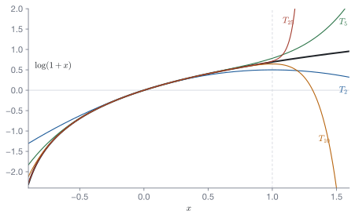{#fig-taylor-log width=70%}
:::

The sign of the remainder gives inequalities valid on the whole line. For the exponential every derivative is positive, so every Taylor
polynomial of odd degree lies below it [@radozycki2020solving, Sec. 11.2, Problem 1].

::: {#exm-taylor-exp-inequality}
#### $e^x \geq 1 + x + \tfrac{x^2}{2} + \tfrac{x^3}{6}$

$R_3(x) = e^cx^4/4! \geq 0$ for every $x$, so $e^x \geq T_3(x) = 1 + x + x^2/2 + x^3/6$ on all of $\mathbb{R}$, with equality only at $0$. The same argument with
$R_{2m-1}(x) = e^cx^{2m}/(2m)! \geq 0$ gives $e^x \geq T_{2m-1}(x)$; for $x < 0$ this is not obvious from the series, whose terms alternate in sign.
:::

The pendulum obeys $\ddot\theta = -(g/\ell)\sin\theta$, and for small swings one replaces $\sin\theta$ by $\theta$, turning it into a harmonic oscillator.
Taylor's theorem says how small "small" has to be.

::: {#exm-taylor-pendulum}
#### The small-angle approximation

With $n = 2$, $\sin\theta = \theta + R_2$ and $|R_2| \leq |\theta|^3/6$, so the relative error of $\sin\theta \approx \theta$ is at most $\theta^2/6$. At $10° = 0.1745$ rad it is
below $0.51\%$, at $30° = 0.5236$ rad below $4.6\%$. Keeping the next term, $\sin\theta \approx \theta - \theta^3/6$, the error is below $|\theta|^5/120$, which is $1.4 \cdot 10^{-6}$ at
$10°$.
:::

The relativistic energy $\gamma mc^2$ is a function of $u = \beta^2$, and its Taylor expansion produces the rest energy, the Newtonian kinetic energy and a
correction with an explicit bound. This refines @exm-mvt-relativistic-kinetic.

::: {#exm-taylor-relativistic-energy}
#### The first relativistic correction

$g(u) = (1 - u)^{-1/2}$ has $g'(u) = \tfrac12(1 - u)^{-3/2}$ and $g''(u) = \tfrac34(1 - u)^{-5/2}$. With $n = 1$, $g(u) = 1 + u/2 + \tfrac38(1 - c)^{-5/2}u^2$ with $0 < c < u$,
so
$$
0 < \gamma - 1 - \tfrac12\beta^2 < \tfrac38\beta^4(1 - \beta^2)^{-5/2}.
$$
At $\beta = 0.1$ the correction $\gamma - 1 - \beta^2/2 = 3.78 \cdot 10^{-5}$ lies below the bound $3.85 \cdot 10^{-5}$, and is close to $\tfrac38\beta^4 = 3.75 \cdot 10^{-5}$.
:::

Near a minimum every smooth potential is harmonic to second order, and Taylor's theorem gives the frequency of small oscillations. The Morse potential
of a diatomic molecule is the standard case.

::: {#exm-taylor-morse}
#### Vibrations of a diatomic molecule

The Morse potential $V(r) = D(1 - e^{-a(r - r_0)})^2$ has, with $y = e^{-a(r - r_0)}$ and $y' = -ay$, $V' = 2Da(y - y^2)$, $V'' = 2Da^2(2y^2 - y)$ and $V''' =
2Da^3(y - 4y^2)$. At $r_0$, $y = 1$: $V = 0$, $V' = 0$, $V'' = 2Da^2$, $V''' = -6Da^3$. So $V(r) = Da^2(r - r_0)^2 + R_2$ with $|R_2| \leq \tfrac16\max|V'''||r - r_0|^3$, and
small vibrations of reduced mass $\mu$ have $\omega = \sqrt{V''(r_0)/\mu} = a\sqrt{2D/\mu}$.
:::

A function can be differentiable infinitely often and still not be given by its Taylor series. The last example is the standard one, $e^{-1/x^2}$, with all
derivatives zero at the origin [@abbott2015understanding, Sec. 6.6 and Exercise 6.6.6].

::: {#exm-taylor-non-analytic}
#### A Taylor series that misses the function

Let $f(x) = e^{-1/x^2}$ for $x \neq 0$, $f(0) = 0$. By induction, $f^{(n)}(x) = P_n(1/x)e^{-1/x^2}$ for $x \neq 0$ with a polynomial $P_n$, since the derivative of
$P(1/x)e^{-1/x^2}$ is $\big(-P'(1/x)/x^2 + 2P(1/x)/x^3\big)e^{-1/x^2}$. For $|t| \to \infty$, $|t|^me^{-t^2} \leq k!\,|t|^{m-2k} \to 0$ with $2k > m$, by $e^{t^2} \geq t^{2k}/k!$. So
$f^{(n)}(h)/h = (1/h)P_n(1/h)e^{-1/h^2} \to 0$, and by induction $f^{(n+1)}(0) = 0$ for all $n$. The Taylor series of $f$ at $0$ is identically $0$ and converges
everywhere, but to $f(x)$ only at $x = 0$: every $T_n$ has the error $f(x) > 0$.
:::
::::

:::: {.callout-note .exercises-fold collapse="true" title="Exercises"}
Sage's `taylor` produces the polynomials, and sampling the error shows how tight the Lagrange bound is. The first exercise does this for four
functions and expands $\sin x$ around a different centre.

::: {#exr-taylor-sage}
#### Taylor polynomials in Sage

Find the degree-4 Taylor polynomials of $e^x$, $\log(1 + x)$, $\sqrt{1 + x}$ and $1/(1 - x)$ at $0$, compare the maximal error of $T_4$ for $e^x$ on $[0, 1]$ with
the Lagrange bound $e/5!$, and expand $\sin x$ around $\pi/2$ to degree $4$.
:::

::: {.callout-note .solution collapse="true" title="Solution"}
:::: {.panel-tabset .solution-tabs}
## Proof

From the derivatives at $0$: $e^x$ gives $\sum_{k \leq 4}x^k/k!$; $\log(1 + x)$ gives $x - x^2/2 + x^3/3 - x^4/4$ (@exm-taylor-log2); $\sqrt{1 + x}$ gives $1 + \frac x2 -
\frac{x^2}{8} + \frac{x^3}{16} - \frac{5x^4}{128}$ (@exm-taylor-binomial with $\alpha = \tfrac12$); $1/(1 - x)$, with $f^{(k)}(0) = k!$, gives $1 + x + x^2 + x^3 + x^4$. On $[0, 1]$ the
error of $T_4$ for $e^x$ is $e^cx^5/5! \leq e/120$. Around $\pi/2$ the derivatives of $\sin$ are $1, 0, -1, 0, 1$, so $T_4 = 1 - (x - \pi/2)^2/2 + (x - \pi/2)^4/24$.

## SageMath

Sage computes the polynomials and samples the error of $T_4$ for $e^x$.

```{.python .sage}
x = var("x")
for f in [exp(x), log(1 + x), sqrt(1 + x), 1 / (1 - x)]:
    print(f, ":", taylor(f, x, 0, 4))
T4 = taylor(exp(x), x, 0, 4)
err = max(abs(exp(t) - T4.subs(x=t)).n() for t in [k / 20 for k in range(21)])
print("max error on [0, 1]:", err, "<= e/5! =", (e / factorial(5)).n(), ":", bool(err <= (e / factorial(5)).n()))
print("sin x around pi/2:", taylor(sin(x), x, pi / 2, 4))
```

```{.text .sage-output}
e^x : 1/24*x^4 + 1/6*x^3 + 1/2*x^2 + x + 1
log(x + 1) : -1/4*x^4 + 1/3*x^3 - 1/2*x^2 + x
sqrt(x + 1) : -5/128*x^4 + 1/16*x^3 - 1/8*x^2 + 1/2*x + 1
-1/(x - 1) : x^4 + x^3 + x^2 + x + 1
max error on [0, 1]: 0.00994849512571161 <= e/5! = 0.0226523485704920 : True
sin x around pi/2: 1/384*(pi - 2*x)^4 - 1/8*(pi - 2*x)^2 + 1
```
::::
:::

The remainder bound tells which degree guarantees a prescribed accuracy on a given interval. The second exercise works this out for $\sin x$ on two
intervals and two tolerances.

::: {#exr-taylor-remainder-bound}
#### How many terms?

How many terms of the Taylor polynomial of $\sin x$ at $0$ guarantee an error below $10^{-6}$ on $[-\pi, \pi]$? Below $10^{-10}$ on $[-1, 1]$?
:::

::: {.callout-note .solution collapse="true" title="Solution"}
:::: {.panel-tabset .solution-tabs}
## Proof

By @exm-taylor-sin the error of $T_{2m-1}$ is at most $|x|^{2m+1}/(2m + 1)!$. On $[-\pi, \pi]$, $m = 8$ gives $\pi^{17}/17! = 8.0 \cdot 10^{-7}$ while $m = 7$ gives
$\pi^{15}/15! = 2.2 \cdot 10^{-5}$, so $T_{15}$ (eight non-zero terms) is needed. On $[-1, 1]$ the bound is $1/(2m + 1)!$: $1/13! = 1.6 \cdot 10^{-10}$ is just
above the target and $1/15! = 7.6 \cdot 10^{-13}$ below it, so $T_{13}$ (seven terms) suffices.

## SageMath

Sage finds the first $m$ for which each bound is below its tolerance.

```{.python .sage}
for X, tol in [(pi, 1e-6), (1, 1e-10)]:
    m = next(m for m in range(1, 30) if (X^(2 * m + 1) / factorial(2 * m + 1)).n() < tol)
    print("interval radius", X, ": m =", m, ", degree", 2 * m - 1, ", bound", N(X^(2 * m + 1) / factorial(2 * m + 1), digits=3))
```

```{.text .sage-output}
interval radius pi : m = 8 , degree 15 , bound 7.95e-7
interval radius 1 : m = 7 , degree 13 , bound 7.65e-13
```
::::
:::

A Taylor polynomial can be centred at any point, and the derivatives there decide the coefficients. The third exercise expands the cosine about
$\pi/3$ and bounds the error at a nearby point [@riley2006mathematical, Sec. 4.6.1].

::: {#exr-taylor-cos-pi3}
#### The cosine about $\pi/3$

Find the Taylor polynomial $T_2$ of $\cos x$ at $a = \pi/3$, and bound the error of $\cos 1.1 \approx T_2(1.1 - \pi/3)$.
:::

::: {.callout-note .solution collapse="true" title="Solution"}
:::: {.panel-tabset .solution-tabs}
## Proof

$\cos(\pi/3) = \tfrac12$, $-\sin(\pi/3) = -\tfrac{\sqrt3}2$, $-\cos(\pi/3) = -\tfrac12$, so $T_2(h) = \tfrac12 - \tfrac{\sqrt3}{2}h - \tfrac14h^2$. The third derivative $\sin$ is
bounded by $1$, so the error is at most $|h|^3/6$; for $h = 1.1 - \pi/3 = 0.0528$ this is $2.5 \cdot 10^{-5}$.

## SageMath

Sage evaluates $T_2$ at $h = 1.1 - \pi/3$ and compares with $\cos 1.1$.

```{.python .sage}
h = 1.1 - pi.n() / 3
T2 = 1 / 2 - sqrt(3.0) / 2 * h - h^2 / 4
print("T2 =", round(T2, 7), "; cos 1.1 =", round(cos(1.1), 7), "; error", N(abs(T2 - cos(1.1)), digits=3), "<= bound", N(abs(h)^3 / 6, digits=3))
```

```{.text .sage-output}
T2 = 0.4535747 ; cos 1.1 = 0.4535961 ; error 0.0000214 <= bound 0.0000245
```
::::
:::

The second-order Taylor expansion decides whether a critical point is a minimum or a maximum. The fourth exercise proves the second-derivative test
and applies it to the double-well potential.

::: {#exr-taylor-second-derivative}
#### Second-order conditions

Let $f$ be twice differentiable near $a$ with $f''$ continuous at $a$. Use Taylor's theorem to show that if $f'(a) = 0$ and $f''(a) > 0$ then $f$ has a strict
local minimum at $a$, and apply it to the potential $V(\phi) = \tfrac14(\phi^2 - 1)^2$.
:::

::: {.callout-note .solution collapse="true" title="Solution"}
:::: {.panel-tabset .solution-tabs}
## Proof

With $n = 1$, $f(a + h) = f(a) + \tfrac12 f''(c) h^2$ with $c$ between $a$ and $a + h$. By continuity $f''(c) > 0$ for $|h|$ small, so $f(a + h) > f(a)$ for $0 <
|h|$ small. For $V$: $V'(\phi) = \phi(\phi^2 - 1)$ vanishes at $0, \pm1$, and $V''(\phi) = 3\phi^2 - 1$ is $-1$ at $0$ (a local maximum, by the same argument for $-V$) and $2$ at
$\pm1$ (strict local minima). The two minima at $\phi = \pm1$ are the degenerate vacua of the symmetric double well.

## SageMath

Sage finds the critical points of $V$ and the sign of $V''$ at each.

```{.python .sage}
p = var("phi")
V = (p^2 - 1)^2 / 4
print([(s.rhs(), diff(V, p, 2).subs({p: s.rhs()})) for s in solve(diff(V, p) == 0, p)])
```

```{.text .sage-output}
[(-1, 2), (1, 2), (0, -1)]
```
::::
:::

A polynomial that approximates $f$ to order $n + 1$ must be the Taylor polynomial, which lets one find Taylor polynomials without derivatives. The fifth
exercise proves this uniqueness and uses it for $e^{x^2}$.

::: {#exr-taylor-uniqueness}
#### Uniqueness of the Taylor polynomial

Let $f$ be $n + 1$ times differentiable near $a$ with $f^{(n+1)}$ bounded, and let $P$ be a polynomial of degree at most $n$ with $|f(a + h) - P(h)| \leq C|h|^{n+1}$
for small $|h|$. Prove $P = T_n$. Deduce that $T_6$ of $e^{x^2}$ at $0$ is $1 + x^2 + x^4/2 + x^6/6$.
:::

::: {.callout-note .solution collapse="true" title="Solution"}
:::: {.panel-tabset .solution-tabs}
## Proof

By Taylor's theorem $|f(a + h) - T_n(h)| \leq M|h|^{n+1}/(n + 1)!$, so $Q = P - T_n$ satisfies $|Q(h)| \leq C'|h|^{n+1}$ for small $|h|$. If $Q \neq 0$, let $q_jh^j$ be its
lowest non-zero term, $j \leq n$. Then $Q(h)/h^j \to q_j$, but $|Q(h)/h^j| \leq C'|h|^{n+1-j} \to 0$, so $q_j = 0$, a contradiction. For $e^{x^2}$: with $y = x^2$, $|e^y - (1 + y +
y^2/2 + y^3/6)| \leq e^{|y|}|y|^4/24 \leq e|x|^8/24 \leq e|x|^7/24$ for $|x| \leq 1$, by @exm-taylor-exp's remainder. All derivatives of $e^{x^2}$ are continuous, hence bounded
near $0$ (@def-continuity), so the uniqueness with $n = 6$ gives $T_6 = 1 + x^2 + x^4/2 + x^6/6$.

## SageMath

Sage computes the Taylor polynomial of $e^{x^2}$ directly.

```{.python .sage}
x = var("x")
print(taylor(exp(x^2), x, 0, 6), "|", bool(taylor(exp(x^2), x, 0, 6) == 1 + x^2 + x^4 / 2 + x^6 / 6))
```

```{.text .sage-output}
1/6*x^6 + 1/2*x^4 + x^2 + 1 | True
```
::::
:::

Taylor polynomials with remainder decide limits of the form $0/0$ by comparing the first non-vanishing terms. The sixth exercise treats three
such limits [@radozycki2020solving, Sec. 10.5, Exercise 5(d) and Sec. 11.4, Exercise 3].

::: {#exr-taylor-limits}
#### Limits from Taylor polynomials

Find $\lim_{x \to 0}\frac{e^x - 1 - x}{x^2}$, $\lim_{x \to 0}\frac{x - \sin x}{x^3}$ and $\lim_{x \to 0}\frac{\sin x - x\cos 2x}{\sin^3 x}$.
:::

::: {.callout-note .solution collapse="true" title="Solution"}
:::: {.panel-tabset .solution-tabs}
## Proof

$e^x = 1 + x + x^2/2 + R_2$ with $|R_2| \leq e|x|^3/6$ for $|x| \leq 1$, so the first quotient is $\tfrac12 + O(x) \to \tfrac12$. $\sin x = x - x^3/6 + R_4$ with $|R_4| \leq
|x|^5/120$, so the second is $\tfrac16 + O(x^2) \to \tfrac16$. For the third, $\cos 2x = 1 - 2x^2 + R$ with $|R| \leq (2x)^4/24$, so $\sin x - x\cos 2x = (-\tfrac16 +
2)x^3 + O(x^5) = \tfrac{11}6x^3 + O(x^5)$, while $\sin^3x = x^3(\sin x/x)^3$ with $\sin x/x \to 1$. The limit is $\tfrac{11}{6}$.

## SageMath

Sage computes the three limits.

```{.python .sage}
x = var("x")
print(limit((exp(x) - 1 - x) / x^2, x=0), limit((x - sin(x)) / x^3, x=0), limit((sin(x) - x * cos(2 * x)) / sin(x)^3, x=0))
```

```{.text .sage-output}
1/2 1/6 11/6
```
::::
:::

The second difference quotient approximates the second derivative, as the first one does the first. The seventh exercise proves this from Taylor's
theorem, under continuity of $f''$ [@abbott2015understanding, Exercise 5.3.12].

::: {#exr-taylor-second-difference}
#### The second difference quotient

Let $f$ be twice differentiable on an open interval containing $a$, with $f''$ continuous at $a$. Prove $\lim_{h \to 0}\frac{f(a + h) - 2f(a) + f(a - h)}{h^2} =
f''(a)$.
:::

::: {.callout-note .solution collapse="true" title="Solution"}
:::: {.panel-tabset .solution-tabs}
## Proof

With $n = 1$, $f(a \pm h) = f(a) \pm f'(a)h + \tfrac12f''(c_\pm)h^2$ with $c_\pm$ between $a$ and $a \pm h$. Adding, $\frac{f(a + h) - 2f(a) + f(a - h)}{h^2} = \tfrac12\big(f''(c_+)
+ f''(c_-)\big)$, and $c_\pm \to a$ as $h \to 0$, so the continuity of $f''$ at $a$ gives the limit $f''(a)$.

## SageMath

Check on $\sin$ at $a = 1$: Sage compares the second difference quotient with $-\sin 1$.

```{.python .sage}
for k in [1, 2, 3]:
    h = 10.0^(-k)
    print("h = 1e-%d:" % k, round((sin(1 + h) - 2 * sin(1.0) + sin(1 - h)) / h^2, 8), "; -sin 1 =", round(-sin(1.0), 8))
```

```{.text .sage-output}
h = 1e-1: -0.84076999 ; -sin 1 = -0.84147098
h = 1e-2: -0.84146397 ; -sin 1 = -0.84147098
h = 1e-3: -0.84147091 ; -sin 1 = -0.84147098
```
::::
:::

The Lennard-Jones potential models the interaction of two neutral atoms, and its minimum gives the bond length and the vibration frequency. The eighth
exercise finds both with the second-order expansion of @exm-taylor-morse.

::: {#exr-taylor-lennard-jones}
#### The Lennard-Jones well

For $V(r) = 4\varepsilon\big((\sigma/r)^{12} - (\sigma/r)^6\big)$, find the minimum $r_0$, the depth $V(r_0)$ and $V''(r_0)$, and the frequency $\omega$ of small vibrations of
reduced mass $\mu$.
:::

::: {.callout-note .solution collapse="true" title="Solution"}
:::: {.panel-tabset .solution-tabs}
## Proof

$V'(r) = 4\varepsilon\big(-12\sigma^{12}r^{-13} + 6\sigma^6r^{-7}\big)$ vanishes when $r^6 = 2\sigma^6$, at $r_0 = 2^{1/6}\sigma$, where $(\sigma/r_0)^6 = \tfrac12$ and $V(r_0) = 4\varepsilon(\tfrac14 - \tfrac12) =
-\varepsilon$. $V''(r) = 4\varepsilon\big(156\sigma^{12}r^{-14} - 42\sigma^6r^{-8}\big)$, and at $r_0$, $\sigma^{12}r_0^{-14} = \tfrac14r_0^{-2}$ and $\sigma^6r_0^{-8} = \tfrac12r_0^{-2}$, so
$V''(r_0) = 4\varepsilon(39 - 21)/r_0^2 = 72\varepsilon/r_0^2 = 36 \cdot 2^{2/3}\varepsilon/\sigma^2 > 0$: a strict minimum (@exr-taylor-second-derivative). Then $\omega = \sqrt{V''(r_0)/\mu} =
6\sqrt{2\varepsilon/\mu}/r_0$.

## SageMath

Sage solves $V' = 0$ and evaluates $V$ and $V''$ at the positive root.

```{.python .sage}
r, s, eps = var("r sigma epsilon")
assume(s > 0, eps > 0, r > 0)
V = 4 * eps * ((s / r)^12 - (s / r)^6)
r0 = 2^(1/6) * s
print(bool(diff(V, r).subs(r=r0) == 0), V.subs(r=r0).simplify_full(), diff(V, r, 2).subs(r=r0).simplify_full(), N(36 * 2^(2/3), digits=6))
forget()
```

```{.text .sage-output}
True -epsilon 36*2^(2/3)*epsilon/sigma^2 57.1464
```
::::
:::

The cosine, like the sine, is equal to its Taylor series everywhere, and the remainder bound says how many terms a given accuracy costs. The ninth
exercise proves the first and estimates the second at a large argument.

::: {#exr-taylor-cos-series}
#### The cosine series

Prove that $\cos x = \sum_{k \geq 0}(-1)^kx^{2k}/(2k)!$ for every real $x$, the series $C$ of @exm-power-exponential. How large must $m$ be so that the partial sum up to
$x^{2m}$ approximates $\cos 10$ within $10^{-6}$?
:::

::: {.callout-note .solution collapse="true" title="Solution"}
:::: {.panel-tabset .solution-tabs}
## Proof

The derivatives of $\cos$ at $0$ cycle through $1, 0, -1, 0$, so $T_{2m+1}(x) = \sum_{k \leq m}(-1)^kx^{2k}/(2k)!$, and every derivative is bounded by $1$, so $|\cos x - T_{2m+1}(x)| \leq
|x|^{2m+2}/(2m + 2)!$. These are terms of the convergent series $E(|x|)$, so they tend to $0$ (@def-series), and the series converges to $\cos x$. At $x = 10$ the bound
$10^{2m+2}/(2m + 2)!$ first falls below $10^{-6}$ at $m = 18$.

## SageMath

Sage finds the first $m$ and compares the partial sum with $\cos 10$.

```{.python .sage}
m = next(m for m in range(1, 60) if 10^(2 * m + 2) / factorial(2 * m + 2) < 1e-6)
S = sum((-1)^k * 10^(2 * k) / factorial(2 * k) for k in range(m + 1))
print("m =", m, "; partial sum", N(S, digits=10), "; cos 10 =", N(cos(10), digits=10), "; error", N(abs(S - cos(10)), prec=200).n(digits=3))
```

```{.text .sage-output}
m = 18 ; partial sum -0.8390713495 ; cos 10 = -0.8390715291 ; error 1.80e-7
```
::::
:::

Newton's method solves $f(x) = 0$ by following tangent lines, and Taylor's theorem explains why it doubles the number of correct digits at each step. The
last exercise proves the error formula and applies it to the recursion for $\sqrt2$ of @exr-monotone-sqrt-c.

::: {#exr-taylor-newton}
#### Newton's method converges quadratically

Let $f$ be twice differentiable with $f(r) = 0$, and $x_{k+1} = x_k - f(x_k)/f'(x_k)$ with $f'(x_k) \neq 0$. Prove $r - x_{k+1} = -\frac{f''(\xi_k)}{2f'(x_k)}(r - x_k)^2$ for
some $\xi_k$ between $x_k$ and $r$. For $f(x) = x^2 - 2$ and $x_0 = 2$, deduce $|x_{k+1} - \sqrt2| \leq \tfrac12|x_k - \sqrt2|^2$.
:::

::: {.callout-note .solution collapse="true" title="Solution"}
:::: {.panel-tabset .solution-tabs}
## Proof

Taylor's theorem with $n = 1$ at $x_k$ evaluated at $r$ gives $0 = f(r) = f(x_k) + f'(x_k)(r - x_k) + \tfrac12f''(\xi_k)(r - x_k)^2$. Dividing by $f'(x_k)$, $\frac{f(x_k)}{f'(x_k)} + r
- x_k = -\frac{f''(\xi_k)}{2f'(x_k)}(r - x_k)^2$, and the left side is $r - x_{k+1}$. For $x^2 - 2$, $x_{k+1} = \tfrac12(x_k + 2/x_k)$, with $x_k \geq \sqrt2$ for $k \geq 1$ by the
inequality of the arithmetic and geometric means (and $x_0 = 2$), so $|r - x_{k+1}| = \frac{2}{2 \cdot 2x_k}(r - x_k)^2 \leq \frac{1}{2\sqrt2}(r - x_k)^2 \leq \tfrac12(r - x_k)^2$.

## SageMath

Sage runs Newton's recursion in exact arithmetic and prints the errors, whose number of zeros roughly doubles.

```{.python .sage}
R = RealField(300)
xk = QQ(2)
for k in range(1, 6):
    prev = xk
    xk = (xk + 2 / xk) / 2
    print("k =", k, ": error", (R(xk) - R(2).sqrt()).n(digits=3), "; bound", ((R(prev) - R(2).sqrt())^2 / 2).n(digits=3))
```

```{.text .sage-output}
k = 1 : error 0.0858 ; bound 0.172
k = 2 : error 0.00245 ; bound 0.00368
k = 3 : error 2.12e-6 ; bound 3.01e-6
k = 4 : error 1.59e-12 ; bound 2.26e-12
k = 5 : error 8.99e-25 ; bound 1.27e-24
```
::::
:::
::::

### Derivative and Taylor values

The derivatives, Taylor polynomial and mean value point of this section are collected in one proposition. The remainder bound for $T_7$ of
the sine is stated at three points, where it can be compared with the actual error.

:::: {.statement-box}
::: {#prp-derivative-values}
#### Derivatives, Taylor polynomials and the mean value point

$(\sin x^2)' = 2x\cos x^2$, $(x^2 e^x)' = (x^2 + 2x)e^x$, $(\log x)' = 1/x$; $T_7(x) = x - x^3/6 + x^5/120 - x^7/5040$ for $\sin x$ with $|\sin x - T_7(x)| \leq |x|^9/9!$
at $x = 1, 2, 3$; and the mean value point of $x^3$ on $[0, 2]$ is $c = 2/\sqrt3$.
:::
::::

*Proof.* The three derivatives are @exm-derivative-chain and @exm-derivative-inverse-functions. The polynomial and the bound are @exm-taylor-sin: $T_7 =
T_8$ and $|\sin^{(9)}| \leq 1$ give $|\sin x - T_7(x)| \leq |x|^9/9!$ for every $x$, in particular at $1$, $2$ and $3$. For $x^3$ on $[0, 2]$ the mean value theorem
(@thm-mean-value) requires $3c^2 = 4$ with $c \in (0, 2)$, whose only solution is $c = 2/\sqrt3$ (@exm-mvt-cubic). $\square$

:::: {.callout-note .examples-fold collapse="true" title="Examples"}
The check relies on Sage's `diff` and `taylor`, which are exact rather than numerical. The first example runs the three calls involved and prints
the polynomial with its rational coefficients.

::: {#exm-derivative-values-sage}
#### Symbolic differentiation

Sage's `diff` applies the rules of @def-derivative symbolically, and `taylor(sin(x), x, 0, 7)` returns the exact polynomial with rational coefficients.

```{.python .sage}
x = var("x")
print(diff(sin(x^2), x), "|", diff(x^2 * exp(x), x).factor(), "|", diff(log(x), x))
print(taylor(sin(x), x, 0, 7))
```

```{.text .sage-output}
2*x*cos(x^2) | (x + 2)*x*e^x | 1/x
-1/5040*x^7 + 1/120*x^5 - 1/6*x^3 + x
```
:::

The Lagrange bound is an upper bound, and the actual error can be smaller. The second example compares the two at $x = 3$, and the figure shows
their ratio on $(0, 6]$.

::: {#exm-derivative-values-remainder}
#### The remainder at $x = 3$

$3^9/9! = 19683/362880 = 0.0542$, while the actual error is $|\sin 3 - T_7(3)| = 0.0500$: the bound overestimates, since the remainder is $\cos(c)\,3^9/9!$
(with $n = 8$) and $|\cos c| < 1$ at the actual $c$.

![The ratio of the error $|\sin x - T_7(x)|$ to the Lagrange bound $x^9/9!$ on $(0, 6]$, with the points $x = 1, 2, 3$ marked; it equals $|\cos c|$ and stays below $1$.](figures/taylor_remainder.svg){#fig-taylor-remainder width=70%}

Near $0$ the ratio is close to $1$, because $c$ lies between $0$ and $x$ and $\cos c \approx 1$; the bound is sharp there.
:::

A Taylor polynomial of $\sin y$ with its remainder bound gives one of $\sin x^2$ by the substitution $y = x^2$. The bound carries over with $y^9$ replaced
by $x^{18}$.

::: {#exm-derivative-values-sin-x2}
#### $\sin x^2$ from $\sin y$

With $y = x^2$, $|\sin x^2 - (x^2 - x^6/6 + x^{10}/120 - x^{14}/5040)| \leq x^{18}/9!$ for every $x$. Differentiating the polynomial gives $2x - x^5 + x^9/12 - x^{13}/360$, which
is $2x$ times $1 - x^4/2 + x^8/24 - x^{12}/720$, the polynomial $T_6$ of $\cos y$ at $y = x^2$: this matches $(\sin x^2)' = 2x\cos x^2$ term by term.
:::

Higher derivatives of the same functions follow by repeating the rules. The example gives the second and third derivatives of $x^2e^x$ and the
second of $\sin x^2$.

::: {#exm-derivative-values-higher}
#### Second and third derivatives

$(x^2e^x)'' = ((x^2 + 2x)e^x)' = (2x + 2)e^x + (x^2 + 2x)e^x = (x^2 + 4x + 2)e^x$, and $(x^2e^x)''' = (x^2 + 6x + 6)e^x$. For $\sin x^2$, the product rule on $2x\cos x^2$
gives $(\sin x^2)'' = 2\cos x^2 - 4x^2\sin x^2$.
:::

The mean value point of $x^3$ can be found on every interval, not only on $[0, 2]$. The example gives the general formula and checks that it
lies inside.

::: {#exm-derivative-values-mvt-general}
#### The mean value point of $x^3$ on $[a, b\rbrack$

$\frac{b^3 - a^3}{b - a} = a^2 + ab + b^2 = 3c^2$, so for $0 \leq a < b$, $c = \sqrt{(a^2 + ab + b^2)/3}$. It lies in $(a, b)$ because $a^2 < (a^2 + ab + b^2)/3 < b^2$.
For $[0, 2]$ this is $\sqrt{4/3} = 2/\sqrt3$, and for $[1, 2]$ it is $\sqrt{7/3} = 1.528$.
:::

The derivative $(\log x)' = 1/x$ gives the tangent line of the logarithm at $1$, which lies above the graph. The inequality is the one of
@exr-mvt-monotone written for $\log$.

::: {#exm-derivative-values-log-tangent}
#### The tangent of $\log$ at $1$

$\log 1 = 0$ and $\log'(1) = 1$, so the tangent at $1$ is $y = x - 1$. With $t = x - 1 > -1$, $\log x = \log(1 + t) \leq t = x - 1$ (@exr-mvt-monotone), with equality only at
$x = 1$: the graph lies below its tangent. Near $1$, $\log x = (x - 1) - (x - 1)^2/2 + \dots$ (@exm-taylor-log2).
:::

The Maxwell distribution of molecular speeds in a gas at temperature $T$ is proportional to $v^2e^{-mv^2/(2k_BT)}$. Its maximum, the most probable speed, is
found with the derivatives of the proposition.

::: {#exm-derivative-values-maxwell}
#### The most probable speed

For $f(v) = v^2e^{-\alpha v^2}$ with $\alpha = m/(2k_BT)$, the product and chain rules give $f'(v) = (2v - 2\alpha v^3)e^{-\alpha v^2}$, which vanishes for $v > 0$ only at $v = 1/\sqrt\alpha
= \sqrt{2k_BT/m}$. For nitrogen at $300$ K this is about $422$ m/s.
:::

Planck's spectrum in the frequency variable $x = h\nu/k_BT$ is proportional to $x^3/(e^x - 1)$. Setting its derivative to zero gives a transcendental
equation, whose root is Wien's displacement constant.

::: {#exm-derivative-values-wien}
#### Wien's displacement law

$\frac{d}{dx}\frac{x^3}{e^x - 1} = \frac{3x^2(e^x - 1) - x^3e^x}{(e^x - 1)^2}$ vanishes for $x > 0$ when $3(e^x - 1) = xe^x$, that is $3(1 - e^{-x}) = x$. Its positive root is $x
= 2.8214\ldots$, so the spectrum peaks at $h\nu_{\max} = 2.82\,k_BT$: the peak frequency grows linearly with the temperature.
:::

The ground state of hydrogen has the radial probability density $P(r) = \frac{4}{a_0^3}r^2e^{-2r/a_0}$, with $a_0$ the Bohr radius. Its derivative has the form of
$(x^2e^x)'$ with $x = -2r/a_0$.

::: {#exm-derivative-values-hydrogen}
#### The most probable radius

$P'(r) = \frac{4}{a_0^3}\big(2r - \frac{2r^2}{a_0}\big)e^{-2r/a_0}$ vanishes for $r > 0$ only at $r = a_0$: the electron is most probably found at the Bohr radius. $P$ increases on $(0,
a_0)$ and decreases on $(a_0, \infty)$, by the sign of $P'$ and @thm-mean-value.
:::

The bound $|x|^9/9!$ is useful near $0$ and useless far away, where the polynomial $T_7$ grows like $x^7$ while $\sin x$ stays bounded. The last
example shows this at $x = 10$.

::: {#exm-derivative-values-far}
#### Far from the centre

$T_7(10) = 10 - 166.67 + 833.33 - 1984.13 = -1307.5$, while $\sin 10 = -0.544$: the error is $1307$, below the bound $10^9/9! = 2756$ but enormous. For an error
below $10^{-6}$ at $x = 10$ one needs $10^{2m+1}/(2m + 1)! < 10^{-6}$, that is $m \geq 18$, a polynomial of degree $35$.
:::
::::

:::: {.callout-note .exercises-fold collapse="true" title="Exercises"}
Repeated differentiation of a product follows a pattern that can be guessed from the first few cases and proved by induction. The first exercise does
this for $x^2e^x$, with @exm-derivative-values-higher giving the cases $n = 2, 3$.

::: {#exr-derivative-higher}
#### Higher derivatives

Find a formula for the $n$-th derivative of $x^2e^x$ and prove it by induction.
:::

::: {.callout-note .solution collapse="true" title="Solution"}
:::: {.panel-tabset .solution-tabs}
## Proof

$(x^2e^x)^{(n)} = (x^2 + 2nx + n(n - 1))e^x$: true for $n = 0$, and differentiating, $(2x + 2n)e^x + (x^2 + 2nx + n(n - 1))e^x = (x^2 + 2(n + 1)x + (n + 1)n)e^x$, the
formula for $n + 1$.

## SageMath

Sage compares the formula with `diff` for $n \leq 8$.

```{.python .sage}
x = var("x")
print(all(bool((diff(x^2 * exp(x), x, n) - (x^2 + 2 * n * x + n * (n - 1)) * exp(x)).simplify_full() == 0) for n in range(9)))
```

```{.text .sage-output}
True
```
::::
:::

The symmetry of a function is reflected in its Taylor polynomials: even functions have only even powers, odd functions only odd ones. The second
exercise proves this and checks it on the cosine and the sine.

::: {#exr-taylor-cos-even}
#### Even and odd functions

Show that the Taylor polynomials at $0$ of an even function have only even powers and those of an odd function only odd powers, and verify this on
$\cos x$ and $\sin x$.
:::

::: {.callout-note .solution collapse="true" title="Solution"}
:::: {.panel-tabset .solution-tabs}
## Proof

Differentiating $f(-x) = f(x)$ $k$ times by the chain rule gives $(-1)^k f^{(k)}(-x) = f^{(k)}(x)$, so at $0$ the odd derivatives vanish; for odd $f$, $(-1)^kf^{(k)}(-x) =
-f^{(k)}(x)$ and the even ones vanish. $\cos$ has $\cos^{(k)}(0) = 1, 0, -1, 0, \dots$ and $\sin^{(k)}(0) = 0, 1, 0, -1, \dots$, giving the series $C$ and $S$ of
@exm-power-exponential.

## SageMath

Sage lists the Taylor coefficients of $\cos$ and $\sin$ to degree $9$.

```{.python .sage}
x = var("x")
print(taylor(cos(x), x, 0, 9).coefficients(x), "|", taylor(sin(x), x, 0, 9).coefficients(x))
```

```{.text .sage-output}
[[1, 0], [-1/2, 2], [1/24, 4], [-1/720, 6], [1/40320, 8]] | [[1, 1], [-1/6, 3], [1/120, 5], [-1/5040, 7], [1/362880, 9]]
```
::::
:::

The higher derivatives of a product follow a binomial pattern, Leibniz's rule. The third exercise proves it by induction and recovers the formula
of the first exercise from it.

::: {#exr-derivative-values-leibniz}
#### Leibniz's rule

Prove $(fg)^{(n)} = \sum_{k=0}^n\binom nkf^{(k)}g^{(n-k)}$ for $n$ times differentiable $f$, $g$, and deduce $(x^2e^x)^{(n)}$.
:::

::: {.callout-note .solution collapse="true" title="Solution"}
:::: {.panel-tabset .solution-tabs}
## Proof

For $n = 1$ it is the product rule. If it holds for $n$, differentiating each term by the product rule gives $\sum_k\binom nk\big(f^{(k+1)}g^{(n-k)} + f^{(k)}g^{(n+1-k)}\big)$,
and collecting the terms $f^{(j)}g^{(n+1-j)}$ gives the coefficients $\binom n{j-1} + \binom nj = \binom{n+1}{j}$. For $f = x^2$, $g = e^x$ only $k \leq 2$ contribute:
$x^2e^x + n\cdot 2xe^x + \binom n2 2e^x = (x^2 + 2nx + n(n - 1))e^x$.

## SageMath

Check on $f = \sin x$, $g = x^3$ and $n = 5$: Sage compares Leibniz's sum with `diff`.

```{.python .sage}
x = var("x")
f, g, n = sin(x), x^3, 5
print(bool((diff(f * g, x, n) - sum(binomial(n, k) * diff(f, x, k) * diff(g, x, n - k) for k in range(n + 1))).simplify_full() == 0))
```

```{.text .sage-output}
True
```
::::
:::

The mean value point of the proposition is unique, which the theorem itself does not say. The fourth exercise proves uniqueness for $x^3$ on $[0, 2]$
and for $\sin$ on $[0, \pi]$.

::: {#exr-derivative-values-mvt-unique}
#### A unique mean value point

Show that $c = 2/\sqrt3$ is the only point of $(0, 2)$ with $f'(c) = 4$ for $f(x) = x^3$, and that $\pi/2$ is the only point of $(0, \pi)$ with $\cos c = 0$. Give a function on
$[0, 2\pi]$ with several mean value points.
:::

::: {.callout-note .solution collapse="true" title="Solution"}
:::: {.panel-tabset .solution-tabs}
## Proof

$3c^2 = 4$ has the roots $\pm2/\sqrt3$, and only the positive one lies in $(0, 2)$. $\cos$ is strictly decreasing on $[0, \pi]$, as $\cos' = -\sin < 0$ on $(0, \pi)$
(@thm-mean-value), so it vanishes at most once there, at $\pi/2$. For $\sin$ on $[0, 2\pi]$ the average slope is $0$ and $\cos c = 0$ at $c = \pi/2$ and $3\pi/2$.

## SageMath

Sage solves the equations on the intervals.

```{.python .sage}
x = var("x")
print([s.rhs() for s in solve(3 * x^2 == 4, x)], "|", [N(r, digits=6) for r in [pi / 2, 3 * pi / 2]], [cos(r) for r in [pi / 2, 3 * pi / 2]])
```

```{.text .sage-output}
[-2/3*sqrt(3), 2/3*sqrt(3)] | [1.57080, 4.71239] [0, 0]
```
::::
:::

The remainder bound of the proposition can be compared with the actual error at the three points. The fifth exercise computes both and their ratio,
which @fig-taylor-remainder shows as a curve.

::: {#exr-derivative-values-sin-errors}
#### The error at three points

Compute $|\sin x - T_7(x)|$ and $x^9/9!$ at $x = 1, 2, 3$, and the ratio of the two. Why is the ratio below $1$?
:::

::: {.callout-note .solution collapse="true" title="Solution"}
:::: {.panel-tabset .solution-tabs}
## Proof

By Taylor's theorem with $n = 8$, $\sin x - T_7(x) = \sin^{(9)}(c)x^9/9! = \cos(c)x^9/9!$ for some $c \in (0, x)$, so the ratio is $|\cos c|$. It is below $1$, since $\cos c = \pm1$
only at multiples of $\pi$, and none lies in $(0, 3]$.

## SageMath

Sage evaluates the errors and bounds with fifty digits.

```{.python .sage}
R = RealField(170)
T7 = lambda t: t - t^3 / 6 + t^5 / 120 - t^7 / 5040
for t in (1, 2, 3):
    err, bnd = abs(sin(R(t)) - T7(R(t))), R(t)^9 / factorial(9)
    print("x =", t, ": error", N(err, digits=5), "; bound", N(bnd, digits=5), "; ratio", N(err / bnd, digits=5))
```

```{.text .sage-output}
x = 1 : error 2.7308e-6 ; bound 2.7557e-6 ; ratio 0.99097
x = 2 : error 0.0013609 ; bound 0.0014109 ; ratio 0.96455
x = 3 : error 0.050049 ; bound 0.054241 ; ratio 0.92271
```
::::
:::

The Taylor polynomial of the logarithm at $1$ approximates logarithms of numbers near $1$, with a remainder controlled by the third derivative. The
sixth exercise estimates $\log 1.1$ this way.

::: {#exr-derivative-values-log-second}
#### $\log 1.1$ from $T_2$

Find $T_2$ of $\log x$ at $a = 1$ and bound the error of $\log 1.1 \approx T_2(0.1)$.
:::

::: {.callout-note .solution collapse="true" title="Solution"}
:::: {.panel-tabset .solution-tabs}
## Proof

$\log' = 1/x$, $\log'' = -1/x^2$, $\log''' = 2/x^3$, so $T_2(h) = h - h^2/2$ and $T_2(0.1) = 0.095$. The remainder is $\frac{2}{c^3}\frac{h^3}{6}$ with $1 < c < 1.1$, so it lies
between $0$ and $h^3/3 = 3.3 \cdot 10^{-4}$, and $0.095 < \log 1.1 < 0.09534$.

## SageMath

Sage compares $T_2(0.1)$ with $\log 1.1$.

```{.python .sage}
print(N(log(1.1), digits=8), "; error", N(log(1.1) - 0.095, digits=4), "; bound", N(0.1^3 / 3, digits=4))
```

```{.text .sage-output}
0.095310180 ; error 0.0003102 ; bound 0.0003333
```
::::
:::

Wien's equation $3(1 - e^{-x}) = x$ of @exm-derivative-values-wien has exactly one positive root, and the intermediate value theorem with the mean value
theorem proves it. The seventh exercise also locates the root.

::: {#exr-derivative-values-wien}
#### Wien's equation has one positive root

Prove that $g(x) = 3(1 - e^{-x}) - x$ has exactly one zero in $(0, \infty)$, that it lies in $(2, 3)$, and compute it.
:::

::: {.callout-note .solution collapse="true" title="Solution"}
:::: {.panel-tabset .solution-tabs}
## Proof

$g(0) = 0$ and $g'(x) = 3e^{-x} - 1$ is positive for $x < \log 3$ and negative for $x > \log 3$. So $g$ is strictly increasing on $[0, \log 3]$, hence positive on $(0,
\log 3]$, and strictly decreasing on $[\log 3, \infty)$ (@thm-mean-value), with $g(x) < 3 - x \to -\infty$. It has exactly one zero beyond $\log 3$, and $g(2) =
1 - 3e^{-2} > 0 > g(3) = -3e^{-3}$ places it in $(2, 3)$.

## SageMath

Sage finds the root and checks the signs.

```{.python .sage}
g = lambda t: 3 * (1 - exp(-t)) - t
print(N(g(2), digits=4), N(g(3), digits=4), "; root:", round(find_root(g, 2, 3), 6))
```

```{.text .sage-output}
0.5940 -0.1494 ; root: 2.821439
```
::::
:::

The most probable speed of @exm-derivative-values-maxwell is a maximum, and the second-derivative test of @exr-taylor-second-derivative proves it. The
eighth exercise also compares it with the speed $\sqrt{3k_BT/m}$ that has the mean kinetic energy.

::: {#exr-derivative-values-maxwell}
#### The Maxwell maximum

For $f(v) = v^2e^{-\alpha v^2}$, compute $f''(v_p)$ at $v_p = 1/\sqrt\alpha$ and show it is negative. For nitrogen ($m = 4.65 \cdot 10^{-26}$ kg) at $300$ K, compute $v_p$ and
$\sqrt{3k_BT/m}$.
:::

::: {.callout-note .solution collapse="true" title="Solution"}
:::: {.panel-tabset .solution-tabs}
## Proof

$f'(v) = 2(v - \alpha v^3)e^{-\alpha v^2}$, so $f''(v) = 2\big((1 - 3\alpha v^2) - 2\alpha v(v - \alpha v^3)\big)e^{-\alpha v^2}$. At $v_p$, $v_p - \alpha v_p^3 = 0$ and $1 - 3\alpha v_p^2 = -2$, so $f''(v_p) =
-4e^{-1} < 0$: a strict local maximum. With $k_B = 1.381 \cdot 10^{-23}$ J/K, $v_p = \sqrt{2k_BT/m} = 422$ m/s and $\sqrt{3k_BT/m} = 517$ m/s.

## SageMath

Sage computes $f''(v_p)$ and the two speeds.

```{.python .sage}
v, a = var("v alpha")
assume(a > 0)
f = v^2 * exp(-a * v^2)
print(diff(f, v, 2).subs(v=1 / sqrt(a)).simplify_full())
kB, T, m = 1.380649e-23, 300, 4.65e-26
print(round(sqrt(2 * kB * T / m), 1), round(sqrt(3 * kB * T / m), 1))
forget()
```

```{.text .sage-output}
-4*e^(-1)
422.1 516.9
```
::::
:::

The Taylor polynomial of a derivative is the derivative of the Taylor polynomial, one degree lower. The ninth exercise proves this from the formula
and checks it on the sine.

::: {#exr-derivative-values-taylor-derivative}
#### Differentiating a Taylor polynomial

Let $T_n$ be the Taylor polynomial of $f$ at $a$ and $\tilde T_{n-1}$ that of $f'$. Prove $T_n'(h) = \tilde T_{n-1}(h)$. Deduce the Taylor polynomial $T_6$ of $\cos$ from $T_7$ of
$\sin$.
:::

::: {.callout-note .solution collapse="true" title="Solution"}
:::: {.panel-tabset .solution-tabs}
## Proof

$T_n'(h) = \sum_{k=1}^n\frac{f^{(k)}(a)}{k!}kh^{k-1} = \sum_{j=0}^{n-1}\frac{(f')^{(j)}(a)}{j!}h^j = \tilde T_{n-1}(h)$, with $j = k - 1$ and $f^{(j+1)} = (f')^{(j)}$. For $\sin$, $T_7' =
1 - x^2/2 + x^4/24 - x^6/720$, which is $T_6$ of $\cos = \sin'$.

## SageMath

Sage differentiates $T_7$ of $\sin$ and compares with $T_6$ of $\cos$.

```{.python .sage}
x = var("x")
print(diff(taylor(sin(x), x, 0, 7), x), "|", bool(diff(taylor(sin(x), x, 0, 7), x) == taylor(cos(x), x, 0, 6)))
```

```{.text .sage-output}
-1/720*x^6 + 1/24*x^4 - 1/2*x^2 + 1 | True
```
::::
:::

The most probable radius of @exm-derivative-values-hydrogen is a global maximum on $(0, \infty)$, and proving it uses limits at infinity, the extreme value
theorem and the mean value theorem together. The last exercise combines them.

::: {#exr-derivative-values-hydrogen-max}
#### The global maximum of the radial density

Let $P(r) = r^2e^{-2r}$ (units $a_0 = 1$, constant factor dropped). Prove that $P(r) \leq P(1) = e^{-2}$ for all $r \geq 0$, with equality only at $r = 1$, in two ways:
by the sign of $P'$, and by the extreme value theorem on $[0, R]$ with $R$ large.
:::

::: {.callout-note .solution collapse="true" title="Solution"}
:::: {.panel-tabset .solution-tabs}
## Proof

$P'(r) = 2r(1 - r)e^{-2r}$ is positive on $(0, 1)$ and negative on $(1, \infty)$, so by @thm-mean-value $P$ is strictly increasing on $[0, 1]$ and strictly decreasing on $[1,
\infty)$, and $P(r) < P(1)$ for $r \neq 1$. Second way: $P(r) = \tfrac14(2r)^2e^{-2r} \to 0$ as $r \to \infty$ (@exm-flimit-infinity), so $P(r) < e^{-2}$ for $r > R$. On $[0, R]$, $P$ attains a
maximum (@def-continuity), not at $0$ where $P = 0$, nor at $R$ where $P < e^{-2} = P(1)$; so at an interior point, where $P' = 0$ (@thm-mean-value), that is at $r = 1$.

## SageMath

Check on a grid of $[0, 20]$: Sage finds the largest sampled value and where it is attained.

```{.python .sage}
P = lambda r: r^2 * exp(-2 * r)
pts = [k / 100 for k in range(2001)]
best = max(pts, key=lambda r: P(r).n())
print("argmax on the grid:", best, "; max:", N(P(best), digits=8), "; e^-2 =", N(exp(-2), digits=8))
```

```{.text .sage-output}
argmax on the grid: 1 ; max: 0.13533528 ; e^-2 = 0.13533528
```
::::
:::
::::

## The Riemann integral {#sec-riemann-integral}

The integral measures the area under a graph as a limit of sums of rectangles; the fundamental theorem of calculus
turns it into the inverse of differentiation. This section defines the Riemann integral through lower and upper sums
and proves that monotone and continuous functions are integrable, using the completeness of the line through the
Bolzano-Weierstrass theorem of @exr-cauchy-bolzano-weierstrass. It then introduces antiderivatives, proves the
fundamental theorem, extends the integral to unbounded intervals and unbounded integrands, and ends with the values
of the running integrals, among them $\int e^{-x^2}dx = \sqrt\pi$, proved with one-variable tools only.

For antiderivatives and indefinite integrals, see @radozycki2020solving [Ch. 14].
For the Riemann and definite integral, the fundamental theorem and improper integrals, see @radozycki2020solvingII [Ch. 1, pp. 1-2; Ch. 2, pp. 53-61].
For the Riemann integral, the fundamental theorem and improper integrals, see @karpfingerCalculusLinearAlgebra2022 [Ch. 30, pp. 321-333; Ch. 32, pp. 347-352] and @ventreCalculusLinearAlgebra2023 [Ch. 22, pp. 389-421].
For the integral as $U(f) = L(f)$, the integrability of continuous functions and of functions with finitely many discontinuities, and the properties of the integral, see @abbott2015understanding [Secs. 7.2-7.4, Def. 7.2.7, Thms. 7.2.9, 7.3.2, 7.4.1-7.4.2, pp. 218-230].

### The integral as a limit of sums

The area under a graph is approximated from below and from above by rectangles, and the figure shows both
approximations for $x^2$ on $[0, 1]$ closing in as the subintervals shrink. The definition below makes the meeting of the
two approximations the definition of the integral, and lists the functions for which they meet and the basic properties
of the result. For the lower and upper sums, and the integrability of $x^2$ on $[0, 1]$ proved from them, see
[@radozycki2020solvingII, Sec. 1.1, Problem 1, pp. 2-6].

![Lower (blue) and upper (red) sums of $x^2$ on $[0, 1]$ with $n = 4$ and $n = 16$ equal subintervals. The two sums differ by $1/n$ and enclose the area under the curve.](figures/riemann_sums.svg){#fig-riemann-sums width=90%}



:::: {.statement-box}
::: {#def-riemann-integral}
#### Riemann integral

Let $f$ be bounded on $[a, b]$, $a < b$. A **partition** $P$ of $[a, b]$ is a finite set of points $a = x_0 < x_1 < \dots < x_n = b$; its **mesh** is
$\max_k (x_k - x_{k-1})$, and a partition $P'$ **refines** $P$ if $P \subseteq P'$. With $m_k$ and $M_k$ the infimum and supremum of $f$ on $[x_{k-1}, x_k]$
(@def-supremum), the **lower** and **upper sums** are
$$
L(f, P) = \sum_{k=1}^n m_k(x_k - x_{k-1}), \qquad U(f, P) = \sum_{k=1}^n M_k(x_k - x_{k-1}),
$$
and a **Riemann sum** is $\sum_k f(\xi_k)(x_k - x_{k-1})$ for points $\xi_k \in [x_{k-1}, x_k]$. The **lower integral** is $L(f) = \sup_P L(f, P)$ and the
**upper integral** $U(f) = \inf_P U(f, P)$. The function $f$ is **Riemann integrable** on $[a, b]$ if $L(f) = U(f)$, and the common value is its
**integral** $\int_a^b f = \int_a^b f(x)\,dx$. One sets $\int_b^a f = -\int_a^b f$ and $\int_a^a f = 0$. Then:

1. if $P'$ refines $P$, then $L(f, P) \leq L(f, P') \leq U(f, P') \leq U(f, P)$; every lower sum is at most every upper sum, $L(f) \leq U(f)$, and every
   Riemann sum for $P$ lies between $L(f, P)$ and $U(f, P)$;
2. $f$ is integrable if and only if for every $\varepsilon > 0$ there is a partition $P$ with $U(f, P) - L(f, P) < \varepsilon$; and if partitions $P_n$ have
   $U(f, P_n) - L(f, P_n) \to 0$, then $f$ is integrable and $L(f, P_n)$, $U(f, P_n)$ and every choice of Riemann sums for $P_n$ tend to $\int_a^b f$;
3. monotone functions, continuous functions, and bounded functions that are continuous except at finitely many points are integrable on $[a, b]$;
4. if $f$ and $g$ are integrable and $c \in \mathbb{R}$, then $f + g$, $cf$ and $|f|$ are integrable, $\int_a^b (f + g) = \int_a^b f + \int_a^b g$ and $\int_a^b cf = c\int_a^b f$;
   $f \leq g$ implies $\int_a^b f \leq \int_a^b g$, $m \leq f \leq M$ implies $m(b - a) \leq \int_a^b f \leq M(b - a)$, and $|\int_a^b f| \leq \int_a^b |f|$;
5. for $a < c < b$, $f$ is integrable on $[a, b]$ if and only if it is integrable on $[a, c]$ and on $[c, b]$, and then $\int_a^b f = \int_a^c f + \int_c^b f$;
   with the sign convention this holds for any three points of an interval on which $f$ is integrable.
:::
::::

*Proof.* (1) Adding one point $t$ to $[x_{k-1}, x_k]$ replaces $m_k(x_k - x_{k-1})$ by $m'(t - x_{k-1}) + m''(x_k - t)$, where $m'$ and $m''$ are the infima of $f$ on
$[x_{k-1}, t]$ and $[t, x_k]$. An infimum over a smaller set is larger, so $m', m'' \geq m_k$ and the lower sum does not decrease; likewise the upper sum
does not increase. Adding the points of $P'$ one at a time gives the outer inequalities, and $m_k \leq M_k$ gives the middle one. For two partitions $P$
and $Q$, the union $P \cup Q$ refines both, so $L(f, P) \leq L(f, P \cup Q) \leq U(f, P \cup Q) \leq U(f, Q)$. Taking the supremum over $P$ and then the infimum
over $Q$ gives $L(f) \leq U(f)$. A Riemann sum lies between the two sums because $m_k \leq f(\xi_k) \leq M_k$.

(2) If $f$ is integrable with integral $I$ and $\varepsilon > 0$, there are partitions $P_1$, $P_2$ with $L(f, P_1) > I - \varepsilon/2$ and $U(f, P_2) < I + \varepsilon/2$, and by (1)
$P = P_1 \cup P_2$ has $U(f, P) - L(f, P) < \varepsilon$. Conversely, $L(f, P) \leq L(f) \leq U(f) \leq U(f, P)$ for every $P$, so $0 \leq U(f) - L(f) < \varepsilon$ for every
$\varepsilon > 0$. If $U(f, P_n) - L(f, P_n) \to 0$, the criterion holds, and $L(f, P_n) \leq \int_a^b f \leq U(f, P_n)$ together with the squeeze rule of
@def-sequence-limit gives the limits; a Riemann sum for $P_n$ is squeezed between the same two sums.

(3) Let $f$ be increasing and $P_n$ the partition into $n$ equal pieces of length $h = (b - a)/n$. Then $M_k = f(x_k)$, $m_k = f(x_{k-1})$, and the difference
telescopes: $U(f, P_n) - L(f, P_n) = h\sum_k (f(x_k) - f(x_{k-1})) = h(f(b) - f(a)) \to 0$. A decreasing $f$ is handled the same way, and (2) applies.

Let $f$ be continuous. First, $f$ is **uniformly continuous**: for every $\varepsilon > 0$ there is a $\delta > 0$ with $|f(x) - f(y)| < \varepsilon$ for all $x, y \in [a, b]$
with $|x - y| < \delta$. Otherwise some $\varepsilon > 0$ has, for each $n$, points $x_n, y_n$ with $|x_n - y_n| < 1/n$ and $|f(x_n) - f(y_n)| \geq \varepsilon$. By the
Bolzano-Weierstrass theorem (@exr-cauchy-bolzano-weierstrass) a subsequence $x_{n_j}$ converges to some $c$, which lies in $[a, b]$ by the order rule of
@def-sequence-limit, and $y_{n_j} \to c$ as well. Continuity at $c$ (@def-continuity, (1)) gives $f(x_{n_j}) - f(y_{n_j}) \to 0$, a contradiction. Now take a
partition of mesh less than $\delta$. On each piece all values of $f$ lie within $\varepsilon$ of each other, so $M_k - m_k \leq \varepsilon$ and $U(f, P) - L(f, P) \leq \varepsilon(b - a)$.

Let $|f| \leq B$ and let $f$ be continuous except at $c_1 < \dots < c_r$. Given $\varepsilon > 0$, enclose each $c_i$ in a closed interval $J_i \subseteq [a, b]$ of length
$\eta$, the $J_i$ disjoint, with $2Br\eta < \varepsilon/2$. What remains of $[a, b]$ is a union of at most $r + 1$ closed intervals $K_j$ on which $f$ is continuous,
and by the previous case each $K_j$ has a partition with $U - L < \varepsilon/(2r + 2)$. Together with the endpoints of the $J_i$ these form a partition $P$ of
$[a, b]$, and since $M_k - m_k \leq 2B$ on each $J_i$, $U(f, P) - L(f, P) < 2Br\eta + \varepsilon/2 < \varepsilon$.

(4) On any set, $\sup(f + g) \leq \sup f + \sup g$ and $\inf(f + g) \geq \inf f + \inf g$, so
$L(f, P) + L(g, P) \leq L(f + g, P) \leq U(f + g, P) \leq U(f, P) + U(g, P)$. Choose partitions $P_n$ for $f$ and $Q_n$ for $g$ with $U - L < 1/n$; by (1) their
unions $R_n$ do as well for both, and the inequalities give $U(f + g, R_n) - L(f + g, R_n) < 2/n$. By (2), $f + g$ is integrable and its integral is the
limit of $L(f + g, R_n)$, squeezed between $L(f, R_n) + L(g, R_n)$ and $U(f, R_n) + U(g, R_n)$, which both tend to $\int f + \int g$. For $c \geq 0$, $L(cf, P) =
cL(f, P)$ and $U(cf, P) = cU(f, P)$; for $c < 0$ the roles swap, $L(cf, P) = cU(f, P)$; in both cases (2) gives $\int cf = c\int f$. If $f \leq g$, every lower sum of
$g - f \geq 0$ is $\geq 0$, so $\int g - \int f = \int(g - f) \geq 0$. The bounds $m(b - a) \leq L(f, P) \leq \int f \leq U(f, P) \leq M(b - a)$ hold for the partition $\{a,
b\}$. On each piece, $||f(x)| - |f(y)|| \leq |f(x) - f(y)| \leq M_k - m_k$, so the supremum minus the infimum of $|f|$ there is at most $M_k - m_k$, and $U(|f|, P) -
L(|f|, P) \leq U(f, P) - L(f, P)$: $|f|$ is integrable by (2). Finally $-|f| \leq f \leq |f|$ gives $-\int|f| \leq \int f \leq \int|f|$.

(5) Partitions of $[a, c]$ and $[c, b]$ together form a partition of $[a, b]$ containing $c$, with lower and upper sums the sums of theirs, and by (1) any
partition of $[a, b]$ may be refined to contain $c$. If $f$ is integrable on $[a, b]$, a partition $P \ni c$ with $U - L < \varepsilon$ splits into two partitions with
$U - L < \varepsilon$ each. Conversely, partitions $P_1$, $P_2$ of the two halves with $U - L < \varepsilon/2$ each form a $P$ with $U - L < \varepsilon$, and both $\int_a^b f$ and
$\int_a^c f + \int_c^b f$ lie between $L(f, P) = L(f, P_1) + L(f, P_2)$ and $U(f, P)$, so they differ by less than $\varepsilon$. For three points in another order, say
$c < a < b$, the case just proved gives $\int_c^b f = \int_c^a f + \int_a^b f$, which is the claim after the sign convention; the other orders and the cases
of equal points are the same. $\square$

These are @abbott2015understanding [Lemma 7.2.6, Thms. 7.2.8-7.2.9, 7.3.2, 7.4.1-7.4.2, Exercises 7.2.3, 7.2.7, 7.4.1], with the uniform
continuity proved here from the Bolzano-Weierstrass theorem.

:::: {.callout-note .examples-fold collapse="true" title="Examples"}
The simplest integrals are those of constant and step functions, where the lower and upper sums can be read off without any limit. The first
example computes them and shows that the integral of a step function is the sum of the areas of its rectangles.

::: {#exm-integral-constant}
#### Constant and step functions

For $f = c$ on $[a, b]$, $m_k = M_k = c$ on every piece, so $L(f, P) = U(f, P) = c(b - a)$ for every $P$ and $\int_a^b c\,dx = c(b - a)$. A step function equal to
$c_j$ on the open intervals $(t_{j-1}, t_j)$ of a partition of $[a, b]$, with any values at the $t_j$, is continuous except at finitely many points and so
integrable by (3). By (5) it suffices to integrate over one piece $[t_{j-1}, t_j]$: with $|f| \leq B$ and the partition $\{t_{j-1}, t_{j-1} + \eta, t_j - \eta,
t_j\}$, both sums lie within $4B\eta$ of $c_j(t_j - t_{j-1})$, so $\int_a^b f = \sum_j c_j(t_j - t_{j-1})$, whatever the values at the jumps.
:::

For $x^2$ the sums have closed forms through the sum of squares $\sum_{k=1}^n k^2 = n(n + 1)(2n + 1)/6$, proved by induction on $n$. The second example
computes them and lets $n \to \infty$, which is exactly the content of the figure.

::: {#exm-integral-x-squared}
#### $\int_0^1 x^2\,dx = \tfrac13$

With $n$ equal pieces the function is increasing, so the lower sum takes left ends and the upper sum right ends:
$L_n = \sum_{k=0}^{n-1}(k/n)^2/n = (n - 1)n(2n - 1)/(6n^3)$ and $U_n = n(n + 1)(2n + 1)/(6n^3)$. Both tend to $\tfrac13$, and $U_n - L_n = 1/n$ (@fig-riemann-sums),
so by (2) $\int_0^1 x^2\,dx = \tfrac13$.
:::

For a decreasing function the upper sum takes the left ends and the lower sum the right ends, and refining a partition brings the two sums
together. The third example follows this for $1/x$ on $[1, 4]$ with an uneven partition [@abbott2015understanding, Exercise 7.2.2].

::: {#exm-integral-monotone}
#### $1/x$ on $[1, 4\rbrack$ with an uneven partition

For $P = \{1, \tfrac32, 2, 4\}$, $U(f, P) = 1 \cdot \tfrac12 + \tfrac23 \cdot \tfrac12 + \tfrac12 \cdot 2 = \tfrac{11}6$ and $L(f, P) = \tfrac23 \cdot \tfrac12 + \tfrac12 \cdot \tfrac12 + \tfrac14 \cdot 2 =
\tfrac{13}{12}$, a gap of $\tfrac34$. Adding the point $3$ splits the long piece: $U = \tfrac53$, $L = \tfrac76$, and the gap falls to $\tfrac12$. In general the gap of an
increasing or decreasing function is at most $|f(b) - f(a)|$ times the mesh, by the telescoping of the proof of (3).
:::

The exponential has geometric Riemann sums, which can be summed in closed form. The fourth example finds the integral of $e^x$ on $[0, 1]$ from them
and the derivative of the exponential at $0$.

::: {#exm-integral-exponential-sums}
#### $\int_0^1 e^x\,dx = e - 1$

With $h = 1/n$ the function is increasing, and the lower sum is $h\sum_{k=0}^{n-1}e^{kh} = h\frac{e - 1}{e^h - 1}$, a geometric sum with ratio $e^h$; the upper sum
is $e^h$ times it. As $(e^h - 1)/h \to 1$, the derivative of $\exp$ at $0$ (@exm-derivative-exp-sin), both tend to $e - 1$
[@radozycki2020solvingII, Sec. 1.7, Exercise 2 (b)].
:::

A single changed value does not change the integral, because the jump can be trapped in a piece of arbitrarily small length. The fifth example does
this for the function equal to $1$ on $[0, 2]$ except at one point [@abbott2015understanding, Example 7.3.1].

::: {#exm-integral-jump}
#### One changed value

Let $f = 1$ on $[0, 2]$ except $f(1) = 0$. Every upper sum is $2$. For $P_\varepsilon = \{0, 1 - \varepsilon/3, 1 + \varepsilon/3, 2\}$ the lower sum is $2 - \tfrac23\varepsilon$, so
$U - L < \varepsilon$ and $\int_0^2 f = 2$, the integral of the constant $1$. By (4) applied to the difference, two integrable functions that differ at finitely
many points have the same integral.
:::

Work is force times distance when the force is constant, and an integral when it varies. For the spring force of the harmonic oscillator the Riemann
sums are those of a linear function, and the sixth example computes the work and the potential energy.

::: {#exm-integral-spring-work}
#### Stretching a spring

The force needed to hold a spring of constant $k$ at extension $x$ is $kx$. With $n$ equal pieces of $[0, X]$, the lower and upper sums of the work are
$kX^2\frac{n(n - 1)}{2n^2}$ and $kX^2\frac{n(n + 1)}{2n^2}$, from $\sum_{k<n} k = n(n - 1)/2$, and both tend to $W = \int_0^X kx\,dx = \tfrac12kX^2$, the potential energy
of the oscillator at amplitude $X$.
:::

For the inverse square law of gravity and of the Coulomb force in the hydrogen atom there is a choice of sample points that makes every Riemann sum
telescope. The seventh example uses it to find the integral for every partition at once.

::: {#exm-integral-inverse-square}
#### The inverse square law

For $0 < a < b$ and any partition of $[a, b]$, the point $\xi_k = \sqrt{x_{k-1}x_k}$ gives $f(\xi_k)(x_k - x_{k-1}) = \frac{x_k - x_{k-1}}{x_{k-1}x_k} = \frac{1}{x_{k-1}} - \frac{1}{x_k}$ for
$f(x) = 1/x^2$, so this Riemann sum is $\frac1a - \frac1b$ for every partition. By (1) every lower sum is $\leq \frac1a - \frac1b \leq$ every upper sum, so $\int_a^b dx/x^2 =
\frac1a - \frac1b$. The work done against the Coulomb attraction $e^2/(4\pi\varepsilon_0 r^2)$ in moving the electron of hydrogen from $r = a$ to $r = b$ is
$\frac{e^2}{4\pi\varepsilon_0}\big(\frac1a - \frac1b\big)$.
:::

The time average of $\cos^2$ over a period gives the mean kinetic energy of the oscillator, and for it even the coarsest Riemann sums are exact. The
eighth example evaluates them with a telescoping trigonometric sum.

::: {#exm-integral-oscillator-average}
#### The average of $\cos^2$ over a period

For $f(t) = \cos^2(2\pi t/T)$ on $[0, T]$ with $n \geq 3$ equal pieces and left ends, the Riemann sum is $\frac Tn\sum_{k=0}^{n-1}\cos^2(2\pi k/n) = \frac T2 + \frac{T}{2n}\sum_{k=0}^{n-1}\cos
k\theta$ with $\theta = 4\pi/n$. Since $2\sin\frac\theta2\cos k\theta = \sin(k + \tfrac12)\theta - \sin(k - \tfrac12)\theta$ telescopes and $\sin(n - \tfrac12)\theta = -\sin\frac\theta2$, the
last sum is $0$ when $\sin\frac\theta2 = \sin\frac{2\pi}{n} \neq 0$. So all these sums equal $T/2$. For a continuous function the proof of (3) gives $U - L \to 0$
for equal pieces, so by (2) the integral is $T/2$ as well: the oscillator $x = A\cos\omega t$
has mean potential energy $\tfrac12m\omega^2A^2 \cdot \tfrac12$, half its energy.
:::

Not every bounded function is integrable: if every piece of every partition contains values $0$ and $1$, the sums never meet. The indicator function of
the rationals is the standard example [@abbott2015understanding, Example 7.3.3].

::: {#exm-integral-dirichlet}
#### A function that is not integrable

The indicator function of the rationals on $[0, 1]$ has $m_k = 0$ and $M_k = 1$ on every piece, since every interval of positive length contains rationals
and irrationals. So $L(f, P) = 0$ and $U(f, P) = 1$ for every $P$, and $L(f) = 0 < 1 = U(f)$: it is not Riemann integrable, although it is $0$ except on a
countable set.
:::

Statement (3) is a sufficient condition, not a characterisation: a function with infinitely many discontinuities can still be integrable. The last
example has a discontinuity at every point $1/n$ [@abbott2015understanding, Exercise 7.3.3].

::: {#exm-integral-reciprocals}
#### Infinitely many discontinuities

Let $f = 1$ at the points $1/n$, $n \geq 1$, and $f = 0$ elsewhere on $[0, 1]$. Every lower sum is $0$. Given $\varepsilon$, the points $1/n \geq \varepsilon/2$ are finitely
many, at most $2/\varepsilon$. Enclosing each in a piece of length $\varepsilon^2/8$, short enough for the pieces to be disjoint, and the remaining points
$1/n < \varepsilon/2$ in $[0, \varepsilon/2]$ gives an upper sum of at most $\varepsilon/2 + (2/\varepsilon)(\varepsilon^2/8) < \varepsilon$. So $f$ is integrable with integral $0$, although it is discontinuous at every $1/n$ and at $0$.
:::
::::

:::: {.callout-note .exercises-fold collapse="true" title="Exercises"}
Exact rational arithmetic makes the convergence of the sums visible, with no rounding to blur the gap. The first exercise computes the sums for
$x^2$ at several $n$ and checks their closed forms.

::: {#exr-riemann-sums-sage}
#### Riemann sums in exact arithmetic

Compute the lower and upper sums of $x^2$ on $[0, 1]$ with $n = 4, 10, 100, 1000$ equal pieces, find their closed forms, and show that both tend to
$\tfrac13$.
:::

::: {.callout-note .solution collapse="true" title="Solution"}
:::: {.panel-tabset .solution-tabs}
## Proof

The function is increasing, so $L_n = \frac{1}{n^3}\sum_{k=0}^{n-1}k^2 = \frac{(n - 1)n(2n - 1)}{6n^3}$ and $U_n = \frac{1}{n^3}\sum_{k=1}^n k^2 = \frac{n(n + 1)(2n + 1)}{6n^3}$. Dividing out,
$L_n = \frac13 - \frac1{2n} + \frac1{6n^2}$ and $U_n = \frac13 + \frac1{2n} + \frac1{6n^2}$, so both tend to $\tfrac13$ and the gap is exactly $1/n$. For $n = 4$: $L_4 = \tfrac{7}{32}$ and
$U_4 = \tfrac{15}{32}$.

## SageMath

Sage computes the sums in $\mathbb{Q}$ and the limits of the closed forms.

```{.python .sage}
n = var("n")
for m in [4, 10, 100, 1000]:
    h = QQ(1) / m
    L = sum((k * h)^2 * h for k in range(m)); U = sum(((k + 1) * h)^2 * h for k in range(m))
    print("n =", m, ": lower", L, "=", L.n(digits=6), ", upper", U, "=", U.n(digits=6), ", gap", U - L)
print("closed forms tend to:", limit((n - 1) * n * (2 * n - 1) / (6 * n^3), n=oo), limit(n * (n + 1) * (2 * n + 1) / (6 * n^3), n=oo))
```

```{.text .sage-output}
n = 4 : lower 7/32 = 0.218750 , upper 15/32 = 0.468750 , gap 1/4
n = 10 : lower 57/200 = 0.285000 , upper 77/200 = 0.385000 , gap 1/10
n = 100 : lower 6567/20000 = 0.328350 , upper 6767/20000 = 0.338350 , gap 1/100
n = 1000 : lower 665667/2000000 = 0.332833 , upper 667667/2000000 = 0.333833 , gap 1/1000
closed forms tend to: 1/3 1/3
```
::::
:::

For a linear function the midpoint of each piece gives the exact area of the piece, so the midpoint sums are exact. The second exercise computes the
lower, upper and midpoint sums of $x$ on $[0, 1]$.

::: {#exr-integral-linear}
#### Integrating a linear function

Compute $\int_0^1 x\,dx$ from the lower and upper sums with $n$ equal pieces, and show that the midpoint sum equals the integral for every $n$.
:::

::: {.callout-note .solution collapse="true" title="Solution"}
:::: {.panel-tabset .solution-tabs}
## Proof

With $\sum_{k=0}^{n-1}k = n(n - 1)/2$, the lower sum is $\sum_{k=0}^{n-1}\frac kn\cdot\frac1n = \frac{n - 1}{2n}$ and the upper sum $\frac{n + 1}{2n}$; both tend to $\tfrac12$, so
$\int_0^1 x\,dx = \tfrac12$ by (2). The midpoint sum is $\sum_{k=0}^{n-1}\frac{k + 1/2}{n}\cdot\frac1n = \frac{1}{n^2}\big(\frac{n(n - 1)}{2} + \frac n2\big) = \frac12$ for every $n$: on each piece
the rectangle at the midpoint value has the area of the trapezoid under the line.

## SageMath

Sage computes the three sums exactly for several $n$.

```{.python .sage}
for n in [1, 2, 5, 10, 100]:
    h = QQ(1) / n
    L = sum(k * h * h for k in range(n)); U = sum((k + 1) * h * h for k in range(n))
    M = sum((k + QQ(1) / 2) * h * h for k in range(n))
    print("n =", n, ": lower", L, ", upper", U, ", midpoint", M)
```

```{.text .sage-output}
n = 1 : lower 0 , upper 1 , midpoint 1/2
n = 2 : lower 1/4 , upper 3/4 , midpoint 1/2
n = 5 : lower 2/5 , upper 3/5 , midpoint 1/2
n = 10 : lower 9/20 , upper 11/20 , midpoint 1/2
n = 100 : lower 99/200 , upper 101/200 , midpoint 1/2
```
::::
:::

The sum of cubes $\sum_{k=1}^n k^3 = (n(n + 1)/2)^2$ does for $x^3$ what the sum of squares did for $x^2$. The third exercise computes $\int_0^1 x^3\,dx$ from it
[@radozycki2020solvingII, Sec. 1.7, Exercise 2 (a)].

::: {#exr-integral-cubic-sums}
#### $\int_0^1 x^3\,dx$ from the sums

Find the lower and upper sums of $x^3$ on $[0, 1]$ with $n$ equal pieces in closed form, and deduce $\int_0^1 x^3\,dx = \tfrac14$.
:::

::: {.callout-note .solution collapse="true" title="Solution"}
:::: {.panel-tabset .solution-tabs}
## Proof

The function is increasing, so $L_n = \frac{1}{n^4}\sum_{k=0}^{n-1}k^3 = \frac{(n - 1)^2n^2}{4n^4}$ and $U_n = \frac{1}{n^4}\sum_{k=1}^{n}k^3 = \frac{n^2(n + 1)^2}{4n^4}$. Both equal $\frac14(1 \mp
\frac1n)^2$, which tend to $\tfrac14$, with gap $U_n - L_n = 1/n$. By (2), $\int_0^1 x^3\,dx = \tfrac14$.

## SageMath

Sage sums the cubes symbolically and takes the limits.

```{.python .sage}
k, n = var("k n")
L = (sum(k^3, k, 0, n - 1) / n^4).factor(); U = (sum(k^3, k, 1, n) / n^4).factor()
print("lower:", L, "; upper:", U, "; gap:", (U - L).simplify_full())
print("limits:", limit(L, n=oo), limit(U, n=oo))
```

```{.text .sage-output}
lower: 1/4*(n - 1)^2/n^2 ; upper: 1/4*(n + 1)^2/n^2 ; gap: 1/n
limits: 1/4 1/4
```
::::
:::

Equal pieces are not always the best choice: for $1/x$ a geometric partition makes every piece contribute the same amount. The fourth exercise finds
$\int_1^2 dx/x$ this way [@radozycki2020solvingII, Sec. 1.7, Exercise 2 (b)].

::: {#exr-integral-log-geometric}
#### $\int_1^2 dx/x$ from a geometric partition

With $q = 2^{1/n}$ and the partition $x_k = q^k$, $k = 0, \dots, n$, of $[1, 2]$, compute the lower and upper sums of $1/x$ and show that both tend to $\log 2$.
:::

::: {.callout-note .solution collapse="true" title="Solution"}
:::: {.panel-tabset .solution-tabs}
## Proof

The function decreases, so on $[q^{k-1}, q^k]$ the supremum is $q^{-(k-1)}$ and the infimum $q^{-k}$. Each piece contributes $(q^k - q^{k-1})q^{-(k-1)} = q - 1$ to
the upper sum and $(q^k - q^{k-1})q^{-k} = 1 - 1/q$ to the lower sum, so $U_n = n(q - 1)$ and $L_n = n(1 - 1/q) = U_n/q$. With $h = 1/n$, $U_n = (2^h - 1)/h = (e^{h\log
2} - 1)/h \to \log 2$, the derivative of $x \mapsto 2^x$ at $0$ (@exm-derivative-inverse-functions), and $q = 2^h \to 1$. So both sums tend to $\log 2$, their difference $U_n(1 - 1/q)$ tends to $0$, and (2) gives $\int_1^2 dx/x = \log 2$.

## SageMath

Sage evaluates the two sums and the limit of $n(2^{1/n} - 1)$.

```{.python .sage}
x = var("x")
for n in [1, 10, 100, 1000]:
    q = 2^(1 / n)
    print("n =", n, ": lower", N(n * (1 - 1 / q), digits=8), ", upper", N(n * (q - 1), digits=8))
print("log 2 =", N(log(2), digits=8), "; lim n(2^(1/n) - 1) =", limit(x * (2^(1 / x) - 1), x=oo))
```

```{.text .sage-output}
n = 1 : lower 0.50000000 , upper 1.0000000
n = 10 : lower 0.66967009 , upper 0.71773462
n = 100 : lower 0.69075036 , upper 0.69555509
n = 1000 : lower 0.69290638 , upper 0.69338799
log 2 = 0.69314718 ; lim n(2^(1/n) - 1) = log(2)
```
::::
:::

When the jump is at an end of the interval, only one small piece is needed to trap it. The fifth exercise asks for the partitions explicitly
[@abbott2015understanding, Exercise 7.3.1].

::: {#exr-integral-step}
#### A jump at an endpoint

Let $h = 1$ on $[0, 1)$ and $h(1) = 2$. Show that $L(h, P) = 1$ for every partition $P$ of $[0, 1]$, construct a partition with $U(h, P) < 1 + \frac1{10}$, and,
given $\varepsilon > 0$, one with $U(h, P) < 1 + \varepsilon$. Conclude that $\int_0^1 h = 1$.
:::

::: {.callout-note .solution collapse="true" title="Solution"}
:::: {.panel-tabset .solution-tabs}
## Proof

Every piece contains points of $[0, 1)$, where $h = 1$, and $h \geq 1$ everywhere, so $m_k = 1$ and $L(h, P) = 1$. For $P = \{0, 1 - \delta, 1\}$ with $0 < \delta < 1$,
$M_1 = 1$ and $M_2 = 2$, so $U(h, P) = (1 - \delta) + 2\delta = 1 + \delta$. The choices $\delta = \frac1{20}$ and $\delta = \varepsilon/2$ give the two partitions. Then $U(h, P) - L(h,
P) = \delta$ can be made as small as we like, and by (2) $\int_0^1 h = \lim L = 1$.

## SageMath

Sage computes the upper sums for the partitions $\{0, 1 - \delta, 1\}$ in exact arithmetic.

```{.python .sage}
for delta in [QQ(1) / 20, QQ(1) / 100, QQ(1) / 10^6]:
    P = [0, 1 - delta, 1]
    sups = [1, 2]
    U = sum(s * (P[i + 1] - P[i]) for i, s in enumerate(sups))
    print("delta =", delta, ": upper sum", U, "; below 1 + 1/10:", U < 1 + QQ(1) / 10)
```

```{.text .sage-output}
delta = 1/20 : upper sum 21/20 ; below 1 + 1/10: True
delta = 1/100 : upper sum 101/100 ; below 1 + 1/10: True
delta = 1/1000000 : upper sum 1000001/1000000 ; below 1 + 1/10: True
```
::::
:::

Equal lower and upper sums for a single partition force the function to be constant on each closed piece. The sixth exercise turns this into a
description of the function [@abbott2015understanding, Exercise 7.2.4].

::: {#exr-integral-equal-sums}
#### A partition with $L = U$

Let $g$ be bounded on $[a, b]$ and $P$ a partition with $L(g, P) = U(g, P)$. Show that $g$ is constant on $[a, b]$ and find $\int_a^b g$. Show by an example that
$L(g, P) < U(g, P)$ is possible for a function that is constant on every open piece of $P$.
:::

::: {.callout-note .solution collapse="true" title="Solution"}
:::: {.panel-tabset .solution-tabs}
## Proof

$U(g, P) - L(g, P) = \sum_k (M_k - m_k)(x_k - x_{k-1})$ is a sum of non-negative terms, so each vanishes and $M_k = m_k$: $g$ equals a constant $c_k$ on the closed piece
$[x_{k-1}, x_k]$. Adjacent pieces share the point $x_k$, so $c_k = g(x_k) = c_{k+1}$, and $g$ is a constant $c$ on $[a, b]$, with $\int_a^b g = c(b - a)$. For $g(x) =
\lfloor 2x\rfloor$ on $[0, 1]$ and $P = \{0, \tfrac12, 1\}$, $g$ is $0$ on $(0, \tfrac12)$ and $1$ on $(\tfrac12, 1)$, but $L(g, P) = \tfrac12$ and $U(g, P) = \tfrac32$, since $g(\tfrac12) = 1$
and $g(1) = 2$.

## SageMath

Check on $g(x) = \lfloor 2x \rfloor$, which is increasing, so the infimum and supremum on each piece are its values at the ends.

```{.python .sage}
g = lambda t: floor(2 * t)
for P in [[0, QQ(1) / 2, 1], [0, QQ(1) / 4, QQ(1) / 2, QQ(3) / 4, 1]]:
    L = sum(g(P[i]) * (P[i + 1] - P[i]) for i in range(len(P) - 1))
    U = sum(g(P[i + 1]) * (P[i + 1] - P[i]) for i in range(len(P) - 1))
    print("P =", P, ": L =", L, ", U =", U)
```

```{.text .sage-output}
P = [0, 1/2, 1] : L = 1/2 , U = 3/2
P = [0, 1/4, 1/2, 3/4, 1] : L = 1/2 , U = 1
```
::::
:::

A continuous non-negative function that is positive somewhere has a positive integral, because it stays positive on a whole interval. The seventh
exercise proves this and shows that continuity is needed [@abbott2015understanding, Exercises 7.4.3 (c), 7.4.4].

::: {#exr-integral-positive}
#### Positive integrals

Let $g$ be continuous on $[a, b]$ with $g \geq 0$ and $g(y_0) > 0$ for some $y_0$. Show that $\int_a^b g > 0$. Show that the conclusion fails for the function
of @exm-integral-jump with the roles of $0$ and $1$ exchanged.
:::

::: {.callout-note .solution collapse="true" title="Solution"}
:::: {.panel-tabset .solution-tabs}
## Proof

Let $c = g(y_0)$. By continuity there is a $\delta > 0$ with $g > c/2$ on $I = [y_0 - \delta, y_0 + \delta] \cap [a, b]$, an interval of some length $\ell > 0$. By (5) and (4),
$\int_a^b g$ is the sum of the integrals over $I$ and over the at most two remaining intervals; the latter are $\geq 0$ since $g \geq 0$, and $\int_I g \geq \frac c2\ell$.
So $\int_a^b g \geq c\ell/2 > 0$. The function equal to $0$ on $[0, 2]$ except at $1$, where it is $1$, is $\geq 0$ and positive at $1$, but it differs from $0$ at one
point and has integral $0$ (@exm-integral-jump).

## SageMath

Check on $g(x) = (x - \tfrac12)^2$ on $[0, 1]$, which vanishes only at $\tfrac12$: its lower sums with $n \geq 4$ pieces are already positive. For even $n$ the
point $\tfrac12$ is a partition point, so $g$ is monotone on each piece and its infimum there is the smaller end value.

```{.python .sage}
g = lambda t: (t - QQ(1) / 2)^2
lower = lambda n: sum(min(g(QQ(k) / n), g(QQ(k + 1) / n)) / n for k in range(n))
print([(n, lower(n)) for n in [2, 4, 8, 16]], "; positive from n = 4:", all(lower(n) > 0 for n in [4, 8, 16]))
```

```{.text .sage-output}
[(2, 0), (4, 1/32), (8, 7/128), (16, 35/512)] ; positive from n = 4: True
```
::::
:::

The proof of (3) turned continuity into uniform continuity on the closed interval. The eighth exercise computes a $\delta$ for $x^2$ and shows that on an
interval that is not closed the conclusion can fail.

::: {#exr-integral-uniform-continuity}
#### Uniform continuity

Show that $x^2$ is uniformly continuous on $[0, 1]$ with $\delta = \varepsilon/2$, and that $1/x$ is not uniformly continuous on $(0, 1]$. Why does the proof of (3)
not apply to $1/x$ on $(0, 1]$?
:::

::: {.callout-note .solution collapse="true" title="Solution"}
:::: {.panel-tabset .solution-tabs}
## Proof

For $x, y \in [0, 1]$, $|x^2 - y^2| = |x + y||x - y| \leq 2|x - y| < \varepsilon$ when $|x - y| < \varepsilon/2$. For $1/x$, the points $x_n = 1/n$ and $y_n = 1/(n + 1)$ have
$|x_n - y_n| = \frac{1}{n(n + 1)} \to 0$ but $|1/x_n - 1/y_n| = 1$, so no $\delta$ works for $\varepsilon = 1$. The proof of (3) used that a limit of points of the interval lies in
it; here $x_n \to 0 \notin (0, 1]$. And $1/x$ is unbounded, so its sums are not even defined.

## SageMath

Sage checks the bound for $x^2$ on a grid of pairs and the failure for $1/x$ along $1/n$, $1/(n + 1)$.

```{.python .sage}
eps = QQ(1) / 10
pts = [QQ(k) / 200 for k in range(201)]
print("x^2, delta = eps/2:", all(abs(s^2 - t^2) < eps for s in pts for t in pts if abs(s - t) < eps / 2))
print("1/x at 1/n, 1/(n+1):", [(QQ(1) / (n * (n + 1)), n + 1 - n) for n in [1, 10, 100, 1000]])
```

```{.text .sage-output}
x^2, delta = eps/2: True
1/x at 1/n, 1/(n+1): [(1/2, 1), (1/110, 1), (1/10100, 1), (1/1001000, 1)]
```
::::
:::

Statement (4) does not include products, but they are integrable too, through squares. The ninth exercise proves it in three steps
[@abbott2015understanding, Exercise 7.4.6].

::: {#exr-integral-product}
#### Products of integrable functions

Let $f$ and $g$ be integrable on $[a, b]$ with $|f| \leq B$. Show that $|f(x)^2 - f(y)^2| \leq 2B|f(x) - f(y)|$, that $f^2$ is integrable, and that $fg$ is
integrable.
:::

::: {.callout-note .solution collapse="true" title="Solution"}
:::: {.panel-tabset .solution-tabs}
## Proof

$|f(x)^2 - f(y)^2| = |f(x) + f(y)||f(x) - f(y)| \leq 2B|f(x) - f(y)|$. On a piece of $P$, $|f(x) - f(y)| \leq M_k - m_k$, so the supremum minus the infimum of $f^2$
there is at most $2B(M_k - m_k)$, and $U(f^2, P) - L(f^2, P) \leq 2B(U(f, P) - L(f, P))$; by (2), $f^2$ is integrable. By (4), $f + g$ and $f - g$ are integrable, hence
so are their squares, and $fg = \frac14\big((f + g)^2 - (f - g)^2\big)$ is integrable by (4) again.

## SageMath

Check on $f = \sin$ on $[0, 3]$, with $B = 1$: Sage tests the inequality on a grid and the polarisation identity symbolically.

```{.python .sage}
x, u, v = var("x u v")
pts = [k / 20 for k in range(61)]
print("|sin^2 s - sin^2 t| <= 2|sin s - sin t| on the grid:", all(abs(sin(s)^2 - sin(t)^2) <= 2 * abs(sin(s) - sin(t)) + 1e-12 for s in pts for t in pts))
print("uv = ((u + v)^2 - (u - v)^2)/4:", bool(u * v == ((u + v)^2 - (u - v)^2) / 4))
```

```{.text .sage-output}
|sin^2 s - sin^2 t| <= 2|sin s - sin t| on the grid: True
uv = ((u + v)^2 - (u - v)^2)/4: True
```
::::
:::

Thomae's function is discontinuous at every rational point and continuous at every irrational one, and it is integrable. The last exercise combines
the criterion (2) with the density of the irrationals, as in @exm-integral-reciprocals [@abbott2015understanding, Exercise 7.3.2].

::: {#exr-integral-thomae}
#### Thomae's function

Let $t(0) = 1$, $t(m/n) = 1/n$ for $m/n$ in lowest terms with $n \geq 1$, and $t(x) = 0$ for irrational $x$. Show that $L(t, P) = 0$ for every partition of
$[0, 1]$, that the set $D = \{x \in [0, 1] : t(x) \geq \varepsilon/2\}$ is finite, and that $t$ is integrable with $\int_0^1 t = 0$.
:::

::: {.callout-note .solution collapse="true" title="Solution"}
:::: {.panel-tabset .solution-tabs}
## Proof

Every piece contains irrationals, where $t = 0$, and $t \geq 0$, so $m_k = 0$ and $L(t, P) = 0$. A point of $D$ is $m/n$ with $1/n \geq \varepsilon/2$, that is $n \leq 2/\varepsilon$,
and $0 \leq m \leq n$; there are finitely many, say $N$. Enclose each in a piece of length less than $\varepsilon/(2N)$, the pieces disjoint, and complete them to a
partition $P$. On the enclosing pieces $M_k \leq 1$, contributing less than $N \cdot \varepsilon/(2N) = \varepsilon/2$; on the others $t < \varepsilon/2$, contributing at most $\varepsilon/2$
in total. So $U(t, P) < \varepsilon$, and by (2) $t$ is integrable with integral $\lim L = 0$.

## SageMath

Sage counts the set $D$ for $\varepsilon = \tfrac15$ and bounds the upper sum of the partition built from it.

```{.python .sage}
eps = QQ(1) / 5
D = sorted(set(QQ(m) / n for n in range(1, floor(2 / eps) + 1) for m in range(n + 1)))
N0 = len(D)
print("D has", N0, "points:", D[:6], "...")
print("upper sum below", N0 * (eps / (2 * N0)) + eps / 2, "= eps")
```

```{.text .sage-output}
D has 33 points: [0, 1/10, 1/9, 1/8, 1/7, 1/6] ...
upper sum below 1/5 = eps
```
::::
:::
::::

### Antiderivatives

Differentiation turns a function into its derivative, and many questions, from motion under a given force to potentials, ask for the reverse.
The definition below introduces the functions with a given derivative, with the two techniques that produce them, which are the product and chain rules of @def-derivative read backwards. They
are defined on open intervals, where the mean value theorem controls functions with a vanishing derivative.

:::: {.statement-box}
::: {#def-antiderivative}
#### Antiderivative

Let $f$ be defined on an open interval $I$. An **antiderivative** (or **primitive**) of $f$ on $I$ is a differentiable function $F$ on $I$ with $F' = f$. The
family of all of them is the **indefinite integral**, written $\int f(x)\,dx = F(x) + C$. Then:

1. if $F$ is an antiderivative of $f$ on $I$, the antiderivatives of $f$ on $I$ are exactly the functions $F + C$, $C$ a constant;
2. if $F$ and $G$ are antiderivatives of $f$ and $g$, then $\alpha F + \beta G$ is one of $\alpha f + \beta g$;
3. (**integration by parts**) if $u$ and $v$ are differentiable on $I$ and $H$ is an antiderivative of $u'v$, then $uv - H$ is an antiderivative of $uv'$:
   $\int u v'\,dx = uv - \int u' v\,dx$;
4. (**substitution**) if $F$ is an antiderivative of $f$ on an open interval $J$ and $g : I \to J$ is differentiable, then $F \circ g$ is an antiderivative of
   $(f \circ g)\,g'$ on $I$: $\int f(g(x))g'(x)\,dx = F(g(x)) + C$.
:::
::::

*Proof.* (1) Each $F + C$ has derivative $F' = f$. If $G' = f$ too, then $(G - F)' = 0$ on the interval $I$, and $G - F$ is constant by @thm-mean-value (4).
(2) is the sum and constant rules of @def-derivative. (3) By the product rule, $(uv - H)' = u'v + uv' - u'v = uv'$. (4) By the chain rule, $(F \circ g)'(x) =
F'(g(x))g'(x) = f(g(x))g'(x)$. $\square$

The rules are those of @radozycki2020solving [Sec. 14.1, eq. (14.1.2)] and of @riley2006mathematical [Sec. 2.2].

:::: {.callout-note .examples-fold collapse="true" title="Examples"}
Every derivative formula is an antiderivative formula in reverse, and the list below is the derivative table of the previous section turned around.
The first example records it, with the interval on which each line holds.

::: {#exm-antiderivative-table}
#### The basic table

$\int x^\alpha\,dx = x^{\alpha+1}/(\alpha + 1)$ for $\alpha \neq -1$ (on $x > 0$, or on $\mathbb{R}$ for $\alpha \in \mathbb{N}$), $\int dx/x = \log|x|$ on $x > 0$ and on $x < 0$, $\int e^x\,dx =
e^x$, $\int \sin x\,dx = -\cos x$, $\int \cos x\,dx = \sin x$, $\int dx/(1 + x^2) = \arctan x$ and $\int dx/\sqrt{1 - x^2} = \arcsin x$ on $(-1, 1)$: each line is a derivative of
@exm-derivative-inverse-functions, @exm-derivative-exp-sin or @exr-derivative-inverse read backwards. For $x < 0$, $(\log(-x))' = -1/(-x) = 1/x$.
:::

Linearity reduces a polynomial to its powers, and the constant is fixed by one value. The second example does both and shows that one condition
picks one antiderivative out of the family.

::: {#exm-antiderivative-polynomial}
#### A polynomial with a given value

$\int (3x^2 - 4x + 5)\,dx = x^3 - 2x^2 + 5x + C$ by (2). The antiderivative with $F(1) = 0$ has $1 - 2 + 5 + C = 0$, so $C = -4$, and by (1) it is the only one:
any two antiderivatives with the same value at one point are equal.
:::

Moving a derivative from one factor to the other trades one integral for another, and is the tool for products with polynomials, logarithms and
inverse functions. The third example has three standard cases [@radozycki2020solving, Sec. 14.1, Problem 2].

::: {#exm-antiderivative-parts}
#### Integration by parts

With $u = x$, $v = e^x$: $\int x e^x\,dx = xe^x - \int e^x\,dx = (x - 1)e^x$. With $u = \log x$, $v = x$ (so $v' = 1$): $\int \log x\,dx = x\log x - x$ on $x > 0$. With $u =
\arctan x$, $v = x$: $\int \arctan x\,dx = x\arctan x - \int \frac{x}{1 + x^2}dx = x\arctan x - \tfrac12\log(1 + x^2)$, the last step a substitution.
:::

A substitution recognises the integrand as $f(g(x))g'(x)$, and the most common case is a derivative over its function. The fourth example lists
three instances of (4).

::: {#exm-antiderivative-substitution}
#### Substitution

$\int 2x\cos(x^2)\,dx = \sin(x^2)$ with $g = x^2$. $\int \frac{x}{1 + x^2}dx = \tfrac12\log(1 + x^2)$ with $g = 1 + x^2$ and $f = 1/(2u)$. In general $\int g'/g\,dx = \log|g|$
on an interval where $g \neq 0$, by (4) with $F = \log|u|$; for instance $\int \tan x\,dx = -\log|\cos x|$ on $(-\pi/2, \pi/2)$.
:::

A rational function is integrated by splitting it into partial fractions, each with a known antiderivative. The fifth example has two cases with
real roots and one with none [@radozycki2020solving, Sec. 14.2, eq. (14.2.2)].

::: {#exm-antiderivative-partial-fractions}
#### Partial fractions

$\frac{1}{x(x + 1)} = \frac1x - \frac{1}{x + 1}$ gives $\int \frac{dx}{x(x + 1)} = \log\left|\frac{x}{x + 1}\right|$, and $\frac{1}{x^2 - 1} = \frac12\big(\frac{1}{x - 1} - \frac{1}{x +
1}\big)$ gives $\tfrac12\log\left|\frac{x - 1}{x + 1}\right|$, each on an interval avoiding the roots. For $a > 0$ the substitution $x = au$ gives $\int \frac{dx}{x^2 + a^2} =
\frac1a\arctan\frac xa$.
:::

Antiderivatives of elementary functions can also be found by a computer algebra system. Sage [@sagemath] works with exact numbers and symbolic
expressions, so the sixth example obtains formulas, for the quadratic $f(x) = x^2 + 3x + 2$ whose graph is shown.

::: {#exm-sage-calculus}
#### A derivative and an antiderivative in Sage

The derivative of $f$ is $2x + 3$, and the antiderivative returned by Sage is the one with zero constant term; by (1) every other one differs from it by a
constant.

```{.python .sage}
x = var("x")
f = x^2 + 3 * x + 2
print(f, "|", diff(f, x), "|", integrate(f, x))
print("derivative of the antiderivative:", diff(integrate(f, x), x))
```

```{.text .sage-output}
x^2 + 3*x + 2 | 2*x + 3 | 1/3*x^3 + 3/2*x^2 + 2*x
derivative of the antiderivative: x^2 + 3*x + 2
```

![The quadratic $f(x) = x^2 + 3x + 2$ on $[-5, 5]$, with roots $-2$ and $-1$.](figures/sage_quadratic.svg){#fig-sage-quadratic width=70%}
:::

Newton's second law with a given force makes velocity and position antiderivatives of acceleration and velocity. The seventh example integrates
free fall, where the two constants are the initial data.

::: {#exm-antiderivative-free-fall}
#### Free fall

With $\ddot x = -g$, the velocity is an antiderivative of $-g$, so $v(t) = -gt + C_1$ by (1), and $C_1 = v_0$ is the velocity at $t = 0$. The position is an
antiderivative of $v$, $x(t) = -\tfrac12gt^2 + v_0t + x_0$. By (1) these are the only motions with these initial data.
:::

A conservative force is minus the derivative of its potential, so the potential is an antiderivative of $-F$, fixed up to a constant. The eighth
example finds the potentials of the oscillator and of the hydrogen atom.

::: {#exm-antiderivative-potentials}
#### Potentials of the oscillator and the Coulomb force

The spring force $F = -kx$ has $V = \tfrac12kx^2 + C$, and one sets $C = 0$ at equilibrium. The Coulomb force on the electron of hydrogen, $F(r) =
-\frac{e^2}{4\pi\varepsilon_0r^2}$ on $r > 0$, has $V(r) = -\frac{e^2}{4\pi\varepsilon_0r} + C$, and one sets $C = 0$ so that $V \to 0$ as $r \to \infty$. In both cases only
differences of $V$ have a physical meaning, which is (1).
:::

In special relativity, collinear velocities do not add but their rapidities do. The ninth example finds the rapidity as an antiderivative by partial
fractions, in units with $c = 1$.

::: {#exm-antiderivative-rapidity}
#### Rapidity

On $(-1, 1)$, $\frac{1}{1 - v^2} = \frac12\big(\frac{1}{1 - v} + \frac{1}{1 + v}\big)$, so $\int \frac{dv}{1 - v^2} = \frac12\log\frac{1 + v}{1 - v}$, the **rapidity** $\phi(v)$; then $\tanh\phi = v$.
For $v = \frac{v_1 + v_2}{1 + v_1v_2}$, $\frac{1 + v}{1 - v} = \frac{1 + v_1}{1 - v_1}\cdot\frac{1 + v_2}{1 - v_2}$, so $\phi(v) = \phi(v_1) + \phi(v_2)$: rapidities add along a line in Minkowski
space.
:::

Not every function has an antiderivative with a formula, and not every function has one at all. The last example shows both limits: the Gaussian
has no elementary antiderivative, and the sign function has none.

::: {#exm-antiderivative-none}
#### No elementary antiderivative, or none at all

By a theorem of Liouville, not proved here, no combination of elementary functions has derivative $e^{-x^2}$ or $\sin x/x$. Sage answers with special
functions defined for the purpose: $\int e^{-x^2}dx = \frac{\sqrt\pi}{2}\operatorname{erf}(x)$, with $\operatorname{erf}'(x) = \frac{2}{\sqrt\pi}e^{-x^2}$. The sign function has no
antiderivative on $\mathbb{R}$: by (1), $F = x + C_1$ on $(0, \infty)$ and $F = -x + C_2$ on $(-\infty, 0)$, continuity at $0$ forces $C_1 = C_2$, and then $F = |x| + C_1$ is not
differentiable at $0$ (@exm-derivative-corner).
:::
::::

:::: {.callout-note .exercises-fold collapse="true" title="Exercises"}
An antiderivative is checked by differentiating it, which is mechanical even when finding it is not. The first exercise checks a formula obtained by
three integrations by parts [@radozycki2020solving, Sec. 14.1, Problem 1].

::: {#exr-antiderivative-check}
#### Checking by differentiation

Verify that $F(x) = -\frac{1}{8x^2}\big(4\log^3x + 6\log^2x + 6\log x + 3\big)$ is an antiderivative of $(\log x/x)^3$ on $x > 0$, and that $x\log x - x$ is one of $\log x$.
:::

::: {.callout-note .solution collapse="true" title="Solution"}
:::: {.panel-tabset .solution-tabs}
## Proof

With $\ell = \log x$ and $\ell' = 1/x$, the product rule gives $F' = \frac{1}{4x^3}(4\ell^3 + 6\ell^2 + 6\ell + 3) - \frac{1}{8x^2}\cdot\frac1x(12\ell^2 + 12\ell + 6)
= \frac{1}{4x^3}\big(4\ell^3 + 6\ell^2 + 6\ell + 3 - 6\ell^2 - 6\ell - 3\big) = \frac{\ell^3}{x^3}$. And $(x\log x - x)' = \log x + 1 - 1 = \log x$.

## SageMath

Sage differentiates the two candidates and simplifies the difference from the integrands.

```{.python .sage}
x = var("x")
F = -(4 * log(x)^3 + 6 * log(x)^2 + 6 * log(x) + 3) / (8 * x^2)
print("F' - (log x/x)^3 =", (diff(F, x) - (log(x) / x)^3).simplify_full())
print("(x log x - x)' =", diff(x * log(x) - x, x))
```

```{.text .sage-output}
F' - (log x/x)^3 = 0
(x log x - x)' = log(x)
```
::::
:::

Choosing the method is the skill: parts for a product with a polynomial, substitution for a derivative beside its function, partial fractions for a
rational function. The second exercise has one of each type and a trigonometric quotient.

::: {#exr-antiderivative-table}
#### Finding antiderivatives

Find antiderivatives of $x\cos x$, $\log x/x$, $\sin x\cos^2x$ and $\frac{x + 3}{x^2 + x - 2}$ [@riley2006mathematical, Exercise 2.31 (a)].
:::

::: {.callout-note .solution collapse="true" title="Solution"}
:::: {.panel-tabset .solution-tabs}
## Proof

By parts with $u = x$, $v = \sin x$: $x\sin x - \int\sin x\,dx = x\sin x + \cos x$. Substitution $g = \log x$, $f(u) = u$: $\tfrac12\log^2x$ on $x > 0$. Substitution $g = \cos
x$, $f(u) = -u^2$: $-\tfrac13\cos^3x$. Since $x^2 + x - 2 = (x - 1)(x + 2)$, $\frac{x + 3}{(x - 1)(x + 2)} = \frac{4/3}{x - 1} - \frac{1/3}{x + 2}$, with antiderivative $\tfrac43\log|x - 1| -
\tfrac13\log|x + 2|$ on each interval avoiding $1$ and $-2$. Each is checked by differentiating.

## SageMath

Sage checks each answer by differentiating it and comparing with the integrand.

```{.python .sage}
x = var("x")
pairs = [(x * cos(x), x * sin(x) + cos(x)), (log(x) / x, log(x)^2 / 2), (sin(x) * cos(x)^2, -cos(x)^3 / 3),
         ((x + 3) / (x^2 + x - 2), 4 / 3 * log(x - 1) - 1 / 3 * log(x + 2))]
for f, F in pairs:
    print(f, ":", bool((diff(F, x) - f).simplify_full() == 0))
print("partial fractions:", ((x + 3) / (x^2 + x - 2)).partial_fraction())
```

```{.text .sage-output}
x*cos(x) : True
log(x)/x : True
cos(x)^2*sin(x) : True
(x + 3)/(x^2 + x - 2) : True
partial fractions: -1/3/(x + 2) + 4/3/(x - 1)
```
::::
:::

Some integrands need a little rewriting before a rule applies, such as completing a square or multiplying by a conjugate. The third exercise has three
from a standard problem list [@riley2006mathematical, Exercise 2.30].

::: {#exr-antiderivative-riley}
#### Three rewritings

Find $\int \frac{dx}{4 + x^2}$, $\int \frac{d\theta}{1 + \sin\theta}$ on $(-\pi/2, 3\pi/2)$ and $\int \frac{dx}{x\sqrt{1 - x}}$ on $(0, 1)$.
:::

::: {.callout-note .solution collapse="true" title="Solution"}
:::: {.panel-tabset .solution-tabs}
## Proof

With $a = 2$ in @exm-antiderivative-partial-fractions, $\tfrac12\arctan\frac x2$. Multiplying by $1 - \sin\theta$ turns the second integrand into $\sec^2\theta -
\frac{\sin\theta}{\cos^2\theta}$ where $\cos\theta \neq 0$, with antiderivative $\tan\theta - \sec\theta = -\frac{\cos\theta}{1 + \sin\theta}$. This last form is defined on the whole interval,
and the quotient rule confirms it there: its derivative is $\frac{\sin\theta(1 + \sin\theta) + \cos^2\theta}{(1 + \sin\theta)^2} = \frac{1}{1 + \sin\theta}$. For the last, $u = \sqrt{1 - x}$, $x = 1 - u^2$: the candidate $F(x) = \log\frac{1 - \sqrt{1 - x}}{1 + \sqrt{1 -
x}}$ has $F'(x) = \frac{1}{2\sqrt{1 - x}}\big(\frac{1}{1 - u} + \frac{1}{1 + u}\big) = \frac{1}{\sqrt{1 - x}(1 - u^2)} = \frac{1}{x\sqrt{1 - x}}$.

## SageMath

Sage checks the three answers by differentiation.

```{.python .sage}
x, t = var("x t")
checks = [(1 / (4 + x^2), arctan(x / 2) / 2, x), (1 / (1 + sin(t)), -cos(t) / (1 + sin(t)), t),
          (1 / (x * sqrt(1 - x)), log((1 - sqrt(1 - x)) / (1 + sqrt(1 - x))), x)]
for f, F, v in checks:
    print(f, ":", bool((diff(F, v) - f).simplify_full() == 0))
```

```{.text .sage-output}
1/(x^2 + 4) : True
1/(sin(t) + 1) : True
1/(x*sqrt(-x + 1)) : True
```
::::
:::

The antiderivative of $\sec x$ is a classical puzzle, solved by noticing a derivative. The fourth exercise finds it this way [@riley2006mathematical,
Exercise 2.35].

::: {#exr-antiderivative-sec}
#### The antiderivative of $\sec x$

Differentiate $g(x) = \frac{1 + \sin x}{\cos x}$ on $(-\pi/2, \pi/2)$, show that $g'/g = \sec x$, and deduce $\int \sec x\,dx = \log(\sec x + \tan x)$ there.
:::

::: {.callout-note .solution collapse="true" title="Solution"}
:::: {.panel-tabset .solution-tabs}
## Proof

By the quotient rule, $g' = \frac{\cos^2x + (1 + \sin x)\sin x}{\cos^2x} = \frac{1 + \sin x}{\cos^2x}$, so $g'/g = \frac{1}{\cos x} = \sec x$. On $(-\pi/2, \pi/2)$, $g > 0$, and
by the logarithmic case of @exm-antiderivative-substitution, $\int \sec x\,dx = \log g = \log(\sec x + \tan x)$.

## SageMath

Sage checks the derivative of $\log g$.

```{.python .sage}
x = var("x")
g = (1 + sin(x)) / cos(x)
print("g'/g =", (diff(g, x) / g).simplify_full(), "; d/dx log(sec x + tan x) - sec x =", (diff(log(sec(x) + tan(x)), x) - sec(x)).simplify_full())
```

```{.text .sage-output}
g'/g = 1/cos(x) ; d/dx log(sec x + tan x) - sec x = 0
```
::::
:::

A reduction formula lowers an exponent step by step. The fifth exercise derives the one for $\sin^n x$ by parts and uses it twice.

::: {#exr-antiderivative-sin-reduction}
#### A reduction formula for $\sin^n x$

Show that for $n \geq 2$, $\int \sin^n x\,dx = -\frac1n\sin^{n-1}x\cos x + \frac{n - 1}{n}\int \sin^{n-2}x\,dx$, and find $\int\sin^2x\,dx$ and $\int\sin^3x\,dx$.
:::

::: {.callout-note .solution collapse="true" title="Solution"}
:::: {.panel-tabset .solution-tabs}
## Proof

Parts with $u = \sin^{n-1}x$, $v = -\cos x$: $\int\sin^nx\,dx = -\sin^{n-1}x\cos x + (n - 1)\int\sin^{n-2}x\cos^2x\,dx$. With $\cos^2 = 1 - \sin^2$, the last integral
is $\int\sin^{n-2} - \int\sin^n$, and solving for $\int\sin^n$ gives the formula (as families of functions, the constants absorbed). For $n = 2$: $\int\sin^2x\,dx =
\frac{x - \sin x\cos x}{2}$. For $n = 3$: $-\tfrac13\sin^2x\cos x - \tfrac23\cos x$.

## SageMath

Sage checks both answers and the reduction step for $n = 5$ by differentiation.

```{.python .sage}
x = var("x")
print(bool(diff((x - sin(x) * cos(x)) / 2, x) == sin(x)^2), bool((diff(-sin(x)^2 * cos(x) / 3 - 2 * cos(x) / 3, x) - sin(x)^3).simplify_full() == 0))
n = 5
G = integrate(sin(x)^(n - 2), x)
F = -sin(x)^(n - 1) * cos(x) / n + (n - 1) / n * G
print("n = 5 reduction gives an antiderivative of sin^5:", bool((diff(F, x) - sin(x)^5).simplify_full() == 0))
```

```{.text .sage-output}
True True
n = 5 reduction gives an antiderivative of sin^5: True
```
::::
:::

Recursions also work for powers in a denominator, through one integration by parts. The sixth exercise derives the recursion for
$\int dx/(x^2 + a^2)^n$ [@radozycki2020solving, Sec. 14.2, Problem 1].

::: {#exr-antiderivative-rational-recursion}
#### A recursion for $\int (x^2 + a^2)^{-n}dx$

Let $I_n$ denote an antiderivative of $(x^2 + a^2)^{-n}$, $a > 0$. Show that one may take $I_{n+1} = \frac{2n - 1}{2na^2}I_n + \frac{1}{2na^2}\frac{x}{(x^2 + a^2)^n}$, and
find $I_2$.
:::

::: {.callout-note .solution collapse="true" title="Solution"}
:::: {.panel-tabset .solution-tabs}
## Proof

Write $\frac{1}{(x^2 + a^2)^n} = \frac{a^2}{(x^2 + a^2)^{n+1}} + \frac{x^2}{(x^2 + a^2)^{n+1}}$. For the last term, parts with $u = x$ and $v = -\frac{1}{2n(x^2 + a^2)^n}$ (so $v' =
\frac{x}{(x^2 + a^2)^{n+1}}$) give $\int\frac{x^2}{(x^2 + a^2)^{n+1}}dx = -\frac{x}{2n(x^2 + a^2)^n} + \frac{1}{2n}I_n$. So $I_n = a^2I_{n+1} - \frac{x}{2n(x^2 + a^2)^n} + \frac1{2n}I_n$,
which is the formula. With $I_1 = \frac1a\arctan\frac xa$: $I_2 = \frac{1}{2a^3}\arctan\frac xa + \frac{x}{2a^2(x^2 + a^2)}$.

## SageMath

Sage checks $I_2$ and $I_3$ from the recursion by differentiation, with a symbolic $a > 0$.

```{.python .sage}
x, a = var("x a")
assume(a > 0)
I = {1: arctan(x / a) / a}
for n in [1, 2]:
    I[n + 1] = (2 * n - 1) / (2 * n * a^2) * I[n] + x / (2 * n * a^2 * (x^2 + a^2)^n)
for n in [2, 3]:
    print("I_%d' - (x^2 + a^2)^(-%d) =" % (n, n), (diff(I[n], x) - (x^2 + a^2)^(-n)).simplify_full())
forget()
```

```{.text .sage-output}
I_2' - (x^2 + a^2)^(-2) = 0
I_3' - (x^2 + a^2)^(-3) = 0
```
::::
:::

Statement (1) needs an interval: on a domain with a gap, each piece gets its own constant. The seventh exercise proves this for $1/x^2$ on
$\mathbb{R} \setminus \{0\}$.

::: {#exr-antiderivative-gap}
#### Two constants on a domain with a gap

Show that the functions $F$ with $F' = 1/x^2$ on $\mathbb{R} \setminus \{0\}$ are exactly $F = -1/x + C_1$ for $x > 0$ and $F = -1/x + C_2$ for $x < 0$, with $C_1$ and $C_2$
independent.
:::

::: {.callout-note .solution collapse="true" title="Solution"}
:::: {.panel-tabset .solution-tabs}
## Proof

Each such $F$ has derivative $1/x^2$, whatever $C_1$ and $C_2$. Conversely, if $F' = 1/x^2$, then $(F + 1/x)' = 0$ on $(0, \infty)$ and on $(-\infty, 0)$. Each is an
interval, so by @thm-mean-value (4) $F + 1/x$ is a constant $C_1$ on the first and a constant $C_2$ on the second; nothing links the two, since no interval
contains points of both.

## SageMath

Check on $C_1 = 1$, $C_2 = -5$: both pieces have derivative $1/x^2$, and $F(1) - F(-1) = 4$, whereas $-1/x$ alone gives $-2$.

```{.python .sage}
x = var("x")
Fp, Fm = -1 / x + 1, -1 / x - 5
print("derivatives:", diff(Fp, x), diff(Fm, x), "; F(1) - F(-1) =", Fp.subs(x=1) - Fm.subs(x=-1))
```

```{.text .sage-output}
derivatives: x^(-2) x^(-2) ; F(1) - F(-1) = 4
```
::::
:::

The sign function of @exm-antiderivative-none has no antiderivative because derivatives cannot jump. The eighth exercise proves the general fact,
Darboux's theorem, from the extreme value theorem.

::: {#exr-antiderivative-darboux}
#### Derivatives have the intermediate value property

Let $F$ be differentiable on an open interval containing $[a, b]$ with $F'(a) < y < F'(b)$. Show that $F'(c) = y$ for some $c \in (a, b)$. Deduce that a function
with a jump, such as the sign function, has no antiderivative on an interval containing the jump.
:::

::: {.callout-note .solution collapse="true" title="Solution"}
:::: {.panel-tabset .solution-tabs}
## Proof

Let $G(x) = F(x) - yx$, continuous on $[a, b]$ with $G'(a) < 0 < G'(b)$. By the extreme value theorem (@def-continuity (4)) $G$ has a minimum on $[a, b]$. Since
$G'(a) < 0$, $G(a + h) < G(a)$ for small $h > 0$, so the minimum is not at $a$; since $G'(b) > 0$, $G(b - h) < G(b)$, so it is not at $b$. At the interior minimum
$c$, $G'(c) = 0$ by @thm-mean-value (1), that is $F'(c) = y$. (The case $F'(a) > y > F'(b)$ is the same with a maximum.) Now let $F' = f$ near $c_0$ with
one-sided limits $\ell_- < \ell_+$ (the other order is the same). Choose $y$ strictly between them with $y \neq f(c_0)$, and $\delta > 0$ with $f < y$ on $(c_0 - \delta,
c_0)$ and $f > y$ on $(c_0, c_0 + \delta)$. Then $f \neq y$ on $(c_0 - \delta, c_0 + \delta)$, but for $a$ and $b$ on either side of $c_0$ in this window $f(a) < y < f(b)$, and the
first part gives a $c \in (a, b)$ with $f(c) = y$: a contradiction.

## SageMath

Check on $F(x) = x^3 - x$ on $[0, 1]$, where $F'(0) = -1$ and $F'(1) = 2$: Sage finds the point $c$ with $F'(c) = y$ for several $y$ between them.

```{.python .sage}
x = var("x")
F = x^3 - x
for y in [-QQ(1) / 2, 0, 1]:
    c = [s.rhs() for s in solve(diff(F, x) == y, x) if 0 < s.rhs() < 1][0]
    print("y =", y, ": c =", c, "=", N(c, digits=6))
```

```{.text .sage-output}
y = -1/2 : c = 1/6*sqrt(6) = 0.408248
y = 0 : c = 1/3*sqrt(3) = 0.577350
y = 1 : c = 1/3*sqrt(3)*sqrt(2) = 0.816497
```
::::
:::

A body falling against quadratic air resistance has $\dot v = g - kv^2$, and separating the variables makes the time an antiderivative in the
velocity. The ninth exercise integrates it by partial fractions and inverts the result.

::: {#exr-antiderivative-terminal-velocity}
#### Falling with air resistance

For $g, k > 0$ and $v_\infty = \sqrt{g/k}$, find an antiderivative $T(v)$ of $\frac{1}{g - kv^2}$ on $(-v_\infty, v_\infty)$ with $T(0) = 0$, invert it, and show that $v(t) = v_\infty\tanh(t\sqrt{gk})$
satisfies $\dot v = g - kv^2$ and $v(0) = 0$.
:::

::: {.callout-note .solution collapse="true" title="Solution"}
:::: {.panel-tabset .solution-tabs}
## Proof

$g - kv^2 = k(v_\infty - v)(v_\infty + v)$ and $\frac{1}{v_\infty^2 - v^2} = \frac{1}{2v_\infty}\big(\frac{1}{v_\infty - v} + \frac{1}{v_\infty + v}\big)$, so $T(v) = \frac{1}{2kv_\infty}\log\frac{v_\infty + v}{v_\infty - v} =
\frac{1}{\sqrt{gk}}\phi(v/v_\infty)$ with the rapidity function $\phi$ of @exm-antiderivative-rapidity. As $\tanh\phi = u$, $t = T(v)$ inverts to $v = v_\infty\tanh(t\sqrt{gk})$, and
directly, with $\tanh' = 1 - \tanh^2$ (quotient rule and @exr-derivative-definition), $\dot v = v_\infty\sqrt{gk}(1 - \tanh^2) = g - kv^2$, since $v_\infty\sqrt{gk} = g$ and $kv_\infty^2 = g$.
The velocity tends to the terminal velocity $v_\infty$.

## SageMath

Sage checks $T' = 1/(g - kv^2)$ and the equation of motion for the inverted solution.

```{.python .sage}
v, t, g, k = var("v t g k")
assume(g > 0, k > 0)
vinf = sqrt(g / k)
T = log((vinf + v) / (vinf - v)) / (2 * k * vinf)
print("T' - 1/(g - k v^2) =", (diff(T, v) - 1 / (g - k * v^2)).simplify_full())
vt = vinf * tanh(t * sqrt(g * k))
print("v' - (g - k v^2) =", (diff(vt, t) - (g - k * vt^2)).canonicalize_radical().simplify_full(), "; v(0) =", vt.subs(t=0))
forget()
```

```{.text .sage-output}
T' - 1/(g - k v^2) = 0
v' - (g - k v^2) = 0 ; v(0) = 0
```
::::
:::

Integrating by parts twice can return the original integral, which is then found by solving a linear equation. The last exercise does this for the
damped oscillation $e^{ax}\cos bx$, combining parts with linearity.

::: {#exr-antiderivative-cyclic}
#### Parts twice: $e^{ax}\cos bx$

For $a^2 + b^2 > 0$, show that $\int e^{ax}\cos bx\,dx = \frac{e^{ax}(a\cos bx + b\sin bx)}{a^2 + b^2}$ and $\int e^{ax}\sin bx\,dx = \frac{e^{ax}(a\sin bx - b\cos bx)}{a^2 + b^2}$.
:::

::: {.callout-note .solution collapse="true" title="Solution"}
:::: {.panel-tabset .solution-tabs}
## Proof

For $b = 0$ the first formula is $e^{ax}/a$ and the second $0$, both correct. For $b \neq 0$, let $C$ and $S$ be the two families. Parts with $u = e^{ax}$, $v =
\sin(bx)/b$ give $C = \frac{e^{ax}\sin bx}{b} - \frac ab S$, and with $v = -\cos(bx)/b$, $S = -\frac{e^{ax}\cos bx}{b} + \frac abC$. Substituting the second into the first,
$C(1 + a^2/b^2) = \frac{e^{ax}}{b^2}(b\sin bx + a\cos bx)$, which is the first formula; the second follows from the expression for $S$. Differentiating confirms
both: the derivative of $e^{ax}(a\cos bx + b\sin bx)$ is $e^{ax}(a^2 + b^2)\cos bx$.

## SageMath

Sage differentiates both formulas with symbolic $a$ and $b$.

```{.python .sage}
x, a, b = var("x a b")
C = exp(a * x) * (a * cos(b * x) + b * sin(b * x)) / (a^2 + b^2)
S = exp(a * x) * (a * sin(b * x) - b * cos(b * x)) / (a^2 + b^2)
print((diff(C, x) - exp(a * x) * cos(b * x)).simplify_full(), (diff(S, x) - exp(a * x) * sin(b * x)).simplify_full())
```

```{.text .sage-output}
0 0
```
::::
:::
::::

### The fundamental theorem

The two halves of the section, the integral as a limit of sums and the antiderivative, are connected by the fundamental theorem, which is why both
are called integration. The theorem below states both directions, with integration by parts and substitution for definite integrals as
consequences. For the statement, see [@radozycki2020solvingII, Ch. 1, eqs. (1.0.1)-(1.0.5), pp. 1-2].

:::: {.statement-box}
::: {#thm-fundamental-theorem}
#### Fundamental theorem of calculus

Let $f$ be integrable on $[a, b]$ (@def-riemann-integral), and write $[G]_a^b = G(b) - G(a)$.

1. $F(x) = \int_a^x f(t)\,dt$ is continuous on $[a, b]$, and if $f$ is continuous at $c \in (a, b)$, then $F$ is differentiable at $c$ with $F'(c) = f(c)$. In
   particular every continuous function on an open interval $I$ has an antiderivative there (@def-antiderivative): $x \mapsto \int_{x_0}^x f$ for any $x_0 \in I$.
2. If $G$ is continuous on $[a, b]$ and differentiable on $(a, b)$ with $G' = f$ there, then $\int_a^b f(x)\,dx = [G]_a^b$.
3. (**Integration by parts**) If $u$ and $v$ are differentiable on an open interval containing $[a, b]$ with $u'$ and $v'$ continuous, then $\int_a^b uv'\,dx =
   [uv]_a^b - \int_a^b u'v\,dx$.
4. (**Substitution**) If $g$ is differentiable on an open interval containing $[a, b]$ with $g'$ continuous, and $\varphi$ is continuous on an open interval $J$
   containing $g([a, b])$, then $\int_a^b \varphi(g(x))g'(x)\,dx = \int_{g(a)}^{g(b)}\varphi(u)\,du$.
:::
::::

*Proof.* (1) Let $|f| \leq B$. For $y < x$ in $[a, b]$, $F(x) - F(y) = \int_y^x f$ by @def-riemann-integral (5), and $|\int_y^x f| \leq \int_y^x|f| \leq B(x - y)$ by (4)
there, so $|F(x) - F(y)| \leq B|x - y|$ and $F$ is continuous. If $f$ is continuous at $c$ and $\varepsilon > 0$, take $\delta > 0$ with $|f(t) - f(c)| < \varepsilon$ for $|t - c| < \delta$.
For $0 < |h| < \delta$ with $c + h \in [a, b]$, $f(c) = \frac1h\int_c^{c+h}f(c)\,dt$ (@exm-integral-constant), so
$$
\left|\frac{F(c + h) - F(c)}{h} - f(c)\right| = \left|\frac1h\int_c^{c+h}(f(t) - f(c))\,dt\right| \leq \varepsilon,
$$
by (4) of @def-riemann-integral on the interval between $c$ and $c + h$. So $F'(c) = f(c)$. For $f$ continuous on $I$ and $x_0 \in I$, every point of $I$ is
interior to some $[a, b] \subseteq I$ containing $x_0$, and on it $\int_{x_0}^x f = \int_a^x f - \int_a^{x_0} f$ differs from the function of the first part by a constant.

(2) Let $P$ be a partition. By the mean value theorem (@thm-mean-value (3)) on each piece, $G(x_k) - G(x_{k-1}) = f(t_k)(x_k - x_{k-1})$ for some $t_k \in (x_{k-1},
x_k)$, and $m_k \leq f(t_k) \leq M_k$. Summing, the left side telescopes: $L(f, P) \leq G(b) - G(a) \leq U(f, P)$. This holds for every $P$, so $L(f) \leq G(b) - G(a) \leq
U(f)$, and both ends equal $\int_a^b f$.

(3) $uv$ is differentiable with $(uv)' = u'v + uv'$, a continuous and hence integrable function (@def-riemann-integral (3)). By (2) and the linearity of the
integral, $[uv]_a^b = \int_a^b u'v + \int_a^b uv'$.

(4) The image $g([a, b])$ is a closed interval inside $J$, by the extreme and intermediate value theorems (@def-continuity (4), (5)). By (1), $\Phi(u) = \int_{g(a)}^u\varphi$ is an antiderivative of $\varphi$ on $J$, so by the chain
rule $(\Phi \circ g)' = \varphi(g)g'$, which is continuous. By (2), $\int_a^b\varphi(g(x))g'(x)\,dx = \Phi(g(b)) - \Phi(g(a)) = \int_{g(a)}^{g(b)}\varphi$, the last step by the sign
convention and (5) of @def-riemann-integral. $\square$

This is @abbott2015understanding [Thm. 7.5.1, pp. 234-235, with Exercises 7.5.6 and 7.5.10 for parts and substitution]; the proof of (2) through the
mean value theorem is Abbott's.

:::: {.callout-note .examples-fold collapse="true" title="Examples"}
The first example is the simplest use of the theorem: an antiderivative is known, and the integral is a difference of its values. The area under
one arch of the sine comes out as exactly $2$.

::: {#exm-ftc-sin}
#### $\int_0^\pi \sin x\,dx = 2$

$G = -\cos x$ is an antiderivative on $\mathbb{R}$, so by (2) the integral is $-\cos\pi + \cos 0 = 2$: the area under one arch of the sine is exactly $2$. Over a full
period, $\int_0^{2\pi}\sin x\,dx = -\cos 2\pi + \cos 0 = 0$, the positive and negative arches cancelling.
:::

The theorem reproduces in one line the integrals computed from sums in @exm-integral-x-squared and @exr-integral-cubic-sums. The second example
gives all powers at once.

::: {#exm-ftc-powers}
#### $\int_0^1 x^n\,dx = \frac{1}{n + 1}$

$x^{n+1}/(n + 1)$ is an antiderivative of $x^n$, so $\int_0^1 x^n\,dx = \frac{1}{n + 1}$: $\tfrac12$, $\tfrac13$ and $\tfrac14$ for $n = 1, 2, 3$, as the sums gave. Likewise $\int_0^1
e^x\,dx = e - 1$ (@exm-integral-exponential-sums) and $\int_1^2 dx/x = \log 2$ (@exr-integral-log-geometric).
:::

The logarithm can be defined as an integral, and the theorem shows that this definition agrees with the inverse of the exponential. The third
example also connects the integral with the harmonic numbers.

::: {#exm-ftc-log}
#### The logarithm as an integral

$L(x) = \int_1^x dt/t$ for $x > 0$ is differentiable with $L'(x) = 1/x$ by (1) and vanishes at $1$, as does $\log$; by @def-antiderivative (1) they are equal. Since
$1/t$ decreases, $\frac{1}{k + 1} \leq \int_k^{k+1}\frac{dt}{t} \leq \frac1k$, which is the comparison behind $H_n - \log n$ in @exm-limits-euler-constant.
:::

The first part of the theorem produces antiderivatives even when no formula exists. The fourth example differentiates the integral of the
Gaussian of @exm-antiderivative-none, and the figure shows the area as a function of its upper limit with its slope.

::: {#exm-ftc-erf}
#### Differentiating an integral

$F(x) = \int_0^x e^{-t^2}dt$ is an antiderivative of $e^{-x^2}$ on $\mathbb{R}$ by (1), although it has no elementary formula. It is increasing, since $F' > 0$, odd, by
the substitution $t \mapsto -t$, and bounded by $1 + e^{-1}$ on $[0, \infty)$, since $e^{-t^2} \leq 1$ on $[0, 1]$ and $e^{-t^2} \leq e^{-t}$ for $t \geq 1$. In Sage's
notation, $F(x) = \frac{\sqrt\pi}{2}\operatorname{erf}(x)$.

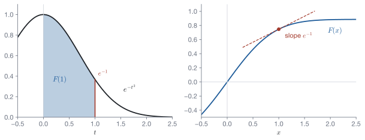{#fig-ftc-area width=95%}
:::

Integration by parts for definite integrals carries the boundary term along. The fifth example evaluates two integrals with it.

::: {#exm-ftc-parts-definite}
#### Parts with limits

By (3), $\int_0^1 xe^x\,dx = [xe^x]_0^1 - \int_0^1 e^x\,dx = e - (e - 1) = 1$, and $\int_1^e \log x\,dx = [x\log x]_1^e - \int_1^e 1\,dx = e - (e - 1) = 1$. In both cases the
boundary term carries most of the value.
:::

A substitution in a definite integral changes the limits, and symmetry is the special case $u = -x$. The sixth example has one of each.

::: {#exm-ftc-substitution-definite}
#### Substitution with limits

With $g(x) = x^2$, $\int_0^{\sqrt\pi}x\sin(x^2)\,dx = \tfrac12\int_0^\pi\sin u\,du = 1$ (@exm-ftc-sin). With $g(x) = -x$, $\int_{-a}^a f = \int_{-a}^0 f + \int_0^a f$ and $\int_{-a}^0 f(x)\,dx =
\int_0^a f(-u)\,du$, so $\int_{-a}^a f = 0$ for an odd continuous $f$ and $2\int_0^a f$ for an even one.
:::

Newton's law and the theorem together give the work-energy theorem: the work of the force along a motion is the change of kinetic energy. The
seventh example derives it and, for the oscillator, the conservation of energy.

::: {#exm-ftc-work-energy}
#### Work and energy

Let $m\ddot x = F(x)$ with $x(t)$ twice continuously differentiable and $F$ continuous. By (4) with $g = x$, the work is $\int_{x(t_0)}^{x(t_1)}F(u)\,du =
\int_{t_0}^{t_1}F(x(t))\dot x(t)\,dt = \int_{t_0}^{t_1}m\ddot x\dot x\,dt = [\tfrac12m\dot x^2]_{t_0}^{t_1}$ by (2). For the oscillator, $F = -kx = -V'$ with $V = \tfrac12kx^2$, the work is
$-[V(x)]_{t_0}^{t_1}$, so $\tfrac12m\dot x^2 + \tfrac12kx^2$ takes the same value at all times.
:::

The proper time of an observer in Minkowski space is the integral of $\sqrt{1 - v^2}$ along the world line, in units with $c = 1$. The eighth example
computes it for constant proper acceleration $\alpha$, where $v(t) = \alpha t/\sqrt{1 + \alpha^2t^2}$.

::: {#exm-ftc-proper-time}
#### Proper time under constant acceleration

Here $1 - v^2 = \frac{1}{1 + \alpha^2t^2}$, so $\tau(t) = \int_0^t\frac{ds}{\sqrt{1 + \alpha^2s^2}}$. The function $A(y) = \log(y + \sqrt{1 + y^2})$ has $A'(y) = \frac{1}{\sqrt{1 + y^2}}$,
by the chain rule, so with $u = \alpha s$ in (4), $\tau(t) = \frac1\alpha\log\big(\alpha t + \sqrt{1 + \alpha^2t^2}\big)$. It grows like $\frac1\alpha\log(2\alpha t)$: the travelling clock falls
behind without bound.
:::

At a discontinuity of $f$ the function $F$ of (1) is still continuous but may fail to be differentiable, so the continuity of $f$ in (1) is needed.
The ninth example has a jump [@abbott2015understanding, Exercises 7.5.1 (b), 7.5.11].

::: {#exm-ftc-jump}
#### A corner from a jump

Let $f = 1$ on $[-1, 0)$ and $f = 2$ on $[0, 1]$. Then $F(x) = \int_{-1}^x f = x + 1$ for $x \leq 0$ and $1 + 2x$ for $x \geq 0$, by (5) of @def-riemann-integral and
@exm-integral-constant. $F$ is continuous, with one-sided derivatives $1$ and $2$ at $0$: it has a corner where $f$ jumps, and $F' = f$ everywhere else.
:::

Part (2) needs $G' = f$ at every point of the open interval, and forgetting a point where $G$ is not defined gives nonsense. The last example shows
the classic mistake.

::: {#exm-ftc-misuse}
#### A negative integral of a positive function

The formula $[-1/x]_{-1}^1 = -2$ would give $\int_{-1}^1 dx/x^2 = -2 < 0$ for a positive integrand. But $-1/x$ is not defined at $0$, and $1/x^2$ is unbounded on
$[-1, 1]$, so it is not integrable there at all (@def-riemann-integral requires a bounded function); on $[\varepsilon, 1]$ the theorem gives $\frac1\varepsilon - 1$, which grows
without bound as $\varepsilon \to 0$.
:::
::::

:::: {.callout-note .exercises-fold collapse="true" title="Exercises"}
Sage evaluates definite integrals directly and through antiderivatives, so both parts of the theorem can be checked. The first exercise does
this for four integrals and the Gaussian of @exm-ftc-erf.

::: {#exr-fundamental-theorem-sage}
#### The theorem in both directions

Differentiate $F(x) = \int_0^x e^{-t^2}dt$, and evaluate $\int_0^\pi \sin x\,dx$, $\int_0^1 x e^x\,dx$, $\int_{-1}^1 dx/(1 + x^2)$ and $\int_1^7 dx/x$ as $G(b) - G(a)$.
:::

::: {.callout-note .solution collapse="true" title="Solution"}
:::: {.panel-tabset .solution-tabs}
## Proof

By (1), $F'(x) = e^{-x^2}$. By (2), with the antiderivatives $-\cos x$, $(x - 1)e^x$, $\arctan x$ and $\log x$: $\int_0^\pi\sin x\,dx = 2$, $\int_0^1xe^x\,dx = 0 - (-1) = 1$,
$\int_{-1}^1\frac{dx}{1 + x^2} = \frac\pi4 - (-\frac\pi4) = \frac\pi2$ and $\int_1^7\frac{dx}{x} = \log 7$.

## SageMath

Sage evaluates each integral directly and as a difference of antiderivative values.

```{.python .sage}
x, t = var("x t")
assume(x > 0)
F = integrate(exp(-t^2), t, 0, x)
print("F(x) =", F, "; F'(x) =", diff(F, x).simplify_full())
for f, a, b in [(sin(x), 0, pi), (x * exp(x), 0, 1), (1 / (1 + x^2), -1, 1), (1 / x, 1, 7)]:
    A = integrate(f, x)
    D = integrate(f, x, a, b)
    print("int of", f, "from", a, "to", b, "=", D, "; antiderivative", A, "; G(b) - G(a) agrees:", bool((A.subs(x=b) - A.subs(x=a) - D).simplify_full() == 0))
forget()
```

```{.text .sage-output}
F(x) = 1/2*sqrt(pi)*erf(x) ; F'(x) = e^(-x^2)
int of sin(x) from 0 to pi = 2 ; antiderivative -cos(x) ; G(b) - G(a) agrees: True
int of x*e^x from 0 to 1 = 1 ; antiderivative (x - 1)*e^x ; G(b) - G(a) agrees: True
int of 1/(x^2 + 1) from -1 to 1 = 1/2*pi ; antiderivative arctan(x) ; G(b) - G(a) agrees: True
int of 1/x from 1 to 7 = log(7) ; antiderivative log(x) ; G(b) - G(a) agrees: True
```
::::
:::

The values found from Riemann sums can now be checked by the theorem. The second exercise does this for three integrals of a problem list, two of
which need $a^x$ and $\cosh$ [@radozycki2020solvingII, Sec. 1.7, Exercise 2 (b)].

::: {#exr-ftc-riemann-check}
#### Sums against the theorem

Evaluate $\int_0^2 2^x\,dx$, $\int_1^2 dx/x$ and $\int_0^1\cosh x\,dx$ by the theorem, and compare with midpoint sums with $n = 100$ pieces.
:::

::: {.callout-note .solution collapse="true" title="Solution"}
:::: {.panel-tabset .solution-tabs}
## Proof

$2^x/\log 2$ is an antiderivative of $2^x$ (@exm-derivative-inverse-functions), so $\int_0^2 2^x\,dx = \frac{4 - 1}{\log 2} = \frac{3}{\log 2}$. $\int_1^2 dx/x = \log 2$, as in
@exr-integral-log-geometric. $\sinh$ is an antiderivative of $\cosh$ (@exr-derivative-definition), so $\int_0^1\cosh x\,dx = \sinh 1$. The midpoint sums are Riemann sums,
so by @def-riemann-integral (2) they tend to these values.

## SageMath

Sage compares the exact values with the midpoint sums.

```{.python .sage}
x = var("x")
for f, a, b, exact in [(2^x, 0, 2, 3 / log(2)), (1 / x, 1, 2, log(2)), (cosh(x), 0, 1, sinh(1))]:
    n = 100; h = (b - a) / n
    mid = sum(f.subs(x=a + (k + 1 / 2) * h) * h for k in range(n))
    print(f, ": exact", exact, "=", N(exact, digits=8), "; midpoint sum", N(mid, digits=8))
```

```{.text .sage-output}
2^x : exact 3/log(2) = 4.3280851 ; midpoint sum 4.3280505
1/x : exact log(2) = 0.69314718 ; midpoint sum 0.69314406
cosh(x) : exact sinh(1) = 1.1752012 ; midpoint sum 1.1751963
```
::::
:::

When the limits of an integral depend on $x$ the chain rule enters, and when the integrand does too, the integral is first split. The third
exercise has one case of each.

::: {#exr-ftc-leibniz}
#### Differentiating with variable limits

For continuous $f$, compute $\frac{d}{dx}\int_{x}^{x^2} e^{-t^2}dt$ and $\frac{d}{dx}\int_0^x (x - t) f(t)\,dt$, and show that $y(x) = \int_0^x (x - t)f(t)\,dt$ satisfies $y'' = f$
and $y(0) = y'(0) = 0$.
:::

::: {.callout-note .solution collapse="true" title="Solution"}
:::: {.panel-tabset .solution-tabs}
## Proof

With $F(u) = \int_0^ue^{-t^2}dt$, the integral is $F(x^2) - F(x)$, so by (1) and the chain rule its derivative is $2xe^{-x^4} - e^{-x^2}$. For the second,
$\int_0^x (x - t)f(t)\,dt = x\int_0^x f - \int_0^x tf(t)\,dt$; by the product rule and (1) its derivative is $\int_0^x f + xf(x) - xf(x) = \int_0^x f(t)\,dt$, and differentiating
again gives $f(x)$. At $x = 0$ both $y$ and $y'$ are integrals over $[0, 0]$, hence $0$.

## SageMath

Check on $f(t) = \cos t$: Sage computes $y$, its two derivatives and the first derivative of the integral with variable limits.

```{.python .sage}
x, t = var("x t")
assume(x > 0)
y = integrate((x - t) * cos(t), t, 0, x)
print("y =", y, "; y'' =", diff(y, x, 2), "; y(0), y'(0) =", y.subs(x=0), diff(y, x).subs(x=0))
Fu = sqrt(pi) / 2 * erf(t)  # an antiderivative of e^{-t^2}, with Fu(0) = 0
print("F' = e^{-t^2}:", bool(diff(Fu, t) == exp(-t^2)), "; d/dx (F(x^2) - F(x)) =", diff(Fu.subs(t=x^2) - Fu.subs(t=x), x))
forget()
```

```{.text .sage-output}
y = -cos(x) + 1 ; y'' = cos(x) ; y(0), y'(0) = 0 0
F' = e^{-t^2}: True ; d/dx (F(x^2) - F(x)) = 2*x*e^(-x^4) - e^(-x^2)
```
::::
:::

Reduction formulas become recursions for numbers once limits are put in, and the one for $\int_0^{\pi/2}\sin^nx\,dx$ is the source of Wallis's product.
The fourth exercise derives it with (3) and evaluates two cases.

::: {#exr-antiderivative-reduction}
#### A reduction formula with limits

Show that $I_n = \int_0^{\pi/2} \sin^n x\,dx$ satisfies $I_n = \frac{n-1}{n} I_{n-2}$ for $n \geq 2$, compute $I_4$ and $I_5$, and show that $nI_nI_{n-1} = \pi/2$ for $n \geq 1$.
:::

::: {.callout-note .solution collapse="true" title="Solution"}
:::: {.panel-tabset .solution-tabs}
## Proof

By (3) with $u = \sin^{n-1}x$ and $v = -\cos x$: $I_n = [-\sin^{n-1}x\cos x]_0^{\pi/2} + (n - 1)\int_0^{\pi/2}\sin^{n-2}x\cos^2x\,dx = (n - 1)(I_{n-2} - I_n)$, the boundary term
vanishing at both ends. So $nI_n = (n - 1)I_{n-2}$. With $I_0 = \pi/2$ and $I_1 = [-\cos x]_0^{\pi/2} = 1$: $I_4 = \tfrac34\cdot\tfrac12\cdot\tfrac\pi2 = 3\pi/16$ and $I_5 = \tfrac45\cdot\tfrac23 =
8/15$. Finally $nI_nI_{n-1} = (n - 1)I_{n-2}I_{n-1}$, so $nI_nI_{n-1}$ does not depend on $n$ and equals $1 \cdot I_1I_0 = \pi/2$.

## SageMath

Sage evaluates $I_n$ for $n \leq 8$ and checks the recursion and the product $nI_nI_{n-1}$.

```{.python .sage}
x = var("x")
I = [integrate(sin(x)^n, x, 0, pi / 2) for n in range(9)]
print("I_n:", I)
print("recursion:", all(bool(I[n] == (n - 1) / n * I[n - 2]) for n in range(2, 9)), "; n I_n I_(n-1):", [n * I[n] * I[n - 1] for n in range(1, 9)])
```

```{.text .sage-output}
I_n: [1/2*pi, 1, 1/4*pi, 2/3, 3/16*pi, 8/15, 5/32*pi, 16/35, 35/256*pi]
recursion: True ; n I_n I_(n-1): [1/2*pi, 1/2*pi, 1/2*pi, 1/2*pi, 1/2*pi, 1/2*pi, 1/2*pi, 1/2*pi]
```
::::
:::

In a definite integral the substitution changes the limits too, and forgetting this is the usual mistake. The fifth exercise has two substitutions
with the limits tracked.

::: {#exr-antiderivative-substitution}
#### Substitution in definite integrals

Evaluate $\int_0^1 x\sqrt{1 - x^2}\,dx$ and $\int_0^{\pi/2} \frac{\cos x}{1 + \sin^2 x}\,dx$ by (4), taking care of the limits.
:::

::: {.callout-note .solution collapse="true" title="Solution"}
:::: {.panel-tabset .solution-tabs}
## Proof

With $g(x) = 1 - x^2$, $g' = -2x$, and $g(0) = 1$, $g(1) = 0$: $\int_0^1x\sqrt{1 - x^2}\,dx = -\tfrac12\int_1^0\sqrt u\,du = \tfrac12\int_0^1\sqrt u\,du = \tfrac12\cdot\tfrac23 = \tfrac13$.
With $g(x) = \sin x$, limits $0$ and $1$: $\int_0^1\frac{du}{1 + u^2} = \arctan 1 = \frac\pi4$.

## SageMath

Sage evaluates both integrals directly and after the substitution.

```{.python .sage}
x, u = var("x u")
print(integrate(x * sqrt(1 - x^2), x, 0, 1), "=", integrate(sqrt(u), u, 0, 1) / 2)
print(integrate(cos(x) / (1 + sin(x)^2), x, 0, pi / 2), "=", integrate(1 / (1 + u^2), u, 0, 1))
```

```{.text .sage-output}
1/3 = 1/3
1/4*pi = 1/4*pi
```
::::
:::

The mean value theorem has an integral form: a continuous function attains its average value. The sixth exercise proves it two ways and finds the
point for $x^2$ [@riley2006mathematical, Sec. 2.2, eq. (2.40)].

::: {#exr-ftc-average}
#### The mean value theorem for integrals

Prove that for continuous $f$ on $[a, b]$ there is a $c \in (a, b)$ with $\int_a^b f = f(c)(b - a)$, and find $c$ for $f(x) = x^2$ on $[0, 1]$ and on $[2, 4]$.
:::

::: {.callout-note .solution collapse="true" title="Solution"}
:::: {.panel-tabset .solution-tabs}
## Proof

$F(x) = \int_a^x f$ is continuous on $[a, b]$ and differentiable on $(a, b)$ with $F' = f$ by (1). The mean value theorem (@thm-mean-value (3)) gives $c \in (a, b)$ with
$F(b) - F(a) = F'(c)(b - a) = f(c)(b - a)$. Alternatively, by @def-riemann-integral (4) the average $\frac{1}{b - a}\int_a^b f$ lies between the minimum and the maximum
of $f$, which are attained (@def-continuity (4)), and it is a value of $f$ by the intermediate value theorem. For $x^2$ on $[0, 1]$: $c^2 = \tfrac13$, $c = 1/\sqrt3$; on
$[2, 4]$ the average is $\frac12\cdot\frac{64 - 8}{3} = \frac{28}{3}$ and $c = \sqrt{28/3} \approx 3.055$.

## SageMath

Sage computes the averages and the points $c$.

```{.python .sage}
x = var("x")
for a, b in [(0, 1), (2, 4)]:
    avg = integrate(x^2, x, a, b) / (b - a)
    c = sqrt(avg)
    print("[%s, %s]: average" % (a, b), avg, "; c =", c, "=", N(c, digits=6), "; in the interval:", bool(a < c < b))
```

```{.text .sage-output}
[0, 1]: average 1/3 ; c = sqrt(1/3) = 0.577350 ; in the interval: True
[2, 4]: average 28/3 ; c = 2*sqrt(7/3) = 3.05505 ; in the interval: True
```
::::
:::

A continuous function whose integrals over all intervals $[a, x]$ vanish must vanish itself, by differentiating. The seventh exercise proves this
and shows that continuity is needed [@abbott2015understanding, Exercise 7.5.4].

::: {#exr-ftc-zero-integral}
#### A function with zero integrals

Show that if $f$ is continuous on $[a, b]$ and $\int_a^x f = 0$ for all $x \in [a, b]$, then $f = 0$. Give a discontinuous $f \neq 0$ with this property.
:::

::: {.callout-note .solution collapse="true" title="Solution"}
:::: {.panel-tabset .solution-tabs}
## Proof

$F(x) = \int_a^x f$ is identically $0$, so $f(x) = F'(x) = 0$ for $x \in (a, b)$ by (1), and $f(a) = f(b) = 0$ by continuity. The function equal to $0$ on $[0, 1]$
except at one point, where it is $1$, has $\int_0^x f = 0$ for all $x$ by @exm-integral-jump, but is not $0$.

## SageMath

Check on the lower and upper sums of the one-point function on $[0, x]$, $x = \tfrac34$, with the jump at $\tfrac12$ enclosed in a piece of length $2\eta$.

```{.python .sage}
for eta in [QQ(1) / 10, QQ(1) / 1000]:
    P = [0, QQ(1) / 2 - eta, QQ(1) / 2 + eta, QQ(3) / 4]
    U = 0 * (P[1] - P[0]) + 1 * (P[2] - P[1]) + 0 * (P[3] - P[2])
    print("eta =", eta, ": lower sum 0, upper sum", U)
```

```{.text .sage-output}
eta = 1/10 : lower sum 0, upper sum 1/5
eta = 1/1000 : lower sum 0, upper sum 1/500
```
::::
:::

The integral definition of the logarithm of @exm-ftc-log gives its functional equation by differentiation, without the exponential. The eighth
exercise proves it and bounds the harmonic numbers [@abbott2015understanding, Exercise 7.5.8].

::: {#exr-ftc-log-properties}
#### The logarithm from its integral

Let $L(x) = \int_1^x dt/t$ for $x > 0$. Show that $L(xy) = L(x) + L(y)$ by differentiating $x \mapsto L(xy)$, and that $L(n + 1) \leq H_n \leq 1 + L(n)$ for $H_n = \sum_{k=1}^n
1/k$.
:::

::: {.callout-note .solution collapse="true" title="Solution"}
:::: {.panel-tabset .solution-tabs}
## Proof

For fixed $y > 0$, $g(x) = L(xy)$ has $g'(x) = y \cdot \frac{1}{xy} = \frac1x = L'(x)$ by (1) and the chain rule, so $g - L$ is constant on $(0, \infty)$ (@def-antiderivative
(1)), and at $x = 1$ it is $L(y) - L(1) = L(y)$. For the bounds, $\frac{1}{k + 1} \leq \frac1t \leq \frac1k$ on $[k, k + 1]$ gives $\frac{1}{k + 1} \leq \int_k^{k+1}\frac{dt}{t} \leq \frac1k$. Summing the
right inequality over $k = 1, \dots, n$ gives $L(n + 1) \leq H_n$, and summing the left one over $k = 1, \dots, n - 1$ gives $H_n - 1 \leq L(n)$.

## SageMath

Sage checks the bounds for $n = 1, 10, 100, 1000$ and the functional equation at a point.

```{.python .sage}
for n in [1, 10, 100, 1000]:
    H = sum(1 / QQ(k) for k in range(1, n + 1))
    print("n =", n, ":", N(log(n + 1), digits=6), "<=", N(H, digits=6), "<=", N(1 + log(n), digits=6), ":", bool(log(n + 1) <= H <= 1 + log(n)))
t = var("t")
print("L(6) - L(2) - L(3) =", (integrate(1 / t, t, 1, 6) - integrate(1 / t, t, 1, 2) - integrate(1 / t, t, 1, 3)).simplify_log())
```

```{.text .sage-output}
n = 1 : 0.693147 <= 1.00000 <= 1.00000 : True
n = 10 : 2.39790 <= 2.92897 <= 3.30259 : True
n = 100 : 4.61512 <= 5.18738 <= 5.60517 : True
n = 1000 : 6.90875 <= 7.48547 <= 7.90776 : True
L(6) - L(2) - L(3) = 0
```
::::
:::

The root mean square of an alternating current is the constant current that dissipates the same power in a resistor, and it is an integral over a
period. The ninth exercise computes it, as the theorem's version of @exm-integral-oscillator-average.

::: {#exr-ftc-rms}
#### The root mean square of an oscillation

For $I(t) = I_0\sin\omega t$ with period $T = 2\pi/\omega$, compute $\frac1T\int_0^TI(t)^2\,dt$ and the root mean square value $I_0/\sqrt2$, and the mean of $I$ itself.
:::

::: {.callout-note .solution collapse="true" title="Solution"}
:::: {.panel-tabset .solution-tabs}
## Proof

$\sin^2\omega t = \frac12(1 - \cos 2\omega t)$, with antiderivative $\frac t2 - \frac{\sin 2\omega t}{4\omega}$, so $\int_0^T\sin^2\omega t\,dt = \frac T2 - \frac{\sin 4\pi}{4\omega} = \frac T2$. The mean
square is $I_0^2/2$ and its root $I_0/\sqrt2$. The mean of $I$ is $\frac{I_0}{T}[-\cos(\omega t)/\omega]_0^T = 0$.

## SageMath

Sage integrates over a period with symbolic $\omega > 0$.

```{.python .sage}
t, w, I0 = var("t w I0")
assume(w > 0, I0 > 0)
T = 2 * pi / w
ms = integrate((I0 * sin(w * t))^2, t, 0, T) / T
print("mean square:", ms.simplify_full(), "; rms:", sqrt(ms).simplify_full(), "; mean:", integrate(I0 * sin(w * t), t, 0, T) / T)
forget()
```

```{.text .sage-output}
mean square: 1/2*I0^2 ; rms: 1/2*sqrt(2)*I0 ; mean: 0
```
::::
:::

Taylor's theorem has an integral form of the remainder, obtained by integrating by parts repeatedly. The last exercise derives it and recovers the
Lagrange form of @thm-taylor from @exr-ftc-average.

::: {#exr-ftc-taylor-integral}
#### Taylor's theorem with integral remainder

Let $f$ have a continuous $(n + 1)$-th derivative on an open interval containing $a$ and $a + h$. Show that $f(a + h) = T_n(h) + \frac{1}{n!}\int_a^{a+h}f^{(n+1)}(t)(a + h -
t)^n\,dt$, with $T_n$ as in @thm-taylor, and for $h > 0$ deduce the Lagrange form of the remainder.
:::

::: {.callout-note .solution collapse="true" title="Solution"}
:::: {.panel-tabset .solution-tabs}
## Proof

Let $b = a + h$ and $R_k = \frac{1}{k!}\int_a^bf^{(k+1)}(t)(b - t)^k\,dt$. For $k = 0$, $R_0 = f(b) - f(a)$ by (2). For $k \geq 1$, (3) with $u = f^{(k)}$ and $v =
-(b - t)^k/k!$ gives $R_k = \big[-f^{(k)}(t)\frac{(b - t)^k}{k!}\big]_a^b + R_{k-1} = R_{k-1} - \frac{f^{(k)}(a)}{k!}h^k$. By induction $R_n = f(b) - \sum_{k=0}^n\frac{f^{(k)}(a)}{k!}h^k$, which
is the formula. For $h > 0$, $(b - t)^n \geq 0$ on $[a, b]$; with $m$ and $M$ the minimum and maximum of $f^{(n+1)}$ there, $\frac{m h^{n+1}}{(n+1)!} \leq R_n \leq \frac{Mh^{n+1}}{(n+1)!}$ by
@def-riemann-integral (4) and $\int_a^b(b - t)^n\,dt = h^{n+1}/(n + 1)$. By the intermediate value theorem, $R_n = \frac{f^{(n+1)}(c)}{(n+1)!}h^{n+1}$ for some $c \in [a, b]$.

## SageMath

Check on $f = e^x$, $a = 0$, $h = 1$, $n = 3$: Sage compares $e - T_3(1)$ with the integral remainder.

```{.python .sage}
t = var("t")
T3 = sum(1 / factorial(k) for k in range(4))
R = integrate(exp(t) * (1 - t)^3, t, 0, 1) / factorial(3)
print("e - T_3(1) =", e - T3, "; integral remainder =", R.simplify_full(), "; equal:", bool(e - T3 == R))
```

```{.text .sage-output}
e - T_3(1) = e - 8/3 ; integral remainder = e - 8/3 ; equal: True
```
::::
:::
::::

### Improper integrals

The Riemann integral is defined for bounded functions on bounded intervals, and many important integrals, the Gaussian among them, are neither. The
definition below extends the integral by a limit, and gives the comparison test, absolute convergence, the $p$-integrals as benchmarks and the
integral test, which compares a series with an integral. For the definitions, see [@radozycki2020solvingII, Ch. 2, eqs. (2.0.1)-(2.0.4), p. 53];
for the $p$-integrals and the integral test, see [@radozycki2020solvingII, Sec. 2.1, Problem 1, pp. 54-56, and Ch. 2, p. 54]; and for the comparison
test, see [@radozycki2020solvingII, Sec. 2.2, Problem 1, pp. 60-61].

:::: {.statement-box}
::: {#def-improper-integral}
#### Improper integral

Let $f$ be integrable on $[a, b]$ for every $b > a$. The **improper integral** $\int_a^\infty f = \lim_{b \to \infty}\int_a^b f$ **converges** if the limit exists in $\mathbb{R}$, and
**diverges** otherwise; $\int_{-\infty}^b f$ is defined likewise. If $f$ is integrable on $[c, b]$ for every $c \in (a, b)$, possibly unbounded near $a$, then
$\int_a^b f = \lim_{c \to a^+}\int_c^b f$, and likewise at $b$. An integral with several such points, such as $\int_{-\infty}^\infty f$, is split into integrals with one each,
$\int_{-\infty}^\infty f = \int_{-\infty}^0 f + \int_0^\infty f$, and converges if each part does. Then, stated at $\infty$ and in the same way at a finite end:

1. (**Comparison**) if $0 \leq f \leq g$ on $[a, \infty)$ and $\int_a^\infty g$ converges, then $\int_a^\infty f$ converges and $\int_a^\infty f \leq \int_a^\infty g$; if $\int_a^\infty f$ diverges, so does
   $\int_a^\infty g$;
2. (**Absolute convergence**) if $\int_a^\infty|f|$ converges, then $\int_a^\infty f$ converges and $|\int_a^\infty f| \leq \int_a^\infty|f|$;
3. ($p$**-integrals**) $\int_1^\infty dx/x^p$ converges exactly for $p > 1$, to $\frac{1}{p - 1}$, and $\int_0^1 dx/x^p$ exactly for $p < 1$, to $\frac{1}{1 - p}$;
4. (**Integral test**) if $f \geq 0$ is decreasing on $[1, \infty)$, then $\sum_{k=2}^n f(k) \leq \int_1^n f \leq \sum_{k=1}^{n-1}f(k)$ for $n \geq 2$, and $\sum_{k \geq 1}f(k)$ converges if
   and only if $\int_1^\infty f$ converges.
:::
::::

*Proof.* First, an increasing function $F$ on $[a, \infty)$ that is bounded above has $\lim_{b \to \infty}F(b) = s = \sup F$ (@def-supremum): given $\varepsilon > 0$, some $F(b_0) >
s - \varepsilon$, and then $s - \varepsilon < F(b) \leq s$ for all $b \geq b_0$. If it is not bounded, $F(b) \to \infty$.

(1) For $f \geq 0$, $F(b) = \int_a^b f$ is increasing in $b$, by (5) and (4) of @def-riemann-integral, and $F(b) \leq \int_a^b g \leq \int_a^\infty g$, since $\int_a^b g$ increases
to its limit. So $F$ converges to a limit $\leq \int_a^\infty g$. The second claim is the first read backwards. At a finite end $a$, $c \mapsto \int_c^b f$ increases as $c$
decreases to $a$, and the same argument applies.

(2) $|f|$ is integrable on each $[a, b]$ (@def-riemann-integral (4)), and $0 \leq f + |f| \leq 2|f|$. By (1), $\int_a^\infty(f + |f|)$ converges, and $\int_a^b f = \int_a^b(f + |f|) -
\int_a^b|f|$ is a difference of two convergent expressions. The bound follows from $|\int_a^b f| \leq \int_a^b|f|$ in the limit.

(3) For $p \neq 1$, $x^{1-p}/(1 - p)$ is an antiderivative of $x^{-p}$ on $(0, \infty)$, so $\int_1^b x^{-p}dx = \frac{b^{1-p} - 1}{1 - p}$ by @thm-fundamental-theorem (2), and
$\int_1^b dx/x = \log b$. As $b \to \infty$, $\log b \to \infty$, so $b^{1-p} = e^{(1-p)\log b}$ tends to $0$ if $p > 1$ and to $\infty$ if $p < 1$; this gives the first claim. At $0$,
$\int_c^1 x^{-p}dx = \frac{1 - c^{1-p}}{1 - p}$ and $\int_c^1 dx/x = -\log c$, and $c^{1-p} \to 0$ as $c \to 0^+$ exactly when $p < 1$.

(4) $f$ is monotone, hence integrable on each $[1, b]$ (@def-riemann-integral (3)). On $[k, k + 1]$, $f(k + 1) \leq f \leq f(k)$, so $f(k + 1) \leq \int_k^{k+1}f \leq f(k)$;
summing over $k = 1, \dots, n - 1$ gives the inequalities. The partial sums $s_n$ and the integrals $F(b) = \int_1^b f$ are increasing, and $F(n) \leq s_{n-1}$,
$s_n - f(1) \leq F(n)$. So the partial sums are bounded exactly when the values $F(n)$ are, and, since $F(b) \leq F(\lceil b\rceil)$, exactly when $F$ is. By the
monotone convergence theorem (@thm-monotone-convergence) and the first paragraph, the series and the integral converge together. $\square$

These are the definitions and tests of @radozycki2020solvingII [Ch. 2, pp. 53-54, 60] and @riley2006mathematical [Sec. 2.2]. The integral test is
the continuous counterpart of the condensation test of @thm-convergence-tests.

:::: {.callout-note .examples-fold collapse="true" title="Examples"}
Powers $x^{-p}$ are the benchmarks against which other integrals are compared, and their threshold $p = 1$ is that of the $p$-series. The first example
computes them at both ends, and the figure shows the two behaviours.

::: {#exm-improper-p}
#### The $p$-integrals

$\int_1^b dx/x^2 = 1 - \frac1b \to 1$, while $\int_1^b dx/x = \log b \to \infty$; at $0$, $\int_c^1 dx/\sqrt x = 2 - 2\sqrt c \to 2$, while $\int_c^1 dx/x = -\log c \to \infty$. No power
converges at both ends, so $\int_0^\infty dx/x^p$ diverges for every $p$. The threshold $p = 1$ is that of the $p$-series of @exm-tests-p-series.

![Left: $1/x^2$ and $1/x$ on $[1, 8]$, whose areas from $1$ to $b$ tend to $1$ and grow like $\log b$. Right: $1/\sqrt x$ and $1/x$ on $(0, 1]$, whose areas from $c$ to $1$ tend to $2$ and grow like $-\log c$.](figures/improper_power.svg){#fig-improper-power width=95%}
:::

A decaying exponential makes an integral at infinity converge, and the integrals of $x^ne^{-x}$ are the factorials. The second example computes these
and the integral of $1/(1 + x^2)$ over the line.

::: {#exm-improper-exponential}
#### Exponential decay

$\int_0^b e^{-x}dx = 1 - e^{-b} \to 1$. For $n \geq 1$, parts (@thm-fundamental-theorem (3)) give $\int_0^bx^ne^{-x}dx = -b^ne^{-b} + n\int_0^bx^{n-1}e^{-x}dx$, and $b^ne^{-b} \to 0$
since $e^b \geq b^{n+1}/(n + 1)!$; by induction $\int_0^\infty x^ne^{-x}dx = n!$. And $\int_0^b\frac{dx}{1 + x^2} = \arctan b \to \frac\pi2$, so by symmetry $\int_{-\infty}^\infty\frac{dx}{1 +
x^2} = \pi$ [@riley2006mathematical, Exercise 2.38 (a)].
:::

An integrand may be unbounded at an end of a bounded interval and still have a finite area. The third example integrates the logarithm at $0$.

::: {#exm-improper-log}
#### $\int_0^1 \log x\,dx = -1$

$\log x$ is unbounded near $0$. With the antiderivative $x\log x - x$ (@exm-antiderivative-parts), $\int_c^1\log x\,dx = -1 - c\log c + c$, and $c\log c \to 0$ as $c \to 0^+$:
with $c = e^{-u}$, $|c\log c| = ue^{-u} \leq u/(1 + u + u^2/2) \to 0$. So the integral converges to $-1$.
:::

The integral test compares a series with the area under a decreasing curve, from above and from below. The fourth example applies it to the
harmonic series and to $\sum 1/k^2$, and the figure shows the two staircases.

::: {#exm-improper-integral-test}
#### Staircases above and below

For $f(x) = 1/x$, (4) gives $\log(n + 1) \leq H_n \leq 1 + \log n$ (using $\int_1^{n+1}$ for the left bound), so the harmonic series diverges like $\log n$. For $f(x) =
1/x^2$, $\sum_{k=2}^n 1/k^2 \leq \int_1^n dx/x^2 < 1$, so $\sum_{k \geq 1}1/k^2 < 2$ [@radozycki2020solvingII, Sec. 2.3, Fig. 2.1].

![The function $1/x^2$ on $[1, 7]$ with the rectangles of heights $f(k)$ on $[k, k + 1]$ (above the curve) and of heights $f(k + 1)$ (below it). Their areas bound the area under the curve from both sides.](figures/integral_test.svg){#fig-integral-test width=80%}
:::

The integral test decides series that the ratio and root tests cannot, such as those with powers of logarithms. The fifth example finds the
threshold for $\sum 1/(n\log^\beta n)$ [@radozycki2020solvingII, Sec. 2.3, Problem 2].

::: {#exm-improper-log-series}
#### $\sum 1/(n\log^\beta n)$

For $\beta > 0$, $f(x) = 1/(x\log^\beta x)$ is positive and decreasing on $[2, \infty)$. With $g = \log x$ in @thm-fundamental-theorem (4), $\int_2^b f = \int_{\log 2}^{\log
b}du/u^\beta$, which converges as $b \to \infty$ exactly when $\beta > 1$, by (3). So $\sum_{n \geq 2}1/(n\log^\beta n)$ converges exactly for $\beta > 1$, as condensation gave in
@exm-tests-log-condensation.
:::

The Gaussian $e^{-x^2}$ has no elementary antiderivative (@exm-antiderivative-none), but comparison settles its convergence without a formula.
The sixth example does this for it and its moments.

::: {#exm-improper-gaussian}
#### The Gaussian integral converges

For $x \geq 1$, $x^2 \geq x$ and $e^{-x^2} \leq e^{-x}$, whose integral over $[1, \infty)$ is $e^{-1}$; on $[0, 1]$ the integrand is continuous. By (1),
$\int_0^\infty e^{-x^2}dx$ converges, and by symmetry so does $\int_{-\infty}^\infty e^{-x^2}dx$. Likewise $x^ne^{-x^2} \leq x^ne^{-x}$ for $x \geq 1$, so every moment
$\int_0^\infty x^ne^{-x^2}dx$ converges by comparison with @exm-improper-exponential.
:::

The work needed to take a body from a radius $R$ to infinity against gravity, or the electron of hydrogen away from the proton, is an integral to
infinity. The seventh example computes it and the escape velocity.

::: {#exm-improper-escape}
#### Escape velocity and ionisation

$\int_R^\infty\frac{GMm}{r^2}dr = \lim_b GMm\big(\frac1R - \frac1b\big) = \frac{GMm}{R}$ (@exm-integral-inverse-square). A body escapes if $\tfrac12mv^2 \geq GMm/R$, that is $v \geq \sqrt{2GM/R}$,
about $11.2$ km/s from the Earth's surface. For hydrogen, the work to take the electron from $r = a_0$ to infinity is $\frac{e^2}{4\pi\varepsilon_0a_0}$, twice the ionisation
energy of $13.6$ eV: the electron's kinetic energy supplies the other half.
:::

The period of the harmonic oscillator follows from energy conservation as an integral whose integrand is unbounded at the turning point. The
eighth example evaluates it and finds the period independent of the amplitude.

::: {#exm-improper-oscillator-period}
#### The period from the energy

With $E = \tfrac12kA^2$ and $\tfrac12m\dot x^2 + \tfrac12kx^2 = E$ (@exm-ftc-work-energy), the time from $0$ to the turning point $A$ is $\int_0^A\frac{dx}{\omega\sqrt{A^2 - x^2}}$,
$\omega = \sqrt{k/m}$, unbounded at $x = A$. With $x = Au$, $\int_0^c\frac{du}{\sqrt{1 - u^2}} = \arcsin c \to \frac\pi2$ as $c \to 1^-$, so a quarter period is $\frac{\pi}{2\omega}$ and $T =
2\pi/\omega$, whatever $A$.
:::

An integral can converge through cancellation, without converging absolutely. The ninth example shows this for $\sin x/x$, the continuous
analogue of the alternating harmonic series [@radozycki2020solvingII, Sec. 2.2, Problems 3-4].

::: {#exm-improper-sinc}
#### Conditional convergence

By parts, $\int_1^b\frac{\sin x}{x}dx = \cos 1 - \frac{\cos b}{b} - \int_1^b\frac{\cos x}{x^2}dx$, and the last integral converges absolutely by (1)-(3), so $\int_1^\infty\frac{\sin x}{x}dx$
converges; near $0$ the integrand is bounded. But $\int_{k\pi}^{(k+1)\pi}\frac{|\sin x|}{x}dx \geq \frac{2}{(k + 1)\pi}$, and summing gives at least $\frac2\pi H_n$: $\int_0^\infty\frac{|\sin
x|}{x}dx$ diverges.
:::

The definition splits $\int_{-\infty}^\infty$ at a point, with both parts required to converge, and this is stricter than a symmetric limit. The last example
shows the difference.

::: {#exm-improper-symmetric}
#### A symmetric limit is not enough

$\int_{-b}^bx\,dx = 0$ for every $b$, but $\int_0^\infty x\,dx$ diverges, so $\int_{-\infty}^\infty x\,dx$ diverges. Likewise $\int_{-1}^1 dx/x$ diverges, since $\int_c^1 dx/x = -\log c \to \infty$,
although $\int_{-1}^{-c} + \int_c^1 = 0$ for every $c$. The symmetric limit is the principal value $\operatorname{PV}\int$, a different notion.
:::
::::

:::: {.callout-note .exercises-fold collapse="true" title="Exercises"}
Sage distinguishes convergent from divergent improper integrals and evaluates the convergent ones exactly. The first exercise runs the
$p$-integrals and the exponential integrals through it.

::: {#exr-improper-integrals-sage}
#### Convergence of improper integrals

Decide which of $\int_1^\infty x^{-p}dx$ ($p = \tfrac12, 1, 2, 3$) and $\int_0^1 x^{-p}dx$ ($p = \tfrac12, 1, 2$) converge, and evaluate $\int_0^\infty x^n e^{-x}dx$ for $n \leq 5$
and $\int_{-\infty}^\infty dx/(1 + x^2)$.
:::

::: {.callout-note .solution collapse="true" title="Solution"}
:::: {.panel-tabset .solution-tabs}
## Proof

By (3), $\int_1^\infty x^{-p}dx$ diverges for $p = \tfrac12, 1$ and equals $\frac{1}{p - 1}$, that is $1$ and $\tfrac12$, for $p = 2, 3$; $\int_0^1x^{-p}dx$ equals $\frac{1}{1 - p} = 2$
for $p = \tfrac12$ and diverges for $p = 1, 2$. By @exm-improper-exponential, $\int_0^\infty x^ne^{-x}dx = n!$, that is $1, 1, 2, 6, 24, 120$, and $\int_{-\infty}^\infty\frac{dx}{1 + x^2} = \pi$.

## SageMath

Sage raises an error for the divergent integrals and returns the values of the others.

```{.python .sage}
x = var("x")
for p in [QQ(1) / 2, 1, 2, 3]:
    try:
        v = integrate(1 / x^p, x, 1, oo)
    except ValueError:
        v = "divergent"
    print("int_1^oo x^(-%s) dx =" % p, v)
for p in [QQ(1) / 2, 1, 2]:
    try:
        v = integrate(1 / x^p, x, 0, 1)
    except ValueError:
        v = "divergent"
    print("int_0^1 x^(-%s) dx =" % p, v)
print("int_0^oo x^n e^(-x) dx for n = 0..5:", [integrate(exp(-x) * x^k, x, 0, oo) for k in range(6)])
print("int_{-oo}^{oo} dx/(1 + x^2) =", integrate(1 / (1 + x^2), x, -oo, oo))
```

```{.text .sage-output}
int_1^oo x^(-1/2) dx = divergent
int_1^oo x^(-1) dx = divergent
int_1^oo x^(-2) dx = 1
int_1^oo x^(-3) dx = 1/2
int_0^1 x^(-1/2) dx = 2
int_0^1 x^(-1) dx = divergent
int_0^1 x^(-2) dx = divergent
int_0^oo x^n e^(-x) dx for n = 0..5: [1, 1, 2, 6, 24, 120]
int_{-oo}^{oo} dx/(1 + x^2) = pi
```
::::
:::

Deciding convergence comes before evaluating, and the dangerous points must be found first: an infinite limit, or a point where the integrand is
unbounded. The second exercise has six integrals from a standard list [@riley2006mathematical, Exercise 2.38].

::: {#exr-improper-riley}
#### Exist or not

Decide which exist and evaluate them: $\int_0^\infty e^{-\lambda x}dx$ ($\lambda > 0$), $\int_{-\infty}^\infty\frac{x\,dx}{(x^2 + a^2)^2}$ ($a > 0$), $\int_1^\infty\frac{dx}{x + 1}$, $\int_0^1\frac{dx}{x^2}$,
$\int_0^{\pi/2}\cot\theta\,d\theta$ and $\int_0^1\frac{x\,dx}{\sqrt{1 - x^2}}$.
:::

::: {.callout-note .solution collapse="true" title="Solution"}
:::: {.panel-tabset .solution-tabs}
## Proof

$\int_0^be^{-\lambda x}dx = \frac{1 - e^{-\lambda b}}{\lambda} \to \frac1\lambda$. $\int_0^b\frac{x\,dx}{(x^2 + a^2)^2} = \frac{1}{2a^2} - \frac{1}{2(b^2 + a^2)} \to \frac{1}{2a^2}$, and the part on
$(-\infty, 0]$ is its negative, so the integral exists and is $0$. $\int_1^b\frac{dx}{x + 1} = \log\frac{b + 1}{2} \to \infty$: diverges. $\int_c^1x^{-2}dx = \frac1c - 1 \to \infty$:
diverges. $\int_c^{\pi/2}\cot\theta\,d\theta = -\log\sin c \to \infty$, by @exm-antiderivative-substitution: diverges. $\int_0^c\frac{x\,dx}{\sqrt{1 - x^2}} = 1 - \sqrt{1 - c^2} \to 1$
as $c \to 1^-$.

## SageMath

Sage evaluates the convergent integrals and reports the divergent ones.

```{.python .sage}
x, lam, a = var("x lam a")
assume(lam > 0, a > 0)
cases = [(exp(-lam * x), 0, oo), (x / (x^2 + a^2)^2, -oo, oo), (1 / (x + 1), 1, oo), (1 / x^2, 0, 1), (cot(x), 0, pi / 2), (x / sqrt(1 - x^2), 0, 1)]
for f, lo, hi in cases:
    try:
        v = integrate(f, x, lo, hi)
    except ValueError:
        v = "divergent"
    print(f, "from", lo, "to", hi, ":", v)
forget()
```

```{.text .sage-output}
e^(-lam*x) from 0 to +Infinity : 1/lam
x/(a^2 + x^2)^2 from -Infinity to +Infinity : 0
1/(x + 1) from 1 to +Infinity : divergent
x^(-2) from 0 to 1 : divergent
cot(x) from 0 to 1/2*pi : divergent
x/sqrt(-x^2 + 1) from 0 to 1 : 1
```
::::
:::

Comparison decides convergence without evaluating, by bounding the integrand near each dangerous point. The third exercise has three integrals with
different dangerous points.

::: {#exr-improper-comparison}
#### Comparison for improper integrals

Decide the convergence of $\int_1^\infty \frac{\sin x}{x^2}dx$, $\int_0^\infty \frac{dx}{1 + x^3}$ and $\int_0^1 \frac{dx}{\sqrt{x}(1 + x)}$ by comparison.
:::

::: {.callout-note .solution collapse="true" title="Solution"}
:::: {.panel-tabset .solution-tabs}
## Proof

$|\sin x/x^2| \leq 1/x^2$, integrable on $[1, \infty)$ by (3), so the first converges absolutely by (1) and (2). $\frac{1}{1 + x^3}$ is continuous on $[0, 1]$ and $\leq 1/x^3$ on
$[1, \infty)$: converges. $\frac{1}{\sqrt x(1 + x)} \leq \frac{1}{\sqrt x}$ on $(0, 1]$, and $\int_0^1 dx/\sqrt x = 2$: converges.

## SageMath

Sage evaluates the two positive integrals and a numerical value of the first.

```{.python .sage}
x = var("x")
print(integrate(1 / (1 + x^3), x, 0, oo), "|", integrate(1 / (sqrt(x) * (1 + x)), x, 0, 1), "|", N(numerical_integral(sin(x) / x^2, 1, 1000, max_points=1000)[0], digits=6), "(up to 1000)")
```

```{.text .sage-output}
2/9*sqrt(3)*pi | 1/2*pi | 0.504067 (up to 1000)
```
::::
:::

A power of $x$ beats any power of the logarithm, and this decides integrals of $x^p\log x$ at $0$. The fourth exercise finds the threshold and the value
[@radozycki2020solvingII, Sec. 2.1, Problem 2].

::: {#exr-improper-log-power}
#### $\int_0^1 x^p\log x\,dx$

Show that $\int_0^1x^p\log x\,dx$ converges exactly for $p > -1$, with value $-\frac{1}{(p + 1)^2}$.
:::

::: {.callout-note .solution collapse="true" title="Solution"}
:::: {.panel-tabset .solution-tabs}
## Proof

The integrand is $\leq 0$ on $(0, 1]$. For $p > -1$ and $s = p + 1 > 0$, parts give $\int_c^1x^p\log x\,dx = -\frac{c^s\log c}{s} - \frac{1 - c^s}{s^2}$, and $c^s\log c \to 0$ as $c \to
0^+$: with $c = e^{-u}$, $|c^s\log c| = ue^{-su} \leq \frac{u}{1 + su + s^2u^2/2} \to 0$. So the value is $-1/s^2$. For $p \leq -1$ and $c \leq 1/e$, $|x^p\log x| \geq x^{-1}$ on
$(0, c]$, since $x^p \geq x^{-1}$ and $|\log x| \geq 1$ there, and $\int_0^c dx/x$ diverges; by (1) applied to $-x^p\log x \geq 0$ the integral diverges.

## SageMath

Sage evaluates the integral for several $p$ and compares with $-1/(p + 1)^2$.

```{.python .sage}
x = var("x")
for p in [0, 1, -QQ(1) / 2, 2]:
    print("p =", p, ":", integrate(x^p * log(x), x, 0, 1), "; formula", -1 / (p + 1)^2)
```

```{.text .sage-output}
p = 0 : -1 ; formula -1
p = 1 : -1/4 ; formula -1/4
p = -1/2 : -4 ; formula -4
p = 2 : -1/9 ; formula -1/9
```
::::
:::

With logarithms, the threshold between convergence and divergence can be pushed further and further. The fifth exercise uses (4) on three series with
iterated logarithms [@radozycki2020solvingII, Sec. 2.4, Exercise 2 (b)].

::: {#exr-improper-log-log}
#### Iterated logarithms

Use the integral test to show that $\sum_{n \geq 3}\frac{1}{n\log n\log\log n}$ diverges and $\sum_{n \geq 3}\frac{1}{n\log n(\log\log n)^2}$ converges.
:::

::: {.callout-note .solution collapse="true" title="Solution"}
:::: {.panel-tabset .solution-tabs}
## Proof

Both terms are positive and decreasing for $n \geq 3$, where $\log\log n > 0$. With $u = \log\log x$, $du = \frac{dx}{x\log x}$, the substitution of
@thm-fundamental-theorem (4) gives $\int_3^b\frac{dx}{x\log x(\log\log x)^q} = \int_{\log\log 3}^{\log\log b}\frac{du}{u^q}$. As $b \to \infty$, $\log\log b \to \infty$, and the right side
diverges for $q = 1$ and converges for $q = 2$ by (3). The integral test (4), with the series started at $3$, gives the claims.

## SageMath

Check on the partial sums: for $q = 1$ they grow like $\log\log N$, slowly, and for $q = 2$ they settle.

```{.python .sage}
import math
for q in [1, 2]:
    vals = [round(sum(1 / (n * math.log(n) * math.log(math.log(n))**q) for n in range(3, Nn + 1)), 4) for Nn in [10**2, 10**4, 10**6]]
    print("q =", q, ": partial sums at N = 1e2, 1e4, 1e6:", vals)
print("log log N at the same N:", [round(math.log(math.log(10.0**k)), 4) for k in [2, 4, 6]])
```

```{.text .sage-output}
q = 1 : partial sums at N = 1e2, 1e4, 1e6: [5.088, 5.4615, 5.6293]
q = 2 : partial sums at N = 1e2, 1e4, 1e6: [37.7524, 37.9564, 38.0259]
log log N at the same N: [1.5272, 2.2203, 2.6258]
```
::::
:::

The inequalities of (4) bound the tail of a series by integrals, which is how the error of a partial sum is estimated. The sixth exercise derives the
bounds for $\sum 1/k^p$ and compares them with @exr-basel-numeric.

::: {#exr-integral-values-integral-test}
#### Tails of $\sum 1/k^p$

For $p > 1$ and $N \geq 1$, show that $\frac{1}{(p - 1)(N + 1)^{p-1}} \leq \sum_{k > N}\frac{1}{k^p} \leq \frac{1}{(p - 1)N^{p-1}}$, and compare the case $p = 2$ with the bounds of
@exr-basel-numeric.
:::

::: {.callout-note .solution collapse="true" title="Solution"}
:::: {.panel-tabset .solution-tabs}
## Proof

As in the proof of (4), $\int_k^{k+1}\frac{dx}{x^p} \leq \frac{1}{k^p} \leq \int_{k-1}^k\frac{dx}{x^p}$ for $k \geq 2$. Summing over $k = N + 1, \dots, M$ and letting $M \to \infty$, $\int_{N+1}^\infty
\frac{dx}{x^p} \leq \sum_{k > N}\frac{1}{k^p} \leq \int_N^\infty\frac{dx}{x^p}$, and $\int_X^\infty x^{-p}dx = \frac{X^{1-p}}{p - 1}$ as in (3). For $p = 2$ these are $\frac{1}{N + 1}$ and
$\frac1N$, the bounds of @exr-basel-numeric, obtained there by telescoping.

## SageMath

Sage computes the tail of $\sum 1/k^3$ after $N = 10$ (up to $10^5$) and the two bounds.

```{.python .sage}
p, N0 = 3, 10
tail = sum(1.0 / k^p for k in range(N0 + 1, 10^5))
print("lower", N(1 / ((p - 1) * (N0 + 1)^(p - 1)), digits=6), "<= tail", N(tail, digits=6), "<= upper", N(1 / ((p - 1) * N0^(p - 1)), digits=6))
```

```{.text .sage-output}
lower 0.00413223 <= tail 0.00452492 <= upper 0.00500000
```
::::
:::

The comparison test has a limit form: two positive integrands with a finite non-zero ratio at the dangerous point converge together. The seventh
exercise proves it and applies it at both ends [@radozycki2020solvingII, Sec. 2.2, Problem 1].

::: {#exr-improper-limit-comparison}
#### Limit comparison

Let $f, g > 0$ be integrable on every $[a, b]$ with $f(x)/g(x) \to K \in (0, \infty)$ as $x \to \infty$. Show that $\int_a^\infty f$ and $\int_a^\infty g$ converge together. Deduce that
$\int_0^\infty\frac{\tanh x}{x^\alpha + x^\beta}dx$, $\alpha > \beta$, converges exactly when $\alpha > 1$ and $\beta < 2$.
:::

::: {.callout-note .solution collapse="true" title="Solution"}
:::: {.panel-tabset .solution-tabs}
## Proof

There is an $X$ with $\frac K2 g \leq f \leq 2Kg$ on $[X, \infty)$, and both integrals over $[a, X]$ are ordinary. By (1), each converges if the other does. The same
argument works at a finite end. At $\infty$, $\tanh x \to 1$ and $\frac{\tanh x/(x^\alpha + x^\beta)}{x^{-\alpha}} = \frac{\tanh x}{1 + x^{\beta - \alpha}} \to 1$, so the comparison is with
$x^{-\alpha}$: convergence exactly for $\alpha > 1$ by (3). At $0$, $\frac{\tanh x}{x} \to 1$ (its derivative at $0$ is $1$), and $\frac{\tanh x/(x^\alpha + x^\beta)}{x^{1 - \beta}} =
\frac{\tanh x}{x}\cdot\frac{1}{x^{\alpha - \beta} + 1} \to 1$, so the comparison is with $x^{1 - \beta}$, integrable at $0$ exactly when $\beta - 1 < 1$.

## SageMath

Check on $\alpha = 3$, $\beta = 1$ (convergent) and $\alpha = 3$, $\beta = 2$ (divergent at $0$): Sage computes the two limit ratios and integrals from $\varepsilon$.

```{.python .sage}
x = var("x")
for al, be in [(3, 1), (3, 2)]:
    f = tanh(x) / (x^al + x^be)
    r0 = limit(f / x^(1 - be), x=0, dir="+"); rinf = limit(f / x^(-al), x=oo)
    vals = [N(numerical_integral(f, 10.0^(-k), 1)[0], digits=5) for k in [2, 4, 6]]
    print("alpha, beta =", al, be, ": ratios", r0, rinf, "; int from 1e-2, 1e-4, 1e-6 to 1:", vals)
```

```{.text .sage-output}
alpha, beta = 3 1 : ratios 1 1 ; int from 1e-2, 1e-4, 1e-6 to 1: [0.71633, 0.72623, 0.72633]
alpha, beta = 3 2 : ratios 1 1 ; int from 1e-2, 1e-4, 1e-6 to 1: [3.8346, 8.4299, 13.035]
```
::::
:::

The Fresnel integrals of optics converge although the integrand does not tend to $0$: its oscillations speed up and cancel. The eighth exercise proves
the convergence of $\int_0^\infty\cos(x^2)\,dx$ by a substitution and parts [@radozycki2020solvingII, Sec. 2.2, Problem 3].

::: {#exr-improper-fresnel}
#### The Fresnel integral converges

Show that $\int_1^b\cos(x^2)\,dx = \int_1^{b^2}\frac{\cos t}{2\sqrt t}dt$, and that the right side converges as $b \to \infty$. Conclude that $\int_0^\infty\cos(x^2)\,dx$ converges, although
$\cos(x^2)$ has no limit at infinity.
:::

::: {.callout-note .solution collapse="true" title="Solution"}
:::: {.panel-tabset .solution-tabs}
## Proof

The substitution $t = x^2$, $dt = 2x\,dx$, gives the first identity (@thm-fundamental-theorem (4) with $g(x) = x^2$ and $\varphi(t) = \cos t/(2\sqrt t)$). By parts, $\int_1^B\frac{\cos
t}{2\sqrt t}dt = \frac{\sin B}{2\sqrt B} - \frac{\sin 1}{2} + \int_1^B\frac{\sin t}{4t^{3/2}}dt$. The first term tends to $0$, and the last integral converges absolutely as $B \to \infty$,
since $|\sin t|/t^{3/2} \leq t^{-3/2}$ (by (1)-(3)). On $[0, 1]$ the integrand is continuous. The integrand takes the value $1$ at $x = \sqrt{2\pi k}$ for every $k$, so
it has no limit.

## SageMath

Sage evaluates $\int_0^b\cos(x^2)\,dx$ numerically for growing $b$; the values oscillate about a limit near $0.627$, with an amplitude of order $1/(2b)$ as the
parts formula predicts.

```{.python .sage}
x = var("x")
print([N(numerical_integral(cos(x^2), 0, b, max_points=500)[0], digits=5) for b in [5, 10, 20, 40]], "; amplitudes 1/(2b):", [N(1 / (2 * b), digits=3) for b in [5, 10, 20, 40]])
```

```{.text .sage-output}
[0.61147, 0.60112, 0.60540, 0.61664] ; amplitudes 1/(2b): [0.100, 0.0500, 0.0250, 0.0125]
```
::::
:::

The hydrogen ground state has the radial density $r^2e^{-2r/a}$, with $a$ the Bohr radius, and its normalisation and moments are factorial integrals.
The ninth exercise computes them by scaling @exm-improper-exponential.

::: {#exr-improper-hydrogen}
#### Moments of the hydrogen ground state

Show that $\int_0^\infty r^ne^{-2r/a}dr = n!\,(a/2)^{n+1}$, and find the normalisation $N$ with $N\int_0^\infty r^2e^{-2r/a}dr = 1$, the mean radius $N\int_0^\infty r^3e^{-2r/a}dr$ and the
mean of $1/r$, $N\int_0^\infty re^{-2r/a}dr$.
:::

::: {.callout-note .solution collapse="true" title="Solution"}
:::: {.panel-tabset .solution-tabs}
## Proof

The substitution $r = au/2$ on $[0, b]$ and the limit $b \to \infty$ give $\int_0^\infty r^ne^{-2r/a}dr = (a/2)^{n+1}\int_0^\infty u^ne^{-u}du = n!\,(a/2)^{n+1}$
(@exm-improper-exponential). So $\int r^2e^{-2r/a} = a^3/4$ and $N = 4/a^3$; the mean radius is $\frac{4}{a^3}\cdot 6\frac{a^4}{16} = \frac32a$, and the mean of $1/r$ is
$\frac{4}{a^3}\cdot\frac{a^2}{4} = \frac1a$. The last gives the mean Coulomb energy $-\frac{e^2}{4\pi\varepsilon_0a}$.

## SageMath

Sage evaluates the integrals with a symbolic $a > 0$.

```{.python .sage}
r, a = var("r a")
assume(a > 0)
I = lambda n: integrate(r^n * exp(-2 * r / a), r, 0, oo)
Nn = 1 / I(2)
print("integrals n = 0..3:", [I(n) for n in range(4)], "; N =", Nn, "; <r> =", Nn * I(3), "; <1/r> =", Nn * I(1))
forget()
```

```{.text .sage-output}
integrals n = 0..3: [1/2*a, 1/4*a^2, 1/4*a^3, 3/8*a^4] ; N = 4/a^3 ; <r> = 3/2*a ; <1/r> = 1/a
```
::::
:::

Taylor's theorem tells how an integrand behaves near a dangerous point, and comparison then decides the integral. The last exercise combines the
two for an integrand built from $\sin$ and $\sinh$ [@radozycki2020solvingII, Sec. 2.4, Exercise 1 (c)].

::: {#exr-improper-taylor}
#### Taylor and comparison

Show that $\int_0^1\frac{\sin x - \sinh x}{x^3}dx$ converges and $\int_1^\infty\frac{\sin x - \sinh x}{x^3}dx$ diverges.
:::

::: {.callout-note .solution collapse="true" title="Solution"}
:::: {.panel-tabset .solution-tabs}
## Proof

By @thm-taylor at $0$ with $n = 3$, $\sin x = x - \frac{x^3}{6} + R_1(x)$ with $|R_1(x)| \leq \frac{x^4}{24}$, since $|\sin^{(4)}| \leq 1$, and $\sinh x = x +
\frac{x^3}{6} + R_2(x)$ with $|R_2(x)| \leq \frac{\cosh 1}{24}x^4$ on $[0, 1]$, the derivatives of $\sinh$ being $\cosh$ and $\sinh$ (@exr-derivative-definition). So
$\big|\frac{\sin x - \sinh x}{x^3} + \frac13\big| \leq \frac{1 + \cosh 1}{24}x$, and the integrand is bounded by $1$ in absolute value on $(0, 1]$; the integral converges
absolutely by (1) and (2), comparing with the constant $1$. At infinity, $\sinh x \geq x^4$ for large $x$, since $e^x/x^4 \to \infty$, so $\frac{\sinh x - \sin x}{x^3} \geq
\frac{x^4 - 1}{x^3} \geq x - 1$ eventually, and the integral of this positive function diverges by (1); so does that of its negative.

## SageMath

Sage computes the limit of the integrand at $0$ and the integrals up to growing bounds.

```{.python .sage}
x = var("x")
f = (sin(x) - sinh(x)) / x^3
print("limit at 0:", limit(f, x=0), "; int_0^1 =", N(numerical_integral(f, 1e-8, 1)[0], digits=6))
print("int_1^b for b = 5, 10, 20:", [N(numerical_integral(f, 1, b)[0], digits=5) for b in [5, 10, 20]])
```

```{.text .sage-output}
limit at 0: -1/3 ; int_0^1 = -0.333413
int_1^b for b = 5, 10, 20: [-1.5923, -17.781, -36120.]
```
::::
:::
::::

### Values of the running integrals

The integrals of this section are collected in one proposition, from the Riemann sums of $x^2$ to the improper integrals. The Gaussian integral is
the one whose proof is new: it is squeezed between two families of integrals of powers of the sine, whose values come from the reduction formula.

:::: {.statement-box}
::: {#prp-integral-values}
#### Integrals of the running examples

$\int_0^1 x^2\,dx = \tfrac13$, with lower and upper sums $(n-1)n(2n-1)/6n^3$ and $n(n+1)(2n+1)/6n^3$ for $n$ equal pieces converging to it;
$\int_0^\pi \sin x\,dx = 2$; $\int_0^\infty e^{-x}dx = 1$; and $\int_{-\infty}^\infty e^{-x^2}dx = \sqrt\pi$.
:::
::::

*Proof.* The first three are @exm-integral-x-squared, @exm-ftc-sin and @exm-improper-exponential. For the Gaussian, $J = \int_0^\infty e^{-x^2}dx$ converges
(@exm-improper-gaussian), and $\int_{-\infty}^0 e^{-x^2}dx = J$ by the substitution $x \mapsto -x$, so the claim is $J = \sqrt\pi/2$.

*Inequalities.* By @exr-mvt-monotone, $e^t \geq 1 + t$ for all $t$. With $t = -x^2$, $1 - x^2 \leq e^{-x^2}$, and with $t = x^2$, $e^{-x^2} \leq \frac{1}{1 + x^2}$. Raising
to the power $n \geq 1$ (all sides are positive for $0 \leq x < 1$), and integrating (@def-riemann-integral (4), @def-improper-integral (1)),
$$
\int_0^1(1 - x^2)^n\,dx \leq \int_0^1 e^{-nx^2}dx \leq \int_0^\infty e^{-nx^2}dx \leq \int_0^\infty\frac{dx}{(1 + x^2)^n}.
$$

*The three integrals.* Let $I_k = \int_0^{\pi/2}\sin^k\theta\,d\theta$. The substitution $x = u/\sqrt n$ on $[0, b\sqrt n]$ (@thm-fundamental-theorem (4)) and $b \to \infty$ give
$\int_0^\infty e^{-nx^2}dx = J/\sqrt n$. The substitution $x = \cos\theta$, $\theta$ from $\pi/2$ to $0$, gives $\int_0^1(1 - x^2)^n\,dx = \int_0^{\pi/2}\sin^{2n+1}\theta\,d\theta =
I_{2n+1}$. The substitution $x = \tan\theta$ on $[0, \arctan b]$, with $1 + \tan^2\theta = 1/\cos^2\theta$, gives $\int_0^b\frac{dx}{(1 + x^2)^n} = \int_0^{\arctan
b}\cos^{2n-2}\theta\,d\theta$, which tends to $\int_0^{\pi/2}\cos^{2n-2}\theta\,d\theta = I_{2n-2}$ as $b \to \infty$, by the continuity of $F$ in @thm-fundamental-theorem (1) and
the substitution $\theta \mapsto \pi/2 - \theta$. So $\sqrt n\,I_{2n+1} \leq J \leq \sqrt n\,I_{2n-2}$.

*Wallis's integrals.* Parts with $u = \sin^{k-1}\theta$, $v = -\cos\theta$ give $I_k = (k - 1)\int_0^{\pi/2}\sin^{k-2}\theta\cos^2\theta\,d\theta = (k - 1)(I_{k-2} - I_k)$, so
$kI_k = (k - 1)I_{k-2}$ for $k \geq 2$, with $I_0 = \pi/2$ and $I_1 = 1$. Hence $kI_kI_{k-1} = (k - 1)I_{k-1}I_{k-2} = \dots = 1 \cdot I_1I_0 = \pi/2$. Since $0 \leq \sin\theta \leq 1$,
the $I_k$ are positive and decreasing in $k$, so $1 \geq \frac{I_k}{I_{k-1}} \geq \frac{I_{k+1}}{I_{k-1}} = \frac{k}{k + 1}$, and $I_k/I_{k-1} \to 1$.

*Conclusion.* With $k = 2n + 1$, $nI_{2n+1}^2 = \frac{n}{2n + 1}\cdot\frac{\pi}{2}\cdot\frac{I_{2n+1}}{I_{2n}} \to \frac\pi4$. With $k = 2n - 1$, $nI_{2n-2}^2 = \frac{n}{2n - 1}\cdot\frac\pi2\cdot
\frac{I_{2n-2}}{I_{2n-1}} \to \frac\pi4$. Squaring the bounds, $nI_{2n+1}^2 \leq J^2 \leq nI_{2n-2}^2$, and the squeeze rule (@def-sequence-limit) gives $J^2 = \pi/4$. As $J > 0$,
$J = \sqrt\pi/2$ and $\int_{-\infty}^\infty e^{-x^2}dx = 2J = \sqrt\pi$. $\square$

This one-variable proof is classical and goes back to Stieltjes and Poisson; it uses the reduction formula of @exr-antiderivative-reduction, proved
again here, and Wallis's integrals of @riley2006mathematical [Exercise 2.42].

:::: {.callout-note .examples-fold collapse="true" title="Examples"}
The rational lower and upper sums at $n = 4$ and $n = 16$ are the numbers plotted in @fig-riemann-sums. The first example records them as fractions
bracketing $\tfrac13$.

::: {#exm-integral-values-sums}
#### Exact Riemann sums

In rational arithmetic the lower and upper sums are $7/32 < \tfrac13 < 15/32$ for $n = 4$ and $155/512 < \tfrac13 < 187/512$ for $n = 16$, and the closed forms
converge to $\tfrac13$ as $n \to \infty$, with gap exactly $1/n$.
:::

Rescaling the variable turns the Gaussian into a one-parameter family of integrals. The second example records the general formula, which has many
uses in physics.

::: {#exm-integral-values-width}
#### The Gaussian with a width parameter

For $b > 0$ the substitution $x = u/\sqrt b$ gives $\int_{-\infty}^\infty e^{-bx^2}dx = \frac{1}{\sqrt b}\int_{-\infty}^\infty e^{-u^2}du = \sqrt{\pi/b}$. At $b = 1$ this is the
Gaussian of the proposition, and at $b = \tfrac12$ it gives $\int_{-\infty}^\infty e^{-x^2/2}dx = \sqrt{2\pi}$.
:::

The proof squeezes $J$ between $\sqrt n\,I_{2n+1}$ and $\sqrt n\,I_{2n-2}$, and both bounds are explicit rational multiples of $1$ or $\pi$. The third example
evaluates them in Sage and watches them close in on $\sqrt\pi/2$.

::: {#exm-integral-values-gaussian}
#### The squeeze in numbers

From $kI_k = (k - 1)I_{k-2}$, $I_{2n+1} = \frac{(2n)!!}{(2n + 1)!!}$ and $I_{2n-2} = \frac{(2n - 3)!!}{(2n - 2)!!}\cdot\frac\pi2$. The bounds converge slowly, like $1/n$, but from both sides.

```{.python .sage}
x = var("x")
def I(k):
    v = pi / 2 if k % 2 == 0 else 1
    for j in range(2 + k % 2, k + 1, 2):
        v = v * (j - 1) / j
    return v
for n in [1, 10, 100, 1000]:
    print("n =", n, ":", N(sqrt(n) * I(2 * n + 1), digits=6), "<= J <=", N(sqrt(n) * I(2 * n - 2), digits=6))
print("sqrt(pi)/2 =", N(sqrt(pi) / 2, digits=6), "; Sage:", integrate(exp(-x^2), x, 0, oo))
```

```{.text .sage-output}
n = 1 : 0.666667 <= J <= 1.57080
n = 10 : 0.854638 <= J <= 0.921287
n = 100 : 0.882921 <= J <= 0.889568
n = 1000 : 0.885895 <= J <= 0.886559
sqrt(pi)/2 = 0.886227 ; Sage: 1/2*sqrt(pi)
```
:::

The moments of the Gaussian follow from the basic integral by parts. The fourth example computes the second moment, which measures the width of the
Gaussian.

::: {#exm-integral-values-second-moment}
#### The second moment

Parts with $u = x$ and $v = -\tfrac12e^{-x^2}$ on $[-b, b]$ give $\int_{-b}^bx^2e^{-x^2}dx = -be^{-b^2} + \tfrac12\int_{-b}^be^{-x^2}dx$, and as $b \to \infty$, $\int_{-\infty}^\infty
x^2e^{-x^2}dx = \frac{\sqrt\pi}{2}$. With the width parameter, by $x = u/\sqrt b$, $\int_{-\infty}^\infty x^2e^{-bx^2}dx = \frac{\sqrt\pi}{2b^{3/2}}$, and the ratio to $\sqrt{\pi/b}$ is $\frac{1}{2b}$.
:::

Completing the square reduces a Gaussian with a linear term to a shifted Gaussian, and a shift does not change an integral over the whole line. The
fifth example does both steps.

::: {#exm-integral-values-shifted}
#### Completing the square

For $c \in \mathbb{R}$, the substitution $x = u + c$ gives $\int_{-B}^{B}e^{-(x - c)^2}dx = \int_{-B-c}^{B-c}e^{-u^2}du$, which tends to $\sqrt\pi$ as $B \to \infty$, both ends
moving off. Since $-x^2 + \beta x = -(x - \beta/2)^2 + \beta^2/4$, $\int_{-\infty}^\infty e^{-x^2 + \beta x}dx = \sqrt\pi\,e^{\beta^2/4}$.
:::

The ground state of the quantum harmonic oscillator is a Gaussian, and its normalisation and width are the integrals just found. The sixth example
computes both, with $b = m\omega/\hbar$.

::: {#exm-integral-values-oscillator-ground}
#### The oscillator ground state

$\psi_0(x) = (m\omega/\pi\hbar)^{1/4}e^{-m\omega x^2/2\hbar}$ has $\int\psi_0^2\,dx = \sqrt{b/\pi}\int e^{-bx^2}dx = 1$ by @exm-integral-values-width. The mean of $x^2$ is
$\sqrt{b/\pi}\int x^2e^{-bx^2}dx = \frac{1}{2b} = \frac{\hbar}{2m\omega}$ (@exm-integral-values-second-moment), so the mean potential energy is $\tfrac12m\omega^2\cdot\frac{\hbar}{2m\omega} =
\frac{\hbar\omega}{4}$, half the ground-state energy $\frac{\hbar\omega}2$.
:::

In classical statistical mechanics a state of energy $V(x)$ has weight $e^{-V/kT}$, and for the oscillator this is a Gaussian in $x$. The seventh
example computes the mean potential energy, the equipartition value.

::: {#exm-integral-values-equipartition}
#### Equipartition for the oscillator

With $V = \tfrac12\kappa x^2$ and $b = \kappa/2kT$, the mean of $V$ is $\frac{\int\frac12\kappa x^2e^{-bx^2}dx}{\int e^{-bx^2}dx} = \frac\kappa2\cdot\frac{1}{2b} = \frac{kT}{2}$, whatever
the spring constant $\kappa$: each quadratic term of the energy carries $\tfrac12kT$.
:::

The speeds of the molecules of a gas have density proportional to $v^2e^{-mv^2/2kT}$ on $[0, \infty)$, Maxwell's law. The eighth example finds its
normalisation from the second moment.

::: {#exm-integral-values-maxwell}
#### Maxwell's speed distribution

With $b = m/2kT$, the integrand is even, so $\int_0^\infty v^2e^{-bv^2}dv = \frac12\cdot\frac{\sqrt\pi}{2b^{3/2}} = \frac{\sqrt\pi}{4}\Big(\frac{2kT}{m}\Big)^{3/2}$. The normalised
density is $\frac{4}{\sqrt\pi}\big(\frac{m}{2kT}\big)^{3/2}v^2e^{-mv^2/2kT}$.
:::

As the width parameter grows, the normalised Gaussian $g_b(x) = \sqrt{b/\pi}\,e^{-bx^2}$ keeps total integral $1$ but piles it up at $0$. The ninth
example proves that the integral outside any interval $(-\delta, \delta)$ tends to $0$.

::: {#exm-integral-values-concentration}
#### Concentration at a point

For $|x| \geq \delta$, $x^2 \geq \delta|x|$, so $e^{-bx^2} \leq e^{-b\delta|x|}$ and $\int_\delta^\infty g_b \leq \sqrt{b/\pi}\int_\delta^\infty e^{-b\delta x}dx = \frac{e^{-b\delta^2}}{\delta\sqrt{\pi
b}}$, which tends to $0$ as $b \to \infty$. So $\int_{-\delta}^\delta g_b \to 1$: in the limit all the area sits at $0$, although no function has that property.
:::

The value over the whole line is exact, but over a finite interval the Gaussian integral has no closed form (@exm-antiderivative-none). The last
example bounds $\int_0^1e^{-x^2}dx$ from Taylor's theorem instead.

::: {#exm-integral-values-finite-gaussian}
#### $\int_0^1 e^{-x^2}dx$ has only bounds

For $t \geq 0$, $1 - t \leq e^{-t} \leq 1 - t + t^2/2$, the first by @exr-mvt-monotone and the second by @thm-taylor with $n = 2$, since the remainder $-e^{-c}t^3/6$ is
$\leq 0$. With $t = x^2$, $\frac23 \leq \int_0^1e^{-x^2}dx \leq \frac23 + \frac1{10} = \frac{23}{30}$; the value is $0.7468\ldots$, and more Taylor terms give more digits.
:::
::::

:::: {.callout-note .exercises-fold collapse="true" title="Exercises"}
The area of a disc as a one-variable integral needs a trigonometric substitution. The first exercise does this for the unit disc.

::: {#exr-integral-values-area}
#### The area of a disc

Compute the area of the unit disc as $2\int_{-1}^1\sqrt{1 - x^2}\,dx$ by the substitution $x = \sin\theta$.
:::

::: {.callout-note .solution collapse="true" title="Solution"}
:::: {.panel-tabset .solution-tabs}
## Proof

With $g(\theta) = \sin\theta$ on $[-\pi/2, \pi/2]$ in @thm-fundamental-theorem (4), and $\sqrt{1 - \sin^2\theta} = \cos\theta \geq 0$ there, $2\int_{-1}^1\sqrt{1 - x^2}\,dx =
2\int_{-\pi/2}^{\pi/2}\cos^2\theta\,d\theta$. With $\cos^2\theta = \tfrac12(1 + \cos 2\theta)$, this is $2 \cdot \tfrac12[\theta + \tfrac12\sin 2\theta]_{-\pi/2}^{\pi/2} = \pi$.

## SageMath

Sage evaluates the integral before and after the substitution.

```{.python .sage}
x, th = var("x th")
print(2 * integrate(sqrt(1 - x^2), x, -1, 1), "=", 2 * integrate(cos(th)^2, th, -pi / 2, pi / 2))
```

```{.text .sage-output}
pi = pi
```
::::
:::

Numerical integration replaces the function by piecewise polynomials, and Simpson's rule is exact for cubics. The second exercise applies two rules to
the running integrals and compares with the exact values.

::: {#exr-integral-values-simpson}
#### Numerical integration

Apply the trapezoidal rule $\frac h2(f_0 + 2f_1 + 2f_2 + 2f_3 + f_4)$ and Simpson's rule $\frac h3(f_0 + 4f_1 + 2f_2 + 4f_3 + f_4)$ with $n = 4$ pieces to $\int_0^1 x^2\,dx$ and
to $\int_0^\pi \sin x\,dx$, compare with the exact values, and show that Simpson's rule is exact for polynomials of degree $3$.
:::

::: {.callout-note .solution collapse="true" title="Solution"}
:::: {.panel-tabset .solution-tabs}
## Proof

For $x^2$, $h = \tfrac14$: trapezoidal $\tfrac18(0 + \tfrac18 + \tfrac12 + \tfrac98 + 1) = \tfrac{11}{32} = 0.34375$, Simpson $\tfrac1{12}(0 + \tfrac14 + \tfrac12 + \tfrac94 + 1) = \tfrac13$. For $\sin$ on
$[0, \pi]$, $h = \pi/4$: trapezoidal $\frac\pi8(2\sqrt2 + 2) \approx 1.896$, Simpson $\frac{\pi}{12}(4\sqrt2 + 2) \approx 2.0046$, against $2$. Simpson's rule on a pair of pieces,
moved to $[-h, h]$, is $\frac h3(f(-h) + 4f(0) + f(h))$; for $1$, $x^2$ it gives $2h$ and $\frac23h^3$, the integrals, and for $x$, $x^3$ it gives $0$, as do the
integrals of odd functions. By linearity it is exact for every cubic.

## SageMath

Sage applies both rules exactly and numerically.

```{.python .sage}
x = var("x")
def rules(f, a, b, n=4):
    h = (b - a) / n; v = [f.subs(x=a + k * h) for k in range(n + 1)]
    trap = h / 2 * (v[0] + 2 * sum(v[1:-1]) + v[-1])
    simp = h / 3 * (v[0] + 4 * sum(v[1:-1:2]) + 2 * sum(v[2:-1:2]) + v[-1])
    return trap, simp
for f, a, b in [(x^2, 0, 1), (sin(x), 0, pi), (x^3 - 2 * x, 0, 2)]:
    tr, si = rules(f, a, b)
    print(f, ": trapezoid", N(tr, digits=6), ", Simpson", N(si, digits=6), ", exact", integrate(f, x, a, b))
```

```{.text .sage-output}
x^2 : trapezoid 0.343750 , Simpson 0.333333 , exact 1/3
sin(x) : trapezoid 1.89612 , Simpson 2.00456 , exact 2
x^3 - 2*x : trapezoid 0.250000 , Simpson 0.000000 , exact 0
```
::::
:::

A decaying exponential with a rate $a$ has integrals that scale with $1/a$. The third exercise computes them by a substitution in
@exm-improper-exponential.

::: {#exr-integral-values-exp-scaled}
#### Exponential decay with a rate

For $a > 0$, show that $\int_0^\infty x^ne^{-ax}dx = \frac{n!}{a^{n+1}}$, and find the mean life $\frac{\int_0^\infty te^{-t/\tau}dt}{\int_0^\infty e^{-t/\tau}dt}$ of a decay with lifetime $\tau$.
:::

::: {.callout-note .solution collapse="true" title="Solution"}
:::: {.panel-tabset .solution-tabs}
## Proof

The substitution $x = u/a$ on $[0, b]$ and the limit $b \to \infty$ give $\int_0^\infty x^ne^{-ax}dx = a^{-n-1}\int_0^\infty u^ne^{-u}du = n!/a^{n+1}$ by
@exm-improper-exponential. With $a = 1/\tau$, the mean life is $\frac{1!\,\tau^2}{0!\,\tau} = \tau$.

## SageMath

Sage evaluates the integrals with symbolic $a > 0$.

```{.python .sage}
x, a, tau = var("x a tau")
assume(a > 0, tau > 0)
print([integrate(x^n * exp(-a * x), x, 0, oo) for n in range(4)], "; mean life:", integrate(x * exp(-x / tau), x, 0, oo) / integrate(exp(-x / tau), x, 0, oo))
forget()
```

```{.text .sage-output}
[1/a, a^(-2), 2/a^3, 6/a^4] ; mean life: tau
```
::::
:::

Wallis's integrals have a two-parameter version with powers of both sine and cosine, and the same integration by parts lowers either exponent.
The fourth exercise derives the recursion and evaluates three cases [@riley2006mathematical, Exercise 2.42].

::: {#exr-integral-values-sin-cos}
#### Powers of sine and cosine

Let $J(m, n) = \int_0^{\pi/2}\cos^m\theta\sin^n\theta\,d\theta$. Show that $J(m, 1) = \frac{1}{m + 1}$, that $J(m, n) = \frac{n - 1}{m + n}J(m, n - 2)$ for $n \geq 2$, and compute $J(5, 3)$,
$J(6, 5)$ and $J(4, 8)$.
:::

::: {.callout-note .solution collapse="true" title="Solution"}
:::: {.panel-tabset .solution-tabs}
## Proof

$J(m, 1) = [-\cos^{m+1}\theta/(m + 1)]_0^{\pi/2} = \frac{1}{m + 1}$. Parts with $u = \sin^{n-1}\theta$ and $v = -\cos^{m+1}\theta/(m + 1)$ give $J(m, n) = \frac{n - 1}{m +
1}\int_0^{\pi/2}\cos^{m+2}\theta\sin^{n-2}\theta\,d\theta$, the boundary term vanishing. Writing $\cos^{m+2} = \cos^m(1 - \sin^2)$, this is $\frac{n - 1}{m + 1}(J(m, n - 2) - J(m,
n))$, and solving gives the recursion. So $J(5, 3) = \frac{2}{8}\cdot\frac16 = \frac{1}{24}$, $J(6, 5) = \frac{4}{11}\cdot\frac29\cdot\frac17 = \frac{8}{693}$, and, with $J(4, 0) = I_4 =
\frac{3\pi}{16}$ (@exr-antiderivative-reduction), $J(4, 8) = \frac{7}{12}\cdot\frac{5}{10}\cdot\frac38\cdot\frac16\cdot\frac{3\pi}{16} = \frac{7\pi}{2048}$.

## SageMath

Sage evaluates the three integrals directly.

```{.python .sage}
t = var("t")
J = lambda m, n: integrate(cos(t)^m * sin(t)^n, t, 0, pi / 2)
print(J(5, 3), J(6, 5), J(4, 8), "; J(m, 1) for m = 0..4:", [J(m, 1) for m in range(5)])
```

```{.text .sage-output}
1/24 8/693 7/2048*pi ; J(m, 1) for m = 0..4: [1, 1/2, 1/3, 1/4, 1/5]
```
::::
:::

The even and odd moments of $e^{-x^2}$ follow from the basic integral by scaling, parts and completing the square. The fifth exercise computes them
against the double-factorial formula.

::: {#exr-gaussian-moments}
#### Gaussian moments

Show that $\int_{-\infty}^\infty e^{-ax^2}dx = \sqrt{\pi/a}$ for $a > 0$, that $\int_{-\infty}^\infty x^{2n}e^{-x^2}dx = (2n - 1)!!\sqrt\pi/2^n$, that the odd moments vanish, and that
$\int_{-\infty}^\infty e^{-ax^2 + bx}dx = \sqrt{\pi/a}\,e^{b^2/4a}$.
:::

::: {.callout-note .solution collapse="true" title="Solution"}
:::: {.panel-tabset .solution-tabs}
## Proof

The first is @exm-integral-values-width. Let $M_n = \int_{-\infty}^\infty x^{2n}e^{-x^2}dx$, convergent by @exm-improper-gaussian. Parts with $u = x^{2n-1}$ and $v = -\tfrac12e^{-x^2}$
on $[-b, b]$ give $\int_{-b}^bx^{2n}e^{-x^2}dx = -b^{2n-1}e^{-b^2} + \frac{2n - 1}{2}\int_{-b}^bx^{2n-2}e^{-x^2}dx$, and $b^{2n-1}e^{-b^2} \to 0$, so $M_n = \frac{2n - 1}{2}M_{n-1}$ and
$M_n = \frac{(2n - 1)!!}{2^n}\sqrt\pi$. Odd integrands have $\int_{-b}^b = 0$ (@exm-ftc-substitution-definite), and the integrals converge, so the odd moments vanish. Finally
$-ax^2 + bx = -a(x - \frac{b}{2a})^2 + \frac{b^2}{4a}$, and a shift and a rescaling as in @exm-integral-values-shifted give the last formula.

## SageMath

Sage evaluates the integrals with symbolic $a > 0$ and compares the moments with the formula.

```{.python .sage}
x, a, b = var("x a b")
assume(a > 0)
print("int e^{-a x^2} dx =", integrate(exp(-a * x^2), x, -oo, oo))
print("even moments n = 0..3:", [integrate(x^(2 * k) * exp(-x^2), x, -oo, oo) for k in range(4)])
print("(2n-1)!! sqrt(pi)/2^n:  ", [prod(range(1, 2 * k, 2)) * sqrt(pi) / 2^k for k in range(4)])
print("odd moments:", [integrate(x^(2 * k + 1) * exp(-x^2), x, -oo, oo) for k in range(3)])
print("int e^{-a x^2 + b x} dx =", integrate(exp(-a * x^2 + b * x), x, -oo, oo).simplify_full())
forget()
```

```{.text .sage-output}
int e^{-a x^2} dx = sqrt(pi)/sqrt(a)
even moments n = 0..3: [sqrt(pi), 1/2*sqrt(pi), 3/4*sqrt(pi), 15/8*sqrt(pi)]
(2n-1)!! sqrt(pi)/2^n:   [sqrt(pi), 1/2*sqrt(pi), 3/4*sqrt(pi), 15/8*sqrt(pi)]
odd moments: [0, 0, 0]
int e^{-a x^2 + b x} dx = sqrt(pi)*e^(1/4*b^2/a)/sqrt(a)
```
::::
:::

The substitution $x = u^2$ turns the factorial integral with a half-integer power into the Gaussian. The sixth exercise computes
$\int_0^\infty x^{-1/2}e^{-x}dx$ and the next half-integer cases [@riley2006mathematical, Exercise 2.41].

::: {#exr-integral-values-half-integer}
#### Half-integer factorial integrals

Show that $\int_0^\infty x^{-1/2}e^{-x}dx = \sqrt\pi$, that $\int_0^\infty x^{s}e^{-x}dx = s\int_0^\infty x^{s-1}e^{-x}dx$ for $s > 0$, and deduce $\int_0^\infty x^{5/2}e^{-x}dx = \frac{15}{8}\sqrt\pi$.
:::

::: {.callout-note .solution collapse="true" title="Solution"}
:::: {.panel-tabset .solution-tabs}
## Proof

Both ends are dangerous. On $[c, b]$, $x = u^2$ gives $\int_c^bx^{-1/2}e^{-x}dx = 2\int_{\sqrt c}^{\sqrt b}e^{-u^2}du$, and as $c \to 0^+$ and $b \to \infty$ this tends to $2 \cdot
\frac{\sqrt\pi}{2} = \sqrt\pi$ by the proposition. For $s > 0$, parts on $[c, b]$ give $\int_c^bx^se^{-x}dx = [-x^se^{-x}]_c^b + s\int_c^bx^{s-1}e^{-x}dx$; the boundary terms
tend to $0$ ($c^s \to 0$, and $b^se^{-b} \to 0$ as in @exm-improper-exponential), and the integrals converge by comparison with $x^{s-1}$ near $0$ and $e^{-x/2}$ at
infinity. So $\int x^{5/2}e^{-x} = \frac52\cdot\frac32\cdot\frac12\sqrt\pi = \frac{15}{8}\sqrt\pi$.

## SageMath

Sage evaluates the integrals for $s = -\tfrac12, \tfrac12, \tfrac32, \tfrac52$.

```{.python .sage}
x = var("x")
print([integrate(x^(QQ(k) / 2) * exp(-x), x, 0, oo) for k in [-1, 1, 3, 5]])
```

```{.text .sage-output}
[sqrt(pi), 1/2*sqrt(pi), 3/4*sqrt(pi), 15/8*sqrt(pi)]
```
::::
:::

On the half-line, the odd moments of $e^{-x^2}$ are factorials and the even ones are multiples of the Gaussian. The seventh exercise proves both
recursions [@riley2006mathematical, Exercise 2.45].

::: {#exr-integral-values-half-line-moments}
#### Moments on the half-line

Let $J_r = \int_0^\infty x^re^{-x^2}dx$. Show that $J_{2r+1} = r!/2$ and $J_{2r} = 2^{-r}(2r - 1)!!\,J_0$ with $J_0 = \sqrt\pi/2$.
:::

::: {.callout-note .solution collapse="true" title="Solution"}
:::: {.panel-tabset .solution-tabs}
## Proof

The substitution $u = x^2$, $du = 2x\,dx$, gives $\int_0^bx^{2r+1}e^{-x^2}dx = \frac12\int_0^{b^2}u^re^{-u}du \to \frac{r!}{2}$ (@exm-improper-exponential). For even powers, parts
with $u = x^{2r-1}$, $v = -\tfrac12e^{-x^2}$ on $[0, b]$ give $J_{2r} = \frac{2r - 1}{2}J_{2r-2}$, the boundary term vanishing at $0$ and tending to $0$ at $b$; by induction
$J_{2r} = 2^{-r}(2r - 1)!!\,J_0$, and $J_0 = \sqrt\pi/2$ by the proposition.

## SageMath

Sage compares the integrals with the two formulas for $r \leq 3$.

```{.python .sage}
x = var("x")
J = lambda r: integrate(x^r * exp(-x^2), x, 0, oo)
print("odd:", [J(2 * r + 1) for r in range(4)], "vs", [factorial(r) / 2 for r in range(4)])
print("even:", [J(2 * r) for r in range(4)], "vs", [prod(range(1, 2 * r, 2)) * sqrt(pi) / 2^(r + 1) for r in range(4)])
```

```{.text .sage-output}
odd: [1/2, 1/2, 1, 3] vs [1/2, 1/2, 1, 3]
even: [1/2*sqrt(pi), 1/4*sqrt(pi), 3/8*sqrt(pi), 15/16*sqrt(pi)] vs [1/2*sqrt(pi), 1/4*sqrt(pi), 3/8*sqrt(pi), 15/16*sqrt(pi)]
```
::::
:::

A limit of sums can be recognised as a Riemann sum and evaluated by the fundamental theorem. The eighth exercise does this for a sum whose limit
is $\pi/4$.

::: {#exr-integral-values-riemann-limit}
#### A limit of sums

Show that $\lim_{n \to \infty}\sum_{k=1}^n\frac{n}{n^2 + k^2} = \frac\pi4$.
:::

::: {.callout-note .solution collapse="true" title="Solution"}
:::: {.panel-tabset .solution-tabs}
## Proof

$\frac{n}{n^2 + k^2} = \frac1n\cdot\frac{1}{1 + (k/n)^2}$, so the sum is the Riemann sum of $f(x) = \frac{1}{1 + x^2}$ on $[0, 1]$ for $n$ equal pieces with right ends. As $f$
is continuous, the proof of @def-riemann-integral (3) gives $U - L \to 0$, so by (2) there the sums tend to $\int_0^1\frac{dx}{1 + x^2} = \arctan 1 = \frac\pi4$
(@thm-fundamental-theorem (2)).

## SageMath

Sage computes the sums and the error times $n$.

```{.python .sage}
for n in [10, 100, 1000, 10000]:
    s = sum(QQ(n) / (n^2 + k^2) for k in range(1, n + 1))
    print("n =", n, ":", N(s, digits=8), "; n (pi/4 - s) =", N(N(n * (pi / 4 - s), prec=200), digits=6))
```

```{.text .sage-output}
n = 10 : 0.75998150 ; n (pi/4 - s) = 0.254167
n = 100 : 0.78289400 ; n (pi/4 - s) = 0.250417
n = 1000 : 0.78514812 ; n (pi/4 - s) = 0.250042
n = 10000 : 0.78537316 ; n (pi/4 - s) = 0.250004
```
::::
:::

The first excited state of the quantum oscillator is $x$ times the ground state, and its normalisation, its orthogonality to the ground state and its
width are Gaussian moments. The ninth exercise computes them in units with $m\omega/\hbar = 1$.

::: {#exr-integral-values-oscillator-excited}
#### The first excited state

Let $\psi_0 = \pi^{-1/4}e^{-x^2/2}$ and $\psi_1 = cxe^{-x^2/2}$. Find $c > 0$ with $\int\psi_1^2 = 1$, show $\int\psi_0\psi_1 = 0$, and compute $\int x^2\psi_1^2$.
:::

::: {.callout-note .solution collapse="true" title="Solution"}
:::: {.panel-tabset .solution-tabs}
## Proof

$\int\psi_1^2 = c^2\int x^2e^{-x^2}dx = c^2\frac{\sqrt\pi}{2}$ (@exm-integral-values-second-moment), so $c^2 = 2/\sqrt\pi$ and $c = \sqrt2\,\pi^{-1/4}$. The product $\psi_0\psi_1$ is
odd and its integral converges, so it vanishes (@exr-gaussian-moments). And $\int x^2\psi_1^2 = c^2\int x^4e^{-x^2}dx = \frac{2}{\sqrt\pi}\cdot\frac{3\sqrt\pi}{4} = \frac32$, three times the
value $\tfrac12$ of the ground state.

## SageMath

Sage evaluates the three integrals.

```{.python .sage}
x = var("x")
psi0 = pi^(-1 / 4) * exp(-x^2 / 2); c = sqrt(2) * pi^(-1 / 4); psi1 = c * x * exp(-x^2 / 2)
print(integrate(psi1^2, x, -oo, oo), integrate(psi0 * psi1, x, -oo, oo), integrate(x^2 * psi1^2, x, -oo, oo), integrate(x^2 * psi0^2, x, -oo, oo))
```

```{.text .sage-output}
1 0 3/2 1/2
```
::::
:::

How much of the Gaussian lies beyond $X$ is bounded by a trick: inserting $x/X \geq 1$ makes the integrand exactly integrable. The last exercise proves
the bound and combines it with the proposition to bound the error of a truncated integral.

::: {#exr-integral-values-gaussian-tail}
#### The Gaussian tail

Show that $\int_X^\infty e^{-x^2}dx \leq \frac{e^{-X^2}}{2X}$ for $X > 0$, and deduce $\big|\int_{-3}^3e^{-x^2}dx - \sqrt\pi\big| \leq e^{-9}/3$.
:::

::: {.callout-note .solution collapse="true" title="Solution"}
:::: {.panel-tabset .solution-tabs}
## Proof

For $x \geq X$, $e^{-x^2} \leq \frac xXe^{-x^2}$, and $\int_X^b\frac xXe^{-x^2}dx = \frac{e^{-X^2} - e^{-b^2}}{2X} \to \frac{e^{-X^2}}{2X}$; comparison (@def-improper-integral (1)) gives
the bound. By the proposition and symmetry, $\sqrt\pi - \int_{-3}^3e^{-x^2}dx = 2\int_3^\infty e^{-x^2}dx \leq \frac{2e^{-9}}{6} = \frac{e^{-9}}{3} \approx 4.1 \cdot 10^{-5}$.

## SageMath

Sage computes the actual error and the bound for $X = 1, 2, 3$.

```{.python .sage}
x = var("x")
for X in [1, 2, 3]:
    err = N(sqrt(pi) - integrate(exp(-x^2), x, -X, X), digits=6)
    print("X =", X, ": error", err, "<= bound", N(exp(-X^2) / X, digits=6))
```

```{.text .sage-output}
X = 1 : error 0.278806 <= bound 0.367879
X = 2 : error 0.00829101 <= bound 0.00915782
X = 3 : error 0.0000392199 <= bound 0.0000411366
```
::::
:::
::::

## Calculus on $\mathbb{R}^n$ {#sec-calculus}

Functions of several variables are differentiated one variable at a time, and the partial derivatives assemble into the Jacobian matrix,
the matrix of the linear map that approximates a function near a point. This section defines partial and directional derivatives and
differentiability, proves that continuous partial derivatives give a differentiable map, introduces the classes $C^k$ with the symmetry of
second derivatives, proves the chain rule, and uses the second-order Taylor formula to classify critical points by the signature of the
Hessian. It ends with diffeomorphisms and with the polar map $\Phi(r, \varphi) = (r\cos\varphi, r\sin\varphi)^\top$, the running example.

Points of $\mathbb{R}^n$ are column vectors $\mathbf x = (x^1, \dots, x^n)^\top$ with the Euclidean norm $\lVert\mathbf x\rVert$, the
distance $\lVert\mathbf x - \mathbf y\rVert$ of @exm-metric-space-euclidean and the open balls $B_\varepsilon(\mathbf a)$ of
@def-metric-space; $\mathbf e_1, \dots, \mathbf e_n$ is the standard basis. Open sets and continuity are those of the metric topology
(@prp-metric-topology), so a map $F : U \to \mathbb{R}^m$ on $U \subseteq \mathbb{R}^n$ is continuous at $\mathbf a$ when for every
$\varepsilon > 0$ there is $\delta > 0$ with $\lVert F(\mathbf x) - F(\mathbf a)\rVert < \varepsilon$ whenever $\lVert\mathbf x -
\mathbf a\rVert < \delta$ (@exr-metric-topology-epsilon-delta). The limit $\lim_{\mathbf h \to \mathbf 0} G(\mathbf h) = \mathbf L$ means
the same with $0 < \lVert\mathbf h\rVert < \delta$, and the limit rules of @def-function-limit hold with the same proofs, $|x - a|$ replaced by
$\lVert\mathbf x - \mathbf a\rVert$. Since $|F^a(\mathbf x)| \leq \lVert F(\mathbf x)\rVert \leq \sum_a |F^a(\mathbf x)|$, a map into
$\mathbb{R}^m$ is continuous, or has a limit, exactly when each of its components $F^1, \dots, F^m$ does. For a matrix $\mathbf A$ with rows
$\mathbf a_a^\top$ the Cauchy-Schwarz inequality of @exm-metric-space-euclidean gives $|(\mathbf A\mathbf h)^a| \leq \lVert\mathbf a_a\rVert
\lVert\mathbf h\rVert$, hence
$$
\lVert\mathbf A\mathbf h\rVert \leq \lVert\mathbf A\rVert\,\lVert\mathbf h\rVert, \qquad \lVert\mathbf A\rVert = \Big(\sum_{a, i} (A^a{}_i)^2\Big)^{1/2}.
$$

For more on this topic, see @lee2013introduction [App. C] and @riley2006mathematical [Ch. 5].
For the pages, see @lee2013introduction [App. C, pp. 642-648]; see also @radozycki2020solvingII [Chs. 5-7], @karpfingerCalculusLinearAlgebra2022 [Ch. 47, pp. 527-538; Ch. 51, pp. 579-583] and @miklavcicIllustrativeGuideMultivariable2020 [Secs. 2.3-2.8].

### Partial derivatives

Freezing all variables but one turns a function of several variables into a function of one, which can be differentiated as in
@def-derivative. Moving along an arbitrary straight line instead of a coordinate line gives the directional derivative, and the partial
derivatives collected in one column give the gradient.

:::: {.statement-box}
::: {#def-partial-derivative}
#### Partial derivative

Let $U \subseteq \mathbb{R}^n$ be open, $f : U \to \mathbb{R}$ and $\mathbf a \in U$. The **partial derivative** of $f$ with respect to
$x^i$ at $\mathbf a$ is
$$
\partial_i f(\mathbf a) = \frac{\partial f}{\partial x^i}(\mathbf a) = \lim_{h \to 0}\frac{f(\mathbf a + h\mathbf e_i) - f(\mathbf a)}{h},
$$
when the limit exists. More generally, the **directional derivative** along $\mathbf v \in \mathbb{R}^n$ is $D_{\mathbf v} f(\mathbf a) =
\lim_{t \to 0}(f(\mathbf a + t\mathbf v) - f(\mathbf a))/t$, so that $\partial_i f = D_{\mathbf e_i} f$. When all $\partial_i f(\mathbf a)$
exist, the column vector $\nabla f(\mathbf a) = (\partial_1 f(\mathbf a), \dots, \partial_n f(\mathbf a))^\top$ is the **gradient** of $f$
at $\mathbf a$. The partial derivatives of a map $F : U \to \mathbb{R}^m$ are those of its components $F^1, \dots, F^m$, and repeating the
operation gives the **higher partial derivatives** $\partial_j\partial_i f = \partial_j(\partial_i f) = \frac{\partial^2 f}{\partial
x^j\partial x^i}$, $\partial_i^2 f = \partial_i\partial_i f$, and so on. Then:

1. $\partial_i f(\mathbf a)$ is the derivative at $a^i$ of the function $g(t) = f(a^1, \dots, a^{i-1}, t, a^{i+1}, \dots, a^n)$ of one
   variable, defined on an open interval around $a^i$, so it is computed by the rules of @def-derivative with the other variables held
   fixed;
2. if $D_{\mathbf v} f(\mathbf a)$ exists, then so does $D_{c\mathbf v} f(\mathbf a) = c\,D_{\mathbf v} f(\mathbf a)$ for every $c \in \mathbb{R}$.
:::
::::

*Proof.* (1) As $U$ is open, some ball $B_r(\mathbf a)$ lies in $U$, and $(a^1, \dots, t, \dots, a^n)$ lies in it for $|t - a^i| < r$; so $g$
is defined on $(a^i - r, a^i + r)$. Since $g(a^i + h) - g(a^i) = f(\mathbf a + h\mathbf e_i) - f(\mathbf a)$, the difference quotients of $g$
at $a^i$ and the quotients defining $\partial_i f(\mathbf a)$ are the same, and so are their limits.

(2) For $c = 0$ both sides are $0$. For $c \neq 0$ put $s = ct$, which tends to $0$ with $t$ and is non-zero when $t$ is; then
$$
\frac{f(\mathbf a + tc\mathbf v) - f(\mathbf a)}{t} = c\,\frac{f(\mathbf a + s\mathbf v) - f(\mathbf a)}{s} \to c\,D_{\mathbf v}f(\mathbf a). \qquad \square
$$

This is the definition of @riley2006mathematical [Sec. 5.1, eqs. (5.1)-(5.2)], where the variables held fixed are written as subscripts,
$(\partial f/\partial x)_y$, and of @radozycki2020solvingII [Sec. 5.1, eq. (5.1.8)] for the directional derivative.

:::: {.callout-note .examples-fold collapse="true" title="Examples"}
A polynomial with a transcendental term is the standard first example: each partial derivative treats the other variable as a constant,
exactly as (1) of the definition says. The two partial derivatives assemble into the gradient, here evaluated at one point.

::: {#exm-partial-polynomial}
#### A polynomial with a sine

For $f(x, y) = x^2 y + \sin y$, holding $y$ fixed gives $\partial_x f = 2xy$, and holding $x$ fixed gives $\partial_y f = x^2 + \cos y$. So
$\nabla f(x, y) = (2xy, x^2 + \cos y)^\top$, and at $(1, 0)$ the gradient is $(0, 2)^\top$. In the same way the polynomial $2x^3y^2 + y^3$ of
@riley2006mathematical [Sec. 5.1] has $\partial_x = 6x^2y^2$ and $\partial_y = 4x^3y + 3y^2$.
:::

With three variables the rule is the same, and the frozen variables may sit in exponents. The example evaluates the three partial derivatives
of a product of two powers at one point [@radozycki2020solvingII, Sec. 5.1, Problem 1].

::: {#exm-partial-three-variables}
#### Powers with variable exponents

Let $f(x, y, z) = x^y z^x$ for $x, z > 0$. With $y, z$ fixed, the product rule and $(a^x)' = a^x\log a$ (@exm-derivative-inverse-functions) give
$\partial_x f = yx^{y-1}z^x + x^yz^x\log z$; with $x, z$ fixed, $\partial_y f = x^y\log x\,z^x$; with $x, y$ fixed, $\partial_z f = x^y\,x z^{x-1}$.
At $(1, 2, 3)$ these are $6 + 3\log 3$, $0$ and $1$.
:::

A directional derivative can be computed straight from its definition, as the derivative at $t = 0$ of $f(\mathbf a + t\mathbf v)$. For a
polynomial this is an expansion in powers of $t$, and the coefficient of $t$ turns out to be $\nabla f(\mathbf a)\cdot\mathbf v$
[@radozycki2020solvingII, Sec. 5.1, Problem 2].

::: {#exm-partial-directional-polynomial}
#### A directional derivative from the definition

For $f(x, y, z) = x^2 + 2xy + xz - z^2$, $\mathbf a = (a^1, a^2, a^3)^\top$ and $\mathbf v = (v^1, v^2, v^3)^\top$,
$$
f(\mathbf a + t\mathbf v) - f(\mathbf a) = t\big(2a^1v^1 + 2a^1v^2 + 2a^2v^1 + a^1v^3 + a^3v^1 - 2a^3v^3\big) + t^2\big((v^1)^2 + 2v^1v^2 + v^1v^3 - (v^3)^2\big),
$$
so $D_{\mathbf v}f(\mathbf a)$ is the coefficient of $t$. It equals $\nabla f(\mathbf a)\cdot\mathbf v$ with $\nabla f = (2x + 2y + z, 2x, x - 2z)^\top$, and
along $\mathbf v = (1, 1, 2)^\top$ it is $6a^1 + 2a^2 - 3a^3$.
:::

A map with several components has one partial derivative for each pair of a component and a variable, four numbers for a map of the plane
to itself. The polar map provides them in closed form.

::: {#exm-partial-polar}
#### The polar map

For $\Phi(r, \varphi) = (r\cos\varphi, r\sin\varphi)^\top$, with components $x(r, \varphi) = r\cos\varphi$ and $y(r, \varphi) = r\sin\varphi$:
$\partial_r x = \cos\varphi$, $\partial_\varphi x = -r\sin\varphi$, $\partial_r y = \sin\varphi$ and $\partial_\varphi y = r\cos\varphi$, each computed with
the other variable held fixed (@exm-derivative-exp-sin).
:::

The distance from the origin is the most used function of several variables in physics. Its partial derivatives exist away from the origin
and form the unit radial vector, while at the origin they do not exist at all [@riley2006mathematical, Exercise 5.1].

::: {#exm-partial-radius}
#### The radius

On $\mathbb{R}^n$ let $r(\mathbf x) = \lVert\mathbf x\rVert = ((x^1)^2 + \dots + (x^n)^2)^{1/2}$. For $\mathbf x \neq \mathbf 0$, the one-variable chain
rule (@def-derivative) with $x^i$ as the variable gives $\partial_i r = \frac{2x^i}{2r} = x^i/r$, so $\nabla r = \mathbf x/r$, a unit vector
pointing away from the origin. At $\mathbf 0$, $(r(h\mathbf e_1) - r(\mathbf 0))/h = |h|/h$ has one-sided limits $\pm1$ (@exm-derivative-corner),
so $\partial_1 r(\mathbf 0)$ does not exist.
:::

The gradient of a function is orthogonal to its level curves, and the figure shows this for the ellipses $x^2 + 4y^2 = c$. Here the fact is
checked by parametrising the curves, with no theorem needed.

::: {#exm-partial-level-gradient}
#### Gradients and level curves of $x^2 + 4y^2$

For $f(x, y) = x^2 + 4y^2$, $\nabla f = (2x, 8y)^\top$. The level curve $f = c > 0$ is the ellipse $\boldsymbol\gamma(t) = (\sqrt c\cos t,
\tfrac12\sqrt c\sin t)^\top$, with tangent vector $\boldsymbol\gamma'(t) = (-\sqrt c\sin t, \tfrac12\sqrt c\cos t)^\top$. At $\boldsymbol\gamma(t)$,
$\nabla f = (2\sqrt c\cos t, 4\sqrt c\sin t)^\top$ and
$$
\nabla f\cdot\boldsymbol\gamma'(t) = -2c\cos t\sin t + 2c\sin t\cos t = 0:
$$
the gradient is orthogonal to the curve at every point, and it points outwards, to the larger values of $f$.

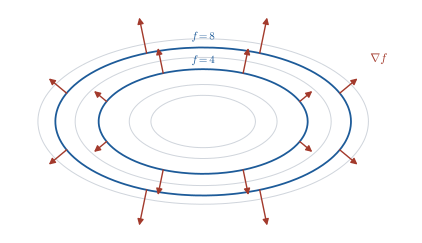{#fig-level-gradient width=75%}
:::

In physics a conservative force is minus the gradient of a potential energy. The two central potentials of the tutorial, the Coulomb
potential of the hydrogen atom and the harmonic oscillator, give the familiar forces through the radius of @exm-partial-radius.

::: {#exm-partial-coulomb}
#### Coulomb and oscillator forces

For a function $g(r)$ of the radius, the one-variable chain rule in $x^i$ gives $\partial_i\,g(r) = g'(r)\,x^i/r$, so $\nabla g(r) = g'(r)\,\mathbf x/r$.
The Coulomb potential energy of the electron in hydrogen, $V(\mathbf x) = -k/r$ with $k = e^2/(4\pi\varepsilon_0)$, gives the force $-\nabla V =
-k\,\mathbf x/r^3$, attractive with magnitude $k/r^2$. The isotropic oscillator $V(\mathbf x) = \tfrac12 m\omega^2 r^2$ gives $-\nabla V =
-m\omega^2\mathbf x$, Hooke's law in every direction.
:::

In thermodynamics a state function depends on two variables, and which one is held fixed is written as a subscript, $(\partial P/\partial T)_V$.
The ideal gas shows the notation, and an explicit computation of a product of three partial derivatives [@riley2006mathematical, Sec. 5.1].

::: {#exm-partial-ideal-gas}
#### The ideal gas

For $n$ moles of an ideal gas, $P = nRT/V$, $V = nRT/P$ and $T = PV/(nR)$. Then $(\partial P/\partial T)_V = nR/V$, $(\partial P/\partial V)_T =
-nRT/V^2$, $(\partial V/\partial T)_P = nR/P$ and $(\partial T/\partial P)_V = V/(nR)$, and
$$
\Big(\frac{\partial P}{\partial V}\Big)_T\Big(\frac{\partial V}{\partial T}\Big)_P\Big(\frac{\partial T}{\partial P}\Big)_V = -\frac{nRT}{V^2}\cdot\frac{nR}{P}\cdot\frac{V}{nR} = -\frac{nRT}{PV} = -1,
$$
not $+1$, as a naive cancellation of the three quotients would suggest.
:::

Directional derivatives in every direction do not make a function continuous. The example is a function whose restriction to every line
through the origin is well behaved, but which is constant equal to $\tfrac12$ along a parabola ending at the origin.

::: {#exm-partial-parabola-discontinuous}
#### All directional derivatives, no continuity

Let $f(x, y) = x^2y/(x^4 + y^2)$ for $(x, y) \neq \mathbf 0$ and $f(\mathbf 0) = 0$. For $\mathbf v = (v^1, v^2)^\top$ with $v^2 \neq 0$,
$f(t\mathbf v)/t = (v^1)^2v^2/(t^2(v^1)^4 + (v^2)^2) \to (v^1)^2/v^2$, and for $v^2 = 0$, $f(t\mathbf v) = 0$; so every $D_{\mathbf v}f(\mathbf 0)$
exists. But $f(x, x^2) = \tfrac12$ for $x \neq 0$, so $f$ is not continuous at $\mathbf 0$. Note also that $\mathbf v \mapsto (v^1)^2/v^2$ is not
linear.
:::

The last example is continuous at the origin and has all directional derivatives there, yet the directional derivative is not the dot product of
the gradient with the direction [@radozycki2020solvingII, Sec. 5.2, Problem 1]. Knowing the partial derivatives therefore does not determine the
other directional derivatives.

::: {#exm-partial-directional-nonlinear}
#### A non-linear directional derivative

Let $f(x, y) = x^2y^3/(x^4 + y^4)$ for $(x, y) \neq \mathbf 0$, $f(\mathbf 0) = 0$. From $2x^2y^2 \leq x^4 + y^4$, $|f(x, y)| \leq \tfrac12|y|$, so $f$
is continuous at $\mathbf 0$. For $\mathbf v \neq \mathbf 0$, $f(t\mathbf v)/t = (v^1)^2(v^2)^3/((v^1)^4 + (v^2)^4)$ for every $t \neq 0$, so
$D_{\mathbf v}f(\mathbf 0) = (v^1)^2(v^2)^3/((v^1)^4 + (v^2)^4)$. In particular $\nabla f(\mathbf 0) = \mathbf 0$, while $D_{(1, 1)^\top}f(\mathbf 0) =
\tfrac12 \neq \nabla f(\mathbf 0)\cdot(1, 1)^\top$.
:::
::::

:::: {.callout-note .exercises-fold collapse="true" title="Exercises"}
Computing partial derivatives with the other variable frozen, and a directional derivative from its definition, is the first skill of the
section. The first exercise does both on the running polynomial.

::: {#exr-partials-chain}
#### Partial and directional derivatives

For $f(x, y) = x^2 y + \sin y$, compute $\partial_x f$, $\partial_y f$ and the second partial derivatives $\partial_y\partial_x f$ and $\partial_x\partial_y
f$, and find the directional derivative at $(1, 0)$ along $\mathbf u = (3/5, 4/5)^\top$ from its definition.
:::

::: {.callout-note .solution collapse="true" title="Solution"}
:::: {.panel-tabset .solution-tabs}
## Proof

As in @exm-partial-polynomial, $\partial_x f = 2xy$ and $\partial_y f = x^2 + \cos y$. Then $\partial_y\partial_x f = \partial_y(2xy) = 2x$ and
$\partial_x\partial_y f = \partial_x(x^2 + \cos y) = 2x$. Along $\mathbf u$, $g(t) = f(1 + \tfrac35t, \tfrac45t) = (1 + \tfrac35t)^2\tfrac45t + \sin\tfrac45t$,
and by the rules of @def-derivative $g'(0) = \tfrac45 + \tfrac45\cos 0 = \tfrac85$, which is $D_{\mathbf u}f(1, 0)$. It agrees with $\nabla f(1, 0)\cdot\mathbf u
= (0, 2)^\top\cdot(\tfrac35, \tfrac45)^\top = \tfrac85$.

## SageMath

Sage differentiates with the other variable held fixed and takes the derivative at $t = 0$ of $f(\mathbf a + t\mathbf u)$.

```{.python .sage}
x, y, t = var("x y t")
f = x^2 * y + sin(y)
print(diff(f, x), "|", diff(f, y), "|", diff(f, x, y), "|", diff(f, y, x))
g = f.subs(x=1 + 3/5 * t, y=4/5 * t)
print(diff(g, t).subs(t=0), vector([diff(f, x), diff(f, y)]).subs(x=1, y=0) * vector([3/5, 4/5]))
```

```{.text .sage-output}
2*x*y | x^2 + cos(y) | 2*x | 2*x
8/5 8/5
```
::::
:::

Partial derivatives of quotients and inverse trigonometric functions follow from the one-variable rules as well. The second exercise runs
through a list of them and compares two mixed second derivatives [@riley2006mathematical, Exercise 5.1].

::: {#exr-partial-riley-list}
#### A list of partial derivatives

Find the first partial derivatives of $x^2y$, $x^2 + y^2 + 4$, $\sin(x/y)$ ($y \neq 0$) and $\arctan(y/x)$ ($x \neq 0$), and for $\arctan(y/x)$ compute
both $\partial_y\partial_x f$ and $\partial_x\partial_y f$.
:::

::: {.callout-note .solution collapse="true" title="Solution"}
:::: {.panel-tabset .solution-tabs}
## Proof

By (1) of @def-partial-derivative and the rules of @def-derivative: $\partial_x(x^2y) = 2xy$, $\partial_y(x^2y) = x^2$; $\partial_x(x^2 + y^2 + 4) = 2x$,
$\partial_y = 2y$; $\partial_x\sin(x/y) = \cos(x/y)/y$, $\partial_y\sin(x/y) = -x\cos(x/y)/y^2$. With $(\arctan)'(u) = 1/(1 + u^2)$
(@exm-derivative-inverse-functions), $\partial_x\arctan(y/x) = \frac{-y/x^2}{1 + y^2/x^2} = \frac{-y}{x^2 + y^2}$ and $\partial_y\arctan(y/x) = \frac{1/x}{1 +
y^2/x^2} = \frac{x}{x^2 + y^2}$. Then
$$
\partial_y\Big(\frac{-y}{x^2 + y^2}\Big) = \frac{-(x^2 + y^2) + 2y^2}{(x^2 + y^2)^2} = \frac{y^2 - x^2}{(x^2 + y^2)^2}, \qquad \partial_x\Big(\frac{x}{x^2 + y^2}\Big) = \frac{x^2 + y^2 - 2x^2}{(x^2 + y^2)^2} = \frac{y^2 - x^2}{(x^2 + y^2)^2},
$$
and the two mixed derivatives agree.

## SageMath

Sage computes the eight first partial derivatives and the difference of the two mixed derivatives of $\arctan(y/x)$.

```{.python .sage}
x, y = var("x y")
for f in [x^2 * y, x^2 + y^2 + 4, sin(x / y), arctan(y / x)]:
    print(f, ":", diff(f, x).simplify_full(), "|", diff(f, y).simplify_full())
f = arctan(y / x)
print(diff(f, x, y).simplify_full(), "|", (diff(f, x, y) - diff(f, y, x)).simplify_full())
```

```{.text .sage-output}
x^2*y : 2*x*y | x^2
x^2 + y^2 + 4 : 2*x | 2*y
sin(x/y) : cos(x/y)/y | -x*cos(x/y)/y^2
arctan(y/x) : -y/(x^2 + y^2) | x/(x^2 + y^2)
-(x^2 - y^2)/(x^4 + 2*x^2*y^2 + y^4) | 0
```
::::
:::

A directional derivative can always be found as the derivative of a function of one variable, here built from a power with a variable exponent.
The third exercise does this along a slanted direction and compares the result with the gradient [@radozycki2020solvingII, Sec. 5.3, Exercise 1].

::: {#exr-partial-directional-power}
#### A directional derivative through a power

For $f(x, y) = \sin(x^y + x)$ on $x > 0$, compute $\nabla f(\pi, 1)$ and the directional derivative at $(\pi, 1)$ along $\mathbf v = (1, -2)^\top$ from the
definition, and compare it with $\nabla f(\pi, 1)\cdot\mathbf v$.
:::

::: {.callout-note .solution collapse="true" title="Solution"}
:::: {.panel-tabset .solution-tabs}
## Proof

With $x^y = e^{y\log x}$, $\partial_x f = (yx^{y-1} + 1)\cos(x^y + x)$ and $\partial_y f = x^y\log x\,\cos(x^y + x)$; at $(\pi, 1)$, $\cos(2\pi) = 1$ gives
$\nabla f(\pi, 1) = (2, \pi\log\pi)^\top$. Along $\mathbf v$, $g(t) = f(\pi + t, 1 - 2t) = \sin\big(e^{(1 - 2t)\log(\pi + t)} + \pi + t\big)$. The derivative of
$u(t) = e^{(1 - 2t)\log(\pi + t)}$ at $0$ is $\pi\big(-2\log\pi + 1/\pi\big) = 1 - 2\pi\log\pi$, so by the chain rule of @def-derivative $g'(0) =
\cos(2\pi)\,(1 - 2\pi\log\pi + 1) = 2 - 2\pi\log\pi$. This is $\nabla f(\pi, 1)\cdot\mathbf v = 2 - 2\pi\log\pi$.

## SageMath

Sage differentiates $g(t) = f(\pi + t, 1 - 2t)$ at $0$ and compares with the gradient.

```{.python .sage}
x, y, t = var("x y t")
f = sin(x^y + x)
grad = vector([diff(f, x), diff(f, y)]).subs(x=pi, y=1)
D = diff(f.subs(x=pi + t, y=1 - 2 * t), t).subs(t=0)
print(grad, "|", D.simplify_full(), "|", bool(D == grad * vector([1, -2])))
```

```{.text .sage-output}
(2, pi*log(pi)) | -2*pi*log(pi) + 2 | True
```
::::
:::

The gradient is orthogonal to the level sets and points in the direction of steepest increase. The fourth exercise checks both on an ellipse,
using only the definition and the Cauchy-Schwarz inequality.

::: {#exr-gradient-level-sets}
#### The gradient and the level sets

For $f(x, y) = x^2 + 4y^2$, show that $\nabla f$ is orthogonal to the level curve $f = 8$ through $(2, 1)$, compute $D_{\mathbf u}f(2, 1)$ for every unit
vector $\mathbf u$ from the definition, and find its largest value and the direction where it is attained; evaluate it along $(3/5, 4/5)^\top$.
:::

::: {.callout-note .solution collapse="true" title="Solution"}
:::: {.panel-tabset .solution-tabs}
## Proof

The level curve $f = 8$ is $\boldsymbol\gamma(t) = (2\sqrt2\cos t, \sqrt2\sin t)^\top$, through $(2, 1)$ at $t = \pi/4$, and as in @exm-partial-level-gradient
$\nabla f(\boldsymbol\gamma(t))\cdot\boldsymbol\gamma'(t) = 4\sqrt2\cos t\cdot(-2\sqrt2\sin t) + 8\sqrt2\sin t\cdot\sqrt2\cos t = 0$. For $\mathbf a = (2, 1)^\top$,
$f(\mathbf a + t\mathbf u) = f(\mathbf a) + t(2a^1u^1 + 8a^2u^2) + t^2((u^1)^2 + 4(u^2)^2)$, so $D_{\mathbf u}f(\mathbf a) = 4u^1 + 8u^2 = \nabla f(\mathbf a)\cdot\mathbf u$.
By the Cauchy-Schwarz inequality (@exm-metric-space-euclidean) this is at most $\lVert\nabla f(\mathbf a)\rVert = \sqrt{80} = 4\sqrt5$, with equality for
$\mathbf u = (4, 8)^\top/(4\sqrt5) = (1, 2)^\top/\sqrt5$, where $4/\sqrt5 + 16/\sqrt5 = 4\sqrt5$. Along $(3/5, 4/5)^\top$ the value is $12/5 + 32/5 = 44/5 < 4\sqrt5$.

## SageMath

Sage checks the orthogonality along the whole curve, the directional derivative from the definition, and the maximum over unit vectors.

```{.python .sage}
x, y, t, s = var("x y t s")
f = x^2 + 4 * y^2
grad = vector([diff(f, x), diff(f, y)])
c = vector([2 * sqrt(2) * cos(t), sqrt(2) * sin(t)])
print(f.subs(x=c[0], y=c[1]).simplify_trig(), (grad.subs(x=c[0], y=c[1]) * diff(c, t)).simplify_full())
u = vector([cos(s), sin(s)])
D = diff(f.subs(x=2 + t * u[0], y=1 + t * u[1]), t).subs(t=0)
print(D, "| at (3/5, 4/5):", D.subs(s=arctan(4/3)), "| max:", sqrt(D.subs(s=0)^2 + D.subs(s=pi/2)^2), grad.subs(x=2, y=1).norm())
```

```{.text .sage-output}
8 0
4*cos(s) + 8*sin(s) | at (3/5, 4/5): 44/5 | max: 4*sqrt(5) 4*sqrt(5)
```
::::
:::

Functions of the radius alone have gradients along the radial direction, and their size is the one-variable derivative. The fifth exercise uses
this for the screened Coulomb potential of nuclear physics.

::: {#exr-partial-radial}
#### Radial functions and the Yukawa force

Show that for a differentiable $g$ on $(0, \infty)$ the function $g(\lVert\mathbf x\rVert)$ on $\mathbb{R}^3 \setminus \{\mathbf 0\}$ has gradient $g'(r)\mathbf x/r$, and
compute the force $-\nabla V$ for the Yukawa potential $V = -g^2 e^{-\mu r}/r$ ($g, \mu > 0$); compare its magnitude with the Coulomb case $\mu = 0$.
:::

::: {.callout-note .solution collapse="true" title="Solution"}
:::: {.panel-tabset .solution-tabs}
## Proof

With the other coordinates fixed, $r$ is a differentiable function of $x^i$ with derivative $x^i/r$ (@exm-partial-radius), so by the chain rule of
@def-derivative $\partial_i\,g(r) = g'(r)\,x^i/r$ and $\nabla g(r) = g'(r)\,\mathbf x/r$. For $V(r) = -g^2e^{-\mu r}/r$,
$V'(r) = g^2e^{-\mu r}(1 + \mu r)/r^2$, so $-\nabla V = -g^2e^{-\mu r}(1 + \mu r)\,\mathbf x/r^3$: attractive, of magnitude $g^2e^{-\mu r}(1 + \mu r)/r^2$. For
$\mu = 0$ this is the Coulomb magnitude $g^2/r^2$ of @exm-partial-coulomb; for $\mu > 0$ the factor $e^{-\mu r}(1 + \mu r) < 1$ for $r > 0$ (its derivative
$-\mu^2re^{-\mu r}$ is negative and its value at $0$ is $1$), and it tends to $0$ faster than any power: the force has range about $1/\mu$.

## SageMath

Sage computes the gradient of the Yukawa potential in Cartesian coordinates and compares it with the radial formula.

```{.python .sage}
x, y, z, g, mu = var("x y z g mu")
assume(g > 0, mu > 0)
r = sqrt(x^2 + y^2 + z^2)
V = -g^2 * exp(-mu * r) / r
F = -vector([diff(V, v) for v in (x, y, z)])
formula = -g^2 * exp(-mu * r) * (1 + mu * r) / r^3 * vector([x, y, z])
print([(F[i] - formula[i]).simplify_full() for i in range(3)])
print(F.subs(mu=0).simplify_full())
```

```{.text .sage-output}
[0, 0, 0]
(-g^2*x/(x^2 + y^2 + z^2)^(3/2), -g^2*y/(x^2 + y^2 + z^2)^(3/2), -g^2*z/(x^2 + y^2 + z^2)^(3/2))
```
::::
:::

The van der Waals equation corrects the ideal gas for the size of the molecules and their attraction. Its critical point is where the isotherm
$P(V)$ has a horizontal inflection, two conditions on partial derivatives at fixed temperature [@riley2006mathematical, Exercise 5.27].

::: {#exr-partial-van-der-waals}
#### The critical point of a van der Waals gas

For $P(V, T) = RT/(V - b) - a/V^2$ ($a, b, R > 0$, one mole, $V > b$), compute $(\partial P/\partial T)_V$ and $(\partial P/\partial V)_T$, and find the
critical point, where $(\partial P/\partial V)_T = (\partial^2 P/\partial V^2)_T = 0$.
:::

::: {.callout-note .solution collapse="true" title="Solution"}
:::: {.panel-tabset .solution-tabs}
## Proof

With $V$ fixed, $(\partial P/\partial T)_V = R/(V - b)$; with $T$ fixed, $(\partial P/\partial V)_T = -RT/(V - b)^2 + 2a/V^3$ and $(\partial^2P/\partial V^2)_T =
2RT/(V - b)^3 - 6a/V^4$. The first condition gives $RT = 2a(V - b)^2/V^3$; inserted in the second it gives $4a/(V^3(V - b)) = 6a/V^4$, that is $4V =
6(V - b)$, so $V_c = 3b$. Then $T_c = 2a(2b)^2/(27b^3R) = 8a/(27Rb)$ and $P_c = R T_c/(2b) - a/(9b^2) = 4a/(27b^2) - 3a/(27b^2) = a/(27b^2)$, with $P_cV_c/(RT_c) = 3/8$.

## SageMath

Sage solves the two conditions for $V$ and $T$.

```{.python .sage}
V, T, R, a, b = var("V T R a b")
assume(a > 0, b > 0, R > 0, V > b)
P = R * T / (V - b) - a / V^2
print(diff(P, T), "|", diff(P, V))
sol = solve([diff(P, V) == 0, diff(P, V, 2) == 0], [V, T], solution_dict=True)
sol = [s for s in sol if s[V] != 0][0]
Pc = P.subs(sol).simplify_full()
print(sol, "| P_c =", Pc, "| P_c V_c / (R T_c) =", (Pc * sol[V] / (R * sol[T])).simplify_full())
```

```{.text .sage-output}
R/(V - b) | -R*T/(V - b)^2 + 2*a/V^3
{V: 3*b, T: 8/27*a/(R*b)} | P_c = 1/27*a/b^2 | P_c V_c / (R T_c) = 3/8
```
::::
:::

The two partial derivatives of a function can exist at a point where the function is not even continuous. The seventh exercise proves this for the
standard example, which shows that partial derivatives alone are too weak a notion of derivative.

::: {#exr-partials-not-continuous}
#### Partial derivatives without continuity

Let $f(x, y) = xy/(x^2 + y^2)$ for $(x, y) \neq \mathbf 0$ and $f(\mathbf 0) = 0$. Show that both partial derivatives exist at the origin, that
$D_{\mathbf v}f(\mathbf 0)$ exists only along the axes, and that $f$ is not continuous there.
:::

::: {.callout-note .solution collapse="true" title="Solution"}
:::: {.panel-tabset .solution-tabs}
## Proof

On the axes $f$ vanishes, so $f(h\mathbf e_1) = f(h\mathbf e_2) = 0$ and $\partial_x f(\mathbf 0) = \partial_y f(\mathbf 0) = 0$. For $\mathbf v$ with $v^1v^2 \neq 0$,
$f(t\mathbf v) = v^1v^2/((v^1)^2 + (v^2)^2) = c \neq 0$ for all $t \neq 0$, so $(f(t\mathbf v) - f(\mathbf 0))/t = c/t$ has no limit: $D_{\mathbf v}f(\mathbf 0)$
does not exist. With $\mathbf v = (1, 1)^\top$, $f(t, t) = \tfrac12$ for $t \neq 0$, so $f(t, t) \not\to f(\mathbf 0)$ and $f$ is not continuous at $\mathbf 0$.

## SageMath

Check on the axes and the diagonal: Sage computes the two difference quotients and the values along $y = x$ and $y = 2x$.

```{.python .sage}
x, y, h, t = var("x y h t")
f(x, y) = x * y / (x^2 + y^2)
print(limit(f(h, 0) / h, h=0), limit(f(0, h) / h, h=0), "|", f(t, t).simplify_full(), f(t, 2 * t).simplify_full())
```

```{.text .sage-output}
0 0 | 1/2 2/5
```
::::
:::

When the directional derivative is the dot product of the gradient with the direction, the gradient picks out the direction of fastest increase.
The eighth exercise proves this in general with the equality case of the Cauchy-Schwarz inequality.

::: {#exr-partial-steepest}
#### The direction of steepest increase

Suppose $D_{\mathbf v}f(\mathbf a) = \nabla f(\mathbf a)\cdot\mathbf v$ for every $\mathbf v$, and $\nabla f(\mathbf a) \neq \mathbf 0$. Prove that over unit vectors
$\mathbf u$ the directional derivative $D_{\mathbf u}f(\mathbf a)$ takes its largest value $\lVert\nabla f(\mathbf a)\rVert$ exactly at $\mathbf u = \nabla f(\mathbf a)/\lVert
\nabla f(\mathbf a)\rVert$, its smallest value $-\lVert\nabla f(\mathbf a)\rVert$ at the opposite vector, and vanishes exactly for $\mathbf u \perp \nabla f(\mathbf a)$.
:::

::: {.callout-note .solution collapse="true" title="Solution"}
:::: {.panel-tabset .solution-tabs}
## Proof

Write $\mathbf g = \nabla f(\mathbf a)$. The identity of @exm-metric-space-euclidean, $\lVert\mathbf g\rVert^2\lVert\mathbf u\rVert^2 - (\mathbf g\cdot\mathbf u)^2 =
\sum_{i < j}(g^iu^j - g^ju^i)^2$, gives $|\mathbf g\cdot\mathbf u| \leq \lVert\mathbf g\rVert$ for $\lVert\mathbf u\rVert = 1$, with equality exactly when all $g^iu^j =
g^ju^i$, that is when $\mathbf u = c\,\mathbf g$ for some $c$ (pick $i$ with $g^i \neq 0$ and put $c = u^i/g^i$). With $\lVert\mathbf u\rVert = 1$, $c = \pm1/\lVert
\mathbf g\rVert$, and $\mathbf g\cdot\mathbf u = \pm\lVert\mathbf g\rVert$ accordingly. So $D_{\mathbf u}f(\mathbf a) = \mathbf g\cdot\mathbf u$ lies in $[-\lVert\mathbf
g\rVert, \lVert\mathbf g\rVert]$, reaches the ends only at $\pm\mathbf g/\lVert\mathbf g\rVert$, and vanishes exactly when $\mathbf u \perp \mathbf g$.

## SageMath

Check on $f(x, y) = x^2 + 4y^2$ at $(2, 1)$: Sage samples $D_{\mathbf u}f$ at $3600$ unit vectors and compares the extreme values and their directions
with $\pm\lVert\nabla f\rVert$ and $\pm\nabla f/\lVert\nabla f\rVert$.

```{.python .sage}
g = vector(RDF, [4, 8])
us = [vector(RDF, [cos(2 * pi * k / 3600), sin(2 * pi * k / 3600)]) for k in range(3600)]
vals = [g * u for u in us]
kmax, kmin = vals.index(max(vals)), vals.index(min(vals))
print(round(max(vals), 3), round(min(vals), 3), round(g.norm(), 3))
print(us[kmax].n(digits=3), us[kmin].n(digits=3), (g / g.norm()).n(digits=3))
```

```{.text .sage-output}
8.944 -8.944 8.944
(0.448, 0.894) (-0.448, -0.894) (0.447, 0.894)
```
::::
:::

A function homogeneous of degree $k$ grows like $t^k$ along rays from the origin, and its derivative along the ray is $k$ times the function. The
ninth exercise proves this from the definition alone and checks it on a polynomial and on the kinetic energy.

::: {#exr-partial-homogeneous}
#### Homogeneous functions

Let $f$ be defined on $\mathbb{R}^n \setminus \{\mathbf 0\}$ with $f(t\mathbf x) = t^kf(\mathbf x)$ for all $t > 0$. Prove that $D_{\mathbf x}f(\mathbf x) = kf(\mathbf x)$. For
$f = x^2y + y^3$ and for the kinetic energy $T(\mathbf v) = \frac12m\lVert\mathbf v\rVert^2$, check directly that $x\,\partial_x f + y\,\partial_y f = 3f$ and $\sum_i
v^i\,\partial T/\partial v^i = 2T$.
:::

::: {.callout-note .solution collapse="true" title="Solution"}
:::: {.panel-tabset .solution-tabs}
## Proof

For $|t| < 1$, $1 + t > 0$, so $f(\mathbf x + t\mathbf x) = (1 + t)^kf(\mathbf x)$ and
$$
\frac{f(\mathbf x + t\mathbf x) - f(\mathbf x)}{t} = \frac{(1 + t)^k - 1}{t}\,f(\mathbf x) \to k\,f(\mathbf x),
$$
the limit being the derivative of $(1 + t)^k$ at $0$ (@exm-derivative-inverse-functions). For $f = x^2y + y^3$, $x\cdot 2xy + y(x^2 + 3y^2) = 3x^2y + 3y^3 =
3f$. For $T$, $\partial T/\partial v^i = mv^i$, and $\sum_i v^i\,mv^i = m\lVert\mathbf v\rVert^2 = 2T$.

## SageMath

Check on $f = x^2y + y^3$ and $T$ in three dimensions: Sage computes the directional derivative along $\mathbf x$ from the definition and the sums
$\sum_i x^i\partial_i f$.

```{.python .sage}
x, y, t, m = var("x y t m")
f = x^2 * y + y^3
print(diff(f.subs(x=x + t * x, y=y + t * y), t).subs(t=0).expand(), "|", (x * diff(f, x) + y * diff(f, y) - 3 * f).expand())
v = vector(var("v1 v2 v3"))
T = m / 2 * (v * v)
print((sum(vi * diff(T, vi) for vi in v) - 2 * T).expand())
```

```{.text .sage-output}
3*x^2*y + 3*y^3 | 0
0
```
::::
:::

The last exercise combines everything so far: a function whose directional derivatives all exist and are given by the gradient, so that
$\nabla f(\mathbf 0)\cdot\mathbf h$ is the obvious candidate for a linear approximation of $f(\mathbf h) - f(\mathbf 0)$, and yet the candidate fails along a parabola
[@radozycki2020solvingII, Sec. 5.2, Problem 3].

::: {#exr-partial-parabola-linear}
#### Linear directional derivatives that do not approximate

Let $f(x, y) = x + y + x^3y/(x^4 + y^2)$ for $(x, y) \neq \mathbf 0$, $f(\mathbf 0) = 0$. Show that $f$ is continuous at $\mathbf 0$, that $D_{\mathbf v}f(\mathbf 0) =
\nabla f(\mathbf 0)\cdot\mathbf v$ for every $\mathbf v$, but that $(f(\mathbf h) - \nabla f(\mathbf 0)\cdot\mathbf h)/\lVert\mathbf h\rVert$ does not tend to $0$ as
$\mathbf h \to \mathbf 0$.
:::

::: {.callout-note .solution collapse="true" title="Solution"}
:::: {.panel-tabset .solution-tabs}
## Proof

From $(x^2 - |y|)^2 \geq 0$, $2x^2|y| \leq x^4 + y^2$, so $|x^3y/(x^4 + y^2)| \leq \frac12|x|$ and $|f(x, y)| \leq \frac32|x| + |y| \to 0$: $f$ is continuous at
$\mathbf 0$. For $\mathbf v \neq \mathbf 0$ and $t \neq 0$, $f(t\mathbf v)/t = v^1 + v^2 + t\,(v^1)^3v^2/(t^2(v^1)^4 + (v^2)^2)$; if $v^2 \neq 0$ the last term tends
to $0$, and if $v^2 = 0$ it vanishes. So $D_{\mathbf v}f(\mathbf 0) = v^1 + v^2$, in particular $\nabla f(\mathbf 0) = (1, 1)^\top$ and $D_{\mathbf v}f(\mathbf 0) =
\nabla f(\mathbf 0)\cdot\mathbf v$. But along $\mathbf h = (s, s^2)^\top$, $s \neq 0$,
$$
\frac{f(\mathbf h) - \nabla f(\mathbf 0)\cdot\mathbf h}{\lVert\mathbf h\rVert} = \frac{s^5/(2s^4)}{|s|\sqrt{1 + s^2}} = \frac{\operatorname{sgn}(s)}{2\sqrt{1 + s^2}},
$$
whose limits as $s \to 0^\pm$ are $\pm\frac12$, not $0$.

## SageMath

Sage computes the directional derivative along a general $\mathbf v$ and the quotient along the parabola for $s \to 0^+$.

```{.python .sage}
s, t, v1, v2 = var("s t v1 v2")
f(x, y) = x + y + x^3 * y / (x^4 + y^2)
assume(v2 != 0)
print(limit(f(t * v1, t * v2) / t, t=0))
q = (f(s, s^2) - (s + s^2)) / sqrt(s^2 + s^4)
print(limit(q, s=0, dir="+"), limit(q, s=0, dir="-"))
```

```{.text .sage-output}
v1 + v2
1/2 -1/2
```
::::
:::
::::

### Differentiability and the Jacobian

The existence of partial derivatives, or even of all directional derivatives, says nothing about how the function behaves off the lines
through the point. Differentiability asks for one linear map that approximates the function in all directions at once, with an error small
compared with the distance; its matrix is the matrix of partial derivatives.

:::: {.statement-box}
::: {#def-jacobian}
#### Differentiability and the Jacobian matrix

Let $U \subseteq \mathbb{R}^n$ be open and $F : U \to \mathbb{R}^m$. The map $F$ is **differentiable at** $\mathbf a \in U$ if there is an
$m \times n$ matrix $\mathbf A$ with
$$
F(\mathbf a + \mathbf h) = F(\mathbf a) + \mathbf A\mathbf h + \mathbf r(\mathbf h), \qquad \frac{\lVert\mathbf r(\mathbf h)\rVert}{\lVert\mathbf h\rVert} \to 0 \text{ as } \mathbf h \to \mathbf 0.
$$
The linear map $dF_{\mathbf a}(\mathbf h) = \mathbf A\mathbf h$ is the **differential** of $F$ at $\mathbf a$, and $F$ is **differentiable**
on $U$ if it is differentiable at every point. Then:

1. $F$ is continuous at $\mathbf a$, every directional derivative exists and $D_{\mathbf v}F(\mathbf a) = \mathbf A\mathbf v$; in particular
   $\mathbf A$ is the **Jacobian matrix** $\mathbf J_F(\mathbf a)$, with entries $(\mathbf J_F)^a{}_i = \partial_i F^a(\mathbf a)$, and the
   differential is unique. For $m = 1$, $D_{\mathbf v}f(\mathbf a) = \nabla f(\mathbf a)\cdot\mathbf v$;
2. $F$ is differentiable at $\mathbf a$ if and only if each component $F^a$ is;
3. if all partial derivatives $\partial_i F^a$ exist on a ball about $\mathbf a$ and are continuous at $\mathbf a$, then $F$ is differentiable at
   $\mathbf a$;
4. if $F$ and $G$ are differentiable at $\mathbf a$ and $c \in \mathbb{R}$, so are $F + G$ and $cF$, with $\mathbf J_{F+G} = \mathbf J_F + \mathbf J_G$
   and $\mathbf J_{cF} = c\,\mathbf J_F$; if $f, g : U \to \mathbb{R}$ are, so is $fg$, with $\nabla(fg) = g\nabla f + f\nabla g$.

For $m = n$, $\det\mathbf J_F(\mathbf a)$ is the **Jacobian determinant** of $F$ at $\mathbf a$.
:::
::::

*Proof.* (1) By the matrix bound above, $\lVert\mathbf A\mathbf h\rVert \leq \lVert\mathbf A\rVert\lVert\mathbf h\rVert \to 0$, and
$\lVert\mathbf r(\mathbf h)\rVert = \lVert\mathbf h\rVert \cdot \lVert\mathbf r(\mathbf h)\rVert/\lVert\mathbf h\rVert \to 0$, so $F(\mathbf a +
\mathbf h) \to F(\mathbf a)$. For $\mathbf v \neq \mathbf 0$ and small $t \neq 0$,
$$
\frac{F(\mathbf a + t\mathbf v) - F(\mathbf a)}{t} = \mathbf A\mathbf v + \frac{\mathbf r(t\mathbf v)}{t}, \qquad \Big\lVert\frac{\mathbf r(t\mathbf v)}{t}\Big\rVert = \lVert\mathbf v\rVert\,\frac{\lVert\mathbf r(t\mathbf v)\rVert}{\lVert t\mathbf v\rVert} \to 0,
$$
so $D_{\mathbf v}F(\mathbf a) = \mathbf A\mathbf v$, and for $\mathbf v = \mathbf 0$ both sides vanish. With $\mathbf v = \mathbf e_i$, the $i$-th
column of $\mathbf A$ is $(\partial_i F^1(\mathbf a), \dots, \partial_i F^m(\mathbf a))^\top$: the matrix is determined by $F$. For $m = 1$
the matrix is the row $\nabla f(\mathbf a)^\top$, and $\mathbf A\mathbf v = \nabla f(\mathbf a)\cdot\mathbf v$.

(2) The components of $\mathbf r(\mathbf h)$ are the remainders of the components of $F$ with the rows of $\mathbf A$, and $|r^a(\mathbf h)| \leq
\lVert\mathbf r(\mathbf h)\rVert \leq \sum_a |r^a(\mathbf h)|$.

(3) By (2) it suffices to treat a function $f$. Let the partial derivatives exist on $B_\delta(\mathbf a)$ and let $\lVert\mathbf h\rVert <
\delta$. Walk from $\mathbf a$ to $\mathbf a + \mathbf h$ along the coordinate directions: $\mathbf p_0 = \mathbf a$ and $\mathbf p_k = \mathbf a
+ h^1\mathbf e_1 + \dots + h^k\mathbf e_k$, all in the ball since $\lVert\mathbf p_k - \mathbf a\rVert \leq \lVert\mathbf h\rVert$. The function
$t \mapsto f(\mathbf p_{k-1} + t\mathbf e_k)$ has derivative $\partial_k f(\mathbf p_{k-1} + t\mathbf e_k)$ by (1) of @def-partial-derivative,
so it is continuous, and the mean value theorem (@thm-mean-value) gives $f(\mathbf p_k) - f(\mathbf p_{k-1}) = \partial_k f(\mathbf q_k)\,h^k$
for a point $\mathbf q_k$ of the segment from $\mathbf p_{k-1}$ to $\mathbf p_k$ (any point if $h^k = 0$). Summing over $k$,
$$
f(\mathbf a + \mathbf h) - f(\mathbf a) - \nabla f(\mathbf a)\cdot\mathbf h = \sum_{k=1}^n \big(\partial_k f(\mathbf q_k) - \partial_k f(\mathbf a)\big)h^k,
$$
and since $|h^k| \leq \lVert\mathbf h\rVert$ and $\lVert\mathbf q_k - \mathbf a\rVert \leq \lVert\mathbf h\rVert$, the quotient of the left side by
$\lVert\mathbf h\rVert$ is at most $\sum_k |\partial_k f(\mathbf q_k) - \partial_k f(\mathbf a)|$, which tends to $0$ by the continuity of the
$\partial_k f$ at $\mathbf a$.

(4) The remainders of $F + G$ and $cF$ are $\mathbf r_F + \mathbf r_G$ and $c\,\mathbf r_F$. For the product write $f(\mathbf a + \mathbf h) = f +
\mathbf u\cdot\mathbf h + r_f$ and $g(\mathbf a + \mathbf h) = g + \mathbf w\cdot\mathbf h + r_g$, with $f, g$ evaluated at $\mathbf a$, $\mathbf u
= \nabla f(\mathbf a)$ and $\mathbf w = \nabla g(\mathbf a)$. Multiplying,
$$
f(\mathbf a + \mathbf h)g(\mathbf a + \mathbf h) = fg + (g\mathbf u + f\mathbf w)\cdot\mathbf h + \big(f r_g + g r_f + (\mathbf u\cdot\mathbf h + r_f)(\mathbf w\cdot\mathbf h + r_g)\big),
$$
and each term of the bracket divided by $\lVert\mathbf h\rVert$ tends to $0$: the first two because $r_f$ and $r_g$ do, and the last because
$\mathbf u\cdot\mathbf h + r_f \to 0$ while $|\mathbf w\cdot\mathbf h + r_g|/\lVert\mathbf h\rVert \leq \lVert\mathbf w\rVert + |r_g|/\lVert\mathbf
h\rVert$ stays bounded. $\square$

Differentiability in this sense is the derivative of @lee2013introduction [App. C, pp. 642-643], the strong or Fréchet derivative of
@radozycki2020solvingII [Sec. 5.2, eqs. (5.2.2)-(5.2.4)]; for a function it is the total differential $df = \sum_i \partial_i f\,dx^i$ of
@riley2006mathematical [Sec. 5.2, eq. (5.6)]. For $n = 2$, the differential maps the unit square to the parallelogram spanned by the two
columns of $\mathbf J_F(\mathbf a)$, whose area is $|\det\mathbf J_F(\mathbf a)|$ (@exm-topform-plane): the Jacobian determinant is the factor
by which the linear approximation scales areas.

:::: {.callout-note .examples-fold collapse="true" title="Examples"}
A linear map is its own best linear approximation, so its remainder vanishes and its Jacobian matrix is constant. This is the check that the
differential extends the matrix of a linear map, and it is the simplest instance of the definition.

::: {#exm-jacobian-linear}
#### Linear and affine maps

For $F(\mathbf x) = \mathbf A\mathbf x + \mathbf c$, $F(\mathbf a + \mathbf h) = F(\mathbf a) + \mathbf A\mathbf h$ exactly, so $\mathbf r = \mathbf 0$, $F$ is differentiable
everywhere and $\mathbf J_F(\mathbf a) = \mathbf A$ at every point; the translation $\mathbf x \mapsto \mathbf x + \mathbf c$ has $\mathbf J = \mathbf I_n$. The differential of a
linear map is the map itself.
:::

For a real-valued function the Jacobian matrix is a single row, the transposed gradient, and the differential applied to a direction is the
directional derivative. The running polynomial has continuous partial derivatives, so (3) applies.

::: {#exm-jacobian-function}
#### A function

For $f : U \to \mathbb{R}$ differentiable at $\mathbf a$, $\mathbf J_f(\mathbf a) = \nabla f(\mathbf a)^\top$ is the $1 \times n$ row of partial derivatives, and
$df_{\mathbf a}(\mathbf h) = \nabla f(\mathbf a)\cdot\mathbf h = \sum_i \partial_i f(\mathbf a)\,h^i$. For $f = x^2y + \sin y$ the partial derivatives $2xy$ and
$x^2 + \cos y$ are continuous, so $f$ is differentiable on $\mathbb{R}^2$ by (3), and at $(1, 0)$ along $(3/5, 4/5)^\top$ the directional derivative is
$(0, 2)^\top\cdot(3/5, 4/5)^\top = 8/5$, the value found from the definition in @exr-partials-chain.
:::

A quadratic form can be expanded exactly, and the expansion exhibits both the differential and a remainder of order $\lVert\mathbf h\rVert^2$. The
example finds the gradient of $\mathbf x^\top\mathbf A\mathbf x$ for any square matrix, symmetric or not.

::: {#exm-jacobian-quadratic-form}
#### A quadratic form

For $f(\mathbf x) = \mathbf x^\top\mathbf A\mathbf x$ with $\mathbf A$ an $n \times n$ matrix,
$$
f(\mathbf a + \mathbf h) = f(\mathbf a) + \mathbf h^\top\mathbf A\mathbf a + \mathbf a^\top\mathbf A\mathbf h + \mathbf h^\top\mathbf A\mathbf h = f(\mathbf a) + \big((\mathbf A + \mathbf A^\top)\mathbf a\big)\cdot\mathbf h + \mathbf h^\top\mathbf A\mathbf h,
$$
and $|\mathbf h^\top\mathbf A\mathbf h| \leq \lVert\mathbf h\rVert\,\lVert\mathbf A\mathbf h\rVert \leq \lVert\mathbf A\rVert\lVert\mathbf h\rVert^2$ by the Cauchy-Schwarz inequality and the
matrix bound. So $f$ is differentiable with $\nabla f(\mathbf a) = (\mathbf A + \mathbf A^\top)\mathbf a$, which is $2\mathbf A\mathbf a$ for symmetric $\mathbf A$; for
$\mathbf A = \mathbf I_n$, $\nabla\lVert\mathbf x\rVert^2 = 2\mathbf x$.
:::

For a map into $\mathbb{R}^3$ the Jacobian has one row per component, and its columns are the partial derivatives with respect to each variable. The
example is a symmetric polynomial map and its directional derivative along one vector [@radozycki2020solvingII, Sec. 5.1, Problem 3].

::: {#exm-jacobian-product-map}
#### The map $(yz, xz, xy)$

$F(x, y, z) = (yz, xz, xy)^\top$ has continuous partial derivatives, so it is differentiable by (3), with
$$
\mathbf J_F(x, y, z) = \begin{pmatrix} 0 & z & y \\ z & 0 & x \\ y & x & 0 \end{pmatrix}, \qquad D_{\mathbf v}F = \mathbf J_F\mathbf v = (y + 2z,\ x - z,\ 2x - y)^\top \text{ for } \mathbf v = (-1, 2, 1)^\top.
$$
The matrix is symmetric, and its rows are the gradients of the three components.
:::

The four partial derivatives of the polar map fill a $2 \times 2$ matrix whose determinant is $r$. The figure shows what that number means: coordinate
rectangles of equal area are mapped to sectors whose areas grow in proportion to $r$.

::: {#exm-jacobian-polar}
#### The polar map

The partial derivatives of @exm-partial-polar are continuous, so $\Phi$ is differentiable by (3), with
$$
\mathbf J_\Phi(r, \varphi) = \begin{pmatrix} \cos\varphi & -r\sin\varphi \\ \sin\varphi & r\cos\varphi \end{pmatrix}, \qquad \det\mathbf J_\Phi = r\cos^2\varphi + r\sin^2\varphi = r.
$$
The differential maps a small rectangle of sides $\delta$ and $\varepsilon$ to the parallelogram spanned by $\delta\cos\varphi\,\mathbf e_1 + \delta\sin\varphi\,\mathbf e_2$ and
$\varepsilon(-r\sin\varphi\,\mathbf e_1 + r\cos\varphi\,\mathbf e_2)$, of area $r\delta\varepsilon$. The exact image of $[r_0, r_0 + \delta] \times [\varphi_0, \varphi_0 + \varepsilon]$ is an
annular sector of area $\tfrac12\big((r_0 + \delta)^2 - r_0^2\big)\varepsilon = (r_0 + \tfrac12\delta)\,\delta\varepsilon$.

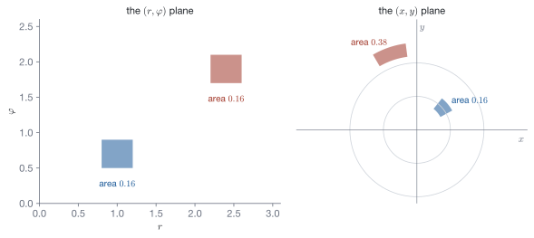{#fig-jacobian-polar width=85%}
:::

For $n = 2$ and $m = 1$ the graph of $f$ is a surface, and the linear approximation is a plane touching it. The figure shows the paraboloid
$z = x^2 + y^2$ with its tangent plane at one point, where the gap between the two is exactly $\lVert\mathbf h\rVert^2$.

::: {#exm-jacobian-tangent-plane}
#### The tangent plane of a paraboloid

For $f(x, y) = x^2 + y^2$ and $\mathbf a = (1, \tfrac12)^\top$, $f(\mathbf a) = \tfrac54$ and $\nabla f(\mathbf a) = (2, 1)^\top$. The **tangent plane** to the graph at
$(\mathbf a, f(\mathbf a))$ is the graph of the linear approximation, $z = \tfrac54 + 2(x - 1) + (y - \tfrac12)$. Here $f(\mathbf a + \mathbf h) = f(\mathbf a) +
\nabla f(\mathbf a)\cdot\mathbf h + \lVert\mathbf h\rVert^2$ exactly, so the remainder is $\lVert\mathbf h\rVert^2$ and the surface lies above its tangent plane, touching it only at
$\mathbf a$.

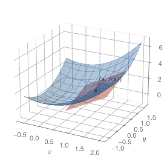{#fig-tangent-plane width=65%}


:::

The harmonic oscillator moves its phase-space points by a linear map, so the Jacobian of the flow over a time $t$ is a constant matrix. Its determinant
is $1$: the flow keeps the areas of regions of initial conditions in the phase plane.

::: {#exm-jacobian-oscillator-flow}
#### The oscillator flow in phase space

A point $(x, p)$ of the phase plane of an oscillator of mass $m$ and frequency $\omega$ moves in time $t$ to
$$
S_t(x, p) = \Big(x\cos\omega t + \frac{p}{m\omega}\sin\omega t,\ -m\omega x\sin\omega t + p\cos\omega t\Big)^\top, \qquad \mathbf J_{S_t} = \begin{pmatrix} \cos\omega t & \sin\omega t/(m\omega) \\ -m\omega\sin\omega t & \cos\omega t\end{pmatrix}.
$$
The map is linear, so this is its matrix at every point (@exm-jacobian-linear), and $\det\mathbf J_{S_t} = \cos^2\omega t + \sin^2\omega t = 1$: a parallelogram of initial
conditions keeps its area while the ellipses of constant energy turn into themselves.
:::

The Jacobian of a force field measures how the force changes from point to point, which is what an extended body feels. For gravity it is the tidal
matrix, and its eigenvalues show stretching along the radius and squeezing across it.

::: {#exm-jacobian-tidal}
#### The tidal matrix of gravity

The field of a mass $M$ is $\mathbf g(\mathbf x) = -GM\,\mathbf x/r^3$ on $\mathbb{R}^3 \setminus \{\mathbf 0\}$. By the quotient rule and $\partial_j r = x^j/r$
(@exm-partial-radius), $\partial_j(x^i/r^3) = \delta_{ij}/r^3 - 3x^ix^j/r^5$, so
$$
\mathbf J_{\mathbf g}(\mathbf x) = -\frac{GM}{r^3}\Big(\mathbf I_3 - \frac{3\,\mathbf x\mathbf x^\top}{r^2}\Big),
$$
continuous, so $\mathbf g$ is differentiable by (3). Then $\mathbf J_{\mathbf g}\mathbf x = 2GM\,\mathbf x/r^3$ and $\mathbf J_{\mathbf g}\mathbf w = -GM\,\mathbf w/r^3$ for $\mathbf w \perp \mathbf x$:
two nearby points on a radius drift apart, two side by side drift together. This is the tide raised on the Earth by the Moon.
:::

Partial derivatives, or even all directional derivatives, do not imply differentiability. By (1) a differentiable function is continuous and has $D_{\mathbf v}f
= \nabla f\cdot\mathbf v$, and the two examples of the previous unit each break one of these conditions.

::: {#exm-jacobian-partials-not-enough}
#### Partial derivatives are not enough

The function $xy/(x^2 + y^2)$ of @exr-partials-not-continuous has both partial derivatives at $\mathbf 0$ but is not continuous there, so it is not differentiable
there. The function $x^2y^3/(x^4 + y^4)$ of @exm-partial-directional-nonlinear is continuous with all directional derivatives, but $D_{(1,1)^\top}f(\mathbf 0) = \tfrac12$
while $\nabla f(\mathbf 0)\cdot(1, 1)^\top = 0$; if $f$ were differentiable at $\mathbf 0$, (1) would force the two to agree.
:::

The criterion (3) is sufficient, not necessary: a function can be differentiable at a point whose partial derivatives are not continuous there. The
example is the two-variable version of $x^2\sin(1/x)$ from @exm-derivative-corner.

::: {#exm-jacobian-not-c1}
#### Differentiable with discontinuous partial derivatives

Let $f(\mathbf x) = \lVert\mathbf x\rVert^2\sin(1/\lVert\mathbf x\rVert)$ on $\mathbb{R}^2 \setminus \{\mathbf 0\}$ and $f(\mathbf 0) = 0$. Since $|f(\mathbf h)| \leq \lVert\mathbf h\rVert^2$, $f$ is
differentiable at $\mathbf 0$ with $\mathbf J_f(\mathbf 0) = \mathbf 0$ and remainder $f(\mathbf h)$. For $\mathbf x \neq \mathbf 0$, $\partial_x f = 2x\sin(1/r) - (x/r)\cos(1/r)$, which on the positive
$x$-axis is $2x\sin(1/x) - \cos(1/x)$ and has no limit as $x \to 0^+$: $\partial_x f$ is not continuous at $\mathbf 0$.
:::
::::

:::: {.callout-note .exercises-fold collapse="true" title="Exercises"}
Checking differentiability from the definition means guessing the matrix and estimating the remainder. The first exercise does it for a quadratic map
of the plane, where the remainder is explicit.

::: {#exr-jacobian-definition-check}
#### Differentiability from the definition

Show from the definition that $F(x, y) = (x^2, xy)^\top$ is differentiable at every $\mathbf a$, with $\mathbf J_F(\mathbf a) = \begin{pmatrix} 2a^1 & 0 \\ a^2 & a^1 \end{pmatrix}$.
:::

::: {.callout-note .solution collapse="true" title="Solution"}
:::: {.panel-tabset .solution-tabs}
## Proof

$F(\mathbf a + \mathbf h) - F(\mathbf a) = \big(2a^1h^1 + (h^1)^2,\ a^2h^1 + a^1h^2 + h^1h^2\big)^\top = \mathbf A\mathbf h + \mathbf r(\mathbf h)$ with the stated $\mathbf A$ and
$\mathbf r(\mathbf h) = h^1\,(h^1, h^2)^\top = h^1\mathbf h$. So $\lVert\mathbf r(\mathbf h)\rVert/\lVert\mathbf h\rVert = |h^1| \leq \lVert\mathbf h\rVert \to 0$.

## SageMath

Sage computes the remainder $F(\mathbf a + \mathbf h) - F(\mathbf a) - \mathbf A\mathbf h$ symbolically and compares $\mathbf A$ with the Jacobian matrix.

```{.python .sage}
a1, a2, h1, h2, x, y = var("a1 a2 h1 h2 x y")
F = lambda u, v: vector([u^2, u * v])
A = matrix([[2 * a1, 0], [a2, a1]])
r = F(a1 + h1, a2 + h2) - F(a1, a2) - A * vector([h1, h2])
print(vector([c.expand() for c in r]), "|", jacobian(F(x, y), (x, y)).subs(x=a1, y=a2) == A)
```

```{.text .sage-output}
(h1^2, h1*h2) | True
```
::::
:::

The Jacobian of the polar map, its determinant and its inverse are computed whenever coordinates in the plane are changed. The second exercise does them
and compares the inverse matrix with the Jacobian of the inverse map, computed directly in Cartesian coordinates.

::: {#exr-jacobian-polar}
#### Jacobian of the polar map

Compute $\mathbf J_\Phi(r, \varphi)$, its determinant and, for $r > 0$, its inverse. Then compute directly the Jacobian of the inverse map $G(x, y) = (\sqrt{x^2 + y^2},
\operatorname{atan2}(y, x))^\top$ on the plane minus the non-positive $x$-axis, and show that $\mathbf J_G(\Phi(r, \varphi)) = \mathbf J_\Phi(r, \varphi)^{-1}$.
:::

::: {.callout-note .solution collapse="true" title="Solution"}
:::: {.panel-tabset .solution-tabs}
## Proof

By @exm-jacobian-polar, $\det\mathbf J_\Phi = r$, and the inverse of a $2 \times 2$ matrix with non-zero determinant is
$$
\mathbf J_\Phi^{-1} = \frac1r\begin{pmatrix} r\cos\varphi & r\sin\varphi \\ -\sin\varphi & \cos\varphi\end{pmatrix} = \begin{pmatrix} \cos\varphi & \sin\varphi \\ -\sin\varphi/r & \cos\varphi/r\end{pmatrix}.
$$
For $G$: $\partial_x\sqrt{x^2 + y^2} = x/\rho$ and $\partial_y\sqrt{x^2 + y^2} = y/\rho$ with $\rho = \sqrt{x^2 + y^2}$ (@exm-partial-radius). The angle is $\arctan(y/x)$ on $x > 0$,
$\pi/2 - \arctan(x/y)$ on $y > 0$ and $-\pi/2 - \arctan(x/y)$ on $y < 0$; in each case its partial derivatives are $-y/\rho^2$ and $x/\rho^2$ (as in @exr-partial-riley-list).
At $(x, y) = \Phi(r, \varphi)$, $\rho = r$, and these four entries are $\cos\varphi$, $\sin\varphi$, $-\sin\varphi/r$ and $\cos\varphi/r$: the matrix $\mathbf J_\Phi^{-1}$ above.

## SageMath

Sage computes $\mathbf J_\Phi$, its determinant and inverse, and the Jacobian of $G$ at $\Phi(r, \varphi)$.

```{.python .sage}
r, ph = var("r ph", domain="real"); assume(r > 0); assume(ph > -pi, ph < pi)
F = vector([r * cos(ph), r * sin(ph)])
J = jacobian(F, (r, ph))
print(J.rows(), "| det =", J.det().simplify_full())
print("inverse:", J.inverse().simplify_full().rows())
x, y = var("x y", domain="real")
G = vector([sqrt(x^2 + y^2), atan2(y, x)])
JG = jacobian(G, (x, y)).subs(x=F[0], y=F[1]).simplify_full()
print("J_G at Phi:", JG.rows(), "| equal to the inverse:", JG == J.inverse().simplify_full())
```

```{.text .sage-output}
[(cos(ph), -r*sin(ph)), (sin(ph), r*cos(ph))] | det = r
inverse: [(cos(ph), sin(ph)), (-sin(ph)/r, cos(ph)/r)]
J_G at Phi: [(cos(ph), sin(ph)), (-sin(ph)/r, cos(ph)/r)] | equal to the inverse: True
```
::::
:::

Spherical coordinates are the three-dimensional analogue of the polar map, with a $3 \times 3$ Jacobian. The third exercise computes its determinant by hand and
locates the points where it vanishes.

::: {#exr-spherical-jacobian}
#### Spherical coordinates

Compute by hand the Jacobian determinant of $(r, \theta, \varphi) \mapsto (r\sin\theta\cos\varphi, r\sin\theta\sin\varphi, r\cos\theta)^\top$, and show that the map is not
injective near any point where it vanishes.
:::

::: {.callout-note .solution collapse="true" title="Solution"}
:::: {.panel-tabset .solution-tabs}
## Proof

The rows of $\mathbf J$ are $(\sin\theta\cos\varphi, r\cos\theta\cos\varphi, -r\sin\theta\sin\varphi)$, $(\sin\theta\sin\varphi, r\cos\theta\sin\varphi, r\sin\theta\cos\varphi)$ and
$(\cos\theta, -r\sin\theta, 0)$. Expanding along the third row,
$$
\det\mathbf J = \cos\theta\cdot r^2\sin\theta\cos\theta(\cos^2\varphi + \sin^2\varphi) + r\sin\theta\cdot r\sin^2\theta(\cos^2\varphi + \sin^2\varphi) = r^2\sin\theta.
$$
It vanishes exactly where $r = 0$ or $\sin\theta = 0$. At $r = 0$ every $(\theta, \varphi)$ gives the origin; at $\theta = 0$ or $\pi$ every $\varphi$ gives the same point
$(0, 0, \pm r)$ of the $z$-axis. So every neighbourhood of such a point contains two parameter triples with the same image.

## SageMath

Sage computes the determinant and the images of two parameter triples on the pole $\theta = 0$.

```{.python .sage}
r, th, ph = var("r theta phi")
S = vector([r * sin(th) * cos(ph), r * sin(th) * sin(ph), r * cos(th)])
J = jacobian(S, (r, th, ph))
print(J.det().simplify_full(), "|", S.subs({r: 2, th: 0, ph: 0}), S.subs({r: 2, th: 0, ph: 1}))
```

```{.text .sage-output}
r^2*sin(theta) | (0, 0, 2) (0, 0, 2)
```
::::
:::

The inverse of the spherical Jacobian has a geometric meaning: its first row is the gradient of the radius. The fourth exercise lets Sage do the algebra and
compares that row with the gradient of $r$ computed in Cartesian coordinates.

::: {#exr-jacobian-spherical-sage}
#### The spherical Jacobian in Sage

Invert the spherical Jacobian with Sage for $r > 0$, $0 < \theta < \pi$, and compare its first row with $\nabla\sqrt{x^2 + y^2 + z^2}$ written in spherical coordinates.
:::

::: {.callout-note .solution collapse="true" title="Solution"}
:::: {.panel-tabset .solution-tabs}
## Proof

By @exm-partial-radius, $\nabla\sqrt{x^2 + y^2 + z^2} = \mathbf x/r = (\sin\theta\cos\varphi, \sin\theta\sin\varphi, \cos\theta)^\top$. The columns of $\mathbf J$ are
$\mathbf u_r = \mathbf x/r$, $r\mathbf u_\theta$ and $r\sin\theta\,\mathbf u_\varphi$ for the three unit vectors $\mathbf u_r$, $\mathbf u_\theta = (\cos\theta\cos\varphi, \cos\theta\sin\varphi,
-\sin\theta)^\top$ and $\mathbf u_\varphi = (-\sin\varphi, \cos\varphi, 0)^\top$, which are pairwise orthogonal (direct check of the dot products). Hence the matrix with rows
$\mathbf u_r^\top$, $\mathbf u_\theta^\top/r$ and $\mathbf u_\varphi^\top/(r\sin\theta)$ times $\mathbf J$ is $\mathbf I_3$, so it is $\mathbf J^{-1}$, and its first row is $\mathbf u_r^\top =
\nabla r^\top$.

## SageMath

Sage inverts $\mathbf J$, checks $\mathbf J^{-1}\mathbf J = \mathbf I_3$ and compares the first row with the Cartesian gradient of $r$ at the spherical point.

```{.python .sage}
r, th, ph, x, y, z = var("r theta phi x y z")
assume(r > 0, th > 0, th < pi)
S = vector([r * sin(th) * cos(ph), r * sin(th) * sin(ph), r * cos(th)])
J = jacobian(S, (r, th, ph))
Jinv = J.inverse().simplify_full()
print((Jinv * J).simplify_full() == identity_matrix(3))
print(Jinv.row(0).simplify_trig())
R = sqrt(x^2 + y^2 + z^2)
grad = vector([diff(R, v) for v in (x, y, z)]).subs(x=S[0], y=S[1], z=S[2])
print([(grad[i] - Jinv[0, i]).simplify_full() for i in range(3)])
```

```{.text .sage-output}
True
(cos(phi)*sin(theta), sin(phi)*sin(theta), cos(theta))
[0, 0, 0]
```
::::
:::

The differential is the first-order term of the change of a function, which @riley2006mathematical calls the total differential. The fifth exercise computes one and
watches the error of the linear estimate shrink faster than the step [@riley2006mathematical, Sec. 5.2].

::: {#exr-jacobian-total-differential}
#### A total differential and its error

For $f(x, y) = y\,e^{x + y}$, find $df = \partial_x f\,dx + \partial_y f\,dy$, explain why $f$ is differentiable, and estimate $f(0.1, 1.05)$ from the values at $(0, 1)$.
Compute the error divided by $\lVert\mathbf h\rVert$ for $\mathbf h = (0.1, 0.05)^\top$, $\mathbf h/10$ and $\mathbf h/100$.
:::

::: {.callout-note .solution collapse="true" title="Solution"}
:::: {.panel-tabset .solution-tabs}
## Proof

$\partial_x f = ye^{x + y}$ and $\partial_y f = (1 + y)e^{x + y}$, so $df = ye^{x + y}\,dx + (1 + y)e^{x + y}\,dy$. Both are continuous, so $f$ is differentiable by (3). At $(0, 1)$,
$f = e$ and $\nabla f = (e, 2e)^\top$, so $f(0.1, 1.05) \approx e + 0.1e + 0.1e = 1.2e \approx 3.262$, against the true $1.05\,e^{1.15} \approx 3.316$. By the definition, the error
divided by $\lVert\mathbf h\rVert$ tends to $0$ as $\mathbf h \to \mathbf 0$; the computation shows it falling roughly by a factor $10$ with each step.

## SageMath

Sage evaluates the error of the linear estimate divided by $\lVert\mathbf h\rVert$ for the three steps.

```{.python .sage}
x, y = var("x y")
f = y * exp(x + y)
print(diff(f, x), "|", diff(f, y))
grad = vector([diff(f, x), diff(f, y)]).subs(x=0, y=1)
for k in [1, 10, 100]:
    h = vector(QQ, [1/10, 1/20]) / k
    err = f.subs(x=h[0], y=1 + h[1]) - f.subs(x=0, y=1) - grad * h
    print(k, n(f.subs(x=h[0], y=1 + h[1]), digits=5), "%.3e" % float(err / h.norm()))
```

```{.text .sage-output}
y*e^(x + y) | y*e^(x + y) + e^(x + y)
1 3.3161 4.845e-01
10 2.7732 4.586e-02
100 2.7237 4.561e-03
```
::::
:::

Two functions that are continuous at the origin, with partial derivatives there, can still behave differently: one is differentiable, the other not. The sixth exercise
decides both cases [@radozycki2020solvingII, Sec. 5.3, Exercise 2].

::: {#exr-jacobian-differentiable-or-not}
#### Differentiable or not

Decide whether $f(x, y) = xy/\sqrt{x^2 + y^2}$ and $g(x, y) = x^4y^2/(x^4 + y^4)$, both extended by $0$ at the origin, are continuous and differentiable at $\mathbf 0$.
:::

::: {.callout-note .solution collapse="true" title="Solution"}
:::: {.panel-tabset .solution-tabs}
## Proof

From $2|xy| \leq x^2 + y^2$, $|f| \leq \frac12\sqrt{x^2 + y^2}$, so $f$ is continuous at $\mathbf 0$; on the axes $f = 0$, so $\nabla f(\mathbf 0) = \mathbf 0$. Along $(1, 1)^\top$,
$f(t, t)/t = t^2/(\sqrt2|t|t) = \operatorname{sgn}(t)/\sqrt2$, which has no limit: $D_{(1,1)^\top}f(\mathbf 0)$ does not exist, and by (1) $f$ is not differentiable at $\mathbf 0$.
For $g$, $x^4/(x^4 + y^4) \leq 1$ gives $|g(\mathbf h)| \leq (h^2)^2 \leq \lVert\mathbf h\rVert^2$, so $g$ is differentiable at $\mathbf 0$ with $\mathbf J_g(\mathbf 0) = \mathbf 0$ and remainder
$g(\mathbf h)$, and in particular continuous.

## SageMath

Sage computes the one-sided limits of $f(t, t)/t$ and the largest value of $|g|/\lVert\mathbf h\rVert^2$ on a grid of small $\mathbf h$.

```{.python .sage}
t = var("t")
f(x, y) = x * y / sqrt(x^2 + y^2)
g(x, y) = x^4 * y^2 / (x^4 + y^4)
print(limit(f(t, t) / t, t=0, dir="+"), limit(f(t, t) / t, t=0, dir="-"))
pts = [(QQ(i) / 100, QQ(j) / 100) for i in range(-10, 11) for j in range(-10, 11) if (i, j) != (0, 0)]
m = max(g(u, v) / (u^2 + v^2) for u, v in pts)
print(m, bool(m <= 1))
```

```{.text .sage-output}
1/2*sqrt(2) -1/2*sqrt(2)
10000/36121 True
```
::::
:::

Criterion (3) is the practical test of differentiability: estimate the partial derivatives near the point. The seventh exercise applies it where the formula breaks
down, at the origin, and confirms the answer from the definition [@radozycki2020solvingII, Sec. 5.2, Problem 4].

::: {#exr-jacobian-continuous-partials}
#### Continuous partial derivatives at the origin

Let $f(x, y) = xy^3/(x^2 + y^2)$ for $(x, y) \neq \mathbf 0$, $f(\mathbf 0) = 0$. Show that both partial derivatives exist everywhere and are continuous at $\mathbf 0$, so that $f$ is
differentiable there, and check the remainder directly.
:::

::: {.callout-note .solution collapse="true" title="Solution"}
:::: {.panel-tabset .solution-tabs}
## Proof

Off the origin, $\partial_x f = y^3(y^2 - x^2)/(x^2 + y^2)^2$ and $\partial_y f = xy^2(3x^2 + y^2)/(x^2 + y^2)^2$; at the origin both are $0$, since $f$ vanishes on the axes. Then
$|\partial_x f| \leq |y|^3(x^2 + y^2)/(x^2 + y^2)^2 \leq |y|$ and $|\partial_y f| \leq 3|y|\cdot|xy|(x^2 + y^2)/(x^2 + y^2)^2 \leq \frac32|y|$, using $2|xy| \leq x^2 + y^2$; both tend to $0
= \partial f(\mathbf 0)$. By (3), $f$ is differentiable at $\mathbf 0$ with $\mathbf J_f(\mathbf 0) = \mathbf 0$. Directly, $|f(\mathbf h)|/\lVert\mathbf h\rVert \leq \frac12 (h^2)^2/\lVert\mathbf h\rVert \leq
\frac12\lVert\mathbf h\rVert \to 0$.

## SageMath

Sage computes the two partial derivatives off the origin and checks the bounds $|\partial_x f| \leq |y|$ and $|\partial_y f| \leq \frac32|y|$ on a grid.

```{.python .sage}
x, y = var("x y")
f = x * y^3 / (x^2 + y^2)
fx, fy = diff(f, x).factor(), diff(f, y).factor()
print(fx, "|", fy)
pts = [(QQ(i) / 7, QQ(j) / 7) for i in range(-7, 8) for j in range(-7, 8) if j != 0]
print(all(abs(fx.subs(x=u, y=v)) <= abs(v) and abs(fy.subs(x=u, y=v)) <= 3/2 * abs(v) for u, v in pts))
```

```{.text .sage-output}
-(x + y)*(x - y)*y^3/(x^2 + y^2)^2 | (3*x^2 + y^2)*x*y^2/(x^2 + y^2)^2
True
```
::::
:::

The product rule (4) has a companion for quotients. The eighth exercise proves that a differentiable function without zeros has a differentiable reciprocal, from the
definition and the continuity of (1).

::: {#exr-jacobian-reciprocal}
#### The reciprocal of a differentiable function

Let $f$ be differentiable at $\mathbf a$ with $f(\mathbf a) \neq 0$. Prove that $1/f$, defined near $\mathbf a$, is differentiable at $\mathbf a$ with $\nabla(1/f)(\mathbf a) =
-\nabla f(\mathbf a)/f(\mathbf a)^2$.
:::

::: {.callout-note .solution collapse="true" title="Solution"}
:::: {.panel-tabset .solution-tabs}
## Proof

By (1), $f$ is continuous at $\mathbf a$, so $|f(\mathbf a + \mathbf h)| \geq \frac12|f(\mathbf a)|$ for small $\mathbf h$, and $1/f$ is defined there. Put $\Delta(\mathbf h) = f(\mathbf a + \mathbf h) -
f(\mathbf a) = \mathbf u\cdot\mathbf h + r(\mathbf h)$ with $\mathbf u = \nabla f(\mathbf a)$. Then
$$
\frac{1}{f(\mathbf a + \mathbf h)} - \frac{1}{f(\mathbf a)} = -\frac{\Delta(\mathbf h)}{f(\mathbf a)f(\mathbf a + \mathbf h)} = -\frac{\mathbf u\cdot\mathbf h}{f(\mathbf a)^2} - \frac{r(\mathbf h)}{f(\mathbf a)^2} + \frac{\Delta(\mathbf h)\,\big(f(\mathbf a + \mathbf h) - f(\mathbf a)\big)}{f(\mathbf a)^2f(\mathbf a + \mathbf h)}.
$$
The second term divided by $\lVert\mathbf h\rVert$ tends to $0$. In the third, $|\Delta(\mathbf h)| \leq (\lVert\mathbf u\rVert + 1)\lVert\mathbf h\rVert$ for small $\mathbf h$, $f(\mathbf a + \mathbf h) -
f(\mathbf a) \to 0$ and $|f(\mathbf a + \mathbf h)| \geq \frac12|f(\mathbf a)|$, so it too is $o(\lVert\mathbf h\rVert)$. The linear term is $-(\mathbf u/f(\mathbf a)^2)\cdot\mathbf h$.

## SageMath

Check on $f = x^2 + y^2 + 1$ at $(1, 2)$: Sage compares the gradient of $1/f$ with $-\nabla f/f^2$ there.

```{.python .sage}
x, y = var("x y")
f = x^2 + y^2 + 1
g1 = vector([diff(1 / f, v) for v in (x, y)]).subs(x=1, y=2)
g2 = (-vector([diff(f, v) for v in (x, y)]) / f^2).subs(x=1, y=2)
print(g1, g2, g1 == g2)
```

```{.text .sage-output}
(-1/18, -1/9) (-1/18, -1/9) True
```
::::
:::

The proof of (3) walks along the coordinate directions and applies the mean value theorem on each edge. The ninth exercise turns the same walk into a bound for the change
of a function on a box in terms of bounds on its partial derivatives.

::: {#exr-jacobian-box-bound}
#### A mean value bound on a box

Let $U = (a_1, b_1) \times \dots \times (a_n, b_n)$ and let $f : U \to \mathbb{R}$ have partial derivatives with $|\partial_k f| \leq M$ on $U$. Prove that $|f(\mathbf x) - f(\mathbf y)| \leq
M\sum_k |x^k - y^k| \leq M\sqrt n\,\lVert\mathbf x - \mathbf y\rVert$ for $\mathbf x, \mathbf y \in U$.
:::

::: {.callout-note .solution collapse="true" title="Solution"}
:::: {.panel-tabset .solution-tabs}
## Proof

Let $\mathbf p_k = (x^1, \dots, x^k, y^{k+1}, \dots, y^n)^\top$, so $\mathbf p_0 = \mathbf y$ and $\mathbf p_n = \mathbf x$; each coordinate of $\mathbf p_k$ lies in its interval, so $\mathbf p_k \in U$,
and so does the segment from $\mathbf p_{k-1}$ to $\mathbf p_k$, along which only the $k$-th coordinate moves between $y^k$ and $x^k$. As in the proof of (3), the mean value theorem
(@thm-mean-value) gives $f(\mathbf p_k) - f(\mathbf p_{k-1}) = \partial_k f(\mathbf q_k)(x^k - y^k)$ with $\mathbf q_k$ on that segment, so $|f(\mathbf x) - f(\mathbf y)| \leq \sum_k M|x^k - y^k|$.
Finally $\sum_k 1\cdot|x^k - y^k| \leq \sqrt n\,\lVert\mathbf x - \mathbf y\rVert$ by the Cauchy-Schwarz inequality (@exm-metric-space-euclidean) with the vector $(1, \dots, 1)^\top$.

## SageMath

Check on $f(x, y) = \sin x\cos y$, with $|\partial_x f|, |\partial_y f| \leq 1$: Sage tests the bound $|f(\mathbf x) - f(\mathbf y)| \leq |x^1 - y^1| + |x^2 - y^2|$ on $2000$ random pairs.

```{.python .sage}
set_random_seed(1)
f = lambda p: sin(p[0]) * cos(p[1])
ok = True
for _ in range(2000):
    p, q = [vector(RDF, [RDF.random_element(-3, 3), RDF.random_element(-3, 3)]) for _ in range(2)]
    ok = ok and abs(f(p) - f(q)) <= abs(p[0] - q[0]) + abs(p[1] - q[1]) + 1e-12
print(ok)
```

```{.text .sage-output}
True
```
::::
:::

The last exercise combines the Jacobian determinant with the topology of @sec-sets-relations-topology. Where the partial derivatives are continuous, the set of points with
non-zero Jacobian determinant is open, so it never consists of isolated points of a curve or a surface.

::: {#exr-jacobian-open-set}
#### Where the Jacobian determinant is non-zero

Let $F : U \to \mathbb{R}^n$ on an open $U \subseteq \mathbb{R}^n$ have partial derivatives that are continuous on $U$. Prove that $\{\mathbf x \in U : \det\mathbf J_F(\mathbf x) \neq 0\}$ and
$\{\mathbf x \in U : \det\mathbf J_F(\mathbf x) > 0\}$ are open, and find the first set for $\Phi$ and for $F(x, y) = (x^2 - y^2, 2xy)^\top$.
:::

::: {.callout-note .solution collapse="true" title="Solution"}
:::: {.panel-tabset .solution-tabs}
## Proof

By the Leibniz formula (@def-determinant), $\det\mathbf J_F(\mathbf x)$ is a sum of products of the entries $\partial_i F^a(\mathbf x)$, which are continuous; by the limit rules, sums and
products of continuous functions are continuous, so $d(\mathbf x) = \det\mathbf J_F(\mathbf x)$ is continuous on $U$. The two sets are $d^{-1}(\mathbb{R} \setminus \{0\})$ and $d^{-1}((0,
\infty))$, preimages of open sets under a continuous map, hence open in $U$ (@def-continuous-map), and so open in $\mathbb{R}^n$ since $U$ is. For $\Phi$, $d = r$ and the set is $\{(r, \varphi) :
r \neq 0\}$. For $F$, $\mathbf J_F = \begin{pmatrix} 2x & -2y \\ 2y & 2x\end{pmatrix}$, $d = 4(x^2 + y^2)$, and the set is $\mathbb{R}^2 \setminus \{\mathbf 0\}$.

## SageMath

Sage computes the two Jacobian determinants, solves $r = 0$ for the first and writes the second as $4(x^2 + y^2)$.

```{.python .sage}
r, ph, x, y = var("r ph x y")
d1 = jacobian(vector([r * cos(ph), r * sin(ph)]), (r, ph)).det().simplify_full()
d2 = jacobian(vector([x^2 - y^2, 2 * x * y]), (x, y)).det().factor()
print(d1, "|", d2, "|", solve(d1 == 0, r)[0], "|", bool(d2 == 4 * (x^2 + y^2)))
```

```{.text .sage-output}
r | 4*x^2 + 4*y^2 | r == 0 | True
```
::::
:::
::::

### Smooth maps and the chain rule

Repeating partial differentiation leads to the classes $C^k$ of maps whose derivatives up to order $k$ exist and are continuous. They are
closed under the algebraic operations and, as the chain rule will show, under composition; and the order of two partial derivatives does not
matter for them, which makes the matrix of second derivatives symmetric.

:::: {.statement-box}
::: {#def-smooth-map}
#### Maps of class $C^k$ and smooth maps

Let $U \subseteq \mathbb{R}^n$ be open and $k \geq 1$. A map $F : U \to \mathbb{R}^m$ is of **class $C^k$** if all partial derivatives of its
components of order at most $k$ exist and are continuous on $U$; it is of class $C^0$ if it is continuous, and **smooth** ($C^\infty$) if it
is of class $C^k$ for every $k$. For $f : U \to \mathbb{R}$ of class $C^2$, the **Hessian matrix** of $f$ at $\mathbf a$ is the $n \times n$
matrix $\mathbf H_f(\mathbf a)$ with entries $\partial_i\partial_j f(\mathbf a)$. Then:

1. a map of class $C^1$ is differentiable on $U$, and a map of class $C^k$ is of class $C^j$ for every $j < k$;
2. sums and products of functions of class $C^k$ are of class $C^k$, and so is $f/g$ where $g \neq 0$;
3. (**Schwarz**) if $f$ is of class $C^2$, then $\partial_i\partial_j f = \partial_j\partial_i f$ on $U$, so $\mathbf H_f(\mathbf a)$ is symmetric;
   if $f$ is of class $C^k$, its partial derivatives of order at most $k$ do not depend on the order of differentiation.
:::
::::

*Proof.* (1) A map of class $C^1$ is differentiable at every point by (3) of @def-jacobian, hence continuous by (1) there. A map of class $C^k$
has continuous partial derivatives of every order up to $j < k$ by definition, and is continuous by what was just shown.

(2) For $k = 0$ these are the limit rules for functions on $U$. Suppose the claim holds for $k - 1$, and let $f, g$ be of class $C^k$. By (1) of
@def-partial-derivative, partial derivatives are one-variable derivatives, so by (2) of @def-derivative
$$
\partial_i(f + g) = \partial_i f + \partial_i g, \qquad \partial_i(fg) = (\partial_i f)\,g + f\,\partial_i g, \qquad \partial_i\Big(\frac fg\Big) = \frac{(\partial_i f)\,g - f\,\partial_i g}{g^2}.
$$
The functions $\partial_i f$, $\partial_i g$, $f$, $g$ and $g^2$ are of class $C^{k-1}$, so by the case $k - 1$ all three right sides are of class
$C^{k-1}$. A function whose first partial derivatives are of class $C^{k-1}$, and which is continuous, is of class $C^k$, since its partial
derivatives of order $j \leq k$ are partial derivatives of order $j - 1$ of its first ones.

(3) Fix $\mathbf a \in U$ and $i \neq j$, take $B_r(\mathbf a) \subseteq U$, and let $\varphi(s, t) = f(\mathbf a + s\mathbf e_i + t\mathbf e_j)$ for
$|s|, |t| < r/2$. For $0 < |h| < r/2$ consider
$$
\Delta(h) = \varphi(h, h) - \varphi(h, 0) - \varphi(0, h) + \varphi(0, 0).
$$
With $u(s) = \varphi(s, h) - \varphi(s, 0)$, $\Delta(h) = u(h) - u(0) = u'(\sigma)h$ for some $\sigma$ between $0$ and $h$ (@thm-mean-value), and
$u'(\sigma) = \partial_i f(\mathbf a + \sigma\mathbf e_i + h\mathbf e_j) - \partial_i f(\mathbf a + \sigma\mathbf e_i)$. The mean value theorem
applied to $t \mapsto \partial_i f(\mathbf a + \sigma\mathbf e_i + t\mathbf e_j)$ turns this difference into $\partial_j\partial_i f(\mathbf a +
\sigma\mathbf e_i + \tau\mathbf e_j)\,h$ for some $\tau$ between $0$ and $h$, so $\Delta(h) = \partial_j\partial_i f(\mathbf a + \sigma\mathbf e_i +
\tau\mathbf e_j)\,h^2$. The same steps with $v(t) = \varphi(h, t) - \varphi(0, t)$, first in $t$ and then in $s$, give $\Delta(h) =
\partial_i\partial_j f(\mathbf a + \sigma'\mathbf e_i + \tau'\mathbf e_j)\,h^2$ with $\sigma', \tau'$ between $0$ and $h$. Dividing by $h^2$ and
letting $h \to 0$, the continuity of both second derivatives at $\mathbf a$ gives $\partial_j\partial_i f(\mathbf a) = \partial_i\partial_j
f(\mathbf a)$. For order $k$, a reordering of the derivatives is a sequence of swaps of two neighbouring ones, and each swap is the case just
proved applied to a partial derivative of order at most $k - 2$, a function of class $C^2$. $\square$

The symmetry of mixed partial derivatives is @lee2013introduction [App. C, Prop. C.6] and @riley2006mathematical [Sec. 5.1]; the definition of
the classes $C^k$ is that of @radozycki2020solvingII [Ch. 6, eq. (6.0.1)].

:::: {.callout-note .examples-fold collapse="true" title="Examples"}
The coordinate functions are the building blocks: their partial derivatives are constants, so by the closure rules every expression built from
them with sums, products and quotients is smooth wherever it is defined. The first example records this, together with the one-variable
functions whose smoothness was proved in @sec-continuity-differentiability, and the first failures.

::: {#exm-smooth-elementary}
#### Polynomials, rational functions and the first failures

The coordinate function $\mathbf x \mapsto x^i$ has $\partial_j x^i = 1$ for $j = i$ and $0$ otherwise, and all its higher partial derivatives vanish,
so it is smooth; by (2) every polynomial in $x^1, \dots, x^n$ is smooth on $\mathbb{R}^n$, and every quotient of polynomials is smooth where the
denominator is not $0$. In one variable, $e^x$, $\sin x$ and $\cos x$ are smooth on $\mathbb{R}$, since their derivatives are again among them
(@exm-derivative-exp-sin), and $\sqrt x$ is smooth on $(0, \infty)$, with $k$-th derivative a constant times $x^{1/2 - k}$. At $0$ the square root has
no derivative, and $|x|$ is continuous but has no derivative at $0$: it is of class $C^0$ and not $C^1$ on $\mathbb{R}$.
:::

The matrix of second derivatives of a polynomial can be read off by differentiating twice, and its symmetry is a check on the computation. The
second example is the worked example of @riley2006mathematical [Sec. 5.1].

::: {#exm-smooth-hessian-polynomial}
#### The Hessian of a polynomial

For $f(x, y) = 2x^3y^2 + y^3$, $\partial_x f = 6x^2y^2$ and $\partial_y f = 4x^3y + 3y^2$, so $\partial_x^2 f = 12xy^2$, $\partial_y^2 f = 4x^3 + 6y$, and
$\partial_y\partial_x f = 12x^2y = \partial_x\partial_y f$, as (3) requires. Hence
$$
\mathbf H_f(x, y) = \begin{pmatrix} 12xy^2 & 12x^2y \\ 12x^2y & 4x^3 + 6y \end{pmatrix}, \qquad \mathbf H_f(1, 1) = \begin{pmatrix} 12 & 12 \\ 12 & 10 \end{pmatrix}.
$$
:::

The Euclidean norm and its square differ in exactly one point, the origin, where the norm has a corner in every direction. The third example
compares the two, which recur throughout the section as the radius $r = \lVert\mathbf x\rVert$ and its square.

::: {#exm-smooth-norm}
#### The norm and its square

$\lVert\mathbf x\rVert^2 = (x^1)^2 + \dots + (x^n)^2$ is a polynomial, hence smooth on $\mathbb{R}^n$, with gradient $2\mathbf x$ and Hessian $2\mathbf I_n$. The
norm $r = \lVert\mathbf x\rVert$ has $\partial_i r = x^i/r$ on $\mathbb{R}^n \setminus \{\mathbf 0\}$ by the one-variable chain rule of @def-derivative with
the other variables fixed; by induction every partial derivative of $r$ of order $k$ is a polynomial in $x^1, \dots, x^n$ and $1/r$, because
$\partial_i(1/r) = -x^i/r^3$, so $r$ is smooth there. At $\mathbf 0$, $(r(t\mathbf e_i) - 0)/t = |t|/t$ has no limit, so $\partial_i r(\mathbf 0)$ does not
exist: the graph of $r$ over the plane is a cone with its tip at the origin.
:::

A map and its inverse can be smooth on different sets. The polar map is smooth on the whole plane, while the angle is smooth only once a
half-line is cut away, and the example shows exactly where the obstruction lies.

::: {#exm-smooth-polar}
#### The polar map and its inverse

$\Phi(r, \varphi) = (r\cos\varphi, r\sin\varphi)^\top$ is smooth on $\mathbb{R}^2$, its components being products of the smooth functions $r$ and $\cos\varphi$,
$\sin\varphi$ of one variable (2). Its inverse on the plane minus the half-line $\{(x, 0) : x \leq 0\}$ is $(x, y) \mapsto (\sqrt{x^2 + y^2},
\operatorname{atan2}(y, x))$, where the angle $\operatorname{atan2}(y, x) \in (-\pi, \pi)$ is continuous. Its partial derivatives are $-y/(x^2 + y^2)$ and
$x/(x^2 + y^2)$: where $x > 0$ the angle is $\arctan(y/x)$ (@exm-derivative-inverse-functions), elsewhere it differs from $\arctan(y/x)$ or from
$\pi/2 - \arctan(x/y)$ by a constant, and the derivatives are the same. They are rational with non-vanishing denominator and the
angle is smooth on the slit plane. Across the half-line the angle jumps by $2\pi$, so it is not even continuous on $\mathbb{R}^2 \setminus \{\mathbf 0\}$,
although its partial derivatives extend smoothly there.
:::

The inversion in the unit sphere exchanges the inside and the outside of the sphere and fixes the sphere itself. It is the simplest smooth map
of $\mathbb{R}^n \setminus \{\mathbf 0\}$ to itself that is not linear, and it is its own inverse.

::: {#exm-smooth-kelvin}
#### Inversion in the unit sphere

$I(\mathbf x) = \mathbf x/\lVert\mathbf x\rVert^2$ has components $x^i/\lVert\mathbf x\rVert^2$, quotients of polynomials with a denominator that vanishes only
at $\mathbf 0$, so $I$ is smooth on $\mathbb{R}^n \setminus \{\mathbf 0\}$ by (2). Since $\lVert I(\mathbf x)\rVert = 1/\lVert\mathbf x\rVert$, $I(I(\mathbf x)) =
(\mathbf x/\lVert\mathbf x\rVert^2)\lVert\mathbf x\rVert^2 = \mathbf x$: $I$ is a smooth bijection of $\mathbb{R}^n \setminus \{\mathbf 0\}$ equal to its own inverse.
In the plane, $(u, v) \mapsto (u, v)/(u^2 + v^2)$ maps the circle of radius $2$ to the circle of radius $\frac12$.
:::

Between continuity and smoothness lies a ladder of classes, and each step of it is strict. The sixth example climbs it with powers of the
absolute value and of the radius, whose derivatives lose one order of regularity at the origin each time.

::: {#exm-smooth-ck}
#### Of class $C^k$ and not $C^{k+1}$

$x|x|$ has derivative $2|x|$ at every $x$ (at $0$ the quotient $h|h|/h = |h| \to 0$), which is continuous but not differentiable at $0$: $x|x|$ is
of class $C^1$ and not $C^2$, and likewise $x^k|x|$ is of class $C^k$ and not $C^{k+1}$. In the plane, $f = r^3$ with $r = \sqrt{x^2 + y^2}$ has
$\partial_x f = 3xr$, $\partial_x^2 f = 3r + 3x^2/r$ and $\partial_y\partial_x f = 3xy/r$, and like the other second derivatives they extend continuously by
$0$ to the origin, where the partial derivatives exist and vanish; but $\partial_x^3 f = 9x/r - 3x^3/r^3$ takes the value $6$ along the positive $x$-axis and $-6$ along the negative one. So $r^3$ is of class $C^2$
and not $C^3$.
:::

The potential energy of a system near equilibrium is a quadratic form, and its Hessian is the matrix of spring constants. The seventh example
takes two coupled oscillators, where the off-diagonal entry is the coupling.

::: {#exm-smooth-oscillator}
#### The stiffness matrix of coupled oscillators

Two masses on a line, each tied to a wall by a spring of constant $k$ and to each other by a spring of constant $\kappa$, have potential energy
$V(x, y) = \frac12 kx^2 + \frac12 ky^2 + \frac12\kappa(x - y)^2$ in the displacements $x$, $y$. It is a polynomial, and
$$
\mathbf H_V = \begin{pmatrix} k + \kappa & -\kappa \\ -\kappa & k + \kappa \end{pmatrix}
$$
at every point. The force is $-\nabla V = -\mathbf H_V\mathbf x$ with $\mathbf x = (x, y)^\top$, linear in the displacements: Newton's equations read $m\ddot{\mathbf x} = -\mathbf H_V\mathbf x$,
and the coupling $\kappa$ appears exactly in the off-diagonal entries.
:::

The Coulomb potential is smooth away from the charge, and its Hessian is the tidal tensor, which says how the force changes from point to point.
The eighth example computes it and finds that its trace vanishes, a fact about $1/r$ in three dimensions.

::: {#exm-smooth-coulomb}
#### The Hessian of the Coulomb potential

On $\mathbb{R}^3 \setminus \{\mathbf 0\}$ let $u = 1/r$. From $\partial_i r = x^i/r$ (@exm-smooth-norm), $\partial_i u = -x^i/r^3$ and
$$
\partial_j\partial_i u = -\frac{\delta_{ij}}{r^3} + \frac{3x^ix^j}{r^5}, \qquad \mathbf H_u(\mathbf x) = \frac{3\mathbf x\mathbf x^\top - r^2\mathbf I_3}{r^5},
$$
visibly symmetric. Its trace is $(3r^2 - 3r^2)/r^5 = 0$: $\partial_1^2 u + \partial_2^2 u + \partial_3^2 u = 0$. For the potential $V = -k/r$ of the hydrogen
atom, the force $-\nabla V = -k\mathbf x/r^3$ points to the nucleus, and $\mathbf H_V = -k\mathbf H_u$ has the eigenvalue $-2k/r^3$ along $\mathbf x$ and $k/r^3$
twice across it: a test body is stretched radially and squeezed sideways.
:::

In thermodynamics the symmetry of second derivatives turns into relations between measurable quantities. The ninth example derives one from
the free energy; @riley2006mathematical [Exercise 5.25] asks for the analogous relation from the Gibbs energy.

::: {#exm-smooth-maxwell}
#### A Maxwell relation

The Helmholtz free energy $F(T, V)$ of a fluid is a function of class $C^2$ with $\partial_T F = -S$ and $\partial_V F = -P$, entropy and pressure. By
(3), $\partial_V\partial_T F = \partial_T\partial_V F$, that is
$$
\Big(\frac{\partial S}{\partial V}\Big)_T = \Big(\frac{\partial P}{\partial T}\Big)_V.
$$
For an ideal gas, $F = -nRT\log V + g(T)$ gives $P = nRT/V$ and $S = nR\log V - g'(T)$, and both sides equal $nR/V$: the entropy gained in an
isothermal expansion is measured by the pressure change on heating at fixed volume.
:::

Without continuity of the second derivatives the order of differentiation can matter. The last example is the standard counterexample, a
function of class $C^1$ whose two mixed derivatives at the origin differ [@radozycki2020solvingII, Sec. 6.1, Problem 1].

::: {#exm-smooth-schwarz-fails}
#### Mixed derivatives that differ

Let $f(x, y) = x^3y/(x^2 + y^2)$ and $f(0, 0) = 0$. Away from the origin
$$
\partial_x f = \frac{x^4y + 3x^2y^3}{(x^2 + y^2)^2}, \qquad \partial_y f = \frac{x^5 - x^3y^2}{(x^2 + y^2)^2},
$$
and at the origin both vanish, since $f$ is $0$ on the axes. The bounds $|\partial_x f| \leq 5|y|$ and $|\partial_y f| \leq |x|$ (divide by the larger
of $x^2$, $y^2$) show that both are continuous, so $f$ is of class $C^1$. But $\partial_x f(0, y) = 0$ for all $y$ gives $\partial_y\partial_x f(0, 0) = 0$,
while $\partial_y f(x, 0) = x$ gives $\partial_x\partial_y f(0, 0) = 1$. By (3), the second derivatives cannot both be continuous at the origin: $f$
is not of class $C^2$.
:::
::::

:::: {.callout-note .exercises-fold collapse="true" title="Exercises"}
Deciding the class of a function means finding the points where some derivative fails to exist or to be continuous. The first exercise runs
through four functions of one and two variables.

::: {#exr-smooth-decide}
#### Where are these maps smooth?

Decide on which open sets $x^{1/3}$, $x|x|$, $\log(x^2 + y^2)$ and $(x, y) \mapsto (x^2 - y^2, 2xy)$ are smooth, and of which class they are on
their whole domain.
:::

::: {.callout-note .solution collapse="true" title="Solution"}
:::: {.panel-tabset .solution-tabs}
## Proof

$x^{1/3}$ has derivative $\frac13x^{-2/3}$ for $x \neq 0$, and every further derivative is a constant times a power of $x$, so it is smooth on
$\mathbb{R} \setminus \{0\}$; at $0$ the quotient $h^{1/3}/h = h^{-2/3}$ tends to $\infty$, so it is $C^0$ and not $C^1$ on $\mathbb{R}$. $x|x|$ is
$C^1$ and not $C^2$ on $\mathbb{R}$, and smooth on $\mathbb{R} \setminus \{0\}$, where it is $\pm x^2$ (@exm-smooth-ck). For $f = \log(x^2 + y^2)$,
$\partial_x f = 2x/(x^2 + y^2)$ and $\partial_y f = 2y/(x^2 + y^2)$ by the one-variable chain rule; these are rational with non-vanishing denominator off
the origin, so smooth there by (2), and $f$ itself is continuous there, so $f$ is smooth on $\mathbb{R}^2 \setminus \{\mathbf 0\}$, where it is defined.
The last map has polynomial components, so it is smooth on $\mathbb{R}^2$.

## SageMath

Sage computes the derivatives that decide each case and the one-sided limits at the bad points.

```{.python .sage}
x, y, h = var("x y h", domain="real")
print("d/dx x^(1/3):", diff(x^(1/3), x), "; quotient at 0:", limit(h^(1/3) / h, h=0, dir="+"))
print("x|x|: one-sided limits of the quotient of 2|x| at 0:", limit(2 * abs(h) / h, h=0, dir="+"), limit(2 * abs(h) / h, h=0, dir="-"))
f = log(x^2 + y^2)
print("grad log(x^2+y^2):", diff(f, x), ",", diff(f, y))
F = vector([x^2 - y^2, 2 * x * y])
print("third partials of (x^2-y^2, 2xy) all zero:", all(diff(c, *v) == 0 for c in F for v in [(x, x, x), (x, x, y), (x, y, y), (y, y, y)]))
```

```{.text .sage-output}
d/dx x^(1/3): 1/3/x^(2/3) ; quotient at 0: +Infinity
x|x|: one-sided limits of the quotient of 2|x| at 0: 2 -2
grad log(x^2+y^2): 2*x/(x^2 + y^2) , 2*y/(x^2 + y^2)
third partials of (x^2-y^2, 2xy) all zero: True
```
::::
:::

The Hessian of a function at a point collects its second derivatives there, and computing it is the main use of (3) in practice. The second
exercise takes the function of the second-order Taylor expansion in @riley2006mathematical [Sec. 5.7].

::: {#exr-smooth-hessian-exp}
#### A Hessian at a point

For $f(x, y) = y\,e^{xy}$, compute all second partial derivatives, check that the two mixed ones agree, and give $\mathbf H_f(2, 3)$.
:::

::: {.callout-note .solution collapse="true" title="Solution"}
:::: {.panel-tabset .solution-tabs}
## Proof

With the rules of @def-derivative, $\partial_x f = y^2e^{xy}$ and $\partial_y f = (1 + xy)e^{xy}$. Then $\partial_x^2 f = y^3e^{xy}$, $\partial_y\partial_x f =
(2y + xy^2)e^{xy}$, $\partial_x\partial_y f = ye^{xy} + (1 + xy)ye^{xy} = (2y + xy^2)e^{xy}$, and $\partial_y^2 f = xe^{xy} + (1 + xy)xe^{xy} = (2x + x^2y)e^{xy}$.
At $(2, 3)$, $xy = 6$ and
$$
\mathbf H_f(2, 3) = e^6\begin{pmatrix} 27 & 24 \\ 24 & 16 \end{pmatrix}.
$$

## SageMath

Sage builds the Hessian from the four second derivatives and evaluates it at $(2, 3)$.

```{.python .sage}
x, y = var("x y")
f = y * exp(x * y)
print("mixed partials agree:", bool(diff(f, x, y) == diff(f, y, x)))
H = matrix(SR, 2, 2, lambda i, j: diff(f, [x, y][i], [x, y][j]))
print("H_f =", H.simplify_full().rows())
print("H_f(2, 3) / e^6 =", (H.subs(x=2, y=3) / exp(6)).simplify_full().rows())
```

```{.text .sage-output}
mixed partials agree: True
H_f = [(y^3*e^(x*y), (x*y^2 + 2*y)*e^(x*y)), ((x*y^2 + 2*y)*e^(x*y), (x^2*y + 2*x)*e^(x*y))]
H_f(2, 3) / e^6 = [(27, 24), (24, 16)]
```
::::
:::

The angle $\arctan(y/x)$ is the second coordinate of the inverse polar map, and its second derivatives satisfy a relation that will matter
whenever the plane is described in polar coordinates. The third exercise checks the symmetry of its mixed derivatives and finds that relation
[@riley2006mathematical, Exercise 5.1].

::: {#exr-smooth-arctan}
#### The angle function

On the half-plane $x > 0$ let $f(x, y) = \arctan(y/x)$. Verify that $\partial_y\partial_x f = \partial_x\partial_y f$ and that $\partial_x^2 f + \partial_y^2 f = 0$.
:::

::: {.callout-note .solution collapse="true" title="Solution"}
:::: {.panel-tabset .solution-tabs}
## Proof

By $(\arctan)'(u) = 1/(1 + u^2)$ (@exm-derivative-inverse-functions) and the chain rule of @def-derivative, $\partial_x f = \frac{-y/x^2}{1 + y^2/x^2} =
-\frac{y}{x^2 + y^2}$ and $\partial_y f = \frac{x}{x^2 + y^2}$. Then
$$
\partial_y\partial_x f = -\frac{(x^2 + y^2) - 2y^2}{(x^2 + y^2)^2} = \frac{y^2 - x^2}{(x^2 + y^2)^2} = \frac{(x^2 + y^2) - 2x^2}{(x^2 + y^2)^2} = \partial_x\partial_y f,
$$
and $\partial_x^2 f = \frac{2xy}{(x^2 + y^2)^2}$, $\partial_y^2 f = -\frac{2xy}{(x^2 + y^2)^2}$, which add to $0$.

## SageMath

Sage computes the four second derivatives and simplifies the two combinations.

```{.python .sage}
x, y = var("x y")
assume(x > 0)
f = arctan(y / x)
print("d_y d_x f =", diff(f, x, y).simplify_full(), "; equal to d_x d_y f:", bool((diff(f, x, y) - diff(f, y, x)).simplify_full() == 0))
print("d_x^2 f + d_y^2 f =", (diff(f, x, 2) + diff(f, y, 2)).simplify_full())
```

```{.text .sage-output}
d_y d_x f = -(x^2 - y^2)/(x^4 + 2*x^2*y^2 + y^4) ; equal to d_x d_y f: True
d_x^2 f + d_y^2 f = 0
```
::::
:::

A differential $A\,dx + B\,dy$ is exact when it is the differential of a function, $A = \partial_x\varphi$ and $B = \partial_y\varphi$. The fourth exercise
uses the symmetry (3) as a test that rules exactness out, following @riley2006mathematical [Sec. 5.3 and Exercise 5.2].

::: {#exr-smooth-exact}
#### A test for exact differentials

Show that if $A = \partial_x\varphi$ and $B = \partial_y\varphi$ for some $\varphi$ of class $C^2$, then $\partial_y A = \partial_x B$. Decide with this test which of
(a) $(3x + 2)y\,dx + x(x + 1)\,dy$ and (b) $y^2(\log x + 1)\,dx + 2xy\log x\,dy$ (on $x > 0$) can be exact, and find $\varphi$ where possible.
:::

::: {.callout-note .solution collapse="true" title="Solution"}
:::: {.panel-tabset .solution-tabs}
## Proof

If $A = \partial_x\varphi$ and $B = \partial_y\varphi$, then $\partial_y A = \partial_y\partial_x\varphi = \partial_x\partial_y\varphi = \partial_x B$ by (3). In (a),
$\partial_y A = 3x + 2$ and $\partial_x B = 2x + 1$ differ, so the differential is not exact. In (b), $\partial_y A = 2y(\log x + 1)$ and $\partial_x B =
2y\log x + 2y$ agree, and $\varphi = xy^2\log x$ works: $\partial_x\varphi = y^2\log x + y^2 = A$ and $\partial_y\varphi = 2xy\log x = B$. The test is a
necessary condition only: in (b) exactness is established by exhibiting $\varphi$, not by the test.

## SageMath

Sage compares the cross derivatives of both differentials and checks the potential found for (b).

```{.python .sage}
x, y = var("x y")
assume(x > 0)
for name, A, B in [("(a)", (3 * x + 2) * y, x * (x + 1)), ("(b)", y^2 * (log(x) + 1), 2 * x * y * log(x))]:
    print(name, "d_y A =", diff(A, y).expand(), "; d_x B =", diff(B, x).expand(), "; equal:", bool((diff(A, y) - diff(B, x)).expand() == 0))
phi = x * y^2 * log(x)
print("phi = x y^2 log x has gradient (A, B) of (b):", bool((diff(phi, x) - y^2 * (log(x) + 1)).expand() == 0 and (diff(phi, y) - 2 * x * y * log(x)) == 0))
```

```{.text .sage-output}
(a) d_y A = 3*x + 2 ; d_x B = 2*x + 1 ; equal: False
(b) d_y A = 2*y*log(x) + 2*y ; d_x B = 2*y*log(x) + 2*y ; equal: True
phi = x y^2 log x has gradient (A, B) of (b): True
```
::::
:::

Functions of the radius alone, such as the Coulomb and Yukawa potentials, have second derivatives determined by one function of one variable.
The fifth exercise computes the sum of the pure second derivatives of such a function in $n$ dimensions.

::: {#exr-smooth-radial-laplacian}
#### Second derivatives of a radial function

Let $g$ be of class $C^2$ on $(0, \infty)$ and $f(\mathbf x) = g(\lVert\mathbf x\rVert)$ on $\mathbb{R}^n \setminus \{\mathbf 0\}$. Show that $f$ is of class $C^2$ and
that $\sum_i \partial_i^2 f = g''(r) + \frac{n - 1}{r}g'(r)$, $r = \lVert\mathbf x\rVert$. Deduce that $1/r$ satisfies $\sum_i \partial_i^2 f = 0$ in $\mathbb{R}^3$, and
that the Yukawa potential $e^{-\mu r}/r$ satisfies $\sum_i \partial_i^2 f = \mu^2 f$.
:::

::: {.callout-note .solution collapse="true" title="Solution"}
:::: {.panel-tabset .solution-tabs}
## Proof

With the other variables fixed, $x^i \mapsto r$ is differentiable with derivative $x^i/r$ (@exm-smooth-norm), so the one-variable chain rule of
@def-derivative gives $\partial_i f = g'(r)\,x^i/r$, continuous as a product of continuous functions. Differentiating once more with the product rule,
$$
\partial_j\partial_i f = g''(r)\frac{x^ix^j}{r^2} + g'(r)\Big(\frac{\delta_{ij}}{r} - \frac{x^ix^j}{r^3}\Big),
$$
again continuous, so $f$ is of class $C^2$. Setting $j = i$ and summing, with $\sum_i (x^i)^2 = r^2$, gives $g'' + g'(n/r - 1/r) = g'' + (n - 1)g'/r$.
For $g = 1/r$ and $n = 3$: $2/r^3 + (2/r)(-1/r^2) = 0$. For $g = e^{-\mu r}/r$: $g' = -(\mu/r + 1/r^2)e^{-\mu r}$ and $g'' = (\mu^2/r + 2\mu/r^2 +
2/r^3)e^{-\mu r}$, so $g'' + 2g'/r = (\mu^2/r)e^{-\mu r} = \mu^2 g$.

## SageMath

Check on $n = 3$: Sage sums the three pure second derivatives of $1/r$ and of $e^{-\mu r}/r$ directly in Cartesian coordinates.

```{.python .sage}
x, y, z, mu = var("x y z mu")
assume(mu > 0)
r = sqrt(x^2 + y^2 + z^2)
lap = lambda f: sum(diff(f, v, 2) for v in (x, y, z))
print("sum of d_i^2 (1/r):", lap(1 / r).simplify_full())
f = exp(-mu * r) / r
print("sum of d_i^2 (e^(-mu r)/r) - mu^2 e^(-mu r)/r:", (lap(f) - mu^2 * f).simplify_full())
```

```{.text .sage-output}
sum of d_i^2 (1/r): 0
sum of d_i^2 (e^(-mu r)/r) - mu^2 e^(-mu r)/r: 0
```
::::
:::

A smooth function can vanish outside a bounded set without vanishing identically, which no polynomial can do. The sixth exercise builds such a
bump function from the flat function of @exm-taylor-non-analytic and the closure rule (2).

::: {#exr-smooth-flat}
#### A smooth bump function

Let $b(x) = e^{-1/x^2}$ for $x > 0$ and $b(x) = 0$ for $x \leq 0$. Show that $b$ is smooth on $\mathbb{R}$, that $\psi(x) = b(1 + x)\,b(1 - x)$ is smooth,
positive on $(-1, 1)$ and zero elsewhere, and that $\Psi(x, y) = \psi(x)\psi(y)$ is smooth on $\mathbb{R}^2$ and positive exactly on the open square
$(-1, 1)^2$.
:::

::: {.callout-note .solution collapse="true" title="Solution"}
:::: {.panel-tabset .solution-tabs}
## Proof

By @exm-taylor-non-analytic, $f(x) = e^{-1/x^2}$ ($f(0) = 0$) has derivatives of all orders on $\mathbb{R}$, with $f^{(k)}(0) = 0$ and $f^{(k)}(x) =
P_k(1/x)e^{-1/x^2} \to 0$ as $x \to 0$. For $x > 0$, $b = f$ near $x$; for $x < 0$, $b = 0$ near $x$; at $0$ the one-sided difference quotients of
$b^{(k)}$ are those of $f^{(k)}$ from the right and $0$ from the left, both tending to $0$. So by induction $b^{(k)}$ exists everywhere, equals
$f^{(k)}$ on $[0, \infty)$ and $0$ on $(-\infty, 0]$, and is continuous: $b$ is smooth. The maps $x \mapsto 1 \pm x$ are polynomials, and $b(1 \pm
x)$ has $k$-th derivative $(\pm1)^kb^{(k)}(1 \pm x)$ by the chain rule of @def-derivative, so it is smooth; $\psi$ is smooth as a product (2), and
$\psi(x) > 0$ exactly when $1 + x > 0$ and $1 - x > 0$. As a function of $(x, y)$, $\psi(x)$ has partial derivatives $\psi^{(k)}(x)$ in $x$ and $0$ in
$y$, so it is smooth on $\mathbb{R}^2$; so is $\psi(y)$, and their product $\Psi$ is smooth by (2) and positive exactly when both factors are.

## SageMath

Check on $\psi$: Sage evaluates it at a few points and checks that the first three derivatives of $e^{-1/(1+x)^2}e^{-1/(1-x)^2}$ tend to $0$ at
$x = \pm1$ from inside.

```{.python .sage}
x = var("x")
psi = exp(-1 / (1 + x)^2) * exp(-1 / (1 - x)^2)
print("psi(0) =", psi.subs(x=0), "; psi(1/2) =", psi.subs(x=1/2).simplify_full())
print("limits of psi, psi', psi'', psi''' at x -> 1-:", [limit(diff(psi, x, k), x=1, dir="-") for k in range(4)])
print("limits at x -> -1+:", [limit(diff(psi, x, k), x=-1, dir="+") for k in range(4)])
```

```{.text .sage-output}
psi(0) = e^(-2) ; psi(1/2) = e^(-40/9)
limits of psi, psi', psi'', psi''' at x -> 1-: [0, 0, 0, 0]
limits at x -> -1+: [0, 0, 0, 0]
```
::::
:::

The product rule for one derivative extends to many derivatives with binomial coefficients, as for the binomial theorem. The seventh exercise
proves this Leibniz rule for a partial derivative repeated $k$ times, which gives another proof of the product part of (2).

::: {#exr-smooth-leibniz}
#### Leibniz's rule for partial derivatives

For $f, g$ of class $C^k$ on $U$, prove that $\partial_i^k(fg) = \sum_{j=0}^k\binom kj(\partial_i^jf)(\partial_i^{k-j}g)$, and compute $\partial_x^3(x^2e^{xy})$
with it.
:::

::: {.callout-note .solution collapse="true" title="Solution"}
:::: {.panel-tabset .solution-tabs}
## Proof

By induction on $k$; $k = 1$ is the product rule $\partial_i(fg) = (\partial_if)g + f\partial_ig$ of the proof of (2). If the formula holds for $k - 1$
and $f, g$ are of class $C^k$, apply $\partial_i$ to it: each term $(\partial_i^jf)(\partial_i^{k-1-j}g)$ gives $(\partial_i^{j+1}f)(\partial_i^{k-1-j}g) +
(\partial_i^jf)(\partial_i^{k-j}g)$, and collecting the coefficient of $(\partial_i^jf)(\partial_i^{k-j}g)$ gives $\binom{k-1}{j-1} + \binom{k-1}{j} =
\binom kj$, Pascal's rule. For $f = x^2$, $g = e^{xy}$, only $j \leq 2$ contributes: $\partial_x^3(x^2e^{xy}) = x^2y^3e^{xy} + 3\cdot 2x\cdot y^2e^{xy} +
3\cdot 2\cdot ye^{xy} = (x^2y^3 + 6xy^2 + 6y)e^{xy}$.

## SageMath

Check on $f = x^2$, $g = e^{xy}$ and on $f = \sin(xy)$, $g = x^3y$ with $k = 3$: Sage compares the Leibniz sum with the direct derivative.

```{.python .sage}
x, y = var("x y")
def leibniz(f, g, k):
    return sum(binomial(k, j) * diff(f, x, j) * diff(g, x, k - j) for j in range(k + 1))
for f, g in [(x^2, exp(x * y)), (sin(x * y), x^3 * y)]:
    print(f, "*", g, ": Leibniz sum equals d_x^3:", bool((leibniz(f, g, 3) - diff(f * g, x, 3)).expand() == 0))
print("d_x^3 (x^2 e^(xy)) =", diff(x^2 * exp(x * y), x, 3).factor())
```

```{.text .sage-output}
x^2 * e^(x*y) : Leibniz sum equals d_x^3: True
sin(x*y) * x^3*y : Leibniz sum equals d_x^3: True
d_x^3 (x^2 e^(xy)) = (x^2*y^2 + 6*x*y + 6)*y*e^(x*y)
```
::::
:::

A function can have partial derivatives everywhere and still fail to be of class $C^1$, and differentiability decides the question. The eighth
exercise combines the classes with the criterion of @def-jacobian, on a function of @radozycki2020solvingII [Sec. 6.4, Exercise 1(b)].

::: {#exr-smooth-not-c1}
#### Partial derivatives everywhere, but not $C^1$

Let $f(x, y) = (x^3 + y^3)/(x^2 + y^2)$ and $f(0, 0) = 0$. Show that $f$ is continuous and has both partial derivatives at every point, but is not
differentiable at the origin, and conclude that $f$ is not of class $C^1$ on $\mathbb{R}^2$.
:::

::: {.callout-note .solution collapse="true" title="Solution"}
:::: {.panel-tabset .solution-tabs}
## Proof

Since $|x|^3 + |y|^3 \leq (|x| + |y|)(x^2 + y^2)$, $|f(x, y)| \leq |x| + |y| \to 0$, so $f$ is continuous at the origin, and it is smooth elsewhere as a
quotient of polynomials (2). On the axes $f(x, 0) = x$ and $f(0, y) = y$, so $\partial_xf(0, 0) = \partial_yf(0, 0) = 1$. For $\mathbf v = (v^1, v^2) \neq \mathbf 0$,
$f(t\mathbf v)/t = ((v^1)^3 + (v^2)^3)/((v^1)^2 + (v^2)^2)$, so $D_{\mathbf v}f(\mathbf 0)$ exists, but for $\mathbf v = (1, 1)$ it is $1$, while $\nabla f(\mathbf 0)\cdot\mathbf v
= 2$. By (1) of @def-jacobian, $f$ is not differentiable at $\mathbf 0$, and by (1) of the definition above it is not of class $C^1$: indeed $\partial_xf =
(x^4 + 3x^2y^2 - 2xy^3)/(x^2 + y^2)^2$ equals $\frac12$ along $y = x$, $x \neq 0$, and $1$ at the origin.

## SageMath

Sage computes the directional derivative along $(1, 1)$ from the definition and the limit of $\partial_x f$ along the diagonal.

```{.python .sage}
x, y, t = var("x y t")
f = (x^3 + y^3) / (x^2 + y^2)
print("D_(1,1) f(0) =", limit(f.subs(x=t, y=t) / t, t=0), "; grad f(0).(1,1) =", 1 + 1)
fx = diff(f, x).factor()
print("d_x f =", fx, "; along y = x:", fx.subs(y=x).simplify_full())
```

```{.text .sage-output}
D_(1,1) f(0) = 1 ; grad f(0).(1,1) = 2
d_x f = (x^3 + 3*x*y^2 - 2*y^3)*x/(x^2 + y^2)^2 ; along y = x: 1/2
```
::::
:::

Symmetry of the mixed derivatives at a single point does not require continuity of the second derivatives there. The ninth exercise is a
function of class $C^1$ whose mixed derivatives agree at the origin although they are not continuous, after @radozycki2020solvingII [Sec. 6.1,
Problem 2].

::: {#exr-smooth-mixed-point}
#### Equal mixed derivatives without class $C^2$

Let $f(x, y) = (x^2y^2 - y^4)/(x^2 + y^2)$ and $f(0, 0) = 0$. Show that $f$ is of class $C^1$, that $\partial_y\partial_xf(0, 0) = \partial_x\partial_yf(0, 0) = 0$,
and that $\partial_y\partial_xf$ is not continuous at the origin, so that $f$ is not of class $C^2$.
:::

::: {.callout-note .solution collapse="true" title="Solution"}
:::: {.panel-tabset .solution-tabs}
## Proof

Away from the origin,
$$
\partial_xf = \frac{4xy^4}{(x^2 + y^2)^2}, \qquad \partial_yf = \frac{2x^4y - 4x^2y^3 - 2y^5}{(x^2 + y^2)^2},
$$
and at the origin $\partial_xf(0, 0) = 0$, since $f(x, 0) = 0$, and $\partial_yf(0, 0) = 0$, since $f(0, h) = -h^2$ and the quotient $-h$ tends to $0$. Using $y^4 \leq (x^2 + y^2)^2$ and $2x^2y^2 \leq (x^2 + y^2)^2$, $|\partial_xf| \leq 4|x|$ and $|\partial_yf| \leq 2|y| + 2|y| + 2|y| = 6|y|$, so
both are continuous at the origin and $f$ is of class $C^1$. Since $\partial_xf(0, y) = 0$, $\partial_y\partial_xf(0, 0) = 0$; since $\partial_yf(x, 0) =
0$, $\partial_x\partial_yf(0, 0) = 0$. Away from the origin $\partial_y\partial_xf = 16x^3y^3/(x^2 + y^2)^3$, which equals $2$ along $y = x$: it is not
continuous at the origin, and $f$ is not of class $C^2$, although the two mixed derivatives agree there.

## SageMath

Sage computes the first and mixed derivatives, the values at the origin from the definition, and the mixed derivative along the diagonal.

```{.python .sage}
x, y, h = var("x y h")
f = (x^2 * y^2 - y^4) / (x^2 + y^2)
fx, fy = diff(f, x).factor(), diff(f, y).factor()
print("d_x f =", fx, "; d_y f =", fy)
print("d_y f(0, 0) =", limit(f.subs(x=0, y=h) / h, h=0))
print("d_y d_x f(0,0) =", limit(fx.subs(x=0, y=h) / h, h=0), "; d_x d_y f(0,0) =", limit(fy.subs(x=h, y=0) / h, h=0))
print("d_y d_x f away from 0:", diff(f, x, y).factor(), "; along y = x:", diff(f, x, y).subs(y=x).simplify_full())
```

```{.text .sage-output}
d_x f = 4*x*y^4/(x^2 + y^2)^2 ; d_y f = 2*(x^4 - 2*x^2*y^2 - y^4)*y/(x^2 + y^2)^2
d_y f(0, 0) = 0
d_y d_x f(0,0) = 0 ; d_x d_y f(0,0) = 0
d_y d_x f away from 0: 16*x^3*y^3/(x^2 + y^2)^3 ; along y = x: 2
```
::::
:::

The last exercise combines the symmetry of second derivatives with a physical model. It derives the energy equation of thermodynamics from the
exactness of the entropy differential and applies it to the van der Waals gas [@riley2006mathematical, Exercise 5.27].

::: {#exr-smooth-van-der-waals}
#### The energy of a van der Waals gas

The entropy $S(T, V)$ and internal energy $U(T, V)$ of a fluid are of class $C^2$ with $dS = (dU + P\,dV)/T$, that is $\partial_TS = \partial_TU/T$ and
$\partial_VS = (\partial_VU + P)/T$. Prove that $\partial_VU = T\,\partial_TP - P$. For $P = RT/(V - b) - a/V^2$, and $U \to cT$ as $V \to \infty$, find
$U(T, V)$.
:::

::: {.callout-note .solution collapse="true" title="Solution"}
:::: {.panel-tabset .solution-tabs}
## Proof

By (3), $\partial_V\partial_TS = \partial_T\partial_VS$. The left side is $\partial_V\partial_TU/T$, the right side $(\partial_T\partial_VU + \partial_TP)/T - (\partial_VU +
P)/T^2$. As $\partial_V\partial_TU = \partial_T\partial_VU$, again by (3), these cancel, leaving $0 = \partial_TP/T - (\partial_VU + P)/T^2$, that is $\partial_VU =
T\partial_TP - P$. For the van der Waals gas $T\partial_TP = RT/(V - b)$, so $\partial_VU = a/V^2$. With $T$ fixed, $V \mapsto U + a/V$ has derivative
$0$, so it is a function $h(T)$ (@thm-mean-value): $U = h(T) - a/V$. As $V \to \infty$, $U \to h(T) = cT$, so $U = cT - a/V$.

## SageMath

Sage evaluates $T\partial_TP - P$ for the van der Waals pressure and checks that $U = cT - a/V$ satisfies the energy equation.

```{.python .sage}
T, V, R, a, b, c = var("T V R a b c")
P = R * T / (V - b) - a / V^2
print("T dP/dT - P =", (T * diff(P, T) - P).simplify_full())
U = c * T - a / V
print("U = cT - a/V satisfies dU/dV = T dP/dT - P:", bool((diff(U, V) - (T * diff(P, T) - P)).simplify_full() == 0))
print("limit of U - cT as V -> oo:", limit(U - c * T, V=oo))
```

```{.text .sage-output}
T dP/dT - P = a/V^2
U = cT - a/V satisfies dU/dV = T dP/dT - P: True
limit of U - cT as V -> oo: 0
```
::::
:::
::::

The derivative of a composition is the composition of the derivatives: in matrices, the product of the Jacobians. The theorem proves this
from the definition of the differential, and with it that compositions of maps of class $C^k$ are of class $C^k$.

:::: {.statement-box}
::: {#thm-chain-rule}
#### Chain rule

Let $U \subseteq \mathbb{R}^n$ and $V \subseteq \mathbb{R}^m$ be open, $F : U \to \mathbb{R}^m$ with $F(U) \subseteq V$, and $G : V \to
\mathbb{R}^k$. If $F$ is differentiable at $\mathbf a$ and $G$ at $F(\mathbf a)$, then $G \circ F$ is differentiable at $\mathbf a$ and
$d(G \circ F)_{\mathbf a} = dG_{F(\mathbf a)} \circ dF_{\mathbf a}$, that is,
$$
\mathbf J_{G \circ F}(\mathbf a) = \mathbf J_G(F(\mathbf a))\,\mathbf J_F(\mathbf a), \qquad \partial_i(G \circ F)^b(\mathbf a) = \sum_{a=1}^m \partial_a G^b(F(\mathbf a))\,\partial_i F^a(\mathbf a).
$$
In particular, for a curve $\boldsymbol\gamma : I \to U$ differentiable at $t$ and $f$ differentiable at $\boldsymbol\gamma(t)$,
$(f \circ \boldsymbol\gamma)'(t) = \nabla f(\boldsymbol\gamma(t))\cdot\boldsymbol\gamma'(t)$. If $F$ and $G$ are of class $C^k$, $1 \leq k \leq
\infty$, so is $G \circ F$.
:::
::::

*Proof.* Let $\mathbf b = F(\mathbf a)$, $\mathbf A = \mathbf J_F(\mathbf a)$ and $\mathbf B = \mathbf J_G(\mathbf b)$, with remainders $\mathbf r_F$
and $\mathbf r_G$. Put $\boldsymbol\varepsilon(\mathbf k) = \mathbf r_G(\mathbf k)/\lVert\mathbf k\rVert$ for $\mathbf k \neq \mathbf 0$ and
$\boldsymbol\varepsilon(\mathbf 0) = \mathbf 0$, so that $\mathbf r_G(\mathbf k) = \lVert\mathbf k\rVert\,\boldsymbol\varepsilon(\mathbf k)$ and
$\boldsymbol\varepsilon(\mathbf k) \to \mathbf 0$ as $\mathbf k \to \mathbf 0$. Since $F$ is continuous at $\mathbf a$ (@def-jacobian) and $V$ is open,
$F(\mathbf a + \mathbf h) = \mathbf b + \mathbf k(\mathbf h)$ lies in $V$ for small $\mathbf h$, where $\mathbf k(\mathbf h) = \mathbf A\mathbf h + \mathbf
r_F(\mathbf h)$. Then
$$
G(F(\mathbf a + \mathbf h)) = G(\mathbf b) + \mathbf B\mathbf A\mathbf h + \mathbf B\,\mathbf r_F(\mathbf h) + \lVert\mathbf k(\mathbf h)\rVert\,\boldsymbol\varepsilon(\mathbf k(\mathbf h)).
$$
The third term satisfies $\lVert\mathbf B\,\mathbf r_F(\mathbf h)\rVert \leq \lVert\mathbf B\rVert\,\lVert\mathbf r_F(\mathbf h)\rVert$, which divided
by $\lVert\mathbf h\rVert$ tends to $0$. For the fourth, $\lVert\mathbf k(\mathbf h)\rVert \leq (\lVert\mathbf A\rVert + 1)\lVert\mathbf h\rVert$ once
$\lVert\mathbf r_F(\mathbf h)\rVert \leq \lVert\mathbf h\rVert$, and $\mathbf k(\mathbf h) \to \mathbf 0$, so $\boldsymbol\varepsilon(\mathbf k(\mathbf h))
\to \mathbf 0$ and the fourth term divided by $\lVert\mathbf h\rVert$ tends to $0$ as well. Hence $G \circ F$ is differentiable at $\mathbf a$ with
matrix $\mathbf B\mathbf A$, whose entries are the sums in the statement. For a curve, $n = 1$, $\mathbf J_{\boldsymbol\gamma}$ is the column
$\boldsymbol\gamma'(t)$ and $\mathbf J_f$ the row $\nabla f^\top$ (@def-jacobian).

For the classes, let $k = 1$: the formula writes $\partial_i(G \circ F)^b$ as a sum of products of $\partial_a G^b \circ F$, a composition of
continuous maps, and of $\partial_i F^a$, so it is continuous. If the claim holds for $k - 1$ and $F$, $G$ are of class $C^k$, then $\partial_a
G^b$ and $F$ are of class $C^{k-1}$, so $\partial_a G^b \circ F$ is of class $C^{k-1}$ by that case, and so are the products and sums
(@def-smooth-map); the first partial derivatives of $G \circ F$ are therefore of class $C^{k-1}$, and $G \circ F$ is of class $C^k$. The case
$k = \infty$ follows from the finite ones. $\square$

This is @lee2013introduction [App. C, Prop. C.3 and Cor. C.11]; in the notation of differentials it is the chain rule (5.14)-(5.17) of
@riley2006mathematical [Secs. 5.5-5.6] and (6.0.3) of @radozycki2020solvingII [Ch. 6].

:::: {.callout-note .examples-fold collapse="true" title="Examples"}
Restricting a function of two variables to a curve gives a function of one variable, whose derivative the chain rule expresses through the
gradient and the velocity. The first example does this on the unit circle, where the composite can also be differentiated directly.

::: {#exm-chain-curve}
#### Along a curve

For $f(x, y) = x^2y + \sin y$, which is smooth (@def-smooth-map), and the circle $\boldsymbol\gamma(t) = (\cos t, \sin t)^\top$, the theorem gives
$$
\frac{d}{dt}f(\boldsymbol\gamma(t)) = \partial_xf\,\dot x + \partial_yf\,\dot y = 2\cos t\sin t\,(-\sin t) + (\cos^2t + \cos(\sin t))\cos t.
$$
Directly, $f(\boldsymbol\gamma(t)) = \cos^2t\sin t + \sin(\sin t)$ has derivative $-2\cos t\sin^2t + \cos^3t + \cos(\sin t)\cos t$ by the one-variable
rules of @def-derivative, the same expression.
:::

A parametrised path through the plane turns a function of two variables into a function of one parameter. The second example is the worked
example of @riley2006mathematical [Sec. 5.5], where the theorem gives the rate of change without substituting first.

::: {#exm-chain-parametric}
#### A rate of change along a parametrised path

Let $f(x, y) = xe^{-y}$ with $x(u) = 1 + au$ and $y(u) = bu^3$. Then
$$
\frac{df}{du} = \partial_xf\,x'(u) + \partial_yf\,y'(u) = e^{-y}a - xe^{-y}\,3bu^2 = e^{-bu^3}\big(a - 3bu^2 - 3abu^3\big),
$$
which is also the derivative of $(1 + au)e^{-bu^3}$ by the product rule.
:::

Applied to a map and its inverse, whose composition is the identity, the theorem says that the Jacobian of the inverse is the inverse matrix.
For the polar map this gives the derivatives of $r$ and $\varphi$ with respect to $x$ and $y$ without differentiating the arctangent.

::: {#exm-chain-inverse}
#### Inverse maps

Let $\Phi(r, \varphi) = (r\cos\varphi, r\sin\varphi)^\top$ on $(0, \infty) \times (-\pi, \pi)$, and $G(x, y) = (\sqrt{x^2 + y^2}, \operatorname{atan2}(y, x))^\top$
on the plane minus the half-line $\{(x, 0) : x \leq 0\}$, so that $G \circ \Phi = \mathrm{id}$. Both are smooth (@def-smooth-map), and the theorem gives
$\mathbf J_G(\Phi(r, \varphi))\,\mathbf J_\Phi(r, \varphi) = \mathbf I_2$. With the partial derivatives of $\Phi$ as columns,
$$
\mathbf J_\Phi = \begin{pmatrix} \cos\varphi & -r\sin\varphi \\ \sin\varphi & r\cos\varphi \end{pmatrix}, \qquad
\mathbf J_G(\Phi(r, \varphi)) = \mathbf J_\Phi^{-1} = \begin{pmatrix} \cos\varphi & \sin\varphi \\ -\sin\varphi/r & \cos\varphi/r \end{pmatrix}:
$$
$\partial_xr = \cos\varphi = x/r$, $\partial_yr = \sin\varphi$, $\partial_x\varphi = -\sin\varphi/r = -y/r^2$ and $\partial_y\varphi = \cos\varphi/r = x/r^2$.
:::

Written for the partial derivatives, the theorem turns a differential expression in Cartesian coordinates into one in polar coordinates.
The fourth example does this for a first-order operator of @radozycki2020solvingII [Sec. 6.2, Problem 1].

::: {#exm-chain-polar-operator}
#### A first-order operator in polar coordinates

For $u$ differentiable on the slit plane and $\tilde u = u \circ \Phi$, the theorem gives $\partial_r\tilde u = \cos\varphi\,u_x + \sin\varphi\,u_y$ and
$\partial_\varphi\tilde u = -r\sin\varphi\,u_x + r\cos\varphi\,u_y$, with $u_x$, $u_y$ at $\Phi(r, \varphi)$; solving, $u_x = \cos\varphi\,\partial_r\tilde u -
\frac{\sin\varphi}{r}\partial_\varphi\tilde u$ and $u_y = \sin\varphi\,\partial_r\tilde u + \frac{\cos\varphi}{r}\partial_\varphi\tilde u$. As $x^2 - y^2 = r^2\cos 2\varphi$ and
$2xy = r^2\sin 2\varphi$, the addition formulas give
$$
(x^2 - y^2)u_x + 2xy\,u_y = r^2\big(\cos(2\varphi - \varphi)\,\partial_r\tilde u + \sin(2\varphi - \varphi)\,\tfrac1r\partial_\varphi\tilde u\big) = r^2\cos\varphi\,\partial_r\tilde u + r\sin\varphi\,\partial_\varphi\tilde u.
$$
:::

A function is homogeneous of degree $k$ if scaling its argument by $t > 0$ scales its value by $t^k$. Differentiating the scaling with the
theorem gives Euler's relation, which in mechanics says how the kinetic energy depends on the velocities.

::: {#exm-chain-euler}
#### Euler's relation for homogeneous functions

Let $f$ be differentiable on $\mathbb{R}^n \setminus \{\mathbf 0\}$ with $f(t\mathbf x) = t^kf(\mathbf x)$ for $t > 0$. The curve $t \mapsto t\mathbf x$ has velocity
$\mathbf x$, so differentiating both sides at $t = 1$ gives
$$
\sum_i x^i\,\partial_if(\mathbf x) = \nabla f(\mathbf x)\cdot\mathbf x = kf(\mathbf x).
$$
For $f = x^2y + y^3$, $k = 3$: $x\cdot 2xy + y(x^2 + 3y^2) = 3x^2y + 3y^3$. The kinetic energy $T = \frac12\mathbf v^\top\mathbf M\mathbf v$ with a symmetric mass
matrix $\mathbf M$ is homogeneous of degree $2$ in the velocities, so $\sum_iv^i\,\partial T/\partial v^i = 2T$.
:::

The transformation laws of vector and covector components under a change of coordinates are the chain rule applied to the coordinate
functions. The Jacobian plays the role that the change-of-basis matrix played in linear algebra.

::: {#exm-chain-components}
#### Transforming components

Let new coordinates $\mathbf x' = X(\mathbf x)$ be given by a differentiable map with differentiable inverse. A curve $\mathbf x(t)$ has new coordinates
$X(\mathbf x(t))$, and the theorem gives the velocity components $\dot x'^i = \sum_j \frac{\partial x'^i}{\partial x^j}\dot x^j$; a function $f$ written
in the new coordinates as $f' = f \circ X^{-1}$ has $\frac{\partial f'}{\partial x'^i} = \sum_j \frac{\partial f}{\partial x^j}\frac{\partial x^j}{\partial x'^i}$.
For a linear change $\mathbf x' = \mathbf A^{-1}\mathbf x$, corresponding to the new basis $\mathbf e'_i = A^j{}_i\mathbf e_j$, the two Jacobians are $\mathbf A^{-1}$
and $\mathbf A$, as for the upper and lower indices of @def-tensor-components; for a non-linear change they vary from point to point.
:::

The velocity of a planar motion in polar coordinates follows from the theorem applied to the polar map, and it gives the kinetic energy of an
electron in the plane of its orbit. The seventh example computes both, with the angular momentum.

::: {#exm-chain-polar-velocity}
#### Velocity in polar coordinates

For a motion $\boldsymbol\gamma(t) = \Phi(r(t), \varphi(t))$ with differentiable $r$, $\varphi$, the theorem gives
$$
\dot{\boldsymbol\gamma} = \mathbf J_\Phi\begin{pmatrix} \dot r \\ \dot\varphi \end{pmatrix} = \dot r\begin{pmatrix} \cos\varphi \\ \sin\varphi \end{pmatrix} + r\dot\varphi\begin{pmatrix} -\sin\varphi \\ \cos\varphi \end{pmatrix},
$$
two orthogonal vectors of lengths $|\dot r|$ and $r|\dot\varphi|$, so $\lVert\dot{\boldsymbol\gamma}\rVert^2 = \dot r^2 + r^2\dot\varphi^2$. The kinetic energy of an
electron of mass $m$ in the Coulomb field of a nucleus is $\frac12m(\dot r^2 + r^2\dot\varphi^2)$, and $x\dot y - y\dot x = r\cos\varphi(\dot r\sin\varphi +
r\dot\varphi\cos\varphi) - r\sin\varphi(\dot r\cos\varphi - r\dot\varphi\sin\varphi) = r^2\dot\varphi$ is the angular momentum per unit mass.
:::

Along a trajectory of the harmonic oscillator in the phase plane the energy is constant, and the theorem shows why: the velocity in phase space
is orthogonal to the gradient of the energy. The eighth example computes the derivative of the energy along the motion.

::: {#exm-chain-energy}
#### Conservation of energy for the oscillator

Let $E(x, p) = p^2/2m + \frac12kx^2$ and let $(x(t), p(t))$ satisfy $\dot x = p/m$ and $\dot p = -kx$. By the theorem,
$$
\frac{d}{dt}E(x(t), p(t)) = \partial_xE\,\dot x + \partial_pE\,\dot p = kx\,\frac pm + \frac pm\,(-kx) = 0,
$$
so $E$ is constant on the trajectory, which therefore stays on an ellipse $E = \text{const}$; the solution $x = A\cos\omega t$, $p = -m\omega A\sin\omega t$
with $\omega^2 = k/m$ has $E = \frac12kA^2$.
:::

Linear maps are their own linear approximations, so for them the theorem reduces to the product of matrices. Lorentz boosts of
Minkowski space in one space dimension compose this way, and the example shows that their rapidities add.

::: {#exm-chain-boosts}
#### Composing Lorentz boosts

The boost of rapidity $\alpha$ acts on $(ct, x)^\top$ by $\Lambda(\alpha) = \begin{pmatrix} \cosh\alpha & \sinh\alpha \\ \sinh\alpha & \cosh\alpha \end{pmatrix}$. A
linear map $\mathbf x \mapsto \Lambda\mathbf x$ has remainder $\mathbf 0$ in @def-jacobian, so its Jacobian is $\Lambda$ at every point, and the theorem gives
$\mathbf J_{\Lambda(\alpha) \circ \Lambda(\beta)} = \Lambda(\alpha)\Lambda(\beta)$. Expanding $\cosh$ and $\sinh$ in exponentials, $\cosh\alpha\cosh\beta +
\sinh\alpha\sinh\beta = \cosh(\alpha + \beta)$ and $\sinh\alpha\cosh\beta + \cosh\alpha\sinh\beta = \sinh(\alpha + \beta)$, so $\Lambda(\alpha)\Lambda(\beta) =
\Lambda(\alpha + \beta)$: rapidities add, and the velocities $v = c\tanh\alpha$ combine as $\tanh(\alpha + \beta) = (\tanh\alpha + \tanh\beta)/(1 +
\tanh\alpha\tanh\beta)$.
:::

The theorem needs the outer map to be differentiable, and partial derivatives alone do not suffice. The last example composes a function that
has partial derivatives but no differential at the origin with a line through it, and the formula of the theorem fails.

::: {#exm-chain-fails}
#### When the outer map is not differentiable

Let $f(x, y) = x^2y/(x^2 + y^2)$, $f(0, 0) = 0$, and $\boldsymbol\gamma(t) = (t, t)^\top$. Since $f$ vanishes on both axes, $\nabla f(\mathbf 0) = \mathbf 0$, so
$\nabla f(\boldsymbol\gamma(0))\cdot\boldsymbol\gamma'(0) = 0$. But $f(\boldsymbol\gamma(t)) = t^3/(2t^2) = t/2$ has derivative $\frac12$. The formula fails
because $f$ is not differentiable at the origin: by (1) of @def-jacobian, $D_{(1,1)}f(\mathbf 0)$ would equal $\nabla f(\mathbf 0)\cdot(1, 1)^\top = 0$, while it
is $\frac12$.
:::
::::

:::: {.callout-note .exercises-fold collapse="true" title="Exercises"}
The chain rule finds the stationary values of a function along a parametrised path without substituting first, and the points it finds need
not be stationary for the function itself. The first exercise compares the two [@riley2006mathematical, Exercise 5.7].

::: {#exr-chain-stationary}
#### Stationary values along a path

Let $F(x, y) = x^2 + y^2 + 3xy$ and $G(t) = F(at^2, 2at)$, $a \neq 0$. Use the chain rule to find the points $(x, y)$ at which $G'(t) = 0$. Is any of
them a point where $\nabla F = \mathbf 0$?
:::

::: {.callout-note .solution collapse="true" title="Solution"}
:::: {.panel-tabset .solution-tabs}
## Proof

By the theorem, $G'(t) = (2x + 3y)\,2at + (2y + 3x)\,2a$ at $x = at^2$, $y = 2at$, which is $2at(2at^2 + 6at) + 2a(4at + 3at^2) = 2a^2t(2t^2 + 9t +
4) = 2a^2t(2t + 1)(t + 4)$. It vanishes for $t = 0, -\frac12, -4$, at the points $(0, 0)$, $(a/4, -a)$ and $(16a, -8a)$. Since $\nabla F = (2x + 3y, 3x +
2y)^\top$ vanishes only at the origin, only $t = 0$ gives a point where $\nabla F = \mathbf 0$; the other two are stationary only along the path.

## SageMath

Sage computes $G'$ by the chain rule, factors it and evaluates $\nabla F$ at the three points.

```{.python .sage}
a, t, x, y = var("a t x y")
F = x^2 + y^2 + 3 * x * y
X, Y = a * t^2, 2 * a * t
Gp = (diff(F, x) * diff(X, t) + diff(F, y) * diff(Y, t)).subs(x=X, y=Y)
print("G'(t) =", Gp.factor(), "; equals d/dt F(at^2, 2at):", bool((Gp - diff(F.subs(x=X, y=Y), t)).expand() == 0))
for t0 in solve(Gp / a^2 == 0, t):
    p = (X.subs(t0), Y.subs(t0))
    print(t0, ": point", p, "; grad F there:", (diff(F, x).subs(x=p[0], y=p[1]), diff(F, y).subs(x=p[0], y=p[1])))
```

```{.text .sage-output}
G'(t) = 2*a^2*(2*t + 1)*(t + 4)*t ; equals d/dt F(at^2, 2at): True
t == (-1/2) : point (1/4*a, -a) ; grad F there: (-5/2*a, -5/4*a)
t == -4 : point (16*a, -8*a) ; grad F there: (8*a, 32*a)
t == 0 : point (0, 0) ; grad F there: (0, 0)
```
::::
:::

In matrix form the theorem multiplies two Jacobians, and comparing the product with the Jacobian of the composite computed directly is the
basic check. The second exercise does this for the squaring map of the plane followed by the exponential map.

::: {#exr-chain-matrix-form}
#### A product of Jacobians

Let $F(u, v) = (u^2 - v^2, 2uv)^\top$ and $G(x, y) = (e^x\cos y, e^x\sin y)^\top$. Compute $\mathbf J_{G \circ F}(1, 1)$ directly and as $\mathbf J_G(F(1, 1))\,\mathbf
J_F(1, 1)$.
:::

::: {.callout-note .solution collapse="true" title="Solution"}
:::: {.panel-tabset .solution-tabs}
## Proof

$F(1, 1) = (0, 2)^\top$, $\mathbf J_F = \begin{pmatrix} 2u & -2v \\ 2v & 2u \end{pmatrix}$ and $\mathbf J_G = e^x\begin{pmatrix} \cos y & -\sin y \\ \sin y & \cos y \end{pmatrix}$, so
$$
\mathbf J_G(0, 2)\,\mathbf J_F(1, 1) = \begin{pmatrix} \cos 2 & -\sin 2 \\ \sin 2 & \cos 2 \end{pmatrix}\begin{pmatrix} 2 & -2 \\ 2 & 2 \end{pmatrix} = 2\begin{pmatrix} \cos 2 - \sin 2 & -\cos 2 - \sin 2 \\ \sin 2 + \cos 2 & \cos 2 - \sin 2 \end{pmatrix}.
$$
Directly, $G \circ F = (e^{u^2 - v^2}\cos 2uv, e^{u^2 - v^2}\sin 2uv)^\top$; for instance $\partial_u$ of the first component is $e^{u^2 - v^2}(2u\cos 2uv -
2v\sin 2uv)$, which at $(1, 1)$ is $2\cos 2 - 2\sin 2$, and the other three entries agree in the same way.

## SageMath

Sage computes both matrices symbolically and compares them.

```{.python .sage}
u, v, x, y = var("u v x y")
F = vector([u^2 - v^2, 2 * u * v])
G = vector([exp(x) * cos(y), exp(x) * sin(y)])
direct = jacobian(G.subs(x=F[0], y=F[1]), (u, v)).subs(u=1, v=1)
product = jacobian(G, (x, y)).subs(x=0, y=2) * jacobian(F, (u, v)).subs(u=1, v=1)
print("J_(G o F)(1, 1) =", direct.rows())
print("equal to J_G(0, 2) J_F(1, 1):", (direct - product).simplify_full() == 0)
```

```{.text .sage-output}
J_(G o F)(1, 1) = [(2*cos(2) - 2*sin(2), -2*cos(2) - 2*sin(2)), (2*cos(2) + 2*sin(2), 2*cos(2) - 2*sin(2))]
equal to J_G(0, 2) J_F(1, 1): True
```
::::
:::

Two successive changes of coordinates compose, and the chain rule guarantees that their Jacobians multiply. The third exercise checks this on
the plane, with polar coordinates followed by a rotation.

::: {#exr-chain-two-changes}
#### Two successive changes of coordinates

Let $\Phi$ be the polar map and $\mathbf R_\alpha$ the rotation of the plane by $\alpha$. Compute the Jacobian of $\mathbf R_\alpha \circ \Phi$ directly and as a
product, and interpret the result in terms of the angle coordinate.
:::

::: {.callout-note .solution collapse="true" title="Solution"}
:::: {.panel-tabset .solution-tabs}
## Proof

$\mathbf R_\alpha\Phi(r, \varphi) = (r\cos(\varphi + \alpha), r\sin(\varphi + \alpha))^\top$ by the addition formulas, so its Jacobian is $\mathbf J_\Phi$ with $\varphi$
replaced by $\varphi + \alpha$. As a product, $\mathbf J_{\mathbf R_\alpha}\mathbf J_\Phi(r, \varphi) = \mathbf R_\alpha\mathbf J_\Phi(r, \varphi)$, since the rotation is linear;
rotating the columns $(\cos\varphi, \sin\varphi)^\top$ and $(-r\sin\varphi, r\cos\varphi)^\top$ by $\alpha$ advances their angles by $\alpha$, which gives the same matrix.
Rotating after the polar map is the same as shifting the angle coordinate. The determinant is $\det\mathbf R_\alpha\,\det\mathbf J_\Phi = 1 \cdot r = r$
(@thm-determinant-product).

## SageMath

Sage computes the Jacobian of the composite and the product, and compares them.

```{.python .sage}
r, ph, al = var("r ph al")
R = matrix(SR, [[cos(al), -sin(al)], [sin(al), cos(al)]])
Phi = vector([r * cos(ph), r * sin(ph)])
direct = jacobian(R * Phi, (r, ph))
print("direct = J_Phi at ph + al:", (direct - jacobian(Phi, (r, ph)).subs(ph=ph + al)).simplify_full() == 0)
print("direct = R * J_Phi:", (direct - R * jacobian(Phi, (r, ph))).simplify_full() == 0, "; det =", direct.det().simplify_full())
```

```{.text .sage-output}
direct = J_Phi at ph + al: True
direct = R * J_Phi: True ; det = r
```
::::
:::

A first-order equation in two variables can say that a function is constant along a family of curves, and the chain rule identifies the
curves. The fourth exercise finds them for an equation of @riley2006mathematical [Exercise 5.9], whose curves are hyperbolas.

::: {#exr-chain-hyperbolas}
#### Functions constant on hyperbolas

Show that $f(x, y) = g(x^2 - y^2)$, with $g$ differentiable on $\mathbb{R}$, satisfies $y\,\partial_xf + x\,\partial_yf = 0$. Conversely, show that a
differentiable $f$ satisfying this equation is constant along each curve $t \mapsto (s\cosh t, s\sinh t)$, on which $x^2 - y^2 = s^2$.
:::

::: {.callout-note .solution collapse="true" title="Solution"}
:::: {.panel-tabset .solution-tabs}
## Proof

By the theorem, $\partial_xf = 2x\,g'(x^2 - y^2)$ and $\partial_yf = -2y\,g'(x^2 - y^2)$, so $y\partial_xf + x\partial_yf = (2xy - 2xy)g' = 0$. Conversely, let
$\boldsymbol\gamma(t) = (s\cosh t, s\sinh t)^\top$, with $\boldsymbol\gamma'(t) = (s\sinh t, s\cosh t)^\top = (y, x)^\top$ at $(x, y) = \boldsymbol\gamma(t)$. Then
$(f \circ \boldsymbol\gamma)'(t) = \partial_xf\,y + \partial_yf\,x = 0$, so $f \circ \boldsymbol\gamma$ is constant by @thm-mean-value, and $x^2 - y^2 = s^2(\cosh^2t
- \sinh^2t) = s^2$ on the curve.

## SageMath

Check on $f = \sin(x^2 - y^2)$ and on the general curve: Sage evaluates $y f_x + x f_y$ and the derivative of $f$ along the hyperbola.

```{.python .sage}
x, y, s, t = var("x y s t")
f = sin(x^2 - y^2)
print("y f_x + x f_y =", (y * diff(f, x) + x * diff(f, y)).simplify_full())
print("d/dt f(s cosh t, s sinh t) =", diff(f.subs(x=s * cosh(t), y=s * sinh(t)), t).simplify_full())
```

```{.text .sage-output}
y f_x + x f_y = 0
d/dt f(s cosh t, s sinh t) = 0
```
::::
:::

The Laplacian $\partial_x^2 + \partial_y^2$ governs electrostatics and diffusion in the plane, and rotationally symmetric problems need it in polar
coordinates. The fifth exercise derives that form by applying the first-order formulas twice [@riley2006mathematical, Sec. 5.6].

::: {#exr-chain-polar-laplacian}
#### The Laplacian in polar coordinates

Let $u$ be of class $C^2$ on the slit plane and $\tilde u = u \circ \Phi$ on $(0, \infty) \times (-\pi, \pi)$. Show that $(\partial_x^2u + \partial_y^2u) \circ \Phi =
\partial_r^2\tilde u + \frac1r\partial_r\tilde u + \frac1{r^2}\partial_\varphi^2\tilde u$.
:::

::: {.callout-note .solution collapse="true" title="Solution"}
:::: {.panel-tabset .solution-tabs}
## Proof

By the last statement of the theorem $\tilde u$ is of class $C^2$, and @exm-chain-polar-operator gives, for every differentiable $w$ on the slit plane,
$(\partial_xw) \circ \Phi = D_x\tilde w$ and $(\partial_yw) \circ \Phi = D_y\tilde w$, with $D_x = \cos\varphi\,\partial_r - \frac{\sin\varphi}r\partial_\varphi$, $D_y =
\sin\varphi\,\partial_r + \frac{\cos\varphi}r\partial_\varphi$ and $\tilde w = w \circ \Phi$. Applying this to $w = u$ and then to $w = \partial_xu$, $w = \partial_yu$ gives
$(\partial_x^2u + \partial_y^2u) \circ \Phi = D_x(D_x\tilde u) + D_y(D_y\tilde u)$. With subscripts for the derivatives of $\tilde u$ and $c = \cos\varphi$,
$s = \sin\varphi$, the product rule gives
$$
D_x(D_x\tilde u) = c^2\tilde u_{rr} - \frac{2cs}r\tilde u_{r\varphi} + \frac{2cs}{r^2}\tilde u_\varphi + \frac{s^2}r\tilde u_r + \frac{s^2}{r^2}\tilde u_{\varphi\varphi},
$$
using $\tilde u_{r\varphi} = \tilde u_{\varphi r}$ (@def-smooth-map), and $D_y(D_y\tilde u)$ is the same with $c^2$, $s^2$ exchanged and $cs$ replaced by $-cs$. In the
sum the terms with $cs$ cancel and $c^2 + s^2 = 1$ leaves $\tilde u_{rr} + \frac1r\tilde u_r + \frac1{r^2}\tilde u_{\varphi\varphi}$.

## SageMath

Check on $u = x^3y + e^x\sin y$: Sage compares the Cartesian Laplacian, transported by $\Phi$, with the polar formula.

```{.python .sage}
x, y, r, ph = var("x y r ph")
assume(r > 0)
u = x^3 * y + exp(x) * sin(y)
lap = (diff(u, x, 2) + diff(u, y, 2)).subs(x=r * cos(ph), y=r * sin(ph))
ut = u.subs(x=r * cos(ph), y=r * sin(ph))
polar = diff(ut, r, 2) + diff(ut, r) / r + diff(ut, ph, 2) / r^2
print("Cartesian Laplacian o Phi =", lap.simplify_full())
print("equal to the polar formula:", bool((lap - polar).simplify_full() == 0))
```

```{.text .sage-output}
Cartesian Laplacian o Phi = 6*r^2*cos(ph)*sin(ph)
equal to the polar formula: True
```
::::
:::

Writing the radius as an exponential straightens the factor $1/r$ out of the polar Laplacian. The sixth exercise combines the previous one with a
further change of variables, as in @riley2006mathematical [Exercise 5.10].

::: {#exr-chain-exp-polar}
#### Logarithmic polar coordinates

Let $x = e^w\cos\theta$, $y = e^w\sin\theta$, $u$ of class $C^2$ on the slit plane and $\psi(w, \theta) = u(e^w\cos\theta, e^w\sin\theta)$ for $\theta \in (-\pi, \pi)$.
Show that $\partial_w^2\psi + \partial_\theta^2\psi = (x^2 + y^2)(\partial_x^2u + \partial_y^2u)$ at corresponding points.
:::

::: {.callout-note .solution collapse="true" title="Solution"}
:::: {.panel-tabset .solution-tabs}
## Proof

$\psi(w, \theta) = \tilde u(e^w, \theta)$ with $\tilde u = u \circ \Phi$. By the theorem, $\partial_w\psi = e^w\tilde u_r$ and $\partial_w^2\psi = e^w\tilde u_r + e^{2w}\tilde
u_{rr}$, while $\partial_\theta^2\psi = \tilde u_{\varphi\varphi}$, all at $(r, \varphi) = (e^w, \theta)$. With $r = e^w$,
$$
\partial_w^2\psi + \partial_\theta^2\psi = r^2\Big(\tilde u_{rr} + \frac1r\tilde u_r + \frac1{r^2}\tilde u_{\varphi\varphi}\Big) = (x^2 + y^2)(\partial_x^2u + \partial_y^2u)
$$
by @exr-chain-polar-laplacian, since $r^2 = x^2 + y^2$.

## SageMath

Check on $u = x^2y - y^3/3 + \cos x$: Sage computes both sides as functions of $(w, \theta)$.

```{.python .sage}
x, y, w, th = var("x y w th")
u = x^2 * y - y^3 / 3 + cos(x)
sub = {x: exp(w) * cos(th), y: exp(w) * sin(th)}
psi = u.subs(sub)
lhs = diff(psi, w, 2) + diff(psi, th, 2)
rhs = ((x^2 + y^2) * (diff(u, x, 2) + diff(u, y, 2))).subs(sub)
print("psi_ww + psi_thth - (x^2+y^2) Lap u =", (lhs - rhs).simplify_full())
```

```{.text .sage-output}
psi_ww + psi_thth - (x^2+y^2) Lap u = 0
```
::::
:::

The wave equation in one space dimension becomes trivial in light-cone coordinates, and this gives all its solutions at once. The seventh
exercise combines the theorem with the symmetry of second derivatives, after @riley2006mathematical [Exercise 5.8].

::: {#exr-chain-wave-equation}
#### The wave equation in light-cone coordinates

Let $\phi$ be of class $C^2$ on $\mathbb{R}^2$ with $\partial_x^2\phi - \partial_y^2\phi = 0$, where $y$ plays the role of $ct$. Put $\psi(s, t) = \phi(s + t, s - t)$.
Show that $\partial_t\partial_s\psi = 0$ and deduce that $\phi(x, y) = f(x + y) + g(x - y)$ for functions $f$, $g$ of class $C^2$; conversely, every such sum
solves the equation.
:::

::: {.callout-note .solution collapse="true" title="Solution"}
:::: {.panel-tabset .solution-tabs}
## Proof

By the theorem, $\partial_s\psi = \phi_x + \phi_y$ at $(s + t, s - t)$, and once more $\partial_t\partial_s\psi = \phi_{xx} - \phi_{yx} + \phi_{xy} - \phi_{yy} = \phi_{xx}
- \phi_{yy} = 0$, by the symmetry of @def-smooth-map. So for fixed $s$, $t \mapsto \partial_s\psi(s, t)$ has derivative $0$ and equals $a(s) =
\partial_s\psi(s, 0)$ (@thm-mean-value), a continuous function. With $A(s) = \int_0^sa$ (@thm-fundamental-theorem), $\partial_s(\psi - A) = 0$, so
$\psi(s, t) - A(s) = B(t)$ depends on $t$ alone. As $s = (x + y)/2$ and $t = (x - y)/2$, $\phi(x, y) = A((x + y)/2) + B((x - y)/2)$; take $f(\xi) =
A(\xi/2)$ and $g(\eta) = B(\eta/2)$, of class $C^2$ because $A(s) = \psi(s, 0) - \psi(0, 0)$ and $B(t) = \psi(0, t) - A(0)$ are. Conversely, for $\phi = f(x + y)
+ g(x - y)$, $\phi_{xx} = f'' + g'' = \phi_{yy}$.

## SageMath

Check on $\phi = \sin(x + y) + e^{x - y}$ and on $\phi = xy$: Sage computes $\phi_{xx} - \phi_{yy}$ and $\partial_t\partial_s\psi$ for both.

```{.python .sage}
x, y, s, t = var("x y s t")
for phi in [sin(x + y) + exp(x - y), x * y]:
    psi = phi.subs(x=s + t, y=s - t)
    print(phi, ": phi_xx - phi_yy =", (diff(phi, x, 2) - diff(phi, y, 2)).simplify_full(), "; psi_st =", diff(psi, s, t).simplify_full())
```

```{.text .sage-output}
e^(x - y) + sin(x + y) : phi_xx - phi_yy = 0 ; psi_st = 0
x*y : phi_xx - phi_yy = 0 ; psi_st = 0
```
::::
:::

The gradient is orthogonal to the level sets and points in the direction of steepest increase, and the chain rule proves both for every
differentiable function. The eighth exercise asks for the two proofs.

::: {#exr-chain-gradient-orthogonal}
#### The gradient, level sets and steepest ascent

Let $f$ be differentiable at $\mathbf a$. Show that if a curve $\boldsymbol\gamma$ with $\boldsymbol\gamma(0) = \mathbf a$, differentiable at $0$, lies in the level set
$f = f(\mathbf a)$, then $\nabla f(\mathbf a)\cdot\boldsymbol\gamma'(0) = 0$; and that among unit vectors $\mathbf u$, $D_{\mathbf u}f(\mathbf a)$ is largest for $\mathbf u =
\nabla f(\mathbf a)/\lVert\nabla f(\mathbf a)\rVert$ when $\nabla f(\mathbf a) \neq \mathbf 0$, with value $\lVert\nabla f(\mathbf a)\rVert$.
:::

::: {.callout-note .solution collapse="true" title="Solution"}
:::: {.panel-tabset .solution-tabs}
## Proof

$f \circ \boldsymbol\gamma$ is constant, so by the theorem $0 = (f \circ \boldsymbol\gamma)'(0) = \nabla f(\mathbf a)\cdot\boldsymbol\gamma'(0)$. By (1) of
@def-jacobian, $D_{\mathbf u}f(\mathbf a) = \nabla f(\mathbf a)\cdot\mathbf u \leq \lVert\nabla f(\mathbf a)\rVert\lVert\mathbf u\rVert = \lVert\nabla f(\mathbf a)\rVert$ by the
Cauchy-Schwarz inequality (@exm-metric-space-euclidean), and $\mathbf u = \nabla f(\mathbf a)/\lVert\nabla f(\mathbf a)\rVert$ gives $\nabla f\cdot\nabla
f/\lVert\nabla f\rVert = \lVert\nabla f(\mathbf a)\rVert$, so the bound is attained there.

## SageMath

Check on $f = x^2 + 4y^2$ at $(2, 1)$: Sage evaluates $\nabla f\cdot\boldsymbol\gamma'$ along the ellipse $f = 8$ and maximises $D_{\mathbf u}f$ over $\mathbf u =
(\cos s, \sin s)$.

```{.python .sage}
x, y, t, s = var("x y t s")
f = x^2 + 4 * y^2
g = vector([diff(f, x), diff(f, y)])
gam = vector([sqrt(8) * cos(t), sqrt(2) * sin(t)])
print("f on the curve:", f.subs(x=gam[0], y=gam[1]).simplify_full(), "; grad f . gamma' =", (g.subs(x=gam[0], y=gam[1]) * diff(gam, t)).simplify_full())
D = g.subs(x=2, y=1) * vector([cos(s), sin(s)])
print("max of D_u f over unit u (numerically):", round(find_local_maximum(D, 0, 2 * pi)[0], 8), "; |grad f(2, 1)| =", g.subs(x=2, y=1).norm(), "=", round(g.subs(x=2, y=1).norm().n(), 8))
```

```{.text .sage-output}
f on the curve: 8 ; grad f . gamma' = 0
max of D_u f over unit u (numerically): 8.94427191 ; |grad f(2, 1)| = 4*sqrt(5) = 8.94427191
```
::::
:::

Euler's relation of @exm-chain-euler has a converse: a function that satisfies the relation is homogeneous. The ninth exercise proves it by
differentiating a suitably rescaled function along rays.

::: {#exr-chain-euler-converse}
#### The converse of Euler's relation

Let $f$ be differentiable on $\mathbb{R}^n \setminus \{\mathbf 0\}$ with $\nabla f(\mathbf x)\cdot\mathbf x = kf(\mathbf x)$ for all $\mathbf x \neq \mathbf 0$. Prove that
$f(t\mathbf x) = t^kf(\mathbf x)$ for all $t > 0$.
:::

::: {.callout-note .solution collapse="true" title="Solution"}
:::: {.panel-tabset .solution-tabs}
## Proof

Fix $\mathbf x \neq \mathbf 0$ and let $g(t) = t^{-k}f(t\mathbf x)$ for $t > 0$. By the theorem and the product rule,
$$
g'(t) = -kt^{-k-1}f(t\mathbf x) + t^{-k}\nabla f(t\mathbf x)\cdot\mathbf x = t^{-k-1}\big(\nabla f(t\mathbf x)\cdot(t\mathbf x) - kf(t\mathbf x)\big) = 0,
$$
by the hypothesis at the point $t\mathbf x$. So $g$ is constant on $(0, \infty)$ (@thm-mean-value), $g(t) = g(1) = f(\mathbf x)$, and $f(t\mathbf x) = t^kf(\mathbf x)$.

## SageMath

Check on $f = (x^3 + xy^2)/\sqrt{x^2 + y^2}$, which satisfies the relation with $k = 2$: Sage verifies the relation and the scaling.

```{.python .sage}
x, y, t = var("x y t")
assume(t > 0)
f = (x^3 + x * y^2) / sqrt(x^2 + y^2)
print("x f_x + y f_y - 2 f =", (x * diff(f, x) + y * diff(f, y) - 2 * f).simplify_full())
print("f(tx, ty) - t^2 f(x, y) =", (f.subs(x=t * x, y=t * y) - t^2 * f).canonicalize_radical())
```

```{.text .sage-output}
x f_x + y f_y - 2 f = 0
f(tx, ty) - t^2 f(x, y) = 0
```
::::
:::

The last exercise combines the theorem with the classes $C^k$ and the second derivatives of @def-smooth-map. The Gaussian is the ground state of
the harmonic oscillator, and its second derivatives give the energy of that state.

::: {#exr-chain-gaussian}
#### The Gaussian and the oscillator ground state

Let $\psi(\mathbf x) = e^{-\lVert\mathbf x\rVert^2/2}$ on $\mathbb{R}^n$. Show that $\psi$ is smooth, compute $\nabla\psi$, $\mathbf H_\psi(\mathbf x)$ and $\mathbf H_\psi(\mathbf 0)$, and
show that $-\frac12\sum_i\partial_i^2\psi + \frac12\lVert\mathbf x\rVert^2\psi = \frac n2\psi$: in units with $\hbar = m = \omega = 1$, $\psi$ is a state of energy
$n/2$ of the $n$-dimensional oscillator.
:::

::: {.callout-note .solution collapse="true" title="Solution"}
:::: {.panel-tabset .solution-tabs}
## Proof

$\psi = \exp \circ q$ with $q(\mathbf x) = -\lVert\mathbf x\rVert^2/2$, a polynomial, and $\exp$ is smooth (@exm-smooth-elementary), so $\psi$ is smooth by the
last statement of the theorem. By the theorem, $\partial_i\psi = e^{q}\partial_iq = -x^i\psi$, so $\nabla\psi = -\psi\,\mathbf x$, and by the product rule
$\partial_j\partial_i\psi = -\delta_{ij}\psi + x^ix^j\psi$, so $\mathbf H_\psi(\mathbf x) = (\mathbf x\mathbf x^\top - \mathbf I_n)\psi(\mathbf x)$ and $\mathbf H_\psi(\mathbf
0) = -\mathbf I_n$. The trace gives $\sum_i\partial_i^2\psi = (\lVert\mathbf x\rVert^2 - n)\psi$, hence $-\frac12\sum_i\partial_i^2\psi + \frac12\lVert\mathbf x\rVert^2\psi =
\frac n2\psi$.

## SageMath

Check on $n = 3$: Sage computes the Hessian and the energy equation in three variables.

```{.python .sage}
x, y, z = var("x y z")
X = vector([x, y, z])
psi = exp(-(X * X) / 2)
H = matrix(SR, 3, 3, lambda i, j: diff(psi, X[i], X[j]))
print("H_psi = (x x^T - I) psi:", (H - (X.column() * X.row() - identity_matrix(3)) * psi).simplify_full() == 0)
print("H_psi(0) =", H.subs(x=0, y=0, z=0).rows())
print("(-1/2 Lap psi + 1/2 |x|^2 psi) / psi =", ((-H.trace() / 2 + (X * X) * psi / 2) / psi).simplify_full())
```

```{.text .sage-output}
H_psi = (x x^T - I) psi: True
H_psi(0) = [(-1, 0, 0), (0, -1, 0), (0, 0, -1)]
(-1/2 Lap psi + 1/2 |x|^2 psi) / psi = 3/2
```
::::
:::
::::

### Critical points and the Hessian

At a minimum or maximum of a function of one variable the derivative vanishes, and the sign of the second derivative tells the two apart. In
several variables the gradient vanishes, and the second derivative is a quadratic form, the Hessian, whose signature can be positive, negative
or mixed; the mixed case is the saddle, which has no analogue on the line.

:::: {.statement-box}
::: {#thm-second-derivative-test}
#### Second-order Taylor formula and critical points

Let $U \subseteq \mathbb{R}^n$ be open, $f : U \to \mathbb{R}$ of class $C^2$, $\mathbf a \in U$ and $B_r(\mathbf a) \subseteq U$. For
$\lVert\mathbf h\rVert < r$,
$$
f(\mathbf a + \mathbf h) = f(\mathbf a) + \nabla f(\mathbf a)\cdot\mathbf h + \tfrac12\,\mathbf h^\top\mathbf H_f(\mathbf a + \theta\mathbf h)\,\mathbf h
\quad \text{for some } \theta \in (0, 1),
$$
and $f(\mathbf a + \mathbf h) = f(\mathbf a) + \nabla f(\mathbf a)\cdot\mathbf h + \frac12\mathbf h^\top\mathbf H_f(\mathbf a)\mathbf h + R(\mathbf h)$
with $R(\mathbf h)/\lVert\mathbf h\rVert^2 \to 0$. The function has a **local minimum** at $\mathbf a$ if $f(\mathbf x) \geq f(\mathbf a)$ on some
ball about $\mathbf a$, a **strict** one if $f(\mathbf x) > f(\mathbf a)$ there for $\mathbf x \neq \mathbf a$, and likewise for maxima; $\mathbf a$
is a **critical point** if $\nabla f(\mathbf a) = \mathbf 0$. Let $(p, q, z)$ be the signature (@def-signature) of the quadratic form $\mathbf h
\mapsto \mathbf h^\top\mathbf H_f(\mathbf a)\mathbf h$. Then:

1. at a local minimum or maximum, $\nabla f(\mathbf a) = \mathbf 0$ (this needs only the partial derivatives at $\mathbf a$);
2. $p, q, z$ are the numbers of positive, negative and zero eigenvalues of the symmetric matrix $\mathbf H_f(\mathbf a)$;
3. at a critical point, if the form is positive definite, $(p, q, z) = (n, 0, 0)$, $f$ has a strict local minimum at $\mathbf a$; if $(p, q, z) =
   (0, n, 0)$, a strict local maximum; and if $p \geq 1$ and $q \geq 1$, $\mathbf a$ is a **saddle point**: every ball about $\mathbf a$ contains
   points where $f > f(\mathbf a)$ and points where $f < f(\mathbf a)$.
:::
::::

*Proof.* The function $g(t) = f(\mathbf a + t\mathbf h)$ is defined for $|t| < r/\lVert\mathbf h\rVert$, an open interval containing $[0, 1]$. By the
chain rule (@thm-chain-rule), $g'(t) = \nabla f(\mathbf a + t\mathbf h)\cdot\mathbf h = \sum_i \partial_i f(\mathbf a + t\mathbf h)\,h^i$, and since each
$\partial_i f$ is of class $C^1$, once more $g''(t) = \sum_{i, j}\partial_j\partial_i f(\mathbf a + t\mathbf h)\,h^i h^j = \mathbf h^\top\mathbf
H_f(\mathbf a + t\mathbf h)\,\mathbf h$, using the symmetry of @def-smooth-map. Taylor's theorem (@thm-taylor) with $n = 1$, at $0$ with step $1$,
gives $g(1) = g(0) + g'(0) + \frac12 g''(\theta)$ for some $\theta \in (0, 1)$, which is the first formula. Then
$$
|R(\mathbf h)| = \tfrac12\big|\mathbf h^\top\big(\mathbf H_f(\mathbf a + \theta\mathbf h) - \mathbf H_f(\mathbf a)\big)\mathbf h\big| \leq \tfrac12\sum_{i, j}\big|\partial_i\partial_j f(\mathbf a + \theta\mathbf h) - \partial_i\partial_j f(\mathbf a)\big|\,\lVert\mathbf h\rVert^2,
$$
since $|h^i h^j| \leq \lVert\mathbf h\rVert^2$, and the sum tends to $0$ by the continuity of the second derivatives.

(1) If $f$ has a local minimum or maximum at $\mathbf a$, the function $t \mapsto f(\mathbf a + t\mathbf e_i)$ has one at $t = 0$, and its derivative
there is $\partial_i f(\mathbf a)$, which vanishes by the interior extremum theorem (@thm-mean-value).

(2) The matrix $\mathbf H = \mathbf H_f(\mathbf a)$ is real and symmetric, so it has an orthonormal basis of eigenvectors $\mathbf v_1, \dots, \mathbf v_n$
with real eigenvalues $\lambda_1, \dots, \lambda_n$, as shown for symmetric matrices in the proof of @thm-svd. For $\mathbf h = \sum_i c_i\mathbf v_i$,
$\mathbf h^\top\mathbf H\mathbf h = \sum_i \lambda_i c_i^2$ and $\lVert\mathbf h\rVert^2 = \sum_i c_i^2$. In the basis of the vectors $\mathbf
v_i/\sqrt{|\lambda_i|}$ for $\lambda_i \neq 0$ and $\mathbf v_i$ for $\lambda_i = 0$, the matrix of the form is diagonal with entries $+1$, $-1$, $0$
according to the sign of $\lambda_i$, and by @def-signature the numbers of each kind are $p$, $q$ and $z$.

(3) If $(p, q, z) = (n, 0, 0)$, all $\lambda_i > 0$; let $\lambda$ be the smallest. Then $\mathbf h^\top\mathbf H\mathbf h \geq \lambda\lVert\mathbf
h\rVert^2$, and there is $\delta \in (0, r)$ with $|R(\mathbf h)| \leq \frac14\lambda\lVert\mathbf h\rVert^2$ for $\lVert\mathbf h\rVert < \delta$. At a
critical point this gives $f(\mathbf a + \mathbf h) - f(\mathbf a) \geq \frac12\lambda\lVert\mathbf h\rVert^2 - \frac14\lambda\lVert\mathbf h\rVert^2 > 0$
for $0 < \lVert\mathbf h\rVert < \delta$. The case $(0, n, 0)$ is the previous one for $-f$, whose Hessian is $-\mathbf H$. If $\lambda_i > 0$ and
$\lambda_j < 0$, then $f(\mathbf a + t\mathbf v_i) - f(\mathbf a) = t^2\big(\frac12\lambda_i + R(t\mathbf v_i)/t^2\big)$ is positive and $f(\mathbf a +
t\mathbf v_j) - f(\mathbf a) = t^2\big(\frac12\lambda_j + R(t\mathbf v_j)/t^2\big)$ negative for all small $t \neq 0$, since $R(t\mathbf v)/t^2 \to 0$ for
a unit vector $\mathbf v$. $\square$

The expansion is (5.18)-(5.20) of @riley2006mathematical [Sec. 5.7], and the classification by the eigenvalues of the matrix of second derivatives
is @riley2006mathematical [Sec. 5.8, eqs. (5.25)-(5.26)] and @radozycki2020solvingII [Ch. 7, eq. (7.0.2)]. When $z \geq 1$ and the non-zero
eigenvalues have one sign, the theorem says nothing, and higher-order terms decide.

:::: {.callout-note .examples-fold collapse="true" title="Examples"}
The three quadratic forms of the plane with a non-zero diagonal are the models of the three cases of the theorem. The first example reads off
their gradients, Hessians and signatures at the origin, where the Taylor formula is exact.

::: {#exm-hessian-quadratic-models}
#### The bowl, the cap and the saddle

For $f_+ = x^2 + y^2$, $f_- = -x^2 - y^2$ and $f_s = x^2 - y^2$ the gradients $(2x, 2y)^\top$, $(-2x, -2y)^\top$, $(2x, -2y)^\top$ vanish only at
$\mathbf 0$, and the Hessians are the constant matrices $\operatorname{diag}(2, 2)$, $\operatorname{diag}(-2, -2)$ and $\operatorname{diag}(2, -2)$, of
signatures $(2, 0, 0)$, $(0, 2, 0)$ and $(1, 1, 0)$. As the functions are quadratic, $R = 0$ and $f(\mathbf h) = \frac12\mathbf h^\top\mathbf H\mathbf h$
exactly: $f_+ > 0$ and $f_- < 0$ away from $\mathbf 0$, while $f_s$ is positive on the $x$-axis and negative on the $y$-axis.
:::

The second-order Taylor polynomial needs the gradient and the Hessian at the point and nothing else. The example computes it for the distance from the
origin at a point of the plane, where the Hessian turns out to be singular in the radial direction.

::: {#exm-hessian-taylor-distance}
#### The distance to the origin to second order

For $f(\mathbf x) = \lVert\mathbf x\rVert = \sqrt{x^2 + y^2}$ on $\mathbb{R}^2 \setminus \{\mathbf 0\}$, $\nabla f = \mathbf x/\lVert\mathbf x\rVert$ and $\mathbf H_f = \lVert\mathbf x\rVert^{-3}\begin{pmatrix} y^2 & -xy
\\ -xy & x^2 \end{pmatrix}$. At $\mathbf a = (3, 4)^\top$, $\nabla f(\mathbf a) = (3/5, 4/5)^\top$ and $\mathbf H_f(\mathbf a) = \frac1{125}\begin{pmatrix} 16 & -12 \\ -12 & 9 \end{pmatrix}$, so
$$
\lVert\mathbf a + \mathbf h\rVert = 5 + \tfrac15(3h^1 + 4h^2) + \tfrac1{250}(4h^1 - 3h^2)^2 + R(\mathbf h).
$$
The quadratic term sees only the component of $\mathbf h$ along $(4, -3)^\top$, orthogonal to $\mathbf a$: the Hessian has the eigenvalue $0$ along $\mathbf a$, where $f$ grows linearly, and $1/5 =
1/\lVert\mathbf a\rVert$ across it, the curvature of the circle of radius $5$.
:::

A cubic term in one variable produces two critical points of different kinds, and the figure shows both with the level curves around them. The
saddle is where the level curve through it crosses itself, along the two lines that separate the regions where $f$ is larger and smaller.

::: {#exm-hessian-cubic-saddle}
#### A minimum and a saddle

For $f(x, y) = x^3 - 3x + y^2$, $\nabla f = (3x^2 - 3, 2y)^\top$ vanishes at $(\pm1, 0)^\top$, and $\mathbf H_f = \operatorname{diag}(6x, 2)$. At $(1, 0)^\top$ it
is $\operatorname{diag}(6, 2)$, of signature $(2, 0, 0)$: a strict local minimum, with $f = -2$. At $(-1, 0)^\top$ it is $\operatorname{diag}(-6, 2)$, of
signature $(1, 1, 0)$: a saddle, with $f = 2$, where $f$ decreases along the $x$-axis and increases along the $y$-direction. The minimum is not global:
$f(x, 0) = x^3 - 3x \to -\infty$ as $x \to -\infty$.

{#fig-saddle-hessian width=75%}


:::

A critical point where all second derivatives vanish is invisible to the test, and the function decides by its higher terms. The example
classifies the three critical points of a function that has one such point [@riley2006mathematical, Sec. 5.8].

::: {#exm-hessian-riley-cubic-gaussian}
#### $x^3e^{-x^2-y^2}$

For $f = x^3e^{-x^2-y^2}$, $\partial_x f = (3x^2 - 2x^4)e^{-x^2-y^2}$ and $\partial_y f = -2x^3y\,e^{-x^2-y^2}$ vanish at $(0, 0)^\top$ and
$(\pm\sqrt{3/2}, 0)^\top$. At $(\pm\sqrt{3/2}, 0)^\top$ the Hessian is $\operatorname{diag}(\mp6, \mp3)\sqrt{3/2}\,e^{-3/2}$: a strict maximum at the
positive point and a strict minimum at the negative one. At the origin all second derivatives vanish, $z = 2$, and the theorem is silent; there
$f(x, 0) = x^3e^{-x^2}$ changes sign, so the origin is neither a maximum nor a minimum.
:::

An equilibrium of a mechanical system is a critical point of its potential energy, and it is stable when the potential has a strict minimum
there. For two equal masses on springs the Hessian is the stiffness matrix, and its eigenvectors are the normal modes of small oscillations.

::: {#exm-hessian-coupled-oscillators}
#### Two coupled oscillators

Two masses $m$ tied to walls by springs of stiffness $k$ and to each other by a spring of stiffness $\kappa$ have $V(x^1, x^2) = \frac12k(x^1)^2 +
\frac12k(x^2)^2 + \frac12\kappa(x^1 - x^2)^2$. The gradient $(kx^1 + \kappa(x^1 - x^2), kx^2 - \kappa(x^1 - x^2))^\top$ vanishes only at $\mathbf 0$, and
$$
\mathbf H_V = \begin{pmatrix} k + \kappa & -\kappa \\ -\kappa & k + \kappa \end{pmatrix}
$$
has the eigenvectors $(1, 1)^\top$ and $(1, -1)^\top$ with eigenvalues $k$ and $k + 2\kappa$, both positive for $k, \kappa > 0$: a strict minimum. Since $V$
is quadratic, $V = \frac12\mathbf x^\top\mathbf H_V\mathbf x$ exactly, and the two eigen-directions oscillate independently with frequencies $\sqrt{k/m}$
(in phase) and $\sqrt{(k + 2\kappa)/m}$ (in opposition).
:::

Two equal attracting masses in the plane have a point of balance midway between them, and it is not a minimum of the potential. The example
computes its Hessian from the second derivatives of $1/\lVert\mathbf x - \mathbf p\rVert$.

::: {#exm-hessian-two-centres}
#### The saddle between two masses

For $\mathbf x \neq \mathbf p$ and $\rho = \lVert\mathbf x - \mathbf p\rVert$, $\partial_i\rho^{-1} = -(x^i - p^i)\rho^{-3}$ and $\partial_j\partial_i\rho^{-1} =
(3(x^i - p^i)(x^j - p^j) - \rho^2\delta_{ij})\rho^{-5}$. The potential $V = -\lVert\mathbf x - \mathbf e_1\rVert^{-1} - \lVert\mathbf x + \mathbf
e_1\rVert^{-1}$ on the plane minus the two masses has $\nabla V(\mathbf 0) = \mathbf 0$ by symmetry, and each mass contributes $-(3\mathbf e_1\mathbf e_1^\top
- \mathbf I_2) = \operatorname{diag}(-2, 1)$ to the Hessian at $\mathbf 0$, so $\mathbf H_V(\mathbf 0) = \operatorname{diag}(-4, 2)$, of signature $(1, 1,
0)$. A body placed there falls towards either mass along the axis, but is pushed back to the axis across it.
:::

The Mexican-hat potential of a field with a symmetric ground state has a maximum at the symmetric point and a whole circle of minima. On the
circle one eigenvalue of the Hessian vanishes, and the theorem gives no answer although the points are minima.

::: {#exm-hessian-mexican-hat}
#### The Mexican hat

Let $V(\mathbf x) = -\mu^2\lVert\mathbf x\rVert^2 + \lambda\lVert\mathbf x\rVert^4$ on $\mathbb{R}^2$ with $\mu, \lambda > 0$. Then $\nabla V = (-2\mu^2 +
4\lambda\lVert\mathbf x\rVert^2)\mathbf x$ vanishes at $\mathbf 0$ and on the circle $\lVert\mathbf x\rVert^2 = v^2 = \mu^2/(2\lambda)$, and $\mathbf H_V =
(-2\mu^2 + 4\lambda\lVert\mathbf x\rVert^2)\mathbf I_2 + 8\lambda\,\mathbf x\mathbf x^\top$. At $\mathbf 0$ it is $-2\mu^2\mathbf I_2$: a strict maximum. On
the circle it is $8\lambda\,\mathbf x\mathbf x^\top$, with eigenvalue $8\lambda v^2 = 4\mu^2$ along $\mathbf x$ and $0$ along the circle: signature $(1, 0,
1)$. These points are minima all the same, since $V = \lambda(\lVert\mathbf x\rVert^2 - v^2)^2 - \mu^4/(4\lambda)$, but not strict ones.
:::

On a closed and bounded set a continuous function attains its maximum and minimum (@def-compact), and they lie either at interior critical points
or on the boundary. The example finds both for a quadratic function on a disc.

::: {#exm-hessian-disc-extrema}
#### Extreme values on a disc

Let $f = x^2 + y^2 - 2x$ on $D = \{\lVert\mathbf x\rVert \leq 2\}$, closed and bounded, hence compact. Inside, $\nabla f = (2x - 2, 2y)^\top$ vanishes only at
$(1, 0)^\top$, where $f = -1$ and $\mathbf H_f = 2\mathbf I_2$. On the boundary $x^2 + y^2 = 4$ and $f = 4 - 2x$ with $x \in [-2, 2]$, between $0$ at
$(2, 0)^\top$ and $8$ at $(-2, 0)^\top$. A minimum in the interior is a local minimum, hence critical by (1); so the minimum is $-1$ at $(1, 0)^\top$
and the maximum $8$ at $(-2, 0)^\top$, on the boundary, where the gradient $(-6, 0)^\top$ is not zero.
:::

When the Hessian vanishes the theorem gives no answer, and three quartic functions with the same Taylor polynomial at the origin show that every
answer occurs [@riley2006mathematical, Sec. 5.8].

::: {#exm-hessian-degenerate-quartics}
#### Degenerate critical points

The functions $x^4 + y^4$, $-x^4 - y^4$ and $x^4 + y^3$ have $\nabla f(\mathbf 0) = \mathbf 0$ and $\mathbf H_f(\mathbf 0) = 0$, of signature $(0, 0, 2)$. The
first has a strict minimum at $\mathbf 0$, the second a strict maximum, and the third neither, since $x^4 + y^3$ has the sign of $y$ on the $y$-axis.
:::

A critical point can be a strict minimum along every straight line through it without being a local minimum. The example is Peano's, and it
shows why the test needs the full second-order remainder estimate, not just the restrictions to lines.

::: {#exm-hessian-peano}
#### Minimum on every line, but no minimum

Let $f(x, y) = (y - x^2)(y - 3x^2) = y^2 - 4x^2y + 3x^4$. Then $\nabla f(\mathbf 0) = \mathbf 0$ and $\mathbf H_f(\mathbf 0) = \operatorname{diag}(0, 2)$, of
signature $(1, 0, 1)$. On a line $y = mx$, $m \neq 0$, $f = m^2x^2 - 4mx^3 + 3x^4$ has a strict minimum at $x = 0$, and on the $x$-axis $f = 3x^4$ does
too. But on the parabola $y = 2x^2$, $f = (x^2)(-x^2) = -x^4 < 0$: every ball about $\mathbf 0$ meets the region between the parabolas $y = x^2$ and
$y = 3x^2$, where $f < 0$, and $\mathbf 0$ is not a local minimum.
:::
::::

:::: {.callout-note .exercises-fold collapse="true" title="Exercises"}
The first exercise applies the theorem to a quadratic function, where the gradient equation is linear and the Hessian is constant. It is a direct
check of the three steps: solve $\nabla f = \mathbf 0$, compute the Hessian, read off its signature.

::: {#exr-hessian-quadratic-check}
#### A quadratic function

Find and classify the critical points of $f(x, y) = x^2 + xy + y^2 - 3x$.
:::

::: {.callout-note .solution collapse="true" title="Solution"}
:::: {.panel-tabset .solution-tabs}
## Proof

$\nabla f = (2x + y - 3, x + 2y)^\top = \mathbf 0$ gives $x = -2y$ and $-3y = 3$, so the only critical point is $(2, -1)^\top$, with $f(2, -1) = 4 - 2 + 1 - 6 = -3$.
The Hessian is $\mathbf H_f = \begin{pmatrix} 2 & 1 \\ 1 & 2 \end{pmatrix}$, with eigenvectors $(1, 1)^\top$, $(1, -1)^\top$ and eigenvalues $3$, $1$: by (2)
of @thm-second-derivative-test the signature is $(2, 0, 0)$, and by (3) $f$ has a strict local minimum $-3$ at $(2, -1)^\top$.

## SageMath

Sage solves the gradient equations and computes the eigenvalues of the Hessian at the solution.

```{.python .sage}
x, y = var("x y")
f = x^2 + x*y + y^2 - 3*x
sol = solve([diff(f, x), diff(f, y)], [x, y], solution_dict=True)
print(sol, f.subs(sol[0]))
H = f.hessian()
print(H, H.eigenvalues())
```

```{.text .sage-output}
[{x: 2, y: -1}] -3
[2 1]
[1 2] [3, 1]
```
::::
:::

The second-order Taylor polynomial at the origin of a composite function can be read off from its gradient and Hessian there. The second exercise
computes it for an exponential of trigonometric functions [@radozycki2020solvingII, Sec. 6.4, Exercise 3].

::: {#exr-hessian-taylor-exp-sin}
#### A second-order Taylor polynomial

Find the gradient and the Hessian of $f(x, y) = e^{\sin x\cos y}$ at $\mathbf 0$, and write its Taylor formula to second order there.
:::

::: {.callout-note .solution collapse="true" title="Solution"}
:::: {.panel-tabset .solution-tabs}
## Proof

With $u = \sin x\cos y$, $\partial_x f = \cos x\cos y\,e^u$ and $\partial_y f = -\sin x\sin y\,e^u$, so $\nabla f(\mathbf 0) = (1, 0)^\top$. Differentiating again,
$\partial_x^2 f = (-\sin x\cos y + \cos^2x\cos^2y)e^u$, $\partial_y\partial_x f = (-\cos x\sin y - \cos x\cos y\sin x\sin y)e^u$ and $\partial_y^2 f = (-\sin x\cos y +
\sin^2x\sin^2y)e^u$, which at $\mathbf 0$ are $1$, $0$ and $0$. By @thm-second-derivative-test,
$f(x, y) = 1 + x + \tfrac12x^2 + R(x, y)$ with $R(x, y)/(x^2 + y^2) \to 0$.

## SageMath

Sage computes the gradient and Hessian at the origin and the Taylor polynomial of order two.

```{.python .sage}
x, y = var("x y")
f = exp(sin(x) * cos(y))
print(f.gradient().subs(x=0, y=0), f.hessian().subs(x=0, y=0))
print(f.taylor((x, 0), (y, 0), 2))
```

```{.text .sage-output}
(1, 0) [1 0]
[0 0]
1/2*x^2 + x + 1
```
::::
:::

A cubic in two variables can have only saddles. The third exercise finds the two critical points of such a function and checks the signature both
by the eigenvalues and by the determinant of the Hessian [@radozycki2020solvingII, Sec. 7.2, Problem 1].

::: {#exr-hessian-cubic-two-saddles}
#### Two saddles

Find the critical points of $f(x, y) = 3x^3 - xy^2 + 8y$ and show that both are saddles.
:::

::: {.callout-note .solution collapse="true" title="Solution"}
:::: {.panel-tabset .solution-tabs}
## Proof

$\partial_x f = 9x^2 - y^2$ and $\partial_y f = -2xy + 8$. The first vanishes for $y = \pm3x$; $y = -3x$ gives $6x^2 + 8 = 0$, impossible, and $y = 3x$ gives
$x^2 = 4/3$. The critical points are $\pm(2/\sqrt3, 2\sqrt3)^\top$. The Hessian is $\begin{pmatrix} 18x & -2y \\ -2y & -2x \end{pmatrix}$, with determinant
$-36x^2 - 4y^2$, equal to $-48 - 48 = -96$ at both points. The determinant is the product of the two eigenvalues (@prp-trace-det-eigenvalues), so they
have opposite signs, the signature is $(1, 1, 0)$ by (2) of @thm-second-derivative-test, and both points are saddles by (3).

## SageMath

Sage solves for the critical points and prints the Hessian determinant and eigenvalues at each.

```{.python .sage}
x, y = var("x y")
f = 3*x^3 - x*y^2 + 8*y
for s in solve([diff(f, x), diff(f, y)], [x, y], solution_dict=True):
    if s[x].imag() == 0:
        H = f.hessian().subs(s)
        print(s, H.det(), [e.n(digits=5) for e in H.eigenvalues()])
```

```{.text .sage-output}
{x: -2/3*sqrt(3), y: -2*sqrt(3)} -96 [-22.704, 4.2284]
{x: 2/3*sqrt(3), y: 2*sqrt(3)} -96 [-4.2284, 22.704]
```
::::
:::

A cubic with four critical points has one of each kind, a minimum, a maximum and two saddles. The fourth exercise finds them and the values
there [@riley2006mathematical, Exercise 5.14].

::: {#exr-hessian-four-points}
#### Four critical points

Find the critical points of $f(x, y) = x^3 + xy^2 - 12x - y^2$, classify them and give the values of $f$ there.
:::

::: {.callout-note .solution collapse="true" title="Solution"}
:::: {.panel-tabset .solution-tabs}
## Proof

$\nabla f = (3x^2 + y^2 - 12, 2y(x - 1))^\top$. If $y = 0$, then $x = \pm2$; if $x = 1$, then $y^2 = 9$. The Hessian is $\begin{pmatrix} 6x & 2y \\ 2y & 2x - 2
\end{pmatrix}$. At $(2, 0)^\top$ it is $\operatorname{diag}(12, 2)$: a strict minimum, $f = -16$. At $(-2, 0)^\top$ it is $\operatorname{diag}(-12, -6)$: a strict
maximum, $f = 16$. At $(1, \pm3)^\top$ it is $\begin{pmatrix} 6 & \pm6 \\ \pm6 & 0 \end{pmatrix}$, of determinant $-36 < 0$, so the eigenvalues have opposite
signs (@prp-trace-det-eigenvalues): two saddles, with $f = 1 + 9 - 12 - 9 = -11$. The classification is (2)-(3) of @thm-second-derivative-test.

## SageMath

Sage lists each critical point with the eigenvalues of the Hessian and the value of $f$.

```{.python .sage}
x, y = var("x y")
f = x^3 + x*y^2 - 12*x - y^2
for s in solve([diff(f, x), diff(f, y)], [x, y], solution_dict=True):
    print((s[x], s[y]), f.hessian().subs(s).eigenvalues(), f.subs(s))
```

```{.text .sage-output}
(2, 0) [2, 12] -16
(-2, 0) [-12, -6] 16
(1, 3) [-3*sqrt(5) + 3, 3*sqrt(5) + 3] -11
(1, -3) [-3*sqrt(5) + 3, 3*sqrt(5) + 3] -11
```
::::
:::

A parameter in a function can create or destroy critical points. The fifth exercise counts them as the parameter varies and classifies them for one
value [@riley2006mathematical, Exercise 5.12].

::: {#exr-hessian-parameter-count}
#### Counting critical points

Show that $f(x, y) = x^3 - 12xy + 48x + by^2$, $b \neq 0$, has two, one or no critical points according as $|b| < 3$, $|b| = 3$ or $|b| > 3$, and classify
them for $b = 2$.
:::

::: {.callout-note .solution collapse="true" title="Solution"}
:::: {.panel-tabset .solution-tabs}
## Proof

$\partial_y f = -12x + 2by = 0$ gives $y = 6x/b$, and then $\partial_x f = 3x^2 - 12y + 48 = 3(x^2 - 24x/b + 16) = 0$. This quadratic in $x$ has discriminant
$576/b^2 - 64$, positive, zero or negative as $b^2 < 9$, $b^2 = 9$ or $b^2 > 9$, and each root $x$ gives one critical point. For $b = 2$ the roots are $x = 6
\pm 2\sqrt5$, and $\mathbf H_f = \begin{pmatrix} 6x & -12 \\ -12 & 4 \end{pmatrix}$ has determinant $24x - 144 = \pm48\sqrt5$. At $x = 6 + 2\sqrt5$ the
determinant and the trace $6x + 4$ are positive, so both eigenvalues are (@prp-trace-det-eigenvalues): a strict minimum. At $x = 6 - 2\sqrt5$ the determinant
is negative: a saddle (@thm-second-derivative-test).

## SageMath

Sage counts the real critical points for several values of $b$ and classifies them for $b = 2$.

```{.python .sage}
x, y, b = var("x y b")
f = x^3 - 12*x*y + 48*x + b*y^2
for bb in [1, 2, 3, -3, 4]:
    g = f.subs(b=bb)
    sols = [s for s in solve([diff(g, x), diff(g, y)], [x, y], solution_dict=True) if s[x].imag() == 0]
    print(bb, len(sols))
g = f.subs(b=2)
for s in solve([diff(g, x), diff(g, y)], [x, y], solution_dict=True):
    print(s[x], [e.n(digits=5) for e in g.hessian().subs(s).eigenvalues()])
```

```{.text .sage-output}
1 2
2 2
3 1
-3 1
4 0
-2*sqrt(5) + 6 [-5.6914, 18.859]
2*sqrt(5) + 6 [1.6465, 65.186]
```
::::
:::

For two variables the signature of the Hessian can be decided without eigenvalues, from the sign of one entry and of the determinant. The sixth
exercise proves the criterion by completing the square [@riley2006mathematical, Sec. 5.8, eq. (5.22)].

::: {#exr-hessian-two-by-two}
#### The criterion for $2 \times 2$ Hessians

Let $\mathbf H = \begin{pmatrix} a & b \\ b & c \end{pmatrix}$. Prove that the form $\mathbf h^\top\mathbf H\mathbf h$ is positive definite if and only if $a > 0$
and $ac - b^2 > 0$, negative definite if and only if $a < 0$ and $ac - b^2 > 0$, and of signature $(1, 1, 0)$ if and only if $ac - b^2 < 0$.
:::

::: {.callout-note .solution collapse="true" title="Solution"}
:::: {.panel-tabset .solution-tabs}
## Proof

Write $Q(h, k) = ah^2 + 2bhk + ck^2$. If $a \neq 0$, completing the square gives $Q = a\big(h + \tfrac bak\big)^2 + \tfrac{ac - b^2}{a}k^2$. In the basis of $\mathbb{R}^2$
for which $(h + bk/a, k)$ are the coordinates, the matrix of $Q$ is $\operatorname{diag}(a, (ac - b^2)/a)$, and by @def-signature the signature counts the signs
of these two entries. Both are positive iff $a > 0$ and $ac - b^2 > 0$; both negative iff $a < 0$ and $ac - b^2 > 0$; and they have opposite signs iff $ac - b^2 < 0$.
If $a = 0$, then $ac - b^2 = -b^2 \leq 0$, so neither definite case is claimed; $Q(1, 0) = 0$ shows that $Q$ is not definite; and if $b \neq 0$, $Q(h, k) = k(2bh + ck)$
takes both signs (at $k = 1$, $h = \pm N$ with $N$ large), so the signature is $(1, 1, 0)$, which happens exactly when $ac - b^2 = -b^2 < 0$. If $a = b = 0$ the
determinant is $0$ and the signature is $(1, 0, 1)$, $(0, 1, 1)$ or $(0, 0, 2)$.

## SageMath

Check on four matrices: Sage compares the criterion with the signs of the eigenvalues.

```{.python .sage}
def criterion(a, b, c):
    d = a*c - b^2
    return "pos def" if (a > 0 and d > 0) else "neg def" if (a < 0 and d > 0) else "saddle" if d < 0 else "degenerate"
def by_eigenvalues(H):
    ev = H.eigenvalues(); p = sum(1 for e in ev if e > 0); q = sum(1 for e in ev if e < 0)
    return "pos def" if p == 2 else "neg def" if q == 2 else "saddle" if (p, q) == (1, 1) else "degenerate"
for a, b, c in [(2, 1, 2), (-1, 1, -3), (0, 2, 5), (1, 2, 4)]:
    H = matrix(QQ, [[a, b], [b, c]])
    print((a, b, c), criterion(a, b, c), by_eigenvalues(H), criterion(a, b, c) == by_eigenvalues(H))
```

```{.text .sage-output}
(2, 1, 2) pos def pos def True
(-1, 1, -3) neg def neg def True
(0, 2, 5) saddle saddle True
(1, 2, 4) degenerate degenerate True
```
::::
:::

Fitting a straight line to data by least squares is the minimisation of a quadratic function of the slope and the intercept. The seventh exercise
finds the critical point and proves, with the Cauchy-Schwarz inequality, that it is a strict minimum.

::: {#exr-hessian-least-squares}
#### The least-squares line

Given points $(x_k, y_k)$, $k = 1, \dots, N$, with not all $x_k$ equal, let $S(m, c) = \sum_k (y_k - mx_k - c)^2$. Find the critical point of $S$ and prove that it
is a strict minimum; fit the line through $(0, 1)$, $(1, 3)$, $(2, 4)$, $(3, 7)$.
:::

::: {.callout-note .solution collapse="true" title="Solution"}
:::: {.panel-tabset .solution-tabs}
## Proof

$\partial_m S = -2\sum_k x_k(y_k - mx_k - c)$ and $\partial_c S = -2\sum_k (y_k - mx_k - c)$, so the critical points solve the normal equations $m\sum x_k^2 + c\sum
x_k = \sum x_ky_k$ and $m\sum x_k + cN = \sum y_k$. The Hessian is the constant matrix $2\begin{pmatrix} \sum x_k^2 & \sum x_k \\ \sum x_k & N \end{pmatrix}$,
with $\sum x_k^2 > 0$ and determinant $4\big(N\sum x_k^2 - (\sum x_k)^2\big)$. By the Cauchy-Schwarz inequality (@exm-metric-space-euclidean) for $(x_1, \dots, x_N)$ and
$(1, \dots, 1)$, $(\sum x_k)^2 \leq N\sum x_k^2$, with equality only when the two vectors are proportional, that is when all $x_k$ are equal; the identity there
gives the difference as $\sum_{j < k}(x_j - x_k)^2 > 0$. So the determinant is non-zero, the normal equations have exactly one solution, and by
@exr-hessian-two-by-two the Hessian is positive definite: a strict local minimum by @thm-second-derivative-test. Since $S$ is quadratic, $R = 0$ in the Taylor
formula and $S(\mathbf a + \mathbf h) - S(\mathbf a) = \frac12\mathbf h^\top\mathbf H\mathbf h > 0$ for every $\mathbf h \neq \mathbf 0$: the minimum is global. For the four
points, $\sum x = 6$, $\sum x^2 = 14$, $\sum y = 15$, $\sum xy = 31$, and $14m + 6c = 31$, $6m + 4c = 15$ give $m = 19/10$, $c = 9/10$.

## SageMath

Sage solves the normal equations for the four points and compares with its own least-squares fit.

```{.python .sage}
m, c = var("m c")
pts = [(0, 1), (1, 3), (2, 4), (3, 7)]
S = sum((yk - m*xk - c)^2 for xk, yk in pts)
print(solve([diff(S, m), diff(S, c)], [m, c]), S.hessian(), S.hessian().det())
A = matrix(QQ, [[xk, 1] for xk, yk in pts]); Y = vector(QQ, [yk for xk, yk in pts])
print((A.transpose() * A).solve_right(A.transpose() * Y))
```

```{.text .sage-output}
[
[m == (19/10), c == (9/10)]
] [ 8 12]
[12 28] 80
(19/10, 9/10)
```
::::
:::

At a local minimum the Hessian cannot have a negative eigenvalue, but it may have zero ones. The eighth exercise proves this necessary condition, the
converse direction of the theorem.

::: {#exr-hessian-necessary}
#### A necessary condition for a minimum

Let $f$ be of class $C^2$ with a local minimum at $\mathbf a$. Prove that $\nabla f(\mathbf a) = \mathbf 0$ and that $\mathbf H_f(\mathbf a)$ has no negative eigenvalue, $q =
0$; show by an example that $\mathbf H_f(\mathbf a)$ need not be positive definite at a strict minimum.
:::

::: {.callout-note .solution collapse="true" title="Solution"}
:::: {.panel-tabset .solution-tabs}
## Proof

The gradient vanishes by (1) of @thm-second-derivative-test. If $\mathbf H_f(\mathbf a)$ had an eigenvalue $\lambda < 0$ with unit eigenvector $\mathbf v$, then by the Taylor
formula $f(\mathbf a + t\mathbf v) - f(\mathbf a) = t^2\big(\frac12\lambda + R(t\mathbf v)/t^2\big)$, and as $R(t\mathbf v)/t^2 \to 0$ this is negative for all small $t \neq 0$,
contradicting the minimum. By (2) of the theorem, $q$ is the number of negative eigenvalues, so $q = 0$. The function $x^4 + y^2$ has a strict minimum at
$\mathbf 0$, because it is positive elsewhere, but $\mathbf H_f(\mathbf 0) = \operatorname{diag}(0, 2)$ has the eigenvalue $0$.

## SageMath

Check on $x^4 + y^2$: Sage prints the Hessian at the origin and the minimum of the function on a grid around it.

```{.python .sage}
x, y = var("x y")
f = x^4 + y^2
print(f.hessian().subs(x=0, y=0).eigenvalues())
grid = [(QQ(i)/10, QQ(j)/10) for i in range(-5, 6) for j in range(-5, 6) if (i, j) != (0, 0)]
print(bool(min(f.subs(x=a, y=b) for a, b in grid) > 0))
```

```{.text .sage-output}
[0, 2]
True
```
::::
:::

The potential of a static charge in empty space has a Hessian of trace zero, so it can never be positive definite. The ninth exercise proves this
obstruction to trapping a charge by electrostatic forces alone, Earnshaw's theorem, in the form the test gives.

::: {#exr-hessian-earnshaw}
#### Earnshaw's theorem

For $\mathbf p \in \mathbb{R}^3$ and $\rho = \lVert\mathbf x - \mathbf p\rVert$, show that the Hessian of $\rho^{-1}$ has trace $0$ on $\mathbb{R}^3 \setminus \{\mathbf p\}$.
Deduce that a potential $V = \sum_k c_k\lVert\mathbf x - \mathbf p_k\rVert^{-1}$ has no critical point where $\mathbf H_V$ is positive definite. For four equal charges,
$c_k = 1$ at $\pm\mathbf e_1$, $\pm\mathbf e_2$, compute $\mathbf H_V(\mathbf 0)$ and its signature.
:::

::: {.callout-note .solution collapse="true" title="Solution"}
:::: {.panel-tabset .solution-tabs}
## Proof

By the chain rule in one variable, $\partial_i\rho = (x^i - p^i)/\rho$, so $\partial_i\rho^{-1} = -(x^i - p^i)\rho^{-3}$ and, by the product rule,
$\partial_j\partial_i\rho^{-1} = -\delta_{ij}\rho^{-3} + 3(x^i - p^i)(x^j - p^j)\rho^{-5}$. The trace is $-3\rho^{-3} + 3\rho^2\rho^{-5} = 0$. The Hessian of $V$ is the
sum of the Hessians of its terms, so its trace is $0$ too. By (2) of @thm-second-derivative-test and @prp-trace-det-eigenvalues the trace is the sum of the
eigenvalues; a positive definite Hessian would have all three positive and a positive trace. So no critical point of $V$ has signature $(3, 0, 0)$, and the
test can never certify a strict minimum. For the four charges, $\nabla V(\mathbf 0) = \mathbf 0$, since the four terms $-(\mathbf 0 - \mathbf p_k)\lVert\mathbf p_k\rVert^{-3} =
\mathbf p_k$ cancel, and the Hessian at $\mathbf 0$ is $\sum_k (3\mathbf p_k\mathbf p_k^\top - \mathbf I_3) = 6\mathbf e_1\mathbf e_1^\top + 6\mathbf e_2\mathbf e_2^\top - 4\mathbf I_3
= \operatorname{diag}(2, 2, -4)$, of signature $(2, 1, 0)$: a saddle, stable in the plane of the charges and unstable across it.

## SageMath

Check on the four charges: Sage computes the trace of the Hessian of $1/\rho$ and the Hessian of $V$ at the origin.

```{.python .sage}
x, y, z = var("x y z")
rho_inv = 1 / sqrt((x - 1)^2 + (y - 2)^2 + (z + 1)^2)
print(rho_inv.hessian().trace().simplify_full())
V = sum(1 / sqrt((x - a)^2 + (y - b)^2 + z^2) for a, b in [(1, 0), (-1, 0), (0, 1), (0, -1)])
print(V.gradient().subs(x=0, y=0, z=0), V.hessian().subs(x=0, y=0, z=0))
```

```{.text .sage-output}
0
(0, 0, 0) [ 2  0  0]
[ 0  2  0]
[ 0  0 -4]
```
::::
:::

The extreme values of a polynomial on a square combine the interior critical points of the theorem with one-variable problems on the four edges. The last
exercise carries out the whole search [@radozycki2020solvingII, Sec. 7.3, Exercise 1].

::: {#exr-hessian-square-extrema}
#### Extreme values on a square

Find the largest and smallest values of $f(x, y) = x^3 - x^2y^2 + 2x^2y - x$ on $[-2, 2] \times [-2, 2]$.
:::

::: {.callout-note .solution collapse="true" title="Solution"}
:::: {.panel-tabset .solution-tabs}
## Proof

The square is closed and bounded, so $f$ attains both values (@def-compact). An extreme value at an interior point is a local extremum there, hence at a critical
point (@thm-second-derivative-test). Here $\partial_y f = 2x^2(1 - y)$ and $\partial_x f = 3x^2 - 2xy^2 + 4xy - 1$; $x = 0$ gives $\partial_x f = -1$, so $y = 1$ and $3x^2 +
2x - 1 = 0$, with $x = -1$ or $1/3$: $f(-1, 1) = 1$ and $f(1/3, 1) = -5/27$. On the edges: $f(-2, y) = -4y^2 + 8y - 6$ has values between $-38$ (at $y = -2$) and $-2$
(at $y = 1$); $f(2, y) = -4y^2 + 8y + 6$ between $-26$ and $10$ (at $y = 1$); $f(x, -2) = x^3 - 8x^2 - x$, whose critical point $x = (8 - \sqrt{67})/3 \approx -0.062$
gives about $0.031$, with end values $-38$ and $-26$; and $f(x, 2) = x^3 - x$, with values $\mp2/(3\sqrt3)$ at $x = \pm1/\sqrt3$ and $\mp6$ at $x = \mp2$. Comparing
all candidates, the maximum is $10$ at $(2, 1)$ and the minimum $-38$ at $(-2, -2)$.

## SageMath

Sage evaluates $f$ at all candidate points, interior and on the edges, and compares with a fine grid.

```{.python .sage}
x, y = var("x y")
f = x^3 - x^2*y^2 + 2*x^2*y - x
cand = [(-1, 1), (QQ(1)/3, 1)] + [(a, b) for a in [-2, 2] for b in [-2, 1, 2]] + [(a, b) for b in [-2, 2] for a in [-2, 2]]
cand += [((8 - sqrt(67))/3, -2), (1/sqrt(3), 2), (-1/sqrt(3), 2)]
vals = [f.subs(x=a, y=b) for a, b in cand]
print(max(vals), min(vals))
grid = [f.subs(x=QQ(i)/20, y=QQ(j)/20) for i in range(-40, 41, 2) for j in range(-40, 41, 2)]
print(max(grid), min(grid))
```

```{.text .sage-output}
10 -38
10 -38
```
::::
:::
::::

### Diffeomorphisms

A smooth bijection with a smooth inverse identifies two open sets together with their calculus: smooth functions, curves and derivatives on
one correspond to those on the other. The chain rule shows at once that its Jacobian matrix is invertible everywhere, which is how the polar map
fails at the origin.

:::: {.statement-box}
::: {#def-diffeomorphism}
#### Diffeomorphism of open sets

Let $U, V \subseteq \mathbb{R}^n$ be open. A **diffeomorphism** $F : U \to V$ is a smooth bijection whose inverse $F^{-1} : V \to U$ is smooth; $U$
and $V$ are then **diffeomorphic**. If $F$ and $F^{-1}$ are of class $C^k$, $F$ is a **$C^k$ diffeomorphism**. Then:

1. for every $\mathbf a \in U$, $\mathbf J_F(\mathbf a)$ is invertible, $\mathbf J_{F^{-1}}(F(\mathbf a)) = \mathbf J_F(\mathbf a)^{-1}$, and
   $\det\mathbf J_F(\mathbf a) \neq 0$;
2. the inverse of a diffeomorphism and the composition of two diffeomorphisms $U \to V \to W$ are diffeomorphisms.
:::
::::

*Proof.* (1) The maps are differentiable by (1) of @def-smooth-map. The chain rule (@thm-chain-rule) applied to $F^{-1} \circ F = \mathrm{id}_U$ at
$\mathbf a$ and to $F \circ F^{-1} = \mathrm{id}_V$ at $F(\mathbf a)$, whose Jacobian matrices are $\mathbf I_n$, gives
$$
\mathbf J_{F^{-1}}(F(\mathbf a))\,\mathbf J_F(\mathbf a) = \mathbf I_n = \mathbf J_F(\mathbf a)\,\mathbf J_{F^{-1}}(F(\mathbf a)),
$$
so the two matrices are inverse to each other, and $\det\mathbf J_F(\mathbf a)\det\mathbf J_{F^{-1}}(F(\mathbf a)) = 1$ by @thm-determinant-product.

(2) The inverse $F^{-1}$ is a smooth bijection with smooth inverse $F$. For $F : U \to V$ and $G : V \to W$, $G \circ F$ is a bijection with inverse
$F^{-1} \circ G^{-1}$, and both are smooth by @thm-chain-rule. $\square$

The definition is @lee2013introduction [App. C]; @radozycki2020solvingII [Ch. 8, p. 188] uses the same word for $C^1$ diffeomorphisms.

:::: {.callout-note .examples-fold collapse="true" title="Examples"}
The simplest diffeomorphisms are the invertible affine maps, whose Jacobian is constant. The first example checks the definition and the formula for the
Jacobian of the inverse on them.

::: {#exm-diffeo-affine}
#### Invertible affine maps

For an invertible $n \times n$ matrix $\mathbf A$ and $\mathbf b \in \mathbb{R}^n$, $F(\mathbf x) = \mathbf A\mathbf x + \mathbf b$ is a bijection of $\mathbb{R}^n$ with inverse
$F^{-1}(\mathbf y) = \mathbf A^{-1}(\mathbf y - \mathbf b)$. Both have components that are polynomials of degree one, hence smooth, and $\mathbf J_F = \mathbf A$,
$\mathbf J_{F^{-1}} = \mathbf A^{-1}$ at every point, as (1) requires. Rotations, reflections, Lorentz boosts of Minkowski space and translations are all of
this kind.
:::

A smooth bijection need not be a diffeomorphism: the inverse can fail to be smooth exactly where the derivative vanishes. The cube map is the standard
example, and the tangent function the standard example of a diffeomorphism between an interval and the whole line.

::: {#exm-diffeo-cube}
#### Smooth bijections that are not diffeomorphisms

$x \mapsto x^3$ is a smooth bijection of $\mathbb{R}$ whose inverse $\sqrt[3]{x}$ is not differentiable at $0$, where the derivative $3x^2$ vanishes: by (1) no
smooth inverse can exist, since it would make $3 \cdot 0^2$ invertible. $\tan : (-\pi/2, \pi/2) \to \mathbb{R}$ is a diffeomorphism, with derivative $1 + \tan^2 x > 0$
and smooth inverse $\arctan$, whose derivative $1/(1 + y^2)$ is smooth (@exm-derivative-inverse-functions).
:::

The exponential and the hyperbolic tangent identify the line with intervals, and their inverses are logarithms. The example writes them down and checks the
inverse Jacobian, a $1 \times 1$ matrix here.

::: {#exm-diffeo-intervals}
#### The line and its intervals

$\exp : \mathbb{R} \to (0, \infty)$ has smooth inverse $\log$, and $(\log)'(e^x) = e^{-x} = 1/\exp'(x)$. $\tanh x = (e^x - e^{-x})/(e^x + e^{-x})$ is a smooth
bijection $\mathbb{R} \to (-1, 1)$ with inverse $\operatorname{artanh} y = \frac12\log\frac{1 + y}{1 - y}$, smooth on $(-1, 1)$, and $\operatorname{artanh}'(y) = 1/(1 - y^2)$,
which at $y = \tanh x$ is $\cosh^2 x = 1/\tanh'(x)$. So every open interval is diffeomorphic to $\mathbb{R}$, by an affine map followed by one of these.
:::

The polar map is a diffeomorphism once the origin and a half-line are removed, exactly where its Jacobian determinant is non-zero and the angle is
single-valued. This is the model for coordinates with a singular point.

::: {#exm-diffeo-polar}
#### Polar coordinates

$\Phi$ is a diffeomorphism from $(0, \infty) \times (-\pi, \pi)$ onto the plane minus the half-line $\{(x, 0)^\top : x \leq 0\}$. With $r = \sqrt{x^2 + y^2}$, the inverse
is $(x, y) \mapsto \big(r, 2\arctan\frac{y}{r + x}\big)$, smooth because $r > 0$ and $r + x > 0$ off the half-line; it is the inverse because $\tan\frac\varphi2 =
\frac{\sin\varphi}{1 + \cos\varphi} = \frac{r\sin\varphi}{r + r\cos\varphi}$. Its Jacobian determinant, $\cos\varphi \cdot r\cos\varphi - (-r\sin\varphi)\sin\varphi = r$ by the columns $\partial_r\Phi$, $\partial_\varphi\Phi$ (@def-jacobian), is non-zero there, as (1)
requires. At $r = 0$ the Jacobian is singular and the map is not injective: all angles give the origin.
:::

Spherical coordinates do the same in space, with the half-plane of the angle cut away. The Jacobian determinant $r^2\sin\theta$ vanishes exactly on the
$z$-axis, which lies in the removed half-plane.

::: {#exm-diffeo-spherical}
#### Spherical coordinates

$S(r, \theta, \varphi) = (r\sin\theta\cos\varphi, r\sin\theta\sin\varphi, r\cos\theta)^\top$ maps $(0, \infty) \times (0, \pi) \times (-\pi, \pi)$ bijectively onto
$\mathbb{R}^3$ minus the half-plane $\{y = 0, x \leq 0\}$, with smooth inverse $r = \lVert\mathbf x\rVert$, $\theta = \arccos(z/r)$, and $\varphi$ the polar angle of $(x,
y)^\top$ as in @exm-diffeo-polar; $z/r \in (-1, 1)$ off the $z$-axis, where $\arccos$ is smooth. Its Jacobian determinant is $r^2\sin\theta$ (@exr-spherical-jacobian), positive on the domain.
:::

A map can be its own inverse. The inversion in the unit sphere exchanges the inside and the outside of the sphere, fixes the sphere pointwise, and
reverses orientation at every point.

::: {#exm-diffeo-transition}
#### The inversion in the unit sphere

$I(\mathbf x) = \mathbf x/\lVert\mathbf x\rVert^2$ maps $\mathbb{R}^n \setminus \{\mathbf 0\}$ to itself, and $\lVert I(\mathbf x)\rVert = 1/\lVert\mathbf x\rVert$ gives $I(I(\mathbf
x)) = \mathbf x$, so $I^{-1} = I$, smooth by @def-smooth-map. From $\partial_j(x^i\lVert\mathbf x\rVert^{-2}) = \delta_{ij}\lVert\mathbf x\rVert^{-2} - 2x^ix^j\lVert\mathbf
x\rVert^{-4}$, $\mathbf J_I(\mathbf x) = \lVert\mathbf x\rVert^{-2}(\mathbf I_n - 2\mathbf u\mathbf u^\top)$ with $\mathbf u = \mathbf x/\lVert\mathbf x\rVert$. The matrix
$\mathbf I_n - 2\mathbf u\mathbf u^\top$ is the reflection in the hyperplane orthogonal to $\mathbf u$, of determinant $-1$, so $\det\mathbf J_I = -\lVert\mathbf x\rVert^{-2n}$;
for $n = 2$ it is $-1/(x^2 + y^2)^2$.
:::

On Minkowski space the region in front of the light cone of an accelerated observer carries hyperbolic coordinates. Their coordinate curves are the
hyperbolas of constant $t^2 - x^2$ and the lines through the origin, and the angle coordinate is the rapidity of a boost.

::: {#exm-diffeo-rindler}
#### Hyperbolic coordinates on Minkowski space

$R(\rho, \eta) = (\rho\sinh\eta, \rho\cosh\eta)^\top = (t, x)^\top$ maps $(0, \infty) \times \mathbb{R}$ onto the wedge $\{x > |t|\}$, with smooth inverse $\rho = \sqrt{x^2 - t^2}$,
$\eta = \operatorname{artanh}(t/x)$ (@exm-diffeo-intervals), since $|t/x| < 1$ there. The Jacobian is $\begin{pmatrix} \sinh\eta & \rho\cosh\eta \\ \cosh\eta &
\rho\sinh\eta \end{pmatrix}$, of determinant $\rho(\sinh^2\eta - \cosh^2\eta) = -\rho \neq 0$. The Minkowski form is $t^2 - x^2 = -\rho^2$, and the boost of
rapidity $\beta$ acts as $\eta \mapsto \eta + \beta$.
:::

The harmonic oscillator has coordinates on its phase space in which the energy is one coordinate and the motion is uniform rotation in the other. The
change of coordinates has Jacobian determinant $-1$: it preserves areas of phase space.

::: {#exm-diffeo-action-angle}
#### Action and angle of the oscillator

For $m, \omega > 0$ let $A(I, \theta) = \big(\sqrt{2I/(m\omega)}\sin\theta, \sqrt{2Im\omega}\cos\theta\big)^\top = (q, p)^\top$ on $(0, \infty) \times (-\pi, \pi)$. In the
rescaled variables $Q = \sqrt{m\omega}\,q$, $P = p/\sqrt{m\omega}$ it reads $(Q, P) = \sqrt{2I}\,(\sin\theta, \cos\theta)$: polar coordinates with radius $\sqrt{2I}$ and the
angle measured from the $P$-axis. Since $I \mapsto \sqrt{2I}$ is a diffeomorphism of $(0, \infty)$ with inverse $R \mapsto R^2/2$, @exm-diffeo-polar with the two axes exchanged shows that $A$ is a diffeomorphism onto the
plane minus the half-line $\{q = 0, p \leq 0\}$. The energy is $p^2/(2m) + m\omega^2q^2/2 = I\omega(\cos^2\theta + \sin^2\theta) =
I\omega$, and
$$
\det\mathbf J_A = \frac{\sin\theta}{\sqrt{2Im\omega}}\cdot\big(-\sqrt{2Im\omega}\sin\theta\big) - \sqrt{\tfrac{2I}{m\omega}}\cos\theta\cdot\sqrt{\tfrac{m\omega}{2I}}\cos\theta = -1.
$$
:::

The Jacobian can be invertible at every point of a map that is not injective, so the converse of (1) fails. The complex exponential is the standard
example: it winds the plane infinitely often around the origin.

::: {#exm-diffeo-exponential}
#### Invertible Jacobian, not injective

$E(x, y) = (e^x\cos y, e^x\sin y)^\top$ has $\mathbf J_E = e^x\begin{pmatrix} \cos y & -\sin y \\ \sin y & \cos y \end{pmatrix}$ and $\det\mathbf J_E = e^{2x} > 0$
everywhere, but $E(x, y + 2\pi) = E(x, y)$, so $E : \mathbb{R}^2 \to \mathbb{R}^2 \setminus \{\mathbf 0\}$ is not a bijection. Restricted to the strip $\mathbb{R} \times (-\pi, \pi)$
it is $\Phi(e^x, y)$, injective with the slit plane of @exm-diffeo-polar as image.
:::

The definition asks for open sets of the same space $\mathbb{R}^n$, and the chain rule shows that nothing is lost: open sets of spaces of different
dimensions are never diffeomorphic. The argument is the matrix identity of (1) for rectangular matrices.

::: {#exm-diffeo-dimension}
#### The dimension is invariant

Let $U \subseteq \mathbb{R}^n$ and $V \subseteq \mathbb{R}^m$ be open and non-empty, and $F : U \to V$ a smooth bijection with smooth inverse. As in the proof of (1),
$\mathbf J_{F^{-1}}(F(\mathbf a))\,\mathbf J_F(\mathbf a) = \mathbf I_n$ and $\mathbf J_F(\mathbf a)\,\mathbf J_{F^{-1}}(F(\mathbf a)) = \mathbf I_m$. The first makes the linear map
$\mathbb{R}^m \to \mathbb{R}^n$ of the $n \times m$ matrix $\mathbf J_{F^{-1}}$ surjective, so $n \leq m$ (@def-dimension), and the second gives $m \leq n$. So $m = n$.
:::
::::

:::: {.callout-note .exercises-fold collapse="true" title="Exercises"}
The first exercise checks the definition on an affine map of the plane, where every step is a linear computation. It also checks the Jacobian formula of
(1) at a point.

::: {#exr-diffeo-affine-check}
#### An affine diffeomorphism

Show that $F(x, y) = (2x + y + 1, x + y - 1)$ is a diffeomorphism of $\mathbb{R}^2$, find $F^{-1}$, and check that $\mathbf J_{F^{-1}} = \mathbf J_F^{-1}$.
:::

::: {.callout-note .solution collapse="true" title="Solution"}
:::: {.panel-tabset .solution-tabs}
## Proof

$F(\mathbf x) = \mathbf A\mathbf x + \mathbf b$ with $\mathbf A = \begin{pmatrix} 2 & 1 \\ 1 & 1 \end{pmatrix}$, $\det\mathbf A = 1$, and $\mathbf b = (1, -1)^\top$. Solving $u = 2x + y + 1$,
$v = x + y - 1$ gives $x = u - v - 2$, $y = -u + 2v + 3$, so $F^{-1}(u, v) = (u - v - 2, -u + 2v + 3)$, a polynomial map; both are smooth (@exm-diffeo-affine). Then
$\mathbf J_{F^{-1}} = \begin{pmatrix} 1 & -1 \\ -1 & 2 \end{pmatrix}$, and $\mathbf A\begin{pmatrix} 1 & -1 \\ -1 & 2 \end{pmatrix} = \mathbf I_2$.

## SageMath

Sage solves for the inverse and multiplies the two Jacobian matrices.

```{.python .sage}
x, y, u, v = var("x y u v")
F = vector([2*x + y + 1, x + y - 1])
s = solve([F[0] == u, F[1] == v], [x, y], solution_dict=True)[0]
G = vector([s[x], s[y]])
print(G, jacobian(G, (u, v)) * jacobian(F, (x, y)))
```

```{.text .sage-output}
(u - v - 2, -u + 2*v + 3) [1 0]
[0 1]
```
::::
:::

Non-linear diffeomorphisms of the plane are easy to build from shears and exponentials, whose inverses can be written down. The second exercise checks two
of them, including the formula for the inverse Jacobian at a point.

::: {#exr-diffeo-shear-exp}
#### A shear and an exponential stretch

Show that $F(x, y) = (x, y + x^2)$ is a diffeomorphism of $\mathbb{R}^2$ and $G(x, y) = (e^x, ye^{-x})$ a diffeomorphism of $\mathbb{R}^2$ onto $(0, \infty) \times \mathbb{R}$, and check
$\mathbf J_{G^{-1}}(G(\mathbf a))\,\mathbf J_G(\mathbf a) = \mathbf I_2$ at $\mathbf a = (0, 1)^\top$.
:::

::: {.callout-note .solution collapse="true" title="Solution"}
:::: {.panel-tabset .solution-tabs}
## Proof

$F^{-1}(u, v) = (u, v - u^2)$, since $F(u, v - u^2) = (u, v)$ and $F^{-1}(F(x, y)) = (x, y)$; both are polynomial, hence smooth, and $\det\mathbf J_F = 1$. For $G$, $u = e^x > 0$
and $v = ye^{-x}$ give $x = \log u$, $y = uv$, so $G^{-1}(u, v) = (\log u, uv)$ on $(0, \infty) \times \mathbb{R}$, smooth there; $G$ is smooth by @def-smooth-map. At $\mathbf a =
(0, 1)^\top$, $G(\mathbf a) = (1, 1)^\top$, $\mathbf J_G(\mathbf a) = \begin{pmatrix} e^x & 0 \\ -ye^{-x} & e^{-x} \end{pmatrix} = \begin{pmatrix} 1 & 0 \\ -1 & 1 \end{pmatrix}$ and
$\mathbf J_{G^{-1}}(1, 1) = \begin{pmatrix} 1/u & 0 \\ v & u \end{pmatrix} = \begin{pmatrix} 1 & 0 \\ 1 & 1 \end{pmatrix}$, whose product is $\mathbf I_2$.

## SageMath

Sage composes each map with its inverse and multiplies the Jacobians at $\mathbf a$.

```{.python .sage}
x, y, u, v = var("x y u v")
F, Finv = vector([x, y + x^2]), vector([u, v - u^2])
G, Ginv = vector([exp(x), y*exp(-x)]), vector([log(u), u*v])
print(Finv.subs(u=F[0], v=F[1]), F.subs(x=Finv[0], y=Finv[1]))
print(Ginv.subs(u=G[0], v=G[1]).simplify_full(), G.subs(x=Ginv[0], y=Ginv[1]).simplify_full())
print(jacobian(Ginv, (u, v)).subs(u=1, v=1) * jacobian(G, (x, y)).subs(x=0, y=1))
```

```{.text .sage-output}
(x, y) (u, v)
(x, y) (u, v)
[1 0]
[0 1]
```
::::
:::

Elliptic coordinates replace the circles and rays of polar coordinates by confocal ellipses and hyperbolas. The third exercise computes their Jacobian and
locates where it degenerates.

::: {#exr-diffeo-elliptic-coordinates}
#### Elliptic coordinates

Let $F(\mu, \nu) = (\cosh\mu\cos\nu, \sinh\mu\sin\nu)$. Compute $\mathbf J_F$ and $\det\mathbf J_F$, find where it vanishes, and show that the curves $\mu = $ const and $\nu = $ const
are ellipses and hyperbolas with foci $(\pm1, 0)$.
:::

::: {.callout-note .solution collapse="true" title="Solution"}
:::: {.panel-tabset .solution-tabs}
## Proof

$\mathbf J_F = \begin{pmatrix} \sinh\mu\cos\nu & -\cosh\mu\sin\nu \\ \cosh\mu\sin\nu & \sinh\mu\cos\nu \end{pmatrix}$, so $\det\mathbf J_F = \sinh^2\mu\cos^2\nu + \cosh^2\mu\sin^2\nu =
\sinh^2\mu + \sin^2\nu$, using $\cosh^2 = 1 + \sinh^2$. It vanishes exactly when $\mu = 0$ and $\nu \in \pi\mathbb{Z}$, the points $(\pm1, 0)$. For fixed $\mu > 0$, $x^2/\cosh^2\mu +
y^2/\sinh^2\mu = \cos^2\nu + \sin^2\nu = 1$, an ellipse with $\cosh^2\mu - \sinh^2\mu = 1$, so foci $(\pm1, 0)$; for fixed $\nu \notin \frac\pi2\mathbb{Z}$, $x^2/\cos^2\nu - y^2/\sin^2\nu =
\cosh^2\mu - \sinh^2\mu = 1$, a hyperbola with $\cos^2\nu + \sin^2\nu = 1$, so the same foci.

## SageMath

Sage computes the determinant and checks the two conic equations.

```{.python .sage}
mu, nu = var("mu nu")
F = vector([cosh(mu)*cos(nu), sinh(mu)*sin(nu)])
d = jacobian(F, (mu, nu)).det()
print(bool(d == sinh(mu)^2 + sin(nu)^2))
print(bool(F[0]^2/cosh(mu)^2 + F[1]^2/sinh(mu)^2 == 1), bool(F[0]^2/cos(nu)^2 - F[1]^2/sin(nu)^2 == 1))
```

```{.text .sage-output}
True
True True
```
::::
:::

Complex squaring has an invertible Jacobian away from the origin but takes every value twice, like the exponential of @exm-diffeo-exponential. The fourth
exercise restricts it to a half-plane, where an explicit inverse exists, and compares the inverse Jacobian with the inverse matrix.

::: {#exr-inverse-function-sage}
#### Complex squaring on a half-plane

For $F(x, y) = (x^2 - y^2, 2xy)$, compute $\mathbf J_F$ and its determinant, show that $F$ is not injective on $\mathbb{R}^2 \setminus \{\mathbf 0\}$, and show that it is a
diffeomorphism of the half-plane $x > 0$ onto the plane minus $\{(u, 0) : u \leq 0\}$, with inverse $G(u, v) = \big(\sqrt{(\rho + u)/2}, v/\sqrt{2(\rho + u)}\big)$, $\rho = \sqrt{u^2 + v^2}$.
Check $\mathbf J_G(F(1, 1)) = \mathbf J_F(1, 1)^{-1}$.
:::

::: {.callout-note .solution collapse="true" title="Solution"}
:::: {.panel-tabset .solution-tabs}
## Proof

$\mathbf J_F = \begin{pmatrix} 2x & -2y \\ 2y & 2x \end{pmatrix}$, $\det\mathbf J_F = 4(x^2 + y^2) \neq 0$ off the origin, but $F(-x, -y) = F(x, y)$. For $x > 0$, $u = x^2 - y^2$ and
$\rho = \sqrt{(x^2 - y^2)^2 + 4x^2y^2} = x^2 + y^2$, so $\rho + u = 2x^2 > 0$ and $v = 2xy$ gives $G(F(x, y)) = (x, 2xy/(2x)) = (x, y)$; and $v = 0$, $u \leq 0$ would force $y = 0$
and $x^2 \leq 0$, so $F$ misses the half-line. Conversely, off the half-line $\rho + u > 0$; with $x = \sqrt{(\rho + u)/2} > 0$ and $y = v/(2x)$, $x^2 - y^2 = \frac{\rho + u}{2} -
\frac{v^2}{2(\rho + u)} = \frac{(\rho + u)^2 - (\rho^2 - u^2)}{2(\rho + u)} = u$ and $2xy = v$. So $F$ and $G$ are inverse bijections, both smooth (@def-smooth-map,
@thm-chain-rule; $\rho$ and $\sqrt{\cdot}$ are smooth where their arguments are positive). At $(1, 1)$, $F = (0, 2)$ and $\mathbf J_F(1, 1)^{-1} = \frac14\begin{pmatrix} 1 & 1 \\ -1 &
1 \end{pmatrix}$, which is $\mathbf J_G(0, 2)$ by (1) of @def-diffeomorphism.

## SageMath

Sage computes $\det\mathbf J_F$, a repeated value, and the Jacobian of the explicit inverse at $(0, 2)$.

```{.python .sage}
x, y, u, v = var("x y u v")
F = vector([x^2 - y^2, 2*x*y])
J = jacobian(F, (x, y))
print(J.det().factor(), F.subs(x=1, y=1), F.subs(x=-1, y=-1))
rho = sqrt(u^2 + v^2)
G = vector([sqrt((rho + u)/2), v/sqrt(2*(rho + u))])
print(G.subs(u=0, v=2), jacobian(G, (u, v)).subs(u=0, v=2), J.subs(x=1, y=1).inverse())
```

```{.text .sage-output}
4*x^2 + 4*y^2 (0, 2) (0, 2)
(1, 1) [ 1/4  1/4]
[-1/4  1/4] [ 1/4  1/4]
[-1/4  1/4]
```
::::
:::

In one variable a smooth function with non-zero derivative at a point is a diffeomorphism near it, by the monotonicity of @thm-mean-value and the derivative
of the inverse in @def-derivative. The fifth exercise asks for the proof, including the smoothness of the inverse.

::: {#exr-inverse-function-one-variable}
#### Local inverses in one variable

Let $f$ be smooth on an open interval containing $a$, with $f'(a) \neq 0$. Prove that there is an open interval $I \ni a$ such that $f(I)$ is an open interval and $f : I \to f(I)$ is
a diffeomorphism, with $(f^{-1})' = 1/(f' \circ f^{-1})$.
:::

::: {.callout-note .solution collapse="true" title="Solution"}
:::: {.panel-tabset .solution-tabs}
## Proof

Replacing $f$ by $-f$ if necessary, let $f'(a) > 0$. As $f'$ is continuous, $f' > 0$ on an open interval $I \ni a$, so $f$ is strictly increasing on $I$ (@thm-mean-value). Its image is an
interval by the intermediate value theorem (@def-continuity), and it is open: if $f(c)$ were its largest value with $c \in I$, a point $c' > c$ of $I$ would give $f(c') > f(c)$. So $f : I \to
f(I)$ is a continuous bijection, and by (4) of @def-derivative the inverse $g$ is differentiable with $g' = 1/(f' \circ g)$. Induction shows that $g$ is of class $C^k$ for every $k$: $g$ is
differentiable, hence continuous; and if $g$ is of class $C^k$, then $f' \circ g$ is of class $C^k$ by @thm-chain-rule and does not vanish, so $g' = 1/(f' \circ g)$ is of class $C^k$ by
@def-smooth-map, and $g$ is of class $C^{k+1}$.

## SageMath

Check on $f = \sin$ at $a = 0$, $I = (-\pi/2, \pi/2)$: Sage compares $(\arcsin)'$ with $1/\cos(\arcsin y)$.

```{.python .sage}
y = var("y")
print(diff(arcsin(y), y), bool(diff(arcsin(y), y) == 1 / cos(arcsin(y))))
```

```{.text .sage-output}
1/sqrt(-y^2 + 1) True
```
::::
:::

Two cubic bijections of the line differ in an instructive way: one has a positive derivative everywhere, the other a smooth inverse nowhere near the
origin. The sixth exercise uses @exr-inverse-function-one-variable on the first and the chain rule on the second.

::: {#exr-diffeo-cubic-bijections}
#### Two bijections of the line

Show that $f(x) = x + x^3$ is a diffeomorphism of $\mathbb{R}$, and that $g(x) = x|x|$ is a bijection of class $C^1$ whose inverse is not differentiable at $0$.
:::

::: {.callout-note .solution collapse="true" title="Solution"}
:::: {.panel-tabset .solution-tabs}
## Proof

$f' = 1 + 3x^2 > 0$, so $f$ is strictly increasing (@thm-mean-value), and $f(x) \to \pm\infty$ as $x \to \pm\infty$, so by the intermediate value theorem $f$ is onto $\mathbb{R}$.
The proof of @exr-inverse-function-one-variable with $I = \mathbb{R}$ shows that $f^{-1}$ is smooth. For $g$, $g(x) = x^2$ for $x \geq 0$ and $-x^2$ for $x < 0$, with $g' = 2|x|$
continuous: $g$ is of class $C^1$, strictly increasing and onto, with inverse $g^{-1}(y) = \operatorname{sgn}(y)\sqrt{|y|}$. Its difference quotient at $0$ is $|y|^{-1/2} \to \infty$,
so $g^{-1}$ is not differentiable at $0$; by (1) of @def-diffeomorphism no inverse of class $C^1$ could exist, since $g'(0) = 0$ is not invertible.

## SageMath

Sage solves $x + x^3 = y$ for its one real root and checks the derivative of the inverse at $y = 2$.

```{.python .sage}
x, y = var("x y")
f = x + x^3
r = [s.rhs() for s in solve(f == 2, x) if s.rhs().imag() == 0][0]
print(r, 1 / diff(f, x).subs(x=r))
```

```{.text .sage-output}
1 1/4
```
::::
:::

The open ball is diffeomorphic to the whole space, although one is bounded and the other is not. The seventh exercise proves this with an explicit radial map
and its inverse.

::: {#exr-diffeo-ball-space}
#### The ball and the space

Let $B = B_1(\mathbf 0) \subseteq \mathbb{R}^n$. Prove that $F(\mathbf x) = \mathbf x/\sqrt{1 - \lVert\mathbf x\rVert^2}$ is a diffeomorphism $B \to \mathbb{R}^n$, with inverse $G(\mathbf y) =
\mathbf y/\sqrt{1 + \lVert\mathbf y\rVert^2}$.
:::

::: {.callout-note .solution collapse="true" title="Solution"}
:::: {.panel-tabset .solution-tabs}
## Proof

Both maps are smooth: $\lVert\mathbf x\rVert^2$ is a polynomial, $\sqrt{\cdot}$ is smooth on $(0, \infty)$, so the denominators are smooth and positive on $B$ and on $\mathbb{R}^n$
(@thm-chain-rule), and the quotients are smooth (@def-smooth-map). For $\mathbf y \in \mathbb{R}^n$, $\lVert G(\mathbf y)\rVert^2 = \lVert\mathbf y\rVert^2/(1 + \lVert\mathbf y\rVert^2) < 1$, so $G$
maps into $B$, and $1 - \lVert G(\mathbf y)\rVert^2 = 1/(1 + \lVert\mathbf y\rVert^2)$ gives $F(G(\mathbf y)) = \mathbf y$. For $\mathbf x \in B$, $1 + \lVert F(\mathbf x)\rVert^2 = 1/(1 -
\lVert\mathbf x\rVert^2)$ gives $G(F(\mathbf x)) = \mathbf x$. So $F$ is a bijection with smooth inverse $G$.

## SageMath

Check on $n = 3$: Sage composes the two maps in both orders, symbolically and at the point $(1/2, 1/3, 1/4)$ of $B$.

```{.python .sage}
x = vector(var("x1 x2 x3")); y = vector(var("y1 y2 y3"))
F = lambda p: p / sqrt(1 - p.dot_product(p))
G = lambda q: q / sqrt(1 + q.dot_product(q))
print((F(G(y)) - y).simplify_full())
print([bool(c == 0) for c in (G(F(x)) - x).subs(x1=1/2, x2=1/3, x3=1/4)])
```

```{.text .sage-output}
(0, 0, 0)
[True, True, True]
```
::::
:::

The Jacobian determinant of a composition is the product of the determinants, and the parallelogram picture of @exm-topform-plane says what this means: the
linear approximations scale areas by factors that multiply. The eighth exercise proves the rule and checks it on polar coordinates.

::: {#exr-diffeo-volume-factor}
#### Composition of area factors

Show that for diffeomorphisms $F : U \to V$ and $G : V \to W$ of open sets of $\mathbb{R}^n$, $\det\mathbf J_{G \circ F}(\mathbf a) = \det\mathbf J_G(F(\mathbf a))\det\mathbf J_F(\mathbf a)$. For
$n = 2$ explain it with areas, and check it on $\Phi \circ E$ with $E(u, \theta) = (e^u, \theta)$.
:::

::: {.callout-note .solution collapse="true" title="Solution"}
:::: {.panel-tabset .solution-tabs}
## Proof

By @thm-chain-rule $\mathbf J_{G \circ F}(\mathbf a) = \mathbf J_G(F(\mathbf a))\mathbf J_F(\mathbf a)$, and determinants of products multiply (@thm-determinant-product). For $n = 2$, the
differential $dF_{\mathbf a}$ maps the unit square to a parallelogram of area $|\det\mathbf J_F(\mathbf a)|$, and the linear map $dG_{F(\mathbf a)}$ maps the parallelogram spanned by $\mathbf u, \mathbf v$
to the one spanned by its images, of $|\det\mathbf J_G|$ times the area, since the signed area of @exm-topform-plane is an alternating form and @def-determinant applies. So $d(G \circ F)_{\mathbf
a}$ scales area by the product. For $\Phi \circ E(u, \theta) = (e^u\cos\theta, e^u\sin\theta)$, $\det\mathbf J_E = e^u$ and $\det\mathbf J_\Phi(e^u, \theta) = e^u$, since $\det\mathbf J_\Phi(r, \theta) = r\cos^2\theta + r\sin^2\theta = r$,
so the product is $e^{2u}$.

## SageMath

Check on $\Phi \circ E$: Sage computes the determinant of the composition directly and as a product.

```{.python .sage}
u, th, r = var("u theta r")
E = vector([exp(u), th]); Phi = vector([r*cos(th), r*sin(th)])
comp = Phi.subs(r=exp(u))
d1 = jacobian(comp, (u, th)).det().simplify_full()
d2 = (jacobian(Phi, (r, th)).det().subs(r=exp(u)) * jacobian(E, (u, th)).det()).simplify_full()
print(d1, d2, bool(d1 == d2))
```

```{.text .sage-output}
e^(2*u) e^(2*u) True
```
::::
:::

The Hénon map of dynamical systems is a quadratic map of the plane that is invertible with a polynomial inverse. The ninth exercise proves that it is a
diffeomorphism by writing it as a composition, and reads off from its Jacobian determinant when it preserves areas.

::: {#exr-diffeo-henon}
#### The Hénon map

For $a \in \mathbb{R}$ and $b \neq 0$ let $H(x, y) = (1 - ax^2 + y, bx)$. Prove that $H$ is a diffeomorphism of $\mathbb{R}^2$, find $H^{-1}$, and show that $\det\mathbf J_H = -b$ at every point, so
that $dH$ preserves areas exactly when $|b| = 1$.
:::

::: {.callout-note .solution collapse="true" title="Solution"}
:::: {.panel-tabset .solution-tabs}
## Proof

$H = L \circ S$ with the shear $S(x, y) = (x, y + 1 - ax^2)$ and the linear map $L(u, v) = (v, bu)$. $S$ is a diffeomorphism of $\mathbb{R}^2$ with polynomial inverse $(u, v) \mapsto (u, v - 1 +
au^2)$, as in @exr-diffeo-shear-exp, and $L$ is invertible since $\det\begin{pmatrix} 0 & 1 \\ b & 0 \end{pmatrix} = -b \neq 0$ (@exm-diffeo-affine). By (2) of @def-diffeomorphism, $H$ is a
diffeomorphism, and $H^{-1} = S^{-1} \circ L^{-1}$ with $L^{-1}(u, v) = (v/b, u)$ gives $H^{-1}(u, v) = (v/b, u - 1 + av^2/b^2)$. By @thm-chain-rule and @thm-determinant-product, $\det\mathbf J_H =
\det\mathbf J_L \det\mathbf J_S = (-b) \cdot 1 = -b$; directly, $\mathbf J_H = \begin{pmatrix} -2ax & 1 \\ b & 0 \end{pmatrix}$. By @exm-topform-plane and @def-determinant the differential scales
areas by $|\det\mathbf J_H| = |b|$, which is $1$ exactly when $|b| = 1$.

## SageMath

Sage composes $H$ with the inverse in both orders, computes $\det\mathbf J_H$, and checks (1) of @def-diffeomorphism at $(1, 2)$ for $a = 7/5$, $b = 3/10$.

```{.python .sage}
x, y, a, b, u, v = var("x y a b u v")
H = vector([1 - a*x^2 + y, b*x])
Hinv = vector([v/b, u - 1 + a*v^2/b^2])
print(Hinv.subs(u=H[0], v=H[1]).simplify_full(), H.subs(x=Hinv[0], y=Hinv[1]).simplify_full())
print(jacobian(H, (x, y)).det())
Hab = H.subs(a=QQ(7)/5, b=QQ(3)/10)
print(jacobian(Hinv.subs(a=QQ(7)/5, b=QQ(3)/10), (u, v)).subs(u=Hab[0], v=Hab[1]).subs(x=1, y=2) * jacobian(Hab, (x, y)).subs(x=1, y=2))
```

```{.text .sage-output}
(x, y) (u, v)
-b
[1 0]
[0 1]
```
::::
:::

A diffeomorphic change of coordinates moves a critical point and changes its Hessian, but not the signature. The last exercise proves this with the chain rule,
the second-order Taylor formula and Sylvester's law of inertia in @def-signature, so minima, maxima and saddles do not depend on the coordinates.

::: {#exr-diffeo-hessian-invariance}
#### Critical points in new coordinates

Let $F : U \to V$ be a diffeomorphism and $f : V \to \mathbb{R}$ of class $C^2$ with a critical point at $F(\mathbf a)$. Prove that $\mathbf a$ is a critical point of $f \circ F$ and
$\mathbf H_{f \circ F}(\mathbf a) = \mathbf J_F(\mathbf a)^\top\mathbf H_f(F(\mathbf a))\mathbf J_F(\mathbf a)$, with the same signature as $\mathbf H_f(F(\mathbf a))$. Check this for $f = x^2 - y^2$
and $F(u, v) = (u + 2v + v^2, v)$ at $\mathbf 0$.
:::

::: {.callout-note .solution collapse="true" title="Solution"}
:::: {.panel-tabset .solution-tabs}
## Proof

By @thm-chain-rule, $\partial_i(f \circ F)(\mathbf x) = \sum_a \partial_a f(F(\mathbf x))\,\partial_i F^a(\mathbf x)$, which vanishes at $\mathbf a$. Differentiating once more, by the product and
chain rules,
$$
\partial_j\partial_i(f \circ F)(\mathbf a) = \sum_{a, b}\partial_b\partial_a f(F(\mathbf a))\,\partial_j F^b(\mathbf a)\,\partial_i F^a(\mathbf a) + \sum_a \partial_a f(F(\mathbf a))\,\partial_j\partial_i F^a(\mathbf a),
$$
and the second sum is $0$ at a critical point. In matrices this is $\mathbf J^\top\mathbf H\mathbf J$ with $\mathbf J = \mathbf J_F(\mathbf a)$, invertible by (1) of @def-diffeomorphism. The
form $\mathbf h \mapsto \mathbf h^\top\mathbf J^\top\mathbf H\mathbf J\mathbf h$ is the form $\mathbf k \mapsto \mathbf k^\top\mathbf H\mathbf k$ written in the basis of the columns of $\mathbf J$, so by
@def-signature both have the same signature, and by @thm-second-derivative-test the critical points have the same type. For the example, $\mathbf J_F(\mathbf 0) = \begin{pmatrix} 1 & 2 \\ 0
& 1 \end{pmatrix}$ and $\mathbf H_f = \operatorname{diag}(2, -2)$, so $\mathbf J^\top\mathbf H\mathbf J = \begin{pmatrix} 2 & 4 \\ 4 & 6 \end{pmatrix}$, of determinant $-4 < 0$: a saddle, of
signature $(1, 1, 0)$, as $\mathbf 0$ is for $f$. $F$ is a diffeomorphism of $\mathbb{R}^2$ with inverse $(x, y) \mapsto (x - 2y - y^2, y)$.

## SageMath

Check on $f = x^2 - y^2$ and $F(u, v) = (u + 2v + v^2, v)$: Sage compares the Hessian of $f \circ F$ at $\mathbf 0$ with $\mathbf J^\top\mathbf H\mathbf J$.

```{.python .sage}
u, v, x, y = var("u v x y")
f = x^2 - y^2
F = vector([u + 2*v + v^2, v])
g = f.subs(x=F[0], y=F[1])
J = jacobian(F, (u, v)).subs(u=0, v=0)
print(g.hessian().subs(u=0, v=0), J.transpose() * f.hessian() * J, (J.transpose() * f.hessian() * J).eigenvalues())
```

```{.text .sage-output}
[2 4]
[4 6] [2 4]
[4 6] [-2*sqrt(5) + 4, 2*sqrt(5) + 4]
```
::::
:::
::::

### The polar Jacobian and two derivatives

Two propositions record computations of this section that are used most often: the Jacobian determinant of the polar map, and two derivatives
that show the partial derivative and the chain rule at work on the simplest expressions.

:::: {.statement-box}
::: {#prp-polar-jacobian}
#### Jacobian determinant of the polar map

The polar map $\Phi(r, \varphi) = (r\cos\varphi, r\sin\varphi)^\top$ has
$$
\mathbf J_\Phi(r, \varphi) = \begin{pmatrix} \cos\varphi & -r\sin\varphi \\ \sin\varphi & r\cos\varphi \end{pmatrix}, \qquad \det\mathbf J_\Phi(r, \varphi) = r.
$$
:::
::::

*Proof.* With $\varphi$ fixed, $\partial_r(r\cos\varphi) = \cos\varphi$ and $\partial_r(r\sin\varphi) = \sin\varphi$; with $r$ fixed, $\partial_\varphi(r\cos\varphi) =
-r\sin\varphi$ and $\partial_\varphi(r\sin\varphi) = r\cos\varphi$ (@def-partial-derivative, @exm-derivative-exp-sin). These are the columns of
$\mathbf J_\Phi$ (@def-jacobian), and the $2 \times 2$ Leibniz formula (@def-determinant) gives $\cos\varphi \cdot r\cos\varphi - (-r\sin\varphi)\sin\varphi =
r(\cos^2\varphi + \sin^2\varphi) = r$. $\square$

:::: {.callout-note .examples-fold collapse="true" title="Examples"}
Expanding the $2 \times 2$ determinant reduces the proposition to $\cos^2\varphi + \sin^2\varphi = 1$, so it is a polynomial identity in $r$, $\cos\varphi$
and $\sin\varphi$ modulo one trigonometric relation. The first example records this reduction, which is all the proof uses.

::: {#exm-polar-jacobian-proof}
#### Expanding the determinant

The formula $\det\begin{pmatrix} a & b \\ c & d \end{pmatrix} = ad - bc$ gives $\cos\varphi \cdot r\cos\varphi - (-r\sin\varphi)\sin\varphi = r(\cos^2\varphi +
\sin^2\varphi)$, and the Pythagorean identity multiplied by $r$ turns this into $r$. Without that identity the expression $r\cos^2\varphi + r\sin^2\varphi$ is
a polynomial in $r$, $c = \cos\varphi$, $s = \sin\varphi$ that equals $r$ exactly on the circle $c^2 + s^2 = 1$.
:::

At a particular point the Jacobian matrix is a matrix of numbers, and its determinant can be read off without any identity. The second example
evaluates it at two points of the half-plane $r > 0$.

::: {#exm-polar-jacobian-values}
#### Two points

At $(r, \varphi) = (2, \pi/3)$, $\mathbf J_\Phi = \begin{pmatrix} 1/2 & -\sqrt3 \\ \sqrt3/2 & 1 \end{pmatrix}$, with determinant $\frac12 + \frac32 = 2 = r$. At
$(r, \varphi) = (1, \pi/2)$, $\mathbf J_\Phi = \begin{pmatrix} 0 & -1 \\ 1 & 0 \end{pmatrix}$, the rotation by a quarter turn, with determinant $1$: at $r = 1$
the differential preserves areas.
:::

The two columns of $\mathbf J_\Phi$ are the velocities of the coordinate lines through a point, and their lengths explain the value of the
determinant. The third example identifies them geometrically.

::: {#exm-polar-jacobian-columns}
#### The columns as coordinate velocities

The first column $\partial_r\Phi = (\cos\varphi, \sin\varphi)^\top$ is the velocity of the ray $r \mapsto \Phi(r, \varphi)$, a unit vector pointing away
from the origin; the second, $\partial_\varphi\Phi = (-r\sin\varphi, r\cos\varphi)^\top$, is the velocity of the circle $\varphi \mapsto \Phi(r, \varphi)$, of
length $r$. Their dot product is $-r\cos\varphi\sin\varphi + r\sin\varphi\cos\varphi = 0$, so they span a rectangle of sides $1$ and $r$, whose area $r$ is
$|\det\mathbf J_\Phi|$ (@exm-topform-plane).
:::

The determinant is the area factor of the linear approximation, and the figure of @fig-jacobian-polar shows two rectangles of equal area mapped to
sectors of different areas. The fourth example computes the areas of those sectors exactly.

::: {#exm-polar-jacobian-areas}
#### Coordinate rectangles and sectors

The rectangle $[r_0, r_0 + \delta] \times [\varphi_0, \varphi_0 + \varepsilon]$ with $r_0 \geq 0$ and $0 < \varepsilon \leq 2\pi$ is mapped to the part of the
annulus between the radii $r_0$ and $r_0 + \delta$ in an angle $\varepsilon$, whose area is $\tfrac12\big((r_0 + \delta)^2 - r_0^2\big)\varepsilon = (r_0 +
\delta/2)\,\delta\varepsilon$. This is $\det\mathbf J_\Phi = r$ at the midpoint radius times the area $\delta\varepsilon$ of the rectangle: for these
rectangles the factor is exact, not only to first order.
:::

Cylindrical coordinates add a height to the polar map, and the Jacobian matrix becomes block diagonal. The fifth example shows that the determinant
does not change.

::: {#exm-polar-jacobian-cylindrical}
#### Cylindrical coordinates

The map $(r, \varphi, z) \mapsto (r\cos\varphi, r\sin\varphi, z)^\top$ has
$$
\mathbf J = \begin{pmatrix} \cos\varphi & -r\sin\varphi & 0 \\ \sin\varphi & r\cos\varphi & 0 \\ 0 & 0 & 1 \end{pmatrix},
$$
and expanding along the last row gives $\det\mathbf J = 1 \cdot r = r$: the height is not stretched, and the plane is scaled as by $\Phi$.
:::

Spherical coordinates are the three-dimensional analogue of the polar map, with two angles. The sixth example states their Jacobian determinant and
the pattern in higher dimensions.

::: {#exm-polar-jacobian-higher}
#### Spherical coordinates and higher dimensions

For $(r, \theta, \varphi) \mapsto (r\sin\theta\cos\varphi, r\sin\theta\sin\varphi, r\cos\theta)^\top$ the Jacobian determinant is $r^2\sin\theta$
(@exr-spherical-jacobian). Its three columns are orthogonal, of lengths $1$, $r$ and $r\sin\theta$, the speeds along the coordinate lines: a ray, a
meridian and a circle of latitude. In $\mathbb{R}^n$, spherical coordinates with one radius and $n - 1$ angles have orthogonal columns of lengths $1$ and
$r$ times products of sines, so the determinant is $r^{n-1}$ times a function of the angles alone.
:::

A point moving in the plane can be described by its polar coordinates $(r(t), \varphi(t))$, and the Jacobian turns their rates into the Cartesian
velocity. The seventh example derives the kinetic energy in polar coordinates, the starting point of every central force problem.

::: {#exm-polar-jacobian-velocity}
#### Velocity and kinetic energy in polar coordinates

If $\mathbf x(t) = \Phi(r(t), \varphi(t))$ with $r$, $\varphi$ differentiable, the chain rule (@thm-chain-rule) gives $\dot{\mathbf x} = \mathbf J_\Phi(\dot r,
\dot\varphi)^\top = \dot r\,\partial_r\Phi + \dot\varphi\,\partial_\varphi\Phi$. As the columns are orthogonal with lengths $1$ and $r$ (@exm-polar-jacobian-columns),
$\lVert\dot{\mathbf x}\rVert^2 = \dot r^2 + r^2\dot\varphi^2$, and a particle of mass $m$ has kinetic energy $\tfrac12 m(\dot r^2 + r^2\dot\varphi^2)$. On
the circle $S^1$ of radius $1$ traversed with $\varphi = \omega t$, this is $\tfrac12 m\omega^2$, as for the uniform motion of @exm-derivative-circle.
:::

The angular momentum of a particle in the plane, $L = m(x\dot y - y\dot x)$, has a simple form in polar coordinates. The eighth example derives it, with
the area swept per unit time that Kepler's second law refers to.

::: {#exm-polar-jacobian-angular-momentum}
#### Angular momentum and areal velocity

With $x = r\cos\varphi$, $y = r\sin\varphi$ and $\dot x = \dot r\cos\varphi - r\dot\varphi\sin\varphi$, $\dot y = \dot r\sin\varphi + r\dot\varphi\cos\varphi$
(@exm-polar-jacobian-velocity),
$$
x\dot y - y\dot x = r\dot r\cos\varphi\sin\varphi + r^2\dot\varphi\cos^2\varphi - r\dot r\sin\varphi\cos\varphi + r^2\dot\varphi\sin^2\varphi = r^2\dot\varphi,
$$
so $L = mr^2\dot\varphi$. By @exm-polar-jacobian-areas, a thin sector between the angles $\varphi$ and $\varphi + d\varphi$ out to radius $r$ has area
$\frac12 r^2\,d\varphi$, so $\frac12 r^2\dot\varphi = L/(2m)$ is the rate at which the radius vector sweeps area. In the Coulomb field of the hydrogen
atom, as in any central field, $L$ is conserved, and so is this rate.
:::

Minkowski space has its own polar coordinates, with hyperbolic functions in place of the trigonometric ones. The ninth example computes their Jacobian
determinant inside the light cone of the plane.

::: {#exm-polar-jacobian-rindler}
#### Hyperbolic polar coordinates

On the region $t > |x|$ of the Minkowski plane, $(\rho, \eta) \mapsto (t, x)^\top = (\rho\cosh\eta, \rho\sinh\eta)^\top$ with $\rho > 0$ has
$$
\mathbf J = \begin{pmatrix} \cosh\eta & \rho\sinh\eta \\ \sinh\eta & \rho\cosh\eta \end{pmatrix}, \qquad \det\mathbf J = \rho(\cosh^2\eta - \sinh^2\eta) = \rho,
$$
the same value as for $\Phi$, with $\cosh^2 - \sinh^2 = 1$ in place of $\cos^2 + \sin^2 = 1$. Here $t^2 - x^2 = \rho^2$, so $\rho$ is the Minkowski length of
the vector $(t, x)$ and $\eta$ its rapidity.
:::

The value $r$ vanishes at $r = 0$ and is negative for $r < 0$, where $\Phi$ is still defined. The last example interprets both: the collapse of a
whole line to the origin, and a reversal of orientation.

::: {#exm-polar-jacobian-origin}
#### The origin and negative radii

At $r = 0$, $\mathbf J_\Phi = \begin{pmatrix} \cos\varphi & 0 \\ \sin\varphi & 0 \end{pmatrix}$ has rank $1$ and determinant $0$: the whole line $r = 0$ of the
$(r, \varphi)$ plane is mapped to the single point $\mathbf 0$, and the differential squashes every rectangle to a segment. For $r < 0$, $\Phi(r, \varphi) =
\Phi(-r, \varphi + \pi)$, and $\det\mathbf J_\Phi = r < 0$: the differential still scales areas by $|r|$, but reverses orientation, turning counterclockwise
pairs of vectors into clockwise ones (@exm-topform-plane).
:::
::::

:::: {.callout-note .exercises-fold collapse="true" title="Exercises"}
Computing the Jacobian determinant of a linear map by hand confirms the geometric facts that rotations and shears preserve area. The first exercise asks
for both, as a warm-up with matrices whose determinant is constant.

::: {#exr-polar-jacobian-rotation}
#### Rotations and shears

Compute the Jacobian determinants of the rotation $(x, y) \mapsto (x\cos\alpha - y\sin\alpha, x\sin\alpha + y\cos\alpha)$ and of the shear $(x, y) \mapsto (x +
ky, y)$, and interpret them.
:::

::: {.callout-note .solution collapse="true" title="Solution"}
:::: {.panel-tabset .solution-tabs}
## Proof

Both maps are linear, so their Jacobian matrices are their matrices at every point (@def-jacobian): $\begin{pmatrix} \cos\alpha & -\sin\alpha \\ \sin\alpha &
\cos\alpha \end{pmatrix}$ with determinant $\cos^2\alpha + \sin^2\alpha = 1$, and $\begin{pmatrix} 1 & k \\ 0 & 1 \end{pmatrix}$ with determinant $1$. Both preserve
area and orientation; the rotation also preserves lengths, while the shear moves $\mathbf e_2$ to $(k, 1)^\top$, of length $\sqrt{1 + k^2}$.

## SageMath

Sage computes the two Jacobian matrices symbolically and simplifies their determinants.

```{.python .sage}
x, y, al, k = var("x y alpha k")
R = jacobian([x*cos(al) - y*sin(al), x*sin(al) + y*cos(al)], [x, y])
S = jacobian([x + k*y, y], [x, y])
print(R, "\n", R.det().simplify_trig())
print(S, "\n", S.det())
```

```{.text .sage-output}
[ cos(alpha) -sin(alpha)]
[ sin(alpha)  cos(alpha)]
 1
[1 k]
[0 1]
 1
```
::::
:::

Evaluating the proposition at given points is the first check that the matrix and the determinant are right. The second exercise does it at two points
and compares with the area of a small image.

::: {#exr-polar-jacobian-evaluate}
#### Evaluating at two points

Write $\mathbf J_\Phi$ and $\det\mathbf J_\Phi$ at $(r, \varphi) = (3, \pi/2)$ and at $(1/2, \pi/4)$. At the first point, compare $\det\mathbf J_\Phi$ with the
area of the image of the square $[3, 3 + \delta] \times [\pi/2, \pi/2 + \delta]$ divided by $\delta^2$, for $\delta = 1/10$.
:::

::: {.callout-note .solution collapse="true" title="Solution"}
:::: {.panel-tabset .solution-tabs}
## Proof

At $(3, \pi/2)$, $\cos\varphi = 0$ and $\sin\varphi = 1$, so $\mathbf J_\Phi = \begin{pmatrix} 0 & -3 \\ 1 & 0 \end{pmatrix}$ with determinant $3$. At $(1/2, \pi/4)$,
$\mathbf J_\Phi = \begin{pmatrix} \sqrt2/2 & -\sqrt2/4 \\ \sqrt2/2 & \sqrt2/4 \end{pmatrix}$ with determinant $\frac14 + \frac14 = \frac12$. By
@exm-polar-jacobian-areas the image of the square has area $(3 + \delta/2)\delta^2$, so the ratio is $3 + \delta/2 = 3.05$ for $\delta = 1/10$, close to $3$.

## SageMath

Sage evaluates the Jacobian at both points and the exact sector area for $\delta = 1/10$.

```{.python .sage}
r, ph = var("r phi")
J = jacobian([r*cos(ph), r*sin(ph)], [r, ph])
for p in [(3, pi/2), (1/2, pi/4)]:
    Jp = J.subs(r=p[0], phi=p[1])
    print(Jp.rows(), Jp.det())
d = 1/10
area = (((3 + d)^2 - 3^2) / 2) * d
print(area / d^2)
```

```{.text .sage-output}
[(0, -3), (1, 0)] 3
[(1/2*sqrt(2), -1/4*sqrt(2)), (1/2*sqrt(2), 1/4*sqrt(2))] 1/2
61/20
```
::::
:::

Polar coordinates are often centred at a point other than the origin and measured in other units, for instance with the angle in degrees. The third exercise
computes the Jacobian determinant of such coordinates and shows that the choice of units changes it.

::: {#exr-polar-jacobian-degrees}
#### Polar coordinates about a centre, with the angle in degrees

Let $\mathbf c = (c^1, c^2)^\top$, $\lambda > 0$ and $\kappa = \pi/180$, and let $F(r, \alpha) = \mathbf c + \lambda\,\Phi(r, \kappa\alpha)$, polar coordinates about
$\mathbf c$ with radius in units of $\lambda$ and angle $\alpha$ in degrees. Compute $\det\mathbf J_F$ directly and by the chain rule, and evaluate it at $r = 2$
for $\lambda = 1$.
:::

::: {.callout-note .solution collapse="true" title="Solution"}
:::: {.panel-tabset .solution-tabs}
## Proof

Directly, $\mathbf J_F = \begin{pmatrix} \lambda\cos\kappa\alpha & -\lambda\kappa r\sin\kappa\alpha \\ \lambda\sin\kappa\alpha & \lambda\kappa r\cos\kappa\alpha
\end{pmatrix}$, whose determinant is $\lambda^2\kappa r(\cos^2\kappa\alpha + \sin^2\kappa\alpha) = \lambda^2\kappa r$. By @thm-chain-rule, $F = T \circ \Phi \circ
K$ with $K(r, \alpha) = (r, \kappa\alpha)^\top$ and $T(\mathbf x) = \mathbf c + \lambda\mathbf x$, so $\mathbf J_F = \lambda\mathbf I_2\,\mathbf J_\Phi(r, \kappa\alpha)\,
\operatorname{diag}(1, \kappa)$, and @thm-determinant-product with @prp-polar-jacobian gives $\lambda^2 \cdot r \cdot \kappa$ again: the translation contributes
nothing, the scaling $\lambda^2$ and the change of angle unit $\kappa$. At $r = 2$, $\lambda = 1$ the value is $2\pi/180 = \pi/90 \approx 0.0349$: one square degree
of the $(r, \alpha)$ plane covers far less area than one square radian.

## SageMath

Sage computes the Jacobian determinant and its value at $r = 2$, $\lambda = 1$.

```{.python .sage}
r, al, c1, c2, lam = var("r alpha c1 c2 lam")
k = pi/180
F = [c1 + lam*r*cos(k*al), c2 + lam*r*sin(k*al)]
d = jacobian(F, [r, al]).det().simplify_trig()
print(d)
print(d.subs(lam=1, r=2), d.subs(lam=1, r=2).n(digits=6))
```

```{.text .sage-output}
1/180*pi*lam^2*r
1/90*pi 0.0349066
```
::::
:::

Elliptic polar coordinates stretch the polar map differently along the two axes, and their Jacobian determinant records the stretch. The fourth exercise
computes it and checks it against the exact area of the image of a coordinate rectangle.

::: {#exr-polar-jacobian-elliptic}
#### Elliptic polar coordinates

Let $a, b > 0$ and $E(r, t) = (ar\cos t, br\sin t)^\top$. Compute $\det\mathbf J_E$ by hand. Writing $E = \mathbf D \circ \Phi$ with $\mathbf D =
\operatorname{diag}(a, b)$, find the exact area of the image of $[r_0, r_0 + \delta] \times [t_0, t_0 + \varepsilon]$ and compare it with $\det\mathbf J_E$ at the
midpoint radius.
:::

::: {.callout-note .solution collapse="true" title="Solution"}
:::: {.panel-tabset .solution-tabs}
## Proof

$\mathbf J_E = \begin{pmatrix} a\cos t & -ar\sin t \\ b\sin t & br\cos t \end{pmatrix}$ and $\det\mathbf J_E = abr(\cos^2 t + \sin^2 t) = abr$; equally, $\mathbf J_E =
\mathbf D\,\mathbf J_\Phi$ (@thm-chain-rule) and $\det\mathbf J_E = ab \cdot r$ (@thm-determinant-product, @prp-polar-jacobian). The image of the rectangle is the
image under $\mathbf D$ of the annular sector of @exm-polar-jacobian-areas, of area $(r_0 + \delta/2)\delta\varepsilon$. The linear map $\mathbf D$ multiplies
the area of every parallelogram by $|\det\mathbf D| = ab$ (@exm-topform-plane), and the sector is approximated from inside and outside by unions of small
squares whose total areas differ by as little as we like, so it multiplies the area of the sector by $ab$ as well. The image has area $ab(r_0 + \delta/2)
\delta\varepsilon$: the determinant $abr$ at the midpoint radius times the area of the rectangle.

## SageMath

Sage checks the factorisation $\mathbf J_E = \mathbf D\,\mathbf J_\Phi$ and the determinant.

```{.python .sage}
a, b, r, t = var("a b r t")
JE = jacobian([a*r*cos(t), b*r*sin(t)], [r, t])
JP = jacobian([r*cos(t), r*sin(t)], [r, t])
D = diagonal_matrix([a, b])
print(JE.det().simplify_trig(), bool((JE - D*JP).simplify_full() == 0))
```

```{.text .sage-output}
a*b*r True
```
::::
:::

The inverse of the polar map on the plane minus the non-positive $x$-axis is $(x, y) \mapsto (r, \varphi)$, and its Jacobian determinant is the reciprocal of
$r$. The fifth exercise computes it from the partial derivatives of $r$ and $\varphi$ and then from the general formula for inverses.

::: {#exr-polar-jacobian-inverse}
#### The Jacobian determinant of the inverse map

Let $\Psi(x, y) = (\sqrt{x^2 + y^2}, \varphi(x, y))^\top$ be the inverse of $\Phi : (0, \infty) \times (-\pi, \pi) \to \mathbb{R}^2 \setminus \{(x, 0) : x \leq 0\}$,
where $\varphi = \arctan(y/x)$ for $x > 0$. Compute $\det\mathbf J_\Psi$ from the partial derivatives on the half-plane $x > 0$, and again from (1) of
@def-diffeomorphism.
:::

::: {.callout-note .solution collapse="true" title="Solution"}
:::: {.panel-tabset .solution-tabs}
## Proof

For $x > 0$: $\partial_x r = x/r$, $\partial_y r = y/r$, and by the chain rule of @def-derivative with $(\arctan)'(u) = 1/(1 + u^2)$,
$\partial_x\varphi = \frac{-y/x^2}{1 + y^2/x^2} = -\frac{y}{r^2}$ and $\partial_y\varphi = \frac{1/x}{1 + y^2/x^2} = \frac{x}{r^2}$. Then $\det\mathbf J_\Psi =
\frac xr\cdot\frac{x}{r^2} - \frac yr\cdot\left(-\frac{y}{r^2}\right) = \frac{x^2 + y^2}{r^3} = \frac1r$. Since $\Phi$ is a diffeomorphism between these open
sets (@exm-diffeo-polar), (1) of @def-diffeomorphism gives $\mathbf J_\Psi(\Phi(r, \varphi)) = \mathbf J_\Phi(r, \varphi)^{-1}$, whose determinant is
$1/\det\mathbf J_\Phi = 1/r$ by @thm-determinant-product.

## SageMath

Sage differentiates $\sqrt{x^2 + y^2}$ and $\arctan(y/x)$ and simplifies the determinant.

```{.python .sage}
x, y = var("x y")
assume(x > 0)
JPsi = jacobian([sqrt(x^2 + y^2), arctan(y/x)], [x, y])
print(JPsi.simplify_full().rows())
print(JPsi.det().simplify_full())
```

```{.text .sage-output}
[(x/sqrt(x^2 + y^2), y/sqrt(x^2 + y^2)), (-y/(x^2 + y^2), x/(x^2 + y^2))]
1/sqrt(x^2 + y^2)
```
::::
:::

Parabolic coordinates are another classical system of the plane, built from squares instead of trigonometric functions. The sixth exercise computes their
Jacobian determinant and its zeros.

::: {#exr-polar-jacobian-parabolic}
#### Parabolic coordinates

Let $P(u, v) = \big(\tfrac12(u^2 - v^2), uv\big)^\top$. Compute $\mathbf J_P$ and $\det\mathbf J_P$, find where the determinant vanishes, and show that $P(u, v) =
P(-u, -v)$, so that $P$ is not injective on $\mathbb{R}^2$.
:::

::: {.callout-note .solution collapse="true" title="Solution"}
:::: {.panel-tabset .solution-tabs}
## Proof

$\mathbf J_P = \begin{pmatrix} u & -v \\ v & u \end{pmatrix}$, so $\det\mathbf J_P = u^2 + v^2$, which vanishes only at the origin. The two components are even
under $(u, v) \mapsto (-u, -v)$: $\frac12((-u)^2 - (-v)^2) = \frac12(u^2 - v^2)$ and $(-u)(-v) = uv$. So every point other than the origin has at least two
preimages although the determinant is non-zero there. In polar form $u = \rho\cos\alpha$, $v = \rho\sin\alpha$, $P = \frac12\rho^2(\cos2\alpha, \sin2\alpha)^\top$:
$P$ halves the squared radius and doubles the angle.

## SageMath

Sage computes the Jacobian, its determinant at the origin and at a nearby point, and the values at $(1, 2)$ and $(-1, -2)$.

```{.python .sage}
u, v = var("u v")
P = vector([(u^2 - v^2)/2, u*v])
J = jacobian(P, [u, v])
print(J.rows(), J.det())
print(J.det().subs(u=0, v=0), J.det().subs(u=1/10, v=0))
print(P.subs(u=1, v=2), P.subs(u=-1, v=-2))
```

```{.text .sage-output}
[(u, -v), (v, u)] u^2 + v^2
0 1/100
(-3/2, 2) (-3/2, 2)
```
::::
:::

The polar map is one of a family $(r, \varphi) \mapsto (g(r)\cos\varphi, g(r)\sin\varphi)$ that rescale the radius. The seventh exercise computes the
determinant for the whole family and finds the members that preserve area, as an equal-area map projection must.

::: {#exr-polar-jacobian-radial-family}
#### Radial rescalings

Let $g$ be differentiable on an open interval $I \subseteq (0, \infty)$ and $F(r, \varphi) = (g(r)\cos\varphi, g(r)\sin\varphi)^\top$. Prove that $\det\mathbf J_F
= g(r)g'(r)$, and find all positive $g$ for which $\det\mathbf J_F = 1$ on $I$.
:::

::: {.callout-note .solution collapse="true" title="Solution"}
:::: {.panel-tabset .solution-tabs}
## Proof

$F = \Phi \circ G$ with $G(r, \varphi) = (g(r), \varphi)^\top$ and $\mathbf J_G = \operatorname{diag}(g'(r), 1)$. By @thm-chain-rule, @thm-determinant-product and
@prp-polar-jacobian, $\det\mathbf J_F(r, \varphi) = \det\mathbf J_\Phi(g(r), \varphi)\det\mathbf J_G = g(r)g'(r)$. The condition $gg' = 1$ says that $(g^2)' =
2gg' = 2$, so $g^2 = 2r + c$ for a constant $c$ by (4) of @thm-mean-value applied to $g^2 - 2r$, and $g(r) = \sqrt{2r + c}$ with $2r + c > 0$ on $I$.
Conversely, $g = \sqrt{2r + c}$ gives $gg' = \sqrt{2r + c}\cdot\frac{1}{\sqrt{2r + c}} = 1$.

## SageMath

Check on $g(r) = \sqrt{2r + 3}$ and on $g(r) = r^2$: Sage computes $\det\mathbf J_F$ and compares it with $gg'$.

```{.python .sage}
r, ph = var("r phi")
assume(r > 0)
for g in [sqrt(2*r + 3), r^2]:
    J = jacobian([g*cos(ph), g*sin(ph)], [r, ph])
    print(g, J.det().simplify_full(), (g*diff(g, r)).simplify_full())
```

```{.text .sage-output}
sqrt(2*r + 3) 1 1
r^2 2*r^3 2*r^3
```
::::
:::

The polar Jacobian has orthogonal columns, and for such matrices the determinant is the product of the column lengths up to sign. The eighth exercise proves
this and applies it to the polar and spherical maps.

::: {#exr-polar-jacobian-orthogonal-columns}
#### Orthogonal columns

Let $\mathbf A$ be an $n \times n$ real matrix whose columns $\mathbf a_1, \dots, \mathbf a_n$ are pairwise orthogonal. Prove that $|\det\mathbf A| =
\lVert\mathbf a_1\rVert\cdots\lVert\mathbf a_n\rVert$, and use it to recover $\det\mathbf J_\Phi = r$ up to sign and the value $r^2\sin\theta$ for spherical
coordinates.
:::

::: {.callout-note .solution collapse="true" title="Solution"}
:::: {.panel-tabset .solution-tabs}
## Proof

The entries of $\mathbf A^\top\mathbf A$ are the dot products $\mathbf a_i\cdot\mathbf a_j$, so $\mathbf A^\top\mathbf A = \operatorname{diag}(\lVert\mathbf a_1\rVert^2,
\dots, \lVert\mathbf a_n\rVert^2)$. By @thm-determinant-product and @thm-determinant-transpose, $(\det\mathbf A)^2 = \det\mathbf A^\top\det\mathbf A = \det(\mathbf
A^\top\mathbf A) = \prod_i\lVert\mathbf a_i\rVert^2$, and taking square roots gives the claim. The columns of $\mathbf J_\Phi$ are orthogonal with lengths $1$ and
$|r|$ (@exm-polar-jacobian-columns), so $|\det\mathbf J_\Phi| = |r|$. For spherical coordinates the columns $(\sin\theta\cos\varphi, \sin\theta\sin\varphi,
\cos\theta)^\top$, $r(\cos\theta\cos\varphi, \cos\theta\sin\varphi, -\sin\theta)^\top$ and $r\sin\theta(-\sin\varphi, \cos\varphi, 0)^\top$ have pairwise dot
products $0$ (the first two: $r\sin\theta\cos\theta(\cos^2\varphi + \sin^2\varphi) - r\cos\theta\sin\theta = 0$; the others contain $-\cos\varphi\sin\varphi +
\sin\varphi\cos\varphi$) and lengths $1$, $r$, $r\sin\theta$, so $|\det\mathbf J| = r^2\sin\theta$ for $r > 0$, $0 < \theta < \pi$.

## SageMath

Check on spherical coordinates: Sage computes $\mathbf J^\top\mathbf J$, which is diagonal, and $\det\mathbf J$.

```{.python .sage}
r, th, ph = var("r theta phi")
J = jacobian([r*sin(th)*cos(ph), r*sin(th)*sin(ph), r*cos(th)], [r, th, ph])
print((J.transpose()*J).simplify_trig())
print(J.det().simplify_trig())
```

```{.text .sage-output}
[               1                0                0]
[               0              r^2                0]
[               0                0 r^2*sin(theta)^2]
r^2*sin(theta)
```
::::
:::

The two-dimensional harmonic oscillator moves on ellipses, and its angular momentum about the centre is conserved. The ninth exercise checks this in polar
coordinates, where it is Kepler's law of areas for the oscillator.

::: {#exr-polar-jacobian-oscillator-areas}
#### Areas swept by the oscillator

A particle of mass $m$ in the potential $\frac12 m\omega^2(x^2 + y^2)$ moves on $\mathbf x(t) = (a\cos\omega t, b\sin\omega t)^\top$ with $a, b > 0$. Compute
$r(t)^2$ and $r^2\dot\varphi$, using $L = mr^2\dot\varphi = m(x\dot y - y\dot x)$ of @exm-polar-jacobian-angular-momentum, and show that the radius vector sweeps
area at the constant rate $\frac12 ab\omega$. What fraction of the ellipse's area $\pi ab$ is swept in one period?
:::

::: {.callout-note .solution collapse="true" title="Solution"}
:::: {.panel-tabset .solution-tabs}
## Proof

$r^2 = a^2\cos^2\omega t + b^2\sin^2\omega t$. With $\dot x = -a\omega\sin\omega t$ and $\dot y = b\omega\cos\omega t$, $x\dot y - y\dot x = ab\omega\cos^2\omega t +
ab\omega\sin^2\omega t = ab\omega$, so $r^2\dot\varphi = ab\omega$ is constant, and the areal velocity $\frac12 r^2\dot\varphi$ is $\frac12 ab\omega$. In one
period $2\pi/\omega$ the swept area is $\frac12 ab\omega\cdot 2\pi/\omega = \pi ab$, the whole ellipse once, as it must be.

## SageMath

Sage computes $r^2$ and $x\dot y - y\dot x$ along the orbit.

```{.python .sage}
t, a, b, w = var("t a b omega")
x, y = a*cos(w*t), b*sin(w*t)
print((x^2 + y^2).simplify_trig())
L = (x*diff(y, t) - y*diff(x, t)).simplify_trig()
print(L, (L/2 * 2*pi/w).simplify())
```

```{.text .sage-output}
(a^2 - b^2)*cos(omega*t)^2 + b^2
a*b*omega pi*a*b
```
::::
:::

Composing the polar map with another map multiplies Jacobian determinants, and the result can be checked against a direct computation. The last exercise does
this for the complex squaring map, combining the proposition with the chain rule.

::: {#exr-polar-jacobian-squaring}
#### Polar coordinates followed by squaring

Let $S(x, y) = (x^2 - y^2, 2xy)^\top$. Compute $\det\mathbf J_S$, deduce $\det\mathbf J_{S \circ \Phi}(r, \varphi)$ from @thm-chain-rule and the proposition, and
confirm it by writing $S \circ \Phi$ in the form of @exr-polar-jacobian-radial-family composed with $(r, \varphi) \mapsto (r, 2\varphi)$.
:::

::: {.callout-note .solution collapse="true" title="Solution"}
:::: {.panel-tabset .solution-tabs}
## Proof

$\mathbf J_S = \begin{pmatrix} 2x & -2y \\ 2y & 2x \end{pmatrix}$, $\det\mathbf J_S = 4(x^2 + y^2)$. By @thm-chain-rule and @thm-determinant-product, $\det\mathbf
J_{S\circ\Phi}(r, \varphi) = \det\mathbf J_S(\Phi(r, \varphi))\cdot r = 4r^2\cdot r = 4r^3$. Directly, $S(\Phi(r, \varphi)) = (r^2\cos2\varphi, r^2\sin2\varphi)^\top$
by the double angle formulas, which is $F \circ D$ with $D(r, \varphi) = (r, 2\varphi)^\top$ and $F(r, \psi) = (r^2\cos\psi, r^2\sin\psi)^\top$. By
@exr-polar-jacobian-radial-family with $g(r) = r^2$, $\det\mathbf J_F = r^2\cdot 2r = 2r^3$, and $\det\mathbf J_D = 2$, so the product is $4r^3$ again.

## SageMath

Sage composes the two maps and computes the determinant.

```{.python .sage}
r, ph, x, y = var("r phi x y")
S = vector([x^2 - y^2, 2*x*y])
print(jacobian(S, [x, y]).det())
SP = S.subs(x=r*cos(ph), y=r*sin(ph))
print(SP.apply_map(lambda e: e.trig_reduce()), jacobian(SP, [r, ph]).det().simplify_trig())
```

```{.text .sage-output}
4*x^2 + 4*y^2
(r^2*cos(2*phi), r^2*sin(2*phi)) 4*r^3
```
::::
:::
::::

Two derivatives illustrate the partial derivative of a polynomial expression and the chain rule on a composition. They are the simplest instances of the
one-variable rules of @sec-continuity-differentiability at work in several variables.

:::: {.statement-box}
::: {#prp-partial-x}
#### Two derivatives

$\partial_x (x^2 y + \sin y) = 2xy$ and $\frac{d}{dt} \sin(t^2) = \cos(t^2) \cdot 2t$.
:::
::::

*Proof.* With $y$ fixed, $x \mapsto x^2y + \sin y$ is a constant multiple of $x^2$ plus a constant, whose derivative is $2xy$ by the rules of @def-derivative
and (1) of @def-partial-derivative. The second is the chain rule of @def-derivative with inner function $t^2$, of derivative $2t$, and outer function
$\sin$, of derivative $\cos$ (@exm-derivative-exp-sin). $\square$

:::: {.callout-note .examples-fold collapse="true" title="Examples"}
A partial derivative is the ordinary derivative of the function obtained by fixing the other variables, which is (1) of @def-partial-derivative. The
first example computes both partial derivatives of the running polynomial this way.

::: {#exm-partial-x-encoding}
#### Partial derivatives as one-variable derivatives

With $y$ fixed, $g(x) = x^2 y + \sin y$ is a function of one variable: the term $\sin y$ is a constant with derivative $0$, and the power rule gives
$g'(x) = 2xy = \partial_x f$. With $x$ fixed instead, $h(y) = x^2 y + \sin y$ has $h'(y) = x^2 + \cos y = \partial_y f$.
:::

The chain rule builds the derivative of $\sin(t^2)$ from the derivatives of the inner function $t^2$ and the outer function $\sin$. The second example carries
out the two steps and shows where the factor $2t$ comes from.

::: {#exm-partial-x-chain}
#### The chain rule on $\sin(t^2)$

The inner function $u(t) = t^2$ has $u'(t) = 2t$, and the outer function has $\sin' = \cos$ (@exm-derivative-exp-sin). The chain rule (3) of
@def-derivative, which is @thm-chain-rule with $1 \times 1$ Jacobian matrices, gives $\frac{d}{dt}\sin(t^2) = \cos(u(t))\,u'(t) = \cos(t^2) \cdot 2t$, the
factor $2t$ coming from the inner function.
:::

The formulas of the proposition are functions, and evaluating them at points gives numbers that a reader can check. The third example evaluates them at two
points each.

::: {#exm-partial-x-values}
#### Values at points

At $(x, y) = (1, \pi/2)$, $\partial_x f = 2 \cdot 1 \cdot \pi/2 = \pi$, and at $(3, -1)$ it is $-6$. For $\sin(t^2)$, the derivative at $t = \sqrt\pi$ is
$\cos\pi \cdot 2\sqrt\pi = -2\sqrt\pi$, and at $t = 0$ it is $0$: the graph of $\sin(t^2)$ is flat at the origin, where $\sin(t^2) \approx t^2$.
:::

The rules of differentiation are shortcuts for limits of difference quotients, and for these two functions the limits can also be taken directly. The fourth
example does this, and shows how the term $\sin y$ drops out of the first quotient.

::: {#exm-partial-x-difference-quotient}
#### From the difference quotients

$\frac{f(x + h, y) - f(x, y)}{h} = \frac{(x + h)^2y + \sin y - x^2y - \sin y}{h} = (2x + h)y \to 2xy$. For the second, $\frac{\sin((t + k)^2) - \sin(t^2)}{k} =
\frac{\sin(t^2 + s) - \sin(t^2)}{s}\cdot\frac{s}{k}$ with $s = 2tk + k^2$; for $t \neq 0$ and small $k \neq 0$, $s \neq 0$, the first factor tends to $\cos(t^2)$
(@exm-derivative-exp-sin) and $s/k = 2t + k \to 2t$. At $t = 0$ the quotient is $\sin(k^2)/k = k\cdot\sin(k^2)/k^2 \to 0$, by @exm-flimit-sinx-x.
:::

Second derivatives and mixed partials follow the same pattern, and their symmetry is the theorem of Schwarz in @def-smooth-map. The fifth example computes
them for the running polynomial, which is smooth.

::: {#exm-partial-x-mixed}
#### Mixed partials

For $f = x^2 y + \sin y$, $\partial_y\partial_x f = \partial_y(2xy) = 2x$ and $\partial_x\partial_y f = \partial_x(x^2 + \cos y) = 2x$: they agree, as (3) of
@def-smooth-map guarantees for every function of class $C^2$. The pure second derivatives are $\partial_x^2 f = 2y$ and $\partial_y^2 f = -\sin y$, so
$\mathbf H_f = \begin{pmatrix} 2y & 2x \\ 2x & -\sin y \end{pmatrix}$, a symmetric matrix.
:::

Both partial derivatives of $f$ are continuous everywhere, so $f$ is differentiable by (3) of @def-jacobian, and the gradient gives a linear approximation. The
sixth example uses it to estimate a value near $(1, 0)$.

::: {#exm-partial-x-linear-approximation}
#### A linear approximation

$\nabla f(x, y) = (2xy, x^2 + \cos y)^\top$, and at $(1, 0)$, $f = 0$ and $\nabla f = (0, 2)^\top$. So $f(1 + h^1, h^2) \approx 2h^2$: at $(1.1, 0.1)$ the
estimate is $0.2$, while $f(1.1, 0.1) = 1.21 \cdot 0.1 + \sin 0.1 = 0.2208\ldots$. The error $0.0208$ is of second order in $\lVert\mathbf h\rVert = 0.1\sqrt2$,
as the remainder of @def-jacobian must be, and it is dominated by the term $2xy\,h^1 \approx 2 h^1h^2 = 0.02$ that the gradient at $(1, 0)$ does not see.
:::

In a chirped signal the phase grows faster than linearly in time, and $\sin(t^2)$ is the simplest example. The seventh example reads its derivative as an
instantaneous frequency.

::: {#exm-partial-x-chirp}
#### A chirp

For $s(t) = \sin\phi(t)$ with phase $\phi(t) = t^2$, the chain rule gives $\dot s = \dot\phi\cos\phi$, and $\dot\phi(t) = 2t$ is the **instantaneous angular
frequency**: near a time $t_0$, $\phi(t) \approx t_0^2 + 2t_0(t - t_0)$ and the signal looks like an oscillation of frequency $2t_0$. For the harmonic oscillator
$\sin(\omega t)$ the phase is linear and the frequency $\omega$ is constant (@exm-derivative-oscillator); the chirp sweeps through all frequencies.
:::

A travelling wave depends on position and time only through one combination, and its two partial derivatives are linked by the chain rule. The eighth
example derives the link for a sine wave and for any profile.

::: {#exm-partial-x-wave}
#### A travelling wave

For $u(x, t) = \sin(kx - \omega t)$, the partial derivatives with the other variable fixed are $\partial_x u = k\cos(kx - \omega t)$ and $\partial_t u =
-\omega\cos(kx - \omega t)$, so $\partial_t u + c\,\partial_x u = 0$ with $c = \omega/k$. The same holds for $u(x, t) = g(x - ct)$ with any differentiable profile
$g$: by the chain rule of @def-derivative, $\partial_x u = g'(x - ct)$ and $\partial_t u = -c\,g'(x - ct)$. The profile moves without changing shape at speed $c$.
:::

A partial derivative depends on which variables are held fixed, not only on the variable of differentiation. The ninth example changes the second variable
and gets a different "derivative with respect to $x$" of the same function, which is why @riley2006mathematical [Sec. 5.1] writes the fixed variables as
subscripts.

::: {#exm-partial-x-held-fixed}
#### Which variable is held fixed

In the variables $(x, y)$, $(\partial f/\partial x)_y = 2xy$. Use instead $(x, u)$ with $u = x + y$, so that $f = x^2(u - x) + \sin(u - x)$. With $u$ fixed,
$$
\Big(\frac{\partial f}{\partial x}\Big)_u = 2x(u - x) - x^2 - \cos(u - x) = 2xy - x^2 - \cos y,
$$
which differs from $(\partial f/\partial x)_y$ by $-(x^2 + \cos y) = -(\partial f/\partial y)_x$: moving $x$ with $u$ fixed moves $y$ backwards at the same rate.
:::

The chain rule needs a differentiable inner function, and the last example shows what happens without one. Replacing $t^2$ by $|t|$ destroys the derivative at
$0$, while $|t|^2 = t^2$ gives back the proposition.

::: {#exm-partial-x-corner}
#### A non-differentiable inner function

$s(t) = \sin|t|$ has $\frac{s(h) - s(0)}{h} = \frac{\sin|h|}{h}$, with one-sided limits $1$ and $-1$ at $0$ (@exm-flimit-sinx-x): no derivative, a corner inherited
from $|t|$ (@exm-derivative-corner). Squaring the inner function, $\sin(|t|^2) = \sin(t^2)$ is differentiable with derivative $0$ at $0$. The chain rule does not
apply at $0$ to $\sin|t|$, and its conclusion fails there.
:::
::::

:::: {.callout-note .exercises-fold collapse="true" title="Exercises"}
Partial derivatives of other simple functions are good practice with the same rules. The first exercise asks for two more, and for the rules of differentiation
each computation uses.

::: {#exr-partial-x-statements}
#### Stating partial derivatives

Compute $\partial_y(x^2 y + \sin y)$ and $\partial_x e^{xy}$ as one-variable derivatives with the other variable fixed, and say which rules of differentiation
(sum, constant multiple, chain rule, derivatives of $\sin$ and $\exp$) each computation uses.
:::

::: {.callout-note .solution collapse="true" title="Solution"}
:::: {.panel-tabset .solution-tabs}
## Proof

$\partial_y(x^2 y + \sin y) = x^2 + \cos y$: with $x$ fixed, $x^2 y$ is a constant multiple of $y$ and $\sin' = \cos$ (@exm-derivative-exp-sin), combined by the
sum rule (@def-derivative). $\partial_x e^{xy} = y e^{xy}$: with $y$ fixed, the chain rule applied to $\exp$, with $\exp' = \exp$, and the inner function $x
\mapsto xy$, whose derivative is $y$.

## SageMath

Sage differentiates both expressions.

```{.python .sage}
x, y = var("x y")
print(diff(x^2*y + sin(y), y), "|", diff(exp(x*y), x))
```

```{.text .sage-output}
x^2 + cos(y) | y*e^(x*y)
```
::::
:::

Evaluating the formulas at points checks both the formulas and the arithmetic. The second exercise asks for three values, one of which needs the chain rule.

::: {#exr-partial-x-evaluate}
#### Three values

Compute $\partial_x f$ and $\partial_y f$ for $f = x^2y + \sin y$ at $(2, \pi)$, and $\frac{d}{dt}\sin(t^2)$ at $t = \sqrt{\pi/2}$ and at $t = \sqrt{\pi/3}$.
:::

::: {.callout-note .solution collapse="true" title="Solution"}
:::: {.panel-tabset .solution-tabs}
## Proof

$\partial_x f(2, \pi) = 2 \cdot 2 \cdot \pi = 4\pi$ and $\partial_y f(2, \pi) = 4 + \cos\pi = 3$ (@exr-partial-x-statements). By the proposition the derivative of
$\sin(t^2)$ is $2t\cos(t^2)$: at $t = \sqrt{\pi/2}$, $\cos(\pi/2) = 0$ gives $0$; at $t = \sqrt{\pi/3}$, $2\sqrt{\pi/3}\cdot\frac12 = \sqrt{\pi/3}$.

## SageMath

Sage evaluates the derivatives at the given points.

```{.python .sage}
x, y, t = var("x y t")
f = x^2*y + sin(y)
print(diff(f, x).subs(x=2, y=pi), diff(f, y).subs(x=2, y=pi))
g = diff(sin(t^2), t)
print(g.subs(t=sqrt(pi/2)), g.subs(t=sqrt(pi/3)))
```

```{.text .sage-output}
4*pi 3
0 sqrt(1/3)*sqrt(pi)
```
::::
:::

A worked example of @riley2006mathematical [Sec. 5.1] finds all first and second partial derivatives of a polynomial in two variables. The third exercise asks
for the same and for the check that the mixed ones agree.

::: {#exr-partial-x-riley}
#### First and second partial derivatives of a polynomial

For $f(x, y) = 2x^3y^2 + y^3$, compute $\partial_x f$, $\partial_y f$ and the four second partial derivatives, and check that $\partial_x\partial_y f =
\partial_y\partial_x f$ [@riley2006mathematical, Sec. 5.1].
:::

::: {.callout-note .solution collapse="true" title="Solution"}
:::: {.panel-tabset .solution-tabs}
## Proof

With $y$ fixed, $\partial_x f = 6x^2y^2$; with $x$ fixed, $\partial_y f = 4x^3y + 3y^2$. Then $\partial_x^2 f = 12xy^2$, $\partial_y^2 f = 4x^3 + 6y$,
$\partial_y\partial_x f = \partial_y(6x^2y^2) = 12x^2y$ and $\partial_x\partial_y f = \partial_x(4x^3y + 3y^2) = 12x^2y$. The mixed derivatives agree, as (3) of
@def-smooth-map requires of a polynomial, which is smooth.

## SageMath

Sage computes the derivatives and the Hessian matrix, which is symmetric.

```{.python .sage}
x, y = var("x y")
f = 2*x^3*y^2 + y^3
print(diff(f, x), "|", diff(f, y))
H = matrix([[diff(f, a, b) for b in (x, y)] for a in (x, y)])
print(H, H.is_symmetric())
```

```{.text .sage-output}
6*x^2*y^2 | 4*x^3*y + 3*y^2
[   12*x*y^2    12*x^2*y]
[   12*x^2*y 4*x^3 + 6*y] True
```
::::
:::

Differentiating $\sin(t^2)$ twice uses the product rule as well as the chain rule. The fourth exercise asks for the second and third derivatives and their values
at the origin.

::: {#exr-partial-x-higher}
#### Higher derivatives of $\sin(t^2)$

Compute the second and third derivatives of $s(t) = \sin(t^2)$, and their values at $t = 0$. Compare with the Taylor polynomial of degree $3$ of $s$ at $0$.
:::

::: {.callout-note .solution collapse="true" title="Solution"}
:::: {.panel-tabset .solution-tabs}
## Proof

From $s' = 2t\cos(t^2)$, the product and chain rules (@def-derivative) give $s'' = 2\cos(t^2) - 4t^2\sin(t^2)$ and $s''' = -4t\sin(t^2) - 8t\sin(t^2) -
8t^3\cos(t^2) = -12t\sin(t^2) - 8t^3\cos(t^2)$. At $t = 0$: $s(0) = 0$, $s'(0) = 0$, $s''(0) = 2$, $s'''(0) = 0$, so the Taylor polynomial of degree $3$
(@thm-taylor) is $T_3(t) = \frac{2}{2!}t^2 = t^2$, the first term of $\sin u = u - \dots$ with $u = t^2$.

## SageMath

Sage computes the derivatives, their values at $0$ and the Taylor polynomial.

```{.python .sage}
t = var("t")
s = sin(t^2)
print(diff(s, t, 2), "|", diff(s, t, 3).expand())
print([diff(s, t, k).subs(t=0) for k in range(4)], taylor(s, t, 0, 3))
```

```{.text .sage-output}
-4*t^2*sin(t^2) + 2*cos(t^2) | -8*t^3*cos(t^2) - 12*t*sin(t^2)
[0, 0, 2, 0] t^2
```
::::
:::

The Hessian collects the second partial derivatives, and at a critical point its signature decides whether the point is a minimum, a maximum or a saddle
(@thm-second-derivative-test). The fifth exercise computes it for the running polynomial and classifies the critical point of a simpler function.

::: {#exr-partial-x-hessian}
#### The Hessian

Compute the Hessian matrix of $f(x, y) = x^2 y + \sin y$, check its symmetry, and classify the critical point of $g(x, y) = x^2 + 4y^2 - 2x$.
:::

::: {.callout-note .solution collapse="true" title="Solution"}
:::: {.panel-tabset .solution-tabs}
## Proof

$\mathbf H_f = \begin{pmatrix} 2y & 2x \\ 2x & -\sin y \end{pmatrix}$, symmetric (@exm-partial-x-mixed). For $g$: $\nabla g = (2x - 2, 8y)^\top$ vanishes only at
$(1, 0)$, and $\mathbf H_g = \operatorname{diag}(2, 8)$ has positive eigenvalues $2$ and $8$, so the form has signature $(2, 0, 0)$ (@def-signature) and $(1, 0)$
is a strict local minimum by @thm-second-derivative-test, with $g(1, 0) = -1$. It is even a global minimum, since $g = (x - 1)^2 + 4y^2 - 1$.

## SageMath

Sage computes both Hessians, the critical point of $g$ and the eigenvalues there.

```{.python .sage}
x, y = var("x y")
f = x^2*y + sin(y); g = x^2 + 4*y^2 - 2*x
Hf = matrix([[diff(f, a, b) for b in (x, y)] for a in (x, y)])
print(Hf, Hf.is_symmetric())
print(solve([diff(g, x) == 0, diff(g, y) == 0], x, y))
Hg = matrix(QQ, [[diff(g, a, b) for b in (x, y)] for a in (x, y)])
print(Hg.eigenvalues(), g.subs(x=1, y=0))
```

```{.text .sage-output}
[    2*y     2*x]
[    2*x -sin(y)] True
[
[x == 1, y == 0]
]
[8, 2] -1
```
::::
:::

The one-variable chain rule of the proposition is the special case of @thm-chain-rule with $1 \times 1$ Jacobian matrices. The sixth exercise asks for the
two-variable version along the circle, computed both directly and by the rule.

::: {#exr-partial-x-curve}
#### The chain rule along a curve, two ways

For $f = x^2 y + \sin y$, write $f(\cos t, \sin t)$ as an explicit function of $t$ and differentiate it directly, then show that the chain rule of
@exm-chain-curve gives the same result, $\frac{d}{dt} f(\cos t, \sin t) = -2\cos t\sin^2 t + (\cos^2 t + \cos(\sin t))\cos t$.
:::

::: {.callout-note .solution collapse="true" title="Solution"}
:::: {.panel-tabset .solution-tabs}
## Proof

Directly: $f(\cos t, \sin t) = \cos^2 t\sin t + \sin(\sin t)$, whose derivative by the product and chain rules of @def-derivative is $-2\cos t\sin^2 t + \cos^3 t +
\cos(\sin t)\cos t$. By @thm-chain-rule along $\boldsymbol\gamma(t) = (\cos t, \sin t)^\top$ with $\boldsymbol\gamma' = (-\sin t, \cos t)^\top$:
$\nabla f\cdot\boldsymbol\gamma' = 2xy(-\sin t) + (x^2 + \cos y)\cos t$ at $(x, y) = (\cos t, \sin t)$, which is $-2\cos t\sin^2 t + (\cos^2 t + \cos(\sin t))\cos
t$, the same expression.

## SageMath

Sage differentiates the composite directly and compares it with the gradient formula.

```{.python .sage}
x, y, t = var("x y t")
f = x^2*y + sin(y)
direct = diff(f.subs(x=cos(t), y=sin(t)), t)
rule = (diff(f, x)*diff(cos(t), t) + diff(f, y)*diff(sin(t), t)).subs(x=cos(t), y=sin(t))
print(direct.expand())
print(bool((direct - rule).simplify_full() == 0))
```

```{.text .sage-output}
cos(t)^3 - 2*cos(t)*sin(t)^2 + cos(t)*cos(sin(t))
True
```
::::
:::

Partial derivatives tell how uncertainties in measured quantities propagate to a quantity computed from them, through the linear approximation of
@def-jacobian. The seventh exercise applies this to the measurement of the gravitational acceleration with a pendulum.

::: {#exr-partial-x-error-propagation}
#### Propagating measurement errors

The period of a simple pendulum of length $L$ is $T = 2\pi\sqrt{L/g}$, so $g = 4\pi^2L/T^2$. Compute $\partial_L g$ and $\partial_T g$, show that to first order
$|\Delta g|/g \leq |\Delta L|/L + 2|\Delta T|/T$, and evaluate $g$ and the bound for $L = 1\,\mathrm{m} \pm 2\,\mathrm{mm}$ and $T = 2.007\,\mathrm{s} \pm 4\,\mathrm{ms}$.
:::

::: {.callout-note .solution collapse="true" title="Solution"}
:::: {.panel-tabset .solution-tabs}
## Proof

With $T$ fixed, $\partial_L g = 4\pi^2/T^2 = g/L$; with $L$ fixed, $\partial_T g = -8\pi^2L/T^3 = -2g/T$ (@def-partial-derivative). The function is of class $C^1$ on
$L, T > 0$, hence differentiable (@def-jacobian), and $\Delta g \approx \partial_L g\,\Delta L + \partial_T g\,\Delta T = g(\Delta L/L - 2\Delta T/T)$ up to a
remainder of second order, so $|\Delta g|/g \leq |\Delta L|/L + 2|\Delta T|/T$ to first order. With the data, $g = 4\pi^2/2.007^2 = 9.8009\,\mathrm{m/s^2}$, and the
relative bound is $0.002 + 2 \cdot 0.004/2.007 = 0.00599$, that is $|\Delta g| \leq 0.0587\,\mathrm{m/s^2}$. The period counts twice: it enters squared.

## SageMath

Sage computes the two partial derivatives, $g$ and the first-order bound.

```{.python .sage}
L, T = var("L T")
g = 4*pi^2*L/T^2
print(diff(g, L), "|", diff(g, T))
v = {L: 1, T: 2.007}
dL, dT = 0.002, 0.004
dg = abs(diff(g, L).subs(v))*dL + abs(diff(g, T).subs(v))*dT
print(g.subs(v).n(digits=5), dg.n(digits=3), (dg/g.subs(v)).n(digits=3), dL/1 + 2*dT/2.007)
```

```{.text .sage-output}
4*pi^2/T^2 | -8*pi^2*L/T^3
9.8009 0.0587 0.00599 0.00598604882909816
```
::::
:::

The proposition goes from a function to its partial derivatives; the converse question is how much of a function its partial derivatives determine. The eighth
exercise proves that on the plane they determine it up to a constant, and recovers the running polynomial from its gradient.

::: {#exr-partial-x-recover}
#### Recovering a function from its partial derivatives

Prove that if $f, g : \mathbb{R}^2 \to \mathbb{R}$ have $\partial_x f = \partial_x g$ and $\partial_y f = \partial_y g$ everywhere, then $f - g$ is constant. Find all $f$
with $\partial_x f = 2xy$ and $\partial_y f = x^2 + \cos y$ on $\mathbb{R}^2$.
:::

::: {.callout-note .solution collapse="true" title="Solution"}
:::: {.panel-tabset .solution-tabs}
## Proof

Let $d = f - g$, so $\partial_x d = \partial_y d = 0$. For fixed $y$, $x \mapsto d(x, y)$ has derivative $0$ on $\mathbb{R}$ by (1) of @def-partial-derivative, so it is
constant by (4) of @thm-mean-value: $d(x, y) = d(0, y)$. Likewise $y \mapsto d(0, y)$ has derivative $\partial_y d(0, y) = 0$, so $d(0, y) = d(0, 0)$, and $d$ is the
constant $d(0, 0)$. For the second part, $f = x^2y + \sin y$ has these partial derivatives (@exm-partial-x-encoding), so the solutions are exactly $x^2y + \sin y + C$,
$C \in \mathbb{R}$. To find $f$ without guessing: $\partial_x f = 2xy$ with $y$ fixed gives $f = x^2y + h(y)$ by the same constancy argument applied to $f - x^2y$, and
then $\partial_y f = x^2 + h'(y) = x^2 + \cos y$ forces $h' = \cos$, so $h(y) = \sin y + C$.

## SageMath

Check on the given partial derivatives: Sage integrates $2xy$ in $x$, finds the missing function of $y$, and differentiates the result back.

```{.python .sage}
x, y = var("x y")
gx = integrate(2*x*y, x)
h = (x^2 + cos(y) - diff(gx, y)).simplify()
F = gx + integrate(h, y)
print(gx, "|", h, "|", F)
print(bool(diff(F, x) == 2*x*y), bool(diff(F, y) == x^2 + cos(y)))
```

```{.text .sage-output}
x^2*y | cos(y) | x^2*y + sin(y)
True True
```
::::
:::

Diffusion and heat conduction on a line are governed by the equation $\partial_t u = \partial_x^2 u$, and its basic solution is a Gaussian that spreads in
time. The ninth exercise verifies this with the one-variable rules of the proposition, the chain rule on an exponent included.

::: {#exr-partial-x-heat}
#### The spreading Gaussian

For $t > 0$ let $u(x, t) = t^{-1/2}e^{-x^2/(4t)}$. Compute $\partial_t u$, $\partial_x u$ and $\partial_x^2 u$, and show that $\partial_t u = \partial_x^2 u$. Where
on the line does $u$ increase with time, and where does it decrease?
:::

::: {.callout-note .solution collapse="true" title="Solution"}
:::: {.panel-tabset .solution-tabs}
## Proof

With $t$ fixed, the chain rule of @def-derivative gives $\partial_x u = -\frac{x}{2t}\,u$, and the product rule $\partial_x^2 u = -\frac{1}{2t}u + \frac{x^2}{4t^2}u =
\frac{x^2 - 2t}{4t^2}\,u$. With $x$ fixed, the product and chain rules give $\partial_t u = -\frac{1}{2t}u + \frac{x^2}{4t^2}u = \frac{x^2 - 2t}{4t^2}\,u$, since
$\partial_t\big(-x^2/(4t)\big) = x^2/(4t^2)$. The two agree. As $u > 0$, $\partial_t u > 0$ exactly where $x^2 > 2t$: the tails rise while the centre $|x| <
\sqrt{2t}$ sinks, so the profile spreads.

## SageMath

Sage computes both sides, compares them, and adds the integral of $u$ over the line, which does not depend on $t$.

```{.python .sage}
x, t = var("x t")
assume(t > 0)
u = t^(-1/2)*exp(-x^2/(4*t))
print(diff(u, t).factor())
print(diff(u, x, 2).factor())
print(bool((diff(u, t) - diff(u, x, 2)).simplify_full() == 0))
print(integrate(u, x, -oo, oo))
```

```{.text .sage-output}
1/4*(x^2 - 2*t)*e^(-1/4*x^2/t)/t^(5/2)
1/4*(x^2 - 2*t)*e^(-1/4*x^2/t)/t^(5/2)
True
2*sqrt(pi)
```
::::
:::

The running polynomial has infinitely many critical points, and the Hessian test sorts them into minima, maxima and saddles in a regular pattern. The last
exercise combines the proposition with @thm-second-derivative-test to find and classify all of them.

::: {#exr-partial-x-critical}
#### All critical points of $x^2y + \sin y$

Find all critical points of $f(x, y) = x^2y + \sin y$ and classify each with @thm-second-derivative-test.
:::

::: {.callout-note .solution collapse="true" title="Solution"}
:::: {.panel-tabset .solution-tabs}
## Proof

$\nabla f = (2xy, x^2 + \cos y)^\top = \mathbf 0$ requires $x = 0$ or $y = 0$. If $y = 0$, the second equation reads $x^2 + 1 = 0$, impossible; so $x = 0$ and
$\cos y = 0$, $y_k = \pi/2 + k\pi$ with $k \in \mathbb{Z}$. There $\mathbf H_f = \operatorname{diag}(2y_k, -\sin y_k) = \operatorname{diag}(2y_k, -(-1)^k)$
(@exr-partial-x-hessian), whose eigenvalues are its diagonal entries; $y_k > 0$ exactly when $k \geq 0$. So for even $k \geq 0$ the signs are $(+, -)$: a saddle;
for odd $k \geq 1$, $(+, +)$: a strict local minimum, with $f = \sin y_k = -1$; for odd $k \leq -1$, $(-, +)$: a saddle; for even $k \leq -2$, $(-, -)$: a strict
local maximum, with $f = 1$. For example $(0, \pi/2)$ and $(0, -\pi/2)$ are saddles, $(0, 3\pi/2)$ is a minimum and $(0, -3\pi/2)$ a maximum.

## SageMath

Check on $k = -3, \dots, 3$: Sage evaluates the gradient and the eigenvalues of the Hessian at $(0, \pi/2 + k\pi)$.

```{.python .sage}
x, y = var("x y")
f = x^2*y + sin(y)
H = matrix([[diff(f, a, b) for b in (x, y)] for a in (x, y)])
for k in range(-3, 4):
    p = {x: 0, y: pi/2 + k*pi}
    ev = H.subs(p).eigenvalues()
    kind = "min" if min(ev) > 0 else ("max" if max(ev) < 0 else "saddle")
    print(k, [diff(f, v).subs(p) for v in (x, y)], ev, kind, f.subs(p))
```

```{.text .sage-output}
-3 [0, 0] [-5*pi, 1] saddle -1
-2 [0, 0] [-3*pi, -1] max 1
-1 [0, 0] [-pi, 1] saddle -1
0 [0, 0] [pi, -1] saddle 1
1 [0, 0] [3*pi, 1] min -1
2 [0, 0] [5*pi, -1] saddle 1
3 [0, 0] [7*pi, 1] min -1
```
::::
:::
::::

## Inverse and implicit functions {#sec-inverse-implicit}

A diffeomorphism has an invertible Jacobian matrix at every point (@def-diffeomorphism), and the question this section answers is the
converse: if $\mathbf J_F(\mathbf a)$ is invertible, is $F$ invertible near $\mathbf a$? The inverse function theorem says yes, with a smooth
inverse, but only near the point; the complex exponential of @exm-diffeo-exponential shows that nothing global can be expected. The proof
turns the equation $F(\mathbf x) = \mathbf y$ into a fixed-point problem and solves it with the contraction mapping theorem
(@thm-contraction-mapping), so the section needs the completeness of $\mathbb{R}^n$ from the first chapter as much as the derivatives of
@sec-calculus. This is why it comes here, after the chain rule and the diffeomorphisms and before anything is integrated.

Three results follow from the inverse function theorem. The implicit function theorem says when a system of equations $F(\mathbf x, \mathbf y)
= \mathbf c$ can be solved for $\mathbf y$ as a smooth function of $\mathbf x$, and it gives the derivatives of the solution without solving;
in thermodynamics, where three state variables are tied by an equation of state, this is the source of the identities between partial
derivatives. Regular values describe the level sets that are, near each of their points, graphs of smooth functions: circles, spheres,
energy surfaces and mass shells. Finally the Lagrange multiplier theorem finds the extrema of a function on such a level set, which yields
Snell's law, the Boltzmann weights of statistical mechanics and the eigenvectors of a symmetric matrix as extremal problems.

For more on this topic, see @lee2013introduction [App. C, pp. 657-662] and @riley2006mathematical [Secs. 5.4, 5.9 and 5.11].
For worked problems on implicit and inverse functions, see @radozycki2020solvingII [Ch. 8, pp. 187-205].

### The inverse function theorem

A linear map is invertible exactly when its matrix is, and a differentiable map is approximated near a point by its differential. The
inverse function theorem says that the approximation carries invertibility over: a map of class $C^k$ whose Jacobian matrix is invertible at
a point is a $C^k$ diffeomorphism between a neighbourhood of the point and a neighbourhood of its image. The statement also records the
mean value inequality, the estimate in several variables that replaces the mean value theorem in the proof.

:::: {.statement-box}
::: {#thm-inverse-function}
#### Inverse function theorem

Let $U \subseteq \mathbb{R}^n$ be open and $1 \leq k \leq \infty$.

1. (**Mean value inequality**) If $F : U \to \mathbb{R}^m$ is of class $C^1$, $C \subseteq U$ is convex and $\lVert\mathbf J_F(\mathbf x)\rVert
   \leq M$ for all $\mathbf x \in C$, then $\lVert F(\mathbf y) - F(\mathbf x)\rVert \leq M\lVert\mathbf y - \mathbf x\rVert$ for all $\mathbf x,
   \mathbf y \in C$.
2. (**Inverse function theorem**) If $F : U \to \mathbb{R}^n$ is of class $C^k$ and $\mathbf J_F(\mathbf a)$ is invertible at some $\mathbf a \in
   U$, there are open sets $U_0 \subseteq U$ containing $\mathbf a$ and $V_0 \subseteq \mathbb{R}^n$ containing $F(\mathbf a)$ such that $F$
   restricts to a bijection $U_0 \to V_0$ whose inverse $G : V_0 \to U_0$ is of class $C^k$, with
   $$
   \mathbf J_G(F(\mathbf x)) = \mathbf J_F(\mathbf x)^{-1} \qquad (\mathbf x \in U_0).
   $$
   In particular $F : U_0 \to V_0$ is a $C^k$ diffeomorphism (@def-diffeomorphism).
3. If $F : U \to \mathbb{R}^n$ is of class $C^k$ and $\mathbf J_F(\mathbf x)$ is invertible at every $\mathbf x \in U$, then $F(W)$ is open for
   every open $W \subseteq U$; if moreover $F$ is injective, $F : U \to F(U)$ is a $C^k$ diffeomorphism.
:::
::::

*Proof.* (1) Let $\mathbf x, \mathbf y \in C$ and $\mathbf u = F(\mathbf y) - F(\mathbf x)$; if $\mathbf u = \mathbf 0$ there is nothing to prove.
The segment $\mathbf x + t(\mathbf y - \mathbf x)$, $t \in [0, 1]$, lies in $C$. The function $g(t) = \mathbf u\cdot F(\mathbf x + t(\mathbf y -
\mathbf x))$ is continuous on $[0, 1]$, since $F$ is continuous (@def-jacobian), and for $0 < t < 1$ the chain rule (@thm-chain-rule), applied on
the open set $U$, gives $g'(t) = \mathbf u\cdot\mathbf J_F(\mathbf x + t(\mathbf y - \mathbf x))(\mathbf y - \mathbf x)$. By the mean value
theorem (@thm-mean-value) there is $\theta \in (0, 1)$ with $g(1) - g(0) = g'(\theta)$. With $\mathbf z = \mathbf x + \theta(\mathbf y - \mathbf x)
\in C$, the Cauchy-Schwarz inequality (@exm-metric-space-euclidean) and the matrix bound $\lVert\mathbf A\mathbf h\rVert \leq \lVert\mathbf
A\rVert\lVert\mathbf h\rVert$ of @sec-calculus give
$$
\lVert\mathbf u\rVert^2 = g(1) - g(0) = \mathbf u\cdot\mathbf J_F(\mathbf z)(\mathbf y - \mathbf x) \leq \lVert\mathbf u\rVert\,\lVert\mathbf J_F(\mathbf z)\rVert\,\lVert\mathbf y - \mathbf x\rVert \leq \lVert\mathbf u\rVert\, M\lVert\mathbf y - \mathbf x\rVert,
$$
and dividing by $\lVert\mathbf u\rVert$ gives the inequality.

(2) *Reduction.* Let $\mathbf A = \mathbf J_F(\mathbf a)$ and $\tilde F(\mathbf x) = \mathbf A^{-1}(F(\mathbf a + \mathbf x) - F(\mathbf a))$ on the open set
$\tilde U = \{\mathbf x : \mathbf a + \mathbf x \in U\}$. It is of class $C^k$, with $\tilde F(\mathbf 0) = \mathbf 0$ and $\mathbf J_{\tilde F}(\mathbf 0) =
\mathbf A^{-1}\mathbf A = \mathbf I_n$ by the chain rule. If $\tilde F$ restricts to a bijection $\tilde U_0 \to \tilde V_0$ of open sets with inverse
$\tilde G$ of class $C^k$, then $F$ restricts to a bijection from $U_0 = \mathbf a + \tilde U_0$ onto $V_0 = \{\mathbf y : \mathbf A^{-1}(\mathbf y -
F(\mathbf a)) \in \tilde V_0\}$, which is open as the preimage of an open set under a continuous map, with inverse $G(\mathbf y) = \mathbf a +
\tilde G(\mathbf A^{-1}(\mathbf y - F(\mathbf a)))$, of class $C^k$ by @thm-chain-rule. So we may assume $\mathbf a = \mathbf 0$, $F(\mathbf 0) = \mathbf 0$
and $\mathbf J_F(\mathbf 0) = \mathbf I_n$.

*A ball where $F$ is almost the identity.* Let $R(\mathbf x) = \mathbf x - F(\mathbf x)$, so that $\mathbf J_R = \mathbf I_n - \mathbf J_F$ has
continuous entries vanishing at $\mathbf 0$. Hence $\lVert\mathbf J_R(\mathbf x)\rVert \to 0$ as $\mathbf x \to \mathbf 0$, and there is $\delta > 0$
such that the closed ball $\bar B = \{\lVert\mathbf x\rVert \leq \delta\}$ lies in $U$ and $\lVert\mathbf J_R(\mathbf x)\rVert \leq \frac12$ on $\bar B$.
The ball is convex, since $\lVert(1 - t)\mathbf x + t\mathbf y\rVert \leq (1 - t)\lVert\mathbf x\rVert + t\lVert\mathbf y\rVert$, so by (1)
$$
\lVert R(\mathbf x) - R(\mathbf y)\rVert \leq \tfrac12\lVert\mathbf x - \mathbf y\rVert \qquad (\mathbf x, \mathbf y \in \bar B). \tag{a}
$$
As $\mathbf x - \mathbf y = (F(\mathbf x) - F(\mathbf y)) + (R(\mathbf x) - R(\mathbf y))$, this gives $\lVert\mathbf x - \mathbf y\rVert \leq \lVert
F(\mathbf x) - F(\mathbf y)\rVert + \frac12\lVert\mathbf x - \mathbf y\rVert$, that is,
$$
\lVert\mathbf x - \mathbf y\rVert \leq 2\lVert F(\mathbf x) - F(\mathbf y)\rVert \qquad (\mathbf x, \mathbf y \in \bar B), \tag{b}
$$
and $F$ is injective on $\bar B$. Also $\mathbf J_F(\mathbf x)$ is invertible for $\mathbf x \in \bar B$: if $\mathbf J_F(\mathbf x)\mathbf v = \mathbf 0$, then
$\mathbf v = \mathbf J_R(\mathbf x)\mathbf v$ and $\lVert\mathbf v\rVert \leq \frac12\lVert\mathbf v\rVert$, so $\mathbf v = \mathbf 0$, and a square
matrix with zero kernel is invertible (@thm-determinant-invertible, with rank-nullity of @def-linear-map).

*Solving $F(\mathbf x) = \mathbf y$ by contraction.* Let $\lVert\mathbf y\rVert < \delta/2$ and $T_{\mathbf y}(\mathbf x) = \mathbf y + R(\mathbf x) =
\mathbf y + \mathbf x - F(\mathbf x)$, whose fixed points are exactly the solutions of $F(\mathbf x) = \mathbf y$. For $\mathbf x \in \bar B$, by (a)
with $R(\mathbf 0) = \mathbf 0$,
$$
\lVert T_{\mathbf y}(\mathbf x)\rVert \leq \lVert\mathbf y\rVert + \lVert R(\mathbf x) - R(\mathbf 0)\rVert < \tfrac{\delta}{2} + \tfrac12\lVert\mathbf x\rVert \leq \delta,
$$
so $T_{\mathbf y}$ maps $\bar B$ into the open ball $B_\delta(\mathbf 0)$, and by (a) it is a contraction with $c = \frac12$. The closed ball is closed
in $\mathbb{R}^n$ (@exr-metric-topology-closed-ball), hence complete (@prp-compact-metric-complete), and non-empty. By @thm-contraction-mapping,
$T_{\mathbf y}$ has exactly one fixed point $\mathbf x \in \bar B$, and $\lVert\mathbf x\rVert = \lVert T_{\mathbf y}(\mathbf x)\rVert < \delta$.

Let $V_0 = B_{\delta/2}(\mathbf 0)$ and $U_0 = \{\mathbf x \in B_\delta(\mathbf 0) : F(\mathbf x) \in V_0\}$. The set $U_0$ is open: for $\mathbf x \in U_0$,
continuity of $F$ at $\mathbf x$ gives a ball about $\mathbf x$, inside $B_\delta(\mathbf 0)$, that $F$ maps into the open set $V_0$. The restriction $F :
U_0 \to V_0$ is injective by (b) and surjective by the previous paragraph, so it has an inverse $G : V_0 \to U_0$, and (b) gives $\lVert G(\mathbf y) -
G(\mathbf y')\rVert \leq 2\lVert\mathbf y - \mathbf y'\rVert$: $G$ is continuous.

*$G$ is differentiable.* Fix $\mathbf y \in V_0$, let $\mathbf x = G(\mathbf y)$ and $\mathbf L = \mathbf J_F(\mathbf x)$, invertible since $\mathbf x
\in \bar B$, and write $F(\mathbf x + \mathbf h) = F(\mathbf x) + \mathbf L\mathbf h + \mathbf r(\mathbf h)$ with $\lVert\mathbf r(\mathbf h)\rVert/\lVert\mathbf
h\rVert \to 0$ (@def-jacobian). For $\mathbf y + \mathbf k \in V_0$ with $\mathbf k \neq \mathbf 0$ put $\mathbf h = G(\mathbf y + \mathbf k) - \mathbf x$, which
is non-zero because $G$ is injective, with $\lVert\mathbf h\rVert \leq 2\lVert\mathbf k\rVert$ by (b). Then $\mathbf k = F(\mathbf x + \mathbf h) - F(\mathbf x)
= \mathbf L\mathbf h + \mathbf r(\mathbf h)$, so
$$
G(\mathbf y + \mathbf k) - G(\mathbf y) - \mathbf L^{-1}\mathbf k = \mathbf h - \mathbf L^{-1}(\mathbf L\mathbf h + \mathbf r(\mathbf h)) = -\mathbf L^{-1}\mathbf r(\mathbf h),
\qquad
\frac{\lVert\mathbf L^{-1}\mathbf r(\mathbf h)\rVert}{\lVert\mathbf k\rVert} \leq 2\lVert\mathbf L^{-1}\rVert\,\frac{\lVert\mathbf r(\mathbf h)\rVert}{\lVert\mathbf h\rVert}.
$$
Given $\varepsilon > 0$, choose $\eta > 0$ with $\lVert\mathbf r(\mathbf h)\rVert \leq \varepsilon\lVert\mathbf h\rVert$ for $\lVert\mathbf h\rVert < \eta$; for
$\lVert\mathbf k\rVert < \eta/2$ we have $\lVert\mathbf h\rVert < \eta$, and the right side is at most $2\lVert\mathbf L^{-1}\rVert\varepsilon$. So $G$ is
differentiable at $\mathbf y$ with $\mathbf J_G(\mathbf y) = \mathbf J_F(G(\mathbf y))^{-1}$.

*$G$ is of class $C^k$.* By Cramer's rule (@exr-det-cramer) the entries of the inverse of an invertible matrix $\mathbf M$ are quotients of
polynomials in the entries of $\mathbf M$ by $\det\mathbf M$, itself a polynomial (@def-determinant). So each entry of $\mathbf J_G(\mathbf y)$ is a
rational function, with non-vanishing denominator, of the numbers $\partial_i F^a(G(\mathbf y))$. These are continuous in $\mathbf y$, as $G$ and the
$\partial_i F^a$ are, so the partial derivatives of $G$ are continuous and $G$ is of class $C^1$. If $G$ is of class $C^j$ for some $j < k$, then each
$\partial_i F^a \circ G$ is of class $C^j$ by @thm-chain-rule, since $\partial_i F^a$ is of class $C^{k - 1}$, and quotients of $C^j$ functions with
non-vanishing denominators are of class $C^j$ (@def-smooth-map); so the partial derivatives of $G$ are of class $C^j$ and $G$ is of class $C^{j + 1}$.
By induction $G$ is of class $C^k$, for every finite $k$ when $k = \infty$.

(3) For $\mathbf a \in W$, apply (2) to $F$ restricted to $W$: the open set $V_0 \ni F(\mathbf a)$ lies in $F(W)$, so every point of $F(W)$ has a ball
about it inside $F(W)$. If $F$ is injective on $U$, its inverse $G : F(U) \to U$ exists. On the set $V_0$ of (2) around $F(\mathbf a)$, both $G$ and the
local inverse $V_0 \to U_0$ send $\mathbf y$ to the only point $\mathbf x \in U$ with $F(\mathbf x) = \mathbf y$, so they agree there, and $G$ is of class $C^k$
near every point of the open set $F(U)$. $\square$

This is @lee2013introduction [Thm. C.34, Lemma C.35, Cor. C.36, pp. 657-660] and the inverse function theorem of @radozycki2020solvingII [Ch. 8,
eq. (8.0.5)]; Lee proves the mean value inequality with integrals of vector-valued functions, and the proof above uses the mean value theorem
on a single component instead. The theorem is local in two ways: $U_0$ may be small, and a map whose Jacobian is invertible everywhere need not
be injective (@exm-diffeo-exponential).

:::: {.callout-note .examples-fold collapse="true" title="Examples"}
In one variable the theorem says that a function with non-zero derivative at a point is invertible near it, even when it is not invertible
globally. The first example is the square, which has two local inverses near $\pm 1$ and none near $0$.

::: {#exm-ift-square}
#### Local inverses of the square

$f(x) = x^2$ is smooth with $f'(1) = 2 \neq 0$, so there are open intervals $U_0 \ni 1$ and $V_0 \ni 1$ with $f : U_0 \to V_0$ a diffeomorphism.
Here they can be as large as $U_0 = V_0 = (0, \infty)$, with inverse $g(y) = \sqrt y$ and $g'(y) = 1/(2\sqrt y) = 1/f'(g(y))$, as (2) says. Near $-1$ the
local inverse is the other branch $-\sqrt y$. At $0$, $f'(0) = 0$ and the theorem does not apply; indeed $f(\pm t) = t^2$, so $f$ is injective on no
interval about $0$, and the image of such an interval contains no negative number, so it is not a neighbourhood of $f(0) = 0$.

{#fig-ift-square width=85%}
:::

A map of the plane that is the identity plus quadratic terms is invertible near the origin, although its inverse has no closed form. The second
example finds the inverse to second order and shows that the map is not injective globally.

::: {#exm-ift-quadratic-perturbation}
#### The identity plus quadratic terms

$F(x, y) = (x + y^2, y + x^2)^\top$ has $\mathbf J_F = \begin{pmatrix} 1 & 2y \\ 2x & 1 \end{pmatrix}$, with $\det\mathbf J_F = 1 - 4xy$. At $\mathbf 0$,
$\mathbf J_F = \mathbf I_2$, so $F$ has a smooth local inverse $G$ with $G(\mathbf 0) = \mathbf 0$ and $\mathbf J_G(\mathbf 0) = \mathbf I_2$. Inverting $F$
to second order, $G(u, v) = (u - v^2, v - u^2)^\top + O(\lVert(u, v)\rVert^3)$: indeed $F(u - v^2, v - u^2) = (u - 2u^2v + u^4, v - 2uv^2 + v^4)^\top$
differs from $(u, v)^\top$ by third-order terms. The Jacobian is invertible off the hyperbola $xy = \frac14$, but $F(1, 0) = F(0, 1) = (1, 1)^\top$, so
$F$ is not injective on the open set $\{4xy < 1\}$, which contains both points.
:::

The polar map has non-zero Jacobian determinant on the whole half-plane $r > 0$, so part (3) applies there. The third example shows how this gives
diffeomorphisms without writing down the inverse [@lee2013introduction, Example C.37].

::: {#exm-ift-polar}
#### Polar coordinates without the inverse

$\Phi(r, \varphi) = (r\cos\varphi, r\sin\varphi)^\top$ is smooth with $\det\mathbf J_\Phi = r$ (@prp-polar-jacobian), non-zero on $U = (0, \infty) \times
\mathbb{R}$. By (3), $\Phi(U) = \mathbb{R}^2 \setminus \{\mathbf 0\}$ is open, and $\Phi$ is a diffeomorphism from every open subset of $U$ on which it is
injective onto its image, for instance from $(0, \infty) \times (\alpha, \alpha + 2\pi)$ onto the plane minus a half-line from the origin; no formula
for the angle is needed, compared with @exm-diffeo-polar. On $U$ itself $\Phi$ is not injective, since $\Phi(r, \varphi + 2\pi) = \Phi(r, \varphi)$. By
(2), the derivatives of the local inverse are the entries of
$$
\mathbf J_\Phi^{-1} = \begin{pmatrix} \cos\varphi & \sin\varphi \\ -\sin\varphi/r & \cos\varphi/r \end{pmatrix}, \qquad \frac{\partial r}{\partial x} = \cos\varphi = \frac xr, \quad \frac{\partial\varphi}{\partial x} = -\frac{\sin\varphi}{r} = -\frac{y}{r^2}.
$$
:::

Spherical coordinates behave in the same way, with the Jacobian determinant vanishing on the whole $z$-axis. The fourth example is the
three-dimensional version of the previous one [@lee2013introduction, Example C.38].

::: {#exm-ift-spherical}
#### Spherical coordinates without the inverse

$S(r, \theta, \varphi) = (r\sin\theta\cos\varphi, r\sin\theta\sin\varphi, r\cos\theta)^\top$ has $\det\mathbf J_S = r^2\sin\theta$ (@exr-spherical-jacobian),
non-zero on $U = (0, \infty) \times (0, \pi) \times \mathbb{R}$. By (3), $S$ is a diffeomorphism from $(0, \infty) \times (0, \pi) \times (\alpha, \alpha +
2\pi)$, where it is injective, onto $\mathbb{R}^3$ minus a closed half-plane bounded by the $z$-axis. On the planes $\theta = 0$ and $\theta = \pi$ the
determinant vanishes; they are mapped to the $z$-axis, where the angle $\varphi$ is not determined by the point and no local inverse exists.
:::

The theorem gives the Jacobian of the inverse as an inverse matrix, before any formula for the inverse is known. The fifth example does this
for hyperbolic coordinates and then checks the result against the explicit inverse [@radozycki2020solvingII, Sec. 8.2, Problem 1].

::: {#exm-ift-hyperbolic}
#### Hyperbolic coordinates

$F(u, v) = (u\cosh v, u\sinh v)^\top$ has $\mathbf J_F = \begin{pmatrix} \cosh v & u\sinh v \\ \sinh v & u\cosh v \end{pmatrix}$ and $\det\mathbf J_F =
u(\cosh^2v - \sinh^2v) = u$. Off the line $u = 0$, which $F$ collapses to the origin, there is a local inverse with
$$
\mathbf J_{F^{-1}} = \mathbf J_F^{-1} = \frac1u\begin{pmatrix} u\cosh v & -u\sinh v \\ -\sinh v & \cosh v \end{pmatrix}.
$$
On $u > 0$, $F$ is injective, since $y/x = \tanh v$ determines $v$ and then $x = u\cosh v$ determines $u$; so by (3) it is a diffeomorphism onto
$\{(x, y) : x > |y|\}$. The explicit inverse $u = \sqrt{x^2 - y^2}$, $v = \operatorname{artanh}(y/x)$ has $\partial u/\partial x = x/u = \cosh v$ and
$\partial v/\partial x = -y/(x^2 - y^2) = -\sinh v/u$, the first column of the matrix above.
:::

Kepler's equation relates the mean anomaly $M$, which grows uniformly in time, to the eccentric anomaly $E$, which locates a planet on its
ellipse. The sixth example inverts it and shows that the contraction of the proof is the classical iteration used by astronomers.

::: {#exm-ift-kepler}
#### Kepler's equation

For an orbit of eccentricity $0 \leq e < 1$, $M = f(E) = E - e\sin E$. Since $f'(E) = 1 - e\cos E \geq 1 - e > 0$, $f$ is strictly increasing
(@thm-mean-value), and $f(E) \to \pm\infty$ as $E \to \pm\infty$, so it is a bijection of $\mathbb{R}$, and by (3) a diffeomorphism, with
$dE/dM = 1/(1 - e\cos E)$. The map of the proof is $T_M(E) = M + E - f(E) = M + e\sin E$, a contraction of $\mathbb{R}$ with $c = e$, since $|\sin
s - \sin t| \leq |s - t|$ by (4) of @thm-mean-value. For $e = \frac12$ and $M = 1$ the iterates from $E_0 = 1$ are $1.4207$, $1.4944$, $1.4985$,
$1.4987$, converging to $E \approx 1.49870$.
:::

In mechanics the momentum is the gradient of the Lagrangian with respect to the velocity. The seventh example shows that the velocity can be
recovered from the momentum near every point where the Hessian of the Lagrangian is invertible.

::: {#exm-ift-legendre}
#### Velocities from momenta

Let $L : U \to \mathbb{R}$ be of class $C^2$ on an open set of velocities $\mathbf v \in \mathbb{R}^n$, and $P(\mathbf v) = \nabla L(\mathbf v)$ the
momentum. Then $\mathbf J_P = \mathbf H_L$ (@def-smooth-map), and where $\mathbf H_L(\mathbf v_0)$ is invertible the theorem gives a $C^1$ map $V$
from momenta near $P(\mathbf v_0)$ to velocities with $\mathbf J_V = \mathbf H_L^{-1}$. For a quadratic $L = \frac12\mathbf v^\top\mathbf M\mathbf v$
with a symmetric invertible mass matrix $\mathbf M$, $P(\mathbf v) = \mathbf M\mathbf v$ and $V(\mathbf p) = \mathbf M^{-1}\mathbf p$ globally. For the
free relativistic particle, $L = -mc^2\sqrt{1 - \lVert\mathbf v\rVert^2/c^2}$ on $\lVert\mathbf v\rVert < c$ gives $P(\mathbf v) = m\gamma\mathbf v$
with $\gamma = (1 - \lVert\mathbf v\rVert^2/c^2)^{-1/2}$.
:::

The relativistic momentum is a non-linear map of the ball of speeds below $c$ onto all of space. The eighth example computes its Jacobian through
its eigenvalues and shows that it is a diffeomorphism.

::: {#exm-ift-relativistic-momentum}
#### The relativistic momentum map

Let $P(\mathbf v) = m\gamma\mathbf v$ on $B = \{\lVert\mathbf v\rVert < c\} \subseteq \mathbb{R}^3$. From $\partial_j\gamma = \gamma^3 v^j/c^2$,
$\mathbf J_P = m\big(\gamma\mathbf I_3 + \gamma^3\mathbf v\mathbf v^\top/c^2\big)$. A vector $\mathbf w \perp \mathbf v$ has $\mathbf J_P\mathbf w = m\gamma\mathbf
w$, and $\mathbf J_P\mathbf v = m\gamma(1 + \gamma^2\lVert\mathbf v\rVert^2/c^2)\mathbf v = m\gamma^3\mathbf v$; so the eigenvalues (@def-eigenvalue) are
$m\gamma$ twice and $m\gamma^3$, and $\det\mathbf J_P = m^3\gamma^5 > 0$ (@prp-trace-det-eigenvalues). $P$ is injective, since $P(\mathbf v)$ points along
$\mathbf v$ and $\lVert P(\mathbf v)\rVert = m\lVert\mathbf v\rVert\gamma$ is strictly increasing in $\lVert\mathbf v\rVert$, from $0$ to $\infty$. By (3) it
is a diffeomorphism of $B$ onto $\mathbb{R}^3$, with inverse $V(\mathbf p) = \mathbf p/(m\sqrt{1 + \lVert\mathbf p\rVert^2/(m^2c^2)})$.
:::

The theorem asks for a map of class $C^1$, and a derivative that exists everywhere but is not continuous is not enough. The ninth example is the
function of @exm-mvt-hypotheses, whose derivative at $0$ is positive but which is injective on no interval about $0$.

::: {#exm-ift-not-c1}
#### A non-zero derivative without a local inverse

Let $g(x) = x/2 + x^2\sin(1/x)$ and $g(0) = 0$. Then $g'(0) = \frac12$, but by @exm-mvt-hypotheses every interval about $0$ contains points $b < c$
with $g(b) > g(c)$, in an interval where $g$ is strictly decreasing, and these can be taken in $(0, \frac12)$, where $g(x) = x(\frac12 + x\sin(1/x)) >
0$. Then $0 = g(0) < g(c) < g(b)$, and by the intermediate value theorem (@def-continuity) $g(a) = g(c)$ for some $a \in (0, b)$: $g$ is not injective
near $0$. The derivative $g'(x) = \frac12 + 2x\sin(1/x) - \cos(1/x)$ is not continuous at $0$, so $g$ is not of class $C^1$ and the theorem does not
apply.
:::

Where the Jacobian is singular, both conclusions of the theorem can fail. The last example is the fold of the plane, which is two-to-one on one
side of a line and misses the other side altogether.

::: {#exm-ift-fold}
#### The fold

$F(x, y) = (x^2, y)^\top$ has $\mathbf J_F = \operatorname{diag}(2x, 1)$ and $\det\mathbf J_F = 2x$. Near a point with $x > 0$ the local inverse is
$(u, v) \mapsto (\sqrt u, v)$, and near one with $x < 0$ it is $(-\sqrt u, v)$. At a point $(0, y_0)$ no local inverse exists: every ball about it
contains $(\pm t, y_0)$, with the same image, and its image lies in the half-plane $u \geq 0$, so it is not a neighbourhood of $(0, y_0)$. The map
$x \mapsto x^3$ of @exm-diffeo-cube shows the other possibility at a singular point: a bijection whose inverse is not differentiable.
:::
::::

:::: {.callout-note .exercises-fold collapse="true" title="Exercises"}
The first exercise applies the theorem to the map that sends two numbers to their sum and product. It asks where the theorem applies and for
the Jacobian of the local inverse, which is then compared with the quadratic formula.

::: {#exr-ift-sum-product}
#### Sum and product

Let $F(x, y) = (x + y, xy)^\top$. Find the points where @thm-inverse-function applies, compute the Jacobian matrix of the local inverse $G$ at
$F(2, 1)$, and check it against the explicit inverse near $(2, 1)$. Why is there no local inverse near a point $(t, t)$?
:::

::: {.callout-note .solution collapse="true" title="Solution"}
:::: {.panel-tabset .solution-tabs}
## Proof

$\mathbf J_F = \begin{pmatrix} 1 & 1 \\ y & x \end{pmatrix}$ has determinant $x - y$, so the theorem applies at every point off the diagonal $x = y$. At
$(2, 1)$, $F = (3, 2)$ and $\mathbf J_F = \begin{pmatrix} 1 & 1 \\ 1 & 2 \end{pmatrix}$, so by (2) of @thm-inverse-function
$$
\mathbf J_G(3, 2) = \begin{pmatrix} 1 & 1 \\ 1 & 2 \end{pmatrix}^{-1} = \begin{pmatrix} 2 & -1 \\ -1 & 1 \end{pmatrix}.
$$
Near $(2, 1)$, $x > y$ are the roots of $t^2 - ut + v$, so $G(u, v) = \big(\frac12(u + \sqrt{u^2 - 4v}), \frac12(u - \sqrt{u^2 - 4v})\big)$. With $s =
\sqrt{u^2 - 4v}$, $\partial_u s = u/s$ and $\partial_v s = -2/s$, so at $(3, 2)$, where $s = 1$: $\partial_u x = \frac12(1 + 3) = 2$, $\partial_v x = -1$,
$\partial_u y = \frac12(1 - 3) = -1$, $\partial_v y = 1$, the same matrix. Near $(t, t)$ there is no local inverse, because $F(x, y) = F(y, x)$ and every
ball about $(t, t)$ contains pairs $(x, y)$, $(y, x)$ with $x \neq y$.

## SageMath

Sage inverts $\mathbf J_F(2, 1)$ and differentiates the explicit inverse at $(3, 2)$.

```{.python .sage}
x, y, u, v = var("x y u v")
F = vector([x + y, x*y])
J = jacobian(F, (x, y))
print(J.det(), J.subs(x=2, y=1).inverse())
s = sqrt(u^2 - 4*v)
G = vector([(u + s)/2, (u - s)/2])
print(jacobian(G, (u, v)).subs(u=3, v=2))
```

```{.text .sage-output}
x - y [ 2 -1]
[-1  1]
[ 2 -1]
[-1  1]
```
::::
:::

The theorem also gives higher derivatives of an inverse function, by differentiating the formula for the first one. The second exercise does
this for a function of one variable whose inverse cannot be written with elementary functions.

::: {#exr-ift-exp-line}
#### The inverse of $x + e^x$

Show that $f(x) = x + e^x$ is a diffeomorphism of $\mathbb{R}$, and compute $g'(1)$ and $g''(1)$ for its inverse $g$.
:::

::: {.callout-note .solution collapse="true" title="Solution"}
:::: {.panel-tabset .solution-tabs}
## Proof

$f' = 1 + e^x > 0$, so $f$ is strictly increasing (@thm-mean-value), and $f(x) \to \pm\infty$ as $x \to \pm\infty$; by the intermediate value theorem
(@def-continuity) $f$ is a bijection of $\mathbb{R}$, and by (3) of @thm-inverse-function a diffeomorphism. By (2), $g'(y) = 1/f'(g(y))$, and the chain
rule gives $g''(y) = -f''(g(y))\,g'(y)/f'(g(y))^2 = -f''(g(y))/f'(g(y))^3$. Since $f(0) = 1$, $g(1) = 0$, and with $f'(0) = 2$, $f''(0) = 1$:
$$
g'(1) = \tfrac12, \qquad g''(1) = -\tfrac18.
$$

## SageMath

Sage reverts the power series of $f(x) - 1$ about $0$, whose coefficients give $g'(1)$ and $g''(1)/2$.

```{.python .sage}
R.<t> = PowerSeriesRing(QQ, default_prec=4)
s = (t + t.exp() - 1).reverse()
print(s)
print("g'(1) =", s[1], " g''(1) =", 2*s[2])
```

```{.text .sage-output}
1/2*t - 1/16*t^2 + 1/192*t^3 + O(t^4)
g'(1) = 1/2  g''(1) = -1/8
```
::::
:::

In one variable the mean value inequality comes from an equality, the mean value theorem. The third exercise shows that for maps into
$\mathbb{R}^2$ the equality fails, so that (1) of @thm-inverse-function is the best one can say.

::: {#exr-ift-no-mean-value-equality}
#### No mean value equality for curves

Let $\boldsymbol\gamma(t) = (\cos t, \sin t)^\top$ on $\mathbb{R}$. Show that there is no $\theta \in (0, 2\pi)$ with $\boldsymbol\gamma(2\pi) -
\boldsymbol\gamma(0) = 2\pi\,\boldsymbol\gamma'(\theta)$, and check the mean value inequality on $[0, \pi]$.
:::

::: {.callout-note .solution collapse="true" title="Solution"}
:::: {.panel-tabset .solution-tabs}
## Proof

$\boldsymbol\gamma(2\pi) - \boldsymbol\gamma(0) = \mathbf 0$, but $\boldsymbol\gamma'(\theta) = (-\sin\theta, \cos\theta)^\top$ has norm $1$ for every $\theta$,
so $2\pi\boldsymbol\gamma'(\theta) \neq \mathbf 0$. The Jacobian of $\boldsymbol\gamma$ is the column $\boldsymbol\gamma'$ (@def-jacobian), of norm $M = 1$, and
on the convex set $[0, \pi]$ the inequality reads $\lVert\boldsymbol\gamma(\pi) - \boldsymbol\gamma(0)\rVert = \lVert(-2, 0)\rVert = 2 \leq 1 \cdot \pi$.

## SageMath

Sage computes the speed of the curve and the two chords.

```{.python .sage}
t = var("t")
g = vector([cos(t), sin(t)])
print((g.diff(t)).norm().simplify_full())
print(g.subs(t=2*pi) - g.subs(t=0), (g.subs(t=pi) - g.subs(t=0)).norm(), N(pi))
```

```{.text .sage-output}
1
(0, 0) 2 3.14159265358979
```
::::
:::

Complex multiplication turns the cube of a complex number into a map of the plane with a Jacobian that vanishes only at the origin. The fourth
exercise finds its local inverses and shows that each non-zero value has three preimages.

::: {#exr-ift-complex-cube}
#### The complex cube

Let $F(x, y) = (x^3 - 3xy^2, 3x^2y - y^3)^\top$, the real form of $z \mapsto z^3$. Compute $\det\mathbf J_F$, show that $F$ has a smooth local inverse
near every point except $\mathbf 0$, find three points with image $(1, 0)$, and compute the Jacobian of the local inverse at $(1, 0)$ that sends it
to $(1, 0)$.
:::

::: {.callout-note .solution collapse="true" title="Solution"}
:::: {.panel-tabset .solution-tabs}
## Proof

$\mathbf J_F = \begin{pmatrix} 3x^2 - 3y^2 & -6xy \\ 6xy & 3x^2 - 3y^2 \end{pmatrix}$, so $\det\mathbf J_F = 9(x^2 - y^2)^2 + 36x^2y^2 = 9(x^2 + y^2)^2$,
non-zero off $\mathbf 0$; by (2) of @thm-inverse-function there is a smooth local inverse near every other point. The points $(1, 0)$ and $(-\frac12,
\pm\frac{\sqrt3}2)$ all have image $(1, 0)$: for the last two, $x^3 - 3xy^2 = -\frac18 + \frac98 = 1$ and $3x^2y - y^3 = \pm\big(3 \cdot \frac14
\cdot \frac{\sqrt3}2 - \frac{3\sqrt3}8\big) = 0$. At $(1, 0)$, $\mathbf J_F = 3\mathbf I_2$, so the local
inverse through it has Jacobian $\frac13\mathbf I_2$ at $(1, 0)$.

## SageMath

Sage factors the determinant, evaluates $F$ at the three points and inverts the Jacobian.

```{.python .sage}
x, y = var("x y")
F = vector([x^3 - 3*x*y^2, 3*x^2*y - y^3])
J = jacobian(F, (x, y))
print(J.det().factor())
for p in [(1, 0), (-1/2, sqrt(3)/2), (-1/2, -sqrt(3)/2)]:
    print(p, F.subs(x=p[0], y=p[1]).simplify_full())
print(J.subs(x=1, y=0).inverse())
```

```{.text .sage-output}
9*(x^2 + y^2)^2
(1, 0) (1, 0)
(-1/2, 1/2*sqrt(3)) (1, 0)
(-1/2, -1/2*sqrt(3)) (1, 0)
[1/3   0]
[  0 1/3]
```
::::
:::

The roots of a cubic polynomial are functions of its coefficients, and the theorem shows that they are smooth functions where the roots are
distinct. The fifth exercise computes the Jacobian determinant involved and the rate at which a root moves with the constant term.

::: {#exr-ift-symmetric-functions}
#### Roots as functions of the coefficients

Let $F(x, y, z) = (x + y + z, xy + yz + zx, xyz)^\top$. Show that $\det\mathbf J_F = -(x - y)(y - z)(z - x)$, so that the theorem applies where $x, y, z$
are distinct, and compute $\partial x/\partial s_3$ for the local inverse at $F(1, 2, 3) = (6, 11, 6)$, where $(s_1, s_2, s_3)$ are the coordinates of
the target. Interpret the result for the roots of $t^3 - s_1t^2 + s_2t - s_3$.
:::

::: {.callout-note .solution collapse="true" title="Solution"}
:::: {.panel-tabset .solution-tabs}
## Proof

The rows of $\mathbf J_F$ are $(1, 1, 1)$, $(y + z, x + z, x + y)$ and $(yz, xz, xy)$. Subtracting the first column from the other two leaves the
determinant unchanged (@def-determinant), and gives the columns $(1, y + z, yz)^\top$, $(0, x - y, z(x - y))^\top$, $(0, x - z, y(x - z))^\top$;
expanding along the first row (@exr-det-cofactor),
$$
\det\mathbf J_F = (x - y)(x - z)\det\begin{pmatrix} 1 & 1 \\ z & y \end{pmatrix} = (x - y)(x - z)(y - z) = -(x - y)(y - z)(z - x).
$$
At $(1, 2, 3)$ it is $(-1)(-2)(-1) = -2 \neq 0$. The numbers $x, y, z$ are the roots of $p(t) = t^3 - s_1t^2 + s_2t - s_3$, so on the local inverse
$p(x) = 0$ identically in $(s_1, s_2, s_3)$. Differentiating in $s_3$ by the chain rule, $p'(x)\,\partial x/\partial s_3 - 1 = 0$, so $\partial
x/\partial s_3 = 1/p'(x)$; with $p(t) = (t - 1)(t - 2)(t - 3)$, $p'(1) = (1 - 2)(1 - 3) = 2$ and $\partial x/\partial s_3 = \frac12$. A simple root moves
smoothly with the coefficients, at the rate $1/p'(x)$ when the constant term changes.

## SageMath

Sage factors the determinant and reads the entry of the inverse Jacobian at $(1, 2, 3)$.

```{.python .sage}
x, y, z = var("x y z")
F = vector([x + y + z, x*y + y*z + z*x, x*y*z])
J = jacobian(F, (x, y, z))
print(J.det().factor())
Ji = J.subs(x=1, y=2, z=3).inverse()
print(Ji)
print("dx/ds3 =", Ji[0, 2])
```

```{.text .sage-output}
(x - y)*(x - z)*(y - z)
[ 1/2 -1/2  1/2]
[  -4    2   -1]
[ 9/2 -3/2  1/2]
dx/ds3 = 1/2
```
::::
:::

The contraction of the proof is a practical way to compute the inverse, and its error bound says how many steps are needed. The sixth exercise
uses it on Kepler's equation of @exm-ift-kepler.

::: {#exr-ift-kepler-steps}
#### Solving Kepler's equation

For $e = \frac12$ and $M = 1$, use the error bound of @thm-contraction-mapping for the iteration $E_{k + 1} = M + e\sin E_k$, $E_0 = M$, to find a
number of steps after which $|E_k - E| < 10^{-6}$. Compute $dE/dM$ at this point.
:::

::: {.callout-note .solution collapse="true" title="Solution"}
:::: {.panel-tabset .solution-tabs}
## Proof

The map $T(E) = M + e\sin E$ is a contraction of the complete space $\mathbb{R}$ (@prp-compact-metric-complete) with $c = e = \frac12$
(@exm-ift-kepler), so @thm-contraction-mapping gives $|E_k - E| \leq \frac{c^k}{1 - c}|E_1 - E_0| = 2^{1 - k}\cdot\frac12\sin 1 = 2^{-k}\sin 1$.
Since $\sin 1 < 1$, $2^{-k} \leq 10^{-6}$ suffices, which holds for $k \geq 20$, as $2^{20} = 1048576$. The limit is $E \approx 1.498701$, and by
(2) of @thm-inverse-function, $dE/dM = 1/(1 - \frac12\cos E) \approx 1/(1 - 0.5 \cdot 0.0720) \approx 1.0374$.

## SageMath

Sage runs twenty steps, compares with the bound, and evaluates the derivative.

```{.python .sage}
e, M = 1/2, 1.0
E = M
for k in range(20):
    E = M + e*sin(E)
Ex = find_root(lambda s: s - e*sin(s) - M, 0, 3)
print(E, abs(E - Ex), 2^-20*sin(1.0))
print("dE/dM =", 1/(1 - e*cos(Ex)))
```

```{.text .sage-output}
1.49870113351785 0.000000000000000 8.02489266212365e-7
dE/dM = 1.037362021893646
```
::::
:::

The theorem gives an invertible Jacobian as a sufficient condition for a smooth local inverse. The seventh exercise proves that the condition is
also necessary, already when the inverse is only differentiable at one point.

::: {#exr-ift-necessary}
#### The condition is necessary

Let $U_0, V_0 \subseteq \mathbb{R}^n$ be open, $F : U_0 \to V_0$ a bijection differentiable at $\mathbf a$, and suppose that its inverse $G$ is
differentiable at $F(\mathbf a)$. Prove that $\mathbf J_F(\mathbf a)$ is invertible. Deduce that $x \mapsto x^3$ has no inverse differentiable at $0$.
:::

::: {.callout-note .solution collapse="true" title="Solution"}
:::: {.panel-tabset .solution-tabs}
## Proof

$G \circ F = \mathrm{id}_{U_0}$, and $G$ is differentiable at $F(\mathbf a)$ while $F$ is differentiable at $\mathbf a$, so the chain rule
(@thm-chain-rule) gives $\mathbf J_G(F(\mathbf a))\,\mathbf J_F(\mathbf a) = \mathbf I_n$. A square matrix with a left inverse is invertible: $\mathbf
J_F(\mathbf a)\mathbf v = \mathbf 0$ implies $\mathbf v = \mathbf J_G\mathbf J_F\mathbf v = \mathbf 0$, so the kernel is zero and @thm-determinant-invertible
applies. For $f(x) = x^3$, $f'(0) = 0$ is not invertible, so no inverse of $f$ on an interval about $0$ is differentiable at $0$.

## SageMath

Check on the polar map at $(r, \varphi) = (2, \pi/3)$: Sage multiplies the Jacobian of the explicit inverse at $\Phi(2, \pi/3)$ by $\mathbf
J_\Phi(2, \pi/3)$.

```{.python .sage}
r, ph, x, y = var("r ph x y")
Phi = vector([r*cos(ph), r*sin(ph)])
G = vector([sqrt(x^2 + y^2), arctan(y/x)])
P = Phi.subs(r=2, ph=pi/3)
JG = jacobian(G, (x, y)).subs(x=P[0], y=P[1])
JF = jacobian(Phi, (r, ph)).subs(r=2, ph=pi/3)
print((JG*JF).simplify_full())
```

```{.text .sage-output}
[1 0]
[0 1]
```
::::
:::

When the map is close to the identity everywhere, and not only near one point, the proof of the theorem works on the whole space. The eighth
exercise asks for this global version, which turns a local inverse into a global one.

::: {#exr-ift-global-contraction}
#### A global inverse function theorem

Let $F : \mathbb{R}^n \to \mathbb{R}^n$ be of class $C^k$ with $\lVert\mathbf I_n - \mathbf J_F(\mathbf x)\rVert \leq c < 1$ for all $\mathbf x$. Prove that
$F$ is a $C^k$ diffeomorphism of $\mathbb{R}^n$ onto $\mathbb{R}^n$. Apply this to $F(x, y) = (x + \frac12\sin y, y + \frac12\sin x)^\top$.
:::

::: {.callout-note .solution collapse="true" title="Solution"}
:::: {.panel-tabset .solution-tabs}
## Proof

Let $R(\mathbf x) = \mathbf x - F(\mathbf x)$, so $\lVert\mathbf J_R\rVert \leq c$ and, $\mathbb{R}^n$ being convex, $\lVert R(\mathbf x) - R(\mathbf y)\rVert
\leq c\lVert\mathbf x - \mathbf y\rVert$ by (1) of @thm-inverse-function. Then $\lVert\mathbf x - \mathbf y\rVert \leq \lVert F(\mathbf x) - F(\mathbf
y)\rVert + c\lVert\mathbf x - \mathbf y\rVert$, so $(1 - c)\lVert\mathbf x - \mathbf y\rVert \leq \lVert F(\mathbf x) - F(\mathbf y)\rVert$ and $F$ is
injective. For any $\mathbf y$, $T(\mathbf x) = \mathbf y + R(\mathbf x)$ is a contraction of the complete space $\mathbb{R}^n$
(@prp-compact-metric-complete), so it has a fixed point, which solves $F(\mathbf x) = \mathbf y$ (@thm-contraction-mapping): $F$ is surjective. As in
the proof of the theorem, $\mathbf J_F(\mathbf x)\mathbf v = \mathbf 0$ gives $\mathbf v = \mathbf J_R(\mathbf x)\mathbf v$, $\lVert\mathbf v\rVert \leq
c\lVert\mathbf v\rVert$ and $\mathbf v = \mathbf 0$, so $\mathbf J_F$ is invertible everywhere, and (3) of @thm-inverse-function makes $F$ a $C^k$
diffeomorphism onto $F(\mathbb{R}^n) = \mathbb{R}^n$. For the example, $\mathbf I_2 - \mathbf J_F = -\frac12\begin{pmatrix} 0 & \cos y \\ \cos x & 0
\end{pmatrix}$ has norm $\frac12\sqrt{\cos^2 x + \cos^2 y} \leq \frac1{\sqrt2} < 1$, and $F$ is smooth, so it is a diffeomorphism of the plane.

## SageMath

Check on the example: Sage solves $F(x, y) = (1, 2)$ by the contraction and evaluates $F$ at the result.

```{.python .sage}
F = lambda p: vector(RDF, [p[0] + sin(p[1])/2, p[1] + sin(p[0])/2])
target = vector(RDF, [1, 2])
p = vector(RDF, [0, 0])
for k in range(60):
    p = target + p - F(p)
print(p, F(p), (F(p) - target).norm() < 1e-12)
```

```{.text .sage-output}
(0.5085988428328929, 1.7565230420718612) (1.0, 2.0) True
```
::::
:::

The Legendre transformation passes from a Lagrangian in the velocities to a Hamiltonian in the momenta. The ninth exercise combines
@exm-ift-legendre with the chain rule to prove that the transformation is its own inverse at the level of gradients.

::: {#exr-ift-legendre}
#### The Legendre transformation

Let $L$ be of class $C^2$ on an open $U \subseteq \mathbb{R}^n$, with $P = \nabla L$ injective and $\mathbf H_L$ invertible on $U$, and let $V =
P^{-1}$ on $P(U)$. Define $H(\mathbf p) = \mathbf p\cdot V(\mathbf p) - L(V(\mathbf p))$. Prove that $\nabla H = V$ and $\mathbf H_H(\mathbf p) = \mathbf
H_L(V(\mathbf p))^{-1}$. Compute $H$ for $L(v) = -mc^2\sqrt{1 - v^2/c^2}$ on $|v| < c$.
:::

::: {.callout-note .solution collapse="true" title="Solution"}
:::: {.panel-tabset .solution-tabs}
## Proof

By (3) of @thm-inverse-function, $P(U)$ is open and $V$ is of class $C^1$, so $H$ is of class $C^1$. By the chain rule (@thm-chain-rule) and the
product rule,
$$
\partial_j H = V^j + \sum_i p_i\,\partial_j V^i - \sum_i \partial_i L(V(\mathbf p))\,\partial_j V^i = V^j,
$$
since $\partial_i L(V(\mathbf p)) = P^i(V(\mathbf p)) = p_i$. So $\nabla H = V$, which is of class $C^1$, and $\mathbf H_H = \mathbf J_V = \mathbf
J_P(V)^{-1} = \mathbf H_L(V)^{-1}$ by (2). For the relativistic Lagrangian, $P(v) = m\gamma v$ (@exm-ift-legendre), injective with $P'(v) =
m\gamma^3 > 0$ (@exm-ift-relativistic-momentum with $n = 1$), and $V(p) = pc/\sqrt{p^2 + m^2c^2}$. Then $\sqrt{1 - V^2/c^2} = mc/\sqrt{p^2 +
m^2c^2}$ and
$$
H(p) = \frac{p^2c}{\sqrt{p^2 + m^2c^2}} + \frac{m^2c^3}{\sqrt{p^2 + m^2c^2}} = c\sqrt{p^2 + m^2c^2},
$$
the relativistic energy, with $H'(p) = pc/\sqrt{p^2 + m^2c^2} = V(p)$.

## SageMath

Check on the relativistic Lagrangian: Sage forms $H$ from $V$ and compares $H'$ with $V$ and $H''$ with $1/L''(V)$.

```{.python .sage}
v, p, m, c = var("v p m c")
assume(m > 0, c > 0)
L = -m*c^2*sqrt(1 - v^2/c^2)
V = p*c/sqrt(p^2 + m^2*c^2)
print(bool(diff(L, v).subs(v=V).simplify_full() == p))
H = (p*V - L.subs(v=V)).simplify_full()
print(H)
print(bool((diff(H, p) - V).simplify_full() == 0), bool((diff(H, p, 2) - 1/diff(L, v, 2).subs(v=V)).simplify_full() == 0))
```

```{.text .sage-output}
True
(c^3*m^2 + c*p^2)/sqrt(c^2*m^2 + p^2)
True True
```
::::
:::

Matrices form a vector space, so the theorem applies to maps between spaces of matrices. The last exercise combines it with matrix algebra to
show that every matrix close to the identity has a square root close to the identity.

::: {#exr-ift-matrix-square-root}
#### Square roots of matrices

Identify $2 \times 2$ real matrices with $\mathbb{R}^4$ and let $Q(\mathbf X) = \mathbf X^2$. Show that $Q$ is smooth with differential $dQ_{\mathbf X}(\mathbf
K) = \mathbf X\mathbf K + \mathbf K\mathbf X$, and deduce that there are open sets $U_0 \ni \mathbf I_2$, $V_0 \ni \mathbf I_2$ such that every $\mathbf A
\in V_0$ has exactly one square root in $U_0$, depending smoothly on $\mathbf A$, with $\sqrt{\mathbf I_2 + \mathbf E} = \mathbf I_2 + \frac12\mathbf E + \mathbf
r(\mathbf E)$, $\lVert\mathbf r(\mathbf E)\rVert/\lVert\mathbf E\rVert \to 0$.
:::

::: {.callout-note .solution collapse="true" title="Solution"}
:::: {.panel-tabset .solution-tabs}
## Proof

The entries of $\mathbf X^2$ are quadratic polynomials in the entries of $\mathbf X$, so $Q$ is smooth (@def-smooth-map). Since $(\mathbf X + \mathbf K)^2 =
\mathbf X^2 + (\mathbf X\mathbf K + \mathbf K\mathbf X) + \mathbf K^2$ and $\lVert\mathbf K^2\rVert \leq \lVert\mathbf K\rVert^2$ (the matrix bound of
@sec-calculus applied to each column), the differential is $\mathbf K \mapsto \mathbf X\mathbf K + \mathbf K\mathbf X$ (@def-jacobian). At $\mathbf X =
\mathbf I_2$ it is $\mathbf K \mapsto 2\mathbf K$, with $4 \times 4$ matrix $2\mathbf I_4$, invertible. By (2) of @thm-inverse-function there are open
$U_0 \ni \mathbf I_2$ and $V_0 \ni Q(\mathbf I_2) = \mathbf I_2$ with $Q : U_0 \to V_0$ a diffeomorphism: each $\mathbf A \in V_0$ has exactly one square root
$S(\mathbf A) \in U_0$, smooth in $\mathbf A$, with differential at $\mathbf I_2$ the inverse $\mathbf E \mapsto \frac12\mathbf E$. Differentiability of $S$
at $\mathbf I_2$ is the stated expansion.

## SageMath

Check on $\mathbf A = \mathbf I_2 + \mathbf E$ with a small $\mathbf E$: Sage runs the iteration $\mathbf X \mapsto \mathbf X + \frac12(\mathbf A - \mathbf X^2)$
of the proof and compares the result with $\mathbf I_2 + \frac12\mathbf E$.

```{.python .sage}
E = matrix(RDF, [[0.1, 0.05], [-0.02, 0.08]])
A = identity_matrix(RDF, 2) + E
X = identity_matrix(RDF, 2)
for k in range(60):
    X = X + (A - X^2)/2
print(X)
print((X^2 - A).norm() < 1e-12, (X - identity_matrix(RDF, 2) - E/2).norm())
```

```{.text .sage-output}
[   1.0489181638141691  0.023943390491322845]
[-0.009577356196529137      1.03934080761764]
True 0.0015232630956553133
```
::::
:::
::::

### The implicit function theorem

An equation $F(\mathbf x, \mathbf y) = \mathbf c$ with $m$ components and $m$ unknowns $\mathbf y$ can often be solved for $\mathbf y$ only in
principle, and the question is whether the solution is a smooth function of the remaining variables $\mathbf x$. The implicit function theorem
answers it with a condition on the derivatives with respect to $\mathbf y$ at one solution, and it computes the derivatives of the solution
from those of $F$. Points of $\mathbb{R}^n \times \mathbb{R}^m = \mathbb{R}^{n + m}$ are written $(\mathbf x, \mathbf y)$, and for $F : U \to \mathbb{R}^m$
on an open $U \subseteq \mathbb{R}^{n + m}$ the Jacobian matrix splits into the $m \times n$ block $\partial_{\mathbf x}F$ of the partial derivatives
with respect to $x^1, \dots, x^n$ and the $m \times m$ block $\partial_{\mathbf y}F$ of those with respect to $y^1, \dots, y^m$, so that $\mathbf J_F =
(\partial_{\mathbf x}F \;\; \partial_{\mathbf y}F)$.

:::: {.statement-box}
::: {#thm-implicit-function}
#### Implicit function theorem

Let $U \subseteq \mathbb{R}^{n + m}$ be open, $F : U \to \mathbb{R}^m$ of class $C^k$ with $1 \leq k \leq \infty$, $(\mathbf a, \mathbf b) \in U$ and
$\mathbf c = F(\mathbf a, \mathbf b)$. If $\partial_{\mathbf y}F(\mathbf a, \mathbf b)$ is invertible, there are open sets $V \subseteq \mathbb{R}^n$
containing $\mathbf a$ and $W \subseteq \mathbb{R}^m$ containing $\mathbf b$, with $V \times W \subseteq U$, and a map $g : V \to W$ of class $C^k$, such that
for $(\mathbf x, \mathbf y) \in V \times W$
$$
F(\mathbf x, \mathbf y) = \mathbf c \iff \mathbf y = g(\mathbf x).
$$
Moreover $g(\mathbf a) = \mathbf b$, $\partial_{\mathbf y}F(\mathbf x, g(\mathbf x))$ is invertible for $\mathbf x \in V$, and
$$
\mathbf J_g(\mathbf x) = -\,\partial_{\mathbf y}F(\mathbf x, g(\mathbf x))^{-1}\,\partial_{\mathbf x}F(\mathbf x, g(\mathbf x)).
$$
For $n = m = 1$ this reads $g'(x) = -\partial_xF/\partial_yF$, evaluated at $(x, g(x))$.
:::
::::

*Proof.* Let $\Psi(\mathbf x, \mathbf y) = (\mathbf x, F(\mathbf x, \mathbf y))$ on $U$, a map $U \to \mathbb{R}^{n + m}$ of class $C^k$ with
$$
\mathbf J_\Psi = \begin{pmatrix} \mathbf I_n & \mathbf 0 \\ \partial_{\mathbf x}F & \partial_{\mathbf y}F \end{pmatrix}.
$$
This matrix is invertible exactly when $\partial_{\mathbf y}F$ is: if $\mathbf J_\Psi(\mathbf h, \mathbf k) = \mathbf 0$, the first block row gives
$\mathbf h = \mathbf 0$ and the second $\partial_{\mathbf y}F\,\mathbf k = \mathbf 0$; and if $\partial_{\mathbf y}F\,\mathbf k = \mathbf 0$ with $\mathbf k \neq \mathbf 0$,
then $\mathbf J_\Psi(\mathbf 0, \mathbf k) = \mathbf 0$ (@thm-determinant-invertible). At $(\mathbf a, \mathbf b)$ it is invertible, so by (2) of
@thm-inverse-function there are open $U_0 \ni (\mathbf a, \mathbf b)$ and $V_0 \ni (\mathbf a, \mathbf c)$ with $\Psi : U_0 \to V_0$ a bijection whose
inverse is of class $C^k$.

Since $\lVert(\mathbf h, \mathbf k)\rVert \leq \lVert\mathbf h\rVert + \lVert\mathbf k\rVert$, the open set $U_0$ contains a product $V' \times W$ of open
balls $V' = B_r(\mathbf a)$ and $W = B_r(\mathbf b)$. Its image $V_1 = \Psi(V' \times W)$ is the preimage of $V' \times W$ under the continuous map
$\Psi^{-1} : V_0 \to U_0$, hence open. Write $\Psi^{-1}(\mathbf x, \mathbf z) = (A(\mathbf x, \mathbf z), B(\mathbf x, \mathbf z))$ for $(\mathbf x, \mathbf z)
\in V_1$. Then $(\mathbf x, \mathbf z) = \Psi(A, B) = (A, F(A, B))$, so $A(\mathbf x, \mathbf z) = \mathbf x$ and
$$
F(\mathbf x, B(\mathbf x, \mathbf z)) = \mathbf z \qquad ((\mathbf x, \mathbf z) \in V_1).
$$
Let $V = \{\mathbf x \in V' : (\mathbf x, \mathbf c) \in V_1\}$, open as the preimage of $V_1$ under $\mathbf x \mapsto (\mathbf x, \mathbf c)$, and
containing $\mathbf a$; and let $g(\mathbf x) = B(\mathbf x, \mathbf c) \in W$, of class $C^k$ by @thm-chain-rule. Then $F(\mathbf x, g(\mathbf x)) =
\mathbf c$. Conversely, if $(\mathbf x, \mathbf y) \in V \times W$ and $F(\mathbf x, \mathbf y) = \mathbf c$, then $(\mathbf x, \mathbf y) \in V' \times W$
and $\Psi(\mathbf x, \mathbf y) = (\mathbf x, \mathbf c)$, so $(\mathbf x, \mathbf y) = \Psi^{-1}(\mathbf x, \mathbf c) = (\mathbf x, g(\mathbf x))$. As
$(\mathbf a, \mathbf b)$ is a solution in $V \times W$, $g(\mathbf a) = \mathbf b$.

For $\mathbf x \in V$, $(\mathbf x, g(\mathbf x)) \in U_0$, where $\mathbf J_\Psi$ is invertible by (2) of @thm-inverse-function, so
$\partial_{\mathbf y}F(\mathbf x, g(\mathbf x))$ is invertible by the first paragraph. Differentiating the identity $F(\mathbf x, g(\mathbf x)) = \mathbf
c$ by the chain rule, with the map $\mathbf x \mapsto (\mathbf x, g(\mathbf x))$ of Jacobian $\binom{\mathbf I_n}{\mathbf J_g}$, gives
$\partial_{\mathbf x}F + \partial_{\mathbf y}F\,\mathbf J_g = \mathbf 0$, which is the formula. $\square$

This is @lee2013introduction [Thm. C.40, pp. 661-662], and with the formula for the derivative it is the implicit function theorem of
@radozycki2020solvingII [Ch. 8, eqs. (8.0.1)-(8.0.4)]. The formula $g' = -\partial_xF/\partial_yF$ is the rule of implicit differentiation of
@riley2006mathematical [Sec. 5.4]; the theorem adds that the function being differentiated exists.

:::: {.callout-note .examples-fold collapse="true" title="Examples"}
For a linear equation the theorem is exact and global, and the formula for $\mathbf J_g$ is the solution itself. The first example records this
case, from which the general one is the local, non-linear version.

::: {#exm-impl-linear}
#### Linear equations

Let $F(\mathbf x, \mathbf y) = \mathbf A\mathbf x + \mathbf B\mathbf y$ with an $m \times n$ matrix $\mathbf A$ and an invertible $m \times m$ matrix
$\mathbf B$. Then $\partial_{\mathbf x}F = \mathbf A$, $\partial_{\mathbf y}F = \mathbf B$, and $F(\mathbf x, \mathbf y) = \mathbf c$ holds exactly when
$\mathbf y = g(\mathbf x) = \mathbf B^{-1}(\mathbf c - \mathbf A\mathbf x)$, with $\mathbf J_g = -\mathbf B^{-1}\mathbf A$ as in the theorem, and $V$, $W$
can be the whole spaces. If $\mathbf B$ is singular, the equation has no solution for some $\mathbf c$ or many for each, and no function $g$ exists.
:::

The circle is the simplest curve that is a graph only piece by piece. The second example finds the pieces and the two points where the
theorem does not give $y$ as a function of $x$.

::: {#exm-impl-circle}
#### The circle

For $F(x, y) = x^2 + y^2$ and $c = 1$, $\partial_yF = 2y$. Near a point $(a, b)$ of the circle with $b \neq 0$, the theorem gives $y = g(x)$ with
$g'(x) = -x/g(x)$; explicitly $g(x) = \sqrt{1 - x^2}$ if $b > 0$ and $-\sqrt{1 - x^2}$ if $b < 0$. At $(\pm1, 0)$, $\partial_yF = 0$, and indeed every
neighbourhood contains two points $(x, \pm y)$ of the circle with the same $x$; there $\partial_xF = \pm2 \neq 0$, and the circle is the graph $x =
\pm\sqrt{1 - y^2}$ of a function of $y$.
:::

The folium of Descartes is a cubic curve with a loop. The third example finds where it is a graph over each axis and the double point where it is
a graph over neither, and @fig-impl-folium draws them.

::: {#exm-impl-folium}
#### The folium of Descartes

For $F(x, y) = x^3 + y^3 - 3xy$ and $c = 0$, $\partial_xF = 3x^2 - 3y$ and $\partial_yF = 3y^2 - 3x$. On the curve, $\partial_yF = 0$ means $x = y^2$,
so $y^6 + y^3 = 3y^3$, $y^3(y^3 - 2) = 0$: the points $\mathbf 0$ and $(2^{2/3}, 2^{1/3})$. Near every other point the curve is a graph $y = g(x)$ with
$g' = -(x^2 - y)/(y^2 - x)$; at $(\frac32, \frac32)$, which lies on the curve since $2 \cdot \frac{27}8 = 3 \cdot \frac94$, the slope is $-1$. By symmetry the
curve is a graph $x = h(y)$ except at $\mathbf 0$ and $(2^{1/3}, 2^{2/3})$. At $(2^{2/3}, 2^{1/3})$ the tangent is vertical, and at $\mathbf 0$ both
partial derivatives vanish: two branches of the curve cross there, along the axes.

{#fig-impl-folium width=60%}
:::

The theorem gives the derivative of an implicit function, and so its critical points, without solving for it. The fourth example finds the
extrema of a function defined by a quadratic equation in both variables [@radozycki2020solvingII, Sec. 8.1, Problem 2].

::: {#exm-impl-curve-extrema}
#### Extrema of an implicit function

For $F(x, y) = x^2 - xy^2 + 2y = 0$, $\partial_xF = 2x - y^2$ and $\partial_yF = 2 - 2xy$. The second vanishes on the curve only where $xy = 1$, which
gives $x^2 + 1/x = 0$, the point $(-1, -1)$; elsewhere $y = g(x)$ locally, with $g' = -(2x - y^2)/(2 - 2xy)$. It vanishes where $x = y^2/2$, and then
$-y^4/4 + 2y = 0$: the points $(0, 0)$ and $(2, 2)$. Differentiating $\partial_xF + \partial_yF\,g' = 0$ once more and putting $g' = 0$ gives $g'' =
-\partial_x^2F/\partial_yF = -2/(2 - 2xy)$, which is $-1$ at $(0, 0)$ and $\frac13$ at $(2, 2)$: a local maximum and a local minimum of $g$ (@thm-second-derivative-test with $n = 1$).
:::

With two independent variables the implicit function is a surface, and its critical points are classified by its Hessian. The fifth example
does this for a quadric [@radozycki2020solvingII, Sec. 8.1, Problem 3].

::: {#exm-impl-surface-extrema}
#### Extrema on a quadric

Let $F(x, y, z) = 2x^2 + 2y^2 + z^2 + 8xz - z + 8 = 0$, with $\partial_zF = 2z + 8x - 1$. Where it is non-zero, $z = g(x, y)$ locally, with $\nabla g =
-(4x + 8z, 4y)^\top/(2z + 8x - 1)$. Critical points need $y = 0$, $x = -2z$, and then $-7z^2 - z + 8 = 0$: $z = 1$ or $z = -\frac87$, at $(-2, 0)$ and
$(\frac{16}7, 0)$, where $\partial_zF = -15$ and $15$. At a critical point, differentiating twice gives $\partial_i\partial_jg = -\partial_i\partial_jF/\partial_zF$
for $i, j \in \{x, y\}$, so $\mathbf H_g = \frac{4}{15}\mathbf I_2$ at the first point, a local minimum $z = 1$, and $-\frac4{15}\mathbf I_2$ at the second, a
local maximum $z = -\frac87$ (@thm-second-derivative-test).
:::

With two equations the implicit function has two components, and the formula of the theorem is a product of $2 \times 2$ matrices. The sixth
example solves the intersection of a sphere and an ellipsoid in $\mathbb{R}^4$ for two of the coordinates [@radozycki2020solvingII, Sec. 8.1,
Problem 5].

::: {#exm-impl-two-equations}
#### Two equations in four unknowns

Let $F(x, y, z, w) = (x^2 + y^2 + z^2 + w^2, x^2 + 2y^2 + 3z^2 + 4w^2)^\top$ and $\mathbf c = (4, 10)^\top$. With $\mathbf x = (x, y)$ and $\mathbf y =
(z, w)$,
$$
\partial_{\mathbf y}F = \begin{pmatrix} 2z & 2w \\ 6z & 8w \end{pmatrix}, \quad \det\partial_{\mathbf y}F = 4zw, \qquad \partial_{\mathbf x}F = \begin{pmatrix} 2x & 2y \\ 2x & 4y \end{pmatrix}.
$$
Near a solution with $zw \neq 0$, $(z, w) = g(x, y)$ with
$$
\mathbf J_g = -\frac{1}{4zw}\begin{pmatrix} 8w & -2w \\ -6z & 2z \end{pmatrix}\begin{pmatrix} 2x & 2y \\ 2x & 4y \end{pmatrix} = \begin{pmatrix} -3x/z & -2y/z \\ 2x/w & y/w \end{pmatrix}.
$$
For instance $(x, y, z, w) = (1, 1, 1, 1)$ is a solution, and there $\partial z/\partial x = -3$ and $\partial w/\partial y = 1$.
:::

The van der Waals equation of state is a cubic in the volume, which cannot be solved conveniently for $V$. The seventh example shows where the
volume is nevertheless a smooth function of pressure and temperature, and how this ties to the critical point.

::: {#exm-impl-van-der-waals}
#### The van der Waals gas, solved for the volume

For one mole, $F(P, V, T) = P - RT/(V - b) + a/V^2 = 0$ on $V > b$, with $a, b, R > 0$, and $\partial_VF = RT/(V - b)^2 - 2a/V^3 = -(\partial P/\partial
V)_T$. Where it is non-zero, $V$ is locally a smooth function of $(P, T)$ with $(\partial V/\partial P)_T = -\partial_PF/\partial_VF = -1/\partial_VF$. The
condition fails on the curve $RTV^3 = 2a(V - b)^2$. The function $2a(V - b)^2/V^3$ on $V > b$ has derivative $2a(V - b)(3b - V)/V^4$, so its largest
value is $8a/(27b)$, at $V = 3b$; hence for $T > T_c = 8a/(27Rb)$, $\partial_VF > 0$ at every point and $V$ is a smooth function of $(P, T)$ near every
state, while at the critical temperature the condition fails exactly at the critical volume $3b$ of @exr-partial-van-der-waals.
:::

Three state variables tied by one equation give six partial derivatives, related by the theorem. The eighth example derives the cyclic relation
of thermodynamics, which @exm-partial-ideal-gas checked on the ideal gas [@riley2006mathematical, Sec. 5.4].

::: {#exm-impl-thermo-cyclic}
#### The cyclic relation

Let an equation of state $F(P, V, T) = 0$ have $\partial_PF$, $\partial_VF$, $\partial_TF$ all non-zero at a state. By the theorem, near it each
variable is a smooth function of the other two, and
$$
\Big(\frac{\partial P}{\partial V}\Big)_T = -\frac{\partial_VF}{\partial_PF}, \quad \Big(\frac{\partial V}{\partial T}\Big)_P = -\frac{\partial_TF}{\partial_VF}, \quad \Big(\frac{\partial T}{\partial P}\Big)_V = -\frac{\partial_PF}{\partial_TF},
$$
whose product is $-1$. Also $(\partial P/\partial V)_T = 1/(\partial V/\partial P)_T$, since both are computed from the same two partial derivatives of
$F$. For the van der Waals gas of @exm-impl-van-der-waals, $\partial_PF = 1$, $\partial_TF = -R/(V - b)$, and the relation holds wherever $\partial_VF \neq 0$.
:::

Quantised energies are often roots of transcendental equations, and the theorem shows how they move with a parameter. The ninth example takes the
even bound states of a particle in a finite square well, with the dimensionless depth $R$ as the parameter.

::: {#exm-impl-square-well}
#### Bound states of a square well

The even bound states of a well of depth $V_0$ and half-width $a$ have $\xi = ka$ and $\eta = \kappa a$ with $\eta = \xi\tan\xi$ and $\xi^2 + \eta^2 =
R^2$, $R = a\sqrt{2mV_0}/\hbar$. For the lowest one, $0 < \xi < \min(\frac\pi2, R)$ and $F(\xi, R) = \xi\tan\xi - \sqrt{R^2 - \xi^2} = 0$. Since
$$
\partial_\xi F = \tan\xi + \frac{\xi}{\cos^2\xi} + \frac{\xi}{\sqrt{R^2 - \xi^2}} > 0,
$$
$F$ is strictly increasing in $\xi$, from $-R$ near $\xi = 0$ to a positive value or $+\infty$ at the other end, so there is exactly one root
(@def-continuity). By the theorem it is a smooth function $\xi(R)$, with $\xi'(R) = -\partial_RF/\partial_\xi F = R/(\sqrt{R^2 - \xi^2}\,\partial_\xi
F) > 0$: a deeper or wider well raises $\xi$, and $\xi \to \frac\pi2$ as $R \to \infty$.
:::

When $\partial_{\mathbf y}F$ is singular the theorem says nothing, and the level set can then be a graph, a graph with a non-differentiable
function, or no graph at all. The last example shows the three cases at the origin.

::: {#exm-impl-degenerate}
#### A vanishing derivative

At $\mathbf 0$, each of the three functions below has $\partial_yF(\mathbf 0) = 0$. For $F = y^2 - x$, the level set $F = 0$ is the parabola $x =
y^2$: a graph over the $y$-axis, but two points $y = \pm\sqrt x$ over each $x > 0$ and none over $x < 0$. For $F = y^3 - x$ it is the graph of $y =
\sqrt[3]x$, a continuous function not differentiable at $0$ (@exm-derivative-corner). For $F = x^2 - y^2$ it is the two lines $y = \pm x$, a graph over
neither axis near $\mathbf 0$, where both partial derivatives vanish.
:::
::::

:::: {.callout-note .exercises-fold collapse="true" title="Exercises"}
The first exercise is a direct check of the formula for $g'$ on an ellipse, where the implicit function can also be written down. It also asks
for the points where the theorem does not give $y$ as a function of $x$.

::: {#exr-impl-ellipse-tangent}
#### The tangent of an ellipse

For $x^2/4 + y^2 = 1$, compute the slope of the curve at $(\sqrt2, 1/\sqrt2)$ by @thm-implicit-function and from the explicit function, and find
the points of the ellipse near which it is not a graph over the $x$-axis.
:::

::: {.callout-note .solution collapse="true" title="Solution"}
:::: {.panel-tabset .solution-tabs}
## Proof

With $F = x^2/4 + y^2$, $\partial_xF = x/2$ and $\partial_yF = 2y$, so $g' = -x/(4y)$, which at $(\sqrt2, 1/\sqrt2)$ is $-\sqrt2/(4/\sqrt2) = -\frac12$.
Near that point $y > 0$ and $g(x) = \sqrt{1 - x^2/4}$, with $g'(x) = -x/(4\sqrt{1 - x^2/4})$, again $-\frac12$ at $x = \sqrt2$. The condition $\partial_yF
\neq 0$ fails at the points with $y = 0$, $(\pm2, 0)$; near them each $x$ slightly less than $2$ in absolute value has two points $(x, \pm y)$ on the
ellipse, so the curve is not a graph over the $x$-axis there.

## SageMath

Sage evaluates both slopes and solves for the points with $\partial_yF = 0$.

```{.python .sage}
x, y = var("x y")
F = x^2/4 + y^2
s = (-diff(F, x)/diff(F, y)).subs(x=sqrt(2), y=1/sqrt(2))
g = sqrt(1 - x^2/4)
print(s, diff(g, x).subs(x=sqrt(2)).simplify_full())
print(solve([F == 1, diff(F, y) == 0], [x, y]))
```

```{.text .sage-output}
-1/2 -1/2
[
[x == 2, y == 0],
[x == -2, y == 0]
]
```
::::
:::

A cubic equation defines one variable as a function of two others, and the theorem gives its second derivatives too. The second exercise
verifies a partial differential equation for the implicit function [@riley2006mathematical, Exercise 5.5].

::: {#exr-impl-riley-cubic}
#### A cubic surface

The equation $3y = z^3 + 3xz$ defines $z$ as a function of $(x, y)$ near every solution with $z^2 + x \neq 0$. Compute $\partial_xz$,
$\partial_yz$ and the three second partial derivatives, and verify $x\,\partial_y^2z + \partial_x^2z = 0$.
:::

::: {.callout-note .solution collapse="true" title="Solution"}
:::: {.panel-tabset .solution-tabs}
## Proof

Let $F = z^3 + 3xz - 3y$, so $\partial_zF = 3(z^2 + x)$, non-zero by assumption, and @thm-implicit-function applies. Then $\partial_xz = -3z/(3(z^2 +
x)) = -z/(z^2 + x)$ and $\partial_yz = 3/(3(z^2 + x)) = 1/(z^2 + x)$. Differentiating these with the chain rule, with $D = z^2 + x$,
$$
\partial_y^2z = -\frac{2z\,\partial_yz}{D^2} = -\frac{2z}{D^3}, \qquad \partial_x\partial_yz = -\frac{2z\,\partial_xz + 1}{D^2} = \frac{z^2 - x}{D^3}, \qquad \partial_x^2z = -\frac{\partial_xz\,D - z(2z\,\partial_xz + 1)}{D^2} = \frac{2xz}{D^3},
$$
where the last uses $\partial_xz\,(D - 2z^2) - z = -z(x - z^2)/D - z = -2xz/D$. Hence $x\,\partial_y^2z + \partial_x^2z = (-2xz + 2xz)/D^3 = 0$.

## SageMath

Sage computes the derivatives of $z(x, y)$ from the implicit relation and evaluates the combination.

```{.python .sage}
x, y = var("x y")
z = function("z")(x, y)
eq = z^3 + 3*x*z - 3*y
ex, ey = diff(eq, x), diff(eq, y)
zx = -ex.subs({diff(z, x): 0})/ex.coefficient(diff(z, x))
zy = -ey.subs({diff(z, y): 0})/ey.coefficient(diff(z, y))
sub = {diff(z, x): zx, diff(z, y): zy}
zxx = diff(zx, x).subs(sub)
zyy = diff(zy, y).subs(sub)
print(zx.simplify_full(), "|", zy.simplify_full())
print((x*zyy + zxx).simplify_full())
```

```{.text .sage-output}
-z(x, y)/(z(x, y)^2 + x) | 1/(z(x, y)^2 + x)
0
```
::::
:::

The cyclic relation of @exm-impl-thermo-cyclic can be checked on an equation of state that cannot be solved for the volume. The third exercise
does this for a gas with an exponential correction [@riley2006mathematical, Exercise 5.6].

::: {#exr-impl-riley-gas}
#### A gas with an exponential correction

For the equation of state $PV = RT\exp(-\alpha/(VRT))$, with constants $\alpha, R > 0$, compute $(\partial P/\partial V)_T$, $(\partial V/\partial
T)_P$ and $(\partial T/\partial P)_V$ by @thm-implicit-function, say where they exist, and show that their product is $-1$.
:::

::: {.callout-note .solution collapse="true" title="Solution"}
:::: {.panel-tabset .solution-tabs}
## Proof

Let $E = \exp(-\alpha/(VRT))$ and $F = PV - RTE$. Then $\partial_PF = V$, $\partial_VF = P - RTE\cdot\frac{\alpha}{V^2RT} = P - \frac{\alpha E}{V^2}$
and $\partial_TF = -RE - RTE\cdot\frac{\alpha}{VRT^2} = -E\big(R + \frac{\alpha}{VT}\big)$. On the equation of state $P = RTE/V$, so $\partial_VF =
\frac{E}{V^2}(RTV - \alpha)$, non-zero when $V \neq \alpha/(RT)$; $\partial_PF$ and $\partial_TF$ never vanish. By the theorem,
$$
\Big(\frac{\partial P}{\partial V}\Big)_T = -\frac{E(RTV - \alpha)}{V^3}, \quad \Big(\frac{\partial V}{\partial T}\Big)_P = \frac{V(RTV + \alpha)}{T(RTV - \alpha)}, \quad \Big(\frac{\partial T}{\partial P}\Big)_V = \frac{TV^2}{E(RTV + \alpha)},
$$
using $R + \alpha/(VT) = (RTV + \alpha)/(VT)$. The product is $-\frac{E(RTV - \alpha)}{V^3}\cdot\frac{V(RTV + \alpha)}{T(RTV - \alpha)}\cdot\frac{TV^2}{E(RTV +
\alpha)} = -1$.

## SageMath

Sage forms the three quotients of partial derivatives of $F$ and simplifies their product on the equation of state.

```{.python .sage}
P, V, T, R, al = var("P V T R al")
F = P*V - R*T*exp(-al/(V*R*T))
dPdV = -diff(F, V)/diff(F, P)
dVdT = -diff(F, T)/diff(F, V)
dTdP = -diff(F, P)/diff(F, T)
prod = (dPdV*dVdT*dTdP).subs(P=R*T*exp(-al/(V*R*T))/V)
print(prod.simplify_full())
print(dPdV.subs(P=R*T*exp(-al/(V*R*T))/V).simplify_full())
```

```{.text .sage-output}
-1
-(R*T*V - al)*e^(-al/(R*T*V))/V^3
```
::::
:::

The theorem locates the points where an implicit function fails to exist and the critical points where it exists. The fourth exercise does both
for a cubic curve [@radozycki2020solvingII, Sec. 8.3, Exercise 1 (b)].

::: {#exr-impl-radozycki-curve}
#### A cubic curve

For $F(x, y) = x^3 - y^2 - 3x + y + 4 = 0$, find the points of the curve near which $y$ is not a function of $x$, and the local extrema of the
implicit functions $y(x)$.
:::

::: {.callout-note .solution collapse="true" title="Solution"}
:::: {.panel-tabset .solution-tabs}
## Proof

$\partial_yF = 1 - 2y$ vanishes at $y = \frac12$, where the curve gives $x^3 - 3x + \frac{17}4 = 0$. With $s = \sqrt[3]4$, $x_0 = -(s + 1/s)$ is a root,
since $x_0^3 = -(s^3 + 3s + 3/s + 1/s^3) = -\frac{17}4 - 3(s + 1/s)$ and $-3x_0 = 3(s + 1/s)$; it is the only real root, as $x^3 - 3x + \frac{17}4$
has its local minimum $\frac{17}4 - 2 > 0$ at $x = 1$ and is increasing for $x \leq -1$. So $y(x)$ fails to exist only near $(x_0, \frac12)$. Elsewhere
$y' = -(3x^2 - 3)/(1 - 2y)$ vanishes at $x = \pm1$. For $x = 1$, $-y^2 + y + 2 = 0$ gives $y = 2, -1$; for $x = -1$, $-y^2 + y + 6 = 0$ gives $y = 3, -2$.
At these points, as in @exm-impl-curve-extrema, $y'' = -\partial_x^2F/\partial_yF = -6x/(1 - 2y)$, which is $2$ at $(1, 2)$, $-2$ at $(1, -1)$,
$-\frac65$ at $(-1, 3)$ and $\frac65$ at $(-1, -2)$: minima at $(1, 2)$ and $(-1, -2)$, maxima at $(1, -1)$ and $(-1, 3)$.

## SageMath

Sage finds the real points with $\partial_yF = 0$ and evaluates $y''$ at the critical points.

```{.python .sage}
x, y = var("x y")
F = x^3 - y^2 - 3*x + y + 4
t = polygen(QQ)
print((t^3 - 3*t + 17/4).roots(RR, multiplicities=False), N(-(4^(1/3) + 4^(-1/3))))
for p in [(1, 2), (1, -1), (-1, 3), (-1, -2)]:
    print(p, F.subs(x=p[0], y=p[1]), (-diff(F, x, 2)/diff(F, y)).subs(x=p[0], y=p[1]))
```

```{.text .sage-output}
[-2.21736157691564] -2.21736157691564
(1, 2) 0 2
(1, -1) 0 -2
(-1, 3) 0 -6/5
(-1, -2) 0 6/5
```
::::
:::

With two equations and four variables, the formula of the theorem is a product of $2 \times 2$ matrices. The fifth exercise computes it at a
point where the solution is not available in closed form.

::: {#exr-impl-two-equations}
#### A system of two cubics

Show that near $(x, y, u, v) = (1, 1, 0, 1)$ the system $u^3 + xv = y$, $v^3 + yu = x$ defines $(u, v)$ as a smooth function of $(x, y)$, and compute
its Jacobian matrix at $(1, 1)$.
:::

::: {.callout-note .solution collapse="true" title="Solution"}
:::: {.panel-tabset .solution-tabs}
## Proof

Let $F = (u^3 + xv - y, v^3 + yu - x)$, which vanishes at the point. With $\mathbf x = (x, y)$ and $\mathbf y = (u, v)$,
$$
\partial_{\mathbf y}F = \begin{pmatrix} 3u^2 & x \\ y & 3v^2 \end{pmatrix} = \begin{pmatrix} 0 & 1 \\ 1 & 3 \end{pmatrix}, \qquad \partial_{\mathbf x}F = \begin{pmatrix} v & -1 \\ -1 & u \end{pmatrix} = \begin{pmatrix} 1 & -1 \\ -1 & 0 \end{pmatrix}
$$
at the point. The first has determinant $-1$, so @thm-implicit-function applies, and with $\begin{pmatrix} 0 & 1 \\ 1 & 3 \end{pmatrix}^{-1} =
\begin{pmatrix} -3 & 1 \\ 1 & 0 \end{pmatrix}$,
$$
\mathbf J_g(1, 1) = -\begin{pmatrix} -3 & 1 \\ 1 & 0 \end{pmatrix}\begin{pmatrix} 1 & -1 \\ -1 & 0 \end{pmatrix} = \begin{pmatrix} 4 & -3 \\ -1 & 1 \end{pmatrix}.
$$

## SageMath

Sage evaluates the formula and compares it with difference quotients of numerically solved systems.

```{.python .sage}
x, y, u, v = var("x y u v")
F = vector([u^3 + x*v - y, v^3 + y*u - x])
pt = {x: 1, y: 1, u: 0, v: 1}
Jg = -jacobian(F, (u, v)).subs(pt).inverse()*jacobian(F, (x, y)).subs(pt)
print(Jg)
def solve_uv(a, b):
    s = vector(RDF, [0, 1])
    for k in range(30):
        G = vector(RDF, [s[0]^3 + a*s[1] - b, s[1]^3 + b*s[0] - a])
        Jm = matrix(RDF, [[3*s[0]^2, a], [b, 3*s[1]^2]])
        s = s - Jm.solve_right(G)
    return s
h = 1e-6
print([round(c, 4) for c in (solve_uv(1 + h, 1) - solve_uv(1, 1))/h], [round(c, 4) for c in (solve_uv(1, 1 + h) - solve_uv(1, 1))/h])
```

```{.text .sage-output}
[ 4 -3]
[-1  1]
[4.0, -1.0] [-3.0, 1.0]
```
::::
:::

A simple root of a polynomial moves smoothly when the coefficients change, which is the basis of perturbation series for roots. The sixth
exercise proves this and computes the first two terms of a series.

::: {#exr-impl-polynomial-root}
#### Simple roots move smoothly

Let $p(t) = c_0 + c_1t + \dots + c_dt^d$ have a simple root $t_0$, that is $p(t_0) = 0 \neq p'(t_0)$. Prove that the roots near $t_0$ of polynomials
with coefficients near $(c_0, \dots, c_d)$ are given by a smooth function of the coefficients. For $t^3 - t + \varepsilon$, find the root $t(\varepsilon)$ near
$1$ to second order in $\varepsilon$.
:::

::: {.callout-note .solution collapse="true" title="Solution"}
:::: {.panel-tabset .solution-tabs}
## Proof

$F(\mathbf c, t) = \sum_k c_kt^k$ is a polynomial in $(c_0, \dots, c_d, t)$, hence smooth, and $\partial_tF(\mathbf c, t_0) = p'(t_0) \neq 0$. By
@thm-implicit-function there are open $V \ni \mathbf c$, $W \ni t_0$ and a smooth $g : V \to W$ such that for coefficients in $V$ the only root in
$W$ is $g$ of the coefficients. For $F(t, \varepsilon) = t^3 - t + \varepsilon$ at $(1, 0)$, $\partial_tF = 3t^2 - 1 = 2$. Differentiating $F(t(\varepsilon),
\varepsilon) = 0$ gives $(3t^2 - 1)t' + 1 = 0$, so $t'(0) = -\frac12$, and once more $6t\,t'^2 + (3t^2 - 1)t'' = 0$, so $t''(0) = -6\cdot\frac14/2 =
-\frac34$. By Taylor's theorem (@thm-taylor), $t(\varepsilon) = 1 - \frac12\varepsilon - \frac38\varepsilon^2 + R(\varepsilon)$ with $R(\varepsilon)/\varepsilon^2
\to 0$.

## SageMath

Sage reverts the series of $\varepsilon = t - t^3$ about $t = 1$ and compares with a numerical root at $\varepsilon = 0.01$.

```{.python .sage}
R.<s> = PowerSeriesRing(QQ, default_prec=4)
eps = -((1 + s)^3 - (1 + s))
print(eps.reverse())
t = polygen(RR)
root = min((t^3 - t + 0.01).roots(multiplicities=False), key=lambda r: abs(r - 1))
print(root, 1 - 0.01/2 - 3*0.01^2/8)
```

```{.text .sage-output}
-1/2*s - 3/8*s^2 - 1/2*s^3 + O(s^4)
0.994961991643881 0.994962500000000
```
::::
:::

The thermal expansion coefficient and the compressibility are the two measured response functions of a fluid. The seventh exercise uses the
theorem to express the pressure coefficient through them and checks it on the van der Waals gas.

::: {#exr-impl-expansion-compressibility}
#### Expansion, compressibility and the pressure coefficient

Let $\beta = \frac1V(\partial V/\partial T)_P$ and $\kappa = -\frac1V(\partial V/\partial P)_T$. Show that $(\partial P/\partial T)_V = \beta/\kappa$
wherever the theorem applies to each variable, and verify it for the van der Waals gas of @exm-impl-van-der-waals.
:::

::: {.callout-note .solution collapse="true" title="Solution"}
:::: {.panel-tabset .solution-tabs}
## Proof

By @exm-impl-thermo-cyclic, $(\partial P/\partial T)_V = -1/\big((\partial T/\partial V)_P(\partial V/\partial P)_T\big)$, and $(\partial T/\partial
V)_P = 1/(\partial V/\partial T)_P$. So $(\partial P/\partial T)_V = -(\partial V/\partial T)_P/(\partial V/\partial P)_T = -V\beta/(-V\kappa) =
\beta/\kappa$. For van der Waals, with $F = P - RT/(V - b) + a/V^2$, $D = \partial_VF = RT/(V - b)^2 - 2a/V^3$: $(\partial V/\partial T)_P =
-\partial_TF/D = R/((V - b)D)$ and $(\partial V/\partial P)_T = -1/D$, so $\beta/\kappa = R/(V - b)$, which is $(\partial P/\partial T)_V$ computed
directly from $P = RT/(V - b) - a/V^2$.

## SageMath

Sage computes $\beta$ and $\kappa$ from the implicit derivatives and compares their quotient with $(\partial P/\partial T)_V$.

```{.python .sage}
P, V, T, R, a, b = var("P V T R a b")
F = P - R*T/(V - b) + a/V^2
dVdT = -diff(F, T)/diff(F, V)
dVdP = -diff(F, P)/diff(F, V)
beta, kappa = dVdT/V, -dVdP/V
print((beta/kappa).simplify_full(), diff(R*T/(V - b) - a/V^2, T))
```

```{.text .sage-output}
R/(V - b) R/(V - b)
```
::::
:::

For one equation in two unknowns the theorem can be proved without the inverse function theorem, from the intermediate value theorem. The eighth
exercise asks for this proof, which shows where the solution comes from in the simplest case.

::: {#exr-impl-one-variable}
#### The case of one equation in two unknowns

Let $F$ be of class $C^1$ on an open $U \subseteq \mathbb{R}^2$, $F(a, b) = 0$ and $\partial_yF(a, b) > 0$. Prove, using only the intermediate value
theorem and the mean value theorem, that there are $\delta, \varepsilon > 0$ and a continuous $g : (a - \delta, a + \delta) \to (b - \varepsilon, b +
\varepsilon)$ such that $F(x, y) = 0$ in the rectangle exactly when $y = g(x)$, and that $g' = -\partial_xF/\partial_yF$.
:::

::: {.callout-note .solution collapse="true" title="Solution"}
:::: {.panel-tabset .solution-tabs}
## Proof

By continuity of $\partial_yF$ there are $\delta_0, \varepsilon > 0$ with $R = [a - \delta_0, a + \delta_0] \times [b - \varepsilon, b + \varepsilon] \subseteq U$
and $\partial_yF > 0$ on $R$. Then $y \mapsto F(x, y)$ is strictly increasing on $[b - \varepsilon, b + \varepsilon]$ for each such $x$
(@thm-mean-value), so $F(a, b - \varepsilon) < 0 < F(a, b + \varepsilon)$. By continuity of $F$ there is $\delta \leq \delta_0$ with $F(x, b - \varepsilon) <
0 < F(x, b + \varepsilon)$ for $|x - a| < \delta$. For each such $x$ the intermediate value theorem (@def-continuity) gives a $y \in (b - \varepsilon, b +
\varepsilon)$ with $F(x, y) = 0$, unique by strict monotonicity: call it $g(x)$. For continuity at $x_0$, repeat the argument at $(x_0, g(x_0))$ with any
small $\varepsilon'$: it gives, for $x$ near $x_0$, a root within $\varepsilon'$ of $g(x_0)$, which is $g(x)$ by uniqueness. For the derivative, the mean
value theorem applied to $t \mapsto F(x + th, g(x) + t(g(x + h) - g(x)))$ on $[0, 1]$, with the chain rule (@thm-chain-rule), gives
$$
0 = F(x + h, g(x + h)) - F(x, g(x)) = \partial_xF(\mathbf p_h)\,h + \partial_yF(\mathbf p_h)\,(g(x + h) - g(x))
$$
for a point $\mathbf p_h$ of the segment, which lies in $R$. So $(g(x + h) - g(x))/h = -\partial_xF(\mathbf p_h)/\partial_yF(\mathbf p_h)$, and as $h \to 0$,
$\mathbf p_h \to (x, g(x))$ by continuity of $g$, and the quotient tends to $-\partial_xF/\partial_yF$ at $(x, g(x))$.

## SageMath

Check on $F = x^2 + y^2 - 1$ at $(a, b) = (0, 1)$: Sage finds $g(x)$ by bisection in $y \in [\frac12, \frac32]$ and compares a difference quotient
with $-x/y$.

```{.python .sage}
F = lambda x, y: x^2 + y^2 - 1
def g(x, lo=0.5, hi=1.5):
    for k in range(60):
        mid = (lo + hi)/2
        lo, hi = (mid, hi) if F(x, mid) < 0 else (lo, mid)
    return (lo + hi)/2
x0, h = 0.3, 1e-6
print(g(x0), sqrt(1 - x0^2))
print((g(x0 + h) - g(x0))/h, -x0/g(x0))
```

```{.text .sage-output}
0.953939201416946 0.953939201416946
-0.314486026997685 -0.314485451016575
```
::::
:::

An equilibrium of a mechanical system is a critical point of its potential, and it moves when a parameter such as an applied force changes. The
ninth exercise proves that a stable equilibrium moves smoothly and computes its rate of displacement.

::: {#exr-impl-equilibrium-shift}
#### Equilibria under a changing force

Let $V(x, \lambda)$ be of class $C^2$ near $(x_0, \lambda_0)$, with $\partial_xV(x_0, \lambda_0) = 0$ and $\partial_x^2V(x_0, \lambda_0) > 0$. Prove that for
$\lambda$ near $\lambda_0$ there is a unique critical point $x(\lambda)$ of $V(\cdot, \lambda)$ near $x_0$, that it is a strict local minimum, and that
$x'(\lambda) = -\partial_\lambda\partial_xV/\partial_x^2V$. Apply this to a pendulum pushed by a horizontal force $\lambda$, with $V(\theta, \lambda) =
-mg\ell\cos\theta - \lambda\ell\sin\theta$, at $(\theta, \lambda) = (0, 0)$.
:::

::: {.callout-note .solution collapse="true" title="Solution"}
:::: {.panel-tabset .solution-tabs}
## Proof

Apply @thm-implicit-function with $k = 1$ to $F = \partial_xV$, of class $C^1$, at $(x_0, \lambda_0)$, with $\lambda$ as the independent variable and $x$ as
the unknown: $\partial_xF = \partial_x^2V \neq 0$. It gives open intervals $I \ni \lambda_0$, $J \ni x_0$ and a $C^1$ map $x : I \to J$ such that the
critical points of $V(\cdot, \lambda)$ in $J$ are exactly $x(\lambda)$, with $x' = -\partial_\lambda F/\partial_xF = -\partial_\lambda\partial_xV/\partial_x^2V$.
As $\partial_x^2V$ is continuous and positive at $(x_0, \lambda_0)$, it is positive at $(x(\lambda), \lambda)$ for $\lambda$ near $\lambda_0$, so $x(\lambda)$
is a strict local minimum by @thm-second-derivative-test with $n = 1$. For the pendulum, $\partial_\theta V = mg\ell\sin\theta - \lambda\ell\cos\theta$,
$\partial_\theta^2V = mg\ell\cos\theta + \lambda\ell\sin\theta = mg\ell$ and $\partial_\lambda\partial_\theta V = -\ell\cos\theta = -\ell$ at $(0, 0)$, so
$\theta'(0) = 1/(mg)$. Indeed the equilibrium is $\tan\theta = \lambda/(mg)$.

## SageMath

Sage compares $\theta'(0)$ from the formula with the derivative of the explicit equilibrium $\arctan(\lambda/(mg))$.

```{.python .sage}
th, lam, m, g, l = var("th lam m g l")
V = -m*g*l*cos(th) - lam*l*sin(th)
rate = (-diff(V, th, lam)/diff(V, th, 2)).subs(th=0, lam=0)
print(rate, diff(arctan(lam/(m*g)), lam).subs(lam=0))
print(diff(V, th).subs(th=arctan(lam/(m*g))).simplify_full())
```

```{.text .sage-output}
1/(g*m) 1/(g*m)
0
```
::::
:::

The eigenvalues of a symmetric matrix are roots of its characteristic polynomial, and the eigenvectors solve a linear system. The last exercise
combines the theorem with @def-eigenvalue to prove that a simple eigenvalue and its unit eigenvector move smoothly, and it derives the
first-order formula used for perturbations in quantum mechanics.

::: {#exr-impl-hellmann-feynman}
#### Moving eigenvalues

Let $t \mapsto \mathbf A(t)$ be a family of real symmetric $n \times n$ matrices with entries of class $C^1$ on an open interval containing $0$, and let
$\lambda_0$ be an eigenvalue of $\mathbf A(0)$ whose eigenspace is a line, spanned by a unit vector $\mathbf v_0$. Prove that there are $C^1$ functions
$\lambda(t)$ and $\mathbf v(t)$ near $t = 0$, with $\lambda(0) = \lambda_0$, $\mathbf v(0) = \mathbf v_0$, $\mathbf A(t)\mathbf v(t) = \lambda(t)\mathbf v(t)$ and
$\lVert\mathbf v(t)\rVert = 1$, and that $\lambda'(t) = \mathbf v(t)^\top\mathbf A'(t)\mathbf v(t)$.
:::

::: {.callout-note .solution collapse="true" title="Solution"}
:::: {.panel-tabset .solution-tabs}
## Proof

Let $F(t, \mathbf v, \lambda) = (\mathbf A(t)\mathbf v - \lambda\mathbf v, \frac12(\mathbf v^\top\mathbf v - 1)) \in \mathbb{R}^{n + 1}$, of class $C^1$, with
unknowns $(\mathbf v, \lambda) \in \mathbb{R}^{n + 1}$; it vanishes at $(0, \mathbf v_0, \lambda_0)$. Its derivative in the unknowns there is $(\mathbf h, \mu)
\mapsto ((\mathbf A(0) - \lambda_0)\mathbf h - \mu\mathbf v_0, \mathbf v_0^\top\mathbf h)$. If this vanishes, then $\mathbf v_0^\top\mathbf h = 0$, and multiplying
the first component by $\mathbf v_0^\top$ gives $\mathbf v_0^\top(\mathbf A(0) - \lambda_0)\mathbf h = ((\mathbf A(0) - \lambda_0)\mathbf v_0)^\top\mathbf h = 0$, by
symmetry, so $\mu = \mu\,\mathbf v_0^\top\mathbf v_0 = 0$. Then $(\mathbf A(0) - \lambda_0)\mathbf h = \mathbf 0$, so $\mathbf h$ lies in the eigenspace, $\mathbf h =
s\mathbf v_0$, and $\mathbf v_0^\top\mathbf h = s = 0$. The derivative is injective, hence invertible (@thm-determinant-invertible), and
@thm-implicit-function gives the $C^1$ functions $\mathbf v(t)$, $\lambda(t)$ solving $F = \mathbf 0$. Differentiating $\mathbf A\mathbf v = \lambda\mathbf v$ gives
$\mathbf A'\mathbf v + \mathbf A\mathbf v' = \lambda'\mathbf v + \lambda\mathbf v'$. Multiply by $\mathbf v^\top$: $\mathbf v^\top\mathbf A\mathbf v' = (\mathbf A\mathbf
v)^\top\mathbf v' = \lambda\,\mathbf v^\top\mathbf v'$ cancels $\lambda\,\mathbf v^\top\mathbf v'$, and $\mathbf v^\top\mathbf v = 1$, so $\lambda' = \mathbf
v^\top\mathbf A'\mathbf v$.

## SageMath

Check on $\mathbf A(t) = \begin{pmatrix} 1 & t \\ t & 3 \end{pmatrix}$ at $t = \frac12$: Sage compares the derivative of the smaller eigenvalue with
$\mathbf v^\top\mathbf A'\mathbf v$.

```{.python .sage}
t = var("t")
A = matrix(SR, [[1, t], [t, 3]])
lam = 2 - sqrt(1 + t^2)
print(bool((A - lam*identity_matrix(2)).det().simplify_full() == 0))
w = vector(SR, [-t, 1 - lam])
v = w/w.norm()
t0 = 1/2
lhs = diff(lam, t).subs(t=t0)
rhs = (v*diff(A, t)*v).subs(t=t0)
print(N(lhs), N(rhs))
```

```{.text .sage-output}
True
-0.447213595499958 -0.447213595499958
```
::::
:::
::::

### Regular values and level sets

A level set $F(\mathbf x) = \mathbf c$ of $m$ equations in $n$ unknowns is, by the implicit function theorem, the graph of a function of $n - m$
coordinates near each point where some $m$ columns of the Jacobian matrix form an invertible matrix. The definition below names the points where
this happens and the values all of whose points are of this kind; it leaves aside how these local graphs fit together, and keeps only what can be
said near one point at a time.

:::: {.statement-box}
::: {#def-regular-value}
#### Regular points and regular values

Let $U \subseteq \mathbb{R}^n$ be open and $F : U \to \mathbb{R}^m$ of class $C^k$, $k \geq 1$, with $m \leq n$. A point $\mathbf x \in U$ is a **regular
point** of $F$ if $\mathbf J_F(\mathbf x)$ has rank $m$, that is, if $\mathbf h \mapsto \mathbf J_F(\mathbf x)\mathbf h$ maps $\mathbb{R}^n$ onto
$\mathbb{R}^m$, and a **critical point** otherwise. A value $\mathbf c \in \mathbb{R}^m$ is a **regular value** if every point of the **level set**
$F^{-1}(\mathbf c) = \{\mathbf x \in U : F(\mathbf x) = \mathbf c\}$ is a regular point, and a **critical value** otherwise; a value that is not taken
is regular. For $m = 1$ a point is regular exactly when $\nabla f(\mathbf x) \neq \mathbf 0$, so the critical points are those of
@thm-second-derivative-test. Let $S = F^{-1}(\mathbf c)$ and let $\mathbf p \in S$ be a regular point. Then:

1. there are $m$ of the coordinates, collected in $\mathbf y$, with the other $n - m$ collected in $\mathbf x'$, and open sets $V \subseteq
   \mathbb{R}^{n - m}$, $W \subseteq \mathbb{R}^m$ and a map $g : V \to W$ of class $C^k$, such that near $\mathbf p$ the set $S$ is the graph $\mathbf
   y = g(\mathbf x')$: a point with $\mathbf x' \in V$ and $\mathbf y \in W$ lies in $S$ exactly when $\mathbf y = g(\mathbf x')$;
2. the **tangent space** $T_{\mathbf p}S = \ker\mathbf J_F(\mathbf p)$ has dimension $n - m$, and it is the set of velocities $\boldsymbol\gamma'(0)$ of
   the curves $\boldsymbol\gamma : (-\varepsilon, \varepsilon) \to S$ of class $C^1$ with $\boldsymbol\gamma(0) = \mathbf p$.

In particular, the level set of a regular value is, near each of its points, the graph of a $C^k$ function of $n - m$ of the coordinates.
:::
::::

*Proof.* (1) The columns of $\mathbf J_F(\mathbf p)$ span its image, which is $\mathbb{R}^m$. Choose a linearly independent subfamily of the columns
that is maximal: every other column is a linear combination of it, so it spans $\mathbb{R}^m$ and is a basis, with $m$ elements (@def-basis,
@def-dimension). Let $\mathbf y$ be the corresponding coordinates; the $m \times m$ matrix formed by these columns is $\partial_{\mathbf y}F(\mathbf p)$
in the notation of @thm-implicit-function, invertible by @thm-determinant-invertible. Reordering the coordinates as $(\mathbf x', \mathbf y)$ is a linear
bijection of $\mathbb{R}^n$, which changes neither the class of $F$ nor its partial derivatives, and @thm-implicit-function gives $V$, $W$ and $g$.

(2) If $\boldsymbol\gamma$ is such a curve, $F(\boldsymbol\gamma(t)) = \mathbf c$ for all $t$, and the chain rule (@thm-chain-rule) gives $\mathbf
J_F(\mathbf p)\boldsymbol\gamma'(0) = \mathbf 0$. Conversely, by rank-nullity (@def-linear-map) $\dim\ker\mathbf J_F(\mathbf p) = n - m$. Let $\mathbf v
\in \ker\mathbf J_F(\mathbf p)$, written $(\mathbf v', \mathbf v'')$ in the coordinates of (1), and $\mathbf p = (\mathbf a, \mathbf b)$. Then
$\partial_{\mathbf x'}F\,\mathbf v' + \partial_{\mathbf y}F\,\mathbf v'' = \mathbf 0$ at $\mathbf p$, so $\mathbf v'' = -\partial_{\mathbf y}F^{-1}\partial_{\mathbf
x'}F\,\mathbf v' = \mathbf J_g(\mathbf a)\mathbf v'$ by the formula of @thm-implicit-function. For small $|t|$, $\mathbf a + t\mathbf v' \in V$, and the curve
$\boldsymbol\gamma(t) = (\mathbf a + t\mathbf v', g(\mathbf a + t\mathbf v'))$ lies in $S$, is of class $C^1$, starts at $\mathbf p$, and has $\boldsymbol\gamma'(0)
= (\mathbf v', \mathbf J_g(\mathbf a)\mathbf v') = \mathbf v$. $\square$

Regular values are the hypothesis of the level set results of @lee2013introduction [App. C, Thm. C.40 and the remark before it]. The set $S$ is not
assumed to be anything more than a subset of $\mathbb{R}^n$; the definition describes it near each point separately, through the graphs of (1) and the
tangent space of (2).

:::: {.callout-note .examples-fold collapse="true" title="Examples"}
For a linear map every point is regular or every point is critical, and the level sets are parallel affine subspaces. The first example is this
case, where the graphs of (1) are linear and global.

::: {#exm-regval-linear}
#### Linear maps

Let $F(\mathbf x) = \mathbf A\mathbf x$ with an $m \times n$ matrix $\mathbf A$ of rank $m$. Then $\mathbf J_F = \mathbf A$ at every point, so every
point is regular and every value is regular. The level set of $\mathbf c$ is $\mathbf x_0 + \ker\mathbf A$ for any solution $\mathbf x_0$, an affine
subspace of dimension $n - m$, and its tangent space at each point is $\ker\mathbf A$ itself. If $\mathbf A$ has rank less than $m$, every point is
critical, and every value that is taken is critical.
:::

The function $x^2 + y^2$ has a single critical point, and its level sets show the three possible cases. The second example finds them, including
the empty level sets.

::: {#exm-regval-circle}
#### The levels of $x^2 + y^2$

$f(x, y) = x^2 + y^2$ has $\nabla f = (2x, 2y)^\top$, zero only at $\mathbf 0$, where $f = 0$. So $0$ is the only critical value: its level set is the
single point $\mathbf 0$, which is the graph of no function of one coordinate. Every $c > 0$ is a regular value, with the circle of radius $\sqrt c$
as level set, the graph $y = \pm\sqrt{c - x^2}$ near points with $y \neq 0$ and $x = \pm\sqrt{c - y^2}$ near points with $x \neq 0$
(@exm-impl-circle). Every $c < 0$ is regular too, with empty level set.
:::

The unit sphere of $\mathbb{R}^n$ is the level set of the squared norm, and its tangent spaces are the planes orthogonal to the radius. The third
example computes them, for $S^1$ and $S^2$ in particular.

::: {#exm-regval-sphere}
#### Spheres

Let $f(\mathbf x) = \lVert\mathbf x\rVert^2$ on $\mathbb{R}^n$, with $\nabla f = 2\mathbf x$. On $S^{n - 1} = f^{-1}(1)$ the gradient is non-zero, so $1$
is a regular value, and $S^{n - 1}$ is near each point a graph of one coordinate over the other $n - 1$: near a point with $x^n > 0$, $x^n =
\sqrt{1 - (x^1)^2 - \dots - (x^{n - 1})^2}$. By (2), $T_{\mathbf p}S^{n - 1} = \{\mathbf v : 2\mathbf p\cdot\mathbf v = 0\} = \mathbf p^\perp$, of
dimension $n - 1$; on $S^2$ at the north pole $\mathbf e_3$ it is the horizontal plane, and on $S^1$ at $(\cos\varphi, \sin\varphi)^\top$ it is the line
spanned by $(-\sin\varphi, \cos\varphi)^\top$.
:::

Two equations cut out a curve in space when their gradients are independent along it. The fourth example is a great circle, the intersection of
the unit sphere with a plane through the origin.

::: {#exm-regval-two-constraints}
#### A circle as the intersection of a sphere and a plane

$F(x, y, z) = (x^2 + y^2 + z^2, x + y + z)^\top$ has rows $(2x, 2y, 2z)$ and $(1, 1, 1)$, of rank less than $2$ exactly when $(x, y, z) = s(1, 1,
1)$. On the level set of $(1, 0)$ that would require $3s = 0$ and then $0 = 1$; so $(1, 0)$ is a regular value and the level set, a circle of radius
$1$, has a one-dimensional tangent space at each point, orthogonal to $\mathbf p$ and to $(1, 1, 1)$. At $\mathbf p = (1, -1, 0)/\sqrt2$ it is spanned
by $(-1, -1, 2)$.
:::

The quadratic form $x^2 + y^2 - z^2$ has the cone as its level set of $0$, and hyperboloids as its other level sets. The fifth example shows that
the vertex of the cone is the only critical point and that no graph describes the cone near it.

::: {#exm-regval-cone}
#### Hyperboloids and the cone

$f(x, y, z) = x^2 + y^2 - z^2$ has $\nabla f = (2x, 2y, -2z)^\top$, zero only at $\mathbf 0$. Every $c > 0$ is a regular value, with the hyperboloid of
one sheet as level set, and every $c < 0$ is regular, with the hyperboloid of two sheets $z = \pm\sqrt{x^2 + y^2 - c}$. The value $0$ is critical, and
its level set, the double cone $z^2 = x^2 + y^2$, is a graph over no pair of coordinates near $\mathbf 0$: every neighbourhood of $\mathbf 0$ contains
the pairs $(x, y, \pm z)$, $(x, \pm y, z)$ and $(\pm x, y, z)$ of points of the cone with $xyz \neq 0$.
:::

The phase space of the harmonic oscillator is the plane of positions and momenta, and the motion stays on a level set of the energy. The sixth
example shows that every positive energy is a regular value.

::: {#exm-regval-oscillator}
#### Energy levels of the oscillator

$H(q, p) = p^2/(2m) + m\omega^2q^2/2$ has $\nabla H = (m\omega^2q, p/m)^\top$, zero only at the origin, where $H = 0$. So every $E > 0$ is a regular
value, and the level set is the ellipse with semi-axes $\sqrt{2E/(m\omega^2)}$ and $\sqrt{2mE}$, a graph $p = \pm\sqrt{2mE - m^2\omega^2q^2}$ away from
the turning points $p = 0$, and a graph over $p$ near them. The value $0$ is critical, with the rest state as its level set.
:::

In special relativity the four-momenta of a particle of mass $m > 0$ lie on a hyperboloid of Minkowski space, the mass shell. The seventh
example shows that it is a regular level set, and that the light cone is not.

::: {#exm-regval-mass-shell}
#### The mass shell

With the Minkowski form $\eta$ of @prp-minkowski-values, let $f(\mathbf p) = \eta(\mathbf p, \mathbf p) = (p^0)^2 - (p^1)^2 - (p^2)^2 - (p^3)^2$
on $\mathbb{R}^4$. Then $\nabla f = 2(p^0, -p^1, -p^2, -p^3)^\top$, zero only at $\mathbf 0$. So $m^2c^2 > 0$ is a regular value, and its level set
has two sheets, the graphs $p^0 = \pm\sqrt{m^2c^2 + (p^1)^2 + (p^2)^2 + (p^3)^2}$ over the three spatial components; the sheet $p^0 > 0$ is the mass
shell. Its tangent space at $\mathbf p$ is the set of $\mathbf v$ with $\eta(\mathbf p, \mathbf v) = 0$. The value $0$ is critical, and its level set, the
light cone, has the vertex $\mathbf 0$ as its critical point.
:::

The rotations of space are the orthogonal matrices, the solutions of $\mathbf X^\top\mathbf X = \mathbf I_n$. The eighth example shows that this is
a regular level set in the space of matrices, and computes its dimension and its tangent space at the identity.

::: {#exm-regval-orthogonal}
#### The orthogonal matrices

Identify $n \times n$ matrices with $\mathbb{R}^{n^2}$, symmetric ones with $\mathbb{R}^{n(n + 1)/2}$ through their entries on and above the diagonal,
and let $F(\mathbf X) = \mathbf X^\top\mathbf X$, a smooth map into symmetric matrices. As $(\mathbf X + \mathbf K)^\top(\mathbf X + \mathbf K) = \mathbf
X^\top\mathbf X + \mathbf K^\top\mathbf X + \mathbf X^\top\mathbf K + \mathbf K^\top\mathbf K$, its differential is $\mathbf K \mapsto \mathbf K^\top\mathbf X +
\mathbf X^\top\mathbf K$. At an orthogonal $\mathbf X$ (@thm-svd) and for a symmetric $\mathbf S$, $\mathbf K = \frac12\mathbf X\mathbf S$ gives $\frac12\mathbf S
+ \frac12\mathbf S = \mathbf S$: the differential is onto, and $\mathbf I_n$ is a regular value. So the orthogonal matrices are, near each one, a graph of
dimension $n^2 - n(n + 1)/2 = n(n - 1)/2$, and the tangent space at $\mathbf I_n$ is that of the antisymmetric matrices, $\mathbf K^\top + \mathbf K = \mathbf
0$. For $n = 3$ the dimension is $3$, one for each axis of rotation. In the same way the unitary $2 \times 2$ matrices of determinant $1$, $\begin{pmatrix}
\alpha & -\bar\beta \\ \beta & \bar\alpha \end{pmatrix}$ with $|\alpha|^2 + |\beta|^2 = 1$, form the sphere $S^3$ of @exm-regval-sphere in $\mathbb{R}^4$.
:::

The pendulum has two equilibria, and the energy level of the upper one is the separatrix between oscillation and rotation. The ninth example shows
that this level is critical and that it crosses itself, so that it is a graph over no axis at the crossing.

::: {#exm-regval-pendulum}
#### The separatrix of the pendulum

In units with $m = \ell = g = 1$, $H(q, p) = p^2/2 - \cos q$ has $\nabla H = (\sin q, p)^\top$, zero at the points $(k\pi, 0)$. The critical values are
$-1$, the pendulum at rest at the bottom, and $1$, at rest at the top; every other $E \geq -1$ is regular, and $E < -1$ gives the empty set. On the
level $H = 1$, $p^2 = 2(1 + \cos q) = 4\cos^2(q/2)$, so it consists of the two curves $p = \pm2\cos(q/2)$, which cross at $(\pi, 0)$ with slopes $\mp1$.
Near the crossing each $q \neq \pi$ has two points of the level set, and so does each small $p \neq 0$: no graph describes it.
:::

A critical value can still have a level set that is a graph, because the definition concerns the function and not only the set. The last example
is a parabola written as the zero set of a square.

::: {#exm-regval-square}
#### A critical value with a smooth level set

$f(x, y) = (y - x^2)^2$ has $\nabla f = 2(y - x^2)(-2x, 1)^\top$, which vanishes at every point of the parabola $y = x^2$. So $0$ is a critical value,
and every point of its level set is critical, although the level set is the graph of $x^2$. The same parabola is the level set of the regular value $0$
of $g(x, y) = y - x^2$, whose gradient $(-2x, 1)^\top$ never vanishes.
:::
::::

:::: {.callout-note .exercises-fold collapse="true" title="Exercises"}
The first exercise sorts the values of a quadratic function of the plane into regular and critical ones. It is the two-dimensional analogue of
@exm-regval-cone.

::: {#exr-regval-hyperbolas}
#### The levels of $x^2 - y^2$

Find the regular and the critical values of $f(x, y) = x^2 - y^2$ and describe the level sets.
:::

::: {.callout-note .solution collapse="true" title="Solution"}
:::: {.panel-tabset .solution-tabs}
## Proof

$\nabla f = (2x, -2y)^\top$ vanishes only at $\mathbf 0$, where $f = 0$. So $0$ is the only critical value (@def-regular-value); its level set is the
pair of lines $y = \pm x$, crossing at $\mathbf 0$. Every $c > 0$ is regular, with the hyperbola $x = \pm\sqrt{c + y^2}$, two branches that are graphs
over the $y$-axis; every $c < 0$ is regular, with the hyperbola $y = \pm\sqrt{x^2 - c}$.

## SageMath

Sage solves $\nabla f = \mathbf 0$ and evaluates $f$ at the solutions.

```{.python .sage}
x, y = var("x y")
f = x^2 - y^2
crit = solve([diff(f, x) == 0, diff(f, y) == 0], [x, y], solution_dict=True)
print(crit, [f.subs(s) for s in crit])
```

```{.text .sage-output}
[{x: 0, y: 0}] [0]
```
::::
:::

By (2) of @def-regular-value the tangent space of a level set of one function is the plane orthogonal to the gradient. The second exercise computes it
for an ellipsoid at a given point.

::: {#exr-regval-ellipsoid-tangent}
#### The tangent plane of an ellipsoid

Show that $1$ is a regular value of $f(x, y, z) = x^2 + y^2/4 + z^2/9$, and find the tangent space of the ellipsoid $f = 1$ at $\mathbf p = (1, 2, 3)/\sqrt3$.
:::

::: {.callout-note .solution collapse="true" title="Solution"}
:::: {.panel-tabset .solution-tabs}
## Proof

$\nabla f = (2x, y/2, 2z/9)^\top$ vanishes only at $\mathbf 0$, where $f = 0 \neq 1$, so $1$ is a regular value. The point lies on the ellipsoid, since
$\frac13 + \frac{4}{12} + \frac{9}{27} = 1$, and $\nabla f(\mathbf p) = \frac{1}{\sqrt3}(2, 1, \frac23)^\top$. By (2), $T_{\mathbf p}S = \{\mathbf v : 2v^1 +
v^2 + \frac23v^3 = 0\} = \{6v^1 + 3v^2 + 2v^3 = 0\}$, a plane.

## SageMath

Sage evaluates $f$ and $\nabla f$ at $\mathbf p$ and finds a basis of the kernel.

```{.python .sage}
x, y, z = var("x y z")
f = x^2 + y^2/4 + z^2/9
p = {x: 1/sqrt(3), y: 2/sqrt(3), z: 3/sqrt(3)}
g = vector([diff(f, v).subs(p) for v in (x, y, z)])
print(f.subs(p), g)
print(matrix(QQ, [list(sqrt(3)*g)]).right_kernel().basis())
```

```{.text .sage-output}
1 (2/3*sqrt(3), 1/3*sqrt(3), 2/9*sqrt(3))
[
(1, 0, -3),
(0, 1, -3/2)
]
```
::::
:::

A curve in space is cut out by two equations, and the tangent line is the kernel of a $2 \times 3$ matrix. The third exercise computes it and
compares it with the velocity of a parametrisation.

::: {#exr-regval-cylinder-saddle}
#### A curve on a cylinder

Let $F(x, y, z) = (x^2 + y^2, z - xy)^\top$. Show that $(1, 0)$ is a regular value, find the tangent space of the level set at $(1, 0, 0)$, and compare
it with the velocity of $\boldsymbol\gamma(t) = (\cos t, \sin t, \cos t\sin t)^\top$.
:::

::: {.callout-note .solution collapse="true" title="Solution"}
:::: {.panel-tabset .solution-tabs}
## Proof

$\mathbf J_F = \begin{pmatrix} 2x & 2y & 0 \\ -y & -x & 1 \end{pmatrix}$. On the level set $x^2 + y^2 = 1$, so the first row is non-zero and has third
entry $0$, while the second has third entry $1$: the rows are independent, and the image of $\mathbf J_F$ is two-dimensional, all of $\mathbb{R}^2$ (rank-nullity, @def-linear-map). So $(1, 0)$ is regular. At $(1, 0, 0)$, $\mathbf J_F = \begin{pmatrix} 2 & 0 & 0 \\ 0 & -1 & 1 \end{pmatrix}$, with kernel spanned by $(0, 1,
1)$ (@def-regular-value). The curve lies in the level set, since $\cos^2t + \sin^2t = 1$ and $z = xy$, and $\boldsymbol\gamma'(0) = (0, 1, 1)^\top$.

## SageMath

Sage computes the kernel of the Jacobian at $(1, 0, 0)$ and the velocity of the curve.

```{.python .sage}
x, y, z, t = var("x y z t")
F = vector([x^2 + y^2, z - x*y])
J = jacobian(F, (x, y, z)).subs(x=1, y=0, z=0)
print(J.change_ring(QQ).right_kernel().basis())
g = vector([cos(t), sin(t), cos(t)*sin(t)])
print(F.subs(x=g[0], y=g[1], z=g[2]).simplify_full(), g.diff(t).subs(t=0))
```

```{.text .sage-output}
[
(0, 1, 1)
]
(1, 0) (0, 1, 1)
```
::::
:::

At a critical value the level set may cross itself or shrink to a point. The fourth exercise finds both behaviours for a cubic function of the plane.

::: {#exr-regval-critical-values}
#### Crossings and isolated points

Find the critical values of $f(x, y) = x^3 - 3x + y^2$, and describe the level sets of the critical values near the critical points.
:::

::: {.callout-note .solution collapse="true" title="Solution"}
:::: {.panel-tabset .solution-tabs}
## Proof

$\nabla f = (3x^2 - 3, 2y)^\top$ vanishes at $(\pm1, 0)$, with $f(1, 0) = -2$ and $f(-1, 0) = 2$: the critical values are $\pm2$ (@def-regular-value).
Since $x^3 - 3x - 2 = (x + 1)^2(x - 2)$, the level $f = 2$ is $y^2 = (x + 1)^2(2 - x)$, near $(-1, 0)$ the two curves $y = \pm(x + 1)\sqrt{2 - x}$, which
cross there with slopes $\pm\sqrt3$. Since $x^3 - 3x + 2 = (x - 1)^2(x + 2)$, the level $f = -2$ is $y^2 = -(x - 1)^2(x + 2)$; near $(1, 0)$, where $x + 2
> 0$, this forces $y = 0$ and $x = 1$, so $(1, 0)$ is an isolated point of the level set.

## SageMath

Sage finds the critical points and factors $f - c$ on the axis $y = 0$ for both critical values.

```{.python .sage}
x, y = var("x y")
f = x^3 - 3*x + y^2
crit = solve([diff(f, x) == 0, diff(f, y) == 0], [x, y], solution_dict=True)
print([(s[x], s[y], f.subs(s)) for s in crit])
print((f.subs(y=0) - 2).factor(), "|", (f.subs(y=0) + 2).factor())
```

```{.text .sage-output}
[(1, 0, -2), (-1, 0, 2)]
(x + 1)^2*(x - 2) | (x + 2)*(x - 1)^2
```
::::
:::

A torus of revolution is the set of points at distance $r$ from a circle of radius $R$. The fifth exercise writes it as a level set and shows that
it is regular.

::: {#exr-regval-torus}
#### The torus

Let $\rho = \sqrt{x^2 + y^2}$ and $f(x, y, z) = (\rho - R)^2 + z^2$ on $U = \{\rho > 0\}$, with $R > 0$. Show that $f$ is smooth on $U$, that every
$c > 0$ is a regular value, and that for $0 < r < R$ the level set $f = r^2$ is closed and bounded in $\mathbb{R}^3$.
:::

::: {.callout-note .solution collapse="true" title="Solution"}
:::: {.panel-tabset .solution-tabs}
## Proof

$\rho$ is smooth where it is positive (@def-smooth-map, @thm-chain-rule), so $f$ is smooth on $U$, with $\nabla f = \big(2(\rho - R)x/\rho, 2(\rho - R)y/\rho,
2z\big)^\top$. As $(x, y) \neq \mathbf 0$ on $U$, this vanishes exactly when $\rho = R$ and $z = 0$, where $f = 0$. So every $c > 0$ is regular
(@def-regular-value). On $f = r^2$ with $r < R$, $|\rho - R| \leq r$ gives $R - r \leq \rho \leq R + r$ and $|z| \leq r$: the set is bounded, and it is
the set of points of $\mathbb{R}^3$ with $(\rho - R)^2 + z^2 = r^2$, closed as the preimage of a point under a function continuous on all of $\mathbb{R}^3$.

## SageMath

Sage computes $\nabla f$ and evaluates $f$ and $\nabla f$ at a point of the torus with $R = 2$, $r = 1$.

```{.python .sage}
x, y, z, R = var("x y z R")
rho = sqrt(x^2 + y^2)
f = (rho - R)^2 + z^2
g = [diff(f, v).simplify_full() for v in (x, y, z)]
print(g)
pt = {x: 3/sqrt(2), y: 3/sqrt(2), z: 0, R: 2}
print(f.subs(pt).simplify_full(), [e.subs(pt).simplify_full() for e in g])
```

```{.text .sage-output}
[-2*(R*x - sqrt(x^2 + y^2)*x)/sqrt(x^2 + y^2), -2*(R*y - sqrt(x^2 + y^2)*y)/sqrt(x^2 + y^2), 2*z]
1 [sqrt(2), sqrt(2), 0]
```
::::
:::

The determinant is a polynomial on the space of matrices, and the matrices of determinant $1$ form one of its level sets. The sixth exercise shows
that it is regular and combines (2) with @def-trace to find the tangent space at the identity.

::: {#exr-regval-sl2}
#### Matrices of determinant one

Identify $\mathbf X = \begin{pmatrix} a & b \\ c & d \end{pmatrix}$ with $(a, b, c, d) \in \mathbb{R}^4$. Show that $1$ is a regular value of $\det$, and that
the tangent space of $\det^{-1}(1)$ at $\mathbf I_2$ is the space of matrices of trace $0$.
:::

::: {.callout-note .solution collapse="true" title="Solution"}
:::: {.panel-tabset .solution-tabs}
## Proof

$\det\mathbf X = ad - bc$ has $\nabla\det = (d, -c, -b, a)^\top$, which vanishes only at $\mathbf X = \mathbf 0$, of determinant $0 \neq 1$. So $1$ is a
regular value (@def-regular-value), and $\det^{-1}(1)$ is near each point a graph of one entry over the other three. At $\mathbf I_2$, $\nabla\det =
(1, 0, 0, 1)^\top$, so by (2) the tangent space is $\{(a, b, c, d) : a + d = 0\}$, the matrices with $\operatorname{tr} = 0$ (@def-trace), of dimension
$3$.

## SageMath

Sage computes the gradient of the determinant and its kernel at the identity.

```{.python .sage}
a, b, c, d = var("a b c d")
D = matrix([[a, b], [c, d]]).det()
g = vector([diff(D, v) for v in (a, b, c, d)])
print(g, g.subs(a=1, b=0, c=0, d=1))
print(matrix(QQ, [list(g.subs(a=1, b=0, c=0, d=1))]).right_kernel().basis())
```

```{.text .sage-output}
(d, -c, -b, a) (1, 0, 0, 1)
[
(1, 0, 0, -1),
(0, 1, 0, 0),
(0, 0, 1, 0)
]
```
::::
:::

The implicit function theorem says that a regular level set is locally a graph. The seventh exercise proves the converse statement, that every graph
is a regular level set.

::: {#exr-regval-graph}
#### Graphs are regular level sets

Let $V \subseteq \mathbb{R}^{n - m}$ be open and $g : V \to \mathbb{R}^m$ of class $C^k$. Prove that its graph $\{(\mathbf x', g(\mathbf x'))\}$ is the
level set of a regular value of a $C^k$ map on $V \times \mathbb{R}^m$, and find its tangent space at $(\mathbf a, g(\mathbf a))$.
:::

::: {.callout-note .solution collapse="true" title="Solution"}
:::: {.panel-tabset .solution-tabs}
## Proof

Let $F(\mathbf x', \mathbf y) = \mathbf y - g(\mathbf x')$ on the open set $V \times \mathbb{R}^m$; it is of class $C^k$ and its level set of $\mathbf 0$ is
the graph. Its Jacobian is $\mathbf J_F = (-\mathbf J_g \;\; \mathbf I_m)$, and $\mathbf J_F(\mathbf 0, \mathbf w) = \mathbf w$ shows that it maps onto
$\mathbb{R}^m$ at every point. So $\mathbf 0$ is a regular value (@def-regular-value). By (2) the tangent space at $(\mathbf a, g(\mathbf a))$ is the
kernel of $(-\mathbf J_g(\mathbf a) \;\; \mathbf I_m)$, the vectors $(\mathbf v', \mathbf J_g(\mathbf a)\mathbf v')$ with $\mathbf v' \in \mathbb{R}^{n - m}$.

## SageMath

Check on $g(x, y) = x^2 - y^3$ at $(1, 1)$: Sage computes the kernel of $\mathbf J_F$ and compares it with $(\mathbf v', \mathbf J_g\mathbf v')$.

```{.python .sage}
x, y, z = var("x y z")
g = x^2 - y^3
F = z - g
J = matrix([[diff(F, v) for v in (x, y, z)]]).subs(x=1, y=1, z=0)
print(J, J.change_ring(QQ).right_kernel().basis())
Jg = vector([diff(g, x), diff(g, y)]).subs(x=1, y=1)
print([(1, 0, Jg[0]), (0, 1, Jg[1])])
```

```{.text .sage-output}
[-2  3  1] [
(1, 0, 2),
(0, 1, -3)
]
[(1, 0, 2), (0, 1, -3)]
```
::::
:::

The tangent space of a level set is described by the gradients of the components, which are orthogonal to it. The eighth exercise proves this, with
the independence of the gradients at a regular point that the Lagrange multiplier theorem will use.

::: {#exr-regval-orthogonal-gradients}
#### Gradients are normal to the level set

Let $F = (F^1, \dots, F^m)$ be as in @def-regular-value. Prove that $\mathbf p$ is a regular point exactly when $\nabla F^1(\mathbf p), \dots,
\nabla F^m(\mathbf p)$ are linearly independent, and that $\ker\mathbf J_F(\mathbf p)$, the tangent space $T_{\mathbf p}S$ at a regular point of $S =
F^{-1}(F(\mathbf p))$, is the set of vectors orthogonal to all of them. For $m = 1$, deduce $T_{\mathbf p}S = \nabla f(\mathbf
p)^\perp$.
:::

::: {.callout-note .solution collapse="true" title="Solution"}
:::: {.panel-tabset .solution-tabs}
## Proof

The rows of $\mathbf J_F(\mathbf p)$ are the $\nabla F^a(\mathbf p)^\top$ (@def-jacobian), so $\mathbf J_F(\mathbf p)\mathbf v = (\nabla F^1\cdot\mathbf v, \dots,
\nabla F^m\cdot\mathbf v)^\top$, and $\ker\mathbf J_F(\mathbf p)$ is the set of $\mathbf v$ orthogonal to every $\nabla F^a(\mathbf p)$. If $\sum_a\lambda_a\nabla
F^a(\mathbf p) = \mathbf 0$, then for every $\mathbf v$, $\boldsymbol\lambda\cdot\mathbf J_F(\mathbf p)\mathbf v = \sum_a\lambda_a\nabla F^a\cdot\mathbf v = 0$;
since $\mathbf J_F(\mathbf p)\mathbf v$ takes every value in $\mathbb{R}^m$, taking it equal to $\boldsymbol\lambda$ gives $\lVert\boldsymbol\lambda\rVert^2 = 0$.
So at a regular point the gradients are independent. Conversely, if the image $W$ of $\mathbf J_F(\mathbf p)$ is not $\mathbb{R}^m$, it has a basis
$\mathbf w_1, \dots, \mathbf w_j$ with $j < m$ (@def-dimension), and by rank-nullity (@def-linear-map) the map $\boldsymbol\lambda \mapsto (\mathbf
w_1\cdot\boldsymbol\lambda, \dots, \mathbf w_j\cdot\boldsymbol\lambda)$ has a non-zero $\boldsymbol\lambda$ in its kernel. Then $(\sum_a\lambda_a\nabla
F^a)\cdot\mathbf v = \boldsymbol\lambda\cdot\mathbf J_F(\mathbf p)\mathbf v = 0$ for every $\mathbf v$, so $\sum_a\lambda_a\nabla F^a(\mathbf p) = \mathbf 0$ and the
gradients are dependent. For $m = 1$ the set is $\{\mathbf v : \nabla f(\mathbf p)\cdot\mathbf v = 0\} = \nabla f(\mathbf p)^\perp$.

## SageMath

Check on the circle of @exm-regval-two-constraints at $(1, -1, 0)/\sqrt2$: Sage computes the rank of the two gradients and the dot products with
$(-1, -1, 2)$.

```{.python .sage}
x, y, z = var("x y z")
F = vector([x^2 + y^2 + z^2, x + y + z])
J = jacobian(F, (x, y, z)).subs(x=1/sqrt(2), y=-1/sqrt(2), z=0)
v = vector([-1, -1, 2])
print(J.rank(), J*v)
```

```{.text .sage-output}
2 (0, 0)
```
::::
:::

The classical hydrogen atom, or a planet around the Sun, moves on a level set of the Kepler energy in six-dimensional phase space. The ninth
exercise shows that every energy is a regular value and that the bound energies confine the motion.

::: {#exr-regval-kepler-energy}
#### Energy surfaces of the Kepler problem

On $U = \{(\mathbf q, \mathbf p) \in \mathbb{R}^3 \times \mathbb{R}^3 : \mathbf q \neq \mathbf 0\}$ let $H(\mathbf q, \mathbf p) = \lVert\mathbf p\rVert^2/(2m) -
k/\lVert\mathbf q\rVert$, with $m, k > 0$. Prove that every $E \in \mathbb{R}$ is a regular value of $H$, and that for $E < 0$ the level set lies in
$\lVert\mathbf q\rVert \leq k/|E|$.
:::

::: {.callout-note .solution collapse="true" title="Solution"}
:::: {.panel-tabset .solution-tabs}
## Proof

$H$ is smooth on $U$, and by @exm-partial-coulomb its gradient in $\mathbf q$ is $k\mathbf q/\lVert\mathbf q\rVert^3$, while its gradient in $\mathbf p$ is
$\mathbf p/m$. The first is never zero on $U$, so $\nabla H \neq \mathbf 0$ at every point, and every value is regular (@def-regular-value); each energy
surface is, near each of its points, a graph of one coordinate over the other five. If $H = E < 0$, then $-k/\lVert\mathbf q\rVert \leq E$, since the
kinetic term is non-negative, so $k/\lVert\mathbf q\rVert \geq |E|$ and $\lVert\mathbf q\rVert \leq k/|E|$.

## SageMath

Sage computes the gradient of $H$ and its value at a sample point.

```{.python .sage}
q1, q2, q3, p1, p2, p3, m, k = var("q1 q2 q3 p1 p2 p3 m k")
H = (p1^2 + p2^2 + p3^2)/(2*m) - k/sqrt(q1^2 + q2^2 + q3^2)
g = [diff(H, v) for v in (q1, q2, q3, p1, p2, p3)]
print(g[:3])
print([e.subs(q1=1, q2=0, q3=0, p1=0, p2=1, p3=0, m=1, k=1) for e in g])
```

```{.text .sage-output}
[k*q1/(q1^2 + q2^2 + q3^2)^(3/2), k*q2/(q1^2 + q2^2 + q3^2)^(3/2), k*q3/(q1^2 + q2^2 + q3^2)^(3/2)]
[1, 0, 0, 0, 1, 0]
```
::::
:::

The plane isotropic oscillator conserves both its energy and its angular momentum, so its motion lies on a level set of a map into $\mathbb{R}^2$. The
last exercise finds the critical points of this map, which are the circular orbits.

::: {#exr-regval-oscillator-angular}
#### Energy and angular momentum of the plane oscillator

Let $F(q_1, q_2, p_1, p_2) = (H, L)$ with $H = \frac12(p_1^2 + p_2^2 + q_1^2 + q_2^2)$ and $L = q_1p_2 - q_2p_1$. Find the critical points of $F$, show
that the critical values other than $(0, 0)$ are the $(E, \pm E)$ with $E > 0$, and that every value of $F$ satisfies $|L| \leq H$.
:::

::: {.callout-note .solution collapse="true" title="Solution"}
:::: {.panel-tabset .solution-tabs}
## Proof

In the order $(q_1, q_2, p_1, p_2)$, $\nabla H = (q_1, q_2, p_1, p_2)$ and $\nabla L = (p_2, -p_1, -q_2, q_1)$. Both have norm $\lVert(\mathbf q, \mathbf
p)\rVert$, so at the origin both vanish and elsewhere both are non-zero. A point other than the origin is critical exactly when the two rows of $\mathbf
J_F$ are dependent (@exr-regval-orthogonal-gradients), that is, $\nabla L = \mu\nabla H$: $p_2 = \mu q_1$, $p_1 = -\mu q_2$, $q_2 = -\mu
p_1$, $q_1 = \mu p_2$. Then $q_1 = \mu^2q_1$ and $q_2 = \mu^2q_2$, and the $\mathbf q$ are not both zero, so $\mu = \pm1$: $(p_1, p_2) = \pm(-q_2,
q_1)$, the circular orbits, on which $L = \pm(q_1^2 + q_2^2) = \pm H$. So the critical values are $(0, 0)$ and the $(E, \pm E)$, $E > 0$
(@def-regular-value). Finally $|L| = |q_1p_2 - q_2p_1| \leq \frac12(q_1^2 + p_2^2) + \frac12(q_2^2 + p_1^2) = H$, by $2|st| \leq s^2 + t^2$.

## SageMath

Sage checks that the rank of $\mathbf J_F$ drops on a circular orbit and not at a generic point.

```{.python .sage}
q1, q2, p1, p2 = var("q1 q2 p1 p2")
F = vector([(p1^2 + p2^2 + q1^2 + q2^2)/2, q1*p2 - q2*p1])
J = jacobian(F, (q1, q2, p1, p2))
print(J.subs(q1=1, q2=2, p1=-2, p2=1).rank(), F.subs(q1=1, q2=2, p1=-2, p2=1))
print(J.subs(q1=1, q2=2, p1=0, p2=1).rank(), F.subs(q1=1, q2=2, p1=0, p2=1))
```

```{.text .sage-output}
1 (5, 5)
2 (3, 1)
```
::::
:::
::::

### Lagrange multipliers

At an interior extremum of a function the gradient vanishes (@thm-second-derivative-test). On a level set $S$ of constraints this is too much to
ask: only the derivatives along $S$, in the directions of the tangent space, must vanish, so the gradient of the function must be orthogonal to
$T_{\mathbf p}S$. By @exr-regval-orthogonal-gradients the vectors orthogonal to $T_{\mathbf p}S$ are the combinations of the gradients of the
constraints, and the coefficients of the combination are the Lagrange multipliers.

:::: {.statement-box}
::: {#thm-lagrange-multipliers}
#### Lagrange multipliers

Let $U \subseteq \mathbb{R}^n$ be open, $f : U \to \mathbb{R}$ and $G = (g^1, \dots, g^m) : U \to \mathbb{R}^m$ of class $C^1$ with $m < n$, $\mathbf c
\in \mathbb{R}^m$ and $S = G^{-1}(\mathbf c)$. The restriction $f|_S$ has a **local maximum** at $\mathbf p \in S$ if there is $r > 0$ with $f(\mathbf x)
\leq f(\mathbf p)$ for all $\mathbf x \in S \cap B_r(\mathbf p)$, and likewise a **local minimum**. If $f|_S$ has a local maximum or minimum at $\mathbf
p$ and $\mathbf p$ is a regular point of $G$ (@def-regular-value), there are unique numbers $\lambda_1, \dots, \lambda_m$, the **Lagrange multipliers**,
with
$$
\nabla f(\mathbf p) = \lambda_1\nabla g^1(\mathbf p) + \dots + \lambda_m\nabla g^m(\mathbf p).
$$
Equivalently, $(\mathbf p, \boldsymbol\lambda)$ is a critical point of the **Lagrangian** $\mathcal L(\mathbf x, \boldsymbol\lambda) = f(\mathbf x) -
\boldsymbol\lambda\cdot(G(\mathbf x) - \mathbf c)$ on $U \times \mathbb{R}^m$. For $m = 1$: $\nabla f(\mathbf p) = \lambda\nabla g(\mathbf p)$, so the
level set of $f$ through $\mathbf p$ and $S$ have the same tangent space at $\mathbf p$ when $\nabla f(\mathbf p) \neq \mathbf 0$.
:::
::::

*Proof.* Let $\mathbf v \in T_{\mathbf p}S = \ker\mathbf J_G(\mathbf p)$. By (2) of @def-regular-value, which needs only that $\mathbf p$ is a regular point,
there is a $C^1$ curve $\boldsymbol\gamma : (-\varepsilon, \varepsilon) \to S$ with $\boldsymbol\gamma(0) = \mathbf p$ and $\boldsymbol\gamma'(0) = \mathbf v$.
By continuity $\boldsymbol\gamma(t) \in B_r(\mathbf p)$ for small $|t|$, so $f \circ \boldsymbol\gamma$ has a local maximum or minimum at $t = 0$, and by the
interior extremum theorem (@thm-mean-value) and the chain rule (@thm-chain-rule), $0 = (f \circ \boldsymbol\gamma)'(0) = \nabla f(\mathbf p)\cdot\mathbf v$.
So $\mathbf w = \nabla f(\mathbf p)$ is orthogonal to $\ker\mathbf J$, where $\mathbf J = \mathbf J_G(\mathbf p)$.

The rows of $\mathbf J$ are the $\nabla g^a(\mathbf p)^\top$, linearly independent by @exr-regval-orthogonal-gradients. The $m \times m$ matrix $\mathbf
M = \mathbf J\mathbf J^\top$, with entries $\nabla g^a\cdot\nabla g^b$, is invertible: $\mathbf M\boldsymbol\lambda = \mathbf 0$ gives $0 =
\boldsymbol\lambda^\top\mathbf M\boldsymbol\lambda = \lVert\mathbf J^\top\boldsymbol\lambda\rVert^2$, so $\mathbf J^\top\boldsymbol\lambda = \sum_a\lambda_a\nabla
g^a = \mathbf 0$ and $\boldsymbol\lambda = \mathbf 0$. Let $\boldsymbol\lambda = \mathbf M^{-1}\mathbf J\mathbf w$ and $\mathbf u = \mathbf w - \mathbf J^\top\boldsymbol\lambda$.
Then $\mathbf J\mathbf u = \mathbf J\mathbf w - \mathbf M\boldsymbol\lambda = \mathbf 0$, so $\mathbf u \in \ker\mathbf J$, hence $\mathbf w\cdot\mathbf u = 0$ by
the first paragraph, and also $(\mathbf J^\top\boldsymbol\lambda)\cdot\mathbf u = \boldsymbol\lambda\cdot\mathbf J\mathbf u = 0$. Therefore $\lVert\mathbf u\rVert^2 =
\mathbf w\cdot\mathbf u - (\mathbf J^\top\boldsymbol\lambda)\cdot\mathbf u = 0$, and $\nabla f(\mathbf p) = \mathbf J^\top\boldsymbol\lambda = \sum_a\lambda_a\nabla
g^a(\mathbf p)$. The $\lambda_a$ are unique because the $\nabla g^a(\mathbf p)$ are independent.

The partial derivatives of $\mathcal L$ are $\nabla_{\mathbf x}\mathcal L = \nabla f - \sum_a\lambda_a\nabla g^a$ and $\partial_{\lambda_a}\mathcal L = -(g^a -
c_a)$, so $(\mathbf p, \boldsymbol\lambda)$ is a critical point of $\mathcal L$ exactly when the equation holds and $\mathbf p \in S$. For $m = 1$ and
$\nabla f(\mathbf p) \neq \mathbf 0$, $\lambda \neq 0$, and both tangent spaces are $\nabla g(\mathbf p)^\perp = \nabla f(\mathbf p)^\perp$
(@exr-regval-orthogonal-gradients). $\square$

The method of undetermined multipliers is @riley2006mathematical [Sec. 5.9, eqs. (5.27)-(5.31)], written there with $f + \lambda g$; the sign of
$\lambda$ is a convention. The theorem gives a necessary condition only. In practice the candidates are the solutions of the $n + m$ equations
$\nabla f = \sum_a\lambda_a\nabla g^a$, $G = \mathbf c$, together with the critical points of $G$ on $S$; when $S$ is compact, $f|_S$ attains its maximum
and minimum (@exr-compact-heine-borel, @exr-compact-image), and they are among the candidates.

:::: {.callout-note .examples-fold collapse="true" title="Examples"}
The simplest case is a linear function on a circle, whose extrema can also be found by Cauchy-Schwarz. The first example applies the theorem and the
compactness of the circle.

::: {#exm-lagr-line-circle}
#### A linear function on the circle

Let $f = x + y$ and $g = x^2 + y^2 = 1$. The circle is compact (closed by @exr-metric-topology-closed-ball and bounded), so $f$ attains a maximum and a
minimum on it, and every point is regular since $\nabla g = 2(x, y)^\top \neq \mathbf 0$ there. The equations $(1, 1) = \lambda(2x, 2y)$ give $x = y =
1/(2\lambda)$, and then $2x^2 = 1$: the points $\pm(1, 1)/\sqrt2$, with values $\pm\sqrt2$. So the maximum is $\sqrt2$ and the minimum $-\sqrt2$, with
$\lambda = \pm1/\sqrt2$.
:::

When the function has curved level sets, the extrema are where one of them touches the constraint. The second example is the hottest point of a
circle with temperature $1 + xy$, and @fig-lagr-tangency shows the tangency [@riley2006mathematical, Sec. 5.9, p. 169].

::: {#exm-lagr-temperature}
#### The hottest points of a circle

For $T(x, y) = 1 + xy$ on $x^2 + y^2 = 1$, the theorem gives $(y, x) = \lambda(2x, 2y)$. Multiplying, $xy = 4\lambda^2xy$; $x = 0$ would force $y = 0$, off
the circle, so $\lambda = \pm\frac12$ and $y = \pm x$, at the four points $(\pm1, \pm1)/\sqrt2$. By compactness the maximum and minimum are among them:
$T = \frac32$ where $y = x$ and $T = \frac12$ where $y = -x$. At each of these points the hyperbola $xy = \pm\frac12$ is tangent to the circle and $\nabla T =
(y, x)^\top$ is parallel to $\nabla g = (2x, 2y)^\top$.

{#fig-lagr-tangency width=60%}
:::

The distance from the origin to a plane is attained at the foot of the perpendicular. The third example finds it with one multiplier, and the
existence of the minimum comes from Cauchy-Schwarz rather than compactness.

::: {#exm-lagr-plane-distance}
#### The distance to a plane

Minimise $f = \lVert\mathbf x\rVert^2$ on $\mathbf n\cdot\mathbf x = d$, with $\mathbf n \neq \mathbf 0$. The constraint has gradient $\mathbf n$, so every point is
regular, and the theorem gives $2\mathbf x = \lambda\mathbf n$; with the constraint, $\lambda = 2d/\lVert\mathbf n\rVert^2$ and $\mathbf x_0 = d\,\mathbf
n/\lVert\mathbf n\rVert^2$. It is the minimum, since $\lVert\mathbf x\rVert\lVert\mathbf n\rVert \geq |\mathbf n\cdot\mathbf x| = |d|$ on the plane
(@exm-metric-space-euclidean) and $\lVert\mathbf x_0\rVert = |d|/\lVert\mathbf n\rVert$. So the distance is $|d|/\lVert\mathbf n\rVert$.
:::

Two constraints need two multipliers, and the equations can then often be solved by symmetry without computing the multipliers. The fourth
example finds the extrema of a cubic on the circle of @exm-regval-two-constraints [@riley2006mathematical, Sec. 5.9, p. 170].

::: {#exm-lagr-two-constraints}
#### A cubic on a great circle

Let $f = x^3 + y^3 + z^3$ with $g^1 = x^2 + y^2 + z^2 = 1$ and $g^2 = x + y + z = 0$, a regular level set by @exm-regval-two-constraints. The theorem
gives $3x^2 = 2\lambda_1x + \lambda_2$ and the same for $y$ and $z$. Subtracting two of these, $(x - y)(3(x + y) - 2\lambda_1) = 0$. If $x, y, z$ were
pairwise distinct, $3(x + y) = 3(y + z) = 3(x + z) = 2\lambda_1$ would give $x = y = z$; so two coordinates are equal, and the constraints give the six
points with coordinates a permutation of $\pm(1, 1, -2)/\sqrt6$. The circle is compact, so $f$ attains its extrema at these points: $f = -1/\sqrt6$ at
the permutations of $(1, 1, -2)/\sqrt6$ and $f = 1/\sqrt6$ at their negatives.
:::

The inequality between the arithmetic and the geometric mean is an extremal problem in disguise. The fifth example obtains it from the theorem on
the open set of positive vectors.

::: {#exm-lagr-am-gm}
#### The arithmetic and the geometric mean

Maximise $f = x_1x_2\cdots x_n$ on $S = \{x_1 + \dots + x_n = s,\ x_i > 0\}$, with $s > 0$. On the closed and bounded set $\{\sum x_i = s,\ x_i \geq 0\}$
the continuous $f$ attains a maximum, which is positive, hence at a point with all $x_i > 0$: a local maximum of $f|_S$ on the open set $U = \{x_i > 0\}$.
The constraint has gradient $(1, \dots, 1)$, and the theorem gives $f/x_i = \lambda$ for each $i$, so all $x_i$ are equal to $s/n$. Hence $x_1\cdots x_n
\leq (s/n)^n$ on $S$, that is $\sqrt[n]{x_1\cdots x_n} \leq (x_1 + \dots + x_n)/n$, with equality only when all $x_i$ are equal.
:::

Fermat's principle says that light travels between two points along the path of least time. The sixth example applies it at a flat interface
between two media and obtains Snell's law, with the multiplier as the common horizontal slowness [@riley2006mathematical, Sec. 22.5.1].

::: {#exm-lagr-snell}
#### Snell's law

Light goes from $A$, at height $h_1$ above the interface $y = 0$, to $B$, at depth $h_2$ below it and at horizontal distance $d$ from $A$, with speeds
$v_1$ above and $v_2$ below. If it covers the horizontal distances $x_1, x_2 > 0$ in the two media, $x_1 + x_2 = d$, its travel time is
$$
t(x_1, x_2) = \frac{\sqrt{x_1^2 + h_1^2}}{v_1} + \frac{\sqrt{x_2^2 + h_2^2}}{v_2}.
$$
The theorem with $g = x_1 + x_2$ gives $\partial t/\partial x_i = x_i/(v_i\sqrt{x_i^2 + h_i^2}) = \lambda$. With $\theta_i$ the angle between the ray and
the normal to the interface, $x_i/\sqrt{x_i^2 + h_i^2} = \sin\theta_i$, so
$$
\frac{\sin\theta_1}{v_1} = \frac{\sin\theta_2}{v_2} = \lambda, \qquad n_1\sin\theta_1 = n_2\sin\theta_2,
$$
with the refractive indices $n_i = c/v_i$. The minimum exists, since $t$ is continuous on the segment $x_1 + x_2 = d$, $x_i \geq 0$, and is not at an end,
where $\partial t/\partial x_i = 0$ for the vanishing $x_i$ and the other derivative is positive, so moving inwards decreases $t$. @fig-snell draws the
ray for $n_2/n_1 = 1.5$.

{#fig-snell width=60%}
:::

In statistical mechanics the equilibrium distribution over finitely many states maximises the entropy at fixed mean energy. The seventh example
finds it with two multipliers, using only finite sums, and obtains the Boltzmann weights [@riley2006mathematical, Sec. 5.9, pp. 172-173].

::: {#exm-lagr-boltzmann}
#### The Boltzmann distribution

Let $E_1, \dots, E_N$ be energies, not all equal, and $E$ strictly between their least and largest values. On $U = \{\mathbf p : p_i > 0\}$ maximise the
entropy $S(\mathbf p) = -\sum_i p_i\log p_i$ subject to $\sum_i p_i = 1$ and $\sum_i p_iE_i = E$. The constraint gradients $(1, \dots, 1)$ and $(E_1,
\dots, E_N)$ are independent, so every point is regular, and $\partial_iS = -\log p_i - 1$. The theorem gives $-\log p_i - 1 = \lambda_1 + \beta E_i$,
that is
$$
p_i = \frac{e^{-\beta E_i}}{Z}, \qquad Z = \sum_j e^{-\beta E_j},
$$
with $\beta$ fixed by $\sum_i E_ie^{-\beta E_i}/Z = E$; such a $\beta$ exists by the intermediate value theorem (@def-continuity), since the
mean energy $\sum_i E_ie^{-\beta E_i}/Z$ is continuous in $\beta$ and tends to the least energy as $\beta \to \infty$ and to the largest as $\beta \to
-\infty$. Such a $\mathbf p$ is the unique maximum: for another $\mathbf q$ in the constraint set, $\varphi(t) =
S(\mathbf p + t(\mathbf q - \mathbf p))$ has $\varphi'(0) = \sum_i(\lambda_1 + \beta E_i)(p_i - q_i) = 0$ by the two constraints, and $\varphi''(t) = -\sum_i(q_i -
p_i)^2/(p_i + t(q_i - p_i)) < 0$, so $\varphi(1) < \varphi(0)$ by Taylor's theorem (@thm-taylor). For two levels $0$ and $\varepsilon$ and $0 < E <
\varepsilon/2$, $E = \varepsilon e^{-\beta\varepsilon}/(1 + e^{-\beta\varepsilon})$ gives $\beta = \varepsilon^{-1}\log((\varepsilon - E)/E) > 0$; $\beta$ is
the inverse temperature $1/(k_BT)$.
:::

The eigenvalue problem of a symmetric matrix is an extremal problem on the sphere. The eighth example finds a real eigenvector of a symmetric matrix
as a maximum point of the quadratic form, without complex numbers, and reads it as a normal mode [@riley2006mathematical, Sec. 8.17.1].

::: {#exm-lagr-rayleigh}
#### Eigenvectors as extrema on the sphere

Let $\mathbf A$ be a real symmetric $n \times n$ matrix and $f(\mathbf x) = \mathbf x^\top\mathbf A\mathbf x$, with $\nabla f = 2\mathbf A\mathbf x$ by
symmetry. On the compact sphere $S^{n - 1}$, a regular level set of $\lVert\mathbf x\rVert^2$ (@exm-regval-sphere), $f$ attains a maximum at some
$\mathbf v_1$, and the theorem gives $2\mathbf A\mathbf v_1 = 2\lambda_1\mathbf v_1$: $\mathbf v_1$ is an eigenvector (@def-eigenvalue), and the maximum value
is $f(\mathbf v_1) = \lambda_1\mathbf v_1\cdot\mathbf v_1 = \lambda_1$. Every other eigenvalue $\mu$, with unit eigenvector $\mathbf w$, has $\mu = f(\mathbf w)
\leq \lambda_1$, so $\lambda_1$ is the largest eigenvalue; the same argument with the minimum gives the smallest. For two equal masses joined to each
other and to two walls by three equal springs, the potential energy is $\frac k2\mathbf x^\top\mathbf A\mathbf x$ with $\mathbf A = \begin{pmatrix} 2 & -1
\\ -1 & 2 \end{pmatrix}$ (@exm-hessian-coupled-oscillators); its maximum $3$ on the circle is at $\pm(1, -1)/\sqrt2$, the antisymmetric normal mode,
and its minimum $1$ at $\pm(1, 1)/\sqrt2$, the symmetric one. Repeating the argument on the orthogonal complement of $\mathbf v_1$, as in the proof of
@thm-svd, gives an orthonormal basis of eigenvectors, with compactness in place of the characteristic polynomial.
:::

The hypothesis that $\mathbf p$ is a regular point cannot be dropped. The ninth example has its minimum at a cusp of the constraint curve, where the
gradient of the constraint vanishes, and the equations of the theorem have no solution at all.

::: {#exm-lagr-cusp}
#### An extremum at a critical point of the constraint

Minimise $f = x$ on $g = y^2 - x^3 = 0$. On the curve $x^3 = y^2 \geq 0$, so $x \geq 0$, and the minimum $0$ is at the origin. There $\nabla g = (-3x^2,
2y)^\top = \mathbf 0$, while $\nabla f = (1, 0)^\top$ is no multiple of it. Elsewhere $(1, 0) = \lambda(-3x^2, 2y)$ forces $\lambda \neq 0$, then $y = 0$,
then $x = 0$ by the constraint, which contradicts $1 = -3\lambda x^2$. So the multiplier equations have no solution, and the minimum is found only among
the critical points of $g$ on the curve.
:::

The theorem is a necessary condition, and its solutions need not be extrema, just as critical points need not be. The last example has a single
solution of the multiplier equations at a point where $f|_S$ has no extremum.

::: {#exm-lagr-not-extremum}
#### A solution that is not an extremum

Let $f = y$ on the curve $g = y - x^3 = 0$, which is regular everywhere since $\partial_yg = 1$. The equations $(0, 1) = \lambda(-3x^2, 1)$ give $\lambda =
1$ and $x = 0$, so the origin is the only candidate. But on the curve $f = x^3$, which takes both signs near $x = 0$: the origin is no extremum, and $f|_S$
has neither a maximum nor a minimum, since $S$ is not compact.
:::
::::

:::: {.callout-note .exercises-fold collapse="true" title="Exercises"}
The first exercise is the classical isoperimetric problem for rectangles. It checks the theorem on a constraint whose level set is a segment of a line.

::: {#exr-lagr-rectangle}
#### The rectangle of largest area

Among rectangles with sides $x, y > 0$ and perimeter $2(x + y) = P$, find the one of largest area by @thm-lagrange-multipliers, and justify that it
is a maximum.
:::

::: {.callout-note .solution collapse="true" title="Solution"}
:::: {.panel-tabset .solution-tabs}
## Proof

On $U = \{x, y > 0\}$ maximise $f = xy$ subject to $g = 2(x + y) = P$, with $\nabla g = (2, 2) \neq \mathbf 0$. The theorem gives $(y, x) = \lambda(2,
2)$, so $x = y = P/4$, a square of area $P^2/16$. On the closed segment $\{x + y = P/2,\ x, y \geq 0\}$ the area is continuous and attains its maximum
(@exr-compact-image), which is positive, so it lies in $U$ and is a local maximum of $f|_S$; it is therefore the square.

## SageMath

Sage solves the multiplier equations and compares with the area along the segment.

```{.python .sage}
x, y, l, P = var("x y l P")
print(solve([y == 2*l, x == 2*l, 2*(x + y) == P], [x, y, l]))
print(find_local_maximum(lambda s: s*(4 - s), 0, 4))
```

```{.text .sage-output}
[
[x == 1/4*P, y == 1/4*P, l == 1/8*P]
]
(4.0, 2.0)
```
::::
:::

The extrema of the squared norm on an ellipse are its semi-axes, and the multiplier equations become an eigenvalue problem. The second exercise
computes them for an ellipse whose axes are not the coordinate axes.

::: {#exr-lagr-ellipse-axes}
#### The axes of a tilted ellipse

Find the largest and smallest values of $x^2 + y^2$ on $5x^2 + 6xy + 5y^2 = 8$, and the points where they are attained.
:::

::: {.callout-note .solution collapse="true" title="Solution"}
:::: {.panel-tabset .solution-tabs}
## Proof

The constraint $g = 5x^2 + 6xy + 5y^2$ has $\nabla g = 2(5x + 3y, 3x + 5y)^\top$, zero only at $\mathbf 0$, which is not on the curve; and $g \geq
5(x^2 + y^2) - 3(x^2 + y^2) = 2(x^2 + y^2)$, so the curve is bounded and closed, hence compact. The theorem gives $(x, y) = \lambda(5x + 3y, 3x + 5y)$,
so $(x, y)$ is an eigenvector of $\begin{pmatrix} 5 & 3 \\ 3 & 5 \end{pmatrix}$, with eigenvalues $8$ and $2$ and eigenvectors $(1, 1)$, $(1, -1)$. For
$t(1, 1)$, $16t^2 = 8$ and $x^2 + y^2 = 2t^2 = 1$; for $t(1, -1)$, $4t^2 = 8$ and $x^2 + y^2 = 4$. So the minimum is $1$ at $\pm(1, 1)/\sqrt2$ and the
maximum $4$ at $\pm(\sqrt2, -\sqrt2)$: the semi-axes are $1$ and $2$.

## SageMath

Sage solves the multiplier equations and evaluates $x^2 + y^2$ at the solutions.

```{.python .sage}
x, y, l = var("x y l")
g = 5*x^2 + 6*x*y + 5*y^2
sols = solve([2*x == l*diff(g, x), 2*y == l*diff(g, y), g == 8], [x, y, l], solution_dict=True)
print(sorted(set((s[x]^2 + s[y]^2).simplify_full() for s in sols)), len(sols))
```

```{.text .sage-output}
[1, 4] 4
```
::::
:::

The hottest point of a sphere with a quadratic temperature is found from three equations with one multiplier. The third exercise is the
three-dimensional version of @exm-lagr-temperature [@riley2006mathematical, Exercise 5.16].

::: {#exr-lagr-riley-sphere}
#### The hottest point of a sphere

Find the temperature of the hottest point of the unit sphere when $T(x, y, z) = 1 + xy + yz$.
:::

::: {.callout-note .solution collapse="true" title="Solution"}
:::: {.panel-tabset .solution-tabs}
## Proof

The sphere is compact and regular (@exm-regval-sphere), so the maximum exists and satisfies $(y, x + z, y) = \lambda(2x, 2y, 2z)$. If $\lambda = 0$,
then $y = 0$ and $x = -z$, with $T = 1$. Otherwise $x = z = y/(2\lambda)$, and the middle equation gives $y/\lambda = 2\lambda y$; $y = 0$ would force
$x = z = 0$, off the sphere, so $\lambda^2 = \frac12$. Then $x = z = \pm y/\sqrt2$, and $x^2 + y^2 + z^2 = 2y^2 = 1$, so $y = \pm1/\sqrt2$, $x = z = \pm\frac12$
and $xy + yz = 2xy = \pm1/\sqrt2$. The largest value is $T = 1 + 1/\sqrt2$, at $\pm(\frac12, \frac1{\sqrt2}, \frac12)$.

## SageMath

Sage evaluates $T$ at the candidate and compares with a numerical maximum over spherical angles.

```{.python .sage}
import math
T = lambda x, y, z: 1 + x*y + y*z
print(T(1/2, 1/sqrt(2), 1/2), N(1 + 1/sqrt(2)))
grid = [(math.sin(a)*math.cos(b), math.sin(a)*math.sin(b), math.cos(a)) for a in [k*math.pi/200 for k in range(201)] for b in [k*math.pi/100 for k in range(200)]]
print(round(max(T(*q) for q in grid), 4))
```

```{.text .sage-output}
1/2*sqrt(2) + 1 1.70710678118655
1.707
```
::::
:::

A box inscribed in an ellipsoid has its surface area determined by one vertex. The fourth exercise maximises the area with one multiplier and uses
the multiplier equations to show that two of the coordinates are equal [@riley2006mathematical, Exercise 5.17].

::: {#exr-lagr-riley-box}
#### A box in an ellipsoid

A rectangular box with faces parallel to the coordinate planes has its eight vertices on $x^2 + 3y^2 + 3z^2 = 1$. Find the largest surface area.
:::

::: {.callout-note .solution collapse="true" title="Solution"}
:::: {.panel-tabset .solution-tabs}
## Proof

With the vertex $(x, y, z)$, $x, y, z > 0$, the area is $A = 8(xy + yz + zx)$. The theorem on $U = \{x, y, z > 0\}$ gives $8(y + z) = 2\lambda x$, $8(x + z) =
6\lambda y$, $8(x + y) = 6\lambda z$, so $\lambda > 0$. Subtracting the last two, $8(z - y) = 6\lambda(y - z)$, so $(y - z)(6\lambda + 8) = 0$ and $y = z$.
Then $16y = 2\lambda x$ and $8(x + y) = 6\lambda y = 48y^2/x$, so $x^2 + xy - 6y^2 = (x + 3y)(x - 2y) = 0$ and $x = 2y$. The constraint gives $10y^2 = 1$,
and $A = 8(2y^2 + y^2 + 2y^2) = 40y^2 = 4$. The maximum exists: the part $K$ of the ellipsoid with $x, y, z \geq 0$ is compact, so $A$ attains its maximum on $K$, which is at
least $4$. Where $z = 0$, $A = 8xy$ with $x^2 + 3y^2 = 1 \geq 2\sqrt3\,xy$, so $A \leq 4/\sqrt3 < 4$; where $y = 0$ the same holds; where $x = 0$, $A = 8yz$
with $3(y^2 + z^2) = 1 \geq 6yz$, so $A \leq \frac43$. So the maximum is attained in $U$, where the only candidate is the one found: the largest surface
area is $4$, at $(2, 1, 1)/\sqrt{10}$.

## SageMath

Sage evaluates the area at the candidate and maximises numerically over the ellipsoid.

```{.python .sage}
A = lambda x, y, z: 8*(x*y + y*z + z*x)
print(A(2/sqrt(10), 1/sqrt(10), 1/sqrt(10)))
import math
best = 0
for i in range(1, 200):
    for j in range(1, 200):
        a, b = i*math.pi/400, j*math.pi/400
        x, y, z = math.sin(a)*math.cos(b), math.sin(a)*math.sin(b)/math.sqrt(3), math.cos(a)/math.sqrt(3)
        best = max(best, A(x, y, z))
print(round(best, 4))
```

```{.text .sage-output}
4
4.0
```
::::
:::

The longest ladder that can be carried horizontally round a corner is the shortest segment that touches the inner corner and both outer walls. The fifth
exercise finds it as a constrained minimum [@riley2006mathematical, Exercise 5.18].

::: {#exr-lagr-ladder}
#### A ladder round a corner

Two corridors $0 \leq x \leq a$ and $0 \leq y \leq b$ meet at right angles, with inner corner $(a, b)$. A segment from $(p, 0)$ to $(0, q)$ passes through
$(a, b)$ when $a/p + b/q = 1$. Minimise its length over $p > a$, $q > b$, and deduce that the longest ladder that can be carried round the corner has length
$(a^{2/3} + b^{2/3})^{3/2}$.
:::

::: {.callout-note .solution collapse="true" title="Solution"}
:::: {.panel-tabset .solution-tabs}
## Proof

Minimise $f = p^2 + q^2$ subject to $g = a/p + b/q = 1$ on $U = \{p > a, q > b\}$, where $\nabla g = -(a/p^2, b/q^2) \neq \mathbf 0$. The theorem gives
$2p = -\lambda a/p^2$ and $2q = -\lambda b/q^2$, so $p^3/a = q^3/b$, and $p = a^{1/3}s$, $q = b^{1/3}s$ with $s > 0$. The constraint gives $s = a^{2/3} +
b^{2/3}$, and $f = s^2(a^{2/3} + b^{2/3}) = s^3$. The constraint curve is the graph $q = bp/(p - a)$, $p > a$, along which $f \to \infty$ as $p \to a$ and as
$p \to \infty$; so $f$ attains a minimum on it (@exr-compact-image on a closed interval of $p$), which is this candidate. The minimal length is $L =
(a^{2/3} + b^{2/3})^{3/2}$. A ladder longer than $L$ cannot pass, since in the position through $(a, b)$ of the minimal segment it would cross a wall, and one
of length at most $L$ can turn, since every segment through the corner and between the outer walls is at least $L$ long.

## SageMath

Sage minimises the length along the constraint curve for $a = 1$, $b = 8$ and compares with $(1 + 4)^{3/2}$.

```{.python .sage}
a, b = 1, 8
L = lambda p: sqrt(p^2 + (b*p/(p - a))^2)
m = find_local_minimum(L, 1.01, 50)
print(m, N((a^(2/3) + b^(2/3))^(3/2)))
```

```{.text .sage-output}
(11.180339887498949, 5.000000018528904) 11.1803398874989
```
::::
:::

The Boltzmann distribution of @exm-lagr-boltzmann is explicit once the multiplier $\beta$ is known, and finding $\beta$ is a single equation. The sixth
exercise solves it for three equally spaced levels.

::: {#exr-lagr-three-levels}
#### Three equally spaced levels

For the energies $0, \varepsilon, 2\varepsilon$ and mean energy $E = \varepsilon/2$, find the maximum-entropy distribution and $\beta$.
:::

::: {.callout-note .solution collapse="true" title="Solution"}
:::: {.panel-tabset .solution-tabs}
## Proof

By @exm-lagr-boltzmann the maximiser is $p_i \propto u^i$, $i = 0, 1, 2$, with $u = e^{-\beta\varepsilon} > 0$, and the energy condition is $\varepsilon(u +
2u^2)/(1 + u + u^2) = \varepsilon/2$, that is $2u + 4u^2 = 1 + u + u^2$, or $3u^2 + u - 1 = 0$. Its positive root is $u = (\sqrt{13} - 1)/6 \approx 0.4343$,
so $\beta = -\log(u)/\varepsilon \approx 0.834/\varepsilon$, and $\mathbf p = (1, u, u^2)/(1 + u + u^2) \approx (0.6162, 0.2676, 0.1162)$.

## SageMath

Sage solves for $u$ and checks the normalisation and the mean energy, with $\varepsilon = 1$.

```{.python .sage}
u = var("u")
r = [s.rhs() for s in solve(3*u^2 + u - 1 == 0, u) if s.rhs() > 0][0]
p = vector([1, r, r^2])/(1 + r + r^2)
print(r, N(r), N(-log(r)))
print(N(p), N(sum(p)), N(p[1] + 2*p[2]))
```

```{.text .sage-output}
1/6*sqrt(13) - 1/6 0.434258545910665 0.834115194352401
(0.616204060378001, 0.267591879243998, 0.116204060378001) 1.00000000000000 0.500000000000000
```
::::
:::

Fermat's principle applies across several interfaces at once, with one constraint on the total horizontal distance. The seventh exercise treats a slab
and shows that a ray leaves it parallel to its incoming direction when the outer media are the same.

::: {#exr-lagr-slab}
#### Light through a slab

Light crosses three layers of thicknesses $h_1, h_2, h_3$ and refractive indices $n_1, n_2, n_3$, covering horizontal distances $x_1, x_2, x_3$ with $x_1 +
x_2 + x_3 = d$. Minimising the optical path $\sum_i n_i\sqrt{x_i^2 + h_i^2}$, show that $n_1\sin\theta_1 = n_2\sin\theta_2 = n_3\sin\theta_3$, and that the
outgoing ray is parallel to the incoming one when $n_1 = n_3$.
:::

::: {.callout-note .solution collapse="true" title="Solution"}
:::: {.panel-tabset .solution-tabs}
## Proof

The constraint $g = x_1 + x_2 + x_3$ has gradient $(1, 1, 1) \neq \mathbf 0$. At a minimum the theorem gives $n_ix_i/\sqrt{x_i^2 + h_i^2} = \lambda$ for each
$i$, and $x_i/\sqrt{x_i^2 + h_i^2} = \sin\theta_i$, so $n_i\sin\theta_i = \lambda$ for all three layers, as in @exm-lagr-snell. If $n_1 = n_3$, then
$\sin\theta_1 = \sin\theta_3$, and both angles lie in $(0, \pi/2)$, so $\theta_1 = \theta_3$: the ray leaves the slab parallel to its incoming direction, shifted
sideways.

## SageMath

Check on $h_i = 1$, $n = (1, 1.5, 1)$ and $d = 3$: Sage minimises the optical path over $x_1, x_2$ and prints $n_i\sin\theta_i$.

```{.python .sage}
n, h, d = [1, 1.5, 1], [1, 1, 1], 3
def path(v):
    xs = [v[0], v[1], d - v[0] - v[1]]
    return sum(n[i]*sqrt(xs[i]^2 + h[i]^2) for i in range(3))
v = minimize(path, [1, 1])
xs = [v[0], v[1], d - v[0] - v[1]]
print([round(n[i]*xs[i]/sqrt(xs[i]^2 + h[i]^2), 3) for i in range(3)])
```

```{.text .sage-output}
[0.769, 0.769, 0.769]
```
::::
:::

The multiplier measures how fast the extreme value changes when the constraint is relaxed. The eighth exercise proves this and reads it for the
entropy, where the multiplier of the energy is the inverse temperature.

::: {#exr-lagr-sensitivity}
#### The multiplier as a rate of change

Let $f$ and $G$ be of class $C^1$, and let $\mathbf c \mapsto \mathbf p(\mathbf c)$ and $\mathbf c \mapsto \boldsymbol\lambda(\mathbf c)$ be of class $C^1$ on an
open set of $\mathbb{R}^m$, with $G(\mathbf p(\mathbf c)) = \mathbf c$ and $\nabla f(\mathbf p(\mathbf c)) = \sum_a\lambda_a(\mathbf c)\nabla g^a(\mathbf p(\mathbf
c))$. Prove that $\partial f(\mathbf p(\mathbf c))/\partial c_b = \lambda_b(\mathbf c)$. Deduce that the maximal entropy $S(E)$ of @exm-lagr-boltzmann has
$dS/dE = \beta$, assuming that $\mathbf p$ and $\boldsymbol\lambda$ depend on $E$ in a $C^1$ way.
:::

::: {.callout-note .solution collapse="true" title="Solution"}
:::: {.panel-tabset .solution-tabs}
## Proof

By the chain rule (@thm-chain-rule), $\partial_b(f \circ \mathbf p) = \nabla f(\mathbf p)\cdot\partial_b\mathbf p = \sum_a\lambda_a\nabla g^a(\mathbf p)\cdot\partial_b\mathbf
p = \sum_a\lambda_a\,\partial_b(g^a \circ \mathbf p)$. Since $g^a(\mathbf p(\mathbf c)) = c_a$, $\partial_b(g^a \circ \mathbf p) = \delta_{ab}$, and the sum is
$\lambda_b$. In @exm-lagr-boltzmann the constraints are $\sum p_i = 1$, fixed, and $\sum p_iE_i = E$, with multiplier $\beta$ in the form $\nabla S =
\lambda_1\nabla g^1 + \beta\nabla g^2$; so $dS/dE = \beta$, the thermodynamic relation $\partial S/\partial E = 1/T$ in units with $k_B = 1$.

## SageMath

Check on the two-level system with $\varepsilon = 1$: Sage differentiates the maximal entropy in $E$ and compares with $\beta = \log((1 - E)/E)$ at $E =
\frac14$.

```{.python .sage}
E = var("E")
p2 = E
S = -(1 - p2)*log(1 - p2) - p2*log(p2)
print(diff(S, E).subs(E=1/4).simplify_log(), log((1 - 1/4)/(1/4)))
```

```{.text .sage-output}
log(3) log(3)
```
::::
:::

The first-order condition of the theorem is completed by a second-order test on the tangent space, analogous to @thm-second-derivative-test. The
ninth exercise proves it, by parametrising the level set with the graph of @def-regular-value.

::: {#exr-lagr-second-order}
#### A second-order test

Let $f$, $G$ be of class $C^2$, $\mathbf p$ a regular point of $G$ in $S$, $\nabla f(\mathbf p) = \sum_a\lambda_a\nabla g^a(\mathbf p)$, and $\mathbf H =
\mathbf H_f(\mathbf p) - \sum_a\lambda_a\mathbf H_{g^a}(\mathbf p)$, the Hessian of $\mathcal L(\cdot, \boldsymbol\lambda)$. Prove that if $\mathbf
v^\top\mathbf H\mathbf v > 0$ for every non-zero $\mathbf v \in T_{\mathbf p}S$, then $f|_S$ has a strict local minimum at $\mathbf p$. Check it on $f = xy$ at
$(1, 1)/\sqrt2$ on the unit circle, with $\mathbf v^\top\mathbf H\mathbf v < 0$ and a maximum.
:::

::: {.callout-note .solution collapse="true" title="Solution"}
:::: {.panel-tabset .solution-tabs}
## Proof

By (1) of @def-regular-value, after reordering coordinates, $S$ is near $\mathbf p = (\mathbf a, \phi(\mathbf a))$ the graph of a $C^2$ map $\phi$, so with $\psi(\mathbf
u) = (\mathbf u, \phi(\mathbf u))$ the points of $S$ near $\mathbf p$ are the $\psi(\mathbf u)$, $\mathbf u$ near $\mathbf a$. On $S$, $f = \mathcal L(\cdot,
\boldsymbol\lambda)$, so $h = f \circ \psi = \ell \circ \psi$ with $\ell = \mathcal L(\cdot, \boldsymbol\lambda)$, of class $C^2$ with $\nabla\ell(\mathbf p) =
\mathbf 0$ and $\mathbf H_\ell = \mathbf H$. By the chain rule $\partial_ih = \sum_k\partial_k\ell(\psi)\,\partial_i\psi^k$, and again,
$$
\partial_j\partial_ih(\mathbf a) = \sum_{k, l}\partial_l\partial_k\ell(\mathbf p)\,\partial_j\psi^l\,\partial_i\psi^k + \sum_k\partial_k\ell(\mathbf p)\,\partial_j\partial_i\psi^k = \big(\mathbf J_\psi^\top\mathbf H\mathbf J_\psi\big)_{ij},
$$
since $\nabla\ell(\mathbf p) = \mathbf 0$; also $\nabla h(\mathbf a) = \mathbf J_\psi^\top\nabla\ell(\mathbf p) = \mathbf 0$. The columns of $\mathbf J_\psi(\mathbf
a)$ span $T_{\mathbf p}S$ and $\mathbf J_\psi\mathbf w = (\mathbf w, \mathbf J_\phi\mathbf w) \neq \mathbf 0$ for $\mathbf w \neq \mathbf 0$, so $\mathbf w^\top\mathbf
H_h(\mathbf a)\mathbf w = (\mathbf J_\psi\mathbf w)^\top\mathbf H(\mathbf J_\psi\mathbf w) > 0$: $\mathbf H_h(\mathbf a)$ is positive definite, and $h$ has a strict
local minimum at $\mathbf a$ (@thm-second-derivative-test). Since points of $S$ near $\mathbf p$ are $\psi(\mathbf u)$ with $\mathbf u$ near $\mathbf a$, and
$\psi(\mathbf u) \neq \mathbf p$ for $\mathbf u \neq \mathbf a$, $f(\mathbf x) > f(\mathbf p)$ for $\mathbf x \in S$ near $\mathbf p$, $\mathbf x \neq \mathbf p$. For
$f = xy$ on the circle, $(y, x) = \lambda(2x, 2y)$ at $(1, 1)/\sqrt2$ gives $\lambda = \frac12$, $\mathbf H = \begin{pmatrix} 0 & 1 \\ 1 & 0 \end{pmatrix} -
\mathbf I_2$, and for $\mathbf v = (1, -1)$, spanning $T_{\mathbf p}S$, $\mathbf v^\top\mathbf H\mathbf v = -4 < 0$: applied to $-f$, the test gives a strict local
maximum, the value $\frac12$.

## SageMath

Sage computes $\lambda$, $\mathbf H$ and $\mathbf v^\top\mathbf H\mathbf v$ at $(1, 1)/\sqrt2$, and the values of $xy$ on the circle nearby.

```{.python .sage}
x, y, t = var("x y t")
f, g = x*y, x^2 + y^2
p = {x: 1/sqrt(2), y: 1/sqrt(2)}
lam = (diff(f, x)/diff(g, x)).subs(p)
H = (jacobian(jacobian(f, (x, y))[0], (x, y)) - lam*jacobian(jacobian(g, (x, y))[0], (x, y))).subs(p)
v = vector([1, -1])
print(lam, H, v*H*v)
print([N((cos(t)*sin(t)).subs(t=pi/4 + s)) for s in (-0.1, 0, 0.1)])
```

```{.text .sage-output}
1/2 [-1  1]
[ 1 -1] -4
[0.490033288920621, 0.500000000000000, 0.490033288920621]
```
::::
:::

With two constraints, the maximum of the quadratic form on the sphere orthogonal to the first eigenvector gives the second one. The last exercise combines
the theorem with @exm-lagr-rayleigh and computes the normal modes of three coupled masses.

::: {#exr-lagr-second-eigenvector}
#### The second eigenvector

Let $\mathbf A$ be real symmetric with largest eigenvalue $\lambda_1$ and unit eigenvector $\mathbf v_1$. Prove that the maximum of $\mathbf x^\top\mathbf A\mathbf x$
on $\{\lVert\mathbf x\rVert = 1,\ \mathbf v_1\cdot\mathbf x = 0\}$ is an eigenvalue $\lambda_2 \leq \lambda_1$ with an eigenvector orthogonal to $\mathbf v_1$.
Compute $\lambda_1$, $\lambda_2$ for $\mathbf A = \begin{pmatrix} 2 & -1 & 0 \\ -1 & 2 & -1 \\ 0 & -1 & 2 \end{pmatrix}$, the spring matrix of three equal
masses between two walls.
:::

::: {.callout-note .solution collapse="true" title="Solution"}
:::: {.panel-tabset .solution-tabs}
## Proof

The constraints $g^1 = \lVert\mathbf x\rVert^2$, $g^2 = \mathbf v_1\cdot\mathbf x$ have gradients $2\mathbf x$ and $\mathbf v_1$, independent on the set since $\mathbf x
\perp \mathbf v_1$ and both are non-zero; so every point is regular (@exr-regval-orthogonal-gradients). The set is closed and bounded, so the maximum is attained,
at some $\mathbf x$, and the theorem gives $2\mathbf A\mathbf x = 2\mu\mathbf x + \nu\mathbf v_1$. Multiplying by $\mathbf v_1^\top$, $2\mathbf v_1^\top\mathbf A\mathbf x
= 2(\mathbf A\mathbf v_1)\cdot\mathbf x = 2\lambda_1\mathbf v_1\cdot\mathbf x = 0$, while the right side is $\nu$; so $\nu = 0$ and $\mathbf A\mathbf x = \mu\mathbf x$, with
value $\mathbf x^\top\mathbf A\mathbf x = \mu = \lambda_2$, at most the maximum $\lambda_1$ over the whole sphere (@exm-lagr-rayleigh). For the spring matrix, the
characteristic polynomial (@def-characteristic-polynomial) is $(2 - t)\big((2 - t)^2 - 2\big)$, with roots $2 + \sqrt2$, $2$, $2 - \sqrt2$; so $\lambda_1 = 2 + \sqrt2$
with $\mathbf v_1 = \frac12(1, -\sqrt2, 1)$, and the eigenvectors orthogonal to it are those of $2$ and $2 - \sqrt2$, whence $\lambda_2 = 2$, with eigenvector
$(1, 0, -1)/\sqrt2$: the outer masses move against each other and the middle one is at rest.

## SageMath

Sage computes the eigenvalues and maximises the form numerically on the circle orthogonal to $\mathbf v_1$.

```{.python .sage}
A = matrix(QQ, [[2, -1, 0], [-1, 2, -1], [0, -1, 2]])
print(A.charpoly().factor(), A.eigenvalues())
v1 = vector(RDF, [1, -sqrt(2.0), 1])/2
e1 = vector(RDF, [1, 0, -1])/sqrt(2.0)
e2 = v1.cross_product(e1)
vals = [((cos(s)*e1 + sin(s)*e2)*A.change_ring(RDF)*(cos(s)*e1 + sin(s)*e2)) for s in [k*0.001 for k in range(6284)]]
print(round(max(vals), 6))
```

```{.text .sage-output}
(x - 2) * (x^2 - 4*x + 2) [2, 0.5857864376269049?, 3.414213562373095?]
2.0
```
::::
:::
::::

## Multiple integrals and convergence of functions {#sec-multiple-integrals}

The Riemann integral of @def-riemann-integral measures areas under graphs over an interval. Over a rectangle, a box or a
ball the same construction with grids of small boxes gives multiple integrals: areas, volumes, masses, centres of mass and
moments of inertia. Fubini's theorem reduces them to iterated one-variable integrals, and the change-of-variables theorem
moves them to coordinates adapted to the region, at the cost of the Jacobian determinant of @def-jacobian; polar and
spherical coordinates are the cases used most, and the Gaussian integral of @prp-integral-values comes out again in one
line. The section then turns to limits of functions. Uniform convergence is the condition under which limits pass through
integrals and derivatives, and it justifies the term-by-term operations on power series; differentiation under the integral
sign is the same question for integrals that depend on a parameter.

For more on this topic, see @cheung2024metric [Ch. 5] and @gasinski2014exercises [Sec. 1.1.7].
For multiple integrals and the change of variables, see @karpfingerCalculusLinearAlgebra2022 [Chs. 58-59, pp. 655-671], @miklavcicIllustrativeGuideMultivariable2020 [Secs. 4.1-4.5, 4.8], @lee2013introduction [App. C, pp. 649-656], @riley2006mathematical [Ch. 6] and @radozycki2020solvingII [Chs. 12-13].

### Multiple integrals

Integrating a function of two variables over a rectangle can be done with the lower and upper sums of @def-riemann-integral, with small
rectangles in place of small intervals. The definition below sets this up in $\mathbb{R}^n$, extends it to regions with a thin boundary,
and proves Fubini's theorem, which computes the result one variable at a time, and its form for regions bounded by graphs, where the inner
limits depend on the outer variables.

:::: {.statement-box}
::: {#def-multiple-integral}
#### Multiple integral

A **box** is $R = [a_1, b_1] \times \dots \times [a_n, b_n] \subseteq \mathbb{R}^n$ with $a_i < b_i$, of **volume** $\operatorname{vol}(R) = \prod_i (b_i -
a_i)$. A **grid partition** $P$ of $R$ is a choice of a partition of each $[a_i, b_i]$ (@def-riemann-integral); its **cells** are the boxes $C$ that are
products of one subinterval from each, and its mesh is the largest side of a cell. For a bounded $F : R \to \mathbb{R}$, with $m_C$ and $M_C$ the infimum
and supremum of $F$ on $C$,
$$
L(F, P) = \sum_C m_C\operatorname{vol}(C), \qquad U(F, P) = \sum_C M_C\operatorname{vol}(C);
$$
$F$ is **integrable** on $R$ if $\sup_P L(F, P) = \inf_P U(F, P)$, and this common value is $\int_R F = \int_R F(\mathbf x)\,d^nx$. A set $Z \subseteq
\mathbb{R}^n$ has **content zero** if for every $\varepsilon > 0$ it is covered by finitely many boxes of total volume less than $\varepsilon$. If $D
\subseteq \mathbb{R}^n$ is closed and bounded, $\partial D$ has content zero and $f : D \to \mathbb{R}$ is bounded, let $\tilde f$ be $f$ on $D$ and $0$
elsewhere; then $\int_D f = \int_D f(\mathbf x)\,d^nx = \int_R \tilde f$ for a box $R \supseteq D$, and $\operatorname{vol}(D) = \int_D 1$ (the **area** if
$n = 2$). For $n = 2, 3$ one also writes $\iint_D f\,dx\,dy$ and $\iiint_D f\,dx\,dy\,dz$. Then:

1. the statements (1) and (2) of @def-riemann-integral hold for grid partitions: refining lowers no lower sum and raises no upper sum, every
   lower sum is at most every upper sum, and $F$ is integrable if and only if for every $\varepsilon > 0$ some $P$ has $U(F, P) - L(F, P) <
   \varepsilon$;
2. if $F$ is bounded on $R$ and continuous at every point outside a set of content zero, then $U(F, P_k) - L(F, P_k) \to 0$ for every sequence of
   grid partitions whose mesh tends to $0$, so $F$ is integrable and its Riemann sums for $P_k$ tend to $\int_R F$; if $F$ vanishes outside a set of
   content zero, $\int_R F = 0$. In particular $\int_D f$ exists for $f$ continuous on $D$, and does not depend on the box $R$;
3. the integral is linear and monotone, $|\int_R F| \leq \int_R |F|$, and $m \leq F \leq M$ gives $m\operatorname{vol}(R) \leq \int_R F \leq
   M\operatorname{vol}(R)$, as in (4) of @def-riemann-integral; if $D_1$, $D_2$ are as above and $D_1 \cap D_2$ has content zero, then $\int_{D_1 \cup D_2}
   f = \int_{D_1} f + \int_{D_2} f$ for $f$ continuous on $D_1 \cup D_2$;
4. (**Fubini's theorem**) if $R = A \times B$ with boxes $A \subseteq \mathbb{R}^k$, $B \subseteq \mathbb{R}^m$, and $F$ is integrable on $R$, then the lower
   and the upper integrals of the slices $\mathbf y \mapsto F(\mathbf x, \mathbf y)$ over $B$ are integrable functions of $\mathbf x \in A$, both with
   integral $\int_R F$. When every slice is integrable,
   $$
   \int_R F = \int_A\Big(\int_B F(\mathbf x, \mathbf y)\,d^my\Big)d^kx,
   $$
   and for $F$ continuous on $[a, b] \times [c, d]$, $\iint F\,dx\,dy = \int_c^d\big(\int_a^b F(x, y)\,dx\big)dy = \int_a^b\big(\int_c^d F(x, y)\,dy\big)dx$;
5. (**regions between graphs**) if $K \subseteq \mathbb{R}^{n-1}$ is closed and bounded with $\partial K$ of content zero (for $n = 2$, a closed interval)
   and $g \leq h$ are continuous on $K$, then $D = \{(\mathbf x, y) : \mathbf x \in K,\ g(\mathbf x) \leq y \leq h(\mathbf x)\}$ is closed and bounded, $\partial
   D$ has content zero, and for $f$ continuous on $D$
   $$
   \int_D f = \int_K\Big(\int_{g(\mathbf x)}^{h(\mathbf x)} f(\mathbf x, y)\,dy\Big)d^{n-1}x.
   $$
:::
::::

*Proof.* (1) Adding a point to the partition of one side $[a_i, b_i]$ cuts every cell of one slab into two cells whose volumes add up to the volume of
the cell, and an infimum over a smaller set is larger. So the lower sum does not decrease and the upper sum does not increase, and two grid
partitions have a common refinement, the union of their side partitions. The proofs of (1) and (2) of @def-riemann-integral use nothing else, and
apply word for word.

(2) Let $|F| \leq B$, let $Z$ have content zero, $F$ be continuous at each point of $R \setminus Z$, and let $\varepsilon > 0$. Cover $Z$ by boxes of total
volume less than $\varepsilon$ and enlarge each slightly, so that $Z$ lies in the union $W$ of the interiors of boxes $B_1, \dots, B_m$ of total volume less
than $2\varepsilon$. The set $C = R \setminus W$ is closed and bounded, and $F$ is continuous at each of its points. It is uniformly continuous on $C$: there is
$\delta > 0$ with $|F(\mathbf x) - F(\mathbf y)| < \varepsilon$ for $\mathbf x, \mathbf y \in C$, $\lVert\mathbf x - \mathbf y\rVert < \delta$. Otherwise there are $\mathbf x_k,
\mathbf y_k \in C$ with $\lVert\mathbf x_k - \mathbf y_k\rVert < 1/k$ and $|F(\mathbf x_k) - F(\mathbf y_k)| \geq \varepsilon$; the Bolzano-Weierstrass theorem
(@exr-cauchy-bolzano-weierstrass), applied to the first coordinates, then to the second coordinates of the subsequence, and so on, gives a subsequence
of $(\mathbf x_k)$ converging to some $\mathbf c$, which lies in the closed set $C$; the same subsequence of $(\mathbf y_k)$ converges to $\mathbf c$, and continuity
at $\mathbf c$ gives $F(\mathbf x_k) - F(\mathbf y_k) \to 0$ along it, a contradiction. Now let $P$ have mesh $\eta < \delta/\sqrt n$. A cell that meets no $B_i$ lies in
$C$ and has diameter less than $\delta$, so $M_C - m_C \leq \varepsilon$; these cells have total volume at most $\operatorname{vol}(R)$. A cell that meets $B_i$ lies in
$B_i$ enlarged by $\eta$ on every side, and for $\eta$ small the enlarged boxes have total volume less than $3\varepsilon$. Hence
$$
U(F, P) - L(F, P) \leq \varepsilon\operatorname{vol}(R) + 2B \cdot 3\varepsilon
$$
for every $P$ of small enough mesh. As in (2) of @def-riemann-integral, $L(F, P_k) \leq \sup_P L(F, P) \leq \inf_P U(F, P) \leq U(F, P_k)$ then gives integrability, and
the Riemann sums are squeezed between $L(F, P_k)$ and $U(F, P_k)$. If $F$ vanishes outside $Z$, it is continuous outside the closure $\bar Z$, which has
content zero (the closed boxes covering $Z$ cover $\bar Z$). A box $C$ is never covered by finitely many boxes $B_i$ of total volume less than
$\operatorname{vol}(C)$: a grid partition containing all the faces of $C$ and of the $B_i$ has its cells in $C$ among its cells in the $B_i$. So every cell
has points outside $\bar Z$, Riemann sums with such points vanish, and $\int_R F = 0$. For $D$ and $f$ continuous on $D$, $\tilde f$ vanishes near each point outside the closed set $D$ and equals $f$ near each interior
point, so it is continuous outside $\partial D$. If $R \subseteq R'$ are two boxes containing $D$, take grid partitions of $R'$ that contain the faces of $R$, with
mesh tending to $0$, and Riemann sums with points inside the cells: the cells outside $R$ contribute $0$, since their interiors miss $D$, so the sums for $R'$
equal sums for $R$, and the two limits agree.

(3) The proof of (4) of @def-riemann-integral applies with cells in place of intervals. The set $D_1 \cup D_2$ is closed and bounded, with $\partial(D_1 \cup D_2)
\subseteq \partial D_1 \cup \partial D_2$ of content zero. On a box containing both sets, $\tilde f_{D_1 \cup D_2} - \tilde f_{D_1} - \tilde f_{D_2}$ vanishes outside
$D_1 \cap D_2$, so its integral is $0$ by (2), and linearity gives the formula.

(4) The grid partitions of $R$ are the products $P \times Q$ of grid partitions of $A$ and $B$, with cells $C \times C'$. Let $\underline F(\mathbf x)$ and $\overline
F(\mathbf x)$ be the lower and upper integrals of the slice at $\mathbf x$. For $\mathbf x \in C$, $F(\mathbf x, \mathbf y) \geq m_{C \times C'}$ on $C'$, so $\underline
F(\mathbf x) \geq L(F(\mathbf x, \cdot), Q) \geq \sum_{C'} m_{C \times C'}\operatorname{vol}(C')$. Taking the infimum over $\mathbf x \in C$, multiplying by $\operatorname{vol}(C)$ and
summing, $L(\underline F, P) \geq L(F, P \times Q)$, and in the same way $U(\overline F, P) \leq U(F, P \times Q)$. As $\underline F \leq \overline F$,
$$
L(F, P \times Q) \leq L(\underline F, P) \leq U(\underline F, P) \leq U(\overline F, P) \leq U(F, P \times Q),
$$
and the same chain holds with $L(\overline F, P)$ in place of $U(\underline F, P)$. Choosing $P \times Q$ with $U - L < \varepsilon$ by (1), both $\underline F$ and $\overline F$
are integrable on $A$, with integrals within $\varepsilon$ of $\int_R F$ for every $\varepsilon$. When the slices are integrable, $\underline F = \overline F$ is the inner
integral. A continuous $F$ on $[a, b] \times [c, d]$ has continuous slices in either variable, integrable by (3) of @def-riemann-integral, and the
roles of the two factors can be exchanged.

(5) $K$ is compact (@exr-compact-heine-borel), so $g$ and $h$ are bounded (@def-compact), and $D$ lies in $R_K \times [c, d]$ for a box $R_K \supseteq K$
and $c \leq g$, $h \leq d$. If $(\mathbf x_k, y_k) \in D$ converge to $(\mathbf x, y)$, then $\mathbf x \in K$ because $K$ is closed, and $g(\mathbf x_k) \leq y_k \leq
h(\mathbf x_k)$ passes to the limit, so $D$ is closed. A point with $\mathbf x$ interior to $K$ and $g(\mathbf x) < y < h(\mathbf x)$ is interior to $D$, by the
continuity of $g$ and $h$, so $\partial D$ lies in the two graphs and in $\partial K \times [c, d]$. The latter is covered by $B_i \times [c, d]$ for boxes $B_i$
covering $\partial K$, of total volume as small as we please; for $n = 2$, $\partial K$ is two points. For the graph of $g$, uniform continuity on $K$
(as in (2)) gives $\delta$ with $|g(\mathbf x) - g(\mathbf x')| \leq \varepsilon$ for $\lVert\mathbf x - \mathbf x'\rVert < \delta$; for a grid partition of $R_K$ of
small mesh and each cell $C$ meeting $K$ at a point $\mathbf p$, the graph over $C \cap K$ lies in $C \times [g(\mathbf p) - \varepsilon, g(\mathbf p) +
\varepsilon]$, and these boxes have total volume at most $2\varepsilon\operatorname{vol}(R_K)$. So $\partial D$ has content zero. Finally, for $\mathbf x \in
R_K$ the slice $y \mapsto \tilde f(\mathbf x, y)$ on $[c, d]$ is $0$ if $\mathbf x \notin K$; if $\mathbf x \in K$ it is $f(\mathbf x, y)$ on $[g(\mathbf x),
h(\mathbf x)]$ and $0$ elsewhere, continuous except at two points, so integrable with integral $\int_{g(\mathbf x)}^{h(\mathbf x)} f(\mathbf x, y)\,dy$ by (3) and
(5) of @def-riemann-integral. By (4), $\int_D f = \int_{R_K} G$, where $G$ is this inner integral on $K$ and $0$ elsewhere, and this is $\int_K$ of the inner
integral by definition. $\square$

The grid construction is that of @radozycki2020solvingII [Ch. 12, pp. 313-314], with the regions "regular to an axis" of (5) as there;
content zero and the proofs of (2) and (4) are standard. Applied repeatedly, (5) reduces the integral over a disc, a ball or a simplex to
iterated one-variable integrals.

:::: {.callout-note .examples-fold collapse="true" title="Examples"}
The simplest case is a product of a function of $x$ and a function of $y$ over a rectangle, where the double integral factorises. The first
example checks Fubini's theorem on such a product, in both orders.

::: {#exm-double-rectangle}
#### A product on a rectangle

By (4), $\iint_{[0,1] \times [0,2]} x^2 y\,dx\,dy = \int_0^2\big(\int_0^1 x^2y\,dx\big)dy = \int_0^2 \tfrac{y}{3}\,dy = \tfrac23$, and in the other order
$\int_0^1\big(\int_0^2 x^2y\,dy\big)dx = \int_0^1 2x^2\,dx = \tfrac23$. In general $\iint_{[a,b] \times [c,d]} u(x)v(y)\,dx\,dy = \int_a^b u\int_c^d v$ for
continuous $u$ and $v$, since the inner integral of $u(x)v(y)$ in $x$ is $v(y)\int_a^b u$.
:::

Before Fubini's theorem, the definition itself can be tested: for $xy$ on the unit square the lower and upper sums over an $n \times n$ grid have
closed forms. The second example computes them and watches them close in on the integral.

::: {#exm-multiple-grid-sums}
#### Lower and upper sums of $xy$

On the grid of $[0, 1]^2$ into $n^2$ squares of side $1/n$, $xy$ is increasing in each variable, so on the cell $[\frac{i-1}{n}, \frac in] \times
[\frac{j-1}{n}, \frac jn]$ its infimum is $\frac{(i-1)(j-1)}{n^2}$ and its supremum $\frac{ij}{n^2}$. The sums factorise:
$$
L = \frac{1}{n^4}\Big(\sum_{i=1}^n (i - 1)\Big)^2 = \Big(\frac{n - 1}{2n}\Big)^2, \qquad U = \frac{1}{n^4}\Big(\sum_{i=1}^n i\Big)^2 = \Big(\frac{n + 1}{2n}\Big)^2,
$$
and $U - L = 1/n \to 0$. So $\iint_{[0,1]^2} xy = \frac14$, which is $\int_0^1 x\,dx\int_0^1 y\,dy$, as (4) predicts.
:::

Sets of content zero are the sets a multiple integral cannot see. The third example lists the basic ones that occur as boundaries, and one set
that is not of content zero.

::: {#exm-multiple-content-zero}
#### Sets of content zero

A point of $\mathbb{R}^2$ lies in a square of side $\sqrt\varepsilon$, and a segment of length $\ell$ on the $x$-axis lies in $N$ rectangles of size
$\frac{\ell}{N} \times \frac{\varepsilon}{\ell}$, of total area $\varepsilon$. By (5), the graph of a continuous function on $[a, b]$ has content zero, so the
boundary of the unit disc, the union of the graphs of $\pm\sqrt{1 - x^2}$, has content zero, and the disc is a region over which continuous functions
can be integrated. A square of side $s$ does not have content zero: boxes covering it have total area at least $s^2$, as the proof of (2)
shows with a grid through all their sides.
:::

Over a region that is not a rectangle the inner limits move with the outer variable, and the two orders of integration describe the region
differently. The triangle in the figure is the standard example of this bookkeeping.

::: {#exm-double-triangle}
#### A triangle in two orders

The triangle $D = \{0 \leq y \leq x \leq 1\}$ lies between the graphs $0 \leq y \leq x$ over $[0, 1]$, and also between $y \leq x \leq 1$ over $y \in [0, 1]$.
By (5) in either description,
$$
\iint_D e^{x+y}\,dx\,dy = \int_0^1\int_0^x e^{x+y}\,dy\,dx = \int_0^1(e^{2x} - e^x)\,dx = \tfrac12e^2 - e + \tfrac12 = \int_0^1\int_y^1 e^{x+y}\,dx\,dy,
$$
the last since $\int_y^1 e^{x+y}dx = e^{1+y} - e^{2y}$ integrates to $e^2 - e - \frac12(e^2 - 1)$. The area $\int_0^1\int_0^x dy\,dx = \tfrac12$ is the triangle's.

{#fig-region-orders width=85%}
:::

A disc is the region between the graphs of $\pm\sqrt{1 - x^2}$, so (5) computes its area with one-variable tools. The fifth example does it,
and recovers the value $\pi$ of @exr-integral-values-area.

::: {#exm-multiple-disc-area}
#### The area of the disc by graphs

With $K = [-1, 1]$, $g = -\sqrt{1 - x^2}$ and $h = \sqrt{1 - x^2}$, (5) gives $\operatorname{vol}(\{x^2 + y^2 \leq 1\}) = \int_{-1}^1 2\sqrt{1 - x^2}\,dx$, and the
substitution $x = \sin\theta$ turns this into $\int_{-\pi/2}^{\pi/2}2\cos^2\theta\,d\theta = \pi$. The same computation with radius $a$, or (5) with $K = [-a, a]$
and $\pm b\sqrt{1 - x^2/a^2}$, gives $\pi a^2$ for the disc and $\pi ab$ for the ellipse $x^2/a^2 + y^2/b^2 \leq 1$.
:::

A ball is the region between two graphs over a disc, and the disc is itself such a region; two applications of (5) compute its volume. The sixth
example does this, and the inner integral turns out to be the area of a slice.

::: {#exm-multiple-ball-volume}
#### The volume of the ball by slices

The unit ball is $\{(x, y, z) : (x, y) \in K,\ |z| \leq \sqrt{1 - x^2 - y^2}\}$ over the unit disc $K$, and $K$ lies between $\pm\sqrt{1 - x^2}$ over $[-1, 1]$.
Integrating first in $z$ and then in $y$,
$$
\operatorname{vol} = \int_{-1}^1\int_{-\sqrt{1-x^2}}^{\sqrt{1-x^2}} 2\sqrt{1 - x^2 - y^2}\,dy\,dx = \int_{-1}^1 \pi(1 - x^2)\,dx = \frac{4\pi}{3},
$$
because the inner integral is the area of the disc of radius $\sqrt{1 - x^2}$ cut out of the ball by the plane at $x$ (@exm-multiple-disc-area).
:::

The centre of mass of a lamina of density $\rho$ is $\bar{\mathbf x} = \frac{1}{M}\iint_D \mathbf x\,\rho\,dx\,dy$ with $M = \iint_D\rho\,dx\,dy$. The seventh
example finds it for a uniform half-disc, where symmetry gives one coordinate and (5) the other.

::: {#exm-multiple-half-disc-centre}
#### The centre of mass of a half-disc

For the half-disc $D = \{x^2 + y^2 \leq a^2,\ y \geq 0\}$ of uniform density, $\bar x = 0$ because $\iint_D x = \int_0^a\int_{-\sqrt{a^2-y^2}}^{\sqrt{a^2-y^2}} x\,dx\,dy = 0$.
In the other order, $\iint_D y = \int_{-a}^a\int_0^{\sqrt{a^2-x^2}} y\,dy\,dx = \int_{-a}^a\frac{a^2 - x^2}{2}\,dx = \frac{2a^3}{3}$, and the area is $\frac{\pi a^2}{2}$, so
$\bar y = \frac{4a}{3\pi} \approx 0.42\,a$, below the midpoint $a/2$ of the height because the half-disc is wider near its base.
:::

The moment of inertia of a body about an axis is $I = \int_D d^2\rho$, where $d$ is the distance to the axis and $\rho$ the density. The eighth example
computes it for a rectangular plate spinning about the axis through its centre perpendicular to it.

::: {#exm-multiple-plate-inertia}
#### A rectangular plate

For the plate $[-\frac a2, \frac a2] \times [-\frac b2, \frac b2]$ of uniform density $\rho$ and mass $M = \rho ab$, the axis through the origin perpendicular to the
plate has $d^2 = x^2 + y^2$, and the integral splits into two products (@exm-double-rectangle):
$$
I = \rho\Big(b\int_{-a/2}^{a/2}x^2\,dx + a\int_{-b/2}^{b/2}y^2\,dy\Big) = \rho\Big(\frac{a^3b}{12} + \frac{ab^3}{12}\Big) = \frac{M}{12}(a^2 + b^2).
$$
The two terms are the moments about the $y$- and $x$-axes in the plane: their sum is the perpendicular moment.
:::

A particle in a square box of side $L$ has ground state $\psi(x, y) = \frac2L\sin\frac{\pi x}{L}\sin\frac{\pi y}{L}$, and $|\psi|^2$ integrated over a region is the
probability of finding the particle there. The ninth example computes two such probabilities from Fubini's theorem and symmetry.

::: {#exm-multiple-box-probability}
#### A particle in a square box

Since $\int_0^L\sin^2\frac{\pi x}{L}\,dx = \frac L2$, (4) gives $\iint_{[0,L]^2}|\psi|^2 = \frac{4}{L^2}\cdot\frac L2\cdot\frac L2 = 1$, and over the strip $[0, \frac L2]
\times [0, L]$ the first factor is halved by the symmetry $x \mapsto L - x$, so the probability is $\frac12$. On the triangle $\{y \leq x\}$ the probability is $\frac12$ as
well: $|\psi|^2$ is symmetric under $(x, y) \mapsto (y, x)$, which exchanges the two triangles, and their common edge has content zero (3).
:::

Without the hypotheses of the definition the two iterated integrals can disagree. The last example shows this for an unbounded function on the
square, the reason why Fubini's theorem is stated for integrable functions.

::: {#exm-double-fubini-fails}
#### When the orders differ

For $f(x, y) = \frac{x^2 - y^2}{(x^2 + y^2)^2}$ on $(0, 1]^2$, $\partial_y\frac{y}{x^2 + y^2} = f$, so $\int_0^1 f(x, y)\,dy = \frac{1}{1 + x^2}$ for $x > 0$ and
$\int_0^1\int_0^1 f\,dy\,dx = \frac\pi4$. As $f(y, x) = -f(x, y)$, the other order gives $-\frac\pi4$. The function is unbounded near the origin ($f(x, 0) =
1/x^2$), so it is not integrable on the square in the sense of the definition, and (4) does not apply.
:::
::::

:::: {.callout-note .exercises-fold collapse="true" title="Exercises"}
Computing an iterated integral in both orders is the basic skill, and it doubles as a check on the limits of integration. The first exercise
does this for the rectangle and the triangle of the examples.

::: {#exr-fubini-sage}
#### Iterated integrals in both orders

Evaluate $\iint x^2 y$ over $[0, 1] \times [0, 2]$ and $\iint e^{x+y}$ over the triangle $0 \leq y \leq x \leq 1$ in both orders, and compute the
triangle's area as a double integral.
:::

::: {.callout-note .solution collapse="true" title="Solution"}
:::: {.panel-tabset .solution-tabs}
## Proof

On the rectangle (4) applies in both orders: $\int_0^2\frac y3\,dy = \frac23 = \int_0^1 2x^2\,dx$ (@exm-double-rectangle). The triangle lies between $0$ and $x$
over $x \in [0, 1]$, and between $y$ and $1$ over $y \in [0, 1]$, so by (5) the integral is $\int_0^1(e^{2x} - e^x)\,dx$ or $\int_0^1(e^{1+y} - e^{2y})\,dy$; both
equal $\frac12e^2 - e + \frac12$. The area is $\int_0^1 x\,dx = \frac12$.

## SageMath

Sage evaluates the four iterated integrals and the area.

```{.python .sage}
x, y = var("x y")
A1 = integrate(integrate(x^2*y, x, 0, 1), y, 0, 2)
A2 = integrate(integrate(x^2*y, y, 0, 2), x, 0, 1)
print(A1, A2)
T1 = integrate(integrate(exp(x + y), y, 0, x), x, 0, 1)
T2 = integrate(integrate(exp(x + y), x, y, 1), y, 0, 1)
print(T1.simplify_full(), T2.simplify_full(), bool(T1 == T2))
print(integrate(integrate(1, y, 0, x), x, 0, 1))
```

```{.text .sage-output}
2/3 2/3
1/2*e^2 - e + 1/2 1/2*e^2 - e + 1/2 True
1/2
```
::::
:::

Volumes are integrals of $1$, and a region bounded by planes is described by iterated limits read off its faces. The second exercise computes
the volume of the standard simplex this way.

::: {#exr-volume-tetrahedron}
#### The volume of a tetrahedron

Compute the volume of the tetrahedron $x, y, z \geq 0$, $x + y + z \leq 1$ as a triple integral.
:::

::: {.callout-note .solution collapse="true" title="Solution"}
:::: {.panel-tabset .solution-tabs}
## Proof

The tetrahedron lies between $0$ and $1 - x - y$ over the triangle $K = \{x, y \geq 0,\ x + y \leq 1\}$, which lies between $0$ and $1 - x$ over $[0, 1]$. By (5)
twice,
$$
\int_0^1\int_0^{1-x}\int_0^{1-x-y}dz\,dy\,dx = \int_0^1\int_0^{1-x}(1 - x - y)\,dy\,dx = \int_0^1\tfrac12(1 - x)^2\,dx = \tfrac16.
$$
The same iteration gives $1/n!$ for the simplex $x_i \geq 0$, $x_1 + \dots + x_n \leq 1$ in $\mathbb{R}^n$, by induction on $n$: the inner $(n-1)$-dimensional simplex
at height $x_n = t$ is the standard one scaled by $1 - t$.

## SageMath

Sage computes the triple integral, and the volumes of the simplices in dimensions $2$ to $5$ by the same nesting.

```{.python .sage}
x, y, z = var("x y z")
print(integrate(integrate(integrate(1, z, 0, 1 - x - y), y, 0, 1 - x), x, 0, 1))
def simplex(n):
    v = var(["t%d" % i for i in range(n)])
    f = SR(1)
    for i in range(n - 1, -1, -1):
        f = integrate(f, v[i], 0, 1 - sum(v[:i]))
    return f
print([simplex(n) for n in range(2, 6)], [1/factorial(n) for n in range(2, 6)])
```

```{.text .sage-output}
1/6
[1/2, 1/6, 1/24, 1/120] [1/2, 1/6, 1/24, 1/120]
```
::::
:::

A triple integral of a polynomial over the same tetrahedron is the next step, with the integrand now depending on the variables. The third
exercise is from @riley2006mathematical [Exercise 6.3].

::: {#exr-multiple-riley-tetrahedron}
#### $x^2y$ over the tetrahedron

Compute $\iiint x^2y\,dx\,dy\,dz$ over the tetrahedron $x, y, z \geq 0$, $x + y + z \leq 1$.
:::

::: {.callout-note .solution collapse="true" title="Solution"}
:::: {.panel-tabset .solution-tabs}
## Proof

With the limits of @exr-volume-tetrahedron, the integral in $z$ gives $x^2y(1 - x - y)$. With $s = 1 - x$, $\int_0^s y(s - y)\,dy = \frac{s^3}{6}$, so the integral is
$\frac16\int_0^1 x^2(1 - x)^3\,dx$. Expanding, $\int_0^1(x^2 - 3x^3 + 3x^4 - x^5)\,dx = \frac13 - \frac34 + \frac35 - \frac16 = \frac{1}{60}$, and the result is $\frac{1}{360}$.

## SageMath

Sage evaluates the triple integral in two different orders.

```{.python .sage}
x, y, z = var("x y z")
I1 = integrate(integrate(integrate(x^2*y, z, 0, 1 - x - y), y, 0, 1 - x), x, 0, 1)
I2 = integrate(integrate(integrate(x^2*y, x, 0, 1 - y - z), y, 0, 1 - z), z, 0, 1)
print(I1, I2)
```

```{.text .sage-output}
1/360 1/360
```
::::
:::

Swapping the order of integration is sometimes the only way to evaluate an integral, when one order has no elementary antiderivative and the
other does. The fourth exercise is the classic instance.

::: {#exr-swap-order}
#### Swapping the order to evaluate

Evaluate $\int_0^1\int_x^1 e^{y^2}\,dy\,dx$ by changing the order of integration.
:::

::: {.callout-note .solution collapse="true" title="Solution"}
:::: {.panel-tabset .solution-tabs}
## Proof

The integral is $\iint_D e^{y^2}$ over $D = \{0 \leq x \leq y \leq 1\}$, by (5) with $D$ between $x$ and $1$ over $x \in [0, 1]$. The same $D$ lies between $0$ and $y$
over $y \in [0, 1]$, so by (5) again it equals $\int_0^1\int_0^y e^{y^2}\,dx\,dy = \int_0^1 ye^{y^2}\,dy = \frac12(e - 1)$. In the original order the inner integral
$\int e^{y^2}dy$ has no elementary antiderivative.

## SageMath

Sage computes the swapped integral exactly and the original order numerically.

```{.python .sage}
x, y = var("x y")
print(integrate(integrate(exp(y^2), x, 0, y), y, 0, 1))
inner = lambda s: numerical_integral(exp(y^2), s, 1)[0]
print(numerical_integral(inner, 0, 1)[0], N((e - 1)/2))
```

```{.text .sage-output}
1/2*e - 1/2
0.8591409142295225 0.859140914229523
```
::::
:::

Reversing the order needs a picture of the region, as soon as the limits are not straight lines. The fifth exercise reverses an integral whose
upper limit is a sine curve [@radozycki2020solvingII, Sec. 12.3, Problem 1].

::: {#exr-multiple-radozycki-order}
#### Reversing under a sine curve

Write $\int_{-\pi/2}^{\pi/2}\int_{-1}^{\sin x} f(x, y)\,dy\,dx$, for $f$ continuous, as an integral with the $x$-integration inside. Check the result for $f = 1$
and $f = x$.
:::

::: {.callout-note .solution collapse="true" title="Solution"}
:::: {.panel-tabset .solution-tabs}
## Proof

The region is $D = \{-\frac\pi2 \leq x \leq \frac\pi2,\ -1 \leq y \leq \sin x\}$. As $\sin$ is increasing on $[-\frac\pi2, \frac\pi2]$, $y \leq \sin x$ means $x \geq
\arcsin y$, and $y$ ranges over $[-1, 1]$; so $D = \{-1 \leq y \leq 1,\ \arcsin y \leq x \leq \frac\pi2\}$, and by (5) the integral is $\int_{-1}^1\int_{\arcsin
y}^{\pi/2} f(x, y)\,dx\,dy$. For $f = 1$: $\int_{-\pi/2}^{\pi/2}(\sin x + 1)\,dx = \pi$ and $\int_{-1}^1(\frac\pi2 - \arcsin y)\,dy = \pi$, since $\arcsin$ is odd. For $f =
x$: $\int x(\sin x + 1)\,dx = [\sin x - x\cos x]_{-\pi/2}^{\pi/2} + 0 = 2$, and $\int_{-1}^1\frac12(\frac{\pi^2}{4} - \arcsin^2y)\,dy = \frac{\pi^2}{4} - \frac12\int_{-\pi/2}^{\pi/2}
\theta^2\cos\theta\,d\theta = \frac{\pi^2}{4} - \frac12(\frac{\pi^2}{2} - 4) = 2$.

## SageMath

Sage evaluates both orders for $f = 1$ and $f = x$.

```{.python .sage}
x, y = var("x y")
for f in [SR(1), x]:
    A = integrate(integrate(f, y, -1, sin(x)), x, -pi/2, pi/2)
    B = integrate(integrate(f, x, arcsin(y), pi/2), y, -1, 1)
    print(f, A.simplify_full(), B.simplify_full())
```

```{.text .sage-output}
1 pi pi
x 2 2
```
::::
:::

Moments of inertia of boxes are triple integrals of quadratic polynomials, and the axis decides which squares enter. The sixth exercise
computes the integral of $x^2 + y^2 + z^2$ over a box [@riley2006mathematical, Exercise 6.2] and the moment of inertia it leads to.

::: {#exr-multiple-box-inertia}
#### A box about its centre and its axis

Compute $\iiint (x^2 + y^2 + z^2)$ over $[-a, a] \times [-b, b] \times [-c, c]$, and the moment of inertia of a uniform box of mass $M$ with these sides about
the $z$-axis.
:::

::: {.callout-note .solution collapse="true" title="Solution"}
:::: {.panel-tabset .solution-tabs}
## Proof

By (4) and linearity, $\iiint x^2 = \int_{-a}^a x^2\,dx \cdot 2b \cdot 2c = \frac{2a^3}{3}\cdot 4bc = \frac{8a^3bc}{3}$, and similarly for $y^2$ and $z^2$, so the
integral is $\frac{8abc}{3}(a^2 + b^2 + c^2)$. With $\rho = M/(8abc)$, the moment about the $z$-axis is $\rho\iiint(x^2 + y^2) = \frac{M}{3}(a^2 + b^2)$, which for the
full sides $2a$, $2b$ is the $\frac{M}{12}((2a)^2 + (2b)^2)$ of @exm-multiple-plate-inertia: the height does not matter.

## SageMath

Sage evaluates both integrals with symbolic sides.

```{.python .sage}
x, y, z, a, b, c, M = var("x y z a b c M")
box = lambda f: integrate(integrate(integrate(f, x, -a, a), y, -b, b), z, -c, c)
print(box(x^2 + y^2 + z^2).factor())
print((M / box(1) * box(x^2 + y^2)).factor())
```

```{.text .sage-output}
8/3*(a^2 + b^2 + c^2)*a*b*c
1/3*(a^2 + b^2)*M
```
::::
:::

Equal iterated integrals do not prove integrability, and different ones disprove it. The seventh exercise contrasts two rational functions on
the same rectangle [@radozycki2020solvingII, Sec. 12.1, Problems 1 and 2].

::: {#exr-multiple-radozycki-pair}
#### Two rational functions on a rectangle

On $A = [0, 2] \times [0, 1]$, compute both iterated integrals of $f(x, y) = \frac{x - y}{(x + y + 1)^3}$ and of $g(x, y) = \frac{x - y}{(x + y)^3}$
(set $g(0, 0) = 0$), and explain what each result says about integrability on $A$.
:::

::: {.callout-note .solution collapse="true" title="Solution"}
:::: {.panel-tabset .solution-tabs}
## Proof

$f$ is continuous on $A$, since $x + y + 1 \geq 1$ there, so it is integrable by (2) and both orders agree by (4). Writing $\frac{x - y}{(s + 1)^3} = \frac{1}{(s + 1)^2} -
\frac{2y + 1}{(s + 1)^3}$ with $s = x + y$, $\int_0^2 f\,dx = \frac{1/2}{(y + 1)^2} - \frac{5/2}{(y + 3)^2}$, and $\int_0^1$ of this is $\frac14 - \frac{5}{24} = \frac{1}{24}$;
the other order also gives $\frac1{24}$. For $g$, $\frac{x - y}{s^3} = \frac{1}{s^2} - \frac{2y}{s^3}$ gives $\int_0^2 g\,dx = -\frac{2}{(y + 2)^2}$ for $y > 0$, with
$\int_0^1 = -\frac13$; and $\frac{x - y}{s^3} = \frac{2x}{s^3} - \frac{1}{s^2}$ gives $\int_0^1 g\,dy = \frac{1}{(x + 1)^2}$ for $x > 0$, with $\int_0^2 = \frac23$. If $g$
were integrable on $A$, (4) would make the two orders equal; so it is not. Indeed $g(x, 0) = 1/x^2$ is unbounded.

## SageMath

Sage computes the four iterated integrals.

```{.python .sage}
x, y = var("x y")
assume(x > 0); assume(y > 0)
f = (x - y) / (x + y + 1)^3
g = (x - y) / (x + y)^3
for h in [f, g]:
    print(integrate(integrate(h, x, 0, 2), y, 0, 1), integrate(integrate(h, y, 0, 1), x, 0, 2))
```

```{.text .sage-output}
1/24 1/24
-1/3 2/3
```
::::
:::

The proofs of (2) and (5) rest on the fact that graphs of continuous functions are thin, while boxes are not. The eighth exercise asks for both
facts in the plane, with explicit coverings.

::: {#exr-multiple-content-zero}
#### Graphs are thin, squares are not

Let $g : [0, 1] \to \mathbb{R}$ be continuous. Show that its graph has content zero. Then show that $[0, 1]^2$ does not have content zero, by proving that
finitely many rectangles covering it have total area at least $1$.
:::

::: {.callout-note .solution collapse="true" title="Solution"}
:::: {.panel-tabset .solution-tabs}
## Proof

$g$ is uniformly continuous on $[0, 1]$ (proof of (3) of @def-riemann-integral): given $\varepsilon > 0$ there is $N$ with $|g(x) - g(x')| \leq \varepsilon$ for $|x - x'| \leq
1/N$. The rectangles $[\frac{k-1}{N}, \frac kN] \times [g(\frac kN) - \varepsilon, g(\frac kN) + \varepsilon]$, $k = 1, \dots, N$, cover the graph and have total area
$2\varepsilon$. For the square, let $R_1, \dots, R_m$ cover $[0, 1]^2$ and take a grid partition $P$ of a large square containing all of them whose side
partitions contain all the sides of the $R_i$. Every cell of $P$ inside $[0, 1]^2$ lies in some $R_i$ (its interior meets some $R_i$, and the grid lines contain
the sides of $R_i$), and every cell lies in $R_i$ or meets its interior in no point; so the cells in $[0, 1]^2$, of total area $1$, are among the cells in the $R_i$, of
total area at most $\sum\operatorname{vol}(R_i)$.

## SageMath

Check on $g(x) = \sin(10x)$: Sage computes the total area of the covering rectangles for $\varepsilon = 0.1$, with $N$ chosen from the bound $|g'| \leq 10$.

```{.python .sage}
import math
eps = 1/10
N = ceil(10 / eps)
g = lambda t: math.sin(10 * float(t))
ok = all(abs(g((k - 1 + j/20) / N) - g(k / N)) <= eps for k in range(1, N + 1) for j in range(21))
print(N, ok, N * (1/N) * 2 * eps)
```

```{.text .sage-output}
100 True 1/5
```
::::
:::

A bounded function whose discontinuities fill the square need not be integrable, and this shows that the hypothesis of (2) cannot be dropped. The
ninth exercise is the two-dimensional Dirichlet function.

::: {#exr-multiple-dirichlet}
#### The Dirichlet function on the square

Let $F(x, y) = 1$ if $x$ and $y$ are both rational and $0$ otherwise, on $[0, 1]^2$. Show that $F$ is not integrable, that every slice $y \mapsto F(x, y)$
with $x$ irrational is integrable, and that the set of points with both coordinates rational, though countable, does not have content zero.
:::

::: {.callout-note .solution collapse="true" title="Solution"}
:::: {.panel-tabset .solution-tabs}
## Proof

Every cell of a grid partition contains points with both coordinates rational and points with an irrational coordinate, since rationals and irrationals
are dense in every interval (@def-supremum). So $m_C = 0$ and $M_C = 1$ on every cell, $L(F, P) = 0$ and $U(F, P) = 1$ for every $P$, and $F$ is not integrable. For
$x$ irrational the slice is identically $0$, integrable. If the set $\mathbb{Q}^2 \cap [0, 1]^2$ had content zero, so would its closure, the whole square, which
@exr-multiple-content-zero excludes. So countable sets can fail to have content zero, while finite sets always have it.

## SageMath

Check on the $n \times n$ grids, $n = 2, 5, 10$: Sage finds in every cell a rational point, where $F = 1$, and a point with first coordinate rational plus $\sqrt2/(10n)$, where $F = 0$.

```{.python .sage}
def check(n):
    ok = True
    for i in range(n):
        for j in range(n):
            p = (QQ(2*i + 1) / (2*n), QQ(2*j + 1) / (2*n))
            q = (p[0] + sqrt(2) / (10*n), p[1])
            ok = ok and p[0] in QQ and p[1] in QQ and not (q[0] in QQ) and bool(i/n <= q[0]) and bool(q[0] <= (i + 1)/n)
    return ok
print([check(n) for n in [2, 5, 10]])
```

```{.text .sage-output}
[True, True, True]
```
::::
:::

The volume of the unit ball of $\mathbb{R}^n$ can be computed by slicing, with the slices balls of one dimension less. The last exercise combines (4)
with the Wallis integrals of @prp-integral-values, and ends with a surprise about high dimensions [@riley2006mathematical, Exercise 6.23].

::: {#exr-multiple-ball-volumes}
#### Volumes of balls in every dimension

Let $V_n$ be the volume of the unit ball $B^n = \{\lVert\mathbf x\rVert \leq 1\}$ of $\mathbb{R}^n$. Show that the ball of radius $r$ has volume $r^nV_n$, that $V_n =
V_{n-1}\int_{-1}^1(1 - t^2)^{(n-1)/2}dt$, and, with $I_k = \int_0^{\pi/2}\sin^k\theta\,d\theta$, that $V_n = \frac{2\pi}{n}V_{n-2}$. List $V_1, \dots, V_6$ and find the
dimension of largest volume.
:::

::: {.callout-note .solution collapse="true" title="Solution"}
:::: {.panel-tabset .solution-tabs}
## Proof

The dilation $\mathbf x \mapsto r\mathbf x$ sends grid partitions of a box to grid partitions of the dilated box, cells to cells with volumes multiplied by $r^n$, and the
indicator of $B^n$ to that of $rB^n$; so the lower and upper sums, and the volumes, are multiplied by $r^n$. The boundary of $B^n$ has content zero by (5), applied
inductively to $B^n = \{\mathbf x' \in B^{n-1},\ |t| \leq \sqrt{1 - \lVert\mathbf x'\rVert^2}\}$. Slicing by the first coordinate $t$, (4) applies to the indicator of
$B^n$ on $[-1, 1] \times [-1, 1]^{n-1}$: the slice at $t$ is the indicator of the ball of radius $\sqrt{1 - t^2}$ in $\mathbb{R}^{n-1}$, integrable by (2), with integral
$(1 - t^2)^{(n-1)/2}V_{n-1}$. This gives the recursion. With $t = \cos\theta$, $\int_{-1}^1(1 - t^2)^{(n-1)/2}dt = \int_0^\pi\sin^n\theta\,d\theta = 2I_n$, so $V_n = 2I_nV_{n-1} =
4I_nI_{n-1}V_{n-2}$, and $nI_nI_{n-1} = \frac\pi2$ (proof of @prp-integral-values) gives $V_n = \frac{2\pi}{n}V_{n-2}$. With $V_1 = 2$ and $V_2 = \pi$: $V_3 = \frac{4\pi}{3}$, $V_4 =
\frac{\pi^2}{2}$, $V_5 = \frac{8\pi^2}{15}$, $V_6 = \frac{\pi^3}{6}$. The factor $\frac{2\pi}{n}$ is above $1$ for $n \leq 6$ and below $1$ from $n = 7$ on, so $V_n$
increases along the even and the odd $n$ up to $V_6$ and $V_5$ and then decreases to $0$; comparing, $V_5 \approx 5.264$ is the largest.

## SageMath

Sage runs the recursion, compares it with the slice integrals, and finds the largest volume.

```{.python .sage}
t = var("t")
V = {1: 2, 2: pi}
for n in range(3, 13):
    V[n] = 2*pi/n * V[n - 2]
print([V[n] for n in range(1, 7)])
print(all(bool(V[n] == V[n - 1] * integrate((1 - t^2)^((n - 1)/2), t, -1, 1)) for n in range(2, 7)))
print(max(range(1, 13), key=lambda n: N(V[n])), [N(V[n], digits=4) for n in range(1, 13)])
```

```{.text .sage-output}
[2, pi, 4/3*pi, 1/2*pi^2, 8/15*pi^2, 1/6*pi^3]
True
5 [2.000, 3.142, 4.189, 4.935, 5.264, 5.168, 4.725, 4.059, 3.299, 2.550, 1.884, 1.335]
```
::::
:::
::::

### Change of variables

In one variable the substitution rule of @thm-fundamental-theorem changes $dx$ into $\varphi'(t)\,dt$. In several variables a change of coordinates
costs the absolute value of the Jacobian determinant, the factor by which the differential scales small volumes (@fig-jacobian-polar). The
theorem below proves this, first for linear maps by Fubini's theorem and then for general maps by approximating them on small cubes by their
differentials; polar, cylindrical and spherical coordinates, which fail to be injective on a set of content zero, are covered by its second part.

:::: {.statement-box}
::: {#thm-change-of-variables}
#### Change of variables

Let $U \subseteq \mathbb{R}^n$ be open and $\Phi : U \to \mathbb{R}^n$ of class $C^1$ (@def-smooth-map).

1. If $\Phi$ is injective and $\det\mathbf J_\Phi \neq 0$ on $U$, then for every closed bounded $D \subseteq U$ whose boundary has content zero, $\Phi(D)$ is closed and
   bounded, $\partial\Phi(D)$ has content zero, and for every $f$ continuous on $\Phi(D)$
   $$
   \int_{\Phi(D)} f(\mathbf y)\,d^ny = \int_D f(\Phi(\mathbf x))\,|\det\mathbf J_\Phi(\mathbf x)|\,d^nx .
   $$
   For an invertible matrix $\mathbf A$ this reads $\int_{\mathbf A(D)} f = |\det\mathbf A|\int_D f(\mathbf A\mathbf x)\,d^nx$, and $\operatorname{vol}(\mathbf A(D)) =
   |\det\mathbf A|\operatorname{vol}(D)$.
2. The same conclusions hold for a closed bounded $D \subseteq U$ with $\partial D$ of content zero if, instead, there is a closed set $Z \subseteq D$ of content zero
   such that $\Phi$ is injective with $\det\mathbf J_\Phi \neq 0$ on an open set $U_0 \subseteq U$ containing $D \setminus Z$.

In particular, with the Jacobian determinants of @prp-polar-jacobian, @exm-polar-jacobian-cylindrical and @exr-spherical-jacobian, $dx\,dy = r\,dr\,d\varphi$,
$dx\,dy\,dz = r\,dr\,d\varphi\,dz$ and $dx\,dy\,dz = r^2\sin\theta\,dr\,d\theta\,d\varphi$: for $f$ continuous on the ball $\lVert\mathbf x\rVert \leq a$,
$$
\iiint_{\lVert\mathbf x\rVert \leq a} f\,dx\,dy\,dz = \int_0^{2\pi}\int_0^\pi\int_0^a f(r\sin\theta\cos\varphi, r\sin\theta\sin\varphi, r\cos\theta)\,r^2\sin\theta\,dr\,d\theta\,d\varphi .
$$
:::
::::

*Proof.* Write $\mathbf J = \mathbf J_\Phi$, and recall the bound $\lVert\mathbf A\mathbf h\rVert \leq \lVert\mathbf A\rVert\lVert\mathbf h\rVert$ of @sec-calculus; applied
column by column it gives $\lVert\mathbf A\mathbf B\rVert \leq \lVert\mathbf A\rVert\lVert\mathbf B\rVert$. Cubes are boxes with equal sides, and $s$ denotes a side.

*Step 1: small sets have small images.* Let $D \subseteq U$ be closed and bounded. There is $\eta > 0$ such that every closed cube of side $\eta$ meeting $D$ lies in a
closed bounded set $K \subseteq U$: otherwise there are points $\mathbf x_k \notin U$ at distance less than $1/k$ from points $\mathbf p_k \in D$, a subsequence of
$(\mathbf p_k)$ converges to some $\mathbf p \in D$ (Bolzano-Weierstrass, as in (2) of @def-multiple-integral), and so does the subsequence of $(\mathbf x_k)$, which
contradicts the openness of $U$ at $\mathbf p$. The entries of $\mathbf J$ are continuous, hence bounded on the compact $K$ (@def-compact), so $\lVert\mathbf J\rVert
\leq M$ on $K$. A cube $Q$ of side $s \leq \eta$ centred at $\mathbf c$ and meeting $D$ is convex and lies in $K$, so by the mean value inequality of
@thm-inverse-function (1), $\lVert\Phi(\mathbf x) - \Phi(\mathbf c)\rVert \leq M\sqrt n\,s/2$ on $Q$: $\Phi(Q)$ lies in a cube of volume $(M\sqrt n)^n\operatorname{vol}(Q)$. A
box of sides $\ell_i$ is covered by cubes of side $s$ of total volume at most $\prod_i(\ell_i + s)$, as close to its volume as we please. Hence $\Phi(Z)$ has content
zero for every $Z \subseteq D$ of content zero, and more precisely $\Phi(D \cap W)$ is covered by boxes of total volume at most $2(M\sqrt n)^n v$ whenever $W$ is a
finite union of boxes of total volume $v$ small enough.

*Step 2: the image of $D$.* In (1), $\Phi : U \to \Phi(U)$ is a $C^1$ diffeomorphism and maps open sets to open sets (@thm-inverse-function (3)). $\Phi(D)$ is bounded,
since it lies in the finitely many cubes of Step 1 that cover $D$, and closed: if $\Phi(\mathbf x_k) \to \mathbf y$ with $\mathbf x_k \in D$, a subsequence of $(\mathbf x_k)$
converges to some $\mathbf x \in D$, and $\Phi(\mathbf x) = \mathbf y$ by continuity. If $\mathbf x$ is interior to $D$, an open $W \ni \mathbf x$ inside $D$ has $\Phi(W)$ open
and inside $\Phi(D)$, so $\Phi(\mathbf x)$ is interior. Hence $\partial\Phi(D) \subseteq \Phi(\partial D)$, of content zero by Step 1.

*Step 3: linear maps.* Every invertible matrix is a product of **elementary** ones: exchanging two coordinates, multiplying one by $c \neq 0$, and adding $c$ times one
coordinate to another. Indeed, exchanges and additions bring a non-zero entry of the first column to the top and clear the rest of the column, the lower right
block is again invertible since the determinant is the top entry times its determinant, and induction on $n$ followed by clearing above the diagonal and scaling
reaches $\mathbf I_n$; each operation is multiplication by an elementary matrix, with an elementary inverse. Let $F$ be bounded, zero outside a bounded set, and
continuous outside a set of content zero, so that $F$ and $F \circ \mathbf E$ are integrable on large boxes by (2) of @def-multiple-integral and Step 1; we show $\int
F \circ \mathbf E = |\det\mathbf E|^{-1}\int F$. An exchange or a scaling maps every grid partition of a box onto a grid partition of the image box, cells onto cells with
volume multiplied by $|\det\mathbf E| = 1$ or $|c|$, and the infimum and supremum of $F \circ \mathbf E$ on a cell are those of $F$ on its image; so the lower and upper sums,
and the integrals, are related by the factor $|\det\mathbf E|$. For the addition $x_1 \mapsto x_1 + cx_2$, apply Fubini's theorem (4) of @def-multiple-integral with
$x_1$ as the inner variable: the slice of $F \circ \mathbf E$ at $(x_2, \dots, x_n)$ is the slice of $F$ translated by $cx_2$, translation does not change lower integrals
over intervals on whose complement the slice vanishes, and so $\int F \circ \mathbf E = \int F$, with $\det\mathbf E = 1$. By @thm-determinant-product the rule holds for every
invertible $\mathbf A$. With $F = \tilde f$ for $f$ continuous on $\mathbf A(D)$, $F \circ \mathbf A$ is $f \circ \mathbf A$ on $D$ and $0$ elsewhere, which is (1) for $\Phi = \mathbf A$.
A translation $\mathbf x \mapsto \mathbf x + \mathbf b$ maps grids to grids and preserves volumes, so the image of a cube $Q$ under an affine map $\mathbf x \mapsto \mathbf b
+ \mathbf A\mathbf x$ has volume $|\det\mathbf A|\operatorname{vol}(Q)$.

*Step 4: one inequality.* Let $f \geq 0$ be continuous on $\Phi(D)$, with $\Phi$ as in (1) and $K$, $\eta$, $M$ as in Step 1. The map $\mathbf x \mapsto \mathbf J(\mathbf x)^{-1} =
\mathbf J_{\Phi^{-1}}(\Phi(\mathbf x))$ (@thm-inverse-function (2)) is continuous, so $\lVert\mathbf J(\mathbf x)^{-1}\rVert \leq M'$ on $K$, and $\mathbf J$ is uniformly continuous on $K$
(as in (2) of @def-multiple-integral). Given $\varepsilon > 0$, choose $\delta$ with $\lVert\mathbf J(\mathbf x) - \mathbf J(\mathbf a)\rVert \leq \varepsilon/M'$ for $\mathbf x, \mathbf a \in K$
at distance less than $\delta$. Let $Q$ be a cube of side $s < \min(\eta, \delta/\sqrt n)$ meeting $D$, with centre $\mathbf a$, and $\Psi(\mathbf x) = \mathbf J(\mathbf
a)^{-1}(\Phi(\mathbf x) - \Phi(\mathbf a)) - (\mathbf x - \mathbf a)$. Then $\mathbf J_\Psi(\mathbf x) = \mathbf J(\mathbf a)^{-1}(\mathbf J(\mathbf x) - \mathbf J(\mathbf a))$ has norm at most
$\varepsilon$ on $Q$, so $\lVert\Psi(\mathbf x)\rVert \leq \varepsilon\sqrt n\,s/2$ by the mean value inequality, and
$$
\Phi(Q) \subseteq P_Q = \Phi(\mathbf a) + \mathbf J(\mathbf a)\big((1 + \varepsilon\sqrt n)(Q - \mathbf a)\big), \qquad \operatorname{vol}(P_Q) = (1 + \varepsilon\sqrt n)^n|\det\mathbf J(\mathbf a)|\operatorname{vol}(Q)
$$
by Step 3. Take a grid partition of a box containing $D$ into such cubes. Every point of $\Phi(D)$ lies in some $P_Q$ with $Q$ meeting $D$, so $\tilde f \leq \sum_Q c_Q
\mathbb 1_{P_Q}$ with $c_Q = \sup_{Q \cap D} f \circ \Phi$, and by (3) of @def-multiple-integral
$$
\int_{\Phi(D)} f \leq (1 + \varepsilon\sqrt n)^n\sum_Q c_Q|\det\mathbf J(\mathbf a_Q)|\operatorname{vol}(Q).
$$
Let $g = (f \circ \Phi)|\det\mathbf J| \geq 0$ on $D$. By uniform continuity of $f \circ \Phi$ and of $\det\mathbf J$ on compact sets, $c_Q|\det\mathbf J(\mathbf a_Q)|$ exceeds
$\sup_{Q \cap D} g$ by at most some $\omega(s) \to 0$; and $\sum_Q \sup_{Q \cap D} g\operatorname{vol}(Q) = U(\tilde g, P)$, since $\tilde g \geq 0$ vanishes off $D$. As $s \to 0$,
$U(\tilde g, P) \to \int_D g$ by (2) of @def-multiple-integral, so $\int_{\Phi(D)} f \leq (1 + \varepsilon\sqrt n)^n\int_D g$ for every $\varepsilon$, that is, $\int_{\Phi(D)} f \leq
\int_D (f \circ \Phi)|\det\mathbf J|$.

*Step 5: equality.* $\Phi^{-1} : \Phi(U) \to U$ is of class $C^1$, injective, with $\det\mathbf J_{\Phi^{-1}}(\Phi(\mathbf x)) = 1/\det\mathbf J(\mathbf x)$ (@thm-inverse-function (2),
@thm-determinant-product), and $\Phi(D)$ is closed and bounded with boundary of content zero (Step 2). Step 4 applied to $\Phi^{-1}$, $\Phi(D)$ and $g$ gives $\int_D g
\leq \int_{\Phi(D)} (g \circ \Phi^{-1})|\det\mathbf J_{\Phi^{-1}}| = \int_{\Phi(D)} f$. So equality holds for $f \geq 0$, and for every continuous $f$ by writing $f = \max(f, 0) -
\max(-f, 0)$.

(2) $\Phi(D)$ is closed and bounded as in Step 2. If $\mathbf x$ is interior to $D$ and not in $Z$, an open $W \ni \mathbf x$ inside $D \cap U_0$ has $\Phi(W)$ open by
@thm-inverse-function (3) applied on $U_0$; so $\partial\Phi(D) \subseteq \Phi(\partial D \cup Z)$, of content zero by Step 1. Given $\varepsilon > 0$, let $W$ be a finite union
of boxes of total volume less than $\varepsilon$ whose interiors cover $Z$, and $D_\varepsilon = D \setminus \operatorname{int} W$. It is closed, bounded, contained in $D \setminus Z
\subseteq U_0$, and its boundary lies in $\partial D \cup \partial W$, so (1) applies to it on $U_0$. The integrals over $D$ and $D_\varepsilon$ of $g = (f \circ \Phi)|\det\mathbf
J|$ differ by the integral of a function bounded by $\sup|g|$ and vanishing outside $W$, at most $\varepsilon\sup|g|$ by (3) of @def-multiple-integral; the integrals of $f$
over $\Phi(D)$ and $\Phi(D_\varepsilon)$ differ by at most $\sup|f|$ times the volume of boxes covering $\Phi(D \cap W)$, at most $2(M\sqrt n)^n\varepsilon\sup|f|$ by Step 1.
Letting $\varepsilon \to 0$ gives the formula for $D$. $\square$

The formula is that of @radozycki2020solvingII [Ch. 13, eq. (13.0.1)] and @riley2006mathematical [Secs. 6.4.1-6.4.4], where it is stated without proof; @lee2013introduction
[App. C, Thm. C.26] proves it with partitions of unity. Steps 4 and 5, one inequality from the differential and the other from the inverse map, are the standard
short route.

:::: {.callout-note .examples-fold collapse="true" title="Examples"}
The simplest change of variables is linear, and its Jacobian determinant is constant. The first example reads (1) as the familiar statement that a
determinant is a volume.

::: {#exm-change-parallelogram}
#### Parallelograms and parallelepipeds

The unit square is mapped by $\mathbf A = \begin{pmatrix} 2 & 1 \\ 1 & 3 \end{pmatrix}$ onto the parallelogram spanned by the columns $(2, 1)^\top$ and $(1, 3)^\top$, so by (1)
its area is $|\det\mathbf A| = 5$. In the same way the parallelepiped spanned by $\mathbf v_1, \mathbf v_2, \mathbf v_3 \in \mathbb{R}^3$ has volume $|\det(\mathbf v_1\ \mathbf v_2\
\mathbf v_3)|$, and it is degenerate, of volume $0$, exactly when the three vectors are linearly dependent (@thm-determinant-invertible).
:::

Polar coordinates fail to be injective on the edges of the rectangle $[0, a] \times [0, 2\pi]$, and their Jacobian vanishes at $r = 0$; this is the situation
of (2). The second example computes the area of a disc with them.

::: {#exm-change-disc}
#### The area of a disc

Take $D = [0, a] \times [0, 2\pi]$, $Z$ its three edges $r = 0$, $\varphi = 0$, $\varphi = 2\pi$, and $U_0 = (0, \infty) \times (0, 2\pi)$, on which the polar map is injective with
$\det\mathbf J_\Phi = r > 0$. The image of $D$ is the disc of radius $a$, so by (2) its area is $\int_0^{2\pi}\int_0^a r\,dr\,d\varphi = 2\pi\cdot\frac{a^2}{2} = \pi a^2$. Without the
Jacobian one would get $2\pi a$, a length; compare with the Cartesian computation of @exm-multiple-disc-area.
:::

A diagonal linear map stretches a disc into an ellipse, and spherical coordinates do for the ball what polar coordinates do for the disc. The third example
uses both, and compares with @exm-multiple-ball-volume.

::: {#exm-change-ellipse}
#### The ellipse and the ball

The map $(u, v) \mapsto (au, bv)$, $a, b > 0$, has determinant $ab$ and sends the unit disc onto the ellipse $x^2/a^2 + y^2/b^2 \leq 1$, whose area is therefore
$\pi ab$ by (1). Spherical coordinates map $[0, 1] \times [0, \pi] \times [0, 2\pi]$ onto the unit ball, injectively with $r^2\sin\theta > 0$ away from the faces $r = 0$,
$\theta = 0, \pi$ and $\varphi = 0, 2\pi$, so by (2) the ball has volume $\int_0^{2\pi}\int_0^\pi\int_0^1 r^2\sin\theta\,dr\,d\theta\,d\varphi = 2\pi \cdot 2 \cdot \frac13 = \frac{4\pi}{3}$.
:::

The factors $r$ and $r^2\sin\theta$ are the volumes of the small coordinate boxes, to first order. The fourth example measures their sides, and the figure
draws both elements.

::: {#exm-change-volume-elements}
#### The polar and spherical volume elements

Increasing $r$ by $dr$ and $\varphi$ by $d\varphi$ sweeps a region of sides $dr$ and $r\,d\varphi$; increasing $r$, $\theta$, $\varphi$ in spherical coordinates sweeps a
region of sides $dr$, $r\,d\theta$ (along a meridian) and $r\sin\theta\,d\varphi$ (along a circle of latitude, of radius $r\sin\theta$). The sides are orthogonal, the columns of
$\mathbf J$ having these lengths (@exm-polar-jacobian-higher), so the volumes are $r\,dr\,d\varphi$ and $r^2\sin\theta\,dr\,d\theta\,d\varphi$. The elements shrink near the origin,
and the spherical one also near the axis $\theta = 0, \pi$, where the coordinates degenerate.

{#fig-volume-elements width=90%}


:::

The Gaussian integral $\int e^{-x^2}dx = \sqrt\pi$ was proved in @prp-integral-values with one-variable tools. The fifth example recomputes it with polar
coordinates, squeezing a square between two discs.

::: {#exm-change-gaussian}
#### The Gaussian integral by polar coordinates

Let $D_a$ be the disc of radius $a$ and $S_a = [-a, a]^2$. By (2), $\iint_{D_a} e^{-x^2-y^2} = \int_0^{2\pi}\int_0^a e^{-r^2}r\,dr\,d\varphi = \pi(1 - e^{-a^2})$, and by
Fubini's theorem $\iint_{S_a} e^{-x^2-y^2} = \big(\int_{-a}^a e^{-x^2}dx\big)^2$. As $D_a \subseteq S_a \subseteq D_{a\sqrt2}$ and the integrand is positive, (3) of
@def-multiple-integral gives
$$
\pi(1 - e^{-a^2}) \leq \Big(\int_{-a}^a e^{-x^2}dx\Big)^2 \leq \pi(1 - e^{-2a^2}),
$$
and as $a \to \infty$, $\big(\int_{-\infty}^\infty e^{-x^2}dx\big)^2 = \pi$. This is the normalisation behind every Gaussian of physics.
:::

For a body with spherical symmetry the angular integrals give the solid angle $4\pi$, and only a radial integral is left. The sixth example computes volumes
and masses of shells and of a ball whose density decreases outward.

::: {#exm-change-shell}
#### Shells and a radial density

For $0 < b < a$ the shell $b \leq \lVert\mathbf x\rVert \leq a$ is the image of $[b, a] \times [0, \pi] \times [0, 2\pi]$, on which spherical coordinates are injective off the faces
$\theta = 0, \pi$, $\varphi = 0, 2\pi$; its volume is $4\pi\int_b^a r^2\,dr = \frac{4\pi}{3}(a^3 - b^3)$. A ball of radius $a$ with density $\rho(r) = \rho_0(1 - r/a)$ has mass $4\pi\rho_0\int_0^a
(r^2 - r^3/a)\,dr = 4\pi\rho_0(\frac{a^3}{3} - \frac{a^3}{4}) = \frac{\pi\rho_0a^3}{3}$, a quarter of the mass $\frac{4\pi}{3}\rho_0a^3$ of a uniform ball of density $\rho_0$.
:::

The moment of inertia of a ball about a diameter enters the rolling of every ball and the rotation of planets. The seventh example computes it in spherical
coordinates [@riley2006mathematical, Sec. 6.4.3].

::: {#exm-change-ball-inertia}
#### The moment of inertia of a ball

For the uniform ball of radius $a$, density $\rho$ and mass $M = \frac43\pi a^3\rho$, the distance to the $z$-axis is $r\sin\theta$, so
$$
I = \rho\int_0^{2\pi}\int_0^\pi\int_0^a r^2\sin^2\theta\,r^2\sin\theta\,dr\,d\theta\,d\varphi = \rho \cdot 2\pi \cdot \frac43 \cdot \frac{a^5}{5} = \frac25 Ma^2,
$$
with $\int_0^\pi\sin^3\theta\,d\theta = \int_{-1}^1(1 - u^2)\,du = \frac43$ by $u = \cos\theta$. Mass far from the axis counts most: the ball's $\frac25$ lies below the $\frac12$ of a
disc and the $\frac23$ of a thin shell.

{#fig-moment-inertia width=55%}


:::

The ground state of hydrogen has density $|\psi|^2 = \frac{1}{\pi a_0^3}e^{-2r/a_0}$, with $a_0$ the Bohr radius, and its integral over a ball is the probability of finding the
electron there. The eighth example computes it, and recovers the normalisation as the radius grows.

::: {#exm-change-hydrogen}
#### The hydrogen atom inside a ball

By (2), the probability of $\lVert\mathbf x\rVert \leq R$ is $\frac{4\pi}{\pi a_0^3}\int_0^R r^2e^{-2r/a_0}dr$, and two integrations by parts give
$$
P(R) = 1 - e^{-2R/a_0}\Big(1 + \frac{2R}{a_0} + \frac{2R^2}{a_0^2}\Big).
$$
So $P(R) \to 1$ as $R \to \infty$, the state is normalised, and the electron is inside the Bohr radius with probability $P(a_0) = 1 - 5e^{-2} \approx 0.32$.
:::

Minkowski space has its own polar coordinates, with rapidity in place of the angle and the same Jacobian determinant (@exm-polar-jacobian-rindler). The ninth
example measures a region inside the light cone with them.

::: {#exm-change-rindler}
#### A hyperbolic sector

On $\rho > 0$, $(\rho, \eta) \mapsto (t, x) = (\rho\cosh\eta, \rho\sinh\eta)$ is injective, since $\rho^2 = t^2 - x^2$ and $\tanh\eta = x/t$, with determinant $\rho$. The image of
$[0, \rho_0] \times [0, \eta_0]$ is the region inside the future light cone bounded by the hyperbola $t^2 - x^2 = \rho_0^2$ and the lines $x = 0$ and $x = t\tanh\eta_0$, and by
(2) its area is $\int_0^{\eta_0}\int_0^{\rho_0}\rho\,d\rho\,d\eta = \frac12\rho_0^2\eta_0$: the rapidity is twice the area of the hyperbolic sector of the unit hyperbola, as the angle is twice
the area of a circular sector.
:::

Both hypotheses of the theorem, injectivity and the absolute value, are needed. The last example shows what goes wrong without each.

::: {#exm-change-not-injective}
#### Covering twice, and the sign

The polar map on $[0, 1] \times [0, 4\pi]$ covers the unit disc twice, and $\int_0^{4\pi}\int_0^1 r\,dr\,d\varphi = 2\pi$ is twice its area: the formula counts multiplicity when
$\Phi$ is not injective. For $\Phi(x) = -x$ on $[0, 1]$, $\int_{-1}^0 f(y)\,dy = \int_0^1 f(-x)\,|{-1}|\,dx$, while the signed factor $-1$ would give the negative of the
integral; in one variable the substitution rule hides the sign in the orientation of the limits. A map with $\det\mathbf J = 0$ everywhere, such as $(x, y) \mapsto (x,
0)$, squashes the plane onto a line, and every image has area $0$.
:::
::::

:::: {.callout-note .exercises-fold collapse="true" title="Exercises"}
A linear change of variables turns a parallelogram into a rectangle, and the first exercise is the direct check of (1) on such a region. The
Jacobian of the inverse map is all that is needed.

::: {#exr-change-parallelogram}
#### A parallelogram becomes a rectangle

Evaluate $\iint_P (x + y)^2\,dx\,dy$ over the parallelogram $P$ bounded by the lines $x + y = 0$, $x + y = 1$, $x - 2y = 0$, $x - 2y = 3$.
:::

::: {.callout-note .solution collapse="true" title="Solution"}
:::: {.panel-tabset .solution-tabs}
## Proof

With $u = x + y$, $v = x - 2y$, the matrix $\mathbf B = \begin{pmatrix} 1 & 1 \\ 1 & -2 \end{pmatrix}$ maps $P$ onto $[0, 1] \times [0, 3]$, and $\det\mathbf B = -3$. So $P =
\mathbf B^{-1}([0, 1] \times [0, 3])$ with $|\det\mathbf B^{-1}| = \frac13$ (@thm-determinant-product), and by (1), $\iint_P (x + y)^2 = \frac13\int_0^3\int_0^1 u^2\,du\,dv = \frac13 \cdot 3 \cdot \frac13 =
\frac13$.

## SageMath

Sage computes the determinant and the transformed integral, and the original one and the area $3 \cdot \frac13 = 1$ of $P$ as iterated integrals over three pieces of $P$.

```{.python .sage}
x, y, u, v = var("x y u v")
B = matrix(QQ, [[1, 1], [1, -2]])
print(B.det(), integrate(integrate(u^2 / abs(B.det()), u, 0, 1), v, 0, 3))
# P: 0 <= x + y <= 1 and 0 <= x - 2y <= 3, i.e. for fixed y, x between max(-y, 2y) and min(1 - y, 3 + 2y)
pieces = [(2*y, 1 - y, 0, 1/3), (-y, 1 - y, -2/3, 0), (-y, 3 + 2*y, -1, -2/3)]
I = sum(integrate(integrate((x + y)^2, x, lo, hi), y, c, d) for lo, hi, c, d in pieces)
area = sum(integrate(integrate(1, x, lo, hi), y, c, d) for lo, hi, c, d in pieces)
print(I, area)
```

```{.text .sage-output}
-3 1/3
1/3 1
```
::::
:::

Jacobians of linear maps and of curvilinear coordinates are computed the same way. The second exercise does the ellipse and the ball in Sage and reads off
the areas and volumes of @exm-change-ellipse.

::: {#exr-change-variables-sage}
#### Ellipse and ball

Compute the Jacobian determinants of $(u, v) \mapsto (au, bv)$, of the elliptic polar coordinates $(ar\cos t, br\sin t)$ and of spherical coordinates, and from
them the area of the ellipse and the volume of the unit ball.
:::

::: {.callout-note .solution collapse="true" title="Solution"}
:::: {.panel-tabset .solution-tabs}
## Proof

The Jacobian determinants are $ab$, $\det\begin{pmatrix} a\cos t & -ar\sin t \\ b\sin t & br\cos t \end{pmatrix} = abr$ and $r^2\sin\theta$ (@exr-spherical-jacobian). The elliptic
polar map is injective with $abr > 0$ on $(0, 1] \times (0, 2\pi)$, so by (2) the ellipse has area $\int_0^{2\pi}\int_0^1 abr\,dr\,dt = \pi ab$, as by (1) with the linear map; and the
ball has volume $\frac{4\pi}{3}$ (@exm-change-ellipse).

## SageMath

Sage computes the three Jacobian determinants and the integrals.

```{.python .sage}
a, b, u, v, r, t, th, ph = var("a b u v r t theta phi")
assume(a > 0, b > 0)
J1 = jacobian([a*u, b*v], [u, v]).det()
J2 = jacobian([a*r*cos(t), b*r*sin(t)], [r, t]).det().simplify_trig()
J3 = jacobian([r*sin(th)*cos(ph), r*sin(th)*sin(ph), r*cos(th)], [r, th, ph]).det().simplify_trig()
print(J1, J2, J3)
print(integrate(integrate(J2, r, 0, 1), t, 0, 2*pi))
print(integrate(integrate(integrate(J3, r, 0, 1), th, 0, pi), ph, 0, 2*pi))
```

```{.text .sage-output}
a*b a*b*r r^2*sin(theta)
pi*a*b
4/3*pi
```
::::
:::

The Gaussian on a disc is elementary in polar coordinates, and its limit is the squeeze of @exm-change-gaussian. The third exercise computes the disc
integrals and the bounds for a few radii.

::: {#exr-gaussian-polar}
#### The Gaussian on discs and squares

Compute the Jacobian of the polar map, $\iint_{D_a} e^{-x^2-y^2}$ over the disc of radius $a$, and the bounds of @exm-change-gaussian for $a = 1, 2, 3$; deduce
$\int_{-\infty}^\infty e^{-x^2}dx = \sqrt\pi$.
:::

::: {.callout-note .solution collapse="true" title="Solution"}
:::: {.panel-tabset .solution-tabs}
## Proof

$\det\mathbf J_\Phi = r$ (@prp-polar-jacobian), and $\int_0^a e^{-r^2}r\,dr = \frac12(1 - e^{-a^2})$ by the substitution $u = r^2$, so $\iint_{D_a} e^{-x^2-y^2} = \pi(1 - e^{-a^2})$.
The squeeze $\pi(1 - e^{-a^2}) \leq (\int_{-a}^a e^{-x^2})^2 \leq \pi(1 - e^{-2a^2})$ holds for every $a$, and both bounds tend to $\pi$; the integral is positive, so it is
$\sqrt\pi$.

## SageMath

Sage computes the Jacobian, the disc integral, and the three numbers of the squeeze for $a = 1, 2, 3$.

```{.python .sage}
x, r, ph, a = var("x r phi a")
assume(a > 0)
J = jacobian([r*cos(ph), r*sin(ph)], [r, ph])
print(J.det().simplify_trig(), integrate(integrate(exp(-r^2)*r, r, 0, a), ph, 0, 2*pi))
for A in [1, 2, 3]:
    sq = numerical_integral(exp(-x^2), -A, A)[0]^2
    print(A, N(pi*(1 - exp(-A^2)), digits=8), N(sq, digits=8), N(pi*(1 - exp(-2*A^2)), digits=8))
```

```{.text .sage-output}
r -pi*(e^(-a^2) - 1)
1 1.9858653 2.2309851 2.7164243
2 3.0840524 3.1122703 3.1405388
3 3.1412050 3.1414539 3.1415926
```
::::
:::

An integrand that depends only on $x^2 + y^2$ over a part of a disc is a sign to use polar coordinates. The fourth exercise is such a case, where neither
Cartesian order is elementary [@radozycki2020solvingII, Sec. 12.2, Problem 1].

::: {#exr-change-radozycki-half-disc}
#### A Gaussian over a half-disc

Evaluate $\iint_A e^{-x^2-y^2}\,dx\,dy$ over $A = \{x^2 + y^2 \leq 1,\ y \geq 0\}$, and explain why the two Cartesian orders do not give it in closed form.
:::

::: {.callout-note .solution collapse="true" title="Solution"}
:::: {.panel-tabset .solution-tabs}
## Proof

$A$ is the image of $[0, 1] \times [0, \pi]$ under the polar map, injective with $r > 0$ off the edges, so by (2) the integral is $\int_0^\pi\int_0^1 e^{-r^2}r\,dr\,d\varphi = \frac\pi2(1 -
e^{-1})$. In Cartesian coordinates the inner integral is $e^{-x^2}\int_0^{\sqrt{1-x^2}}e^{-y^2}dy$ or $e^{-y^2}\int_{-\sqrt{1-y^2}}^{\sqrt{1-y^2}}e^{-x^2}dx$, and $e^{-t^2}$ has no
elementary antiderivative.

## SageMath

Sage evaluates the polar integral exactly and the Cartesian one numerically.

```{.python .sage}
x, y, r, ph = var("x y r phi")
P = integrate(integrate(exp(-r^2)*r, r, 0, 1), ph, 0, pi)
C = numerical_integral(lambda s: numerical_integral(exp(-s^2 - y^2), 0, sqrt(1 - s^2))[0], -1, 1)[0]
print(P, N(P, digits=10), round(C, 10))
```

```{.text .sage-output}
-1/2*pi*(e^(-1) - 1) 0.9929326519 0.9929326551
```
::::
:::

A product of the coordinates against a function of the radius separates in polar coordinates into an angular and a radial integral. The fifth exercise
evaluates one over a quarter-disc [@radozycki2020solvingII, Sec. 12.4, Exercise 2 (b)].

::: {#exr-change-quarter-disc}
#### A quarter-disc

Evaluate $\iint_A xy\sin(x^2 + y^2)\,dx\,dy$ over $A = \{x^2 + y^2 \leq \pi,\ x, y \geq 0\}$.
:::

::: {.callout-note .solution collapse="true" title="Solution"}
:::: {.panel-tabset .solution-tabs}
## Proof

$A$ is the image of $[0, \sqrt\pi] \times [0, \frac\pi2]$, so by (2) the integral is $\int_0^{\pi/2}\cos\varphi\sin\varphi\,d\varphi\int_0^{\sqrt\pi} r^3\sin(r^2)\,dr$. The first factor
is $\frac12$, and with $u = r^2$ the second is $\frac12\int_0^\pi u\sin u\,du = \frac12[\sin u - u\cos u]_0^\pi = \frac\pi2$. The integral is $\frac\pi4$.

## SageMath

Sage evaluates the integral in polar coordinates and, numerically, in Cartesian ones.

```{.python .sage}
x, y, r, ph = var("x y r phi")
P = integrate(integrate(r*cos(ph)*r*sin(ph)*sin(r^2)*r, r, 0, sqrt(pi)), ph, 0, pi/2)
C = numerical_integral(lambda s: numerical_integral(s*y*sin(s^2 + y^2), 0, sqrt(pi - s^2))[0], 0, sqrt(pi))[0]
print(P, round(C, 10), N(pi/4, digits=11))
```

```{.text .sage-output}
1/4*pi 0.7853981634 0.78539816340
```
::::
:::

A torus needs coordinates adapted to its tube: a distance from the core circle and two angles. The sixth exercise computes its volume and its moment of
inertia about the axis of symmetry [@radozycki2020solvingII, Sec. 13.4, Problem 3], [@riley2006mathematical, Exercise 6.9].

::: {#exr-change-torus}
#### The torus

For $0 < b < a$, the solid torus is the image of $[0, b] \times [0, 2\pi] \times [0, 2\pi]$ under $(\rho, \theta, \varphi) \mapsto ((a + \rho\cos\theta)\cos\varphi, (a +
\rho\cos\theta)\sin\varphi, \rho\sin\theta)$. Show that the Jacobian determinant has absolute value $\rho(a + \rho\cos\theta)$, that the volume is $2\pi^2ab^2$, and that a uniform torus of mass $M$
has moment of inertia $M(a^2 + \frac34 b^2)$ about the $z$-axis.
:::

::: {.callout-note .solution collapse="true" title="Solution"}
:::: {.panel-tabset .solution-tabs}
## Proof

The columns of the Jacobian matrix are $\partial_\rho = (\cos\theta\cos\varphi, \cos\theta\sin\varphi, \sin\theta)^\top$, $\partial_\theta = \rho(-\sin\theta\cos\varphi, -\sin\theta\sin\varphi,
\cos\theta)^\top$ and $\partial_\varphi = (a + \rho\cos\theta)(-\sin\varphi, \cos\varphi, 0)^\top$; they are orthogonal, of lengths $1$, $\rho$ and $a + \rho\cos\theta$. For the matrix
$\mathbf J$ with these columns, $\mathbf J^\top\mathbf J$ is diagonal with the squared lengths, so $(\det\mathbf J)^2 = \det(\mathbf J^\top\mathbf J) = \rho^2(a + \rho\cos\theta)^2$
(@thm-determinant-product, @thm-determinant-transpose). The map is injective with non-zero determinant off the faces $\rho = 0$, $\theta, \varphi \in \{0,
2\pi\}$, since $a + \rho\cos\theta > 0$; by (2) the volume is $\int_0^{2\pi}\int_0^{2\pi}\int_0^b\rho(a + \rho\cos\theta)\,d\rho\,d\theta\,d\varphi = 2\pi \cdot 2\pi a\frac{b^2}{2} = 2\pi^2ab^2$, the
$\cos\theta$ term integrating to $0$. The distance to the axis is $a + \rho\cos\theta$, so $I = \frac{M}{2\pi^2ab^2}\cdot 2\pi\int_0^b\int_0^{2\pi}\rho(a + \rho\cos\theta)^3\,d\theta\,d\rho$.
Expanding the cube, the odd powers of $\cos\theta$ integrate to $0$ and $\int\cos^2 = \pi$, leaving $2\pi\int_0^b(2\pi a^3\rho + 3\pi a\rho^3)\,d\rho = 2\pi^2(a^3b^2 + \frac34ab^4)$, and
$I = M(a^2 + \frac34b^2)$. As $b \to 0$ this is the $Ma^2$ of a thin ring.

## SageMath

Sage computes the Jacobian determinant, the volume and the moment of inertia.

```{.python .sage}
rho, th, ph, a, b, M = var("rho theta phi a b M")
assume(a > 0, b > 0)
X = [(a + rho*cos(th))*cos(ph), (a + rho*cos(th))*sin(ph), rho*sin(th)]
J = jacobian(X, [rho, th, ph]).det().simplify_full()
Jabs = rho*(a + rho*cos(th))
print(J.factor(), bool(J == -Jabs))
tri = lambda f: integrate(integrate(integrate(f, rho, 0, b), th, 0, 2*pi), ph, 0, 2*pi)
V = tri(Jabs)
print(V, (M / V * tri((X[0]^2 + X[1]^2) * Jabs)).simplify_full().expand())
```

```{.text .sage-output}
-(rho*cos(theta) + a)*rho True
2*pi^2*a*b^2 M*a^2 + 3/4*M*b^2
```
::::
:::

Moments of inertia about a point rather than an axis use the full $\lVert\mathbf x\rVert^2$. The seventh exercise computes one for a cylinder in cylindrical
coordinates [@riley2006mathematical, Exercise 6.11].

::: {#exr-change-riley-cylinder}
#### A cylinder about its centre

Show that the moment of inertia $\int\lVert\mathbf x\rVert^2\rho\,d^3x$ about its centre of a uniform cylinder of radius $a$, length $2b$ and mass $M$ is $M(\frac{a^2}{2} +
\frac{b^2}{3})$.
:::

::: {.callout-note .solution collapse="true" title="Solution"}
:::: {.panel-tabset .solution-tabs}
## Proof

The cylinder is the image of $[0, a] \times [0, 2\pi] \times [-b, b]$ under cylindrical coordinates, injective with determinant $r > 0$ off the faces $r = 0$ and $\varphi = 0, 2\pi$.
With $\rho = M/(2\pi a^2b)$ and $\lVert\mathbf x\rVert^2 = r^2 + z^2$, (2) gives $\rho\int_{-b}^b\int_0^{2\pi}\int_0^a(r^2 + z^2)r\,dr\,d\varphi\,dz = \rho\,2\pi\big(2b\frac{a^4}{4} +
\frac{a^2}{2}\cdot\frac{2b^3}{3}\big) = M(\frac{a^2}{2} + \frac{b^2}{3})$.

## SageMath

Sage evaluates the cylindrical integral.

```{.python .sage}
r, ph, z, a, b, M = var("r phi z a b M")
assume(a > 0, b > 0)
cyl = lambda f: integrate(integrate(integrate(f*r, r, 0, a), ph, 0, 2*pi), z, -b, b)
print(cyl(1), (M / cyl(1) * cyl(r^2 + z^2)).expand())
```

```{.text .sage-output}
2*pi*a^2*b 1/2*M*a^2 + 1/3*M*b^2
```
::::
:::

A region given in spherical coordinates by a radius depending on the polar angle is a region between graphs in the $(\theta, \varphi, r)$ box. The eighth
exercise computes the mass and moment of inertia of such an egg [@riley2006mathematical, Exercise 6.12].

::: {#exr-change-riley-egg}
#### A hard-boiled egg

An egg of uniform density $\rho_0$ is $\{r \leq a(2 - \cos\theta)\}$ in spherical coordinates. Show that its mass is $M = \frac{40}{3}\pi\rho_0a^3$ and its moment of inertia about
the axis of symmetry is $\frac{342}{175}Ma^2$.
:::

::: {.callout-note .solution collapse="true" title="Solution"}
:::: {.panel-tabset .solution-tabs}
## Proof

The egg is the image of $D = \{(\theta, \varphi, r) : (\theta, \varphi) \in [0, \pi] \times [0, 2\pi],\ 0 \leq r \leq a(2 - \cos\theta)\}$, a region between graphs (@def-multiple-integral
(5)); spherical coordinates with the variables in this order have Jacobian determinant $\pm r^2\sin\theta$, and they are injective with non-zero determinant off its faces $r = 0$, $\theta = 0, \pi$, $\varphi = 0, 2\pi$. By (2), $M = 2\pi\rho_0\int_0^\pi\frac{a^3(2 -
\cos\theta)^3}{3}\sin\theta\,d\theta$, and $u = 2 - \cos\theta$ turns this into $\frac{2\pi\rho_0a^3}{3}\int_1^3u^3\,du = \frac{40}{3}\pi\rho_0a^3$. With distance $r\sin\theta$ to the axis,
$I = 2\pi\rho_0\int_0^\pi\frac{a^5(2 - \cos\theta)^5}{5}\sin^3\theta\,d\theta = \frac{2\pi\rho_0a^5}{5}\int_1^3u^5(1 - (2 - u)^2)\,du$. The polynomial integral is $\int_1^3(-u^7 + 4u^6
- 3u^5)\,du = -820 + \frac{8744}{7} - 364 = \frac{456}{7}$, so $I = \frac{912}{35}\pi\rho_0a^5 = \frac{912}{35}\cdot\frac{3}{40}Ma^2 =
\frac{342}{175}Ma^2$.

## SageMath

Sage computes the mass, the moment of inertia and their ratio.

```{.python .sage}
r, th, ph, a, rho0 = var("r theta phi a rho0")
assume(a > 0)
sph = lambda f: integrate(integrate(integrate(f*r^2*sin(th), r, 0, a*(2 - cos(th))), th, 0, pi), ph, 0, 2*pi)
M = sph(rho0).simplify_full()
I = sph(rho0*(r*sin(th))^2).simplify_full()
print(M, I, (I / (M*a^2)).simplify_full())
```

```{.text .sage-output}
40/3*pi*a^3*rho0 912/35*pi*a^5*rho0 342/175
```
::::
:::

The multivariate Gaussian integral is the formula behind every free-field computation, and it combines a linear change of variables with the
Gaussian of @exm-change-gaussian and Sylvester's theorem. The ninth exercise derives it, with the improper integral over $\mathbb{R}^n$ defined as the limit over the cubes
$C_a = [-a, a]^n$.

::: {#exr-gaussian-matrix}
#### The multivariate Gaussian integral

For a symmetric positive definite $n \times n$ matrix $\mathbf A$, show that $\int_{C_a} e^{-\frac12\mathbf x^\top\mathbf A\mathbf x}\,d^nx \to (2\pi)^{n/2}/\sqrt{\det\mathbf A}$ as $a
\to \infty$.
:::

::: {.callout-note .solution collapse="true" title="Solution"}
:::: {.panel-tabset .solution-tabs}
## Proof

The form $\mathbf x^\top\mathbf A\mathbf x$ is positive definite, so it has a basis in which its matrix is $\mathbf I_n$ (@def-signature): there is an invertible $\mathbf P$ with
$\mathbf x^\top\mathbf A\mathbf x = \lVert\mathbf P\mathbf x\rVert^2$, that is $\mathbf A = \mathbf P^\top\mathbf P$, and $\det\mathbf A = (\det\mathbf P)^2$ by @thm-determinant-product and
@thm-determinant-transpose. By (1) with $\mathbf y = \mathbf P\mathbf x$, $\int_{C_a} e^{-\frac12\lVert\mathbf P\mathbf x\rVert^2}d^nx = |\det\mathbf P|^{-1}\int_{\mathbf P(C_a)}
e^{-\frac12\lVert\mathbf y\rVert^2}d^ny$. With $c = \sqrt n\max(\lVert\mathbf P\rVert, \lVert\mathbf P^{-1}\rVert)$, $C_{a/c} \subseteq \mathbf P(C_a) \subseteq C_{ca}$, and the integrand is positive,
so the integral is squeezed between those over $C_{a/c}$ and $C_{ca}$. By Fubini's theorem $\int_{C_s}e^{-\frac12\lVert\mathbf y\rVert^2} = \big(\int_{-s}^se^{-t^2/2}dt\big)^n \to (2\pi)^{n/2}$
(@exm-integral-values-width). So the limit is $(2\pi)^{n/2}/|\det\mathbf P| = (2\pi)^{n/2}/\sqrt{\det\mathbf A}$.

## SageMath

Check on $\mathbf A = \begin{pmatrix} 2 & 1 \\ 1 & 2 \end{pmatrix}$: Sage integrates over the plane, inner integral first, and compares with $2\pi/\sqrt3$.

```{.python .sage}
x, y = var("x y")
A = matrix(QQ, [[2, 1], [1, 2]])
q = (vector([x, y]) * A * vector([x, y])).expand()
inner = integrate(exp(-q/2), x, -oo, oo).simplify_full()
print(q, inner, integrate(inner, y, -oo, oo).simplify_full(), 2*pi/sqrt(A.det()))
```

```{.text .sage-output}
2*x^2 + 2*x*y + 2*y^2 sqrt(pi)*e^(-3/4*y^2) 2/3*sqrt(3)*pi 2/3*sqrt(3)*pi
```
::::
:::

An oblique coordinate system turns a quadrant into a sector of angle $\alpha$, and the Gaussian of a sector is $\frac\alpha2$. The last exercise combines a linear map,
polar coordinates and a squeeze [@riley2006mathematical, Exercise 6.20].

::: {#exr-change-riley-angle}
#### A Gaussian in oblique coordinates

For $0 < \alpha < \pi$ show that $\int_0^a\int_0^a e^{-u^2 - v^2 - 2uv\cos\alpha}\,du\,dv \to \frac{\alpha}{2\sin\alpha}$ as $a \to \infty$.
:::

::: {.callout-note .solution collapse="true" title="Solution"}
:::: {.panel-tabset .solution-tabs}
## Proof

The linear map $\mathbf L(u, v) = (u + v\cos\alpha, v\sin\alpha)^\top$ has $\lVert\mathbf L(u, v)\rVert^2 = u^2 + v^2 + 2uv\cos\alpha$ and $\det\mathbf L = \sin\alpha > 0$, and maps the quadrant
$u, v \geq 0$ onto the sector $S$ between the angles $0$ and $\alpha$ (the images of the two axes). By (1), the integral over $[0, a]^2$ is $\frac{1}{\sin\alpha}\iint_{\mathbf L([0,a]^2)}
e^{-x^2-y^2}$. Points of $S$ with $\lVert\mathbf y\rVert \leq a/\lVert\mathbf L^{-1}\rVert$ have preimages in $[0, a]^2$, and $\mathbf L([0, a]^2)$ lies in the part of $S$ of radius $\lVert\mathbf
L\rVert\sqrt2\,a$. The sector of radius $s$ has integral $\int_0^\alpha\int_0^s e^{-r^2}r\,dr\,d\varphi = \frac\alpha2(1 - e^{-s^2})$ by (2), and the positive integrand squeezes the
integral over $\mathbf L([0, a]^2)$ between two such values, both tending to $\frac\alpha2$. Dividing by $\sin\alpha$ gives the limit; at $\alpha = \frac\pi2$ it is $\frac\pi4 =
(\int_0^\infty e^{-u^2}du)^2$.

## SageMath

Check on $\alpha = \pi/3$: Sage integrates numerically over $[0, 6]^2$ and compares with $\frac{\alpha}{2\sin\alpha} = \frac{\pi}{3\sqrt3}$.

```{.python .sage}
u, v = var("u v")
al = pi/3
f = lambda s: numerical_integral(exp(-u^2 - s^2 - 2*u*s*cos(al)), 0, 6)[0]
print(round(numerical_integral(f, 0, 6)[0], 9), round(N(al / (2*sin(al))), 9))
```

```{.text .sage-output}
0.604599788 0.604599788
```
::::
:::
::::

### Uniform convergence

A sequence of functions can converge at every point while its graphs stay far from the graph of the limit. The figure shows the two behaviours
side by side: $x^n$ tends to a discontinuous limit and never enters a fixed band around it, while $\sin(nx)/n$ enters every band and stays there. The
definition below names the second behaviour and proves what it buys: limits of continuous functions stay continuous, integrals pass to the limit,
derivatives do so under a condition on the derivatives, and power series can be integrated and differentiated term by term inside their interval of
convergence.

For more on this topic, see @gasinski2014exercises [Sec. 1.1.7, pp. 16-17], @lee2013introduction [App. C, Thm. C.31 and Prop. C.32, pp. 656-657] and @radozycki2020solving [Secs. 15.1-15.3, pp. 343-357].
For the continuous limit theorem, the exchange of limit and integral, the differentiable limit theorem, the Weierstrass M-test and power series, see @abbott2015understanding [Def. 6.2.3, Thm. 6.2.6, pp. 177-178; Thms. 6.3.1-6.3.3, pp. 184-186; Thm. 6.4.3 and Cor. 6.4.5, pp. 188-189; Thms. 6.5.2 and 6.5.5, pp. 192-194; Thm. 7.4.4, p. 231].

![Left: $x^n$ on $[0, 1]$ tends to $0$ for $x < 1$ and to $1$ at $x = 1$, and every $x^n$ leaves the band $|y| < \frac14$ near $x = 1$. Right: $\sin(nx)/n$
tends to $0$ uniformly, the graph for $n = 10$ staying in the band $|y| \leq \frac1{10}$.](figures/uniform_convergence.svg){#fig-uniform-convergence width=90%}



:::: {.statement-box}
::: {#def-uniform-convergence}
#### Uniform convergence

Let $f_n, f : S \to \mathbb{R}$ on a set $S$. The sequence $(f_n)$ **converges pointwise** to $f$ on $S$ if $f_n(x) \to f(x)$ for every $x \in S$, and
**uniformly** if $\sup_{x \in S}|f_n(x) - f(x)| \to 0$: for every $\varepsilon > 0$ one $N$ gives $|f_n(x) - f(x)| < \varepsilon$ for all $n \geq N$ and all $x \in S$ at
once. For bounded functions this is convergence in the sup metric $d_\infty$ of @exm-metric-bounded-functions. A series $\sum_k u_k$ of functions converges
pointwise or uniformly if its partial sums do. Then:

1. (**Cauchy criterion**) $(f_n)$ converges uniformly on $S$ to some function if and only if for every $\varepsilon > 0$ there is $N$ with $|f_n(x) - f_m(x)| <
   \varepsilon$ for all $m, n \geq N$ and $x \in S$. (**Weierstrass M-test**) If $|u_k(x)| \leq M_k$ on $S$ and $\sum_k M_k$ converges, then $\sum_k u_k$ converges
   uniformly and absolutely on $S$;
2. (**continuity**) if $S \subseteq \mathbb{R}^m$, every $f_n$ is continuous at $\mathbf a \in S$ and $f_n \to f$ uniformly on $S$, then $f$ is continuous at $\mathbf a$;
3. (**integrals**) if every $f_n$ is integrable on $[a, b]$ and $f_n \to f$ uniformly on $[a, b]$, then $f$ is integrable and $\int_a^b f_n \to \int_a^b f$;
4. (**derivatives**) if $I$ is a bounded open interval, every $f_n$ is differentiable on $I$, $(f_n')$ converges uniformly on $I$ to $g$, and $(f_n(x_0))$
   converges for one $x_0 \in I$, then $(f_n)$ converges uniformly on $I$ to a differentiable $f$ with $f' = g$;
5. (**power series**) if $\sum_k c_k(x - x_0)^k$ has radius of convergence $R > 0$ (@def-radius-of-convergence), it converges uniformly on $[x_0 - r, x_0 + r]$ for
   every $0 < r < R$; its sum $s$ is continuous on the interval of convergence $(x_0 - R, x_0 + R)$, and there
   $$
   \int_{x_0}^x s(t)\,dt = \sum_{k \geq 0}\frac{c_k}{k + 1}(x - x_0)^{k+1}, \qquad s'(x) = \sum_{k \geq 1}kc_k(x - x_0)^{k-1},
   $$
   both series having radius at least $R$. Hence $s$ has derivatives of every order on the interval of convergence, and $c_k = s^{(k)}(x_0)/k!$.
:::
::::

*Proof.* (1) If $f_n \to f$ uniformly, $|f_n - f_m| \leq |f_n - f| + |f - f_m|$ gives the criterion. Conversely, for each $x$ the sequence $(f_n(x))$ is Cauchy, so it
converges to a number $f(x)$ (@def-cauchy-sequence). Letting $m \to \infty$ in $|f_n(x) - f_m(x)| < \varepsilon$ gives $|f_n(x) - f(x)| \leq \varepsilon$ for $n \geq N$ and all $x$
(@def-sequence-limit, order rule). For the M-test, the partial sums $s_n$ satisfy $|s_m(x) - s_n(x)| \leq \sum_{n < k \leq m}M_k$ for $m > n$, which is less than $\varepsilon$ for $n$
large because $\sum M_k$ converges (@def-cauchy-sequence); the criterion applies, and $\sum_k|u_k(x)|$ converges by comparison (@thm-convergence-tests).

(2) Given $\varepsilon > 0$, choose $n$ with $|f_n - f| < \varepsilon/3$ on $S$, and $\delta > 0$ with $|f_n(\mathbf x) - f_n(\mathbf a)| < \varepsilon/3$ for $\mathbf x \in S$, $\lVert\mathbf x -
\mathbf a\rVert < \delta$. For such $\mathbf x$,
$$
|f(\mathbf x) - f(\mathbf a)| \leq |f(\mathbf x) - f_n(\mathbf x)| + |f_n(\mathbf x) - f_n(\mathbf a)| + |f_n(\mathbf a) - f(\mathbf a)| < \varepsilon.
$$

(3) Let $\varepsilon_n = \sup|f_n - f| \to 0$. On every piece of a partition $P$ the supremum and the infimum of $f$ lie within $\varepsilon_n$ of those of $f_n$, so $U(f, P) - L(f, P) \leq
U(f_n, P) - L(f_n, P) + 2\varepsilon_n(b - a)$, which is small for $n$ large and a suitable $P$ (@def-riemann-integral (2)); so $f$ is integrable, and $|\int_a^b f_n - \int_a^b f| \leq
\int_a^b|f_n - f| \leq \varepsilon_n(b - a) \to 0$ by (4) there.

(4) Let $\varepsilon > 0$ and $N$ with $|f_n' - f_m'| < \varepsilon$ on $I$ for $m, n \geq N$, by (1). The function $f_n - f_m$ is differentiable on $I$, so by the mean value theorem
(@thm-mean-value) on the segment between $x_0$ and $x \in I$,
$$
|(f_n - f_m)(x) - (f_n - f_m)(x_0)| \leq \varepsilon|x - x_0| \leq \varepsilon\,|I|,
$$
where $|I|$ is the length of $I$. With $|f_n(x_0) - f_m(x_0)| < \varepsilon$ for large $m, n$, $(f_n)$ satisfies the criterion (1) and converges uniformly to some $f$. Fix $c \in I$ and
$\varepsilon > 0$, and take $N$ as above, with also $|f_N'(c) - g(c)| < \varepsilon$. The mean value theorem for $f_m - f_N$ on the segment from $c$ to $x$ gives
$\big|\frac{f_m(x) - f_m(c)}{x - c} - \frac{f_N(x) - f_N(c)}{x - c}\big| \leq \varepsilon$ for $m \geq N$, and letting $m \to \infty$ the same bound holds with $f$ in place of $f_m$. As $f_N$
is differentiable at $c$, there is $\delta > 0$ with $\big|\frac{f_N(x) - f_N(c)}{x - c} - f_N'(c)\big| < \varepsilon$ for $0 < |x - c| < \delta$. For such $x$ the three bounds give
$\big|\frac{f(x) - f(c)}{x - c} - g(c)\big| < 3\varepsilon$, so $f'(c) = g(c)$.

(5) For $|x - x_0| \leq r < R$, $|c_k(x - x_0)^k| \leq |c_k|r^k = M_k$, and $\sum M_k$ converges because the series converges absolutely at $x_0 + r$ (@def-radius-of-convergence).
The M-test gives uniform convergence on $[x_0 - r, x_0 + r]$, and (2) applied on $(x_0 - r, x_0 + r)$, with $r$ as close to $R$ as we please, gives the continuity of $s$. For $x$ in
the interval of convergence, the partial sums converge uniformly on the segment from $x_0$ to $x$, and (3) integrates them term by term. For the derivative, take $|x - x_0| < r < q
< R$. The terms $|c_k|q^k$ are bounded by some $B$, since the series converges at $x_0 + q$ (@def-series), so $|kc_k(x - x_0)^{k-1}| \leq \frac Bq\,k\big(\frac rq\big)^{k-1}$, and
$\sum_k k(r/q)^{k-1}$ converges by the ratio test (@thm-convergence-tests). So the derived series converges absolutely for $|x - x_0| < R$, its radius is at least $R$, and by the first
part it converges uniformly on $(x_0 - r, x_0 + r)$. The partial sums of $s$ are polynomials whose derivatives are the partial sums of the derived series (@def-derivative), and they
converge at $x_0$; by (4), $s' = \sum_k kc_k(x - x_0)^{k-1}$ on $(x_0 - r, x_0 + r)$, for every $r < R$. The integrated series has terms bounded by $|c_k||x - x_0|^{k+1}$, so its radius
is at least $R$ too. Applying the derivative rule to $s'$, and so on, gives all the derivatives, and evaluating the $k$-th at $x_0$ leaves $k!\,c_k$. $\square$

The term-by-term rules of (5) are those of @abbott2015understanding [Thms. 6.5.6-6.5.7, pp. 194-195], with the derived series treated as in the proof of Abel's lemma
(@def-power-series).

:::: {.callout-note .examples-fold collapse="true" title="Examples"}
A factor $1/n$ in front of a bounded oscillation makes the convergence uniform, whatever the oscillation does. The first example is this simplest case,
together with what it does not give.

::: {#exm-uniform-sine}
#### $\sin(nx)/n$

$|\sin(nx)/n| \leq 1/n$ for all $x$, so $\sin(nx)/n \to 0$ uniformly on $\mathbb{R}$, and by (3) $\int_0^\pi\frac{\sin nx}{n}dx = \frac{1 - \cos n\pi}{n^2} \to 0$, the integral of the limit.
The derivatives $\cos(nx)$ do not converge to $0$, for instance $\cos(n \cdot 0) = 1$: uniform convergence of $(f_n)$ says nothing about $(f_n')$, which is why (4) assumes
uniform convergence of the derivatives (@fig-uniform-convergence, right).
:::

The powers $x^n$ are the standard example of pointwise convergence that is not uniform. Each is continuous and the limit is not, so (2) rules out uniform
convergence at once.

::: {#exm-uniform-fails}
#### $x^n$ on $[0, 1]$

$x^n \to 0$ for $0 \leq x < 1$ (@exm-series-geometric) and $1^n = 1$: the pointwise limit is $0$ on $[0, 1)$ and $1$ at $x = 1$, discontinuous at $1$. By (2) the convergence is
not uniform on $[0, 1]$, and directly $\sup_{[0,1)}|x^n - 0| = 1$ for every $n$ (@fig-uniform-convergence, left). On $[0, r]$ with $r < 1$ it is uniform, with $\sup = r^n \to 0$;
the trouble is at the right end only.
:::

The geometric series is a power series with radius $1$, and (5) promises uniform convergence on closed intervals inside $(-1, 1)$, not on the open interval.
The third example shows both halves of this statement.

::: {#exm-uniform-geometric}
#### The geometric series

The tail after $x^n$ is $\sum_{k > n}x^k = \frac{x^{n+1}}{1 - x}$ for $|x| < 1$. On $[-r, r]$ its absolute value is at most $\frac{r^{n+1}}{1 - r} \to 0$: uniform convergence. On $(-1,
1)$ the tail at $x$ close to $1$ is as large as we please, so $\sup_{(-1,1)}\big|\frac{1}{1 - x} - \sum_{k \leq n}x^k\big| = \infty$ for every $n$, and the convergence is not uniform there,
although it holds at every point.
:::

Pointwise convergence does not let integrals pass to the limit, even for continuous functions with a continuous limit. The fourth example is a family of
bumps whose areas tend to $1$ while the functions tend to $0$.

::: {#exm-uniform-bump-integral}
#### Bumps that keep their area

$f_n(x) = 2nxe^{-nx^2}$ on $[0, 1]$ tends to $0$ at every point: $f_n(0) = 0$, and for $x > 0$, $e^{nx^2}$ grows faster than $n$. But $\int_0^1 f_n = [-e^{-nx^2}]_0^1 = 1 - e^{-n} \to 1$.
The maximum is at $x = 1/\sqrt{2n}$, of height $\sqrt{2n/e} \to \infty$, so $\sup|f_n - 0| \to \infty$ and (3) does not apply.

![The functions $2nxe^{-nx^2}$ on $[0, 1]$ for $n = 1, 4, 16, 64$, with their areas $1 - e^{-n}$. The bumps move to $0$ and grow, and the areas tend to
$1$.](figures/nonuniform_bump.svg){#fig-nonuniform-bump width=70%}
:::

The M-test can give uniform convergence on a whole closed interval of convergence, endpoints included, when the coefficients decay fast enough. The fifth example
is such a series, whose sum is then continuous up to the endpoints.

::: {#exm-uniform-power-series}
#### $\sum x^k/k^2$ on $[-1, 1]$

For $|x| \leq 1$, $|x^k/k^2| \leq 1/k^2$, and $\sum 1/k^2$ converges (@exm-series-basel). By the M-test the series converges uniformly on $[-1, 1]$, and by (2) its sum is continuous on the
closed interval, including $x = \pm 1$, where (5) alone says nothing. At $x = 1$ the sum is $\pi^2/6$ (@prp-series-values). Its derived series $\sum x^{k-1}/k$ also has radius $1$,
but diverges at $x = 1$.
:::

Integrating a geometric series term by term produces the series of the logarithm and of the arctangent. The sixth example derives both from (5).

::: {#exm-uniform-log-series}
#### The logarithm and the arctangent

For $|t| < 1$, $\frac{1}{1 + t} = \sum_k(-t)^k$ and $\frac{1}{1 + t^2} = \sum_k(-1)^kt^{2k}$, both with radius $1$. By (5) and @thm-fundamental-theorem, for $|x| < 1$,
$$
\log(1 + x) = \int_0^x\frac{dt}{1 + t} = \sum_{k \geq 1}\frac{(-1)^{k+1}x^k}{k}, \qquad \arctan x = \int_0^x\frac{dt}{1 + t^2} = \sum_{k \geq 0}\frac{(-1)^kx^{2k+1}}{2k + 1}.
$$
At $x = \frac12$, $\log\frac32 = \frac12 - \frac18 + \frac1{24} - \dots$. The value $\log 2$ at the endpoint $x = 1$ is that of @prp-series-values.
:::

The exponential, sine and cosine series of @exm-power-exponential converge everywhere, so (5) differentiates them on all of $\mathbb{R}$. The seventh example derives their
derivatives from the series alone.

::: {#exm-uniform-exp-series}
#### $E' = E$, $S' = C$, $C' = -S$

With $E(x) = \sum x^k/k!$, the derived series is $\sum_{k \geq 1}\frac{kx^{k-1}}{k!} = \sum_{j \geq 0}\frac{x^j}{j!}$, so $E' = E$ on $\mathbb{R}$. For $S(x) = \sum(-1)^kx^{2k+1}/(2k + 1)!$ the derived
series is $\sum(-1)^kx^{2k}/(2k)! = C(x)$, and for $C$ it is $\sum_{k \geq 1}(-1)^kx^{2k-1}/(2k - 1)! = -S(x)$. Together with $E(x) = e^x$ (@prp-series-values) this recovers $(e^x)' = e^x$
from the series, and the coefficients $c_k = E^{(k)}(0)/k! = 1/k!$ are those of the Taylor polynomials of @thm-taylor.
:::

The partition function of a quantum harmonic oscillator is a sum over its levels $E_n = \hbar\omega(n + \frac12)$, and the mean energy is minus its logarithmic derivative in
$\beta = 1/kT$. The eighth example justifies differentiating the sum term by term.

::: {#exm-uniform-oscillator-partition}
#### The oscillator partition function

$Z(\beta) = \sum_{n \geq 0}e^{-\beta\hbar\omega(n + 1/2)} = \frac{e^{-\beta\hbar\omega/2}}{1 - e^{-\beta\hbar\omega}}$. On $\beta \geq \beta_0 > 0$ the terms and their $\beta$-derivatives are bounded by
$e^{-\beta_0\hbar\omega(n + 1/2)}$ and $\hbar\omega(n + \frac12)e^{-\beta_0\hbar\omega(n + 1/2)}$, both summable by the ratio test, so by the M-test and (4), on every bounded open interval of
$\beta > \beta_0$, $Z' = -\sum E_ne^{-\beta E_n}$. The mean energy is
$$
U = -\frac{Z'}{Z} = \frac{\sum E_ne^{-\beta E_n}}{Z} = \frac{\hbar\omega}{2} + \frac{\hbar\omega}{e^{\beta\hbar\omega} - 1},
$$
the last from differentiating $\log Z = -\frac{\beta\hbar\omega}{2} - \log(1 - e^{-\beta\hbar\omega})$. At high temperature, $\beta \to 0$, $U \approx 1/\beta = kT$.
:::

The small-angle approximation of the pendulum replaces $\sin\theta$ by $\theta$, and Taylor polynomials of higher order do better. The ninth example measures how well, uniformly on a
range of angles, and where uniformity is lost.

::: {#exm-uniform-pendulum-taylor}
#### Taylor polynomials of the sine

By @thm-taylor, the Taylor polynomial $T_{2m+1}$ of $\sin$ at $0$ has $|\sin\theta - T_{2m+1}(\theta)| \leq \frac{|\theta|^{2m+3}}{(2m + 3)!}$. On $[-L, L]$ the bound is $\frac{L^{2m+3}}{(2m + 3)!} \to 0$, so
$T_{2m+1} \to \sin$ uniformly on every bounded interval; for a pendulum swinging up to $L = 0.3$ rad the error of the restoring force $mg\theta$ is at most $mg\,L^3/6 = 0.0045\,mg$. On
$\mathbb{R}$ the convergence is not uniform: each $T_{2m+1}$ is a non-constant polynomial, unbounded, while $\sin$ is bounded, so $\sup_{\mathbb{R}}|\sin - T_{2m+1}| = \infty$.
:::

Uniform convergence of the functions does not make the derivative of the limit the limit of the derivatives. The last example, from @abbott2015understanding [Exercise 6.3.1],
shows the failure at one point, where the derivatives do not converge uniformly.

::: {#exm-uniform-derivative-fails}
#### $x^n/n$ and its derivatives

$g_n(x) = x^n/n$ on $[0, 1]$ has $\sup|g_n| = 1/n$, so $g_n \to 0$ uniformly, and the limit $g = 0$ has $g' = 0$. But $g_n'(x) = x^{n-1}$ tends to $0$ for $x < 1$ and to $1$ at $x = 1$
(@exm-uniform-fails). So $\lim g_n'(1) = 1 \neq g'(1)$, and the convergence of $(g_n')$ is not uniform near $1$, as (2) confirms through the discontinuous limit.
:::
::::

:::: {.callout-note .exercises-fold collapse="true" title="Exercises"}
Measuring the distance between $f_n$ and its limit means computing a supremum, often by locating a maximum. The first exercise does this for three sequences, two
uniform and one not.

::: {#exr-uniform-convergence-sage}
#### Sup norms of three sequences

Compute $\sup|f_n - f|$ for $f_n = x^n$ on $[0, 1)$, $g_n = \sin(nx)/n$ and $h_n = x/(1 + nx^2)$ on $\mathbb{R}$, decide which converge uniformly, and check that $\int_0^\pi g_n \to 0$.
:::

::: {.callout-note .solution collapse="true" title="Solution"}
:::: {.panel-tabset .solution-tabs}
## Proof

$\sup_{[0,1)}x^n = 1$, since $x^n \to 1$ as $x \to 1^-$, so the convergence to $0$ is not uniform. $\sup|g_n| = 1/n$, attained at $x = \pi/2n$. For $h_n$, $h_n'(x) = \frac{1 - nx^2}{(1 +
nx^2)^2}$ vanishes at $x = \pm1/\sqrt n$, $h_n \to 0$ at $\pm\infty$, and the extreme values are $\pm\frac{1}{2\sqrt n}$, so $\sup|h_n| = \frac{1}{2\sqrt n} \to 0$ [@abbott2015understanding,
Exercise 6.3.3]. Both $g_n$ and $h_n$ converge uniformly to $0$, and $\int_0^\pi g_n = (1 - \cos n\pi)/n^2 \to 0$ as (3) predicts.

## SageMath

Sage computes the critical points of $h_n$, its maximum, and the integrals of $g_n$.

```{.python .sage}
x, n = var("x n")
assume(n > 0)
print([limit(x^k, x=1, dir="-") for k in [1, 5, 50]])
h = x / (1 + n*x^2)
print([c.rhs() for c in solve(diff(h, x) == 0, x)], h.subs(x=1/sqrt(n)).simplify_full())
print([integrate(sin(k*x)/k, x, 0, pi) for k in [1, 2, 3, 10, 11]])
```

```{.text .sage-output}
[1, 1, 1]
[-1/sqrt(n), 1/sqrt(n)] 1/2/sqrt(n)
[2, 0, 2/9, 0, 2/121]
```
::::
:::

Uniformity depends on the set as much as on the sequence. The second exercise takes one sequence and three sets [@abbott2015understanding, Exercise 6.2.1].

::: {#exr-uniform-abbott-nx}
#### One sequence, three sets

Let $f_n(x) = \frac{nx}{1 + nx^2}$. Find the pointwise limit on $(0, \infty)$, and decide whether the convergence is uniform on $(0, \infty)$, on $(0, 1)$ and on $(1, \infty)$.
:::

::: {.callout-note .solution collapse="true" title="Solution"}
:::: {.panel-tabset .solution-tabs}
## Proof

For $x > 0$, $f_n(x) = \frac{x}{1/n + x^2} \to \frac1x$. The difference is $\frac1x - f_n(x) = \frac{1}{x(1 + nx^2)}$. On $(0, 1)$, and hence on $(0, \infty)$, it tends to $\infty$ as $x \to 0^+$
for each $n$, so its supremum is infinite and the convergence is not uniform. On $(1, \infty)$ it is at most $\frac{1}{1 + n} \to 0$, so the convergence is uniform there.

## SageMath

Sage computes the difference, its value near $0$, and its supremum bound on $(1, \infty)$.

```{.python .sage}
x, n = var("x n")
d = (1/x - n*x/(1 + n*x^2)).simplify_full()
print(d, [d.subs(n=10, x=10^(-k)) for k in [1, 2, 3]], [d.subs(x=1, n=k) for k in [1, 10, 100]])
```

```{.text .sage-output}
1/(n*x^3 + x) [100/11, 100000/1001, 100000000/100001] [1/2, 1/11, 1/101]
```
::::
:::

A sequence can converge to $0$ at every point while each function has integral $1$, and the bump is the simplest such sequence. The third exercise asks for the details and for the hypothesis that fails.

::: {#exr-uniform-bump}
#### A moving bump

Let $f_n(x) = n$ for $0 < x < 1/n$ and $0$ otherwise, on $[0, 1]$. Show that $f_n \to 0$ pointwise, that $\int_0^1 f_n = 1$ for all $n$, and explain which hypothesis of (3) fails.
:::

::: {.callout-note .solution collapse="true" title="Solution"}
:::: {.panel-tabset .solution-tabs}
## Proof

$f_n(0) = 0$, and for $x > 0$, $f_n(x) = 0$ once $n > 1/x$: the pointwise limit is $0$. Each $f_n$ is a step function, and $\int_0^1 f_n = n \cdot \frac1n = 1$ (@exm-integral-constant), which
does not tend to $\int_0^1 0 = 0$. The convergence is not uniform, since $\sup f_n = n$, so (3) does not apply. The continuous bumps of @exm-uniform-bump-integral show the same with
continuous functions.

## SageMath

Sage computes the integrals and the values $f_n(t)$ at three points $t$ for growing $n$.

```{.python .sage}
x = var("x")
f = lambda k, t: k if 0 < t < 1/k else 0
print([integrate(k, x, 0, 1/k) + integrate(0, x, 1/k, 1) for k in [1, 10, 100]])
print([[f(k, t) for k in [1, 10, 100, 1000]] for t in [1/2, 1/20, 1/200]])
```

```{.text .sage-output}
[1, 1, 1]
[[1, 0, 0, 0], [1, 10, 0, 0], [1, 10, 100, 0]]
```
::::
:::

Uniform convergence of smooth functions does not keep the limit smooth. The fourth exercise produces $|x|$ as a uniform limit of smooth functions
[@abbott2015understanding, Exercise 6.3.2].

::: {#exr-uniform-abbott-sqrt}
#### A smooth approach to $|x|$

Let $h_n(x) = \sqrt{x^2 + 1/n}$. Show that $h_n \to |x|$ uniformly on $\mathbb{R}$, compute $\lim h_n'(x)$ for each $x$, and explain why $(h_n')$ does not converge uniformly on any interval
containing $0$.
:::

::: {.callout-note .solution collapse="true" title="Solution"}
:::: {.panel-tabset .solution-tabs}
## Proof

$h_n(x) - |x| = \frac{1/n}{\sqrt{x^2 + 1/n} + |x|} \leq \frac{1/n}{\sqrt{1/n}} = \frac{1}{\sqrt n}$ for every $x$, so $h_n \to |x|$ uniformly. $h_n'(x) = \frac{x}{\sqrt{x^2 + 1/n}}$ tends to $1$ for $x >
0$, to $-1$ for $x < 0$, and equals $0$ at $x = 0$. Each $h_n'$ is continuous and the limit is not continuous at $0$, so by (2) the convergence is not uniform on any interval around $0$. This is
consistent with (4): the limit $|x|$ is not differentiable at $0$.

## SageMath

Sage computes the supremum of $h_n - |x|$ at $x = 0$, and the derivatives.

```{.python .sage}
x, n = var("x n")
assume(n > 0)
h = sqrt(x^2 + 1/n)
print(h.subs(x=0), diff(h, x), [limit(diff(h, x).subs(x=t), n=oo) for t in [-1, 0, 1/10]])
print([max(N(h.subs(n=k, x=t) - abs(t)) for t in srange(-1, 1, 1/100)) for k in [4, 100]])
```

```{.text .sage-output}
1/sqrt(n) x/sqrt(x^2 + 1/n) [-1, 0, 1]
[0.500000000000000, 0.100000000000000]
```
::::
:::

Integrating a power series term by term gives new series with known sums, and their values at interior points give series for constants. The fifth exercise
evaluates $\pi$ from the arctangent series of @exm-uniform-log-series.

::: {#exr-uniform-arctan-pi}
#### A series for $\pi$

Use $\arctan\frac{1}{\sqrt3} = \frac\pi6$ and the arctangent series to show $\pi = 2\sqrt3\sum_{k \geq 0}\frac{(-1)^k}{3^k(2k + 1)}$, and bound the error after $n$ terms.
:::

::: {.callout-note .solution collapse="true" title="Solution"}
:::: {.panel-tabset .solution-tabs}
## Proof

$\frac1{\sqrt3}$ lies in $(-1, 1)$, so by @exm-uniform-log-series $\frac\pi6 = \sum_k\frac{(-1)^k}{(2k + 1)3^{k+1/2}}$, and multiplying by $6 = 2\sqrt3 \cdot \sqrt3$ gives the formula. The terms
alternate in sign and decrease in absolute value, so the error after the terms $k < n$ is at most the first omitted term, $\frac{2\sqrt3}{3^n(2n + 1)}$, by the interlacing of
@exm-absolute-alternating-root. Ten terms give $\pi$ to within $2\sqrt3/(3^{10} \cdot 21) < 3 \cdot 10^{-6}$.

## SageMath

Sage sums $n$ terms for a few $n$ and compares the error with the bound.

```{.python .sage}
for n in [5, 10, 20]:
    s = 2*sqrt(3) * sum((-1)^k / (3^k * (2*k + 1)) for k in range(n))
    print(n, N(s, digits=15), "%.2e" % float(abs(s - pi)), "%.2e" % float(2*sqrt(3) / (3^n * (2*n + 1))))
```

```{.text .sage-output}
5 3.14260474566308 1.01e-03 1.30e-03
10 3.14159051093808 2.14e-06 2.79e-06
20 3.14159265357140 1.84e-11 2.42e-11
```
::::
:::

Differentiating the geometric series gives the sums $\sum nq^n$ that appear in the statistics of oscillator quanta. The sixth exercise computes the mean number of
quanta of a mode in thermal equilibrium, the Planck occupation number.

::: {#exr-uniform-occupation}
#### The mean number of quanta

Show that $\sum_{n \geq 1}nq^n = \frac{q}{(1 - q)^2}$ for $|q| < 1$. A mode of energy $\varepsilon$ holds $n$ quanta with probability $(1 - q)q^n$, $q = e^{-\beta\varepsilon}$; show that the mean number
is $\frac{1}{e^{\beta\varepsilon} - 1}$.
:::

::: {.callout-note .solution collapse="true" title="Solution"}
:::: {.panel-tabset .solution-tabs}
## Proof

By (5), $\frac{1}{1 - q} = \sum_{n \geq 0}q^n$ can be differentiated term by term for $|q| < 1$: $\frac{1}{(1 - q)^2} = \sum_{n \geq 1}nq^{n-1}$, and multiplying by $q$ gives the sum. The probabilities add
up to $(1 - q)\sum q^n = 1$, and the mean is $(1 - q)\sum nq^n = \frac{q}{1 - q} = \frac{1}{q^{-1} - 1} = \frac{1}{e^{\beta\varepsilon} - 1}$. The mean energy $\varepsilon/(e^{\beta\varepsilon} - 1)$ is the second term of
$U$ in @exm-uniform-oscillator-partition.

## SageMath

Sage sums the series symbolically and checks the mean at $\beta\varepsilon = 1$ against a long partial sum.

```{.python .sage}
q, n = var("q n")
assume(abs(q) < 1)
print(sum(n*q^n, n, 1, oo).factor())
Q = exp(-1.0)
print((1 - Q) * sum(k * Q^k for k in range(200)), 1 / (exp(1.0) - 1))
```

```{.text .sage-output}
q/(q - 1)^2
0.581976706869327 0.581976706869326
```
::::
:::

Uniform convergence of a sequence to $0$ is compatible with derivatives that diverge everywhere. The seventh exercise proves this for a sequence with a slower
factor than in @exm-uniform-sine [@abbott2015understanding, Exercise 6.3.4].

::: {#exr-uniform-abbott-sin-sqrt}
#### Derivatives that diverge everywhere

Let $h_n(x) = \frac{\sin(nx)}{\sqrt n}$. Show that $h_n \to 0$ uniformly on $\mathbb{R}$ and that $(h_n'(x))$ diverges for every $x$.
:::

::: {.callout-note .solution collapse="true" title="Solution"}
:::: {.panel-tabset .solution-tabs}
## Proof

$|h_n| \leq 1/\sqrt n \to 0$. The derivative is $h_n'(x) = \sqrt n\cos(nx)$. Fix $x$. If $|\cos(nx)| < \frac12$, then $|\cos(2nx)| = |2\cos^2(nx) - 1| > \frac12$; so for every $n$ one of $n$, $2n$ has
$|\cos(mx)| \geq \frac12$, and $|h_m'(x)| \geq \frac{\sqrt m}{2} \geq \frac{\sqrt n}{2}$. So $(h_n'(x))$ is unbounded, and an unbounded sequence does not converge (@def-sequence-limit).

## SageMath

Check on $x = 1$ and $x = 0.1$: Sage lists $|h_m'(x)|$ for the better of $m = n$ and $m = 2n$, which grows like $\sqrt n$.

```{.python .sage}
for x0 in [1.0, 0.1]:
    print([round(max(abs(sqrt(m)*cos(m*x0)) for m in [k, 2*k]), 2) for k in [10, 100, 1000, 10000]])
```

```{.text .sage-output}
[2.65, 8.62, 17.78, 115.0]
[1.86, 8.39, 27.27, 56.24]
```
::::
:::

The M-test applied to the derived series is the practical form of (4). The eighth exercise proves that a series of sines with cubic decay is continuously
differentiable [@abbott2015understanding, Exercise 6.4.7].

::: {#exr-uniform-abbott-sin-cube}
#### A continuously differentiable series

Show that $f(x) = \sum_{k \geq 1}\frac{\sin(kx)}{k^3}$ is differentiable on $\mathbb{R}$, with continuous derivative $f'(x) = \sum_{k \geq 1}\frac{\cos(kx)}{k^2}$.
:::

::: {.callout-note .solution collapse="true" title="Solution"}
:::: {.panel-tabset .solution-tabs}
## Proof

$|\sin(kx)/k^3| \leq 1/k^3$ and $|\cos(kx)/k^2| \leq 1/k^2$, both summable (@exm-series-basel, comparison). By the M-test both series converge uniformly on $\mathbb{R}$. On every bounded open interval
the partial sums of $f$ are differentiable with derivatives the partial sums of the second series, and they converge at $0$; by (4), $f$ is differentiable there with $f' = \sum\cos(kx)/k^2$.
Every interval is contained in such an interval, and $f'$ is continuous by (2), its partial sums being continuous.

## SageMath

Check at $x = 1$: Sage compares a difference quotient of a long partial sum of $f$ with the partial sum of $\sum\cos(k)/k^2$.

```{.python .sage}
F = lambda t, K: sum(sin(k*t)/k^3 for k in range(1, K + 1))
G = lambda t, K: sum(cos(k*t)/k^2 for k in range(1, K + 1))
h = 1e-5
print(round((F(1 + h, 4000) - F(1 - h, 4000)) / (2*h), 5), round(G(1.0, 4000), 5))
```

```{.text .sage-output}
0.32414 0.32414
```
::::
:::

A series of rational functions can be differentiated term by term when the derived series is dominated on bounded intervals. The ninth exercise does this
for a series that appears in the partial fractions of $\coth$ [@abbott2015understanding, Exercise 6.4.9].

::: {#exr-uniform-abbott-h}
#### $\sum 1/(x^2 + n^2)$

Show that $h(x) = \sum_{n \geq 1}\frac{1}{x^2 + n^2}$ is continuous on $\mathbb{R}$, differentiable, with $h'(x) = -\sum_{n \geq 1}\frac{2x}{(x^2 + n^2)^2}$, and that $h'$ is continuous.
:::

::: {.callout-note .solution collapse="true" title="Solution"}
:::: {.panel-tabset .solution-tabs}
## Proof

$0 < \frac{1}{x^2 + n^2} \leq \frac{1}{n^2}$, so the series converges uniformly on $\mathbb{R}$ by the M-test, and $h$ is continuous by (2). On $(-L, L)$ the derived terms satisfy $\big|\frac{2x}{(x^2 +
n^2)^2}\big| \leq \frac{2L}{n^4}$, summable, so the derived series converges uniformly there; the series converges at $0$, and (4) gives $h' = -\sum\frac{2x}{(x^2 + n^2)^2}$ on $(-L, L)$, for every $L$. The
derived series is uniformly convergent on each $(-L, L)$ with continuous terms, so $h'$ is continuous by (2).

## SageMath

Check at $x = 1/2$: Sage compares a difference quotient of a partial sum of $h$ with the derived series.

```{.python .sage}
H = lambda t, K: sum(1 / (t^2 + n^2) for n in range(1, K + 1))
D = lambda t, K: -sum(2*t / (t^2 + n^2)^2 for n in range(1, K + 1))
h = 1e-5
print(round((H(0.5 + h, 3000) - H(0.5 - h, 3000)) / (2*h), 6), round(D(0.5, 3000), 6))
```

```{.text .sage-output}
-0.714359 -0.714359
```
::::
:::

The energy density of black-body radiation is proportional to $T^4$ times the integral $\int_0^\infty\frac{x^3}{e^x - 1}dx$. The last exercise evaluates it as a series by expanding the integrand
geometrically, which needs uniform convergence on compact intervals and a limit argument at both ends.

::: {#exr-uniform-stefan-boltzmann}
#### The black-body integral

Show that $\int_0^\infty\frac{x^3}{e^x - 1}dx$ converges and equals $6\sum_{k \geq 1}\frac{1}{k^4}$.
:::

::: {.callout-note .solution collapse="true" title="Solution"}
:::: {.panel-tabset .solution-tabs}
## Proof

Let $f(x) = \frac{x^3}{e^x - 1}$ for $x > 0$. As $e^x - 1 \geq x$, $0 < f \leq x^2$ near $0$, and for $x \geq 1$, $f \leq \frac{x^3e^{-x}}{1 - e^{-1}}$; by comparison with @exm-improper-exponential
the integral converges (@def-improper-integral). For $0 < \delta < B$, $\frac{1}{e^x - 1} = \sum_{k \geq 1}e^{-kx}$ with $|x^3e^{-kx}| \leq B^3e^{-k\delta}$ on $[\delta, B]$, summable; by the M-test and (3),
$$
\int_\delta^B f = \sum_{k \geq 1}\int_\delta^B x^3e^{-kx}\,dx.
$$
Each term is positive and at most $\int_0^\infty x^3e^{-kx}dx = \frac{6}{k^4}$ (substitute $u = kx$ in @exm-improper-exponential), so $\int_\delta^B f \leq 6\sum 1/k^4$; letting $\delta \to 0$ and
$B \to \infty$, $\int_0^\infty f \leq 6\sum 1/k^4$. Conversely, for each $N$, $\int_\delta^B f \geq \sum_{k \leq N}\int_\delta^B x^3e^{-kx}dx$, and the limit gives $\int_0^\infty f \geq 6\sum_{k \leq N}1/k^4$.
Letting $N \to \infty$ gives equality.

## SageMath

Sage sums the series, computes three of the terms $\int_0^\infty x^3e^{-kx}dx = 6/k^4$, and compares the integral numerically with the series.

```{.python .sage}
x, k = var("x k")
print(6*sum(1/k^4, k, 1, oo), [integrate(x^3*exp(-j*x), x, 0, oo) for j in [1, 2, 3]])
print(numerical_integral(x^3 / (exp(x) - 1), 0, 60)[0], N(6*sum(1/j^4 for j in range(1, 2001)), digits=10))
```

```{.text .sage-output}
1/15*pi^4 [6, 3/8, 2/27]
6.493939402266827 6.493939402
```
::::
:::
::::

### Differentiation under the integral

An integral that depends on a parameter can be differentiated by differentiating the integrand, under mild conditions. The rule generates whole families of
integrals from one, such as the moments of the Gaussian from its normalisation, and it is the device behind many evaluations of integrals with no elementary
antiderivative. The theorem below proves it on a bounded interval, where uniform continuity is enough, and for improper integrals under a dominating bound;
a last part allows the limits of integration to depend on the parameter as well.

For more on this topic, see @lee2013introduction [App. C, Thm. C.14, p. 648] and @miklavcicIllustrativeGuideMultivariable2020 [Sec. 2.7, The Leibniz integral rule].
For the rule on a rectangle and its extension to improper integrals under a dominating integrable bound, see @abbott2015understanding [Thm. 8.4.6, p. 276; Exercise 8.4.16 and Thm. 8.4.9, p. 277].

:::: {.statement-box}
::: {#thm-differentiation-under-integral}
#### Differentiation under the integral sign

Let $I$ be an open interval and $f$ continuous on $[c, d] \times I$, and put $F(a) = \int_c^d f(x, a)\,dx$.

1. $F$ is continuous on $I$.
2. (**Leibniz rule**) If $\partial_af$ exists and is continuous on $[c, d] \times I$, then $F$ is of class $C^1$ on $I$ and $F'(a) = \int_c^d\partial_af(x, a)\,dx$.
3. (**Domination**) If $f$ and $\partial_af$ are continuous on $[c, \infty) \times I$, $\int_c^\infty f(x, a)\,dx$ converges for every $a \in I$, and $|\partial_af(x, a)| \leq g(x)$ for all $a \in I$
   with $\int_c^\infty g$ convergent, then $F(a) = \int_c^\infty f(x, a)\,dx$ is differentiable on $I$ with $F'(a) = \int_c^\infty\partial_af(x, a)\,dx$. The same holds, with the same proof, for an
   improper integral at a finite end and for integrals over $(-\infty, \infty)$.
4. (**Variable limits**) Under the hypotheses of (2), if $u, v : I \to (c, d)$ are differentiable, then $G(a) = \int_{u(a)}^{v(a)}f(x, a)\,dx$ is differentiable with
   $$
   G'(a) = f(v(a), a)\,v'(a) - f(u(a), a)\,u'(a) + \int_{u(a)}^{v(a)}\partial_af(x, a)\,dx .
   $$
:::
::::

*Proof.* (1) Fix $a_0 \in I$ and a closed interval $[\alpha, \beta] \subseteq I$ containing $a_0$ in its interior. $f$ is uniformly continuous on the closed bounded set $[c, d] \times [\alpha, \beta]$
(as in (2) of @def-multiple-integral), so for $\varepsilon > 0$ there is $\delta > 0$ with $|f(x, a) - f(x, a_0)| < \varepsilon$ for all $x$ when $|a - a_0| < \delta$, $a \in [\alpha, \beta]$. Then $|F(a) - F(a_0)|
\leq (d - c)\varepsilon$ by (4) of @def-riemann-integral.

(2) With $a$ and $[\alpha, \beta]$ as in (1) and $0 < |h|$ small, the mean value theorem (@thm-mean-value) in the second variable gives $\frac{f(x, a + h) - f(x, a)}{h} = \partial_af(x, a + \theta h)$ with
$\theta = \theta(x, h) \in (0, 1)$. By the uniform continuity of $\partial_af$ on $[c, d] \times [\alpha, \beta]$, this differs from $\partial_af(x, a)$ by less than $\varepsilon$ for all $x$ once $|h| < \delta$, so
$$
\Big|\frac{F(a + h) - F(a)}{h} - \int_c^d\partial_af(x, a)\,dx\Big| \leq (d - c)\varepsilon .
$$
So $F'(a) = \int_c^d\partial_af(x, a)\,dx$, which is continuous in $a$ by (1) applied to $\partial_af$.

(3) Fix $a \in I$ and $\varepsilon > 0$, and choose $B > c$ with $\int_B^\infty g < \varepsilon$. By comparison (@def-improper-integral (1), (2)), $\int_c^\infty\partial_af(x, a)\,dx$ converges absolutely. Write
$\Delta_h(x) = \frac{f(x, a + h) - f(x, a)}{h}$, so that $\frac{F(a + h) - F(a)}{h} = \int_c^\infty\Delta_h$. The mean value theorem gives $|\Delta_h| \leq g$, hence $|\int_B^\infty\Delta_h| \leq \int_B^\infty g < \varepsilon$,
and likewise $|\int_B^\infty\partial_af(x, a)\,dx| < \varepsilon$. On $[c, B]$, (2) gives $|\int_c^B\Delta_h - \int_c^B\partial_af(x, a)\,dx| < \varepsilon$ for $|h|$ small. Adding the three bounds,
$\big|\frac{F(a + h) - F(a)}{h} - \int_c^\infty\partial_af(x, a)\,dx\big| < 3\varepsilon$ for $|h|$ small.

(4) On the open set $W = (c, d) \times (c, d) \times I$ let $H(p, q, a) = \int_p^qf(x, a)\,dx$. By @thm-fundamental-theorem (1), $\partial_qH = f(q, a)$ and $\partial_pH = -f(p, a)$, and by (2), $\partial_aH =
\int_p^q\partial_af(x, a)\,dx$. These three are continuous on $W$: the first two because $f$ is, and the third because $|\int_p^q\varphi(x, a) - \int_{p_0}^{q_0}\varphi(x, a_0)| \leq B(|p - p_0| + |q - q_0|) +
(d - c)\sup_x|\varphi(x, a) - \varphi(x, a_0)|$ for $\varphi = \partial_af$, bounded by $B$ near $a_0$. So $H$ is differentiable (@def-jacobian (3)), and the chain rule (@thm-chain-rule) for $G(a) = H(u(a),
v(a), a)$ gives $G' = \partial_pH\,u' + \partial_qH\,v' + \partial_aH$, which is the formula. $\square$

The rule on a compact interval is @lee2013introduction [Thm. C.14] and @abbott2015understanding [Thm. 8.4.6]; the dominated form is @abbott2015understanding [Thm. 8.4.9], here
with the tail estimate written out. The variable-limit form is the one of @miklavcicIllustrativeGuideMultivariable2020 [Sec. 2.7].

:::: {.callout-note .examples-fold collapse="true" title="Examples"}
The rule is easiest to trust on an integral that can be computed in closed form, so that both sides can be compared. The first example is a polynomial in the
parameter.

::: {#exm-leibniz-polynomial}
#### A polynomial in the parameter

$F(a) = \int_0^1(x + a)^2\,dx = \frac13 + a + a^2$, so $F'(a) = 1 + 2a$. By (2), $F'(a) = \int_0^1 2(x + a)\,dx = 1 + 2a$: the same, without expanding the square first. Here $f$ and
$\partial_af$ are polynomials, continuous on $[0, 1] \times \mathbb{R}$.
:::

The exponential integral $\int_0^\infty e^{-ax}dx = 1/a$ is the simplest improper parameter integral. Differentiating it repeatedly, with domination, produces the factorial integrals of
@exm-improper-exponential without any integration by parts.

::: {#exm-leibniz-factorial}
#### Factorials by differentiation

On $a > a_0 > 0$, $|\partial_a^ke^{-ax}| = x^ke^{-ax} \leq x^ke^{-a_0x}$, integrable on $[0, \infty)$ by @exm-improper-exponential after $u = a_0x$. Applying (3) $n$ times, $\big(-\frac{d}{da}\big)^n\int_0^\infty
e^{-ax}dx = \int_0^\infty x^ne^{-ax}dx$, and $\big(-\frac{d}{da}\big)^na^{-1} = n!\,a^{-n-1}$. At $a = 1$ this is $\int_0^\infty x^ne^{-x}dx = n!$. Every $a > 0$ lies above some $a_0 > 0$, so the formula
holds on all of $a > 0$.
:::

Differentiating $\int e^{-ax^2}dx = \sqrt{\pi/a}$ with respect to $a$ brings down a factor $-x^2$ and produces the second moment at no cost. Iterating gives all the even
moments of the Gaussian.

::: {#exm-leibniz-gaussian}
#### Gaussian moments by differentiation

$\int_{-\infty}^\infty e^{-ax^2}dx = \sqrt{\pi/a}$ for $a > 0$ (@exm-integral-values-width). On $a > a_0 > 0$ the $a$-derivatives $x^{2k}e^{-ax^2}$ are dominated by $x^{2k}e^{-a_0x^2}$, integrable by
@exm-improper-gaussian, so (3) applies: $-\frac{d}{da}$ gives $\int x^2e^{-ax^2}dx = \frac{\sqrt\pi}{2}a^{-3/2}$, and $k$ derivatives give
$$
\int_{-\infty}^\infty x^{2k}e^{-ax^2}dx = \frac{(2k - 1)!!}{2^k}\sqrt\pi\,a^{-k-1/2},
$$
the moments of @exr-gaussian-moments, found there by parts.
:::

When the limits depend on the parameter as well, two boundary terms join the integral of the derivative. The fourth example checks (4) against a closed form.

::: {#exm-leibniz-variable-limits}
#### A variable upper limit

For $0 < a < 1$ let $G(a) = \int_0^a\log(1 + ax)\,dx$, with $f(x, a) = \log(1 + ax)$ continuous with its $a$-derivative $\frac{x}{1 + ax}$ on $[-\frac12, 2] \times (0, 1)$. By (4),
$$
G'(a) = \log(1 + a^2) + \int_0^a\frac{x\,dx}{1 + ax} = \log(1 + a^2) + 1 - \frac{\log(1 + a^2)}{a^2},
$$
using $\frac{x}{1 + ax} = \frac1a - \frac{1}{a(1 + ax)}$. Directly, $G(a) = \frac{(1 + a^2)\log(1 + a^2) - a^2}{a}$, and the quotient rule gives the same derivative.
:::

Some integrals are evaluated by introducing a parameter, differentiating, and integrating back. The fifth example has an integrand with no elementary antiderivative but a
trivial derivative in the parameter.

::: {#exm-leibniz-feynman}
#### Feynman's trick

Let $f(x, a) = \frac{x^a - 1}{\log x}$ for $0 < x < 1$, $f(0, a) = 0$ and $f(1, a) = a$, for $a > 0$. It is continuous on $[0, 1] \times (0, \infty)$, and so is $\partial_af(x, a) = x^a$ (with value $0$ at $x =
0$). By (2), $F(a) = \int_0^1 f(x, a)\,dx$ has $F'(a) = \int_0^1x^a\,dx = \frac{1}{a + 1}$, so $F(a) = \log(1 + a) + C$. The mean value theorem gives $x^a - 1 = a\,x^{\theta a}\log x$, so $|f(x, a)| \leq a$ and $F(a)
\to 0$ as $a \to 0^+$; hence $C = 0$ and $F(a) = \log(1 + a)$, although the integrand has no elementary antiderivative in $x$.
:::

In the ground state of the harmonic oscillator the position has density proportional to $e^{-bx^2}$, $b = m\omega/\hbar$. The sixth example gets the mean of $x^2$ as a derivative of the
normalisation.

::: {#exm-leibniz-oscillator-width}
#### The width of the oscillator ground state

With $Z(b) = \int e^{-bx^2}dx = \sqrt{\pi/b}$, (3) gives $\langle x^2\rangle = \frac{\int x^2e^{-bx^2}dx}{Z(b)} = -\frac{Z'(b)}{Z(b)} = -\frac{d}{db}\log Z = \frac{1}{2b} = \frac{\hbar}{2m\omega}$, the value of
@exm-integral-values-oscillator-ground. The logarithmic derivative of a normalisation in a parameter is the mean of the quantity that multiplies the parameter in the exponent.
:::

In classical statistical mechanics the partition function of a one-dimensional oscillator is an integral over phase space, and the mean energy is minus the derivative of its
logarithm. The seventh example derives equipartition this way.

::: {#exm-leibniz-equipartition}
#### Equipartition

For $H = \frac{p^2}{2m} + \frac12m\omega^2x^2$, $Z(\beta) = \int e^{-\beta p^2/2m}dp\int e^{-\beta m\omega^2x^2/2}dx = \sqrt{\frac{2\pi m}{\beta}}\sqrt{\frac{2\pi}{\beta m\omega^2}} = \frac{2\pi}{\beta\omega}$ by
@exm-integral-values-width. On $\beta > \beta_0 > 0$ the $\beta$-derivatives are dominated as in @exm-leibniz-gaussian, so $\langle H\rangle = -\frac{d}{d\beta}\log Z = \frac1\beta = kT$: each of the two
quadratic terms carries $\frac12kT$.
:::

A damped oscillation $e^{-ax}\cos(bx)$ has an elementary integral, and differentiating it in the frequency gives a weighted integral that is harder to do directly. The
eighth example computes it.

::: {#exm-leibniz-damped}
#### A damped oscillation

For $a > 0$, two integrations by parts give $\int_0^\infty e^{-ax}\cos(bx)\,dx = \frac{a}{a^2 + b^2}$. The $b$-derivative of the integrand, $-xe^{-ax}\sin(bx)$, is dominated by $xe^{-ax}$, integrable, so
by (3) in the parameter $b$,
$$
\int_0^\infty xe^{-ax}\sin(bx)\,dx = -\frac{d}{db}\frac{a}{a^2 + b^2} = \frac{2ab}{(a^2 + b^2)^2}.
$$
:::

The continuity of $\partial_af$ in (2) is needed jointly in both variables. The ninth example has a partial derivative that exists everywhere but is not continuous at one corner, and
the rule fails there.

::: {#exm-leibniz-continuity-needed}
#### A discontinuous partial derivative

Let $f(x, t) = \frac{xt^3}{(x^2 + t^2)^2}$ and $f(0, 0) = 0$. Then $F(t) = \int_0^1f(x, t)\,dx = t^3\big[-\frac{1}{2(x^2 + t^2)}\big]_0^1 = \frac t2 - \frac{t^3}{2(1 + t^2)}$, so $F'(0) = \frac12$. But
$\partial_tf(x, 0) = 0$ for every $x$, since $f(x, t) = O(t^3)$ for $x > 0$ and $f(0, t) = 0$, and $\int_0^1\partial_tf(x, 0)\,dx = 0$. In general $\partial_tf(x, t) = \frac{xt^2(3x^2 - t^2)}{(x^2 + t^2)^3}$, so
$\partial_tf(t, t) = \frac{1}{4t}$: $\partial_tf$ is unbounded near $(0, 0)$ and not continuous there, and (2) does not apply.
:::

For improper integrals, domination cannot be dropped: a family of integrals can be constant on $a > 0$ and jump at $a = 0$. The last example shows the failure, and why no
integrable $g$ dominates the derivatives near $a = 0$.

::: {#exm-leibniz-domination-fails}
#### A jump at $a = 0$

$F(a) = \int_0^\infty ae^{-ax}dx = 1$ for $a > 0$ and $F(0) = 0$: $F$ is not continuous at $0$, let alone differentiable. The derivatives $\partial_a(ae^{-ax}) = (1 - ax)e^{-ax}$ have, at each $x > 0$, the
value close to $1$ for $a$ close to $0$, so a dominating $g$ on an interval around $0$ would satisfy $g \geq 1$ on $[0, \infty)$, which is not integrable. On $a \geq a_0 > 0$ the bound $(1 + x)e^{-a_0x}$
works, and (3) gives $F' = \int_0^\infty(1 - ax)e^{-ax}dx = \frac1a - \frac1a = 0$, consistent with $F = 1$.
:::
::::

:::: {.callout-note .exercises-fold collapse="true" title="Exercises"}
The rule is easiest to trust after seeing both sides computed independently. The first exercise does this for the exponential and Gaussian integrals and for Feynman's
trick.

::: {#exr-leibniz-rule-sage}
#### Both sides of the Leibniz rule

Check that $\frac{d}{da}\int_0^\infty e^{-ax}dx = \int_0^\infty\partial_ae^{-ax}dx$ for $a > 0$, derive the second Gaussian moment from $\sqrt{\pi/a}$, and verify the value $F(a) = \log(1 + a)$ of
@exm-leibniz-feynman numerically at $a = 1$ and $a = 3$.
:::

::: {.callout-note .solution collapse="true" title="Solution"}
:::: {.panel-tabset .solution-tabs}
## Proof

$\int_0^\infty e^{-ax}dx = \frac1a$ has derivative $-\frac{1}{a^2}$, and $\int_0^\infty(-x)e^{-ax}dx = -\frac{1}{a^2}$ (@exm-leibniz-factorial). From $G(a) = \sqrt{\pi/a}$, $-G'(a) = \frac{\sqrt\pi}{2}a^{-3/2} = \int
x^2e^{-ax^2}dx$ (@exm-leibniz-gaussian). By @exm-leibniz-feynman, $F(1) = \log 2 \approx 0.693147$ and $F(3) = \log 4 \approx 1.386294$.

## SageMath

Sage computes both sides of the first two identities and the two integrals of Feynman's trick numerically.

```{.python .sage}
x, a = var("x a")
assume(a > 0)
print(diff(integrate(exp(-a*x), x, 0, oo), a), integrate(diff(exp(-a*x), a), x, 0, oo))
G = integrate(exp(-a*x^2), x, -oo, oo)
print(G, (-diff(G, a)).simplify_full(), integrate(x^2*exp(-a*x^2), x, -oo, oo).simplify_full())
for A in [1, 3]:
    print(A, round(numerical_integral((x^A - 1) / log(x), 0, 1)[0], 8), round(N(log(1 + A)), 8))
```

```{.text .sage-output}
-1/a^2 -1/a^2
sqrt(pi)/sqrt(a) 1/2*sqrt(pi)/a^(3/2) 1/2*sqrt(pi)/a^(3/2)
1 0.69314718 0.69314718
3 1.38629436 1.38629436
```
::::
:::

A proper integral with an exponential integrand is the next direct check. The second exercise compares the derivative of a closed form with the rule.

::: {#exr-leibniz-exp}
#### $\int_0^1 e^{ax}dx$

Let $F(a) = \int_0^1e^{ax}dx$. Compute $F$ for $a \neq 0$, its derivative, and $\int_0^1xe^{ax}dx$, and check that (2) holds, also at $a = 0$.
:::

::: {.callout-note .solution collapse="true" title="Solution"}
:::: {.panel-tabset .solution-tabs}
## Proof

$F(a) = \frac{e^a - 1}{a}$ for $a \neq 0$ and $F(0) = 1$. For $a \neq 0$, $F'(a) = \frac{ae^a - e^a + 1}{a^2}$, and by parts $\int_0^1xe^{ax}dx = \frac{e^a}{a} - \frac{e^a - 1}{a^2}$, the same. The integrand is smooth
on $[0, 1] \times \mathbb{R}$, so (2) applies at $a = 0$ too: $F'(0) = \int_0^1x\,dx = \frac12$, which is also $\lim_{a \to 0}\frac{ae^a - e^a + 1}{a^2}$ by Taylor's theorem (@thm-taylor), as $ae^a - e^a + 1 =
\frac{a^2}{2} + O(a^3)$.

## SageMath

Sage compares the two sides and the limit at $0$.

```{.python .sage}
x, a = var("x a")
F = (exp(a) - 1) / a
lhs = diff(F, a).simplify_full()
rhs = integrate(x*exp(a*x), x, 0, 1).simplify_full()
print(lhs, bool(lhs == rhs), limit(lhs, a=0), integrate(x, x, 0, 1))
```

```{.text .sage-output}
((a - 1)*e^a + 1)/a^2 True 1/2 1/2
```
::::
:::

When both limits move with the parameter the boundary terms of (4) can cancel the interior term. The third exercise is a family of integrals that is constant, so that the
three terms must add up to $0$.

::: {#exr-leibniz-variable-limit}
#### Three terms that cancel

For $a > 0$ let $G(a) = \int_a^{2a}\frac{dx}{x + a}$. Compute $G$, and check (4) by computing its three terms.
:::

::: {.callout-note .solution collapse="true" title="Solution"}
:::: {.panel-tabset .solution-tabs}
## Proof

$G(a) = [\log(x + a)]_a^{2a} = \log\frac{3a}{2a} = \log\frac32$, so $G' = 0$. On a bounded open interval of $a$ inside $(0, \infty)$, the limits lie in a closed interval $[c, d] \subseteq (0, \infty)$ on
which $f = \frac{1}{x + a}$ and $\partial_af = -\frac{1}{(x + a)^2}$ are continuous, so (4) applies: $f(2a, a)\cdot 2 - f(a, a)\cdot 1 + \int_a^{2a}\frac{-dx}{(x + a)^2} = \frac{2}{3a} - \frac{1}{2a} +
\big(\frac{1}{3a} - \frac{1}{2a}\big) = 0$.

## SageMath

Sage computes $G$ and the three terms of (4).

```{.python .sage}
x, a = var("x a")
assume(a > 0)
f = 1 / (x + a)
print(integrate(f, x, a, 2*a).simplify_log())
terms = [f.subs(x=2*a)*2, -f.subs(x=a), integrate(diff(f, a), x, a, 2*a)]
print(terms, sum(terms).simplify_full())
```

```{.text .sage-output}
log(3/2)
[2/3/a, -1/2/a, -1/6/a] 0
```
::::
:::

Differentiating a known integral in a parameter of the denominator gives the integral of the squared denominator. The fourth exercise does this for $\int dx/(x^2 + a^2)$.

::: {#exr-leibniz-arctan}
#### From $\frac{1}{x^2 + a^2}$ to its square

For $a > 0$, $\int_0^1\frac{dx}{x^2 + a^2} = \frac1a\arctan\frac1a$. Use (2) to find $\int_0^1\frac{dx}{(x^2 + a^2)^2}$, and evaluate it at $a = 1$.
:::

::: {.callout-note .solution collapse="true" title="Solution"}
:::: {.panel-tabset .solution-tabs}
## Proof

The integrand and its $a$-derivative $-\frac{2a}{(x^2 + a^2)^2}$ are continuous on $[0, 1] \times (0, \infty)$, so by (2), $-2a\int_0^1\frac{dx}{(x^2 + a^2)^2} = \frac{d}{da}\Big(\frac1a\arctan\frac1a\Big) =
-\frac{1}{a^2}\arctan\frac1a - \frac{1}{a(1 + a^2)}$, using $\frac{d}{da}\arctan\frac1a = -\frac{1}{1 + a^2}$. Hence
$$
\int_0^1\frac{dx}{(x^2 + a^2)^2} = \frac{1}{2a^3}\arctan\frac1a + \frac{1}{2a^2(1 + a^2)},
$$
which is $\frac\pi8 + \frac14$ at $a = 1$.

## SageMath

Sage compares the formula with the integral at $a = 1$ and $a = 2$.

```{.python .sage}
x, a = var("x a")
formula = arctan(1/a) / (2*a^3) + 1 / (2*a^2*(1 + a^2))
for A in [1, 2]:
    print(A, integrate(1 / (x^2 + A^2)^2, x, 0, 1).simplify_full(), formula.subs(a=A).simplify_full())
```

```{.text .sage-output}
1 1/8*pi + 1/4 1/8*pi + 1/4
2 1/16*arctan(1/2) + 1/40 1/16*arctan(1/2) + 1/40
```
::::
:::

The moments of the radius in the ground state of hydrogen are radial integrals of $r^ke^{-2r/a_0}$, which are the factorial integrals of @exm-leibniz-factorial. The fifth
exercise computes three of them.

::: {#exr-leibniz-hydrogen-moments}
#### Moments of the radius in hydrogen

For the density $\frac{1}{\pi a_0^3}e^{-2r/a_0}$ of @exm-change-hydrogen, show that $\langle r^k\rangle = \frac{4}{a_0^3}\int_0^\infty r^{k+2}e^{-2r/a_0}dr = \frac{(k + 2)!}{2^{k+3}}\cdot 4a_0^k$ for $k \geq -2$
an integer, and deduce $\langle r\rangle = \frac32a_0$, $\langle r^2\rangle = 3a_0^2$ and $\langle 1/r\rangle = 1/a_0$.
:::

::: {.callout-note .solution collapse="true" title="Solution"}
:::: {.panel-tabset .solution-tabs}
## Proof

In spherical coordinates over the balls of radius $R$ (@thm-change-of-variables (2)), the angular integrals give $4\pi$, so $\langle r^k\rangle = \lim_R\frac{4}{a_0^3}\int_0^Rr^{k+2}e^{-2r/a_0}dr$. By
@exm-leibniz-factorial with $a = 2/a_0$, $\int_0^\infty r^ne^{-ar}dr = n!\,a^{-n-1}$, so with $n = k + 2 \geq 0$, $\langle r^k\rangle = \frac{4}{a_0^3}(k + 2)!\big(\frac{a_0}{2}\big)^{k+3} = \frac{4(k +
2)!}{2^{k+3}}a_0^k$. For $k = 1, 2, -1$ this gives $\frac{24}{16}a_0$, $\frac{96}{32}a_0^2$ and $\frac{4}{4}a_0^{-1}$.

## SageMath

Sage computes the three radial integrals.

```{.python .sage}
r, a0 = var("r a0")
assume(a0 > 0)
print([(4 / a0^3 * integrate(r^(k + 2) * exp(-2*r/a0), r, 0, oo)).simplify_full() for k in [1, 2, -1]])
```

```{.text .sage-output}
[3/2*a0, 3*a0^2, 1/a0]
```
::::
:::

A Gaussian with a cosine factor satisfies a differential equation in the frequency, obtained by differentiating under the integral and integrating by parts. The sixth exercise
solves it.

::: {#exr-leibniz-gaussian-cos}
#### The Gaussian with a cosine

Let $I(b) = \int_{-\infty}^\infty e^{-x^2}\cos(bx)\,dx$. Show that $I'(b) = -\frac b2I(b)$, and deduce $I(b) = \sqrt\pi\,e^{-b^2/4}$.
:::

::: {.callout-note .solution collapse="true" title="Solution"}
:::: {.panel-tabset .solution-tabs}
## Proof

$|\partial_b(e^{-x^2}\cos bx)| = |xe^{-x^2}\sin bx| \leq |x|e^{-x^2}$, integrable, so by (3) $I'(b) = -\int xe^{-x^2}\sin(bx)\,dx$. By parts with $u = \sin bx$ and $v = \frac12e^{-x^2}$ on $[-B, B]$, and $B \to
\infty$, $-\int xe^{-x^2}\sin bx\,dx = -\frac b2\int e^{-x^2}\cos bx\,dx$. So $(e^{b^2/4}I(b))' = e^{b^2/4}(I' + \frac b2I) = 0$, and $e^{b^2/4}I(b) = I(0) = \sqrt\pi$ by @prp-integral-values and the mean value
theorem.

## SageMath

Sage computes the integral and checks the differential equation.

```{.python .sage}
x, b = var("x b")
I = integrate(exp(-x^2)*cos(b*x), x, -oo, oo)
print(I, (diff(I, b) + b/2*I).simplify_full())
```

```{.text .sage-output}
sqrt(pi)*e^(-1/4*b^2) 0
```
::::
:::

Domination is what makes the rule work for improper integrals, and it is often available only away from a boundary value of the parameter. The seventh exercise checks the
hypothesis where it holds and identifies where it fails.

::: {#exr-leibniz-domination}
#### Checking the domination hypothesis

Verify the domination hypothesis for $F(a) = \int_0^\infty e^{-ax^2}dx$ on $a > a_0 > 0$, and explain why it fails on any interval of the form $(0, a_1)$.
:::

::: {.callout-note .solution collapse="true" title="Solution"}
:::: {.panel-tabset .solution-tabs}
## Proof

$|\partial_ae^{-ax^2}| = x^2e^{-ax^2} \leq x^2e^{-a_0x^2}$ for $a > a_0$, and $\int_0^\infty x^2e^{-a_0x^2}dx$ converges (@exm-improper-gaussian after $x = u/\sqrt{a_0}$): the rule applies on $a > a_0$, and so
for every $a > 0$, which is all that @exm-leibniz-gaussian needs. On $(0, a_1)$ a dominating $g$ would satisfy $g(x) \geq \sup_{0 < a < a_1}x^2e^{-ax^2} = x^2$, which is not integrable; correspondingly $F(a) =
\frac12\sqrt{\pi/a} \to \infty$ as $a \to 0$.

## SageMath

Sage computes the dominating integral for $a_0 = 1/4$ and the blow-up of $F$.

```{.python .sage}
x, a = var("x a")
assume(a > 0)
print(integrate(x^2*exp(-x^2/4), x, 0, oo), integrate(exp(-a*x^2), x, 0, oo), [N(sqrt(pi/t)/2, digits=4) for t in [1, 1/100, 1/10000]])
```

```{.text .sage-output}
2*sqrt(pi) 1/2*sqrt(pi)/sqrt(a) [0.8862, 8.862, 88.62]
```
::::
:::

The rule has a famous application to a parameter integral whose value at one parameter is a classical constant. The eighth exercise evaluates the Dirichlet integral this way,
with the convergence of @exm-improper-sinc.

::: {#exr-leibniz-dirichlet}
#### The Dirichlet integral

For $a \geq 0$ let $F(a) = \int_0^\infty e^{-ax}\frac{\sin x}{x}dx$. Show that $F'(a) = -\frac{1}{1 + a^2}$ for $a > 0$, that $F(a) \to 0$ as $a \to \infty$, that $F$ is continuous at $0$, and conclude
$\int_0^\infty\frac{\sin x}{x}dx = \frac\pi2$.
:::

::: {.callout-note .solution collapse="true" title="Solution"}
:::: {.panel-tabset .solution-tabs}
## Proof

Set $\frac{\sin x}{x} = 1$ at $x = 0$. On $a > a_0 > 0$, $|\partial_a(e^{-ax}\frac{\sin x}{x})| = e^{-ax}|\sin x| \leq e^{-a_0x}$, so by (3) $F'(a) = -\int_0^\infty e^{-ax}\sin x\,dx = -\frac{1}{1 + a^2}$, by two
integrations by parts. Hence $F(a) = C - \arctan a$ on $(0, \infty)$. As $|\frac{\sin x}{x}| \leq 1$, $|F(a)| \leq \int_0^\infty e^{-ax}dx = \frac1a \to 0$, so $C = \frac\pi2$. For continuity at $0$: for $a \geq 0$ the
integrals $\int_{k\pi}^{(k+1)\pi}e^{-ax}\frac{\sin x}{x}dx$ alternate in sign and decrease in absolute value, since $e^{-ax}/x$ decreases, so by the interlacing of @exm-absolute-alternating-root $\big|\int_{N\pi}^\infty
e^{-ax}\frac{\sin x}{x}dx\big| \leq \int_{N\pi}^{(N+1)\pi}\frac{dx}{x} \leq \frac1N$ for every $a \geq 0$. The integral over $[0, N\pi]$ is continuous in $a$ by (1). So $\limsup_{a \to 0^+}|F(a) - F(0)| \leq
\frac2N$ for every $N$, and $F(0) = \lim_{a \to 0^+}(\frac\pi2 - \arctan a) = \frac\pi2$.

## SageMath

Sage computes $F'(a)$ as an integral, the value $F(0)$, and compares $F(1)$, $F(2)$ with $\frac\pi2 - \arctan a$.

```{.python .sage}
x, a = var("x a")
assume(a > 0)
print(-integrate(exp(-a*x)*sin(x), x, 0, oo), integrate(sin(x)/x, x, 0, oo))
for A in [1, 2]:
    print(A, round(numerical_integral(exp(-A*x)*sin(x)/x, 0, 80)[0], 10), round(N(pi/2 - arctan(A)), 10))
```

```{.text .sage-output}
-1/(a^2 + 1) 1/2*pi
1 0.7853981634 0.7853981634
2 0.463647609 0.463647609
```
::::
:::

Fubini's theorem for continuous functions on a rectangle can also be derived from the Leibniz rule and the fundamental theorem. The ninth exercise gives this second
proof, which compares two functions of the upper limit.

::: {#exr-leibniz-fubini}
#### Fubini by differentiation

For $f$ continuous on $[a, b] \times [c, d]$ let $\Phi(t) = \int_c^d\int_a^tf(x, y)\,dx\,dy$ and $\Psi(t) = \int_a^t\int_c^df(x, y)\,dy\,dx$. Show that $\Phi' = \Psi'$ on $(a, b)$, and deduce
$\int_c^d\int_a^bf\,dx\,dy = \int_a^b\int_c^df\,dy\,dx$.
:::

::: {.callout-note .solution collapse="true" title="Solution"}
:::: {.panel-tabset .solution-tabs}
## Proof

$x \mapsto \int_c^df(x, y)\,dy$ is continuous by (1), so by @thm-fundamental-theorem (1), $\Psi'(t) = \int_c^df(t, y)\,dy$. Let $h(t, y) = \int_a^tf(x, y)\,dx$, with the roles of the
variables as in the theorem: $\partial_th = f(t, y)$ by @thm-fundamental-theorem (1), continuous, and $h$ is continuous on $[a, b] \times [c, d]$ by the bound $|h(t, y) - h(t_0, y_0)| \leq B|t - t_0| + (b - a)
\sup_x|f(x, y) - f(x, y_0)|$. By (2) with $t$ as the parameter, $\Phi'(t) = \int_c^d\partial_th(t, y)\,dy = \int_c^df(t, y)\,dy = \Psi'(t)$. Both $\Phi$ and $\Psi$ are continuous on $[a, b]$ and vanish at $a$,
so $\Phi - \Psi$ is constant by the mean value theorem, equal to $0$; at $t = b$ this is the claim.

## SageMath

Check on $f = \sin(x + 2y)e^{xy}$ over $[0, 1]^2$: Sage computes both iterated integrals numerically.

```{.python .sage}
f = lambda x, y: sin(x + 2*y)*exp(x*y)
A = numerical_integral(lambda y: numerical_integral(lambda x: f(x, y), 0, 1)[0], 0, 1)[0]
B = numerical_integral(lambda x: numerical_integral(lambda y: f(x, y), 0, 1)[0], 0, 1)[0]
print(round(A, 12), round(B, 12))
```

```{.text .sage-output}
1.048018703781 1.048018703781
```
::::
:::

The Gaussian integral has a third proof, after @prp-integral-values and @exm-change-gaussian, that uses only the Leibniz rule. The last exercise carries it out, combining (2) with
the fundamental theorem.

::: {#exr-leibniz-gaussian-third}
#### The Gaussian integral by the Leibniz rule

Let $F(t) = \big(\int_0^te^{-x^2}dx\big)^2$ and $G(t) = \int_0^1\frac{e^{-t^2(1 + x^2)}}{1 + x^2}dx$. Show that $F' + G' = 0$, that $F + G = \frac\pi4$, and deduce $\int_0^\infty e^{-x^2}dx = \frac{\sqrt\pi}{2}$.
:::

::: {.callout-note .solution collapse="true" title="Solution"}
:::: {.panel-tabset .solution-tabs}
## Proof

By @thm-fundamental-theorem (1) and the chain rule, $F'(t) = 2e^{-t^2}\int_0^te^{-x^2}dx$. The integrand of $G$ is smooth on $[0, 1] \times \mathbb{R}$, so by (2), $G'(t) = -\int_0^12te^{-t^2(1 + x^2)}dx =
-2e^{-t^2}\int_0^1te^{-t^2x^2}dx$, and the substitution $u = tx$ turns the last integral into $\int_0^te^{-u^2}du$. So $F' + G' = 0$, and $F + G = F(0) + G(0) = 0 + \int_0^1\frac{dx}{1 + x^2} = \frac\pi4$. As $0 <
G(t) \leq e^{-t^2}\frac\pi4 \to 0$, $F(t) \to \frac\pi4$ as $t \to \infty$, and the positive square root gives $\int_0^\infty e^{-x^2}dx = \frac{\sqrt\pi}{2}$.

## SageMath

Sage checks $F + G = \pi/4$ numerically at three values of $t$.

```{.python .sage}
x = var("x")
for t in [0.5, 1.0, 3.0]:
    F = numerical_integral(exp(-x^2), 0, t)[0]^2
    G = numerical_integral(exp(-t^2*(1 + x^2)) / (1 + x^2), 0, 1)[0]
    print(t, round(F + G, 12), round(N(pi/4), 12))
```

```{.text .sage-output}
0.500000000000000 0.785398163397 0.785398163397
1.00000000000000 0.785398163397 0.785398163397
3.00000000000000 0.785398163397 0.785398163397
```
::::
:::
::::

### Multiple integrals and the Gaussian

The section's computations are collected in one proposition, with the units that proved them. It contains an iterated integral in both orders, the area of
the disc and the volume of the ball, the Gaussian integral recomputed in polar coordinates, the moment of inertia of a ball, and a derivative under the
integral sign.

:::: {.statement-box}
::: {#prp-multiple-integral-values}
#### Multiple integrals and the Gaussian

$\iint_{[0,1] \times [0,2]} x^2y\,dx\,dy = \frac23$ in both orders. The disc of radius $a$ has area $\pi a^2$ and the ball of radius $a$ volume $\frac43\pi a^3$. For the disc $D_a$,
$\iint_{D_a} e^{-x^2-y^2}dx\,dy = \pi(1 - e^{-a^2})$, and $\big(\int_{-\infty}^\infty e^{-x^2}dx\big)^2 = \pi$. A uniform ball of mass $M$ and radius $a$ has moment of inertia $\frac25Ma^2$ about a diameter. For
$a > 0$, $\int_{-\infty}^\infty x^2e^{-ax^2}dx = -\frac{d}{da}\sqrt{\frac\pi a} = \frac{\sqrt\pi}{2}a^{-3/2}$.
:::
::::

*Proof.* The iterated integrals are @exm-double-rectangle, the area and the volume are @exm-change-disc and @exm-change-ellipse (with the dilation $\mathbf x \mapsto a\mathbf x$ of
determinant $a^n$, @thm-change-of-variables (1)), the Gaussian integrals are @exm-change-gaussian, the moment of inertia is @exm-change-ball-inertia, and the derivative is
@exm-leibniz-gaussian. $\square$

:::: {.callout-note .examples-fold collapse="true" title="Examples"}
The polar-coordinate integrals are where the Jacobian factor earns its keep: without the $r$, neither the area nor the Gaussian comes out right. The first example makes the
point by doing the computation without it.

::: {#exm-multiple-values-no-jacobian}
#### Forgetting the Jacobian

$\int_0^{2\pi}\int_0^1dr\,d\varphi = 2\pi$ and $\int_0^{2\pi}\int_0^\infty e^{-r^2}dr\,d\varphi = 2\pi\cdot\frac{\sqrt\pi}{2} = \pi^{3/2}$: both wrong, the first with the wrong dimension (a length), the second
inconsistent with the value $\pi$ of the proposition. The factor $r$ is the area of the small polar rectangle $dr\,d\varphi$ at radius $r$ (@fig-jacobian-polar, @fig-volume-elements).
:::

Sage evaluates iterated integrals symbolically one variable at a time, exactly as Fubini's theorem prescribes, and the nesting order in the code is the order of integration.
The second example runs the computations of the proposition this way.

::: {#exm-multiple-values-sage}
#### Nested `integrate`

The inner call is the inner integral: swapping the two calls on the rectangle integrates in the other order, and the polar integrals carry the factor $r$.

```{.python .sage}
x, y, r, ph, th, a = var("x y r phi theta a")
assume(a > 0)
print(integrate(integrate(x^2*y, x, 0, 1), y, 0, 2), integrate(integrate(x^2*y, y, 0, 2), x, 0, 1))
print(integrate(integrate(r, r, 0, a), ph, 0, 2*pi), integrate(integrate(integrate(r^2*sin(th), r, 0, a), th, 0, pi), ph, 0, 2*pi))
print(integrate(integrate(exp(-r^2)*r, r, 0, a), ph, 0, 2*pi), integrate(integrate(exp(-r^2)*r, r, 0, oo), ph, 0, 2*pi))
```

```{.text .sage-output}
2/3 2/3
pi*a^2 4/3*pi*a^3
-pi*(e^(-a^2) - 1) pi
```
:::

The Gaussian integral in three dimensions can be computed on cubes, where it is a product, or on balls, where it is a radial integral. The third example does both and checks
that they agree, which ties the polar value to the second moment of the proposition.

::: {#exm-multiple-values-gaussian-3d}
#### The Gaussian in three dimensions

On the cube $[-a, a]^3$, Fubini's theorem gives $\big(\int_{-a}^ae^{-x^2}dx\big)^3 \to \pi^{3/2}$. On the ball of radius $a$, spherical coordinates give $4\pi\int_0^ar^2e^{-r^2}dr$, and as $a \to \infty$ this
tends to $4\pi\cdot\frac12\cdot\frac{\sqrt\pi}{2} = \pi^{3/2}$, using the second moment of the proposition at $a = 1$ and the symmetry of $r^2e^{-r^2}$. The ball of radius $a$ lies in the cube, which lies in
the ball of radius $a\sqrt3$, so the two limits must agree, and they do.
:::

The Gaussian $e^{-x^2/2\sigma^2}$ of width $\sigma$ describes the spread of a measurement or of a wave packet. The fourth example normalises it and computes its mean square from
the proposition.

::: {#exm-multiple-values-width}
#### A Gaussian of width $\sigma$

By $x = \sqrt2\sigma u$, $\int e^{-x^2/2\sigma^2}dx = \sqrt2\sigma\sqrt\pi$, so $\frac{1}{\sqrt{2\pi}\sigma}e^{-x^2/2\sigma^2}$ has integral $1$. With $a = \frac{1}{2\sigma^2}$ in the last formula,
$\int x^2e^{-x^2/2\sigma^2}dx = \frac{\sqrt\pi}{2}(2\sigma^2)^{3/2}$, and dividing by $\sqrt{2\pi}\sigma$ gives the mean square $\sigma^2$: the parameter $\sigma$ is the root mean square width.
:::

A thin spherical shell has its mass at the largest distance, so its moment of inertia is larger than that of a ball of the same mass. The fifth example obtains it from the
ball by subtraction.

::: {#exm-multiple-values-shell-inertia}
#### From the ball to the shell

The shell $b \leq \lVert\mathbf x\rVert \leq a$ of density $\rho$ is the ball of radius $a$ minus the ball of radius $b$, whose intersection is a sphere, of content zero. By additivity, $I =
\frac{8\pi}{15}\rho(a^5 - b^5)$ and $M = \frac{4\pi}{3}\rho(a^3 - b^3)$, so $\frac{I}{Ma^2} = \frac25\cdot\frac{a^5 - b^5}{a^2(a^3 - b^3)}$. As $b \to a$ the quotient $\frac{a^5 - b^5}{a^3 - b^3} \to \frac{5a^4}{3a^2}$, and
the thin shell has $I = \frac23Ma^2$.
:::

A body rolling without slipping down an incline of angle $\alpha$ accelerates at $g\sin\alpha/(1 + I/Ma^2)$, as energy conservation shows. The sixth example compares a ball, a
cylinder and a thin shell.

::: {#exm-multiple-values-rolling}
#### Which body rolls fastest

With $\frac{I}{Ma^2} = \frac25$ for the ball (the proposition), $\frac12$ for a solid cylinder about its axis (in cylindrical coordinates the mean of $r^2$ over a disc is
$\int_0^ar^2\cdot 2\pi r\,dr/(\pi a^2) = \frac{a^2}{2}$) and $\frac23$ for the thin shell (@exm-multiple-values-shell-inertia), the accelerations are $\frac57g\sin\alpha$, $\frac23g\sin\alpha$ and
$\frac35g\sin\alpha$. The ball wins whatever its size and mass, since only the ratio $I/Ma^2$ enters.
:::

The Maxwell distribution of molecular velocities in a gas is a Gaussian in three dimensions. The seventh example normalises it and computes the mean kinetic energy, which is
equipartition with three quadratic terms.

::: {#exm-multiple-values-maxwell}
#### The Maxwell velocity distribution

With $b = \beta m/2$, $\int e^{-b\lVert\mathbf v\rVert^2}d^3v = (\pi/b)^{3/2}$ by Fubini's theorem on cubes and the proposition after scaling. The mean of $v_x^2$ is $\frac{\int v_x^2e^{-bv_x^2}dv_x}{\int
e^{-bv_x^2}dv_x} = \frac{1}{2b}$, the other two factors cancelling, so $\langle\frac m2\lVert\mathbf v\rVert^2\rangle = \frac m2\cdot\frac{3}{2b} = \frac{3}{2\beta} = \frac32kT$.
:::

The ground state of a two-dimensional oscillator is a Gaussian in the plane, and the probability of finding the particle within a radius is a disc integral. The eighth example
computes it from the proposition.

::: {#exm-multiple-values-oscillator-2d}
#### The planar oscillator

The density $\frac b\pi e^{-b(x^2 + y^2)}$, $b = m\omega/\hbar$, is the image of $\frac1\pi e^{-x^2-y^2}$ under the dilation by $1/\sqrt b$. By @thm-change-of-variables and the proposition, the probability of
$\sqrt{x^2 + y^2} \leq R$ is $\frac b\pi\cdot\frac\pi b(1 - e^{-bR^2}) = 1 - e^{-bR^2}$, which tends to $1$; the particle is within the radius $R = 1/\sqrt b = \sqrt{\hbar/m\omega}$ with probability $1 - e^{-1} \approx
0.63$.
:::

A spinning ball stores the kinetic energy $\frac12I\omega^2$. The ninth example applies the moment of inertia of the proposition to the rotation of the Earth, whose real
moment is smaller because its mass is concentrated toward the centre.

::: {#exm-multiple-values-spin-energy}
#### The rotational energy of the Earth

For a uniform ball, $\frac12I\omega^2 = \frac15Ma^2\omega^2$. With $M = 5.97 \times 10^{24}$ kg, $a = 6.37 \times 10^6$ m and $\omega = 2\pi/86164$ s$^{-1}$, this is about $2.6 \times 10^{29}$ J. The measured
$I \approx 0.33\,Ma^2$, below $0.4\,Ma^2$, lowers it to about $2.1 \times 10^{29}$ J.

```{.python .sage}
M, a, w = 5.97e24, 6.37e6, 2*pi/86164
print(N(M*a^2*w^2/5, digits=3), N(0.33*M*a^2*w^2/2, digits=3))
```

```{.text .sage-output}
2.58e29 2.13e29
```
:::

For a positive integrand, the limit over discs and over squares are the same, by the squeeze of @exm-change-gaussian. The last example shows that for an integrand of changing
sign the shape of the regions matters.

::: {#exm-multiple-values-exhaustion}
#### Discs and squares disagree

For $\sin(x^2 + y^2)$, polar coordinates give $\iint_{D_a}\sin(x^2 + y^2) = 2\pi\int_0^a r\sin r^2\,dr = \pi(1 - \cos a^2)$, which oscillates between $0$ and $2\pi$ and has no limit. On squares,
$\sin(x^2 + y^2) = \sin x^2\cos y^2 + \cos x^2\sin y^2$ and Fubini's theorem give $2\int_{-a}^a\sin x^2\,dx\int_{-a}^a\cos y^2\,dy$, which converges as $a \to \infty$, both factors converging as in
@exr-improper-fresnel. So "the integral over the plane" of $\sin(x^2 + y^2)$ depends on how the plane is exhausted.
:::
::::

:::: {.callout-note .exercises-fold collapse="true" title="Exercises"}
The first exercise reverses the usual direction. Given the value of the Gaussian integral, it asks for the values of several integrals that reduce to it by substitutions.

::: {#exr-multiple-values-reduce}
#### Integrals that reduce to the Gaussian

Evaluate $\int_{-\infty}^\infty e^{-(x-\mu)^2/2\sigma^2}dx$, $\int_0^\infty e^{-x^2}dx$, $\int_0^\infty\sqrt x\,e^{-x}dx$ and $\int_{-\infty}^\infty x^2e^{-x^2/2}dx$.
:::

::: {.callout-note .solution collapse="true" title="Solution"}
:::: {.panel-tabset .solution-tabs}
## Proof

The shift $x = \mu + \sqrt2\sigma u$ gives $\sqrt2\sigma\sqrt\pi = \sqrt{2\pi}\sigma$. By symmetry, $\int_0^\infty e^{-x^2} = \frac{\sqrt\pi}{2}$. The substitution $x = u^2$ on $[c, b]$ and the limits give
$\int_0^\infty 2u^2e^{-u^2}du = \frac{\sqrt\pi}{2}$, by the second moment of the proposition at $a = 1$ and symmetry. The last is the second moment at $a = \frac12$: $\frac{\sqrt\pi}{2}2^{3/2} = \sqrt{2\pi}$.

## SageMath

Sage evaluates the four integrals.

```{.python .sage}
x, mu, s = var("x mu sigma")
assume(s > 0)
print(integrate(exp(-(x - mu)^2/(2*s^2)), x, -oo, oo), integrate(exp(-x^2), x, 0, oo))
print(integrate(sqrt(x)*exp(-x), x, 0, oo), integrate(x^2*exp(-x^2/2), x, -oo, oo))
```

```{.text .sage-output}
2*sqrt(1/2)*sqrt(pi)*sigma 1/2*sqrt(pi)
1/2*sqrt(pi) sqrt(2)*sqrt(pi)
```
::::
:::

Volumes of solids of revolution are a natural test of the change-of-variables formula against slicing. The second exercise asks for the volume of a cone two ways.

::: {#exr-multiple-values-cone}
#### A cone two ways

Find the volume of the cone $\{(x, y, z) : 0 \leq z \leq 1,\ x^2 + y^2 \leq z^2\}$ by slicing (integrating the area of horizontal discs) and in cylindrical coordinates.
:::

::: {.callout-note .solution collapse="true" title="Solution"}
:::: {.panel-tabset .solution-tabs}
## Proof

The cone lies between $-\sqrt{z^2 - y^2}$ and $\sqrt{z^2 - y^2}$ in $x$ over the triangle $\{|y| \leq z \leq 1\}$, so by (4) and (5) of @def-multiple-integral, slicing at height $z$ gives the disc of radius $z$
and $\int_0^1\pi z^2\,dz = \frac\pi3$. In cylindrical coordinates it is the image of $\{0 \leq z \leq 1,\ 0 \leq r \leq z,\ 0 \leq \varphi \leq 2\pi\}$, and by @thm-change-of-variables (2),
$\int_0^1\int_0^{2\pi}\int_0^zr\,dr\,d\varphi\,dz = \int_0^1\pi z^2\,dz = \frac\pi3$. A cone of height $h$ and base radius $R$ has volume $\frac{\pi R^2h}{3}$ by the same computation.

## SageMath

Sage computes both integrals.

```{.python .sage}
r, ph, z = var("r phi z")
print(integrate(pi*z^2, z, 0, 1), integrate(integrate(integrate(r, r, 0, z), ph, 0, 2*pi), z, 0, 1))
```

```{.text .sage-output}
1/3*pi 1/3*pi
```
::::
:::

The moment of inertia of a flat body about an axis perpendicular to it is the sum of the moments about two perpendicular axes in its plane. The third exercise checks this
on the disc [@riley2006mathematical, Exercise 6.10].

::: {#exr-multiple-values-disc-inertia}
#### A disc about two axes

Show that a thin uniform disc of mass $M$ and radius $a$ has moment of inertia $\frac12Ma^2$ about the axis through its centre perpendicular to it, and $\frac14Ma^2$ about a diameter.
:::

::: {.callout-note .solution collapse="true" title="Solution"}
:::: {.panel-tabset .solution-tabs}
## Proof

With surface density $\sigma = M/\pi a^2$, polar coordinates give $I_z = \sigma\int_0^{2\pi}\int_0^ar^2\,r\,dr\,d\varphi = \sigma\frac{\pi a^4}{2} = \frac12Ma^2$. About the $x$-axis the distance is $|y|$, and $I_x =
\sigma\int_0^{2\pi}\int_0^ar^2\sin^2\varphi\,r\,dr\,d\varphi = \sigma\frac{a^4}{4}\pi = \frac14Ma^2$. By symmetry $I_y = I_x$, and $I_x + I_y = I_z$ because $x^2 + y^2$ is the squared distance to the $z$-axis.

## SageMath

Sage computes $I_z$, $I_x$ and $I_y$ in polar coordinates.

```{.python .sage}
r, ph, a, M = var("r phi a M")
sig = M / (pi*a^2)
pol = lambda f: integrate(integrate(f*r, r, 0, a), ph, 0, 2*pi)
print(pol(sig*r^2), pol(sig*(r*sin(ph))^2), pol(sig*(r*cos(ph))^2))
```

```{.text .sage-output}
1/2*M*a^2 1/4*M*a^2 1/4*M*a^2
```
::::
:::

An ellipsoid is the image of the unit ball under a diagonal linear map, and spherical coordinates then finish the integral. The fourth exercise computes its volume and a
moment of inertia with these two changes of variables [@riley2006mathematical, Exercises 6.5 and 6.17].

::: {#exr-multiple-values-ellipsoid}
#### The ellipsoid

For the ellipsoid $E = \{x^2/a^2 + y^2/b^2 + z^2/c^2 \leq 1\}$, show that $\operatorname{vol}(E) = \frac43\pi abc$, that $\iiint_Ex^2 = \frac{4\pi}{15}a^3bc$, and that a uniform ellipsoid of mass $M$ has
moment of inertia $\frac M5(a^2 + b^2)$ about the $z$-axis.
:::

::: {.callout-note .solution collapse="true" title="Solution"}
:::: {.panel-tabset .solution-tabs}
## Proof

$E$ is the image of the unit ball $B$ under $\mathbf A = \operatorname{diag}(a, b, c)$, so by @thm-change-of-variables (1), $\operatorname{vol}(E) = abc\operatorname{vol}(B) = \frac43\pi abc$ and $\iiint_Ex^2 =
abc\iiint_Ba^2u^2$. By symmetry $\iiint_Bu^2 = \frac13\iiint_B\lVert\mathbf u\rVert^2 = \frac13\cdot 4\pi\int_0^1r^4\,dr = \frac{4\pi}{15}$, so $\iiint_Ex^2 = \frac{4\pi}{15}a^3bc$. With $\rho = M/\operatorname{vol}(E)$,
$I_z = \rho\iiint_E(x^2 + y^2) = \frac{3M}{4\pi abc}\cdot\frac{4\pi}{15}abc(a^2 + b^2) = \frac M5(a^2 + b^2)$, which is $\frac25Ma^2$ for the ball.

## SageMath

Sage computes the volume and $\iiint_Ex^2$ by the two changes of variables at once.

```{.python .sage}
r, th, ph, a, b, c = var("r theta phi a b c")
assume(a > 0, b > 0, c > 0)
X = [a*r*sin(th)*cos(ph), b*r*sin(th)*sin(ph), c*r*cos(th)]
J = jacobian(X, [r, th, ph]).det().simplify_full()
sph = lambda f: integrate(integrate(integrate(f*J, r, 0, 1), th, 0, pi), ph, 0, 2*pi)
print(J.factor(), sph(1), sph(X[0]^2).factor())
```

```{.text .sage-output}
a*b*c*r^2*sin(theta) 4/3*pi*a*b*c 4/15*pi*a^3*b*c
```
::::
:::

A wavefunction is normalised when the integral of $|\Psi|^2$ over all space is $1$, and for hydrogen the integral separates in spherical coordinates. The fifth exercise checks two
states [@riley2006mathematical, Exercise 6.7 (a)].

::: {#exr-multiple-values-hydrogen-norm}
#### Two hydrogen states

Show that $\Psi_1 = \frac{1}{\sqrt{4\pi}}a_0^{-3/2}\,2e^{-r/a_0}$ and $\Psi_2 = -\sqrt{\frac{3}{8\pi}}\sin\theta\,e^{i\varphi}(2a_0)^{-3/2}\frac{r}{\sqrt3a_0}e^{-r/2a_0}$ are normalised, the integral over all space being the
limit over balls.
:::

::: {.callout-note .solution collapse="true" title="Solution"}
:::: {.panel-tabset .solution-tabs}
## Proof

By @thm-change-of-variables (2) on balls of radius $R$ and $R \to \infty$, with $\int_0^\infty r^ne^{-\lambda r}dr = n!/\lambda^{n+1}$ (@exm-leibniz-factorial): $\int|\Psi_1|^2 = \frac{4}{4\pi a_0^3}\cdot 4\pi\int_0^\infty
r^2e^{-2r/a_0}dr = \frac{4}{a_0^3}\cdot\frac{2a_0^3}{8} = 1$. For $\Psi_2$, $|e^{i\varphi}| = 1$ and $|\Psi_2|^2 = \frac{3}{8\pi}\cdot\frac{1}{8a_0^3}\cdot\frac{1}{3a_0^2}\sin^2\theta\,r^2e^{-r/a_0}$; the angular integral of
$\sin^2\theta\cdot\sin\theta$ is $2\pi\cdot\frac43$, and $\int_0^\infty r^4e^{-r/a_0}dr = 24a_0^5$, so $\int|\Psi_2|^2 = \frac{1}{64\pi a_0^5}\cdot\frac{8\pi}{3}\cdot 24a_0^5 = 1$.

## SageMath

Sage computes the two integrals in spherical coordinates.

```{.python .sage}
r, th, ph, a0 = var("r theta phi a0")
assume(a0 > 0)
P1 = (2 / sqrt(4*pi) * a0^(-3/2) * exp(-r/a0))^2
P2 = 3/(8*pi) * sin(th)^2 * (2*a0)^(-3) * r^2 / (3*a0^2) * exp(-r/a0)
sph = lambda f: integrate(integrate(integrate(f*r^2*sin(th), r, 0, oo), th, 0, pi), ph, 0, 2*pi)
print(sph(P1).simplify_full(), sph(P2).simplify_full())
```

```{.text .sage-output}
1 1
```
::::
:::

The Earth is denser at its centre than at its surface, and its moment of inertia $0.33\,Ma^2$ is the measurement that shows it. The sixth exercise models the density by a
linear decrease and fits its slope.

::: {#exr-multiple-values-earth}
#### A centrally condensed planet

For a ball of radius $a$ with density $\rho_0(1 - kr/a)$, $0 \leq k \leq 1$, show that $\frac{I}{Ma^2} = \frac25\cdot\frac{1 - 5k/6}{1 - 3k/4}$ about a diameter, and find $k$ for which this is $0.33$.
:::

::: {.callout-note .solution collapse="true" title="Solution"}
:::: {.panel-tabset .solution-tabs}
## Proof

By @thm-change-of-variables (2), the mass is $4\pi\rho_0\int_0^a(r^2 - kr^3/a)\,dr = 4\pi\rho_0a^3(\frac13 - \frac k4)$, and as in @exm-change-ball-inertia, $I = \frac{8\pi}{3}\rho_0\int_0^a(r^4 - kr^5/a)\,dr =
\frac{8\pi}{3}\rho_0a^5(\frac15 - \frac k6)$. The quotient is $\frac{2}{3}\cdot\frac{1/5 - k/6}{1/3 - k/4} = \frac25\cdot\frac{1 - 5k/6}{1 - 3k/4}$. It equals $\frac25$ at $k = 0$, $\frac{4}{15}$ at $k = 1$, and
$0.33$ when $\frac25(1 - \frac{5k}{6}) = 0.33(1 - \frac{3k}{4})$, that is $k = \frac{0.07}{1/3 - 0.2475} \approx 0.82$.

## SageMath

Sage computes the ratio and solves for $k$.

```{.python .sage}
r, th, ph, a, k, rho0 = var("r theta phi a k rho0")
assume(a > 0)
sph = lambda f: integrate(integrate(integrate(f*r^2*sin(th), r, 0, a), th, 0, pi), ph, 0, 2*pi)
rho = rho0*(1 - k*r/a)
q = (sph(rho*(r*sin(th))^2) / (sph(rho)*a^2)).simplify_full()
print(q, q.subs(k=1), solve(q == 33/100, k), N(solve(q == 33/100, k)[0].rhs(), digits=4))
```

```{.text .sage-output}
4/15*(5*k - 6)/(3*k - 4) 4/15 [
k == (84/103)
] 0.8155
```
::::
:::

The Gamma function interpolates the factorials, and its derivative is a parameter integral with a logarithm. The seventh exercise asks when such an integral converges and may be
differentiated, combining @def-improper-integral with the domination of @thm-differentiation-under-integral.

::: {#exr-multiple-values-gamma}
#### The Gamma function and its derivative

Show that $\Gamma(s) = \int_0^\infty x^{s-1}e^{-x}dx$ converges for $s > 0$, that $\Gamma(s + 1) = s\Gamma(s)$ and $\Gamma(n + 1) = n!$, that $\Gamma(\frac12) = \sqrt\pi$, and that $\Gamma'(s) =
\int_0^\infty x^{s-1}\log x\,e^{-x}dx$.
:::

::: {.callout-note .solution collapse="true" title="Solution"}
:::: {.panel-tabset .solution-tabs}
## Proof

Near $0$ the integrand is at most $x^{s-1}$, integrable on $(0, 1]$ for $s > 0$ (@def-improper-integral (3)); for $x \geq 1$ it is at most $x^ne^{-x}$ with $n \geq s - 1$, integrable by
@exm-improper-exponential. Parts on $[c, b]$ give $\int_c^bx^se^{-x}dx = [-x^se^{-x}]_c^b + s\int_c^bx^{s-1}e^{-x}dx$, and the boundary terms vanish in the limit, so $\Gamma(s + 1) = s\Gamma(s)$; with $\Gamma(1) = 1$,
induction gives $\Gamma(n + 1) = n!$. With $x = u^2$, $\Gamma(\frac12) = 2\int_0^\infty e^{-u^2}du = \sqrt\pi$ (@prp-integral-values). The $s$-derivative of the integrand is $x^{s-1}\log x\,e^{-x}$; on $s_0 < s <
s_1$ with $0 < s_0$, it is dominated by $(x^{s_0-1} + x^{s_1-1})|\log x|e^{-x}$, integrable (near $0$, $x^{s_0/2}|\log x| \to 0$, so the bound is at most a constant times $x^{s_0/2-1}$). By
@thm-differentiation-under-integral (3), applied at the two improper ends, $\Gamma'(s) = \int_0^\infty x^{s-1}\log x\,e^{-x}dx$.

## SageMath

Sage computes $\Gamma(\frac12)$, $\Gamma(5)$, the recursion, and compares $\Gamma'(2)$ with the integral.

```{.python .sage}
x, s = var("x s")
print(gamma(1/2), gamma(5), bool(gamma(s + 1) == s*gamma(s)))
print(N(diff(gamma(s), s).subs(s=2), digits=8), N(numerical_integral(x*log(x)*exp(-x), 0, 60)[0], digits=8))
```

```{.text .sage-output}
sqrt(pi) 24 True
0.42278433 0.42278433
```
::::
:::

A double integral over the unit square with a singular corner can be evaluated by expanding the integrand in a geometric series. The eighth exercise does this, combining uniform
convergence with Fubini's theorem, and recovers $\sum 1/n^2$.

::: {#exr-multiple-values-basel}
#### $\sum 1/n^2$ as a double integral

Show that $\iint_{[0,r]^2}\frac{dx\,dy}{1 - xy} = \sum_{n \geq 1}\frac{r^{2n}}{n^2}$ for $0 < r < 1$, and that the limit as $r \to 1^-$ is $\frac{\pi^2}{6}$.
:::

::: {.callout-note .solution collapse="true" title="Solution"}
:::: {.panel-tabset .solution-tabs}
## Proof

On $[0, r]^2$, $\frac{1}{1 - xy} = \sum_{k \geq 0}(xy)^k$ with $0 \leq (xy)^k \leq r^{2k}$, so by the M-test (@def-uniform-convergence (1)) the series converges uniformly. The argument of
(3) there works on boxes word for word, with cells in place of intervals, so the double integral is the sum of the double integrals $\iint_{[0,r]^2}(xy)^k = \big(\frac{r^{k+1}}{k + 1}\big)^2$
(@exm-double-rectangle). With $n = k + 1$ this is $\sum_n r^{2n}/n^2$. The power series $\sum_n t^n/n^2$ converges uniformly on $[0, 1]$ (@exm-uniform-power-series), so it is continuous at $t = 1$, and
as $r \to 1^-$ the sum tends to $\sum 1/n^2 = \frac{\pi^2}{6}$ (@prp-series-values).

## SageMath

Check on $r = 0.9$ and $r = 0.999$: Sage compares a numerical double integral with the series, and the series at $r = 1$ with $\pi^2/6$.

```{.python .sage}
x, y, n = var("x y n")
for r in [0.9, 0.999]:
    I = numerical_integral(lambda t: numerical_integral(1/(1 - t*y), 0, r)[0], 0, r)[0]
    print(r, round(I, 8), round(sum(r^(2*k)/k^2 for k in range(1, 20000)), 8))
print(sum(1/n^2, n, 1, oo))
```

```{.text .sage-output}
0.900000000000000 1.09510309 1.09510309
0.999000000000000 1.63049763 1.63049763
1/6*pi^2
```
::::
:::

For a radial function the integral over a ball of $\mathbb{R}^n$ reduces to a one-variable integral weighted by the area of spheres. The ninth exercise proves this with shells and
combines it with the Gaussian on cubes.

::: {#exr-multiple-values-radial}
#### Radial integrals in $n$ dimensions

Let $V_n$ be the volume of the unit ball of $\mathbb{R}^n$ (@exr-multiple-ball-volumes) and $f$ continuous on $[0, R]$. Show that $\int_{\lVert\mathbf x\rVert \leq R}f(\lVert\mathbf x\rVert)\,d^nx =
nV_n\int_0^Rf(r)r^{n-1}dr$, and deduce $nV_n\int_0^\infty r^{n-1}e^{-r^2}dr = \pi^{n/2}$. Check $n = 2, 3, 4$.
:::

::: {.callout-note .solution collapse="true" title="Solution"}
:::: {.panel-tabset .solution-tabs}
## Proof

For $0 = r_0 < \dots < r_m = R$, the ball is the union of the shells $r_{j-1} \leq \lVert\mathbf x\rVert \leq r_j$, which meet in spheres of content zero, and the shell has volume $V_n(r_j^n - r_{j-1}^n)$ by
the dilation rule of @exr-multiple-ball-volumes and additivity. By (3) of @def-multiple-integral, the integral lies between $\sum_jm_jV_n(r_j^n - r_{j-1}^n)$ and $\sum_jM_jV_n(r_j^n - r_{j-1}^n)$, with $m_j$, $M_j$ the
extremes of $f$ on $[r_{j-1}, r_j]$. By the mean value theorem $r_j^n - r_{j-1}^n = n\xi_j^{n-1}(r_j - r_{j-1})$, so both bounds are within $\omega\,V_nR^n$ of Riemann sums of $nV_nf(r)r^{n-1}$, where $\omega$ is
the largest oscillation of $f$ on a piece; as the mesh tends to $0$ they converge to $nV_n\int_0^Rf(r)r^{n-1}dr$ (@def-riemann-integral (2), (3)). For the Gaussian, the cube $[-a, a]^n$ gives $(\int_{-a}^ae^{-t^2}dt)^n \to
\pi^{n/2}$ by Fubini's theorem and @prp-integral-values, and the balls of radii $a$ and $a\sqrt n$ squeeze it, so the radial integrals converge to the same limit. For $n = 2$: $2\pi\cdot\frac12 = \pi$; for
$n = 3$: $4\pi\cdot\frac{\sqrt\pi}{4} = \pi^{3/2}$; for $n = 4$: $4\cdot\frac{\pi^2}{2}\cdot\frac12 = \pi^2$.

## SageMath

Sage computes $nV_n\int_0^\infty r^{n-1}e^{-r^2}dr$ for $n = 1, \dots, 6$ with the volumes of @exr-multiple-ball-volumes.

```{.python .sage}
r = var("r")
V = {1: 2, 2: pi}
for n in range(3, 7):
    V[n] = 2*pi/n * V[n - 2]
print([(n * V[n] * integrate(r^(n - 1)*exp(-r^2), r, 0, oo)).simplify_full() for n in range(1, 7)])
```

```{.text .sage-output}
[sqrt(pi), pi, pi^(3/2), pi^2, pi^(5/2), pi^3]
```
::::
:::

The gravitational potential of a uniform ball at an outside point is that of a point mass at its centre. The last exercise proves this by integrating in spherical coordinates
with the polar axis through the point [@radozycki2020solvingII, Sec. 13.5, Problem 1].

::: {#exr-multiple-values-potential}
#### The potential of a ball

A uniform ball of mass $M$, radius $a$ and density $\rho$ is centred at $\mathbf 0$, and $\mathbf p$ is a point with $p = \lVert\mathbf p\rVert > a$. Show that $\iiint_{\lVert\mathbf x\rVert \leq a}\frac{\rho\,d^3x}{\lVert\mathbf x -
\mathbf p\rVert} = \frac Mp$, so the potential is $-\frac{GM}{p}$.
:::

::: {.callout-note .solution collapse="true" title="Solution"}
:::: {.panel-tabset .solution-tabs}
## Proof

A rotation $\mathbf Q$ (orthogonal, $|\det\mathbf Q| = 1$) maps the ball onto itself and $\mathbf p$ to $(0, 0, p)^\top$, so by @thm-change-of-variables (1) we may take $\mathbf p = p\,\mathbf e_3$; the integrand is
continuous on the ball because $p > a$. In spherical coordinates $\lVert\mathbf x - \mathbf p\rVert^2 = r^2 + p^2 - 2rp\cos\theta$, and with $u = \cos\theta$,
$$
\int_0^\pi\frac{\sin\theta\,d\theta}{\sqrt{r^2 + p^2 - 2rp\cos\theta}} = \int_{-1}^1\frac{du}{\sqrt{r^2 + p^2 - 2rpu}} = \frac{(p + r) - (p - r)}{rp} = \frac2p \qquad (r < p).
$$
So the integral is $\rho\cdot 2\pi\int_0^ar^2\cdot\frac2p\,dr = \frac{4\pi\rho a^3}{3p} = \frac Mp$.

## SageMath

Check on $a = 1$, $p = 2$, $\rho = 3/(4\pi)$ (so $M = 1$): Sage computes the angular integral at three radii and the full integral numerically.

```{.python .sage}
th = var("theta")
p0 = 2
ang = lambda r: numerical_integral(sin(th) / sqrt(r^2 + p0^2 - 2*r*p0*cos(th)), 0, pi)[0]
print([round(ang(r), 10) for r in [0.25, 0.5, 0.9]], 2/p0)
print(round(numerical_integral(lambda r: 3/(4*pi) * 2*pi * r^2 * ang(r), 0, 1)[0], 10), 1/p0)
```

```{.text .sage-output}
[1.0, 1.0, 1.0] 1
0.5 1/2
```
::::
:::
::::

## Vector calculus {#sec-vector-calculus}

Physics in three dimensions is written with vector fields: the electric and magnetic fields, the velocity of a fluid,
the force on a particle. This section collects the calculus of such fields on $\mathbb{R}^3$. The cross product and the
triple product come first, then the three first-order operators, gradient, divergence and curl, with their product
rules, the identities that the curl of a gradient and the divergence of a curl vanish, and their form in cylindrical
and spherical coordinates. Line integrals measure the work of a force along a curve and decide when a field is a
gradient; surface integrals measure the flux of a field through a surface. The integral theorems of Green, Gauss and
Stokes then trade an integral over a region for an integral over its boundary. Each is proved completely for a class of
regions that is named in its statement and covers the rectangles, discs, balls, cylinders and caps of the examples.

For more on this topic, see @riley2006mathematical [Chs. 7, 10, 11] and @lee2013introduction [Ch. 11, pp. 292-297;
Ch. 16, pp. 423-427].

### Cross product and triple product

Two vectors of $\mathbb{R}^3$ that are not parallel span a plane, and $\mathbb{R}^3$ has a distinguished direction
orthogonal to it. The cross product picks the vector in that direction whose length is $\lVert\mathbf u\rVert\lVert\mathbf
v\rVert\sin\theta$. It is built from the Levi-Civita symbol $\epsilon_{ijk}$ of @exm-sign-levi-civita, and its whole
algebra follows from one contraction identity of that symbol. In this section repeated indices are summed from $1$ to
$3$.

:::: {.statement-box}
::: {#def-cross-product}
#### Cross product and triple product

For $\mathbf u, \mathbf v \in \mathbb{R}^3$ the **cross product** is the vector $\mathbf u \times \mathbf v$ with components
$(\mathbf u \times \mathbf v)_i = \epsilon_{ijk}u_jv_k$, that is,
$$
\mathbf u \times \mathbf v = (u_2v_3 - u_3v_2,\ u_3v_1 - u_1v_3,\ u_1v_2 - u_2v_1)^\top ,
$$
and the **scalar triple product** of $\mathbf u, \mathbf v, \mathbf w$ is $\mathbf u\cdot(\mathbf v \times \mathbf w)$. Then:

1. $\times$ is bilinear and antisymmetric, $\mathbf v \times \mathbf u = -\mathbf u \times \mathbf v$, so $\mathbf u \times \mathbf u = \mathbf 0$; and
   $\mathbf e_1 \times \mathbf e_2 = \mathbf e_3$, $\mathbf e_2 \times \mathbf e_3 = \mathbf e_1$, $\mathbf e_3 \times \mathbf e_1 = \mathbf e_2$;
2. $\mathbf u\cdot(\mathbf v \times \mathbf w) = \epsilon_{ijk}u_iv_jw_k = \det(\mathbf u\ \mathbf v\ \mathbf w)$, the determinant of the matrix with
   columns $\mathbf u, \mathbf v, \mathbf w$. It is unchanged by cyclic permutations, $\mathbf u\cdot(\mathbf v \times \mathbf w) = \mathbf
   v\cdot(\mathbf w \times \mathbf u) = \mathbf w\cdot(\mathbf u \times \mathbf v) = (\mathbf u \times \mathbf v)\cdot\mathbf w$, changes sign when two
   vectors are exchanged, and vanishes if and only if $\mathbf u, \mathbf v, \mathbf w$ are linearly dependent. In particular $\mathbf u
   \times \mathbf v$ is orthogonal to $\mathbf u$ and to $\mathbf v$;
3. $\epsilon_{ijk}\epsilon_{ilm} = \delta_{jl}\delta_{km} - \delta_{jm}\delta_{kl}$, and consequently, for all $\mathbf u, \mathbf v, \mathbf w, \mathbf z$,
   $$
   \mathbf u \times (\mathbf v \times \mathbf w) = (\mathbf u\cdot\mathbf w)\,\mathbf v - (\mathbf u\cdot\mathbf v)\,\mathbf w, \qquad
   (\mathbf u \times \mathbf v)\cdot(\mathbf w \times \mathbf z) = (\mathbf u\cdot\mathbf w)(\mathbf v\cdot\mathbf z) - (\mathbf u\cdot\mathbf z)(\mathbf v\cdot\mathbf w),
   $$
   $\lVert\mathbf u \times \mathbf v\rVert^2 = \lVert\mathbf u\rVert^2\lVert\mathbf v\rVert^2 - (\mathbf u\cdot\mathbf v)^2$, and
   $$
   \big(\mathbf u\cdot(\mathbf v \times \mathbf w)\big)\,\mathbf z = \big(\mathbf z\cdot(\mathbf v \times \mathbf w)\big)\,\mathbf u + \big(\mathbf z\cdot(\mathbf w \times \mathbf u)\big)\,\mathbf v + \big(\mathbf z\cdot(\mathbf u \times \mathbf v)\big)\,\mathbf w ;
   $$
4. $\mathbf u \times \mathbf v = \mathbf 0$ if and only if $\mathbf u, \mathbf v$ are linearly dependent. Otherwise $(\mathbf u, \mathbf v, \mathbf u \times \mathbf v)$ is
   a basis of $\mathbb{R}^3$ with $\det(\mathbf u\ \mathbf v\ \mathbf u \times \mathbf v) = \lVert\mathbf u \times \mathbf v\rVert^2 > 0$, and $\lVert\mathbf u \times
   \mathbf v\rVert = \lVert\mathbf u\rVert\lVert\mathbf v\rVert\sin\theta$, where $\theta \in [0, \pi]$ is the angle with $\cos\theta = \mathbf u\cdot\mathbf
   v/(\lVert\mathbf u\rVert\lVert\mathbf v\rVert)$. If $\mathbf u, \mathbf v, \mathbf w$ are linearly independent, the parallelepiped $\{s\mathbf u + t\mathbf v
   + r\mathbf w : s, t, r \in [0, 1]\}$ has volume $|\mathbf u\cdot(\mathbf v \times \mathbf w)|$;
5. if $\mathbf Q$ is an orthogonal $3 \times 3$ matrix ($\mathbf Q^\top\mathbf Q = \mathbf I$), then $\mathbf Q(\mathbf u \times \mathbf v) = (\det\mathbf Q)\,(\mathbf
   Q\mathbf u) \times (\mathbf Q\mathbf v)$; a rotation ($\det\mathbf Q = 1$) commutes with the cross product.
:::
::::

*Proof.* (1) Each component $\epsilon_{ijk}u_jv_k$ is linear in $\mathbf u$ and in $\mathbf v$. Exchanging $\mathbf u$ and $\mathbf v$ and renaming $j
\leftrightarrow k$ gives $\epsilon_{ikj}u_jv_k = -\epsilon_{ijk}u_jv_k$, since $\epsilon$ changes sign under a transposition of two indices
(@exm-sign-levi-civita); then $\mathbf u \times \mathbf u = -\mathbf u \times \mathbf u$ is $\mathbf 0$. The $i$-th component of $\mathbf e_1 \times \mathbf e_2$
is $\epsilon_{i12}$, which is $1$ for $i = 3$ and $0$ otherwise; the other two products are the same computation.

(2) By the Leibniz formula of @def-determinant, the determinant of the matrix with columns $\mathbf u, \mathbf v, \mathbf w$ is $\sum_\sigma
\operatorname{sgn}\sigma\,u_{\sigma(1)}v_{\sigma(2)}w_{\sigma(3)}$, and since $\epsilon_{ijk}$ is the sign of $(i, j, k)$ when the indices are distinct
and $0$ otherwise, this is $\epsilon_{ijk}u_iv_jw_k = u_i(\mathbf v \times \mathbf w)_i$. Renaming the summation indices cyclically and using
$\epsilon_{ijk} = \epsilon_{jki}$ gives the cyclic invariance; exchanging two vectors exchanges two indices of $\epsilon$ and changes the sign;
$(\mathbf u \times \mathbf v)\cdot\mathbf w = \mathbf w\cdot(\mathbf u \times \mathbf v)$. The determinant vanishes if and only if the columns are
linearly dependent (@thm-determinant-invertible). Finally $\mathbf u\cdot(\mathbf u \times \mathbf v) = \det(\mathbf u\ \mathbf u\ \mathbf v) = 0$, and in
the same way for $\mathbf v$.

(3) Fix $j, k, l, m$; the left side is a sum over $i$. If $j = k$ or $l = m$ both sides are $0$. If $j \neq k$, only the third index $i$
contributes, with $\epsilon_{ijk} = \pm1$, and $\epsilon_{ilm} \neq 0$ requires $\{l, m\} = \{j, k\}$. For $(l, m) = (j, k)$ the product is
$\epsilon_{ijk}^2 = 1$ and the right side is $1 - 0$; for $(l, m) = (k, j)$ it is $-1 = 0 - 1$; otherwise $\{l, m\} \neq \{j, k\}$ and both
sides vanish. Then, with $\epsilon_{ijk} = \epsilon_{kij}$,
$$
\big(\mathbf u \times (\mathbf v \times \mathbf w)\big)_i = \epsilon_{kij}\epsilon_{klm}u_jv_lw_m = (\delta_{il}\delta_{jm} - \delta_{im}\delta_{jl})u_jv_lw_m =
v_i(\mathbf u\cdot\mathbf w) - w_i(\mathbf u\cdot\mathbf v),
$$
and $(\mathbf u \times \mathbf v)\cdot(\mathbf w \times \mathbf z) = \epsilon_{ijk}\epsilon_{ilm}u_jv_kw_lz_m = (\mathbf u\cdot\mathbf w)(\mathbf v\cdot\mathbf
z) - (\mathbf u\cdot\mathbf z)(\mathbf v\cdot\mathbf w)$; $\mathbf w = \mathbf u$, $\mathbf z = \mathbf v$ gives the norm. For the last identity write
$[\mathbf a, \mathbf b, \mathbf c] = \mathbf a\cdot(\mathbf b \times \mathbf c)$ and expand $\mathbf X = (\mathbf u \times \mathbf v) \times (\mathbf w \times \mathbf
z)$ twice with the first identity: as $\mathbf p \times (\mathbf w \times \mathbf z)$ with $\mathbf p = \mathbf u \times \mathbf v$ it is $[\mathbf u, \mathbf v,
\mathbf z]\,\mathbf w - [\mathbf u, \mathbf v, \mathbf w]\,\mathbf z$, and as $-(\mathbf w \times \mathbf z) \times (\mathbf u \times \mathbf v)$ it is $[\mathbf w,
\mathbf z, \mathbf u]\,\mathbf v - [\mathbf w, \mathbf z, \mathbf v]\,\mathbf u$. Equating the two and moving the triple products into the cyclic forms
of (2), $[\mathbf u, \mathbf v, \mathbf w]\,\mathbf z = [\mathbf z, \mathbf v, \mathbf w]\,\mathbf u + [\mathbf z, \mathbf w, \mathbf u]\,\mathbf v + [\mathbf z, \mathbf u,
\mathbf v]\,\mathbf w$.

(4) If $\mathbf u = \mathbf 0$, or $\mathbf v = c\mathbf u$, then $\mathbf u \times \mathbf v = c\,\mathbf u \times \mathbf u = \mathbf 0$ by (1), and similarly
if $\mathbf u = c\mathbf v$. Conversely let $\mathbf u \times \mathbf v = \mathbf 0$ and $\mathbf u \neq \mathbf 0$, say $u_1 \neq 0$ (the other cases are the
same with the indices permuted). The third and second components give $u_1v_2 = u_2v_1$ and $u_3v_1 = u_1v_3$, so $\mathbf v = (v_1/u_1)\,\mathbf
u$. If $\mathbf u, \mathbf v$ are independent, then by (2) $\det(\mathbf u\ \mathbf v\ \mathbf u \times \mathbf v) = (\mathbf u \times \mathbf v)\cdot(\mathbf u
\times \mathbf v) > 0$, so the three columns form a basis (@thm-determinant-invertible). By Cauchy-Schwarz (@exm-metric-space-euclidean)
$\cos\theta \in [-1, 1]$, and (3) gives $\lVert\mathbf u \times \mathbf v\rVert^2 = \lVert\mathbf u\rVert^2\lVert\mathbf v\rVert^2(1 - \cos^2\theta)$ with
$\sin\theta \geq 0$. The parallelepiped is the image of the cube $[0, 1]^3$ under the invertible matrix $\mathbf A = (\mathbf u\ \mathbf v\ \mathbf w)$, so
@thm-change-of-variables (1) gives its volume $|\det\mathbf A| = |\mathbf u\cdot(\mathbf v \times \mathbf w)|$.

(5) For every $\mathbf w$, by (2) and @thm-determinant-product,
$$
(\mathbf Q\mathbf u \times \mathbf Q\mathbf v)\cdot\mathbf Q\mathbf w = \det(\mathbf Q\mathbf u\ \mathbf Q\mathbf v\ \mathbf Q\mathbf w) = \det\mathbf Q\,\det(\mathbf u\ \mathbf v\ \mathbf
w) = \det\mathbf Q\,(\mathbf u \times \mathbf v)\cdot\mathbf w = \det\mathbf Q\,\mathbf Q(\mathbf u \times \mathbf v)\cdot\mathbf Q\mathbf w,
$$
the last step because $\mathbf Q\mathbf a\cdot\mathbf Q\mathbf b = \mathbf a^\top\mathbf Q^\top\mathbf Q\mathbf b = \mathbf a\cdot\mathbf b$. As $\mathbf Q$ is invertible,
$\mathbf Q\mathbf w$ runs over all of $\mathbb{R}^3$, so $\mathbf Q\mathbf u \times \mathbf Q\mathbf v = \det\mathbf Q\,\mathbf Q(\mathbf u \times \mathbf v)$; and $\det\mathbf
Q = \pm1$ because $(\det\mathbf Q)^2 = \det(\mathbf Q^\top\mathbf Q) = 1$. $\square$

The products and their identities are those of @riley2006mathematical [Secs. 7.6.2-7.6.4], written with the Levi-Civita symbol; the
last identity of (3) is @riley2006mathematical [Exercise 7.10].

:::: {.callout-note .examples-fold collapse="true" title="Examples"}
The products of the standard basis vectors determine the cross product by bilinearity. The first example lists them in one formula,
which is the defining formula read backwards.

::: {#exm-cross-basis}
#### The basis vectors

By (1), $\mathbf e_j \times \mathbf e_k = \epsilon_{ijk}\mathbf e_i$: $\mathbf e_1 \times \mathbf e_2 = \mathbf e_3$, $\mathbf e_2 \times \mathbf e_1 = -\mathbf e_3$,
$\mathbf e_1 \times \mathbf e_1 = \mathbf 0$, and so on. Expanding $\mathbf u = u_j\mathbf e_j$ and $\mathbf v = v_k\mathbf e_k$ bilinearly gives back $\mathbf
u \times \mathbf v = u_jv_k\epsilon_{ijk}\mathbf e_i$. The rule "1 to 2 gives 3", read cyclically, is the right-hand rule.
:::

A numerical product shows the orthogonality of (2) at work. The second example computes one and checks it against both factors.

::: {#exm-cross-numbers}
#### A product of two vectors

For $\mathbf u = (1, 2, 3)^\top$ and $\mathbf v = (4, 5, 6)^\top$,
$$
\mathbf u \times \mathbf v = (2\cdot6 - 3\cdot5,\ 3\cdot4 - 1\cdot6,\ 1\cdot5 - 2\cdot4)^\top = (-3, 6, -3)^\top ,
$$
and $\mathbf u\cdot(\mathbf u \times \mathbf v) = -3 + 12 - 9 = 0$, $\mathbf v\cdot(\mathbf u \times \mathbf v) = -12 + 30 - 18 = 0$. Its norm is $\sqrt{54}$,
and indeed $\lVert\mathbf u\rVert^2\lVert\mathbf v\rVert^2 - (\mathbf u\cdot\mathbf v)^2 = 14\cdot77 - 32^2 = 54$, as (3) predicts.
:::

The triple product is a determinant, so it detects coplanar vectors and measures volumes. The third example uses both readings of
(2) and (4).

::: {#exm-cross-triple-volume}
#### A volume and a coplanarity test

The vectors $\mathbf e_1$, $\mathbf e_1 + \mathbf e_2$, $\mathbf e_1 + \mathbf e_2 + \mathbf e_3$ have triple product $\det\begin{pmatrix}1 & 1 & 1\\ 0 & 1 & 1\\ 0
& 0 & 1\end{pmatrix} = 1$, so the parallelepiped they span has volume $1$, like the unit cube it is sheared from. The vectors $(1, 2, 3)^\top$,
$(4, 5, 6)^\top$, $(7, 8, 9)^\top$ have $(7, 8, 9)^\top\cdot(-3, 6, -3)^\top = -21 + 48 - 27 = 0$ (@exm-cross-numbers), so they are linearly
dependent and lie in one plane through $\mathbf 0$: indeed $(7, 8, 9) = 2(4, 5, 6) - (1, 2, 3)$.
:::

The cross product is not associative, and the first identity of (3) says exactly how the two bracketings differ. The fourth example
shows the failure on basis vectors.

::: {#exm-cross-nonassociative}
#### Brackets matter

$(\mathbf e_1 \times \mathbf e_1) \times \mathbf e_2 = \mathbf 0 \times \mathbf e_2 = \mathbf 0$, but $\mathbf e_1 \times (\mathbf e_1 \times \mathbf e_2) = \mathbf e_1 \times
\mathbf e_3 = -\mathbf e_2$. The identity of (3) gives the second directly: $(\mathbf e_1\cdot\mathbf e_2)\mathbf e_1 - (\mathbf e_1\cdot\mathbf e_1)\mathbf e_2 =
-\mathbf e_2$. Applying $\mathbf a \times$ twice to a vector $\mathbf x$ orthogonal to a unit vector $\mathbf a$ gives $-\mathbf x$: a rotation by $\pi$,
the square of the quarter turn $\mathbf x \mapsto \mathbf a \times \mathbf x$ in the plane orthogonal to $\mathbf a$.
:::

Dot and cross products together give the angle between two vectors with its sine and its cosine. The fifth example finds an angle of
$60^\circ$ both ways.

::: {#exm-cross-angle}
#### An angle from both products

For $\mathbf u = (1, 1, 0)^\top$ and $\mathbf v = (1, 0, 1)^\top$, $\mathbf u\cdot\mathbf v = 1$ and $\mathbf u \times \mathbf v = (1, -1, -1)^\top$, with
$\lVert\mathbf u\rVert = \lVert\mathbf v\rVert = \sqrt2$. So $\cos\theta = \frac12$ and $\sin\theta = \sqrt3/2$, both giving $\theta = \pi/3$, and $\cos^2\theta +
\sin^2\theta = 1$ is the norm identity of (3) divided by $\lVert\mathbf u\rVert^2\lVert\mathbf v\rVert^2$.
:::

Angular momentum is the cross product of position and momentum, $\mathbf L = \mathbf r \times m\dot{\mathbf r}$. The sixth example computes it
for a uniform circular orbit, where it points along the axis of the orbit.

::: {#exm-cross-angular-momentum}
#### A circular orbit

For $\mathbf r(t) = a(\cos\omega t, \sin\omega t, 0)^\top$, $\dot{\mathbf r} = a\omega(-\sin\omega t, \cos\omega t, 0)^\top$ and
$$
\mathbf L = m\,\mathbf r \times \dot{\mathbf r} = ma^2\omega\,(0,\ 0,\ \cos^2\omega t + \sin^2\omega t)^\top = ma^2\omega\,\mathbf e_3 ,
$$
constant in time, of length $m\,\lVert\mathbf r\rVert\lVert\dot{\mathbf r}\rVert$ because $\mathbf r \perp \dot{\mathbf r}$, and pointing so that the orbit
turns anticlockwise about it.
:::

A charge $q$ moving with velocity $\mathbf v$ in a magnetic field $\mathbf B$ feels the force $q\,\mathbf v \times \mathbf B$. The seventh example
reads off from (2) that this force never changes the speed.

::: {#exm-cross-lorentz}
#### The magnetic force does no work

The power of the magnetic force is $\mathbf v\cdot(q\,\mathbf v \times \mathbf B) = q\det(\mathbf v\ \mathbf v\ \mathbf B) = 0$. So along a motion with $m\dot{\mathbf
v} = q\,\mathbf v \times \mathbf B$, $\frac{d}{dt}\frac m2\lVert\mathbf v\rVert^2 = m\dot{\mathbf v}\cdot\mathbf v = 0$: the kinetic energy is constant and the
field only turns the velocity. For $\mathbf B = B\mathbf e_3$ and $\mathbf v = v\mathbf e_1$ the force is $qvB\,\mathbf e_1 \times \mathbf e_3 = -qvB\,\mathbf
e_2$, at right angles to the motion.
:::

A rigid body turning with angular velocity $\boldsymbol\omega$ about an axis through $\mathbf 0$ moves each of its points with velocity $\mathbf v =
\boldsymbol\omega \times \mathbf r$. The eighth example checks this against the rotation matrices about the $z$-axis.

::: {#exm-cross-rigid-rotation}
#### The velocity of a rotating body

The point $\mathbf r(t) = \mathbf R(t)\mathbf r_0$ with $\mathbf R(t) = \begin{pmatrix}\cos\omega t & -\sin\omega t & 0\\ \sin\omega t & \cos\omega t & 0\\ 0 &
0 & 1\end{pmatrix}$ has, at $t = 0$, velocity $\dot{\mathbf r} = \omega(-y_0, x_0, 0)^\top$. With $\boldsymbol\omega = \omega\mathbf e_3$ this is $\boldsymbol\omega
\times \mathbf r_0 = \omega(0\cdot z_0 - 1\cdot y_0,\ 1\cdot x_0 - 0\cdot z_0,\ 0)^\top$. Points on the axis do not move, and the speed $\omega\sqrt{x_0^2 +
y_0^2}$ is $\omega$ times the distance to the axis.
:::

In a frame rotating with $\boldsymbol\omega$ a body feels the centrifugal acceleration $-\boldsymbol\omega \times (\boldsymbol\omega \times \mathbf r)$.
The ninth example expands it with the first identity of (3) and finds the familiar $\omega^2$ times the distance to the axis.

::: {#exm-cross-centrifugal}
#### Centrifugal acceleration

By (3), $-\boldsymbol\omega \times (\boldsymbol\omega \times \mathbf r) = \lVert\boldsymbol\omega\rVert^2\mathbf r - (\boldsymbol\omega\cdot\mathbf r)\boldsymbol\omega =
\lVert\boldsymbol\omega\rVert^2\mathbf r_\perp$, where $\mathbf r_\perp = \mathbf r - (\boldsymbol\omega\cdot\mathbf r)\boldsymbol\omega/\lVert\boldsymbol\omega\rVert^2$ is
the component of $\mathbf r$ orthogonal to the axis. It points away from the axis with magnitude $\omega^2$ times the distance; at latitude
$45^\circ$ on the Earth, with $\omega = 7.3 \times 10^{-5}\,\mathrm{s}^{-1}$ and $R = 6.4 \times 10^6\,\mathrm m$, it is about $0.024\,\mathrm{m\,s^{-2}}$.
:::

Under an orthogonal matrix of determinant $-1$ the cross product picks up a sign, by (5). The last example shows this for the
reflection $-\mathbf I$, the reason angular momentum and the magnetic field are called pseudovectors.

::: {#exm-cross-pseudovector}
#### A reflection reverses the cross product

For $\mathbf Q = -\mathbf I$, $\det\mathbf Q = -1$ and $(\mathbf Q\mathbf u) \times (\mathbf Q\mathbf v) = (-\mathbf u) \times (-\mathbf v) = \mathbf u \times \mathbf v$,
whereas $\mathbf Q(\mathbf u \times \mathbf v) = -\mathbf u \times \mathbf v$. Under the parity $\mathbf r \mapsto -\mathbf r$, $\mathbf p \mapsto -\mathbf p$, the
angular momentum $\mathbf r \times \mathbf p$ does not change sign, unlike a true vector. Without a choice of orientation of $\mathbb{R}^3$ there is no
cross product: the two orientations give $\pm\,\mathbf u \times \mathbf v$.
:::
::::

:::: {.callout-note .exercises-fold collapse="true" title="Exercises"}
The first exercise is a direct computation with the component formula, and it checks the result against the properties (2) and (3).
It is the routine every later computation rests on.

::: {#exr-cross-compute}
#### Computing products

For $\mathbf u = (2, -1, 3)^\top$, $\mathbf v = (1, 4, -2)^\top$ and $\mathbf w = (0, 1, 1)^\top$, compute $\mathbf u \times \mathbf v$, the triple product
$\mathbf u\cdot(\mathbf v \times \mathbf w)$ and $\mathbf u \times (\mathbf v \times \mathbf w)$, and check the first identity of (3).
:::

::: {.callout-note .solution collapse="true" title="Solution"}
:::: {.panel-tabset .solution-tabs}
## Proof

$\mathbf u \times \mathbf v = ((-1)(-2) - 3\cdot4,\ 3\cdot1 - 2(-2),\ 2\cdot4 - (-1)\cdot1)^\top = (-10, 7, 9)^\top$. Next $\mathbf v \times \mathbf w = (4 + 2,\ 0 - 1,\
1 - 0)^\top = (6, -1, 1)^\top$, so $\mathbf u\cdot(\mathbf v \times \mathbf w) = 12 + 1 + 3 = 16$, and $\mathbf u \times (\mathbf v \times \mathbf w) = (-1 + 3,\ 18 -
2,\ -2 + 6)^\top = (2, 16, 4)^\top$. On the other side, $\mathbf u\cdot\mathbf w = 2$ and $\mathbf u\cdot\mathbf v = -8$, so $(\mathbf u\cdot\mathbf w)\mathbf v -
(\mathbf u\cdot\mathbf v)\mathbf w = (2, 8, -4)^\top + (0, 8, 8)^\top = (2, 16, 4)^\top$.

## SageMath

Sage computes the products and both sides of the identity.

```{.python .sage}
u, v, w = vector(QQ, [2, -1, 3]), vector(QQ, [1, 4, -2]), vector(QQ, [0, 1, 1])
print(u.cross_product(v), u.dot_product(v.cross_product(w)))
print(u.cross_product(v.cross_product(w)), (u*w)*v - (u*v)*w)
```

```{.text .sage-output}
(-10, 7, 9) 16
(2, 16, 4) (2, 16, 4)
```
::::
:::

A tetrahedron is one sixth of the parallelepiped on its three edges from a vertex, so its volume is a triple product. The second
exercise is @riley2006mathematical [Exercise 7.7].

::: {#exr-cross-riley-tetrahedron}
#### A tetrahedron

The edges $OP$, $OQ$, $OR$ of a tetrahedron are $\mathbf p = (2, 4, 0)^\top$, $\mathbf q = (2, -1, 3)^\top$, $\mathbf r = (4, -2, 5)^\top$. Show that $OP$ is
orthogonal to the plane $OQR$, and compute the volume $\frac16|\mathbf p\cdot(\mathbf q \times \mathbf r)|$.
:::

::: {.callout-note .solution collapse="true" title="Solution"}
:::: {.panel-tabset .solution-tabs}
## Proof

$\mathbf q \times \mathbf r = ((-1)\cdot5 - 3(-2),\ 3\cdot4 - 2\cdot5,\ 2(-2) - (-1)\cdot4)^\top = (1, 2, 0)^\top$, which is orthogonal to $\mathbf q$ and $\mathbf
r$ by (2), hence to the plane they span; and $\mathbf p = 2(1, 2, 0)^\top$ is parallel to it. The volume is $\frac16|\mathbf p\cdot(\mathbf q \times \mathbf r)| =
\frac16(2 + 8) = \frac53$.

## SageMath

Sage computes $\mathbf q \times \mathbf r$, its ratio to $\mathbf p$, and the volume.

```{.python .sage}
p, q, r = vector(QQ, [2, 4, 0]), vector(QQ, [2, -1, 3]), vector(QQ, [4, -2, 5])
n = q.cross_product(r)
print(n, p == 2*n, abs(p.dot_product(n)) / 6)
```

```{.text .sage-output}
(1, 2, 0) True 5/3
```
::::
:::

The distance from a point to a line is the height of a parallelogram whose base is a direction vector of the line. The third
exercise turns this into a formula with (4).

::: {#exr-cross-distance-line}
#### Distance from a point to a line

Show that the distance from $\mathbf p$ to the line $\{\mathbf a + t\mathbf b : t \in \mathbb{R}\}$, $\mathbf b \neq \mathbf 0$, is $\lVert(\mathbf p - \mathbf a)
\times \mathbf b\rVert/\lVert\mathbf b\rVert$, and compute it for $\mathbf p = (1, 1, 1)^\top$, $\mathbf a = \mathbf 0$, $\mathbf b = (1, 0, 0)^\top$.
:::

::: {.callout-note .solution collapse="true" title="Solution"}
:::: {.panel-tabset .solution-tabs}
## Proof

Let $\mathbf d = \mathbf p - \mathbf a$. The function $t \mapsto \lVert\mathbf d - t\mathbf b\rVert^2 = \lVert\mathbf d\rVert^2 - 2t\,\mathbf d\cdot\mathbf b +
t^2\lVert\mathbf b\rVert^2$ is a quadratic with minimum at $t = \mathbf d\cdot\mathbf b/\lVert\mathbf b\rVert^2$ and minimum value $\lVert\mathbf d\rVert^2 - (\mathbf
d\cdot\mathbf b)^2/\lVert\mathbf b\rVert^2$. By the norm identity of (3) this is $\lVert\mathbf d \times \mathbf b\rVert^2/\lVert\mathbf b\rVert^2$, and the distance is
its square root. For the example, $(1, 1, 1)^\top \times \mathbf e_1 = (0, 1, -1)^\top$, so the distance to the $x$-axis is $\sqrt2$, as it should be.

## SageMath

Sage minimises the squared distance over $t$ and compares with the formula, for the example and for a second line.

```{.python .sage}
t = var("t")
def check(p, a, b):
    p, a, b = vector(SR, p), vector(SR, a), vector(SR, b)
    d2 = (p - a - t*b).dot_product(p - a - t*b)
    tmin = solve(diff(d2, t) == 0, t)[0].rhs()
    return sqrt(d2.subs(t=tmin)).simplify_full(), ((p - a).cross_product(b).norm() / b.norm()).simplify_full()
print(check([1, 1, 1], [0, 0, 0], [1, 0, 0]))
print(check([3, -1, 2], [1, 0, 1], [1, 2, 2]))
```

```{.text .sage-output}
(sqrt(2), sqrt(2))
(5/3*sqrt(2), 5/3*sqrt(2))
```
::::
:::

The failure of associativity is measured exactly by the first identity of (3), applied after an antisymmetry. The fourth exercise is
@riley2006mathematical [Exercise 7.8].

::: {#exr-cross-riley-bracket}
#### The other bracketing

Prove that $(\mathbf a \times \mathbf b) \times \mathbf c = (\mathbf a\cdot\mathbf c)\mathbf b - (\mathbf b\cdot\mathbf c)\mathbf a$, and deduce that $(\mathbf a \times
\mathbf b) \times \mathbf c = \mathbf a \times (\mathbf b \times \mathbf c)$ holds if and only if $(\mathbf a\cdot\mathbf b)\mathbf c = (\mathbf b\cdot\mathbf c)\mathbf a$.
:::

::: {.callout-note .solution collapse="true" title="Solution"}
:::: {.panel-tabset .solution-tabs}
## Proof

By (1) and (3), $(\mathbf a \times \mathbf b) \times \mathbf c = -\mathbf c \times (\mathbf a \times \mathbf b) = -\big((\mathbf c\cdot\mathbf b)\mathbf a - (\mathbf
c\cdot\mathbf a)\mathbf b\big) = (\mathbf a\cdot\mathbf c)\mathbf b - (\mathbf b\cdot\mathbf c)\mathbf a$. Subtracting $\mathbf a \times (\mathbf b \times \mathbf c) =
(\mathbf a\cdot\mathbf c)\mathbf b - (\mathbf a\cdot\mathbf b)\mathbf c$ leaves $(\mathbf a\cdot\mathbf b)\mathbf c - (\mathbf b\cdot\mathbf c)\mathbf a$, which vanishes
exactly under the stated condition. It fails for $\mathbf a = \mathbf b = \mathbf e_1$, $\mathbf c = \mathbf e_2$ (@exm-cross-nonassociative), and holds when
$\mathbf b$ is orthogonal to both $\mathbf a$ and $\mathbf c$.

## SageMath

Sage checks the formula on symbolic vectors and evaluates the difference of the two bracketings.

```{.python .sage}
a = vector(SR, var("a1 a2 a3")); b = vector(SR, var("b1 b2 b3")); c = vector(SR, var("c1 c2 c3"))
lhs = a.cross_product(b).cross_product(c)
print(all(bool(e == 0) for e in lhs - ((a*c)*b - (b*c)*a)))
diff_ = lhs - a.cross_product(b.cross_product(c))
print(all(bool(e == 0) for e in diff_ - ((a*b)*c - (b*c)*a)))
```

```{.text .sage-output}
True
True
```
::::
:::

A basis that is not orthonormal has a reciprocal basis, built from cross products, which reads off coordinates by dot products. The
fifth exercise proves its properties from the last identity of (3) [@riley2006mathematical, Sec. 7.9 and Exercise 7.19].

::: {#exr-cross-reciprocal-basis}
#### The reciprocal basis

Let $\mathbf a, \mathbf b, \mathbf c$ be linearly independent with $V = \mathbf a\cdot(\mathbf b \times \mathbf c)$, and put $\mathbf a' = (\mathbf b \times \mathbf
c)/V$, $\mathbf b' = (\mathbf c \times \mathbf a)/V$, $\mathbf c' = (\mathbf a \times \mathbf b)/V$. Show that $\mathbf a'\cdot\mathbf a = 1$, $\mathbf a'\cdot\mathbf
b = \mathbf a'\cdot\mathbf c = 0$ (and likewise for $\mathbf b'$, $\mathbf c'$), that every $\mathbf z = (\mathbf z\cdot\mathbf a')\mathbf a + (\mathbf z\cdot\mathbf
b')\mathbf b + (\mathbf z\cdot\mathbf c')\mathbf c$, and compute the reciprocal basis of $2\mathbf e_1$, $\mathbf e_2 + \mathbf e_3$, $\mathbf e_1 + \mathbf e_3$.
:::

::: {.callout-note .solution collapse="true" title="Solution"}
:::: {.panel-tabset .solution-tabs}
## Proof

$V \neq 0$ by (2). Then $\mathbf a'\cdot\mathbf a = \mathbf a\cdot(\mathbf b \times \mathbf c)/V = 1$, and $\mathbf a'\cdot\mathbf b$, $\mathbf a'\cdot\mathbf c$ are
triple products with a repeated vector, hence $0$; the cyclic invariance of (2) gives the same for $\mathbf b'$, $\mathbf c'$. The expansion of $\mathbf
z$ is the last identity of (3) with $(\mathbf u, \mathbf v, \mathbf w) = (\mathbf a, \mathbf b, \mathbf c)$ divided by $V$. For $\mathbf a = 2\mathbf e_1$, $\mathbf b
= \mathbf e_2 + \mathbf e_3$, $\mathbf c = \mathbf e_1 + \mathbf e_3$: $\mathbf b \times \mathbf c = (1, 1, -1)^\top$, $V = 2$, $\mathbf c \times \mathbf a = (0, 2,
0)^\top$, $\mathbf a \times \mathbf b = (0, -2, 2)^\top$, so $\mathbf a' = \frac12(1, 1, -1)^\top$, $\mathbf b' = (0, 1, 0)^\top$, $\mathbf c' = (0, -1, 1)^\top$.

## SageMath

Sage builds the reciprocal basis, prints the matrix of dot products $\mathbf a_i'\cdot\mathbf a_j$, and checks the expansion of a vector.

```{.python .sage}
a, b, c = vector(QQ, [2, 0, 0]), vector(QQ, [0, 1, 1]), vector(QQ, [1, 0, 1])
V = a.dot_product(b.cross_product(c))
rec = [b.cross_product(c)/V, c.cross_product(a)/V, a.cross_product(b)/V]
print(rec)
print(matrix(QQ, 3, 3, [[r*s for s in (a, b, c)] for r in rec]))
z = vector(QQ, [3, -5, 7])
print(sum((z*r)*s for r, s in zip(rec, (a, b, c))) == z)
```

```{.text .sage-output}
[(1/2, 1/2, -1/2), (0, 1, 0), (0, -1, 1)]
[1 0 0]
[0 1 0]
[0 0 1]
True
```
::::
:::

The map $\mathbf x \mapsto \mathbf a \times \mathbf x$ is linear but not invertible, so the equation $\mathbf a \times \mathbf x = \mathbf b$ has either no
solution or a line of them. The sixth exercise finds them, as in @riley2006mathematical [Sec. 7.6.2].

::: {#exr-cross-solve}
#### Solving $\mathbf a \times \mathbf x = \mathbf b$

Let $\mathbf a \neq \mathbf 0$. Show that $\mathbf a \times \mathbf x = \mathbf b$ has a solution if and only if $\mathbf a\cdot\mathbf b = 0$, and that the
solutions are then $\mathbf x = (\mathbf b \times \mathbf a)/\lVert\mathbf a\rVert^2 + \lambda\mathbf a$, $\lambda \in \mathbb{R}$. Solve it for $\mathbf a = (1,
1, 0)^\top$, $\mathbf b = (1, -1, 2)^\top$.
:::

::: {.callout-note .solution collapse="true" title="Solution"}
:::: {.panel-tabset .solution-tabs}
## Proof

A solution forces $\mathbf a\cdot\mathbf b = \mathbf a\cdot(\mathbf a \times \mathbf x) = 0$ by (2). Conversely, if $\mathbf a\cdot\mathbf b = 0$, then by (1)
and (3) $\mathbf a \times (\mathbf b \times \mathbf a) = (\mathbf a\cdot\mathbf a)\mathbf b - (\mathbf a\cdot\mathbf b)\mathbf a = \lVert\mathbf a\rVert^2\mathbf b$, so
$\mathbf x_0 = (\mathbf b \times \mathbf a)/\lVert\mathbf a\rVert^2$ is a solution, and so is $\mathbf x_0 + \lambda\mathbf a$. Two solutions differ by $\mathbf y$
with $\mathbf a \times \mathbf y = \mathbf 0$, which by (4) is a multiple of $\mathbf a$. In the example $\mathbf a\cdot\mathbf b = 0$, $\mathbf b \times \mathbf a = (-2,
2, 2)^\top$ and $\mathbf x = (-1, 1, 1)^\top + \lambda(1, 1, 0)^\top$.

## SageMath

Sage solves $\mathbf a \times \mathbf x = \mathbf b$ with the extra condition $x_1 = 0$, which picks $\lambda = 1$, and prints $\mathbf x_0 = (\mathbf b \times \mathbf a)/\lVert\mathbf a\rVert^2$.

```{.python .sage}
a, b = vector(QQ, [1, 1, 0]), vector(QQ, [1, -1, 2])
x1, x2, x3 = var("x1 x2 x3"); X = vector(SR, [x1, x2, x3])
print(solve(list(a.cross_product(X) - b) + [x1 == 0], [x1, x2, x3]))
print(b.cross_product(a) / a.dot_product(a))
```

```{.text .sage-output}
[
[x1 == 0, x2 == 2, x3 == 1]
]
(-1, 1, 1)
```
::::
:::

The cross product satisfies, in place of associativity, a cyclic identity. The seventh exercise proves this Jacobi identity from the
first identity of (3).

::: {#exr-cross-jacobi}
#### The Jacobi identity

Prove that $\mathbf a \times (\mathbf b \times \mathbf c) + \mathbf b \times (\mathbf c \times \mathbf a) + \mathbf c \times (\mathbf a \times \mathbf b) = \mathbf 0$ for
all $\mathbf a, \mathbf b, \mathbf c \in \mathbb{R}^3$.
:::

::: {.callout-note .solution collapse="true" title="Solution"}
:::: {.panel-tabset .solution-tabs}
## Proof

By (3) the three terms are $(\mathbf a\cdot\mathbf c)\mathbf b - (\mathbf a\cdot\mathbf b)\mathbf c$, $(\mathbf b\cdot\mathbf a)\mathbf c - (\mathbf b\cdot\mathbf
c)\mathbf a$ and $(\mathbf c\cdot\mathbf b)\mathbf a - (\mathbf c\cdot\mathbf a)\mathbf b$. Since the dot product is symmetric, the six terms cancel in pairs.

## SageMath

Check on symbolic vectors: Sage expands the sum and prints its components.

```{.python .sage}
a = vector(SR, var("a1 a2 a3")); b = vector(SR, var("b1 b2 b3")); c = vector(SR, var("c1 c2 c3"))
J = a.cross_product(b.cross_product(c)) + b.cross_product(c.cross_product(a)) + c.cross_product(a.cross_product(b))
print([e.expand() for e in J])
```

```{.text .sage-output}
[0, 0, 0]
```
::::
:::

Every linear map is a matrix, and the cross product with a fixed vector is an antisymmetric one. The eighth exercise writes it down
and finds its square and its eigenvalues.

::: {#exr-cross-matrix}
#### The matrix of $\mathbf x \mapsto \mathbf a \times \mathbf x$

Let $\mathbf A_{\mathbf a}$ be the matrix with $\mathbf A_{\mathbf a}\mathbf x = \mathbf a \times \mathbf x$. Write it down, show that it is antisymmetric, that
$\mathbf A_{\mathbf a}^2 = \mathbf a\mathbf a^\top - \lVert\mathbf a\rVert^2\mathbf I$, and that its eigenvalues are $0$ and $\pm i\lVert\mathbf a\rVert$.
:::

::: {.callout-note .solution collapse="true" title="Solution"}
:::: {.panel-tabset .solution-tabs}
## Proof

The columns are $\mathbf a \times \mathbf e_j$, so
$$
\mathbf A_{\mathbf a} = \begin{pmatrix}0 & -a_3 & a_2\\ a_3 & 0 & -a_1\\ -a_2 & a_1 & 0\end{pmatrix} ,
$$
which is antisymmetric. By (3), $\mathbf A_{\mathbf a}^2\mathbf x = \mathbf a \times (\mathbf a \times \mathbf x) = (\mathbf a\cdot\mathbf x)\mathbf a - \lVert\mathbf
a\rVert^2\mathbf x = (\mathbf a\mathbf a^\top - \lVert\mathbf a\rVert^2\mathbf I)\mathbf x$. The characteristic polynomial (@def-characteristic-polynomial) of
the matrix above is $\det(\lambda\mathbf I - \mathbf A_{\mathbf a}) = \lambda^3 + \lambda(a_1^2 + a_2^2 + a_3^2)$, by the Leibniz formula, with roots $0$ and $\pm
i\lVert\mathbf a\rVert$; the eigenvector for $0$ is $\mathbf a$.

## SageMath

Sage builds the matrix, checks the square and factors the characteristic polynomial.

```{.python .sage}
a1, a2, a3 = var("a1 a2 a3"); a = vector(SR, [a1, a2, a3])
A = matrix(SR, 3, 3, [[0, -a3, a2], [a3, 0, -a1], [-a2, a1, 0]])
x = vector(SR, var("x1 x2 x3"))
print(all(bool(e == 0) for e in A*x - a.cross_product(x)), A.transpose() == -A)
print((A^2 - (a.column()*a.row() - (a*a)*identity_matrix(3))).simplify_full() == 0)
lam = var("lam"); p = (lam*identity_matrix(SR, 3) - A).det().expand()
print(p, solve(p == 0, lam))
```

```{.text .sage-output}
True True
True
a1^2*lam + a2^2*lam + a3^2*lam + lam^3 [
lam == -sqrt(-a1^2 - a2^2 - a3^2),
lam == sqrt(-a1^2 - a2^2 - a3^2),
lam == 0
]
```
::::
:::

The derivative of a cross product of two differentiable curves follows the product rule, keeping the order of the factors. The
ninth exercise proves it and derives the conservation of angular momentum in a central force field.

::: {#exr-cross-torque}
#### Torque and central forces

Let $\mathbf u, \mathbf v : I \to \mathbb{R}^3$ be differentiable. Show that $(\mathbf u \times \mathbf v)' = \mathbf u' \times \mathbf v + \mathbf u \times \mathbf
v'$. Deduce that for a motion $m\ddot{\mathbf r} = \mathbf F$, $\dot{\mathbf L} = \mathbf r \times \mathbf F$ with $\mathbf L = \mathbf r \times m\dot{\mathbf r}$, and
that $\mathbf L$ is constant when $\mathbf F$ is everywhere parallel to $\mathbf r$.
:::

::: {.callout-note .solution collapse="true" title="Solution"}
:::: {.panel-tabset .solution-tabs}
## Proof

Each component $\epsilon_{ijk}u_jv_k$ is a sum of products of differentiable functions, and the product rule of @def-derivative gives
$\epsilon_{ijk}(u_j'v_k + u_jv_k')$, the components of $\mathbf u' \times \mathbf v + \mathbf u \times \mathbf v'$. With $\mathbf u = \mathbf r$ and $\mathbf v =
m\dot{\mathbf r}$, $\dot{\mathbf L} = \dot{\mathbf r} \times m\dot{\mathbf r} + \mathbf r \times m\ddot{\mathbf r} = \mathbf 0 + \mathbf r \times \mathbf F$ by (1). If
$\mathbf F(t) = c(t)\mathbf r(t)$, then $\mathbf r \times \mathbf F = c\,\mathbf r \times \mathbf r = \mathbf 0$, so $\mathbf L$ has zero derivative in each component
and is constant (@thm-mean-value (4)).

## SageMath

Check on two explicit curves and on a central force $\mathbf F = -\mathbf r/\lVert\mathbf r\rVert^3$: Sage verifies the product rule and that
$\mathbf r \times \mathbf F$ vanishes.

```{.python .sage}
t = var("t")
u = vector(SR, [t^2, sin(t), exp(t)]); v = vector(SR, [cos(t), t, t^3])
lhs = diff(u.cross_product(v), t); rhs = diff(u, t).cross_product(v) + u.cross_product(diff(v, t))
print(all(bool(e == 0) for e in (lhs - rhs).simplify_full()))
x, y, z = var("x y z"); r = vector(SR, [x, y, z])
F = -r / (x^2 + y^2 + z^2)^(3/2)
print(r.cross_product(F).simplify_full())
```

```{.text .sage-output}
True
(0, 0, 0)
```
::::
:::

A rotation about a unit axis $\mathbf n$ by the angle $\theta$ can be written with dot and cross products alone. The last exercise
proves that this formula of Rodrigues gives an orthogonal matrix of determinant $1$, combining (3) with the continuity of the
determinant.

::: {#exr-cross-rodrigues}
#### The rotation formula of Rodrigues

For a unit vector $\mathbf n$ and $\theta \in \mathbb{R}$ let $\mathbf R_\theta\mathbf x = \cos\theta\,\mathbf x + \sin\theta\,\mathbf n \times \mathbf x + (1 -
\cos\theta)(\mathbf n\cdot\mathbf x)\mathbf n$. Show that $\mathbf R_\theta\mathbf n = \mathbf n$, that $\lVert\mathbf R_\theta\mathbf x\rVert = \lVert\mathbf
x\rVert$, and that $\det\mathbf R_\theta = 1$.
:::

::: {.callout-note .solution collapse="true" title="Solution"}
:::: {.panel-tabset .solution-tabs}
## Proof

$\mathbf R_\theta\mathbf n = \cos\theta\,\mathbf n + \mathbf 0 + (1 - \cos\theta)\mathbf n = \mathbf n$. Write $\mathbf x = (\mathbf n\cdot\mathbf x)\mathbf n + \mathbf
x_\perp$ with $\mathbf x_\perp \perp \mathbf n$; then $\mathbf n \times \mathbf x = \mathbf n \times \mathbf x_\perp$ and $\mathbf R_\theta\mathbf x = (\mathbf
n\cdot\mathbf x)\mathbf n + \cos\theta\,\mathbf x_\perp + \sin\theta\,\mathbf n \times \mathbf x_\perp$. The three vectors $\mathbf n$, $\mathbf x_\perp$, $\mathbf
n \times \mathbf x_\perp$ are mutually orthogonal by (2), and $\lVert\mathbf n \times \mathbf x_\perp\rVert = \lVert\mathbf x_\perp\rVert$ by (3). So
$\lVert\mathbf R_\theta\mathbf x\rVert^2 = (\mathbf n\cdot\mathbf x)^2 + (\cos^2\theta + \sin^2\theta)\lVert\mathbf x_\perp\rVert^2 = \lVert\mathbf x\rVert^2$. A
linear map that preserves norms preserves dot products, since $2\,\mathbf x\cdot\mathbf y = \lVert\mathbf x + \mathbf y\rVert^2 - \lVert\mathbf x\rVert^2 -
\lVert\mathbf y\rVert^2$, so $\mathbf R_\theta^\top\mathbf R_\theta = \mathbf I$ and $\det\mathbf R_\theta = \pm1$ (as in the proof of (5)). The entries of $\mathbf
R_\theta$ are continuous in $\theta$, hence so is $\det\mathbf R_\theta$ (Leibniz formula), and $\det\mathbf R_0 = \det\mathbf I = 1$. A continuous function
with values in $\{-1, 1\}$ that took the value $-1$ at some $\theta_1$ would take the value $0$ between $0$ and $\theta_1$ by the intermediate value theorem (@def-continuity (5)), which is
impossible. So $\det\mathbf R_\theta = 1$.

## SageMath

Check on $\mathbf n = (1, 2, 2)^\top/3$: Sage builds the matrix of $\mathbf R_\theta$ and prints $\mathbf R_\theta^\top\mathbf R_\theta$, the determinant and
$\mathbf R_\theta\mathbf n$.

```{.python .sage}
th = var("theta")
n = vector(SR, [1, 2, 2]) / 3
cols = [cos(th)*e + sin(th)*n.cross_product(e) + (1 - cos(th))*(n*e)*n for e in identity_matrix(SR, 3).columns()]
R = matrix(SR, cols).transpose()
print((R.transpose()*R).simplify_full() == identity_matrix(3))
print(R.det().simplify_full(), (R*n - n).simplify_full())
```

```{.text .sage-output}
True
1 (0, 0, 0)
```
::::
:::
::::

### Gradient, divergence and curl

A vector field assigns a vector of $\mathbb{R}^3$ to each point of a region, and its first derivatives form the Jacobian matrix of
@def-jacobian, nine numbers at each point. Three combinations of them do not depend on the choice of orthonormal axes and carry the
physics: the gradient of a function, and the divergence and curl of a field. The definition below sets them up with their product
rules and proves the two identities, curl grad $= 0$ and div curl $= 0$, that rest on the symmetry of second derivatives.

:::: {.statement-box}
::: {#def-grad-div-curl}
#### Gradient, divergence, curl and Laplacian

Let $U \subseteq \mathbb{R}^3$ be open, $f : U \to \mathbb{R}$ of class $C^1$ (@def-smooth-map), and $\mathbf F : U \to \mathbb{R}^3$ a **vector field** of class
$C^1$ with components $F_i$. Besides the gradient $\nabla f$ of @def-partial-derivative, the **divergence** and the **curl** of $\mathbf F$ are
$$
\nabla\cdot\mathbf F = \partial_1F_1 + \partial_2F_2 + \partial_3F_3, \qquad (\nabla \times \mathbf F)_i = \epsilon_{ijk}\partial_jF_k, \quad \nabla \times \mathbf F =
\begin{pmatrix}\partial_2F_3 - \partial_3F_2\\ \partial_3F_1 - \partial_1F_3\\ \partial_1F_2 - \partial_2F_1\end{pmatrix}.
$$
For $f$ of class $C^2$ the **Laplacian** is $\Delta f = \nabla\cdot\nabla f = \partial_1^2f + \partial_2^2f + \partial_3^2f$, and for $\mathbf F$ of class $C^2$,
$\Delta\mathbf F$ has the components $\Delta F_i$. The divergence and the Laplacian are defined in the same way on $\mathbb{R}^n$. A field with $\nabla\cdot\mathbf
F = 0$ is **divergence-free** (solenoidal), one with $\nabla \times \mathbf F = \mathbf 0$ is **curl-free** (irrotational), and $f$ with $\Delta f = 0$ is
**harmonic**. For $f, g$ and $\mathbf F, \mathbf G$ of class $C^1$:

1. (**product rules**) $\nabla\cdot(f\mathbf F) = \nabla f\cdot\mathbf F + f\,\nabla\cdot\mathbf F$, $\nabla \times (f\mathbf F) = \nabla f \times \mathbf F + f\,\nabla
   \times \mathbf F$, and $\nabla\cdot(\mathbf F \times \mathbf G) = \mathbf G\cdot(\nabla \times \mathbf F) - \mathbf F\cdot(\nabla \times \mathbf G)$;
2. for every $\mathbf a \in U$ and $\mathbf w \in \mathbb{R}^3$, $(\nabla \times \mathbf F)(\mathbf a) \times \mathbf w = \big(\mathbf J_{\mathbf F}(\mathbf a) - \mathbf J_{\mathbf
   F}(\mathbf a)^\top\big)\mathbf w$; so $(\nabla \times \mathbf F)(\mathbf a) = \mathbf 0$ if and only if $\mathbf J_{\mathbf F}(\mathbf a)$ is symmetric;
3. if $f$ and $\mathbf F$ are of class $C^2$, then
   $$
   \nabla \times (\nabla f) = \mathbf 0, \qquad \nabla\cdot(\nabla \times \mathbf F) = 0, \qquad \nabla \times (\nabla \times \mathbf F) = \nabla(\nabla\cdot\mathbf F) -
   \Delta\mathbf F .
   $$
:::
::::

*Proof.* (1) By the product rule for partial derivatives (@def-partial-derivative (1) with @def-derivative (2)), $\partial_i(fF_i) = (\partial_if)F_i +
f\partial_iF_i$, and summing gives the first rule; $\epsilon_{ijk}\partial_j(fF_k) = \epsilon_{ijk}(\partial_jf)F_k + f\epsilon_{ijk}\partial_jF_k$ is the second.
For the third,
$$
\partial_i(\epsilon_{ijk}F_jG_k) = \epsilon_{ijk}(\partial_iF_j)G_k + \epsilon_{ijk}F_j\partial_iG_k = G_k\,\epsilon_{kij}\partial_iF_j - F_j\,\epsilon_{jik}\partial_iG_k ,
$$
using $\epsilon_{ijk} = \epsilon_{kij} = -\epsilon_{jik}$, and the two sums are $\mathbf G\cdot(\nabla \times \mathbf F)$ and $\mathbf F\cdot(\nabla \times \mathbf G)$.

(2) With $\epsilon_{ijk} = \epsilon_{jki}$ and the contraction identity of @def-cross-product (3),
$$
\big((\nabla \times \mathbf F) \times \mathbf w\big)_i = \epsilon_{jki}\epsilon_{jlm}(\partial_lF_m)w_k = (\delta_{kl}\delta_{im} - \delta_{km}\delta_{il})(\partial_lF_m)w_k
= (\partial_kF_i - \partial_iF_k)w_k ,
$$
and $(\mathbf J_{\mathbf F})_{ik} = \partial_kF_i$ (@def-jacobian), so this is the $i$-th component of $(\mathbf J_{\mathbf F} - \mathbf J_{\mathbf F}^\top)\mathbf w$. If the
Jacobian matrix is symmetric, $\mathbf c = (\nabla \times \mathbf F)(\mathbf a)$ has $\mathbf c \times \mathbf e_i = \mathbf 0$ for $i = 1, 2, 3$, so by
@def-cross-product (4) $\mathbf c$ is a multiple of each $\mathbf e_i$, hence $\mathbf c = \mathbf 0$; the converse is read off the formula.

(3) By Schwarz's theorem (@def-smooth-map (3)) $\partial_j\partial_kf$ is symmetric in $j, k$, while $\epsilon_{ijk}$ is antisymmetric; so $\epsilon_{ijk}\partial_j\partial_kf
= -\epsilon_{ikj}\partial_k\partial_jf$, and renaming $j \leftrightarrow k$ shows the sum equals its negative. The same argument gives $\partial_i\epsilon_{ijk}\partial_jF_k
= \epsilon_{ijk}\partial_i\partial_jF_k = 0$. Finally, with $\epsilon_{ijk} = \epsilon_{kij}$ and the contraction identity,
$$
\big(\nabla \times (\nabla \times \mathbf F)\big)_i = \epsilon_{kij}\epsilon_{klm}\partial_j\partial_lF_m = (\delta_{il}\delta_{jm} - \delta_{im}\delta_{jl})\partial_j\partial_lF_m
= \partial_i(\partial_mF_m) - \partial_j\partial_jF_i . \qquad \square
$$

These are the operators of @riley2006mathematical [Secs. 10.7-10.8], whose tables of product rules and second-order combinations are
(1) and (3); (2) reads the curl as the antisymmetric part of the Jacobian matrix.

:::: {.callout-note .examples-fold collapse="true" title="Examples"}
The position field $\mathbf r = (x, y, z)^\top$ is the simplest field, and its distance function $r = \lVert\mathbf r\rVert$ the simplest
function built from it. The first example differentiates both.

::: {#exm-gdc-position}
#### The position field

$\nabla\cdot\mathbf r = 1 + 1 + 1 = 3$ and $\nabla \times \mathbf r = \mathbf 0$, since $\partial_jx_k = \delta_{jk}$ is symmetric. For $\mathbf r \neq \mathbf
0$, $\partial_i r = \partial_i(x_kx_k)^{1/2} = x_i/r$, so $\nabla r = \mathbf r/r$, the unit vector pointing away from the origin. In $\mathbb{R}^n$ the same
computation gives $\nabla\cdot\mathbf r = n$.
:::

A rigid rotation $\mathbf v = \boldsymbol\omega \times \mathbf r$ (@exm-cross-rigid-rotation) is the model of a field with curl and no divergence,
just as $\mathbf r$ is the model of the opposite. The second example computes both and shows them side by side in the figure.

::: {#exm-gdc-rotation}
#### A rotation and a source

For constant $\boldsymbol\omega$, $\mathbf v = \boldsymbol\omega \times \mathbf r$ has $\mathbf J_{\mathbf v}\mathbf w = \boldsymbol\omega \times \mathbf w$, an
antisymmetric matrix, so $\nabla\cdot\mathbf v = \operatorname{tr}\mathbf J_{\mathbf v} = 0$, and by (2) $(\nabla \times \mathbf v) \times \mathbf w = 2\,\boldsymbol\omega \times
\mathbf w$ for all $\mathbf w$, so $\nabla \times \mathbf v = 2\boldsymbol\omega$: the curl of the velocity is twice the angular velocity. For $\boldsymbol\omega =
\mathbf e_3$, $\mathbf v = (-y, x, 0)^\top$, and directly $\nabla \times \mathbf v = (0, 0, 1 - (-1))^\top$.

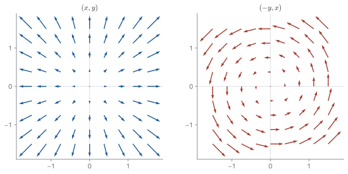{#fig-vector-fields width=85%}


:::

A polynomial field is computed entry by entry from the formulas. The third example does one, cyclic in $x, y, z$.

::: {#exm-gdc-polynomial}
#### A cyclic polynomial field

For $\mathbf F = (xy, yz, zx)^\top$, $\nabla\cdot\mathbf F = y + z + x$ and
$$
\nabla \times \mathbf F = (\partial_y(zx) - \partial_z(yz),\ \partial_z(xy) - \partial_x(zx),\ \partial_x(yz) - \partial_y(xy))^\top = (-y, -z, -x)^\top .
$$
Then $\nabla\cdot(\nabla \times \mathbf F) = 0$, as (3) requires, and $\nabla \times (\nabla \times \mathbf F) = (1, 1, 1)^\top$, which is $\nabla(x + y + z) -
\Delta\mathbf F$ with $\Delta\mathbf F = \mathbf 0$.
:::

Straight flow lines do not mean zero curl. The fourth example is the shear flow of a fluid between two plates, whose curl measures how
a small paddle wheel would spin.

::: {#exm-gdc-shear}
#### Shear flow

For $\mathbf v = (y, 0, 0)^\top$, $\nabla\cdot\mathbf v = 0$ and $\nabla \times \mathbf v = (0, 0, -\partial_yy)^\top = -\mathbf e_3$. The fluid moves along
straight lines, faster at larger $y$, so a small wheel at any point is pushed harder on its upper side and turns clockwise, at the rate
$\frac12\lVert\nabla \times \mathbf v\rVert$. Conversely the vortex $(-y, x, 0)^\top/(x^2 + y^2)$ has circular flow lines and, away from the $z$-axis,
zero curl.
:::

Radial functions $f(r)$ have Laplacians that are again radial, and the powers of $r$ give the harmonic function $1/r$. The fifth
example computes $\Delta r^n$ in $\mathbb{R}^3$.

::: {#exm-gdc-laplacian-powers}
#### The Laplacian of $r^n$

For $\mathbf r \neq \mathbf 0$, $\nabla r^n = nr^{n-1}\nabla r = nr^{n-2}\mathbf r$ (@exm-gdc-position, chain rule), and by (1)
$$
\Delta r^n = \nabla(nr^{n-2})\cdot\mathbf r + nr^{n-2}\,\nabla\cdot\mathbf r = n(n - 2)r^{n-4}\,\mathbf r\cdot\mathbf r + 3nr^{n-2} = n(n + 1)r^{n-2} .
$$
So $\Delta r^2 = 6$, $\Delta r = 2/r$, and $\Delta(1/r) = 0$: $1/r$ is harmonic on $\mathbb{R}^3 \setminus \{\mathbf 0\}$.
:::

The Coulomb field of a point charge is the gradient of a harmonic function. The sixth example reads off from (3) and the fifth
example that it has neither divergence nor curl away from the charge.

::: {#exm-gdc-coulomb}
#### The Coulomb field

On $\mathbb{R}^3 \setminus \{\mathbf 0\}$, $\mathbf E = q\,\mathbf r/r^3 = -\nabla(q/r)$, since $\nabla r^{-1} = -r^{-3}\mathbf r$. So $\nabla \times \mathbf E = \mathbf
0$ by (3) and $\nabla\cdot\mathbf E = -\Delta(q/r) = 0$ by @exm-gdc-laplacian-powers. Whatever divergence the field has sits at the charge, where $\mathbf
E$ is not defined.
:::

A magnetic field is a curl, $\mathbf B = \nabla \times \mathbf A$, so it is divergence-free by (3). The seventh example finds a potential
$\mathbf A$ for a uniform field.

::: {#exm-gdc-uniform-b}
#### A vector potential for a uniform field

For constant $\mathbf B_0$, $\mathbf A = \frac12\mathbf B_0 \times \mathbf r$ is half the rotation field of @exm-gdc-rotation with $\boldsymbol\omega =
\mathbf B_0$, so $\nabla \times \mathbf A = \mathbf B_0$ and $\nabla\cdot\mathbf A = 0$. The potential is not unique: $\mathbf A + \nabla\chi$ has the same curl for
every $C^2$ function $\chi$, by (3); for $\mathbf B_0 = B\mathbf e_3$, $\chi = \frac B2xy$ turns $\frac B2(-y, x, 0)^\top$ into $(0, Bx, 0)^\top$.
:::

The isotropic harmonic oscillator has the potential $V = \frac k2r^2$. The eighth example computes its force, which is a gradient and so
curl-free, and its Laplacian.

::: {#exm-gdc-oscillator}
#### The harmonic oscillator

$\mathbf F = -\nabla V = -k\,\mathbf r$, the restoring force towards the origin, with $\nabla \times \mathbf F = \mathbf 0$ and $\nabla\cdot\mathbf F = -3k$; and
$\Delta V = \frac k2\Delta r^2 = 3k$ (@exm-gdc-laplacian-powers). In $\mathbb{R}^n$, $\Delta V = nk$. The constant Laplacian is what makes the quantum
ground state $e^{-\alpha r^2}$ of the oscillator a Gaussian.
:::

The Schrödinger equation of the hydrogen atom, in atomic units, is $-\frac12\Delta\psi - \psi/r = E\psi$. The ninth example checks that
$\psi = e^{-r}$ solves it with $E = -\frac12$, the ground-state energy.

::: {#exm-gdc-hydrogen}
#### The hydrogen ground state

Away from the origin, $\nabla e^{-r} = -e^{-r}\mathbf r/r$ and, by (1) and @exm-gdc-laplacian-powers,
$$
\Delta e^{-r} = \nabla(-e^{-r}r^{-1})\cdot\mathbf r - e^{-r}r^{-1}\,\nabla\cdot\mathbf r = (e^{-r}r^{-2} + e^{-r}r^{-3})\,\mathbf r\cdot\mathbf r - 3e^{-r}r^{-1} = \Big(1 -
\frac2r\Big)e^{-r} .
$$
So $-\frac12\Delta\psi - \frac\psi r = -\frac12\psi + \frac\psi r - \frac\psi r = -\frac12\psi$.
:::

The identity $\nabla \times \nabla f = \mathbf 0$ needs $f$ of class $C^2$. The last example shows a function of class $C^1$ whose second
partial derivatives all exist at the origin, but for which the third component of $\nabla \times \nabla f$ is $2$ there.

::: {#exm-gdc-curl-grad-fails}
#### When curl grad is not zero

Let $f(x, y, z) = xy\frac{x^2 - y^2}{x^2 + y^2}$, with $f = 0$ on the $z$-axis. Then $\partial_xf(0, y, z) = \lim_{h \to 0}\frac{hy(h^2 - y^2)}{h(h^2 + y^2)} = -y$
and $\partial_yf(x, 0, z) = x$, so $\partial_x(\partial_yf)(\mathbf 0) = 1$ and $\partial_y(\partial_xf)(\mathbf 0) = -1$. The formula for the third component of
the curl gives $\partial_x(\partial_yf) - \partial_y(\partial_xf) = 2$ at $\mathbf 0$. The second partial derivatives are not continuous there, so $f$ is
not of class $C^2$ and (3) does not apply.
:::
::::

:::: {.callout-note .exercises-fold collapse="true" title="Exercises"}
The operators are computed entry by entry, and the identities of (3) give free checks. The first exercise is such a computation.

::: {#exr-gdc-compute}
#### Computing the operators

For $\mathbf F = (yz, xz, xy)^\top$ and $f = x^2y + z^3$, compute $\nabla\cdot\mathbf F$, $\nabla \times \mathbf F$, $\nabla f$ and $\Delta f$, and find a function
$g$ with $\nabla g = \mathbf F$.
:::

::: {.callout-note .solution collapse="true" title="Solution"}
:::: {.panel-tabset .solution-tabs}
## Proof

$\nabla\cdot\mathbf F = 0 + 0 + 0 = 0$ and $\nabla \times \mathbf F = (x - x, y - y, z - z)^\top = \mathbf 0$. Next $\nabla f = (2xy, x^2, 3z^2)^\top$ and $\Delta f = 2y +
0 + 6z$. The function $g = xyz$ has $\nabla g = (yz, xz, xy)^\top = \mathbf F$, consistent with $\nabla \times \mathbf F = \mathbf 0$ (3); and $\Delta g =
\nabla\cdot\mathbf F = 0$.

## SageMath

Sage computes the four quantities and checks the potential.

```{.python .sage}
x, y, z = var("x y z"); X = [x, y, z]
F = vector(SR, [y*z, x*z, x*y]); f = x^2*y + z^3
print(F.div(X), F.curl(X), f.gradient(X), sum(diff(f, v, 2) for v in X))
print((x*y*z).gradient(X) == F)
```

```{.text .sage-output}
0 (0, 0, 0) (2*x*y, x^2, 3*z^2) 2*y + 6*z
True
```
::::
:::

The identity for the curl of a curl is checked component by component on a polynomial field in the second exercise, which is
@riley2006mathematical [Exercise 10.16].

::: {#exr-gdc-riley-curlcurl}
#### Curl of a curl

For $\mathbf a = (x^2y, xyz, z^2y)^\top$, show that both $\nabla \times (\nabla \times \mathbf a)$ and $\nabla(\nabla\cdot\mathbf a) - \Delta\mathbf a$ equal $(z, 2x + 2z,
x)^\top$.
:::

::: {.callout-note .solution collapse="true" title="Solution"}
:::: {.panel-tabset .solution-tabs}
## Proof

$\nabla \times \mathbf a = (z^2 - xy,\ 0 - 0,\ yz - x^2)^\top$, and its curl is $(\partial_y(yz - x^2) - 0,\ \partial_z(z^2 - xy) - \partial_x(yz - x^2),\ 0 - \partial_y(z^2 -
xy))^\top = (z, 2z + 2x, x)^\top$. On the other side, $\nabla\cdot\mathbf a = 2xy + xz + 2yz$, with gradient $(2y + z, 2x + 2z, x + 2y)^\top$, and $\Delta\mathbf a =
(2y, 0, 2y)^\top$; the difference is $(z, 2x + 2z, x)^\top$.

## SageMath

Sage computes both sides.

```{.python .sage}
x, y, z = var("x y z"); X = [x, y, z]
a = vector(SR, [x^2*y, x*y*z, z^2*y])
lap = vector(SR, [sum(diff(c, v, 2) for v in X) for c in a])
print(a.curl(X).curl(X), a.div(X).gradient(X) - lap)
```

```{.text .sage-output}
(z, 2*x + 2*z, x) (z, 2*x + 2*z, x)
```
::::
:::

A central field points along $\mathbf r$ with a strength that depends only on $r$. The third exercise shows that every such field is
curl-free, and that the inverse-square law is the only one that is also divergence-free [@riley2006mathematical, Exercise 11.18].

::: {#exr-gdc-central-fields}
#### Central fields

Let $g$ be of class $C^1$ on $(0, \infty)$ and $\mathbf F = g(r)\,\mathbf r$ on $\mathbb{R}^3 \setminus \{\mathbf 0\}$. Show that $\nabla \times \mathbf F = \mathbf 0$,
that $\nabla\cdot\mathbf F = 3g + rg'$, and that $\nabla\cdot\mathbf F = 0$ if and only if $g = A/r^3$ for a constant $A$.
:::

::: {.callout-note .solution collapse="true" title="Solution"}
:::: {.panel-tabset .solution-tabs}
## Proof

By (1) and @exm-gdc-position, $\nabla \times (g\mathbf r) = \nabla g \times \mathbf r + g\,\nabla \times \mathbf r = g'(r)\,r^{-1}\,\mathbf r \times \mathbf r + \mathbf 0 = \mathbf 0$,
and $\nabla\cdot(g\mathbf r) = g'(r)\,r^{-1}\,\mathbf r\cdot\mathbf r + 3g = rg' + 3g$. Now $r^2(rg' + 3g) = (r^3g)'$, so the divergence vanishes if and only if $(r^3g)'
= 0$ on $(0, \infty)$, that is (@thm-mean-value (4)), $r^3g = A$.

## SageMath

Sage computes the curl and the divergence for a general $g$, and the divergence for $g = A/r^3$.

```{.python .sage}
x, y, z, A = var("x y z A"); X = [x, y, z]; g = function("g")
r = sqrt(x^2 + y^2 + z^2); F = g(r) * vector(SR, X)
print(F.curl(X).simplify_full())
print(F.div(X).simplify_full())
print((A/r^3 * vector(SR, X)).div(X).simplify_full())
```

```{.text .sage-output}
(0, 0, 0)
(x^2*D[0](g)(sqrt(x^2 + y^2 + z^2)) + y^2*D[0](g)(sqrt(x^2 + y^2 + z^2)) + z^2*D[0](g)(sqrt(x^2 + y^2 + z^2)) + 3*sqrt(x^2 + y^2 + z^2)*g(sqrt(x^2 + y^2 + z^2)))/sqrt(x^2 + y^2 + z^2)
0
```
::::
:::

The convective term $(\mathbf a\cdot\nabla)\mathbf a = \mathbf J_{\mathbf a}\mathbf a$ of fluid dynamics can be rewritten with a gradient and a
curl. The fourth exercise derives this from (2) [@riley2006mathematical, Exercise 10.14(c)].

::: {#exr-gdc-convective}
#### The convective derivative

For a field $\mathbf a$ of class $C^1$, write $(\mathbf a\cdot\nabla)\mathbf a = \mathbf J_{\mathbf a}\mathbf a$. Prove that $\mathbf a \times (\nabla \times \mathbf a) =
\nabla\big(\tfrac12\lVert\mathbf a\rVert^2\big) - (\mathbf a\cdot\nabla)\mathbf a$.
:::

::: {.callout-note .solution collapse="true" title="Solution"}
:::: {.panel-tabset .solution-tabs}
## Proof

By @def-cross-product (1) and (2) of the definition, $\mathbf a \times (\nabla \times \mathbf a) = -(\nabla \times \mathbf a) \times \mathbf a = -(\mathbf J_{\mathbf a} - \mathbf
J_{\mathbf a}^\top)\mathbf a = \mathbf J_{\mathbf a}^\top\mathbf a - \mathbf J_{\mathbf a}\mathbf a$. The $i$-th component of $\mathbf J_{\mathbf a}^\top\mathbf a$ is
$(\partial_ia_k)a_k = \partial_i\frac12a_ka_k$, the $i$-th component of $\nabla\frac12\lVert\mathbf a\rVert^2$.

## SageMath

Check on $\mathbf a = (xy, \sin z, x^2 + y)^\top$: Sage computes both sides.

```{.python .sage}
x, y, z = var("x y z"); X = [x, y, z]
a = vector(SR, [x*y, sin(z), x^2 + y])
J = jacobian(a, X)
lhs = a.cross_product(a.curl(X)); rhs = (a*a/2).gradient(X) - J*a
print((lhs - rhs).simplify_full())
```

```{.text .sage-output}
(0, 0, 0)
```
::::
:::

The Laplacian of a product has a cross term, as the second derivative of a product of one-variable functions does. The fifth exercise
proves the formula from the product rules.

::: {#exr-gdc-laplacian-product}
#### The Laplacian of a product

For $f, g$ of class $C^2$ on $U$, prove that $\Delta(fg) = f\,\Delta g + 2\,\nabla f\cdot\nabla g + g\,\Delta f$, and deduce that the product of two harmonic
functions is harmonic if and only if their gradients are orthogonal.
:::

::: {.callout-note .solution collapse="true" title="Solution"}
:::: {.panel-tabset .solution-tabs}
## Proof

By @def-jacobian (4), $\nabla(fg) = f\nabla g + g\nabla f$, and by the first product rule of (1), $\nabla\cdot(f\nabla g) = \nabla f\cdot\nabla g + f\Delta g$ and
$\nabla\cdot(g\nabla f) = \nabla g\cdot\nabla f + g\Delta f$. Adding gives the formula. If $\Delta f = \Delta g = 0$ it reduces to $\Delta(fg) = 2\,\nabla f\cdot\nabla g$.
For example $x$ and $y$ are harmonic with orthogonal gradients, and $xy$ is harmonic; $x \cdot x = x^2$ is not.

## SageMath

Check on $f = e^x\sin y$ and $g = x^2z + y$: Sage compares both sides.

```{.python .sage}
x, y, z = var("x y z"); X = [x, y, z]
lap = lambda h: sum(diff(h, v, 2) for v in X)
f = exp(x)*sin(y); g = x^2*z + y
print(bool(lap(f*g) == f*lap(g) + 2*f.gradient(X)*g.gradient(X) + g*lap(f)))
print(lap(x*y), lap(x^2))
```

```{.text .sage-output}
True
0 2
```
::::
:::

The electric and magnetic fields can be written with a scalar and a vector potential, and two of Maxwell's equations then hold
automatically. The sixth exercise proves this with (3) [@riley2006mathematical, Exercise 10.19(a)].

::: {#exr-gdc-maxwell-potentials}
#### Maxwell's homogeneous equations

Let $\phi(\mathbf x, t)$ and $\mathbf A(\mathbf x, t)$ be of class $C^2$ on $U \times \mathbb{R}$, and put $\mathbf B = \nabla \times \mathbf A$, $\mathbf E = -\nabla\phi -
\partial_t\mathbf A$, the operators acting on $\mathbf x$. Show that $\nabla\cdot\mathbf B = 0$ and $\nabla \times \mathbf E + \partial_t\mathbf B = \mathbf 0$.
:::

::: {.callout-note .solution collapse="true" title="Solution"}
:::: {.panel-tabset .solution-tabs}
## Proof

At each fixed $t$, $\nabla\cdot\mathbf B = \nabla\cdot(\nabla \times \mathbf A) = 0$ by (3). Next $\nabla \times \mathbf E = -\nabla \times \nabla\phi - \nabla \times
\partial_t\mathbf A = -\nabla \times \partial_t\mathbf A$ by (3). By Schwarz's theorem (@def-smooth-map (3)) in the four variables $(\mathbf x, t)$, $\partial_j\partial_tA_k =
\partial_t\partial_jA_k$, so $\nabla \times \partial_t\mathbf A = \partial_t(\nabla \times \mathbf A) = \partial_t\mathbf B$, and the sum vanishes.

## SageMath

Check on $\phi = xt^2 + yz$ and $\mathbf A = (yt, z^2\sin t, x^2t^3)^\top$: Sage computes $\nabla\cdot\mathbf B$ and $\nabla \times \mathbf E + \partial_t\mathbf B$.

```{.python .sage}
x, y, z, t = var("x y z t"); X = [x, y, z]
phi = x*t^2 + y*z; A = vector(SR, [y*t, z^2*sin(t), x^2*t^3])
B = A.curl(X); E = -phi.gradient(X) - diff(A, t)
print(B.div(X), E.curl(X) + diff(B, t))
```

```{.text .sage-output}
0 (0, 0, 0)
```
::::
:::

A field without sources and without curl satisfies a second-order equation in each component. The seventh exercise derives it from
the last identity of (3).

::: {#exr-gdc-harmonic-components}
#### Fields without divergence and curl

Let $\mathbf F$ be of class $C^2$ on $U$ with $\nabla\cdot\mathbf F = 0$ and $\nabla \times \mathbf F = \mathbf 0$. Show that each component $F_i$ is harmonic, and
check it on $\mathbf F = \nabla(x^2 - y^2 + xyz)$.
:::

::: {.callout-note .solution collapse="true" title="Solution"}
:::: {.panel-tabset .solution-tabs}
## Proof

By (3), $\mathbf 0 = \nabla \times (\nabla \times \mathbf F) = \nabla(\nabla\cdot\mathbf F) - \Delta\mathbf F = -\Delta\mathbf F$, so $\Delta F_i = 0$ for each $i$. For the example, $h =
x^2 - y^2 + xyz$ has $\Delta h = 2 - 2 + 0 = 0$, so $\mathbf F = \nabla h = (2x + yz, -2y + xz, xy)^\top$ has $\nabla\cdot\mathbf F = \Delta h = 0$ and $\nabla \times
\mathbf F = \mathbf 0$; its components $2x + yz$, $-2y + xz$, $xy$ are visibly harmonic.

## SageMath

Sage checks the two hypotheses and the Laplacians of the components for the example.

```{.python .sage}
x, y, z = var("x y z"); X = [x, y, z]
F = (x^2 - y^2 + x*y*z).gradient(X)
print(F.div(X), F.curl(X), [sum(diff(c, v, 2) for v in X) for c in F])
```

```{.text .sage-output}
0 (0, 0, 0) [0, 0, 0]
```
::::
:::

The Laplacian of a function of $r$ alone is an ordinary differential operator in $r$. The eighth exercise computes it in every
dimension and finds the radial harmonic functions of $\mathbb{R}^3$.

::: {#exr-gdc-radial-laplacian}
#### Radial Laplacian

Let $g$ be of class $C^2$ on $(0, \infty)$ and $f(\mathbf x) = g(\lVert\mathbf x\rVert)$ on $\mathbb{R}^n \setminus \{\mathbf 0\}$. Show that $\Delta f = g''(r) +
\frac{n - 1}{r}g'(r)$, and find all such harmonic $f$ for $n = 3$.
:::

::: {.callout-note .solution collapse="true" title="Solution"}
:::: {.panel-tabset .solution-tabs}
## Proof

By the chain rule (@thm-chain-rule) and $\partial_ir = x_i/r$, $\partial_if = g'(r)x_i/r$. By the first product rule of (1) in $\mathbb{R}^n$, with $\nabla(g'(r)/r) =
\big(g''/r - g'/r^2\big)\mathbf x/r$ and $\nabla\cdot\mathbf x = n$,
$$
\Delta f = \Big(\frac{g''}{r} - \frac{g'}{r^2}\Big)\frac{\mathbf x\cdot\mathbf x}{r} + n\frac{g'}{r} = g'' + \frac{n - 1}{r}g' .
$$
For $n = 3$, $r^2(g'' + 2g'/r) = (r^2g')'$, so $\Delta f = 0$ if and only if $r^2g' = -b$ is constant, that is $g = a + b/r$ (@thm-mean-value (4)
twice).

## SageMath

Sage compares the formula with the Laplacian for $g(r) = e^{-r^2}\cos r$ in dimensions $2$, $3$ and $4$ at a sample point.

```{.python .sage}
def check(n):
    X = list(var(" ".join("x%d" % i for i in range(n))))
    r = sqrt(sum(v^2 for v in X)); s = var("s")
    g = exp(-s^2)*cos(s)
    lap = sum(diff(g.subs(s=r), v, 2) for v in X)
    formula = (diff(g, s, 2) + (n - 1)/s*diff(g, s)).subs(s=r)
    pt = {v: QQ(k + 1)/3 for k, v in enumerate(X)}
    return bool(abs(N((lap - formula).subs(pt))) < 1e-12)
print([check(n) for n in (2, 3, 4)])
```

```{.text .sage-output}
[True, True, True]
```
::::
:::

The definition uses components along fixed axes, and the curl was shown to be the antisymmetric part of the Jacobian. The ninth exercise
uses that reading to prove a component identity of @riley2006mathematical [Exercise 10.14(b)].

::: {#exr-gdc-riley-directional}
#### A directional identity

For a field $\mathbf a$ of class $C^1$ and constant vectors $\mathbf b, \mathbf c$, write $(\mathbf b\cdot\nabla)\mathbf a = \mathbf J_{\mathbf a}\mathbf b$. Prove that
$\mathbf c\cdot(\mathbf b\cdot\nabla)\mathbf a - \mathbf b\cdot(\mathbf c\cdot\nabla)\mathbf a = (\nabla \times \mathbf a)\cdot(\mathbf b \times \mathbf c)$.
:::

::: {.callout-note .solution collapse="true" title="Solution"}
:::: {.panel-tabset .solution-tabs}
## Proof

The left side is $\mathbf c^\top\mathbf J_{\mathbf a}\mathbf b - \mathbf b^\top\mathbf J_{\mathbf a}\mathbf c = \mathbf c^\top(\mathbf J_{\mathbf a} - \mathbf J_{\mathbf a}^\top)\mathbf
b$, which by (2) is $\mathbf c\cdot\big((\nabla \times \mathbf a) \times \mathbf b\big)$. By the cyclic invariance of the triple product (@def-cross-product (2)) this
is $(\nabla \times \mathbf a)\cdot(\mathbf b \times \mathbf c)$.

## SageMath

Check on $\mathbf a = (x^2z, y\sin x, xyz)^\top$ with symbolic constant vectors: Sage expands the difference of the two sides.

```{.python .sage}
x, y, z = var("x y z"); X = [x, y, z]
b = vector(SR, var("b1 b2 b3")); c = vector(SR, var("c1 c2 c3"))
a = vector(SR, [x^2*z, y*sin(x), x*y*z]); J = jacobian(a, X)
print((c*(J*b) - b*(J*c) - a.curl(X)*b.cross_product(c)).expand())
```

```{.text .sage-output}
0
```
::::
:::

The Laplacian was defined with coordinates along fixed axes, but it does not depend on them. The last exercise proves its invariance
under orthogonal changes of axes, combining the chain rule with the cyclicity of the trace.

::: {#exr-gdc-laplacian-rotation}
#### The Laplacian commutes with rotations

Let $\mathbf Q$ be an orthogonal $n \times n$ matrix and $f$ of class $C^2$ on $\mathbb{R}^n$. Show that $\Delta(f \circ \mathbf Q) = (\Delta f) \circ \mathbf Q$, where $(f
\circ \mathbf Q)(\mathbf x) = f(\mathbf Q\mathbf x)$.
:::

::: {.callout-note .solution collapse="true" title="Solution"}
:::: {.panel-tabset .solution-tabs}
## Proof

By the chain rule (@thm-chain-rule), $\partial_j(f \circ \mathbf Q)(\mathbf x) = \sum_a\partial_af(\mathbf Q\mathbf x)Q_{aj}$, and again $\partial_i\partial_j(f \circ \mathbf
Q)(\mathbf x) = \sum_{a,b}Q_{bi}\,\partial_b\partial_af(\mathbf Q\mathbf x)\,Q_{aj}$. So the Hessian of $f \circ \mathbf Q$ at $\mathbf x$ is $\mathbf Q^\top\mathbf H_f(\mathbf
Q\mathbf x)\mathbf Q$, and its trace is $\operatorname{tr}(\mathbf H_f(\mathbf Q\mathbf x)\mathbf Q\mathbf Q^\top) = \operatorname{tr}\mathbf H_f(\mathbf Q\mathbf x) = \Delta f(\mathbf Q\mathbf
x)$ by @prp-trace-cyclic, since $\mathbf Q\mathbf Q^\top = \mathbf I$ for a square matrix with $\mathbf Q^\top\mathbf Q = \mathbf I$.

## SageMath

Check on $f = x^3y + yz^2 + e^x$ and a rotation about the axis $(1, 2, 2)^\top$ by an angle with cosine $\frac35$: Sage compares both sides.

```{.python .sage}
x, y, z = var("x y z"); X = vector(SR, [x, y, z])
lap = lambda h: sum(diff(h, v, 2) for v in X)
f = lambda p: p[0]^3*p[1] + p[1]*p[2]^2 + exp(p[0])
n = vector(QQ, [1, 2, 2])/3; c, s = QQ(3)/5, QQ(4)/5
Q = matrix(QQ, [c*e + s*n.cross_product(e) + (1 - c)*(n*e)*n for e in identity_matrix(QQ, 3).columns()]).transpose()
print(Q.transpose()*Q == 1)
print(bool((lap(f(Q*X)) - lap(f(X)).subs(dict(zip([x, y, z], Q*X)))).simplify_full() == 0))
```

```{.text .sage-output}
True
True
```
::::
:::
::::

### Cylindrical and spherical coordinates

Problems with an axis or a centre of symmetry are written in cylindrical or spherical coordinates, and the operators must be rewritten
in them. Both systems are orthogonal: the coordinate lines through each point meet at right angles. The proposition below derives the
four operators for any orthogonal system from its scale factors, the lengths of the tangent vectors to the coordinate lines, and lists
the two cases used in physics.

:::: {.statement-box}
::: {#prp-curvilinear-operators}
#### Operators in orthogonal curvilinear coordinates

Let $V \subseteq \mathbb{R}^3$ be open and $\Phi : V \to \mathbb{R}^3$, $\mathbf u = (u_1, u_2, u_3) \mapsto \mathbf x$, of class $C^2$, injective, with $\det\mathbf J_\Phi \neq 0$
on $V$. Suppose the columns $\partial_i\Phi$ are orthogonal; put $h_i = \lVert\partial_i\Phi\rVert$ (the **scale factors**) and $\hat{\mathbf e}_i =
\partial_i\Phi/h_i$, and order the coordinates so that $\hat{\mathbf e}_1 \times \hat{\mathbf e}_2 = \hat{\mathbf e}_3$. For a function $f$ on $\Phi(V)$, $\partial
f/\partial u_i$ means $\partial_i(f \circ \Phi)$, and a field is written $\mathbf F = F_1\hat{\mathbf e}_1 + F_2\hat{\mathbf e}_2 + F_3\hat{\mathbf e}_3$ with $F_i = \mathbf
F\cdot\hat{\mathbf e}_i$, as functions of $\mathbf u$. Then $\Phi(V)$ is open, $dx\,dy\,dz = h_1h_2h_3\,du_1\,du_2\,du_3$ in the sense that $\det\mathbf J_\Phi =
h_1h_2h_3$, and for $f$, $\mathbf F$ of class $C^1$ ($f$ of class $C^2$ for $\Delta f$):
$$
\begin{aligned}
\nabla f &= \sum_i\frac{1}{h_i}\frac{\partial f}{\partial u_i}\hat{\mathbf e}_i, \qquad
\nabla\cdot\mathbf F = \frac{1}{h_1h_2h_3}\Big(\frac{\partial(h_2h_3F_1)}{\partial u_1} + \frac{\partial(h_3h_1F_2)}{\partial u_2} + \frac{\partial(h_1h_2F_3)}{\partial u_3}\Big),\\
(\nabla \times \mathbf F)_1 &= \frac{1}{h_2h_3}\Big(\frac{\partial(h_3F_3)}{\partial u_2} - \frac{\partial(h_2F_2)}{\partial u_3}\Big) \text{ and cyclically}, \qquad
\Delta f = \frac{1}{h_1h_2h_3}\sum_i\frac{\partial}{\partial u_i}\Big(\frac{h_1h_2h_3}{h_i^2}\frac{\partial f}{\partial u_i}\Big).
\end{aligned}
$$
In particular:

1. (**cylindrical**) $\Phi(\rho, \varphi, z) = (\rho\cos\varphi, \rho\sin\varphi, z)$ on $(0, \infty) \times (-\pi, \pi) \times \mathbb{R}$ has $h = (1, \rho, 1)$, $\hat{\mathbf e}_\rho =
   (\cos\varphi, \sin\varphi, 0)^\top$, $\hat{\mathbf e}_\varphi = (-\sin\varphi, \cos\varphi, 0)^\top$, $\hat{\mathbf e}_z = \mathbf e_3$, and
   $$
   \begin{aligned}
   \nabla f &= \partial_\rho f\,\hat{\mathbf e}_\rho + \tfrac1\rho\partial_\varphi f\,\hat{\mathbf e}_\varphi + \partial_zf\,\hat{\mathbf e}_z, \qquad
   \nabla\cdot\mathbf F = \tfrac1\rho\partial_\rho(\rho F_\rho) + \tfrac1\rho\partial_\varphi F_\varphi + \partial_zF_z,\\
   \nabla \times \mathbf F &= \big(\tfrac1\rho\partial_\varphi F_z - \partial_zF_\varphi\big)\hat{\mathbf e}_\rho + (\partial_zF_\rho - \partial_\rho F_z)\,\hat{\mathbf e}_\varphi +
   \tfrac1\rho\big(\partial_\rho(\rho F_\varphi) - \partial_\varphi F_\rho\big)\hat{\mathbf e}_z,\\
   \Delta f &= \tfrac1\rho\partial_\rho(\rho\,\partial_\rho f) + \tfrac{1}{\rho^2}\partial_\varphi^2f + \partial_z^2f ;
   \end{aligned}
   $$
2. (**spherical**) $\Phi(r, \theta, \varphi) = (r\sin\theta\cos\varphi, r\sin\theta\sin\varphi, r\cos\theta)$ on $(0, \infty) \times (0, \pi) \times (-\pi, \pi)$ has $h = (1, r,
   r\sin\theta)$, $\hat{\mathbf e}_r = \mathbf r/r$, $\hat{\mathbf e}_\theta = (\cos\theta\cos\varphi, \cos\theta\sin\varphi, -\sin\theta)^\top$, $\hat{\mathbf e}_\varphi = (-\sin\varphi,
   \cos\varphi, 0)^\top$, and
   $$
   \begin{aligned}
   \nabla f &= \partial_rf\,\hat{\mathbf e}_r + \tfrac1r\partial_\theta f\,\hat{\mathbf e}_\theta + \tfrac{1}{r\sin\theta}\partial_\varphi f\,\hat{\mathbf e}_\varphi, \qquad
   \nabla\cdot\mathbf F = \tfrac{1}{r^2}\partial_r(r^2F_r) + \tfrac{1}{r\sin\theta}\partial_\theta(\sin\theta\,F_\theta) + \tfrac{1}{r\sin\theta}\partial_\varphi F_\varphi,\\
   \nabla \times \mathbf F &= \tfrac{1}{r\sin\theta}\big(\partial_\theta(\sin\theta\,F_\varphi) - \partial_\varphi F_\theta\big)\hat{\mathbf e}_r + \tfrac1r\big(\tfrac{1}{\sin\theta}\partial_\varphi F_r
   - \partial_r(rF_\varphi)\big)\hat{\mathbf e}_\theta + \tfrac1r\big(\partial_r(rF_\theta) - \partial_\theta F_r\big)\hat{\mathbf e}_\varphi,\\
   \Delta f &= \tfrac{1}{r^2}\partial_r(r^2\partial_rf) + \tfrac{1}{r^2\sin\theta}\partial_\theta(\sin\theta\,\partial_\theta f) + \tfrac{1}{r^2\sin^2\theta}\partial_\varphi^2f .
   \end{aligned}
   $$
:::
::::

*Proof.* By @thm-inverse-function (3), $\Phi(V)$ is open and $\Phi : V \to \Phi(V)$ is a $C^2$ diffeomorphism, so the coordinate functions $u_i$, the components
of $\Phi^{-1}$, are of class $C^2$ on $\Phi(V)$. The frame $\hat{\mathbf e}_i$ is orthonormal, and $\hat{\mathbf e}_2 \times \hat{\mathbf e}_3 = \hat{\mathbf e}_2 \times
(\hat{\mathbf e}_1 \times \hat{\mathbf e}_2) = \hat{\mathbf e}_1$ by @def-cross-product (3), and likewise $\hat{\mathbf e}_3 \times \hat{\mathbf e}_1 = \hat{\mathbf e}_2$.
Since $\mathbf J_\Phi$ has columns $h_i\hat{\mathbf e}_i$, $\det\mathbf J_\Phi = h_1h_2h_3\,\hat{\mathbf e}_1\cdot(\hat{\mathbf e}_2 \times \hat{\mathbf e}_3) = h_1h_2h_3$
(@def-cross-product (2)).

*Gradient.* By the chain rule (@thm-chain-rule), $\partial f/\partial u_i = \nabla f\cdot\partial_i\Phi = h_i\,\nabla f\cdot\hat{\mathbf e}_i$, and in the orthonormal frame
$\nabla f = \sum_i(\nabla f\cdot\hat{\mathbf e}_i)\hat{\mathbf e}_i$. Applied to $f = u_j$, for which $\partial u_j/\partial u_i = \delta_{ij}$, this gives $\nabla u_j = \hat{\mathbf
e}_j/h_j$; hence $\nabla u_2 \times \nabla u_3 = \hat{\mathbf e}_1/(h_2h_3)$, cyclically.

*Divergence.* The functions $h_i$ are of class $C^1$, so $g = h_2h_3F_1$ is of class $C^1$ and $F_1\hat{\mathbf e}_1 = g\,\nabla u_2 \times \nabla u_3$. By the product
rules of @def-grad-div-curl (1) and the identity $\nabla \times \nabla u_j = \mathbf 0$ of (3) there,
$$
\nabla\cdot(F_1\hat{\mathbf e}_1) = \nabla g\cdot(\nabla u_2 \times \nabla u_3) + g\big(\nabla u_3\cdot(\nabla \times \nabla u_2) - \nabla u_2\cdot(\nabla \times \nabla u_3)\big) =
\frac{\nabla g\cdot\hat{\mathbf e}_1}{h_2h_3} = \frac{1}{h_1h_2h_3}\frac{\partial g}{\partial u_1},
$$
by the gradient formula. Adding the two cyclic terms gives $\nabla\cdot\mathbf F$.

*Curl.* With $g = h_1F_1$, $F_1\hat{\mathbf e}_1 = g\,\nabla u_1$, and by @def-grad-div-curl (1) and (3)
$$
\nabla \times (F_1\hat{\mathbf e}_1) = \nabla g \times \nabla u_1 = \sum_j\frac{1}{h_jh_1}\frac{\partial g}{\partial u_j}\hat{\mathbf e}_j \times \hat{\mathbf e}_1 =
\frac{1}{h_3h_1}\frac{\partial(h_1F_1)}{\partial u_3}\hat{\mathbf e}_2 - \frac{1}{h_1h_2}\frac{\partial(h_1F_1)}{\partial u_2}\hat{\mathbf e}_3 .
$$
The terms of $F_2\hat{\mathbf e}_2$ and $F_3\hat{\mathbf e}_3$ are the cyclic permutations; collecting the coefficients of $\hat{\mathbf e}_1$ gives the stated component,
and the others follow cyclically.

*Laplacian.* $\Delta f = \nabla\cdot\nabla f$, and $\nabla f$ has the components $F_i = h_i^{-1}\partial f/\partial u_i$, of class $C^1$; the divergence formula gives the
result.

*The two systems.* For cylindrical coordinates $\partial_\rho\Phi = \hat{\mathbf e}_\rho$, $\partial_\varphi\Phi = \rho\,\hat{\mathbf e}_\varphi$, $\partial_z\Phi = \mathbf e_3$, which are
orthogonal with $\hat{\mathbf e}_\rho \times \hat{\mathbf e}_\varphi = (0, 0, \cos^2\varphi + \sin^2\varphi)^\top = \hat{\mathbf e}_z$; $\Phi$ is injective on the stated set
because $\rho$ and $\varphi$ are the modulus and the argument of $x + iy$. For spherical coordinates $\partial_r\Phi = \hat{\mathbf e}_r$, $\partial_\theta\Phi = r\,\hat{\mathbf
e}_\theta$, $\partial_\varphi\Phi = r\sin\theta\,\hat{\mathbf e}_\varphi$, mutually orthogonal, with $\hat{\mathbf e}_r \times \hat{\mathbf e}_\theta = \hat{\mathbf e}_\varphi$
by direct computation; $\Phi$ is injective because $r = \lVert\mathbf x\rVert$, $\theta = \arccos(z/r) \in (0, \pi)$ and $\varphi$ is the argument of $x + iy \neq 0$.
Substituting the scale factors in the general formulas gives the lists. $\square$

The general formulas are the table of @riley2006mathematical [Sec. 10.10, Table 10.4], and the two lists are his Tables 10.2 and 10.3
[@riley2006mathematical, Secs. 10.9.1-10.9.2]; the proof through $\nabla u_i = \hat{\mathbf e}_i/h_i$ is his. The Jacobian determinants agree with
@exm-polar-jacobian-cylindrical and @exr-spherical-jacobian.

:::: {.callout-note .examples-fold collapse="true" title="Examples"}
The gradients of the coordinate functions themselves are the first check of the formulas. The first example computes them and the
unit vectors they point along.

::: {#exm-curvi-coordinate-gradients}
#### Gradients of the coordinates

By the gradient formula $\nabla r = \hat{\mathbf e}_r$, $\nabla\theta = \hat{\mathbf e}_\theta/r$ and $\nabla\varphi = \hat{\mathbf e}_\varphi/(r\sin\theta) = \hat{\mathbf
e}_\varphi/\rho$, with $\rho = r\sin\theta$ the distance to the $z$-axis. The first agrees with $\nabla r = \mathbf r/r$ of @exm-gdc-position, and the last with the
Cartesian $\nabla\varphi = (-y, x, 0)^\top/(x^2 + y^2)$ of the angle in the plane.
:::

Radial functions are where spherical coordinates pay off: one term of the Laplacian survives. The second example recomputes $\Delta r^n$ of
@exm-gdc-laplacian-powers this way.

::: {#exm-curvi-radial-powers}
#### $\Delta r^n$ in one line

For $f = r^n$ only $\partial_r$ acts: $\Delta r^n = r^{-2}\partial_r(r^2\cdot nr^{n-1}) = n(n + 1)r^{n-2}$. In cylindrical coordinates $\rho^n$ gives $\rho^{-1}\partial_\rho(\rho\cdot
n\rho^{n-1}) = n^2\rho^{n-2}$, so $\log\rho$ (with $\rho^{-1}\partial_\rho(\rho\cdot\rho^{-1}) = 0$) is the harmonic function of a line, as $1/r$ is of a point.
:::

The vortex field circles the $z$-axis with strength $1/\rho$. In cylindrical components it has one entry, and the formulas show at once
that it has neither divergence nor curl off the axis.

::: {#exm-curvi-vortex}
#### The line vortex

$\mathbf v = \hat{\mathbf e}_\varphi/\rho = (-y, x, 0)^\top/(x^2 + y^2)$ has $F_\varphi = 1/\rho$, so $\nabla\cdot\mathbf v = \rho^{-1}\partial_\varphi(1/\rho) = 0$ and $\nabla \times \mathbf v =
\rho^{-1}\partial_\rho(\rho\cdot\rho^{-1})\,\hat{\mathbf e}_z = \mathbf 0$. It is the gradient $\nabla\varphi$ of @exm-curvi-coordinate-gradients wherever the angle $\varphi$ is
defined, that is off the half-plane where $\varphi = \pm\pi$.
:::

A rigid rotation about the $z$-axis has $F_\varphi = \omega\rho$. The fourth example recovers from the cylindrical curl the value $2\omega$ of
@exm-gdc-rotation.

::: {#exm-curvi-rigid-rotation}
#### A rotation in cylindrical components

$\mathbf v = \omega\rho\,\hat{\mathbf e}_\varphi$ is $\omega(-y, x, 0)^\top$. The cylindrical formulas give $\nabla\cdot\mathbf v = \rho^{-1}\partial_\varphi(\omega\rho) = 0$ and $\nabla
\times \mathbf v = \rho^{-1}\partial_\rho(\omega\rho^2)\,\hat{\mathbf e}_z = 2\omega\,\hat{\mathbf e}_z$, as in Cartesian coordinates. A field $v(\rho)\hat{\mathbf e}_\varphi$ has curl
$\rho^{-1}(\rho v)'\hat{\mathbf e}_z$, which vanishes only for $v = c/\rho$, the vortex.
:::

Fields that depend on $r$ alone and point radially are handled by the first term of the divergence. The fifth example treats the
Coulomb field of @exm-gdc-coulomb and the field inside a uniformly charged ball.

::: {#exm-curvi-coulomb}
#### Radial fields

For $\mathbf E = F_r(r)\hat{\mathbf e}_r$, $\nabla\cdot\mathbf E = r^{-2}(r^2F_r)'$ and $\nabla \times \mathbf E = \mathbf 0$, since $F_\theta = F_\varphi = 0$ and $\partial_\theta F_r =
\partial_\varphi F_r = 0$. The Coulomb field $F_r = q/r^2$ has $\nabla\cdot\mathbf E = 0$; the field $F_r = \frac{q r}{a^3}$ inside a ball of radius $a$ has $\nabla\cdot\mathbf E =
3q/a^3$, constant: $4\pi$ times the charge density $q/(\frac43\pi a^3)$.
:::

The magnetic field of a straight wire carrying a current $I$ circles the wire with strength $\mu_0I/(2\pi\rho)$. The sixth example checks
that it is curl-free and divergence-free outside the wire, like the vortex it is a multiple of.

::: {#exm-curvi-wire}
#### The field of a straight wire

$\mathbf B = \frac{\mu_0I}{2\pi\rho}\hat{\mathbf e}_\varphi$ is $\frac{\mu_0I}{2\pi}$ times the vortex of @exm-curvi-vortex, so $\nabla\cdot\mathbf B = 0$ and $\nabla \times \mathbf B = \mathbf 0$
for $\rho > 0$, as the equation $\nabla \times \mathbf B = \mu_0\mathbf J$ requires where no current flows. A vector potential is $\mathbf A = -\frac{\mu_0I}{2\pi}\log\rho\,\hat{\mathbf
e}_z$: its curl is $-\partial_\rho A_z\,\hat{\mathbf e}_\varphi = \mathbf B$.
:::

The $2p$ orbital of hydrogen with magnetic quantum number $0$ is $\psi = r\cos\theta\,e^{-r/2} = z\,e^{-r/2}$ in atomic units. The seventh
example checks with the spherical Laplacian that it has energy $-\frac18$.

::: {#exm-curvi-hydrogen-2p}
#### The $2p$ orbital of hydrogen

With $\psi = R(r)\cos\theta$, $R = re^{-r/2}$, the angular part gives $\frac{1}{r^2\sin\theta}\partial_\theta(-\sin^2\theta)R = -\frac{2R}{r^2}\cos\theta$, so $\Delta\psi = \big(r^{-2}(r^2R')' -
2R/r^2\big)\cos\theta$. With $R' = (1 - \frac r2)e^{-r/2}$ and $(r^2R')' = (2r - 2r^2 + \frac{r^3}{4})e^{-r/2}$, $\Delta\psi = (-2 + \frac r4)e^{-r/2}\cos\theta$, and
$-\frac12\Delta\psi - \frac\psi r = (1 - \frac r8 - 1)e^{-r/2}\cos\theta = -\frac18\psi$: the energy $-\frac{1}{2n^2}$ with $n = 2$.
:::

Harmonic polynomials restricted to the sphere give the angular functions of quantum mechanics. The eighth example checks one in both
coordinate systems.

::: {#exm-curvi-harmonic-quadratic}
#### A harmonic quadratic

$f = 2z^2 - x^2 - y^2$ has Cartesian Laplacian $4 - 2 - 2 = 0$. In spherical coordinates $f = r^2(3\cos^2\theta - 1)$, and $r^{-2}\partial_r(r^2\cdot2r) = 6$ times $3\cos^2\theta -
1$, while $\frac{1}{\sin\theta}\partial_\theta(\sin\theta\cdot(-6\cos\theta\sin\theta)) = -6(3\cos^2\theta - 1)$ by $\partial_\theta(\cos\theta\sin^2\theta) = \sin\theta(3\cos^2\theta - 1)$. The two terms
cancel: the angular part $3\cos^2\theta - 1$ is an eigenfunction of the angular operator with eigenvalue $-6 = -\ell(\ell + 1)$, $\ell = 2$.
:::

Other orthogonal systems are built for other symmetries. The ninth example finds the scale factors of the paraboloidal coordinates used for
the hydrogen atom in an electric field [@riley2006mathematical, Exercise 10.21].

::: {#exm-curvi-paraboloidal}
#### Paraboloidal coordinates

$\Phi(u, v, \varphi) = (uv\cos\varphi, uv\sin\varphi, \frac12(u^2 - v^2))$ for $u, v > 0$ has $\partial_u\Phi = (v\cos\varphi, v\sin\varphi, u)^\top$, $\partial_v\Phi = (u\cos\varphi,
u\sin\varphi, -v)^\top$, $\partial_\varphi\Phi = uv(-\sin\varphi, \cos\varphi, 0)^\top$. The dot products are $uv - uv = 0$ and $0$, so the system is orthogonal, with $h_u = h_v =
\sqrt{u^2 + v^2}$, $h_\varphi = uv$ and volume element $(u^2 + v^2)uv\,du\,dv\,d\varphi$. Here $\partial_u\Phi \times \partial_v\Phi = (u^2 + v^2)(-\sin\varphi, \cos\varphi, 0)^\top$, so $\hat{\mathbf e}_u \times \hat{\mathbf e}_v = \hat{\mathbf
e}_\varphi$ and the order $(u, v, \varphi)$ is right-handed, and the Laplacian is $\Delta f = \frac{1}{u^2 + v^2}\big(\frac1u\partial_u(u\partial_uf) + \frac1v\partial_v(v\partial_vf)\big)
+ \frac{1}{u^2v^2}\partial_\varphi^2f$.
:::

The formulas need orthogonal coordinate lines. The last example takes sheared coordinates, where the naive gradient formula gives a wrong
answer.

::: {#exm-curvi-non-orthogonal}
#### Non-orthogonal coordinates

Let $\Phi(u_1, u_2, u_3) = (u_1 + u_2, u_2, u_3)$, so $\partial_1\Phi = \mathbf e_1$ and $\partial_2\Phi = \mathbf e_1 + \mathbf e_2$, not orthogonal; $h_1 = 1$, $h_2 = \sqrt2$. For $f = x
= u_1 + u_2$, the formula $\sum_ih_i^{-1}\partial_if\,\hat{\mathbf e}_i$ would give $\mathbf e_1 + \frac{1}{\sqrt2}\cdot\frac{1}{\sqrt2}(\mathbf e_1 + \mathbf e_2) = (\frac32, \frac12,
0)^\top$, but $\nabla x = \mathbf e_1$. The chain rule still gives $\partial f/\partial u_i = \nabla f\cdot\partial_i\Phi$; only the expansion in a non-orthonormal frame fails.
:::
::::

:::: {.callout-note .exercises-fold collapse="true" title="Exercises"}
The first exercise compares the divergence of two simple radial fields in curvilinear and in Cartesian coordinates. It is a direct check
of the formulas.

::: {#exr-curvi-radial-divergence}
#### Two radial fields

Compute $\nabla\cdot(\rho\,\hat{\mathbf e}_\rho)$ in cylindrical and $\nabla\cdot(r\,\hat{\mathbf e}_r)$ in spherical coordinates, and compare with the Cartesian forms of the
fields.
:::

::: {.callout-note .solution collapse="true" title="Solution"}
:::: {.panel-tabset .solution-tabs}
## Proof

$\nabla\cdot(\rho\,\hat{\mathbf e}_\rho) = \rho^{-1}\partial_\rho(\rho^2) = 2$, and in Cartesian coordinates the field is $(x, y, 0)^\top$, with divergence $1 + 1 + 0 = 2$.
$\nabla\cdot(r\,\hat{\mathbf e}_r) = r^{-2}\partial_r(r^3) = 3$, and the field is $\mathbf r$, with divergence $3$ (@exm-gdc-position).

## SageMath

Sage evaluates the two curvilinear formulas and the Cartesian divergences.

```{.python .sage}
rho, r, x, y, z = var("rho r x y z")
print(diff(rho*rho, rho)/rho, diff(r^2*r, r)/r^2)
print(vector(SR, [x, y, 0]).div([x, y, z]), vector(SR, [x, y, z]).div([x, y, z]))
```

```{.text .sage-output}
2 3
2 3
```
::::
:::

The Laplacian of a function given in Cartesian form can be computed directly or after the change to spherical coordinates. The second
exercise does both, as @riley2006mathematical [Exercise 10.15] asks.

::: {#exr-curvi-riley-laplacian}
#### One Laplacian two ways

Compute the Laplacian of $\psi = zx^2/(x^2 + y^2 + z^2)$ in Cartesian coordinates and in spherical coordinates, and show that the two agree.
:::

::: {.callout-note .solution collapse="true" title="Solution"}
:::: {.panel-tabset .solution-tabs}
## Proof

In spherical coordinates $\psi = r\cos\theta\sin^2\theta\cos^2\varphi$. The radial term gives $r^{-2}\partial_r(r^2) \cdot A = \frac2rA$ with $A = \cos\theta\sin^2\theta\cos^2\varphi$. With
$\partial_\theta(\cos\theta\sin^2\theta) = 2\sin\theta\cos^2\theta - \sin^3\theta$, the $\theta$ term is $\frac{\cos^2\varphi}{r\sin\theta}\partial_\theta(2\sin^2\theta\cos^2\theta - \sin^4\theta) =
\frac{\cos^2\varphi}{r}(4\cos^3\theta - 8\sin^2\theta\cos\theta)$, and the $\varphi$ term is $\frac{-2\cos2\varphi\,\cos\theta}{r}$. Adding, with $\sin^2\theta = 1 - \cos^2\theta$ and
$\cos2\varphi = 2\cos^2\varphi - 1$,
$$
\Delta\psi = \frac{\cos\theta}{r}\big(2\cos^2\varphi(1 - \cos^2\theta) + \cos^2\varphi(12\cos^2\theta - 8) - 4\cos^2\varphi + 2\big) = \frac{2\cos\theta}{r}\big(1 - 5\cos^2\varphi + 5\cos^2\theta\cos^2\varphi\big).
$$
The bracket is $1 - 5\cos^2\varphi\sin^2\theta$, and with $x = r\sin\theta\cos\varphi$, $z = r\cos\theta$ this is $\Delta\psi = \frac{2z}{r^2} - \frac{10x^2z}{r^4}$, which is what
the direct computation of $\sum_i\partial_i^2\psi$ gives.

## SageMath

Sage computes the Cartesian Laplacian, the spherical one, and the difference after substituting the spherical coordinates.

```{.python .sage}
x, y, z, r, th, ph = var("x y z r theta phi")
psi = z*x^2/(x^2 + y^2 + z^2)
lap_c = sum(diff(psi, v, 2) for v in [x, y, z])
f = r*cos(th)*sin(th)^2*cos(ph)^2
lap_s = diff(r^2*diff(f, r), r)/r^2 + diff(sin(th)*diff(f, th), th)/(r^2*sin(th)) + diff(f, ph, 2)/(r^2*sin(th)^2)
sub = {x: r*sin(th)*cos(ph), y: r*sin(th)*sin(ph), z: r*cos(th)}
print(bool((lap_c.subs(sub) - lap_s).simplify_full() == 0))
print((lap_c - (2*z/(x^2+y^2+z^2) - 10*x^2*z/(x^2+y^2+z^2)^2)).simplify_full())
```

```{.text .sage-output}
True
0
```
::::
:::

A uniform current along a cylinder of plasma creates a magnetic field that grows linearly inside. The third exercise solves for the
field and a vector potential with the cylindrical curl [@riley2006mathematical, Exercise 10.17(a)-(b)].

::: {#exr-curvi-riley-plasma}
#### A current-carrying cylinder

A current density $\mathbf J = C\,\hat{\mathbf e}_\varphi$ flows in $\rho < a$ and none outside, and $\mathbf B = B(\rho)\hat{\mathbf e}_z$ with $B = B_0$ for $\rho > a$, $B(0) = 0$ and $B$
continuous. From $\nabla \times \mathbf B = \mu_0\mathbf J$, find $B(\rho)$ and $C$; then find $\mathbf A = A_\varphi(\rho)\hat{\mathbf e}_\varphi$, continuous at $\rho = a$ and with $A_\varphi(0)
= 0$, such that $\nabla \times \mathbf A = \mathbf B$.
:::

::: {.callout-note .solution collapse="true" title="Solution"}
:::: {.panel-tabset .solution-tabs}
## Proof

The cylindrical curl of $B(\rho)\hat{\mathbf e}_z$ is $-B'(\rho)\hat{\mathbf e}_\varphi$, so $-B' = \mu_0C$ inside and $B' = 0$ outside. With $B(0) = 0$, $B = -\mu_0C\rho$ inside,
and continuity at $a$ gives $-\mu_0Ca = B_0$: $C = -B_0/(\mu_0a)$ and $B(\rho) = B_0\rho/a$ for $\rho \leq a$. The curl of $A_\varphi\hat{\mathbf e}_\varphi$ is
$\rho^{-1}(\rho A_\varphi)'\hat{\mathbf e}_z$, so $(\rho A_\varphi)' = \rho B$. Inside, $\rho A_\varphi = B_0\rho^3/(3a)$ (the constant vanishes since $A_\varphi(0) = 0$), so
$A_\varphi = B_0\rho^2/(3a)$. Outside, $\rho A_\varphi = B_0\rho^2/2 + c$, and continuity at $a$, $B_0a/3 = B_0a/2 + c/a$, gives $c = -B_0a^2/6$: $A_\varphi = \frac{B_0\rho}{2} -
\frac{B_0a^2}{6\rho}$.

## SageMath

Sage checks the curls of the two pieces of $\mathbf A$ and the continuity at $\rho = a$.

```{.python .sage}
rho, a, B0 = var("rho a B0")
Ain = B0*rho^2/(3*a); Aout = B0*rho/2 - B0*a^2/(6*rho)
print((diff(rho*Ain, rho)/rho).simplify_full(), (diff(rho*Aout, rho)/rho).simplify_full())
print(bool(Ain.subs(rho=a) == Aout.subs(rho=a)))
```

```{.text .sage-output}
B0*rho/a B0
True
```
::::
:::

The radial part of the spherical Laplacian is an ordinary differential operator. The fourth exercise solves Poisson's equation for a
uniformly charged ball with it.

::: {#exr-curvi-poisson-ball}
#### The potential of a uniform ball

Find the functions $f(r)$ of class $C^2$ on $\mathbb{R}^3$ with $\Delta f = -1$ for $r < a$, $\Delta f = 0$ for $r > a$, $f \to 0$ as $r \to \infty$, and $f$, $f'$ continuous at $r = a$.
:::

::: {.callout-note .solution collapse="true" title="Solution"}
:::: {.panel-tabset .solution-tabs}
## Proof

By the spherical formula, $\Delta f = r^{-2}(r^2f')'$. Inside, $(r^2f')' = -r^2$, so $r^2f' = -r^3/3 + c_1$, and $f'$ bounded at $0$ forces $c_1 = 0$: $f = -r^2/6 + c_2$.
Outside, $r^2f' = c_3$ and $f = -c_3/r + c_4$, with $c_4 = 0$ from the limit. Continuity of $f'$ at $a$: $-a/3 = c_3/a^2$, so $c_3 = -a^3/3$ and $f = a^3/(3r)$
outside; continuity of $f$: $-a^2/6 + c_2 = a^2/3$, so $c_2 = a^2/2$. Thus $f = \frac{a^2}{2} - \frac{r^2}{6}$ inside and $\frac{a^3}{3r}$ outside. As a function on $\mathbb{R}^3$,
$f = \frac{a^2}{2} - \frac{x^2 + y^2 + z^2}{6}$ near $\mathbf 0$ is smooth there.

## SageMath

Sage checks the two equations with the radial Laplacian and the matching of $f$ and $f'$ at $r = a$.

```{.python .sage}
r, a = var("r a")
fin = a^2/2 - r^2/6; fout = a^3/(3*r)
L = lambda f: diff(r^2*diff(f, r), r)/r^2
print(L(fin), L(fout).simplify_full())
print(bool(fin.subs(r=a) == fout.subs(r=a)), bool(diff(fin, r).subs(r=a) == diff(fout, r).subs(r=a)))
```

```{.text .sage-output}
-1 0
True True
```
::::
:::

The unit vectors of curvilinear coordinates turn as the point moves, so the Laplacian of a vector field is not the Laplacian of its
components. The fifth exercise shows this for the radial unit field in cylindrical coordinates [@riley2006mathematical, Exercise 10.18].

::: {#exr-curvi-riley-unit-field}
#### The Laplacian of $\hat{\mathbf e}_\rho$

Show that $\partial_\varphi\hat{\mathbf e}_\rho = \hat{\mathbf e}_\varphi$ and $\partial_\varphi\hat{\mathbf e}_\varphi = -\hat{\mathbf e}_\rho$, and that all other derivatives of the
cylindrical unit vectors vanish. For $\mathbf a = \hat{\mathbf e}_\rho$, compute $\nabla(\nabla\cdot\mathbf a)$ and the Cartesian $\Delta\mathbf a$, and show that $\Delta\mathbf a =
-\hat{\mathbf e}_\rho/\rho^2$, although its only component $a_\rho = 1$ has Laplacian $0$.
:::

::: {.callout-note .solution collapse="true" title="Solution"}
:::: {.panel-tabset .solution-tabs}
## Proof

Differentiating $\hat{\mathbf e}_\rho = (\cos\varphi, \sin\varphi, 0)^\top$ and $\hat{\mathbf e}_\varphi = (-\sin\varphi, \cos\varphi, 0)^\top$ gives the two formulas; none of the three
depends on $\rho$ or $z$. Now $\mathbf a$ has $F_\rho = 1$, $F_\varphi = F_z = 0$, so every term of the cylindrical curl is a derivative of a constant and $\nabla \times \mathbf a =
\mathbf 0$; hence by @def-grad-div-curl (3) $\Delta\mathbf a = \nabla(\nabla\cdot\mathbf a)$. Here $\nabla\cdot\mathbf a = \rho^{-1}\partial_\rho\rho = 1/\rho$ and
$\nabla(1/\rho) = -\hat{\mathbf e}_\rho/\rho^2$. Directly, $\mathbf a = (x, y, 0)^\top/\rho$ and $\Delta(x/\rho) = \rho^{-1}\partial_\rho(\rho\,\partial_\rho\cos\varphi) +
\rho^{-2}\partial_\varphi^2\cos\varphi = -\cos\varphi/\rho^2 = -x/\rho^3$, and likewise for $y$, which agrees. The component $a_\rho = 1$ has Laplacian $0$: the
difference comes from the turning of $\hat{\mathbf e}_\rho$.

## SageMath

Sage computes the Cartesian Laplacian of $(x, y, 0)/\rho$ and compares with $-\hat{\mathbf e}_\rho/\rho^2$ and with $\nabla(\nabla\cdot\mathbf a)$.

```{.python .sage}
x, y, z = var("x y z"); X = [x, y, z]; rho = sqrt(x^2 + y^2)
a = vector(SR, [x/rho, y/rho, 0])
lap = vector(SR, [sum(diff(c, v, 2) for v in X) for c in a])
print((lap + a/rho^2).simplify_full(), (lap - a.div(X).gradient(X)).simplify_full(), a.curl(X).simplify_full())
```

```{.text .sage-output}
(0, 0, 0) (0, 0, 0) (0, 0, 0)
```
::::
:::

The Laplacian in the plane in polar coordinates is the cylindrical one without the $z$ term. The sixth exercise uses it to find the
harmonic functions $\rho^n\cos n\varphi$, the real parts of $z^n$.

::: {#exr-curvi-polar-harmonic}
#### Harmonic functions in polar form

Show that $\rho^n\cos n\varphi$ and $\rho^n\sin n\varphi$ are harmonic for every integer $n$ (away from the axis if $n < 0$), and check that $\rho^2\cos2\varphi = x^2 - y^2$.
:::

::: {.callout-note .solution collapse="true" title="Solution"}
:::: {.panel-tabset .solution-tabs}
## Proof

For $f = \rho^n\cos n\varphi$, the cylindrical formula gives $\rho^{-1}\partial_\rho(\rho\cdot n\rho^{n-1})\cos n\varphi + \rho^{-2}\rho^n(-n^2\cos n\varphi) = (n^2 - n^2)\rho^{n-2}\cos n\varphi =
0$, and the same for the sine. With $x = \rho\cos\varphi$, $y = \rho\sin\varphi$, $x^2 - y^2 = \rho^2(\cos^2\varphi - \sin^2\varphi) = \rho^2\cos2\varphi$, whose Cartesian Laplacian is
$2 - 2 = 0$.

## SageMath

Sage applies the cylindrical Laplacian to $\rho^n\cos n\varphi$ for symbolic $n$, and expands $\rho^2\cos2\varphi$ and $\rho^3\cos3\varphi$, the real parts of $(x + iy)^2$ and $(x + iy)^3$, in Cartesian form.

```{.python .sage}
rho, ph, n = var("rho phi n")
f = rho^n*cos(n*ph)
print((diff(rho*diff(f, rho), rho)/rho + diff(f, ph, 2)/rho^2).simplify_full())
x, y = var("x y")
print(expand(((x + I*y)^2 + (x - I*y)^2)/2), expand(((x + I*y)^3 + (x - I*y)^3)/2))
```

```{.text .sage-output}
0
x^2 - y^2 x^3 - 3*x*y^2
```
::::
:::

The curl of a gradient vanishes in every coordinate system, and the formulas of the proposition must reproduce this. The seventh
exercise checks it in spherical coordinates for a general function, where it reduces to the symmetry of mixed partial derivatives.

::: {#exr-curvi-curl-grad}
#### curl grad in spherical coordinates

Using the spherical formulas, show that $\nabla \times \nabla f = \mathbf 0$ for every $f$ of class $C^2$ on the domain of spherical coordinates.
:::

::: {.callout-note .solution collapse="true" title="Solution"}
:::: {.panel-tabset .solution-tabs}
## Proof

$\nabla f$ has $F_r = \partial_rf$, $F_\theta = r^{-1}\partial_\theta f$, $F_\varphi = (r\sin\theta)^{-1}\partial_\varphi f$. Then $\partial_\theta(\sin\theta\,F_\varphi) - \partial_\varphi F_\theta =
r^{-1}(\partial_\theta\partial_\varphi f - \partial_\varphi\partial_\theta f) = 0$; $(\sin\theta)^{-1}\partial_\varphi F_r - \partial_r(rF_\varphi) = (\sin\theta)^{-1}(\partial_\varphi\partial_rf -
\partial_r\partial_\varphi f) = 0$; and $\partial_r(rF_\theta) - \partial_\theta F_r = \partial_r\partial_\theta f - \partial_\theta\partial_rf = 0$, all by Schwarz's theorem
(@def-smooth-map (3)) for $f \circ \Phi$, which is of class $C^2$.

## SageMath

Sage applies the spherical curl to the spherical gradient of an unspecified function.

```{.python .sage}
r, th, ph = var("r theta phi"); f = function("f")(r, th, ph)
Fr, Ft, Fp = diff(f, r), diff(f, th)/r, diff(f, ph)/(r*sin(th))
c = [(diff(sin(th)*Fp, th) - diff(Ft, ph))/(r*sin(th)), (diff(Fr, ph)/sin(th) - diff(r*Fp, r))/r, (diff(r*Ft, r) - diff(Fr, th))/r]
print([e.simplify_full() for e in c])
```

```{.text .sage-output}
[0, 0, 0]
```
::::
:::

The angular part of the spherical Laplacian decides which functions $r^\ell Y(\theta, \varphi)$ are harmonic. The eighth exercise derives the
equation for $Y$ that defines the spherical harmonics of quantum mechanics.

::: {#exr-curvi-angular-equation}
#### The angular equation

Let $\Lambda Y = \frac{1}{\sin\theta}\partial_\theta(\sin\theta\,\partial_\theta Y) + \frac{1}{\sin^2\theta}\partial_\varphi^2Y$. Show that $\Delta(r^\ell Y) = r^{\ell-2}\big(\ell(\ell + 1)Y + \Lambda
Y\big)$, so $r^\ell Y$ is harmonic if and only if $\Lambda Y = -\ell(\ell + 1)Y$; check this for $Y = \sin\theta\cos\varphi$, $\ell = 1$.
:::

::: {.callout-note .solution collapse="true" title="Solution"}
:::: {.panel-tabset .solution-tabs}
## Proof

The radial term of the spherical Laplacian gives $r^{-2}\partial_r(\ell r^{\ell+1})Y = \ell(\ell + 1)r^{\ell-2}Y$, and the angular terms give $r^{\ell}\cdot r^{-2}\Lambda Y$. As $r^{\ell-2} \neq
0$, the sum vanishes if and only if $\Lambda Y = -\ell(\ell + 1)Y$. For $Y = \sin\theta\cos\varphi$: $\frac{1}{\sin\theta}\partial_\theta(\sin\theta\cos\theta)\cos\varphi = \frac{\cos2\theta}{\sin\theta}\cos\varphi$ and
$\frac{-\cos\varphi}{\sin\theta}$; the sum is $\frac{\cos2\theta - 1}{\sin\theta}\cos\varphi = -2\sin\theta\cos\varphi = -2Y$, and indeed $rY = x$ is harmonic.

## SageMath

Sage checks $\Lambda Y = -\ell(\ell + 1)Y$ for $Y = \sin\theta\cos\varphi$ ($\ell(\ell + 1) = 2$) and for $Y = 3\cos^2\theta - 1$ ($\ell(\ell + 1) = 6$).

```{.python .sage}
th, ph = var("theta phi")
Lam = lambda Y: diff(sin(th)*diff(Y, th), th)/sin(th) + diff(Y, ph, 2)/sin(th)^2
for Y, c in [(sin(th)*cos(ph), 2), (3*cos(th)^2 - 1, 6)]:
    print(c, bool((Lam(Y) + c*Y).simplify_full() == 0))
```

```{.text .sage-output}
2 True
6 True
```
::::
:::

Paraboloidal coordinates (@exm-curvi-paraboloidal) have their own Laplacian. The ninth exercise checks it on a function of $u$ alone and
finds which such functions are harmonic, as @riley2006mathematical [Exercise 10.23] does for another system.

::: {#exr-curvi-paraboloidal-harmonic}
#### Harmonic functions of one paraboloidal coordinate

In the paraboloidal coordinates of @exm-curvi-paraboloidal, find all $f = g(u)$, $g$ of class $C^2$ on $(0, \infty)$, with $\Delta f = 0$, and check the answer $\log u$ in
Cartesian coordinates, where $u^2 = r + z$.
:::

::: {.callout-note .solution collapse="true" title="Solution"}
:::: {.panel-tabset .solution-tabs}
## Proof

By the Laplacian of @exm-curvi-paraboloidal, $\Delta g(u) = \frac{1}{(u^2 + v^2)u}(ug')'$, which vanishes if and only if $ug' = b$ is constant, that is $g = a + b\log u$
(@thm-mean-value (4)). From $x^2 + y^2 = u^2v^2$ and $z = \frac12(u^2 - v^2)$, $r^2 = u^2v^2 + \frac14(u^2 - v^2)^2 = \frac14(u^2 + v^2)^2$, so $r = \frac12(u^2 + v^2)$ and $u^2 = r + z$.
So $\log u = \frac12\log(r + z)$, which must be harmonic off the negative $z$-axis.

## SageMath

Sage checks that $\frac12\log(r + z)$ is harmonic in Cartesian coordinates.

```{.python .sage}
x, y, z = var("x y z"); r = sqrt(x^2 + y^2 + z^2)
f = log(r + z)/2
print(sum(diff(f, v, 2) for v in [x, y, z]).simplify_full())
```

```{.text .sage-output}
0
```
::::
:::

The volume element $h_1h_2h_3\,du_1\,du_2\,du_3$ turns volumes into integrals in the new coordinates through the change-of-variables theorem. The last
exercise computes a volume in paraboloidal coordinates and checks it in cylindrical ones.

::: {#exr-curvi-paraboloidal-volume}
#### A volume in paraboloidal coordinates

Compute the volume of the region $D = \Phi([0, 1] \times [0, 1] \times [-\pi, \pi])$ for the paraboloidal map $\Phi$ of @exm-curvi-paraboloidal, and describe $D$.
:::

::: {.callout-note .solution collapse="true" title="Solution"}
:::: {.panel-tabset .solution-tabs}
## Proof

By @thm-change-of-variables (2), with the exceptional set made of the faces $u = 0$, $v = 0$ and $\varphi = \pm\pi$ of the box (content zero, where $\Phi$ fails to be
injective or $\det\mathbf J_\Phi = 0$), and $|\det\mathbf J_\Phi| = h_uh_vh_\varphi$ from the proposition,
$$
\operatorname{vol}(D) = \int_{-\pi}^{\pi}\int_0^1\int_0^1(u^2 + v^2)uv\,du\,dv\,d\varphi = 2\pi\Big(\frac14\cdot\frac12 + \frac12\cdot\frac14\Big) = \frac\pi2 .
$$
Since $u^2 = r + z$ and $v^2 = r - z$, $D = \{r + z \leq 1,\ r - z \leq 1\}$: the region between the paraboloids $z = \frac12(1 - \rho^2)$ and $z = -\frac12(1 - \rho^2)$, $\rho \leq 1$
(as $r \pm z \leq 1$ means $\rho^2 \leq 1 \mp 2z$). In cylindrical coordinates its volume is $2\pi\int_0^1(1 - \rho^2)\rho\,d\rho = \frac\pi2$.

## SageMath

Sage computes both integrals.

```{.python .sage}
u, v, ph, rho = var("u v phi rho")
print(integrate(integrate(integrate((u^2 + v^2)*u*v, u, 0, 1), v, 0, 1), ph, -pi, pi))
print(integrate(2*pi*(1 - rho^2)*rho, rho, 0, 1))
```

```{.text .sage-output}
1/2*pi
1/2*pi
```
::::
:::
::::

### Line integrals and potentials

The work done by a force $\mathbf F$ on a particle that moves along a curve is the integral of $\mathbf F\cdot\dot{\mathbf r}$ over time, and it does
not depend on how fast the curve is traversed. The definition below sets up these line integrals for piecewise smooth curves and
answers the question every mechanics course asks: when is the work independent of the path, so that the force has a potential energy?
The answer is a potential on any connected domain; on a star-shaped domain the symmetry of the Jacobian matrix is enough to produce one.

:::: {.statement-box}
::: {#def-line-integral}
#### Line integral

Let $U \subseteq \mathbb{R}^n$ be open. A **piecewise $C^1$ curve** in $U$ is a continuous $\boldsymbol\gamma : [\alpha, \beta] \to U$ with a partition $\alpha = t_0 < t_1 <
\dots < t_m = \beta$ such that $\boldsymbol\gamma$ is of class $C^1$ on each $[t_{k-1}, t_k]$ (with one-sided derivatives at the ends); it runs from
$\boldsymbol\gamma(\alpha)$ to $\boldsymbol\gamma(\beta)$, and is **closed** if they are equal. For $\mathbf F : U \to \mathbb{R}^n$ and $f : U \to \mathbb{R}$ continuous,
$$
\int_{\boldsymbol\gamma}\mathbf F\cdot d\mathbf r = \sum_k\int_{t_{k-1}}^{t_k}\mathbf F(\boldsymbol\gamma(t))\cdot\boldsymbol\gamma'(t)\,dt, \qquad \int_{\boldsymbol\gamma}f\,ds =
\sum_k\int_{t_{k-1}}^{t_k}f(\boldsymbol\gamma(t))\,\lVert\boldsymbol\gamma'(t)\rVert\,dt,
$$
and $L(\boldsymbol\gamma) = \int_{\boldsymbol\gamma}ds$ is the **length**. In the plane, with $\mathbf F = (P, Q)^\top$, one writes $\int_{\boldsymbol\gamma}P\,dx + Q\,dy$; over a closed
curve, $\oint_{\boldsymbol\gamma}$, the **circulation**. $\mathbf F$ is **conservative** on $U$ if $\oint_{\boldsymbol\gamma}\mathbf F\cdot d\mathbf r = 0$ for every closed piecewise
$C^1$ curve in $U$, and a **potential** of $\mathbf F$ is a function $\phi$ of class $C^1$ with $\nabla\phi = \mathbf F$. $U$ is **star-shaped** with respect to $\mathbf c
\in U$ if it contains the segment from $\mathbf c$ to each of its points. Then:

1. (**parametrisation**) if $\tau : [a, b] \to [\alpha, \beta]$ is an increasing bijection of class $C^1$, then $\boldsymbol\gamma \circ \tau$ has the same integrals
   $\int\mathbf F\cdot d\mathbf r$ and $\int f\,ds$ as $\boldsymbol\gamma$; the **reversed** curve $\boldsymbol\gamma^-(t) = \boldsymbol\gamma(\alpha + \beta - t)$ has the opposite
   $\int\mathbf F\cdot d\mathbf r$ and the same $\int f\,ds$; integrals over a curve followed by another add; and the circulation over a closed curve does not change
   when its starting point is moved to $\boldsymbol\gamma(t_*)$, that is, when $\boldsymbol\gamma$ on $[t_*, \beta]$ is followed by $\boldsymbol\gamma$ on $[\alpha, t_*]$;
2. (**fundamental theorem**) if $\phi$ is of class $C^1$ on $U$, then $\int_{\boldsymbol\gamma}\nabla\phi\cdot d\mathbf r = \phi(\boldsymbol\gamma(\beta)) - \phi(\boldsymbol\gamma(\alpha))$;
3. if $U$ is connected (@def-connected), the following are equivalent for continuous $\mathbf F$: $\mathbf F$ has a potential; $\int_{\boldsymbol\gamma}\mathbf F\cdot d\mathbf r$
   depends only on the endpoints of $\boldsymbol\gamma$; $\mathbf F$ is conservative. Two potentials then differ by a constant;
4. if $\mathbf F$ is of class $C^1$ and has a potential, then $\partial_iF_j = \partial_jF_i$ on $U$, that is $\mathbf J_{\mathbf F}$ is symmetric (for $n = 3$, $\nabla \times
   \mathbf F = \mathbf 0$). Conversely, if $U$ is star-shaped with respect to $\mathbf c$ and $\mathbf F$ is of class $C^1$ with $\partial_iF_j = \partial_jF_i$, then
   $$
   \phi(\mathbf x) = \int_0^1\mathbf F\big(\mathbf c + t(\mathbf x - \mathbf c)\big)\cdot(\mathbf x - \mathbf c)\,dt
   $$
   is a potential of $\mathbf F$;
5. $\big|\int_{\boldsymbol\gamma}\mathbf F\cdot d\mathbf r\big| \leq M\,L(\boldsymbol\gamma)$, where $M$ is the maximum of $\lVert\mathbf F\rVert$ on $\boldsymbol\gamma([\alpha, \beta])$.
:::
::::

*Proof.* (1) Refining the partitions does not change the sums (@def-riemann-integral, additivity over intervals), so we may assume that
$\tau$ maps the pieces $[s_{k-1}, s_k]$ of a partition of $[a, b]$ onto the pieces of $\boldsymbol\gamma$. On a piece, $(\boldsymbol\gamma \circ \tau)' = \boldsymbol\gamma'(\tau)\tau'$
by the chain rule, and the substitution rule (@thm-fundamental-theorem (4)), applied to the continuous function $t \mapsto \mathbf F(\boldsymbol\gamma(t))\cdot\boldsymbol\gamma'(t)$
extended by constants to an open interval, gives $\int_{s_{k-1}}^{s_k}\mathbf F(\boldsymbol\gamma(\tau))\cdot\boldsymbol\gamma'(\tau)\tau'\,ds = \int_{t_{k-1}}^{t_k}\mathbf
F(\boldsymbol\gamma)\cdot\boldsymbol\gamma'\,dt$; since $\tau' \geq 0$, $\lVert(\boldsymbol\gamma \circ \tau)'\rVert = \lVert\boldsymbol\gamma'(\tau)\rVert\tau'$ and the same computation
applies to $f\,ds$. For the reversal, $\tau(s) = \alpha + \beta - s$ has $\tau' = -1$, and the substitution exchanges the limits, which changes the sign of $\int\mathbf
F\cdot d\mathbf r$, while $\int f\,ds$ has the factor $|\tau'| = 1$ and keeps its sign. The integral over a concatenation is a sum over the pieces of both curves.
Moving the starting point splits $[\alpha, \beta]$ at $t_*$ and adds the two parts in the other order, with the parameter shifted by a constant, which does not change
them.

(2) On each piece $(\phi \circ \boldsymbol\gamma)' = \nabla\phi(\boldsymbol\gamma)\cdot\boldsymbol\gamma'$ is continuous (@thm-chain-rule), so the piece contributes
$\phi(\boldsymbol\gamma(t_k)) - \phi(\boldsymbol\gamma(t_{k-1}))$ by @thm-fundamental-theorem (2), and the sum telescopes.

(3) A potential gives path independence by (2). Path independence makes every circulation $0$, since a closed curve has the same endpoints as the constant
curve, whose integral is $0$. If $\mathbf F$ is conservative and $\boldsymbol\gamma_1, \boldsymbol\gamma_2$ both run from $\mathbf p$ to $\mathbf q$, then $\boldsymbol\gamma_1$
followed by $\boldsymbol\gamma_2^-$ is closed, and by (1) $0 = \int_{\boldsymbol\gamma_1} - \int_{\boldsymbol\gamma_2}$. Now assume path independence. Fix $\mathbf p_0 \in U$ and
let $A$ be the set of points joined to $\mathbf p_0$ by a polygonal path in $U$ (finitely many segments, a piecewise $C^1$ curve). If $\mathbf x \in U$ and $B$ is a ball
about $\mathbf x$ inside $U$, every point of $B$ is joined to $\mathbf x$ by a segment in $B$; so $B \subseteq A$ if $\mathbf x \in A$, and $B \cap A = \emptyset$ if $\mathbf x
\notin A$. Thus $A$ and $U \setminus A$ are open and disjoint, $\mathbf p_0 \in A$, and $A = U$ because $U$ is connected. Put $\phi(\mathbf x) = \int_{\boldsymbol\gamma}\mathbf
F\cdot d\mathbf r$ for any piecewise $C^1$ curve $\boldsymbol\gamma$ in $U$ from $\mathbf p_0$ to $\mathbf x$. For $\mathbf x \in U$, a ball of radius $\delta$ about $\mathbf x$ in
$U$ and $|h| < \delta$, follow a curve to $\mathbf x$ by the segment $s \mapsto \mathbf x + s\mathbf e_j$ ($s$ between $0$ and $h$); by (1),
$$
\phi(\mathbf x + h\mathbf e_j) - \phi(\mathbf x) = \int_0^hF_j(\mathbf x + s\mathbf e_j)\,ds ,
$$
and by @thm-fundamental-theorem (1) the derivative at $h = 0$ is $F_j(\mathbf x)$. So $\partial_j\phi = F_j$ is continuous, $\phi$ is of class $C^1$ and $\nabla\phi = \mathbf F$. If
$\nabla\phi_1 = \nabla\phi_2$, then by (2) along a polygonal path, $(\phi_1 - \phi_2)(\mathbf x) - (\phi_1 - \phi_2)(\mathbf p_0) = \int\mathbf 0\cdot d\mathbf r = 0$.

(4) If $\nabla\phi = \mathbf F$ is of class $C^1$, then $\phi$ is of class $C^2$ and $\partial_iF_j = \partial_i\partial_j\phi = \partial_j\partial_i\phi = \partial_jF_i$ by Schwarz's
theorem (@def-smooth-map (3)); for $n = 3$ this is $\nabla \times \mathbf F = \mathbf 0$ by @def-grad-div-curl (2). For the converse fix $\mathbf x \in U$ and $j$, and choose $\delta >
0$ with $\mathbf x + s\mathbf e_j \in U$ for $|s| < \delta$. Since $U$ is star-shaped, $g(t, s) = \mathbf F(\mathbf p(t, s))\cdot(\mathbf x + s\mathbf e_j - \mathbf c)$ with $\mathbf p(t, s) =
\mathbf c + t(\mathbf x + s\mathbf e_j - \mathbf c)$ is defined and continuous on $[0, 1] \times (-\delta, \delta)$, with the continuous derivative $\partial_sg = t\,\partial_jF_i(\mathbf
p)\,(x_i + s\delta_{ij} - c_i) + F_j(\mathbf p)$ (@thm-chain-rule). By @thm-differentiation-under-integral (2) at $s = 0$, with $\mathbf p(t) = \mathbf c + t(\mathbf x - \mathbf c)$ and
$\partial_jF_i = \partial_iF_j$,
$$
\partial_j\phi(\mathbf x) = \int_0^1\Big(t\,\partial_iF_j(\mathbf p(t))\,(x_i - c_i) + F_j(\mathbf p(t))\Big)dt = \int_0^1\frac{d}{dt}\Big(t\,F_j(\mathbf p(t))\Big)dt = F_j(\mathbf x),
$$
the middle step by the chain rule for $t \mapsto F_j(\mathbf p(t))$ and the last by @thm-fundamental-theorem (2). So $\phi$ is of class $C^1$ with $\nabla\phi = \mathbf F$.

(5) $\boldsymbol\gamma([\alpha, \beta])$ is the image of a compact set under a continuous map, and $\lVert\mathbf F(\boldsymbol\gamma(t))\rVert$ is continuous on $[\alpha, \beta]$,
so it has a maximum $M$ (@def-continuity (4)). By Cauchy-Schwarz (@exm-metric-space-euclidean), $|\mathbf F(\boldsymbol\gamma)\cdot\boldsymbol\gamma'| \leq M\lVert\boldsymbol\gamma'\rVert$,
and @def-riemann-integral (4) gives the bound piece by piece. $\square$

The line integrals and their evaluation follow @riley2006mathematical [Secs. 11.1, 11.4]; (3) is @lee2013introduction [Prop. 11.40 and Thm. 11.42,
pp. 292-294], and the potential of (4) is the formula in the proof of @lee2013introduction [Thm. 11.49, pp. 296-297], both written there in another
language and here for vector fields.

:::: {.callout-note .examples-fold collapse="true" title="Examples"}
The rotation field $(-y, x)$ of @exm-gdc-rotation is the first field to integrate. The first example computes its circulation around the unit circle
and its integrals along two paths with the same ends, which differ; the figure shows both paths.

::: {#exm-line-rotation-paths}
#### Two paths, two answers

For $\mathbf F = (-y, x)^\top$ and $\boldsymbol\gamma(t) = (\cos t, \sin t)$, $t \in [0, 2\pi]$, $\mathbf F\cdot\boldsymbol\gamma' = \sin^2t + \cos^2t = 1$ and $\oint\mathbf F\cdot d\mathbf r = 2\pi$.
From $(1, 0)$ to $(0, 1)$, the quarter circle gives $\frac\pi2$, while the segment $(1 - t, t)$, $t \in [0, 1]$, gives $\int_0^1(-t, 1 - t)\cdot(-1, 1)\,dt = \int_0^1 1\,dt = 1$. So $\mathbf F$
is not conservative and, by (3), has no potential; by (4) this was already visible in $\partial_xF_2 - \partial_yF_1 = 2 \neq 0$.

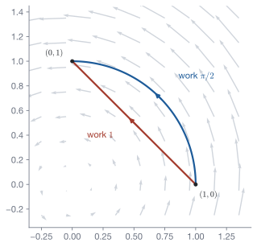{#fig-line-paths width=60%}


:::

The integral $\int f\,ds$ weighs a curve by a density, and with $f = 1$ it gives the length. The second example computes the length of a turn of a
helix and the mass of a wire wound along it.

::: {#exm-line-helix}
#### A helix

$\boldsymbol\gamma(t) = (\cos t, \sin t, ct)$, $t \in [0, 2\pi]$, has $\lVert\boldsymbol\gamma'\rVert = \sqrt{1 + c^2}$, so $L = 2\pi\sqrt{1 + c^2}$: the hypotenuse of the triangle with sides
$2\pi$ and the pitch $2\pi c$. A wire along it with linear density $f = z$ has mass $\int_0^{2\pi}ct\sqrt{1 + c^2}\,dt = 2\pi^2c\sqrt{1 + c^2}$.
:::

Traversing a closed curve twice doubles a circulation, and traversing it backwards changes its sign, as (1) states. The third example checks both on
the circle.

::: {#exm-line-orientation}
#### Twice around, and backwards

For $\mathbf F = (-y, x)^\top$, the circle $(\cos t, \sin t)$ on $[0, 4\pi]$ gives $4\pi$, and on $[0, 2\pi]$ with $t$ replaced by $2\pi - t$, that is $(\cos t, -\sin t)$, it gives
$\int_0^{2\pi}(\sin t, \cos t)\cdot(-\sin t, -\cos t)\,dt = -2\pi$. The length, an integral of $f = 1$, is $2\pi$ both ways. The speed does not matter: $(\cos t^2,
\sin t^2)$ on $[0, \sqrt{2\pi}]$ gives $\int_0^{\sqrt{2\pi}}2t\,dt = 2\pi$.
:::

For a gradient, the fundamental theorem (2) replaces the integral by two values of the potential. The fourth example checks it along a twisted cubic.

::: {#exm-line-gradient-path}
#### Work of a gradient

$\mathbf F = \nabla(xyz) = (yz, xz, xy)^\top$ along $\boldsymbol\gamma(t) = (t, t^2, t^3)$, $t \in [0, 1]$, gives $\int_0^1(t^5\cdot1 + t^4\cdot2t + t^3\cdot3t^2)\,dt = \int_0^1 6t^5\,dt = 1$, which is
$xyz$ at $(1, 1, 1)$ minus its value at $\mathbf 0$. Any other path between the same points gives $1$ as well.
:::

On a star-shaped domain, (4) builds the potential by integrating along rays. The fifth example runs the formula on a polynomial field on
$\mathbb{R}^3$.

::: {#exm-line-star-potential}
#### Integrating along rays

For $\mathbf F = (2xy + z, x^2, x)^\top$, $\partial_yF_1 = 2x = \partial_xF_2$, $\partial_zF_1 = 1 = \partial_xF_3$ and $\partial_zF_2 = 0 = \partial_yF_3$. With $\mathbf c = \mathbf 0$,
$$
\phi(\mathbf x) = \int_0^1\big((2t^2xy + tz)x + t^2x^2y + txz\big)dt = \int_0^1(3t^2x^2y + 2txz)\,dt = x^2y + xz ,
$$
and indeed $\nabla(x^2y + xz) = \mathbf F$.
:::

The symmetry condition of (4) decides at once whether a field on the plane can be a gradient. The sixth example tests two fields that look alike
[@lee2013introduction, Example 11.47].

::: {#exm-line-closed-test}
#### Two similar fields

$\mathbf F = (y\cos xy, x\cos xy)^\top$ has $\partial_yF_1 = \cos xy - xy\sin xy = \partial_xF_2$, and on the plane, which is star-shaped, it has a potential, here $\sin xy$. The field $\mathbf
G = (x\cos xy, y\cos xy)^\top$ has $\partial_yG_1 = -x^2\sin xy$ and $\partial_xG_2 = -y^2\sin xy$, which differ, so $\mathbf G$ has no potential and some closed curve has non-zero
circulation.
:::

Gravity and the Coulomb force have potentials, so their work depends only on the distances of the endpoints from the centre. The seventh example
computes it.

::: {#exm-line-gravity}
#### Work against gravity

On $\mathbb{R}^3 \setminus \{\mathbf 0\}$, $\mathbf F = -k\,\mathbf r/r^3 = \nabla(k/r)$ (@exm-gdc-coulomb), with $k = GMm$ for gravity. By (2) the work from $\mathbf p$ to $\mathbf q$ along any
path avoiding $\mathbf 0$ is $k/\lVert\mathbf q\rVert - k/\lVert\mathbf p\rVert$. Escaping from the Earth's surface to infinity takes the work $GMm/R$, and $\frac12mv^2 = GMm/R$
gives the escape velocity $\sqrt{2GM/R} \approx 11.2\,\mathrm{km/s}$.
:::

For a force with a potential, the work along an actual motion is the gain in kinetic energy, and energy is conserved. The eighth example derives this
for a particle in a potential $V$, with the oscillator as the case to keep in mind.

::: {#exm-line-energy}
#### Conservation of energy

Let $\mathbf r(t)$ be of class $C^2$ with $m\ddot{\mathbf r} = -\nabla V(\mathbf r)$. Then $\frac{d}{dt}\big(\frac m2\lVert\dot{\mathbf r}\rVert^2 + V(\mathbf r)\big) = \dot{\mathbf r}\cdot(m\ddot{\mathbf r} + \nabla
V(\mathbf r)) = 0$, and by (2) the work $\int\mathbf F\cdot d\mathbf r$ along the motion from $t_0$ to $t_1$ is $V(\mathbf r(t_0)) - V(\mathbf r(t_1))$, the gain in kinetic energy. For the
oscillator $V = \frac k2r^2$ and $\mathbf r = (a\cos\omega t, b\sin\omega t, 0)$, $\omega^2 = k/m$, the energy is $\frac k2(a^2\sin^2\omega t + b^2\cos^2\omega t) + \frac k2(a^2\cos^2\omega t + b^2\sin^2\omega t) = \frac
k2(a^2 + b^2)$.
:::

Ampère's law says that the circulation of the magnetic field around a wire is $\mu_0$ times the current. The ninth example checks it for the field of
@exm-curvi-wire on circles about the wire.

::: {#exm-line-ampere}
#### Ampère's law for a wire

For $\mathbf B = \frac{\mu_0I}{2\pi\rho}\hat{\mathbf e}_\varphi$ and the circle $\boldsymbol\gamma(t) = (a\cos t, a\sin t, z_0)$, $\boldsymbol\gamma' = a\,\hat{\mathbf e}_\varphi$, so $\mathbf B\cdot\boldsymbol\gamma' = \frac{\mu_0I}{2\pi}$
and $\oint\mathbf B\cdot d\mathbf r = \mu_0I$, whatever the radius $a$ and the height $z_0$. So $\mathbf B$ is curl-free off the wire (@exm-curvi-wire) but not conservative there.
:::

Away from the origin, the vortex field satisfies the symmetry condition of (4), and yet it has no potential: the punctured plane is not star-shaped.
The last example shows what goes wrong and where the potential exists [@lee2013introduction, Examples 11.43, 11.48].

::: {#exm-line-vortex}
#### The vortex on the punctured plane

$\mathbf F = (-y, x)^\top/(x^2 + y^2)$ on $U = \mathbb{R}^2 \setminus \{\mathbf 0\}$ has $\partial_xF_2 = \partial_yF_1 = (y^2 - x^2)/(x^2 + y^2)^2$, and its circulation around the unit circle is
$\int_0^{2\pi}1\,dt = 2\pi \neq 0$, so by (3) it has no potential on $U$. On the slit plane $U_0 = \mathbb{R}^2 \setminus \{(x, 0) : x \leq 0\}$, which is star-shaped with respect to $(1,
0)$ (a segment from $(1, 0)$ to a point with $y \neq 0$ meets the $x$-axis only at $(1, 0)$), (4) gives a potential: the polar angle $\varphi \in (-\pi, \pi)$, as in
@exm-curvi-vortex.
:::
::::

:::: {.callout-note .exercises-fold collapse="true" title="Exercises"}
The first exercise evaluates a line integral straight from the definition along a hyperbola. It is @riley2006mathematical [Exercise 11.3(c)].

::: {#exr-line-riley-hyperbola}
#### Along a hyperbola

Evaluate $\int_L\mathbf F\cdot d\mathbf r$ for $\mathbf F = (xy^2, 2, x)^\top$ along $L$: $x = ct$, $y = c/t$, $z = d$, $1 \leq t \leq 2$.
:::

::: {.callout-note .solution collapse="true" title="Solution"}
:::: {.panel-tabset .solution-tabs}
## Proof

$\boldsymbol\gamma'(t) = (c, -c/t^2, 0)$ and $\mathbf F(\boldsymbol\gamma(t)) = (c^3/t, 2, ct)$, so $\mathbf F\cdot\boldsymbol\gamma' = c^4/t - 2c/t^2$ and the integral is $c^4\log2 - 2c(1 -
\frac12) = c^4\log2 - c$.

## SageMath

Sage evaluates the integral.

```{.python .sage}
t, c, d = var("t c d")
g = vector(SR, [c*t, c/t, d]); x, y, z = g
F = vector(SR, [x*y^2, 2, x])
print(integrate(F*diff(g, t), t, 1, 2).simplify_full())
```

```{.text .sage-output}
c^4*log(2) - c
```
::::
:::

The length of a curve is the integral of its speed, and for the cycloid the square root simplifies by a half-angle formula. The second exercise computes
the length of one arch, the path of a charge starting from rest in crossed fields [@riley2006mathematical, Exercise 10.3].

::: {#exr-line-cycloid}
#### One arch of a cycloid

Compute the length of $\boldsymbol\gamma(\xi) = A(1 - \cos\xi,\ 0,\ \xi - \sin\xi)$, $\xi \in [0, 2\pi]$, $A > 0$.
:::

::: {.callout-note .solution collapse="true" title="Solution"}
:::: {.panel-tabset .solution-tabs}
## Proof

$\lVert\boldsymbol\gamma'\rVert^2 = A^2(\sin^2\xi + (1 - \cos\xi)^2) = 2A^2(1 - \cos\xi) = 4A^2\sin^2\frac\xi2$, so $\lVert\boldsymbol\gamma'\rVert = 2A\sin\frac\xi2$ on $[0, 2\pi]$ and $L =
\int_0^{2\pi}2A\sin\frac\xi2\,d\xi = 8A$.

## SageMath

Sage integrates the speed, written with the half-angle formula, and checks the formula numerically for $A = 1$.

```{.python .sage}
xi, A = var("xi A"); assume(A > 0)
g = A*vector(SR, [1 - cos(xi), 0, xi - sin(xi)])
sp2 = (diff(g, xi)*diff(g, xi)).simplify_full()
print(bool((sp2 - 4*A^2*sin(xi/2)^2).trig_reduce() == 0), integrate(2*A*sin(xi/2), xi, 0, 2*pi))
print(numerical_integral(sqrt(sp2.subs(A=1)), 0, 2*pi)[0])
```

```{.text .sage-output}
True 8*A
8.0
```
::::
:::

A field on all of $\mathbb{R}^3$ with zero curl has a potential, by (4), and the potential can be found by integrating one variable at a time. The third
exercise is @riley2006mathematical [Exercise 11.1].

::: {#exr-line-riley-potential}
#### Finding a potential

For $\mathbf F = (2xz, 2yz^2, x^2 + 2y^2z - 1)^\top$, show that $\nabla \times \mathbf F = \mathbf 0$, find $\phi$ with $\nabla\phi = \mathbf F$, and compute the work from $\mathbf 0$ to $(1, 1, 1)$.
:::

::: {.callout-note .solution collapse="true" title="Solution"}
:::: {.panel-tabset .solution-tabs}
## Proof

$\nabla \times \mathbf F = (4yz - 4yz,\ 2x - 2x,\ 0 - 0)^\top = \mathbf 0$, so by (4) on the star-shaped $\mathbb{R}^3$ a potential exists. From $\partial_x\phi = 2xz$, $\phi = x^2z + g(y, z)$; then
$\partial_yg = 2yz^2$ gives $g = y^2z^2 + h(z)$, and $\partial_z\phi = x^2 + 2y^2z + h' = x^2 + 2y^2z - 1$ gives $h = -z$. So $\phi = x^2z + y^2z^2 - z$, and by (2) the work is $\phi(1, 1, 1) -
\phi(\mathbf 0) = 1$.

## SageMath

Sage checks the curl, computes the potential by the ray formula of (4), and evaluates the work.

```{.python .sage}
x, y, z, t = var("x y z t"); X = [x, y, z]
F = vector(SR, [2*x*z, 2*y*z^2, x^2 + 2*y^2*z - 1])
phi = integrate(F.subs(x=t*x, y=t*y, z=t*z)*vector(SR, X), t, 0, 1).expand()
print(F.curl(X), phi, phi.subs(x=1, y=1, z=1))
```

```{.text .sage-output}
(0, 0, 0) y^2*z^2 + x^2*z - z 1
```
::::
:::

A symmetric field with a cubic potential is integrated between two points by finding the potential. The fourth exercise is @riley2006mathematical
[Exercise 11.2].

::: {#exr-line-riley-cubic}
#### A cubic potential

Show that $\mathbf Q = \big(3x^2(y + z) + y^3 + z^3,\ 3y^2(z + x) + z^3 + x^3,\ 3z^2(x + y) + x^3 + y^3\big)^\top$ is conservative, find its potential and evaluate $\int\mathbf Q\cdot d\mathbf r$
from $(1, -1, 1)$ to $(2, 1, 2)$.
:::

::: {.callout-note .solution collapse="true" title="Solution"}
:::: {.panel-tabset .solution-tabs}
## Proof

The function $\phi = x^3(y + z) + y^3(z + x) + z^3(x + y)$ has $\partial_x\phi = 3x^2(y + z) + y^3 + z^3$, and by the symmetry under cyclic permutations of $(x, y, z)$ also the other two
components: $\nabla\phi = \mathbf Q$, so $\mathbf Q$ is conservative by (3). The integral is $\phi(2, 1, 2) - \phi(1, -1, 1) = (24 + 4 + 24) - (0 - 2 + 0) = 54$.

## SageMath

Sage checks the potential and evaluates the integral along the straight segment.

```{.python .sage}
x, y, z, t = var("x y z t"); X = [x, y, z]
Q = vector(SR, [3*x^2*(y + z) + y^3 + z^3, 3*y^2*(z + x) + z^3 + x^3, 3*z^2*(x + y) + x^3 + y^3])
phi = x^3*(y + z) + y^3*(z + x) + z^3*(x + y)
print(phi.gradient(X) == Q)
p, q = vector([1, -1, 1]), vector([2, 1, 2]); g = p + t*(q - p)
print(integrate(Q.subs(dict(zip(X, g)))*(q - p), t, 0, 1))
```

```{.text .sage-output}
True
54
```
::::
:::

The fifth exercise is another conservative field, quadratic this time, whose integral is the same along every path. It is @riley2006mathematical
[Exercise 11.14].

::: {#exr-line-riley-quadratic}
#### A quadratic potential

Show that $\mathbf a = (z^2 + 2xy,\ x^2 + 2yz,\ y^2 + 2zx)^\top$ is conservative and that $\int\mathbf a\cdot d\mathbf r = 11$ along every curve from $(1, 1, 1)$ to $(1, 2, 2)$.
:::

::: {.callout-note .solution collapse="true" title="Solution"}
:::: {.panel-tabset .solution-tabs}
## Proof

$\phi = x^2y + y^2z + z^2x$ has $\nabla\phi = (2xy + z^2,\ x^2 + 2yz,\ y^2 + 2zx)^\top = \mathbf a$. By (2) the integral along every curve is $\phi(1, 2, 2) - \phi(1, 1, 1) = (2 + 8 + 4) - 3 = 11$.

## SageMath

Sage checks the potential and integrates along two different curves.

```{.python .sage}
x, y, z, t = var("x y z t"); X = [x, y, z]
a = vector(SR, [z^2 + 2*x*y, x^2 + 2*y*z, y^2 + 2*z*x])
print((x^2*y + y^2*z + z^2*x).gradient(X) == a)
for g in [vector(SR, [1, 1 + t, 1 + t]), vector(SR, [1 + sin(pi*t), 1 + t^2, 1 + t^3])]:
    print(integrate(a.subs(dict(zip(X, g)))*diff(g, t), t, 0, 1).simplify_full())
```

```{.text .sage-output}
True
11
11
```
::::
:::

On $\mathbb{R}^3 \setminus \{\mathbf 0\}$, which is not star-shaped, (4) does not apply, but a potential found by hand settles the question. The sixth exercise is
@riley2006mathematical [Exercise 11.13].

::: {#exr-line-riley-dipole}
#### A potential off the origin

Show that $\mathbf a = (-zx, -zy, x^2 + y^2)^\top/r^3$, $r = \lVert\mathbf r\rVert$, is curl-free on $\mathbb{R}^3 \setminus \{\mathbf 0\}$ and has the potential $z/r$ there.
:::

::: {.callout-note .solution collapse="true" title="Solution"}
:::: {.panel-tabset .solution-tabs}
## Proof

$\partial_x(z/r) = -zx/r^3$, $\partial_y(z/r) = -zy/r^3$ and $\partial_z(z/r) = 1/r - z^2/r^3 = (x^2 + y^2)/r^3$, so $\nabla(z/r) = \mathbf a$. Then $\nabla \times \mathbf a = \mathbf 0$ by
@def-grad-div-curl (3), and $\mathbf a$ is conservative by (3). In spherical coordinates $z/r = \cos\theta$, and the
spherical gradient of @prp-curvilinear-operators gives $\mathbf a = -\frac{\sin\theta}{r}\hat{\mathbf e}_\theta$.

## SageMath

Sage checks the gradient and the curl.

```{.python .sage}
x, y, z = var("x y z"); X = [x, y, z]; r = sqrt(x^2 + y^2 + z^2)
a = vector(SR, [-z*x, -z*y, x^2 + y^2])/r^3
print(((z/r).gradient(X) - a).simplify_full(), a.curl(X).simplify_full())
```

```{.text .sage-output}
(0, 0, 0) (0, 0, 0)
```
::::
:::

A single closed curve with zero circulation does not make a field conservative; every closed curve must give zero. The seventh exercise shows this on a
helix-like curve [@riley2006mathematical, Exercise 11.17].

::: {#exr-line-riley-spiral}
#### One zero is not enough

For $\mathbf f = (y, -x, 1)^\top$ and $\boldsymbol\gamma(\theta) = (a - c + c\cos\theta,\ b + c\sin\theta,\ c^2\theta)$, $\theta \in [0, 2\pi]$, show that $\int_{\boldsymbol\gamma}\mathbf f\cdot d\mathbf r = 0$, and
that $\mathbf f$ is not conservative.
:::

::: {.callout-note .solution collapse="true" title="Solution"}
:::: {.panel-tabset .solution-tabs}
## Proof

$\boldsymbol\gamma' = (-c\sin\theta, c\cos\theta, c^2)$, and $\mathbf f\cdot\boldsymbol\gamma' = -c(b + c\sin\theta)\sin\theta - c(a - c + c\cos\theta)\cos\theta + c^2 = -bc\sin\theta - c(a - c)\cos\theta$,
using $\sin^2 + \cos^2 = 1$; its integral over $[0, 2\pi]$ is $0$. But $\nabla \times \mathbf f = (0, 0, -2)^\top \neq \mathbf 0$, so by (4) $\mathbf f$ has no potential, and by (3) some
closed curve has non-zero circulation: the circle $(\cos t, \sin t, 0)$ gives $\int_0^{2\pi}(-\sin^2t - \cos^2t)\,dt = -2\pi$. The curve $\boldsymbol\gamma$ is one turn of a helix about the
vertical line through $(a, b)$, and it is not even closed.

## SageMath

Sage computes the integral along the helix, the curl, and the circulation around the unit circle.

```{.python .sage}
th, a, b, c, t = var("theta a b c t"); x, y, z = var("x y z")
f = lambda p: vector(SR, [p[1], -p[0], 1])
g = vector(SR, [a - c + c*cos(th), b + c*sin(th), c^2*th])
print(integrate((f(g)*diff(g, th)).expand(), th, 0, 2*pi))
print(vector(SR, [y, -x, 1]).curl([x, y, z]))
h = vector(SR, [cos(t), sin(t), 0]); print(integrate((f(h)*diff(h, t)).simplify_full(), t, 0, 2*pi))
```

```{.text .sage-output}
0
(0, 0, -2)
-2*pi
```
::::
:::

Central forces are conservative whatever their dependence on the distance. The eighth exercise proves this by writing the potential explicitly.

::: {#exr-line-central-potential}
#### Central forces have potentials

Let $g$ be continuous on $(0, \infty)$ and $\mathbf F = g(r)\,\mathbf r$ on $\mathbb{R}^3 \setminus \{\mathbf 0\}$. Show that $\phi = G(r)$, with $G(s) = \int_1^s ug(u)\,du$, is a potential of
$\mathbf F$, and find it for $g(r) = r^{-3}$ and for $g(r) = -k$.
:::

::: {.callout-note .solution collapse="true" title="Solution"}
:::: {.panel-tabset .solution-tabs}
## Proof

By @thm-fundamental-theorem (1), $G'(s) = sg(s)$, and $G$ is of class $C^1$. By the chain rule and $\nabla r = \mathbf r/r$ (@exm-gdc-position), $\nabla G(r) = G'(r)\mathbf r/r = g(r)\mathbf
r$. So $\mathbf F$ has a potential, and is conservative by (3), although $\mathbb{R}^3 \setminus \{\mathbf 0\}$ is not star-shaped. For $g = r^{-3}$, $G(s) = 1 - 1/s$, and for $g = -k$, $G(s) =
-\frac k2(s^2 - 1)$: the Coulomb and the oscillator potentials up to constants and sign conventions.

## SageMath

Sage computes $G$ for the two cases and checks $\nabla G(r) = g(r)\mathbf r$.

```{.python .sage}
x, y, z, s, u, k = var("x y z s u k"); X = [x, y, z]; r = sqrt(x^2 + y^2 + z^2); assume(s > 1)
for g in [u^(-3), -k]:
    G = integrate(u*g, u, 1, s)
    print(G, ((G.subs(s=r)).gradient(X) - g.subs(u=r)*vector(SR, X)).simplify_full())
```

```{.text .sage-output}
-1/s + 1 (0, 0, 0)
-1/2*(s^2 - 1)*k (0, 0, 0)
```
::::
:::

The estimate (5) bounds the circulation around small loops. The ninth exercise uses it to show that a continuous field has small circulation around small
circles, which the vortex does not.

::: {#exr-line-small-circles}
#### Circulation around small circles

Let $\mathbf F$ be continuous on an open set containing the closed disc of radius $\varepsilon_0$ about $\mathbf p$ in $\mathbb{R}^2$, and $\boldsymbol\gamma_\varepsilon$ the circle of radius $\varepsilon
\leq \varepsilon_0$ about $\mathbf p$. Show that $\oint_{\boldsymbol\gamma_\varepsilon}\mathbf F\cdot d\mathbf r \to 0$ as $\varepsilon \to 0$, and deduce that the vortex field of @exm-line-vortex has no
continuous extension to $\mathbf 0$.
:::

::: {.callout-note .solution collapse="true" title="Solution"}
:::: {.panel-tabset .solution-tabs}
## Proof

$\lVert\mathbf F\rVert$ is continuous on the closed disc, which is compact, so it is bounded there by some $M$ (@def-continuity (4) applied as in (5)). By (5),
$|\oint_{\boldsymbol\gamma_\varepsilon}\mathbf F\cdot d\mathbf r| \leq M\cdot2\pi\varepsilon \to 0$. The vortex has circulation $2\pi$ around every circle about $\mathbf 0$ (the computation of
@exm-line-vortex with radius $\varepsilon$ gives $\int_0^{2\pi}\frac{\varepsilon^2}{\varepsilon^2}dt$), so no continuous field on a disc about $\mathbf 0$ can agree with it off $\mathbf 0$.

## SageMath

Check on $\mathbf F = (x^2 - y, \sin x)$ and the vortex: Sage computes the circulations around circles of radius $\varepsilon$ about $\mathbf 0$.

```{.python .sage}
t, e = var("t e"); assume(e > 0)
g = vector(SR, [e*cos(t), e*sin(t)]); dg = diff(g, t)
F = vector(SR, [g[0]^2 - g[1], sin(g[0])]); V = vector(SR, [-g[1], g[0]])/(g*g)
cF = lambda ee: numerical_integral((F*dg).subs(e=ee), 0, 2*pi)[0]
print([round(cF(ee), 6) for ee in [1, 0.1, 0.01]])
print(integrate((V*dg).simplify_full(), t, 0, 2*pi))
```

```{.text .sage-output}
[5.906512, 0.062793, 0.000628]
2*pi
```
::::
:::

The circulation of a vector potential around a loop measures the magnetic field through it. The last exercise computes it for the potential of a uniform
field, combining the line integral with the cross product.

::: {#exr-line-flux-circulation}
#### The circulation of $\frac12\mathbf B_0 \times \mathbf r$

Let $\mathbf B_0$ be constant, $\mathbf A = \frac12\mathbf B_0 \times \mathbf r$ (@exm-gdc-uniform-b), and $\boldsymbol\gamma(t) = \mathbf p + a(\cos t\,\mathbf u + \sin t\,\mathbf v)$, $t \in [0, 2\pi]$, a
circle with orthonormal $\mathbf u, \mathbf v$. Show that $\oint_{\boldsymbol\gamma}\mathbf A\cdot d\mathbf r = \pi a^2\,\mathbf B_0\cdot(\mathbf u \times \mathbf v)$.
:::

::: {.callout-note .solution collapse="true" title="Solution"}
:::: {.panel-tabset .solution-tabs}
## Proof

$\mathbf A\cdot\boldsymbol\gamma' = \frac12(\mathbf B_0 \times \boldsymbol\gamma)\cdot\boldsymbol\gamma' = \frac12\mathbf B_0\cdot(\boldsymbol\gamma \times \boldsymbol\gamma')$ by the cyclic invariance of
@def-cross-product (2). With $\mathbf w(t) = \cos t\,\mathbf u + \sin t\,\mathbf v$ and $\mathbf w' = -\sin t\,\mathbf u + \cos t\,\mathbf v$, $\boldsymbol\gamma \times \boldsymbol\gamma' = a\,\mathbf p
\times \mathbf w' + a^2(\cos^2t + \sin^2t)\,\mathbf u \times \mathbf v$, by bilinearity and $\mathbf u \times \mathbf u = \mathbf v \times \mathbf v = \mathbf 0$. The first term has integral $\mathbf
0$ over $[0, 2\pi]$, so the circulation is $\frac12\cdot2\pi a^2\,\mathbf B_0\cdot(\mathbf u \times \mathbf v)$: the field component along the normal $\mathbf u \times \mathbf v$ times the area
$\pi a^2$, independent of the centre $\mathbf p$.

## SageMath

Check on $\mathbf B_0 = (1, 2, 3)^\top$, $\mathbf p = (1, -1, 2)^\top$, $\mathbf u = (1, 0, 0)^\top$, $\mathbf v = (0, 3, 4)^\top/5$, $a = 2$: Sage compares the circulation with the formula.

```{.python .sage}
t = var("t")
B0, p = vector(QQ, [1, 2, 3]), vector(QQ, [1, -1, 2]); u, v = vector(QQ, [1, 0, 0]), vector(QQ, [0, 3, 4])/5
g = p + 2*(cos(t)*u + sin(t)*v)
A = B0.cross_product(g)/2
print(integrate((A*diff(g, t)).simplify_full(), t, 0, 2*pi), pi*4*B0.dot_product(u.cross_product(v)))
```

```{.text .sage-output}
4/5*pi 4/5*pi
```
::::
:::
::::

### Surfaces, area and flux

A surface in $\mathbb{R}^3$ is described, like a curve, by a parametrisation, now with two parameters. The cross product of the two tangent vectors
$\partial_u\Phi$ and $\partial_v\Phi$ is a normal vector whose length is the area of the small parallelogram they span, and it turns double
integrals over the parameter domain into areas, surface integrals of functions, and fluxes of vector fields. The definition below sets these up
and shows that they do not depend on the parametrisation, except for the sign of a flux, which records the side the normal points to.

:::: {.statement-box}
::: {#def-surface-integral}
#### Parametrised surface, area and flux

Let $D \subseteq \mathbb{R}^2$ be closed and bounded with $\partial D$ of content zero (@def-multiple-integral). A **parametrised surface** is a map $\Phi : D \to \mathbb{R}^3$,
$(u, v) \mapsto \Phi(u, v)$, that is the restriction of a map of class $C^1$ on an open set containing $D$; it parametrises $S = \Phi(D)$. Its **normal vector** is
$\mathbf N = \Phi_u \times \Phi_v$, with $\Phi_u = \partial_u\Phi$, $\Phi_v = \partial_v\Phi$; a point with $\mathbf N \neq \mathbf 0$ is **regular**, and there $\hat{\mathbf n} = \mathbf
N/\lVert\mathbf N\rVert$ is the **unit normal**. For $f$ and $\mathbf F$ continuous on an open set containing $S$, the **area**, the **surface integral** and the **flux** are
$$
A(S) = \iint_D\lVert\mathbf N\rVert\,du\,dv, \qquad \int_Sf\,dS = \iint_Df(\Phi)\,\lVert\mathbf N\rVert\,du\,dv, \qquad \int_S\mathbf F\cdot d\mathbf S = \iint_D\mathbf F(\Phi)\cdot\mathbf
N\,du\,dv ;
$$
so $dS = \lVert\mathbf N\rVert\,du\,dv$, $d\mathbf S = \mathbf N\,du\,dv$, and the flux is $\int_S\mathbf F\cdot\hat{\mathbf n}\,dS$ wherever $\hat{\mathbf n}$ is defined. Then:

1. $\mathbf N$ is orthogonal to $\Phi_u$ and $\Phi_v$, and $\lVert\mathbf N\rVert^2 = \lVert\Phi_u\rVert^2\lVert\Phi_v\rVert^2 - (\Phi_u\cdot\Phi_v)^2$;
2. (**graphs**) for $\Phi(x, y) = (x, y, g(x, y))$, $\mathbf N = (-\partial_xg, -\partial_yg, 1)^\top$, $dS = \sqrt{1 + \lVert\nabla g\rVert^2}\,dx\,dy$, and the flux is $\iint_D(-F_1\partial_xg -
   F_2\partial_yg + F_3)\,dx\,dy$, with all functions evaluated at $(x, y, g(x, y))$;
3. (**reparametrisation**) let $D'$ be as $D$, $T : D' \to D$ onto, the restriction of a map of class $C^1$ on an open set containing $D'$, and let $T$ be injective with
   $\det\mathbf J_T \neq 0$ on an open set containing $D' \setminus Z$, for a closed $Z \subseteq D'$ of content zero. Then $\Psi = \Phi \circ T$ has $\Psi_s \times \Psi_t = (\det\mathbf
   J_T)\,\mathbf N \circ T$, the same area and the same integrals $\int_Sf\,dS$ as $\Phi$, and the same flux if $\det\mathbf J_T > 0$ on $D' \setminus Z$, the opposite flux if $\det\mathbf J_T < 0$
   there;
4. (**sphere**) $\Phi(\theta, \varphi) = a(\sin\theta\cos\varphi, \sin\theta\sin\varphi, \cos\theta)$ on $[0, \pi] \times [-\pi, \pi]$ has $\mathbf N = a^2\sin\theta\,\hat{\mathbf e}_r$, pointing out of the
   ball, $dS = a^2\sin\theta\,d\theta\,d\varphi$, and the sphere of radius $a$ has area $4\pi a^2$.
:::
::::

*Proof.* (1) is @def-cross-product (2) and the norm identity of @def-cross-product (3). (2) $\Phi_x = (1, 0, \partial_xg)^\top$ and $\Phi_y = (0, 1, \partial_yg)^\top$, whose cross
product is $(0 - \partial_xg,\ 0 - \partial_yg,\ 1 - 0)^\top$; the rest is substitution in the definition.

(3) By the chain rule (@thm-chain-rule), with $T = (T_1, T_2)$, $\Psi_s = \Phi_u\,\partial_sT_1 + \Phi_v\,\partial_sT_2$ and $\Psi_t = \Phi_u\,\partial_tT_1 + \Phi_v\,\partial_tT_2$, evaluated at
$T$. Expanding with @def-cross-product (1), the terms $\Phi_u \times \Phi_u$ and $\Phi_v \times \Phi_v$ vanish and $\Phi_v \times \Phi_u = -\Phi_u \times \Phi_v$, so $\Psi_s \times \Psi_t =
(\partial_sT_1\,\partial_tT_2 - \partial_sT_2\,\partial_tT_1)\,\mathbf N(T) = \det\mathbf J_T\,\mathbf N(T)$. The function $h = f(\Phi)\lVert\mathbf N\rVert$ is continuous on $D$, and
@thm-change-of-variables (2) gives $\iint_Dh = \iint_{D'}h(T)|\det\mathbf J_T|$, which is the surface integral computed with $\Psi$; $f = 1$ gives the area. For the flux, $\mathbf F(\Psi)\cdot(\Psi_s
\times \Psi_t) = \det\mathbf J_T\,\mathbf F(\Phi(T))\cdot\mathbf N(T)$, and $\det\mathbf J_T = \pm|\det\mathbf J_T|$ on $D' \setminus Z$, which does not change the integral over $D'$.

(4) $\Phi_\theta = a\,\hat{\mathbf e}_\theta$ and $\Phi_\varphi = a\sin\theta\,\hat{\mathbf e}_\varphi$ (@prp-curvilinear-operators (2), with $r = a$; at $\theta = 0, \pi$ both sides are computed from the same
formulas), and $\hat{\mathbf e}_\theta \times \hat{\mathbf e}_\varphi = \hat{\mathbf e}_r$ because the frame $(\hat{\mathbf e}_r, \hat{\mathbf e}_\theta, \hat{\mathbf e}_\varphi)$ is orthonormal and
right-handed (the proof of @prp-curvilinear-operators). So $\mathbf N = a^2\sin\theta\,\hat{\mathbf e}_r$, with $\sin\theta \geq 0$, and $A = \int_{-\pi}^{\pi}\int_0^\pi a^2\sin\theta\,d\theta\,d\varphi =
4\pi a^2$ by Fubini (@def-multiple-integral (4)). $\square$

Surface integrals and their evaluation through parametrisations are @riley2006mathematical [Secs. 10.5, 11.5]; the surface integral of a vector field as
the integral of its normal component is @lee2013introduction [Ch. 16, p. 426]. Item (3) is why the area of a surface and the integral of a density over it are
properties of the surface, while a flux also needs a side.

:::: {.callout-note .examples-fold collapse="true" title="Examples"}
The flat parallelogram is the surface whose area is known in advance, and it checks the normalisation of the definition. The first example computes it.

::: {#exm-surf-parallelogram}
#### A parallelogram

$\Phi(u, v) = \mathbf p + u\mathbf a + v\mathbf b$ on $[0, 1]^2$ has $\mathbf N = \mathbf a \times \mathbf b$, constant, and area $\lVert\mathbf a \times \mathbf b\rVert = \lVert\mathbf a\rVert\lVert\mathbf
b\rVert\sin\theta$ (@def-cross-product (4)), base times height. For $\mathbf a = \mathbf e_1$, $\mathbf b = \mathbf e_2$ it is the unit square in the plane $z = p_3$ with normal $\mathbf e_3$; with
$\mathbf a$ and $\mathbf b$ exchanged the normal is $-\mathbf e_3$ and the same square has the other side.
:::

The sphere is the surface of the hydrogen atom's angular problem and of every central field. The second example uses (4) to compute the area of a
spherical cap and of the whole sphere.

::: {#exm-surf-sphere-cap}
#### Caps of a sphere

The cap $\theta \leq \theta_0$ of the sphere of radius $a$ is $\Phi([0, \theta_0] \times [-\pi, \pi])$, of area $2\pi a^2(1 - \cos\theta_0)$; $\theta_0 = \pi/2$ gives the hemisphere $2\pi a^2$ and
$\theta_0 = \pi$ the sphere $4\pi a^2$. The solid angle of the cap, its area on the unit sphere, is $2\pi(1 - \cos\theta_0)$.
:::

A cylinder of radius $a$ is parametrised by the angle and the height. The third example computes its normal, which points out of the cylinder, and its
lateral area.

::: {#exm-surf-cylinder}
#### A cylinder

$\Phi(\varphi, z) = (a\cos\varphi, a\sin\varphi, z)$ on $[-\pi, \pi] \times [0, h]$ has $\Phi_\varphi \times \Phi_z = (-a\sin\varphi, a\cos\varphi, 0)^\top \times \mathbf e_3 = (a\cos\varphi, a\sin\varphi,
0)^\top = a\,\hat{\mathbf e}_\rho$, so $dS = a\,d\varphi\,dz$ and $A = 2\pi ah$, the area of the rectangle obtained by unrolling it. With the order $(z, \varphi)$ the normal points inwards.
:::

A cone is a surface of revolution with a straight profile. The fourth example computes its area and recovers the rule "half the perimeter times the
slant height" [@riley2006mathematical, Exercise 10.10(a)].

::: {#exm-surf-cone}
#### A cone

With semi-angle $\Omega$, $\Phi(u, \varphi) = (u\cos\varphi, u\sin\varphi, u\cot\Omega)$ on $[0, a] \times [-\pi, \pi]$ has $\mathbf N = (-u\cot\Omega\cos\varphi, -u\cot\Omega\sin\varphi, u)^\top$, of length
$u\sqrt{\cot^2\Omega + 1} = u/\sin\Omega$. So $A = 2\pi\int_0^a u\,du/\sin\Omega = \pi a^2/\sin\Omega = \frac12(2\pi a)\ell$, with the slant height $\ell = a/\sin\Omega$. The vertex $u = 0$ is not
regular.
:::

A paraboloid of revolution is the graph of $\alpha(x^2 + y^2)$, so (2) applies, and polar coordinates finish the integral. The fifth example computes its area
up to height $Z$ [@riley2006mathematical, Exercise 10.10(b)], and the figure shows its unit normals.

::: {#exm-surf-paraboloid}
#### A paraboloid

For $g = \alpha(x^2 + y^2)$ over the disc $x^2 + y^2 \leq Z/\alpha$, $dS = \sqrt{1 + 4\alpha^2(x^2 + y^2)}\,dx\,dy$, and in polar coordinates (@thm-change-of-variables)
$$
A = 2\pi\int_0^{\sqrt{Z/\alpha}}\sqrt{1 + 4\alpha^2\rho^2}\,\rho\,d\rho = \frac{\pi}{6\alpha^2}\Big((1 + 4\alpha Z)^{3/2} - 1\Big).
$$
For small $Z$ this is about $\pi Z/\alpha$, the area of the disc it sits over. The normal $(-2\alpha x, -2\alpha y, 1)^\top$ points into the bowl.

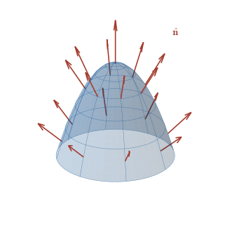{#fig-surface-normals width=60%}


:::

The flux of the position field through a sphere is the simplest flux, because $\mathbf r$ is normal to the sphere. The sixth example computes it.

::: {#exm-surf-flux-position}
#### The flux of $\mathbf r$ through a sphere

On the sphere of radius $a$, $\mathbf r = a\,\hat{\mathbf e}_r$, so by (4) $\mathbf r\cdot\mathbf N = a^3\sin\theta$ and $\int_S\mathbf r\cdot d\mathbf S = 4\pi a^3$, three times the volume of the ball. The
field $(-y, x, 0)^\top$ is tangent to the sphere, and its flux is $0$.
:::

The flux of the Coulomb field through a sphere about the charge does not depend on the radius. The seventh example computes it, the integral form of
the vanishing divergence found in @exm-gdc-coulomb.

::: {#exm-surf-coulomb-flux}
#### Gauss's law for a point charge

For $\mathbf E = q\,\mathbf r/r^3$, on the sphere of radius $a$, $\mathbf E\cdot\mathbf N = \frac{q}{a^2}\,a^2\sin\theta = q\sin\theta$, and the flux is $4\pi q$ for every $a$. In SI units, with $\mathbf E =
\frac{q}{4\pi\varepsilon_0}\frac{\mathbf r}{r^3}$, it is $q/\varepsilon_0$.
:::

A uniform field crosses every surface with the same boundary circle in the same amount. The eighth example compares a hemisphere with the flat disc
it caps.

::: {#exm-surf-uniform-hemisphere}
#### A uniform field through a hemisphere

For $\mathbf E = E_0\mathbf e_3$ and the upper hemisphere ($\theta \leq \pi/2$), $\mathbf E\cdot\mathbf N = E_0a^2\sin\theta\cos\theta$ and the flux is $2\pi E_0a^2\cdot\frac12 = \pi a^2E_0$. The disc $x^2 + y^2
\leq a^2$ in the plane $z = 0$, with normal $\mathbf e_3$, has the same flux $\pi a^2E_0$.
:::

A torus is the product of two circles, the configuration space of a double pendulum. The ninth example computes its area as the product of their
lengths.

::: {#exm-surf-torus}
#### A torus

$\Phi(\theta, \varphi) = ((R + a\cos\theta)\cos\varphi, (R + a\cos\theta)\sin\varphi, a\sin\theta)$, $0 < a < R$, has $\lVert\Phi_\theta\rVert = a$, $\lVert\Phi_\varphi\rVert = R + a\cos\theta$, $\Phi_\theta\cdot\Phi_\varphi
= 0$, so by (1) $\lVert\mathbf N\rVert = a(R + a\cos\theta)$, and $A = \int_{-\pi}^{\pi}\int_{-\pi}^{\pi}a(R + a\cos\theta)\,d\theta\,d\varphi = 4\pi^2aR = (2\pi a)(2\pi R)$.
:::

Not every surface has two sides. The last example is the Möbius strip, where the normal of one parametrisation comes back reversed after one turn,
so a flux through it cannot be defined consistently.

::: {#exm-surf-mobius}
#### The Möbius strip

$\Phi(u, v) = \big((1 + v\cos\frac u2)\cos u,\ (1 + v\cos\frac u2)\sin u,\ v\sin\frac u2\big)$ on $[0, 2\pi] \times [-\frac12, \frac12]$ has $\Phi(0, 0) = \Phi(2\pi, 0) = (1, 0, 0)$, but $\mathbf N(0,
0) = \mathbf e_2 \times \mathbf e_1 = -\mathbf e_3$ while $\mathbf N(2\pi, 0) = \mathbf e_2 \times (-\mathbf e_1) = \mathbf e_3$. Going once round the core circle turns the normal into its opposite. The
definition still assigns a number to $\iint\mathbf F(\Phi)\cdot\mathbf N$, but cutting the strip at another place gives a different one.
:::
::::

:::: {.callout-note .exercises-fold collapse="true" title="Exercises"}
The first exercise computes the area of a flat triangle in space as a graph. It checks (2) against the cross product.

::: {#exr-surf-plane-triangle}
#### A triangle in a plane

Compute the area of the part of the plane $x + y + z = 1$ in the first octant, by (2) and by @exm-surf-parallelogram.
:::

::: {.callout-note .solution collapse="true" title="Solution"}
:::: {.panel-tabset .solution-tabs}
## Proof

It is the graph of $g = 1 - x - y$ over the triangle $x, y \geq 0$, $x + y \leq 1$, of area $\frac12$, with $\sqrt{1 + 1 + 1} = \sqrt3$: area $\frac{\sqrt3}{2}$. With vertices $\mathbf e_1, \mathbf
e_2, \mathbf e_3$ it is half the parallelogram on $\mathbf e_2 - \mathbf e_1$ and $\mathbf e_3 - \mathbf e_1$, whose cross product is $(1, 1, 1)^\top$: area $\frac12\sqrt3$.

## SageMath

Sage computes the double integral and the cross product.

```{.python .sage}
x, y = var("x y")
print(integrate(integrate(sqrt(3), y, 0, 1 - x), x, 0, 1))
e1, e2, e3 = identity_matrix(QQ, 3).columns()
print((e2 - e1).cross_product(e3 - e1).norm()/2)
```

```{.text .sage-output}
1/2*sqrt(3)
1/2*sqrt(3)
```
::::
:::

A flux through a curved cap is computed from a parametrisation adapted to it. The second exercise is @riley2006mathematical [Exercise 11.19(a)].

::: {#exr-surf-riley-cap}
#### The flux of $\mathbf r$ through a paraboloid cap

For the part $z \geq 0$ of $z = a^2 - x^2 - y^2$ ($a > 0$), parametrised by $\Phi(\theta, \varphi) = (a\sin\theta\cos\varphi, a\sin\theta\sin\varphi, a^2\cos^2\theta)$ on $[0, \frac\pi2] \times [-\pi, \pi]$,
show that $\mathbf r\cdot\mathbf N = a^4(2\sin^3\theta\cos\theta + \cos^3\theta\sin\theta)$ and that the flux of $\mathbf r$ is $\frac32\pi a^4$.
:::

::: {.callout-note .solution collapse="true" title="Solution"}
:::: {.panel-tabset .solution-tabs}
## Proof

$\Phi_\theta = (a\cos\theta\cos\varphi, a\cos\theta\sin\varphi, -2a^2\cos\theta\sin\theta)$ and $\Phi_\varphi = (-a\sin\theta\sin\varphi, a\sin\theta\cos\varphi, 0)$, so
$$
\mathbf N = (2a^3\cos\theta\sin^2\theta\cos\varphi,\ 2a^3\cos\theta\sin^2\theta\sin\varphi,\ a^2\sin\theta\cos\theta)^\top ,
$$
pointing upwards, and $\mathbf r\cdot\mathbf N = 2a^4\cos\theta\sin^3\theta + a^4\cos^3\theta\sin\theta$. With $\int_0^{\pi/2}\sin^3\theta\cos\theta\,d\theta = \int_0^{\pi/2}\cos^3\theta\sin\theta\,d\theta =
\frac14$, the flux is $2\pi a^4(\frac12 + \frac14) = \frac32\pi a^4$.

## SageMath

Sage computes $\mathbf N$, $\mathbf r\cdot\mathbf N$ and the flux.

```{.python .sage}
th, ph, a = var("theta phi a")
P = vector(SR, [a*sin(th)*cos(ph), a*sin(th)*sin(ph), a^2*cos(th)^2])
N = diff(P, th).cross_product(diff(P, ph))
rN = (P*N).simplify_full()
print(bool(rN == a^4*(2*sin(th)^3*cos(th) + cos(th)^3*sin(th))))
print(integrate(integrate(rN, th, 0, pi/2), ph, -pi, pi))
```

```{.text .sage-output}
True
3/2*pi*a^4
```
::::
:::

A surface of revolution is parametrised by the height and the angle, and its area element has a simple form. The third exercise proves it, the formula
behind the cone and the paraboloid.

::: {#exr-surf-revolution}
#### Surfaces of revolution

Let $g > 0$ be of class $C^1$ on $[c, d]$ and $\Phi(t, \varphi) = (g(t)\cos\varphi, g(t)\sin\varphi, t)$ on $[c, d] \times [-\pi, \pi]$. Show that $dS = g\sqrt{1 + g'^2}\,dt\,d\varphi$, so $A =
2\pi\int_c^dg\sqrt{1 + g'^2}\,dt$, and that $\mathbf N$ points away from the axis.
:::

::: {.callout-note .solution collapse="true" title="Solution"}
:::: {.panel-tabset .solution-tabs}
## Proof

$\Phi_t = (g'\cos\varphi, g'\sin\varphi, 1)$, $\Phi_\varphi = (-g\sin\varphi, g\cos\varphi, 0)$, so $\mathbf N = \Phi_t \times \Phi_\varphi = (-g\cos\varphi, -g\sin\varphi, gg')^\top$. That points towards the
axis; the order $(\varphi, t)$ gives $\mathbf N = (g\cos\varphi, g\sin\varphi, -gg')^\top$, whose horizontal part $g\,\hat{\mathbf e}_\rho$ points away from it. Either way $\lVert\mathbf N\rVert = g\sqrt{1 +
g'^2}$, and Fubini gives $A$.

## SageMath

Sage computes the normal for a general $g$ and the area of a sphere of radius $1$ as the surface of revolution of $\sqrt{1 - t^2}$ on $[-1, 1]$.

```{.python .sage}
t, ph = var("t phi"); g = function("g")(t)
P = vector(SR, [g*cos(ph), g*sin(ph), t])
N = diff(P, ph).cross_product(diff(P, t))
print(N.simplify_full(), (N*N).simplify_full())
h = sqrt(1 - t^2)
print(2*pi*integrate((h*sqrt(1 + diff(h, t)^2)).simplify_full(), t, -1, 1))
```

```{.text .sage-output}
(cos(phi)*g(t), g(t)*sin(phi), -g(t)*diff(g(t), t)) g(t)^2*diff(g(t), t)^2 + g(t)^2
4*pi
```
::::
:::

A hyperboloid of one sheet is a surface of revolution whose area involves an inverse hyperbolic sine. The fourth exercise computes the area of a piece
of it, the value in @riley2006mathematical [Exercise 10.11].

::: {#exr-surf-riley-hyperboloid}
#### A piece of a hyperboloid

Show that the area of $x^2 + y^2 - z^2 = a^2$ between $z = 0$ and $z = 2a$ is $\pi a^2\big(6 + \frac{1}{\sqrt2}\operatorname{arsinh}(2\sqrt2)\big)$.
:::

::: {.callout-note .solution collapse="true" title="Solution"}
:::: {.panel-tabset .solution-tabs}
## Proof

The surface is the surface of revolution of $g(t) = \sqrt{a^2 + t^2}$, $t \in [0, 2a]$, and $g\sqrt{1 + g'^2} = \sqrt{g^2 + t^2} = \sqrt{a^2 + 2t^2}$ by @exr-surf-revolution. With $t =
\frac{a}{\sqrt2}\sinh s$, $\int_0^{2a}\sqrt{a^2 + 2t^2}\,dt = \frac{a^2}{\sqrt2}\int_0^{s_1}\cosh^2s\,ds = \frac{a^2}{2\sqrt2}(s_1 + \sinh s_1\cosh s_1)$, with $\sinh s_1 = 2\sqrt2$, $\cosh s_1 = 3$.
This is $\frac{a^2}{2\sqrt2}\operatorname{arsinh}(2\sqrt2) + 3a^2$, and multiplying by $2\pi$ gives the stated area.

## SageMath

Sage evaluates the area integral for $a = 1$ and compares with the closed form numerically.

```{.python .sage}
t = var("t")
A = 2*pi*integrate(sqrt(1 + 2*t^2), t, 0, 2)
print(N(A), N(pi*(6 + arcsinh(2*sqrt(2))/sqrt(2))))
```

```{.text .sage-output}
22.7653955934513 22.7653955934513
```
::::
:::

The solid angle of a surface seen from a point is the flux of $\mathbf r/r^3$ through it. The fifth exercise computes the solid angle of a rectangular
aperture from a point on its axis [@riley2006mathematical, Exercise 11.12].

::: {#exr-surf-riley-solid-angle}
#### The solid angle of a rectangle

The rectangle $[-a, a] \times [-b, b]$ in the plane $z = c > 0$, with normal $\mathbf e_3$, is seen from $\mathbf 0$. Show that the flux of $\mathbf r/r^3$ through it is $\Omega = 4\arctan\frac{ab}{c\sqrt{a^2
+ b^2 + c^2}}$.
:::

::: {.callout-note .solution collapse="true" title="Solution"}
:::: {.panel-tabset .solution-tabs}
## Proof

With $\Phi(x, y) = (x, y, c)$, $\mathbf N = \mathbf e_3$ and the integrand is $c(x^2 + y^2 + c^2)^{-3/2}$. With $k^2 = y^2 + c^2$, $\frac{d}{dx}\frac{x}{k^2\sqrt{x^2 + k^2}} = (x^2 + k^2)^{-3/2}$, so the
inner integral is $\frac{2ac}{(y^2 + c^2)\sqrt{y^2 + c^2 + a^2}}$. With $s = \sqrt{a^2 + c^2 + y^2}$ and $w = \frac{ay}{cs}$, $w' = \frac{a(a^2 + c^2)}{cs^3}$ and $1 + w^2 = \frac{(a^2 + c^2)(c^2 +
y^2)}{c^2s^2}$, so $\frac{d}{dy}\arctan w = \frac{ac}{(c^2 + y^2)s}$. The integral over $y \in [-b, b]$ is $2(\arctan w(b) - \arctan w(-b)) = 4\arctan\frac{ab}{c\sqrt{a^2 + b^2 + c^2}}$. As $a, b \to \infty$,
$\Omega \to 2\pi$, the solid angle of a half-space.

## SageMath

Check on $a = 1$, $b = 2$, $c = 3$: Sage compares the double integral with the formula, and differentiates the antiderivative symbolically.

```{.python .sage}
x, y = var("x y"); a, b, c = 1, 2, 3
inner = lambda yy: numerical_integral(c/(x^2 + yy^2 + c^2)^(3/2), -a, a)[0]
print(round(numerical_integral(inner, -b, b)[0], 10), round(N(4*arctan(a*b/(c*sqrt(a^2 + b^2 + c^2)))), 10))
A, C = var("A C"); assume(A > 0, C > 0)
s = sqrt(A^2 + C^2 + y^2)
print((diff(arctan(A*y/(C*s)), y) - A*C/((C^2 + y^2)*s)).simplify_full())
```

```{.text .sage-output}
0.7052953553 0.7052953553
0
```
::::
:::

The outward flux through a closed surface is the sum of the fluxes through its pieces, each parametrised with the normal pointing out. The sixth exercise
computes one for a hollow cylinder, by the definition alone [@riley2006mathematical, Exercise 11.26(a)].

::: {#exr-surf-riley-hollow-cylinder}
#### Flux out of a hollow cylinder

Let $\mathbf F = F_0\big(\frac\rho a\cos\lambda z\,\hat{\mathbf e}_\rho + \sin\lambda z\,\mathbf e_3\big)$, $\lambda > 0$, and let the region $a \leq \rho \leq 2a$, $|z| \leq h$ with $h = \frac{a\pi}{2}$ be bounded by the two
cylinders and two annuli, each with the normal pointing out of the region. Show that the total flux is $6\pi aF_0\sin(\lambda h)\big(\frac2\lambda + a\big)$.
:::

::: {.callout-note .solution collapse="true" title="Solution"}
:::: {.panel-tabset .solution-tabs}
## Proof

On $\rho = 2a$, parametrised by $(\varphi, z)$, $\mathbf N = 2a\,\hat{\mathbf e}_\rho$ (@exm-surf-cylinder), $\mathbf F\cdot\mathbf N = 4aF_0\cos\lambda z$, and the flux is $2\pi\cdot4aF_0\cdot\frac{2\sin\lambda
h}{\lambda}$. On $\rho = a$, parametrised by $(z, \varphi)$, $\mathbf N = -a\,\hat{\mathbf e}_\rho$ and the flux is $-2\pi aF_0\frac{2\sin\lambda h}{\lambda}$. The top annulus $(\rho\cos\varphi, \rho\sin\varphi,
h)$, parametrised by $(\rho, \varphi)$, has $\mathbf N = \rho\,\mathbf e_3$ and flux $F_0\sin\lambda h\cdot2\pi\int_a^{2a}\rho\,d\rho = 3\pi a^2F_0\sin\lambda h$; the bottom, by $(\varphi, \rho)$, has $\mathbf N = -\rho\,\mathbf
e_3$ and $\mathbf F\cdot\mathbf N = -F_0\sin(-\lambda h)\rho$, the same flux. The total is $\frac{12\pi aF_0\sin\lambda h}{\lambda} + 6\pi a^2F_0\sin\lambda h$.

## SageMath

Sage sums the four fluxes, each from its parametrisation.

```{.python .sage}
u, w, a, lam, F0 = var("u w a lam F0"); h = a*pi/2
def F(P):
    x, y, z = P; rho = sqrt(x^2 + y^2)
    return F0*vector(SR, [x/a*cos(lam*z), y/a*cos(lam*z), sin(lam*z)])
def flux(P, U, W):
    N = diff(P, u).cross_product(diff(P, w))
    return integrate(integrate((F(P)*N).simplify_full(), u, *U), w, *W)
tot = flux(vector(SR, [2*a*cos(u), 2*a*sin(u), w]), (-pi, pi), (-h, h)) + flux(vector(SR, [a*cos(w), a*sin(w), u]), (-h, h), (-pi, pi)) \
    + flux(vector(SR, [u*cos(w), u*sin(w), h]), (a, 2*a), (-pi, pi)) + flux(vector(SR, [w*cos(u), w*sin(u), -h]), (-pi, pi), (a, 2*a))
print(bool((tot - 6*pi*a*F0*sin(lam*h)*(2/lam + a)).simplify_full() == 0))
```

```{.text .sage-output}
True
```
::::
:::

A graph is never smaller than its shadow. The seventh exercise proves this from (2) and identifies the case of equality.

::: {#exr-surf-graph-area-bound}
#### A graph is larger than its shadow

Let $g$ be of class $C^1$ on an open set containing $D$. Show that the area of the graph of $g$ over $D$ is at least the area of $D$, with equality if $\nabla g = \mathbf 0$ on $D$; and
that if $\nabla g(\mathbf p) \neq \mathbf 0$ at an interior point $\mathbf p$ of $D$, the inequality is strict.
:::

::: {.callout-note .solution collapse="true" title="Solution"}
:::: {.panel-tabset .solution-tabs}
## Proof

By (2) the area is $\iint_D\sqrt{1 + \lVert\nabla g\rVert^2}$, and $\sqrt{1 + \lVert\nabla g\rVert^2} \geq 1$, so by monotonicity (@def-multiple-integral (3)) it is at least $\iint_D1$, with equality if
$\nabla g = \mathbf 0$. If $\lVert\nabla g(\mathbf p)\rVert = 2\eta > 0$ at an interior point, continuity gives a closed square $Q \subseteq D$ about $\mathbf p$ on which $\lVert\nabla g\rVert \geq \eta$.
The difference of the two integrals is $\iint_D(\sqrt{1 + \lVert\nabla g\rVert^2} - 1) \geq \iint_Q(\sqrt{1 + \eta^2} - 1) > 0$, using monotonicity and the additivity of (3) there for $D = Q \cup
\overline{D \setminus Q}$.

## SageMath

Check on $g = x^2 - y$ over the unit square: Sage computes the area of the graph numerically and compares with $1$.

```{.python .sage}
x, y = var("x y")
g = x^2 - y
dS = sqrt(1 + diff(g, x)^2 + diff(g, y)^2)
print(numerical_integral(lambda yy: numerical_integral(dS.subs(y=yy), 0, 1)[0], 0, 1)[0] > 1)
print(N(integrate(dS, x, 0, 1)))
```

```{.text .sage-output}
True
1.79785278878188
```
::::
:::

The moment of inertia of a thin spherical shell is an integral of the squared distance to an axis over the sphere. The eighth exercise computes it, the
value for a hollow ball rolling down a slope.

::: {#exr-surf-shell-inertia}
#### A spherical shell

Show that a spherical shell of radius $a$ and uniform surface density $\sigma$ has mass $M = 4\pi a^2\sigma$ and moment of inertia $\int_S\sigma(x^2 + y^2)\,dS = \frac23Ma^2$ about the $z$-axis.
:::

::: {.callout-note .solution collapse="true" title="Solution"}
:::: {.panel-tabset .solution-tabs}
## Proof

By (4), $M = \sigma\cdot4\pi a^2$, and $x^2 + y^2 = a^2\sin^2\theta$, so $I = \sigma\int_{-\pi}^{\pi}\int_0^\pi a^4\sin^3\theta\,d\theta\,d\varphi = 2\pi\sigma a^4\cdot\frac43 = \frac{8\pi}{3}\sigma a^4 = \frac23Ma^2$, using
$\int_0^\pi\sin^3\theta\,d\theta = \int_{-1}^1(1 - u^2)\,du = \frac43$.

## SageMath

Sage computes the integral and the ratio $I/(Ma^2)$.

```{.python .sage}
th, ph, a, s = var("theta phi a sigma")
I = integrate(integrate(s*a^2*sin(th)^2*a^2*sin(th), th, 0, pi), ph, -pi, pi)
print(I, I/(4*pi*a^2*s*a^2))
```

```{.text .sage-output}
8/3*pi*a^4*sigma 2/3
```
::::
:::

The helicoid is the surface swept by a line turning about an axis as it rises; its parametrisation has orthogonal tangent vectors. The ninth exercise
computes its area with (1).

::: {#exr-surf-helicoid}
#### A helicoid

For $\Phi(u, v) = (u\cos v, u\sin v, cv)$ on $[0, 1] \times [0, 2\pi]$, $c > 0$, compute $\lVert\Phi_u\rVert$, $\lVert\Phi_v\rVert$, $\Phi_u\cdot\Phi_v$ and the area, and evaluate it for $c = 1$.
:::

::: {.callout-note .solution collapse="true" title="Solution"}
:::: {.panel-tabset .solution-tabs}
## Proof

$\Phi_u = (\cos v, \sin v, 0)$, $\Phi_v = (-u\sin v, u\cos v, c)$, so $\lVert\Phi_u\rVert = 1$, $\lVert\Phi_v\rVert^2 = u^2 + c^2$, $\Phi_u\cdot\Phi_v = 0$, and by (1) $\lVert\mathbf N\rVert = \sqrt{u^2 + c^2}$.
The area is $2\pi\int_0^1\sqrt{u^2 + c^2}\,du = \pi\big(\sqrt{1 + c^2} + c^2\operatorname{arsinh}\frac1c\big)$, by the antiderivative $\frac12\big(u\sqrt{u^2 + c^2} + c^2\operatorname{arsinh}\frac uc\big)$; for $c =
1$ it is $\pi(\sqrt2 + \operatorname{arsinh}1) \approx 7.212$.

## SageMath

Sage computes the area numerically for $c = 1$ and the closed form.

```{.python .sage}
u, v = var("u v")
P = vector(SR, [u*cos(v), u*sin(v), v])
Nv = diff(P, u).cross_product(diff(P, v))
print((Nv*Nv).simplify_full())
print(N(2*pi*integrate(sqrt(u^2 + 1), u, 0, 1)), N(pi*(sqrt(2) + arcsinh(1))))
```

```{.text .sage-output}
u^2 + 1
7.21179972420705 7.21179972420705
```
::::
:::

Archimedes found that a band of a sphere between two parallel planes has the area of the band of the circumscribed cylinder between the same planes.
The last exercise proves this with (4) and compares it with @exm-surf-cylinder.

::: {#exr-surf-archimedes}
#### Archimedes' zones

Show that the part of the sphere of radius $a$ between the planes $z = z_1$ and $z = z_2$, $-a \leq z_1 < z_2 \leq a$, has area $2\pi a(z_2 - z_1)$, the lateral area of the cylinder of radius $a$
between the same planes.
:::

::: {.callout-note .solution collapse="true" title="Solution"}
:::: {.panel-tabset .solution-tabs}
## Proof

In the parametrisation of (4) the zone is $\theta \in [\theta_2, \theta_1]$ with $\cos\theta_i = z_i/a$, so its area is $2\pi a^2\int_{\theta_2}^{\theta_1}\sin\theta\,d\theta = 2\pi a^2(\cos\theta_2 - \cos\theta_1) =
2\pi a(z_2 - z_1)$. By @exm-surf-cylinder the cylinder between the planes has area $2\pi a(z_2 - z_1)$. In particular the area depends only on the width of the zone, not on where it lies.

## SageMath

Sage computes the area of the zone for symbolic $z_1, z_2$.

```{.python .sage}
th, a, z1, z2 = var("theta a z1 z2")
A = 2*pi*a^2*integrate(sin(th), th, arccos(z2/a), arccos(z1/a))
print(A.simplify_full())
```

```{.text .sage-output}
-2*pi*a*z1 + 2*pi*a*z2
```
::::
:::
::::

### Green's theorem

The fundamental theorem of calculus writes the integral of a derivative over an interval as a difference of values at its two endpoints. In the plane the
boundary of a region is a closed curve, and Green's theorem writes the double integral of $\partial_xQ - \partial_yP$ as the circulation of $(P, Q)$ around it.
The theorem below is proved for regions that lie between two graphs both over the $x$-axis and over the $y$-axis, such as discs, triangles and rectangles,
and for regions cut into finitely many such pieces, such as an annulus.

:::: {.statement-box}
::: {#thm-green}
#### Green's theorem

Let $P, Q$ be of class $C^1$ on an open set $W \subseteq \mathbb{R}^2$.

1. Let $D \subseteq W$ be both of the form $\{a \leq x \leq b,\ g_1(x) \leq y \leq g_2(x)\}$ with $g_1 \leq g_2$ continuous on $[a, b]$ and of the form $\{c \leq y \leq d,\ h_1(y) \leq x \leq
   h_2(y)\}$ with $h_1 \leq h_2$ continuous on $[c, d]$. Let $\boldsymbol\gamma$ be a piecewise $C^1$ closed curve in $W$ that **runs once anticlockwise around $D$** in both forms: its parameter
   interval splits into four consecutive closed intervals, some of which may be single points, on which in turn $\boldsymbol\gamma = (\gamma_1, g_1(\gamma_1))$ with $\gamma_1$ going from $a$ to
   $b$ in $[a, b]$; $\gamma_1 = b$; $\boldsymbol\gamma = (\gamma_1, g_2(\gamma_1))$ with $\gamma_1$ going from $b$ to $a$; $\gamma_1 = a$; and, after its starting point is moved
   (@def-line-integral (1)), into four consecutive intervals on which $\boldsymbol\gamma = (h_2(\gamma_2), \gamma_2)$ with $\gamma_2$ going from $c$ to $d$ in $[c, d]$; $\gamma_2 = d$; $\boldsymbol\gamma =
   (h_1(\gamma_2), \gamma_2)$ with $\gamma_2$ going from $d$ to $c$; $\gamma_2 = c$. Then
   $$
   \oint_{\boldsymbol\gamma}P\,dx + Q\,dy = \iint_D(\partial_xQ - \partial_yP)\,dx\,dy .
   $$
2. (**unions**) Let $D = D_1 \cup \dots \cup D_m$, where each $D_k$ with a curve $\boldsymbol\gamma_k$ is as in (1) and $D_j \cap D_k$ has content zero for $j \neq k$, and let $\boldsymbol\gamma$ be a
   piecewise $C^1$ closed curve in $W$ with $\oint_{\boldsymbol\gamma}\mathbf F\cdot d\mathbf r = \sum_k\oint_{\boldsymbol\gamma_k}\mathbf F\cdot d\mathbf r$ for every continuous $\mathbf F$ on $W$ (as happens
   when the $\boldsymbol\gamma_k$ run along the arcs of $\boldsymbol\gamma$ and along further arcs, each of these traversed once in each direction). Then the formula of (1) holds for $D$ and $\boldsymbol\gamma$.
3. (**area**) For $D$ and $\boldsymbol\gamma$ as in (1) or (2), $\operatorname{vol}(D) = \oint_{\boldsymbol\gamma}x\,dy = -\oint_{\boldsymbol\gamma}y\,dx = \frac12\oint_{\boldsymbol\gamma}(x\,dy - y\,dx)$.
:::
::::

*Proof.* (1) The line integral is linear in $(P, Q)$, so we treat $\oint P\,dx$ and $\oint Q\,dy$ separately. On the first interval of the first splitting,
on each $C^1$ piece $[t_{k-1}, t_k]$, the integrand of $\oint P\,dx$ is $\varphi(\gamma_1(t))\gamma_1'(t)$ with $\varphi(u) = P(u, g_1(u))$, continuous on $[a, b]$; extended by its end values,
$\varphi$ is continuous on $\mathbb{R}$, and the substitution rule (@thm-fundamental-theorem (4)) gives $\int_{\gamma_1(t_{k-1})}^{\gamma_1(t_k)}\varphi(u)\,du$. These add up to $\int_a^bP(u, g_1(u))\,du$. On the
second and fourth intervals $\gamma_1$ is constant, so $\gamma_1' = 0$ and they contribute nothing; the third contributes $\int_b^aP(u, g_2(u))\,du$ in the same way. So
$$
\oint_{\boldsymbol\gamma}P\,dx = -\int_a^b\big(P(u, g_2(u)) - P(u, g_1(u))\big)\,du .
$$
For each $u \in [a, b]$ the segment $\{u\} \times [g_1(u), g_2(u)]$ lies in $D \subseteq W$, and $W$ is open, so $y \mapsto P(u, y)$ is of class $C^1$ on an open interval containing $[g_1(u),
g_2(u)]$ and @thm-fundamental-theorem (2) gives $P(u, g_2(u)) - P(u, g_1(u)) = \int_{g_1(u)}^{g_2(u)}\partial_yP(u, y)\,dy$. By @def-multiple-integral (5), $\oint P\,dx = -\iint_D\partial_yP$. The circulation does not
change when the starting point is moved (@def-line-integral (1)), so the second splitting can be used for $\oint Q\,dy$; the same argument with the roles of the coordinates exchanged gives
$\oint Q\,dy = \int_c^d\big(Q(h_2(v), v) - Q(h_1(v), v)\big)\,dv = \iint_D\partial_xQ$, the last step by @def-multiple-integral (5) after the exchange $(x, y) \mapsto (y, x)$, a linear map with
$|\det| = 1$ (@thm-change-of-variables (1)). Adding the two gives (1).

(2) Each $D_k$ is closed and bounded with boundary of content zero (@def-multiple-integral (5)), and so are the unions $D_1 \cup \dots \cup D_k$, whose intersections with $D_{k+1}$ have content zero. By
@def-multiple-integral (3) and induction, $\iint_D(\partial_xQ - \partial_yP) = \sum_k\iint_{D_k}(\partial_xQ - \partial_yP)$, which by (1) is $\sum_k\oint_{\boldsymbol\gamma_k}P\,dx + Q\,dy =
\oint_{\boldsymbol\gamma}P\,dx + Q\,dy$.

(3) Apply (1) or (2) with $(P, Q) = (0, x)$ and with $(P, Q) = (-y, 0)$, for which $\partial_xQ - \partial_yP = 1$, and average. $\square$

Green's theorem and its proof for regions bounded by two graphs in each direction are @riley2006mathematical [Sec. 11.3], where the region is cut into such
pieces in general, as in (2). The proof above makes explicit what "the boundary traversed anticlockwise" means, so that the same curve serves both descriptions.

:::: {.callout-note .examples-fold collapse="true" title="Examples"}
On a square every piece of the boundary is a segment, and both sides of the formula can be computed by hand. The first example does this for a
polynomial field.

::: {#exm-green-square}
#### The unit square

The square $[0, 1]^2$ is of both forms with $g_1 = 0$, $g_2 = 1$, $h_1 = 0$, $h_2 = 1$, and the curve through $(t, 0)$, $(1, t)$, $(1 - t, 1)$, $(0, 1 - t)$, $t \in [0, 1]$, runs once
anticlockwise around it; for the second splitting, start at $(1, 0)$. For $P = xy$, $Q = x^2$, $\iint(2x - x) = \frac12$. On the four sides, $\int P\,dx + Q\,dy$ is $0$, $\int_0^1 1\,dt = 1$,
$\int_0^1(1 - t)(-1)\,dt = -\frac12$ and $0$: the circulation is $\frac12$.
:::

A triangle lies between two graphs in both directions, with the hypotenuse a graph each time. The second example checks the theorem on one.

::: {#exm-green-triangle}
#### A triangle

$D = \{0 \leq y \leq x \leq 1\}$ has $g_1 = 0$, $g_2 = x$ on $[0, 1]$ and $h_1 = y$, $h_2 = 1$ on $[0, 1]$; the curve $(t, 0)$, $(1, t)$, $(1 - t, 1 - t)$ runs once anticlockwise around it, with
a single point for the left side. For $P = -y^2$, $Q = xy$, $\partial_xQ - \partial_yP = 3y$ and $\iint_D3y = 3\int_0^1\frac{x^2}{2}dx = \frac12$. On the three sides the circulation is $0$, $\int_0^1t\,dt =
\frac12$ and $\int_0^1\big((1 - t)^2 - (1 - t)^2\big)dt = 0$.
:::

The area formula (3) computes areas from a parametrisation of the boundary alone. The third example applies it to the disc and the ellipse.

::: {#exm-green-ellipse-area}
#### The area of an ellipse

The ellipse $x^2/a^2 + y^2/b^2 \leq 1$ lies between $\mp b\sqrt{1 - x^2/a^2}$ over $[-a, a]$ and between $\mp a\sqrt{1 - y^2/b^2}$ over $[-b, b]$. The curve $(a\cos t, b\sin t)$, $t \in [-\pi, \pi]$,
runs once anticlockwise around it: along the lower graph for $t \in [-\pi, 0]$, then the single point $(a, 0)$, the upper graph for $t \in [0, \pi]$, the point $(-a, 0)$; and from the start $t =
-\frac\pi2$, along the right graph, the point $(0, b)$, the left graph, the point $(0, -b)$. By (3), the area is $\frac12\int_{-\pi}^{\pi}(ab\cos^2t + ab\sin^2t)\,dt = \pi ab$; $a = b = 1$ gives $\pi$.
:::

A region bounded by two curves that meet at two corners is of both forms when each curve is a graph in both directions. The fourth example takes the
lens between two parabolas, drawn in the figure with a strip of each kind.

::: {#exm-green-lens}
#### The lens between two parabolas

$D = \{0 \leq x \leq 1,\ x^2 \leq y \leq \sqrt x\} = \{0 \leq y \leq 1,\ y^2 \leq x \leq \sqrt y\}$. The curve $(t, t^2)$ for $t \in [0, 1]$, followed by $(s^2, s)$ for $s$ from $1$ to $0$, runs once
anticlockwise around it: in the first form the right and left sides are the points $(1, 1)$ and $(0, 0)$; in the second the lower parabola is the graph of $h_2 = \sqrt y$ and the upper one that of
$h_1 = y^2$. By (3), the area is $\oint x\,dy = \int_0^1t\cdot2t\,dt + \int_1^0s^2\,ds = \frac23 - \frac13 = \frac13 = \int_0^1(\sqrt x - x^2)\,dx$.

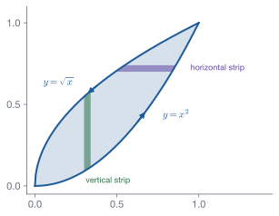{#fig-green-region width=55%}
:::

A region with a hole is not of the form in (1), but it can be cut into pieces that are. The fifth example cuts an annulus into four quarters and uses (2).

::: {#exm-green-annulus}
#### An annulus

$D = \{1 \leq x^2 + y^2 \leq 4\}$ is the union of its four quarters; the first, $\{x, y \geq 0\}$, lies between $\sqrt{\max(1 - x^2, 0)}$ and $\sqrt{4 - x^2}$ over $[0, 2]$ and symmetrically over the
$y$-axis, and so do the others. Their boundary curves run along the outer circle anticlockwise, the inner circle clockwise, and along each of the four cuts once in each direction. So the hypothesis of
(2) holds for $\boldsymbol\gamma$ = the outer circle followed by a segment from $(2, 0)$ to $(1, 0)$, the inner circle clockwise and the segment back, as the two segments cancel by
@def-line-integral (1). For $\mathbf F = (-y, x)$, $\iint_D2 = 2\cdot3\pi = 6\pi$, and the circulations are $8\pi$ around the outer circle and $-2\pi$ around the inner one.
:::

Green's theorem has a second reading, with the outward normal of the boundary in place of its tangent. The sixth example derives it: the outward flux of a
plane field through a closed curve is the integral of its divergence.

::: {#exm-green-flux-form}
#### The flux form

For a field $(F_1, F_2)$ apply (1) with $P = -F_2$, $Q = F_1$: $\oint_{\boldsymbol\gamma}(F_1\gamma_2' - F_2\gamma_1')\,dt = \iint_D(\partial_xF_1 + \partial_yF_2)$. Where $\boldsymbol\gamma' \neq \mathbf 0$,
$\hat{\mathbf n} = (\gamma_2', -\gamma_1')/\lVert\boldsymbol\gamma'\rVert$ is the unit normal on the right of the direction of motion, outward for an anticlockwise curve, and the left side is
$\oint\mathbf F\cdot\hat{\mathbf n}\,ds$. For $\mathbf F = (x, y)$ on the unit disc, $\hat{\mathbf n} = \mathbf F$ on the circle and both sides equal $2\pi$.
:::

Kepler's second law says that the line from the Sun to a planet sweeps equal areas in equal times. The seventh example derives the rate with (3) and the
conservation of angular momentum of @exr-cross-torque.

::: {#exm-green-kepler}
#### Kepler's second law

For a planar orbit $(x(t), y(t))$, the angular momentum per unit mass is $\ell = x\dot y - y\dot x$, constant for a central force (@exr-cross-torque). By (3), if the orbit closes after one period $T$
and runs once anticlockwise around the region it encloses, that area is $\frac12\oint(x\,dy - y\,dx) = \frac12\int_0^T\ell\,dt = \frac{\ell T}{2}$. For the ellipse $(a\cos\omega t, b\sin\omega t)$ (an
oscillator orbit), $\ell = ab\omega$ and $T = 2\pi/\omega$, giving $\pi ab$ again.
:::

In thermodynamics the work done by a gas in a cycle is $\oint p\,dV$. By (3), with $(V, p)$ in place of $(x, y)$, it is the area enclosed by the cycle in the $(V,
p)$-plane, positive when the cycle runs clockwise. The eighth example computes it for a rectangular cycle.

::: {#exm-green-heat-engine}
#### Work in a cycle

The cycle through $(V_1, p_1)$, $(V_1, p_2)$, $(V_2, p_2)$, $(V_2, p_1)$ with $V_1 < V_2$, $p_1 < p_2$, runs clockwise around the rectangle. It is the reversed anticlockwise boundary, so by
@def-line-integral (1) and (3), $\oint p\,dV = -\oint_{\text{anticlockwise}}y\,dx = (V_2 - V_1)(p_2 - p_1)$: expansion at the high pressure $p_2$ and compression at the low one $p_1$ leave the
difference of the two works.
:::

The vortex field of @exm-line-vortex has $\partial_xF_2 - \partial_yF_1 = 0$ off the origin. The ninth example applies (2) on an annulus around the origin and
finds that the circulation around the outer and the inner circle is the same.

::: {#exm-green-vortex-annulus}
#### The vortex around an annulus

On $1 \leq x^2 + y^2 \leq 4$, $W = \mathbb{R}^2 \setminus \{\mathbf 0\}$, the curve of @exm-green-annulus gives $\oint_{\text{outer}} - \oint_{\text{inner, anticlockwise}} = \iint_D0 = 0$. Both
circulations are $2\pi$: the double integral cannot see the singularity, which sits in the hole.
:::

The hypothesis that $P$ and $Q$ are of class $C^1$ on an open set containing all of $D$ cannot be dropped. The last example is the vortex on the unit disc, where the two
sides of the formula disagree.

::: {#exm-green-vortex-disc}
#### When a singularity is inside

For the vortex $(P, Q) = (-y, x)/(x^2 + y^2)$ on the unit disc, $\partial_xQ - \partial_yP = 0$ wherever it is defined, so the right side, over the disc without its centre, is $0$, while the
circulation around the circle is $2\pi$ (@exm-line-vortex). $P$ and $Q$ are not even bounded near $\mathbf 0$, so (1) does not apply, and @exm-green-vortex-annulus shows where the circulation
comes from.
:::
::::

:::: {.callout-note .exercises-fold collapse="true" title="Exercises"}
The first exercise verifies the theorem on a rectangle by computing both sides from the definitions. It is the direct check.

::: {#exr-green-rectangle}
#### Both sides on a rectangle

Verify Green's theorem for $P = x^2y$, $Q = xy^2$ on $[0, 2] \times [0, 1]$.
:::

::: {.callout-note .solution collapse="true" title="Solution"}
:::: {.panel-tabset .solution-tabs}
## Proof

$\iint(y^2 - x^2) = 2\cdot\frac13 - \frac83\cdot1 = -2$. Around the boundary, anticlockwise from $\mathbf 0$: on $y = 0$, $P = 0$; on $x = 2$, $\int_0^12y^2\,dy = \frac23$; on $y = 1$, from $x = 2$
to $0$, $\int_2^0x^2\,dx = -\frac83$; on $x = 0$, $Q = 0$. The sum is $\frac23 - \frac83 = -2$.

## SageMath

Sage computes the double integral and the four side integrals.

```{.python .sage}
x, y, t = var("x y t")
P, Q = x^2*y, x*y^2
print(integrate(integrate(diff(Q, x) - diff(P, y), x, 0, 2), y, 0, 1))
sides = [(2*t, 0*t), (2 + 0*t, t), (2 - 2*t, 1 + 0*t), (0*t, 1 - t)]
print(sum(integrate(P.subs(x=a, y=b)*diff(a, t) + Q.subs(x=a, y=b)*diff(b, t), t, 0, 1) for a, b in sides))
```

```{.text .sage-output}
-2
-2
```
::::
:::

A double integral can be computed as a line integral by choosing $P$ and $Q$ with the right combination of derivatives. The second exercise does this on the
upper half of the unit disc [@riley2006mathematical, Exercise 11.4].

::: {#exr-green-riley-half-disc}
#### $x - y$ over a half-disc

Show with Green's theorem that $\iint_D(x - y)\,dx\,dy = -\frac23$ over the half-disc $D = \{x^2 + y^2 \leq 1,\ y \geq 0\}$, and confirm it by direct integration.
:::

::: {.callout-note .solution collapse="true" title="Solution"}
:::: {.panel-tabset .solution-tabs}
## Proof

$D$ lies between $0$ and $\sqrt{1 - x^2}$ over $[-1, 1]$, and between $\mp\sqrt{1 - y^2}$ over $[0, 1]$; the segment from $(-1, 0)$ to $(1, 0)$ followed by the arc $(\cos t, \sin t)$, $t \in [0, \pi]$,
runs once anticlockwise around it (for the second form, start at $(1, 0)$). With $P = \frac{y^2}{2}$ and $Q = \frac{x^2}{2}$, $\partial_xQ - \partial_yP = x - y$. On the segment $dy = 0$ and $P = 0$; on the
arc the integrand is $-\frac12\sin^3t + \frac12\cos^3t$, with integral $-\frac12\cdot\frac43 + 0 = -\frac23$. Directly, $\iint_Dx = 0$ by symmetry and $\iint_Dy = \int_{-1}^1\frac{1 - x^2}{2}dx = \frac23$.

## SageMath

Sage computes the arc integral and the double integral.

```{.python .sage}
x, y, t = var("x y t")
print(integrate(-sin(t)^3/2 + cos(t)^3/2, t, 0, pi))
print(integrate(integrate(x - y, y, 0, sqrt(1 - x^2)), x, -1, 1))
```

```{.text .sage-output}
-2/3
-2/3
```
::::
:::

Around an ellipse, a line integral with a complicated integrand can have a simple $\partial_xQ - \partial_yP$. The third exercise is @riley2006mathematical
[Exercise 11.7].

::: {#exr-green-riley-ellipse}
#### A line integral around an ellipse

Evaluate $\oint\big(y(4x^2 + y^2)\,dx + x(2x^2 + 3y^2)\,dy\big)$ anticlockwise around $x^2/a^2 + y^2/b^2 = 1$.
:::

::: {.callout-note .solution collapse="true" title="Solution"}
:::: {.panel-tabset .solution-tabs}
## Proof

$\partial_xQ - \partial_yP = 6x^2 + 3y^2 - 4x^2 - 3y^2 = 2x^2$. The ellipse is as in @exm-green-ellipse-area, and with $x = ar\cos\phi$, $y = br\sin\phi$ (Jacobian determinant $abr$,
@thm-change-of-variables), $\iint2x^2 = 2a^3b\int_0^{2\pi}\cos^2\phi\,d\phi\int_0^1r^3\,dr = \frac{\pi a^3b}{2}$.

## SageMath

Sage computes the line integral along $(a\cos t, b\sin t)$.

```{.python .sage}
t, a, b = var("t a b")
x, y = a*cos(t), b*sin(t)
print(integrate((y*(4*x^2 + y^2)*diff(x, t) + x*(2*x^2 + 3*y^2)*diff(y, t)).expand(), t, -pi, pi))
```

```{.text .sage-output}
1/2*pi*a^3*b
```
::::
:::

The astroid is a curve with four cusps whose parametrisation by cubes of $\cos t$ and $\sin t$ makes the area formula easy. The fourth exercise computes the
area it encloses [@riley2006mathematical, Exercise 11.6].

::: {#exr-green-astroid}
#### The area of the astroid

Find the area enclosed by $x^{2/3} + y^{2/3} = a^{2/3}$, using $(a\cos^3t, a\sin^3t)$.
:::

::: {.callout-note .solution collapse="true" title="Solution"}
:::: {.panel-tabset .solution-tabs}
## Proof

The region lies between $\mp(a^{2/3} - x^{2/3})^{3/2}$ over $[-a, a]$, and symmetrically over the $y$-axis; the curve $(a\cos^3t, a\sin^3t)$, $t \in [-\pi, \pi]$, runs once anticlockwise around it,
as the circle does in @exm-green-ellipse-area (with $\cos^3$ and $\sin^3$ increasing where $\cos$ and $\sin$ do). By (3) the area is $\frac12\int_{-\pi}^{\pi}(a\cos^3t\cdot3a\sin^2t\cos t + a\sin^3t\cdot3a\cos^2t\sin t)\,dt
= \frac{3a^2}{2}\int_{-\pi}^{\pi}\sin^2t\cos^2t\,dt = \frac{3a^2}{2}\cdot\frac\pi4 = \frac{3\pi a^2}{8}$.

## SageMath

Sage evaluates the area integral and the double integral between the two graphs.

```{.python .sage}
t, a, x = var("t a x"); assume(a > 0)
X, Y = a*cos(t)^3, a*sin(t)^3
print(integrate((X*diff(Y, t) - Y*diff(X, t))/2, t, -pi, pi).simplify_full())
print(numerical_integral(2*(1 - x^(2/3))^(3/2), 0, 1)[0]*2, N(3*pi/8))
```

```{.text .sage-output}
3/8*pi*a^2
1.1780972387854716 1.17809724509617
```
::::
:::

A "proof" that $\pi = 0$ applies Green's theorem where its hypotheses fail. The fifth exercise asks for the error [@riley2006mathematical, Exercise 11.8].

::: {#exr-green-riley-fallacy}
#### A false proof

Green's theorem with $P = \arctan(y/x)$ and $Q = \arctan(x/y)$ on the unit disc gives $\iint\frac{y - x}{x^2 + y^2} = 0$ on the right, while on the circle $P = \theta$ and $Q = \frac\pi2 - \theta$ make the left
side $2\pi$. Find the error.
:::

::: {.callout-note .solution collapse="true" title="Solution"}
:::: {.panel-tabset .solution-tabs}
## Proof

$P$ is not defined on the line $x = 0$ and $Q$ not on $y = 0$, and neither has a continuous extension across them: $\arctan(y/x) \to \pm\frac\pi2$ as $x \to 0^\pm$ with $y > 0$ fixed. So
there is no open set containing the disc on which $P, Q$ are of class $C^1$, and (1) does not apply. Also $P = \theta$ holds only for $\theta \in (-\frac\pi2, \frac\pi2)$ on the circle; on the left half,
$\arctan(y/x) = \theta \mp \pi$.

## SageMath

Sage shows the jump of $\arctan(y/x)$ across $x = 0$ at $y = 1$ and compares it with $\theta$ on the circle at $\theta = \frac{3\pi}{4}$.

```{.python .sage}
h = var("h")
print(limit(arctan(1/h), h=0, dir="+"), limit(arctan(1/h), h=0, dir="-"))
th = 3*pi/4
print(arctan(sin(th)/cos(th)), th)
```

```{.text .sage-output}
1/2*pi -1/2*pi
-1/4*pi 3/4*pi
```
::::
:::

A closed-form integral of $\pm y^3$ and $x^3$ around the circle can be traded for a polar double integral. The sixth exercise does both.

::: {#exr-green-cubic-circle}
#### A cubic field around the circle

Compute $\oint(-y^3\,dx + x^3\,dy)$ anticlockwise around the unit circle, directly and by Green's theorem.
:::

::: {.callout-note .solution collapse="true" title="Solution"}
:::: {.panel-tabset .solution-tabs}
## Proof

Directly, along $(\cos t, \sin t)$ the integrand is $\sin^4t + \cos^4t = 1 - \frac12\sin^22t$, with integral $2\pi - \frac\pi2 = \frac{3\pi}{2}$. By Green (the disc as in @exm-green-ellipse-area),
$\iint(3x^2 + 3y^2) = 3\int_0^{2\pi}\int_0^1r^3\,dr\,d\phi = \frac{3\pi}{2}$.

## SageMath

Sage computes both sides.

```{.python .sage}
t, r, ph = var("t r phi")
print(integrate(sin(t)^4 + cos(t)^4, t, 0, 2*pi), integrate(integrate(3*r^2*r, r, 0, 1), ph, 0, 2*pi))
```

```{.text .sage-output}
3/2*pi 3/2*pi
```
::::
:::

Green's theorem gives the plane form of integration by parts, and with it the uniqueness of solutions of the Dirichlet problem for the Laplacian. The
seventh exercise proves both.

::: {#exr-green-first-identity}
#### Green's first identity in the plane

Let $D$, $\boldsymbol\gamma$ be as in (1), and $u, v$ of class $C^2$ on an open set containing $D$. Show that $\iint_D(u\,\Delta v + \nabla u\cdot\nabla v) = \oint_{\boldsymbol\gamma}(-u\,\partial_yv\,dx + u\,\partial_xv\,dy)$.
Deduce that if $\Delta u = 0$ on $D$ and $u = 0$ on the points of $\boldsymbol\gamma$, then $u = 0$ on $D$.
:::

::: {.callout-note .solution collapse="true" title="Solution"}
:::: {.panel-tabset .solution-tabs}
## Proof

With $P = -u\,\partial_yv$ and $Q = u\,\partial_xv$, of class $C^1$, $\partial_xQ - \partial_yP = \partial_xu\,\partial_xv + u\,\partial_x^2v + \partial_yu\,\partial_yv + u\,\partial_y^2v$, and (1) gives the identity. If
$\Delta u = 0$ and $u = 0$ on $\boldsymbol\gamma$, take $v = u$: the line integral vanishes, so $\iint_D\lVert\nabla u\rVert^2 = 0$. A continuous non-negative function with zero integral vanishes at the
interior points of $D$ (otherwise it is at least some $\eta > 0$ on a small square, as in @exr-surf-graph-area-bound), so $\nabla u = \mathbf 0$ at every interior point, and by continuity on all of
$D$. Every point of $D$ is joined to a point of $\boldsymbol\gamma$ by a vertical segment in $D$, along which $u$ is constant by @thm-mean-value (4); so $u = 0$ on $D$.

## SageMath

Check on the unit square with $u = x^2y$ and $v = \sin x + y^3$: Sage compares both sides of the identity.

```{.python .sage}
x, y, t = var("x y t")
u, v = x^2*y, sin(x) + y^3
lhs = integrate(integrate(u*(diff(v, x, 2) + diff(v, y, 2)) + diff(u, x)*diff(v, x) + diff(u, y)*diff(v, y), x, 0, 1), y, 0, 1)
P, Q = -u*diff(v, y), u*diff(v, x)
sides = [(t, 0*t), (1 + 0*t, t), (1 - t, 1 + 0*t), (0*t, 1 - t)]
rhs = sum(integrate(P.subs(x=a, y=b)*diff(a, t) + Q.subs(x=a, y=b)*diff(b, t), t, 0, 1) for a, b in sides)
print(bool(lhs == rhs), N(lhs))
```

```{.text .sage-output}
True 1.27015115293407
```
::::
:::

The centre of mass of a lamina is a ratio of double integrals, and each can be traded for a line integral around the edge. The eighth exercise does this and
recovers the centre of the half-disc of @exm-multiple-half-disc-centre.

::: {#exr-green-centroid}
#### Centroids from the boundary

For $D$, $\boldsymbol\gamma$ as in (1), show that $\iint_Dx = \oint_{\boldsymbol\gamma}\frac{x^2}{2}dy$ and $\iint_Dy = -\oint_{\boldsymbol\gamma}\frac{y^2}{2}dx$, and compute the centroid of the half-disc $x^2 + y^2 \leq a^2$, $y \geq 0$.
:::

::: {.callout-note .solution collapse="true" title="Solution"}
:::: {.panel-tabset .solution-tabs}
## Proof

(1) with $(P, Q) = (0, \frac{x^2}{2})$ and with $(-\frac{y^2}{2}, 0)$ gives the two formulas. For the half-disc, with the curve of @exr-green-riley-half-disc scaled by $a$, the segment gives
$0$ to both, and on the arc $-\oint\frac{y^2}{2}dx = \int_0^\pi\frac{a^2\sin^2t}{2}a\sin t\,dt = \frac{2a^3}{3}$, while $\oint\frac{x^2}{2}dy = \int_0^\pi\frac{a^3\cos^3t}{2}dt = 0$. With the area $\frac{\pi a^2}{2}$
(from (3)), the centroid is $(0, \frac{4a}{3\pi})$, as in @exm-multiple-half-disc-centre.

## SageMath

Sage evaluates the two arc integrals and the centroid.

```{.python .sage}
t, a = var("t a")
x, y = a*cos(t), a*sin(t)
My = integrate(-(y^2/2)*diff(x, t), t, 0, pi); Mx = integrate((x^2/2)*diff(y, t), t, 0, pi)
print(Mx, My, My/(pi*a^2/2))
```

```{.text .sage-output}
0 2/3*a^3 4/3*a/pi
```
::::
:::

The circulation of the vortex is $2\pi$ around every loop that encloses the origin once, not just around circles. The ninth exercise proves this for an
ellipse with (2), combining Green's theorem with the line integrals of @exm-line-vortex.

::: {#exr-green-vortex-ellipse}
#### The vortex around an ellipse

Show that the circulation of the vortex $(-y, x)/(x^2 + y^2)$ around the ellipse $(2\cos t, \sin t)$, $t \in [0, 2\pi]$, is $2\pi$, using the region between the ellipse and the circle of
radius $\frac12$.
:::

::: {.callout-note .solution collapse="true" title="Solution"}
:::: {.panel-tabset .solution-tabs}
## Proof

The region $D$ between the circle of radius $\frac12$ and the ellipse is cut by the axes into four pieces, each lying between two graphs in both directions, as for the annulus of
@exm-green-annulus; the pieces' boundaries run along the ellipse anticlockwise, the circle clockwise, and along each cut once in each direction. The vortex is of class $C^1$ on $W = \mathbb{R}^2
\setminus \{\mathbf 0\} \supseteq D$, with $\partial_xQ - \partial_yP = 0$ (@exm-line-vortex), so by (2) the circulation around the ellipse equals that around the circle of radius $\frac12$
anticlockwise, which is $2\pi$.

## SageMath

Sage computes the circulation around the ellipse directly.

```{.python .sage}
t = var("t")
x, y = 2*cos(t), sin(t)
print(integrate(((-y*diff(x, t) + x*diff(y, t))/(x^2 + y^2)).simplify_full(), t, 0, 2*pi))
```

```{.text .sage-output}
2*pi
```
::::
:::

The area formula (3) and the change-of-variables theorem compute the same area in two ways. The last exercise checks them against each other for the
image of the unit square under a shear along a parabola.

::: {#exr-green-sheared-square}
#### The image of a square

Let $\Phi(u, v) = (u + v^2, v)$ and $D = \Phi([0, 1]^2) = \{0 \leq y \leq 1,\ y^2 \leq x \leq 1 + y^2\}$. Compute the area of $D$ by @thm-change-of-variables and by (3).
:::

::: {.callout-note .solution collapse="true" title="Solution"}
:::: {.panel-tabset .solution-tabs}
## Proof

$\det\mathbf J_\Phi = \det\begin{pmatrix}1 & 2v\\ 0 & 1\end{pmatrix} = 1$ and $\Phi$ is injective, so the area is $1$. $D$ lies between $h_1 = y^2$ and $h_2 = 1 + y^2$ over $[0, 1]$, and between
$g_1 = \sqrt{\max(x - 1, 0)}$ and $g_2 = \min(\sqrt x, 1)$ over $[0, 2]$. The curve $(t, 0)$ for $t \in [0, 1]$, $(1 + s^2, s)$ for $s \in [0, 1]$, $(2 - t, 1)$ for $t \in [0, 1]$, and $(s^2, s)$ for
$s$ from $1$ to $0$ runs once anticlockwise around $D$ in both forms. By (3), $\oint x\,dy = 0 + \int_0^1(1 + s^2)\,ds + 0 + \int_1^0s^2\,ds = \frac43 - \frac13 = 1$.

## SageMath

Sage computes the Jacobian determinant and the four pieces of $\oint x\,dy$.

```{.python .sage}
u, v, s = var("u v s")
print(jacobian([u + v^2, v], [u, v]).det())
print(integrate(1 + s^2, s, 0, 1) + integrate(s^2, s, 1, 0))
```

```{.text .sage-output}
1
1
```
::::
:::
::::

### The divergence theorem

The divergence of a field measures the outflow per unit volume at a point, so its integral over a region should be the total outflow through the
boundary. Gauss's divergence theorem says exactly this. The theorem below proves it for every region that is the image of a box under a map of class
$C^2$ that may fold some faces of the box together or collapse them to curves and points; this covers boxes, balls, cylinders, cones, shells and
ellipsoids, each with the parametrisation of its boundary that the map induces.

:::: {.statement-box}
::: {#thm-divergence}
#### Divergence theorem

Let $B = [a_1, b_1] \times [a_2, b_2] \times [a_3, b_3]$ and $\Psi : U \to \mathbb{R}^3$ of class $C^2$ on an open set $U \supseteq B$, with $\det\mathbf J_\Psi \geq 0$ on $B$, such that $\Psi$ is
injective with $\det\mathbf J_\Psi > 0$ on an open set containing $B \setminus Z$ for a closed $Z \subseteq B$ of content zero. Let $V = \Psi(B)$ and let $\mathbf F$ be of class $C^1$ on an open set
containing $V$. Parametrise the face $u_i = b_i$ of $B$ by $(u_{i+1}, u_{i+2})$ and the face $u_i = a_i$ by $(u_{i+2}, u_{i+1})$ (indices modulo $3$), so that their normal vectors are $\mathbf e_i$ and
$-\mathbf e_i$, pointing out of $B$; composed with $\Psi$ they are six parametrised surfaces (@def-surface-integral), the **faces of $V$**, and the sum of the fluxes of $\mathbf F$ through them is the
**outward flux** $\int_{\partial V}\mathbf F\cdot d\mathbf S$. Then
$$
\iiint_V\nabla\cdot\mathbf F\,d^3x = \int_{\partial V}\mathbf F\cdot d\mathbf S .
$$

1. For $\Psi = $ the identity, $V = B$ and the faces are the six faces of the box with their outward normals.
2. A face on which $\Psi$ does not depend on one of the two parameters has $\mathbf N = \mathbf 0$ and contributes nothing. If $\Psi$ takes the same values on the two faces $u_i = a_i$ and $u_i =
   b_i$, that is, $\Psi(\mathbf u) = \Psi(\mathbf u + (b_i - a_i)\mathbf e_i)$ for $u_i = a_i$, their fluxes cancel.
3. If $V = V_1 \cup \dots \cup V_m$ with each $V_k$ as above and $V_j \cap V_k$ of content zero for $j \neq k$, then $\iiint_V\nabla\cdot\mathbf F = \sum_k\int_{\partial V_k}\mathbf F\cdot d\mathbf S$.
:::
::::

*Proof.* *Step 1: the box.* Let $\mathbf G$ be of class $C^1$ on an open set containing $B$. By Fubini's theorem (@def-multiple-integral (4), with the coordinates ordered so that $u_3$ is
integrated first) and @thm-fundamental-theorem (2),
$$
\iiint_B\partial_3G_3 = \iint_{[a_1, b_1] \times [a_2, b_2]}\big(G_3(u_1, u_2, b_3) - G_3(u_1, u_2, a_3)\big)\,du_1\,du_2 .
$$
The first term is the flux of $G_3\mathbf e_3$ through the face $u_3 = b_3$, whose normal is $\mathbf e_1 \times \mathbf e_2 = \mathbf e_3$; the second, with the order of integration exchanged
(Fubini), is the flux through the face $u_3 = a_3$, parametrised by $(u_2, u_1)$ with normal $\mathbf e_2 \times \mathbf e_1 = -\mathbf e_3$. The flux of $G_3\mathbf e_3$ through the other four faces is
$0$, as their normals are $\pm\mathbf e_1$, $\pm\mathbf e_2$. The same holds for $\partial_1G_1$ and $\partial_2G_2$ with the coordinates permuted cyclically (a permutation of the coordinates is a linear
map with $|\det| = 1$, @thm-change-of-variables (1)), and adding gives $\iiint_B\nabla\cdot\mathbf G = $ the outward flux of $\mathbf G$ through the faces of $B$. This proves (1).

*Step 2: pulling back.* Write $\Psi_i = \partial_i\Psi$, of class $C^1$, and $\mathbf c_1 = \Psi_2 \times \Psi_3$, $\mathbf c_2 = \Psi_3 \times \Psi_1$, $\mathbf c_3 = \Psi_1 \times \Psi_2$. First, $\sum_i\partial_i\mathbf
c_i = 0$: by the product rule for the bilinear cross product,
$$
\sum_i\partial_i\mathbf c_i = \Psi_{12} \times \Psi_3 + \Psi_2 \times \Psi_{13} + \Psi_{23} \times \Psi_1 + \Psi_3 \times \Psi_{21} + \Psi_{31} \times \Psi_2 + \Psi_1 \times \Psi_{32},
$$
with $\Psi_{ij} = \partial_j\Psi_i = \Psi_{ji}$ (@def-smooth-map (3)), and the six terms cancel in pairs by antisymmetry. Second, by the last identity of @def-cross-product (3) with $(\mathbf u, \mathbf v,
\mathbf w) = (\Psi_1, \Psi_2, \Psi_3)$, and @def-cross-product (2), $\sum_i(\mathbf z\cdot\mathbf c_i)\,\Psi_i = (\det\mathbf J_\Psi)\,\mathbf z$ for every $\mathbf z$; with $\mathbf z = \mathbf e_a$ and the $b$-th
component, $\sum_i(\mathbf c_i)_a(\Psi_i)_b = \det\mathbf J_\Psi\,\delta_{ab}$. Now put $G_i = \mathbf F(\Psi)\cdot\mathbf c_i$, of class $C^1$ on an open set containing $B$. By the chain rule,
$\partial_i(\mathbf F \circ \Psi) = \mathbf J_{\mathbf F}(\Psi)\Psi_i$, so with $\mathbf A = \mathbf J_{\mathbf F}(\Psi)$,
$$
\sum_i\partial_iG_i = \sum_i\mathbf c_i\cdot\mathbf A\Psi_i + \mathbf F(\Psi)\cdot\sum_i\partial_i\mathbf c_i = \sum_{a,b}A_{ab}\sum_i(\mathbf c_i)_a(\Psi_i)_b = \det\mathbf J_\Psi\sum_aA_{aa} =
\det\mathbf J_\Psi\,(\nabla\cdot\mathbf F) \circ \Psi .
$$

*Step 3.* By @thm-change-of-variables (2), $V$ is closed and bounded with boundary of content zero, and, as $\det\mathbf J_\Psi \geq 0$,
$$
\iiint_V\nabla\cdot\mathbf F = \iiint_B(\nabla\cdot\mathbf F)(\Psi)\det\mathbf J_\Psi = \iiint_B\sum_i\partial_iG_i ,
$$
which by Step 1 is the outward flux of $\mathbf G$ through the faces of $B$. On the face $u_3 = b_3$, parametrised by $(u_1, u_2)$, the integrand is $G_3 = \mathbf F(\Psi)\cdot(\Psi_1 \times \Psi_2)$, and
$\Psi_1 \times \Psi_2$ is the normal vector of the face of $V$; on $u_3 = a_3$, parametrised by $(u_2, u_1)$, it is $-G_3 = \mathbf F(\Psi)\cdot(\Psi_2 \times \Psi_1)$, again the integrand of the flux
through the face of $V$; the other faces follow cyclically. So the two sides agree.

(2) If $\Psi$ does not depend on a parameter of a face, the corresponding tangent vector is $\mathbf 0$ and so is $\mathbf N$. If $\Psi$ agrees on the faces $u_i = a_i$ and $u_i = b_i$, so do its
derivatives in the two parameters of the faces; the two parametrisations of (1) take the parameters in opposite orders, so their normal vectors at corresponding points are opposite, and after
exchanging the order of integration (Fubini) the two fluxes are opposite. (3) follows from @def-multiple-integral (3), applied inductively as in the proof of @thm-green (2). $\square$

The divergence theorem is @riley2006mathematical [Sec. 11.8] and, for regions with smooth boundary, @lee2013introduction [Thm. 16.32, p. 424]. The proof above is
complete for the regions $\Psi(B)$ of the statement: the identity $\sum_i\partial_i\mathbf c_i = 0$ moves the theorem from the box to its image, and the box case is Fubini's theorem with the
fundamental theorem of calculus. It does not cover regions that are not such images, or unions of them as in (3).

:::: {.callout-note .examples-fold collapse="true" title="Examples"}
On the unit cube the theorem is (1), and each face contributes the integral of one component. The first example computes both sides for a field with
quadratic components.

::: {#exm-div-cube}
#### The unit cube

For $\mathbf F = (x^2, y^2, z^2)^\top$ on $[0, 1]^3$, $\iiint2(x + y + z) = 3$. On the face $x = 1$ the outward flux is $\iint1 = 1$, on $x = 0$ it is $0$, and likewise for $y$ and $z$: the outward
flux is $3$.
:::

Spherical coordinates map a box onto a ball, collapsing three of its faces and folding two together. The second example checks the hypotheses and
recovers the flux of $\mathbf r$ of @exm-surf-flux-position.

::: {#exm-div-ball}
#### The ball

$\Psi(r, \theta, \varphi) = (r\sin\theta\cos\varphi, r\sin\theta\sin\varphi, r\cos\theta)$ on $B = [0, a] \times [0, \pi] \times [-\pi, \pi]$ has $\det\mathbf J_\Psi = r^2\sin\theta \geq 0$
(@prp-curvilinear-operators), and is injective with positive determinant on $(0, \infty) \times (0, \pi) \times (-\pi, \pi)$, which contains $B$ minus the faces $r = 0$, $\theta = 0, \pi$, $\varphi = \pm\pi$. By
(2) the faces $r = 0$ (a point) and $\theta = 0, \pi$ ($\Psi$ does not depend on $\varphi$) contribute nothing and $\varphi = \pm\pi$ cancel. The face $r = a$, parametrised by $(\theta, \varphi)$, is the
sphere with $\mathbf N = a^2\sin\theta\,\hat{\mathbf e}_r$ (@def-surface-integral (4)). So $\iiint_{r \leq a}\nabla\cdot\mathbf F = \int_{-\pi}^{\pi}\int_0^\pi\mathbf F\cdot a^2\sin\theta\,\hat{\mathbf e}_r\,d\theta\,d\varphi$;
for $\mathbf F = \mathbf r$ both sides are $4\pi a^3$.
:::

Cylindrical coordinates map a box onto a solid cylinder, with a side, a top and a bottom. The third example checks the theorem for $\mathbf r$ there.

::: {#exm-div-cylinder}
#### A solid cylinder

$\Psi(\rho, \varphi, z) = (\rho\cos\varphi, \rho\sin\varphi, z)$ on $[0, a] \times [-\pi, \pi] \times [0, h]$ has $\det\mathbf J_\Psi = \rho$. The face $\rho = 0$ contributes nothing and $\varphi = \pm\pi$
cancel. The side $\rho = a$, parametrised by $(\varphi, z)$, has $\mathbf N = a\,\hat{\mathbf e}_\rho$; the top $z = h$, by $(\rho, \varphi)$, has $\mathbf N = \rho\,\mathbf e_3$; the bottom, by $(\varphi, \rho)$,
$-\rho\,\mathbf e_3$. For $\mathbf F = \mathbf r$: $\iiint3 = 3\pi a^2h$, and the fluxes are $a\cdot a\cdot2\pi h$, $h\cdot\pi a^2$ and $0$.
:::

The field $\mathbf r/3$ has divergence $1$, so the theorem computes volumes from the boundary. The fourth example applies it to a cone, where the
side contributes nothing because $\mathbf r$ is tangent to it.

::: {#exm-div-cone-volume}
#### The volume of a cone

$\Psi(s, \varphi, t) = t(sR\cos\varphi, sR\sin\varphi, h)$ on $[0, 1] \times [-\pi, \pi] \times [0, 1]$ maps onto the cone with vertex $\mathbf 0$ and base the disc of radius $R$ at height $h$, with
$\det\mathbf J_\Psi = (\Psi_s \times \Psi_\varphi)\cdot\Psi_t = t^2sR^2h \geq 0$, positive and with $\Psi$ injective for $s, t > 0$, $\varphi \in (-\pi, \pi)$. The faces $s = 0$ (the axis, depending on $t$ only) and $t = 0$ (the vertex) contribute nothing, and $\varphi = \pm\pi$ cancel. On the
side $s = 1$, $\mathbf r = t\,\Psi_t$ is a multiple of a tangent vector, so $\mathbf r\cdot\mathbf N = 0$; on the base $t = 1$, $\mathbf N = \Psi_s \times \Psi_\varphi = sR^2\mathbf e_3$ and $\mathbf r\cdot\mathbf N =
hsR^2$. So $\operatorname{vol} = \frac13\int_{-\pi}^{\pi}\int_0^1hsR^2\,ds\,d\varphi = \frac13\pi R^2h$.
:::

Between two spheres about a charge the Coulomb field is of class $C^1$ and divergence-free, so its outward flux through the shell is $0$. The fifth
example reads this as the equality of the fluxes through the two spheres.

::: {#exm-div-shell}
#### A spherical shell

Spherical coordinates on $[a, b] \times [0, \pi] \times [-\pi, \pi]$, $0 < a < b$, give the shell, whose outer face $r = b$, by $(\theta, \varphi)$, has $\mathbf N = b^2\sin\theta\,\hat{\mathbf e}_r$ and whose
inner face $r = a$, by $(\varphi, \theta)$, has $\mathbf N = -a^2\sin\theta\,\hat{\mathbf e}_r$, pointing out of the shell towards the centre. For $\mathbf E = q\mathbf r/r^3$, $\nabla\cdot\mathbf E = 0$
(@exm-gdc-coulomb), and the theorem gives $4\pi q - 4\pi q = 0$, as @exm-surf-coulomb-flux computed directly.
:::

Inside a uniformly charged ball the field is $\mathbf E = q\,\mathbf r/a^3$ (Gaussian units), with constant divergence. The sixth example checks Gauss's law, flux $= 4\pi\,\times$
enclosed charge, on balls of every radius $s \leq a$.

::: {#exm-div-gauss-law}
#### Gauss's law in a charged ball

$\nabla\cdot\mathbf E = 3q/a^3 = 4\pi\varrho$ with $\varrho = q/(\frac43\pi a^3)$ (@exm-curvi-coulomb). On the ball of radius $s \leq a$, $\iiint\nabla\cdot\mathbf E = \frac{3q}{a^3}\cdot\frac43\pi s^3 = 4\pi q\frac{s^3}{a^3}$, which
is $4\pi$ times the charge inside, and the flux through the sphere is $\frac{qs}{a^3}\cdot4\pi s^2$, the same.
:::

A body immersed in a liquid at rest feels the pressure force $-\int p\,\hat{\mathbf n}\,dS$. The seventh example derives Archimedes' principle from the theorem applied
to $p\,\mathbf e_3$ and $p\,\mathbf e_1$ [@riley2006mathematical, Exercise 11.11].

::: {#exm-div-archimedes}
#### Archimedes' principle

In a liquid of density $\varrho_0$ with surface $z = 0$, $p = -\varrho_0gz$. For a body $V$ as in the theorem below the surface, the vertical component of the pressure force is $-\int_{\partial V}p\,\mathbf
e_3\cdot d\mathbf S = -\iiint_V\partial_zp = \varrho_0g\operatorname{vol}(V)$, the weight of the displaced liquid, and the horizontal components are $-\iiint\partial_xp = -\iiint\partial_yp = 0$.
:::

A uniform field has no divergence, so its outward flux through any closed surface of the theorem vanishes. The eighth example checks this on the solid
hemisphere of @exm-surf-uniform-hemisphere.

::: {#exm-div-hemisphere-uniform}
#### A uniform field through a closed hemisphere

Spherical coordinates on $[0, a] \times [0, \frac\pi2] \times [-\pi, \pi]$ give the solid upper hemisphere; its face $\theta = \frac\pi2$, by $(\varphi, r)$, is the base disc with $\mathbf N = \Psi_\varphi \times \Psi_r =
-r\,\mathbf e_3$. For $\mathbf E = E_0\mathbf e_3$ the dome contributes $\pi a^2E_0$ (@exm-surf-uniform-hemisphere) and the base $-\int_{-\pi}^{\pi}\int_0^aE_0r\,dr\,d\varphi = -\pi a^2E_0$: the total is $0 = \iiint0$.
:::

The theorem gives the divergence an intrinsic meaning: the outward flux per unit volume through small surfaces around a point. The ninth example proves
this for small cubes [@riley2006mathematical, Sec. 11.7].

::: {#exm-div-flux-density}
#### Divergence as flux per volume

Let $\mathbf F$ be of class $C^1$ near $\mathbf p$ and $B_\varepsilon$ the cube of side $\varepsilon$ centred at $\mathbf p$. By the theorem and @def-multiple-integral (3), $\big|\varepsilon^{-3}\int_{\partial
B_\varepsilon}\mathbf F\cdot d\mathbf S - \nabla\cdot\mathbf F(\mathbf p)\big| = \varepsilon^{-3}\big|\iiint_{B_\varepsilon}(\nabla\cdot\mathbf F - \nabla\cdot\mathbf F(\mathbf p))\big| \leq \max_{B_\varepsilon}|\nabla\cdot\mathbf F - \nabla\cdot\mathbf F(\mathbf p)|$,
which tends to $0$ by continuity. So $\nabla\cdot\mathbf F(\mathbf p) = \lim_{\varepsilon \to 0}\varepsilon^{-3}\int_{\partial B_\varepsilon}\mathbf F\cdot d\mathbf S$, whatever the axes of the cubes.
:::

The field must be of class $C^1$ on an open set containing the whole region. The last example is the Coulomb field on a ball containing the charge, where the
two sides differ.

::: {#exm-div-coulomb-fails}
#### A charge inside

For $\mathbf E = q\mathbf r/r^3$ on the ball $r \leq a$, the flux through the sphere is $4\pi q$ (@exm-surf-coulomb-flux), but $\nabla\cdot\mathbf E = 0$ at every point except $\mathbf 0$, where $\mathbf E$ is not
defined. The field is not of class $C^1$, or even bounded, near $\mathbf 0$, and the theorem does not apply; @exm-div-shell shows that the flux $4\pi q$ comes from inside every small sphere about the
charge.
:::
::::

:::: {.callout-note .exercises-fold collapse="true" title="Exercises"}
The first exercise checks the theorem on the unit cube face by face, for a field whose flux through each face is a simple double integral.

::: {#exr-div-cube}
#### Both sides on the cube

Verify the divergence theorem for $\mathbf F = (xy, yz, zx)^\top$ on $[0, 1]^3$.
:::

::: {.callout-note .solution collapse="true" title="Solution"}
:::: {.panel-tabset .solution-tabs}
## Proof

$\nabla\cdot\mathbf F = y + z + x$, with integral $\frac32$. On $x = 1$ the outward flux is $\iint y\,dy\,dz = \frac12$, and on $x = 0$ it is $-\iint0 = 0$; by the cyclic symmetry of $\mathbf F$ the faces $y = 1$
and $z = 1$ also give $\frac12$, and the total is $\frac32$.

## SageMath

Sage computes the volume integral and the six face fluxes.

```{.python .sage}
x, y, z = var("x y z"); X = [x, y, z]
F = vector(SR, [x*y, y*z, z*x])
vol = integrate(integrate(integrate(F.div(X), x, 0, 1), y, 0, 1), z, 0, 1)
faces = 0
for i in range(3):
    others = [v for v in X if v != X[i]]
    for val, sgn in [(1, 1), (0, -1)]:
        faces += sgn*integrate(integrate(F[i].subs({X[i]: val}), others[0], 0, 1), others[1], 0, 1)
print(vol, faces)
```

```{.text .sage-output}
3/2 3/2
```
::::
:::

The second exercise computes both sides for a radial field with a smooth core on a ball, where the volume integral needs a substitution. It is
@riley2006mathematical [Exercise 11.23].

::: {#exr-div-riley-smooth-core}
#### A field with a smooth core

For $\mathbf F = \alpha\mathbf r/(r^2 + a^2)^{3/2}$, show that $\nabla\cdot\mathbf F = 3\alpha a^2/(r^2 + a^2)^{5/2}$, and that its integral over the ball of radius $\sqrt3a$ and the flux through the sphere are both
$\frac{3\sqrt3}{2}\pi\alpha$.
:::

::: {.callout-note .solution collapse="true" title="Solution"}
:::: {.panel-tabset .solution-tabs}
## Proof

By @exr-gdc-central-fields, with $g = \alpha(r^2 + a^2)^{-3/2}$, $\nabla\cdot\mathbf F = 3g + rg' = \alpha(r^2 + a^2)^{-5/2}(3r^2 + 3a^2 - 3r^2)$. On the sphere $r = R = \sqrt3a$, $\mathbf F\cdot\mathbf N = \alpha R^3\sin\theta/(R^2
+ a^2)^{3/2}$, and the flux is $4\pi\alpha\frac{3\sqrt3a^3}{8a^3} = \frac{3\sqrt3}{2}\pi\alpha$. In spherical coordinates the volume integral is $4\pi\cdot3\alpha a^2\int_0^R\frac{r^2\,dr}{(r^2 + a^2)^{5/2}}$, and $r =
a\tan u$ turns $\int\frac{r^2dr}{(r^2 + a^2)^{5/2}}$ into $a^{-2}\int\sin^2u\cos u\,du = \frac{\sin^3u}{3a^2}$, with $\sin u = \frac{\sqrt3}{2}$ at $r = R$: $12\pi\alpha a^2\cdot\frac{3\sqrt3}{8\cdot3a^2} = \frac{3\sqrt3}{2}\pi\alpha$.

## SageMath

Sage checks the divergence, and computes the radial volume integral and the flux.

```{.python .sage}
x, y, z, r, al, a = var("x y z r alpha a"); assume(a > 0)
F = al*vector(SR, [x, y, z])/(x^2 + y^2 + z^2 + a^2)^(3/2)
print((F.div([x, y, z]) - 3*al*a^2/(x^2 + y^2 + z^2 + a^2)^(5/2)).simplify_full())
R = sqrt(3)*a
print(integrate(4*pi*r^2*3*al*a^2/(r^2 + a^2)^(5/2), r, 0, R).simplify_full(), (4*pi*al*R^3/(R^2 + a^2)^(3/2)).simplify_full())
```

```{.text .sage-output}
0
3/2*sqrt(3)*pi*alpha 3/2*sqrt(3)*pi*alpha
```
::::
:::

A flux through a cap can be computed through the volume under it, when the flux through the rest of the boundary is known. The third exercise does this for
the paraboloid cap of @exr-surf-riley-cap [@riley2006mathematical, Exercise 11.19(b)].

::: {#exr-div-riley-cap}
#### The cap again, by the theorem

Let $\Psi(s, \varphi, t) = (sa\cos\varphi, sa\sin\varphi, ta^2(1 - s^2))$ on $[0, 1] \times [-\pi, \pi] \times [0, 1]$. Check the hypotheses of the theorem, identify the faces, and deduce that the flux of $\mathbf r$
upwards through the cap $z = a^2 - x^2 - y^2 \geq 0$ is $\frac32\pi a^4$.
:::

::: {.callout-note .solution collapse="true" title="Solution"}
:::: {.panel-tabset .solution-tabs}
## Proof

$\Psi_s = (a\cos\varphi, a\sin\varphi, -2sta^2)$, $\Psi_\varphi = (-sa\sin\varphi, sa\cos\varphi, 0)$, $\Psi_t = (0, 0, a^2(1 - s^2))$, and $\det\mathbf J_\Psi = (\Psi_s \times \Psi_\varphi)\cdot\Psi_t = sa^2\cdot a^2(1 -
s^2) \geq 0$, and $\Psi$ is injective with positive determinant on the open set $(0, 1) \times (-\pi, \pi) \times \mathbb{R}$, which contains $B$ minus the faces $s =
0, 1$ and $\varphi = \pm\pi$. The faces $s = 0$ (the axis) and $s = 1$ (the circle $\rho = a$, $z = 0$) do not depend
on $t$, and $\varphi = \pm\pi$ cancel. The face $t = 1$, by $(s, \varphi)$, is the cap with $\mathbf N = \Psi_s \times \Psi_\varphi$, whose third component $sa^2 > 0$ points upwards; it is a reparametrisation of the
cap with positive Jacobian determinant (@def-surface-integral (3)). The face $t = 0$ is the base disc, on which $\mathbf r\cdot\mathbf N = 0$ since $z = 0$ and $\mathbf N$ is vertical. So the flux through the cap is
$\iiint3 = 3\operatorname{vol} = 3\cdot2\pi\int_0^a(a^2 - \rho^2)\rho\,d\rho = \frac32\pi a^4$, as in @exr-surf-riley-cap.

## SageMath

Sage computes the determinant and the flux of $\mathbf r$ through the face $t = 1$.

```{.python .sage}
s, ph, t, a = var("s phi t a")
P = vector(SR, [s*a*cos(ph), s*a*sin(ph), t*a^2*(1 - s^2)])
print(jacobian(P, [s, ph, t]).det().simplify_full())
top = P.subs(t=1); N = diff(top, s).cross_product(diff(top, ph))
print(integrate(integrate((top*N).simplify_full(), s, 0, 1), ph, -pi, pi))
```

```{.text .sage-output}
-a^4*s^3 + a^4*s
3/2*pi*a^4
```
::::
:::

The flux out of the hollow cylinder of @exr-surf-riley-hollow-cylinder was a sum of four surface integrals. The fourth exercise recomputes it as one volume
integral [@riley2006mathematical, Exercise 11.26(b)].

::: {#exr-div-riley-hollow-cylinder}
#### The hollow cylinder again

For $\mathbf F$ and the region of @exr-surf-riley-hollow-cylinder, compute $\nabla\cdot\mathbf F$ and its integral, and explain why the theorem applies with the parametrisations used there.
:::

::: {.callout-note .solution collapse="true" title="Solution"}
:::: {.panel-tabset .solution-tabs}
## Proof

By the cylindrical divergence, $\nabla\cdot\mathbf F = F_0\big(\rho^{-1}\partial_\rho(\rho^2/a)\cos\lambda z + \lambda\cos\lambda z\big) = F_0(\frac2a + \lambda)\cos\lambda z$. The region is $\Psi([a, 2a] \times [-\pi, \pi] \times [-h,
h])$ for cylindrical $\Psi$, with $\det\mathbf J_\Psi = \rho > 0$; its faces $\rho = 2a$ by $(\varphi, z)$, $\rho = a$ by $(z, \varphi)$, $z = h$ by $(\rho, \varphi)$ and $z = -h$ by $(\varphi, \rho)$ are exactly the parametrisations of
that exercise, and $\varphi = \pm\pi$ cancel. The volume integral is $F_0(\frac2a + \lambda)\cdot\frac{2\sin\lambda h}{\lambda}\cdot\pi(4a^2 - a^2) = 6\pi aF_0\sin\lambda h\,(\frac2\lambda + a)$, as before.

## SageMath

Sage computes the divergence in Cartesian form and the volume integral in cylindrical coordinates.

```{.python .sage}
x, y, z, a, lam, F0, rho, ph = var("x y z a lam F0 rho phi"); h = a*pi/2
F = F0*vector(SR, [x/a*cos(lam*z), y/a*cos(lam*z), sin(lam*z)])
d = F.div([x, y, z]).simplify_full(); print(d)
I = integrate(integrate(integrate(d.subs(x=rho*cos(ph), y=rho*sin(ph))*rho, rho, a, 2*a), ph, -pi, pi), z, -h, h)
print(bool((I - 6*pi*a*F0*sin(lam*h)*(2/lam + a)).simplify_full() == 0))
```

```{.text .sage-output}
(F0*a*lam + 2*F0)*cos(lam*z)/a
True
```
::::
:::

Applied to a field $f\mathbf e_i$, the theorem integrates a single partial derivative. The fifth exercise derives this gradient form and uses it to find a
centroid from the boundary [@riley2006mathematical, Exercise 11.21].

::: {#exr-div-gradient-form}
#### The gradient form and a centroid

For $V$ as in the theorem and $f$ of class $C^1$ near $V$, show that $\iiint_V\partial_if = \int_{\partial V}f\,\mathbf e_i\cdot d\mathbf S$. Deduce $\iiint_V\mathbf r = \int_{\partial V}\frac{r^2}{2}\,d\mathbf S$ (componentwise),
and compute the centroid of the solid upper hemisphere of radius $a$.
:::

::: {.callout-note .solution collapse="true" title="Solution"}
:::: {.panel-tabset .solution-tabs}
## Proof

$\nabla\cdot(f\mathbf e_i) = \partial_if$, and the theorem gives the first formula; with $f = \frac{r^2}{2}$, $\partial_if = x_i$. For the hemisphere of @exm-div-hemisphere-uniform, on the base $z = 0$ the vertical
component of $\frac{r^2}{2}\mathbf N$ is $-\frac{r^2}{2}r$, giving $-2\pi\frac{a^4}{8} = -\frac{\pi a^4}{4}$; on the dome, $\frac{a^2}{2}a^2\sin\theta\cos\theta$ gives $\frac{a^4}{2}\cdot2\pi\cdot\frac12 = \frac{\pi a^4}{2}$. So
$\iiint z = \frac{\pi a^4}{4}$ and, with the volume $\frac23\pi a^3$, $\bar z = \frac{3a}{8}$; $\bar x = \bar y = 0$ by the same computation, whose $\varphi$-integrals vanish.

## SageMath

Sage computes the two boundary contributions and compares with the volume integral of $z$.

```{.python .sage}
r, th, ph, a = var("r theta phi a")
dome = integrate(integrate(a^2/2*a^2*sin(th)*cos(th), th, 0, pi/2), ph, -pi, pi)
base = integrate(integrate(-(r^2/2)*r, r, 0, a), ph, -pi, pi)
vol = integrate(integrate(integrate(r*cos(th)*r^2*sin(th), r, 0, a), th, 0, pi/2), ph, -pi, pi)
print(dome + base, vol, (dome + base)/(2*pi*a^3/3))
```

```{.text .sage-output}
1/4*pi*a^4 1/4*pi*a^4 3/8*a
```
::::
:::

Applied to $u\nabla v$, the theorem is the integration by parts behind the uniqueness theorems of electrostatics. The sixth exercise derives Green's two
identities in space [@riley2006mathematical, Sec. 11.8.1].

::: {#exr-div-green-identities}
#### Green's identities

For $V$ as in the theorem and $u, v$ of class $C^2$ near $V$, prove $\iiint_V(u\Delta v + \nabla u\cdot\nabla v) = \int_{\partial V}u\nabla v\cdot d\mathbf S$ and $\iiint_V(u\Delta v - v\Delta u) =
\int_{\partial V}(u\nabla v - v\nabla u)\cdot d\mathbf S$.
:::

::: {.callout-note .solution collapse="true" title="Solution"}
:::: {.panel-tabset .solution-tabs}
## Proof

$u\nabla v$ is of class $C^1$, and by @def-grad-div-curl (1) $\nabla\cdot(u\nabla v) = \nabla u\cdot\nabla v + u\Delta v$; the theorem gives the first identity. Exchanging $u$ and $v$ and subtracting gives the second.

## SageMath

Check on the unit ball with $u = x^2 + z$, $v = r^2y$: Sage computes both sides of the second identity in spherical coordinates.

```{.python .sage}
x, y, z, r, th, ph = var("x y z r theta phi"); X = [x, y, z]
u, v = x^2 + z, (x^2 + y^2 + z^2)*y
lap = lambda f: sum(diff(f, w, 2) for w in X)
sph = {x: r*sin(th)*cos(ph), y: r*sin(th)*sin(ph), z: r*cos(th)}
vol = integrate(integrate(integrate(((u*lap(v) - v*lap(u)).subs(sph)*r^2*sin(th)).expand(), r, 0, 1), th, 0, pi), ph, -pi, pi)
G = u*v.gradient(X) - v*u.gradient(X); n = vector(SR, [sin(th)*cos(ph), sin(th)*sin(ph), cos(th)])
flux = integrate(integrate((G.subs(sph)*n*sin(th)).subs(r=1).expand(), th, 0, pi), ph, -pi, pi)
print(vol, flux)
```

```{.text .sage-output}
0 0
```
::::
:::

Maxwell's equations imply a balance of electromagnetic energy, with the Poynting vector as its flux. The seventh exercise derives it [@riley2006mathematical,
Exercise 11.25].

::: {#exr-div-poynting}
#### Poynting's theorem

Let $\mathbf E, \mathbf B$ be of class $C^1$ in $(\mathbf x, t)$, with $\nabla \times \mathbf E = -\partial_t\mathbf B$ and $\nabla \times \mathbf B = \mu_0\mathbf J + \varepsilon_0\mu_0\partial_t\mathbf E$. Show that $u = \frac12(\varepsilon_0\lVert\mathbf
E\rVert^2 + \mu_0^{-1}\lVert\mathbf B\rVert^2)$ and $\mathbf S = \mu_0^{-1}\mathbf E \times \mathbf B$ satisfy $\partial_tu + \nabla\cdot\mathbf S = -\mathbf J\cdot\mathbf E$, and deduce that $\iiint_V\partial_tu = -\iiint_V\mathbf J\cdot\mathbf E -
\int_{\partial V}\mathbf S\cdot d\mathbf S$ at each time, for $V$ as in the theorem.
:::

::: {.callout-note .solution collapse="true" title="Solution"}
:::: {.panel-tabset .solution-tabs}
## Proof

$\partial_tu = \varepsilon_0\mathbf E\cdot\partial_t\mathbf E + \mu_0^{-1}\mathbf B\cdot\partial_t\mathbf B$, and by @def-grad-div-curl (1), $\nabla\cdot(\mathbf E \times \mathbf B) = \mathbf B\cdot(\nabla \times \mathbf E) - \mathbf
E\cdot(\nabla \times \mathbf B) = -\mathbf B\cdot\partial_t\mathbf B - \mu_0\mathbf E\cdot\mathbf J - \varepsilon_0\mu_0\mathbf E\cdot\partial_t\mathbf E$. Dividing by $\mu_0$ and adding, $\partial_tu + \nabla\cdot\mathbf S =
-\mathbf J\cdot\mathbf E$. At a fixed time integrate over $V$ and apply the theorem to $\mathbf S$.

## SageMath

Check on fields built from potentials, with $\mathbf J$ defined by the second equation: Sage evaluates $\partial_tu + \nabla\cdot\mathbf S + \mathbf J\cdot\mathbf E$.

```{.python .sage}
x, y, z, t, e0, m0 = var("x y z t e0 m0"); X = [x, y, z]
A = vector(SR, [y*t^2, sin(x*t), x*z]); phi = x*y*t
B = A.curl(X); E = -phi.gradient(X) - diff(A, t)
print(E.curl(X) + diff(B, t))
J = (B.curl(X) - e0*m0*diff(E, t))/m0
u = (e0*E*E + B*B/m0)/2; S = E.cross_product(B)/m0
print((diff(u, t) + S.div(X) + J*E).simplify_full())
```

```{.text .sage-output}
(0, 0, 0)
0
```
::::
:::

An ellipsoid is the image of a ball under a diagonal linear map, and the field $\mathbf r/3$ turns its volume into a flux. The eighth exercise computes it
both ways.

::: {#exr-div-ellipsoid}
#### The volume of an ellipsoid

Let $\Psi(r, \theta, \varphi) = (ar\sin\theta\cos\varphi, br\sin\theta\sin\varphi, cr\cos\theta)$ on $[0, 1] \times [0, \pi] \times [-\pi, \pi]$. Compute $\det\mathbf J_\Psi$, the volume of the ellipsoid, and the flux of $\frac13\mathbf r$
through its face $r = 1$.
:::

::: {.callout-note .solution collapse="true" title="Solution"}
:::: {.panel-tabset .solution-tabs}
## Proof

$\Psi = \mathbf A\circ\Psi_0$ with $\mathbf A = \operatorname{diag}(a, b, c)$ and $\Psi_0$ spherical, so $\det\mathbf J_\Psi = abc\,r^2\sin\theta$ (@thm-determinant-product) and the volume is $abc\cdot\frac43\pi$. The
hypotheses and the faces are those of @exm-div-ball. On $r = 1$, $\mathbf N = \Psi_\theta \times \Psi_\varphi = \sin\theta\,(bc\sin\theta\cos\varphi, ac\sin\theta\sin\varphi, ab\cos\theta)^\top$, and $\frac13\mathbf r\cdot\mathbf N =
\frac{abc}{3}\sin\theta$, with integral $\frac{4\pi abc}{3}$, as the theorem requires.

## SageMath

Sage computes the determinant, the normal and the flux.

```{.python .sage}
r, th, ph, a, b, c = var("r theta phi a b c")
P = vector(SR, [a*r*sin(th)*cos(ph), b*r*sin(th)*sin(ph), c*r*cos(th)])
print(jacobian(P, [r, th, ph]).det().simplify_full())
S = P.subs(r=1); N = diff(S, th).cross_product(diff(S, ph))
print((S*N/3).simplify_full(), integrate(integrate((S*N/3).simplify_full(), th, 0, pi), ph, -pi, pi))
```

```{.text .sage-output}
a*b*c*r^2*sin(theta)
1/3*a*b*c*sin(theta) 4/3*pi*a*b*c
```
::::
:::

The flux of the Coulomb field is $4\pi q$ through every closed surface around the charge, not only through spheres. The ninth exercise proves this for an
ellipsoid with a shell between it and a small sphere, combining the theorem with @exm-div-shell.

::: {#exr-div-gauss-ellipsoid}
#### Gauss's law through an ellipsoid

Let $R(\theta, \varphi) = (\frac14\sin^2\theta\cos^2\varphi + \sin^2\theta\sin^2\varphi + \cos^2\theta)^{-1/2}$, the distance from $\mathbf 0$ to the ellipsoid $\frac{x^2}{4} + y^2 + z^2 = 1$ in the direction $\hat{\mathbf
e}_r(\theta, \varphi)$, and $\Psi(s, \theta, \varphi) = \big(\frac{1 - s}{2} + sR\big)\hat{\mathbf e}_r$ on $[0, 1] \times [0, \pi] \times [-\pi, \pi]$. Show that the flux of $\mathbf r/r^3$ through the face $s = 1$ is $4\pi$.
:::

::: {.callout-note .solution collapse="true" title="Solution"}
:::: {.panel-tabset .solution-tabs}
## Proof

$R$ is smooth with $1 \leq R \leq 2$. With $\varrho = \frac{1 - s}{2} + sR$, $\Psi$ is the spherical map composed with $(s, \theta, \varphi) \mapsto (\varrho, \theta, \varphi)$, so by the chain rule and
@thm-determinant-product $\det\mathbf J_\Psi = \partial_s\varrho\cdot\varrho^2\sin\theta = (R - \frac12)\varrho^2\sin\theta \geq 0$, positive with $\Psi$ injective for $\theta \in (0, \pi)$, $\varphi \in (-\pi, \pi)$, since $s
\mapsto \varrho$ is increasing. The faces $\theta = 0, \pi$ do not depend on $\varphi$, and $\varphi = \pm\pi$ cancel (2). The face $s = 0$, parametrised by $(\varphi, \theta)$, is the sphere of radius $\frac12$ with the
normal towards $\mathbf 0$, through which the flux of $\mathbf r/r^3$ is $-4\pi$ (@exm-surf-coulomb-flux, with the reversed order, @def-surface-integral (3)). The field is of class $C^1$ off $\mathbf 0$, which the
shell avoids, and divergence-free, so the theorem gives $0 = (\text{flux through } s = 1) - 4\pi$.

## SageMath

Sage computes the flux through the ellipsoid, parametrised directly by $(2\sin\theta\cos\varphi, \sin\theta\sin\varphi, \cos\theta)$, numerically.

```{.python .sage}
th, ph = var("theta phi")
S = vector(SR, [2*sin(th)*cos(ph), sin(th)*sin(ph), cos(th)])
Nv = diff(S, th).cross_product(diff(S, ph))
f = (S*Nv/(S*S)^(3/2)).simplify_full()
inner = lambda p: numerical_integral(f.subs(phi=p), 0, pi)[0]
print(round(numerical_integral(inner, -pi, pi)[0], 8), round(float(4*pi), 8))
```

```{.text .sage-output}
12.56637061 12.56637061
```
::::
:::

A conservation law $\partial_t\varrho + \nabla\cdot\mathbf J = 0$ says that a quantity changes in a region only by what flows through its boundary. The last exercise
proves the integral form on a box, combining the theorem with Fubini's theorem in four variables.

::: {#exr-div-continuity}
#### The integral form of a conservation law

Let $\varrho$ and $\mathbf J$ be of class $C^1$ on an open set containing $B \times [t_0, t_1]$, $B$ a box, with $\partial_t\varrho + \nabla\cdot\mathbf J = 0$. Show that $\iiint_B\varrho(\cdot, t_1) - \iiint_B\varrho(\cdot,
t_0) = -\int_{t_0}^{t_1}\Big(\int_{\partial B}\mathbf J(\cdot, t)\cdot d\mathbf S\Big)dt$.
:::

::: {.callout-note .solution collapse="true" title="Solution"}
:::: {.panel-tabset .solution-tabs}
## Proof

By @thm-fundamental-theorem (2) in $t$, $\varrho(\mathbf x, t_1) - \varrho(\mathbf x, t_0) = \int_{t_0}^{t_1}\partial_t\varrho\,dt$, so by Fubini (@def-multiple-integral (4)) on the four-dimensional box $B \times [t_0, t_1]$, in
both orders, the left side is $\int_{t_0}^{t_1}\iiint_B\partial_t\varrho\,d^3x\,dt = -\int_{t_0}^{t_1}\iiint_B\nabla\cdot\mathbf J\,d^3x\,dt$. At each $t$ the theorem (1) turns the inner integral into the outward flux of $\mathbf
J(\cdot, t)$. (Fubini applies because all the integrands are continuous on the box.)

## SageMath

Check on $B = [0, 1]^3$, $[t_0, t_1] = [0, 1]$, $\mathbf J = (xt, y^2, \sin z)$ and $\varrho = -\int_0^t\nabla\cdot\mathbf J$: Sage compares both sides.

```{.python .sage}
x, y, z, t, s = var("x y z t s"); X = [x, y, z]
J = vector(SR, [x*t, y^2, sin(z)])
rho = -integrate(J.div(X).subs(t=s), s, 0, t)
box = lambda f: integrate(integrate(integrate(f, x, 0, 1), y, 0, 1), z, 0, 1)
lhs = box(rho.subs(t=1)) - box(rho.subs(t=0))
flux = sum(integrate(integrate(J[i].subs({X[i]: 1}) - J[i].subs({X[i]: 0}), *[(v, 0, 1) for v in X if v != X[i]][0]), *[(v, 0, 1) for v in X if v != X[i]][1]) for i in range(3))
print(bool(lhs == -integrate(flux, t, 0, 1)), lhs)
```

```{.text .sage-output}
True -sin(1) - 3/2
```
::::
:::
::::

### Stokes' theorem

Green's theorem relates the circulation around a plane curve to the integral of $\partial_xQ - \partial_yP$, which is the vertical component of the curl. Stokes'
theorem is the same statement for a curved surface in space: the flux of the curl through the surface is the circulation around its boundary. The theorem
below proves it for surfaces parametrised by a map of class $C^2$ on a region of Green's theorem, by pulling the integrand back to the parameter plane.

:::: {.statement-box}
::: {#thm-stokes-surface}
#### Stokes' theorem

Let $D \subseteq \mathbb{R}^2$ and the closed curve $\boldsymbol\gamma$ be as in @thm-green (1) or (2), $\Phi : U \to \mathbb{R}^3$ of class $C^2$ on an open set $U \supseteq D$, $S = \Phi(D)$ parametrised by $\Phi$
(@def-surface-integral), and $\mathbf F$ of class $C^1$ on an open set containing $S$. Then
$$
\int_S(\nabla \times \mathbf F)\cdot d\mathbf S = \oint_{\Phi \circ \boldsymbol\gamma}\mathbf F\cdot d\mathbf r .
$$

1. The parts of $\Phi \circ \boldsymbol\gamma$ on which it stays at one point contribute nothing, and two arcs traversed once in each direction cancel (@def-line-integral (1)); what remains is the
   circulation around the **boundary curve** of $S$.
2. If $\Phi_1, \Phi_2$ with curves $\boldsymbol\gamma_1, \boldsymbol\gamma_2$ are as above and $\oint_{\Phi_1 \circ \boldsymbol\gamma_1}\mathbf G\cdot d\mathbf r = \oint_{\Phi_2 \circ \boldsymbol\gamma_2}\mathbf G\cdot d\mathbf r$ for every
   continuous $\mathbf G$, then the two surfaces have the same flux of $\nabla \times \mathbf F$.
:::
::::

*Proof.* Write $\Phi_u, \Phi_v$ for the partial derivatives, of class $C^1$, and $\Phi_{uv} = \Phi_{vu}$ (@def-smooth-map (3)). The functions $P = \mathbf F(\Phi)\cdot\Phi_u$ and $Q = \mathbf
F(\Phi)\cdot\Phi_v$ are of class $C^1$ on an open set containing $D$. By the chain rule, $\partial_u\mathbf F(\Phi) = \mathbf J\Phi_u$ with $\mathbf J = \mathbf J_{\mathbf F}(\Phi)$, so
$$
\partial_uQ - \partial_vP = \Phi_v\cdot\mathbf J\Phi_u + \mathbf F(\Phi)\cdot\Phi_{vu} - \Phi_u\cdot\mathbf J\Phi_v - \mathbf F(\Phi)\cdot\Phi_{uv} = \Phi_v\cdot(\mathbf J - \mathbf J^\top)\Phi_u .
$$
By @def-grad-div-curl (2) this is $\Phi_v\cdot\big((\nabla \times \mathbf F)(\Phi) \times \Phi_u\big)$, which by the cyclic invariance of @def-cross-product (2) is $(\nabla \times \mathbf F)(\Phi)\cdot(\Phi_u \times \Phi_v)$,
the integrand of the flux of the curl. By @thm-green,
$$
\int_S(\nabla \times \mathbf F)\cdot d\mathbf S = \iint_D(\partial_uQ - \partial_vP)\,du\,dv = \oint_{\boldsymbol\gamma}P\,du + Q\,dv = \oint\mathbf F(\Phi(\boldsymbol\gamma))\cdot\big(\Phi_u\gamma_1' + \Phi_v\gamma_2'\big)\,dt ,
$$
and $\Phi_u\gamma_1' + \Phi_v\gamma_2' = (\Phi \circ \boldsymbol\gamma)'$ by the chain rule, so the last integral is $\oint_{\Phi \circ \boldsymbol\gamma}\mathbf F\cdot d\mathbf r$. Item (1) restates @def-line-integral (1) and the
vanishing of $(\Phi \circ \boldsymbol\gamma)'$ where $\Phi \circ \boldsymbol\gamma$ is constant; (2) follows by applying the theorem to both surfaces with $\mathbf G = \mathbf F$. $\square$

Stokes' theorem for surface integrals is @riley2006mathematical [Sec. 11.9] and @lee2013introduction [Thm. 16.34, p. 427]. The proof above is complete for
the surfaces $\Phi(D)$ of the statement, which include graphs over discs and rectangles, hemispheres, caps, cones and cylinders; a surface that is not such an
image is not covered.

:::: {.callout-note .examples-fold collapse="true" title="Examples"}
For a flat surface in the plane $z = 0$ parametrised by the identity, Stokes' theorem must reduce to Green's. The first example checks this.

::: {#exm-stokes-flat}
#### Flat surfaces give Green's theorem

For $\Phi(u, v) = (u, v, 0)$, $\mathbf N = \mathbf e_3$ and $(\nabla \times \mathbf F)\cdot\mathbf N = \partial_xF_2 - \partial_yF_1$, while $\Phi \circ \boldsymbol\gamma = (\gamma_1, \gamma_2, 0)$ and $\mathbf F\cdot d\mathbf r =
F_1\,dx + F_2\,dy$. So the theorem is @thm-green with $P = F_1(x, y, 0)$, $Q = F_2(x, y, 0)$, and $F_3$ does not enter.
:::

A hemisphere is the image of a rectangle under spherical coordinates, and three of the four edges of the rectangle disappear from the boundary. The
second example computes both sides for the rotation field.

::: {#exm-stokes-hemisphere}
#### A hemisphere

$\Phi(\theta, \varphi) = a(\sin\theta\cos\varphi, \sin\theta\sin\varphi, \cos\theta)$ on $D = [0, \frac\pi2] \times [-\pi, \pi]$, with $\mathbf N = a^2\sin\theta\,\hat{\mathbf e}_r$ outward. The anticlockwise
boundary of $D$ maps to: the edge $\varphi = -\pi$ ($\theta$ from $0$ to $\frac\pi2$), the equator with $\varphi$ from $-\pi$ to $\pi$, the edge $\varphi = \pi$ backwards, which cancels the first, and the
edge $\theta = 0$, the north pole. For $\mathbf F = (-y, x, 0)$, $\nabla \times \mathbf F = 2\mathbf e_3$ and the flux is $2\pi a^2$ (@exm-surf-uniform-hemisphere), while the circulation around the
equator, traversed anticlockwise seen from above, is $a^2\cdot2\pi$.
:::

Polar coordinates map a rectangle onto a disc, with the edge $\rho = 0$ collapsed to the centre. The third example writes the disc in this form.

::: {#exm-stokes-polar-disc}
#### A disc in polar form

$\Phi(\rho, \varphi) = (\rho\cos\varphi, \rho\sin\varphi, 0)$ on $[0, a] \times [-\pi, \pi]$ has $\mathbf N = \rho\,\mathbf e_3$, and the boundary of the rectangle maps to the segment from $\mathbf 0$ to $(-a, 0,
0)$, the circle of radius $a$ anticlockwise, the same segment back, and the point $\mathbf 0$. So the theorem gives $\int(\nabla \times \mathbf F)_3\,\rho\,d\rho\,d\varphi = \oint_{\rho = a}\mathbf F\cdot d\mathbf r$, and
for $\mathbf F = (-y, x, 0)$ both are $2\pi a^2$.
:::

The flux of a curl depends only on the boundary curve, by (2). The fourth example compares the hemisphere and the disc with the same boundary circle.

::: {#exm-stokes-same-boundary}
#### A hemisphere and a disc

The hemisphere of @exm-stokes-hemisphere and the disc of @exm-stokes-polar-disc both have, after cancellations, the circle of radius $a$ in the plane $z = 0$ traversed anticlockwise from above. So for
every $\mathbf F$ of class $C^1$ near the closed half-ball, the fluxes of $\nabla \times \mathbf F$ through the two agree: for $\mathbf F = (-y, x, 0)$ both are $2\pi a^2$, and for $\mathbf F = (0, 0, e^{xy})$ the flux
through the disc is $0$, since $(\nabla \times \mathbf F)_3 = 0$, hence also through the hemisphere.
:::

On a graph the theorem can be checked with a curl that has all three components. The fifth example uses the paraboloid of @exm-surf-paraboloid.

::: {#exm-stokes-paraboloid}
#### A paraboloid cap

$\Phi(\rho, \varphi) = (\rho\cos\varphi, \rho\sin\varphi, 1 - \rho^2)$ on $[0, 1] \times [-\pi, \pi]$ has $\mathbf N = \Phi_\rho \times \Phi_\varphi = \rho(2\rho\cos\varphi, 2\rho\sin\varphi, 1)$. For $\mathbf F = (y, z, x)$,
$\nabla \times \mathbf F = (-1, -1, -1)$, and the flux is $\int_{-\pi}^{\pi}\int_0^1-\rho(2\rho\cos\varphi + 2\rho\sin\varphi + 1)\,d\rho\,d\varphi = -\pi$. On the boundary circle $(\cos t, \sin t, 0)$, $\mathbf F\cdot d\mathbf r =
(\sin t, 0, \cos t)\cdot(-\sin t, \cos t, 0)\,dt$, with integral $-\pi$.
:::

Faraday's law $\nabla \times \mathbf E = -\partial_t\mathbf B$ becomes, by the theorem, the statement that the electromotive force around a loop is minus the rate of change of the magnetic
flux through it. The sixth example computes it for a uniform field that grows in time.

::: {#exm-stokes-faraday}
#### Faraday's law

For $\mathbf B = B(t)\mathbf e_3$, the field $\mathbf E = -\frac12B'(t)\,\mathbf e_3 \times \mathbf r$ has $\nabla \times \mathbf E = -B'(t)\mathbf e_3$ (@exm-gdc-rotation). Through the disc of radius $a$ in the
plane $z = 0$ the flux of $-\partial_t\mathbf B$ is $-\pi a^2B'(t)$, and so, by the theorem, is the circulation of $\mathbf E$ around the circle: a changing field drives a current around a
ring.
:::

Ampère's law $\nabla \times \mathbf B = \mu_0\mathbf J$ becomes, by the theorem, the statement that the circulation of $\mathbf B$ around a loop is $\mu_0$ times the current through it. The
seventh example checks it inside a wire with uniform current density.

::: {#exm-stokes-ampere-wire}
#### Inside a wire

A wire of radius $a$ along the $z$-axis carries the current $I$ with density $\mathbf J = \frac{I}{\pi a^2}\mathbf e_3$, and inside $\mathbf B = \frac{\mu_0I\rho}{2\pi a^2}\hat{\mathbf e}_\varphi$; by the cylindrical
curl, $\nabla \times \mathbf B = \frac{1}{\rho}\partial_\rho\big(\frac{\mu_0I\rho^2}{2\pi a^2}\big)\mathbf e_3 = \mu_0\mathbf J$. Around a circle of radius $s \leq a$ the circulation is $\frac{\mu_0Is}{2\pi a^2}\cdot2\pi s = \mu_0I\frac{s^2}{a^2}$,
which is $\mu_0$ times the current through the disc of radius $s$.
:::

The theorem gives the curl an intrinsic meaning: the circulation per unit area around small loops. The eighth example proves this for small circles in the
plane through $\mathbf p$ orthogonal to a unit vector $\hat{\mathbf n}$ [@riley2006mathematical, Sec. 11.7].

::: {#exm-stokes-circulation-density}
#### Curl as circulation per area

Let $\hat{\mathbf n}, \mathbf u, \mathbf v$ be orthonormal with $\mathbf u \times \mathbf v = \hat{\mathbf n}$, and $\Phi(\rho, \varphi) = \mathbf p + \rho(\cos\varphi\,\mathbf u + \sin\varphi\,\mathbf v)$ on $[0, \varepsilon]
\times [-\pi, \pi]$, with $\mathbf N = \rho\hat{\mathbf n}$. The theorem and @def-multiple-integral (3) give $\big|\frac{1}{\pi\varepsilon^2}\oint\mathbf F\cdot d\mathbf r - (\nabla \times \mathbf F)(\mathbf p)\cdot\hat{\mathbf n}\big|
\leq \max_{\lVert\mathbf x - \mathbf p\rVert \leq \varepsilon}\lVert\nabla \times \mathbf F(\mathbf x) - \nabla \times \mathbf F(\mathbf p)\rVert \to 0$. So $(\nabla \times \mathbf F)\cdot\hat{\mathbf n}$ is the limit of the circulation per
unit area, the rate at which a small paddle wheel with axis $\hat{\mathbf n}$ is driven.
:::

A sphere has no boundary curve: parametrised by a rectangle, all of the rectangle's boundary cancels or collapses. The ninth example concludes that the flux of a
curl through a sphere is $0$, as the divergence theorem with $\nabla\cdot(\nabla \times \mathbf F) = 0$ also gives.

::: {#exm-stokes-sphere}
#### A closed surface

On $D = [0, \pi] \times [-\pi, \pi]$, spherical $\Phi$ maps the edges $\theta = 0$ and $\theta = \pi$ to the poles and the edges $\varphi = \pm\pi$ onto the same half-circle in opposite directions. By (1),
$\int_{r = a}(\nabla \times \mathbf F)\cdot d\mathbf S = 0$ for every $\mathbf F$ of class $C^1$ near the sphere. With @thm-divergence and @def-grad-div-curl (3), for $\mathbf F$ of class $C^2$ on the ball, $\iiint\nabla\cdot(\nabla \times \mathbf
F) = 0$ says the same.
:::

The field must be of class $C^1$ on an open set containing the whole surface. The last example is the field of a wire, whose circulation around the wire
is not the flux of its curl through a disc.

::: {#exm-stokes-wire-fails}
#### A surface pierced by a singularity

For $\mathbf B = \hat{\mathbf e}_\varphi/\rho$ (@exm-curvi-vortex), $\nabla \times \mathbf B = \mathbf 0$ off the $z$-axis, but the circulation around the unit circle in $z = 0$ is $2\pi$ (@exm-line-ampere with
$\mu_0I = 2\pi$). Every surface of the theorem with that boundary must meet the axis, where $\mathbf B$ is not defined, so the theorem does not apply. A thin wire is the limit of
@exm-stokes-ampere-wire, where the curl, $\mu_0\mathbf J$, is concentrated on the axis.
:::
::::

:::: {.callout-note .exercises-fold collapse="true" title="Exercises"}
The first exercise verifies the theorem on the unit hemisphere for a field whose curl is constant, computing both sides directly.

::: {#exr-stokes-hemisphere}
#### Both sides on a hemisphere

Verify Stokes' theorem for $\mathbf F = (z, x, y)$ on the upper unit hemisphere, parametrised as in @exm-stokes-hemisphere.
:::

::: {.callout-note .solution collapse="true" title="Solution"}
:::: {.panel-tabset .solution-tabs}
## Proof

$\nabla \times \mathbf F = (1, 1, 1)$ and $\mathbf N = \sin\theta\,(\sin\theta\cos\varphi, \sin\theta\sin\varphi, \cos\theta)$; the first two components integrate to $0$ over $\varphi$, and the third gives
$2\pi\int_0^{\pi/2}\sin\theta\cos\theta\,d\theta = \pi$. On the equator $(\cos t, \sin t, 0)$, $\mathbf F\cdot d\mathbf r = (0, \cos t, \sin t)\cdot(-\sin t, \cos t, 0)\,dt = \cos^2t\,dt$, with integral $\pi$.

## SageMath

Sage computes both sides.

```{.python .sage}
th, ph, t, x, y, z = var("theta phi t x y z")
F = vector(SR, [z, x, y]); C = F.curl([x, y, z])
P = vector(SR, [sin(th)*cos(ph), sin(th)*sin(ph), cos(th)])
N = diff(P, th).cross_product(diff(P, ph))
print(integrate(integrate((C*N).simplify_full(), th, 0, pi/2), ph, -pi, pi))
g = vector(SR, [cos(t), sin(t), 0])
print(integrate(F.subs(x=g[0], y=g[1], z=g[2])*diff(g, t), t, -pi, pi))
```

```{.text .sage-output}
pi
pi
```
::::
:::

A closed polygon in space can be split into plane loops, each the boundary of a square, and the theorem turns its circulation into two curl fluxes. The second
exercise is @riley2006mathematical [Exercise 11.27].

::: {#exr-stokes-riley-polygon}
#### A polygon in space

For $\mathbf F = (3x^2yz + y^3z + xe^{-x},\ 3xy^2z + x^3z + ye^x,\ x^3y + y^3x + xy^2z^2)$, compute $\oint_L\mathbf F\cdot d\mathbf r$ around the polygon $L$ through $(0, 0, 0)$, $(1, 0, 0)$, $(1, 0, 1)$,
$(1, 1, 1)$, $(1, 1, 0)$, $(0, 1, 0)$ and back, directly and by Stokes' theorem.
:::

::: {.callout-note .solution collapse="true" title="Solution"}
:::: {.panel-tabset .solution-tabs}
## Proof

$\nabla \times \mathbf F = (2xyz^2, -y^2z^2, ye^x)$. Inserting the edge from $A = (1, 0, 0)$ to $D = (1, 1, 0)$ and back splits $L$ into the loop $O, A, D, E$ in $z = 0$, the image of the anticlockwise boundary of
$[0, 1]^2$ under $(u, v) \mapsto (u, v, 0)$, with $\mathbf N = \mathbf e_3$, and the loop $A, B, C, D$ in $x = 1$, the image under $(u, v) \mapsto (1, v, u)$, with $\mathbf N = \mathbf e_3 \times \mathbf e_2 = -\mathbf
e_1$. The fluxes are $\int_0^1\int_0^1ye^x = \frac{e - 1}{2}$ and $-\int_0^1\int_0^12yz^2 = -\frac13$, so $\oint_L = \frac{e - 1}{2} - \frac13 = \frac{3e - 5}{6}$. The six edges computed directly give $1 - 2e^{-1}$,
$0$, $2 + \frac e2$, $-\frac73$, $-1 + 2e^{-1}$, $-\frac12$, with the same sum.

## SageMath

Sage computes the six edge integrals and the two fluxes.

```{.python .sage}
x, y, z, t = var("x y z t"); X = [x, y, z]
F = vector(SR, [3*x^2*y*z + y^3*z + x*exp(-x), 3*x*y^2*z + x^3*z + y*exp(x), x^3*y + y^3*x + x*y^2*z^2])
V = [vector(QQ, v) for v in [(0,0,0), (1,0,0), (1,0,1), (1,1,1), (1,1,0), (0,1,0), (0,0,0)]]
edges = [integrate(F.subs(dict(zip(X, p + t*(q - p))))*(q - p), t, 0, 1) for p, q in zip(V, V[1:])]
print(edges, sum(edges).simplify_full())
C = F.curl(X); print(C)
print((integrate(integrate(C[2].subs(z=0), x, 0, 1), y, 0, 1) - integrate(integrate(C[0].subs(x=1), y, 0, 1), z, 0, 1)).simplify_full())
```

```{.text .sage-output}
[-2*e^(-1) + 1, 0, 1/2*e + 2, -7/3, 2*e^(-1) - 1, -1/2] 1/2*e - 5/6
(2*x*y*z^2, -y^2*z^2, y*e^x)
1/2*e - 5/6
```
::::
:::

By (2), the flux of a curl through a curved cap can be computed on the flat disc with the same boundary. The third exercise uses this for a field whose curl is
awkward on the cap.

::: {#exr-stokes-cap-to-disc}
#### Flattening a cap

For $\mathbf F = (-y, x, \sin(xyz))$, compute the flux of $\nabla \times \mathbf F$ upwards through the cap $z = 1 - x^2 - y^2 \geq 0$, parametrised as in @exm-stokes-paraboloid.
:::

::: {.callout-note .solution collapse="true" title="Solution"}
:::: {.panel-tabset .solution-tabs}
## Proof

The cap and the polar disc of @exm-stokes-polar-disc with $a = 1$ have the same boundary circle anticlockwise after the cancellations of (1), so by (2) the flux equals that through the disc. There
$\nabla \times \mathbf F = (xz\cos xyz, -yz\cos xyz, 2)$ has third component $2$, and the flux is $2\pi$; it is also the circulation $\int_0^{2\pi}(\sin^2t + \cos^2t)\,dt$ of $(-y, x, 0)$ around the circle.

## SageMath

Sage computes the flux through the cap numerically.

```{.python .sage}
x, y, z, r, ph = var("x y z r phi")
F = vector(SR, [-y, x, sin(x*y*z)]); C = F.curl([x, y, z])
P = vector(SR, [r*cos(ph), r*sin(ph), 1 - r^2])
f = (C.subs(x=P[0], y=P[1], z=P[2])*diff(P, r).cross_product(diff(P, ph)))
inner = lambda p: numerical_integral(f.subs(phi=p), 0, 1)[0]
print(round(numerical_integral(inner, -pi, pi)[0], 8), round(float(2*pi), 8))
```

```{.text .sage-output}
6.28318531 6.28318531
```
::::
:::

The vector area $\int_Sd\mathbf S$ of a surface depends only on its boundary curve. The fourth exercise proves this with the theorem and a constant vector
[@riley2006mathematical, Sec. 11.5.2].

::: {#exr-stokes-vector-area}
#### Vector area

For $S$ and $\Phi \circ \boldsymbol\gamma$ as in the theorem, show that $\int_S d\mathbf S = \frac12\oint_{\Phi \circ \boldsymbol\gamma}\mathbf r \times d\mathbf r$ (componentwise, with $\oint\mathbf r \times d\mathbf r = \int\boldsymbol\gamma
\times \boldsymbol\gamma'\,dt$), and compute it for the hemisphere of radius $a$.
:::

::: {.callout-note .solution collapse="true" title="Solution"}
:::: {.panel-tabset .solution-tabs}
## Proof

For a constant $\mathbf c$, $\nabla \times (\mathbf c \times \mathbf r) = 2\mathbf c$ (@exm-gdc-rotation), so the theorem gives $2\mathbf c\cdot\int_Sd\mathbf S = \oint(\mathbf c \times \mathbf r)\cdot d\mathbf r = \mathbf
c\cdot\oint\mathbf r \times d\mathbf r$ by @def-cross-product (2). Taking $\mathbf c = \mathbf e_i$ gives each component. For the hemisphere the boundary is the circle $a(\cos t, \sin t, 0)$, with $\boldsymbol\gamma \times
\boldsymbol\gamma' = a^2\mathbf e_3$, so the vector area is $\pi a^2\mathbf e_3$, the same as that of the disc.

## SageMath

Sage computes $\int\mathbf N$ over the hemisphere and $\frac12\oint\boldsymbol\gamma \times \boldsymbol\gamma'$.

```{.python .sage}
th, ph, t, a = var("theta phi t a")
P = a*vector(SR, [sin(th)*cos(ph), sin(th)*sin(ph), cos(th)])
N = diff(P, th).cross_product(diff(P, ph))
print([integrate(integrate(c.simplify_full(), th, 0, pi/2), ph, -pi, pi) for c in N])
g = a*vector(SR, [cos(t), sin(t), 0])
print([integrate(c, t, 0, 2*pi)/2 for c in g.cross_product(diff(g, t))])
```

```{.text .sage-output}
[0, 0, pi*a^2]
[0, 0, pi*a^2]
```
::::
:::

The side of a cylinder has two boundary circles, which the boundary of the parameter rectangle traverses in opposite directions. The fifth exercise checks the
theorem on it.

::: {#exr-stokes-cylinder-side}
#### The side of a cylinder

For $\Phi(\varphi, z) = (\cos\varphi, \sin\varphi, z)$ on $[-\pi, \pi] \times [0, 1]$ and $\mathbf F = z(-y, x, 0)$, compute both sides of the theorem and identify the boundary curves.
:::

::: {.callout-note .solution collapse="true" title="Solution"}
:::: {.panel-tabset .solution-tabs}
## Proof

$\nabla \times \mathbf F = (-x, -y, 2z)$ and $\mathbf N = \hat{\mathbf e}_\rho$ (@exm-surf-cylinder), so the flux is $\int\int-1\,d\varphi\,dz = -2\pi$. The boundary of the rectangle maps to the circle at $z = 0$
anticlockwise (where $\mathbf F = \mathbf 0$), the segment $\varphi = \pi$ upwards, the circle at $z = 1$ clockwise, and the segment back down, which cancels. On the top circle $\mathbf F\cdot\Phi_\varphi = 1$, and
traversed with $\varphi$ decreasing it gives $-2\pi$.

## SageMath

Sage computes the flux and the circulation around the top circle traversed clockwise.

```{.python .sage}
ph, z0, t, x, y, z = var("phi z0 t x y z")
F = vector(SR, [-z*y, z*x, 0]); C = F.curl([x, y, z])
P = vector(SR, [cos(ph), sin(ph), z0]); N = diff(P, ph).cross_product(diff(P, z0))
print(integrate(integrate((C.subs(x=P[0], y=P[1], z=P[2])*N).simplify_full(), ph, -pi, pi), z0, 0, 1))
g = vector(SR, [cos(-t), sin(-t), 1])
print(integrate((F.subs(x=g[0], y=g[1], z=g[2])*diff(g, t)).simplify_full(), t, -pi, pi))
```

```{.text .sage-output}
-2*pi
-2*pi
```
::::
:::

A curl-free field has the same circulation around two coaxial loops that bound a piece of cylinder in its domain. The sixth exercise proves this for the field of
a wire, which the side of a cylinder around it does not cross.

::: {#exr-stokes-coaxial-loops}
#### Loops at two heights

Let $\mathbf F$ be of class $C^1$ on $\mathbb{R}^3$ minus the $z$-axis with $\nabla \times \mathbf F = \mathbf 0$. Show that its circulation around the circle $\rho = a$, $z = z_0$ (anticlockwise from above) does not depend on $z_0$,
and check it for $\mathbf F = \hat{\mathbf e}_\varphi/\rho + \nabla(z\,x)$.
:::

::: {.callout-note .solution collapse="true" title="Solution"}
:::: {.panel-tabset .solution-tabs}
## Proof

Apply the theorem to $\Phi(\varphi, z) = (a\cos\varphi, a\sin\varphi, z)$ on $[-\pi, \pi] \times [z_0, z_1]$, which avoids the axis: the flux of $\nabla \times \mathbf F = \mathbf 0$ is $0$, and the boundary is, as in
@exr-stokes-cylinder-side, the circle at $z_0$ anticlockwise and the circle at $z_1$ clockwise, the vertical segments cancelling. So the two anticlockwise circulations are equal. For the example,
$\nabla(zx)$ has circulation $0$ around every closed curve (@def-line-integral (2)), and the vortex has $2\pi$ (@exm-line-vortex), at every height.

## SageMath

Sage computes the circulation of the example at three heights.

```{.python .sage}
t, x, y, z = var("t x y z")
F = vector(SR, [-y, x, 0])/(x^2 + y^2) + (z*x).gradient([x, y, z])
for z0 in [0, 1, -5/2]:
    g = vector(SR, [2*cos(t), 2*sin(t), z0])
    print(integrate((F.subs(x=g[0], y=g[1], z=g[2])*diff(g, t)).simplify_full(), t, 0, 2*pi))
```

```{.text .sage-output}
2*pi
2*pi
2*pi
```
::::
:::

Faraday's law relates the circulation of the electric field to the rate of change of the magnetic flux. The seventh exercise computes both for a non-uniform field
and a loop off the axis.

::: {#exr-stokes-faraday-offset}
#### A loop in a growing field

Let $\mathbf B = (0, 0, B_0xt)$ and $\mathbf E = (0, -\frac12B_0x^2, 0)$. Check that $\nabla\cdot\mathbf B = 0$ and $\nabla \times \mathbf E = -\partial_t\mathbf B$, and compute the circulation of $\mathbf E$ around the unit circle
in $z = 0$ centred at $(1, 0, 0)$ by the theorem and directly.
:::

::: {.callout-note .solution collapse="true" title="Solution"}
:::: {.panel-tabset .solution-tabs}
## Proof

$\nabla\cdot\mathbf B = \partial_z(B_0xt) = 0$ and $\nabla \times \mathbf E = (0, 0, \partial_x(-\frac12B_0x^2)) = (0, 0, -B_0x) = -\partial_t\mathbf B$. With the polar disc about $(1, 0, 0)$, $\Phi(\rho, \varphi) = (1 + \rho\cos\varphi,
\rho\sin\varphi, 0)$, $\mathbf N = \rho\mathbf e_3$, the flux of $\nabla \times \mathbf E$ is $-B_0\int_{-\pi}^{\pi}\int_0^1(1 + \rho\cos\varphi)\rho\,d\rho\,d\varphi = -\pi B_0$. Directly, along $(1 + \cos t, \sin t, 0)$,
$\mathbf E\cdot d\mathbf r = -\frac12B_0(1 + \cos t)^2\cos t\,dt$, and $\int_0^{2\pi}(\cos t + 2\cos^2t + \cos^3t)\,dt = 2\pi$, so the circulation is $-\pi B_0$.

## SageMath

Sage checks the two equations and computes the circulation.

```{.python .sage}
x, y, z, t, B0 = var("x y z t B0"); X = [x, y, z]
B = vector(SR, [0, 0, B0*x*t]); E = vector(SR, [0, -B0*x^2/2, 0])
print(B.div(X), E.curl(X) + diff(B, t))
s = var("s"); g = vector(SR, [1 + cos(s), sin(s), 0])
print(integrate((E.subs(x=g[0])*diff(g, s)).expand(), s, 0, 2*pi))
```

```{.text .sage-output}
0 (0, 0, 0)
-pi*B0
```
::::
:::

The circulation per unit area of @exm-stokes-circulation-density can be watched converging. The eighth exercise does it for one field at one point.

::: {#exr-stokes-density-check}
#### Circulation per area at a point

For $\mathbf F = (yz, x^2, z)$, compute $(\nabla \times \mathbf F)\cdot\mathbf e_3$ at $\mathbf p = (1, 2, 1)$, and the circulation per area $\frac{1}{\pi\varepsilon^2}\oint\mathbf F\cdot d\mathbf r$ around the circle of radius $\varepsilon$ about
$\mathbf p$ in the plane $z = 1$.
:::

::: {.callout-note .solution collapse="true" title="Solution"}
:::: {.panel-tabset .solution-tabs}
## Proof

$\nabla \times \mathbf F = (0, y, 2x - z)$, so the value is $2 - 1 = 1$. Along $(1 + \varepsilon\cos t, 2 + \varepsilon\sin t, 1)$, $\mathbf F\cdot d\mathbf r = -\varepsilon(2 + \varepsilon\sin t)\sin t + \varepsilon(1 + \varepsilon\cos t)^2\cos t$, whose
integral is $-\pi\varepsilon^2 + 2\pi\varepsilon^2 = \pi\varepsilon^2$. So the circulation per area is exactly $1$ for every $\varepsilon$, here because $(\nabla \times \mathbf F)_3 = 2x - z$ is affine and its mean over the disc
is its value at the centre.

## SageMath

Sage computes the circulation for symbolic $\varepsilon$.

```{.python .sage}
t, e = var("t e")
g = vector(SR, [1 + e*cos(t), 2 + e*sin(t), 1]); x, y, z = g
F = vector(SR, [y*z, x^2, z])
print((integrate((F*diff(g, t)).expand(), t, 0, 2*pi)/(pi*e^2)).simplify_full())
```

```{.text .sage-output}
1
```
::::
:::

A cone and a disc with the same rim have the same flux of every curl. The ninth exercise computes the flux through the cone and compares it with the disc, as (2)
predicts.

::: {#exr-stokes-cone-disc}
#### A cone and its base

For $\Phi(\rho, \varphi) = (\rho\cos\varphi, \rho\sin\varphi, 1 - \rho)$ on $[0, 1] \times [-\pi, \pi]$ and $\mathbf F = (-y, x, xz)$, compute the flux of $\nabla \times \mathbf F$ through the cone and through the polar disc of
radius $1$ in $z = 0$.
:::

::: {.callout-note .solution collapse="true" title="Solution"}
:::: {.panel-tabset .solution-tabs}
## Proof

$\nabla \times \mathbf F = (0, -z, 2)$ and on the cone $\mathbf N = (\cos\varphi, \sin\varphi, -1) \times (-\rho\sin\varphi, \rho\cos\varphi, 0) = \rho(\cos\varphi, \sin\varphi, 1)$; the flux is $\int\int\rho(-(1 - \rho)\sin\varphi + 2)\,d\rho\,d\varphi =
2\pi$. Through the disc, $(\nabla \times \mathbf F)\cdot\rho\mathbf e_3 = 2\rho$ gives $2\pi$. Both surfaces have the unit circle in $z = 0$, anticlockwise, as boundary after the cancellations of (1), and $\oint(-y\,dx + x\,dy) = 2\pi$.

## SageMath

Sage computes the two fluxes.

```{.python .sage}
r, ph, x, y, z = var("r phi x y z")
C = vector(SR, [-y, x, x*z]).curl([x, y, z])
def flux(P):
    N = diff(P, r).cross_product(diff(P, ph))
    return integrate(integrate((C.subs(x=P[0], y=P[1], z=P[2])*N).simplify_full(), r, 0, 1), ph, -pi, pi)
print(flux(vector(SR, [r*cos(ph), r*sin(ph), 1 - r])), flux(vector(SR, [r*cos(ph), r*sin(ph), 0])))
```

```{.text .sage-output}
2*pi 2*pi
```
::::
:::

A sphere can be split into two hemispheres whose boundary circles are the equator traversed in opposite directions. The last exercise combines Stokes' theorem on the
two halves with the divergence theorem, and checks that both give $0$ for the flux of a curl.

::: {#exr-stokes-two-hemispheres}
#### Two hemispheres

Show with Stokes' theorem on $[0, \frac\pi2] \times [-\pi, \pi]$ and $[\frac\pi2, \pi] \times [-\pi, \pi]$ that the flux of $\nabla \times \mathbf F$ out of the unit sphere is $0$ for $\mathbf F$ of class $C^1$ near the sphere, and confirm it
with @thm-divergence when $\mathbf F$ is of class $C^2$ on the ball. Check it for $\mathbf F = (x^2y, e^z, xyz)$.
:::

::: {.callout-note .solution collapse="true" title="Solution"}
:::: {.panel-tabset .solution-tabs}
## Proof

On the upper rectangle the boundary maps to the equator with $\varphi$ increasing; on the lower one, $[\frac\pi2, \pi] \times [-\pi, \pi]$, the anticlockwise boundary runs along $\theta = \frac\pi2$ with $\varphi$
decreasing, so the equator is traversed backwards, and the other edges collapse to the south pole or cancel. The two circulations are opposite (@def-line-integral (1)), and the fluxes add to $0$. By
@thm-divergence (with @exm-div-ball) the flux of $\nabla \times \mathbf F$ out of the ball is $\iiint\nabla\cdot(\nabla \times \mathbf F) = 0$ by @def-grad-div-curl (3).

## SageMath

Sage computes the flux of the curl of the example through the two hemispheres.

```{.python .sage}
th, ph, x, y, z = var("theta phi x y z")
C = vector(SR, [x^2*y, exp(z), x*y*z]).curl([x, y, z])
P = vector(SR, [sin(th)*cos(ph), sin(th)*sin(ph), cos(th)]); N = diff(P, th).cross_product(diff(P, ph))
f = (C.subs(x=P[0], y=P[1], z=P[2])*N)
half = lambda a, b: numerical_integral(lambda p: numerical_integral(f.subs(phi=p), a, b)[0], -pi, pi)[0]
print(round(half(0, pi/2), 8), round(half(pi/2, pi), 8), abs(half(0, pi/2) + half(pi/2, pi)) < 1e-10)
```

```{.text .sage-output}
-0.78539816 0.78539816 True
```
::::
:::
::::

## Exercises {#sec-real-analysis-exercises}

:::: {.callout-note .exercises-fold collapse="true" title="Exercises"}
Three exercises combine the sections of this chapter. The first proves Stirling's formula with its constant, from sequences, the logarithm series and
Wallis's integrals; the second builds the exponential function from its power series and the mean value theorem alone; the third measures the
phase space of the harmonic oscillator with regular values, a Lagrange multiplier, a change of variables and Green's theorem.
For Stirling's approximation, see @riley2006mathematical [Sec. 18.12.1, eqs. (18.159)-(18.160), pp. 637-638]; for Wallis's product, @abbott2015understanding
[Sec. 8.3, Exercises 8.3.1-8.3.4, pp. 265-266]; for the exponential series, @karpfingerCalculusLinearAlgebra2022 [Sec. 22.2, p. 224; Sec. 24.3, p. 248].

Sums of logarithms are squeezed between integrals of the logarithm, which gives the growth of $n!$ up to a bounded error. The first exercise then
shows that the error converges, using the series of the logarithm and the monotone convergence theorem, and finds its limit from Wallis's
product, so that the whole of Stirling's formula is proved.

::: {#exr-ra-stirling}
#### Stirling's formula

1. Show that $\int_1^n \log x\,dx \leq \log n! \leq \int_1^{n+1}\log x\,dx$ for $n \geq 2$, and deduce $1 \leq \log n! - (n\log n - n) \leq \log(n + 1) + 1$.
2. Let $a_n = \log n! - (n + \tfrac12)\log n + n$. Show that $0 < a_n - a_{n+1} < \frac{1}{12n} - \frac{1}{12(n + 1)}$, and deduce that $(a_n)$ converges to a
   limit $c$.
3. With $I_k = \int_0^{\pi/2}\sin^kx\,dx$ as in @exr-antiderivative-reduction, show that $I_{2n}/I_{2n+1} \to 1$ and deduce Wallis's product
   $\frac\pi2 = \lim_{n \to \infty}\prod_{k=1}^n\frac{4k^2}{4k^2 - 1}$.
4. Conclude that $e^c = \sqrt{2\pi}$, that is $n!/\big(\sqrt{2\pi n}\,(n/e)^n\big) \to 1$.
:::

::: {.callout-note .solution collapse="true" title="Solution"}
:::: {.panel-tabset .solution-tabs}
## Proof

(1) For $k \geq 2$, $\log$ is increasing, so $\log x \leq \log k$ on $[k - 1, k]$ and $\log x \geq \log k$ on $[k, k + 1]$. Integrating
(@def-riemann-integral (4)) gives $\int_{k-1}^k\log x\,dx \leq \log k \leq \int_k^{k+1}\log x\,dx$. Summing over $k = 2, \dots, n$ with
@def-riemann-integral (5), and using $\log 1 = 0$ and $\log \geq 0$ on $[1, 2]$,
$$
\int_1^n\log x\,dx \leq \log n! \leq \int_2^{n+1}\log x\,dx \leq \int_1^{n+1}\log x\,dx .
$$
$x\log x - x$ has derivative $\log x$, so by @thm-fundamental-theorem (2) the bounds are $n\log n - n + 1$ and $(n + 1)\log(n + 1) - n$. The upper
one exceeds $n\log n - n$ by $\log(n + 1) + n\log(1 + \frac1n) \leq \log(n + 1) + 1$, since $\log(1 + u) \leq u$ for $u > 0$ (take logarithms in
$e^u \geq 1 + u$, @exr-mvt-monotone). This gives the two bounds on $\log n! - (n\log n - n)$.

(2) Directly from the definition, $a_n - a_{n+1} = (n + \tfrac12)\log\frac{n+1}{n} - 1$. Put $t = \frac{1}{2n + 1} \in (0, \tfrac13]$; then
$\frac{1 + t}{1 - t} = \frac{n + 1}{n}$ and $n + \tfrac12 = \frac{1}{2t}$. By @exm-uniform-log-series, for $|t| < 1$,
$\log(1 + t) - \log(1 - t) = 2\sum_{k \geq 0}\frac{t^{2k+1}}{2k + 1}$, the even powers cancelling. Hence
$$
a_n - a_{n+1} = \sum_{k \geq 1}\frac{t^{2k}}{2k + 1} > 0, \qquad a_n - a_{n+1} < \frac13\sum_{k \geq 1}t^{2k} = \frac{t^2}{3(1 - t^2)} = \frac{1}{12n(n + 1)} =
\frac{1}{12n} - \frac{1}{12(n + 1)},
$$
the strict inequality because $\frac{1}{2k + 1} < \frac13$ for $k \geq 2$, and $1 - t^2 = \frac{4n(n + 1)}{(2n + 1)^2}$. So $(a_n)$ is decreasing, and
$b_n = a_n - \frac{1}{12n}$ is increasing, since $b_n - b_{n+1} = (a_n - a_{n+1}) - (\frac{1}{12n} - \frac{1}{12(n + 1)}) < 0$. Then $a_n > b_n \geq b_1 =
1 - \frac1{12}$, so $(a_n)$ is decreasing and bounded below, and it converges to some $c \geq \frac{11}{12}$ (@thm-monotone-convergence).

(3) On $[0, \pi/2]$, $0 \leq \sin x \leq 1$, so $\sin^{k+1}x \leq \sin^kx$ and $(I_k)$ is decreasing; all $I_k > 0$. By @exr-antiderivative-reduction,
$(2n + 1)I_{2n+1} = 2nI_{2n-1}$, so
$$
1 \leq \frac{I_{2n}}{I_{2n+1}} \leq \frac{I_{2n-1}}{I_{2n+1}} = \frac{2n + 1}{2n} \to 1,
$$
and the squeeze rule (@def-sequence-limit) gives $I_{2n}/I_{2n+1} \to 1$. The same reduction formula, started from $I_0 = \frac\pi2$ and $I_1 = 1$, gives
$I_{2n} = \frac\pi2\prod_{k=1}^n\frac{2k - 1}{2k}$ and $I_{2n+1} = \prod_{k=1}^n\frac{2k}{2k + 1}$. Their quotient is
$$
\frac{I_{2n}}{I_{2n+1}} = \frac\pi2\prod_{k=1}^n\frac{(2k - 1)(2k + 1)}{(2k)^2} = \frac{\pi}{2W_n}, \qquad W_n = \prod_{k=1}^n\frac{4k^2}{4k^2 - 1},
$$
so $W_n = \frac\pi2\cdot\frac{I_{2n+1}}{I_{2n}} \to \frac\pi2$.

(4) Writing out the products, $\prod_{k \leq n}2k = 2^nn!$ and $\prod_{k \leq n}(2k - 1) = \frac{(2n)!}{2^nn!}$, so
$$
W_n = \frac{\big(\prod_{k \leq n}2k\big)^2}{\big(\prod_{k \leq n}(2k - 1)\big)^2(2n + 1)} = \frac{2^{4n}(n!)^4}{((2n)!)^2(2n + 1)} .
$$
By the definition of $a_n$, $n! = e^{a_n}n^{n+1/2}e^{-n}$ and $(2n)! = e^{a_{2n}}(2n)^{2n+1/2}e^{-2n}$. Substituting, the powers of $e$ and of $2$ cancel
and
$$
W_n = \frac{2^{4n}e^{4a_n}n^{4n+2}e^{-4n}}{e^{2a_{2n}}2^{4n+1}n^{4n+1}e^{-4n}(2n + 1)} = e^{4a_n - 2a_{2n}}\,\frac{n}{2(2n + 1)} .
$$
As $n \to \infty$, $a_n \to c$ and $a_{2n} \to c$, so by the continuity of $\exp$ (@def-continuity) and the limit rules (@def-sequence-limit) $W_n \to
e^{2c}/4$. By (3) this equals $\frac\pi2$, so $e^{2c} = 2\pi$ and $e^c = \sqrt{2\pi}$. Finally
$\frac{n!}{\sqrt{2\pi n}\,(n/e)^n} = \frac{e^{a_n}}{\sqrt{2\pi}} \to 1$.

## SageMath

Check on $n \leq 1000$: Sage tests the bounds of (1) and (2) exactly or to 100 bits, the closed form of $W_n$, and compares $e^{a_{1000}}$ with
$\sqrt{2\pi}$.

```{.python .sage}
x = var("x")
for n in [5, 10, 50]:
    L = log(factorial(n)); lo = integrate(log(x), x, 1, n); hi = integrate(log(x), x, 1, n + 1)
    err = (L - (n*log(n) - n)).n(100)
    print("n =", n, ": integral bounds hold:", bool(lo.n(100) <= L.n(100) <= hi.n(100)), "; 1 <= log n! - (n log n - n) <= log(n+1) + 1:", bool(1 <= err <= (log(n + 1) + 1).n(100)))
a = lambda n: log(factorial(n)) - (n + 1/2)*log(n) + n
for n in [1, 2, 10, 100]:
    d = (a(n) - a(n + 1)).n(100)
    print("n =", n, ": a_n =", a(n).n(digits=10), "; 0 < a_n - a_{n+1} < 1/(12n) - 1/(12(n+1)):", bool(0 < d < 1/(12*n) - 1/(12*(n + 1))))
W = lambda m: prod(QQ(4*k^2)/(4*k^2 - 1) for k in range(1, m + 1))
print("W_m = 2^(4m) (m!)^4/((2m)!^2 (2m+1)) for m <= 30:", all(W(m) == 2^(4*m)*factorial(m)^4/(factorial(2*m)^2*(2*m + 1)) for m in range(1, 31)))
print("W_m for m = 10, 100, 1000:", [W(m).n(digits=8) for m in [10, 100, 1000]], "; pi/2 =", (pi/2).n(digits=8))
print("e^(a_1000) =", exp(a(1000)).n(digits=10), "; sqrt(2 pi) =", sqrt(2*pi).n(digits=10))
```

```{.text .sage-output}
n = 5 : integral bounds hold: True ; 1 <= log n! - (n log n - n) <= log(n+1) + 1: True
n = 10 : integral bounds hold: True ; 1 <= log n! - (n log n - n) <= log(n+1) + 1: True
n = 50 : integral bounds hold: True ; 1 <= log n! - (n log n - n) <= log(n+1) + 1: True
n = 1 : a_n = 1.000000000 ; 0 < a_n - a_{n+1} < 1/(12n) - 1/(12(n+1)): True
n = 2 : a_n = 0.9602792292 ; 0 < a_n - a_{n+1} < 1/(12n) - 1/(12(n+1)): True
n = 10 : a_n = 0.9272690966 ; 0 < a_n - a_{n+1} < 1/(12n) - 1/(12(n+1)): True
n = 100 : a_n = 0.9197718650 ; 0 < a_n - a_{n+1} < 1/(12n) - 1/(12(n+1)): True
W_m = 2^(4m) (m!)^4/((2m)!^2 (2m+1)) for m <= 30: True
W_m for m = 10, 100, 1000: [1.5338519, 1.5668937, 1.5704039] ; pi/2 = 1.5707963
e^(a_1000) = 2.506837264 ; sqrt(2 pi) = 2.506628275
```
::::
:::

The exponential function can be built from its power series without multiplying two series. The second exercise differentiates the series term by
term and then lets the mean value theorem do the rest: it gives the functional equation and shows that $E$ is the only function equal to its own
derivative with value $1$ at $0$.

::: {#exr-ra-exp-functional}
#### The exponential from its series

Let $E(x) = \sum_{k \geq 0}x^k/k!$.

1. Show that the series converges absolutely for every real $x$ and that $E$ is differentiable with $E' = E$.
2. For fixed $y$, show that $h(x) = E(x + y)E(-x)$ is constant, and deduce $E(x)E(-x) = 1$ and $E(x + y) = E(x)E(y)$.
3. Show that a differentiable $f : \mathbb{R} \to \mathbb{R}$ with $f' = f$ and $f(0) = 1$ equals $E$.
:::

::: {.callout-note .solution collapse="true" title="Solution"}
:::: {.panel-tabset .solution-tabs}
## Proof

(1) For $x \neq 0$ the ratio of consecutive terms is $\frac{|x|}{k + 1} \to 0$, so the series converges absolutely by the ratio test
(@thm-convergence-tests), and the radius of convergence is $\infty$ (@def-radius-of-convergence). By @def-uniform-convergence (5), on the whole line the
sum can be differentiated term by term:
$$
E'(x) = \sum_{k \geq 1}\frac{kx^{k-1}}{k!} = \sum_{k \geq 1}\frac{x^{k-1}}{(k - 1)!} = E(x) .
$$

(2) By the product and chain rules (@def-derivative (2), (3)), with $\frac{d}{dx}(x + y) = 1$ and $\frac{d}{dx}(-x) = -1$,
$$
h'(x) = E'(x + y)E(-x) - E(x + y)E'(-x) = E(x + y)E(-x) - E(x + y)E(-x) = 0 .
$$
So $h$ is constant on $\mathbb{R}$ (@thm-mean-value (4)), and $h(x) = h(0) = E(y)E(0) = E(y)$, because $E(0) = 1$. With $y = 0$ this is $E(x)E(-x) = 1$,
so $E$ never vanishes and $E(-x) = 1/E(x)$. Then $E(x + y) = E(y)/E(-x) = E(x)E(y)$.

(3) Let $g(x) = f(x)E(-x)$. Then $g'(x) = f'(x)E(-x) - f(x)E'(-x) = f(x)E(-x) - f(x)E(-x) = 0$, so $g$ is constant (@thm-mean-value (4)), equal to $g(0) =
f(0)E(0) = 1$. Hence $f(x) = 1/E(-x) = E(x)$ by (2). By @prp-series-values, $E(x) = e^x$, so $e^x$ is the only function with these two properties.

## SageMath

Check on the truncation $E_{10}$ in $\mathbb{Q}[x, y]$: Sage compares $E_{10}'$ with $E_9$, shows that $E_{10}(x + y)E_{10}(-x) - E_{10}(y)$ has no terms of
degree at most $10$, and sums the full series symbolically.

```{.python .sage}
R.<x, y> = QQ[]
N = 10
E = lambda z, M=N: sum(z^k/factorial(k) for k in range(M + 1))
print("E_10' - E_9 =", E(x).derivative(x) - E(x, N - 1))
h = E(x + y)*E(-x) - E(y)
print("lowest total degree of E_10(x+y) E_10(-x) - E_10(y):", min(m.degree() for m in h.monomials()))
print("E_10(1/3 + 1/2) - E_10(1/3) E_10(1/2) =", (E(QQ(1)/3 + QQ(1)/2) - E(QQ(1)/3)*E(QQ(1)/2)).n(digits=5))
t, k = var("t k")
print("sum of the full series:", sum(t^k/factorial(k), k, 0, oo))
```

```{.text .sage-output}
E_10' - E_9 = 0
lowest total degree of E_10(x+y) E_10(-x) - E_10(y): 11
E_10(1/3 + 1/2) - E_10(1/3) E_10(1/2) = -3.6038e-9
sum of the full series: e^t
```
::::
:::

The harmonic oscillator moves on the energy levels of @exm-regval-oscillator, and the area each level encloses in phase space carries its period.
The last exercise computes that area in three ways, from the extreme points, from a change of variables and from Green's theorem, and reads the
period off its derivative.

::: {#exr-ra-oscillator-phase-area}
#### The phase-space area of the oscillator

Let $H(q, p) = \frac{p^2}{2m} + \frac{m\omega^2q^2}{2}$ with $m, \omega > 0$, let $E > 0$, and let $D_E = \{(q, p) : H(q, p) \leq E\}$.

1. Show that $E$ is a regular value of $H$, find the candidates for the extreme values of $q$ on the level set $H = E$ with a Lagrange multiplier, and
   show that they are the extreme values.
2. Compute the area $A(E) = \operatorname{vol}(D_E)$ with a linear change of variables.
3. Check that $(q(t), p(t)) = \big(Q\cos\omega t, -m\omega Q\sin\omega t\big)$, with $Q = \sqrt{2E/(m\omega^2)}$, satisfies $\dot q = p/m$, $\dot p =
   -m\omega^2q$ and stays on $H = E$, and that over one period $T = 2\pi/\omega$ the integral $\oint p\,dq = \int_0^Tp\,\dot q\,dt$ equals $A(E)$. Explain the
   sign with Green's theorem, and show that $T = dA/dE$.
:::

::: {.callout-note .solution collapse="true" title="Solution"}
:::: {.panel-tabset .solution-tabs}
## Proof

Put $Q = \sqrt{2E/(m\omega^2)}$ and $P = \sqrt{2mE} = m\omega Q$.

(1) $\nabla H = (m\omega^2q, p/m)^\top$ vanishes only at $\mathbf 0$, where $H = 0 \neq E$, so $E$ is a regular value (@def-regular-value). If $q$
restricted to the level set has a local extremum at $(q, p)$, @thm-lagrange-multipliers gives $\lambda$ with $(1, 0)^\top = \lambda(m\omega^2q, p/m)^\top$.
The first component forces $\lambda \neq 0$, so $p = 0$, and $H = E$ gives $q = \pm Q$. These are the extremes: on the level set
$\frac{m\omega^2q^2}{2} = E - \frac{p^2}{2m} \leq E$, so $-Q \leq q \leq Q$, with both values taken at $p = 0$. In the same way $|p| \leq P$.

(2) The linear map $\Phi(u, v) = (Qu, Pv)$ has $\det\mathbf J_\Phi = QP > 0$ and maps the unit disc $\{u^2 + v^2 \leq 1\}$ onto $D_E$, because
$H(Qu, Pv) = E(u^2 + v^2)$. By @thm-change-of-variables (1) with $f = 1$ and the area $\pi$ of the unit disc (@prp-multiple-integral-values),
$$
A(E) = QP\,\pi = \pi\sqrt{\frac{2E}{m\omega^2}}\sqrt{2mE} = \frac{2\pi E}{\omega} .
$$

(3) $\dot q = -\omega Q\sin\omega t = p/m$ and $\dot p = -m\omega^2Q\cos\omega t = -m\omega^2q$, and
$H(q(t), p(t)) = \frac{m\omega^2Q^2}{2}(\sin^2\omega t + \cos^2\omega t) = E$. By @def-line-integral, with $P = m\omega Q$,
$$
\oint p\,dq = \int_0^{2\pi/\omega}(-P\sin\omega t)(-\omega Q\sin\omega t)\,dt = PQ\omega\int_0^{2\pi/\omega}\sin^2\omega t\,dt = PQ\omega\cdot\frac\pi\omega = \pi PQ = A(E),
$$
using $\sin^2 = \frac12(1 - \cos 2\omega t)$ and @thm-fundamental-theorem (2). The motion runs clockwise in the $(q, p)$-plane: it starts at $(Q, 0)$ and
moves into $p < 0$. With $(q, p)$ in place of $(x, y)$, the curve $(Q\cos s, P\sin s)$, $s \in [-\pi, \pi]$, runs once anticlockwise around $D_E$
(@exm-green-ellipse-area), and the area formula of @thm-green (3) gives $A(E) = -\oint_{\text{anticlockwise}}p\,dq$; directly,
$-\int_{-\pi}^{\pi}P\sin s\,(-Q\sin s)\,ds = \pi PQ$. The clockwise motion traverses the same ellipse in the reverse direction, which flips the sign
(@def-line-integral (1)), so $\oint p\,dq$ along the motion is $+A(E)$. Finally $\frac{dA}{dE} = \frac{2\pi}{\omega} = T$: the period is the rate at
which the enclosed phase-space area grows with the energy.

## SageMath

Check on $m = 2$, $\omega = 3$, $E = 5$: Sage solves the Lagrange system, integrates $p\,\dot q$ over one period and compares with $2\pi E/\omega$, and
differentiates the area in general.

```{.python .sage}
q, p, t, s, lam = var("q p t s lam")
m, w, E = 2, 3, 5
H = p^2/(2*m) + m*w^2*q^2/2
print("grad H =", [diff(H, q), diff(H, p)])
print("Lagrange candidates:", solve([1 == lam*diff(H, q), 0 == lam*diff(H, p), H == E], q, p, lam))
Q = sqrt(2*E/(m*w^2)); P = m*w*Q
qt, pt = Q*cos(w*t), -m*w*Q*sin(w*t)
print("equations of motion:", bool(diff(qt, t) == pt/m), bool(diff(pt, t) == -m*w^2*qt), "; H along the motion:", H.subs(q=qt, p=pt).simplify_full())
print("oint p dq along the motion =", integrate(pt*diff(qt, t), t, 0, 2*pi/w), "; -oint p dq anticlockwise =", -integrate(P*sin(s)*diff(Q*cos(s), s), s, -pi, pi), "; 2 pi E/omega =", 2*pi*E/w)
mm, ww, EE = var("mm ww EE")
assume(mm > 0, ww > 0, EE > 0)
A = (pi*sqrt(2*EE/(mm*ww^2))*sqrt(2*mm*EE)).canonicalize_radical()
print("A(E) =", A, "; dA/dE =", diff(A, EE))
```

```{.text .sage-output}
grad H = [18*q, 1/2*p]
Lagrange candidates: [
[q == 1/3*sqrt(5), p == 0, lam == 1/30*sqrt(5)],
[q == -1/3*sqrt(5), p == 0, lam == -1/30*sqrt(5)]
]
equations of motion: True True ; H along the motion: 5
oint p dq along the motion = 10/3*pi ; -oint p dq anticlockwise = 10/3*pi ; 2 pi E/omega = 10/3*pi
A(E) = 2*pi*EE/ww ; dA/dE = 2*pi/ww
```
::::
:::
::::
