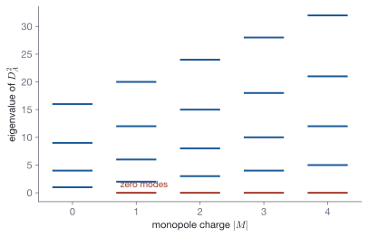

# Spinors and the Dirac operator {#sec-spinors-dirac-operator}

A rotation by $2\pi$ is the identity on vectors, but there are objects in geometry and physics that change sign under
it and return to themselves only after a rotation by $4\pi$. These objects are **spinors**: they carry representations
not of the rotation group $SO(n)$ or the Lorentz group $SO(1, d - 1)$ but of their double covers, the spin groups, and
they are built from the **Clifford algebra**, the algebra generated by vectors whose squares are their lengths. On a
curved manifold spinors are sections of a bundle that exists only when a topological condition holds, and the natural
first-order operator acting on them is the **Dirac operator**, a square root of the Laplacian corrected by the
curvature. Its spectrum is a fine geometric invariant, and the number of its zero modes is a topological one, counted
by the index theorem of Atiyah and Singer. This chapter develops all of this on explicit spaces and computes every
spectrum it states.

Clifford algebras constructs the algebras by generators and relations, finds their bases and involutions, and
classifies them with their period eight. Gamma matrices and chirality builds their matrix representations in every
dimension and signature, the Pauli, Dirac and Weyl matrices with their trace identities, the chirality matrix, and
proves Pauli's uniqueness theorem. Charge conjugation and reality treats the charge-conjugation and reality matrices
and the classification of reality conditions, again with period eight. Spin groups realises the pin and spin groups inside
the Clifford algebra, proves that they cover the orthogonal groups twice, identifies $\operatorname{Spin}(3)$ with $SU(2)$ and
$\operatorname{Spin}^+(1, 3)$ with $SL(2, \mathbb C)$, finds their Lie algebra and proves that $\operatorname{Spin}(n)$ is
simply connected for $n \geq 3$. Dirac and Weyl spinors proves that the spinor representations are irreducible, describes
Dirac, Weyl, Majorana and Majorana-Weyl spinors, in ten and eleven dimensions in particular, and how a spinor of $d$
dimensions decomposes under $SO(1, 3) \times SO(n)$. Spin structures and the spin connection puts
spinors on manifolds: the obstruction to a spin structure, the spin structures of circles and tori, the spin
connection computed on the sphere, and the spin-c structures that rescue the complex projective plane. The Dirac
operator on flat spaces and spheres defines the operator, proves the Lichnerowicz formula and its vanishing theorem,
and derives the spectrum on tori for every spin structure and twist and on the spheres $S^2$, $S^3$ and $S^n$. Dirac
operators on compact spaces treats group manifolds, coset spaces with Frobenius reciprocity and Parthasarathy's
formula, Kähler and Calabi-Yau manifolds, and orbifolds. Twisted Dirac operators and index theorems couples the
operator to gauge fields, computes the index on the sphere with a monopole by hand, and states the index theorem with
the $\hat A$ genus. The chirality problem shows why zero modes of one chirality do not appear without gauge fields and
how gauge backgrounds produce them.

The main sources are the textbook of @zhelnorovich2019spinors [Chs. 1-4 and 6] for the algebra and the spinor
connection, the lecture notes of @vanproeyen1999 [Sec. 3] for spinors in arbitrary dimension, @trautman1995 [Secs. 4, 6 and 8] for spin structures
and the spectrum on spheres, @camporesi1995 [Secs. 3 and 5] for the spectrum on spheres from representation theory, @dolan2003 [Secs. 2-3] for
coset spaces with gauge fields, @bilal2008 [Secs. 3.7, 10 and 11] for the index theorem, and @aspinwall1996 [Sec. 2] for $K3$ surfaces. Every statement
is followed by at least three examples of increasing complexity and at least three exercises of increasing difficulty
with hidden solutions; the Pauli matrices, the round sphere $S^2$, the group $SU(2) = S^3$ and the monopole on $S^2$
are the running examples.

## Clifford algebras {#sec-clifford-algebras}

The Clifford algebra of a vector space with a metric is the algebra in which a vector squares to its length. Its
matrix representations are the gamma matrices, and everything about spinors (their dimension, their chirality, their
reality) is a statement about this algebra and these matrices. This section defines the algebra by generators and
relations through its universal property, constructs it and finds its basis of $2^d$ products, introduces the grading
and the three main involutions, and classifies the real Clifford algebras as matrix algebras over $\mathbb R$,
$\mathbb C$ and $\mathbb H$, with the period eight in the signature. It follows @rudolph2017differential [Sec. 5.1]
for the algebra and its classification and @zhelnorovich2019spinors [Ch. 1] for the products of generators.
Signatures are written $(p, q)$, with $p$ basis vectors of square $+1$ and $q$ of square $-1$ (@def-signature), so
that Minkowski space with $\eta = \operatorname{diag}(1, -1, -1, -1)$ has signature $(1, 3)$.

For more on this topic, see @derezinski2022mathematics [Ch. 15].

### The Clifford algebra

The quaternions, the Pauli matrices and the Dirac matrices are all algebras generated by elements that anticommute and
square to $\pm1$. The definition below captures this pattern for any metric by a universal property, which says that
the Clifford algebra is the largest algebra generated by $V$ with these relations and no others. The figure shows the
multiplication table of its sixteen basis elements in the case of spacetime: every product $\gamma_A\gamma_B$ is
$\pm\gamma_C$ for a single basis element $\gamma_C$.

{#fig-sd-clifford-table width=62%}

:::: {.statement-box}
::: {#def-clifford-algebra}
#### Clifford algebra

Let $V$ be a real vector space of dimension $d$ with a non-degenerate symmetric bilinear form $\eta$ of signature $(p,
q)$ (@def-signature). A **Clifford algebra** of $(V, \eta)$ is an associative real algebra $\mathcal C$ with unit $1$
together with a linear map $j : V \to \mathcal C$ such that:

1. $j(v)^2 = \eta(v, v)\,1$ for every $v \in V$; equivalently,
   $$
   j(v)j(w) + j(w)j(v) = 2\eta(v, w)\,1 \qquad (v, w \in V);
   $$ {#eq-spd-clifford-relation}
2. (**universal property**) for every associative real algebra $\mathcal B$ with unit and every linear map $f : V \to
   \mathcal B$ with $f(v)^2 = \eta(v, v)\,1$ for all $v$, there is exactly one algebra homomorphism $F : \mathcal C \to
   \mathcal B$ with $F(1) = 1$ and $F \circ j = f$.

Then:

3. A Clifford algebra exists; it is generated by $j(V)$, $j$ is injective, and two Clifford algebras of $(V, \eta)$ are
   isomorphic by exactly one isomorphism compatible with the maps $j$. It is written $\operatorname{Cl}(V, \eta)$, or
   $\operatorname{Cl}(p, q)$, and $V$ is identified with $j(V)$. In an orthonormal basis $e_1, \dots, e_d$, with
   $\eta(e_a, e_a) = \eta_{aa} = +1$ for $a \leq p$ and $-1$ for $a > p$, the relations read $e_ae_b + e_be_a =
   2\eta_{ab}$.
4. The same holds with $\mathbb C$ in place of $\mathbb R$: the **complex Clifford algebra**
   $\operatorname{Cl}_{\mathbb C}(p, q)$ is the complex algebra with the universal property for complex-linear maps of
   $V_{\mathbb C} = \mathbb C^d$ with the bilinear extension of $\eta$. It depends only on $d$: $e_a \mapsto e_a$ ($a
   \leq p$), $e_a \mapsto ie_a$ ($a > p$) gives $\operatorname{Cl}_{\mathbb C}(p, q) \cong \operatorname{Cl}_{\mathbb
   C}(d, 0) =: \operatorname{Cl}_{\mathbb C}(d)$.
:::
::::

*Proof.* (1) If $j(v)^2 = \eta(v, v)$ for all $v$, expanding $j(v + w)^2 = \eta(v + w, v + w)$ gives
@eq-spd-clifford-relation; conversely $w = v$ in @eq-spd-clifford-relation gives $2j(v)^2 = 2\eta(v, v)$.

(3) *A model.* Let $W$ be the real vector space with basis $f_B$, one for each subset $B \subseteq \{1, \dots, d\}$,
so $\dim W = 2^d$. For $a \in \{1, \dots, d\}$ let $n_a(B)$ be the number of elements of $B$ smaller than $a$, and define
$E_a \in \operatorname{End}(W)$ by
$$
E_af_B = (-1)^{n_a(B)}f_{B \cup \{a\}} \ (a \notin B), \qquad E_af_B = (-1)^{n_a(B)}\eta_{aa}f_{B \setminus \{a\}} \ (a
\in B).
$$
Adding or removing $a$ does not change $n_a$, so $E_a^2f_B = \eta_{aa}f_B$. For $a < b$, both $E_aE_bf_B$ and
$E_bE_af_B$ are multiples of $f_{B \triangle \{a, b\}}$ with the same factors $\eta$; the sign of the first is
$(-1)^{n_b(B) + n_a(B)}$, while in the second $n_b$ is evaluated on $B \triangle \{a\}$, where it differs from $n_b(B)$
by one. So $E_aE_b = -E_bE_a$ and the $E_a$ satisfy $E_aE_b + E_bE_a = 2\eta_{ab}$. For $A = \{a_1 < \dots < a_k\}$ let
$E_A = E_{a_1}\cdots E_{a_k}$ ($E_\emptyset = \operatorname{id}$). Applying the factors from the right, each $E_{a_i}$
adds $a_i$ to a set of larger elements, so $E_Af_\emptyset = f_A$: the $2^d$ maps $E_A$ are linearly independent.
Reordering a product $E_{b_1}\cdots E_{b_m}$ with the relations (each exchange of neighbours costs a sign, each repeated
pair $E_aE_a$ is $\eta_{aa}$) gives $E_AE_B = c(A, B)E_{A \triangle B}$ with a sign $c(A, B) = \pm1$ computed from the
relations alone. So $\mathcal C_0 = \operatorname{span}\{E_A\}$ is an associative algebra with unit of dimension
$2^d$, and $j_0(v) = \sum_av^aE_a$ satisfies $j_0(v)^2 = \sum_{a, b}v^av^bE_aE_b = \sum_a\eta_{aa}(v^a)^2 = \eta(v, v)$.

*The universal property of the model.* Let $f : V \to \mathcal B$ be as in (2) and $f_a = f(e_a)$. By (1) the $f_a$
satisfy the same relations as the $E_a$, so the products $f_A = f_{a_1}\cdots f_{a_k}$ satisfy $f_Af_B = c(A, B)f_{A
\triangle B}$ with the same signs, because $c(A, B)$ was obtained from the relations only. The linear map $F(E_A) =
f_A$ is therefore multiplicative, $F(\operatorname{id}) = 1$ and $F \circ j_0 = f$. Any homomorphism with $F \circ j_0 =
f$ takes $E_A$ to $f_A$, so $F$ is unique. The $E_a$ generate $\mathcal C_0$ and are independent, so $j_0$ is
injective.

*Uniqueness.* If $(\mathcal C, j)$ and $(\mathcal C', j')$ both have the universal property, there are homomorphisms
$F : \mathcal C \to \mathcal C'$ with $F \circ j = j'$ and $F' : \mathcal C' \to \mathcal C$ with $F' \circ j' = j$.
Then $F' \circ F$ and the identity are two homomorphisms $\mathcal C \to \mathcal C$ with $(\cdot) \circ j = j$, so they
agree by the uniqueness in (2); likewise $F \circ F' = \operatorname{id}$. Every Clifford algebra is generated by $j(V)$:
if $\mathcal S$ is the subalgebra generated by $j(V)$, (2) with $\mathcal B = \mathcal S$ and $f = j$ gives $F :
\mathcal C \to \mathcal S$ with $F \circ j = j$; followed by the inclusion $\mathcal S \subseteq \mathcal C$ it is a
homomorphism $\mathcal C \to \mathcal C$ extending $j$, hence the identity, so $\mathcal S = \mathcal C$. Since the
model has an injective $j_0$, so has every Clifford algebra.

(4) The model and the three arguments above use only the field operations, so they hold verbatim over $\mathbb C$. The
elements $e'_a = e_a$ ($a \leq p$) and $e'_a = ie_a$ ($a > p$) of $\operatorname{Cl}_{\mathbb C}(p, q)$ anticommute
and square to $+1$, so the complex universal property of $\operatorname{Cl}_{\mathbb C}(d, 0)$ gives a homomorphism
$\operatorname{Cl}_{\mathbb C}(d, 0) \to \operatorname{Cl}_{\mathbb C}(p, q)$; it maps the basis $E_A$ to the
products $e'_A$, which are non-zero multiples of the basis elements of $\operatorname{Cl}_{\mathbb C}(p, q)$, so it is
bijective. $\square$

:::: {.callout-note .examples-fold collapse="true" title="Examples"}
The smallest case has no generators at all. It shows that the definition makes sense in dimension zero and fixes the
unit of every Clifford algebra.

::: {#exm-clf-cl-zero}
#### No generators

For $V = 0$ the condition (1) is empty and a homomorphism $F$ with $F(1) = 1$ is determined by the unit alone, so
$\operatorname{Cl}(0, 0) = \mathbb R$, with $j = 0$. In the model of the proof, $W$ has the single basis vector
$f_\emptyset$ and the algebra is spanned by $E_\emptyset = \operatorname{id}$, of dimension $2^0 = 1$.
:::

The first non-trivial case takes a single generator. Depending on the sign of its square the algebra is the complex
numbers or a pair of real lines.

::: {#exm-spd-cl-one-generator}
#### One generator

$\operatorname{Cl}(0, 1)$ is spanned by $1$ and $e$ with $e^2 = -1$: it is $\mathbb{C}$, with $e = i$.
$\operatorname{Cl}(1, 0)$ is spanned by $1$ and $e$ with $e^2 = +1$; the elements $\pi_\pm = \tfrac12(1 \pm e)$ satisfy
$\pi_\pm^2 = \tfrac14(1 \pm 2e + e^2) = \pi_\pm$, $\pi_+\pi_- = \tfrac14(1 - e^2) = 0$ and $\pi_+ + \pi_- = 1$, so
$x\pi_+ + y\pi_- \mapsto (x, y)$ is an isomorphism $\operatorname{Cl}(1, 0) \cong \mathbb{R} \oplus \mathbb{R}$, with
$e = \pi_+ - \pi_-$. The two algebras differ although both are two-dimensional: the sign of the metric matters for the
real algebra.
:::

With two anticommuting generators the product $e_1e_2$ is a third element that anticommutes with both. The next example
finds Hamilton's quaternions in this way, and the real $2 \times 2$ matrices when the signs are reversed.

::: {#exm-spd-quaternions}
#### The quaternions

In $\operatorname{Cl}(0, 2)$, $e_1^2 = e_2^2 = -1$ and $e_1e_2 = -e_2e_1$, so $(e_1e_2)^2 = -e_1e_2e_2e_1 = -1$.
Setting $\mathbf{i} = e_1$, $\mathbf{j} = e_2$, $\mathbf{k} = e_1e_2$ gives $\mathbf{i}^2 = \mathbf{j}^2 =
\mathbf{k}^2 = \mathbf{ijk} = -1$: $\operatorname{Cl}(0, 2) \cong \mathbb{H}$, with basis $1, e_1, e_2, e_1e_2$
(@exm-lie-group-quaternions). In $\operatorname{Cl}(2, 0)$ instead $e_1^2 = e_2^2 = +1$ and still $(e_1e_2)^2 = -1$.
The real matrices $\sigma_1$ and $\sigma_3$ anticommute and square to $\mathbf I$, so (2) gives a homomorphism
$\operatorname{Cl}(2, 0) \to M_2(\mathbb{R})$, the algebra of real $2 \times 2$ matrices; the images $\mathbf I$,
$\sigma_1$, $\sigma_3$, $\sigma_1\sigma_3 = \begin{pmatrix} 0 & -1 \\ 1 & 0 \end{pmatrix}$ are independent, so it is an
isomorphism, $\operatorname{Cl}(2, 0) \cong M_2(\mathbb{R})$.
:::

The model in the proof is concrete enough to write out. The fourth example builds it for two generators of opposite
signs and checks the relations by machine.

::: {#exm-clf-model-two}
#### The model for $(1, 1)$

For $d = 2$ the basis of $W$ is $f_\emptyset, f_1, f_2, f_{12}$, and the formulas of the proof give $E_1f_\emptyset = f_1$,
$E_1f_2 = f_{12}$, $E_1f_1 = \eta_{11}f_\emptyset$, $E_1f_{12} = \eta_{11}f_2$, and $E_2f_\emptyset = f_2$, $E_2f_1 =
-f_{12}$, $E_2f_2 = \eta_{22}f_\emptyset$, $E_2f_{12} = -\eta_{22}f_1$. With $\eta = \operatorname{diag}(1, -1)$:

```{.python .sage}
def model(etas):
    d = len(etas); subsets = [frozenset(S) for k in range(d + 1) for S in Subsets(range(d), k)]
    idx = {S: n for n, S in enumerate(subsets)}
    E = []
    for a in range(d):
        M = matrix(QQ, len(subsets))
        for B in subsets:
            sign = (-1)^len([b for b in B if b < a])
            if a in B: M[idx[B - {a}], idx[B]] = sign * etas[a]
            else: M[idx[B | {a}], idx[B]] = sign
        E.append(M)
    return E, subsets
E, subsets = model([1, -1])
print(E[0]); print(); print(E[1])
print("E1^2 =", E[0]^2 == 1, "; E2^2 = -1:", E[1]^2 == -1, "; anticommute:", E[0]*E[1] + E[1]*E[0] == 0)
print("E1 E2 f_empty = f_12:", (E[0]*E[1]).column(0) == vector(QQ, [0, 0, 0, 1]))
```

```{.text .sage-output}
[0 1 0 0]
[1 0 0 0]
[0 0 0 1]
[0 0 1 0]

[ 0  0 -1  0]
[ 0  0  0  1]
[ 1  0  0  0]
[ 0 -1  0  0]
E1^2 = True ; E2^2 = -1: True ; anticommute: True
E1 E2 f_empty = f_12: True
```
:::

In three Euclidean dimensions the Pauli matrices (@eq-pauli) satisfy the relations @eq-spd-clifford-relation. The fifth
example identifies the whole algebra and its central volume element.

::: {#exm-spd-pauli-algebra}
#### The Pauli algebra

$e_a \mapsto \sigma_a$ gives a homomorphism $\operatorname{Cl}(3, 0) \to M_2(\mathbb{C})$, the complex $2 \times 2$
matrices viewed as a real algebra of dimension $8$. The images of $1, e_a, e_ae_b\,(a < b), e_1e_2e_3$ are $\mathbf I,
\sigma_a, i\epsilon_{abc}\sigma_c, i\mathbf I$, since $\sigma_1\sigma_2 = i\sigma_3$ and its cyclic permutations; they
span $M_2(\mathbb C)$ over $\mathbb R$, so the homomorphism is onto, and as $\operatorname{Cl}(3, 0)$ is spanned by
the eight products it is an isomorphism, $\operatorname{Cl}(3, 0) \cong M_2(\mathbb{C})$. The **volume element**
$e_1e_2e_3$ squares to $-1$ and commutes with everything, playing the role of $i$.
:::

Rotations of the plane live inside $\operatorname{Cl}(2, 0)$ as exponentials of the bivector $e_1e_2$. The sixth
example shows that conjugation by them turns vectors by twice the angle, so that a full turn of the plane comes from an
element equal to $-1$.

::: {#exm-clf-rotation-plane}
#### Rotations of the circle

In $\operatorname{Cl}(2, 0)$ let $R_\theta = \cos\theta + \sin\theta\,e_1e_2$; as $(e_1e_2)^2 = -1$, $R_\theta R_\phi =
R_{\theta + \phi}$ like $e^{i\theta}$, and $R_\theta^{-1} = R_{-\theta}$. Since $e_1e_2$ anticommutes with $e_1$ and
$e_2$, $R_\theta v = vR_{-\theta}$ for $v = xe_1 + ye_2$, so $R_\theta vR_\theta^{-1} = R_{2\theta}v$, and
$$
R_{2\theta}v = (x\cos2\theta + y\sin2\theta)e_1 + (-x\sin2\theta + y\cos2\theta)e_2 .
$$
Conjugation by $R_\theta$ rotates the circle $S^1$ of unit vectors by $-2\theta$. The rotation by $2\pi$ comes from
$R_{-\pi} = -1$ as well as from $R_0 = 1$: each rotation has two preimages $\pm R_\theta$.
:::

Spacetime is the case physics uses most. The seventh example represents $\operatorname{Cl}(1, 3)$ by the Weyl matrices,
whose multiplication table is @fig-sd-clifford-table, and $\operatorname{Cl}(3, 1)$ by real matrices.

::: {#exm-spd-minkowski-cl}
#### The spacetime algebra

The **Weyl matrices** $\gamma^0 = \begin{pmatrix} \mathbf 0 & \mathbf I \\ \mathbf I & \mathbf 0 \end{pmatrix}$, $\gamma^k
= \begin{pmatrix} \mathbf 0 & \sigma_k \\ -\sigma_k & \mathbf 0 \end{pmatrix}$ ($k = 1, 2, 3$) satisfy
$\gamma^\mu\gamma^\nu + \gamma^\nu\gamma^\mu = 2\eta^{\mu\nu}\mathbf I$ with $\eta = \operatorname{diag}(1, -1, -1,
-1)$, because $\sigma_j\sigma_k + \sigma_k\sigma_j = 2\delta_{jk}\mathbf I$ (@eq-pauli); so $e_\mu \mapsto \gamma^\mu$
defines a homomorphism $\operatorname{Cl}(1, 3) \to M_4(\mathbb C)$. For the opposite sign convention $\operatorname{diag}(-1,
1, 1, 1)$, that is $\operatorname{Cl}(3, 1)$, there are even real matrices: with $\boldsymbol\epsilon = \begin{pmatrix} 0
& 1 \\ -1 & 0 \end{pmatrix}$, the matrices $\sigma_1 \otimes \mathbf I$, $\sigma_3 \otimes \sigma_1$, $\sigma_3 \otimes
\sigma_3$ square to $\mathbf I$, $\boldsymbol\epsilon \otimes \mathbf I$ squares to $-\mathbf I$, and any two anticommute
(in each pair one tensor factor anticommutes and the other commutes). So $\operatorname{Cl}(3, 1) \to M_4(\mathbb R)$.
:::

Complexifying can merge algebras that differ over the reals. The eighth example complexifies the two one-generator
algebras and finds the same answer.

::: {#exm-clf-complexification}
#### Complexifying one generator

$\operatorname{Cl}_{\mathbb C}(1, 0)$ has the complex basis $1, e$ with $e^2 = 1$, and the idempotents $\pi_\pm$ of
@exm-spd-cl-one-generator split it as $\mathbb C \oplus \mathbb C$. In $\operatorname{Cl}_{\mathbb C}(0, 1)$ the element
$ie$ squares to $+1$, so $\tfrac12(1 \pm ie)$ split it as $\mathbb C \oplus \mathbb C$ too, as part (4) says. Over $\mathbb
R$ the algebra $\operatorname{Cl}(0, 1) = \mathbb C$ is a field; its complexification is not, since $(1 + ie)(1 - ie) = 0$.
:::

The definition asks for a non-degenerate form, but the construction of the model does not use it. The ninth example
takes the zero form and finds the exterior algebra of the differential forms.

::: {#exm-clf-exterior}
#### The zero form

With $\eta = 0$ the formulas of the proof still define maps $E_a$ with $E_a^2 = 0$ and $E_aE_b = -E_bE_a$, and $E_Af_\emptyset
= f_A$. The span of the $E_A$ is then the algebra of the wedge product: $E_a \leftrightarrow dx^a$ turns $E_AE_B$ into
$dx^A \wedge dx^B$, which is $0$ when $A \cap B \neq \emptyset$ (@def-wedge-product (1), (3)). Vectors are no longer
invertible, since $E_a^2 = 0$; this is why the Clifford algebra of a degenerate form is not used for spinors.
:::

The universal property promises a homomorphism, not an injective one. The last example shows a homomorphism out of a
Clifford algebra that loses information, because the target satisfies more relations.

::: {#exm-clf-not-injective}
#### A homomorphism that is not injective

$f : \mathbb R \to \mathbb R$, $f(x) = x$, satisfies $f(x)^2 = x^2 = \eta(x, x)$ for $\operatorname{Cl}(1, 0)$, so it extends to
$F : \operatorname{Cl}(1, 0) \to \mathbb R$, $F(a + be) = a + b$. Its kernel is spanned by $\pi_- = \tfrac12(1 - e)$:
the algebra $\mathbb R$ satisfies the extra relation $e = 1$. In the same way $e_a \mapsto \sigma_a$ and $e_a \mapsto
-\sigma_a$ give two homomorphisms $\operatorname{Cl}(3, 0) \to M_2(\mathbb C)$ that differ on $e_1e_2e_3$, mapped to $\pm
i\mathbf I$.
:::
::::

:::: {.callout-note .exercises-fold collapse="true" title="Exercises"}
Vectors of non-zero length are invertible in the Clifford algebra, and orthogonal vectors anticommute. The first
exercise checks both from the relation and finds a vector whose square is zero.

::: {#exr-clf-vectors}
#### Orthogonal and null vectors

Show that $vw = -wv$ exactly when $\eta(v, w) = 0$, and that $v$ is invertible with $v^{-1} = v/\eta(v, v)$ when
$\eta(v, v) \neq 0$. In $\operatorname{Cl}(1, 1)$ show that $n = e_1 + e_2$ satisfies $n^2 = 0$, so it is not
invertible.
:::

::: {.callout-note .solution collapse="true" title="Solution"}
:::: {.panel-tabset .solution-tabs}
## Proof

By @eq-spd-clifford-relation, $vw + wv = 2\eta(v, w)$, which vanishes exactly when $\eta(v, w) = 0$. If $\eta(v, v) \neq
0$, then $v \cdot v/\eta(v, v) = \eta(v, v)/\eta(v, v) = 1$, and likewise on the other side. In $\operatorname{Cl}(1,
1)$, $n^2 = \eta(n, n) = 1 - 1 = 0$; if $n$ had an inverse, $n = n^2n^{-1} = 0$, but $n \neq 0$ because $j$ is
injective.

## SageMath

The code computes these products in Sage's Clifford algebra of the form $x_1^2 - x_2^2$.

```{.python .sage}
Cl = CliffordAlgebra(DiagonalQuadraticForm(QQ, [1, -1]), names=['e1', 'e2'])
e1, e2 = Cl.gens()
v, w = 2*e1 + e2, e1 + 2*e2          # eta(v, w) = 2 - 2 = 0
print("v w + w v =", v*w + w*v)
u = 2*e1 + e2                         # eta(u, u) = 4 - 1 = 3
print("u * u/3 =", u * (u/3))
n = e1 + e2
print("n^2 =", n*n)
```

```{.text .sage-output}
v w + w v = 0
u * u/3 = 1
n^2 = 0
```
::::
:::

The square of the volume element decides whether it behaves like $+1$ or like $i$. The second exercise computes it in
every signature; the answer reappears in the normalisation of the chirality matrix.

::: {#exr-spd-volume-square}
#### The square of the volume element

Let $\omega = e_1e_2\cdots e_d$. Show that $\omega^2 = (-1)^{d(d - 1)/2 + q}$, that $\omega e_a = (-1)^{d - 1}e_a\omega$,
and hence that $\omega$ commutes with all of $V$ exactly when $d$ is odd. Evaluate $\omega^2$ for $\operatorname{Cl}(3,
0)$, $\operatorname{Cl}(1, 3)$ and $\operatorname{Cl}(0, 2)$ and compare with @exm-spd-pauli-algebra and
@exm-spd-quaternions.
:::

::: {.callout-note .solution collapse="true" title="Solution"}
:::: {.panel-tabset .solution-tabs}
## Proof

Reversing the order of $d$ anticommuting factors takes $d(d - 1)/2$ exchanges of neighbours, so $\omega^2 = (-1)^{d(d
- 1)/2}e_1\cdots e_de_d\cdots e_1 = (-1)^{d(d - 1)/2}\eta_{11}\cdots\eta_{dd} = (-1)^{d(d - 1)/2 + q}$, the inner pairs
collapsing one at a time. Moving $e_a$ through $\omega$ passes $d - 1$ factors that anticommute with it and one that
commutes, so $\omega e_a = (-1)^{d - 1}e_a\omega$. For $\operatorname{Cl}(3, 0)$: $(-1)^{3 + 0} = -1$, as
$\sigma_1\sigma_2\sigma_3 = i\mathbf I$; for $\operatorname{Cl}(1, 3)$: $(-1)^{6 + 3} = -1$, so $i\omega$ squares to
$+1$; for $\operatorname{Cl}(0, 2)$: $(-1)^{1 + 2} = -1$, and indeed $\mathbf{k}^2 = -1$.

## SageMath

The code compares $\omega^2$ with the formula for every signature with $d \leq 6$.

```{.python .sage}
ok = True
for d in range(1, 7):
    for p in range(d + 1):
        q = d - p
        Cl = CliffordAlgebra(DiagonalQuadraticForm(QQ, [1]*p + [-1]*q))
        w = prod(Cl.gens())
        ok &= (w*w == (-1)^(d*(d - 1)//2 + q))
        ok &= all(w*e == (-1)^(d - 1) * e*w for e in Cl.gens())
print("omega^2 = (-1)^(d(d-1)/2 + q) and omega e_a = (-1)^(d-1) e_a omega for d <= 6:", ok)
for p, q in [(3, 0), (1, 3), (0, 2)]:
    Cl = CliffordAlgebra(DiagonalQuadraticForm(QQ, [1]*p + [-1]*q)); w = prod(Cl.gens())
    print((p, q), "omega^2 =", w*w)
```

```{.text .sage-output}
omega^2 = (-1)^(d(d-1)/2 + q) and omega e_a = (-1)^(d-1) e_a omega for d <= 6: True
(3, 0) omega^2 = -1
(1, 3) omega^2 = -1
(0, 2) omega^2 = -1
```
::::
:::

A multiplication table is a finite object that a computer can check completely. The third exercise builds the table of
$\operatorname{Cl}(3, 0)$ from the Pauli matrices and reads off the elements that commute with everything.

::: {#exr-spd-cl3-table}
#### The table of $\operatorname{Cl}(3, 0)$

Form the eight products $\sigma_A$ ($A \subseteq \{1, 2, 3\}$, in increasing order) of the Pauli matrices, check that
each product $\sigma_A\sigma_B$ equals $\pm\sigma_C$ for one $C$, and find the elements $\sigma_A$ that commute with all
the others.
:::

::: {.callout-note .solution collapse="true" title="Solution"}
:::: {.panel-tabset .solution-tabs}
## Proof

By @eq-pauli the $\sigma_a$ anticommute and square to $\mathbf I$, so a product $\sigma_A\sigma_B$ can be reordered
into increasing order, each exchange giving a sign and each repeated index a factor $\mathbf I$; what remains is
$\pm\sigma_{A \triangle B}$. By @exr-spd-volume-square with $d = 3$ odd, $\sigma_1\sigma_2\sigma_3$ commutes with every
$\sigma_a$, hence with everything. Any other $\sigma_A$, $A \neq \emptyset$, anticommutes with some $\sigma_b$: for
$|A| = 1$ any $b \notin A$, for $|A| = 2$ any $b \in A$. So the commuting basis elements are $\mathbf I$ and
$\sigma_1\sigma_2\sigma_3 = i\mathbf I$.

## SageMath

The code prints the table of signs and products and the basis elements that commute with all the others.

```{.python .sage}
import itertools
K.<i> = QuadraticField(-1)
s = [matrix(K, [[0, 1], [1, 0]]), matrix(K, [[0, -i], [i, 0]]), matrix(K, [[1, 0], [0, -1]])]
subsets = [A for k in range(4) for A in itertools.combinations(range(3), k)]
basis = {A: prod([s[a] for a in A], identity_matrix(K, 2)) for A in subsets}
name = lambda A: "1" if not A else "s" + "".join(str(a + 1) for a in A)
def decompose(M):
    for A, B in basis.items():
        for c in (1, -1):
            if M == c * B: return c, A
    return None
print("each product sigma_A sigma_B is +/- sigma_C:", all(decompose(basis[A] * basis[B]) is not None for A in subsets for B in subsets))
print("      " + " ".join(name(B).rjust(6) for B in subsets))
for A in subsets:
    row = [decompose(basis[A] * basis[B]) for B in subsets]
    print(name(A).ljust(5), " ".join((("+" if c == 1 else "-") + name(C)).rjust(6) for c, C in row))
central = [name(A) for A in subsets if all(basis[A] * basis[B] == basis[B] * basis[A] for B in subsets)]
print("central basis elements:", central, "; s1 s2 s3 =", basis[(0, 1, 2)].list())
```

```{.text .sage-output}
each product sigma_A sigma_B is +/- sigma_C: True
           1     s1     s2     s3    s12    s13    s23   s123
1         +1    +s1    +s2    +s3   +s12   +s13   +s23  +s123
s1       +s1     +1   +s12   +s13    +s2    +s3  +s123   +s23
s2       +s2   -s12     +1   +s23    -s1  -s123    +s3   -s13
s3       +s3   -s13   -s23     +1  +s123    -s1    -s2   +s12
s12     +s12    -s2    +s1  +s123     -1   -s23   +s13    -s3
s13     +s13    -s3  -s123    +s1   +s23     -1   -s12    +s2
s23     +s23  +s123    -s3    +s2   -s13   +s12     -1    -s1
s123   +s123   +s23   -s13   +s12    -s3    +s2    -s1     -1
central basis elements: ['1', 's123'] ; s1 s2 s3 = [i, 0, 0, i]
```
::::
:::

The model of the proof works in every signature. The fourth exercise implements it for three generators of mixed
signs and checks all the relations and the independence of the products.

::: {#exr-clf-model-relations}
#### The model in signature $(1, 2)$

Build the $8 \times 8$ matrices $E_1, E_2, E_3$ of the proof of (3) for $\eta = \operatorname{diag}(1, -1, -1)$. Check the
relations, check $E_Af_\emptyset = f_A$ for all eight subsets, and conclude that the eight $E_A$ are linearly independent.
:::

::: {.callout-note .solution collapse="true" title="Solution"}
:::: {.panel-tabset .solution-tabs}
## Proof

The proof of (3) shows $E_a^2 = \eta_{aa}$, $E_aE_b = -E_bE_a$ for $a \neq b$, and $E_Af_\emptyset = f_A$ for every $A$,
in every signature. If $\sum_Ac_AE_A = 0$, applying it to $f_\emptyset$ gives $\sum_Ac_Af_A = 0$, so all $c_A = 0$
because the $f_A$ are a basis of $W$. For $\eta = \operatorname{diag}(1, -1, -1)$ this gives eight independent maps
satisfying the relations of $\operatorname{Cl}(1, 2)$.

## SageMath

Check on $\eta = \operatorname{diag}(1, -1, -1)$: the code builds the model and tests the relations, the values on
$f_\emptyset$ and the rank of the eight products.

```{.python .sage}
def model(etas):
    d = len(etas); subsets = [frozenset(S) for k in range(d + 1) for S in Subsets(range(d), k)]
    idx = {S: n for n, S in enumerate(subsets)}
    E = []
    for a in range(d):
        M = matrix(QQ, len(subsets))
        for B in subsets:
            sign = (-1)^len([b for b in B if b < a])
            if a in B: M[idx[B - {a}], idx[B]] = sign * etas[a]
            else: M[idx[B | {a}], idx[B]] = sign
        E.append(M)
    return E, subsets, idx
etas = [1, -1, -1]
E, subsets, idx = model(etas)
print("relations:", all(E[a]*E[b] + E[b]*E[a] == (2*etas[a] if a == b else 0) for a in range(3) for b in range(3)))
EA = {A: prod([E[a] for a in sorted(A)], identity_matrix(QQ, 8)) for A in subsets}
print("E_A f_empty = f_A:", all(EA[A].column(0) == vector(QQ, [1 if B == A else 0 for B in subsets]) for A in subsets))
print("rank of the 8 products:", matrix(QQ, [EA[A].list() for A in subsets]).rank())
```

```{.text .sage-output}
relations: True
E_A f_empty = f_A: True
rank of the 8 products: 8
```
::::
:::

Part (4) says that the complex Clifford algebra forgets the signature. The fifth exercise carries out the change of
generators for spacetime.

::: {#exr-clf-complex-iso}
#### Spacetime over $\mathbb C$

In $\operatorname{Cl}_{\mathbb C}(1, 3)$ put $e'_0 = e_0$ and $e'_k = ie_k$. Show that the $e'_\mu$ anticommute and
square to $+1$, and that the products $e'_A$ are a basis, so that $\operatorname{Cl}_{\mathbb C}(1, 3) \cong
\operatorname{Cl}_{\mathbb C}(4)$.
:::

::: {.callout-note .solution collapse="true" title="Solution"}
:::: {.panel-tabset .solution-tabs}
## Proof

$(ie_k)^2 = i^2e_k^2 = (-1)(-1) = 1$, and scalar factors do not change anticommutation. So the $e'_\mu$ satisfy the
relations of $\operatorname{Cl}_{\mathbb C}(4)$, and the complex universal property gives a homomorphism
$\operatorname{Cl}_{\mathbb C}(4) \to \operatorname{Cl}_{\mathbb C}(1, 3)$ with $e_A \mapsto e'_A = i^{|A \cap \{1, 2,
3\}|}e_A$. These are non-zero multiples of the sixteen basis elements, so the map is bijective.

## SageMath

Check on spacetime: the code works in Sage's Clifford algebra over $\mathbb Q(i)$.

```{.python .sage}
K.<i> = QuadraticField(-1)
Cl = CliffordAlgebra(DiagonalQuadraticForm(K, [1, -1, -1, -1]))
e = Cl.gens()
ep = [e[0]] + [i*x for x in e[1:]]
print("e'_mu e'_nu + e'_nu e'_mu = 2 delta:", all(ep[a]*ep[b] + ep[b]*ep[a] == (2 if a == b else 0) for a in range(4) for b in range(4)))
prods = [prod([ep[a] for a in S], Cl.one()) for k in range(5) for S in Subsets(range(4), k)]
M = matrix(K, [[x[m] for m in Cl.basis().keys()] for x in prods])
print("rank of the 16 products e'_A:", M.rank())
```

```{.text .sage-output}
e'_mu e'_nu + e'_nu e'_mu = 2 delta: True
rank of the 16 products e'_A: 16
```
::::
:::

Two Clifford algebras of the same dimension need not be isomorphic. The sixth exercise tells $\operatorname{Cl}(1, 0)$
from $\operatorname{Cl}(0, 1)$, and $\operatorname{Cl}(2, 0)$ from $\operatorname{Cl}(0, 2)$, by zero divisors.

::: {#exr-clf-signs-matter}
#### The sign of the metric matters

Show that $\operatorname{Cl}(1, 0) \not\cong \operatorname{Cl}(0, 1)$ and $\operatorname{Cl}(2, 0) \not\cong
\operatorname{Cl}(0, 2)$, by showing that one algebra of each pair has non-zero elements $x, y$ with $xy = 0$ and the
other has none.
:::

::: {.callout-note .solution collapse="true" title="Solution"}
:::: {.panel-tabset .solution-tabs}
## Proof

In $\operatorname{Cl}(1, 0)$, $\pi_+\pi_- = 0$ (@exm-spd-cl-one-generator); $\operatorname{Cl}(0, 1) = \mathbb C$ is a
field. In $\operatorname{Cl}(2, 0)$, $(1 + e_1)(1 - e_1) = 1 - e_1^2 = 0$. In
$\operatorname{Cl}(0, 2) = \mathbb H$, $x = x_0 + x_1e_1 + x_2e_2 + x_3e_1e_2$ and $\bar x = x_0 - x_1e_1 - x_2e_2 -
x_3e_1e_2$ satisfy $x\bar x = x_0^2 + x_1^2 + x_2^2 + x_3^2$ (the cross terms cancel because $e_1$, $e_2$, $e_1e_2$
anticommute in pairs and square to $-1$); so $x \neq 0$ has the inverse $\bar x/(x\bar x)$, and $xy = 0$ forces $y =
x^{-1}xy = 0$. An isomorphism would carry zero divisors to zero divisors.

## SageMath

Check on the two pairs: the code exhibits the zero divisors and computes $x\bar x$ for a general quaternion.

```{.python .sage}
C10 = CliffordAlgebra(DiagonalQuadraticForm(QQ, [1])); e, = C10.gens()
print("Cl(1,0): (1 + e)(1 - e) =", (1 + e)*(1 - e))
C20 = CliffordAlgebra(DiagonalQuadraticForm(QQ, [1, 1]), names=['e1', 'e2']); e1, e2 = C20.gens()
print("Cl(2,0): (1 + e1)(1 - e1) =", (1 + e1)*(1 - e1))
R.<x0, x1, x2, x3> = QQ[]
C02 = CliffordAlgebra(DiagonalQuadraticForm(R, [-1, -1]), names=['e1', 'e2']); f1, f2 = C02.gens()
x = x0 + x1*f1 + x2*f2 + x3*f1*f2; xbar = x0 - x1*f1 - x2*f2 - x3*f1*f2
print("Cl(0,2): x xbar =", x*xbar)
```

```{.text .sage-output}
Cl(1,0): (1 + e)(1 - e) = 0
Cl(2,0): (1 + e1)(1 - e1) = 0
Cl(0,2): x xbar = x0^2 + x1^2 + x2^2 + x3^2
```
::::
:::

The universal property is what makes the Clifford algebra natural: maps that preserve the metric extend to the
algebras. The seventh exercise proves this and applies it to a Lorentz boost.

::: {#exr-clf-functoriality}
#### Isometries act on the algebra

Let $L : V \to V'$ be linear with $\eta'(Lv, Lw) = \eta(v, w)$. Show that there is exactly one homomorphism
$\operatorname{Cl}(L) : \operatorname{Cl}(V, \eta) \to \operatorname{Cl}(V', \eta')$ extending $L$, that
$\operatorname{Cl}(L' \circ L) = \operatorname{Cl}(L') \circ \operatorname{Cl}(L)$, and that every $\Lambda \in O(1, 3)$
gives an automorphism of $\operatorname{Cl}(1, 3)$ with $e_\mu \mapsto \Lambda^\nu{}_\mu e_\nu$.
:::

::: {.callout-note .solution collapse="true" title="Solution"}
:::: {.panel-tabset .solution-tabs}
## Proof

$f = j' \circ L$ satisfies $f(v)^2 = \eta'(Lv, Lv) = \eta(v, v)$, so (2) gives a unique $\operatorname{Cl}(L)$ with
$\operatorname{Cl}(L)(v) = Lv$. Both $\operatorname{Cl}(L' \circ L)$ and $\operatorname{Cl}(L') \circ
\operatorname{Cl}(L)$ are homomorphisms extending $L' \circ L$, so they agree by uniqueness, and $\operatorname{Cl}(\operatorname{id}) =
\operatorname{id}$. For $\Lambda \in O(1, 3)$, $\operatorname{Cl}(\Lambda)$ has the inverse $\operatorname{Cl}(\Lambda^{-1})$,
so it is an automorphism, and it sends $e_\mu = \Lambda(\mathbf e_\mu)$ to $\Lambda^\nu{}_\mu e_\nu$.

## SageMath

Check on the boost of rapidity $w = \log 2$ along $x$ ($\cosh w = 5/4$, $\sinh w = 3/4$): the code tests the relations
for the images $e'_\mu$.

```{.python .sage}
Cl = CliffordAlgebra(DiagonalQuadraticForm(QQ, [1, -1, -1, -1])); e = Cl.gens()
c, sh = QQ(5/4), QQ(3/4)
Lam = matrix(QQ, [[c, sh, 0, 0], [sh, c, 0, 0], [0, 0, 1, 0], [0, 0, 0, 1]])
eta = diagonal_matrix(QQ, [1, -1, -1, -1])
print("Lambda in O(1,3):", Lam.transpose()*eta*Lam == eta)
ep = [sum(Lam[n, m]*e[n] for n in range(4)) for m in range(4)]
print("e'_mu e'_nu + e'_nu e'_mu = 2 eta_{mu nu}:", all(ep[a]*ep[b] + ep[b]*ep[a] == 2*eta[a, b] for a in range(4) for b in range(4)))
print("e'_0 =", ep[0])
```

```{.text .sage-output}
Lambda in O(1,3): True
e'_mu e'_nu + e'_nu e'_mu = 2 eta_{mu nu}: True
e'_0 = 5/4*e0 + 3/4*e1
```
::::
:::

The degenerate case of @exm-clf-exterior gives the exterior algebra. The eighth exercise checks that the products of the
model then follow the wedge product of one-forms.

::: {#exr-clf-null-algebra}
#### The model of the zero form

For $d = 3$ and $\eta = 0$, build the maps $E_a$ of the proof and check $E_a^2 = 0$, $E_aE_b = -E_bE_a$, and
$E_AE_B = 0$ whenever $A \cap B \neq \emptyset$, as for $dx^A \wedge dx^B$ (@def-wedge-product).
:::

::: {.callout-note .solution collapse="true" title="Solution"}
:::: {.panel-tabset .solution-tabs}
## Proof

The computations of the proof of (3) never divide by $\eta_{aa}$, so with $\eta = 0$ they give $E_a^2 = \eta_{aa} = 0$
and $E_aE_b + E_bE_a = 0$. If $a \in A \cap B$, reordering $E_AE_B$ brings the two factors $E_a$ together up to sign, and
$E_a^2 = 0$. In the same way $dx^a \wedge dx^a = 0$ and $dx^a \wedge dx^b = -dx^b \wedge dx^a$ (@def-wedge-product (1)),
so $E_A \mapsto dx^A$ respects products.

## SageMath

Check on $d = 3$, $\eta = 0$: the code builds the model and tests the relations and the vanishing products.

```{.python .sage}
def model(etas):
    d = len(etas); subsets = [frozenset(S) for k in range(d + 1) for S in Subsets(range(d), k)]
    idx = {S: n for n, S in enumerate(subsets)}
    E = []
    for a in range(d):
        M = matrix(QQ, len(subsets))
        for B in subsets:
            sign = (-1)^len([b for b in B if b < a])
            if a in B: M[idx[B - {a}], idx[B]] = sign * etas[a]
            else: M[idx[B | {a}], idx[B]] = sign
        E.append(M)
    return E, subsets
E, subsets = model([0, 0, 0])
print("E_a^2 = 0 and E_a E_b = -E_b E_a:", all(E[a]*E[b] + E[b]*E[a] == 0 for a in range(3) for b in range(3)))
EA = {A: prod([E[a] for a in sorted(A)], identity_matrix(QQ, 8)) for A in subsets}
print("E_A E_B = 0 when A and B meet:", all(EA[A]*EA[B] == 0 for A in subsets for B in subsets if A & B))
print("E_1 E_2 E_3 f_empty = f_123:", (EA[frozenset({0, 1, 2})]).column(0)[7] == 1)
```

```{.text .sage-output}
E_a^2 = 0 and E_a E_b = -E_b E_a: True
E_A E_B = 0 when A and B meet: True
E_1 E_2 E_3 f_empty = f_123: True
```
::::
:::

Conjugation by a vector is a reflection, up to sign. The ninth exercise proves the formula of
@rudolph2017differential [Lemma 5.2.1] and applies it to the time direction of spacetime.

::: {#exr-clf-reflection}
#### Reflections

Let $\eta(v, v) \neq 0$. Show that $-vwv^{-1} = w - 2\frac{\eta(v, w)}{\eta(v, v)}v$ for $w \in V$, the reflection of
$w$ in the hyperplane orthogonal to $v$. What is it for $v = e_0$ in $\operatorname{Cl}(1, 3)$?
:::

::: {.callout-note .solution collapse="true" title="Solution"}
:::: {.panel-tabset .solution-tabs}
## Proof

By @eq-spd-clifford-relation, $vw = -wv + 2\eta(v, w)$, so $-vwv^{-1} = wvv^{-1} - 2\eta(v, w)v^{-1} = w - 2\eta(v,
w)v/\eta(v, v)$ (@exr-clf-vectors). It fixes the vectors orthogonal to $v$ and sends $v$ to $-v$. For $v = e_0$ it fixes
$e_1, e_2, e_3$ and sends $e_0 \mapsto -e_0$: time reversal.

## SageMath

Check on $v = e_0 + 2e_1$ in $\operatorname{Cl}(1, 3)$ ($\eta(v, v) = -3$) and a general vector $w$.

```{.python .sage}
R.<w0, w1, w2, w3> = QQ[]
Cl = CliffordAlgebra(DiagonalQuadraticForm(R, [1, -1, -1, -1])); e = Cl.gens()
eta = diagonal_matrix(R, [1, -1, -1, -1])
vv = vector(R, [1, 2, 0, 0]); ww = vector(R, [w0, w1, w2, w3])
v = sum(vv[m]*e[m] for m in range(4)); w = sum(ww[m]*e[m] for m in range(4))
nv = vv*eta*vv
lhs = -v*w*(v/nv)
rhs = w - 2*(vv*eta*ww)/nv * v
print("eta(v, v) =", nv, "; -v w v^-1 = w - 2 eta(v,w)/eta(v,v) v:", lhs == rhs)
print("v = e0 acting on e0, e1:", -e[0]*e[0]*e[0], ",", -e[0]*e[1]*e[0])
```

```{.text .sage-output}
eta(v, v) = -3 ; -v w v^-1 = w - 2 eta(v,w)/eta(v,v) v: True
v = e0 acting on e0, e1: -e0 , e1
```
::::
:::

The quaternions of @exm-spd-quaternions sit inside the complex $2 \times 2$ matrices. The last exercise combines the
universal property with the description of $SU(2)$ as the unit quaternions (@exm-lg-su2-quaternions).

::: {#exr-clf-quaternion-rep}
#### Quaternions as matrices

Show that $e_1 \mapsto -i\sigma_1$, $e_2 \mapsto -i\sigma_2$ extends to an injective homomorphism $\operatorname{Cl}(0, 2)
\to M_2(\mathbb C)$, that the image of $x = x_0 + x_1e_1 + x_2e_2 + x_3e_1e_2$ has determinant $x_0^2 + x_1^2 + x_2^2
+ x_3^2$, and that the image of the unit quaternions is $SU(2)$.
:::

::: {.callout-note .solution collapse="true" title="Solution"}
:::: {.panel-tabset .solution-tabs}
## Proof

$(-i\sigma_a)^2 = -\mathbf I$ and $-i\sigma_1$, $-i\sigma_2$ anticommute (@eq-pauli), so (2) gives a homomorphism $F$. The
image of $e_1e_2$ is $(-i\sigma_1)(-i\sigma_2) = -\sigma_1\sigma_2 = -i\sigma_3$, so $F(x) = x_0\mathbf I - i(x_1\sigma_1 +
x_2\sigma_2 + x_3\sigma_3) = \begin{pmatrix} x_0 - ix_3 & -ix_1 - x_2 \\ -ix_1 + x_2 & x_0 + ix_3 \end{pmatrix}$, with
determinant $x_0^2 + x_3^2 + x_1^2 + x_2^2$; it vanishes only for $x = 0$, so $F$ is injective. By
@thm-hom-double-cover (2) every element of $SU(2)$ is $a_0\mathbf I - i\,\mathbf a \cdot \boldsymbol\sigma$ with $a_0^2 +
\lvert\mathbf a\rvert^2 = 1$, which is $F(x)$ for the unit quaternion $x = (a_0, \mathbf a)$; conversely such $F(x)$ is
unitary of determinant one.

## SageMath

Check on a general quaternion: the code computes $F(x)$, its determinant and $F(x)F(x)^\dagger$.

```{.python .sage}
K.<i> = QuadraticField(-1)
R.<x0, x1, x2, x3> = K[]
s1 = matrix(R, [[0, 1], [1, 0]]); s2 = matrix(R, [[0, -i], [i, 0]]); s3 = matrix(R, [[1, 0], [0, -1]])
E1, E2 = -i*s1, -i*s2
print("relations:", E1^2 == -1, E2^2 == -1, E1*E2 == -E2*E1)
F = x0 + x1*E1 + x2*E2 + x3*E1*E2
print("F(x) =", F.list())
print("det F(x) =", F.det())
Fdag = F.apply_map(lambda z: z.map_coefficients(lambda c: c.conjugate())).transpose()
print("F F^dagger =", (F*Fdag).list())
```

```{.text .sage-output}
relations: True True True
F(x) = [x0 + (-i)*x3, (-i)*x1 - x2, (-i)*x1 + x2, x0 + i*x3]
det F(x) = x0^2 + x1^2 + x2^2 + x3^2
F F^dagger = [x0^2 + x1^2 + x2^2 + x3^2, 0, 0, x0^2 + x1^2 + x2^2 + x3^2]
```
::::
:::
::::

The examples suggest that the products of distinct generators form a basis, as the figure shows for
$\operatorname{Cl}(1, 3)$. The proposition proves this, records the signs in the products, and derives the trace
identities of @zhelnorovich2019spinors [Sec. 1.1] that make the products of gamma matrices an orthogonal basis of a
matrix algebra in even dimension.

:::: {.statement-box}
::: {#prp-clifford-basis}
#### Basis of the Clifford algebra

For each subset $A = \{a_1 < \dots < a_k\}$ of $\{1, \dots, d\}$ let $e_A = e_{a_1}\cdots e_{a_k}$ ($e_\emptyset = 1$)
and $|A| = k$.

1. The $2^d$ elements $e_A$ form a basis of $\operatorname{Cl}(p, q)$; in particular $\dim\operatorname{Cl}(p, q) = 2^d$.
2. With $A \triangle B$ the symmetric difference,
   $$
   e_A^2 = (-1)^{k(k - 1)/2}\eta_{a_1a_1}\cdots\eta_{a_ka_k}, \qquad e_Ae_B = \pm e_{A \triangle B}, \qquad e_Ae_B =
   (-1)^{|A||B| - |A \cap B|}e_Be_A .
   $$ {#eq-spd-basis-square}
3. Let $\gamma^1, \dots, \gamma^d$ be complex $N \times N$ matrices with $\gamma^a\gamma^b + \gamma^b\gamma^a =
   2\eta_{ab}\mathbf I$, and $\gamma_A = \gamma^{a_1}\cdots\gamma^{a_k}$ the image of $e_A$ under the homomorphism of
   @def-clifford-algebra (2). Then $\operatorname{tr}\gamma_A = 0$ for $A \neq \emptyset$, except when $d$ is odd and $A
   = \{1, \dots, d\}$.
4. If $d = 2\nu$ is even, $\operatorname{tr}(\gamma_A^{-1}\gamma_B) = N\delta_{AB}$ and the $\gamma_A$ are linearly
   independent over $\mathbb C$, so $N \geq 2^\nu$. If $N = 2^\nu$, the $\gamma_A$ form a basis of $M_N(\mathbb{C})$,
   every matrix expands as
   $$
   \boldsymbol\Psi = \frac{1}{2^\nu}\sum_A\operatorname{tr}(\gamma_A^{-1}\boldsymbol\Psi)\,\gamma_A ,
   $$ {#eq-spd-fierz}
   and a matrix that commutes with every $\gamma^a$ is a multiple of $\mathbf I$.
5. If $d = 2\nu + 1$ is odd and $N = 2^\nu$, then $\gamma^1\cdots\gamma^d = c\,\mathbf I$ with $c^2 = (-1)^{\nu + q}$, and
   the $2^{2\nu}$ products $\gamma_A$ with $|A|$ even form a basis of $M_N(\mathbb C)$.

@zhelnorovich2019spinors [Sec. 1.1, eqs. (1.4), (1.6)-(1.12), (1.22)], @rudolph2017differential [Cor. 5.1.8, Rem. 5.1.9].
:::
::::

*Proof.* (1) By @def-clifford-algebra (3) the algebra is generated by the $e_a$, so it is spanned by words $e_{b_1}\cdots
e_{b_m}$. Reordering a word with $e_ae_b = -e_be_a$ ($a \neq b$) and $e_ae_a = \eta_{aa}$ turns it into $\pm e_A$, so the
$e_A$ span. The universal property applied to the model of the proof of @def-clifford-algebra gives a homomorphism with
$e_A \mapsto E_A$, and the $E_A$ are independent, so the $e_A$ are independent.

(2) Writing $e_A^2 = e_{a_1}\cdots e_{a_k}e_{a_1}\cdots e_{a_k}$ and reversing the second copy costs $k(k - 1)/2$
exchanges, after which the middle pairs collapse to $\eta_{a_ka_k}$, then $\eta_{a_{k-1}a_{k-1}}$, and so on. The
reordering of (1) gives $e_Ae_B = \pm\eta_{cc}\cdots e_{A \triangle B}$, the product running over $c \in A \cap B$, and
each $\eta_{cc} = \pm1$. To move $e_B$ to the left of $e_A$, each factor $e_b$ passes each factor $e_a$, with a sign
$-1$ when $a \neq b$ and $+1$ when $a = b$: $|A||B| - |A \cap B|$ signs in all.

(3) Let $A \neq \emptyset$. If $|A|$ is even, choose $b \in A$; if $|A|$ is odd and $A \neq \{1, \dots, d\}$, choose $b
\notin A$; if $|A|$ is odd and $A = \{1, \dots, d\}$, then $d$ is odd. In the first two cases $|A||\{b\}| - |A \cap
\{b\}|$ is odd, so $\gamma^b\gamma_A = -\gamma_A\gamma^b$ by (2), and with $\operatorname{tr}(\mathbf X\mathbf Y) =
\operatorname{tr}(\mathbf Y\mathbf X)$ (@prp-trace-cyclic),
$\operatorname{tr}\gamma_A = \operatorname{tr}((\gamma^b)^{-1}\gamma^b\gamma_A) = -\operatorname{tr}((\gamma^b)^{-1}
\gamma_A\gamma^b) = -\operatorname{tr}\gamma_A$.

(4) By (2), $\gamma_A^{-1} = \pm\gamma_A$ and $\gamma_A^{-1}\gamma_B = \pm\gamma_{A \triangle B}$, which is traceless by (3)
unless $A = B$, where it is $\mathbf I$. If $\sum_Bc_B\gamma_B = \mathbf 0$, multiplying by $\gamma_A^{-1}$ and taking the
trace gives $Nc_A = 0$. So the $2^{2\nu}$ matrices $\gamma_A$ are independent in $M_N(\mathbb C)$, of dimension $N^2$;
hence $N^2 \geq 2^{2\nu}$, and for $N = 2^\nu$ they are a basis. Writing $\boldsymbol\Psi = \sum_Bc_B\gamma_B$ and taking
$\operatorname{tr}(\gamma_A^{-1}\,\cdot)$ gives $c_A = 2^{-\nu}\operatorname{tr}(\gamma_A^{-1}\boldsymbol\Psi)$. If
$\mathbf X = \sum_Ax_A\gamma_A$ commutes with every $\gamma^b$, it commutes with every $\gamma_B$, and $\gamma_B\mathbf
X\gamma_B^{-1} = \sum_A\pm x_A\gamma_A$ with the sign $-1$ when $\gamma_B$ anticommutes with $\gamma_A$. For $A \neq
\emptyset$ the proof of (3) gives such a $B = \{b\}$ ($d$ is even), so $x_A = -x_A = 0$ and $\mathbf X = x_\emptyset\mathbf
I$.

(5) The matrices $\gamma^1, \dots, \gamma^{2\nu}$ satisfy the relations of an even dimension with $N = 2^\nu$, so (4)
applies to them. $\boldsymbol\omega = \gamma^1\cdots\gamma^d$ commutes with every $\gamma^a$ when $d$ is odd
(@exr-spd-volume-square), so $\boldsymbol\omega = c\mathbf I$ by (4), and $c^2 = (-1)^{d(d - 1)/2 + q}$ by the same
exercise, with $d(d - 1)/2 = \nu(2\nu + 1) \equiv \nu \pmod 2$. Then $\gamma^d = c(\gamma^1\cdots\gamma^{2\nu})^{-1}$ is a
non-zero multiple of $\gamma_{\{1, \dots, 2\nu\}}$. Let $A \subseteq \{1, \dots, d\}$ with $|A|$ even. If $d \notin A$,
$\gamma_A$ is one of the basis elements of (4). If $d \in A$, $A = A' \cup \{d\}$ with $|A'|$ odd and $\gamma_A =
\gamma_{A'}\gamma^d$ is a non-zero multiple of $\gamma_{A'}\gamma_{\{1, \dots, 2\nu\}} = \pm\gamma_{\{1, \dots, 2\nu\}
\setminus A'}$, a basis element of (4) with an odd number of indices. Every subset of $\{1, \dots, 2\nu\}$ is reached
exactly once, so the even $\gamma_A$ are, up to non-zero factors, the basis of (4). $\square$

:::: {.callout-note .examples-fold collapse="true" title="Examples"}
In two dimensions the basis has four elements and the expansion @eq-spd-fierz is the familiar expansion of a
$2 \times 2$ matrix in Pauli matrices. The first example writes it out.

::: {#exm-spd-basis-two}
#### The Pauli basis

For $d = 2$ with $\gamma^1 = \sigma_1$, $\gamma^2 = \sigma_2$, the basis is $\mathbf I, \sigma_1, \sigma_2,
\sigma_1\sigma_2 = i\sigma_3$, and @eq-spd-fierz reads $\boldsymbol\Psi = \tfrac12(\operatorname{tr}\boldsymbol\Psi\,\mathbf I +
\sum_a\operatorname{tr}(\sigma_a\boldsymbol\Psi)\sigma_a)$. For $\boldsymbol\Psi = \begin{pmatrix} a & b \\ c & d
\end{pmatrix}$ the coefficients are $a + d$, $b + c$, $i(b - c)$, $a - d$. Read as an identity for the matrix entries
this is the Pauli identity $\delta_{AB}\delta_{CD} = \tfrac12(\delta_{AD}\delta_{CB} + \sum_a(\sigma_a)_{AD}(\sigma_a)_{CB})$
@zhelnorovich2019spinors [eq. (1.19)].
:::

Signature $(1, 1)$ has a basis element of square $+1$ besides the unit. The second example uses it to split the
algebra into matrix units, which shows that it is the algebra of real $2 \times 2$ matrices.

::: {#exm-clf-basis-cl11}
#### The basis of $\operatorname{Cl}(1, 1)$

The basis is $1, e_1, e_2, e_1e_2$ with squares $1, 1, -1, +1$ by @eq-spd-basis-square ($k = 2$: $(-1)^1\eta_{11}\eta_{22}
= 1$). The real matrices $e_1 \mapsto \sigma_1$, $e_2 \mapsto \boldsymbol\epsilon = \begin{pmatrix} 0 & 1 \\ -1 & 0
\end{pmatrix}$ give $e_1e_2 \mapsto \sigma_1\boldsymbol\epsilon = -\sigma_3$, and the four images $\mathbf I, \sigma_1,
\boldsymbol\epsilon, -\sigma_3$ are a basis of $M_2(\mathbb R)$. So $\operatorname{Cl}(1, 1) \cong M_2(\mathbb R)$, the
elements $\tfrac12(1 \mp e_1e_2)$ going to the diagonal matrix units.
:::

The squares in @eq-spd-basis-square decide which basis elements are complex structures, that is, square to $-1$. The
third example counts them in Euclidean signature, a count that returns in the symmetry of the charge-conjugation
matrices.

::: {#exm-spd-squares-count}
#### Elements squaring to minus one

In $\operatorname{Cl}(d, 0)$, $e_A^2 = (-1)^{k(k - 1)/2}$ depends only on $k = |A| \bmod 4$: it is $+1$ for $k \equiv 0,
1$ and $-1$ for $k \equiv 2, 3 \pmod 4$. In $\operatorname{Cl}(3, 0)$ the elements of square $-1$ are the three $e_ae_b$
and $e_1e_2e_3$; in $\operatorname{Cl}(4, 0)$ they are the six bivectors and four trivectors, ten in all, while the six
others ($1$, four vectors and the volume element) square to $+1$.
:::

The commutation sign in @eq-spd-basis-square says when two basis elements commute. The fourth example applies it to the
bivectors of three-dimensional space, whose commutators reproduce the rotation algebra.

::: {#exm-clf-bivector-commutators}
#### Bivectors and rotations

In $\operatorname{Cl}(3, 0)$ let $L_1 = \tfrac12e_2e_3$, $L_2 = \tfrac12e_3e_1$, $L_3 = \tfrac12e_1e_2$. Two different
bivectors share one index, so $|A||B| - |A \cap B| = 3$ and they anticommute; hence $[L_1, L_2] = 2L_1L_2 =
\tfrac12e_2e_3e_3e_1 = \tfrac12e_2e_1 = -L_3$, and cyclically $[L_a, L_b] = -\epsilon_{abc}L_c$. In the Pauli
representation $L_a \mapsto \tfrac{i}{2}\sigma_a = -T_a$, and $[T_a, T_b] = \epsilon_{abc}T_c$ is the algebra
$\mathfrak{su}(2)$ of the rotations. For $e_1e_2$ and $e_3$ the sign exponent is $2 - 0$, so $e_1e_2$ commutes with
$e_3$, and it anticommutes with $e_1$ and $e_2$ (exponent $2 - 1$), like an infinitesimal rotation about the third axis.
:::

In four dimensions the sixteen basis elements sort themselves by the number of indices. The fifth example gives the
grouping used in every Fierz rearrangement of particle physics.

::: {#exm-spd-dirac-basis}
#### The sixteen Dirac matrices

For $\operatorname{Cl}(1, 3)$ the basis consists of $1$, the four $\gamma^\mu$, the six $\gamma^\mu\gamma^\nu$ ($\mu <
\nu$), the four triple products and $\gamma^0\gamma^1\gamma^2\gamma^3 = -i\gamma_5$, where $\gamma_5 =
i\gamma^0\gamma^1\gamma^2\gamma^3$ is the matrix of particle physics; the triple products are $\pm i\gamma^\mu\gamma_5$.
The counts $1, 4, 6, 4, 1$ are the binomial coefficients $\binom4k$ and add up to $16 = 4^2$, so by part (4) gamma
matrices of size $4$ span all of $M_4(\mathbb{C})$: scalar, vector, tensor, axial vector and pseudoscalar.
:::

The squares of all sixteen basis elements of spacetime can be listed by machine. The sixth example does this with the
Clifford algebra of Sage and compares with @eq-spd-basis-square.

::: {#exm-clf-squares-spacetime}
#### Squares in $\operatorname{Cl}(1, 3)$

The code lists $e_A^2$ for every basis element and checks the formula.

```{.python .sage}
etas = [1, -1, -1, -1]
Cl = CliffordAlgebra(DiagonalQuadraticForm(QQ, etas)); e = Cl.gens()
ok, plus, minus = True, [], []
for k in range(5):
    for A in Subsets(range(4), k):
        eA = prod([e[a] for a in sorted(A)], Cl.one())
        sq = (-1)^(k*(k - 1)//2) * prod([etas[a] for a in A], 1)
        ok &= (eA*eA == sq)
        (plus if sq == 1 else minus).append("e" + "".join(map(str, sorted(A))) if A else "1")
print("formula holds:", ok)
print("square +1:", plus)
print("square -1:", minus)
```

```{.text .sage-output}
formula holds: True
square +1: ['1', 'e0', 'e01', 'e02', 'e03', 'e123']
square -1: ['e1', 'e2', 'e3', 'e12', 'e13', 'e23', 'e012', 'e013', 'e023', 'e0123']
```
:::

A spin-$\tfrac12$ system is described by a positive $2 \times 2$ matrix of trace one, the density matrix. The seventh
example expands it in the Pauli basis, which is @eq-spd-fierz for $d = 2$ applied to a matrix from physics.

::: {#exm-clf-bloch}
#### The Bloch vector

For a density matrix $\boldsymbol\rho$, the expansion of @exm-spd-basis-two (where the basis element $i\sigma_3$ and
its coefficient $\tfrac12\operatorname{tr}((i\sigma_3)^{-1}\boldsymbol\rho)$ combine to $\tfrac12\operatorname{tr}(\sigma_3\boldsymbol\rho)\sigma_3$) gives $\boldsymbol\rho =
\tfrac12(\mathbf I + \mathbf P \cdot \boldsymbol\sigma)$ with $P_a = \operatorname{tr}(\sigma_a\boldsymbol\rho)$, the
expectation of the spin along the $a$-axis. For the state "spin up along $\mathbf n$", $\boldsymbol\rho =
\tfrac12(\mathbf I + \mathbf n \cdot \boldsymbol\sigma)$ and $\mathbf P = \mathbf n$, a point of the sphere $S^2$.
:::

Part (3) excludes one product in odd dimension. The eighth example shows that the exception is needed: in three
dimensions the product of all three Pauli matrices has a non-zero trace.

::: {#exm-clf-trace-odd}
#### A non-zero trace in odd dimension

For $\gamma^a = \sigma_a$, $\operatorname{tr}(\sigma_1\sigma_2\sigma_3) = \operatorname{tr}(i\mathbf I) = 2i \neq 0$. The
argument of (3) fails because no $\sigma_b$ anticommutes with $\sigma_1\sigma_2\sigma_3$: it is central
(@exr-spd-volume-square).
:::

In odd dimension the products are not independent. The ninth example shows the dependence for the Pauli matrices, which
is why part (5) keeps only the even products.

::: {#exm-clf-odd-dependent}
#### Dependent products in odd dimension

The eight products $\sigma_A$ span only the four-dimensional complex space $M_2(\mathbb C)$: $\sigma_1\sigma_2 =
i\sigma_3$, $\sigma_2\sigma_3 = i\sigma_1$, $\sigma_3\sigma_1 = i\sigma_2$, $\sigma_1\sigma_2\sigma_3 = i\mathbf I$. The four
even products $\mathbf I, i\sigma_3, -i\sigma_2, i\sigma_1$ (for $A = \emptyset, \{1, 2\}, \{1, 3\}, \{2, 3\}$) are a basis,
as (5) says, with $\nu = 1$, $q = 0$ and $c = i$, $c^2 = -1 = (-1)^{1 + 0}$.
:::

Part (4) needs $N = 2^\nu$ for a basis. The last example takes larger matrices and shows that the products remain
independent and orthogonal but no longer span.

::: {#exm-clf-reducible-size}
#### Larger matrices

For $d = 2$, $\gamma^a = \sigma_a \otimes \mathbf I_2$ ($a = 1, 2$) are $4 \times 4$ matrices satisfying the relations,
with $\operatorname{tr}(\gamma_A^{-1}\gamma_B) = 4\delta_{AB}$. Their four products span only a four-dimensional
subspace of the sixteen-dimensional $M_4(\mathbb C)$, and every matrix $\mathbf I_2 \otimes \mathbf M$ commutes with them,
so neither the expansion nor the last claim of (4) holds.
:::
::::

:::: {.callout-note .exercises-fold collapse="true" title="Exercises"}
The basis splits by the number of factors. The first exercise counts the basis elements with an even and with an odd
number of factors.

::: {#exr-clf-count-even}
#### Even and odd basis elements

Show that for $d \geq 1$ exactly $2^{d - 1}$ of the $e_A$ have $|A|$ even, and $2^{d - 1}$ have $|A|$ odd.
:::

::: {.callout-note .solution collapse="true" title="Solution"}
:::: {.panel-tabset .solution-tabs}
## Proof

By the binomial theorem $\sum_k\binom dk = (1 + 1)^d = 2^d$ and $\sum_k(-1)^k\binom dk = (1 - 1)^d = 0$ for $d \geq 1$.
Adding and subtracting, the even and the odd $k$ each contribute $2^{d - 1}$.

## SageMath

The code counts the even and odd subsets for $d = 1, \dots, 8$.

```{.python .sage}
for d in range(1, 9):
    ev = sum(binomial(d, k) for k in range(0, d + 1, 2)); od = sum(binomial(d, k) for k in range(1, d + 1, 2))
    print(d, ev, od, ev == od == 2^(d - 1))
```

```{.text .sage-output}
1 1 1 True
2 2 2 True
3 4 4 True
4 8 8 True
5 16 16 True
6 32 32 True
7 64 64 True
8 128 128 True
```
::::
:::

Products of basis elements are computed by reordering. The second exercise does one by hand in a mixed signature and
compares with the rule $e_Ae_B = \pm e_{A \triangle B}$.

::: {#exr-clf-product-sign}
#### A product in $\operatorname{Cl}(2, 1)$

In $\operatorname{Cl}(2, 1)$ compute $e_{13}e_{123}$ and $e_{123}e_{13}$, and check the commutation sign of
@eq-spd-basis-square.
:::

::: {.callout-note .solution collapse="true" title="Solution"}
:::: {.panel-tabset .solution-tabs}
## Proof

$e_1e_3e_1e_2e_3 = -e_1e_1e_3e_2e_3 = -e_3e_2e_3 = e_2e_3e_3 = e_2\eta_{33} = -e_2$, using $\eta_{11} = 1$, $\eta_{33} =
-1$. The other order: $e_1e_2e_3e_1e_3 = e_1e_2(-e_1e_3)e_3 = -e_1e_2e_1\eta_{33} = e_1e_2e_1 = -e_1e_1e_2 = -e_2$. The
sign $(-1)^{|A||B| - |A \cap B|} = (-1)^{6 - 2} = +1$: the two commute, and $A \triangle B = \{2\}$.

## SageMath

The code computes both products in Sage's Clifford algebra.

```{.python .sage}
Cl = CliffordAlgebra(DiagonalQuadraticForm(QQ, [1, 1, -1]), names=['e1', 'e2', 'e3']); e1, e2, e3 = Cl.gens()
print("e13 e123 =", (e1*e3)*(e1*e2*e3), "; e123 e13 =", (e1*e2*e3)*(e1*e3))
```

```{.text .sage-output}
e13 e123 = -e2 ; e123 e13 = -e2
```
::::
:::

The traces in the proposition follow from one observation: every non-trivial basis element anticommutes with some
generator. The third exercise carries out the argument of @zhelnorovich2019spinors [Sec. 1.1, items 1-3].

::: {#exr-spd-trace-zero}
#### Traceless gamma products

Let $d = 2\nu$ and $A \neq \emptyset$. Show that there is a $b$ with $\gamma^b\gamma_A = -\gamma_A\gamma^b$: if $|A|$ is
even take $b \in A$, if $|A|$ is odd take $b \notin A$. Deduce $\operatorname{tr}\gamma_A = 0$ from the cyclicity of the
trace, and then $\operatorname{tr}(\gamma_A^{-1}\gamma_B) = N\delta_{AB}$ from @eq-spd-basis-square.
:::

::: {.callout-note .solution collapse="true" title="Solution"}
:::: {.panel-tabset .solution-tabs}
## Proof

For $|A| = k$ even and $b \in A$, $\gamma^b$ anticommutes with the $k - 1$ other factors and commutes with itself, a sign
$(-1)^{k - 1} = -1$; for $k$ odd and $b \notin A$ (possible since $k < 2\nu$ when $k$ is odd), the sign is $(-1)^k = -1$.
Then $\operatorname{tr}\gamma_A = \operatorname{tr}((\gamma^b)^{-1}\gamma^b\gamma_A) = -\operatorname{tr}((\gamma^b)^{-1}
\gamma_A\gamma^b) = -\operatorname{tr}\gamma_A$ (@prp-trace-cyclic). Finally $\gamma_A^{-1}\gamma_B = \pm\gamma_{A
\triangle B}$, traceless unless $A = B$, where it is $\mathbf I$ with trace $N$.

## SageMath

Check on the Weyl matrices of @exm-spd-minkowski-cl: the code computes the $16 \times 16$ matrix of traces
$\operatorname{tr}(\gamma_A^{-1}\gamma_B)$.

```{.python .sage}
import itertools
K.<i> = QuadraticField(-1)
I2, Z2 = identity_matrix(K, 2), zero_matrix(K, 2)
s = [matrix(K, [[0, 1], [1, 0]]), matrix(K, [[0, -i], [i, 0]]), matrix(K, [[1, 0], [0, -1]])]
g = [block_matrix([[Z2, I2], [I2, Z2]])] + [block_matrix([[Z2, x], [-x, Z2]]) for x in s]
subsets = [A for k in range(5) for A in itertools.combinations(range(4), k)]
gam = [prod([g[a] for a in A], identity_matrix(K, 4)) for A in subsets]
T = matrix(K, 16, 16, lambda r, c: (gam[r].inverse() * gam[c]).trace())
print("tr(gamma_A^-1 gamma_B) = 4 delta_AB:", T == 4 * identity_matrix(K, 16))
print("traces of the 15 non-trivial gamma_A:", [x.trace() for x in gam[1:]])
```

```{.text .sage-output}
tr(gamma_A^-1 gamma_B) = 4 delta_AB: True
traces of the 15 non-trivial gamma_A: [0, 0, 0, 0, 0, 0, 0, 0, 0, 0, 0, 0, 0, 0, 0]
```
::::
:::

Each basis element squares to $\pm1$, so it is its own inverse up to sign. The fourth exercise uses this, and finds
that a sum of two invertible elements need not be invertible.

::: {#exr-clf-inverse}
#### Inverses

Show that $e_A^{-1} = e_A^2\,e_A$. In $\operatorname{Cl}(2, 0)$ find the inverse of $x = 1 + e_1e_2$, and show that $y = 1
+ e_1$ has none.
:::

::: {.callout-note .solution collapse="true" title="Solution"}
:::: {.panel-tabset .solution-tabs}
## Proof

$e_A^2 = \pm1$ by @eq-spd-basis-square, so $(e_A^2e_A)e_A = (e_A^2)^2 = 1$. In $\operatorname{Cl}(2, 0)$, $(e_1e_2)^2 =
-1$, so $(1 + e_1e_2)(1 - e_1e_2) = 1 - (e_1e_2)^2 = 2$ and $x^{-1} = \tfrac12(1 - e_1e_2)$. For $y$: $y(1 - e_1) = 1 -
e_1^2 = 0$ with $1 - e_1 \neq 0$, so $y$ is a zero divisor; an inverse would give $1 - e_1 = y^{-1}y(1 - e_1) = 0$.

## SageMath

The code checks the inverse of $x$ and the zero product of $y$.

```{.python .sage}
Cl = CliffordAlgebra(DiagonalQuadraticForm(QQ, [1, 1])); e1, e2 = Cl.gens()
x = 1 + e1*e2
print("x * (1 - e1 e2)/2 =", x*(1 - e1*e2)/2, "; (1 + e1)(1 - e1) =", (1 + e1)*(1 - e1))
print("e_A^-1 = e_A^2 e_A for e12:", (e1*e2)*((e1*e2)^2*(e1*e2)) == 1)
```

```{.text .sage-output}
x * (1 - e1 e2)/2 = 1 ; (1 + e1)(1 - e1) = 0
e_A^-1 = e_A^2 e_A for e12: True
```
::::
:::

The expansion @eq-spd-fierz turns any matrix into its components along the sixteen Dirac matrices. The fifth exercise
does this for a random matrix and reassembles it.

::: {#exr-spd-expand-matrix}
#### Expanding a matrix in Dirac matrices

Take the Weyl matrices of @exm-spd-minkowski-cl, form the sixteen products $\gamma_A$, expand a random $4 \times 4$
matrix $\boldsymbol\Psi$ by @eq-spd-fierz and check that the sum reproduces $\boldsymbol\Psi$. Then expand $\boldsymbol\Psi
= \gamma^0$ and $\boldsymbol\Psi = \tfrac12(\mathbf I - \gamma_5)$, $\gamma_5 = i\gamma^0\gamma^1\gamma^2\gamma^3$, and list
their non-zero coefficients.
:::

::: {.callout-note .solution collapse="true" title="Solution"}
:::: {.panel-tabset .solution-tabs}
## Proof

By (4) the coefficients $2^{-2}\operatorname{tr}(\gamma_A^{-1}\boldsymbol\Psi)$ reconstruct $\boldsymbol\Psi$ exactly. For
$\boldsymbol\Psi = \gamma^0$ the trace $\operatorname{tr}(\gamma_A^{-1}\gamma^0)$ is $4$ for $A = \{0\}$ and $0$ otherwise,
so the only coefficient is $1$ on $\gamma^0$. For the projector, $\operatorname{tr}\mathbf I = 4$ gives $\tfrac12$ on
$\mathbf I$, and $-\tfrac12\gamma_5 = -\tfrac{i}{2}\gamma^0\gamma^1\gamma^2\gamma^3$ is already a multiple of a basis
element: coefficient $-\tfrac{i}{2}$ on $\gamma^0\gamma^1\gamma^2\gamma^3$.

## SageMath

The code expands a random matrix and the two given ones.

```{.python .sage}
import itertools
K.<i> = QuadraticField(-1)
I2, Z2 = identity_matrix(K, 2), zero_matrix(K, 2)
s = [matrix(K, [[0, 1], [1, 0]]), matrix(K, [[0, -i], [i, 0]]), matrix(K, [[1, 0], [0, -1]])]
g = [block_matrix([[Z2, I2], [I2, Z2]])] + [block_matrix([[Z2, x], [-x, Z2]]) for x in s]
subsets = [A for k in range(5) for A in itertools.combinations(range(4), k)]
gam = {A: prod([g[a] for a in A], identity_matrix(K, 4)) for A in subsets}
def coefficients(Psi): return {A: (gam[A].inverse() * Psi).trace() / 4 for A in subsets}
def rebuild(c): return sum(c[A] * gam[A] for A in subsets)
set_random_seed(1)
Psi = random_matrix(ZZ, 4, 4, x=-5, y=6).change_ring(K) + i * random_matrix(ZZ, 4, 4, x=-5, y=6).change_ring(K)
print("random Psi rebuilt from its 16 coefficients:", rebuild(coefficients(Psi)) == Psi)
g5 = i * g[0] * g[1] * g[2] * g[3]
for label, M in [("gamma^0", g[0]), ("(1 - gamma_5)/2", (1 - g5) / 2)]:
    c = coefficients(M)
    print(label, ":", {("gamma^" + "".join(map(str, A)) if A else "1"): c[A] for A in subsets if c[A] != 0})
```

```{.text .sage-output}
random Psi rebuilt from its 16 coefficients: True
gamma^0 : {'gamma^0': 1}
(1 - gamma_5)/2 : {'1': 1/2, 'gamma^0123': -1/2*i}
```
::::
:::

The commutation sign decides which basis elements commute with a given one. The sixth exercise counts them for a
bivector of four-dimensional Euclidean space.

::: {#exr-clf-commuting-count}
#### Elements commuting with a bivector

In $\operatorname{Cl}(4, 0)$, which $e_A$ commute with $e_{12}$? Show that there are eight of them, and that they span a
subalgebra.
:::

::: {.callout-note .solution collapse="true" title="Solution"}
:::: {.panel-tabset .solution-tabs}
## Proof

By @eq-spd-basis-square, $e_A$ commutes with $e_{12}$ iff $2|A| - |A \cap \{1, 2\}|$ is even, that is $|A \cap \{1, 2\}|$
is even: $A \cap \{1, 2\}$ is $\emptyset$ or $\{1, 2\}$, and $A \cap \{3, 4\}$ is any of four sets. That gives $2 \cdot 4 = 8$
elements: $1, e_3, e_4, e_{34}, e_{12}, e_{123}, e_{124}, e_{1234}$. The elements commuting with a fixed element form a
subalgebra (if $x$ and $y$ commute with $z$, so do $xy$ and $x + y$), and by (1) it is spanned by these eight.

## SageMath

The code lists the basis elements commuting with $e_{12}$.

```{.python .sage}
Cl = CliffordAlgebra(DiagonalQuadraticForm(QQ, [1, 1, 1, 1]), names=['e1', 'e2', 'e3', 'e4']); e = Cl.gens()
b = e[0]*e[1]
comm = [sorted(A) for k in range(5) for A in Subsets(range(4), k) if prod([e[a] for a in sorted(A)], Cl.one())*b == b*prod([e[a] for a in sorted(A)], Cl.one())]
print(len(comm), [ "e" + "".join(str(a + 1) for a in A) if A else "1" for A in comm])
```

```{.text .sage-output}
8 ['1', 'e3', 'e4', 'e12', 'e34', 'e123', 'e124', 'e1234']
```
::::
:::

In odd dimension the trace argument fails for the volume element, which commutes with everything. The seventh exercise
finds the centre of the algebra in both parities, following @zhelnorovich2019spinors [Sec. 1.1, item 10].

::: {#exr-spd-centre}
#### The centre

Show that the centre of $\operatorname{Cl}(p, q)$ is spanned by $1$ when $d$ is even and by $1$ and $\omega = e_1\cdots e_d$
when $d$ is odd. Hint: expand a central element $z = \sum_Az_Ae_A$ and compare $e_bz$ with $ze_b$ using
@eq-spd-basis-square.
:::

::: {.callout-note .solution collapse="true" title="Solution"}
:::: {.panel-tabset .solution-tabs}
## Proof

$e_be_Ae_b^{-1} = \pm e_A$, with sign $-1$ exactly when $e_b$ anticommutes with $e_A$. Since the $e_A$ are independent,
$z$ is central iff $z_A = 0$ for every $A$ such that some $e_b$ anticommutes with $e_A$. By the proof of (3), for $A \neq
\emptyset$ such a $b$ exists unless $|A|$ is odd and $A$ is everything, that is $A = \{1, \dots, d\}$ with $d$ odd. So the
centre is $\mathbb{R}1$ for even $d$ and $\mathbb{R}1 \oplus \mathbb{R}\omega$ for odd $d$ (@exr-spd-volume-square).

## SageMath

The code asks Sage for a basis of the centre in every signature with $d \leq 5$.

```{.python .sage}
for d in range(1, 6):
    row = []
    for p in range(d + 1):
        Cl = CliffordAlgebra(DiagonalQuadraticForm(QQ, [1]*p + [-1]*(d - p)))
        row.append(str(Cl.center_basis()))
    print("d =", d, ":", set(row))
```

```{.text .sage-output}
d = 1 : {'(1, e)'}
d = 2 : {'(1,)'}
d = 3 : {'(1, e0*e1*e2)'}
d = 4 : {'(1,)'}
d = 5 : {'(1, e0*e1*e2*e3*e4)'}
```
::::
:::

Part (5) is easiest to see on the Pauli matrices, and one size up on four-dimensional matrices. The eighth exercise
checks it in three and five dimensions.

::: {#exr-clf-odd-basis}
#### The even products in odd dimension

For $d = 3$ with $\gamma^a = \sigma_a$ and for $d = 5$ with $\gamma^1, \dots, \gamma^4$ the Weyl matrices of
@exm-spd-minkowski-cl multiplied by $1, i, i, i$ and $\gamma^5 = \gamma^1\gamma^2\gamma^3\gamma^4$, check that
$\gamma^1\cdots\gamma^d$ is a multiple of $\mathbf I$ and that the even products form a basis of $M_N(\mathbb C)$.
:::

::: {.callout-note .solution collapse="true" title="Solution"}
:::: {.panel-tabset .solution-tabs}
## Proof

For $d = 3$, $\sigma_1\sigma_2\sigma_3 = i\mathbf I$ and the even products are listed in @exm-clf-odd-dependent. For $d =
5$: the matrices $\gamma^\mu$ times $1, i, i, i$ square to $+\mathbf I$ and anticommute, so they are Euclidean; $\gamma^5 =
\gamma^1\gamma^2\gamma^3\gamma^4$ squares to $(-1)^{4 \cdot 3/2} = +1$ (@exr-spd-volume-square) and anticommutes with the
four, so the five satisfy the relations of $(5, 0)$ with $N = 4 = 2^2$, and (5) applies: the product is $c\mathbf I$ with
$c^2 = (-1)^{2 + 0} = 1$, and the sixteen even products are a basis.

## SageMath

The code checks both cases.

```{.python .sage}
import itertools
K.<i> = QuadraticField(-1)
I2, Z2 = identity_matrix(K, 2), zero_matrix(K, 2)
s = [matrix(K, [[0, 1], [1, 0]]), matrix(K, [[0, -i], [i, 0]]), matrix(K, [[1, 0], [0, -1]])]
w = [block_matrix([[Z2, I2], [I2, Z2]])] + [block_matrix([[Z2, x], [-x, Z2]]) for x in s]
g5 = [w[0], i*w[1], i*w[2], i*w[3]]; g5.append(prod(g5))
for G in (s, g5):
    d, N = len(G), G[0].nrows()
    print("d =", d, "relations:", all(G[a]*G[b] + G[b]*G[a] == (2 if a == b else 0) for a in range(d) for b in range(d)), end="; ")
    print("product =", prod(G).list()[0], "* I:", prod(G) == prod(G)[0, 0], end="; ")
    even = [prod([G[a] for a in A], identity_matrix(K, N)) for k in range(0, d + 1, 2) for A in itertools.combinations(range(d), k)]
    print(len(even), "even products of rank", matrix(K, [x.list() for x in even]).rank())
```

```{.text .sage-output}
d = 3 relations: True; product = i * I: True; 4 even products of rank 4
d = 5 relations: True; product = 1 * I: True; 16 even products of rank 16
```
::::
:::

The size of gamma matrices is constrained even before any construction. The ninth exercise shows from the trace
identities that the size is always even when $d \geq 2$.

::: {#exr-clf-no-odd-size}
#### No gamma matrices of odd size

Show that two complex $N \times N$ matrices with $\gamma^a\gamma^b + \gamma^b\gamma^a = 2\eta_{ab}\mathbf I$ ($a, b = 1, 2$)
can exist only for $N$ even, and that for $d = 4$ the size is at least $4$.
:::

::: {.callout-note .solution collapse="true" title="Solution"}
:::: {.panel-tabset .solution-tabs}
## Proof

$\gamma^1$ satisfies $(\gamma^1)^2 = \eta_{11}\mathbf I$, so it is diagonalisable with eigenvalues $\pm\sqrt{\eta_{11}}$
(its minimal polynomial divides $x^2 - \eta_{11}$, which has distinct roots; @thm-diagonalisability), and it is
traceless by (3). So the two eigenvalues have equal multiplicities and $N$ is even. For $d = 4$, (4) gives $N^2 \geq 16$,
so $N \geq 4$.

## SageMath

Check on the Weyl matrices: the code computes the eigenvalues of each $\gamma^\mu$ with multiplicities.

```{.python .sage}
K.<i> = QuadraticField(-1)
I2, Z2 = identity_matrix(K, 2), zero_matrix(K, 2)
s = [matrix(K, [[0, 1], [1, 0]]), matrix(K, [[0, -i], [i, 0]]), matrix(K, [[1, 0], [0, -1]])]
g = [block_matrix([[Z2, I2], [I2, Z2]])] + [block_matrix([[Z2, x], [-x, Z2]]) for x in s]
for mu in range(4):
    print("gamma^%d:" % mu, g[mu].change_ring(QQbar).eigenvalues(), "trace", g[mu].trace())
```

```{.text .sage-output}
gamma^0: [1, 1, -1, -1] trace 0
gamma^1: [1*I, 1*I, -1*I, -1*I] trace 0
gamma^2: [1*I, 1*I, -1*I, -1*I] trace 0
gamma^3: [1*I, 1*I, -1*I, -1*I] trace 0
```
::::
:::

A spin-$\tfrac12$ density matrix is determined by its Bloch vector (@exm-clf-bloch). The last exercise combines the
expansion @eq-spd-fierz with the eigenvalues of $\mathbf P \cdot \boldsymbol\sigma$ to find which vectors are allowed.

::: {#exr-clf-density-matrix}
#### Allowed Bloch vectors

Show that $\boldsymbol\rho = \tfrac12(\mathbf I + \mathbf P \cdot \boldsymbol\sigma)$ with $\mathbf P \in \mathbb R^3$ is
positive semi-definite iff $\lvert\mathbf P\rvert \leq 1$, and that $\boldsymbol\rho^2 = \boldsymbol\rho$ (a pure state)
iff $\lvert\mathbf P\rvert = 1$.
:::

::: {.callout-note .solution collapse="true" title="Solution"}
:::: {.panel-tabset .solution-tabs}
## Proof

$(\mathbf P \cdot \boldsymbol\sigma)^2 = \lvert\mathbf P\rvert^2\mathbf I$ by @eq-pauli and it is traceless, so its eigenvalues
are $\pm\lvert\mathbf P\rvert$ and those of $\boldsymbol\rho$ are $\tfrac12(1 \pm \lvert\mathbf P\rvert)$, both $\geq 0$ iff
$\lvert\mathbf P\rvert \leq 1$. Further $\boldsymbol\rho^2 = \tfrac14(\mathbf I + 2\mathbf P \cdot \boldsymbol\sigma +
\lvert\mathbf P\rvert^2\mathbf I)$, which equals $\boldsymbol\rho$ iff $1 + \lvert\mathbf P\rvert^2 = 2$.

## SageMath

The code computes the eigenvalues of $\boldsymbol\rho$ and $\boldsymbol\rho^2 - \boldsymbol\rho$ for a general real
$\mathbf P$.

```{.python .sage}
P1, P2, P3 = var('P1 P2 P3', domain='real')
s = [matrix(SR, [[0, 1], [1, 0]]), matrix(SR, [[0, -I], [I, 0]]), matrix(SR, [[1, 0], [0, -1]])]
rho = (identity_matrix(SR, 2) + P1*s[0] + P2*s[1] + P3*s[2]) / 2
print("eigenvalues:", [ev.simplify_full() for ev in rho.eigenvalues()])
print("rho^2 - rho =", (rho*rho - rho).simplify_full())
```

```{.text .sage-output}
eigenvalues: [-1/2*sqrt(P1^2 + P2^2 + P3^2) + 1/2, 1/2*sqrt(P1^2 + P2^2 + P3^2) + 1/2]
rho^2 - rho = [1/4*P1^2 + 1/4*P2^2 + 1/4*P3^2 - 1/4                                    0]
[                                   0 1/4*P1^2 + 1/4*P2^2 + 1/4*P3^2 - 1/4]
```
::::
:::
::::

### Grading and involutions

A product of vectors has a parity, the number of its factors mod $2$, and it can be read backwards. The definition
below turns both operations into maps of the whole algebra by the universal property. They give the even subalgebra,
which is again a Clifford algebra of one dimension less, and the conjugation that produces norms such as $q\bar q =
\lvert q\rvert^2$ of the quaternions @rudolph2017differential [Props. 5.1.4, 5.1.5, 5.1.16].

:::: {.statement-box}
::: {#def-clf-involutions}
#### Grading and the main involutions

Let $\operatorname{Cl} = \operatorname{Cl}(p, q)$ and $k = |A|$.

1. The **grade involution** $\alpha$ is the automorphism of $\operatorname{Cl}$ with $\alpha(v) = -v$ for $v \in V$. The
   **even** and **odd** parts are $\operatorname{Cl}^0 = \{x : \alpha(x) = x\}$ and $\operatorname{Cl}^1 = \{x :
   \alpha(x) = -x\}$.
2. The **reversion** $x \mapsto x^t$ is the linear map with $(xy)^t = y^tx^t$ and $v^t = v$ for $v \in V$.
3. The **Clifford conjugation** is $\bar x = \alpha(x)^t$.

Then:

4. These three maps exist and are unique, each squares to the identity, they commute, and on the basis
   $$
   \alpha(e_A) = (-1)^ke_A, \qquad e_A^t = (-1)^{k(k - 1)/2}e_A, \qquad \bar e_A = (-1)^{k(k + 1)/2}e_A .
   $$ {#eq-clf-involution-signs}
5. $\operatorname{Cl} = \operatorname{Cl}^0 \oplus \operatorname{Cl}^1$, with $\operatorname{Cl}^i\operatorname{Cl}^j
   \subseteq \operatorname{Cl}^{i + j \bmod 2}$; $\operatorname{Cl}^0$ is a subalgebra spanned by the $e_A$ with $k$
   even, and for $d \geq 1$ both parts have dimension $2^{d - 1}$.
6. For $v \in V$, $v\bar v = \bar vv = -\eta(v, v)$.
7. $\operatorname{Cl}^0(p, q) \cong \operatorname{Cl}(p, q - 1)$ if $q \geq 1$, and $\operatorname{Cl}^0(p, q) \cong
   \operatorname{Cl}(q, p - 1)$ if $p \geq 1$.
:::
::::

*Proof.* (4) $f(v) = -v$ satisfies $f(v)^2 = v^2 = \eta(v, v)$, so @def-clifford-algebra (2) gives a homomorphism
$\alpha$ with $\alpha(v) = -v$, and it is unique. $\alpha^2$ and the identity are homomorphisms that agree on $V$, so
$\alpha^2 = \operatorname{id}$. For the reversion, let $\operatorname{Cl}^{\rm op}$ be the same vector space with the
product $x * y = yx$, an associative algebra with the same unit. The map $f(v) = v$ into $\operatorname{Cl}^{\rm op}$
satisfies $f(v) * f(v) = v^2 = \eta(v, v)$, so there is a unique homomorphism $t : \operatorname{Cl} \to
\operatorname{Cl}^{\rm op}$ with $t(v) = v$; being a homomorphism into the opposite algebra means $t(xy) = t(x) * t(y) = t(y)t(x)$, that is
$(xy)^t = y^tx^t$. $t \circ t$ is then a homomorphism $\operatorname{Cl} \to
\operatorname{Cl}$ fixing $V$, so it is the identity. $\alpha \circ t$ and $t \circ \alpha$ are anti-homomorphisms
equal to $-\operatorname{id}$ on $V$, and an anti-homomorphism is determined by its values on generators, so they agree.
Then $\bar{\bar x} = \alpha(\alpha(x)^t)^t = \alpha^2(t^2(x)) = x$, and $x \mapsto \bar x$ commutes with $\alpha$ and $t$.
On a basis element, $\alpha(e_A) = (-e_{a_1})\cdots(-e_{a_k}) = (-1)^ke_A$, and $e_A^t = e_{a_k}\cdots e_{a_1} =
(-1)^{k(k - 1)/2}e_A$ by reversing $k$ anticommuting factors; the product of the two signs is $(-1)^{k(k + 1)/2}$.

(5) By (4) the $e_A$ with $k$ even span $\operatorname{Cl}^0$ and those with $k$ odd span $\operatorname{Cl}^1$, and
these sets together are the basis of @prp-clifford-basis (1). If $\alpha(x) = (-1)^ix$ and $\alpha(y) = (-1)^jy$ then
$\alpha(xy) = (-1)^{i + j}xy$. The dimensions are counted in @exr-clf-count-even.

(6) $\bar v = \alpha(v)^t = -v$, so $v\bar v = \bar vv = -v^2 = -\eta(v, v)$.

(7) Let $q \geq 1$, so $e_d^2 = -1$, and put $f_a = e_ae_d$ for $a < d$. Then $f_a^2 = e_ae_de_ae_d = -e_a^2e_d^2 =
\eta_{aa}$ and, for $a \neq b$, $f_af_b = e_ae_de_be_d = -e_ae_be_d^2 = e_ae_b$, which is antisymmetric in $a, b$. So the
$f_a$ satisfy the relations of signature $(p, q - 1)$, and @def-clifford-algebra (2) gives a homomorphism
$\operatorname{Cl}(p, q - 1) \to \operatorname{Cl}^0(p, q)$. Its image contains every $f_a = e_ae_d$ and every $f_af_b =
e_ae_b$, hence every even product $e_A$, so it is onto; both algebras have dimension $2^{d - 1}$, so it is an
isomorphism. If $p \geq 1$, use $f_a = e_1e_a$ for $a > 1$: now $f_a^2 = -e_1^2e_a^2 = -\eta_{aa}$, which turns the $q$
negative and $p - 1$ remaining positive generators into $q$ positive and $p - 1$ negative ones. $\square$

:::: {.callout-note .examples-fold collapse="true" title="Examples"}
The complex numbers are the Clifford algebra with one negative generator. The first example finds that the three
involutions are familiar operations there.

::: {#exm-clf-inv-complex}
#### Complex numbers

In $\operatorname{Cl}(0, 1) = \mathbb C$ with $e = i$: $\alpha(x + yi) = x - yi$ is complex conjugation, $(x + yi)^t =
x + yi$ (one factor reads the same backwards), and $\overline{x + yi} = x - yi$. The even part is $\mathbb R$ and the odd
part $i\mathbb R$; $\operatorname{Cl}^0(0, 1) \cong \operatorname{Cl}(0, 0) = \mathbb R$, as (7) says.
:::

The quaternions show the difference between the three involutions. The second example evaluates them on the four basis
elements and finds that the conjugation is the quaternionic one.

::: {#exm-clf-inv-quaternions}
#### Quaternions

In $\operatorname{Cl}(0, 2) = \mathbb H$ (@exm-spd-quaternions), $\alpha$ fixes $1$, $\mathbf k = e_1e_2$ and changes
the sign of $\mathbf i$, $\mathbf j$; the reversion fixes $1, \mathbf i, \mathbf j$ and sends $\mathbf k \mapsto e_2e_1
= -\mathbf k$; the conjugation sends all three units to their negatives, $\bar q = q_0 - q_1\mathbf i - q_2\mathbf j -
q_3\mathbf k$, the conjugate of @exm-lie-group-quaternions, with $q\bar q = \lvert q\rvert^2$.
:::

The signs in @eq-clf-involution-signs depend only on $k \bmod 4$. The third example tabulates them, a table that is
used every time an involution is applied to a basis element.

::: {#exm-clf-inv-table}
#### The table of signs

| $k \bmod 4$ | $0$ | $1$ | $2$ | $3$ |
|---|---|---|---|---|
| $\alpha$ | $+$ | $-$ | $+$ | $-$ |
| $t$ | $+$ | $+$ | $-$ | $-$ |
| bar | $+$ | $-$ | $-$ | $+$ |

Scalars and vectors are fixed by the reversion, bivectors and trivectors change sign; the conjugation fixes scalars and
trivectors only.
:::

The smallest even subalgebra with two generators is two-dimensional. The fourth example identifies it as the complex
numbers, which is how the rotations of the plane appeared in @exm-clf-rotation-plane.

::: {#exm-clf-even-plane}
#### The even part of $\operatorname{Cl}(2, 0)$

$\operatorname{Cl}^0(2, 0)$ is spanned by $1$ and $e_1e_2$, with $(e_1e_2)^2 = -1$, so it is $\mathbb C$. Part (7) with
$p = 2$ gives $\operatorname{Cl}^0(2, 0) \cong \operatorname{Cl}(0, 1) = \mathbb C$, via $f_2 = e_1e_2$. The elements
$R_\theta = \cos\theta + \sin\theta\,e_1e_2$ that rotate the circle are the unit complex numbers in it.
:::

The even part of the Pauli algebra is the most important case of (7) for physics. The fifth example finds the quaternions
there and, inside them, the group $SU(2)$.

::: {#exm-clf-even-pauli}
#### The even part of $\operatorname{Cl}(3, 0)$

$\operatorname{Cl}^0(3, 0)$ is spanned by $1, e_1e_2, e_2e_3, e_1e_3$, all bivectors squaring to $-1$; by (7) with $p =
3$ it is $\operatorname{Cl}(0, 2) = \mathbb H$. In the Pauli representation it is $\{a_0\mathbf I - i\,\mathbf a \cdot
\boldsymbol\sigma\}$, and the conjugation is $\mathbf U \mapsto \mathbf U^\dagger$ on it, so the elements with $x\bar x =
1$ form $SU(2)$ (@exr-clf-quaternion-rep, @thm-hom-double-cover (2)).
:::

Spacetime has two even subalgebras of interest, according to which generator is used in (7). The sixth example uses the
time direction and finds the Pauli algebra, the bivectors $e_0e_k$ becoming the Pauli matrices.

::: {#exm-clf-even-spacetime}
#### The even part of $\operatorname{Cl}(1, 3)$

With $p = 1$, (7) uses $f_k = e_0e_k$ ($k = 1, 2, 3$), and $f_k^2 = -e_0^2e_k^2 = +1$: $\operatorname{Cl}^0(1, 3) \cong
\operatorname{Cl}(3, 0) \cong M_2(\mathbb C)$ (@exm-spd-pauli-algebra). The boost bivectors $e_0e_k$ square to $+1$ and
the rotation bivectors $e_je_k = -f_jf_k$ to $-1$. This is the algebra $M_2(\mathbb C)$ in which $SL(2, \mathbb C)$ of
@thm-lor-sl2c lives.
:::

Part (7) gives two descriptions of the even subalgebra when both $p$ and $q$ are positive. The seventh example compares
them for spacetime and obtains an isomorphism between two Clifford algebras of dimension three.

::: {#exm-clf-even-two-ways}
#### Two descriptions of one even part

With $q \geq 1$, (7) gives $\operatorname{Cl}^0(1, 3) \cong \operatorname{Cl}(1, 2)$ via $f_a = e_ae_3$ ($a = 0, 1,
2$), while with $p \geq 1$ it gives $\operatorname{Cl}(3, 0)$. Hence $\operatorname{Cl}(1, 2) \cong \operatorname{Cl}(3,
0) \cong M_2(\mathbb C)$: the Clifford algebras of signatures $(1, 2)$ and $(3, 0)$ agree, although their quadratic
forms do not.
:::

The conjugation measures length on vectors. The eighth example evaluates $v\bar v$ in spacetime, where the sign depends
on the causal character of $v$.

::: {#exm-clf-norm-minkowski}
#### Norms in spacetime

For $v = v^\mu e_\mu$ in $\operatorname{Cl}(1, 3)$, $v\bar v = -\eta(v, v) = -(v^0)^2 + \lvert\mathbf v\rvert^2$: negative
for timelike, positive for spacelike and zero for lightlike $v$. A lightlike $v \neq 0$ has $v^2 = 0$ and is a zero
divisor, while timelike and spacelike vectors are invertible, $v^{-1} = v/\eta(v, v)$ (@exr-clf-vectors).
:::

In $\operatorname{Cl}(2, 0) \cong M_2(\mathbb R)$ the involutions become operations on matrices. The ninth example finds
that the reversion is the transpose and the conjugation is the adjugate, so that $x\bar x = \det$.

::: {#exm-clf-inv-matrices}
#### Involutions as matrix operations

Under $e_1 \mapsto \sigma_1$, $e_2 \mapsto \sigma_3$ (@exm-spd-quaternions), $x = a + be_1 + ce_2 + de_1e_2 \mapsto
\mathbf M = \begin{pmatrix} a + c & b - d \\ b + d & a - c \end{pmatrix}$. The reversion changes the sign of $d$ only,
giving $\mathbf M^\top$, since $\sigma_1$, $\sigma_3$ are symmetric. The conjugation $\bar x = a - be_1 - ce_2 - de_1e_2$
gives $\begin{pmatrix} a - c & -b + d \\ -b - d & a + c \end{pmatrix}$, the adjugate of $\mathbf M$, so $x\bar x \mapsto
\mathbf M\operatorname{adj}\mathbf M = (\det\mathbf M)\mathbf I$.
:::

The odd part is not a subalgebra, and an odd element can be central. The last example records both facts, which show
the limits of the grading.

::: {#exm-clf-odd-part}
#### The odd part

$\operatorname{Cl}^1$ is not closed under products: $e_1e_1 = \eta_{11} \in \operatorname{Cl}^0$. In odd dimension the
volume element $\omega = e_1\cdots e_d$ is odd and central (@exr-spd-volume-square), so $\alpha$, which changes its sign,
is not inner: no $u$ with $uxu^{-1} = \alpha(x)$ for all $x$ exists, since $u\omega u^{-1} = \omega \neq -\omega$.
:::
::::

:::: {.callout-note .exercises-fold collapse="true" title="Exercises"}
The involutions are computed term by term with @eq-clf-involution-signs. The first exercise applies all three to one
element of the Pauli algebra.

::: {#exr-clf-inv-compute}
#### Computing the involutions

In $\operatorname{Cl}(3, 0)$ let $x = 1 + 2e_1 + 3e_1e_2 + 4e_1e_2e_3$. Compute $\alpha(x)$, $x^t$ and $\bar x$.
:::

::: {.callout-note .solution collapse="true" title="Solution"}
:::: {.panel-tabset .solution-tabs}
## Proof

By the table of @exm-clf-inv-table: $\alpha(x) = 1 - 2e_1 + 3e_1e_2 - 4e_1e_2e_3$, $x^t = 1 + 2e_1 - 3e_1e_2 -
4e_1e_2e_3$, $\bar x = 1 - 2e_1 - 3e_1e_2 + 4e_1e_2e_3$.

## SageMath

Sage calls the three maps `reflection`, `transpose` and `conjugate`.

```{.python .sage}
Cl = CliffordAlgebra(DiagonalQuadraticForm(QQ, [1, 1, 1]), names=['e1', 'e2', 'e3']); e1, e2, e3 = Cl.gens()
x = 1 + 2*e1 + 3*e1*e2 + 4*e1*e2*e3
print("alpha(x) =", x.reflection()); print("x^t =", x.transpose()); print("xbar =", x.conjugate())
```

```{.text .sage-output}
alpha(x) = -4*e1*e2*e3 + 3*e1*e2 - 2*e1 + 1
x^t = -4*e1*e2*e3 - 3*e1*e2 + 2*e1 + 1
xbar = 4*e1*e2*e3 - 3*e1*e2 - 2*e1 + 1
```
::::
:::

The grade involution can also be built by hand, without the universal property. The second exercise does this and
derives the grading.

::: {#exr-spd-grade-involution}
#### The even subalgebra

Show that $v \mapsto -v$ on $V$ extends to an automorphism $\alpha$ of $\operatorname{Cl}(p, q)$ with $\alpha^2 = 1$. Let
$\operatorname{Cl}^0$ and $\operatorname{Cl}^1$ be its $\pm1$ eigenspaces. Show that $\operatorname{Cl}^0$ is a
subalgebra spanned by products of an even number of vectors, that $\operatorname{Cl}^1\operatorname{Cl}^1 \subseteq
\operatorname{Cl}^0$, and that $\dim\operatorname{Cl}^0 = \dim\operatorname{Cl}^1$ when $d \geq 1$.
:::

::: {.callout-note .solution collapse="true" title="Solution"}
:::: {.panel-tabset .solution-tabs}
## Proof

The relations @eq-spd-clifford-relation are invariant under $v \mapsto -v$, so the map extends to an algebra
homomorphism, and it squares to the identity on generators, hence everywhere. A product of $k$ vectors is multiplied by
$(-1)^k$, so $\operatorname{Cl}^0$ (resp. $\operatorname{Cl}^1$) is spanned by even (resp. odd) products, and parities
add under multiplication. Left multiplication by $e_1$ is invertible ($e_1^{-1} = \eta_{11}e_1$) and exchanges
$\operatorname{Cl}^0$ and $\operatorname{Cl}^1$, so they have the same dimension, $2^{d - 1}$ by @prp-clifford-basis.

## SageMath

Check on $\operatorname{Cl}(2, 1)$: the code applies $x \mapsto e_1x$ to the even basis elements and finds the odd ones.

```{.python .sage}
Cl = CliffordAlgebra(DiagonalQuadraticForm(QQ, [1, 1, -1]), names=['e1', 'e2', 'e3']); e = Cl.gens()
even = [prod([e[a] for a in sorted(A)], Cl.one()) for k in (0, 2) for A in Subsets(range(3), k)]
print("even basis:", even)
print("alpha = +1 on them:", all(x.reflection() == x for x in even))
print("e1 * even:", [e[0]*x for x in even], "; alpha = -1 on them:", all((e[0]*x).reflection() == -(e[0]*x) for x in even))
```

```{.text .sage-output}
even basis: [1, e1*e2, e1*e3, e2*e3]
alpha = +1 on them: True
e1 * even: [e1, e2, e3, e1*e2*e3] ; alpha = -1 on them: True
```
::::
:::

That two maps agree when they agree on generators is the key step of every uniqueness argument here. The third
exercise uses it to show that the involutions commute.

::: {#exr-clf-inv-commute}
#### The involutions commute

Show directly from @eq-clf-involution-signs that $\alpha$, $t$ and the conjugation commute and square to the identity,
and that $\overline{xy} = \bar y\bar x$.
:::

::: {.callout-note .solution collapse="true" title="Solution"}
:::: {.panel-tabset .solution-tabs}
## Proof

All three maps are diagonal in the basis $e_A$ with eigenvalues $\pm1$, so they commute and square to the identity.
$\overline{xy} = \alpha(xy)^t = (\alpha(x)\alpha(y))^t = \alpha(y)^t\alpha(x)^t = \bar y\bar x$, using that $\alpha$ is a
homomorphism and $t$ reverses products.

## SageMath

Check on random elements of $\operatorname{Cl}(1, 3)$: the code compares the compositions and $\overline{xy}$ with $\bar
y\bar x$.

```{.python .sage}
Cl = CliffordAlgebra(DiagonalQuadraticForm(QQ, [1, -1, -1, -1])); B = list(Cl.basis())
set_random_seed(2)
x = sum(ZZ.random_element(-3, 4)*b for b in B); y = sum(ZZ.random_element(-3, 4)*b for b in B)
print("alpha t = t alpha:", x.reflection().transpose() == x.transpose().reflection())
print("bar bar = id:", x.conjugate().conjugate() == x, "; conj(xy) = conj(y) conj(x):", (x*y).conjugate() == y.conjugate()*x.conjugate())
```

```{.text .sage-output}
alpha t = t alpha: True
bar bar = id: True ; conj(xy) = conj(y) conj(x): True
```
::::
:::

The dimension of the even part follows from (7) as well as from counting. The fourth exercise compares the two
arguments in one case.

::: {#exr-clf-even-dim}
#### The dimension of the even part

For $\operatorname{Cl}(2, 2)$, list the even basis elements and find their number by @exr-clf-count-even. Which Clifford
algebra is $\operatorname{Cl}^0(2, 2)$ by (7), and does its dimension agree?
:::

::: {.callout-note .solution collapse="true" title="Solution"}
:::: {.panel-tabset .solution-tabs}
## Proof

The even basis elements are $1$, the six $e_ae_b$ and $e_1e_2e_3e_4$: $8 = 2^3$. By (7) with $q = 2 \geq 1$,
$\operatorname{Cl}^0(2, 2) \cong \operatorname{Cl}(2, 1)$, of dimension $2^3 = 8$, and with $p = 2$ also $\cong
\operatorname{Cl}(2, 1)$.

## SageMath

The code counts the even basis elements and checks that $f_a = e_ae_4$ satisfy the relations of $(2, 1)$.

```{.python .sage}
Cl = CliffordAlgebra(DiagonalQuadraticForm(QQ, [1, 1, -1, -1]), names=['e1', 'e2', 'e3', 'e4']); e = Cl.gens()
print("even basis elements:", len([b for b in Cl.basis() if b.reflection() == b]))
f = [e[a]*e[3] for a in range(3)]
print("f_a^2 =", [x*x for x in f], "; anticommute:", all(f[a]*f[b] == -f[b]*f[a] for a in range(3) for b in range(3) if a != b))
```

```{.text .sage-output}
even basis elements: 8
f_a^2 = [1, 1, -1] ; anticommute: True
```
::::
:::

Part (7) is a concrete change of generators. The fifth exercise carries it out for spacetime in both ways and checks
the relations of the target signatures.

::: {#exr-clf-even-iso-check}
#### The even part of spacetime

In $\operatorname{Cl}(1, 3)$ with $e_0^2 = 1$, check that $f_k = e_0e_k$ ($k = 1, 2, 3$) satisfy the relations of $(3,
0)$ and $g_a = e_ae_3$ ($a = 0, 1, 2$) those of $(1, 2)$, and express $e_1e_2$ through each set.
:::

::: {.callout-note .solution collapse="true" title="Solution"}
:::: {.panel-tabset .solution-tabs}
## Proof

$f_k^2 = -e_0^2e_k^2 = 1$ and $f_jf_k = -e_0^2e_je_k = -e_je_k$ for $j \neq k$, antisymmetric; so $e_1e_2 = -f_1f_2$.
$g_a^2 = -e_a^2e_3^2 = e_a^2 = \eta_{aa}$, giving signs $(+, -, -)$, and $g_ag_b = -e_ae_be_3^2 = e_ae_b$ for $a \neq b$;
so $e_1e_2 = g_1g_2$.

## SageMath

The code checks both sets of relations and the two expressions of $e_1e_2$.

```{.python .sage}
Cl = CliffordAlgebra(DiagonalQuadraticForm(QQ, [1, -1, -1, -1])); e = Cl.gens()
f = [e[0]*e[k] for k in (1, 2, 3)]; g = [e[a]*e[3] for a in (0, 1, 2)]
rel = lambda F, signs: all(F[a]*F[b] + F[b]*F[a] == (2*signs[a] if a == b else 0) for a in range(3) for b in range(3))
print("f: relations of (3,0):", rel(f, [1, 1, 1]), "; g: relations of (1,2):", rel(g, [1, -1, -1]))
print("e1 e2 = -f1 f2:", e[1]*e[2] == -f[0]*f[1], "; e1 e2 = g1 g2:", e[1]*e[2] == g[1]*g[2])
```

```{.text .sage-output}
f: relations of (3,0): True ; g: relations of (1,2): True
e1 e2 = -f1 f2: True ; e1 e2 = g1 g2: True
```
::::
:::

The norm $x\bar x$ of a quaternion is multiplicative. The sixth exercise proves this with the conjugation and connects it
with the unit quaternions of $SU(2)$.

::: {#exr-clf-quaternion-norm}
#### The quaternion norm

In $\operatorname{Cl}(0, 2)$ show that $N(x) = x\bar x$ is a real number, that $N(xy) = N(x)N(y)$, and that the elements
with $N(x) = 1$ form a group.
:::

::: {.callout-note .solution collapse="true" title="Solution"}
:::: {.panel-tabset .solution-tabs}
## Proof

$N(x) = x_0^2 + x_1^2 + x_2^2 + x_3^2$ by @exr-clf-signs-matter. $N(xy) = xy\overline{xy} = xy\bar y\bar x =
xN(y)\bar x = N(y)x\bar x = N(x)N(y)$, because $N(y)$ is a real number and commutes with everything
(@exr-clf-inv-commute). The set $N = 1$ contains $1$, is closed under products by multiplicativity, and $x^{-1} = \bar x$
with $N(\bar x) = \bar xx = N(x) = 1$ ($\bar xx = x\bar x$ for quaternions by the same formula).

## SageMath

The code computes $N(xy) - N(x)N(y)$ for general quaternions.

```{.python .sage}
R.<a0, a1, a2, a3, b0, b1, b2, b3> = QQ[]
Cl = CliffordAlgebra(DiagonalQuadraticForm(R, [-1, -1])); e1, e2 = Cl.gens()
x = a0 + a1*e1 + a2*e2 + a3*e1*e2; y = b0 + b1*e1 + b2*e2 + b3*e1*e2
N = lambda z: z*z.conjugate()
print("N(x) =", N(x))
print("N(xy) - N(x) N(y) =", N(x*y) - N(x)*N(y))
```

```{.text .sage-output}
N(x) = a0^2 + a1^2 + a2^2 + a3^2
N(xy) - N(x) N(y) = 0
```
::::
:::

In even dimension the centre of the whole algebra is $\mathbb R$, but the even subalgebra has a larger centre. The
seventh exercise finds it.

::: {#exr-clf-centre-even}
#### The centre of the even part

Let $d$ be even. Show that the centre of $\operatorname{Cl}^0(p, q)$ is spanned by $1$ and $\omega = e_1\cdots e_d$.
:::

::: {.callout-note .solution collapse="true" title="Solution"}
:::: {.panel-tabset .solution-tabs}
## Proof

$\omega$ is even and anticommutes with every $e_a$ (@exr-spd-volume-square, $d$ even), so it commutes with every even
product. Conversely let $z = \sum_{|A| \text{ even}}z_Ae_A$ commute with all $e_be_c$. By @eq-spd-basis-square, $e_A$
commutes with $e_{\{b, c\}}$ iff $2|A| - |A \cap \{b, c\}|$ is even, that is iff $A$ contains both or neither of $b,
c$. If $A \neq \emptyset$ and $A \neq \{1, \dots, d\}$, take $b \in A$, $c \notin A$: then $e_{bc}$ anticommutes with
$e_A$, and as in @exr-spd-centre $z_A = 0$.

## SageMath

Check on $\operatorname{Cl}(1, 3)$: the code solves the linear equations $zb = bz$ for an even $z$ and every even
basis element $b$.

```{.python .sage}
Cl = CliffordAlgebra(DiagonalQuadraticForm(QQ, [1, -1, -1, -1]))
keys = list(Cl.basis().keys()); B = [Cl.basis()[k] for k in keys if Cl.basis()[k].reflection() == Cl.basis()[k]]
vec = lambda x: vector(QQ, [x[k] for k in keys])
M = block_matrix([[matrix(QQ, [vec(c*b - b*c) for c in B]).transpose()] for b in B])
ker = M.right_kernel()
print("dimension of the centre of Cl^0(1,3):", ker.dimension())
print("basis:", [sum(c*x for c, x in zip(v, B)) for v in ker.basis()])
```

```{.text .sage-output}
dimension of the centre of Cl^0(1,3): 2
basis: [1, e0*e1*e2*e3]
```
::::
:::

The conjugation turns a product of vectors into a number. The eighth exercise proves this, the basis of the norm that
measures products of reflections.

::: {#exr-clf-norm-vectors}
#### Norms of products of vectors

Let $x = v_1\cdots v_k$ with $v_i \in V$. Show that $x\bar x = \bar xx = \prod_i(-\eta(v_i, v_i))$, a real number, and
that $x$ is invertible when no $v_i$ is null.
:::

::: {.callout-note .solution collapse="true" title="Solution"}
:::: {.panel-tabset .solution-tabs}
## Proof

$\bar x = \bar v_k\cdots\bar v_1$, so $x\bar x = v_1\cdots v_k\bar v_k\cdots\bar v_1$ and the middle pair $v_k\bar v_k =
-\eta(v_k, v_k)$ is a number (part (6)); it moves out, and the next pair collapses, and so on. In the same way $\bar xx
= \bar v_k\cdots\bar v_1v_1\cdots v_k$ collapses from the middle to the same product. If all $\eta(v_i, v_i) \neq 0$,
the number $x\bar x$ is non-zero and $\bar x/(x\bar x)$ is a two-sided inverse of $x$.

## SageMath

Check on $x = (e_0 + 2e_1)(e_2 + e_3)(3e_0 + e_2)$ in $\operatorname{Cl}(1, 3)$.

```{.python .sage}
Cl = CliffordAlgebra(DiagonalQuadraticForm(QQ, [1, -1, -1, -1])); e = Cl.gens()
eta = lambda c: c[0]^2 - c[1]^2 - c[2]^2 - c[3]^2
cs = [(1, 2, 0, 0), (0, 0, 1, 1), (3, 0, 1, 0)]
vs = [sum(c[m]*e[m] for m in range(4)) for c in cs]
x = prod(vs)
print("x xbar =", x*x.conjugate(), "; product of -eta(v_i, v_i) =", prod(-eta(c) for c in cs))
```

```{.text .sage-output}
x xbar = -48 ; product of -eta(v_i, v_i) = -48
```
::::
:::

Norms such as $x\bar x$ are fixed by the reversion, and products of an even number of vectors by $\alpha$. The ninth
exercise finds the basis elements fixed by both involutions.

::: {#exr-clf-fixed-elements}
#### Elements fixed by $\alpha$ and $t$

Show that the basis elements fixed by both $\alpha$ and the reversion are those with $|A| \equiv 0 \pmod 4$, and count
them in $\operatorname{Cl}(4, 0)$ and $\operatorname{Cl}(8, 0)$.
:::

::: {.callout-note .solution collapse="true" title="Solution"}
:::: {.panel-tabset .solution-tabs}
## Proof

By @eq-clf-involution-signs, $\alpha$ fixes $e_A$ iff $k$ is even, and $t$ fixes it iff $k(k - 1)/2$ is even, that is
$k \equiv 0, 1 \pmod 4$. Both hold iff $k \equiv 0 \pmod 4$. In $\operatorname{Cl}(4, 0)$: $\binom40 + \binom44 = 2$; in
$\operatorname{Cl}(8, 0)$: $\binom80 + \binom84 + \binom88 = 72$.

## SageMath

The code counts the fixed basis elements.

```{.python .sage}
for d in (4, 8):
    Cl = CliffordAlgebra(DiagonalQuadraticForm(QQ, [1]*d))
    print(d, len([b for b in Cl.basis() if b.reflection() == b and b.transpose() == b]))
```

```{.text .sage-output}
4 2
8 72
```
::::
:::

Elements built from orthogonal sets of generators commute up to a sign that the grading records. The last exercise
proves this sign rule.

::: {#exr-clf-graded-commute}
#### Elements of orthogonal subspaces

Split $\{1, \dots, d\} = I_1 \cup I_2$. Show that for $A \subseteq I_1$, $B \subseteq I_2$, $e_Ae_B = (-1)^{|A||B|}e_Be_A$.
Deduce that the even part of the subalgebra generated by $I_1$ commutes with the whole subalgebra generated by $I_2$.
:::

::: {.callout-note .solution collapse="true" title="Solution"}
:::: {.panel-tabset .solution-tabs}
## Proof

$A \cap B = \emptyset$, so @eq-spd-basis-square gives the sign $(-1)^{|A||B|}$. For $|A|$ even the sign is $+1$ for every
$B$, and the even part of the subalgebra generated by $I_1$ is spanned by such $e_A$.

## SageMath

Check on $\operatorname{Cl}(2, 2)$ with $I_1 = \{1, 2\}$, $I_2 = \{3, 4\}$.

```{.python .sage}
Cl = CliffordAlgebra(DiagonalQuadraticForm(QQ, [1, 1, -1, -1])); e = Cl.gens()
P = lambda A: prod([e[a] for a in sorted(A)], Cl.one())
print(all(P(A)*P(B) == (-1)^(len(A)*len(B))*P(B)*P(A) for A in Subsets([0, 1]) for B in Subsets([2, 3])))
```

```{.text .sage-output}
True
```
::::
:::
::::

### Classification and the period eight

The examples found $\mathbb R \oplus \mathbb R$, $\mathbb C$, $\mathbb H$, $M_2(\mathbb R)$ and $M_2(\mathbb C)$ among
the Clifford algebras of low dimension. The theorem shows that every real Clifford algebra is a matrix algebra over
$\mathbb R$, $\mathbb C$ or $\mathbb H$, or a sum of two equal ones, and that which one depends only on $p - q \bmod 8$
@rudolph2017differential [Ex. 5.1.13, Props. 5.1.15, 5.1.19, Rem. 5.1.18]. Here $M_n(\mathbb K)$ is the real algebra
of $n \times n$ matrices with entries in $\mathbb K = \mathbb R$, $\mathbb C$ or $\mathbb H$, $M_2(\mathcal A)$ the $2
\times 2$ matrices with entries in an algebra $\mathcal A$, and $\mathcal A^{\oplus 2} = \mathcal A \oplus \mathcal A$.

:::: {.statement-box}
::: {#thm-clf-classification}
#### Classification of the real Clifford algebras

1. $\operatorname{Cl}(0, 0) = \mathbb R$, $\operatorname{Cl}(1, 0) \cong \mathbb R^{\oplus 2}$, $\operatorname{Cl}(0, 1)
   \cong \mathbb C$, $\operatorname{Cl}(2, 0) \cong \operatorname{Cl}(1, 1) \cong M_2(\mathbb R)$, $\operatorname{Cl}(0, 2)
   \cong \mathbb H$.
2. For all $p, q \geq 0$: $\operatorname{Cl}(p + 1, q + 1) \cong M_2(\operatorname{Cl}(p, q))$ and
   $\operatorname{Cl}(q + 2, p) \cong M_2(\operatorname{Cl}(p, q))$.
3. If $p \geq 4$, $\operatorname{Cl}(p, q) \cong \operatorname{Cl}(p - 4, q + 4)$. Hence $\operatorname{Cl}(p + 8, q)
   \cong \operatorname{Cl}(p, q + 8) \cong M_{16}(\operatorname{Cl}(p, q))$.
4. Let $d = p + q$ and $r = (p - q) \bmod 8$. Then
   $$
   \operatorname{Cl}(p, q) \cong \begin{cases} M_{2^{d/2}}(\mathbb R), & r = 0, 2, \\ M_{2^{(d - 1)/2}}(\mathbb
   R)^{\oplus 2}, & r = 1, \\ M_{2^{(d - 1)/2}}(\mathbb C), & r = 3, 7, \\ M_{2^{(d - 2)/2}}(\mathbb H), & r = 4, 6, \\
   M_{2^{(d - 3)/2}}(\mathbb H)^{\oplus 2}, & r = 5 . \end{cases}
   $$ {#eq-clf-classification}
5. $\operatorname{Cl}_{\mathbb C}(2\nu) \cong M_{2^\nu}(\mathbb C)$ and $\operatorname{Cl}_{\mathbb C}(2\nu + 1) \cong
   M_{2^\nu}(\mathbb C)^{\oplus 2}$.
:::
::::

*Proof.* (1) is @exm-clf-cl-zero, @exm-spd-cl-one-generator, @exm-spd-quaternions and @exm-clf-basis-cl11.

(2) Let $e_1, \dots, e_d$ be the generators of $\operatorname{Cl}(p, q)$ and $e_+$, $e_-$ two more, of squares $+1$
and $-1$; together they generate $\operatorname{Cl}(p + 1, q + 1)$ (the order of the basis does not matter, since the
algebra depends only on $(V, \eta)$). In $M_2(\operatorname{Cl}(p, q))$ put
$$
F(e_a) = \begin{pmatrix} e_a & 0 \\ 0 & -e_a \end{pmatrix}, \qquad F(e_+) = \begin{pmatrix} 0 & 1 \\ 1 & 0
\end{pmatrix}, \qquad F(e_-) = \begin{pmatrix} 0 & 1 \\ -1 & 0 \end{pmatrix}.
$$
Then $F(e_a)F(e_b) + F(e_b)F(e_a) = \operatorname{diag}(e_ae_b + e_be_a, e_ae_b + e_be_a) = 2\eta_{ab}$, $F(e_\pm)^2 =
\pm1$, $F(e_+)$ and $F(e_-)$ anticommute, and $F(e_a)F(e_\pm) = \begin{pmatrix} 0 & e_a \\ \mp e_a & 0 \end{pmatrix} =
-F(e_\pm)F(e_a)$. By @def-clifford-algebra (2), $F$ extends to a homomorphism. Its image contains the real matrices
spanned by $\mathbf I$, $F(e_+)$, $F(e_-)$ and $F(e_+)F(e_-) = \operatorname{diag}(-1, 1)$, which are all real $2 \times 2$
matrices, and $F(e_a)\operatorname{diag}(1, -1) = \operatorname{diag}(e_a, e_a)$; so it contains $\operatorname{diag}(x,
x)$ for every $x$ in the algebra generated by the $e_a$, and the products of these with the real matrix units give every
matrix with entries in $\operatorname{Cl}(p, q)$. Both algebras have dimension $4 \cdot 2^d$ (@prp-clifford-basis (1)), so
$F$ is an isomorphism. For the second isomorphism let $g_1, g_2$ have square $+1$ and $h_a$ ($a = 1, \dots, d$) square
$-\eta_{aa}$, generating $\operatorname{Cl}(q + 2, p)$, and put $F(g_1) = \begin{pmatrix} 0 & 1 \\ 1 & 0 \end{pmatrix}$,
$F(g_2) = \operatorname{diag}(1, -1)$, $F(h_a) = \begin{pmatrix} 0 & e_a \\ -e_a & 0 \end{pmatrix}$. Now $F(h_a)^2 =
\operatorname{diag}(-e_a^2, -e_a^2) = -\eta_{aa}$, the $F(h_a)$ anticommute among themselves and with $F(g_1)$, $F(g_2)$
(the real matrix $\begin{pmatrix} 0 & 1 \\ -1 & 0 \end{pmatrix}$ anticommutes with both), and the same argument shows that
$F$ is onto and an isomorphism.

(3) Let $e_1, \dots, e_4$ be four generators of square $+1$ and $\omega_4 = e_1e_2e_3e_4$. By @exr-spd-volume-square
(applied to $e_1, \dots, e_4$), $\omega_4^2 = (-1)^6 = 1$ and $\omega_4$ anticommutes with $e_1, \dots, e_4$, and by
@eq-spd-basis-square it commutes with $e_a$ for $a > 4$. Put $f_a = e_a\omega_4$ for $a \leq 4$. Then $f_a^2 =
-e_a^2\omega_4^2 = -1$, $f_af_b = -e_ae_b\omega_4^2 = -e_ae_b$ for $a \neq b \leq 4$ (antisymmetric), and $f_ae_c = e_ae_c
\omega_4 = -e_cf_a$ for $c > 4$. So $f_1, \dots, f_4, e_5, \dots, e_d$ satisfy the relations of signature $(p - 4, q +
4)$, and give a homomorphism $\operatorname{Cl}(p - 4, q + 4) \to \operatorname{Cl}(p, q)$. Its image contains $f_1f_2f_3f_4
= (-e_1e_2)(-e_3e_4) = \omega_4$ and $f_a\omega_4 = e_a$, so it is onto, hence an isomorphism. Then $\operatorname{Cl}(p +
8, q) \cong \operatorname{Cl}(p + 4, q + 4)$, which is also $\cong \operatorname{Cl}(p, q + 8)$ by (3) applied to $(p + 4,
q + 4)$, and by (2) four times it is $M_2(M_2(M_2(M_2(\operatorname{Cl}(p, q))))) \cong M_{16}(\operatorname{Cl}(p, q))$,
writing a $2 \times 2$ matrix of $n \times n$ blocks as a $2n \times 2n$ matrix.

(4) *Base cases.* $\operatorname{Cl}(3, 0) \cong M_2(\operatorname{Cl}(0, 1)) = M_2(\mathbb C)$ and $\operatorname{Cl}(4,
0) \cong M_2(\operatorname{Cl}(0, 2)) = M_2(\mathbb H)$ by the second part of (2). In $\operatorname{Cl}(0, 3)$, $\omega =
e_1e_2e_3$ is central with $\omega^2 = (-1)^{3 + 3} = 1$ (@exr-spd-volume-square), so $\pi_\pm = \frac12(1 \pm \omega)$ are
central idempotents with $\pi_+ + \pi_- = 1$, $\pi_+\pi_- = 0$, and $\operatorname{Cl}(0, 3) = \operatorname{Cl}\pi_+ \oplus
\operatorname{Cl}\pi_-$ as algebras. The map $x \mapsto x\pi_\pm$ from $\operatorname{Cl}^0(0, 3)$ is a homomorphism, and
injective, since $x\pi_\pm = 0$ means $x = \mp x\omega$ with $x$ even and $x\omega$ odd; as $\alpha$ exchanges the two
summands ($\omega$ is odd) each has dimension $4 = \dim\operatorname{Cl}^0(0, 3)$. So $\operatorname{Cl}(0, 3) \cong
\operatorname{Cl}^0(0, 3)^{\oplus 2} \cong \mathbb H^{\oplus 2}$ by @def-clf-involutions (7). Finally
$\operatorname{Cl}(2, 1) \cong M_2(\operatorname{Cl}(1, 0))$ and $\operatorname{Cl}(1, 2) \cong M_2(\operatorname{Cl}(0,
1))$ by (2).

*Reduction.* By the first part of (2), $\operatorname{Cl}(p, q) \cong M_{2^m}(\operatorname{Cl}(p - m, q - m))$ with $m =
\min(p, q)$, so it suffices to treat $(n, 0)$ and $(0, n)$. For $(n, 0)$ with $5 \leq n \leq 8$, (3) and (2) give
$\operatorname{Cl}(n, 0) \cong \operatorname{Cl}(n - 4, 4) \cong M_{2^{n - 4}}(\operatorname{Cl}(0, 8 - n))$; for $(0, n)$
with $4 \leq n \leq 8$, $\operatorname{Cl}(0, n) \cong \operatorname{Cl}(4, n - 4) \cong M_{2^{n - 4}}(\operatorname{Cl}(8 -
n, 0))$; for $n > 8$ the periodicity in (3) lowers $n$ by $8$. Each step keeps $p - q \bmod 8$ and wraps the algebra in a
matrix algebra, with $M_a(M_b(\mathbb K)) \cong M_{ab}(\mathbb K)$ and $M_a(\mathcal A^{\oplus 2}) \cong M_a(\mathcal
A)^{\oplus 2}$. So $\operatorname{Cl}(p, q)$ is a matrix algebra over the base case with the same $r$: $\operatorname{Cl}(0,
0)$, $\operatorname{Cl}(1, 0)$, $\operatorname{Cl}(2, 0)$, $\operatorname{Cl}(3, 0)$, $\operatorname{Cl}(4, 0)$,
$\operatorname{Cl}(0, 3)$, $\operatorname{Cl}(0, 2)$, $\operatorname{Cl}(0, 1)$ for $r = 0, \dots, 7$. This gives the field
and the number of summands in @eq-clf-classification, and the size $n$ follows from $2^d = (\text{summands}) \cdot n^2
\dim_{\mathbb R}\mathbb K$.

(5) By @def-clifford-algebra (4) we may use the signature $(\nu, \nu)$. $\operatorname{Cl}_{\mathbb C}(\nu, \nu)$ has the
complex basis $e_A$ with the multiplication table of $\operatorname{Cl}(\nu, \nu)$, and $\operatorname{Cl}(\nu, \nu) \cong
M_{2^\nu}(\mathbb R)$ by (2) and (1). The real isomorphism takes the basis $e_A$ to a basis of $M_{2^\nu}(\mathbb R)$,
which is also a complex basis of $M_{2^\nu}(\mathbb C)$, so its complex-linear extension is an isomorphism. For $d = 2\nu +
1$ use $(\nu + 1, \nu)$ and $\operatorname{Cl}(\nu + 1, \nu) \cong M_{2^\nu}(\mathbb R)^{\oplus 2}$ ($r = 1$). $\square$

:::: {.callout-note .examples-fold collapse="true" title="Examples"}
The base of the classification is the list of algebras with at most two generators. The first example records the
generators that realise them, in the form of @rudolph2017differential [Ex. 5.1.13].

::: {#exm-clf-class-two}
#### Dimension at most two

$\operatorname{Cl}(0, 1)$: $e \mapsto i$. $\operatorname{Cl}(1, 0)$: $e \mapsto (1, -1) \in \mathbb R^{\oplus 2}$.
$\operatorname{Cl}(0, 2)$: $e_1 \mapsto \mathbf i$, $e_2 \mapsto \mathbf j$. $\operatorname{Cl}(1, 1)$: $e_1 \mapsto \sigma_1$,
$e_2 \mapsto \begin{pmatrix} 0 & 1 \\ -1 & 0 \end{pmatrix}$. $\operatorname{Cl}(2, 0)$: $e_1 \mapsto \sigma_1$, $e_2 \mapsto
\sigma_3$. In each case the target has dimension $2^d$ and the images of the $e_A$ are independent, so the homomorphism of
@def-clifford-algebra (2) is an isomorphism.
:::

Three generators give four algebras, two of them sums. The second example lists them and compares with the general
formula @eq-clf-classification.

::: {#exm-clf-class-three}
#### Dimension three

$\operatorname{Cl}(3, 0) \cong M_2(\mathbb C)$ ($r = 3$), $\operatorname{Cl}(2, 1) \cong M_2(\mathbb R)^{\oplus 2}$ ($r =
1$), $\operatorname{Cl}(1, 2) \cong M_2(\mathbb C)$ ($r = 7$), $\operatorname{Cl}(0, 3) \cong \mathbb H^{\oplus 2}$ ($r =
5$). The two sums are exactly the cases where the central $\omega$ squares to $+1$; when $\omega^2 = -1$ it plays the role of
$i$ and the algebra is complex.
:::

The two sign conventions for the metric of spacetime give different real algebras. The third example compares them,
which matters for real representations, though not for complex ones.

::: {#exm-clf-class-spacetime}
#### The two spacetime algebras

$\operatorname{Cl}(1, 3)$ has $r = 6$: $\operatorname{Cl}(1, 3) \cong M_2(\mathbb H)$. $\operatorname{Cl}(3, 1)$ has $r = 2$:
$\operatorname{Cl}(3, 1) \cong M_4(\mathbb R)$, realised by the real matrices of @exm-spd-minkowski-cl. Both complexify to
$\operatorname{Cl}_{\mathbb C}(4) \cong M_4(\mathbb C)$ by (5), the algebra in which the complex gamma matrices of physics
live.
:::

The Euclidean algebras run once through all eight types before the pattern repeats. The fourth example lists them up to
eight generators.

::: {#exm-clf-class-euclid}
#### The Euclidean sequence

For $n = 0, \dots, 8$, $\operatorname{Cl}(n, 0)$ is $\mathbb R$, $\mathbb R^{\oplus 2}$, $M_2(\mathbb R)$, $M_2(\mathbb C)$,
$M_2(\mathbb H)$, $M_2(\mathbb H)^{\oplus 2}$, $M_4(\mathbb H)$, $M_8(\mathbb C)$, $M_{16}(\mathbb R)$. The last is the
periodicity: $\operatorname{Cl}(8, 0) \cong M_{16}(\operatorname{Cl}(0, 0))$.
:::

The negative-definite algebras run through the same eight types in the opposite order. The fifth example lists them,
which is the column $p = 0$ of the figure.

::: {#exm-clf-class-negative}
#### The negative-definite sequence

For $n = 0, \dots, 8$, $\operatorname{Cl}(0, n)$ is $\mathbb R$, $\mathbb C$, $\mathbb H$, $\mathbb H^{\oplus 2}$, $M_2(\mathbb
H)$, $M_4(\mathbb C)$, $M_8(\mathbb R)$, $M_8(\mathbb R)^{\oplus 2}$, $M_{16}(\mathbb R)$: the residues $r = 0, 7, 6, \dots, 1,
0$.
:::

The figure displays the whole classification for up to seven generators of each sign. The sixth example explains how to
read it: the algebra type is constant along each diagonal $p - q = $ constant, and the size doubles along it.

::: {#exm-clf-class-figure}
#### The table

{#fig-clf-classification width=78%}

Moving one step up and right is $\operatorname{Cl}(p + 1, q + 1) \cong M_2(\operatorname{Cl}(p, q))$; moving from $(p, q)$ to
$(p + 4, q - 4)$ along a row and a column changes nothing, by (3).
:::

Sage can tell the simple algebras from the sums by the centre. The seventh example computes the centre and the square of
the volume element in every signature with $d \leq 5$ and compares with the cases $r = 1, 5$.

::: {#exm-clf-class-sage}
#### Centres by machine

The algebra is a sum of two exactly when the centre is two-dimensional and $\omega^2 = +1$:

```{.python .sage}
rows = []
for d in range(1, 6):
    for p in range(d + 1):
        q = d - p
        Cl = CliffordAlgebra(DiagonalQuadraticForm(QQ, [1]*p + [-1]*q)); w = prod(Cl.gens())
        split = len(Cl.center_basis()) == 2 and w*w == 1
        rows.append(((p, q), (p - q) % 8, split))
print("sums of two algebras:", [pq for pq, r, s in rows if s])
print("they are the cases r = 1, 5:", all(s == (r in (1, 5)) for pq, r, s in rows))
```

```{.text .sage-output}
sums of two algebras: [(1, 0), (0, 3), (2, 1), (1, 4), (3, 2), (5, 0)]
they are the cases r = 1, 5: True
```
:::

The complex algebras are much simpler, depending only on the parity of $d$. The eighth example applies (5) to spacetime
and to three dimensions.

::: {#exm-clf-class-complex}
#### Complex Clifford algebras

$\operatorname{Cl}_{\mathbb C}(4) \cong M_4(\mathbb C)$: every complex $4 \times 4$ matrix is a combination of products of
Dirac matrices (@exm-spd-dirac-basis). $\operatorname{Cl}_{\mathbb C}(3) \cong M_2(\mathbb C)^{\oplus 2}$: the two
summands are cut out by $\tfrac12(1 \mp i\omega)$, and the Pauli matrices $\pm\sigma_a$ realise the two projections
(@exm-clf-not-injective).
:::

Eleven-dimensional supergravity uses the Clifford algebra of signature $(1, 10)$. The ninth example reads off it and its
neighbours from @eq-clf-classification.

::: {#exm-clf-class-eleven}
#### Ten and eleven dimensions

$\operatorname{Cl}(1, 10)$: $d = 11$, $r = -9 \equiv 7$, so $M_{32}(\mathbb C)$. $\operatorname{Cl}(10, 1)$: $r = 9 \equiv
1$, so $M_{32}(\mathbb R)^{\oplus 2}$. $\operatorname{Cl}(1, 9)$: $r = -8 \equiv 0$, so $M_{32}(\mathbb R)$, a real algebra
of $32 \times 32$ matrices.
:::

A sum of two algebras has two different irreducible representations, which a simple matrix algebra does not. The last
example exhibits this in the smallest case and contrasts it with the complex numbers.

::: {#exm-clf-class-two-reps}
#### Two representations of $\mathbb R^{\oplus 2}$

$\operatorname{Cl}(1, 0) = \mathbb R^{\oplus 2}$ acts on $\mathbb R$ in two ways, $e \mapsto 1$ and $e \mapsto -1$, and
no change of basis of $\mathbb R$ relates them. $\operatorname{Cl}(0, 1) = \mathbb C$ acts on $\mathbb R^2$ by $e \mapsto
\begin{pmatrix} 0 & -1 \\ 1 & 0 \end{pmatrix}$, and the other choice, the transposed matrix, is conjugate to it by
$\operatorname{diag}(1, -1)$.
:::
::::

:::: {.callout-note .exercises-fold collapse="true" title="Exercises"}
The first exercise checks the base isomorphisms by machine, as @rudolph2017differential [Exercise 5.1.2] asks. It
computes the relations and the rank of the images of the basis.

::: {#exr-clf-class-two-check}
#### The isomorphisms of part (1)

Check that the matrices of @exm-clf-class-two satisfy the relations of their signatures and that the images of the
$2^d$ products $e_A$ are linearly independent over $\mathbb R$.
:::

::: {.callout-note .solution collapse="true" title="Solution"}
:::: {.panel-tabset .solution-tabs}
## Proof

$(\pm1)^2$, $i^2$, $\mathbf i^2 = \mathbf j^2 = -1$, $\sigma_a^2 = \mathbf I$, $\begin{pmatrix} 0 & 1 \\ -1 & 0
\end{pmatrix}^2 = -\mathbf I$ give the squares, and $\mathbf{ij} = -\mathbf{ji}$, $\sigma_1\sigma_3 = -\sigma_3\sigma_1$,
$\sigma_1\begin{pmatrix} 0 & 1 \\ -1 & 0 \end{pmatrix} = \operatorname{diag}(-1, 1) = -\begin{pmatrix} 0 & 1 \\ -1 & 0
\end{pmatrix}\sigma_1$ the anticommutation. The images of the basis are $\{1, i\}$, $\{(1, 1), (1, -1)\}$, $\{1, \mathbf i,
\mathbf j, \mathbf k\}$, $\{\mathbf I, \sigma_1, \boldsymbol\epsilon, -\sigma_3\}$, $\{\mathbf I, \sigma_1, \sigma_3,
\sigma_1\sigma_3\}$, independent in each case.

## SageMath

The code represents $\mathbb C$ and $\mathbb H$ by real matrices and computes ranks.

```{.python .sage}
def check(gens, signs):
    d = len(gens); N = gens[0].nrows()
    rel = all(gens[a]*gens[b] + gens[b]*gens[a] == (2*signs[a] if a == b else 0)*identity_matrix(N) for a in range(d) for b in range(d))
    prods = [prod([gens[a] for a in A], identity_matrix(QQ, N)) for k in range(d + 1) for A in Subsets(range(d), k)]
    return rel, matrix(QQ, [x.list() for x in prods]).rank()
J = matrix(QQ, [[0, -1], [1, 0]])
H.<qi, qj, qk> = QuaternionAlgebra(QQ, -1, -1); Hb = [H(1), qi, qj, qk]
L = lambda x: matrix(QQ, [list((x*y).coefficient_tuple()) for y in Hb]).transpose()   # left multiplication on H = R^4
Hi, Hj = L(qi), L(qj)
cases = {"Cl(0,1)": ([J], [-1]), "Cl(1,0)": ([diagonal_matrix(QQ, [1, -1])], [1]), "Cl(0,2)": ([Hi, Hj], [-1, -1]),
         "Cl(1,1)": ([matrix(QQ, [[0, 1], [1, 0]]), matrix(QQ, [[0, 1], [-1, 0]])], [1, -1]),
         "Cl(2,0)": ([matrix(QQ, [[0, 1], [1, 0]]), diagonal_matrix(QQ, [1, -1])], [1, 1])}
for name, (gens, signs) in cases.items():
    print(name, "relations, rank of the 2^d products:", check(gens, signs))
```

```{.text .sage-output}
Cl(0,1) relations, rank of the 2^d products: (True, 2)
Cl(1,0) relations, rank of the 2^d products: (True, 2)
Cl(0,2) relations, rank of the 2^d products: (True, 4)
Cl(1,1) relations, rank of the 2^d products: (True, 4)
Cl(2,0) relations, rank of the 2^d products: (True, 4)
```
::::
:::

Matrix units make an isomorphism with a matrix algebra explicit. The second exercise finds them in $\operatorname{Cl}(1,
1)$ in terms of the basis $e_A$.

::: {#exr-clf-class-units}
#### Matrix units in $\operatorname{Cl}(1, 1)$

Find elements $u_{11}, u_{12}, u_{21}, u_{22}$ of $\operatorname{Cl}(1, 1)$ with $u_{ij}u_{kl} = \delta_{jk}u_{il}$ and
$u_{11} + u_{22} = 1$.
:::

::: {.callout-note .solution collapse="true" title="Solution"}
:::: {.panel-tabset .solution-tabs}
## Proof

Under $e_1 \mapsto \sigma_1$, $e_2 \mapsto \boldsymbol\epsilon$ (@exm-clf-basis-cl11), $e_1e_2 \mapsto -\sigma_3$, so the
diagonal units are $u_{11} = \tfrac12(1 - e_1e_2)$, $u_{22} = \tfrac12(1 + e_1e_2)$, and $E_{12} = \tfrac12(\sigma_1 +
\boldsymbol\epsilon)$, $E_{21} = \tfrac12(\sigma_1 - \boldsymbol\epsilon)$ give $u_{12} = \tfrac12(e_1 + e_2)$, $u_{21} =
\tfrac12(e_1 - e_2)$. The relations hold because they hold for the matrix units and the map is an isomorphism.

## SageMath

The code checks the sixteen products in Sage's Clifford algebra.

```{.python .sage}
Cl = CliffordAlgebra(DiagonalQuadraticForm(QQ, [1, -1]), names=['e1', 'e2']); e1, e2 = Cl.gens()
u = {(1, 1): (1 - e1*e2)/2, (2, 2): (1 + e1*e2)/2, (1, 2): (e1 + e2)/2, (2, 1): (e1 - e2)/2}
print(all(u[(a, b)]*u[(c, d)] == (u[(a, d)] if b == c else 0) for (a, b) in u for (c, d) in u), u[(1, 1)] + u[(2, 2)] == 1)
```

```{.text .sage-output}
True True
```
::::
:::

Part (3) is a change of four generators. The third exercise performs it for $\operatorname{Cl}(4, 0)$ and checks that
the new generators have the signature $(0, 4)$.

::: {#exr-clf-class-four-shift}
#### From $(4, 0)$ to $(0, 4)$

In $\operatorname{Cl}(4, 0)$ put $f_a = e_a\omega_4$. Check $f_a^2 = -1$, the anticommutation, and $f_1f_2f_3f_4 =
\omega_4$, and conclude $\operatorname{Cl}(4, 0) \cong \operatorname{Cl}(0, 4)$.
:::

::: {.callout-note .solution collapse="true" title="Solution"}
:::: {.panel-tabset .solution-tabs}
## Proof

This is the proof of (3) with $q = 0$: $\omega_4^2 = 1$, $\omega_4$ anticommutes with each $e_a$, so $f_a^2 = -1$ and $f_af_b
= -e_ae_b$ for $a \neq b$; $f_1f_2f_3f_4 = \omega_4$, and $e_a = f_a\omega_4$. The homomorphism $\operatorname{Cl}(0, 4)
\to \operatorname{Cl}(4, 0)$ is onto, and both have dimension $16$.

## SageMath

The code checks the relations in Sage's Clifford algebra.

```{.python .sage}
Cl = CliffordAlgebra(DiagonalQuadraticForm(QQ, [1, 1, 1, 1])); e = Cl.gens(); w = prod(e)
f = [x*w for x in e]
print("f_a f_b + f_b f_a = -2 delta:", all(f[a]*f[b] + f[b]*f[a] == (-2 if a == b else 0) for a in range(4) for b in range(4)))
print("f1 f2 f3 f4 = omega_4:", prod(f) == w, "; f_a omega_4 = e_a:", all(f[a]*w == e[a] for a in range(4)))
```

```{.text .sage-output}
f_a f_b + f_b f_a = -2 delta: True
f1 f2 f3 f4 = omega_4: True ; f_a omega_4 = e_a: True
```
::::
:::

Real gamma matrices in eight Euclidean dimensions are the source of the period eight. The fourth exercise constructs
them from the real matrices of $\operatorname{Cl}(4, 4)$ and the change of generators of (3).

::: {#exr-clf-class-real-eight}
#### Real $16 \times 16$ matrices for $\operatorname{Cl}(8, 0)$

Build real matrices for $\operatorname{Cl}(4, 4)$ by applying the first isomorphism of (2) four times to
$\operatorname{Cl}(0, 0) = \mathbb R$, then apply (3) in reverse (to the four negative generators) to obtain sixteen-by-sixteen
real matrices $\boldsymbol\Gamma^1, \dots, \boldsymbol\Gamma^8$ with $\boldsymbol\Gamma^a\boldsymbol\Gamma^b +
\boldsymbol\Gamma^b\boldsymbol\Gamma^a = 2\delta^{ab}\mathbf I$. Check that their $256$ products are independent.
:::

::: {.callout-note .solution collapse="true" title="Solution"}
:::: {.panel-tabset .solution-tabs}
## Proof

Each application of (2) replaces generators $x$ by $\operatorname{diag}(x, -x)$ and adds the real matrices $\begin{pmatrix} 0
& 1 \\ 1 & 0 \end{pmatrix}$, $\begin{pmatrix} 0 & 1 \\ -1 & 0 \end{pmatrix}$ times the identity of the previous size; four
steps give four real matrices of square $\mathbf I$ and four of square $-\mathbf I$, size $16$, all anticommuting. For the
four negative ones $\mathbf F_a$, $\boldsymbol\Omega = \mathbf F_1\mathbf F_2\mathbf F_3\mathbf F_4$ squares to $(-1)^6(-1)^4 =
1$, anticommutes with the $\mathbf F_a$ and commutes with the others, so $\mathbf F_a\boldsymbol\Omega$ squares to
$-\mathbf F_a^2\boldsymbol\Omega^2 = \mathbf I$ and the eight matrices are Euclidean gamma matrices, real. Independence of the
$256$ products follows from @prp-clifford-basis (4) with $N = 16 = 2^4$.

## SageMath

The code carries out the construction and tests the relations and the rank.

```{.python .sage}
P = matrix(QQ, [[0, 1], [1, 0]]); M = matrix(QQ, [[0, 1], [-1, 0]]); D = diagonal_matrix(QQ, [1, -1])
pos, neg, n = [], [], 1
for step in range(4):
    pos = [D.tensor_product(x) for x in pos] + [P.tensor_product(identity_matrix(QQ, n))]
    neg = [D.tensor_product(x) for x in neg] + [M.tensor_product(identity_matrix(QQ, n))]
    n *= 2
Om = prod(neg)
G = pos + [x*Om for x in neg]
print("size", G[0].nrows(), "; Euclidean relations:", all(G[a]*G[b] + G[b]*G[a] == (2 if a == b else 0)*identity_matrix(QQ, 16) for a in range(8) for b in range(8)))
import itertools
prods = [prod([G[a] for a in A], identity_matrix(QQ, 16)) for k in range(9) for A in itertools.combinations(range(8), k)]
print("rank of the 256 products:", matrix(QQ, [x.list() for x in prods]).rank())
```

```{.text .sage-output}
size 16 ; Euclidean relations: True
rank of the 256 products: 256
```
::::
:::

The size $n$ in @eq-clf-classification is forced by the dimension. The fifth exercise derives it in each case, and
checks the parity conditions that make the exponents integers.

::: {#exr-clf-class-size}
#### The sizes

Show that $d$ is even when $r \in \{0, 2, 4, 6\}$ and odd when $r \in \{1, 3, 5, 7\}$, and derive the exponents in
@eq-clf-classification from $\dim\operatorname{Cl}(p, q) = 2^d$.
:::

::: {.callout-note .solution collapse="true" title="Solution"}
:::: {.panel-tabset .solution-tabs}
## Proof

$d = p + q \equiv p - q \pmod 2$, and $r \equiv p - q \pmod 8$, so $d$ and $r$ have the same parity. Then: $M_n(\mathbb
R)$, $n^2 = 2^d$, $n = 2^{d/2}$; $M_n(\mathbb R)^{\oplus 2}$, $2n^2 = 2^d$, $n = 2^{(d - 1)/2}$; $M_n(\mathbb C)$, $2n^2 =
2^d$; $M_n(\mathbb H)$, $4n^2 = 2^d$, $n = 2^{(d - 2)/2}$; $M_n(\mathbb H)^{\oplus 2}$, $8n^2 = 2^d$, $n = 2^{(d - 3)/2}$.

## SageMath

The code compares the dimension of the right-hand side of @eq-clf-classification with $2^d$ for all $p, q \leq 12$.

```{.python .sage}
def rhs_dim(p, q):
    d, r = p + q, (p - q) % 8
    if r in (0, 2): return (2^(d//2))^2
    if r == 1: return 2*(2^((d - 1)//2))^2
    if r in (3, 7): return 2*(2^((d - 1)//2))^2
    if r in (4, 6): return 4*(2^((d - 2)//2))^2
    return 8*(2^((d - 3)//2))^2
print(all(rhs_dim(p, q) == 2^(p + q) and (p + q) % 2 == ((p - q) % 8) % 2 for p in range(13) for q in range(13)))
```

```{.text .sage-output}
True
```
::::
:::

The algebra $\operatorname{Cl}(0, 3)$ was split by a central idempotent in the proof. The sixth exercise writes the
splitting out and identifies the two quaternion algebras.

::: {#exr-clf-class-cl03}
#### $\operatorname{Cl}(0, 3) \cong \mathbb H^{\oplus 2}$

In $\operatorname{Cl}(0, 3)$ let $\pi_\pm = \frac12(1 \pm e_1e_2e_3)$. Show that $\mathbf i_\pm = e_2e_3\pi_\pm$, $\mathbf
j_\pm = e_3e_1\pi_\pm$ satisfy Hamilton's relations with unit $\pi_\pm$, and that $e_1 = -(\mathbf i_+ - \mathbf i_-)$.
:::

::: {.callout-note .solution collapse="true" title="Solution"}
:::: {.panel-tabset .solution-tabs}
## Proof

$\pi_\pm$ is central and idempotent, so $(e_2e_3\pi_\pm)^2 = (e_2e_3)^2\pi_\pm = -\pi_\pm$ (@eq-spd-basis-square: $k = 2$,
$(-1)\eta_{22}\eta_{33} = -1$), likewise for $e_3e_1$, and $e_2e_3$, $e_3e_1$ anticommute (one common index). So $\mathbf
i_\pm$, $\mathbf j_\pm$ and $\mathbf i_\pm\mathbf j_\pm$ satisfy Hamilton's relations in $\operatorname{Cl}\pi_\pm$. Finally
$e_2e_3\omega = e_2e_3e_1e_2e_3 = e_1(e_2e_3)^2 = -e_1$, so $\mathbf i_+ - \mathbf i_- = e_2e_3\omega = -e_1$.

## SageMath

The code checks the relations.

```{.python .sage}
Cl = CliffordAlgebra(DiagonalQuadraticForm(QQ, [-1, -1, -1]), names=['e1', 'e2', 'e3']); e1, e2, e3 = Cl.gens()
w = e1*e2*e3
for s in (1, -1):
    pi = (1 + s*w)/2; i_, j_ = e2*e3*pi, e3*e1*pi
    print("sign", s, ": pi central idempotent:", pi*pi == pi and all(pi*x == x*pi for x in (e1, e2, e3)),
          "; i^2 = j^2 = -pi, ij = -ji:", i_*i_ == -pi, j_*j_ == -pi, i_*j_ == -j_*i_)
print("e1 = -(i_+ - i_-):", e1 == -(e2*e3*(1 + w)/2 - e2*e3*(1 - w)/2))
```

```{.text .sage-output}
sign 1 : pi central idempotent: True ; i^2 = j^2 = -pi, ij = -ji: True True True
sign -1 : pi central idempotent: True ; i^2 = j^2 = -pi, ij = -ji: True True True
e1 = -(i_+ - i_-): True
```
::::
:::

The second isomorphism of (2) gives $\operatorname{Cl}(4, 0)$ as quaternionic matrices. The seventh exercise writes the four
generators as $2 \times 2$ quaternionic matrices and checks the relations with Sage's quaternion algebra.

::: {#exr-clf-class-quaternion-matrices}
#### $\operatorname{Cl}(4, 0) \cong M_2(\mathbb H)$

With $(p, q) = (0, 2)$ in the second part of (2), write the images of the four generators of $\operatorname{Cl}(4, 0)$ as
quaternionic $2 \times 2$ matrices and check the relations.
:::

::: {.callout-note .solution collapse="true" title="Solution"}
:::: {.panel-tabset .solution-tabs}
## Proof

$g_1 \mapsto \begin{pmatrix} 0 & 1 \\ 1 & 0 \end{pmatrix}$, $g_2 \mapsto \operatorname{diag}(1, -1)$, $h_1 \mapsto
\begin{pmatrix} 0 & \mathbf i \\ -\mathbf i & 0 \end{pmatrix}$, $h_2 \mapsto \begin{pmatrix} 0 & \mathbf j \\ -\mathbf j & 0
\end{pmatrix}$. Here $h_a^2 = \operatorname{diag}(-\mathbf i^2, -\mathbf i^2) = \mathbf I$, and the proof of (2) gives the
anticommutation, so the four images are Euclidean generators; the map is an isomorphism by (2).

## SageMath

The code multiplies quaternionic matrices entry by entry (the entries do not commute, so the products are written out).

```{.python .sage}
H.<qi, qj, qk> = QuaternionAlgebra(QQ, -1, -1)
def mul(A, B): return [[sum(A[r][m]*B[m][c] for m in range(2)) for c in range(2)] for r in range(2)]
def add(A, B): return [[A[r][c] + B[r][c] for c in range(2)] for r in range(2)]
one, zero = H(1), H(0)
G = [[[zero, one], [one, zero]], [[one, zero], [zero, -one]], [[zero, qi], [-qi, zero]], [[zero, qj], [-qj, zero]]]
target = lambda a, b: [[H(2) if a == b else zero, zero], [zero, H(2) if a == b else zero]]
print("Euclidean relations in M_2(H):", all(add(mul(G[a], G[b]), mul(G[b], G[a])) == target(a, b) for a in range(4) for b in range(4)))
```

```{.text .sage-output}
Euclidean relations in M_2(H): True
```
::::
:::

The centre distinguishes the three possibilities in odd dimension. The eighth exercise combines @exr-spd-centre with the
square of the volume element to recover the cases $r = 1, 5$ and $r = 3, 7$.

::: {#exr-clf-class-centre}
#### The centre in odd dimension

Let $d$ be odd. Show that the centre $\mathbb R1 \oplus \mathbb R\omega$ is $\cong \mathbb R^{\oplus 2}$ if $\omega^2 = 1$ and
$\cong \mathbb C$ if $\omega^2 = -1$, and that $\omega^2 = 1$ exactly when $r \in \{1, 5\}$.
:::

::: {.callout-note .solution collapse="true" title="Solution"}
:::: {.panel-tabset .solution-tabs}
## Proof

If $\omega^2 = 1$, $\frac12(1 \pm \omega)$ are idempotents as in @exm-spd-cl-one-generator, and the centre is $\mathbb
R^{\oplus 2}$; if $\omega^2 = -1$, $a + b\omega \mapsto a + bi$ is an isomorphism with $\mathbb C$. By
@exr-spd-volume-square, $\omega^2 = (-1)^{d(d - 1)/2 + q}$. With $d = p + q$ odd, write $p - q = d - 2q$; then $d(d - 1)/2 +
q$ is even iff $d(d - 1)/2 - q$ is even. For $d \equiv 1 \pmod 4$, $d(d - 1)/2$ is even, so $\omega^2 = 1$ iff $q$ is even,
iff $p - q = d - 2q \equiv 1 \pmod 4$; for $d \equiv 3 \pmod 4$, $d(d - 1)/2$ is odd, so $\omega^2 = 1$ iff $q$ is odd, iff
$p - q \equiv 3 - 2 \equiv 1 \pmod 4$. So $\omega^2 = 1$ iff $r \equiv 1 \pmod 4$, that is $r \in \{1, 5\}$.

## SageMath

The code compares $\omega^2$ with the rule for $d \leq 7$.

```{.python .sage}
ok = True
for d in range(1, 8, 2):
    for p in range(d + 1):
        q = d - p
        Cl = CliffordAlgebra(DiagonalQuadraticForm(QQ, [1]*p + [-1]*q)); w = prod(Cl.gens())
        ok &= ((w*w == 1) == ((p - q) % 8 in (1, 5)))
print("omega^2 = 1 exactly for r in {1, 5}:", ok)
```

```{.text .sage-output}
omega^2 = 1 exactly for r in {1, 5}: True
```
::::
:::

A module over a matrix algebra has a dimension that is a multiple of a fixed number. The ninth exercise proves this and
finds the smallest real representations of the two spacetime algebras.

::: {#exr-clf-class-min-module}
#### The smallest real representations

Let $\mathcal M \neq 0$ be a real vector space on which $M_n(\mathbb K)$ acts (a homomorphism $M_n(\mathbb K) \to
\operatorname{End}\mathcal M$ preserving $1$). Show that $\dim_{\mathbb R}\mathcal M$ is a multiple of $n\dim_{\mathbb
R}\mathbb K$. Deduce that the smallest real representation of $\operatorname{Cl}(3, 1)$ has dimension $4$ and that of
$\operatorname{Cl}(1, 3)$ dimension $8$.
:::

::: {.callout-note .solution collapse="true" title="Solution"}
:::: {.panel-tabset .solution-tabs}
## Proof

Let $\mathbf E_{ij}$ be the matrix units. $\mathcal M = \bigoplus_i\mathbf E_{ii}\mathcal M$ since $\sum_i\mathbf E_{ii} = \mathbf
I$ and $\mathbf E_{ii}\mathbf E_{jj} = 0$ for $i \neq j$; $\mathbf E_{1i}$ maps $\mathbf E_{ii}\mathcal M$ to $\mathbf E_{11}\mathcal
M$ with inverse $\mathbf E_{i1}$, so all summands have the dimension of $\mathcal U = \mathbf E_{11}\mathcal M$. The scalar
matrices $\operatorname{diag}(z, \dots, z)$, $z \in \mathbb K$, commute with $\mathbf E_{11}$ and act on $\mathcal U$; as $\mathbb
K$ is a division algebra, $\mathcal U$ is a vector space over it, of real dimension a multiple of $\dim_{\mathbb R}\mathbb K$.
So $\dim\mathcal M = n\dim\mathcal U$. For $\operatorname{Cl}(3, 1) \cong M_4(\mathbb R)$ this gives multiples of $4$, attained
by $\mathbb R^4$; for $\operatorname{Cl}(1, 3) \cong M_2(\mathbb H)$ multiples of $2 \cdot 4 = 8$, attained by $\mathbb H^2$.

## SageMath

Check on the two spacetime algebras: the code verifies the real $4 \times 4$ matrices of @exm-spd-minkowski-cl for
$\operatorname{Cl}(3, 1)$, and builds real $8 \times 8$ matrices for $\operatorname{Cl}(1, 3)$ from the first isomorphism of
(2), with $\mathbb H = \mathbb R^4$ acting on itself by left multiplication.

```{.python .sage}
s1 = matrix(QQ, [[0, 1], [1, 0]]); s3 = diagonal_matrix(QQ, [1, -1]); eps = matrix(QQ, [[0, 1], [-1, 0]]); I2 = identity_matrix(QQ, 2)
rel = lambda G, signs: all(G[a]*G[b] + G[b]*G[a] == (2*signs[a] if a == b else 0)*identity_matrix(QQ, G[0].nrows()) for a in range(4) for b in range(4))
G31 = [s1.tensor_product(I2), s3.tensor_product(s1), s3.tensor_product(s3), eps.tensor_product(I2)]
print("real 4x4 matrices for Cl(3,1):", rel(G31, [1, 1, 1, -1]))
H.<qi, qj, qk> = QuaternionAlgebra(QQ, -1, -1); Hb = [H(1), qi, qj, qk]
L = lambda x: matrix(QQ, [list((x*y).coefficient_tuple()) for y in Hb]).transpose()
I4 = identity_matrix(QQ, 4)
G13 = [s1.tensor_product(I4), eps.tensor_product(I4), s3.tensor_product(L(qi)), s3.tensor_product(L(qj))]
print("real 8x8 matrices for Cl(1,3):", rel(G13, [1, -1, -1, -1]))
```

```{.text .sage-output}
real 4x4 matrices for Cl(3,1): True
real 8x8 matrices for Cl(1,3): True
```
::::
:::

The second isomorphism of (2) gives a model of spacetime by quaternionic matrices. The last exercise writes it down with
the first isomorphism, combining it with @exm-spd-quaternions.

::: {#exr-clf-class-spacetime-quaternions}
#### Spacetime as quaternionic matrices

Use $\operatorname{Cl}(1, 3) \cong M_2(\operatorname{Cl}(0, 2))$ from the first part of (2) to write four quaternionic $2
\times 2$ matrices with the relations of $\eta = \operatorname{diag}(1, -1, -1, -1)$.
:::

::: {.callout-note .solution collapse="true" title="Solution"}
:::: {.panel-tabset .solution-tabs}
## Proof

$\operatorname{Cl}(0, 2) = \mathbb H$ with generators $\mathbf i$, $\mathbf j$; adding $e_+$, $e_-$ as in the proof of (2)
gives $\gamma^0 \mapsto \begin{pmatrix} 0 & 1 \\ 1 & 0 \end{pmatrix}$, $\gamma^1 \mapsto \begin{pmatrix} 0 & 1 \\ -1 & 0
\end{pmatrix}$, $\gamma^2 \mapsto \operatorname{diag}(\mathbf i, -\mathbf i)$, $\gamma^3 \mapsto \operatorname{diag}(\mathbf j,
-\mathbf j)$, of squares $+1, -1, -1, -1$ and anticommuting by the proof of (2).

## SageMath

The code multiplies the quaternionic matrices entry by entry.

```{.python .sage}
H.<qi, qj, qk> = QuaternionAlgebra(QQ, -1, -1)
def mul(A, B): return [[sum(A[r][m]*B[m][c] for m in range(2)) for c in range(2)] for r in range(2)]
def add(A, B): return [[A[r][c] + B[r][c] for c in range(2)] for r in range(2)]
one, zero = H(1), H(0)
G = [[[zero, one], [one, zero]], [[zero, one], [-one, zero]], [[qi, zero], [zero, -qi]], [[qj, zero], [zero, -qj]]]
eta = [1, -1, -1, -1]
target = lambda a, b: [[H(2*eta[a]) if a == b else zero, zero], [zero, H(2*eta[a]) if a == b else zero]]
print("relations of Cl(1,3) in M_2(H):", all(add(mul(G[a], G[b]), mul(G[b], G[a])) == target(a, b) for a in range(4) for b in range(4)))
```

```{.text .sage-output}
relations of Cl(1,3) in M_2(H): True
```
::::
:::
::::

## Gamma matrices and chirality {#sec-clf-gamma-matrices}

A representation of a Clifford algebra by complex matrices is a set of gamma matrices. This section builds them in
every dimension and signature from tensor products of Pauli matrices, writes out the Pauli, Dirac and Weyl matrices
with their trace and contraction identities, defines the chirality matrix that splits spinors into two halves, and
proves Pauli's theorem: in even dimension all irreducible sets of gamma matrices are equivalent, and in odd dimension
there are exactly two classes. It follows @vanproeyen1999 [Sec. 3.1] for the construction, @zhelnorovich2019spinors
[Sec. 1.1] for the identities and the uniqueness, and @rudolph2017differential [Sec. 5.1, Lemma 5.3.4] for the
explicit matrices and the chirality element.

### Gamma matrices in every dimension

The Pauli matrices give gamma matrices in two and three dimensions. Tensor products of Pauli matrices give them in every
dimension, doubling the size each time two dimensions are added. The definition records the standard choice and the
properties of its matrices that the rest of the chapter uses: hermiticity, and whether each matrix is real or imaginary,
symmetric or antisymmetric.

:::: {.statement-box}
::: {#def-gamma-matrices-general}
#### Gamma matrices in any signature

**Gamma matrices** of signature $(p, q)$ are complex $N \times N$ matrices $\gamma^1, \dots, \gamma^d$, $d = p + q$,
with
$$
\gamma^a\gamma^b + \gamma^b\gamma^a = 2\eta^{ab}\,\mathbf I_N, \qquad \eta = \operatorname{diag}(\underbrace{1, \dots,
1}_{p}, \underbrace{-1, \dots, -1}_{q}),
$$ {#eq-spd-gamma-relation}
that is, by @def-clifford-algebra (2), a representation of $\operatorname{Cl}(p, q)$ on $\mathbb{C}^N$. The **standard**
choice for $d = 2\nu$ is
$$
\gamma^{2k - 1} = \sigma_3^{\otimes(k - 1)} \otimes \sigma_1 \otimes \mathbf I^{\otimes(\nu - k)}, \qquad \gamma^{2k} =
\sigma_3^{\otimes(k - 1)} \otimes \sigma_2 \otimes \mathbf I^{\otimes(\nu - k)} \qquad (k = 1, \dots, \nu),
$$ {#eq-spd-tensor-gammas}
with one more matrix $\gamma^{2\nu + 1} = \sigma_3^{\otimes\nu}$ for $d = 2\nu + 1$, and with the last $q$ matrices
multiplied by $i$. Then:

1. The standard matrices satisfy @eq-spd-gamma-relation, with $N = 2^{\lfloor d/2\rfloor}$.
2. Each standard $\gamma^a$ is unitary, with $(\gamma^a)^\dagger = \eta^{aa}\gamma^a$: Hermitian if it squares to $\mathbf
   I$ and anti-Hermitian if it squares to $-\mathbf I$.
3. Each standard $\gamma^a$ is either real or purely imaginary, and either symmetric or antisymmetric.

@vanproeyen1999 [eqs. (3.3)-(3.5)], @rudolph2017differential [Rem. 5.1.20].
:::
::::

*Proof.* Tensor products of matrices multiply factor by factor, $(\mathbf A_1 \otimes \dots \otimes \mathbf A_\nu)(\mathbf B_1
\otimes \dots \otimes \mathbf B_\nu) = \mathbf A_1\mathbf B_1 \otimes \dots \otimes \mathbf A_\nu\mathbf B_\nu$, because the
entries of a Kronecker product are the products of the entries of the factors. So two tensor products of matrices that
pairwise commute or anticommute factor by factor commute or anticommute according to the parity of the number of
anticommuting positions.

(1) Take first $q = 0$. Each factor squares to $\mathbf I$ (@eq-pauli), so each $\gamma^a$ squares to $\mathbf I$. For $k < l$,
$\gamma^{2k - 1}$ or $\gamma^{2k}$ and $\gamma^{2l - 1}$ or $\gamma^{2l}$ differ at position $k$ ($\sigma_1$ or $\sigma_2$
against $\sigma_3$, anticommuting) and commute at every other position ($\sigma_3$ with $\sigma_3$, $\mathbf I$ with anything):
one anticommuting position, so they anticommute. $\gamma^{2k - 1}$ and $\gamma^{2k}$ differ only at position $k$, where
$\sigma_1\sigma_2 = -\sigma_2\sigma_1$. For odd $d$, $\sigma_3^{\otimes\nu}$ against $\gamma^{2k - 1}$ or $\gamma^{2k}$
anticommutes at position $k$ only. For $q > 0$, multiplying a matrix by $i$ changes the sign of its square and keeps all
anticommutation relations. The size is $2^\nu$ with $\nu = \lfloor d/2\rfloor$.

(2) The Pauli matrices and $\mathbf I$ are Hermitian, and $(\mathbf A \otimes \mathbf B)^\dagger = \mathbf A^\dagger \otimes \mathbf
B^\dagger$, so the Euclidean matrices are Hermitian; multiplying by $i$ makes them anti-Hermitian. In both cases
$(\gamma^a)^\dagger\gamma^a = \eta^{aa}(\gamma^a)^2 = (\eta^{aa})^2\mathbf I = \mathbf I$.

(3) $\sigma_1$, $\sigma_3$, $\mathbf I$ are real and symmetric, $\sigma_2$ is imaginary and antisymmetric, and each Euclidean
$\gamma^a$ contains $\sigma_2$ at most once; complex conjugation and transposition act factor by factor. Multiplying by $i$
exchanges real and imaginary and keeps the symmetry. $\square$

:::: {.callout-note .examples-fold collapse="true" title="Examples"}
In one dimension a gamma matrix is a single number. The first example finds the two possibilities in each signature,
which are the two one-dimensional representations of @exm-clf-class-two-reps.

::: {#exm-clf-gam-one}
#### One dimension

For $d = 1$, $\nu = 0$, the construction gives $\gamma^1 = \sigma_3^{\otimes 0} = 1$, a $1 \times 1$ matrix, or $i$ in
signature $(0, 1)$. The negatives $-1$ and $-i$ satisfy the relation too: $\gamma^2 = \pm1$ has exactly two solutions.
:::

In two dimensions the standard choice is the pair of Pauli matrices. The second example writes it in the three
signatures.

::: {#exm-spd-gammas-two}
#### Two dimensions

For $(p, q) = (2, 0)$: $\gamma^1 = \sigma_1$, $\gamma^2 = \sigma_2$. For $(1, 1)$: $\gamma^1 = \sigma_1$, $\gamma^2 =
i\sigma_2 = \begin{pmatrix} 0 & 1 \\ -1 & 0 \end{pmatrix}$, real. For $(0, 2)$: $i\sigma_1$, $i\sigma_2$, which represent
the quaternions of @exm-spd-quaternions on $\mathbb{C}^2$ as $\mathbf{i} \mapsto i\sigma_1$, $\mathbf{j} \mapsto i\sigma_2$,
$\mathbf{k} \mapsto -\sigma_1\sigma_2 = -i\sigma_3$.
:::

In three Euclidean dimensions the extra matrix $\sigma_3^{\otimes1}$ completes the Pauli matrices. The third example shows
that the standard set is then exactly the set of Pauli matrices.

::: {#exm-clf-gam-three}
#### Three dimensions

For $(3, 0)$, $\nu = 1$: $\gamma^1 = \sigma_1$, $\gamma^2 = \sigma_2$, $\gamma^3 = \sigma_3$, of size $2$. For $(1, 2)$ the
last two are multiplied by $i$: $\sigma_1, i\sigma_2, i\sigma_3$, of which the first two are real. Both are representations
of algebras isomorphic to $M_2(\mathbb C)$ (@exm-clf-class-three).
:::

In four dimensions the standard construction gives matrices that look different from the Weyl matrices. The fourth
example compares them.

::: {#exm-spd-gammas-four}
#### Four dimensions

For $(4, 0)$, @eq-spd-tensor-gammas gives $\sigma_1 \otimes \mathbf I$, $\sigma_2 \otimes \mathbf I$, $\sigma_3 \otimes
\sigma_1$, $\sigma_3 \otimes \sigma_2$. For $(1, 3)$ the last three are multiplied by $i$. The Weyl matrices of
@exm-spd-minkowski-cl are instead $\gamma^0 = \sigma_1 \otimes \mathbf I$ and $\gamma^k = i\sigma_2 \otimes \sigma_k$; both
sets satisfy @eq-spd-gamma-relation with $\eta = \operatorname{diag}(1, -1, -1, -1)$, and both are unitary, with
$\gamma^0$ Hermitian and the three others anti-Hermitian.
:::

Part (3) sorts the matrices into four kinds. The fifth example tabulates them for four Euclidean dimensions, the
information that the charge-conjugation and reality matrices are built from.

::: {#exm-clf-gam-real-imag}
#### Real, imaginary, symmetric

For $(4, 0)$: $\gamma^1 = \sigma_1 \otimes \mathbf I$ and $\gamma^3 = \sigma_3 \otimes \sigma_1$ are real and symmetric;
$\gamma^2 = \sigma_2 \otimes \mathbf I$ and $\gamma^4 = \sigma_3 \otimes \sigma_2$ are imaginary and antisymmetric. A
Hermitian matrix is real exactly when it is symmetric, which is why the two classifications agree here; for $(1, 3)$ the
three matrices multiplied by $i$ become real antisymmetric or imaginary symmetric.
:::

In Minkowski space the hermiticity of part (2) produces the Dirac adjoint. The sixth example shows how $\gamma^0$
converts the Hermitian conjugate of a gamma matrix into the matrix itself.

::: {#exm-clf-gam-dirac-adjoint}
#### The Dirac adjoint

For gamma matrices of signature $(1, 3)$ with $\gamma^0$ Hermitian and $\gamma^k$ anti-Hermitian, $\gamma^0\gamma^\mu\gamma^0 =
(\gamma^\mu)^\dagger$ for every $\mu$: for $\mu = 0$ both sides are $\gamma^0$, and for $\mu = k$, $\gamma^0\gamma^k\gamma^0 =
-\gamma^k = (\gamma^k)^\dagger$. This is why $\bar\psi = \psi^\dagger\gamma^0$ makes $\bar\psi\gamma^\mu\psi$ real:
$(\psi^\dagger\gamma^0\gamma^\mu\psi)^* = \psi^\dagger(\gamma^\mu)^\dagger\gamma^0\psi = \psi^\dagger\gamma^0\gamma^\mu\psi$.
:::

Six Euclidean dimensions are the dimension of the compact spaces of string theory. The seventh example counts the size
of their gamma matrices and of the products.

::: {#exm-clf-gam-six}
#### Six dimensions

For $(6, 0)$, $\nu = 3$ and $N = 8$: six matrices on $(\mathbb C^2)^{\otimes 3}$, and their $2^6 = 64$ products are a basis of
$M_8(\mathbb C)$ (@prp-clifford-basis (4)), as they must be since $\operatorname{Cl}_{\mathbb C}(6) \cong M_8(\mathbb C)$
(@thm-clf-classification (5)).
:::

Eleven dimensions is the largest case the chapter needs. The eighth example counts the size of its gamma matrices and
observes that in odd dimension the last matrix is fixed by the others.

::: {#exm-spd-gammas-eleven}
#### Eleven dimensions

For $(1, 10)$, $\nu = 5$ and $N = 32$: ten matrices from @eq-spd-tensor-gammas on $(\mathbb{C}^2)^{\otimes5}$ and the
eleventh $\sigma_3^{\otimes5}$, times $i$ where needed. The product $\gamma^1\cdots\gamma^{10}$ is proportional to
$\sigma_3^{\otimes5}$, so in odd dimension the last gamma matrix is a multiple of the product of the others,
@vanproeyen1999 [after eq. (3.10)], and $\gamma^1\cdots\gamma^{11}$ is a multiple of the identity (@prp-clifford-basis (5)).
:::

Gamma matrices are not determined by the relations. The ninth example produces a set that satisfies them but is not
unitary, so that part (2) is a property of the standard choice only.

::: {#exm-clf-gam-not-unitary}
#### A non-unitary set

With $\mathbf T = \begin{pmatrix} 1 & 1 \\ 0 & 1 \end{pmatrix}$, the matrices $\mathbf T^{-1}\sigma_1\mathbf T = \begin{pmatrix} -1
& 0 \\ 1 & 1 \end{pmatrix}$ and $\mathbf T^{-1}\sigma_2\mathbf T$ satisfy the relations of $(2, 0)$, since conjugation
preserves products, but the first is not Hermitian and its columns are not orthonormal. Signs are free too: $-\gamma^a$ is
another set.
:::

The relations fix the size only from below. The last example takes a direct sum, a set of twice the size that is built
from two copies of the standard one.

::: {#exm-clf-gam-sum}
#### A direct sum

If $\gamma^a$ are gamma matrices of size $N$, the block matrices $\operatorname{diag}(\gamma^a, \gamma^a)$ of size $2N$
satisfy @eq-spd-gamma-relation, and so does $\operatorname{diag}(\gamma^a, -\gamma^a)$. The subspaces of the first and of the
second block are invariant under all the matrices, so these sets are reducible.
:::
::::

:::: {.callout-note .exercises-fold collapse="true" title="Exercises"}
The first exercise checks the standard matrices of two dimensions by hand. It also checks the hermiticity rule of part
(2) in the Lorentzian case.

::: {#exr-clf-gam-check-two}
#### Two dimensions by hand

Check @eq-spd-gamma-relation and $(\gamma^a)^\dagger = \eta^{aa}\gamma^a$ for $\gamma^1 = \sigma_1$, $\gamma^2 = i\sigma_2$
in signature $(1, 1)$.
:::

::: {.callout-note .solution collapse="true" title="Solution"}
:::: {.panel-tabset .solution-tabs}
## Proof

$\sigma_1^2 = \mathbf I$, $(i\sigma_2)^2 = -\sigma_2^2 = -\mathbf I$, and $\sigma_1(i\sigma_2) + (i\sigma_2)\sigma_1 =
i(\sigma_1\sigma_2 + \sigma_2\sigma_1) = 0$ (@eq-pauli). $\sigma_1^\dagger = \sigma_1$ and $(i\sigma_2)^\dagger =
-i\sigma_2$, matching $\eta^{11} = 1$, $\eta^{22} = -1$.

## SageMath

The code checks the four relations and the adjoints.

```{.python .sage}
K.<i> = QuadraticField(-1)
g = [matrix(K, [[0, 1], [1, 0]]), i*matrix(K, [[0, -i], [i, 0]])]
eta = [1, -1]
adj = lambda M: M.conjugate().transpose()
print("relations:", all(g[a]*g[b] + g[b]*g[a] == 2*(eta[a] if a == b else 0) for a in range(2) for b in range(2)))
print("adjoints:", [adj(g[a]) == eta[a]*g[a] for a in range(2)], "; gamma^2 =", g[1].list())
```

```{.text .sage-output}
relations: True
adjoints: [True, True] ; gamma^2 = [0, 1, -1, 0]
```
::::
:::

The tensor construction is easy to check by machine in all signatures at once. The second exercise does this up to ten
dimensions.

::: {#exr-spd-build-gammas}
#### Building gamma matrices

Implement @eq-spd-tensor-gammas for every $(p, q)$ with $p + q \leq 10$, check @eq-spd-gamma-relation and $(\gamma^a)^\dagger
= \eta^{aa}\gamma^a$, and print the size $N$ for each $d$.
:::

::: {.callout-note .solution collapse="true" title="Solution"}
:::: {.panel-tabset .solution-tabs}
## Proof

By parts (1) and (2) all relations hold, and the sizes are $2^{\lfloor d/2\rfloor} = 1, 2, 2, 4, 4, 8, 8, 16, 16, 32$ for $d =
1, \dots, 10$ (for $d = 1$ the construction gives $\gamma^1 = 1$, or $i$ in signature $(0, 1)$).

## SageMath

The code builds the matrices over $\mathbb Q(i)$ and tests every signature.

```{.python .sage}
K.<i> = QuadraticField(-1)
s1 = matrix(K, [[0, 1], [1, 0]]); s2 = matrix(K, [[0, -i], [i, 0]]); s3 = matrix(K, [[1, 0], [0, -1]]); I2 = identity_matrix(K, 2)
import functools
kron = lambda ms: functools.reduce(lambda A, B: A.tensor_product(B), ms, identity_matrix(K, 1))
def gammas(p, q):
    d = p + q; n = d // 2; G = []
    for k in range(n):
        for s in (s1, s2):
            G.append(kron([s3] * k + [s] + [I2] * (n - k - 1)))
    if d % 2: G.append(kron([s3] * n))
    return G[:p] + [i * x for x in G[p:]]
adj = lambda M: M.conjugate().transpose()
for d in range(1, 11):
    ok = True
    for p in range(d + 1):
        q = d - p; G = gammas(p, q); eta = [1] * p + [-1] * q
        ok &= all(G[a] * G[b] + G[b] * G[a] == 2 * (eta[a] if a == b else 0) for a in range(d) for b in range(a, d))
        ok &= all(adj(G[a]) == eta[a] * G[a] for a in range(d))
    print("d = %2d: size N = %2d, relations and hermiticity hold for all %d signatures: %s" % (d, gammas(d, 0)[0].nrows(), d + 1, ok))
```

```{.text .sage-output}
d =  1: size N =  1, relations and hermiticity hold for all 2 signatures: True
d =  2: size N =  2, relations and hermiticity hold for all 3 signatures: True
d =  3: size N =  2, relations and hermiticity hold for all 4 signatures: True
d =  4: size N =  4, relations and hermiticity hold for all 5 signatures: True
d =  5: size N =  4, relations and hermiticity hold for all 6 signatures: True
d =  6: size N =  8, relations and hermiticity hold for all 7 signatures: True
d =  7: size N =  8, relations and hermiticity hold for all 8 signatures: True
d =  8: size N = 16, relations and hermiticity hold for all 9 signatures: True
d =  9: size N = 16, relations and hermiticity hold for all 10 signatures: True
d = 10: size N = 32, relations and hermiticity hold for all 11 signatures: True
```
::::
:::

Hermiticity is a property worth proving once in general. The third exercise asks for the argument of part (2) and its
consequence that every standard gamma matrix has eigenvalues $\pm1$ or $\pm i$.

::: {#exr-clf-gam-hermiticity}
#### Hermiticity and eigenvalues

Prove part (2), and show that each standard $\gamma^a$ is diagonalisable by a unitary matrix with eigenvalues $\pm1$ (if
$\eta^{aa} = 1$) or $\pm i$ (if $\eta^{aa} = -1$), each with multiplicity $N/2$ when $d \geq 2$.
:::

::: {.callout-note .solution collapse="true" title="Solution"}
:::: {.panel-tabset .solution-tabs}
## Proof

Part (2) is proved above. A Hermitian matrix is unitarily diagonalisable with real eigenvalues
(@thm-spectral-theorem-hermitian), and $(\gamma^a)^2 = \mathbf I$ forces them to be $\pm1$; for $\eta^{aa} = -1$ apply this to
the Hermitian matrix $i\gamma^a$, with eigenvalues $\pm1$, so $\gamma^a$ has $\mp i$. For $d \geq 2$, $\gamma^a$ is traceless
(@prp-clifford-basis (3)), so the two eigenvalues have equal multiplicities.

## SageMath

Check on the standard matrices of $(1, 3)$: the code lists the eigenvalues with multiplicities.

```{.python .sage}
K.<i> = QuadraticField(-1)
s1 = matrix(K, [[0, 1], [1, 0]]); s2 = matrix(K, [[0, -i], [i, 0]]); s3 = matrix(K, [[1, 0], [0, -1]]); I2 = identity_matrix(K, 2)
G = [s1.tensor_product(I2), s2.tensor_product(I2), s3.tensor_product(s1), s3.tensor_product(s2)]
G = G[:1] + [i*x for x in G[1:]]
for a in range(4):
    print("gamma^%d eigenvalues:" % (a + 1), sorted(G[a].charpoly().roots(K), key=str))
```

```{.text .sage-output}
gamma^1 eigenvalues: [(-1, 2), (1, 2)]
gamma^2 eigenvalues: [(-i, 2), (i, 2)]
gamma^3 eigenvalues: [(-i, 2), (i, 2)]
gamma^4 eigenvalues: [(-i, 2), (i, 2)]
```
::::
:::

Part (3) decides which standard matrices are real. The fourth exercise counts them, a count that the reality matrices of
the last section are built on.

::: {#exr-clf-gam-real-count}
#### Counting real matrices

Show that among the Euclidean standard matrices of dimension $d$ exactly $\lceil d/2\rceil$ are real (the $\gamma^{2k -
1}$, and $\gamma^{2\nu + 1}$ for odd $d$) and the others imaginary. How many are real in signature $(1, 3)$?
:::

::: {.callout-note .solution collapse="true" title="Solution"}
:::: {.panel-tabset .solution-tabs}
## Proof

$\gamma^{2k - 1}$ and $\sigma_3^{\otimes\nu}$ contain no $\sigma_2$, so they are real; $\gamma^{2k}$ contains one $\sigma_2$ and is
imaginary. For $d = 2\nu$ there are $\nu$ real ones, for $d = 2\nu + 1$ there are $\nu + 1$: $\lceil d/2\rceil$ in both
cases. In signature $(1, 3)$ the matrices $\gamma^2, \gamma^3, \gamma^4$ are multiplied by $i$: $\gamma^1$ real, $\gamma^2 =
i\sigma_2 \otimes \mathbf I$ real, $\gamma^3 = i\sigma_3 \otimes \sigma_1$ imaginary, $\gamma^4 = i\sigma_3 \otimes \sigma_2$
real. Three are real.

## SageMath

The code counts real matrices in every signature with $d \leq 8$ and lists $(1, 3)$.

```{.python .sage}
K.<i> = QuadraticField(-1)
import functools
s1 = matrix(K, [[0, 1], [1, 0]]); s2 = matrix(K, [[0, -i], [i, 0]]); s3 = matrix(K, [[1, 0], [0, -1]]); I2 = identity_matrix(K, 2)
kron = lambda ms: functools.reduce(lambda A, B: A.tensor_product(B), ms, identity_matrix(K, 1))
def gammas(p, q):
    d = p + q; n = d // 2; G = []
    for k in range(n):
        for s in (s1, s2): G.append(kron([s3] * k + [s] + [I2] * (n - k - 1)))
    if d % 2: G.append(kron([s3] * n))
    return G[:p] + [i * x for x in G[p:]]
real = lambda M: M.conjugate() == M
print("Euclidean: real count = ceil(d/2):", all(sum(real(x) for x in gammas(d, 0)) == ceil(d/2) for d in range(1, 9)))
print("(1,3):", ["real" if real(x) else "imaginary" for x in gammas(1, 3)])
```

```{.text .sage-output}
Euclidean: real count = ceil(d/2): True
(1,3): ['real', 'real', 'imaginary', 'real']
```
::::
:::

@zhelnorovich2019spinors [Sec. 1.1, eqs. (1.38)-(1.43)] proves the existence of gamma matrices by a recursion that adds
two dimensions at a time. The fifth exercise asks for that recursion.

::: {#exr-spd-recursion}
#### Adding two dimensions

Let $\gamma^1, \dots, \gamma^{2\nu}$ be Euclidean gamma matrices of size $2^\nu$ and $\gamma^{2\nu + 1} =
i^\nu\gamma^1\cdots\gamma^{2\nu}$. Show that the $2\nu + 2$ matrices $\begin{pmatrix} \mathbf 0 & \mathbf I \\ \mathbf I &
\mathbf 0 \end{pmatrix}$ and $\begin{pmatrix} \mathbf 0 & -i\gamma^j \\ i\gamma^j & \mathbf 0 \end{pmatrix}$, $j = 1, \dots,
2\nu + 1$, are Euclidean gamma matrices of size $2^{\nu + 1}$.
:::

::: {.callout-note .solution collapse="true" title="Solution"}
:::: {.panel-tabset .solution-tabs}
## Proof

$\gamma^{2\nu + 1}$ squares to $i^{2\nu}(-1)^{\nu(2\nu - 1)} = (-1)^\nu(-1)^\nu = 1$ (@exr-spd-volume-square) and anticommutes
with each $\gamma^j$, $j \leq 2\nu$, so the $2\nu + 1$ matrices satisfy the Euclidean relations. The block matrices give
$\begin{pmatrix} \mathbf 0 & -i\gamma^j \\ i\gamma^j & \mathbf 0 \end{pmatrix}\begin{pmatrix} \mathbf 0 & -i\gamma^k \\
i\gamma^k & \mathbf 0 \end{pmatrix} = \begin{pmatrix} \gamma^j\gamma^k & \mathbf 0 \\ \mathbf 0 & \gamma^j\gamma^k
\end{pmatrix}$, whose symmetrisation is $2\delta^{jk}\mathbf I$; the first block matrix squares to $\mathbf I$ and anticommutes
with the others because $\begin{pmatrix} \mathbf 0 & \mathbf I \\ \mathbf I & \mathbf 0 \end{pmatrix}\begin{pmatrix} \mathbf 0
& -i\gamma \\ i\gamma & \mathbf 0 \end{pmatrix} = \operatorname{diag}(i\gamma, -i\gamma)$ changes sign when the factors are
exchanged.

## SageMath

Check on $\nu = 1$ starting from $\sigma_1, \sigma_2$: the code builds the four matrices of size $4$ and then repeats the step
to size $8$.

```{.python .sage}
K.<i> = QuadraticField(-1)
def step(G):
    n = len(G) // 2; N = G[0].nrows(); I, Z = identity_matrix(K, N), zero_matrix(K, N)
    G = G + [i^n * prod(G)]
    return [block_matrix([[Z, I], [I, Z]])] + [block_matrix([[Z, -i*g], [i*g, Z]]) for g in G]
eucl = lambda G: all(G[a]*G[b] + G[b]*G[a] == (2 if a == b else 0) for a in range(len(G)) for b in range(len(G)))
G = [matrix(K, [[0, 1], [1, 0]]), matrix(K, [[0, -i], [i, 0]])]
for r in range(2):
    G = step(G)
    print("d =", len(G), ", size", G[0].nrows(), ": Euclidean relations", eucl(G))
```

```{.text .sage-output}
d = 4 , size 4 : Euclidean relations True
d = 6 , size 8 : Euclidean relations True
```
::::
:::

The size $2^{\lfloor d/2\rfloor}$ is not only sufficient but necessary for even $d$. The sixth exercise proves this from
the linear independence in @prp-clifford-basis and finds the possible sizes.

::: {#exr-spd-minimal-size}
#### The minimal size

Show that gamma matrices of even dimension $d = 2\nu$ have size $N \geq 2^\nu$, and that $N$ is a multiple of $2^\nu$.
Hint: the $2^{2\nu}$ products $\gamma_A$ are linearly independent in $M_N(\mathbb{C})$; for the second part use the
eigenspaces of the commuting matrices $\mathbf J_k = c_k\gamma^{2k - 1}\gamma^{2k}$, with $c_k \in \{1, i\}$ chosen so that
$\mathbf J_k^2 = \mathbf I$.
:::

::: {.callout-note .solution collapse="true" title="Solution"}
:::: {.panel-tabset .solution-tabs}
## Proof

The traces $\operatorname{tr}(\gamma_A^{-1}\gamma_B) = N\delta_{AB}$ of @prp-clifford-basis (4) make the $\gamma_A$
independent, so $2^{2\nu} \leq \dim M_N(\mathbb{C}) = N^2$. For the second part, $(\gamma^{2k - 1}\gamma^{2k})^2 =
-\eta^{2k-1,2k-1}\eta^{2k,2k}\mathbf I = \pm\mathbf I$, so a $c_k \in \{1, i\}$ gives $\mathbf J_k^2 = \mathbf I$. The $\mathbf J_k$
commute (each is a product of two gamma matrices disjoint from the others, @eq-spd-basis-square) and are diagonalisable with
eigenvalues $\pm1$, so $\mathbb C^N$ is the direct sum of the joint eigenspaces $V_{\mathbf s}$, $\mathbf s \in \{\pm1\}^\nu$.
$\gamma^{2k - 1}$ anticommutes with $\mathbf J_k$ and commutes with the other $\mathbf J_l$, so it maps $V_{\mathbf s}$
isomorphically (it is invertible) onto the eigenspace with $s_k$ flipped. All $2^\nu$ joint eigenspaces therefore have the
same dimension $m$, and $N = 2^\nu m$.

## SageMath

Check on $\gamma^a \otimes \mathbf I_3$ for the standard $(1, 3)$ matrices, of size $12$: the code computes the joint eigenspace
dimensions of $\mathbf J_1$, $\mathbf J_2$.

```{.python .sage}
K.<i> = QuadraticField(-1)
s1 = matrix(K, [[0, 1], [1, 0]]); s2 = matrix(K, [[0, -i], [i, 0]]); s3 = matrix(K, [[1, 0], [0, -1]]); I2 = identity_matrix(K, 2)
G = [s1.tensor_product(I2), s2.tensor_product(I2), s3.tensor_product(s1), s3.tensor_product(s2)]
G = [x.tensor_product(identity_matrix(K, 3)) for x in G[:1] + [i*y for y in G[1:]]]
J = []
for k in range(2):
    P = G[2*k]*G[2*k + 1]
    J.append(P if P*P == 1 else i*P)
print("J_k^2 = I:", [x*x == 1 for x in J], "; commute:", J[0]*J[1] == J[1]*J[0])
dims = {(s, t): ((J[0] - s).right_kernel().intersection((J[1] - t).right_kernel())).dimension() for s in (1, -1) for t in (1, -1)}
print("joint eigenspace dimensions:", dims, "; N = 4 * 3 =", G[0].nrows())
```

```{.text .sage-output}
J_k^2 = I: [True, True] ; commute: True
joint eigenspace dimensions: {(1, 1): 3, (1, -1): 3, (-1, 1): 3, (-1, -1): 3} ; N = 4 * 3 = 12
```
::::
:::

In physics the gamma matrices are contracted with momenta. The seventh exercise shows that the result squares to the
length of the momentum, which is how the Dirac equation implies the Klein-Gordon equation.

::: {#exr-clf-gam-slash}
#### Slashed vectors

For $p \in \mathbb R^d$ let $\not p = \eta_{ab}p^a\gamma^b$. Show that $\not p\not p = \eta(p, p)\mathbf I$, and deduce that a
solution of $(\not p - m)\mathbf u = \mathbf 0$ with $\mathbf u \neq \mathbf 0$ requires $\eta(p, p) = m^2$.
:::

::: {.callout-note .solution collapse="true" title="Solution"}
:::: {.panel-tabset .solution-tabs}
## Proof

With $p_a = \eta_{ab}p^b$, $\not p\not p = p_ap_b\gamma^a\gamma^b = \frac12p_ap_b(\gamma^a\gamma^b + \gamma^b\gamma^a) =
p_ap_b\eta^{ab}\mathbf I = \eta(p, p)\mathbf I$. If $\not p\mathbf u = m\mathbf u$, then $\eta(p, p)\mathbf u = \not p\not p\mathbf u =
m^2\mathbf u$, so $\eta(p, p) = m^2$: the mass shell.

## SageMath

Check on the Weyl matrices and a general momentum.

```{.python .sage}
K.<i> = QuadraticField(-1)
R.<p0, p1, p2, p3> = K[]
I2, Z2 = identity_matrix(R, 2), zero_matrix(R, 2)
s = [matrix(R, [[0, 1], [1, 0]]), matrix(R, [[0, -i], [i, 0]]), matrix(R, [[1, 0], [0, -1]])]
g = [block_matrix([[Z2, I2], [I2, Z2]])] + [block_matrix([[Z2, x], [-x, Z2]]) for x in s]
pslash = p0*g[0] - p1*g[1] - p2*g[2] - p3*g[3]
print("pslash^2 = (p0^2 - |p|^2) I:", pslash*pslash == (p0^2 - p1^2 - p2^2 - p3^2)*identity_matrix(R, 4))
```

```{.text .sage-output}
pslash^2 = (p0^2 - |p|^2) I: True
```
::::
:::

Lorentz transformations act on the relations. The eighth exercise shows that transformed gamma matrices are again gamma
matrices, combining the relations with the definition of $O(1, 3)$ in @exm-lie-matrix-lorentz.

::: {#exr-clf-gam-lorentz}
#### Lorentz transformations of gamma matrices

Let $\Lambda \in O(1, 3)$ and $\gamma'^\mu = \Lambda^\mu{}_\nu\gamma^\nu$. Show that the $\gamma'^\mu$ satisfy
@eq-spd-gamma-relation with the same $\eta$.
:::

::: {.callout-note .solution collapse="true" title="Solution"}
:::: {.panel-tabset .solution-tabs}
## Proof

$\gamma'^\mu\gamma'^\nu + \gamma'^\nu\gamma'^\mu = \Lambda^\mu{}_\rho\Lambda^\nu{}_\sigma(\gamma^\rho\gamma^\sigma + \gamma^\sigma
\gamma^\rho) = 2\Lambda^\mu{}_\rho\eta^{\rho\sigma}\Lambda^\nu{}_\sigma\mathbf I = 2(\Lambda\eta^{-1}\Lambda^\top)^{\mu\nu}\mathbf
I$. From $\Lambda^\top\eta\Lambda = \eta$, $\Lambda\eta^{-1}\Lambda^\top = \eta^{-1}$ (invert both sides and multiply by
$\Lambda$ and $\Lambda^\top$), and $\eta^{-1} = \eta$ has the entries $\eta^{\mu\nu}$.

## SageMath

Check on a rotation about $z$ composed with a boost along $x$ with rational entries.

```{.python .sage}
K.<i> = QuadraticField(-1)
I2, Z2 = identity_matrix(K, 2), zero_matrix(K, 2)
s = [matrix(K, [[0, 1], [1, 0]]), matrix(K, [[0, -i], [i, 0]]), matrix(K, [[1, 0], [0, -1]])]
g = [block_matrix([[Z2, I2], [I2, Z2]])] + [block_matrix([[Z2, x], [-x, Z2]]) for x in s]
B = matrix(QQ, [[5/4, 3/4, 0, 0], [3/4, 5/4, 0, 0], [0, 0, 1, 0], [0, 0, 0, 1]])
R = matrix(QQ, [[1, 0, 0, 0], [0, 3/5, -4/5, 0], [0, 4/5, 3/5, 0], [0, 0, 0, 1]])
L = R*B; eta = diagonal_matrix(QQ, [1, -1, -1, -1])
print("Lambda in O(1,3):", L.transpose()*eta*L == eta)
gp = [sum(L[m, n]*g[n] for n in range(4)) for m in range(4)]
print("relations for gamma':", all(gp[a]*gp[b] + gp[b]*gp[a] == 2*eta[a, b] for a in range(4) for b in range(4)))
```

```{.text .sage-output}
Lambda in O(1,3): True
relations for gamma': True
```
::::
:::

The commutators of gamma matrices close into a Lie algebra. The ninth exercise identifies it with the Lie algebra of the
orthogonal group of $\eta$, the computation that makes gamma matrices generate rotations and boosts.

::: {#exr-clf-gam-so-generators}
#### Commutators of gamma matrices

Let $\boldsymbol\Sigma^{ab} = \tfrac14[\gamma^a, \gamma^b]$. Show that $[\boldsymbol\Sigma^{ab}, \gamma^c] = \eta^{bc}\gamma^a -
\eta^{ac}\gamma^b$ and
$$
[\boldsymbol\Sigma^{ab}, \boldsymbol\Sigma^{cd}] = \eta^{bc}\boldsymbol\Sigma^{ad} - \eta^{ac}\boldsymbol\Sigma^{bd} -
\eta^{bd}\boldsymbol\Sigma^{ac} + \eta^{ad}\boldsymbol\Sigma^{bc},
$$
Show that the $d \times d$ matrices $\mathbf M^{ab}$ with entries $(\mathbf M^{ab})_{ec} = \delta^a_e\eta^{bc} -
\delta^b_e\eta^{ac}$ satisfy the same commutation relations and lie in the Lie algebra $\{\mathbf X : \mathbf X^\top\eta +
\eta\mathbf X = \mathbf 0\}$ of $O(p, q)$.
:::

::: {.callout-note .solution collapse="true" title="Solution"}
:::: {.panel-tabset .solution-tabs}
## Proof

For $a \neq b$, $\boldsymbol\Sigma^{ab} = \tfrac12\gamma^a\gamma^b$. Using $[\mathbf X\mathbf Y, \mathbf Z] = \mathbf X\{\mathbf
Y, \mathbf Z\} - \{\mathbf X, \mathbf Z\}\mathbf Y$ with $\{\gamma^b, \gamma^c\} = 2\eta^{bc}$: $[\gamma^a\gamma^b, \gamma^c]
= 2\eta^{bc}\gamma^a - 2\eta^{ac}\gamma^b$, which gives the first identity (and both sides vanish for $a = b$). Then
$[\boldsymbol\Sigma^{ab}, \gamma^c\gamma^d] = [\boldsymbol\Sigma^{ab}, \gamma^c]\gamma^d + \gamma^c[\boldsymbol\Sigma^{ab},
\gamma^d]$ and the first identity give the second, after dividing by $2$ for $c \neq d$. The first identity says $[\boldsymbol\Sigma^{ab}, \gamma^c] =
\sum_e(\mathbf M^{ab})_{ec}\gamma^e$: the map $\operatorname{ad}\mathbf X = [\mathbf X, \cdot\,]$ preserves the span of the
$\gamma^c$, which are independent (if $\sum_ac_a\gamma^a = \mathbf 0$, the anticommutator with $\gamma^b$ gives
$2\eta^{bb}c_b = 0$), and has the matrix $\mathbf M^{ab}$ there for $\mathbf X = \boldsymbol\Sigma^{ab}$. By the Jacobi
identity $\operatorname{ad}[\mathbf X, \mathbf Y] = [\operatorname{ad}\mathbf X, \operatorname{ad}\mathbf Y]$, so the
$\mathbf M^{ab}$ satisfy the relations of the $\boldsymbol\Sigma^{ab}$. Finally $\eta\mathbf M^{ab}$ has the only non-zero
entries $(\eta\mathbf M^{ab})_{ab} = \eta_{aa}\eta^{bb}$ and $(\eta\mathbf M^{ab})_{ba} = -\eta_{bb}\eta^{aa}$ ($a \neq b$), so
it is antisymmetric, which is $(\mathbf M^{ab})^\top\eta + \eta\mathbf M^{ab} = \mathbf 0$ (@exm-lie-matrix-lorentz for $(1,
3)$).

## SageMath

Check on the Weyl matrices: the code tests both identities for all index values.

```{.python .sage}
K.<i> = QuadraticField(-1)
I2, Z2 = identity_matrix(K, 2), zero_matrix(K, 2)
s = [matrix(K, [[0, 1], [1, 0]]), matrix(K, [[0, -i], [i, 0]]), matrix(K, [[1, 0], [0, -1]])]
g = [block_matrix([[Z2, I2], [I2, Z2]])] + [block_matrix([[Z2, x], [-x, Z2]]) for x in s]
eta = diagonal_matrix(QQ, [1, -1, -1, -1]); com = lambda X, Y: X*Y - Y*X
S = {(a, b): com(g[a], g[b])/4 for a in range(4) for b in range(4)}
r = range(4)
print("[Sigma^ab, gamma^c]:", all(com(S[a, b], g[c]) == eta[b, c]*g[a] - eta[a, c]*g[b] for a in r for b in r for c in r))
print("[Sigma^ab, Sigma^cd]:", all(com(S[a, b], S[c, d]) == eta[b, c]*S[a, d] - eta[a, c]*S[b, d] - eta[b, d]*S[a, c] + eta[a, d]*S[b, c] for a in r for b in r for c in r for d in r))
```

```{.text .sage-output}
[Sigma^ab, gamma^c]: True
[Sigma^ab, Sigma^cd]: True
```
::::
:::

Any set of gamma matrices can be made unitary by a change of basis. The last exercise proves this by averaging over a
finite group, combining the relations with Weyl's averaging of @thm-rep-maschke (1).

::: {#exr-clf-gam-unitarise}
#### Every set is equivalent to a unitary one

Show that the matrices $\pm\gamma_A$ form a finite group $G$ under multiplication, and that there is an
invertible $\mathbf T$ such that all $\mathbf T^{-1}\gamma^a\mathbf T$ are unitary. Apply this to the set of
@exm-clf-gam-not-unitary.
:::

::: {.callout-note .solution collapse="true" title="Solution"}
:::: {.panel-tabset .solution-tabs}
## Proof

By @eq-spd-basis-square, $\gamma_A\gamma_B = \pm\gamma_{A \triangle B}$ and $\gamma_A^{-1} = \pm\gamma_A$, so $G = \{\pm\gamma_A\}$
is closed under products and inverses and contains $\mathbf I$; it has at most $2^{d + 1}$ elements. By @thm-rep-maschke (1), $\langle\mathbf u, \mathbf v\rangle' =
\frac{1}{|G|}\sum_{\mathbf g \in G}(\mathbf g\mathbf u)^\dagger(\mathbf g\mathbf v)$ is an inner product invariant under $G$; if the
columns of $\mathbf T$ are an orthonormal basis for it, $\mathbf T^{-1}\mathbf g\mathbf T$ is unitary for every $\mathbf g$, in
particular for the $\gamma^a$.

## SageMath

Check on the non-unitary set of @exm-clf-gam-not-unitary: the code averages the standard inner product over the group of
eight matrices, takes a Cholesky factor and tests unitarity.

```{.python .sage}
K = QQbar
T0 = matrix(K, [[1, 1], [0, 1]])
g = [T0.inverse()*matrix(K, [[0, 1], [1, 0]])*T0, T0.inverse()*matrix(K, [[0, -I], [I, 0]])*T0]
G = [s*x for s in (1, -1) for x in (identity_matrix(K, 2), g[0], g[1], g[0]*g[1])]
H = sum(x.conjugate_transpose()*x for x in G) / len(G)    # Gram matrix of the averaged inner product
L = H.cholesky()                                           # H = L L^dagger
T = L.conjugate_transpose().inverse()
new = [T.inverse()*x*T for x in g]
print("group of order", len(set(tuple(x.list()) for x in G)), "; unitary after the change of basis:", all((x.conjugate_transpose()*x - 1).is_zero() for x in new))
```

```{.text .sage-output}
group of order 8 ; unitary after the change of basis: True
```
::::
:::
::::

### Pauli, Dirac and Weyl matrices

Physics uses three particular sets of gamma matrices: the Pauli matrices in three dimensions, and the Dirac and Weyl
matrices in spacetime. The proposition writes them out, relates the last two, and collects the trace and contraction
identities that every calculation with spinors uses @keskivakkuri2022mathematical [Sec. 2.8.1, eqs. (2.81)-(2.82)],
@rudolph2017differential [Ex. 5.1.21], @zhelnorovich2019spinors [Sec. 1.1, item 6]. Indices are raised and lowered with
$\eta$, so $\gamma_a = \eta_{ab}\gamma^b$, and $\epsilon$ is the alternating symbol with $\epsilon_{123} = 1$ and
$\epsilon^{0123} = 1$.

:::: {.statement-box}
::: {#prp-clf-gamma-traces}
#### Pauli, Dirac and Weyl matrices and their traces

1. (**Pauli**) $\sigma_a\sigma_b = \delta_{ab}\mathbf I + i\epsilon_{abc}\sigma_c$; $\operatorname{tr}\sigma_a = 0$,
   $\operatorname{tr}(\sigma_a\sigma_b) = 2\delta_{ab}$, $\operatorname{tr}(\sigma_a\sigma_b\sigma_c) = 2i\epsilon_{abc}$, and
   $\sum_a(\sigma_a)_{AB}(\sigma_a)_{CD} = 2\delta_{AD}\delta_{BC} - \delta_{AB}\delta_{CD}$.
2. (**Dirac and Weyl**) With $\sigma^\mu = (\mathbf I, \sigma_1, \sigma_2, \sigma_3)$ and $\bar\sigma^\mu = (\mathbf I, -\sigma_1,
   -\sigma_2, -\sigma_3)$, the **Weyl matrices** $\gamma^\mu_W = \begin{pmatrix} \mathbf 0 & \sigma^\mu \\ \bar\sigma^\mu & \mathbf 0
   \end{pmatrix}$ and the **Dirac matrices** $\gamma^0_D = \operatorname{diag}(\mathbf I, -\mathbf I)$, $\gamma^k_D = \gamma^k_W$
   satisfy @eq-spd-gamma-relation with $\eta = \operatorname{diag}(1, -1, -1, -1)$, with $\gamma^0$ Hermitian and $\gamma^k$
   anti-Hermitian, and $\gamma^\mu_D\mathbf T = \mathbf T\gamma^\mu_W$ with the unitary $\mathbf T = \frac{1}{\sqrt2}\begin{pmatrix}
   \mathbf I & \mathbf I \\ -\mathbf I & \mathbf I \end{pmatrix}$. The matrix $\gamma_5 = i\gamma^0\gamma^1\gamma^2\gamma^3$ is
   $\operatorname{diag}(-\mathbf I, \mathbf I)$ for the Weyl and $\begin{pmatrix} \mathbf 0 & \mathbf I \\ \mathbf I & \mathbf 0
   \end{pmatrix}$ for the Dirac matrices; in both, $\gamma_5^2 = \mathbf I$, $\gamma_5^\dagger = \gamma_5$ and $\gamma_5\gamma^\mu =
   -\gamma^\mu\gamma_5$.
3. (**Traces**) For any $4 \times 4$ gamma matrices of signature $(1, 3)$ and $\gamma_5 = i\gamma^0\gamma^1\gamma^2\gamma^3$:
   $\operatorname{tr}\mathbf I = 4$, the trace of a product of an odd number of $\gamma^\mu$ vanishes,
   $\operatorname{tr}(\gamma^\mu\gamma^\nu) = 4\eta^{\mu\nu}$,
   $$
   \operatorname{tr}(\gamma^\mu\gamma^\nu\gamma^\rho\gamma^\sigma) = 4(\eta^{\mu\nu}\eta^{\rho\sigma} -
   \eta^{\mu\rho}\eta^{\nu\sigma} + \eta^{\mu\sigma}\eta^{\nu\rho}),
   $$ {#eq-clf-four-trace}
   $\operatorname{tr}\gamma_5 = \operatorname{tr}(\gamma_5\gamma^\mu\gamma^\nu) = 0$ and
   $\operatorname{tr}(\gamma_5\gamma^\mu\gamma^\nu\gamma^\rho\gamma^\sigma) = -4i\epsilon^{\mu\nu\rho\sigma}$.
4. (**Contractions**) For gamma matrices of any signature and dimension $d$: $\gamma^a\gamma_a = d\,\mathbf I$,
   $\gamma^a\gamma^b\gamma_a = -(d - 2)\gamma^b$, $\gamma^a\gamma^b\gamma^c\gamma_a = 4\eta^{bc}\mathbf I - (4 - d)\gamma^b\gamma^c$,
   and $\gamma^a\gamma^b\gamma^c\gamma^e\gamma_a = -2\gamma^e\gamma^c\gamma^b + (4 - d)\gamma^b\gamma^c\gamma^e$.
:::
::::

*Proof.* (1) The product rule is @eq-pauli. The $\sigma_a$ are traceless, so $\operatorname{tr}(\sigma_a\sigma_b) =
\delta_{ab}\operatorname{tr}\mathbf I = 2\delta_{ab}$ and $\operatorname{tr}(\sigma_a\sigma_b\sigma_c) = i\epsilon_{abd}
\operatorname{tr}(\sigma_d\sigma_c) = 2i\epsilon_{abc}$. With $\sigma_0 = \mathbf I$, the four $\sigma_\mu$ are a basis of
$M_2(\mathbb C)$ with $\operatorname{tr}(\sigma_\mu\sigma_\nu) = 2\delta_{\mu\nu}$, so every $\boldsymbol\Psi$ is
$\frac12\sum_\mu\operatorname{tr}(\sigma_\mu\boldsymbol\Psi)\sigma_\mu$ (as in @exm-spd-basis-two). In entries,
$\Psi_{AB} = \frac12\sum_\mu(\sigma_\mu)_{AB}(\sigma_\mu)_{CD}\Psi_{DC}$ for all $\boldsymbol\Psi$, so $\delta_{AD}\delta_{BC} =
\frac12\sum_\mu(\sigma_\mu)_{AB}(\sigma_\mu)_{CD}$; subtracting the term $\mu = 0$ gives the identity.

(2) The Weyl matrices are those of @exm-spd-minkowski-cl, since $\bar\sigma^k = -\sigma_k$. For the Dirac matrices,
$(\gamma^0_D)^2 = \mathbf I$ and $\gamma^0_D\gamma^k_D = \begin{pmatrix} \mathbf 0 & \sigma_k \\ \sigma_k & \mathbf 0 \end{pmatrix}
= -\gamma^k_D\gamma^0_D$, the other relations being those of the Weyl matrices. Block multiplication gives
$\gamma^0_D\mathbf T = \mathbf T\gamma^0_W = \frac{1}{\sqrt2}\begin{pmatrix} \mathbf I & \mathbf I \\ \mathbf I & -\mathbf I
\end{pmatrix}$ and $\gamma^k\mathbf T = \mathbf T\gamma^k = \frac{1}{\sqrt2}\begin{pmatrix} -\sigma_k & \sigma_k \\ -\sigma_k &
-\sigma_k \end{pmatrix}$, and $\mathbf T\mathbf T^\dagger = \mathbf I$. Hermiticity is read off the blocks. For $\gamma_5$:
$\gamma^1\gamma^2 = \operatorname{diag}(-\sigma_1\sigma_2, -\sigma_1\sigma_2) = \operatorname{diag}(-i\sigma_3, -i\sigma_3)$ in both
sets, so $\gamma^1\gamma^2\gamma^3 = \begin{pmatrix} \mathbf 0 & -i\mathbf I \\ i\mathbf I & \mathbf 0 \end{pmatrix}$, and
$\gamma_5 = i\gamma^0_W(\gamma^1\gamma^2\gamma^3) = \operatorname{diag}(-\mathbf I, \mathbf I)$, and $\gamma_5 = i\gamma^0_D
(\gamma^1\gamma^2\gamma^3)$ is the off-diagonal matrix. In general $(\gamma^0\gamma^1\gamma^2\gamma^3)^2 = (-1)^{6 + 3} = -1$
(@exr-spd-volume-square), so $\gamma_5^2 = \mathbf I$; $\gamma_5$ anticommutes with each $\gamma^\mu$ because $d = 4$ is even;
and $\gamma_5^\dagger = -i(\gamma^3)^\dagger(\gamma^2)^\dagger(\gamma^1)^\dagger(\gamma^0)^\dagger = -i(-1)^3\gamma^3\gamma^2\gamma^1
\gamma^0 = i\gamma^0\gamma^1\gamma^2\gamma^3$, reversing four anticommuting factors being an even permutation.

(3) $\operatorname{tr}\mathbf I = 4$. A product of an odd number of $\gamma^\mu$ reduces by @eq-spd-basis-square to $\pm\gamma_A$
with $|A|$ odd, which is traceless by @prp-clifford-basis (3) ($d = 4$ is even). $\operatorname{tr}(\gamma^\mu\gamma^\nu) =
\frac12\operatorname{tr}(\gamma^\mu\gamma^\nu + \gamma^\nu\gamma^\mu) = 4\eta^{\mu\nu}$. Moving $\gamma^\mu$ to the right with
$\gamma^\mu\gamma^\alpha = 2\eta^{\mu\alpha} - \gamma^\alpha\gamma^\mu$ three times,
$$
\gamma^\mu\gamma^\nu\gamma^\rho\gamma^\sigma = 2\eta^{\mu\nu}\gamma^\rho\gamma^\sigma - 2\eta^{\mu\rho}\gamma^\nu\gamma^\sigma +
2\eta^{\mu\sigma}\gamma^\nu\gamma^\rho - \gamma^\nu\gamma^\rho\gamma^\sigma\gamma^\mu ;
$$
the last term has the same trace as the left side (@prp-trace-cyclic), so twice the trace is $8(\eta^{\mu\nu}\eta^{\rho\sigma} -
\eta^{\mu\rho}\eta^{\nu\sigma} + \eta^{\mu\sigma}\eta^{\nu\rho})$. $\gamma_5 = i\gamma_{\{0123\}}$ and $\gamma_5\gamma^\mu\gamma^\nu$
reduce to multiples of $\gamma_{\{0123\} \triangle A}$ with $|A| \in \{0, 2\}$, a non-empty set, so they are traceless. If the
indices $\mu\nu\rho\sigma$ are not all different, $\gamma^\mu\gamma^\nu\gamma^\rho\gamma^\sigma$ reduces to at most two gamma
matrices and the trace with $\gamma_5$ vanishes, as does $\epsilon^{\mu\nu\rho\sigma}$. If they are a permutation of $0123$,
reordering gives $\gamma^\mu\gamma^\nu\gamma^\rho\gamma^\sigma = \epsilon^{\mu\nu\rho\sigma}\gamma^0\gamma^1\gamma^2\gamma^3 =
-i\epsilon^{\mu\nu\rho\sigma}\gamma_5$, and $\operatorname{tr}(\gamma_5 \cdot (-i)\gamma_5) = -4i$.

(4) $\gamma^a\gamma_a = \sum_a\eta_{aa}(\gamma^a)^2 = \sum_a\eta_{aa}\eta^{aa}\mathbf I = d\mathbf I$. For any matrix $\mathbf X$,
$\gamma^a\mathbf X\gamma^c\gamma_a = \gamma^a\mathbf X(2\delta^c_a - \gamma_a\gamma^c) = 2\gamma^c\mathbf X - (\gamma^a\mathbf X\gamma_a)
\gamma^c$. With $\mathbf X = \mathbf I$: $\gamma^a\gamma^c\gamma_a = 2\gamma^c - d\gamma^c$. With $\mathbf X = \gamma^b$:
$2\gamma^c\gamma^b + (d - 2)\gamma^b\gamma^c = 4\eta^{bc} - 2\gamma^b\gamma^c + (d - 2)\gamma^b\gamma^c$. With $\mathbf X =
\gamma^b\gamma^c$ and last factor $\gamma^e$: $2\gamma^e\gamma^b\gamma^c - 4\eta^{bc}\gamma^e - (d - 4)\gamma^b\gamma^c\gamma^e$, and
$2\gamma^e\gamma^b\gamma^c - 4\eta^{bc}\gamma^e = 2\gamma^e(\gamma^b\gamma^c - 2\eta^{bc}) = -2\gamma^e\gamma^c\gamma^b$. $\square$

:::: {.callout-note .examples-fold collapse="true" title="Examples"}
The Pauli identities are the simplest case of the proposition. The first example evaluates the triple trace, which is
non-zero because three is odd and the dimension is odd.

::: {#exm-clf-tr-pauli}
#### A triple Pauli trace

$\operatorname{tr}(\sigma_1\sigma_2\sigma_3) = \operatorname{tr}(i\sigma_3\sigma_3) = 2i = 2i\epsilon_{123}$, and
$\operatorname{tr}(\sigma_2\sigma_1\sigma_3) = -2i$. The completeness relation for $A = B = C = D = 1$ reads
$\sum_a(\sigma_a)_{11}^2 = 0 + 0 + 1 = 2 - 1$.
:::

The Dirac matrices diagonalise $\gamma^0$. The second example uses this to solve the Dirac equation for a particle at
rest, where the two blocks have opposite energies.

::: {#exm-clf-tr-dirac-rest}
#### A particle at rest

For $\boldsymbol\psi$ independent of $\mathbf x$, the Dirac equation $(i\gamma^\mu\partial_\mu - m)\boldsymbol\psi = \mathbf 0$ is
$i\gamma^0_D\partial_t\boldsymbol\psi = m\boldsymbol\psi$, that is $i\partial_t\boldsymbol\psi_\pm = \pm m\boldsymbol\psi_\pm$ for the
upper and lower two components. So $\boldsymbol\psi_+ = e^{-imt}\mathbf u$ and $\boldsymbol\psi_- = e^{imt}\mathbf v$: two states of
energy $+m$ and two of energy $-m$.
:::

The Weyl matrices diagonalise $\gamma_5$ instead. The third example splits the Dirac equation into two equations for the
two-component halves, which decouple for a massless particle.

::: {#exm-clf-tr-weyl-split}
#### The Weyl equations

Writing $\boldsymbol\psi = (\boldsymbol\psi_L, \boldsymbol\psi_R)$ in the Weyl basis, $(i\gamma^\mu_W\partial_\mu - m)\boldsymbol\psi = \mathbf
0$ becomes $i\sigma^\mu\partial_\mu\boldsymbol\psi_R = m\boldsymbol\psi_L$ and $i\bar\sigma^\mu\partial_\mu\boldsymbol\psi_L =
m\boldsymbol\psi_R$. For $m = 0$ the halves, of chirality $\gamma_5 = -1$ and $+1$, satisfy separate equations
$\bar\sigma^\mu\partial_\mu\boldsymbol\psi_L = \mathbf 0$ and $\sigma^\mu\partial_\mu\boldsymbol\psi_R = \mathbf 0$.
:::

The two-gamma trace is the metric up to the factor four. The fourth example evaluates it on the basis directions, where
the sign of $\eta$ shows up.

::: {#exm-clf-tr-two}
#### Traces of two gamma matrices

$\operatorname{tr}(\gamma^0\gamma^0) = \operatorname{tr}\mathbf I = 4$, $\operatorname{tr}(\gamma^1\gamma^1) = \operatorname{tr}(-\mathbf I) =
-4$ and $\operatorname{tr}(\gamma^0\gamma^1) = 0$, in agreement with $4\eta^{\mu\nu}$. For a vector $p$, $\operatorname{tr}(\not
p\not q) = 4\eta(p, q)$, with $\not p = p_\mu\gamma^\mu$ as in @exr-clf-gam-slash.
:::

The four-gamma formula has three terms, of which typically only one or two survive. The fifth example evaluates it for
alternating indices, where direct computation is also easy.

::: {#exm-clf-tr-four-sample}
#### A four-gamma trace

For $(\mu\nu\rho\sigma) = (0101)$, @eq-clf-four-trace gives $4(0 - \eta^{00}\eta^{11} + 0) = 4$. Directly:
$\gamma^0\gamma^1\gamma^0\gamma^1 = -\gamma^0\gamma^0\gamma^1\gamma^1 = -(\mathbf I)(-\mathbf I) = \mathbf I$, of trace $4$. For
$(0011)$: $4\eta^{00}\eta^{11} = -4$, and $\gamma^0\gamma^0\gamma^1\gamma^1 = -\mathbf I$.
:::

All 256 four-gamma traces can be checked by machine. The sixth example does this for the Dirac matrices and compares with
@eq-clf-four-trace and with the trace with $\gamma_5$.

::: {#exm-clf-tr-sage}
#### All four-gamma traces

```{.python .sage}
import itertools
K.<i> = QuadraticField(-1)
I2, Z2 = identity_matrix(K, 2), zero_matrix(K, 2)
s = [matrix(K, [[0, 1], [1, 0]]), matrix(K, [[0, -i], [i, 0]]), matrix(K, [[1, 0], [0, -1]])]
g = [block_matrix([[I2, Z2], [Z2, -I2]])] + [block_matrix([[Z2, x], [-x, Z2]]) for x in s]
eta = diagonal_matrix([1, -1, -1, -1]); g5 = i*g[0]*g[1]*g[2]*g[3]
eps = lambda idx: Permutation([x + 1 for x in idx]).signature() if len(set(idx)) == 4 else 0
four = all((g[m]*g[n]*g[r]*g[t]).trace() == 4*(eta[m, n]*eta[r, t] - eta[m, r]*eta[n, t] + eta[m, t]*eta[n, r]) for m, n, r, t in itertools.product(range(4), repeat=4))
five = all((g5*g[m]*g[n]*g[r]*g[t]).trace() == -4*i*eps((m, n, r, t)) for m, n, r, t in itertools.product(range(4), repeat=4))
print("four-gamma traces:", four, "; traces with gamma_5:", five)
```

```{.text .sage-output}
four-gamma traces: True ; traces with gamma_5: True
```
:::

Spin sums of particle physics reduce to traces. The seventh example evaluates the simplest one, which appears in the
scattering of a spin-$\tfrac12$ particle off a fixed potential.

::: {#exm-clf-tr-spin-sum}
#### A spin-sum trace

$\operatorname{tr}((\not p + m)(\not q + m)) = \operatorname{tr}(\not p\not q) + m\operatorname{tr}\not p + m\operatorname{tr}\not q +
m^2\operatorname{tr}\mathbf I = 4(\eta(p, q) + m^2)$, the odd traces vanishing by (3). For $p = q$ on the mass shell,
$\eta(p, p) = m^2$, it is $8m^2$.
:::

The contraction identities depend on the dimension. The eighth example evaluates the simplest one in two and four
dimensions, where it vanishes and where it gives the familiar factor $-2$.

::: {#exm-clf-tr-contraction}
#### Contractions in two and four dimensions

For $d = 4$, $\gamma^a\gamma^b\gamma_a = -2\gamma^b$ and $\gamma^a\gamma^b\gamma^c\gamma_a = 4\eta^{bc}\mathbf I$. For $d = 2$,
$\gamma^a\gamma^b\gamma_a = 0$: with $\gamma^1 = \sigma_1$, $\gamma^2 = \sigma_2$, $\sigma_1\sigma_1\sigma_1 + \sigma_2\sigma_1\sigma_2 =
\sigma_1 - \sigma_1 = \mathbf 0$.
:::

The sign of the trace with $\gamma_5$ depends on two conventions. The ninth example shows how it changes with them, so that
formulas from different sources must be compared with care.

::: {#exm-clf-tr-conventions}
#### Sign conventions

Lowering all indices, $\epsilon_{0123} = \eta_{00}\eta_{11}\eta_{22}\eta_{33}\epsilon^{0123} = -1$, so
$\operatorname{tr}(\gamma_5\gamma_\mu\gamma_\nu\gamma_\rho\gamma_\sigma) = -4i\epsilon_{\mu\nu\rho\sigma}$ with $\epsilon_{0123} = -1$.
Authors who set $\epsilon^{0123} = -1$ write $+4i\epsilon^{\mu\nu\rho\sigma}$ for the same matrices, and those who define $\gamma_5$
with the opposite sign change the sign once more.
:::

In odd dimension the trace of a product of all the gamma matrices is not zero. The last example shows this in five
dimensions, so that the vanishing of odd traces in (3) is special to even dimension.

::: {#exm-clf-tr-odd}
#### An odd trace in five dimensions

For the five Euclidean matrices of @exr-clf-odd-basis, $\gamma^1\cdots\gamma^5 = \mathbf I$, so $\operatorname{tr}(\gamma^1\gamma^2
\gamma^3\gamma^4\gamma^5) = 4$: a product of five gamma matrices with a non-zero trace. In four dimensions the corresponding
product $\gamma^0\gamma^1\gamma^2\gamma^3 = -i\gamma_5$ has an even number of factors.
:::
::::

:::: {.callout-note .exercises-fold collapse="true" title="Exercises"}
The first exercise checks the Pauli identities of (1) by machine. It runs over all index values, including the
completeness relation.

::: {#exr-clf-tr-pauli-check}
#### The Pauli identities

Check all the identities of part (1) for all index values.
:::

::: {.callout-note .solution collapse="true" title="Solution"}
:::: {.panel-tabset .solution-tabs}
## Proof

They are proved in part (1); a check runs over $3^2$ products, $3$, $9$ and $27$ traces and $3 \cdot 2^4$ components of the
completeness relation.

## SageMath

The code tests each identity.

```{.python .sage}
import itertools
K.<i> = QuadraticField(-1)
s = [matrix(K, [[0, 1], [1, 0]]), matrix(K, [[0, -i], [i, 0]]), matrix(K, [[1, 0], [0, -1]])]
eps = lambda *idx: Permutation([x + 1 for x in idx]).signature() if len(set(idx)) == 3 else 0
d = lambda a, b: 1 if a == b else 0
r = range(3)
print("product rule:", all(s[a]*s[b] == d(a, b) + i*sum(eps(a, b, c)*s[c] for c in r) for a in r for b in r))
print("traces:", all(x.trace() == 0 for x in s), all((s[a]*s[b]).trace() == 2*d(a, b) for a in r for b in r),
      all((s[a]*s[b]*s[c]).trace() == 2*i*eps(a, b, c) for a in r for b in r for c in r))
print("completeness:", all(sum(s[a][A, B]*s[a][C, D] for a in r) == 2*d(A, D)*d(B, C) - d(A, B)*d(C, D) for A, B, C, D in itertools.product(range(2), repeat=4)))
```

```{.text .sage-output}
product rule: True
traces: True True True
completeness: True
```
::::
:::

The second exercise checks part (2) by machine. It covers the relations, the adjoints and the two forms of $\gamma_5$.

::: {#exr-clf-tr-dirac-weyl-check}
#### Dirac and Weyl matrices

Check that the Dirac and Weyl matrices satisfy the relations of $(1, 3)$, that $(\gamma^\mu)^\dagger = \eta^{\mu\mu}\gamma^\mu$,
and compute $\gamma_5$ in both.
:::

::: {.callout-note .solution collapse="true" title="Solution"}
:::: {.panel-tabset .solution-tabs}
## Proof

This is part (2): block multiplication with the Pauli relations gives the anticommutators, $\mathbf I$ and the
$\sigma_k$ are Hermitian, so $\gamma^0$ is Hermitian and the off-diagonal blocks $\pm\sigma_k$ make $\gamma^k$
anti-Hermitian, and $\gamma_5$ was computed in the proof.

## SageMath

The code checks both sets.

```{.python .sage}
K.<i> = QuadraticField(-1)
I2, Z2 = identity_matrix(K, 2), zero_matrix(K, 2)
s = [matrix(K, [[0, 1], [1, 0]]), matrix(K, [[0, -i], [i, 0]]), matrix(K, [[1, 0], [0, -1]])]
gk = [block_matrix([[Z2, x], [-x, Z2]]) for x in s]
sets = {"Weyl": [block_matrix([[Z2, I2], [I2, Z2]])] + gk, "Dirac": [block_matrix([[I2, Z2], [Z2, -I2]])] + gk}
eta = diagonal_matrix([1, -1, -1, -1])
for name, g in sets.items():
    rel = all(g[a]*g[b] + g[b]*g[a] == 2*eta[a, b] for a in range(4) for b in range(4))
    adj = all(g[a].conjugate().transpose() == eta[a, a]*g[a] for a in range(4))
    g5 = i*g[0]*g[1]*g[2]*g[3]
    print(name, ": relations", rel, ", adjoints", adj, ", gamma_5 =", g5.rows())
```

```{.text .sage-output}
Weyl : relations True , adjoints True , gamma_5 = [(-1, 0, 0, 0), (0, -1, 0, 0), (0, 0, 1, 0), (0, 0, 0, 1)]
Dirac : relations True , adjoints True , gamma_5 = [(0, 0, 1, 0), (0, 0, 0, 1), (1, 0, 0, 0), (0, 1, 0, 0)]
```
::::
:::

The Dirac and Weyl matrices are related by a fixed change of basis. The third exercise finds it from the requirement that
$\gamma_5$ be diagonalised, and checks that it intertwines all four matrices.

::: {#exr-clf-tr-intertwiner}
#### From Dirac to Weyl

Show that $\mathbf T$ of part (2) satisfies $\gamma^\mu_D\mathbf T = \mathbf T\gamma^\mu_W$ and $\mathbf T^\dagger\gamma_{5,D}\mathbf T
= \gamma_{5,W}$, and that it is unique up to a factor among matrices with $\gamma^\mu_D\mathbf T = \mathbf T\gamma^\mu_W$.
:::

::: {.callout-note .solution collapse="true" title="Solution"}
:::: {.panel-tabset .solution-tabs}
## Proof

The block products are in the proof of (2). Then $\gamma_{5,D}\mathbf T = i\gamma^0_D\gamma^1_D\gamma^2_D\gamma^3_D\mathbf T =
\mathbf T\gamma_{5,W}$, and $\mathbf T^\dagger = \mathbf T^{-1}$. If $\mathbf T'$ also intertwines, $\mathbf T^{-1}\mathbf T'$ commutes
with all $\gamma^\mu_W$, hence is a multiple of $\mathbf I$ by @prp-clifford-basis (4) ($N = 4 = 2^2$).

## SageMath

The code solves the linear equations $\gamma^\mu_D\mathbf X = \mathbf X\gamma^\mu_W$ and finds a one-dimensional space spanned
by $\sqrt2\,\mathbf T$.

```{.python .sage}
K.<i> = QuadraticField(-1)
I2, Z2 = identity_matrix(K, 2), zero_matrix(K, 2)
s = [matrix(K, [[0, 1], [1, 0]]), matrix(K, [[0, -i], [i, 0]]), matrix(K, [[1, 0], [0, -1]])]
gk = [block_matrix([[Z2, x], [-x, Z2]]) for x in s]
W = [block_matrix([[Z2, I2], [I2, Z2]])] + gk; D = [block_matrix([[I2, Z2], [Z2, -I2]])] + gk
R = PolynomialRing(K, 16, 'x'); X = matrix(R, 4, 4, R.gens())
eqs = [e for m in range(4) for e in (D[m]*X - X*W[m]).list()]
M = matrix(K, [[e.monomial_coefficient(v) for v in R.gens()] for e in eqs])
ker = M.right_kernel(); T = matrix(K, 4, 4, list(ker.basis()[0]))
print("dimension of the solution space:", ker.dimension()); print(T)
T2 = block_matrix([[I2, I2], [-I2, I2]])
print("T2 = sqrt(2) T intertwines:", all(D[m]*T2 == T2*W[m] for m in range(4)), "; T2 T2^dagger = 2 I:", T2*T2.conjugate().transpose() == 2)
```

```{.text .sage-output}
dimension of the solution space: 1
[ 1  0  1  0]
[ 0  1  0  1]
[-1  0  1  0]
[ 0 -1  0  1]
T2 = sqrt(2) T intertwines: True ; T2 T2^dagger = 2 I: True
```
::::
:::

The four-gamma trace formula is the main computational tool. The fourth exercise derives it once more by moving a gamma
matrix around the trace, and checks it on symbolic vectors.

::: {#exr-clf-tr-four-proof}
#### The four-gamma trace for vectors

Show that $\operatorname{tr}(\not a\not b\not c\not e) = 4(\eta(a, b)\eta(c, e) - \eta(a, c)\eta(b, e) + \eta(a, e)\eta(b, c))$
for vectors $a, b, c, e \in \mathbb R^4$.
:::

::: {.callout-note .solution collapse="true" title="Solution"}
:::: {.panel-tabset .solution-tabs}
## Proof

Contract @eq-clf-four-trace with $a_\mu b_\nu c_\rho e_\sigma$: $\not a = a_\mu\gamma^\mu$ and $a_\mu b_\nu\eta^{\mu\nu} = \eta(a,
b)$. Alternatively, $\not a\not b = 2\eta(a, b) - \not b\not a$ (@exr-clf-gam-slash polarised) applied three times moves $\not
a$ to the end, and cyclicity of the trace closes the argument as in the proof of (3).

## SageMath

The code compares both sides with symbolic vectors and the Weyl matrices.

```{.python .sage}
K.<i> = QuadraticField(-1)
R = PolynomialRing(K, ['a%d' % m for m in range(4)] + ['b%d' % m for m in range(4)] + ['c%d' % m for m in range(4)] + ['e%d' % m for m in range(4)])
v = [R.gens()[4*k:4*k + 4] for k in range(4)]
I2, Z2 = identity_matrix(R, 2), zero_matrix(R, 2)
s = [matrix(R, [[0, 1], [1, 0]]), matrix(R, [[0, -i], [i, 0]]), matrix(R, [[1, 0], [0, -1]])]
g = [block_matrix([[Z2, I2], [I2, Z2]])] + [block_matrix([[Z2, x], [-x, Z2]]) for x in s]
etav = [1, -1, -1, -1]
sl = lambda x: sum(etav[m]*x[m]*g[m] for m in range(4))
dot = lambda x, y: sum(etav[m]*x[m]*y[m] for m in range(4))
a, b, c, e = v
lhs = (sl(a)*sl(b)*sl(c)*sl(e)).trace()
print(lhs == 4*(dot(a, b)*dot(c, e) - dot(a, c)*dot(b, e) + dot(a, e)*dot(b, c)))
```

```{.text .sage-output}
True
```
::::
:::

Longer traces are computed by the same recursion. The fifth exercise states it in general and checks it for six gamma
matrices, where it produces fifteen terms.

::: {#exr-clf-tr-six}
#### Six gamma matrices

Show that $\operatorname{tr}(\gamma^{\mu_1}\cdots\gamma^{\mu_n}) = \sum_{k = 2}^n(-1)^k\eta^{\mu_1\mu_k}\operatorname{tr}(\gamma^{\mu_2}
\cdots\widehat{\gamma^{\mu_k}}\cdots\gamma^{\mu_n})$ for even $n$, the hat marking an omitted factor, and check it for $n = 6$.
How many terms does the full expansion of a six-gamma trace have?
:::

::: {.callout-note .solution collapse="true" title="Solution"}
:::: {.panel-tabset .solution-tabs}
## Proof

Moving $\gamma^{\mu_1}$ to the right past $\gamma^{\mu_2}, \dots, \gamma^{\mu_n}$ produces at the $k$-th step the term
$2(-1)^k\eta^{\mu_1\mu_k}$ times the product without both factors, and at the end $(-1)^{n - 1}\gamma^{\mu_2}\cdots
\gamma^{\mu_n}\gamma^{\mu_1}$, whose trace is minus the original for even $n$ (@prp-trace-cyclic). So twice the trace is the
sum, as claimed. For $n = 6$ the recursion gives $5$ terms, each a four-gamma trace of $3$ terms: $15$ products of three
metric factors, one for each way of pairing six indices.

## SageMath

The code checks the recursion against the direct traces for all $4^6$ index values in the Weyl representation.

```{.python .sage}
import itertools
K.<i> = QuadraticField(-1)
I2, Z2 = identity_matrix(K, 2), zero_matrix(K, 2)
s = [matrix(K, [[0, 1], [1, 0]]), matrix(K, [[0, -i], [i, 0]]), matrix(K, [[1, 0], [0, -1]])]
g = [block_matrix([[Z2, I2], [I2, Z2]])] + [block_matrix([[Z2, x], [-x, Z2]]) for x in s]
eta = [1, -1, -1, -1]
@cached_function
def tr(idx):
    if not idx: return 4
    if len(idx) % 2: return 0
    return sum((-1)^k * (eta[idx[0]] if idx[0] == idx[k - 1] else 0) * tr(idx[1:k - 1] + idx[k:]) for k in range(2, len(idx) + 1))
ok = all(prod([g[m] for m in idx]).trace() == tr(idx) for idx in itertools.product(range(4), repeat=6))
print("six-gamma traces agree with the recursion:", ok, "; pairings of six indices:", 5*3*1)
```

```{.text .sage-output}
six-gamma traces agree with the recursion: True ; pairings of six indices: 15
```
::::
:::

The contraction identities of part (4) follow from one recursion. The sixth exercise asks for it and checks the results in
an odd dimension, where they are less familiar.

::: {#exr-clf-tr-contractions}
#### Contraction identities

Prove the recursion $\gamma^a\mathbf X\gamma^c\gamma_a = 2\gamma^c\mathbf X - (\gamma^a\mathbf X\gamma_a)\gamma^c$ and check all four
identities of (4) in signature $(1, 4)$.
:::

::: {.callout-note .solution collapse="true" title="Solution"}
:::: {.panel-tabset .solution-tabs}
## Proof

$\gamma^c\gamma_a = 2\delta^c_a - \gamma_a\gamma^c$, since $\gamma^c\gamma_a + \gamma_a\gamma^c = 2\eta_{ab}\eta^{cb} = 2\delta^c_a$;
multiplying by $\gamma^a\mathbf X$ on the left and summing over $a$ gives the recursion, and the proof of (4) applies it three
times. Nothing used the dimension except $\gamma^a\gamma_a = d$.

## SageMath

Check on the standard matrices of signature $(1, 4)$, of size $4$.

```{.python .sage}
import functools
K.<i> = QuadraticField(-1)
s1 = matrix(K, [[0, 1], [1, 0]]); s2 = matrix(K, [[0, -i], [i, 0]]); s3 = matrix(K, [[1, 0], [0, -1]]); I2 = identity_matrix(K, 2)
G = [s1.tensor_product(I2), s2.tensor_product(I2), s3.tensor_product(s1), s3.tensor_product(s2), s3.tensor_product(s3)]
eta = [1, -1, -1, -1, -1]; G = G[:1] + [i*x for x in G[1:]]; d = 5; r = range(d)
low = [eta[a]*G[a] for a in r]
c2 = lambda X: sum(G[a]*X*low[a] for a in r)
print("gamma^a gamma_a = d:", c2(identity_matrix(K, 4)) == d)
print("gamma^a gamma^b gamma_a:", all(c2(G[b]) == -(d - 2)*G[b] for b in r))
print("gamma^a gamma^b gamma^c gamma_a:", all(c2(G[b]*G[c]) == 4*(eta[b] if b == c else 0) - (4 - d)*G[b]*G[c] for b in r for c in r))
print("five gammas:", all(c2(G[b]*G[c]*G[e]) == -2*G[e]*G[c]*G[b] + (4 - d)*G[b]*G[c]*G[e] for b in r for c in r for e in r))
```

```{.text .sage-output}
gamma^a gamma_a = d: True
gamma^a gamma^b gamma_a: True
gamma^a gamma^b gamma^c gamma_a: True
five gammas: True
```
::::
:::

The trace with $\gamma_5$ produces the alternating symbol. The seventh exercise derives it and checks the sign with the Weyl
matrices.

::: {#exr-clf-tr-eps}
#### The trace with $\gamma_5$

Show that $\gamma^\mu\gamma^\nu\gamma^\rho\gamma^\sigma = \epsilon^{\mu\nu\rho\sigma}\gamma^0\gamma^1\gamma^2\gamma^3$ when the indices
are distinct, and deduce $\operatorname{tr}(\gamma_5\gamma^\mu\gamma^\nu\gamma^\rho\gamma^\sigma) = -4i\epsilon^{\mu\nu\rho\sigma}$.
:::

::: {.callout-note .solution collapse="true" title="Solution"}
:::: {.panel-tabset .solution-tabs}
## Proof

Distinct gamma matrices anticommute, so reordering $\gamma^\mu\gamma^\nu\gamma^\rho\gamma^\sigma$ into $\gamma^0\gamma^1\gamma^2\gamma^3$
gives the sign of the permutation $\mu\nu\rho\sigma \mapsto 0123$, which is $\epsilon^{\mu\nu\rho\sigma}$. As $\gamma^0\gamma^1\gamma^2
\gamma^3 = -i\gamma_5$, the trace is $-i\epsilon^{\mu\nu\rho\sigma}\operatorname{tr}(\gamma_5^2) = -4i\epsilon^{\mu\nu\rho\sigma}$.
Repeated indices give zero by the proof of (3).

## SageMath

Check on the Weyl matrices for all index values.

```{.python .sage}
import itertools
K.<i> = QuadraticField(-1)
I2, Z2 = identity_matrix(K, 2), zero_matrix(K, 2)
s = [matrix(K, [[0, 1], [1, 0]]), matrix(K, [[0, -i], [i, 0]]), matrix(K, [[1, 0], [0, -1]])]
g = [block_matrix([[Z2, I2], [I2, Z2]])] + [block_matrix([[Z2, x], [-x, Z2]]) for x in s]
g5 = i*g[0]*g[1]*g[2]*g[3]
eps = lambda idx: Permutation([x + 1 for x in idx]).signature() if len(set(idx)) == 4 else 0
print(all((g5*g[m]*g[n]*g[r]*g[t]).trace() == -4*i*eps((m, n, r, t)) for m, n, r, t in itertools.product(range(4), repeat=4)))
print("gamma^1 gamma^0 gamma^2 gamma^3 = -gamma^0123:", g[1]*g[0]*g[2]*g[3] == -g[0]*g[1]*g[2]*g[3])
```

```{.text .sage-output}
True
gamma^1 gamma^0 gamma^2 gamma^3 = -gamma^0123: True
```
::::
:::

The spin sums of scattering amplitudes lead to a tensor built from traces. The eighth exercise computes the lepton tensor of
electron scattering with the trace identities.

::: {#exr-clf-tr-lepton-tensor}
#### The lepton tensor

Show that $\operatorname{tr}((\not p' + m)\gamma^\mu(\not p + m)\gamma^\nu) = 4(p'^\mu p^\nu + p'^\nu p^\mu - \eta^{\mu\nu}(\eta(p', p) -
m^2))$.
:::

::: {.callout-note .solution collapse="true" title="Solution"}
:::: {.panel-tabset .solution-tabs}
## Proof

Expanding, the terms with one or three gamma matrices have zero trace by (3). The term with four is $p'_\alpha p_\beta
\operatorname{tr}(\gamma^\alpha\gamma^\mu\gamma^\beta\gamma^\nu) = 4(p'^\mu p^\nu - \eta(p', p)\eta^{\mu\nu} + p'^\nu p^\mu)$ by
@eq-clf-four-trace, and the term $m^2\operatorname{tr}(\gamma^\mu\gamma^\nu) = 4m^2\eta^{\mu\nu}$.

## SageMath

The code compares both sides with symbolic momenta and the Dirac matrices.

```{.python .sage}
K.<i> = QuadraticField(-1)
R = PolynomialRing(K, ['m'] + ['p%d' % k for k in range(4)] + ['q%d' % k for k in range(4)]); m = R.gen(0)
p = R.gens()[1:5]; pp = R.gens()[5:9]
I2, Z2 = identity_matrix(R, 2), zero_matrix(R, 2)
s = [matrix(R, [[0, 1], [1, 0]]), matrix(R, [[0, -i], [i, 0]]), matrix(R, [[1, 0], [0, -1]])]
g = [block_matrix([[I2, Z2], [Z2, -I2]])] + [block_matrix([[Z2, x], [-x, Z2]]) for x in s]
eta = [1, -1, -1, -1]; I4 = identity_matrix(R, 4)
sl = lambda x: sum(eta[k]*x[k]*g[k] for k in range(4))
dot = sum(eta[k]*pp[k]*p[k] for k in range(4))
ok = all(((sl(pp) + m*I4)*g[a]*(sl(p) + m*I4)*g[b]).trace() == 4*(pp[a]*p[b] + pp[b]*p[a] - (eta[a] if a == b else 0)*(dot - m^2)) for a in range(4) for b in range(4))
print("lepton tensor formula:", ok)
```

```{.text .sage-output}
lepton tensor formula: True
```
::::
:::

The Weyl matrices are built from the two-by-two matrices $\sigma^\mu$ and $\bar\sigma^\mu$. The ninth exercise derives their
relations from those of $\gamma^\mu_W$ and connects them with the map $\mathbf x \mapsto \mathbf X(\mathbf x)$ of @thm-lor-sl2c.

::: {#exr-clf-tr-sigma-bar}
#### The matrices $\sigma^\mu$ and $\bar\sigma^\mu$

Show that $\sigma^\mu\bar\sigma^\nu + \sigma^\nu\bar\sigma^\mu = 2\eta^{\mu\nu}\mathbf I$, and that $\mathbf X(\mathbf x) = x^\mu\sigma^\mu$
(summed without the metric) satisfies $\mathbf X(\mathbf x)\bar{\mathbf X}(\mathbf x) = \eta(\mathbf x, \mathbf x)\mathbf I$ with $\bar{\mathbf
X}(\mathbf x) = x^\mu\bar\sigma^\mu$, so that $\det\mathbf X(\mathbf x) = \eta(\mathbf x, \mathbf x)$ as in @thm-lor-sl2c (1).
:::

::: {.callout-note .solution collapse="true" title="Solution"}
:::: {.panel-tabset .solution-tabs}
## Proof

$\gamma^\mu_W\gamma^\nu_W = \operatorname{diag}(\sigma^\mu\bar\sigma^\nu, \bar\sigma^\mu\sigma^\nu)$, so the upper block of
@eq-spd-gamma-relation is the identity. Contracting with $x^\mu x^\nu$: $2\mathbf X\bar{\mathbf X} = 2\eta(\mathbf x, \mathbf x)\mathbf I$.
$\bar{\mathbf X} = x^0\mathbf I - \mathbf x \cdot \boldsymbol\sigma$ is the adjugate of $\mathbf X = x^0\mathbf I + \mathbf x \cdot
\boldsymbol\sigma$, so $\mathbf X\bar{\mathbf X} = (\det\mathbf X)\mathbf I$ and $\det\mathbf X = \eta(\mathbf x, \mathbf x)$.

## SageMath

The code checks the relations and the determinant for a general $\mathbf x$.

```{.python .sage}
K.<i> = QuadraticField(-1)
R.<x0, x1, x2, x3> = K[]
s = [identity_matrix(R, 2), matrix(R, [[0, 1], [1, 0]]), matrix(R, [[0, -i], [i, 0]]), matrix(R, [[1, 0], [0, -1]])]
sb = [s[0]] + [-x for x in s[1:]]; eta = [1, -1, -1, -1]
print("sigma sigmabar relations:", all(s[m]*sb[n] + s[n]*sb[m] == 2*(eta[m] if m == n else 0) for m in range(4) for n in range(4)))
x = [x0, x1, x2, x3]; X = sum(x[m]*s[m] for m in range(4)); Xb = sum(x[m]*sb[m] for m in range(4))
print("X Xbar =", (X*Xb)[0, 0], "* I:", X*Xb == (X*Xb)[0, 0], "; det X =", X.det())
```

```{.text .sage-output}
sigma sigmabar relations: True
X Xbar = x0^2 - x1^2 - x2^2 - x3^2 * I: True ; det X = x0^2 - x1^2 - x2^2 - x3^2
```
::::
:::

The generators $\sigma^{\mu\nu} = \frac{i}{2}[\gamma^\mu, \gamma^\nu]$ of particle physics are orthogonal for the trace. The last
exercise combines the four-gamma trace with the commutators of @exr-clf-gam-so-generators to compute their trace form.

::: {#exr-clf-tr-sigma-munu}
#### Traces of $\sigma^{\mu\nu}$

Show that $\operatorname{tr}\sigma^{\mu\nu} = 0$ and $\operatorname{tr}(\sigma^{\mu\nu}\sigma^{\rho\sigma}) = 4(\eta^{\mu\rho}\eta^{\nu\sigma}
- \eta^{\mu\sigma}\eta^{\nu\rho})$.
:::

::: {.callout-note .solution collapse="true" title="Solution"}
:::: {.panel-tabset .solution-tabs}
## Proof

$\sigma^{\mu\nu} = \frac{i}{2}(\gamma^\mu\gamma^\nu - \gamma^\nu\gamma^\mu)$ has trace $\frac{i}{2}(4\eta^{\mu\nu} - 4\eta^{\nu\mu}) = 0$.
For the product, $\operatorname{tr}(\sigma^{\mu\nu}\sigma^{\rho\sigma}) = -\frac14\operatorname{tr}([\gamma^\mu, \gamma^\nu][\gamma^\rho,
\gamma^\sigma])$, four four-gamma traces. With @eq-clf-four-trace, $\operatorname{tr}(\gamma^\mu\gamma^\nu\gamma^\rho\gamma^\sigma) -
\operatorname{tr}(\gamma^\nu\gamma^\mu\gamma^\rho\gamma^\sigma) = 8(\eta^{\mu\sigma}\eta^{\nu\rho} - \eta^{\mu\rho}\eta^{\nu\sigma})$,
and the other two terms, which are these with $\rho$ and $\sigma$ exchanged and an overall minus sign, give the same; the total is $16(\eta^{\mu\sigma}
\eta^{\nu\rho} - \eta^{\mu\rho}\eta^{\nu\sigma})$; times $-\frac14$ this is the claim.

## SageMath

Check on the Weyl matrices for all index values.

```{.python .sage}
import itertools
K.<i> = QuadraticField(-1)
I2, Z2 = identity_matrix(K, 2), zero_matrix(K, 2)
s = [matrix(K, [[0, 1], [1, 0]]), matrix(K, [[0, -i], [i, 0]]), matrix(K, [[1, 0], [0, -1]])]
g = [block_matrix([[Z2, I2], [I2, Z2]])] + [block_matrix([[Z2, x], [-x, Z2]]) for x in s]
eta = diagonal_matrix([1, -1, -1, -1])
S = {(m, n): (i/2)*(g[m]*g[n] - g[n]*g[m]) for m in range(4) for n in range(4)}
print(all(S[k].trace() == 0 for k in S), all((S[m, n]*S[r, t]).trace() == 4*(eta[m, r]*eta[n, t] - eta[m, t]*eta[n, r]) for m, n, r, t in itertools.product(range(4), repeat=4)))
```

```{.text .sage-output}
True True
```
::::
:::
::::

### The chirality matrix

In even dimension the product of all gamma matrices anticommutes with each of them and can be normalised to square to
one. This is the chirality matrix, the matrix that splits spinors into two halves; in four dimensions it is the
$\gamma_5$ of @prp-clf-gamma-traces (2), and abstractly it is the complex volume element of the Clifford algebra
@rudolph2017differential [Lemma 5.3.4].

:::: {.statement-box}
::: {#def-chirality-matrix}
#### Chirality matrix

For gamma matrices of even dimension $d$ and signature $(p, q)$ the **chirality matrix** is
$$
\gamma_* = i^{d(d + 1)/2 + q}\,\gamma^1\gamma^2\cdots\gamma^d .
$$ {#eq-spd-chirality}
Then:

1. $\gamma_*^2 = \mathbf I$ and $\gamma_*\gamma^a = -\gamma^a\gamma_*$ for every $a$.
2. For Euclidean signature $\gamma_* = (-i)^{d/2}\gamma^1\cdots\gamma^d$, which is $\sigma_3$ for $\gamma^1 = \sigma_1$, $\gamma^2 =
   \sigma_2$ @vanproeyen1999 [eq. (3.8)]; for signature $(1, 3)$, with $\gamma^1, \dots, \gamma^4$ written $\gamma^0, \dots,
   \gamma^3$, it is $\gamma_5 = i\gamma^0\gamma^1\gamma^2\gamma^3$.
3. If the $\gamma^a$ are unitary, $\gamma_*$ is Hermitian and unitary, and its eigenvalues $\pm1$, the two **chiralities**,
   have the same multiplicity $N/2$.

@zhelnorovich2019spinors [eq. (1.21)] normalises the Euclidean case with $i^{d/2}$, which has the opposite sign in dimensions
$2 \bmod 4$.
:::
::::

*Proof.* (1) Let $m = d(d + 1)/2 + q$. By @exr-spd-volume-square, $(\gamma^1\cdots\gamma^d)^2 = (-1)^{d(d - 1)/2 + q}\mathbf I$,
and $(i^m)^2 = (-1)^m$; the exponents differ by $d$, which is even, so $\gamma_*^2 = \mathbf I$. The same exercise gives
$\gamma^1\cdots\gamma^d\,\gamma^a = (-1)^{d - 1}\gamma^a\gamma^1\cdots\gamma^d = -\gamma^a\gamma^1\cdots\gamma^d$.

(2) For $q = 0$ and $d = 2\nu$, $i^{\nu(2\nu + 1)} = (i^2)^{\nu^2}i^\nu = (-1)^\nu i^\nu = (-i)^\nu$. For $\sigma_1, \sigma_2$:
$-i\sigma_1\sigma_2 = -i \cdot i\sigma_3 = \sigma_3$. For $(1, 3)$, $m = 10 + 3 = 13$ and $i^{13} = i$.

(3) A product of unitary matrices times a number of modulus one is unitary, and a unitary matrix with $\gamma_*^2 = \mathbf I$
satisfies $\gamma_*^\dagger = \gamma_*^{-1} = \gamma_*$. A Hermitian matrix is diagonalisable (@thm-spectral-theorem-hermitian)
and $\gamma_*^2 = \mathbf I$ makes its eigenvalues $\pm1$; $\gamma_*$ is a multiple of $\gamma_A$ with $A = \{1, \dots, d\}$, $d$ even,
so it is traceless by @prp-clifford-basis (3), and the two multiplicities are equal. $\square$

:::: {.callout-note .examples-fold collapse="true" title="Examples"}
The definition fixes the overall sign of $\gamma_*$, which other authors choose differently. The first example computes
it in two dimensions, where the choice is visible.

::: {#exm-spd-chirality-two}
#### Two dimensions

For $\gamma^1 = \sigma_1$, $\gamma^2 = \sigma_2$, @eq-spd-chirality gives $\gamma_* = -i\sigma_1\sigma_2 = -i\cdot i\sigma_3 =
\sigma_3$. For the Lorentzian pair $\sigma_1, i\sigma_2$ the exponent is $3 + 1 = 4$ and $\gamma_* = \sigma_1(i\sigma_2) =
-\sigma_3$, which agrees with $\gamma^0\gamma^1 = -\sigma_3$ of @exr-fld-gamma-2d. The opposite overall sign, used by some
authors, exchanges the names of the two chiralities. @vanproeyen1999 [eq. (3.8)] normalises with $(-i)^{d/2 + t}$ and also
obtains $+\sigma_3$ in the Euclidean case.
:::

Four Euclidean dimensions are the next case. The second example computes $\gamma_*$ for the standard matrices and finds a
diagonal matrix.

::: {#exm-clf-chi-euclid-four}
#### Four Euclidean dimensions

For the matrices of @exm-spd-gammas-four with $(4, 0)$, $\gamma^1\gamma^2 = i\sigma_3 \otimes \mathbf I$ and $\gamma^3\gamma^4 =
\mathbf I \otimes i\sigma_3$, so $\gamma^1\gamma^2\gamma^3\gamma^4 = -\sigma_3 \otimes \sigma_3$ and $\gamma_* = (-i)^2(-\sigma_3
\otimes \sigma_3) = \sigma_3 \otimes \sigma_3 = \operatorname{diag}(1, -1, -1, 1)$.
:::

In four Lorentzian dimensions the chirality matrix is the $\gamma_5$ of particle physics. The third example evaluates it in
the Weyl representation, where it is diagonal.

::: {#exm-spd-gamma-five}
#### The matrix $\gamma_5$

For the Weyl matrices of @prp-clf-gamma-traces (2), $\gamma_5 = i\gamma^0\gamma^1\gamma^2\gamma^3 = \operatorname{diag}(-1, -1,
1, 1)$: the upper two components of a Dirac spinor have chirality $-1$ (left-handed) and the lower two chirality $+1$
(right-handed). The exponent in @eq-spd-chirality is $10 + 3 = 13$, and $i^{13} = i$, which is why the factor in front of the
product is $i$.
:::

In the Dirac representation the same matrix is not diagonal. The fourth example shows that the chiralities there mix the
upper and lower components, which is why the Weyl representation is used for chiral physics.

::: {#exm-clf-chi-dirac}
#### Chirality in the Dirac representation

For the Dirac matrices, $\gamma_5 = \begin{pmatrix} \mathbf 0 & \mathbf I \\ \mathbf I & \mathbf 0 \end{pmatrix}$
(@prp-clf-gamma-traces (2)), with eigenvectors $(\mathbf u, \pm\mathbf u)$ for eigenvalues $\pm1$: a spinor of definite
chirality has equal upper and lower components up to sign. The change of basis $\mathbf T$ of @prp-clf-gamma-traces
diagonalises it.
:::

For the standard matrices @eq-spd-tensor-gammas the chirality matrix is again a tensor product. The fifth example finds it,
which is how the construction of @exm-spd-gammas-eleven continues from even to odd dimension.

::: {#exm-spd-chirality-tensor}
#### Chirality of the tensor construction

For the Euclidean matrices @eq-spd-tensor-gammas, $\gamma^{2k - 1}\gamma^{2k} = \mathbf I \otimes \cdots \otimes \sigma_1\sigma_2
\otimes \cdots = \mathbf I \otimes \cdots \otimes i\sigma_3 \otimes \cdots$ (the $\sigma_3$ factors in front square to $\mathbf I$), so
$\gamma^1\cdots\gamma^{2\nu} = (i\sigma_3)^{\otimes\nu}$ and $\gamma_* = (-i)^\nu(i\sigma_3)^{\otimes\nu} = \sigma_3^{\otimes\nu}$.
It is the extra matrix $\sigma_3^{\otimes\nu}$ that makes the construction work in dimension $2\nu + 1$.
:::

Six Euclidean dimensions give the chirality of the internal spaces of string compactifications. The sixth example counts
the two eigenspaces.

::: {#exm-clf-chi-six}
#### Six dimensions

For $(6, 0)$, $\gamma_* = \sigma_3 \otimes \sigma_3 \otimes \sigma_3$, diagonal with entries $\pm1$; the entry is $+1$ when an
even number of the three tensor factors is in the state $\sigma_3 = -1$. Four of the eight basis vectors have each chirality,
as part (3) says.
:::

Ten-dimensional spacetime is the home of superstrings. The seventh example finds that its chirality matrix needs no factor
$i$ at all.

::: {#exm-clf-chi-ten}
#### Ten dimensions

For $(1, 9)$, $m = 55 + 9 = 64$ and $i^{64} = 1$: $\gamma_* = \gamma^1\gamma^2\cdots\gamma^{10}$, the plain product. For $(1, 5)$,
$m = 21 + 5 = 26$ and $\gamma_* = -\gamma^1\cdots\gamma^6$.
:::

For massless particles chirality is helicity. The eighth example shows this for the Weyl equation of
@exm-clf-tr-weyl-split, the spin along the momentum being fixed by the chirality.

::: {#exm-clf-chi-helicity}
#### Chirality and helicity

A plane wave $\boldsymbol\psi_R = \mathbf u e^{-i(Et - \mathbf p \cdot \mathbf x)}$ of right-handed chirality solves
$\sigma^\mu\partial_\mu\boldsymbol\psi_R = \mathbf 0$ iff $(E\,\mathbf I - \mathbf p \cdot \boldsymbol\sigma)\mathbf u = \mathbf 0$. For
$E = \lvert\mathbf p\rvert > 0$ this says $\hat{\mathbf p} \cdot \boldsymbol\sigma\,\mathbf u = \mathbf u$: the spin points along the
momentum (helicity $+\tfrac12$). For left-handed spinors $\bar\sigma^\mu$ gives $\hat{\mathbf p} \cdot \boldsymbol\sigma\,\mathbf u =
-\mathbf u$.
:::

The chirality matrix is determined up to sign by its anticommutation with the gamma matrices. The ninth example shows this
for $N = 2^{d/2}$, a limit on how much freedom the definition has.

::: {#exm-clf-chi-unique}
#### Matrices anticommuting with every $\gamma^a$

If $\mathbf X$ anticommutes with every $\gamma^a$ and $N = 2^{d/2}$, then $\mathbf X\gamma_*$ commutes with every $\gamma^a$, so
$\mathbf X\gamma_* = c\mathbf I$ and $\mathbf X = c\gamma_*$ (@prp-clifford-basis (4)). If moreover $\mathbf X^2 = \mathbf I$, then
$c = \pm1$: the only freedom in the definition is the overall sign.
:::

In odd dimension there is no chirality. The last example shows why: the product of all gamma matrices commutes with each of
them, and for the standard matrices it is a multiple of the identity.

::: {#exm-clf-chi-odd}
#### No chirality in odd dimension

For $d = 3$, $\sigma_1\sigma_2\sigma_3 = i\mathbf I$ commutes with everything; it cannot split $\mathbb C^2$ into two halves
exchanged by the gamma matrices. In general for odd $d$ the product is central (@exr-spd-volume-square) and equals $c\mathbf I$
for $N = 2^{(d - 1)/2}$ (@prp-clifford-basis (5)).
:::
::::

:::: {.callout-note .exercises-fold collapse="true" title="Exercises"}
The two properties claimed in part (1) follow from @exr-spd-volume-square. The first exercise derives them, explains the
exponent and adds the hermiticity of $\gamma_*$.

::: {#exr-spd-chirality-properties}
#### Properties of $\gamma_*$

Show that $\gamma_*^2 = \mathbf I$ and $\gamma_*\gamma^a = -\gamma^a\gamma_*$ for even $d$. Show that if all $\gamma^a$ are unitary
then $\gamma_*$ is Hermitian, and that $\gamma_*$ commutes with every product of an even number of gamma matrices.
:::

::: {.callout-note .solution collapse="true" title="Solution"}
:::: {.panel-tabset .solution-tabs}
## Proof

By @exr-spd-volume-square, $(\gamma^1\cdots\gamma^d)^2 = (-1)^{d(d - 1)/2 + q}$, and $(i^m)^2 = (-1)^m$ with $m = d(d + 1)/2 + q$,
which differs from $d(d - 1)/2 + q$ by the even number $d$, so $\gamma_*^2 = \mathbf I$; anticommutation is the case $d$ even of
the same exercise. A unitary $\gamma_*$ with $\gamma_*^2 = \mathbf I$ satisfies $\gamma_*^\dagger = \gamma_*^{-1} = \gamma_*$. An even
product picks up an even number of signs when $\gamma_*$ moves through it.

## SageMath

Check on the standard matrices of $(2, 4)$: the code computes $\gamma_*$ and tests the three properties.

```{.python .sage}
import functools, itertools
K.<i> = QuadraticField(-1)
s1 = matrix(K, [[0, 1], [1, 0]]); s2 = matrix(K, [[0, -i], [i, 0]]); s3 = matrix(K, [[1, 0], [0, -1]]); I2 = identity_matrix(K, 2)
kron = lambda ms: functools.reduce(lambda A, B: A.tensor_product(B), ms, identity_matrix(K, 1))
p, q = 2, 4; d = p + q; n = d // 2
G = [kron([s3]*k + [s] + [I2]*(n - k - 1)) for k in range(n) for s in (s1, s2)]
G = G[:p] + [i*x for x in G[p:]]
gs = i^(d*(d + 1)//2 + q) * prod(G)
print("gamma_*^2 = I:", gs^2 == 1, "; anticommutes:", all(gs*x == -x*gs for x in G), "; Hermitian:", gs.conjugate().transpose() == gs)
print("commutes with the products of two:", all(gs*G[a]*G[b] == G[a]*G[b]*gs for a, b in itertools.combinations(range(d), 2)))
```

```{.text .sage-output}
gamma_*^2 = I: True ; anticommutes: True ; Hermitian: True
commutes with the products of two: True
```
::::
:::

The normalisation of @eq-spd-chirality is fixed for every signature. The second exercise computes $\gamma_*$ for the standard
matrices in all even signatures up to eight dimensions and checks that it is always diagonal with entries $\pm1$.

::: {#exr-clf-chi-compute}
#### The chirality matrix of the standard sets

Show that for the standard matrices of an even signature $(p, q)$, $d = 2\nu$, the chirality matrix is $\gamma_* =
(-1)^q\sigma_3^{\otimes\nu}$.
:::

::: {.callout-note .solution collapse="true" title="Solution"}
:::: {.panel-tabset .solution-tabs}
## Proof

Multiplying the last $q$ Euclidean matrices by $i$ multiplies their product by $i^q$, and the exponent in @eq-spd-chirality
gains $q$, a further factor $i^q$. So $\gamma_*^{(p, q)} = i^{2q}\gamma_*^{(d, 0)} = (-1)^q\sigma_3^{\otimes\nu}$ by
@exm-spd-chirality-tensor.

## SageMath

The code computes $\gamma_*$ for every even signature with $d \leq 8$ and compares with $(-1)^q\sigma_3^{\otimes\nu}$.

```{.python .sage}
import functools
K.<i> = QuadraticField(-1)
s1 = matrix(K, [[0, 1], [1, 0]]); s2 = matrix(K, [[0, -i], [i, 0]]); s3 = matrix(K, [[1, 0], [0, -1]]); I2 = identity_matrix(K, 2)
kron = lambda ms: functools.reduce(lambda A, B: A.tensor_product(B), ms, identity_matrix(K, 1))
ok = True
for d in (2, 4, 6, 8):
    n = d // 2
    for q in range(d + 1):
        p = d - q
        G = [kron([s3]*k + [s] + [I2]*(n - k - 1)) for k in range(n) for s in (s1, s2)]
        G = G[:p] + [i*x for x in G[p:]]
        ok &= (i^(d*(d + 1)//2 + q) * prod(G) == (-1)^q * kron([s3]*n))
print("gamma_* = (-1)^q sigma_3^(tensor nu) for all even signatures with d <= 8:", ok)
```

```{.text .sage-output}
gamma_* = (-1)^q sigma_3^(tensor nu) for all even signatures with d <= 8: True
```
::::
:::

In odd dimension the product of all gamma matrices is central, so in an irreducible set it is a number. The third exercise
computes this number and finds that it can take two values.

::: {#exr-spd-odd-product}
#### The product in odd dimension

Compute $\gamma^1\cdots\gamma^d$ for the Euclidean matrices @eq-spd-tensor-gammas with $d = 3, 5, 7, 9$, and for the matrices
$-\gamma^a$. Show that $i^{-(d - 1)/2}\gamma^1\cdots\gamma^d = \pm\mathbf I$ with opposite signs for the two sets.
:::

::: {.callout-note .solution collapse="true" title="Solution"}
:::: {.panel-tabset .solution-tabs}
## Proof

With $d = 2\nu + 1$ the product is $\gamma^1\cdots\gamma^{2\nu}\sigma_3^{\otimes\nu} = (i\sigma_3)^{\otimes\nu}\sigma_3^{\otimes\nu}
= i^\nu\mathbf I$ by @exm-spd-chirality-tensor (so $i^{-\nu}\gamma^1\cdots\gamma^d = \mathbf I$), and the opposite for $-\gamma^a$,
because changing the sign of all $d$ matrices changes the product by $(-1)^d = -1$. A matrix $\mathbf T$ with $\mathbf
T^{-1}\gamma^a\mathbf T = -\gamma^a$ would have to preserve the multiple of the identity and change its sign, so the two sets are
not equivalent.

## SageMath

The code computes both products exactly.

```{.python .sage}
import functools
K.<i> = QuadraticField(-1)
s1 = matrix(K, [[0, 1], [1, 0]]); s2 = matrix(K, [[0, -i], [i, 0]]); s3 = matrix(K, [[1, 0], [0, -1]]); I2 = identity_matrix(K, 2)
kron = lambda ms: functools.reduce(lambda A, B: A.tensor_product(B), ms, identity_matrix(K, 1))
for d in (3, 5, 7, 9):
    n = (d - 1) // 2
    G = [kron([s3]*k + [s] + [I2]*(n - k - 1)) for k in range(n) for s in (s1, s2)] + [kron([s3]*n)]
    P = i^(-n) * prod(G); Pm = i^(-n) * prod([-x for x in G])
    print("d = %d: i^-nu * product = %s * I (scalar: %s); for -gamma: %s" % (d, P[0, 0], P == P[0, 0], Pm[0, 0]))
```

```{.text .sage-output}
d = 3: i^-nu * product = 1 * I (scalar: True); for -gamma: -1
d = 5: i^-nu * product = 1 * I (scalar: True); for -gamma: -1
d = 7: i^-nu * product = 1 * I (scalar: True); for -gamma: -1
d = 9: i^-nu * product = 1 * I (scalar: True); for -gamma: -1
```
::::
:::

The chirality projectors split $\mathbb{C}^N$ into two halves of equal size. The fourth exercise proves the equality, which is
the reason Weyl spinors have half the components of Dirac spinors.

::: {#exr-spd-weyl-projectors}
#### The chirality projectors

Let $\mathbf P_\pm = \tfrac12(\mathbf I \pm \gamma_*)$. Show that $\mathbf P_\pm$ are complementary projections, that
$\operatorname{tr}\gamma_* = 0$, and hence that each has rank $N/2$. Show that $\gamma^a\mathbf P_\pm = \mathbf P_\mp\gamma^a$.
:::

::: {.callout-note .solution collapse="true" title="Solution"}
:::: {.panel-tabset .solution-tabs}
## Proof

$\mathbf P_\pm^2 = \tfrac14(\mathbf I \pm 2\gamma_* + \gamma_*^2) = \mathbf P_\pm$ and $\mathbf P_+\mathbf P_- = \tfrac14(\mathbf I -
\gamma_*^2) = \mathbf 0$, $\mathbf P_+ + \mathbf P_- = \mathbf I$. The trace of $\gamma_*$ vanishes by @prp-clifford-basis (3) (it is a
multiple of $\gamma_A$ with $A$ everything, $d$ even), so $\operatorname{rank}\mathbf P_\pm = \operatorname{tr}\mathbf P_\pm = N/2$, the
rank of a projection being its trace (its eigenvalues are $0$ and $1$). Finally $\gamma^a\gamma_* = -\gamma_*\gamma^a$ gives
$\gamma^a\mathbf P_\pm = \mathbf P_\mp\gamma^a$: gamma matrices exchange the chiralities.

## SageMath

Check on the Weyl matrices: the code computes the projectors, their ranks and the exchange relation.

```{.python .sage}
K.<i> = QuadraticField(-1)
I2, Z2 = identity_matrix(K, 2), zero_matrix(K, 2)
s = [matrix(K, [[0, 1], [1, 0]]), matrix(K, [[0, -i], [i, 0]]), matrix(K, [[1, 0], [0, -1]])]
g = [block_matrix([[Z2, I2], [I2, Z2]])] + [block_matrix([[Z2, x], [-x, Z2]]) for x in s]
g5 = i*g[0]*g[1]*g[2]*g[3]; I4 = identity_matrix(K, 4)
Pp, Pm = (I4 + g5)/2, (I4 - g5)/2
print("projections:", Pp^2 == Pp, Pm^2 == Pm, Pp*Pm == 0, "; ranks:", Pp.rank(), Pm.rank())
print("gamma^a P_+ = P_- gamma^a:", all(x*Pp == Pm*x for x in g))
```

```{.text .sage-output}
projections: True True True ; ranks: 2 2
gamma^a P_+ = P_- gamma^a: True
```
::::
:::

Traces with the chirality matrix select the top-degree product. The fifth exercise computes them in two and four dimensions,
generalising the trace with $\gamma_5$ of @prp-clf-gamma-traces (3).

::: {#exr-clf-chi-traces}
#### Traces with $\gamma_*$

Show that $\operatorname{tr}(\gamma_*\gamma_A) = 0$ unless $A = \{1, \dots, d\}$, and compute $\operatorname{tr}(\gamma_*\gamma^1\gamma^2)$
for $\gamma^1 = \sigma_1$, $\gamma^2 = \sigma_2$.
:::

::: {.callout-note .solution collapse="true" title="Solution"}
:::: {.panel-tabset .solution-tabs}
## Proof

$\gamma_*$ is a multiple of $\gamma_{\{1, \dots, d\}}$, so $\gamma_*\gamma_A$ is a multiple of $\gamma_{\{1, \dots, d\} \triangle A}$
(@eq-spd-basis-square), traceless unless the symmetric difference is empty (@prp-clifford-basis (3), $d$ even). For the Pauli pair,
$\gamma_* = \sigma_3$ and $\operatorname{tr}(\sigma_3\sigma_1\sigma_2) = \operatorname{tr}(\sigma_3 \cdot i\sigma_3) = 2i$.

## SageMath

Check on the Pauli pair: the code computes the four traces $\operatorname{tr}(\gamma_*\gamma_A)$.

```{.python .sage}
K.<i> = QuadraticField(-1)
s1 = matrix(K, [[0, 1], [1, 0]]); s2 = matrix(K, [[0, -i], [i, 0]])
gs = -i*s1*s2
print("gamma_* =", gs.list(), "; traces:", [(gs*A).trace() for A in (identity_matrix(K, 2), s1, s2, s1*s2)])
```

```{.text .sage-output}
gamma_* = [1, 0, 0, -1] ; traces: [0, 0, 0, 2*i]
```
::::
:::

In the Weyl representation the gamma matrices are off-diagonal and the projectors diagonal. The sixth exercise uses this to
show how the Dirac matrices pair the two chiralities.

::: {#exr-clf-chi-weyl-blocks}
#### Chiral blocks

Let $\mathbf P_L = \tfrac12(\mathbf I - \gamma_5)$, $\mathbf P_R = \tfrac12(\mathbf I + \gamma_5)$. Show that $\mathbf P_L\gamma^\mu\mathbf
P_L = \mathbf 0$ and $\mathbf P_L\gamma^\mu\mathbf P_R = \gamma^\mu\mathbf P_R$, and read off the blocks of $\gamma^\mu$ in the Weyl
representation.
:::

::: {.callout-note .solution collapse="true" title="Solution"}
:::: {.panel-tabset .solution-tabs}
## Proof

By @exr-spd-weyl-projectors, $\gamma^\mu\mathbf P_L = \mathbf P_R\gamma^\mu$, so $\mathbf P_L\gamma^\mu\mathbf P_L = \mathbf P_L\mathbf P_R
\gamma^\mu = \mathbf 0$ and $\mathbf P_L\gamma^\mu\mathbf P_R = \mathbf P_L\mathbf P_L\gamma^\mu = \mathbf P_L\gamma^\mu = \gamma^\mu\mathbf P_R$. In the
Weyl basis $\mathbf P_L = \operatorname{diag}(\mathbf I, \mathbf 0)$, so $\gamma^\mu$ has zero diagonal blocks and off-diagonal blocks
$\sigma^\mu$ (from $R$ to $L$) and $\bar\sigma^\mu$ (from $L$ to $R$), as in @prp-clf-gamma-traces (2).

## SageMath

Check on the Weyl matrices.

```{.python .sage}
K.<i> = QuadraticField(-1)
I2, Z2 = identity_matrix(K, 2), zero_matrix(K, 2)
s = [matrix(K, [[0, 1], [1, 0]]), matrix(K, [[0, -i], [i, 0]]), matrix(K, [[1, 0], [0, -1]])]
g = [block_matrix([[Z2, I2], [I2, Z2]])] + [block_matrix([[Z2, x], [-x, Z2]]) for x in s]
g5 = i*g[0]*g[1]*g[2]*g[3]; I4 = identity_matrix(K, 4); PL, PR = (I4 - g5)/2, (I4 + g5)/2
print("P_L = diag(1,1,0,0):", PL == diagonal_matrix(K, [1, 1, 0, 0]))
print("P_L g P_L = 0:", all(PL*x*PL == 0 for x in g), "; P_L g P_R = g P_R:", all(PL*x*PR == x*PR for x in g))
```

```{.text .sage-output}
P_L = diag(1,1,0,0): True
P_L g P_L = 0: True ; P_L g P_R = g P_R: True
```
::::
:::

The chirality matrix is a normalised volume element. The seventh exercise writes it with the alternating symbol, the form in
which it is independent of the order of the basis.

::: {#exr-clf-chi-volume-form}
#### The chirality matrix as a volume form

Show that $\gamma^1\cdots\gamma^d = \frac{1}{d!}\epsilon_{a_1\dots a_d}\gamma^{a_1}\cdots\gamma^{a_d}$, with $\epsilon_{1\dots d} = 1$, and
check it for $d = 4$.
:::

::: {.callout-note .solution collapse="true" title="Solution"}
:::: {.panel-tabset .solution-tabs}
## Proof

Terms with a repeated index vanish because $\epsilon$ does. For distinct indices $a_1, \dots, a_d$, a permutation of $1, \dots,
d$, reordering the anticommuting factors gives $\gamma^{a_1}\cdots\gamma^{a_d} = \epsilon_{a_1\dots a_d}\gamma^1\cdots\gamma^d$, so each of
the $d!$ terms contributes $\epsilon^2\gamma^1\cdots\gamma^d = \gamma^1\cdots\gamma^d$.

## SageMath

Check on the Weyl matrices: the code sums over the $24$ permutations.

```{.python .sage}
K.<i> = QuadraticField(-1)
I2, Z2 = identity_matrix(K, 2), zero_matrix(K, 2)
s = [matrix(K, [[0, 1], [1, 0]]), matrix(K, [[0, -i], [i, 0]]), matrix(K, [[1, 0], [0, -1]])]
g = [block_matrix([[Z2, I2], [I2, Z2]])] + [block_matrix([[Z2, x], [-x, Z2]]) for x in s]
total = sum(P.signature() * prod([g[k - 1] for k in P]) for P in Permutations(4))
print("antisymmetrised sum / 4! = gamma^0 gamma^1 gamma^2 gamma^3:", total/24 == g[0]*g[1]*g[2]*g[3])
```

```{.text .sage-output}
antisymmetrised sum / 4! = gamma^0 gamma^1 gamma^2 gamma^3: True
```
::::
:::

A change of orthonormal basis can reverse the orientation. The eighth exercise shows that the chirality matrix then changes
sign, combining the volume form of the last exercise with the determinant.

::: {#exr-clf-chi-orientation}
#### Dependence on the orientation

Let $\Lambda \in O(p, q)$ and $\gamma'^a = \Lambda^a{}_b\gamma^b$. Show that $\gamma'_* = (\det\Lambda)\gamma_*$.
:::

::: {.callout-note .solution collapse="true" title="Solution"}
:::: {.panel-tabset .solution-tabs}
## Proof

The $\gamma'^a$ are gamma matrices of the same signature (as in @exr-clf-gam-lorentz). By @exr-clf-chi-volume-form,
$\gamma'^1\cdots\gamma'^d = \frac{1}{d!}\epsilon_{a_1\dots a_d}\Lambda^{a_1}{}_{b_1}\cdots\Lambda^{a_d}{}_{b_d}\gamma^{b_1}\cdots\gamma^{b_d}$, and
$\epsilon_{a_1\dots a_d}\Lambda^{a_1}{}_{b_1}\cdots\Lambda^{a_d}{}_{b_d} = (\det\Lambda)\epsilon_{b_1\dots b_d}$ (@def-determinant). So the product,
and with it $\gamma_*$, is multiplied by $\det\Lambda = \pm1$.

## SageMath

Check on the parity transformation $\operatorname{diag}(1, -1, -1, -1)$ and a boost, with the Weyl matrices.

```{.python .sage}
K.<i> = QuadraticField(-1)
I2, Z2 = identity_matrix(K, 2), zero_matrix(K, 2)
s = [matrix(K, [[0, 1], [1, 0]]), matrix(K, [[0, -i], [i, 0]]), matrix(K, [[1, 0], [0, -1]])]
g = [block_matrix([[Z2, I2], [I2, Z2]])] + [block_matrix([[Z2, x], [-x, Z2]]) for x in s]
g5 = lambda G: i*G[0]*G[1]*G[2]*G[3]
for name, L in [("parity", diagonal_matrix(QQ, [1, -1, -1, -1])), ("boost", matrix(QQ, [[5/4, 3/4, 0, 0], [3/4, 5/4, 0, 0], [0, 0, 1, 0], [0, 0, 0, 1]]))]:
    gp = [sum(L[a, b]*g[b] for b in range(4)) for a in range(4)]
    print(name, ": det =", L.det(), "; gamma'_* = det * gamma_*:", g5(gp) == L.det()*g5(g))
```

```{.text .sage-output}
parity : det = -1 ; gamma'_* = det * gamma_*: True
boost : det = 1 ; gamma'_* = det * gamma_*: True
```
::::
:::

A mass couples the two chiralities. The ninth exercise shows that the mass term $\bar{\boldsymbol\psi}\boldsymbol\psi$ contains only products of
opposite chiralities, so that a theory of one chirality alone has no such term.

::: {#exr-clf-chi-mass}
#### Mass terms mix chiralities

With $\bar{\boldsymbol\psi} = \boldsymbol\psi^\dagger\gamma^0$ and $\boldsymbol\psi_{L, R} = \mathbf P_{L, R}\boldsymbol\psi$, show that
$\bar{\boldsymbol\psi}\boldsymbol\psi = \bar{\boldsymbol\psi}_L\boldsymbol\psi_R + \bar{\boldsymbol\psi}_R\boldsymbol\psi_L$, while
$\bar{\boldsymbol\psi}\gamma^\mu\boldsymbol\psi = \bar{\boldsymbol\psi}_L\gamma^\mu\boldsymbol\psi_L + \bar{\boldsymbol\psi}_R\gamma^\mu\boldsymbol\psi_R$.
:::

::: {.callout-note .solution collapse="true" title="Solution"}
:::: {.panel-tabset .solution-tabs}
## Proof

$\gamma_5$ is Hermitian, so $\mathbf P_{L, R}^\dagger = \mathbf P_{L, R}$, and $\bar{\boldsymbol\psi}_L = \boldsymbol\psi^\dagger\mathbf
P_L\gamma^0 = \bar{\boldsymbol\psi}\mathbf P_R$ by @exr-spd-weyl-projectors. So $\bar{\boldsymbol\psi}_L\boldsymbol\psi_L =
\bar{\boldsymbol\psi}\mathbf P_R\mathbf P_L\boldsymbol\psi = 0$, and $\bar{\boldsymbol\psi}\boldsymbol\psi = \bar{\boldsymbol\psi}(\mathbf P_L +
\mathbf P_R)^2\boldsymbol\psi$ keeps only the mixed terms. With one more $\gamma^\mu$, $\bar{\boldsymbol\psi}_L\gamma^\mu\boldsymbol\psi_R =
\bar{\boldsymbol\psi}\mathbf P_R\gamma^\mu\mathbf P_R\boldsymbol\psi = \bar{\boldsymbol\psi}\gamma^\mu\mathbf P_L\mathbf P_R\boldsymbol\psi = 0$, and only
the diagonal terms survive.

## SageMath

Check on a spinor with symbolic components in the Weyl representation.

```{.python .sage}
K.<i> = QuadraticField(-1)
R = PolynomialRing(K, ['a%d' % k for k in range(4)] + ['b%d' % k for k in range(4)])
psi = vector(R, [R.gen(k) + i*R.gen(4 + k) for k in range(4)])
cj = lambda v: vector(R, [x.map_coefficients(lambda c: c.conjugate()) for x in v])
I2, Z2 = identity_matrix(R, 2), zero_matrix(R, 2)
s = [matrix(R, [[0, 1], [1, 0]]), matrix(R, [[0, -i], [i, 0]]), matrix(R, [[1, 0], [0, -1]])]
g = [block_matrix([[Z2, I2], [I2, Z2]])] + [block_matrix([[Z2, x], [-x, Z2]]) for x in s]
PL, PR = diagonal_matrix(R, [1, 1, 0, 0]), diagonal_matrix(R, [0, 0, 1, 1])
bar = lambda v: cj(v)*g[0]
L, Rr = PL*psi, PR*psi
print("mass term mixes:", bar(psi)*psi == bar(L)*Rr + bar(Rr)*L)
print("vector current keeps chirality:", all(bar(psi)*g[m]*psi == bar(L)*g[m]*L + bar(Rr)*g[m]*Rr for m in range(4)))
```

```{.text .sage-output}
mass term mixes: True
vector current keeps chirality: True
```
::::
:::

Gamma matrices of a product space are built from those of the factors with the chirality matrix of the first factor. The last
exercise shows that the chirality of the product is the product of the chiralities, the rule behind the reduction of spinors
from higher dimensions to four.

::: {#exr-clf-chi-product}
#### Chirality of a product

Let $\gamma^a$ ($a \leq d_1$) and $\boldsymbol\Gamma^j$ ($j \leq d_2$) be gamma matrices of even dimensions $d_1$, $d_2$ with
chirality matrices $\gamma_*$, $\boldsymbol\Gamma_*$, of signatures $(p_1, q_1)$ and $(d_2, 0)$. Show that $\gamma^a \otimes \mathbf I$
and $\gamma_* \otimes \boldsymbol\Gamma^j$ are gamma matrices of signature $(p_1 + d_2, q_1)$ in a suitable order, and that their
chirality matrix is $\pm\gamma_* \otimes \boldsymbol\Gamma_*$. Check the sign for $d_1 = 4$ (signature $(1, 3)$) and $d_2 = 2$.
:::

::: {.callout-note .solution collapse="true" title="Solution"}
:::: {.panel-tabset .solution-tabs}
## Proof

$(\gamma_* \otimes \boldsymbol\Gamma^j)^2 = \mathbf I \otimes (\boldsymbol\Gamma^j)^2$, $\gamma^a \otimes \mathbf I$ anticommutes with $\gamma_*
\otimes \boldsymbol\Gamma^j$ because $\gamma^a$ anticommutes with $\gamma_*$, and the relations within each group are those of the factors.
The product of all of them is $(\gamma^1\cdots\gamma^{d_1}\gamma_*^{d_2}) \otimes \boldsymbol\Gamma^1\cdots\boldsymbol\Gamma^{d_2} =
\gamma^1\cdots\gamma^{d_1} \otimes \boldsymbol\Gamma^1\cdots\boldsymbol\Gamma^{d_2}$, as $d_2$ is even; the prefactors of
@eq-spd-chirality then give $c\,\gamma_* \otimes \boldsymbol\Gamma_*$ with $c$ a power of $i$, and $c = \pm1$ because both sides square to
$\mathbf I$. Putting the generators in another order (positive ones first) changes the product by a sign only, so the
chirality matrix is $\pm\gamma_* \otimes \boldsymbol\Gamma_*$ in any order. For $d_1 = 4$, $d_2 = 2$ with $\boldsymbol\Gamma^j =
\sigma_j$ and the order $\gamma^0 \otimes \mathbf I$, $\gamma_5 \otimes \sigma_1$, $\gamma_5 \otimes \sigma_2$, $\gamma^k \otimes \mathbf I$
(signature $(3, 3)$), the product is $\gamma^0\gamma_5^2\gamma^1\gamma^2\gamma^3 \otimes \sigma_1\sigma_2 = (-i\gamma_5) \otimes
(i\sigma_3) = \gamma_5 \otimes \sigma_3$ and the prefactor is $i^{21 + 3} = 1$: the sign is $+$, with $\boldsymbol\Gamma_* = \sigma_3$.

## SageMath

Check on the Weyl matrices and $\sigma_1$, $\sigma_2$: the code computes the chirality matrix of the six matrices, ordered with the positive
ones first ($\gamma^0$, then the two internal ones, then $\gamma^1, \gamma^2, \gamma^3$).

```{.python .sage}
K.<i> = QuadraticField(-1)
I2, Z2 = identity_matrix(K, 2), zero_matrix(K, 2)
s = [matrix(K, [[0, 1], [1, 0]]), matrix(K, [[0, -i], [i, 0]]), matrix(K, [[1, 0], [0, -1]])]
g = [block_matrix([[Z2, I2], [I2, Z2]])] + [block_matrix([[Z2, x], [-x, Z2]]) for x in s]
g5 = i*g[0]*g[1]*g[2]*g[3]; G2 = [s[0], s[1]]; G2s = -i*s[0]*s[1]
big = [g[0].tensor_product(I2), g5.tensor_product(G2[0]), g5.tensor_product(G2[1])] + [x.tensor_product(I2) for x in g[1:]]
signs = [1, 1, 1, -1, -1, -1]
print("relations of (3,3):", all(big[a]*big[b] + big[b]*big[a] == 2*(signs[a] if a == b else 0) for a in range(6) for b in range(6)))
d, q = 6, 3
gstar = i^(d*(d + 1)//2 + q) * prod(big)
print("gamma_* = +gamma_5 x Gamma_*:", gstar == g5.tensor_product(G2s), "; = -gamma_5 x Gamma_*:", gstar == -g5.tensor_product(G2s))
```

```{.text .sage-output}
relations of (3,3): True
gamma_* = +gamma_5 x Gamma_*: True ; = -gamma_5 x Gamma_*: False
```
::::
:::
::::

### Pauli's theorem

Different authors use different gamma matrices, and the results must not depend on the choice. The theorem below, proved
by @zhelnorovich2019spinors [Sec. 1.1, items 10-11] under the name of Pauli's theorem, guarantees this in even dimension
and finds exactly two choices in odd dimension. A set of gamma matrices is **irreducible** if no subspace of
$\mathbb C^N$ other than $0$ and $\mathbb C^N$ is mapped into itself by every $\gamma^a$, and two sets are **similar** if
$\gamma'^a = \mathbf T^{-1}\gamma^a\mathbf T$ for one invertible $\mathbf T$.

:::: {.statement-box}
::: {#thm-pauli-uniqueness}
#### Pauli's theorem

1. Let $d = 2\nu$. Every set of gamma matrices of signature $(p, q)$ has size $N = 2^\nu m$ and is similar to $\gamma^a
   \otimes \mathbf I_m$ for any set $\gamma^a$ of size $2^\nu$. Two sets of size $2^\nu$ are related by $\gamma'^a = \mathbf
   T^{-1}\gamma^a\mathbf T$ with $\mathbf T$ unique up to a non-zero factor, and the sets of size $2^\nu$ are exactly the
   irreducible ones.
2. Let $d = 2\nu + 1$. A set is irreducible exactly when $N = 2^\nu$, and then $\gamma^1\cdots\gamma^d = c\,\mathbf I$ with $c^2 =
   (-1)^{\nu + q}$. Two irreducible sets are similar if and only if they have the same $c$. So there are exactly two
   classes of irreducible sets, related by $\gamma^a \mapsto -\gamma^a$.

@zhelnorovich2019spinors [eqs. (1.28)-(1.29)], @vanproeyen1999 [footnote 5], @trautman1995 [Prop. 2].
:::
::::

*Proof.* (1) For $k = 1, \dots, \nu$, $(\gamma^{2k - 1}\gamma^{2k})^2 = -\eta^{2k-1,2k-1}\eta^{2k,2k}\mathbf I$, so with $c_k = 1$
or $c_k = i$ (fixed by the signature) the matrices $\mathbf J_k = c_k\gamma^{2k - 1}\gamma^{2k}$ satisfy $\mathbf J_k^2 = \mathbf I$.
As in @exr-spd-minimal-size they commute, $\mathbb C^N$ is the sum of their joint eigenspaces $V_{\mathbf s}$, $\mathbf s \in
\{\pm1\}^\nu$, and $\gamma^{2k - 1}$ maps $V_{\mathbf s}$ onto the eigenspace with $s_k$ reversed. Let $u_1, \dots, u_m$ be a basis
of $V_{(1, \dots, 1)}$ and, for $S \subseteq \{1, \dots, \nu\}$, let $\mathbf g_S$ be the product of the $\gamma^{2k - 1}$, $k \in S$,
in increasing order. Then $\mathbf g_S$ maps $V_{(1, \dots, 1)}$ onto the eigenspace $V_{\mathbf s(S)}$ with $s_k = -1$ exactly for $k
\in S$, so the $2^\nu m$ vectors $\mathbf w_{S, j} = \mathbf g_S u_j$ are a basis of $\mathbb C^N$. In this basis:

- $\gamma^{2k - 1}\mathbf w_{S, j} = \pm\mathbf w_{S \triangle \{k\}, j}$, the sign coming from reordering the product
  $\gamma^{2k - 1}\mathbf g_S$ with the relations (and a factor $\eta^{2k - 1, 2k - 1}$ if $k \in S$), so it depends only on $k$, $S$
  and the signature;
- $\gamma^{2k} = c_k^{-1}(\gamma^{2k - 1})^{-1}\mathbf J_k$ and $\mathbf J_k\mathbf w_{S, j} = s(S)_k\mathbf w_{S, j}$, so $\gamma^{2k}\mathbf
  w_{S, j}$ is again determined by $k$, $S$ and the signature.

So, ordering the basis by $S$ and then $j$, every set of signature $(p, q)$ has the matrices $\mathbf M^a \otimes \mathbf I_m$ for one
family of $2^\nu \times 2^\nu$ matrices $\mathbf M^a$ that depends only on the signature. A set of size $2^\nu$ (such as the standard
one) has $m = 1$ and is similar to the $\mathbf M^a$; hence every set is similar to $\gamma^a \otimes \mathbf I_m$. If $\mathbf T$ and
$\mathbf T'$ both relate two sets of size $2^\nu$, $\mathbf T'\mathbf T^{-1}$ commutes with every $\gamma^a$ and is a multiple of
$\mathbf I$ by @prp-clifford-basis (4). A subspace invariant under every $\gamma^a$ is invariant under every product $\gamma_A$; for
$N = 2^\nu$ these span $M_N(\mathbb C)$ (@prp-clifford-basis (4)), which maps any non-zero vector to any other, so the set is
irreducible. For $m > 1$, $\mathbb C^{2^\nu} \otimes u$ is invariant for any $u \in \mathbb C^m$, so the set is reducible.

(2) The first $2\nu$ matrices form an even set, so by (1) $N = 2^\nu m$ and in a suitable basis $\gamma^a = \mathbf M^a \otimes \mathbf
I_m$ for $a \leq 2\nu$. $\boldsymbol\omega = \gamma^1\cdots\gamma^d$ commutes with every $\gamma^a$ and $\boldsymbol\omega^2 = (-1)^{\nu +
q}\mathbf I$ (@exr-spd-volume-square, as in @prp-clifford-basis (5)), so its eigenspaces are invariant; for an irreducible set,
$\boldsymbol\omega = c\mathbf I$. Then $\gamma^d = c(\gamma^1\cdots\gamma^{2\nu})^{-1} = c(\mathbf M^1\cdots\mathbf M^{2\nu})^{-1} \otimes
\mathbf I_m$, and $\mathbb C^{2^\nu} \otimes u$ is invariant under all $d$ matrices, so irreducibility forces $m = 1$. Conversely for
$N = 2^\nu$ a subspace invariant under all $\gamma^a$ is invariant under the first $2\nu$, which form an irreducible even set by
(1). If two irreducible sets have the same $c$, the matrix $\mathbf T$ relating their first $2\nu$ matrices also relates
$\gamma^d = c(\gamma^1\cdots\gamma^{2\nu})^{-1}$ to $\gamma'^d$. A similarity maps $c\mathbf I$ to itself, so sets with different
$c$ are not similar. Finally, if $\gamma^a$ is irreducible with product $c\mathbf I$, then $-\gamma^a$ is irreducible with product
$(-1)^dc\mathbf I = -c\mathbf I$; so both values $\pm c$ occur and there are exactly two classes. $\square$

:::: {.callout-note .examples-fold collapse="true" title="Examples"}
The simplest instance is a reordering of the Pauli matrices. The first example finds the matrix $\mathbf T$ explicitly and
interprets it as a reflection.

::: {#exm-spd-pauli-two}
#### Exchanging $\sigma_1$ and $\sigma_2$

$(\sigma_1, \sigma_2)$ and $(\sigma_2, \sigma_1)$ are both Euclidean gamma matrices in two dimensions. With $\mathbf T =
\tfrac{1}{\sqrt2}(\sigma_1 + \sigma_2)$, which is Hermitian with $\mathbf T^2 = \mathbf I$, one finds $\mathbf T\sigma_1\mathbf T =
\sigma_2$ and $\mathbf T\sigma_2\mathbf T = \sigma_1$, so $\gamma'^a = \mathbf T^{-1}\gamma^a\mathbf T$ as the theorem says. The
matrix $\mathbf T$ is the reflection that exchanges the $x$ and $y$ axes, lifted to spinors.
:::

Reversing the sign of one gamma matrix also gives a set of the same signature. The second example finds the similarity,
which is again one of the gamma matrices.

::: {#exm-clf-pu-sign-flip}
#### Reversing one sign

$(\sigma_1, -\sigma_2)$ is related to $(\sigma_1, \sigma_2)$ by $\mathbf T = \sigma_1$: $\sigma_1\sigma_1\sigma_1 = \sigma_1$ and
$\sigma_1\sigma_2\sigma_1 = -\sigma_2$. In general, reversing the sign of $\gamma^b$ alone is achieved by $\mathbf T = \gamma^b
\gamma_*$ in even dimension, since $\gamma^b\gamma_*$ commutes with $\gamma^b$ and anticommutes with the others.
:::

In three dimensions the two inequivalent sets are the Pauli matrices and their negatives. The third example shows that no
change of basis relates them.

::: {#exm-spd-odd-inequivalent}
#### Two inequivalent sets in three dimensions

$\sigma_1\sigma_2\sigma_3 = i\mathbf I$ while $(-\sigma_1)(-\sigma_2)(-\sigma_3) = -i\mathbf I$. A similarity $\mathbf T^{-1}(\cdot)\mathbf
T$ preserves products and fixes multiples of $\mathbf I$, so it cannot carry one set to the other. Both sets generate the same
matrix algebra $M_2(\mathbb{C})$, but they represent $\operatorname{Cl}_{\mathbb C}(3) \cong M_2(\mathbb{C})^{\oplus 2}$
(@thm-clf-classification (5)) through its two different summands.
:::

The theorem is most useful when applied to sets built from a given one by transposition or conjugation. The fourth example
produces three such sets, from which matrices relating $\gamma^a$ to its transpose and to its complex conjugate are obtained.

::: {#exm-spd-transpose-sets}
#### Transposed and conjugate sets

If $\gamma^a$ satisfy @eq-spd-gamma-relation, so do $-(\gamma^a)^\top$, $(\gamma^a)^\top$, $(\gamma^a)^*$ and $-(\gamma^a)^*$
(transposition reverses products, which does not change the anticommutator, and conjugation fixes the real numbers
$2\eta^{ab}$). In even dimension with $N = 2^\nu$ the theorem gives invertible matrices $\mathbf C$ and $\mathbf B$ with
$(\gamma^a)^\top = -\mathbf C\gamma^a\mathbf C^{-1}$ and $(\gamma^a)^* = \mathbf B\gamma^a\mathbf B^{-1}$, each unique up to a factor
@zhelnorovich2019spinors [eqs. (1.44), (1.127)].
:::

The Dirac and Weyl matrices are two sets of the same signature. The fifth example applies the theorem to them, which
explains why physical results do not depend on which of the two is used.

::: {#exm-clf-pu-dirac-weyl}
#### Dirac and Weyl matrices

By (1) the Dirac and Weyl matrices of @prp-clf-gamma-traces (2) are similar, and the matrix $\mathbf T$ found there is the only
one up to a factor (@exr-clf-tr-intertwiner). A bilinear such as $\bar{\boldsymbol\psi}\gamma^\mu\boldsymbol\psi$ takes the same value in
both if spinors are transformed by $\boldsymbol\psi_W = \mathbf T^{-1}\boldsymbol\psi_D$, since $\mathbf T$ is unitary and commutes with
$\gamma^0_D\mathbf T = \mathbf T\gamma^0_W$.
:::

Parity reverses the spatial directions of spacetime. The sixth example applies the theorem to the reversed set and finds
the parity operator of the Dirac theory.

::: {#exm-clf-pu-parity}
#### Parity

The matrices $\gamma'^0 = \gamma^0$, $\gamma'^k = -\gamma^k$ satisfy the same relations, so they are similar to the $\gamma^\mu$.
Indeed $\mathbf T = \gamma^0$ works: $\gamma^0\gamma^0\gamma^0 = \gamma^0$ and $\gamma^0\gamma^k\gamma^0 = -\gamma^k$. This is why
$\boldsymbol\psi(t, \mathbf x) \mapsto \gamma^0\boldsymbol\psi(t, -\mathbf x)$ maps solutions of the Dirac equation to solutions.
:::

In five dimensions the fifth gamma matrix is fixed by the first four, up to sign. The seventh example identifies it with the
chirality matrix of four dimensions.

::: {#exm-clf-pu-five}
#### Five dimensions

For $(5, 0)$ with $N = 4$, the first four matrices form a Euclidean set of four dimensions and $\gamma^5 = c(\gamma^1\gamma^2
\gamma^3\gamma^4)^{-1}$ with $c^2 = (-1)^{2} = 1$. As $(\gamma^1\gamma^2\gamma^3\gamma^4)^{-1} = \gamma^1\gamma^2\gamma^3\gamma^4 = -\gamma_*$,
$\gamma^5 = \pm\gamma_*$: the two classes of five-dimensional sets are $(\gamma^a, \gamma_*)$ and $(\gamma^a, -\gamma_*)$.
:::

A reducible set is built from copies of an irreducible one. The eighth example splits a set of size eight in four
dimensions into two copies explicitly.

::: {#exm-clf-pu-reducible}
#### Two copies

The matrices $\operatorname{diag}(\gamma^a, \mathbf S^{-1}\gamma^a\mathbf S)$, for any invertible $\mathbf S$ of size $4$, are a set of
size $8 = 2^2 \cdot 2$. By (1) they are similar to $\gamma^a \otimes \mathbf I_2$: the similarity $\operatorname{diag}(\mathbf I,
\mathbf S)$ makes both blocks equal, and a permutation of the basis turns $\operatorname{diag}(\gamma^a, \gamma^a)$ into $\gamma^a
\otimes \mathbf I_2$.
:::

For a reducible set the intertwiner is not unique. The ninth example finds all matrices commuting with two copies of a set,
a limit of the uniqueness in (1).

::: {#exm-clf-pu-commutant}
#### Uniqueness fails for reducible sets

Every matrix $\mathbf I_{2^\nu} \otimes \mathbf A$, $\mathbf A \in M_m(\mathbb C)$, commutes with $\gamma^a \otimes \mathbf I_m$, so for $m
= 2$ a four-dimensional space of matrices commutes with the set, and an intertwiner $\mathbf T$ can be changed by any invertible
one of them. Only for $m = 1$ is the commutant the multiples of $\mathbf I$.
:::

If two real sets are similar, they are similar by a real matrix. The last example derives this from the uniqueness in (1),
a fact used when real representations are compared.

::: {#exm-clf-pu-real}
#### Real similarity

Let $\gamma^a$ and $\gamma'^a$ be real sets of size $2^\nu$ with $\gamma'^a = \mathbf T^{-1}\gamma^a\mathbf T$. Conjugating, $\mathbf
T^*$ relates them too, so $\mathbf T^* = \lambda\mathbf T$ by (1), with $\lvert\lambda\rvert = 1$. Writing $\lambda = e^{-2i\theta}$,
$e^{i\theta}\mathbf T$ is real: $(e^{i\theta}\mathbf T)^* = e^{-i\theta}\lambda\mathbf T = e^{i\theta}\mathbf T$. For example
$(\sigma_1, \sigma_3)$ and $(\sigma_3, \sigma_1)$ are related by the real matrix $\tfrac{1}{\sqrt2}(\sigma_1 + \sigma_3)$.
:::
::::

:::: {.callout-note .exercises-fold collapse="true" title="Exercises"}
Finding $\mathbf T$ is a linear problem. The first exercise solves it for two sets of Euclidean gamma matrices in two
dimensions.

::: {#exr-clf-pu-find-two}
#### A similarity in two dimensions

Find all $\mathbf T$ with $\sigma_1\mathbf T = \mathbf T\sigma_2$ and $\sigma_2\mathbf T = \mathbf T\sigma_3$.
:::

::: {.callout-note .solution collapse="true" title="Solution"}
:::: {.panel-tabset .solution-tabs}
## Proof

$(\sigma_2, \sigma_3)$ is a Euclidean set of size $2$, so by (1) the solutions form a line, and it suffices to find one.
Try $\mathbf T = \mathbf I + i(\sigma_1 + \sigma_2 + \sigma_3)$. With @eq-pauli, $\sigma_1\mathbf T = \sigma_1 + i\mathbf I - \sigma_3 +
\sigma_2$ and $\mathbf T\sigma_2 = \sigma_2 - \sigma_3 + i\mathbf I + \sigma_1$, which agree; $\sigma_2\mathbf T = \sigma_2 + \sigma_3 +
i\mathbf I - \sigma_1$ and $\mathbf T\sigma_3 = \sigma_3 + \sigma_2 - \sigma_1 + i\mathbf I$, which agree too. $\det\mathbf T = 1 + 3 = 4
\neq 0$. So the solutions are the multiples of $\mathbf I + i(\sigma_1 + \sigma_2 + \sigma_3)$, which is proportional to the spin
rotation by $\pm 2\pi/3$ about the axis $(1, 1, 1)$ that permutes the coordinate axes cyclically.

## SageMath

The code solves the eight linear equations for the four entries of $\mathbf T$.

```{.python .sage}
K.<i> = QuadraticField(-1)
s = [matrix(K, [[0, 1], [1, 0]]), matrix(K, [[0, -i], [i, 0]]), matrix(K, [[1, 0], [0, -1]])]
R = PolynomialRing(K, 4, 't'); T = matrix(R, 2, 2, R.gens())
eqs = (s[0]*T - T*s[1]).list() + (s[1]*T - T*s[2]).list()
M = matrix(K, [[e.monomial_coefficient(v) for v in R.gens()] for e in eqs])
ker = M.right_kernel(); T0 = matrix(K, 2, 2, list(ker.basis()[0]))
print("dimension:", ker.dimension()); print(T0)
c = [(T0*x).trace()/2 for x in [identity_matrix(K, 2)] + s]
print("coefficients on I, s1, s2, s3:", c)
```

```{.text .sage-output}
dimension: 1
[ 1  1]
[ i -i]
coefficients on I, s1, s2, s3: [-1/2*i + 1/2, 1/2*i + 1/2, 1/2*i + 1/2, 1/2*i + 1/2]
```
::::
:::

@zhelnorovich2019spinors [eq. (1.29)] proves the theorem by writing $\mathbf T$ as an average over the group of basis elements.
The second exercise checks that formula for the two four-dimensional sets of @exm-spd-gammas-four.

::: {#exr-spd-pauli-average}
#### Pauli's averaging formula

Let $\gamma_A$ and $\gamma'_A$ be the sixteen products of the two sets of @exm-spd-gammas-four, built in the same order.
Show that $\mathbf T = \sum_A\gamma_A\mathbf F\gamma'^{-1}_A$ satisfies $\gamma^a\mathbf T = \mathbf T\gamma'^a$ for any matrix
$\mathbf F$, and check that it is invertible for a random $\mathbf F$.
:::

::: {.callout-note .solution collapse="true" title="Solution"}
:::: {.panel-tabset .solution-tabs}
## Proof

$\gamma^a\gamma_A = \epsilon_{a, A}\gamma_{\{a\} \triangle A}$ with a sign $\epsilon_{a, A}$ that depends only on the relations, so the
same sign appears for the primed set: $\gamma'^a\gamma'_A = \epsilon_{a, A}\gamma'_{\{a\} \triangle A}$, that is $\gamma'^{-1}_A =
\epsilon_{a, A}\gamma'^{-1}_{\{a\} \triangle A}\gamma'^a$. Hence $\gamma^a\mathbf T = \sum_A\epsilon_{a, A}\gamma_{\{a\} \triangle A}\mathbf F
\gamma'^{-1}_A = \sum_A\gamma_{\{a\} \triangle A}\mathbf F\gamma'^{-1}_{\{a\} \triangle A}\gamma'^a = \mathbf T\gamma'^a$, since $A \mapsto
\{a\} \triangle A$ is a bijection. By (1) a non-zero $\mathbf T$ of this kind is invertible: its kernel and image would otherwise be
proper invariant subspaces of irreducible sets.

## SageMath

The code computes $\mathbf T$ for a random integer matrix $\mathbf F$.

```{.python .sage}
import itertools
K.<i> = QuadraticField(-1)
s = [identity_matrix(K, 2), matrix(K, [[0, 1], [1, 0]]), matrix(K, [[0, -i], [i, 0]]), matrix(K, [[1, 0], [0, -1]])]
kr = lambda a, b: a.tensor_product(b)
standard = [kr(s[1], s[0]), i * kr(s[2], s[0]), i * kr(s[3], s[1]), i * kr(s[3], s[2])]
weyl = [kr(s[1], s[0])] + [kr(i * s[2], s[k]) for k in (1, 2, 3)]
eta = diagonal_matrix([1, -1, -1, -1])
for G in (standard, weyl):
    print("Clifford relations with eta = diag(1,-1,-1,-1):", all(G[a] * G[b] + G[b] * G[a] == 2 * eta[a, b] for a in range(4) for b in range(4)))
subsets = [A for k in range(5) for A in itertools.combinations(range(4), k)]
P = lambda G, A: prod([G[a] for a in A], identity_matrix(K, 4))
set_random_seed(3)
F = random_matrix(ZZ, 4, 4, x=-3, y=4).change_ring(K)
T = sum(P(standard, A) * F * P(weyl, A).inverse() for A in subsets)
print("det T =", T.det())
print("gamma^a T = T gamma'^a for a = 0..3:", all(standard[a] * T == T * weyl[a] for a in range(4)))
```

```{.text .sage-output}
Clifford relations with eta = diag(1,-1,-1,-1): True
Clifford relations with eta = diag(1,-1,-1,-1): True
det T = -16384
gamma^a T = T gamma'^a for a = 0..3: True
```
::::
:::

The uniqueness of $\mathbf T$ up to a factor rests on a Schur-type statement about the gamma matrices themselves. The third
exercise proves it.

::: {#exr-spd-commutant}
#### Matrices commuting with the gamma matrices

Let $d = 2\nu$ and let the $\gamma^a$ have size $2^\nu$. Show that a matrix $\mathbf X$ with $\mathbf X\gamma^a = \gamma^a\mathbf X$ for
all $a$ is a multiple of $\mathbf I$, by expanding $\mathbf X$ with @eq-spd-fierz. Deduce that the matrix $\mathbf T$ of the theorem is
unique up to a factor.
:::

::: {.callout-note .solution collapse="true" title="Solution"}
:::: {.panel-tabset .solution-tabs}
## Proof

Write $\mathbf X = \sum_Ax_A\gamma_A$. $\mathbf X$ commutes with every $\gamma_B$, so $\gamma_B\mathbf X\gamma_B^{-1} = \sum_A\pm
x_A\gamma_A = \mathbf X$ with the sign $-1$ whenever $\gamma_B$ anticommutes with $\gamma_A$; by @exr-spd-trace-zero this happens for
some $B$ whenever $A \neq \emptyset$, which forces $x_A = 0$. If $\mathbf T$ and $\mathbf T'$ both intertwine, $\mathbf T'\mathbf T^{-1}$
commutes with all $\gamma^a$ and is a multiple of $\mathbf I$ @zhelnorovich2019spinors [Sec. 1.1, item 10].

## SageMath

Check on the Weyl matrices: the code solves $\mathbf X\gamma^\mu = \gamma^\mu\mathbf X$ for the sixteen entries of $\mathbf X$.

```{.python .sage}
K.<i> = QuadraticField(-1)
I2, Z2 = identity_matrix(K, 2), zero_matrix(K, 2)
s = [matrix(K, [[0, 1], [1, 0]]), matrix(K, [[0, -i], [i, 0]]), matrix(K, [[1, 0], [0, -1]])]
g = [block_matrix([[Z2, I2], [I2, Z2]])] + [block_matrix([[Z2, x], [-x, Z2]]) for x in s]
R = PolynomialRing(K, 16, 'x'); X = matrix(R, 4, 4, R.gens())
M = matrix(K, [[e.monomial_coefficient(v) for v in R.gens()] for m in range(4) for e in (X*g[m] - g[m]*X).list()])
ker = M.right_kernel()
print("dimension of the commutant:", ker.dimension(), "; spanned by I:", matrix(K, 4, 4, list(ker.basis()[0])) == identity_matrix(K, 4))
```

```{.text .sage-output}
dimension of the commutant: 1 ; spanned by I: True
```
::::
:::

The joint eigenspaces in the proof can be computed. The fourth exercise finds them for the Weyl matrices and checks that
$\gamma^{2k - 1}$ moves between them as the proof says.

::: {#exr-clf-pu-eigenspaces}
#### The joint eigenspaces for the Weyl matrices

For the Weyl matrices, numbered $\gamma^1, \dots, \gamma^4 = \gamma^0, \dots, \gamma^3$, compute $\mathbf J_1$, $\mathbf J_2$, their joint
eigenspaces, and check that $\gamma^1$ and $\gamma^3$ exchange them as in the proof of (1).
:::

::: {.callout-note .solution collapse="true" title="Solution"}
:::: {.panel-tabset .solution-tabs}
## Proof

$(\gamma^0\gamma^1)^2 = -\eta^{00}\eta^{11} = 1$, so $c_1 = 1$ and $\mathbf J_1 = \gamma^0\gamma^1 = \operatorname{diag}(-\sigma_1,
\sigma_1)$; $(\gamma^2\gamma^3)^2 = -1$, so $c_2 = i$ and $\mathbf J_2 = i\gamma^2\gamma^3 = i\operatorname{diag}(-\sigma_2\sigma_3,
-\sigma_2\sigma_3) = \operatorname{diag}(\sigma_1, \sigma_1)$. They commute, each joint eigenspace is one-dimensional ($m = 1$), and
$\gamma^0$ anticommutes with $\mathbf J_1$ and commutes with $\mathbf J_2$, so it reverses $s_1$ only; $\gamma^2$ reverses $s_2$ only.

## SageMath

The code computes the four joint eigenspaces and the action of $\gamma^0$ and $\gamma^2$ on them.

```{.python .sage}
K.<i> = QuadraticField(-1)
I2, Z2 = identity_matrix(K, 2), zero_matrix(K, 2)
s = [matrix(K, [[0, 1], [1, 0]]), matrix(K, [[0, -i], [i, 0]]), matrix(K, [[1, 0], [0, -1]])]
g = [block_matrix([[Z2, I2], [I2, Z2]])] + [block_matrix([[Z2, x], [-x, Z2]]) for x in s]
J1, J2 = g[0]*g[1], i*g[2]*g[3]
print("J_k^2 = I:", J1^2 == 1, J2^2 == 1, "; commute:", J1*J2 == J2*J1)
V = {(a, b): (J1 - a).right_kernel().intersection((J2 - b).right_kernel()) for a in (1, -1) for b in (1, -1)}
print("dimensions:", {k: v.dimension() for k, v in V.items()})
img = lambda M, W: span([M*v for v in W.basis()])
print("gamma^0 maps V(s1,s2) to V(-s1,s2):", all(img(g[0], V[(a, b)]) == V[(-a, b)] for (a, b) in V))
print("gamma^2 maps V(s1,s2) to V(s1,-s2):", all(img(g[2], V[(a, b)]) == V[(a, -b)] for (a, b) in V))
```

```{.text .sage-output}
J_k^2 = I: True True ; commute: True
dimensions: {(1, 1): 1, (1, -1): 1, (-1, 1): 1, (-1, -1): 1}
gamma^0 maps V(s1,s2) to V(-s1,s2): True
gamma^2 maps V(s1,s2) to V(s1,-s2): True
```
::::
:::

The theorem constrains the sizes of gamma matrices completely in even dimension. The fifth exercise applies it to exclude
some sizes and to describe the others.

::: {#exr-clf-pu-sizes}
#### Possible sizes

Which sizes $N \leq 20$ can gamma matrices of signature $(1, 3)$ have? Describe a set of each possible size up to similarity.
:::

::: {.callout-note .solution collapse="true" title="Solution"}
:::: {.panel-tabset .solution-tabs}
## Proof

By (1), $N = 4m$: the sizes $4, 8, 12, 16, 20$, and each set is similar to $\gamma^\mu \otimes \mathbf I_m$, for instance with the Weyl
matrices. Sizes such as $2$, $6$ or $10$ do not occur.

## SageMath

The code searches, for small $N$, for a solution of the relations of the form $\gamma^\mu \otimes \mathbf I_m$, and confirms that the
sizes are the multiples of four by checking divisibility.

```{.python .sage}
K.<i> = QuadraticField(-1)
I2, Z2 = identity_matrix(K, 2), zero_matrix(K, 2)
s = [matrix(K, [[0, 1], [1, 0]]), matrix(K, [[0, -i], [i, 0]]), matrix(K, [[1, 0], [0, -1]])]
g = [block_matrix([[Z2, I2], [I2, Z2]])] + [block_matrix([[Z2, x], [-x, Z2]]) for x in s]
eta = diagonal_matrix([1, -1, -1, -1])
for N in range(1, 21):
    if N % 4: continue
    G = [x.tensor_product(identity_matrix(K, N//4)) for x in g]
    print(N, all(G[a]*G[b] + G[b]*G[a] == 2*eta[a, b] for a in range(4) for b in range(4)))
```

```{.text .sage-output}
4 True
8 True
12 True
16 True
20 True
```
::::
:::

A reducible set is a direct sum of irreducible ones, and the trace of the central element tells how it is assembled. The
sixth exercise uses this to recognise reducible sets.

::: {#exr-spd-reducible}
#### Recognising reducible sets

Show that in even dimension $\gamma^a \otimes \mathbf I_m$ are gamma matrices of size $2^\nu m$, reducible for $m > 1$. In odd
dimension $d = 2\nu + 1$, show that $\gamma^a \oplus (-\gamma^a)$ is a set of size $2^{\nu + 1}$ in which the central product has
trace $0$, and that a set containing $m_\pm$ copies of the two irreducible sets with $i^{-\nu}\gamma^1\cdots\gamma^d = \pm\mathbf I$
has $\operatorname{tr}(i^{-\nu}\gamma^1\cdots\gamma^d) = 2^\nu(m_+ - m_-)$.
:::

::: {.callout-note .solution collapse="true" title="Solution"}
:::: {.panel-tabset .solution-tabs}
## Proof

$(\gamma^a \otimes \mathbf I)(\gamma^b \otimes \mathbf I) = \gamma^a\gamma^b \otimes \mathbf I$, so the relations hold, and $\mathbb
C^{2^\nu} \otimes u$ is invariant for every $u \in \mathbb{C}^m$. In odd dimension the central element $i^{-\nu}\gamma^1\cdots\gamma^d$
equals $+\mathbf I$ on each copy of one irreducible set and $-\mathbf I$ on each copy of the other (@exr-spd-odd-product), so its
trace counts $2^\nu(m_+ - m_-)$, which is $0$ for $\gamma^a \oplus (-\gamma^a)$. This sum is the representation used by
@trautman1995 [Prop. 2] under the name of Cartan spinors.

## SageMath

Check on $d = 3$: the code builds $\sigma_a \oplus (-\sigma_a)$ and $\sigma_a \oplus \sigma_a$ and computes the traces.

```{.python .sage}
K.<i> = QuadraticField(-1)
s = [matrix(K, [[0, 1], [1, 0]]), matrix(K, [[0, -i], [i, 0]]), matrix(K, [[1, 0], [0, -1]])]
for name, G in [("sigma + (-sigma)", [block_diagonal_matrix(x, -x) for x in s]), ("sigma + sigma", [block_diagonal_matrix(x, x) for x in s])]:
    rel = all(G[a]*G[b] + G[b]*G[a] == (2 if a == b else 0) for a in range(3) for b in range(3))
    print(name, ": relations", rel, "; tr(i^-1 gamma^1 gamma^2 gamma^3) =", (i^(-1)*G[0]*G[1]*G[2]).trace())
```

```{.text .sage-output}
sigma + (-sigma) : relations True ; tr(i^-1 gamma^1 gamma^2 gamma^3) = 0
sigma + sigma : relations True ; tr(i^-1 gamma^1 gamma^2 gamma^3) = 4
```
::::
:::

Unitary sets are related by unitary matrices. The seventh exercise proves this from the uniqueness of $\mathbf T$, a fact
that keeps inner products of spinors unchanged under a change of gamma matrices.

::: {#exr-clf-pu-unitary}
#### Unitary similarity

Let $\gamma^a$ and $\gamma'^a = \mathbf T^{-1}\gamma^a\mathbf T$ be unitary sets of size $2^\nu$, $d = 2\nu$. Show that $\mathbf
T^\dagger\mathbf T$ commutes with every $\gamma'^a$, hence $\mathbf T^\dagger\mathbf T = \lambda\mathbf I$ with $\lambda > 0$, and
$\lambda^{-1/2}\mathbf T$ is unitary.
:::

::: {.callout-note .solution collapse="true" title="Solution"}
:::: {.panel-tabset .solution-tabs}
## Proof

$(\gamma'^a)^{-1} = (\gamma'^a)^\dagger = \mathbf T^\dagger(\gamma^a)^\dagger(\mathbf T^\dagger)^{-1} = \mathbf T^\dagger(\gamma^a)^{-1}(\mathbf
T^\dagger)^{-1}$, so $\gamma'^a = \mathbf T^\dagger\gamma^a(\mathbf T^\dagger)^{-1}$. Comparing with $\gamma'^a = \mathbf T^{-1}\gamma^a\mathbf
T$ gives $\mathbf T\mathbf T^\dagger\gamma^a = \gamma^a\mathbf T\mathbf T^\dagger$, and conjugating by $\mathbf T$, $\mathbf T^\dagger\mathbf T$
commutes with $\gamma'^a$. By @prp-clifford-basis (4) it is $\lambda\mathbf I$, and $\lambda = \mathbf v^\dagger\mathbf T^\dagger\mathbf T\mathbf
v > 0$ for a unit vector $\mathbf v$. Then $(\lambda^{-1/2}\mathbf T)^\dagger(\lambda^{-1/2}\mathbf T) = \mathbf I$.

## SageMath

Check on the Dirac and Weyl matrices: the code takes the unnormalised intertwiner of @exr-clf-tr-intertwiner and computes
$\mathbf T^\dagger\mathbf T$.

```{.python .sage}
K.<i> = QuadraticField(-1)
I2, Z2 = identity_matrix(K, 2), zero_matrix(K, 2)
T = block_matrix([[I2, I2], [-I2, I2]])
print("T^dagger T =", (T.conjugate().transpose()*T).diagonal(), "-> lambda = 2, T/sqrt(2) unitary")
```

```{.text .sage-output}
T^dagger T = [2, 2, 2, 2] -> lambda = 2, T/sqrt(2) unitary
```
::::
:::

The constant $c$ in part (2) takes one of two values in each signature. The eighth exercise computes them and checks them on
the standard sets.

::: {#exr-clf-pu-odd-constants}
#### The constants in odd dimension

For $(3, 0)$, $(1, 2)$, $(1, 4)$ and $(5, 0)$ compute $c^2 = (-1)^{\nu + q}$ and the value of $c$ for the standard set.
:::

::: {.callout-note .solution collapse="true" title="Solution"}
:::: {.panel-tabset .solution-tabs}
## Proof

$(3, 0)$: $\nu = 1$, $q = 0$, $c^2 = -1$; the standard set $\sigma_a$ has $c = i$. $(1, 2)$: $c^2 = (-1)^{1 + 2} = -1$; the set $\sigma_1,
i\sigma_2, i\sigma_3$ has product $i^2 \cdot i\mathbf I = -i\mathbf I$. $(1, 4)$: $\nu = 2$, $c^2 = (-1)^6 = 1$. $(5, 0)$: $c^2 = 1$,
and the standard set has $\gamma^1\cdots\gamma^4\sigma_3^{\otimes 2} = (i\sigma_3)^{\otimes 2}\sigma_3^{\otimes 2} = -\mathbf I$
(@exm-spd-chirality-tensor), so $c = -1$; the value for $(1, 4)$ is $i^4 = 1$ times that of $(5, 0)$, so $c = -1$ too.

## SageMath

The code computes the products for the standard sets.

```{.python .sage}
import functools
K.<i> = QuadraticField(-1)
s1 = matrix(K, [[0, 1], [1, 0]]); s2 = matrix(K, [[0, -i], [i, 0]]); s3 = matrix(K, [[1, 0], [0, -1]]); I2 = identity_matrix(K, 2)
kron = lambda ms: functools.reduce(lambda A, B: A.tensor_product(B), ms, identity_matrix(K, 1))
def gammas(p, q):
    d = p + q; n = d // 2
    G = [kron([s3]*k + [s] + [I2]*(n - k - 1)) for k in range(n) for s in (s1, s2)] + [kron([s3]*n)]
    return G[:p] + [i*x for x in G[p:]]
for p, q in [(3, 0), (1, 2), (1, 4), (5, 0)]:
    P = prod(gammas(p, q)); nu = (p + q)//2
    print((p, q), ": c =", P[0, 0], "; scalar:", P == P[0, 0], "; c^2 = (-1)^(nu+q):", P[0, 0]^2 == (-1)^(nu + q))
```

```{.text .sage-output}
(3, 0) : c = i ; scalar: True ; c^2 = (-1)^(nu+q): True
(1, 2) : c = -i ; scalar: True ; c^2 = (-1)^(nu+q): True
(1, 4) : c = -1 ; scalar: True ; c^2 = (-1)^(nu+q): True
(5, 0) : c = -1 ; scalar: True ; c^2 = (-1)^(nu+q): True
```
::::
:::

The complex conjugate of the Pauli matrices is a set of the same signature with the opposite sign. The ninth exercise
applies part (2) to it and finds that $SU(2)$ spinors are pseudoreal.

::: {#exr-clf-pu-conjugate}
#### Conjugating the Pauli matrices

Show that $-\sigma_a^*$ is a Euclidean set in three dimensions with the same constant $c$ as $\sigma_a$, find $\mathbf B$ with
$\sigma_a^* = -\mathbf B\sigma_a\mathbf B^{-1}$, and show that $\mathbf U^* = \mathbf B\mathbf U\mathbf B^{-1}$ for $\mathbf U \in SU(2)$.
:::

::: {.callout-note .solution collapse="true" title="Solution"}
:::: {.panel-tabset .solution-tabs}
## Proof

$(-\sigma_1^*)(-\sigma_2^*)(-\sigma_3^*) = -(\sigma_1\sigma_2\sigma_3)^* = -(i\mathbf I)^* = i\mathbf I$, so by (2) the two sets are similar.
$\mathbf B = \sigma_2$ works: $\sigma_2\sigma_1\sigma_2 = -\sigma_1 = -\sigma_1^*$, $\sigma_2\sigma_2\sigma_2 = \sigma_2 = -\sigma_2^*$,
$\sigma_2\sigma_3\sigma_2 = -\sigma_3 = -\sigma_3^*$. For $\mathbf U = a_0\mathbf I - i\,\mathbf a \cdot \boldsymbol\sigma$
(@thm-hom-double-cover (2)), $\mathbf U^* = a_0\mathbf I + i\,\mathbf a \cdot \boldsymbol\sigma^* = a_0\mathbf I - i\,\mathbf a \cdot
\mathbf B\boldsymbol\sigma\mathbf B^{-1} = \mathbf B\mathbf U\mathbf B^{-1}$: the conjugate representation is equivalent to the
original, through $\mathbf B = \sigma_2$, which is antisymmetric.

## SageMath

The code checks the three relations and the conjugation of a general element of $SU(2)$.

```{.python .sage}
K.<i> = QuadraticField(-1)
R.<a0, a1, a2, a3> = K[]
s = [matrix(R, [[0, 1], [1, 0]]), matrix(R, [[0, -i], [i, 0]]), matrix(R, [[1, 0], [0, -1]])]
cj = lambda M: M.apply_map(lambda z: z.map_coefficients(lambda c: c.conjugate()))
B = s[1]
print("sigma_a^* = -B sigma_a B^-1:", all(cj(x) == -B*x*B.inverse() for x in s))
U = a0 - i*(a1*s[0] + a2*s[1] + a3*s[2])
print("U^* = B U B^-1:", cj(U) == B*U*B.inverse())
```

```{.text .sage-output}
sigma_a^* = -B sigma_a B^-1: True
U^* = B U B^-1: True
```
::::
:::

Lorentz transformations of the gamma matrices give sets of the same signature. The last exercise combines the theorem with
@exr-clf-gam-lorentz to find the matrix that transforms Dirac spinors under a boost.

::: {#exr-clf-pu-boost}
#### The spinor matrix of a boost

For the boost $\Lambda$ of rapidity $w$ along $x$ ($\Lambda^0{}_0 = \Lambda^1{}_1 = \cosh w$, $\Lambda^0{}_1 = \Lambda^1{}_0 = \sinh w$),
show that $\mathbf S = \exp(\frac w2\gamma^0\gamma^1) = \cosh\frac w2\,\mathbf I + \sinh\frac w2\,\gamma^0\gamma^1$ satisfies $\mathbf
S^{-1}\gamma^\mu\mathbf S = \Lambda^\mu{}_\nu\gamma^\nu$.
:::

::: {.callout-note .solution collapse="true" title="Solution"}
:::: {.panel-tabset .solution-tabs}
## Proof

$(\gamma^0\gamma^1)^2 = -\eta^{00}\eta^{11}\mathbf I = \mathbf I$, so the exponential series gives the stated $\mathbf S$, and
$\mathbf S^{-1} = \cosh\frac w2 - \sinh\frac w2\,\gamma^0\gamma^1$, $\mathbf S^{-2} = \cosh w - \sinh w\,\gamma^0\gamma^1$.
$\gamma^0\gamma^1$ anticommutes with $\gamma^0$ and $\gamma^1$ and commutes with $\gamma^2$, $\gamma^3$, so $\gamma^\mu\mathbf S =
\mathbf S^{-1}\gamma^\mu$ and $\mathbf S^{-1}\gamma^\mu\mathbf S = \mathbf S^{-2}\gamma^\mu$ for $\mu = 0, 1$, while $\gamma^2$, $\gamma^3$
are unchanged. With $\gamma^0\gamma^1\gamma^0 = -\gamma^1$ and $\gamma^0\gamma^1\gamma^1 = -\gamma^0$: $\mathbf S^{-2}\gamma^0 = \cosh
w\,\gamma^0 + \sinh w\,\gamma^1$ and $\mathbf S^{-2}\gamma^1 = \cosh w\,\gamma^1 + \sinh w\,\gamma^0$, which are
$\Lambda^0{}_\nu\gamma^\nu$ and $\Lambda^1{}_\nu\gamma^\nu$. By (1) the matrix $\mathbf S$ is unique up to a factor, since
$\Lambda^\mu{}_\nu\gamma^\nu$ is a set of the same signature (@exr-clf-gam-lorentz).

## SageMath

Check on $\cosh w = 5/4$, $\sinh w = 3/4$ ($\cosh\frac w2 = \sqrt{9/8}$, $\sinh\frac w2 = \sqrt{1/8}$): the code works with
$2\sqrt2\,\mathbf S$, which has rational entries, and compares both sides.

```{.python .sage}
K.<i> = QuadraticField(-1)
I2, Z2 = identity_matrix(K, 2), zero_matrix(K, 2)
s = [matrix(K, [[0, 1], [1, 0]]), matrix(K, [[0, -i], [i, 0]]), matrix(K, [[1, 0], [0, -1]])]
g = [block_matrix([[Z2, I2], [I2, Z2]])] + [block_matrix([[Z2, x], [-x, Z2]]) for x in s]
S = 3*identity_matrix(K, 4) + g[0]*g[1]          # 2 sqrt(2) (cosh(w/2) + sinh(w/2) gamma^0 gamma^1)
L = matrix(QQ, [[5/4, 3/4, 0, 0], [3/4, 5/4, 0, 0], [0, 0, 1, 0], [0, 0, 0, 1]])
print("S^-1 gamma^mu S = Lambda^mu_nu gamma^nu:", all(S.inverse()*g[m]*S == sum(L[m, n]*g[n] for n in range(4)) for m in range(4)))
```

```{.text .sage-output}
S^-1 gamma^mu S = Lambda^mu_nu gamma^nu: True
```
::::
:::
::::

## Charge conjugation and reality {#sec-clf-reality}

The transposed and the complex conjugate gamma matrices are again gamma matrices, so by Pauli's theorem they are
equivalent to the original ones. The matrix relating them to the transposes pairs spinors into invariants, and the matrix
relating them to the conjugates decides whether a spinor can be required to be real. This section defines both, proves
that their symmetry depends only on the dimension modulo eight, and classifies the reality conditions, which depend only on
$p - q$ modulo eight. It follows @vanproeyen1999 [Sec. 3] and @zhelnorovich2019spinors [Secs. 1.1, 1.6.3]. Throughout,
gamma matrices are irreducible, of size $N = 2^{\lfloor d/2\rfloor}$ (@thm-pauli-uniqueness).

The first figure shows the answer for all signatures up to eleven dimensions, with the real dimension of a minimal spinor
in each cell. The second compares, in Lorentzian signature, this real dimension with the size of the gamma matrices.

{#fig-sd-majorana-table width=72%}

{#fig-sd-spinor-dimensions width=65%}

### Charge conjugation

The charge-conjugation matrix relates the gamma matrices to their transposes. Its symmetry, and that of its products with
the gamma matrices, decides which bilinears in spinors are symmetric, a question that fixes, for instance, which terms can
appear in the anticommutator of two supercharges @vanproeyen1999 [eqs. (3.11)-(3.16)].

:::: {.statement-box}
::: {#def-charge-conjugation-matrix}
#### Charge-conjugation matrix

A **charge-conjugation matrix** for irreducible gamma matrices $\gamma^a$ of signature $(p, q)$ is an invertible $C$ with
$$
(\gamma^a)^\top = -\eta_C\,C\gamma^aC^{-1} \quad (a = 1, \dots, d)
$$ {#eq-spd-charge-conjugation}
for a sign $\eta_C \in \{1, -1\}$. Then:

1. If $d$ is even, $C$ exists for each $\eta_C$ and is unique up to a factor, and $C_{-} \propto C_{+}\gamma_*$. If $d$ is odd, $C$
   exists only for $\eta_C = -(-1)^{d(d - 1)/2}$, and is unique up to a factor.
2. $C^\top = -\epsilon_CC$ for a sign $\epsilon_C$, and for $|A| = k$
   $$
   (C\gamma_A)^\top = -\epsilon_C(-\eta_C)^k(-1)^{k(k - 1)/2}\,C\gamma_A .
   $$ {#eq-clf-cgamma-symmetry}
3. $\epsilon_C$ is determined by $d \bmod 8$ and $\eta_C$:

   | $d \bmod 8$ | $0$ | $1$ | $2$ | $3$ | $4$ | $5$ | $6$ | $7$ |
   |---|---|---|---|---|---|---|---|---|
   | $\eta_C = +1$ | $-1$ | none | $+1$ | $+1$ | $+1$ | none | $-1$ | $-1$ |
   | $\eta_C = -1$ | $-1$ | $-1$ | $-1$ | none | $+1$ | $+1$ | $+1$ | none |

   (the entries are $\epsilon_C$), in agreement with @vanproeyen1999 [Table 1] and @zhelnorovich2019spinors [eqs.
   (1.44)-(1.55)].
:::
::::

*Proof.* (1) Transposition reverses products, so $(\gamma^b)^\top(\gamma^a)^\top + (\gamma^a)^\top(\gamma^b)^\top = (\gamma^a\gamma^b +
\gamma^b\gamma^a)^\top = 2\eta^{ab}\mathbf I$, and $-\eta_C(\gamma^a)^\top$ is again a set of gamma matrices of signature $(p, q)$, of
the same size, hence irreducible (@thm-pauli-uniqueness). For even $d$, @thm-pauli-uniqueness (1) gives $\mathbf T$, unique up to a
factor, with $-\eta_C(\gamma^a)^\top = \mathbf T^{-1}\gamma^a\mathbf T$; then $C = \mathbf T^{-1}$. If $C_+$ works for $\eta_C = 1$, then
$C_+\gamma_*\gamma^a(C_+\gamma_*)^{-1} = -C_+\gamma^aC_+^{-1} = (\gamma^a)^\top$, which is the relation with $\eta_C = -1$. For odd $d$, the
product of the matrices $-\eta_C(\gamma^a)^\top$ is $(-\eta_C)^d(\gamma^d\cdots\gamma^1)^\top = -\eta_C(-1)^{d(d - 1)/2}(\gamma^1\cdots
\gamma^d)^\top = -\eta_C(-1)^{d(d - 1)/2}c\mathbf I$, reversing $d$ anticommuting factors; by @thm-pauli-uniqueness (2) the two sets are
similar iff this equals $c\mathbf I$.

(2) Transposing @eq-spd-charge-conjugation gives $\gamma^a = -\eta_C(C^{-1})^\top(\gamma^a)^\top C^\top$, that is $(\gamma^a)^\top =
-\eta_CC^\top\gamma^a(C^\top)^{-1}$: $C^\top$ is a charge-conjugation matrix with the same $\eta_C$, so $C^\top = \lambda C$ by (1).
Transposing again, $C = \lambda C^\top = \lambda^2C$, so $\lambda = \pm1$; put $\epsilon_C = -\lambda$. Then $(C\gamma^{a_1}\cdots
\gamma^{a_k})^\top = (\gamma^{a_k})^\top\cdots(\gamma^{a_1})^\top C^\top = (-\eta_C)^kC\gamma^{a_k}\cdots\gamma^{a_1}C^{-1}(-\epsilon_CC)$, and
reversing the $k$ anticommuting factors costs $(-1)^{k(k - 1)/2}$.

(3) Let $\sigma_k = -\epsilon_C(-\eta_C)^k(-1)^{k(k - 1)/2}$ be the sign in @eq-clf-cgamma-symmetry. For even $d = 2\nu$ the
$C\gamma_A$ are a basis of $M_N(\mathbb C)$ ($C$ is invertible and the $\gamma_A$ are a basis, @prp-clifford-basis (4)), each of them
symmetric or antisymmetric. The symmetric ones are independent symmetric matrices, at most $\frac12N(N + 1)$ of them, and the
antisymmetric ones at most $\frac12N(N - 1)$; as there are $N^2$ in all, both bounds are attained. So $\sum_k\binom dk\sigma_k = (\#\text{sym}) -
(\#\text{antisym}) = N = 2^{d/2}$. Since $(-1)^{k(k - 1)/2} = \operatorname{Re}i^k + \operatorname{Im}i^k$, with $x = -\eta_C$,
$$
\sum_k\binom dkx^k(-1)^{k(k - 1)/2} = (\operatorname{Re} + \operatorname{Im})(1 + ix)^d = 2^{d/2}\Bigl(\cos\frac{\pi d}{4} + x\sin\frac{\pi
d}{4}\Bigr),
$$
because $1 + ix = \sqrt2e^{ix\pi/4}$ for $x = \pm1$. Hence $\epsilon_C = -1/(\cos\frac{\pi d}{4} - \eta_C\sin\frac{\pi d}{4})$, which depends only on
$d \bmod 8$ and gives the even columns of the table. For odd $d = 2\nu + 1$ the $C\gamma_A$ with $|A|$ even are a basis
(@prp-clifford-basis (5)), and the same count gives $\sum_{k\text{ even}}\binom dk\sigma_k = N = 2^\nu$; for even $k$, $\sigma_k =
-\epsilon_C(-1)^{k/2}$ and $\sum_{k\text{ even}}\binom dk(-1)^{k/2} = \operatorname{Re}(1 + i)^d = 2^{d/2}\cos\frac{\pi d}{4}$, so $\epsilon_C =
-1/(\sqrt2\cos\frac{\pi d}{4})$, which with the value of $\eta_C$ from (1) gives the odd columns. $\square$

:::: {.callout-note .examples-fold collapse="true" title="Examples"}
In one dimension the gamma matrix is a number and the condition is a sign. The first example finds the only possible charge
conjugation.

::: {#exm-clf-cc-one}
#### One dimension

For $d = 1$, $\gamma^1 = 1$ (or $i$), and @eq-spd-charge-conjugation reads $\gamma^1 = -\eta_C\gamma^1$, so $\eta_C = -1$, as (1)
predicts: $-(-1)^0 = -1$. Any non-zero number is a $C$, and it is symmetric: $\epsilon_C = -1$, the column $d \equiv 1$ of the
table.
:::

In two dimensions both charge-conjugation matrices can be found by inspection. The second example does this and reads off
their symmetry.

::: {#exm-spd-charge-two}
#### Two dimensions

For $\gamma^1 = \sigma_1$, $\gamma^2 = \sigma_2$: $\sigma_1^\top = \sigma_1$, $\sigma_2^\top = -\sigma_2$. The matrix $C_+ = \sigma_2$
gives $-\sigma_2\sigma_1\sigma_2 = \sigma_1$ and $-\sigma_2\sigma_2\sigma_2 = -\sigma_2$, so $\eta_C = +1$; it is antisymmetric,
$\epsilon_C = +1$. The matrix $C_- = \sigma_1 \propto C_+\gamma_*$ gives $\sigma_1\sigma_a\sigma_1 = (\sigma_a)^\top$, so $\eta_C =
-1$, and it is symmetric, $\epsilon_C = -1$, in agreement with the row $d = 2$ of @vanproeyen1999 [Table 1].
:::

In three Euclidean dimensions the charge-conjugation matrix is the invariant antisymmetric form of $SU(2)$. The third example
finds it and connects it with the singlet of two spins.

::: {#exm-clf-cc-three}
#### Three dimensions and the spin singlet

For the Pauli matrices, $C = \sigma_2$ satisfies $\sigma_2\sigma_a\sigma_2 = -\sigma_a^\top$ for $a = 1, 2, 3$ ($\sigma_1$, $\sigma_3$ are
symmetric and anticommute with $\sigma_2$; $\sigma_2$ is antisymmetric and commutes with itself), so $\eta_C = +1 = -(-1)^3$, and
$C^\top = -C$, $\epsilon_C = +1$. For $\mathbf U \in SU(2)$, $\mathbf U^\top C\mathbf U = C$, which is why $\boldsymbol\chi^\top
C\boldsymbol\psi$ is invariant: up to a factor it is the spin singlet $\uparrow\downarrow - \downarrow\uparrow$.
:::

In four dimensions the charge-conjugation matrix is the one that turns a particle spinor into an antiparticle spinor in the
Dirac theory. The fourth example gives it in the Weyl representation.

::: {#exm-spd-charge-four}
#### Four dimensions

For the Weyl matrices of @prp-clf-gamma-traces (2), $C = i\gamma^2\gamma^0$ satisfies $C\gamma^\mu C^{-1} = -(\gamma^\mu)^\top$, that
is @eq-spd-charge-conjugation with $\eta_C = +1$, and $C^\top = -C$, so $\epsilon_C = +1$; $C\gamma_5$ gives $\eta_C = -1$ and is
again antisymmetric. Accordingly $C$, $C\gamma_5$ and $C\gamma^\mu\gamma_5$ are antisymmetric, while $C\gamma^\mu$ and
$C\gamma^\mu\gamma^\nu$ ($\mu < \nu$) are symmetric: there are $4 + 6 = 10$ symmetric products, the number of components of the
anticommutator of two four-component Majorana spinors.
:::

The same formula works in the Dirac representation, where the matrix has a different shape. The fifth example writes it out.

::: {#exm-clf-cc-dirac}
#### The Dirac representation

For the Dirac matrices, $C = i\gamma^2\gamma^0 = \begin{pmatrix} \mathbf 0 & -i\sigma_2 \\ -i\sigma_2 & \mathbf 0 \end{pmatrix}$: indeed
$\gamma^2\gamma^0 = \begin{pmatrix} \mathbf 0 & \sigma_2 \\ -\sigma_2 & \mathbf 0 \end{pmatrix}\operatorname{diag}(\mathbf I, -\mathbf I) =
\begin{pmatrix} \mathbf 0 & -\sigma_2 \\ -\sigma_2 & \mathbf 0 \end{pmatrix}$. It is real and antisymmetric, and satisfies
@eq-spd-charge-conjugation with $\eta_C = +1$ for the same reason as in the Weyl representation: in both, $\gamma^0$ and $\gamma^2$
are symmetric and $\gamma^1$, $\gamma^3$ antisymmetric, and conjugation by $\gamma^2\gamma^0$ changes the sign of $\gamma^0$ and
$\gamma^2$ and keeps $\gamma^1$, $\gamma^3$.
:::

In the Weyl representation the charge-conjugation matrix acts on each chirality separately. The sixth example shows that it
contains the antisymmetric form $\boldsymbol\epsilon$ of two-component spinors, which makes $\boldsymbol\chi^\top\boldsymbol\epsilon
\boldsymbol\psi$ invariant under $SL(2, \mathbb C)$.

::: {#exm-clf-cc-weyl-blocks}
#### Two-component spinors

In the Weyl representation $C = i\gamma^2\gamma^0 = \operatorname{diag}(-i\sigma_2, i\sigma_2) = \operatorname{diag}(-\boldsymbol\epsilon,
\boldsymbol\epsilon)$ with $\boldsymbol\epsilon = i\sigma_2 = \begin{pmatrix} 0 & 1 \\ -1 & 0 \end{pmatrix}$. For $\mathbf A \in SL(2,
\mathbb C)$, $\mathbf A^\top\boldsymbol\epsilon\mathbf A = (\det\mathbf A)\boldsymbol\epsilon = \boldsymbol\epsilon$, so
$\boldsymbol\chi^\top\boldsymbol\epsilon\boldsymbol\psi$ is invariant under the action of $SL(2, \mathbb C)$ on left-handed spinors
(@thm-lor-sl2c): the building block of Majorana mass terms.
:::

The charge-conjugation matrix defines a bilinear form on spinors. The seventh example shows that it is invariant under the
transformations generated by commutators of gamma matrices, the infinitesimal rotations and boosts of @exr-clf-gam-so-generators.

::: {#exm-clf-cc-invariant}
#### An invariant bilinear form

For $\boldsymbol\Sigma^{ab} = \frac14[\gamma^a, \gamma^b]$, @eq-spd-charge-conjugation gives $(\boldsymbol\Sigma^{ab})^\top =
\frac14[(\gamma^b)^\top, (\gamma^a)^\top] = \frac14C[\gamma^b, \gamma^a]C^{-1} = -C\boldsymbol\Sigma^{ab}C^{-1}$, the factor $\eta_C^2 = 1$.
So $(\boldsymbol\Sigma^{ab})^\top C + C\boldsymbol\Sigma^{ab} = \mathbf 0$, and $\mathbf S = \exp(\frac12\omega_{ab}\boldsymbol\Sigma^{ab})$
satisfies $\mathbf S^\top C\mathbf S = C$: the form $\boldsymbol\chi^\top C\boldsymbol\psi$ is invariant, symmetric or antisymmetric
according to $\epsilon_C$.
:::

The closed formula of part (3) can be evaluated in all dimensions at once. The eighth example prints it and compares with the
table.

::: {#exm-clf-cc-formula}
#### The formula for $\epsilon_C$

```{.python .sage}
for d in range(1, 17):
    if d % 2 == 0:
        vals = {eC: -1/(cos(pi*d/4) - eC*sin(pi*d/4)) for eC in (1, -1)}
    else:
        eC = -(-1)^(d*(d - 1)//2); vals = {eC: -1/(sqrt(2)*cos(pi*d/4))}
    print("d =", d, ":", {"eta_C = %+d" % k: "epsilon_C = %+d" % v for k, v in vals.items()})
```

```{.text .sage-output}
d = 1 : {'eta_C = -1': 'epsilon_C = -1'}
d = 2 : {'eta_C = +1': 'epsilon_C = +1', 'eta_C = -1': 'epsilon_C = -1'}
d = 3 : {'eta_C = +1': 'epsilon_C = +1'}
d = 4 : {'eta_C = +1': 'epsilon_C = +1', 'eta_C = -1': 'epsilon_C = +1'}
d = 5 : {'eta_C = -1': 'epsilon_C = +1'}
d = 6 : {'eta_C = +1': 'epsilon_C = -1', 'eta_C = -1': 'epsilon_C = +1'}
d = 7 : {'eta_C = +1': 'epsilon_C = -1'}
d = 8 : {'eta_C = +1': 'epsilon_C = -1', 'eta_C = -1': 'epsilon_C = -1'}
d = 9 : {'eta_C = -1': 'epsilon_C = -1'}
d = 10 : {'eta_C = +1': 'epsilon_C = +1', 'eta_C = -1': 'epsilon_C = -1'}
d = 11 : {'eta_C = +1': 'epsilon_C = +1'}
d = 12 : {'eta_C = +1': 'epsilon_C = +1', 'eta_C = -1': 'epsilon_C = +1'}
d = 13 : {'eta_C = -1': 'epsilon_C = +1'}
d = 14 : {'eta_C = +1': 'epsilon_C = -1', 'eta_C = -1': 'epsilon_C = +1'}
d = 15 : {'eta_C = +1': 'epsilon_C = -1'}
d = 16 : {'eta_C = +1': 'epsilon_C = -1', 'eta_C = -1': 'epsilon_C = -1'}
```
:::

The symmetric products $C\gamma_A$ are the possible terms in the anticommutator of two supercharges. The ninth example counts
them in eleven dimensions, where the result is a famous number.

::: {#exm-spd-charge-eleven}
#### Eleven dimensions

For $d = 11$ only $\eta_C = +1$ occurs, $C$ is antisymmetric, and $C\gamma_A$ is symmetric for $|A| = 1, 2, 5$ by
@eq-clf-cgamma-symmetry (and for $10, 9, 6$, which give nothing new since $\gamma_A$ with $|A| \geq 6$ is a multiple of one with $11 - |A|$
indices, @prp-clifford-basis (5)) @vanproeyen1999 [Table 1]. The number of independent symmetric matrices is $\binom{11}{1} +
\binom{11}{2} + \binom{11}{5} = 11 + 55 + 462 = 528 = \tfrac12\cdot32\cdot33$: every symmetric $32 \times 32$ matrix is a combination of
them.
:::

In odd dimension one of the two signs is excluded. The last example shows why in five dimensions, where the product of the
transposed gamma matrices has the wrong sign.

::: {#exm-clf-cc-five}
#### No $\eta_C = +1$ in five dimensions

For $d = 5$, $d(d - 1)/2 = 10$, so only $\eta_C = -1$ is allowed. With $\eta_C = +1$ the set $-(\gamma^a)^\top$ has product
$-(\gamma^5\cdots\gamma^1)^\top = -(\gamma^1\cdots\gamma^5)^\top = -c\mathbf I$, the other class of @thm-pauli-uniqueness (2), and no
similarity relates it to $\gamma^a$.
:::
::::

:::: {.callout-note .exercises-fold collapse="true" title="Exercises"}
The first exercise checks the two-dimensional charge-conjugation matrices of @exm-spd-charge-two by hand. It also verifies
the relation $C_- \propto C_+\gamma_*$ of part (1).

::: {#exr-clf-cc-two-check}
#### Two dimensions by hand

For $\gamma^a = \sigma_a$ ($a = 1, 2$), check that $C_+ = \sigma_2$ and $C_- = \sigma_1$ satisfy @eq-spd-charge-conjugation with
$\eta_C = \pm1$, and that $C_- \propto C_+\gamma_*$.
:::

::: {.callout-note .solution collapse="true" title="Solution"}
:::: {.panel-tabset .solution-tabs}
## Proof

$\sigma_2\sigma_1\sigma_2^{-1} = -\sigma_1 = -\sigma_1^\top$ and $\sigma_2\sigma_2\sigma_2^{-1} = \sigma_2 = -\sigma_2^\top$, so
$(\gamma^a)^\top = -C_+\gamma^aC_+^{-1}$. $\sigma_1\sigma_1\sigma_1 = \sigma_1 = \sigma_1^\top$ and $\sigma_1\sigma_2\sigma_1 =
-\sigma_2 = \sigma_2^\top$, so $(\gamma^a)^\top = C_-\gamma^aC_-^{-1}$. With $\gamma_* = \sigma_3$ (@exm-spd-chirality-two),
$C_+\gamma_* = \sigma_2\sigma_3 = i\sigma_1 \propto C_-$.

## SageMath

The code checks both relations and the proportionality.

```{.python .sage}
K.<i> = QuadraticField(-1)
s1, s2, s3 = matrix(K, [[0, 1], [1, 0]]), matrix(K, [[0, -i], [i, 0]]), matrix(K, [[1, 0], [0, -1]])
G = [s1, s2]
for C, eC in [(s2, 1), (s1, -1)]:
    print("eta_C = %+d:" % eC, all(x.transpose() == -eC*C*x*C.inverse() for x in G), "; C^T = %s C" % ("-" if C.transpose() == -C else "+"))
print("C_+ gamma_* = i C_-:", s2*s3 == i*s1)
```

```{.text .sage-output}
eta_C = +1: True ; C^T = - C
eta_C = -1: True ; C^T = + C
C_+ gamma_* = i C_-: True
```
::::
:::

The table of signs $(\epsilon_C, \eta_C)$ can be computed by solving the linear equations @eq-spd-charge-conjugation. The second
exercise does this for $d \leq 8$.

::: {#exr-spd-charge-table}
#### The table of signs

Solve $(\gamma^a)^\top C + \eta_CC\gamma^a = \mathbf 0$ for the Euclidean matrices @eq-spd-tensor-gammas with $d = 1, \dots, 8$ and
$\eta_C = \pm1$, and for each solution determine $\epsilon_C$. Compare with the table of part (3).
:::

::: {.callout-note .solution collapse="true" title="Solution"}
:::: {.panel-tabset .solution-tabs}
## Proof

By part (1) each $(d, \eta_C)$ has a one-dimensional solution space or none, and by part (3) the signs are $(\epsilon_C, \eta_C) =
(-1, -1)$ for $d = 1$, both $(\pm1, \pm1)$ for $d = 2$, $(1, 1)$ for $d = 3$, $(1, \pm1)$ for $d = 4$, $(1, -1)$ for $d = 5$, $(\pm1,
\mp1)$ for $d = 6$, $(-1, 1)$ for $d = 7$ and $(-1, \pm1)$ for $d = 8$.

## SageMath

The code solves the linear system exactly over $\mathbb Q(i)$.

```{.python .sage}
import functools
K.<i> = QuadraticField(-1)
s1 = matrix(K, [[0, 1], [1, 0]]); s2 = matrix(K, [[0, -i], [i, 0]]); s3 = matrix(K, [[1, 0], [0, -1]]); I2 = identity_matrix(K, 2)
kron = lambda ms: functools.reduce(lambda A, B: A.tensor_product(B), ms, identity_matrix(K, 1))
def euclid(d):
    n = d // 2
    G = [kron([s3]*k + [s] + [I2]*(n - k - 1)) for k in range(n) for s in (s1, s2)]
    return G + ([kron([s3]*n)] if d % 2 else [])
def solve(G, etaC):
    N = G[0].nrows(); I = identity_matrix(K, N)
    # row-major vectorisation: vec(A X B) = (A tensor B^T) vec(X)
    M = block_matrix([[g.transpose().tensor_product(I) + etaC * I.tensor_product(g.transpose())] for g in G])
    return [matrix(K, N, N, list(v)) for v in M.right_kernel().basis()]
for d in range(1, 9):
    row = []
    for etaC in (1, -1):
        sols = solve(euclid(d), etaC)
        if not sols: row.append("eta_C = %+d: none" % etaC); continue
        C = sols[0]; eps = -1 if C.transpose() == C else (1 if C.transpose() == -C else None)
        row.append("eta_C = %+d: %d solution(s), epsilon_C = %+d" % (etaC, len(sols), eps))
    print("d = %d | " % d + " | ".join(row))
```

```{.text .sage-output}
d = 1 | eta_C = +1: none | eta_C = -1: 1 solution(s), epsilon_C = -1
d = 2 | eta_C = +1: 1 solution(s), epsilon_C = +1 | eta_C = -1: 1 solution(s), epsilon_C = -1
d = 3 | eta_C = +1: 1 solution(s), epsilon_C = +1 | eta_C = -1: none
d = 4 | eta_C = +1: 1 solution(s), epsilon_C = +1 | eta_C = -1: 1 solution(s), epsilon_C = +1
d = 5 | eta_C = +1: none | eta_C = -1: 1 solution(s), epsilon_C = +1
d = 6 | eta_C = +1: 1 solution(s), epsilon_C = -1 | eta_C = -1: 1 solution(s), epsilon_C = +1
d = 7 | eta_C = +1: 1 solution(s), epsilon_C = -1 | eta_C = -1: none
d = 8 | eta_C = +1: 1 solution(s), epsilon_C = -1 | eta_C = -1: 1 solution(s), epsilon_C = -1
```
::::
:::

Transposed gamma matrices satisfy the same relations up to sign. The third exercise proves this directly, the first step of
the proof of part (1).

::: {#exr-clf-cc-transpose-set}
#### Transposed gamma matrices

Show that $(\gamma^a)^\top$ and $-(\gamma^a)^\top$ satisfy @eq-spd-gamma-relation, and that they are irreducible if the $\gamma^a$ are.
:::

::: {.callout-note .solution collapse="true" title="Solution"}
:::: {.panel-tabset .solution-tabs}
## Proof

$(\gamma^a)^\top(\gamma^b)^\top + (\gamma^b)^\top(\gamma^a)^\top = (\gamma^b\gamma^a + \gamma^a\gamma^b)^\top = 2\eta^{ab}\mathbf I$, and a common
sign does not change products of two. If a subspace $W$ were invariant under all $(\gamma^a)^\top$, its annihilator $\{\mathbf v :
\mathbf v^\top\mathbf w = 0 \text{ for } \mathbf w \in W\}$ would be invariant under all $\gamma^a$, since $(\gamma^a\mathbf v)^\top\mathbf w =
\mathbf v^\top(\gamma^a)^\top\mathbf w = 0$; so $W$ is $0$ or everything when the $\gamma^a$ are irreducible.

## SageMath

Check on the standard matrices of $(1, 4)$.

```{.python .sage}
K.<i> = QuadraticField(-1)
s1 = matrix(K, [[0, 1], [1, 0]]); s2 = matrix(K, [[0, -i], [i, 0]]); s3 = matrix(K, [[1, 0], [0, -1]]); I2 = identity_matrix(K, 2)
G = [s1.tensor_product(I2), s2.tensor_product(I2), s3.tensor_product(s1), s3.tensor_product(s2), s3.tensor_product(s3)]
eta = [1, -1, -1, -1, -1]; G = G[:1] + [i*x for x in G[1:]]
for sgn in (1, -1):
    T = [sgn*x.transpose() for x in G]
    print("sign %+d:" % sgn, all(T[a]*T[b] + T[b]*T[a] == 2*(eta[a] if a == b else 0) for a in range(5) for b in range(5)), "; product =", prod(T)[0, 0], "* I")
```

```{.text .sage-output}
sign +1: True ; product = -1 * I
sign -1: True ; product = 1 * I
```
::::
:::

The symmetry of $C\gamma_A$ follows from that of $C$ by transposing products. The fourth exercise derives the rule and uses it to
count symmetric matrices, as @vanproeyen1999 [eqs. (3.14)-(3.16)] does.

::: {#exr-spd-symmetric-count}
#### Symmetric products

Show that $(C\gamma_A)^\top = -\epsilon_C(-\eta_C)^k(-1)^{k(k - 1)/2}C\gamma_A$ for $|A| = k$. For $d = 2\nu$ the $C\gamma_A$ form a basis of
$M_{2^\nu}(\mathbb{C})$; deduce that the number of symmetric ones is $2^{\nu - 1}(2^\nu + 1)$ and check it in $d = 4$ against
@exm-spd-charge-four.
:::

::: {.callout-note .solution collapse="true" title="Solution"}
:::: {.panel-tabset .solution-tabs}
## Proof

$(C\gamma^{a_1}\cdots\gamma^{a_k})^\top = (\gamma^{a_k})^\top\cdots(\gamma^{a_1})^\top C^\top = (-\eta_C)^kC\gamma^{a_k}\cdots\gamma^{a_1}C^{-1}
(-\epsilon_C)C$, and reversing the order costs $(-1)^{k(k - 1)/2}$. Since $C$ is invertible the $C\gamma_A$ are a basis of all matrices,
so, as in the proof of (3), exactly $\tfrac12N(N + 1)$ of them are symmetric, $N = 2^\nu$. In $d = 4$ with $\eta_C = \epsilon_C = 1$ the
sign is $-(-1)^k(-1)^{k(k - 1)/2}$: symmetric for $k = 1, 2$ only, giving $4 + 6 = 10 = \tfrac12\cdot4\cdot5$.

## SageMath

Check on the Weyl matrices with $C = i\gamma^2\gamma^0$: the code counts the symmetric products by number of indices.

```{.python .sage}
import itertools
K.<i> = QuadraticField(-1)
I2, Z2 = identity_matrix(K, 2), zero_matrix(K, 2)
s = [matrix(K, [[0, 1], [1, 0]]), matrix(K, [[0, -i], [i, 0]]), matrix(K, [[1, 0], [0, -1]])]
g = [block_matrix([[Z2, I2], [I2, Z2]])] + [block_matrix([[Z2, x], [-x, Z2]]) for x in s]
C = i*g[2]*g[0]
count = {k: sum(1 for A in itertools.combinations(range(4), k) if (C*prod([g[a] for a in A], identity_matrix(K, 4))).is_symmetric()) for k in range(5)}
print("symmetric C gamma_A by k:", count, "; total:", sum(count.values()))
```

```{.text .sage-output}
symmetric C gamma_A by k: {0: 0, 1: 4, 2: 6, 3: 0, 4: 0} ; total: 10
```
::::
:::

That every charge-conjugation matrix is symmetric or antisymmetric is part (2). The fifth exercise proves it once more for a
concrete case and shows that a non-symmetric $C$ cannot occur.

::: {#exr-clf-cc-symmetric}
#### $C$ is symmetric or antisymmetric

Let $C$ satisfy @eq-spd-charge-conjugation for the Weyl matrices with $\eta_C = 1$. Without using part (2), show that $C^\top$ satisfies
it too, and deduce from @prp-clifford-basis (4) that $C^\top = \pm C$; then find the sign.
:::

::: {.callout-note .solution collapse="true" title="Solution"}
:::: {.panel-tabset .solution-tabs}
## Proof

Transposing $(\gamma^\mu)^\top = -C\gamma^\mu C^{-1}$ gives $\gamma^\mu = -(C^{-1})^\top(\gamma^\mu)^\top C^\top$, that is $(\gamma^\mu)^\top =
-C^\top\gamma^\mu(C^\top)^{-1}$. Then $C^{-1}C^\top$ commutes with every $\gamma^\mu$, so $C^\top = \lambda C$ by @prp-clifford-basis (4), and
$\lambda^2 = 1$ by transposing twice. For $C = i\gamma^2\gamma^0$, $C^\top = i(\gamma^0)^\top(\gamma^2)^\top = i\gamma^0\gamma^2 = -C$, using
that $\gamma^0$ and $\gamma^2$ are symmetric in the Weyl representation.

## SageMath

The code solves @eq-spd-charge-conjugation for the Weyl matrices and tests the symmetry of the solution.

```{.python .sage}
K.<i> = QuadraticField(-1)
I2, Z2 = identity_matrix(K, 2), zero_matrix(K, 2)
s = [matrix(K, [[0, 1], [1, 0]]), matrix(K, [[0, -i], [i, 0]]), matrix(K, [[1, 0], [0, -1]])]
g = [block_matrix([[Z2, I2], [I2, Z2]])] + [block_matrix([[Z2, x], [-x, Z2]]) for x in s]
I4 = identity_matrix(K, 4)
M = block_matrix([[x.transpose().tensor_product(I4) + I4.tensor_product(x.transpose())] for x in g])
ker = M.right_kernel(); C = matrix(K, 4, 4, list(ker.basis()[0]))
print("solutions:", ker.dimension(), "; C^T = -C:", C.transpose() == -C, "; proportional to i gamma^2 gamma^0:", (C*(i*g[2]*g[0]).inverse()).is_scalar())
```

```{.text .sage-output}
solutions: 1 ; C^T = -C: True ; proportional to i gamma^2 gamma^0: True
```
::::
:::

In odd dimension only one value of $\eta_C$ is possible. The sixth exercise derives it from the central element and tabulates it.

::: {#exr-clf-cc-odd-eta}
#### The sign $\eta_C$ in odd dimension

Show that for odd $d$ the product of the matrices $-\eta_C(\gamma^a)^\top$ is $-\eta_C(-1)^{d(d - 1)/2}$ times the transpose of
$\gamma^1\cdots\gamma^d$, and deduce $\eta_C = -(-1)^{d(d - 1)/2}$. List the values for $d = 1, 3, 5, 7, 9, 11$.
:::

::: {.callout-note .solution collapse="true" title="Solution"}
:::: {.panel-tabset .solution-tabs}
## Proof

$(-\eta_C)^d(\gamma^1)^\top\cdots(\gamma^d)^\top = (-\eta_C)^d(\gamma^d\cdots\gamma^1)^\top$; reversing $d$ anticommuting factors costs $(-1)^{d(d
- 1)/2}$, and $(-\eta_C)^d = -\eta_C$ for odd $d$. As $\gamma^1\cdots\gamma^d = c\mathbf I$ is symmetric, the new set has the same constant iff
$-\eta_C(-1)^{d(d - 1)/2} = 1$ (@thm-pauli-uniqueness (2)). With $d(d - 1)/2 = 0, 3, 10, 21, 36, 55$: $\eta_C = -1, +1, -1, +1, -1, +1$.

## SageMath

The code evaluates the rule.

```{.python .sage}
print({d: -(-1)^(d*(d - 1)//2) for d in (1, 3, 5, 7, 9, 11)})
```

```{.text .sage-output}
{1: -1, 3: 1, 5: -1, 7: 1, 9: -1, 11: 1}
```
::::
:::

The closed formula of part (3) comes from a binomial sum. The seventh exercise evaluates the sum and checks the formula against the
table.

::: {#exr-clf-cc-formula}
#### The binomial sum

Show that $\sum_{k = 0}^d\binom dk x^k(-1)^{k(k - 1)/2} = 2^{d/2}(\cos\frac{\pi d}{4} + x\sin\frac{\pi d}{4})$ for $x = \pm1$, and evaluate it
for $d = 4$, $x = -1$.
:::

::: {.callout-note .solution collapse="true" title="Solution"}
:::: {.panel-tabset .solution-tabs}
## Proof

For $k \bmod 4 = 0, 1, 2, 3$, $(-1)^{k(k - 1)/2} = 1, 1, -1, -1$, and $\operatorname{Re}i^k + \operatorname{Im}i^k = 1, 1, -1, -1$; so the sum is
$(\operatorname{Re} + \operatorname{Im})\sum_k\binom dk(ix)^k = (\operatorname{Re} + \operatorname{Im})(1 + ix)^d$. With $1 + ix = \sqrt2e^{ix\pi/4}$,
$(1 + ix)^d = 2^{d/2}(\cos\frac{\pi d}{4} + ix\sin\frac{\pi d}{4})$. For $d = 4$, $x = -1$: $4(\cos\pi - \sin\pi) = -4$; directly, $1 - 4 - 6 + 4 + 1
= -4$.

## SageMath

The code compares the sum with the formula for $d \leq 12$.

```{.python .sage}
ok = all(sum(binomial(d, k)*x^k*(-1)^(k*(k - 1)//2) for k in range(d + 1)) == 2^(d/2)*(cos(pi*d/4) + x*sin(pi*d/4)) for d in range(13) for x in (1, -1))
print(ok, sum(binomial(4, k)*(-1)^k*(-1)^(k*(k - 1)//2) for k in range(5)))
```

```{.text .sage-output}
True -4
```
::::
:::

The symmetry of $C$ does not depend on the choice of gamma matrices. The eighth exercise proves this with the transformation
rule of @zhelnorovich2019spinors [eq. (1.48)].

::: {#exr-spd-charge-basis}
#### Independence of the basis

Let $\gamma'^a = \mathbf T^{-1}\gamma^a\mathbf T$. Show that $C' = \mathbf T^\top C\mathbf T$ satisfies @eq-spd-charge-conjugation for the
primed matrices with the same $\eta_C$ and $\epsilon_C$, and that every charge-conjugation matrix for $\gamma'$ is a multiple of $C'$.
:::

::: {.callout-note .solution collapse="true" title="Solution"}
:::: {.panel-tabset .solution-tabs}
## Proof

$(\gamma'^a)^\top = \mathbf T^\top(\gamma^a)^\top(\mathbf T^\top)^{-1} = -\eta_C\mathbf T^\top C\gamma^aC^{-1}(\mathbf T^\top)^{-1} =
-\eta_CC'(\mathbf T^{-1}\gamma^a\mathbf T)C'^{-1}$, and $C'^\top = \mathbf T^\top C^\top\mathbf T = -\epsilon_CC'$. If $C''$ is another one,
$C''^{-1}C'$ commutes with all $\gamma'^a$ and is a multiple of $\mathbf I$ by @thm-pauli-uniqueness.

## SageMath

Check on the Dirac matrices, obtained from the Weyl ones with the matrix $\sqrt2\,\mathbf T$ of @prp-clf-gamma-traces (2): the code
transforms $C = i\gamma^2\gamma^0$.

```{.python .sage}
K.<i> = QuadraticField(-1)
I2, Z2 = identity_matrix(K, 2), zero_matrix(K, 2)
s = [matrix(K, [[0, 1], [1, 0]]), matrix(K, [[0, -i], [i, 0]]), matrix(K, [[1, 0], [0, -1]])]
gk = [block_matrix([[Z2, x], [-x, Z2]]) for x in s]
W = [block_matrix([[Z2, I2], [I2, Z2]])] + gk; D = [block_matrix([[I2, Z2], [Z2, -I2]])] + gk
T = block_matrix([[I2, I2], [-I2, I2]])      # D T = T W, so W = T^-1 D T
print("W = T^-1 D T:", all(W[m] == T.inverse()*D[m]*T for m in range(4)))
CD = i*D[2]*D[0]; CW = T.transpose()*CD*T
print("C' = T^T C T works for W:", all(x.transpose() == -CW*x*CW.inverse() for x in W), "; antisymmetric:", CW.transpose() == -CW)
```

```{.text .sage-output}
W = T^-1 D T: True
C' = T^T C T works for W: True ; antisymmetric: True
```
::::
:::

The charge-conjugation matrix makes a bilinear form invariant. The ninth exercise proves the invariance for finite transformations,
completing @exm-clf-cc-invariant.

::: {#exr-clf-cc-invariant-form}
#### Invariance of $\boldsymbol\chi^\top C\boldsymbol\psi$

Let $\mathbf X$ satisfy $\mathbf X^\top C + C\mathbf X = \mathbf 0$. Show that $\mathbf S = e^{t\mathbf X}$ satisfies $\mathbf S^\top C\mathbf S
= C$ for all $t$, and apply this to $\mathbf X = \gamma^0\gamma^1$ for the Weyl matrices.
:::

::: {.callout-note .solution collapse="true" title="Solution"}
:::: {.panel-tabset .solution-tabs}
## Proof

$f(t) = e^{t\mathbf X^\top}Ce^{t\mathbf X}$ has $f'(t) = e^{t\mathbf X^\top}(\mathbf X^\top C + C\mathbf X)e^{t\mathbf X} = \mathbf 0$, so $f(t) = f(0) =
C$, and $(e^{t\mathbf X})^\top = e^{t\mathbf X^\top}$. For $\mathbf X = \gamma^0\gamma^1 = 2\boldsymbol\Sigma^{01}$, @exm-clf-cc-invariant gives
$\mathbf X^\top C + C\mathbf X = \mathbf 0$. Since $\mathbf X^2 = \mathbf I$, $e^{t\mathbf X} = \cosh t\,\mathbf I + \sinh t\,\mathbf X$.

## SageMath

Check on $\cosh t = 5/4$, $\sinh t = 3/4$.

```{.python .sage}
K.<i> = QuadraticField(-1)
I2, Z2 = identity_matrix(K, 2), zero_matrix(K, 2)
s = [matrix(K, [[0, 1], [1, 0]]), matrix(K, [[0, -i], [i, 0]]), matrix(K, [[1, 0], [0, -1]])]
g = [block_matrix([[Z2, I2], [I2, Z2]])] + [block_matrix([[Z2, x], [-x, Z2]]) for x in s]
C = i*g[2]*g[0]; X = g[0]*g[1]
print("X^T C + C X = 0:", X.transpose()*C + C*X == 0, "; X^2 = I:", X^2 == 1)
S = 5/4*identity_matrix(K, 4) + 3/4*X
print("S^T C S = C:", S.transpose()*C*S == C)
```

```{.text .sage-output}
X^T C + C X = 0: True ; X^2 = I: True
S^T C S = C: True
```
::::
:::

Charge conjugation of the Dirac equation uses complex conjugation and a matrix. The last exercise combines the reality pattern of the
Weyl matrices with the equation of a charged particle and shows that the conjugate spinor has the opposite charge.

::: {#exr-clf-cc-dirac-conjugate}
#### The charge-conjugate spinor

For the Weyl (or Dirac) matrices show that $(\gamma^\mu)^* = -\gamma^2\gamma^\mu(\gamma^2)^{-1}$. Deduce that if $(i\gamma^\mu(\partial_\mu +
iqA_\mu) - m)\boldsymbol\psi = \mathbf 0$ with real $A_\mu$, then $\boldsymbol\psi^c = \gamma^2\boldsymbol\psi^*$ satisfies the same equation with $q$
replaced by $-q$. Check it for a free plane wave.
:::

::: {.callout-note .solution collapse="true" title="Solution"}
:::: {.panel-tabset .solution-tabs}
## Proof

$\gamma^2$ is imaginary and the other three are real. $(\gamma^2)^{-1} = -\gamma^2$, so $-\gamma^2\gamma^\mu(\gamma^2)^{-1} = \gamma^2\gamma^\mu\gamma^2$,
which is $-\gamma^2 = (\gamma^2)^*$ for $\mu = 2$ and $\gamma^\mu = (\gamma^\mu)^*$ otherwise (anticommuting past $\gamma^2$ and $(\gamma^2)^2 = -\mathbf
I$). Conjugating the equation: $(-i(\gamma^\mu)^*(\partial_\mu - iqA_\mu) - m)\boldsymbol\psi^* = \mathbf 0$, that is $(i\gamma^2\gamma^\mu
(\gamma^2)^{-1}(\partial_\mu - iqA_\mu) - m)\boldsymbol\psi^* = \mathbf 0$. Multiplying by $(\gamma^2)^{-1}$ on the left, $(i\gamma^\mu(\partial_\mu -
iqA_\mu) - m)(\gamma^2)^{-1}\boldsymbol\psi^* = \mathbf 0$, and $(\gamma^2)^{-1}\boldsymbol\psi^* = -\boldsymbol\psi^c$. For a free plane wave $\mathbf
ue^{-ip \cdot x}$ with $(\not p - m)\mathbf u = \mathbf 0$, $\boldsymbol\psi^c = \gamma^2\mathbf u^*e^{ip \cdot x}$ and the equation says $(-\not p -
m)\gamma^2\mathbf u^* = \mathbf 0$: a solution of negative frequency.

## SageMath

Check on $m = 1$, $p = (5/4, 3/4, 0, 0)$: the code finds $\mathbf u$ with $(\not p - m)\mathbf u = \mathbf 0$ and tests $(\not p + m)\gamma^2\mathbf
u^* = \mathbf 0$.

```{.python .sage}
K.<i> = QuadraticField(-1)
I2, Z2 = identity_matrix(K, 2), zero_matrix(K, 2)
s = [matrix(K, [[0, 1], [1, 0]]), matrix(K, [[0, -i], [i, 0]]), matrix(K, [[1, 0], [0, -1]])]
g = [block_matrix([[Z2, I2], [I2, Z2]])] + [block_matrix([[Z2, x], [-x, Z2]]) for x in s]
print("gamma^mu* = -gamma^2 gamma^mu gamma^2^-1:", all(x.conjugate() == -g[2]*x*g[2].inverse() for x in g))
p = [5/4, 3/4, 0, 0]; eta = [1, -1, -1, -1]; m = 1
ps = sum(eta[k]*p[k]*g[k] for k in range(4)); I4 = identity_matrix(K, 4)
for u in (ps - m*I4).right_kernel().basis():
    uc = g[2]*vector(K, [z.conjugate() for z in u])
    print("u =", u, "; (pslash + m) gamma^2 u^* =", (ps + m*I4)*uc)
```

```{.text .sage-output}
gamma^mu* = -gamma^2 gamma^mu gamma^2^-1: True
u = (1, 0, 5/4, 3/4) ; (pslash + m) gamma^2 u^* = (0, 0, 0, 0)
u = (0, 1, 3/4, 5/4) ; (pslash + m) gamma^2 u^* = (0, 0, 0, 0)
```
::::
:::
::::

### Reality conditions

The complex conjugate of a spinor transforms like the spinor itself, up to a fixed matrix. When this matrix squares to the
identity under conjugation one can impose a reality condition, and the spinor has half as many real components
@vanproeyen1999 [eqs. (3.19)-(3.28)], @zhelnorovich2019spinors [eqs. (1.135)-(1.142)].

:::: {.statement-box}
::: {#def-majorana-condition}
#### Majorana spinor

Let $\gamma^a$ be irreducible gamma matrices of signature $(p, q)$. A **reality matrix** is an invertible $B$ with
$(\gamma^a)^* = sB\gamma^aB^{-1}$ for all $a$ and a fixed sign $s$. Then:

1. For even $d$ a reality matrix exists for both signs $s$, with $B_{-} \propto B_{+}\gamma_*$; for odd $d$ it exists for exactly one
   sign. For a given $s$ it is unique up to a factor.
2. $B^*B = c\,\mathbf I$ with $c$ real and non-zero, and $B$ can be rescaled to $c = \pm1$. Replacing the $\gamma^a$ by $\mathbf
   T^{-1}\gamma^a\mathbf T$ and $B$ by $(\mathbf T^*)^{-1}B\mathbf T$ does not change $c$.

If $B^*B = \mathbf I$ for some reality matrix, a **Majorana spinor** is a $\boldsymbol\psi \in \mathbb{C}^N$ with
$$
\boldsymbol\psi^* = B\boldsymbol\psi .
$$ {#eq-spd-majorana}
If $B^*B = -\mathbf I$ for every reality matrix, one instead imposes on pairs $\boldsymbol\psi^i$, $i = 1, 2$, the **symplectic
Majorana** condition $(\boldsymbol\psi^i)^* = \epsilon_{ij}B\boldsymbol\psi^j$ ($\epsilon_{12} = -\epsilon_{21} = 1$). A **Majorana-Weyl
spinor** is a Majorana spinor of definite chirality.

3. If $B^*B = \mathbf I$, the Majorana spinors form a real vector space $\mathcal M$ of real dimension $N$, and every $\boldsymbol\psi
   \in \mathbb C^N$ is uniquely $\boldsymbol\psi_1 + i\boldsymbol\psi_2$ with $\boldsymbol\psi_1, \boldsymbol\psi_2 \in \mathcal M$.
:::
::::

*Proof.* (1) Complex conjugation preserves products and the real numbers $2\eta^{ab}$, so $s(\gamma^a)^*$ is a set of gamma
matrices of signature $(p, q)$ and size $N$, irreducible by @thm-pauli-uniqueness. For even $d$, @thm-pauli-uniqueness (1) gives
$\mathbf T$, unique up to a factor, with $s(\gamma^a)^* = \mathbf T^{-1}\gamma^a\mathbf T$, and $B = \mathbf T^{-1}$; if $B$ works for
$s$, then $B\gamma_*$ works for $-s$, since $\gamma_*$ anticommutes with each $\gamma^a$. For odd $d$, the product of the
$s(\gamma^a)^*$ is $s^d\overline c\,\mathbf I = s\overline c\,\mathbf I$, and by @thm-pauli-uniqueness (2) a reality matrix exists iff
$s\overline c = c$. As $c^2 = \pm1$, $c$ is real or imaginary, and exactly one $s$ works: $s = 1$ for real $c$, $s = -1$ for
imaginary $c$.

(2) Conjugating $(\gamma^a)^* = sB\gamma^aB^{-1}$ gives $\gamma^a = sB^*(\gamma^a)^*(B^*)^{-1} = s^2B^*B\gamma^a(B^*B)^{-1}$, so $B^*B$
commutes with every $\gamma^a$. For even $d$ it is a multiple $c\mathbf I$ by @prp-clifford-basis (4); for odd $d$ it commutes with
$\gamma^1, \dots, \gamma^{2\nu}$, an irreducible set of size $2^\nu$, so the same holds. $c \neq 0$ because $B$ is invertible. From
$B^*B = c\mathbf I$, $B^* = cB^{-1}$ and $BB^* = c\mathbf I$; conjugating $B^*B = c\mathbf I$ gives $BB^* = \overline c\mathbf I$, so $c =
\overline c$. $(\lambda B)^*(\lambda B) = \lvert\lambda\rvert^2c\mathbf I$, and $\lambda = \lvert c\rvert^{-1/2}$ gives $\pm1$. For
$\gamma'^a = \mathbf T^{-1}\gamma^a\mathbf T$, $(\gamma'^a)^* = (\mathbf T^*)^{-1}(\gamma^a)^*\mathbf T^* = sB'\gamma'^aB'^{-1}$ with $B' =
(\mathbf T^*)^{-1}B\mathbf T$, and $B'^*B' = \mathbf T^{-1}B^*\mathbf T^*(\mathbf T^*)^{-1}B\mathbf T = c\mathbf I$.

(3) $\mathbf K\boldsymbol\psi = B^{-1}\boldsymbol\psi^*$ is additive, $\mathbf K(\lambda\boldsymbol\psi) = \overline\lambda\mathbf
K\boldsymbol\psi$, and $\mathbf K^2\boldsymbol\psi = B^{-1}(B^*)^{-1}\boldsymbol\psi = (B^*B)^{-1}\boldsymbol\psi = \boldsymbol\psi$.
Majorana spinors are the fixed points of $\mathbf K$, a real subspace. For any $\boldsymbol\psi$, $\boldsymbol\psi_1 = \frac12(\boldsymbol\psi +
\mathbf K\boldsymbol\psi)$ and $\boldsymbol\psi_2 = \frac{1}{2i}(\boldsymbol\psi - \mathbf K\boldsymbol\psi)$ are fixed by $\mathbf K$, and
$\boldsymbol\psi = \boldsymbol\psi_1 + i\boldsymbol\psi_2$. If $\boldsymbol\psi_1 + i\boldsymbol\psi_2 = \mathbf 0$ with both fixed,
applying $\mathbf K$ gives $\boldsymbol\psi_1 - i\boldsymbol\psi_2 = \mathbf 0$, so both vanish. Hence $\mathbb C^N = \mathcal M \oplus
i\mathcal M$ as real spaces, and $\dim_{\mathbb R}\mathcal M = \frac12\dim_{\mathbb R}\mathbb C^N = N$. $\square$

:::: {.callout-note .examples-fold collapse="true" title="Examples"}
In one dimension the gamma matrix is a number, and the reality matrix is a number too. The first example finds the Majorana
spinors there: they are the real numbers.

::: {#exm-clf-mj-one}
#### One dimension

For $(1, 0)$, $\gamma^1 = 1$ is real: $s = 1$, $B = 1$, $B^*B = 1$, and Majorana spinors are the real numbers $\psi = \psi^*$. For $(0,
1)$, $\gamma^1 = i$ and $i^* = -i$: $s = -1$, $B = 1$, again $B^*B = 1$ and real Majorana spinors. In both, $N = 1$ and $\mathcal M =
\mathbb R$ has real dimension $1$.
:::

The Euclidean plane has a reality matrix that exchanges the two components. The second example finds the Majorana spinors of
the plane, which are pairs of conjugate complex numbers.

::: {#exm-clf-mj-plane}
#### The Euclidean plane

For $\gamma^a = \sigma_a$ ($a = 1, 2$): $\sigma_1^* = \sigma_1$, $\sigma_2^* = -\sigma_2$. $B = \sigma_1$ gives $\sigma_1\sigma_1\sigma_1 =
\sigma_1$ and $\sigma_1\sigma_2\sigma_1 = -\sigma_2$, so $s = 1$, and $B^*B = \sigma_1^2 = \mathbf I$. The condition $\boldsymbol\psi^* =
\sigma_1\boldsymbol\psi$ says $\boldsymbol\psi = (z, \overline z)$: a real two-dimensional space, as part (3) says. The two components have
opposite chirality ($\gamma_* = \sigma_3$), so there are no Majorana-Weyl spinors here.
:::

The smallest Majorana spinors of a Lorentzian space live in two and three dimensions. The third example finds the
three-dimensional ones and the two-dimensional Majorana-Weyl spinors.

::: {#exm-spd-majorana-three}
#### Three dimensions

In signature $(1, 2)$, $\gamma^0 = \sigma_2$, $\gamma^1 = i\sigma_1$, $\gamma^2 = i\sigma_3$ satisfy @eq-spd-gamma-relation and are all
purely imaginary, so $s = -1$, $B = \mathbf I$ and Majorana spinors are real two-component vectors. In signature $(1, 1)$ the real matrices
$\sigma_1$, $i\sigma_2$ give real Majorana spinors whose two components have opposite chirality $\gamma_* = -\sigma_3$
(@exm-spd-chirality-two), so each chirality is a single real component: a Majorana-Weyl spinor with one real degree of freedom
(@fig-sd-spinor-dimensions at $d = 2$).
:::

In four dimensions with our signature there is a basis in which all gamma matrices are imaginary. The fourth example uses it, where
the Majorana condition says simply that the spinor is real.

::: {#exm-spd-majorana-four}
#### Majorana spinors in four dimensions

In signature $(1, 3)$ the matrices $\tilde\gamma^0 = \sigma_2 \otimes \sigma_1$, $\tilde\gamma^1 = i\sigma_1 \otimes \mathbf I$,
$\tilde\gamma^2 = i\sigma_2 \otimes \sigma_2$, $\tilde\gamma^3 = i\sigma_3 \otimes \mathbf I$ are purely imaginary and satisfy
@eq-spd-gamma-relation (each pair has exactly one anticommuting tensor factor, and the squares are $\mathbf I, -\mathbf I, -\mathbf I,
-\mathbf I$), so $(\tilde\gamma^a)^* = -\tilde\gamma^a$: $s = -1$, $B = \mathbf I$, $B^*B = \mathbf I$, and Majorana spinors are the real
vectors of $\mathbb{C}^4$, four real components. The Dirac equation $(i\tilde\gamma^\mu\partial_\mu - m)\boldsymbol\psi = \mathbf 0$ has real
coefficients in this basis, so it preserves real solutions @zhelnorovich2019spinors [Sec. 1.6.3].
:::

In the Weyl representation only $\gamma^2$ is imaginary, which gives the reality matrix at once. The fifth example finds it and the
form the Majorana condition takes there.

::: {#exm-clf-mj-weyl}
#### The Weyl representation

For the Weyl matrices, $\gamma^0, \gamma^1, \gamma^3$ are real and $\gamma^2$ is imaginary (@prp-clf-gamma-traces (2)). $B = \gamma^2$
gives $\gamma^2\gamma^\mu(\gamma^2)^{-1} = -\gamma^\mu = -(\gamma^\mu)^*$ for $\mu \neq 2$ and $\gamma^2 = -(\gamma^2)^*$ for $\mu = 2$, so $s =
-1$, and $B^*B = (\gamma^2)^*\gamma^2 = -(\gamma^2)^2 = \mathbf I$. As $\gamma^2 = \begin{pmatrix} \mathbf 0 & \sigma_2 \\ -\sigma_2 & \mathbf 0 \end{pmatrix}$, the Majorana condition
$\boldsymbol\psi^* = \gamma^2\boldsymbol\psi$ reads $\boldsymbol\psi_L^* = \sigma_2\boldsymbol\psi_R$ and $\boldsymbol\psi_R^* =
-\sigma_2\boldsymbol\psi_L$: it relates the two chiral halves.
:::

The Pauli matrices have no reality matrix with $B^*B = +\mathbf I$. The sixth example finds the only one and shows that this is the
pseudoreality of the spin representation of $SU(2)$.

::: {#exm-clf-mj-su2}
#### No Majorana spinors in three Euclidean dimensions

For $\gamma^a = \sigma_a$, $c = i$ is imaginary, so $s = -1$ by (1), and $B = \sigma_2$: $\sigma_2\sigma_a\sigma_2 = -\sigma_a^*$
(@exr-clf-pu-conjugate). $B^*B = \sigma_2^*\sigma_2 = -\sigma_2^2 = -\mathbf I$, and every other reality matrix is a multiple of it, so
$B^*B = -\lvert\lambda\rvert^2\mathbf I$: no Majorana spinors. The doublet of $SU(2)$ is equivalent to its conjugate but has no
invariant real form.
:::

In five Lorentzian dimensions the reality matrix squares to $-1$ and no Majorana condition exists. The seventh example computes it
and shows how the symplectic condition takes its place, with the same count of real components as one Dirac spinor.

::: {#exm-spd-symplectic-five}
#### Symplectic Majorana spinors in five dimensions

For the standard matrices of $(1, 4)$, $\gamma^1 = \sigma_1 \otimes \mathbf I$, $\gamma^2 = i\sigma_2 \otimes \mathbf I$ and $\gamma^4 =
i\sigma_3 \otimes \sigma_2$ are real and $\gamma^3$, $\gamma^5$ imaginary. $B = \gamma^1\gamma^2\gamma^4$ commutes with the real ones
(each anticommutes with the two others in $B$) and anticommutes with the imaginary ones, so $s = 1$; $B$ is real and $B^*B = B^2 =
(-1)^3\eta^{11}\eta^{22}\eta^{44}\mathbf I = -\mathbf I$, and by (1), (2) every reality matrix has $B^*B < 0$ (@fig-sd-majorana-table,
cell $d = 5$, $q = 4$). A pair $\boldsymbol\psi^1, \boldsymbol\psi^2$ with $(\boldsymbol\psi^1)^* = B\boldsymbol\psi^2$, $(\boldsymbol\psi^2)^* =
-B\boldsymbol\psi^1$ is consistent, since conjugating the first gives $\boldsymbol\psi^1 = B^*(\boldsymbol\psi^2)^* = -B^*B\boldsymbol\psi^1 =
\boldsymbol\psi^1$. The pair has $2 \times 4$ complex components subject to $4$ complex conditions: $8$ real components, the minimal spinor
of five-dimensional supersymmetry.
:::

In even dimension both signs $s$ occur, and the two reality matrices can have different $c$. The eighth example finds this in four
Euclidean dimensions, where both are negative, and in two Lorentzian dimensions, where both are positive.

::: {#exm-clf-mj-both-signs}
#### Both signs in even dimension

For $(4, 0)$ the real standard matrices are $\gamma^1, \gamma^3$ and the imaginary ones $\gamma^2, \gamma^4$ (@exm-clf-gam-real-imag). $B_1 =
\gamma^1\gamma^3$ is real with $B_1\gamma^aB_1^{-1} = -(\gamma^a)^*$ ($s = -1$), $B_1^*B_1 = (\gamma^1\gamma^3)^2 = -\mathbf I$; $B_2 =
\gamma^2\gamma^4$ has $s = +1$ and $B_2^*B_2 = (-\gamma^2)(-\gamma^4)\gamma^2\gamma^4 = (\gamma^2\gamma^4)^2 = -\mathbf I$. For $(1, 1)$, $B =
\mathbf I$ ($s = 1$) and $B = \gamma_* = -\sigma_3$ ($s = -1$) both have $B^*B = \mathbf I$.
:::

The normalisation $c = \pm1$ leaves a phase free. The ninth example shows that the phase only rotates the space of Majorana
spinors inside $\mathbb C^N$.

::: {#exm-clf-mj-phase}
#### The phase of $B$

$e^{i\theta}B$ is again a reality matrix with the same $c$. Its Majorana spinors are $\{\boldsymbol\psi : \boldsymbol\psi^* =
e^{i\theta}B\boldsymbol\psi\}= e^{-i\theta/2}\mathcal M$: if $\boldsymbol\psi^* = B\boldsymbol\psi$, then $(e^{-i\theta/2}\boldsymbol\psi)^* =
e^{i\theta/2}B\boldsymbol\psi = e^{i\theta}B(e^{-i\theta/2}\boldsymbol\psi)$. Physical statements, such as the number of real components,
do not depend on $\theta$.
:::

Irreducibility is needed for $B^*B$ to be a multiple of the identity. The last example shows that for a reducible set both signs can
occur for the same $s$.

::: {#exm-clf-mj-reducible}
#### A reducible counterexample

For $d = 1$ and the reducible set $\gamma^1 = \mathbf I_2$, every real invertible $B$ satisfies $(\gamma^1)^* = B\gamma^1B^{-1}$ with $s
= 1$. $B = \mathbf I$ gives $B^*B = \mathbf I$, but $B = \begin{pmatrix} 0 & 1 \\ -1 & 0 \end{pmatrix}$ gives $B^*B = -\mathbf I$, and $B
= \operatorname{diag}(1, 2)$ gives a $B^*B$ that is not a multiple of $\mathbf I$.
:::
::::

:::: {.callout-note .exercises-fold collapse="true" title="Exercises"}
The first exercise finds all reality matrices of the Euclidean plane. It confirms part (1) and the sign of $c$ for both values
of $s$.

::: {#exr-clf-mj-plane-check}
#### All reality matrices of the plane

For $\gamma^a = \sigma_a$, $a = 1, 2$, find all $B$ for $s = 1$ and for $s = -1$, and compute $B^*B$.
:::

::: {.callout-note .solution collapse="true" title="Solution"}
:::: {.panel-tabset .solution-tabs}
## Proof

$s = 1$: $B$ must commute with $\sigma_1$ and anticommute with $\sigma_2$, so $B \propto \sigma_1$ and $B^*B = \lvert\lambda\rvert^2\mathbf I$.
$s = -1$: $B$ anticommutes with $\sigma_1$ and commutes with $\sigma_2$, so $B \propto \sigma_2$, and $\sigma_2^*\sigma_2 = -\sigma_2^2 =
-\mathbf I$, $B^*B = -\lvert\lambda\rvert^2\mathbf I$. So $s = 1$ allows Majorana spinors and $s = -1$ does not; $\sigma_1 \propto
\sigma_2\gamma_*$ as in (1).

## SageMath

The code solves the linear equations for $B$ for each sign.

```{.python .sage}
K.<i> = QuadraticField(-1)
s1, s2 = matrix(K, [[0, 1], [1, 0]]), matrix(K, [[0, -i], [i, 0]])
I2 = identity_matrix(K, 2)
for sgn in (1, -1):
    # B gamma = sgn * gamma^* B, written as a linear system in the entries of B (row-major)
    M = block_matrix([[I2.tensor_product(x.transpose()) - sgn*x.conjugate().tensor_product(I2)] for x in (s1, s2)])
    B = matrix(K, 2, 2, list(M.right_kernel().basis()[0]))
    print("s = %+d: B =" % sgn, B.list(), "; B^* B =", (B.conjugate()*B).list())
```

```{.text .sage-output}
s = +1: B = [0, 1, 1, 0] ; B^* B = [1, 0, 0, 1]
s = -1: B = [0, 1, -1, 0] ; B^* B = [-1, 0, 0, -1]
```
::::
:::

The sign of $B^*B$ is a finite computation for each signature. The second exercise reproduces the colours of @fig-sd-majorana-table
from it.

::: {#exr-spd-bb-sign}
#### Computing $B^*B$

For every $(p, q)$ with $p + q \leq 8$, find the matrices $B$ with $(\gamma^a)^* = sB\gamma^aB^{-1}$ for the standard gamma matrices (they
are products of the real or of the imaginary $\gamma^a$) and print the signs of $B^*B$. Check that a positive sign occurs exactly when
$p - q \equiv 0, 1, 2, 6, 7 \pmod 8$.
:::

::: {.callout-note .solution collapse="true" title="Solution"}
:::: {.panel-tabset .solution-tabs}
## Proof

Each standard $\gamma^a$ is real or imaginary (@def-gamma-matrices-general (3)). If $n_R$ of them are real, $B_1 = \prod_{\text{real}}\gamma^a$
commutes or anticommutes with each $\gamma^a$ according to $n_R$, and one checks $B_1\gamma^aB_1^{-1} = (-1)^{n_R - 1}(\gamma^a)^*$ for real and
imaginary $\gamma^a$ alike; similarly for the product $B_2$ of the imaginary ones. By (1) these are all the reality matrices up to factors
(one or two of them, according to the parity of $d$), so the signs of $B_j^*B_j$ decide the existence of Majorana spinors. The
computation finds a positive sign exactly for the residues listed.

## SageMath

The code computes $B_1$, $B_2$ and the signs exactly.

```{.python .sage}
import functools
K.<i> = QuadraticField(-1)
s1 = matrix(K, [[0, 1], [1, 0]]); s2 = matrix(K, [[0, -i], [i, 0]]); s3 = matrix(K, [[1, 0], [0, -1]]); I2 = identity_matrix(K, 2)
kron = lambda ms: functools.reduce(lambda A, B: A.tensor_product(B), ms, identity_matrix(K, 1))
def gammas(p, q):
    d = p + q; n = d // 2
    G = [kron([s3]*k + [s] + [I2]*(n - k - 1)) for k in range(n) for s in (s1, s2)]
    if d % 2: G.append(kron([s3]*n))
    return G[:p] + [i*x for x in G[p:]]
allok = True
for d in range(1, 9):
    line = []
    for p in range(d + 1):
        q = d - p; G = gammas(p, q); N = G[0].nrows()
        real = [x for x in G if x.conjugate() == x]; imag = [x for x in G if x.conjugate() == -x]
        signs = []
        for B in (prod(real, identity_matrix(K, N)), prod(imag, identity_matrix(K, N))):
            for sgn in (1, -1):
                if all(x.conjugate()*B == sgn*B*x for x in G):
                    signs.append((B.conjugate()*B)[0, 0])
        majorana = 1 in signs
        allok &= majorana == ((p - q) % 8 in (0, 1, 2, 6, 7))
        line.append("(%d,%d):%s" % (p, q, "M" if majorana else "-"))
    print("d = %d  " % d + " ".join(line))
print("agrees with p - q mod 8 in {0, 1, 2, 6, 7}:", allok)
```

```{.text .sage-output}
d = 1  (0,1):M (1,0):M
d = 2  (0,2):M (1,1):M (2,0):M
d = 3  (0,3):- (1,2):M (2,1):M (3,0):-
d = 4  (0,4):- (1,3):M (2,2):M (3,1):M (4,0):-
d = 5  (0,5):- (1,4):- (2,3):M (3,2):M (4,1):- (5,0):-
d = 6  (0,6):M (1,5):- (2,4):M (3,3):M (4,2):M (5,1):- (6,0):M
d = 7  (0,7):M (1,6):- (2,5):- (3,4):M (4,3):M (5,2):- (6,1):- (7,0):M
d = 8  (0,8):M (1,7):M (2,6):- (3,5):M (4,4):M (5,3):M (6,2):- (7,1):M (8,0):M
agrees with p - q mod 8 in {0, 1, 2, 6, 7}: True
```
::::
:::

Part (3) says that the Majorana spinors are a real form of $\mathbb C^N$. The third exercise proves the key step, that the
conjugation $\mathbf K$ squares to the identity exactly when $B^*B = \mathbf I$.

::: {#exr-clf-mj-real-form}
#### The real form

Let $\mathbf K\boldsymbol\psi = B^{-1}\boldsymbol\psi^*$. Show that $\mathbf K^2 = (B^*B)^{-1}$, and that for $B^*B = \mathbf I$ a basis of the
real space $\mathcal M$ is a basis of $\mathbb C^N$ over $\mathbb C$. Find such a basis for $B = \sigma_1$ in two dimensions.
:::

::: {.callout-note .solution collapse="true" title="Solution"}
:::: {.panel-tabset .solution-tabs}
## Proof

$\mathbf K^2\boldsymbol\psi = B^{-1}(B^{-1}\boldsymbol\psi^*)^* = B^{-1}(B^*)^{-1}\boldsymbol\psi = (B^*B)^{-1}\boldsymbol\psi$. If $\mathbf m_1,
\dots, \mathbf m_N$ is a real basis of $\mathcal M$, every $\boldsymbol\psi = \boldsymbol\psi_1 + i\boldsymbol\psi_2$ (part (3)) is a complex
combination of them, and $N$ vectors spanning $\mathbb C^N$ are a basis. For $B = \sigma_1$, $\mathcal M = \{(z, \overline z)\}$ has the
real basis $(1, 1)$, $(i, -i)$, and these are independent over $\mathbb C$.

## SageMath

The code checks $\mathbf K$ on the basis and the complex rank.

```{.python .sage}
K.<i> = QuadraticField(-1)
B = matrix(K, [[0, 1], [1, 0]])
Kmap = lambda v: B.inverse()*vector(K, [z.conjugate() for z in v])
m = [vector(K, [1, 1]), vector(K, [i, -i])]
print("fixed by K:", [Kmap(v) == v for v in m], "; complex rank:", matrix(K, m).rank())
```

```{.text .sage-output}
fixed by K: [True, True] ; complex rank: 2
```
::::
:::

When $B^*B = -\mathbf I$, the same map squares to minus the identity. The fourth exercise shows that it then has no fixed vectors and
turns $\mathbb C^N$ into a quaternionic space.

::: {#exr-clf-mj-quaternionic}
#### Quaternionic structure

Let $B^*B = -\mathbf I$ and $\mathbf K\boldsymbol\psi = B^{-1}\boldsymbol\psi^*$. Show that $\mathbf K$ has no non-zero fixed vector, that $\mathbf
K(i\boldsymbol\psi) = -i\mathbf K\boldsymbol\psi$, and that $i$, $\mathbf K$ and $i\mathbf K$ satisfy the relations of $\mathbf i, \mathbf j, \mathbf
k$. Deduce that $N$ is even.
:::

::: {.callout-note .solution collapse="true" title="Solution"}
:::: {.panel-tabset .solution-tabs}
## Proof

$\mathbf K^2 = (B^*B)^{-1} = -\mathbf I$, so $\mathbf K\boldsymbol\psi = \boldsymbol\psi$ would give $\boldsymbol\psi = -\boldsymbol\psi$.
$\mathbf K(i\boldsymbol\psi) = B^{-1}(-i)\boldsymbol\psi^* = -i\mathbf K\boldsymbol\psi$, so $\mathbf K$ anticommutes with multiplication by $i$; with
$i^2 = \mathbf K^2 = -1$ these are Hamilton's relations, and $(i\mathbf K)^2 = i\mathbf Ki\mathbf K = -i^2\mathbf K^2 = -1$. So $\mathbb C^N$ is a
module over $\mathbb H$, of real dimension a multiple of $4$: $2N \equiv 0 \pmod 4$, $N$ even.

## SageMath

Check on $B = \sigma_2$: the code evaluates $\mathbf K^2$ and $\mathbf K i + i\mathbf K$ on a general vector.

```{.python .sage}
K.<i> = QuadraticField(-1)
B = matrix(K, [[0, -i], [i, 0]])
cj = lambda w: vector([z.conjugate() for z in w])
Kmap = lambda w: B.inverse()*cj(w)
basis = [vector(K, [1, 0]), vector(K, [0, 1])]
print("K^2 = -1 on a basis:", all(Kmap(Kmap(w)) == -w for w in basis))
print("K(i w) = -i K(w):", all(Kmap(i*w) == -i*Kmap(w) for w in basis), "; B^* B =", (B.conjugate()*B).list())
```

```{.text .sage-output}
K^2 = -1 on a basis: True
K(i w) = -i K(w): True ; B^* B = [-1, 0, 0, -1]
```
::::
:::

A reality condition is useful only if spinor transformations respect it. The fifth exercise checks this for the transformations
generated by the products $\gamma^a\gamma^b$ (@exr-clf-gam-so-generators).

::: {#exr-spd-majorana-invariant}
#### Invariance of the Majorana condition

Let $\boldsymbol\Sigma^{ab} = \tfrac14[\gamma^a, \gamma^b]$ and $\mathbf S = \exp(\tfrac12\omega_{ab}\boldsymbol\Sigma^{ab})$ with real
$\omega_{ab}$. Show that $B\boldsymbol\Sigma^{ab}B^{-1} = (\boldsymbol\Sigma^{ab})^*$ for either sign $s$, hence $B\mathbf S = \mathbf S^*B$, and
that $\mathbf S\boldsymbol\psi$ is Majorana whenever $\boldsymbol\psi$ is.
:::

::: {.callout-note .solution collapse="true" title="Solution"}
:::: {.panel-tabset .solution-tabs}
## Proof

$B\gamma^a\gamma^bB^{-1} = (s(\gamma^a)^*)(s(\gamma^b)^*) = (\gamma^a\gamma^b)^*$ since $s^2 = 1$, so $B\boldsymbol\Sigma^{ab}B^{-1} =
(\boldsymbol\Sigma^{ab})^*$; with real $\omega_{ab}$ this exponentiates (term by term in the series) to $B\mathbf SB^{-1} = \mathbf S^*$. Then
$(\mathbf S\boldsymbol\psi)^* = \mathbf S^*\boldsymbol\psi^* = \mathbf S^*B\boldsymbol\psi = B\mathbf S\boldsymbol\psi$ @vanproeyen1999 [eq. (3.23)].

## SageMath

Check on the Weyl matrices with $B = \gamma^2$ and a boost generator: the code tests $B\boldsymbol\Sigma^{ab}B^{-1} = (\boldsymbol\Sigma^{ab})^*$
for all $a, b$ and the invariance for $\mathbf S = \frac54\mathbf I + \frac34\gamma^0\gamma^1$.

```{.python .sage}
K.<i> = QuadraticField(-1)
I2, Z2 = identity_matrix(K, 2), zero_matrix(K, 2)
s = [matrix(K, [[0, 1], [1, 0]]), matrix(K, [[0, -i], [i, 0]]), matrix(K, [[1, 0], [0, -1]])]
g = [block_matrix([[Z2, I2], [I2, Z2]])] + [block_matrix([[Z2, x], [-x, Z2]]) for x in s]
B = g[2]
Sig = lambda a, b: (g[a]*g[b] - g[b]*g[a])/4
print("B Sigma B^-1 = Sigma^*:", all(B*Sig(a, b)*B.inverse() == Sig(a, b).conjugate() for a in range(4) for b in range(4)))
S = 5/4*identity_matrix(K, 4) + 3/4*g[0]*g[1]
print("B S = S^* B:", B*S == S.conjugate()*B)
```

```{.text .sage-output}
B Sigma B^-1 = Sigma^*: True
B S = S^* B: True
```
::::
:::

The imaginary gamma matrices of @exm-spd-majorana-four were checked there by an argument on tensor factors. The sixth exercise verifies
them by machine and compares with the condition of @zhelnorovich2019spinors [Sec. 1.6.3] for the existence of real or imaginary
representations.

::: {#exr-spd-imaginary-rep}
#### An imaginary representation

Check that the matrices $\tilde\gamma^\mu$ of @exm-spd-majorana-four satisfy @eq-spd-gamma-relation with $\eta = \operatorname{diag}(1, -1,
-1, -1)$ and are purely imaginary. Show that for $\operatorname{diag}(-1, 1, 1, 1)$ the matrices $i\tilde\gamma^\mu$ are real.
:::

::: {.callout-note .solution collapse="true" title="Solution"}
:::: {.panel-tabset .solution-tabs}
## Proof

$\sigma_2 \otimes \sigma_1$ and $i\sigma_1 \otimes \mathbf I$, $i\sigma_2 \otimes \sigma_2$, $i\sigma_3 \otimes \mathbf I$ are imaginary, since
$\sigma_1$, $\sigma_3$ are real and $\sigma_2$ imaginary. Their squares are $\mathbf I, -\mathbf I, -\mathbf I, -\mathbf I$, and any two
differ by exactly one anticommuting tensor factor, so they anticommute. $i\tilde\gamma^\mu$ is real and squares to $-\eta^{\mu\mu}\mathbf I$,
so it is a real representation of $\operatorname{Cl}(3, 1)$, the $M_4(\mathbb{R})$ of @exm-clf-class-spacetime.
@zhelnorovich2019spinors [after eq. (1.142)] finds imaginary representations for $\nu - q' \equiv 0, 3 \pmod 4$, where $q'$ counts the
directions whose gamma matrix squares to $-1$: here $\nu = 2$, $q' = 3$, $\nu - q' = -1 \equiv 3$.

## SageMath

The code checks the relations and the reality.

```{.python .sage}
K.<i> = QuadraticField(-1)
s = [identity_matrix(K, 2), matrix(K, [[0, 1], [1, 0]]), matrix(K, [[0, -i], [i, 0]]), matrix(K, [[1, 0], [0, -1]])]
kr = lambda a, b: a.tensor_product(b)
gt = [kr(s[2], s[1]), i * kr(s[1], s[0]), i * kr(s[2], s[2]), i * kr(s[3], s[0])]
eta = diagonal_matrix([1, -1, -1, -1])
print("Clifford relations with eta = diag(1,-1,-1,-1):", all(gt[a] * gt[b] + gt[b] * gt[a] == 2 * eta[a, b] for a in range(4) for b in range(4)))
print("all entries purely imaginary:", all(x.conjugate() == -x for x in gt))
R = [i * x for x in gt]
print("i*gamma real:", all(x.conjugate() == x for x in R), "; squares:", [(x * x)[0, 0] for x in R], "= -eta^{mu mu}")
```

```{.text .sage-output}
Clifford relations with eta = diag(1,-1,-1,-1): True
all entries purely imaginary: True
i*gamma real: True ; squares: [-1, 1, 1, 1] = -eta^{mu mu}
```
::::
:::

A change of gamma matrices changes $B$ but not $c$. The seventh exercise checks the transformation rule of part (2) on the Dirac and
Weyl matrices.

::: {#exr-clf-mj-change-basis}
#### Changing the gamma matrices

With $\gamma_W = \mathbf T^{-1}\gamma_D\mathbf T$ for the matrix $\mathbf T$ of @prp-clf-gamma-traces (2), and $B_D = \gamma^2_D$, compute $B_W =
(\mathbf T^*)^{-1}B_D\mathbf T$ and check that it is a reality matrix for the Weyl matrices with the same $c$.
:::

::: {.callout-note .solution collapse="true" title="Solution"}
:::: {.panel-tabset .solution-tabs}
## Proof

Part (2) shows that $B_W$ is a reality matrix with $B_W^*B_W = B_D^*B_D$. $\mathbf T$ is real, so $(\mathbf T^*)^{-1}B_D\mathbf T = \mathbf
T^{-1}\gamma^2_D\mathbf T = \gamma^2_W$, and $c = 1$ for both (@exm-clf-mj-weyl).

## SageMath

The code computes $B_W$ with the unnormalised real matrix $\sqrt2\,\mathbf T$.

```{.python .sage}
K.<i> = QuadraticField(-1)
I2, Z2 = identity_matrix(K, 2), zero_matrix(K, 2)
s = [matrix(K, [[0, 1], [1, 0]]), matrix(K, [[0, -i], [i, 0]]), matrix(K, [[1, 0], [0, -1]])]
gk = [block_matrix([[Z2, x], [-x, Z2]]) for x in s]
W = [block_matrix([[Z2, I2], [I2, Z2]])] + gk; D = [block_matrix([[I2, Z2], [Z2, -I2]])] + gk
T = block_matrix([[I2, I2], [-I2, I2]])
BD = D[2]; BW = T.conjugate().inverse()*BD*T
print("B_W = gamma^2_W:", BW == W[2], "; reality matrix with s = -1:", all(x.conjugate() == -BW*x*BW.inverse() for x in W))
print("c:", (BD.conjugate()*BD)[0, 0], (BW.conjugate()*BW)[0, 0])
```

```{.text .sage-output}
B_W = gamma^2_W: True ; reality matrix with s = -1: True
c: 1 1
```
::::
:::

The symplectic condition is consistent for any $B$ with $B^*B = -\mathbf I$. The eighth exercise proves this and counts the real
components of a symplectic Majorana pair.

::: {#exr-clf-mj-symplectic}
#### Symplectic Majorana pairs

Let $B^*B = -\mathbf I$. Show that the pairs $(\boldsymbol\psi^1, \boldsymbol\psi^2)$ with $(\boldsymbol\psi^i)^* = \epsilon_{ij}B\boldsymbol\psi^j$ form
a real vector space of real dimension $2N$, and that $\boldsymbol\psi^2$ is determined by $\boldsymbol\psi^1$.
:::

::: {.callout-note .solution collapse="true" title="Solution"}
:::: {.panel-tabset .solution-tabs}
## Proof

The conditions read $(\boldsymbol\psi^1)^* = B\boldsymbol\psi^2$ and $(\boldsymbol\psi^2)^* = -B\boldsymbol\psi^1$. The first gives $\boldsymbol\psi^2 =
B^{-1}(\boldsymbol\psi^1)^*$; then $(\boldsymbol\psi^2)^* = (B^*)^{-1}\boldsymbol\psi^1 = -B\boldsymbol\psi^1$ because $(B^*)^{-1} = -B$ (from $B^*B =
-\mathbf I$). So every $\boldsymbol\psi^1 \in \mathbb C^N$ extends uniquely to a pair, and the pairs form a real space isomorphic to $\mathbb C^N$, of
real dimension $2N$.

## SageMath

Check on $B = \sigma_2$: the code builds the pair from a general $\boldsymbol\psi^1$ and tests the second condition.

```{.python .sage}
K.<i> = QuadraticField(-1)
B = matrix(K, [[0, -i], [i, 0]])
cj = lambda w: vector(K, [z.conjugate() for z in w])
for psi1 in (vector(K, [1, 0]), vector(K, [i, 2]), vector(K, [3 - i, 1 + 2*i])):
    psi2 = B.inverse()*cj(psi1)
    print(cj(psi1) == B*psi2, cj(psi2) == -B*psi1)
```

```{.text .sage-output}
True True
True True
True True
```
::::
:::

Reality matrices of a product of two spaces are products of reality matrices. The ninth exercise shows that two pseudoreal factors
give a real product, the reason why $SU(2) \times SU(2)$ has real representations although $SU(2)$ has a pseudoreal one.

::: {#exr-clf-mj-tensor}
#### Products of reality matrices

Let $B_1$, $B_2$ be invertible matrices with $B_k^*B_k = c_k\mathbf I$. Show that $B = B_1 \otimes B_2$ satisfies $B^*B = c_1c_2\mathbf I$.
Apply this to $B = \sigma_2 \otimes \sigma_2$, and show that it conjugates $\mathbf U \otimes \mathbf V$ to $\mathbf U^* \otimes \mathbf V^*$
for $\mathbf U, \mathbf V \in SU(2)$.
:::

::: {.callout-note .solution collapse="true" title="Solution"}
:::: {.panel-tabset .solution-tabs}
## Proof

$(B_1 \otimes B_2)^*(B_1 \otimes B_2) = B_1^*B_1 \otimes B_2^*B_2 = c_1c_2\mathbf I$, tensor products multiplying factor by factor. By
@exr-clf-pu-conjugate, $\mathbf U^* = \sigma_2\mathbf U\sigma_2^{-1}$ and likewise for $\mathbf V$, so $(\mathbf U \otimes \mathbf V)^* =
\mathbf U^* \otimes \mathbf V^* = B(\mathbf U \otimes \mathbf V)B^{-1}$, and $B^*B = (-1)(-1)\mathbf I = \mathbf I$
(@exm-clf-mj-su2). So although the doublet of $SU(2)$ has no real form, the representation $\mathbf 2 \otimes \mathbf 2$ of $SU(2) \times
SU(2)$ has one: the antilinear map $\boldsymbol\psi \mapsto B^{-1}\boldsymbol\psi^*$ squares to the identity and commutes with the action, and
its fixed vectors are the four-vectors of $SO(4)$.

## SageMath

Check on $\sigma_2 \otimes \sigma_2$ and a pair of elements of $SU(2)$ with rational entries.

```{.python .sage}
K.<i> = QuadraticField(-1)
s = [matrix(K, [[0, 1], [1, 0]]), matrix(K, [[0, -i], [i, 0]]), matrix(K, [[1, 0], [0, -1]])]
B = s[1].tensor_product(s[1])
U = (3*identity_matrix(K, 2) - 4*i*s[2])/5; V = (identity_matrix(K, 2)*0 - i*(3*s[0] + 4*s[1])/5)
print("U, V unitary:", U*U.conjugate().transpose() == 1, V*V.conjugate().transpose() == 1)
UV = U.tensor_product(V)
print("(U x V)^* = B (U x V) B^-1:", UV.conjugate() == B*UV*B.inverse(), "; B^* B =", (B.conjugate()*B)[0, 0])
```

```{.text .sage-output}
U, V unitary: True True
(U x V)^* = B (U x V) B^-1: True ; B^* B = 1
```
::::
:::

In the Weyl representation the Majorana condition pairs the two chiralities. The last exercise combines @exm-clf-mj-weyl with the chiral
projectors of @exr-clf-chi-weyl-blocks and shows that a Majorana spinor in four dimensions is determined by its left-handed half.

::: {#exr-clf-mj-weyl-halves}
#### A Majorana spinor from its left-handed half

With $B = \gamma^2$ in the Weyl representation, show that $\boldsymbol\psi^* = B\boldsymbol\psi$ is equivalent to $\boldsymbol\psi_R =
\sigma_2\boldsymbol\psi_L^*$, so that $\boldsymbol\psi$ is determined by $\boldsymbol\psi_L \in \mathbb C^2$; count the real components.
:::

::: {.callout-note .solution collapse="true" title="Solution"}
:::: {.panel-tabset .solution-tabs}
## Proof

$\gamma^2 = \begin{pmatrix} \mathbf 0 & \sigma_2 \\ -\sigma_2 & \mathbf 0 \end{pmatrix}$, so $\boldsymbol\psi^* = \gamma^2\boldsymbol\psi$ reads
$\boldsymbol\psi_L^* = \sigma_2\boldsymbol\psi_R$ and $\boldsymbol\psi_R^* = -\sigma_2\boldsymbol\psi_L$. The first gives $\boldsymbol\psi_R =
\sigma_2\boldsymbol\psi_L^*$ ($\sigma_2^2 = \mathbf I$), and then the second holds automatically: $\boldsymbol\psi_R^* = \sigma_2^*\boldsymbol\psi_L =
-\sigma_2\boldsymbol\psi_L$. So Majorana spinors correspond to $\boldsymbol\psi_L \in \mathbb C^2$, four real components, in agreement with part (3).

## SageMath

The code builds $\boldsymbol\psi$ from several left-handed halves and checks the condition.

```{.python .sage}
K.<i> = QuadraticField(-1)
I2, Z2 = identity_matrix(K, 2), zero_matrix(K, 2)
s = [matrix(K, [[0, 1], [1, 0]]), matrix(K, [[0, -i], [i, 0]]), matrix(K, [[1, 0], [0, -1]])]
g2 = block_matrix([[Z2, s[1]], [-s[1], Z2]])
cj = lambda w: vector(K, [z.conjugate() for z in w])
for L in (vector(K, [1, 0]), vector(K, [2 + i, -3*i])):
    psi = vector(K, list(L) + list(s[1]*cj(L)))
    print("psi =", psi, "; Majorana:", cj(psi) == g2*psi)
```

```{.text .sage-output}
psi = (1, 0, 0, i) ; Majorana: True
psi = (i + 2, -3*i, 3, 2*i + 1) ; Majorana: True
```
::::
:::
::::

### The classification of reality conditions

The computations of this section combine into a classification with period eight in the signature, displayed in
@fig-sd-majorana-table. The theorem states it in the form of @vanproeyen1999 [eq. (3.25), Table 2], which depends only on $p -
q$, and proves it by reducing every signature to one with at most four generators. The **minimal spinor** of a signature is the
smallest real dimension among Dirac spinors ($\mathbb C^N$), Weyl, Majorana and Majorana-Weyl spinors, and pairs of (Weyl) spinors
with the symplectic condition, whenever these exist.

:::: {.statement-box}
::: {#thm-majorana-classification}
#### Reality of spinors

Let $r = (p - q) \bmod 8$ and $N = 2^{\lfloor d/2\rfloor}$.

1. Majorana spinors exist if and only if $r \in \{0, 1, 2, 6, 7\}$; for $r \in \{3, 4, 5\}$ every reality matrix has $B^*B = -\mathbf I$
   after rescaling.
2. For even $d$, $B\gamma_*B^{-1} = (-1)^{(p - q)/2}(\gamma_*)^*$, so $\boldsymbol\psi \mapsto B^{-1}\boldsymbol\psi^*$ preserves chirality iff $r \in
   \{0, 4\}$. Majorana-Weyl spinors exist if and only if $r = 0$; for $r = 4$ the symplectic Majorana condition can be imposed on
   Weyl spinors (symplectic Majorana-Weyl spinors), and for $r \in \{3, 5\}$ there are only symplectic Majorana spinors.
3. The real dimension of a minimal spinor is $N/2$ for $r = 0$, $2N$ for $r \in \{3, 5\}$ and $N$ otherwise.

@vanproeyen1999 [eqs. (3.20), (3.25), (3.28), Table 2].
:::
::::

*Proof.* For a signature $(p, q)$ let $\Sigma(p, q)$ be the set of signs of $B^*B$ over all reality matrices of an irreducible set,
normalised to $\pm1$. By @def-majorana-condition (1), (2) it does not depend on the choice of the set (for odd $d$, the set $-\gamma^a$
has the same reality matrices), and Majorana spinors exist iff $+1 \in \Sigma(p, q)$.

*Step 1: $\Sigma(p + 1, q + 1) = \Sigma(p, q)$.* Let $\gamma^a$ be irreducible of size $N$ and $\boldsymbol\epsilon = \begin{pmatrix} 0 & 1 \\
-1 & 0 \end{pmatrix}$. The matrices $\gamma^a \otimes \sigma_3$, $\mathbf I \otimes \sigma_1$, $\mathbf I \otimes \boldsymbol\epsilon$ satisfy the
relations of $(p + 1, q + 1)$ (each pair has one anticommuting factor; the squares are $\eta^{aa}$, $1$, $-1$) and have size $2N =
2^{\lfloor(d + 2)/2\rfloor}$, so they are irreducible. If $B$ is a reality matrix with sign $s$, put $B' = B \otimes \mathbf I$ for $s = 1$
and $B' = B \otimes \sigma_3$ for $s = -1$. Then $B'(\gamma^a \otimes \sigma_3)B'^{-1} = B\gamma^aB^{-1} \otimes \sigma_3 = s(\gamma^a \otimes
\sigma_3)^*$, and $B'(\mathbf I \otimes \sigma_1)B'^{-1} = s(\mathbf I \otimes \sigma_1) = s(\mathbf I \otimes \sigma_1)^*$, likewise for the
real $\boldsymbol\epsilon$; so $B'$ is a reality matrix with the same $s$, and $B'^*B' = B^*B \otimes \mathbf I$. By @def-majorana-condition
(1), for each admissible $s$ the reality matrix is unique up to a factor, and the admissible signs are the same at both levels (both
when $d$ is even; for odd $d$ exactly one, and $B'$ exhibits it). So the signs agree.

*Step 2: $\Sigma(p + 8, q) = \Sigma(p, q) = \Sigma(p, q + 8)$.* By @exr-clf-class-real-eight there are real $16 \times 16$ matrices
$\boldsymbol\Gamma^1, \dots, \boldsymbol\Gamma^8$ with the relations of $(8, 0)$, and by the change of generators in the proof of
@thm-clf-classification (3) (applied to the four positive generators of $(4, 4)$) real ones with the relations of $(0, 8)$. In both
cases $\boldsymbol\Gamma_* = \boldsymbol\Gamma^1\cdots\boldsymbol\Gamma^8$ is real, squares to $\mathbf I$ ($(-1)^{28} = 1$) and anticommutes with every
$\boldsymbol\Gamma^j$. The matrices $\gamma^a \otimes \boldsymbol\Gamma_*$, $\mathbf I \otimes \boldsymbol\Gamma^j$ are irreducible of size $16N$, with the
relations of $(p + 8, q)$ or $(p, q + 8)$, and $B \otimes \mathbf I$ ($s = 1$) or $B \otimes \boldsymbol\Gamma_*$ ($s = -1$) is a reality matrix with
the same $s$ and $B'^*B' = B^*B \otimes \mathbf I$, exactly as in step 1.

*Step 3: base cases.* $(1, 1)$, $r = 0$: $\sigma_1$, $\boldsymbol\epsilon$ are real, $B = \mathbf I$, $+1 \in \Sigma$. $(1, 0)$, $r = 1$, and
$(0, 1)$, $r = 7$: $+1 \in \Sigma$ (@exm-clf-mj-one). $(2, 0)$, $r = 2$: $B = \sigma_1$ (@exm-clf-mj-plane). $(0, 2)$, $r = 6$: for
$i\sigma_1, i\sigma_2$, $B = \sigma_1$ gives $\sigma_1(i\sigma_1)\sigma_1 = i\sigma_1 = -(i\sigma_1)^*$ and $\sigma_1(i\sigma_2)\sigma_1 = -i\sigma_2 =
-(i\sigma_2)^*$, so $s = -1$ and $B^*B = \mathbf I$. $(3, 0)$, $r = 3$: $\Sigma = \{-1\}$ (@exm-clf-mj-su2). $(4, 0)$, $r = 4$: $\Sigma = \{-1\}$
(@exm-clf-mj-both-signs). $(0, 3)$, $r = 5$: for $i\sigma_a$ the product is $i^3 \cdot i\mathbf I = \mathbf I$, so $c = 1$ and $s = 1$; the
condition $(i\sigma_a)^* = B(i\sigma_a)B^{-1}$ is $\sigma_a^* = -B\sigma_aB^{-1}$, solved by $B = \sigma_2$ (@exr-clf-pu-conjugate), and $B^*B = -\mathbf
I$: $\Sigma = \{-1\}$.

*Step 4: reduction.* Steps 1 and 2 keep $r$. If $p = q$, step 1 links $(p, q)$ to $(1, 1)$. Otherwise step 1 links it to $(n, 0)$ or $(0,
n)$ with $n = \lvert p - q\rvert \geq 1$, and step 2 lowers $n$ by $8$ while $n > 8$; for $n = 8$, $\Sigma(8, 0) = \Sigma(8, 8) = \Sigma(1, 1)$ and likewise
$\Sigma(0, 8) = \Sigma(1, 1)$. For $(n, 0)$ with $n \in \{5, 6, 7\}$, $\Sigma(n, 0) = \Sigma(n, 8) = \Sigma(0, 8 - n)$; for $(0, n)$ with $n \in \{4, 5, 6, 7\}$,
$\Sigma(0, n) = \Sigma(8, n) = \Sigma(8 - n, 0)$. Every case ends at a base case with the same $r$, which proves (1).

(2) Let $m = d(d + 1)/2 + q$. $B\gamma^1\cdots\gamma^dB^{-1} = s^d(\gamma^1\cdots\gamma^d)^* = (\gamma^1\cdots\gamma^d)^*$ for even $d$, and
$(\gamma^1\cdots\gamma^d)^* = (i^{-m}\gamma_*)^* = i^m\gamma_*^*$, so $B\gamma_*B^{-1} = i^{2m}\gamma_*^* = (-1)^m\gamma_*^*$. With $d = 2\nu$, $d(d +
1)/2 = \nu(2\nu + 1) \equiv \nu$, so $m \equiv \nu + q = \frac{p - q}{2} + 2q \equiv \frac{p - q}{2} \pmod 2$. If $\gamma_*\boldsymbol\psi =
\pm\boldsymbol\psi$, then $\gamma_*B^{-1}\boldsymbol\psi^* = B^{-1}(B\gamma_*B^{-1})\boldsymbol\psi^* = (-1)^mB^{-1}(\gamma_*\boldsymbol\psi)^* = \pm(-1)^m
B^{-1}\boldsymbol\psi^*$: the map preserves chirality iff $m$ is even, that is $r \equiv 0 \pmod 4$. For $r = 0$, Majorana spinors exist by
(1), and the antilinear involution $\mathbf K\boldsymbol\psi = B^{-1}\boldsymbol\psi^*$ of @def-majorana-condition (3) maps the eigenspace $W_+$ of
$\gamma_*$ to itself; the argument of that part, applied to $W_+$, gives a real form of $W_+$, the Majorana-Weyl spinors. For $r \in \{2,
6\}$, $\mathbf K$ exchanges the chiralities, so no non-zero Majorana spinor has a definite chirality; for $r = 4$, $\mathbf K$ preserves them
and the symplectic condition, which uses $\mathbf K$ on pairs, can be imposed on pairs of Weyl spinors of the same chirality. For $r \in \{3,
5\}$, $d$ is odd and there is no chirality.

(3) A Dirac spinor has $2N$ real components, a Weyl spinor $N$ ($N/2$ complex), a Majorana spinor $N$ (@def-majorana-condition (3)), a
Majorana-Weyl spinor $N/2$ (the real form of $W_+$), a symplectic Majorana pair $2N$ (@exr-clf-mj-symplectic) and a symplectic
Majorana-Weyl pair $N$. Taking the smallest available: $r = 0$, $N/2$; $r \in \{1, 7\}$ ($d$ odd), $N$; $r \in \{2, 6\}$, $N$; $r = 4$, $N$;
$r \in \{3, 5\}$ ($d$ odd, no Weyl or Majorana spinors), $2N$. $\square$

:::: {.callout-note .examples-fold collapse="true" title="Examples"}
The theorem is easiest to see in one and two dimensions. The first example lists the cases, all with Majorana spinors.

::: {#exm-clf-mc-small}
#### One and two dimensions

$(1, 0)$, $r = 1$, and $(0, 1)$, $r = 7$: Majorana, $N = 1$, one real component. $(2, 0)$, $r = 2$, and $(0, 2)$, $r = 6$: Majorana but not
Majorana-Weyl, two real components. $(1, 1)$, $r = 0$: Majorana-Weyl, $N/2 = 1$ real component (@exm-spd-majorana-three).
:::

Three-dimensional spacetime has Majorana spinors with two real components. The second example compares the two signatures of
dimension three with one time direction or one space direction.

::: {#exm-clf-mc-three}
#### Three dimensions

$(1, 2)$: $r = -1 \equiv 7$, Majorana spinors with $N = 2$ real components (@exm-spd-majorana-three). $(2, 1)$: $r = 1$, Majorana again. $(3,
0)$ and $(0, 3)$: $r = 3, 5$, only symplectic Majorana spinors, $2N = 4$ real components.
:::

Lorentzian signature is the top cell of each column of @fig-sd-majorana-table. The third example reads it off for every dimension up to
twelve.

::: {#exm-spd-lorentz-table}
#### Lorentzian signature

For $(1, d - 1)$, $r = (2 - d) \bmod 8$. Majorana spinors exist for $d = 2, 3, 4, 8, 9, 10, 11, 12$ and Majorana-Weyl ones for $d = 2, 10$.
The minimal real dimensions for $d = 2, \dots, 12$ are $1, 2, 4, 8, 8, 16, 16, 16, 16, 32, 64$ (the red curve of @fig-sd-spinor-dimensions),
in agreement with @vanproeyen1999 [Table 2, column $t = 1$].
:::

Split signatures $(k, k)$ have $r = 0$ for every $k$. The fourth example shows that they all have Majorana-Weyl spinors, realised by real
gamma matrices with a real chirality matrix.

::: {#exm-clf-mc-split}
#### Split signature

For $(k, k)$, $r = 0$: Majorana-Weyl spinors with $N/2 = 2^{k - 1}$ real components. The real matrices of step 1, built from $\sigma_1$,
$\boldsymbol\epsilon$ and $\sigma_3$, give real gamma matrices with $B = \mathbf I$, and their chirality matrix is real too ($m = k(2k + 1) + k \equiv
0 \pmod 2$), so a real spinor of definite chirality is a Majorana-Weyl spinor. For $k = 2$ this is the signature $(2, 2)$ of
@exr-clf-even-dim.
:::

Four Euclidean dimensions have $r = 4$. The fifth example finds that the Weyl spinors there are the pseudoreal doublets of $SU(2)$, which
admit only the symplectic condition.

::: {#exm-clf-mc-four-euclid}
#### Four Euclidean dimensions

For $(4, 0)$, $\gamma_* = \sigma_3 \otimes \sigma_3$ (@exm-clf-chi-euclid-four) has two-dimensional eigenspaces, and every reality matrix has
$B^*B = -\mathbf I$ (@exm-clf-mj-both-signs). Since $r = 4$, $B$ preserves the chiralities, and on each two-dimensional eigenspace it acts
as the pseudoreal structure of the $SU(2)$ doublet (@exm-clf-mj-su2): symplectic Majorana-Weyl spinors with $N = 4$ real components per
pair.
:::

Six-dimensional spacetime also has $r = 4$. The sixth example records it, the dimension of the superconformal theories whose minimal
supersymmetry uses symplectic Majorana-Weyl spinors.

::: {#exm-clf-mc-six}
#### Six dimensions

For $(1, 5)$, $r = -4 \equiv 4$: no Majorana spinors, Weyl spinors with $4$ complex components, and the symplectic Majorana-Weyl condition
on a pair of them leaves $N = 8$ real components (@fig-sd-majorana-table, cell $d = 6$, $q = 5$).
:::

Ten and eleven dimensions are the two cases where the minimal spinor has as few real components as the dimension allows. The seventh
example records them.

::: {#exm-spd-ten-eleven}
#### Ten and eleven dimensions

In $d = 10$, $r = 1 - 9 = -8 \equiv 0$: Majorana-Weyl spinors exist, with $32/2 = 16$ real components; the two chiralities give inequivalent
real spaces of dimension $16$. In $d = 11$, $r = -9 \equiv 7$: Majorana spinors exist, with $32$ real components, and there is no
chirality. Thirty-two real components is the largest number that a supersymmetry generator can have without fields of spin greater than
two, so eleven is the largest dimension with a single minimal supercharge @vanproeyen1999 [Sec. 4.3 and Table 3].
:::

Compact internal spaces have Euclidean signature, the row $q = 0$. The eighth example reads that row, where the period eight is visible
in the Majorana-Weyl spinors of eight dimensions.

::: {#exm-spd-euclidean-table}
#### Euclidean signature

For $(d, 0)$, $r = d \bmod 8$: Majorana spinors for $d \equiv 0, 1, 2, 6, 7$, Majorana-Weyl for $d = 8$ (two real chiral spinors with
eight components each), symplectic Majorana-Weyl for $d = 4$ (@exm-clf-mc-four-euclid), and only symplectic Majorana spinors for $d = 3,
5$ (the $\mathbb{C}^2$ of $SU(2)$ is pseudoreal, @exm-clf-mj-su2).
:::

Reversing the overall sign of the metric changes $r$ into $-r$. The ninth example compares the two conventions and finds that the existence
of Majorana spinors does not depend on it, although the real Clifford algebras do.

::: {#exm-clf-mc-reversed}
#### Reversing the metric

$(p, q) \mapsto (q, p)$ sends $r$ to $-r \bmod 8$, and the set $\{0, 1, 2, 6, 7\}$ is mapped to itself ($1 \leftrightarrow 7$, $2
\leftrightarrow 6$), as are $\{0\}$ and $\{4\}$. So $(1, 3)$ and $(3, 1)$ both have Majorana spinors with $4$ real components, although
$\operatorname{Cl}(1, 3) \cong M_2(\mathbb H)$ and $\operatorname{Cl}(3, 1) \cong M_4(\mathbb R)$ (@exm-clf-class-spacetime): the reality of the
complex gamma matrices up to similarity is a property of both algebras together.
:::

In four-dimensional spacetime there are Majorana spinors and Weyl spinors, but no spinor is both. The last example shows the mechanism,
the case $r = 6$ of part (2).

::: {#exm-clf-mc-no-mw-four}
#### No Majorana-Weyl spinors in four dimensions

For $(1, 3)$, $(p - q)/2 = -1$ is odd, so $B\gamma_5B^{-1} = -\gamma_5^*$ and $\boldsymbol\psi \mapsto B^{-1}\boldsymbol\psi^*$ exchanges the two
chiralities. In the Weyl representation this is visible in @exm-clf-mj-weyl: the Majorana condition expresses $\boldsymbol\psi_R$ through
$\boldsymbol\psi_L^*$, so a Majorana spinor with $\boldsymbol\psi_R = \mathbf 0$ also has $\boldsymbol\psi_L = \mathbf 0$.
:::
::::

:::: {.callout-note .exercises-fold collapse="true" title="Exercises"}
The first exercise reads the theorem off for several signatures. It also asks for the minimal real dimension in each case.

::: {#exr-clf-mc-read-off}
#### Reading the table

Which reality conditions exist in signatures $(2, 3)$, $(3, 2)$, $(4, 1)$, $(6, 1)$ and $(9, 1)$, and what is the minimal real dimension?
:::

::: {.callout-note .solution collapse="true" title="Solution"}
:::: {.panel-tabset .solution-tabs}
## Proof

$(2, 3)$: $r = 7$, Majorana, $N = 4$. $(3, 2)$: $r = 1$, Majorana, $4$. $(4, 1)$: $r = 3$, symplectic Majorana, $2N = 8$. $(6, 1)$: $r = 5$,
symplectic Majorana, $16$. $(9, 1)$: $r = 0$, Majorana-Weyl, $N/2 = 16$.

## SageMath

The code evaluates the rules of the theorem.

```{.python .sage}
def kind(p, q):
    r = (p - q) % 8; N = 2^((p + q)//2)
    k = {0: "MW", 1: "M", 2: "M", 3: "SM", 4: "SMW", 5: "SM", 6: "M", 7: "M"}[r]
    return k, (N//2 if r == 0 else (2*N if r in (3, 5) else N))
for pq in [(2, 3), (3, 2), (4, 1), (6, 1), (9, 1)]:
    print(pq, kind(*pq))
```

```{.text .sage-output}
(2, 3) ('M', 4)
(3, 2) ('M', 4)
(4, 1) ('SM', 8)
(6, 1) ('SM', 16)
(9, 1) ('MW', 16)
```
::::
:::

The dimension count in the theorem is a short case analysis. The second exercise carries it out and compares with the table of
@vanproeyen1999 [Table 2].

::: {#exr-spd-real-dimension}
#### Counting real components

Derive the real dimension of a minimal spinor in each case of the theorem: a Dirac spinor has $2N$ real components, a Majorana or Weyl
condition halves it, and Majorana-Weyl quarters it. Explain why for $r = 4$ the answer is $N$ although neither a Majorana nor a
Majorana-Weyl condition exists, and why for $r = 3, 5$ it is $2N$.
:::

::: {.callout-note .solution collapse="true" title="Solution"}
:::: {.panel-tabset .solution-tabs}
## Proof

For $r = 0$, Majorana-Weyl: $2N/4 = N/2$. For $r \in \{1, 2, 6, 7\}$, Majorana: $N$; when $d$ is even ($r = 2, 6$) the Weyl spinor is complex
with $N/2$ complex, that is $N$ real, components, the same count. For $r = 4$, $d$ is even and a Weyl spinor has $N$ real components; the
symplectic Majorana-Weyl condition relates two Weyl spinors and leaves $N$ real components for the pair. For $r = 3, 5$, $d$ is odd, there is
no Weyl condition, and the symplectic condition on a pair leaves $2N$: one Dirac spinor's worth.

## SageMath

The code tabulates the counts of the Lorentzian signatures $d = 2, \dots, 12$.

```{.python .sage}
def real_dim(p, q):
    N = 2^((p + q)//2); r = (p - q) % 8
    return N//2 if r == 0 else (2*N if r in (3, 5) else N)
print([real_dim(1, d - 1) for d in range(2, 13)])
```

```{.text .sage-output}
[1, 2, 4, 8, 8, 16, 16, 16, 16, 32, 64]
```
::::
:::

The base cases of the proof are explicit computations with Pauli matrices. The third exercise redoes the two cases with negative
generators, $(0, 2)$ and $(0, 3)$.

::: {#exr-clf-mc-base}
#### The base cases $(0, 2)$ and $(0, 3)$

For $i\sigma_1, i\sigma_2$ and for $i\sigma_1, i\sigma_2, i\sigma_3$, find all reality matrices and the signs of $B^*B$.
:::

::: {.callout-note .solution collapse="true" title="Solution"}
:::: {.panel-tabset .solution-tabs}
## Proof

$(0, 2)$: $(i\sigma_1)^* = -i\sigma_1$, $(i\sigma_2)^* = i\sigma_2$. For $s = -1$, $B$ commutes with $\sigma_1$ and anticommutes with
$\sigma_2$: $B \propto \sigma_1$, $B^*B = +\mathbf I$. For $s = +1$, $B \propto \sigma_2$, $B^*B = -\mathbf I$. So $\Sigma = \{+1, -1\}$ and
Majorana spinors exist. $(0, 3)$: only $s = 1$ is admissible (step 3), $B$ anticommutes with $\sigma_1$, $\sigma_3$ and commutes with
$\sigma_2$: $B \propto \sigma_2$, $B^*B = -\mathbf I$.

## SageMath

The code solves for $B$ in both cases and both signs.

```{.python .sage}
K.<i> = QuadraticField(-1)
s = [matrix(K, [[0, 1], [1, 0]]), matrix(K, [[0, -i], [i, 0]]), matrix(K, [[1, 0], [0, -1]])]
I2 = identity_matrix(K, 2)
for G in ([i*s[0], i*s[1]], [i*x for x in s]):
    for sgn in (1, -1):
        M = block_matrix([[I2.tensor_product(x.transpose()) - sgn*x.conjugate().tensor_product(I2)] for x in G])
        ker = M.right_kernel()
        if ker.dimension() == 0: print(len(G), "generators, s = %+d: none" % sgn); continue
        B = matrix(K, 2, 2, list(ker.basis()[0]))
        print(len(G), "generators, s = %+d: B =" % sgn, B.list(), "; B^* B =", (B.conjugate()*B)[0, 0])
```

```{.text .sage-output}
2 generators, s = +1: B = [0, 1, -1, 0] ; B^* B = -1
2 generators, s = -1: B = [0, 1, 1, 0] ; B^* B = 1
3 generators, s = +1: B = [0, 1, -1, 0] ; B^* B = -1
3 generators, s = -1: none
```
::::
:::

Step 1 of the proof adds one positive and one negative generator. The fourth exercise checks the construction for spacetime, going
from $(1, 3)$ to $(2, 4)$.

::: {#exr-clf-mc-shift}
#### Adding a pair of generators

From the Weyl matrices and $B = \gamma^2$ ($s = -1$), build the six matrices of step 1 and the reality matrix $B \otimes \sigma_3$, and check
the relations of $(2, 4)$, the reality condition and $B'^*B' = \mathbf I$.
:::

::: {.callout-note .solution collapse="true" title="Solution"}
:::: {.panel-tabset .solution-tabs}
## Proof

Step 1 shows in general that the matrices $\gamma^\mu \otimes \sigma_3$, $\mathbf I \otimes \sigma_1$, $\mathbf I \otimes \boldsymbol\epsilon$ satisfy
the relations of $(2, 4)$ and that $B' = \gamma^2 \otimes \sigma_3$ is a reality matrix with $s = -1$ and $B'^*B' = (\gamma^2)^*\gamma^2 \otimes
\sigma_3^2 = \mathbf I$ (@exm-clf-mj-weyl). So $(2, 4)$, with $r = 6$, has Majorana spinors, like $(1, 3)$.

## SageMath

The code builds the matrices and checks all three statements.

```{.python .sage}
K.<i> = QuadraticField(-1)
I2, Z2 = identity_matrix(K, 2), zero_matrix(K, 2)
s = [matrix(K, [[0, 1], [1, 0]]), matrix(K, [[0, -i], [i, 0]]), matrix(K, [[1, 0], [0, -1]])]
g = [block_matrix([[Z2, I2], [I2, Z2]])] + [block_matrix([[Z2, x], [-x, Z2]]) for x in s]
eps = matrix(K, [[0, 1], [-1, 0]]); I4 = identity_matrix(K, 4)
G = [g[0].tensor_product(s[2]), I4.tensor_product(s[0])] + [x.tensor_product(s[2]) for x in g[1:]] + [I4.tensor_product(eps)]
signs = [1, 1, -1, -1, -1, -1]
print("relations of (2,4):", all(G[a]*G[b] + G[b]*G[a] == 2*(signs[a] if a == b else 0) for a in range(6) for b in range(6)))
Bp = g[2].tensor_product(s[2])
print("reality with s = -1:", all(x.conjugate() == -Bp*x*Bp.inverse() for x in G), "; B'^* B' = I:", Bp.conjugate()*Bp == 1)
```

```{.text .sage-output}
relations of (2,4): True
reality with s = -1: True ; B'^* B' = I: True
```
::::
:::

The Majorana-Weyl condition combines two projections, and they are compatible only if complex conjugation preserves the chirality. The
fifth exercise derives the condition $r \equiv 0 \pmod 4$ for this, as in the proof of part (2).

::: {#exr-spd-mw-condition}
#### Compatibility of reality and chirality

Using $B\gamma^aB^{-1} = s(\gamma^a)^*$, show that $B\gamma_*B^{-1} = (-1)^{(p - q)/2}(\gamma_*)^*$ for even $d$ (for either $s$, since $d$ is
even). Deduce that $\boldsymbol\psi \mapsto B^{-1}\boldsymbol\psi^*$ preserves chirality iff $p - q \equiv 0 \pmod 4$, and combine with the Majorana
condition to find $r = 0$.
:::

::: {.callout-note .solution collapse="true" title="Solution"}
:::: {.panel-tabset .solution-tabs}
## Proof

$B\gamma^1\cdots\gamma^dB^{-1} = s^d(\gamma^1\cdots\gamma^d)^* = (\gamma^1\cdots\gamma^d)^*$, while the prefactor $i^m$, $m = d(d + 1)/2 + q$, is
conjugated to $i^{-m} = (-1)^mi^m$. So $B\gamma_*B^{-1} = (-1)^m\gamma_*^*$, and $m \equiv d/2 + q \equiv (p - q)/2 \pmod 2$ since $d(d + 1)/2
\equiv d/2$ for even $d$. If $\gamma_*\boldsymbol\psi = \boldsymbol\psi$ then $\gamma_*(B^{-1}\boldsymbol\psi^*) = (-1)^mB^{-1}\boldsymbol\psi^*$, so the
Majorana condition can be imposed on a Weyl spinor iff $m$ is even, $r \equiv 0 \pmod 4$; among $r \in \{0, 2, 6\}$ with Majorana spinors only
$r = 0$ remains @vanproeyen1999 [eq. (3.28)].

## SageMath

The code checks $B\gamma_*B^{-1} = (-1)^{(p - q)/2}\gamma_*^*$ for the standard matrices of every even signature with $d \leq 8$, with $B$ the
product of the real gamma matrices.

```{.python .sage}
import functools
K.<i> = QuadraticField(-1)
s1 = matrix(K, [[0, 1], [1, 0]]); s2 = matrix(K, [[0, -i], [i, 0]]); s3 = matrix(K, [[1, 0], [0, -1]]); I2 = identity_matrix(K, 2)
kron = lambda ms: functools.reduce(lambda A, B: A.tensor_product(B), ms, identity_matrix(K, 1))
ok = True
for d in (2, 4, 6, 8):
    n = d // 2
    for q in range(d + 1):
        p = d - q
        G = [kron([s3]*k + [s] + [I2]*(n - k - 1)) for k in range(n) for s in (s1, s2)]
        G = G[:p] + [i*x for x in G[p:]]
        gs = i^(d*(d + 1)//2 + q) * prod(G)
        B = prod([x for x in G if x.conjugate() == x], identity_matrix(K, 2^n))
        ok &= (B*gs*B.inverse() == (-1)^((p - q)//2) * gs.conjugate())
print("B gamma_* B^-1 = (-1)^((p-q)/2) gamma_*^*:", ok)
```

```{.text .sage-output}
B gamma_* B^-1 = (-1)^((p-q)/2) gamma_*^*: True
```
::::
:::

The low-dimensional Clifford algebras are matrix algebras over $\mathbb{R}$, $\mathbb{C}$ or $\mathbb{H}$. The sixth exercise identifies three of
them by explicit generators and relates the result to the existence of Majorana spinors.

::: {#exr-spd-low-algebras}
#### Three small Clifford algebras

Show that $\operatorname{Cl}(1, 1) \cong M_2(\mathbb{R})$ and $\operatorname{Cl}(2, 0) \cong M_2(\mathbb{R})$, while $\operatorname{Cl}(0, 2)
\cong \mathbb{H}$, by giving explicit real $2 \times 2$ matrices (or quaternions) for the generators. Which of these signatures admit Majorana
spinors according to the theorem, and how is this visible in the matrices?
:::

::: {.callout-note .solution collapse="true" title="Solution"}
:::: {.panel-tabset .solution-tabs}
## Proof

$\operatorname{Cl}(1, 1)$: $e_1 \mapsto \sigma_1$, $e_2 \mapsto i\sigma_2 = \begin{pmatrix} 0 & 1 \\ -1 & 0 \end{pmatrix}$, both real.
$\operatorname{Cl}(2, 0)$: $\sigma_1$, $\sigma_3$ (@exm-spd-quaternions). Both images span $M_2(\mathbb{R})$ (four independent real matrices).
$\operatorname{Cl}(0, 2) \cong \mathbb{H}$ (@exm-spd-quaternions). For $(1, 1)$, $r = 0$; for $(2, 0)$, $r = 2$; for $(0, 2)$, $r = 6$: all three
admit Majorana spinors. For the first two the real matrices act on $\mathbb{R}^2$; for $(0, 2)$ the matrices $i\sigma_1, i\sigma_2$ of
@exm-spd-gammas-two are not real, but $(\gamma^a)^* = sB\gamma^aB^{-1}$ is solved with $s = -1$ by $B = \sigma_1$: $\sigma_1(i\sigma_1)\sigma_1 =
i\sigma_1 = -(i\sigma_1)^*$ and $\sigma_1(i\sigma_2)\sigma_1 = -i\sigma_2 = -(i\sigma_2)^*$, with $B^*B = \sigma_1^2 = \mathbf I$.

## SageMath

The code checks the three sets of generators and the reality matrix for $(0, 2)$.

```{.python .sage}
K.<i> = QuadraticField(-1)
s1, s2, s3 = matrix(K, [[0, 1], [1, 0]]), matrix(K, [[0, -i], [i, 0]]), matrix(K, [[1, 0], [0, -1]])
rank4 = lambda G: matrix(K, [x.list() for x in (identity_matrix(K, 2), G[0], G[1], G[0]*G[1])]).rank()
for name, G, sg in [("Cl(1,1)", [s1, i*s2], [1, -1]), ("Cl(2,0)", [s1, s3], [1, 1]), ("Cl(0,2)", [i*s1, i*s2], [-1, -1])]:
    rel = all(G[a]*G[b] + G[b]*G[a] == 2*(sg[a] if a == b else 0) for a in range(2) for b in range(2))
    print(name, ": relations", rel, "; real:", all(x.conjugate() == x for x in G), "; rank of the 4 products:", rank4(G))
B = s1; G = [i*s1, i*s2]
print("Cl(0,2): (gamma^a)^* = -B gamma^a B^-1:", all(x.conjugate() == -B*x*B.inverse() for x in G), "; B^* B = I:", B.conjugate()*B == 1)
```

```{.text .sage-output}
Cl(1,1) : relations True ; real: True ; rank of the 4 products: 4
Cl(2,0) : relations True ; real: True ; rank of the 4 products: 4
Cl(0,2) : relations True ; real: False ; rank of the 4 products: 4
Cl(0,2): (gamma^a)^* = -B gamma^a B^-1: True ; B^* B = I: True
```
::::
:::

In four-dimensional spacetime the Majorana condition and chirality are incompatible. The seventh exercise checks this on the Weyl matrices,
where it is the statement that $B = \gamma^2$ anticommutes with $\gamma_5$ up to conjugation.

::: {#exr-clf-mc-weyl-four}
#### Majorana and Weyl in four dimensions

For the Weyl matrices and $B = \gamma^2$, show that $B\gamma_5B^{-1} = -\gamma_5^*$ and that $\mathbf K\boldsymbol\psi = B^{-1}\boldsymbol\psi^*$ maps
left-handed spinors to right-handed ones.
:::

::: {.callout-note .solution collapse="true" title="Solution"}
:::: {.panel-tabset .solution-tabs}
## Proof

$\gamma_5 = \operatorname{diag}(-\mathbf I, \mathbf I)$ is real and $\gamma^2$ anticommutes with it, so $\gamma^2\gamma_5(\gamma^2)^{-1} = -\gamma_5 =
-\gamma_5^*$, the case $(p - q)/2 = -1$ of part (2). If $\gamma_5\boldsymbol\psi = -\boldsymbol\psi$, then $\gamma_5\mathbf K\boldsymbol\psi = \gamma_5(\gamma^2)^{-1}
\boldsymbol\psi^* = -(\gamma^2)^{-1}\gamma_5\boldsymbol\psi^* = (\gamma^2)^{-1}\boldsymbol\psi^* = \mathbf K\boldsymbol\psi$.

## SageMath

The code checks the relation and applies $\mathbf K$ to a left-handed spinor.

```{.python .sage}
K.<i> = QuadraticField(-1)
I2, Z2 = identity_matrix(K, 2), zero_matrix(K, 2)
s = [matrix(K, [[0, 1], [1, 0]]), matrix(K, [[0, -i], [i, 0]]), matrix(K, [[1, 0], [0, -1]])]
g = [block_matrix([[Z2, I2], [I2, Z2]])] + [block_matrix([[Z2, x], [-x, Z2]]) for x in s]
g5 = i*g[0]*g[1]*g[2]*g[3]; B = g[2]
print("B gamma_5 B^-1 = -gamma_5^*:", B*g5*B.inverse() == -g5.conjugate())
psi = vector(K, [1 + i, 2, 0, 0]); Kpsi = B.inverse()*vector(K, [z.conjugate() for z in psi])
print("gamma_5 psi = -psi:", g5*psi == -psi, "; K psi =", Kpsi, "; gamma_5 K psi = K psi:", g5*Kpsi == Kpsi)
```

```{.text .sage-output}
B gamma_5 B^-1 = -gamma_5^*: True
gamma_5 psi = -psi: True ; K psi = (0, 0, -2*i, i + 1) ; gamma_5 K psi = K psi: True
```
::::
:::

Eleven dimensions combines everything of this section: the size $32$, the antisymmetric charge conjugation and the Majorana condition. The
eighth exercise checks them on explicit matrices.

::: {#exr-spd-eleven-check}
#### The eleven-dimensional spinor

Build gamma matrices of signature $(1, 10)$ by @eq-spd-tensor-gammas, find $C$ with $(\gamma^a)^\top = -C\gamma^aC^{-1}$ and a matrix $B$ with
$B^*B = \mathbf I$, and verify that $C$ is antisymmetric and $C\gamma^a$ symmetric.
:::

::: {.callout-note .solution collapse="true" title="Solution"}
:::: {.panel-tabset .solution-tabs}
## Proof

Each $\gamma^a$ of the standard set is symmetric or antisymmetric (@def-gamma-matrices-general (3)), so the product of the symmetric ones
(or of the antisymmetric ones) is a candidate for $C$, conjugating each $\gamma^a$ to $\pm(\gamma^a)^\top$; by
@def-charge-conjugation-matrix (1) only $\eta_C = +1$ occurs for $d = 11$, and the table of part (3) of that definition gives $\epsilon_C =
+1$: $C$ is antisymmetric and, by @eq-clf-cgamma-symmetry with $k = 1$, every $C\gamma^a$ is symmetric. For $r = 7$ the theorem gives a $B$
with $B^*B = +\mathbf I$, in agreement with @exm-spd-charge-eleven and @exm-spd-ten-eleven.

## SageMath

The code builds the $32 \times 32$ matrices exactly and tests the candidates for $C$ and $B$.

```{.python .sage}
import functools
K.<i> = QuadraticField(-1)
s1 = matrix(K, [[0, 1], [1, 0]]); s2 = matrix(K, [[0, -i], [i, 0]]); s3 = matrix(K, [[1, 0], [0, -1]]); I2 = identity_matrix(K, 2)
kron = lambda ms: functools.reduce(lambda A, B: A.tensor_product(B), ms, identity_matrix(K, 1))
n = 5
G = [kron([s3]*k + [s] + [I2]*(n - k - 1)) for k in range(n) for s in (s1, s2)] + [kron([s3]*n)]
G = G[:1] + [i*x for x in G[1:]]; N = 32; eta = [1] + [-1]*10
print("size", N, "; Clifford relations:", all(G[a]*G[b] + G[b]*G[a] == 2*(eta[a] if a == b else 0) for a in range(11) for b in range(a, 11)))
sym = [x for x in G if x.transpose() == x]; anti = [x for x in G if x.transpose() == -x]
for name, C in (("symmetric", prod(sym)), ("antisymmetric", prod(anti))):
    if all(x.transpose()*C == -C*x for x in G):
        print("C = product of the", name, "gammas: antisymmetric", C.transpose() == -C, "; every C gamma^a symmetric", all((C*x).transpose() == C*x for x in G))
real = [x for x in G if x.conjugate() == x]; imag = [x for x in G if x.conjugate() == -x]
for name, B in (("real", prod(real)), ("imaginary", prod(imag))):
    for sgn in (1, -1):
        if all(x.conjugate()*B == sgn*B*x for x in G):
            print("B = product of the %d %s gammas, s = %+d: B^* B = %s * I" % (len(real) if name == "real" else len(imag), name, sgn, (B.conjugate()*B)[0, 0]))
```

```{.text .sage-output}
size 32 ; Clifford relations: True
C = product of the symmetric gammas: antisymmetric True ; every C gamma^a symmetric True
C = product of the antisymmetric gammas: antisymmetric True ; every C gamma^a symmetric True
B = product of the 6 real gammas, s = -1: B^* B = 1 * I
B = product of the 5 imaginary gammas, s = -1: B^* B = 1 * I
```
::::
:::

The period eight of @fig-sd-majorana-table has a structural reason: adding eight Euclidean directions tensors the gamma matrices with real
ones. The ninth exercise proves the periodicity of the Majorana condition this way, as in step 2 of the proof.

::: {#exr-spd-period-eight}
#### Period eight

Let $\gamma^a$ ($a \leq d$) be gamma matrices of signature $(p, q)$ with reality matrix $B$, and $\boldsymbol\Gamma^j$ ($j \leq 8$) the real
Euclidean gamma matrices of size $16$ of @exr-clf-class-real-eight, with $\boldsymbol\Gamma_* = \boldsymbol\Gamma^1\cdots\boldsymbol\Gamma^8$. Show that
$\gamma^a \otimes \boldsymbol\Gamma_*$ and $\mathbf I \otimes \boldsymbol\Gamma^j$ are gamma matrices of signature $(p + 8, q)$, and that $B \otimes
\mathbf I$ (possibly times $\mathbf I \otimes \boldsymbol\Gamma_*$) is a reality matrix with the same sign of $B^*B$. Conclude that the type does not
change when $p$ increases by $8$.
:::

::: {.callout-note .solution collapse="true" title="Solution"}
:::: {.panel-tabset .solution-tabs}
## Proof

$\boldsymbol\Gamma_*$ anticommutes with every $\boldsymbol\Gamma^j$ and squares to $\mathbf I$, so the products anticommute across the two groups
and the relations hold. The $\boldsymbol\Gamma^j$ and $\boldsymbol\Gamma_*$ are real, so conjugating $\gamma^a \otimes \boldsymbol\Gamma_*$ by $B \otimes
\mathbf I$ gives $s(\gamma^a)^* \otimes \boldsymbol\Gamma_*$ and conjugating $\mathbf I \otimes \boldsymbol\Gamma^j$ gives $\mathbf I \otimes
\boldsymbol\Gamma^j$; if $s = -1$ one uses $B \otimes \boldsymbol\Gamma_*$, which flips the sign on the second group as well. In both cases $(B \otimes
\mathbf X)^*(B \otimes \mathbf X) = B^*B \otimes \mathbf X^2 = B^*B \otimes \mathbf I$. So the sign of $B^*B$, and with it the existence of
Majorana spinors, is the same for $(p, q)$ and $(p + 8, q)$.

## SageMath

Check on $(p, q) = (1, 0)$, $\gamma^1 = 1$, $B = 1$: the code builds the real matrices of @exr-clf-class-real-eight and the nine matrices of
signature $(9, 0)$, and tests the relations and the reality matrix.

```{.python .sage}
P = matrix(QQ, [[0, 1], [1, 0]]); M = matrix(QQ, [[0, 1], [-1, 0]]); D = diagonal_matrix(QQ, [1, -1])
pos, neg, n = [], [], 1
for step in range(4):
    pos = [D.tensor_product(x) for x in pos] + [P.tensor_product(identity_matrix(QQ, n))]
    neg = [D.tensor_product(x) for x in neg] + [M.tensor_product(identity_matrix(QQ, n))]
    n *= 2
Om = prod(neg); Gam = pos + [x*Om for x in neg]; Gs = prod(Gam)
print("Gamma_* real, square I, anticommutes:", Gs^2 == 1, all(Gs*x == -x*Gs for x in Gam))
G9 = [matrix(QQ, [[1]]).tensor_product(Gs)] + [matrix(QQ, [[1]]).tensor_product(x) for x in Gam]
print("relations of (9,0):", all(G9[a]*G9[b] + G9[b]*G9[a] == (2 if a == b else 0)*identity_matrix(QQ, 16) for a in range(9) for b in range(9)))
print("all real, so B' = I with s = 1 and B'^* B' = I:", all(x.base_ring() == QQ for x in G9))
```

```{.text .sage-output}
Gamma_* real, square I, anticommutes: True True
relations of (9,0): True
all real, so B' = I with s = 1 and B'^* B' = I: True
```
::::
:::

The real dimension of the minimal spinor bounds how small a supersymmetry algebra can be. The last exercise lists the minimal numbers of
real supercharges in the dimensions physics uses most.

::: {#exr-spd-supercharges}
#### Minimal supercharges

Using @exm-spd-lorentz-table, give the number of real components of the smallest supersymmetry generator in Lorentzian dimensions $d = 4,
5, 6, 10, 11$. How many four-dimensional minimal supercharges ($4$ real components each) does each correspond to?
:::

::: {.callout-note .solution collapse="true" title="Solution"}
:::: {.panel-tabset .solution-tabs}
## Proof

By part (3): $d = 4$, $r = 6$, $N = 4$; $d = 5$, $r = 5$, $2N = 8$; $d = 6$, $r = 4$, $N = 8$; $d = 10$, $r = 0$, $N/2 = 16$; $d = 11$, $r =
7$, $N = 32$. That is $1, 2, 2, 4, 8$ four-dimensional supercharges: the minimal theories in five and six dimensions reduce to $\mathcal{N} = 2$
in four, ten-dimensional $\mathcal{N} = 1$ reduces to $\mathcal{N} = 4$, and eleven-dimensional supersymmetry to $\mathcal{N} = 8$, the maximum
compatible with spins at most two.

## SageMath

The code evaluates the counts.

```{.python .sage}
def real_dim(p, q):
    N = 2^((p + q)//2); r = (p - q) % 8
    return N//2 if r == 0 else (2*N if r in (3, 5) else N)
print({d: (real_dim(1, d - 1), real_dim(1, d - 1)//4) for d in (4, 5, 6, 10, 11)})
```

```{.text .sage-output}
{4: (4, 1), 5: (8, 2), 6: (8, 2), 10: (16, 4), 11: (32, 8)}
```
::::
:::
::::

## Spin groups {#sec-spin-groups}

Conjugation by an invertible element of the Clifford algebra that maps vectors to vectors is an orthogonal
transformation, and conjugation by a single unit vector, with a sign, is the reflection in the hyperplane orthogonal to
it. Products of unit vectors therefore form a group that maps onto the orthogonal group, and the products of an even
number of them, the spin group, cover the rotation (or Lorentz) group twice. This section defines the pin and spin
groups inside the Clifford algebra, proves with the theorem of Cartan and Dieudonné that the covering is two-to-one and
onto, identifies $\operatorname{Spin}(3)$ with $SU(2)$ and the identity part of $\operatorname{Spin}(1, 3)$ with $SL(2,
\mathbb C)$ through the coverings of @thm-hom-double-cover and @thm-lor-sl2c, finds the Lie algebra of the spin group
among the bivectors, and proves that $\operatorname{Spin}(n)$ is simply connected for $n \geq 3$, using the fundamental
group of $SO(n)$ from @prp-hhg-applications. It follows @rudolph2017differential [Sec. 5.2] for the groups and their
Lie algebra, @zhelnorovich2019spinors [Sec. 1.2.1] for the matrices that represent them, and @trautman1995 [Sec. 3].

For more on this topic, see @krasnov2020formulations [Sec. 1.16] and @mukunda2022continuous [Ch. 6].

### Pin and spin groups

A unit vector $u$ of $\operatorname{Cl}(p, q)$ is invertible, and $v \mapsto -uvu^{-1}$ is the reflection in the
hyperplane orthogonal to $u$ (@exr-clf-reflection). The definition below collects the products of unit vectors into a
group and makes this action into a homomorphism, by inserting the sign through the grade involution $\alpha$ of
@def-clf-involutions; it also introduces the spinor norm, which separates the part of the group that preserves the
direction of time.

:::: {.statement-box}
::: {#def-spin-group}
#### Pin and spin groups

Let $\operatorname{Cl} = \operatorname{Cl}(p, q)$ with $d = p + q \geq 1$, let $\operatorname{Cl}^\times$ be its group of
invertible elements, and call $u \in V$ a **unit vector** if $\eta(u, u) = \pm1$.

- The **pin group** $\operatorname{Pin}(p, q)$ is the set of products $u_1u_2\cdots u_k$ ($k \geq 0$) of unit vectors,
  and the **spin group** $\operatorname{Spin}(p, q)$ is the set of these products with $k$ even. We write
  $\operatorname{Spin}(n) = \operatorname{Spin}(n, 0)$.
- The **twisted adjoint action** of $x \in \operatorname{Cl}^\times$ is the linear map $\rho(x)y = \alpha(x)yx^{-1}$ of
  $\operatorname{Cl}$, and the **Clifford group** is $\Gamma(p, q) = \{x \in \operatorname{Cl}^\times : \rho(x)V \subseteq
  V\}$.
- The **spinor norm** of $x \in \operatorname{Cl}$ is $N(x) = x^tx$, and $\operatorname{Spin}^+(p, q) = \{S \in
  \operatorname{Spin}(p, q) : N(S) = 1\}$.
- $O(p, q)$ is the group of linear maps $T$ of $V$ with $\eta(Tv, Tw) = \eta(v, w)$, $SO(p, q)$ the subgroup of
  determinant $1$, and for $\eta(u, u) \neq 0$ the **reflection** in $u$ is $r_u(v) = v - 2\frac{\eta(u, v)}{\eta(u,
  u)}u$.

Then:

1. $\operatorname{Pin}(p, q)$ is a subgroup of $\operatorname{Cl}^\times$, with $u^{-1} = \eta(u, u)u$ for a unit vector;
   $\operatorname{Spin}(p, q) = \operatorname{Pin}(p, q) \cap \operatorname{Cl}^0$ is a subgroup of index $2$, and $\pm1
   \in \operatorname{Spin}(p, q)$.
2. $\rho$ is a homomorphism from $\operatorname{Cl}^\times$ to the invertible linear maps of $\operatorname{Cl}$,
   $\Gamma(p, q)$ is a subgroup containing $\operatorname{Pin}(p, q)$, and $\rho(u)|_V = r_u$ is an element of $O(p, q)$
   of determinant $-1$. Hence $\rho(x)|_V \in O(p, q)$ for $x \in \operatorname{Pin}(p, q)$, and $\rho(S)v = SvS^{-1}$
   defines $\rho(S)|_V \in SO(p, q)$ for $S \in \operatorname{Spin}(p, q)$.
3. For $x = u_1\cdots u_k \in \operatorname{Pin}(p, q)$, $N(x) = \eta(u_1, u_1)\cdots\eta(u_k, u_k) = \pm1$ and $x^{-1} =
   N(x)x^t$. $N$ is a homomorphism $\operatorname{Pin}(p, q) \to \{\pm1\}$, $\operatorname{Spin}^+(p, q)$ is a subgroup of
   $\operatorname{Spin}(p, q)$ of index at most $2$, and $\operatorname{Spin}^+(p, q) = \operatorname{Spin}(p, q)$ if $p
   = 0$ or $q = 0$.
4. An element $x \in \Gamma(p, q)$ has $\rho(x)v = v$ for all $v \in V$ exactly when $x = \lambda1$ with $\lambda \in
   \mathbb R \setminus \{0\}$. For $x, x' \in \operatorname{Pin}(p, q)$, $\rho(x) = \rho(x')$ on $V$ exactly when $x' =
   \pm x$.

We write $\rho(x)$ also for the restriction $\rho(x)|_V$. @rudolph2017differential [Sec. 5.2, Lemmas 5.2.1 and 5.2.6],
@trautman1995 [Sec. 3.1].
:::
::::

*Proof.* (1) A unit vector is invertible with $u^{-1} = u/\eta(u, u) = \eta(u, u)u$ (@exr-clf-vectors), and $\eta(u,
u)u$ is again a unit vector. So the inverse $(u_1\cdots u_k)^{-1} = u_k^{-1}\cdots u_1^{-1}$ of a product of $k$ unit
vectors is a product of $k$ unit vectors, and the product of two products is a product, with the numbers of factors
added. Hence $\operatorname{Pin}(p, q)$ and $\operatorname{Spin}(p, q)$ are subgroups of $\operatorname{Cl}^\times$. A
product of $k$ vectors lies in $\operatorname{Cl}^{k \bmod 2}$ (@def-clf-involutions (5)), and it is non-zero, being
invertible. As $\operatorname{Cl}^0 \cap \operatorname{Cl}^1 = 0$, the elements of $\operatorname{Pin}(p, q)$ in
$\operatorname{Cl}^0$ are exactly the even products. For a unit vector $u$ (for instance $e_1$),
$\operatorname{Pin}(p, q)$ is the disjoint union of $\operatorname{Spin}(p, q)$ and $u\operatorname{Spin}(p, q)$, so the
index is $2$. Finally $uu = \eta(u, u)$ and $u(-u) = -\eta(u, u)$, so $1$ and $-1$ are products of two unit vectors.

(2) $\alpha$ is an automorphism, so $\rho(xy)z = \alpha(x)\alpha(y)zy^{-1}x^{-1} = \rho(x)\rho(y)z$, and $\rho(1)$ is the
identity; so each $\rho(x)$ is invertible with inverse $\rho(x^{-1})$. If $x, y \in \Gamma(p, q)$, then $\rho(xy)V =
\rho(x)\rho(y)V \subseteq V$. The map $\rho(x)|_V : V \to V$ is injective, hence bijective because $V$ has finite
dimension, so $\rho(x^{-1})V = \rho(x)^{-1}V = V$: $\Gamma(p, q)$ is a subgroup. For a unit vector, $\rho(u)v =
\alpha(u)vu^{-1} = -uvu^{-1} = r_u(v)$ by @exr-clf-reflection, so $u \in \Gamma(p, q)$, and with it every product of unit
vectors. The reflection preserves $\eta$:
$$
\eta(r_uv, r_uw) = \eta(v, w) - 4\frac{\eta(u, v)\eta(u, w)}{\eta(u, u)} + 4\frac{\eta(u, v)\eta(u, w)\eta(u, u)}{\eta(u,
u)^2} = \eta(v, w) .
$$
It fixes the hyperplane $u^\perp$, which has dimension $d - 1$ as the kernel of the non-zero linear form $\eta(u, \cdot)$,
and maps $u \notin u^\perp$ to $-u$; in a basis made of $u$ and a basis of $u^\perp$ its matrix is $\operatorname{diag}(-1,
1, \dots, 1)$, of determinant $-1$. For $x = u_1\cdots u_k$, $\rho(x)|_V = r_{u_1}\cdots r_{u_k}$ preserves $\eta$ and has
determinant $(-1)^k$. For $S \in \operatorname{Spin}(p, q)$, $\alpha(S) = S$, so $\rho(S)v = SvS^{-1}$.

(3) The reversion reverses products and fixes vectors (@def-clf-involutions (2)), so $x^tx = u_k\cdots u_2u_1u_1u_2\cdots
u_k$. The middle pair is the real number $\eta(u_1, u_1)$, which commutes with everything; removing it and repeating
gives $N(x) = \prod_i\eta(u_i, u_i)$. Since $N(x)^2 = 1$, $N(x)x^t$ is an inverse of $x$. For $x, y \in
\operatorname{Pin}(p, q)$, $N(xy) = y^tx^txy = N(x)y^ty = N(x)N(y)$. So $\operatorname{Spin}^+(p, q)$ is the kernel of the
homomorphism $N$ on $\operatorname{Spin}(p, q)$, a subgroup whose index is the number of values taken, at most $2$. If $q =
0$, every $\eta(u_i, u_i)$ is $1$; if $p = 0$, every $\eta(u_i, u_i)$ is $-1$, and an element of $\operatorname{Spin}(p,
q)$ has an even number of factors. In both cases $N = 1$ on $\operatorname{Spin}(p, q)$.

(4) Let $x \in \Gamma(p, q)$ with $\rho(x)v = v$ for all $v$, that is $\alpha(x)v = vx$, and write $x = x_0 + x_1$ with $x_i
\in \operatorname{Cl}^i$. Then $\alpha(x) = x_0 - x_1$, and comparing the even and odd parts of $x_0v - x_1v = vx_0 +
vx_1$ (@def-clf-involutions (5)) gives $x_0v = vx_0$ and $x_1v = -vx_1$ for every $v$. Write $x_0 = \sum_{|A|\text{
even}}c_Ae_A$ and $x_1 = \sum_{|A|\text{ odd}}c_Ae_A$. By @eq-spd-basis-square, $e_ae_Ae_a^{-1} = (-1)^{|A| - |A \cap
\{a\}|}e_A$. For $|A|$ even this sign is $-1$ exactly when $a \in A$, so $e_ax_0e_a^{-1} = x_0$ forces $c_A = 0$ for every
$A$ containing $a$. For $|A|$ odd the sign is $+1$ exactly when $a \in A$, so $e_ax_1e_a^{-1} = -x_1$ forces $c_A = 0$ for
every $A$ containing $a$. Every non-empty $A$ contains some $a$, so $x = c_\emptyset1$, and $c_\emptyset \neq 0$ because $x$
is invertible. Conversely $\alpha(\lambda) = \lambda$ commutes with $v$. If $x, x' \in \operatorname{Pin}(p, q)$ have
$\rho(x) = \rho(x')$ on $V$, then $\rho(x'x^{-1})$ is the identity on $V$, so $x' = \lambda x$, and by (3) $N(x') =
\lambda^2N(x)$ with $N(x), N(x') \in \{\pm1\}$; so $\lambda^2 = 1$ and $\lambda = \pm1$. Conversely $\rho(-x) = \rho(x)$.
$\square$

:::: {.callout-note .examples-fold collapse="true" title="Examples"}
In one dimension there are only four unit vectors up to sign, and the definition can be followed by hand. The first
example shows that the two signatures give the same spin group but different pin groups.

::: {#exm-spn-spin-one}
#### One dimension

In $\operatorname{Cl}(1, 0)$ the unit vectors are $\pm e$ with $e^2 = 1$, so $\operatorname{Pin}(1, 0) = \{\pm1, \pm e\}$,
a group of order $4$ in which every element squares to $1$, and $\operatorname{Spin}(1, 0) = \{\pm1\}$. In
$\operatorname{Cl}(0, 1)$ the unit vectors are again $\pm e$, now with $e^2 = -1$, and $\operatorname{Pin}(0, 1) = \{1, e,
-1, -e\}$ is cyclic of order $4$, generated by $e$. In both cases $\rho(\pm e) = -1$ on $V = \mathbb Re$, so $\rho$ maps
the pin group onto $O(1) = \{\pm1\}$ and the spin group onto $SO(1) = \{1\}$, with kernel $\{\pm1\}$.
:::

In the plane the spin group is a circle that wraps twice around the circle of rotations. The second example computes
it from products of two unit vectors, and finds the spinor matrix of a rotation of @zhelnorovich2019spinors [eq. (3.45)].

::: {#exm-spd-spin-two}
#### $\operatorname{Spin}(2)$

For unit vectors $u_1 = \cos a\,e_1 + \sin a\,e_2$ and $u_2 = \cos b\,e_1 + \sin b\,e_2$ of $\mathbb R^2$, $u_1u_2 =
\cos(b - a) + \sin(b - a)e_1e_2$, and products of such elements are again of this form because $(e_1e_2)^2 = -1$. So
$\operatorname{Spin}(2) = \{\cos\theta + \sin\theta\,e_1e_2\}$, and $\cos\theta - \sin\theta\,e_1e_2 \mapsto e^{i\theta}$ is
an isomorphism $\operatorname{Spin}(2) \cong U(1)$. By @exm-clf-rotation-plane, $\rho(\cos\theta - \sin\theta\,e_1e_2)$ is
the rotation by $2\theta$: in $U(1)$, $\rho$ is $z \mapsto z^2$. Write $S(\varphi) = \cos\tfrac\varphi2 +
\sin\tfrac\varphi2\,e_1e_2$, so that $\rho(S(\varphi))$ is the rotation by $-\varphi$ and $S(\varphi)^{-1}e_aS(\varphi)$
is $e_a$ rotated by $\varphi$. With $\gamma^1 = \sigma_1$, $\gamma^2 = \sigma_2$, $e_1e_2 \mapsto \sigma_1\sigma_2 =
i\sigma_3$ and $S(\varphi) = e^{i\varphi\sigma_3/2}$; then $S^{-1}\sigma_1S = \sigma_1e^{i\varphi\sigma_3} = \cos\varphi\,
\sigma_1 + \sin\varphi\,\sigma_2$. The two components of a spinor are multiplied by $e^{\pm i\varphi/2}$: they have charges
$\pm\tfrac12$ under rotations.
:::

Two reflections in lines at an angle $\theta$ compose to a rotation by $2\theta$, which is why products of two unit
vectors give rotations. The third example draws this in the plane, for the element $u_2u_1$ of the spin group.

::: {#exm-spn-two-reflections}
#### Two reflections make a rotation

Let $u_1 = e_1$ and $u_2 = \cos\theta\,e_1 + \sin\theta\,e_2$. By @def-spin-group (2), $\rho(u_2u_1) = r_{u_2}r_{u_1}$, and
$r_{u_1}$ reflects in the line $u_1^\perp$ and $r_{u_2}$ in $u_2^\perp$, two lines at the angle $\theta$. A vector at the
angle $\beta$ to $u_1^\perp$ goes to the angle $-\beta$, then to $2\theta + \beta$: the composite is the rotation by
$2\theta$. In the Clifford algebra, $u_2u_1 = \cos\theta - \sin\theta\,e_1e_2$, whose $\rho$ is the rotation by $2\theta$
by @exm-spd-spin-two, as it must be. @fig-spn-reflections shows the two steps.

{#fig-spn-reflections width=55%}
:::

In three dimensions the products of two unit vectors are unitary $2 \times 2$ matrices of determinant $1$. The fourth
example computes them in the Pauli algebra and finds the half angles.

::: {#exm-spd-spin-three}
#### Products of two unit vectors in $\operatorname{Cl}(3, 0)$

Under $e_a \mapsto \sigma_a$ (@exm-spd-pauli-algebra), a unit vector $u = \mathbf n \cdot \mathbf e$ with $\lvert\mathbf
n\rvert = 1$ becomes $\mathbf n \cdot \boldsymbol\sigma$, and by @prp-clf-gamma-traces (1) $(\mathbf n \cdot
\boldsymbol\sigma)(\mathbf m \cdot \boldsymbol\sigma) = (\mathbf n \cdot \mathbf m)\mathbf I + i(\mathbf n \times \mathbf m)
\cdot \boldsymbol\sigma$. With $\mathbf n \cdot \mathbf m = \cos\tfrac\varphi2$ and $\mathbf n \times \mathbf m =
-\sin\tfrac\varphi2\,\mathbf k$ this is $\cos\tfrac\varphi2\,\mathbf I - i\sin\tfrac\varphi2\,\mathbf k \cdot
\boldsymbol\sigma$, a matrix of $SU(2)$ whose image under $\mathbf L$ of @thm-hom-double-cover (2) is the rotation by
$\varphi$ about $\mathbf k$. The half angle is visible: the rotation by $2\pi$ about $\mathbf k$ comes from $-\mathbf I$
as well as from $\mathbf I$.
:::

In the Lorentzian plane the unit vectors lie on hyperbolas, and products of two of them are hyperbolic rotations. The
fifth example finds $\operatorname{Spin}(1, 1)$ and the elements of norm $-1$.

::: {#exm-spn-spin-one-one}
#### $\operatorname{Spin}(1, 1)$

In $\operatorname{Cl}(1, 1)$ the unit vectors are $\pm(\cosh a\,e_0 + \sinh a\,e_1)$ ($\eta = 1$) and $\pm(\sinh a\,e_0 +
\cosh a\,e_1)$ ($\eta = -1$). Since $e_1e_0 = -e_0e_1$ and $(e_0e_1)^2 = 1$,
$$
(\cosh a\,e_0 + \sinh a\,e_1)(\cosh b\,e_0 + \sinh b\,e_1) = \cosh(b - a) + \sinh(b - a)\,e_0e_1 ,
$$
and similarly a product of one vector of each kind is $\pm(\sinh t + \cosh t\,e_0e_1)$. So $\operatorname{Spin}^+(1, 1) =
\{\pm(\cosh t + \sinh t\,e_0e_1)\}$, two curves, and the elements of norm $-1$ form two more. By @exr-clf-reflection,
$\rho(\cosh t + \sinh t\,e_0e_1)$ is the boost $e_0 \mapsto \cosh2t\,e_0 - \sinh2t\,e_1$, $e_1 \mapsto -\sinh2t\,e_0 +
\cosh2t\,e_1$, and $\rho(e_0e_1) = r_{e_0}r_{e_1} = -1$.
:::

The volume element is a product of unit vectors, so it lies in the pin group in every signature. The sixth example
computes its twisted adjoint action and its norm.

::: {#exm-spn-volume-element}
#### The volume element

$\omega = e_1e_2\cdots e_d \in \operatorname{Pin}(p, q)$ has $N(\omega) = \eta_{11}\cdots\eta_{dd} = (-1)^q$, and
$\rho(\omega) = r_{e_1}\cdots r_{e_d} = -1$, since each $r_{e_a}$ changes the sign of $e_a$ and fixes the other $e_b$. For
$d$ even $\omega \in \operatorname{Spin}(p, q)$ and $-1 \in SO(p, q)$. For Minkowski space, $\omega = e_0e_1e_2e_3$ has
$N(\omega) = -1$, so $\omega \notin \operatorname{Spin}^+(1, 3)$, and $\rho(\omega) = -1$ reverses both space and time.
:::

For the Lorentz group the spin transformations are no longer unitary, and boosts are covered by hyperbolic functions of
half the rapidity. The seventh example writes a boost in the Weyl representation of @prp-clf-gamma-traces (2).

::: {#exm-spd-spin-lorentz}
#### A boost on Dirac spinors

The element $S = e_0(\cosh\tfrac\phi2\,e_0 - \sinh\tfrac\phi2\,e_1) = \cosh\tfrac\phi2 - \sinh\tfrac\phi2\,e_0e_1$ is a
product of two unit vectors of square $1$, so $S \in \operatorname{Spin}^+(1, 3)$. In the Weyl representation $\gamma^0\gamma^1
= \operatorname{diag}(-\sigma_1, \sigma_1)$, so $S = \operatorname{diag}(e^{\phi\sigma_1/2}, e^{-\phi\sigma_1/2})$, and
$S^{-1}\gamma^0S = \cosh\phi\,\gamma^0 - \sinh\phi\,\gamma^1$: by $\rho(S)$, $e_0 \mapsto \cosh\phi\,e_0 + \sinh\phi\,e_1$,
a boost of rapidity $\phi$ along $x^1$ @zhelnorovich2019spinors [Sec. 3.1.3]. The upper block $e^{\phi\sigma_1/2}$ is a
matrix of $SL(2, \mathbb C)$; it acts on the left-handed half of the spinor, of chirality $-1$ for the $\gamma_5$ of
@exm-spd-gamma-five.
:::

A product of two unit vectors of opposite kinds lies in the spin group but has norm $-1$. The eighth example shows that
such an element reverses the direction of time.

::: {#exm-spn-not-orthochronous}
#### An element of norm $-1$

In $\operatorname{Cl}(1, 3)$, $S = e_0e_1$ has $N(S) = \eta_{00}\eta_{11} = -1$, so $S \in \operatorname{Spin}(1, 3)$ but $S
\notin \operatorname{Spin}^+(1, 3)$. Its image $\rho(S) = r_{e_0}r_{e_1} = \operatorname{diag}(-1, -1, 1, 1)$ has
determinant $1$ and $\rho(S)^0{}_0 = -1$: it lies in $SO(1, 3)$ but reverses time, so it is not in the proper
orthochronous group $SO^+(1, 3)$ of @prp-lor-components (4).
:::

Only vectors of non-zero square can be inverted, and only invertible elements can act by conjugation. The ninth example
looks at the null vectors, which the definition excludes, and at the multiples of unit vectors, which the Clifford
group contains.

::: {#exm-spn-clifford-group-scalars}
#### Null vectors and multiples

In $\operatorname{Cl}(1, 1)$ the null vector $n = e_0 + e_1$ has $n^2 = 0$, so it is not invertible and $r_n$ is not defined:
the formula would divide by $\eta(n, n) = 0$. Any non-zero multiple $\lambda u$ of a unit vector is in $\Gamma(p, q)$, with
$\rho(\lambda u) = \rho(u)$, but $N(\lambda u) = \pm\lambda^2$, so $\lambda u \notin \operatorname{Pin}(p, q)$ unless
$\lambda = \pm1$. In $\operatorname{Cl}(2, 0)$, $x = 1 + e_1e_2 = (e_1 + e_2)e_2$ is in $\Gamma(2, 0)$ and $x/\sqrt2 =
\tfrac{e_1 + e_2}{\sqrt2}e_2 \in \operatorname{Spin}(2)$: the norm fixes the scale.
:::

An even invertible element need not map vectors to vectors, and then it is not in the Clifford group. The last example
finds one in four dimensions, where the volume element squares to $1$.

::: {#exm-spn-not-clifford-group}
#### An even unit outside the Clifford group

In $\operatorname{Cl}(4, 0)$, $\omega = e_1e_2e_3e_4$ has $\omega^2 = 1$ (@exr-spd-volume-square) and anticommutes with every
vector. So $x = 2 + \omega$ is invertible with $x^{-1} = \tfrac13(2 - \omega)$, and $xvx^{-1} = \tfrac13(4v + 2\omega v -
2v\omega - \omega v\omega) = \tfrac13(5v + 4\omega v)$, which has the trivector part $\tfrac43\omega v$. So $x \in
\operatorname{Cl}^0 \cap \operatorname{Cl}^\times$ but $x \notin \Gamma(4, 0)$:

```{.python .sage}
Cl = CliffordAlgebra(DiagonalQuadraticForm(QQ, [1, 1, 1, 1]))
e = Cl.gens(); w = e[0]*e[1]*e[2]*e[3]
x = 2 + w
print("x^-1 = (2 - w)/3:", ~x == (2 - w)/3)
y = x*e[0]*~x
print("x e1 x^-1 =", y)
print("grades of its terms:", sorted(len(m) for m in y.support()))
```

```{.text .sage-output}
x^-1 = (2 - w)/3: True
x e1 x^-1 = -4/3*e1*e2*e3 + 5/3*e0
grades of its terms: [1, 3]
```
:::
::::

:::: {.callout-note .exercises-fold collapse="true" title="Exercises"}
The inverse of a unit vector is the vector itself up to sign. The first exercise computes inverses of unit vectors and
of a product, in a Euclidean and a Lorentzian plane.

::: {#exr-spn-unit-inverse}
#### Inverses

Let $u = \tfrac15(3e_1 + 4e_2)$ in $\operatorname{Cl}(2, 0)$ and $w = \tfrac14(5e_0 + 3e_1)$, $w' = \tfrac14(3e_0 + 5e_1)$ in
$\operatorname{Cl}(1, 1)$. Check that they are unit vectors, find $u^{-1}$, $w^{-1}$, $w'^{-1}$ and $(ww')^{-1}$, and
compute $N(ww')$.
:::

::: {.callout-note .solution collapse="true" title="Solution"}
:::: {.panel-tabset .solution-tabs}
## Proof

$\eta(u, u) = \tfrac{9 + 16}{25} = 1$, $\eta(w, w) = \tfrac{25 - 9}{16} = 1$ and $\eta(w', w') = \tfrac{9 - 25}{16} = -1$.
By @def-spin-group (1), $u^{-1} = u$, $w^{-1} = w$ and $w'^{-1} = -w'$. Then $(ww')^{-1} = w'^{-1}w^{-1} = -w'w$, and by
@def-spin-group (3) $N(ww') = \eta(w, w)\eta(w', w') = -1$, which agrees with $(ww')^{-1} = N(ww')(ww')^t = -w'w$.

## SageMath

The code checks the inverses and the norm in Sage's Clifford algebras.

```{.python .sage}
C2 = CliffordAlgebra(DiagonalQuadraticForm(QQ, [1, 1])); e1, e2 = C2.gens()
u = (3*e1 + 4*e2)/5
print("u^2 =", u*u, "; u^-1 == u:", ~u == u)
C11 = CliffordAlgebra(DiagonalQuadraticForm(QQ, [1, -1]), names=['e0', 'e1']); f0, f1 = C11.gens()
w, wp = (5*f0 + 3*f1)/4, (3*f0 + 5*f1)/4
print("w^2 =", w*w, "; w'^2 =", wp*wp)
print("(w w')^-1 == -w' w:", ~(w*wp) == -wp*w)
print("N(w w') =", (w*wp).transpose()*(w*wp))
```

```{.text .sage-output}
u^2 = 1 ; u^-1 == u: True
w^2 = 1 ; w'^2 = -1
(w w')^-1 == -w' w: True
N(w w') = -1
```
::::
:::

That $\rho(S)$ preserves the metric follows from the Clifford relation alone. The second exercise proves it once more,
starting from a single unit vector, where the twisted conjugation is a reflection.

::: {#exr-spd-reflections}
#### Products of reflections

For a unit vector $u$, show that $\rho(u)v = -uvu^{-1}$ is the reflection $r_u(v)$. Deduce that $\rho(u_1u_2\cdots
u_{2k})$ is a product of $2k$ reflections, hence in $SO(p, q)$, and that $\rho(-S) = \rho(S)$.
:::

::: {.callout-note .solution collapse="true" title="Solution"}
:::: {.panel-tabset .solution-tabs}
## Proof

$u^{-1} = u/\eta(u, u)$ and $uv = 2\eta(u, v) - vu$, so $-uvu^{-1} = -(2\eta(u, v) - vu)u/\eta(u, u) = v - 2\eta(u,
v)u/\eta(u, u)$, which fixes $u^\perp$ and sends $u$ to $-u$. Since $\rho$ is a homomorphism (@def-spin-group (2)),
$\rho(u_1\cdots u_{2k}) = r_{u_1}\cdots r_{u_{2k}}$, a product of $2k$ maps that preserve $\eta$ and have determinant $-1$;
it preserves $\eta$ and has determinant $(-1)^{2k} = 1$. Finally $\rho(-S)v = (-S)v(-S)^{-1} = SvS^{-1}$
@trautman1995 [eq. (2)].

## SageMath

Check on $u = e_1 + e_2 + e_3$ in $\operatorname{Cl}(2, 1)$, where $\eta(u, u) = 1$, and on $S = u(2e_1 + e_3)/\sqrt3$:
the code compares $-uvu^{-1}$ with $r_u(v)$ for the three basis vectors, and the matrix of $\rho(S)$ with $\eta$.

```{.python .sage}
Cl = CliffordAlgebra(DiagonalQuadraticForm(QQ, [1, 1, -1])); e = Cl.gens()
eta = diagonal_matrix(QQ, [1, 1, -1])
def coords(v): return vector(QQ, [v.monomial_coefficients().get(e[a].support()[0], 0) for a in range(3)])
u = e[0] + e[1] + e[2]; uu = coords(u)
r = lambda v: coords(v) - 2*(uu*eta*coords(v))/(uu*eta*uu)*uu
print("-u v u^-1 = r_u(v):", all(coords(-u*v*~u) == r(v) for v in e))
w = 2*e[0] + e[2]                                 # eta(w, w) = 3; S = u w / sqrt(3), and rho(S) = rho(u w)
x = u*w
R = matrix(QQ, [coords(x*v*~x) for v in e]).transpose()
print("rho(S) preserves eta:", R.transpose()*eta*R == eta, "; det =", R.det())
```

```{.text .sage-output}
-u v u^-1 = r_u(v): True
rho(S) preserves eta: True ; det = 1
```
::::
:::

The norm decides whether an element of the spin group lies in $\operatorname{Spin}^+$. The third exercise computes it for
three elements of the spacetime algebra.

::: {#exr-spn-norm-check}
#### Norms in spacetime

In $\operatorname{Cl}(1, 3)$, compute $N$ for $e_0e_1$, $e_1e_2$, $e_0e_1e_2e_3$ and $e_0e_1e_2$, and say which of them lie
in $\operatorname{Spin}(1, 3)$ and which in $\operatorname{Spin}^+(1, 3)$.
:::

::: {.callout-note .solution collapse="true" title="Solution"}
:::: {.panel-tabset .solution-tabs}
## Proof

By @def-spin-group (3), $N$ is the product of the squares of the factors: $N(e_0e_1) = (1)(-1) = -1$, $N(e_1e_2) =
(-1)(-1) = 1$, $N(e_0e_1e_2e_3) = (1)(-1)^3 = -1$ and $N(e_0e_1e_2) = 1$. The first three are even products, so they lie in
$\operatorname{Spin}(1, 3)$, and only $e_1e_2$ lies in $\operatorname{Spin}^+(1, 3)$. The element $e_0e_1e_2$ is odd, so it
lies in $\operatorname{Pin}(1, 3)$ but not in the spin group (@def-spin-group (1)).

## SageMath

The code computes $x^tx$ for the four products.

```{.python .sage}
Cl = CliffordAlgebra(DiagonalQuadraticForm(QQ, [1, -1, -1, -1]), names=['e0', 'e1', 'e2', 'e3']); e = Cl.gens()
for name, x in [("e0e1", e[0]*e[1]), ("e1e2", e[1]*e[2]), ("e0e1e2e3", e[0]*e[1]*e[2]*e[3]), ("e0e1e2", e[0]*e[1]*e[2])]:
    print(name, ": N =", x.transpose()*x, "; even:", all(len(m) % 2 == 0 for m in x.support()))
```

```{.text .sage-output}
e0e1 : N = -1 ; even: True
e1e2 : N = 1 ; even: True
e0e1e2e3 : N = -1 ; even: True
e0e1e2 : N = 1 ; even: False
```
::::
:::

Without the grade involution, conjugation by a unit vector would be minus a reflection. The fourth exercise compares the
two actions and shows what goes wrong without the twist.

::: {#exr-spn-twisted-vs-plain}
#### Why the twist

For a unit vector $u$, show that the plain conjugation $v \mapsto uvu^{-1}$ is $-r_u$, and compute its determinant. Deduce
that in odd dimension $d$ plain conjugation maps every element of $\operatorname{Pin}(p, q)$ into $SO(p, q)$, so it cannot
tell reflections from rotations, and that in $\operatorname{Cl}(3, 0)$ it is trivial on the volume element $\omega =
e_1e_2e_3$, which is not $\pm1$.
:::

::: {.callout-note .solution collapse="true" title="Solution"}
:::: {.panel-tabset .solution-tabs}
## Proof

$uvu^{-1} = -\rho(u)v = -r_u(v)$ by @def-spin-group (2). The map $-1$ on $V$ has determinant $(-1)^d$ and $r_u$ has
determinant $-1$, so $\det(-r_u) = (-1)^{d + 1}$, which is $1$ for odd $d$. A product $x = u_1\cdots u_k$ acts by the
composition of the $-r_{u_i}$, of determinant $1$ for odd $d$: plain conjugation lands in $SO(p, q)$ whatever the parity of
$k$. For $d = 3$, $\omega$ commutes with every vector (@exr-spd-volume-square), so $v \mapsto \omega v\omega^{-1}$ is the
identity, while $\omega \neq \pm1$ (the $e_A$ are a basis, @prp-clifford-basis (1)). The twisted action gives $\rho(\omega)
= -1$ instead (@exm-spn-volume-element).

## SageMath

Check on $u = e_1$ and $\omega = e_1e_2e_3$ in $\operatorname{Cl}(3, 0)$: the code prints the plain and twisted
conjugations of the basis vectors.

```{.python .sage}
Cl = CliffordAlgebra(DiagonalQuadraticForm(QQ, [1, 1, 1])); e = Cl.gens(); w = e[0]*e[1]*e[2]
print("plain by e1:", [e[0]*v*~e[0] for v in e])
print("twisted by e1:", [e[0].reflection()*v*~e[0] for v in e])
print("plain by omega:", [w*v*~w for v in e])
print("twisted by omega:", [w.reflection()*v*~w for v in e])
```

```{.text .sage-output}
plain by e1: [e0, -e1, -e2]
twisted by e1: [-e0, e1, e2]
plain by omega: [e0, e1, e2]
twisted by omega: [-e0, -e1, -e2]
```
::::
:::

For an element of the Clifford group the Clifford conjugate times the element is a real number. The fifth exercise proves
this by reversing the defining condition [@rudolph2017differential, Lemma 5.2.6].

::: {#exr-spn-clifford-norm}
#### The norm on the Clifford group

Let $x \in \Gamma(p, q)$ and $\bar x = \alpha(x)^t$ its Clifford conjugate (@def-clf-involutions (3)). Apply the reversion
to $\rho(x)v = \alpha(x)vx^{-1} \in V$ and show that $y = \bar xx$ satisfies $\alpha(y)v = vy$ for all $v$. Conclude that
$\bar xx$ is a non-zero real number, and compute it for $x = u_1\cdots u_k$.
:::

::: {.callout-note .solution collapse="true" title="Solution"}
:::: {.panel-tabset .solution-tabs}
## Proof

The reversion fixes vectors and reverses products, so $\alpha(x)vx^{-1} = (\alpha(x)vx^{-1})^t = (x^t)^{-1}v\alpha(x)^t$.
Multiplying on the left by $x^t$ and on the right by $x$ gives $x^t\alpha(x)v = v\alpha(x)^tx = v\bar xx$. Since $\alpha$
commutes with the reversion (@def-clf-involutions (4)), $\alpha(\bar xx) = \alpha(\alpha(x)^t)\alpha(x) = x^t\alpha(x)$, so
$y = \bar xx$ satisfies $\alpha(y)v = vy$. It is invertible, so $y \in \Gamma(p, q)$ with $\rho(y) = 1$ on $V$, and by
@def-spin-group (4) $y$ is a non-zero real number. For $x = u_1\cdots u_k$, $\bar x = (-1)^ku_k\cdots u_1$, and collapsing
the middle pairs as in @def-spin-group (3) gives $\bar xx = (-1)^k\prod_i\eta(u_i, u_i) = (-1)^kN(x)$.

## SageMath

Check on $x = (e_1 + 2e_2)(e_2 + 2e_3)(3e_1 + e_3)$ in $\operatorname{Cl}(2, 1)$: the code prints $\bar xx$ and the
product $(-1)^3\eta(u_1, u_1)\eta(u_2, u_2)\eta(u_3, u_3)$.

```{.python .sage}
Cl = CliffordAlgebra(DiagonalQuadraticForm(QQ, [1, 1, -1])); e = Cl.gens()
us = [e[0] + 2*e[1], e[1] + 2*e[2], 3*e[0] + e[2]]
x = prod(us)
print("bar(x) x =", x.conjugate()*x)
print("(-1)^3 prod eta(u_i, u_i) =", -prod(u*u for u in us))
```

```{.text .sage-output}
bar(x) x = 120
(-1)^3 prod eta(u_i, u_i) = 120
```
::::
:::

Every element of the Clifford group is even or odd. The sixth exercise derives this from the description of the kernel
[@rudolph2017differential, Rem. 5.2.2].

::: {#exr-spn-parity}
#### Elements of the Clifford group have a parity

For $x \in \Gamma(p, q)$, show that $\alpha(x) \in \Gamma(p, q)$ with $\rho(\alpha(x)) = \rho(x)$ on $V$, and deduce that
$\alpha(x) = \pm x$. Show that $1 + e_1$ in $\operatorname{Cl}(2, 0)$ is not invertible, and that $2 + e_1$ is invertible but not in $\Gamma(2,
0)$.
:::

::: {.callout-note .solution collapse="true" title="Solution"}
:::: {.panel-tabset .solution-tabs}
## Proof

For $v \in V$, $w = \rho(x)v \in V$ gives $\alpha(w) = -w$, that is $x\alpha(v)\alpha(x)^{-1} = -\alpha(x)vx^{-1}$, so
$\rho(\alpha(x))v = xv\alpha(x)^{-1} = \alpha(x)vx^{-1} = \rho(x)v$; in particular $\alpha(x) \in \Gamma(p, q)$. Then
$\rho(x^{-1}\alpha(x)) = \rho(x)^{-1}\rho(\alpha(x))$ is the identity on $V$, and by @def-spin-group (4) $\alpha(x) = \lambda x$ with $\lambda$ real.
Applying $\alpha$ again, $x = \lambda\alpha(x) = \lambda^2x$, so $\lambda = \pm1$: $x$ is even or odd. The element $1 + e_1$
has $(1 + e_1)(1 - e_1) = 1 - e_1^2 = 0$, so it is not invertible (an inverse would give $1 - e_1 = 0$). For $x = 2 + e_1$, $(2 + e_1)(2 - e_1) = 3$,
so $x^{-1} = \tfrac13(2 - e_1)$. Then $\alpha(x) = 2 - e_1 \neq \pm x$, so $x \notin \Gamma(2, 0)$.

## SageMath

Check on $x = 2 + e_1$ in $\operatorname{Cl}(2, 0)$: the code computes $\rho(x)e_1 = \tfrac13(5e_1 - 4)$, which has a scalar
part.

```{.python .sage}
Cl = CliffordAlgebra(DiagonalQuadraticForm(QQ, [1, 1])); e1, e2 = Cl.gens()
print("(1 + e1)(1 - e1) =", (1 + e1)*(1 - e1))
x = 2 + e1
print("x^-1 =", ~x, "; rho(x) e1 =", x.reflection()*e1*~x)
```

```{.text .sage-output}
(1 + e1)(1 - e1) = 0
x^-1 = -1/3*e0 + 2/3 ; rho(x) e1 = 5/3*e0 - 4/3
```
::::
:::

In Minkowski space a reflection preserves or reverses the direction of time according to the sign of the square of its
vector. The seventh exercise proves this; it decides which elements of the spin group cover the orthochronous group.

::: {#exr-spn-reflection-time}
#### Reflections and the direction of time

In $\operatorname{Cl}(1, 3)$ let $u = u^0e_0 + \dots + u^3e_3$ be a unit vector. Show that $(r_u)^0{}_0 = 1 - 2(u^0)^2/\eta(u,
u)$, that $(r_u)^0{}_0 \geq 1$ if $\eta(u, u) = -1$ and $(r_u)^0{}_0 \leq -1$ if $\eta(u, u) = 1$. Deduce that for $x =
u_1\cdots u_k \in \operatorname{Pin}(1, 3)$, $\rho(x)$ is orthochronous exactly when the number of $u_i$ with $\eta(u_i,
u_i) = 1$ is even.
:::

::: {.callout-note .solution collapse="true" title="Solution"}
:::: {.panel-tabset .solution-tabs}
## Proof

The $e_0$ component of $r_u(e_0) = e_0 - 2\eta(u, e_0)u/\eta(u, u)$ is $1 - 2(u^0)^2/\eta(u, u)$, since $\eta(u, e_0) = u^0$.
If $\eta(u, u) = -1$ this is $1 + 2(u^0)^2 \geq 1$. If $\eta(u, u) = 1$, then $(u^0)^2 = 1 + \sum_k(u^k)^2 \geq 1$, and $1 -
2(u^0)^2 \leq -1$. So $r_u$ is orthochronous exactly when $\eta(u, u) = -1$. The sign of $\Lambda^0{}_0$ is a homomorphism
on $O(1, 3)$ (@prp-lor-components (3)), and $\rho(x) = r_{u_1}\cdots r_{u_k}$ (@def-spin-group (2)), so the sign of
$\rho(x)^0{}_0$ is $(-1)^m$ with $m$ the number of $u_i$ of square $1$.

## SageMath

Check on the unit vectors $u = \tfrac14(5e_0 + 3e_1)$ (square $1$) and $u' = e_0 + e_1 + e_2$ (square $-1$): the code
builds the reflection matrices and prints their $(0, 0)$ entries.

```{.python .sage}
eta = diagonal_matrix(QQ, [1, -1, -1, -1])
def refl(u):
    u = vector(QQ, u); n = u*eta*u
    return identity_matrix(QQ, 4) - 2*matrix(QQ, 4, 1, list(u))*matrix(QQ, 1, 4, list(eta*u))/n
for u in [(5/4, 3/4, 0, 0), (1, 1, 1, 0)]:
    R = refl(u)
    print("eta(u, u) =", vector(QQ, u)*eta*vector(QQ, u), "; (r_u)^0_0 =", R[0, 0], "; in O(1,3):", R.transpose()*eta*R == eta)
```

```{.text .sage-output}
eta(u, u) = 1 ; (r_u)^0_0 = -17/8 ; in O(1,3): True
eta(u, u) = -1 ; (r_u)^0_0 = 3 ; in O(1,3): True
```
::::
:::

In the quaternions the pin group of the negative-definite plane can be written out completely. The eighth exercise does
this and computes the twisted action on the plane.

::: {#exr-spn-pin-zero-two}
#### $\operatorname{Pin}(0, 2)$ in the quaternions

In $\operatorname{Cl}(0, 2) = \mathbb H$ (@exm-spd-quaternions), with $\mathbf i = e_1$, $\mathbf j = e_2$, $\mathbf k =
e_1e_2$, show that $\operatorname{Spin}(0, 2) = \{\cos\theta + \sin\theta\,\mathbf k\}$ and that the odd part of
$\operatorname{Pin}(0, 2)$ is $\{\cos\theta\,\mathbf i + \sin\theta\,\mathbf j\}$. Compute $\rho(\cos\theta +
\sin\theta\,\mathbf k)$ on the plane spanned by $\mathbf i$, $\mathbf j$.
:::

::: {.callout-note .solution collapse="true" title="Solution"}
:::: {.panel-tabset .solution-tabs}
## Proof

The unit vectors are $u = \cos a\,\mathbf i + \sin a\,\mathbf j$ ($\eta(u, u) = -1$). For two of them, $\mathbf i^2 =
\mathbf j^2 = -1$ and $\mathbf{ij} = -\mathbf{ji} = \mathbf k$ give $uu' = -\cos(b - a) + \sin(b - a)\mathbf k$, which is
again $\cos\theta + \sin\theta\,\mathbf k$; products of these stay of this form because $\mathbf k^2 = -1$, and every such
element is $u(-u')$ for suitable $a$, $b$. Odd elements are $u$ times an even one: $(\cos a\,\mathbf i + \sin a\,\mathbf
j)(\cos\theta + \sin\theta\,\mathbf k) = \cos(a - \theta)\mathbf i + \sin(a - \theta)\mathbf j$, using $\mathbf{ik} =
-\mathbf j$ and $\mathbf{jk} = \mathbf i$. For $S = \cos\theta + \sin\theta\,\mathbf k$, $\mathbf k$ anticommutes with
$\mathbf i$ and $\mathbf j$, so $Sv = v\bar S$ with $\bar S = \cos\theta - \sin\theta\,\mathbf k = S^{-1}$, and $\rho(S)v =
S^2v = (\cos2\theta + \sin2\theta\,\mathbf k)v$; since $\mathbf{ki} = \mathbf j$ and $\mathbf{kj} = -\mathbf i$, this maps
$\mathbf i \mapsto \cos2\theta\,\mathbf i + \sin2\theta\,\mathbf j$ and $\mathbf j \mapsto -\sin2\theta\,\mathbf i +
\cos2\theta\,\mathbf j$: the rotation by $2\theta$.


## SageMath

The code checks the product formula for two unit vectors at rational points of the circle and the action of $S$ on
$\mathbf i$ for $\cos\theta = \tfrac35$, $\sin\theta = \tfrac45$.

```{.python .sage}
Cl = CliffordAlgebra(DiagonalQuadraticForm(QQ, [-1, -1])); I, J = Cl.gens(); K = I*J
u, up = (3*I + 4*J)/5, (5*I + 12*J)/13              # cos a = 3/5, cos b = 5/13
print("u u' =", u*up, "; -cos(b - a) =", -(3/5*5/13 + 4/5*12/13), ", sin(b - a) =", 3/5*12/13 - 4/5*5/13)
S = 3/5 + 4/5*K
print("rho(S) i =", S*I*~S, "; cos 2theta, sin 2theta =", (3/5)^2 - (4/5)^2, 2*3/5*4/5)
```

```{.text .sage-output}
u u' = 16/65*e0*e1 - 63/65 ; -cos(b - a) = -63/65 , sin(b - a) = 16/65
rho(S) i = -7/25*e0 + 24/25*e1 ; cos 2theta, sin 2theta = -7/25 24/25
```
::::
:::

The spinor transformations preserve the charge-conjugation matrix up to the norm. The ninth exercise proves this, which
is the normalisation of @zhelnorovich2019spinors [eq. (1.60)].

::: {#exr-spn-charge-conjugation-invariant}
#### $S^\top CS = N(S)C$

Let $\gamma^a$ be irreducible gamma matrices with a charge-conjugation matrix $C$ (@def-charge-conjugation-matrix), and for
$S \in \operatorname{Spin}(p, q)$ let $S$ also denote its image under the homomorphism $e_a \mapsto \gamma^a$. Show that
$S^\top = CS^tC^{-1}$, with $S^t$ the image of the reversion, and hence $S^\top CS = N(S)C$.
:::

::: {.callout-note .solution collapse="true" title="Solution"}
:::: {.panel-tabset .solution-tabs}
## Proof

For a vector $u = u^ae_a$, the image $\gamma(u) = u^a\gamma^a$ has $\gamma(u)^\top = -\eta_CC\gamma(u)C^{-1}$ by
@eq-spd-charge-conjugation. For $S = u_1\cdots u_{2k}$, $S^\top = \gamma(u_{2k})^\top\cdots\gamma(u_1)^\top = (-\eta_C)^{2k}
C\gamma(u_{2k})\cdots\gamma(u_1)C^{-1} = CS^tC^{-1}$. Then $S^\top CS = CS^tS = N(S)C$, because $S^tS = N(S)$ is a real
number by @def-spin-group (3).

## SageMath

Check on $(1, 3)$ with the Weyl matrices, $C = \gamma^0\gamma^2$ (which satisfies @eq-spd-charge-conjugation with $\eta_C =
1$) and $S = u_1u_2u_3u_4$ for four rational unit vectors with $N(S) = -1$.

```{.python .sage}
K.<i> = QuadraticField(-1)
I2 = identity_matrix(K, 2); Z = zero_matrix(K, 2)
s = [I2, matrix(K, [[0, 1], [1, 0]]), matrix(K, [[0, -i], [i, 0]]), matrix(K, [[1, 0], [0, -1]])]
sb = [I2] + [-x for x in s[1:]]
g = [block_matrix([[Z, s[m]], [sb[m], Z]], subdivide=False) for m in range(4)]
C = g[0]*g[2]
print("C satisfies (g^a)^T = -C g^a C^-1:", all(x.transpose() == -C*x*C.inverse() for x in g))
gam = lambda u: sum(u[m]*g[m] for m in range(4))
us = [(5/4, 3/4, 0, 0), (0, 3/5, 4/5, 0), (1, 1, 1, 0), (0, 0, 0, 1)]
eta = lambda u: u[0]^2 - u[1]^2 - u[2]^2 - u[3]^2
S = prod(gam(u) for u in us); N = prod(eta(u) for u in us)
print("N(S) =", N, "; S^T C S == N(S) C:", S.transpose()*C*S == N*C)
```

```{.text .sage-output}
C satisfies (g^a)^T = -C g^a C^-1: True
N(S) = -1 ; S^T C S == N(S) C: True
```
::::
:::

Two rotations by $\pi$ in orthogonal planes of $\mathbb R^4$ multiply to $-1$, while the element of the spin group that
covers them is not $\pm1$. The last exercise computes this element and relates it to the chirality matrix of
@def-chirality-matrix.

::: {#exr-spn-two-planes}
#### Minus one on $\mathbb R^4$

In $\operatorname{Cl}(4, 0)$ let $S = e_1e_2e_3e_4$. Show that $\rho(S) = -1$ on $\mathbb R^4$, that $S^2 = 1$, $S \neq \pm1$,
and that $\rho^{-1}(-1) \cap \operatorname{Spin}(4) = \{\pm S\}$. For the standard Euclidean gamma matrices
@eq-spd-tensor-gammas, show that the image of $S$ is $-\gamma_*$.
:::

::: {.callout-note .solution collapse="true" title="Solution"}
:::: {.panel-tabset .solution-tabs}
## Proof

$\rho(S) = r_{e_1}r_{e_2}r_{e_3}r_{e_4} = -1$ (@exm-spn-volume-element). By @exr-spd-volume-square, $S^2 = (-1)^{6 + 0} = 1$,
and $S \neq \pm1$ because the $e_A$ are linearly independent. If $\rho(S') = -1$ with $S' \in \operatorname{Spin}(4)$, then
$\rho(S') = \rho(S)$ and $S' = \pm S$ by @def-spin-group (4). By @eq-spd-chirality with $d = 4$, $q = 0$, $\gamma_* =
i^{10}\gamma^1\gamma^2\gamma^3\gamma^4 = -\gamma^1\gamma^2\gamma^3\gamma^4$, so the image of $S$ is $-\gamma_*$.

## SageMath

The code computes $\rho(S)$ on the basis, $S^2$, and compares the image of $S$ with $-\gamma_*$ for the standard
matrices.

```{.python .sage}
from functools import reduce
Cl = CliffordAlgebra(DiagonalQuadraticForm(QQ, [1, 1, 1, 1])); e = Cl.gens(); S = prod(e)
print("rho(S) e_a = -e_a:", all(S*v*~S == -v for v in e), "; S^2 =", S*S)
K.<i> = QuadraticField(-1)
s1, s2, s3, I2 = matrix(K, [[0, 1], [1, 0]]), matrix(K, [[0, -i], [i, 0]]), matrix(K, [[1, 0], [0, -1]]), identity_matrix(K, 2)
G = [s1.tensor_product(I2, subdivide=False), s2.tensor_product(I2, subdivide=False), s3.tensor_product(s1, subdivide=False), s3.tensor_product(s2, subdivide=False)]
gst = i^10 * prod(G)
print("gamma_* = diag", gst.diagonal(), "; image of S = -gamma_*:", prod(G) == -gst, "; its square is I:", prod(G)^2 == 1)

```

```{.text .sage-output}
rho(S) e_a = -e_a: True ; S^2 = 1
gamma_* = diag [1, -1, -1, 1] ; image of S = -gamma_*: True ; its square is I: True
```
::::
:::
::::

### The double cover

Every orthogonal transformation is a product of reflections, so every element of $O(p, q)$ is $\rho$ of a product of unit
vectors, and the kernel found in @def-spin-group (4) makes the correspondence two-to-one. The theorem below proves this,
describes the part $\operatorname{Spin}^+$ that covers the transformations preserving the direction of time, and then uses
the coverings $SU(2) \to SO(3)$ of @thm-hom-double-cover and $SL(2, \mathbb C) \to SO^+(1, 3)$ of @thm-lor-sl2c to identify
the spin groups of space and of spacetime with these matrix groups.

:::: {.statement-box}
::: {#thm-spn-double-cover}
#### The spin group covers the rotation group twice

Let $d = p + q \geq 1$ and $\rho$ as in @def-spin-group.

1. (**Cartan-Dieudonné**) Every $T \in O(p, q)$ is a product of at most $2d$ reflections $r_u$ in unit vectors, and the
   number of reflections in any such product is even exactly when $T \in SO(p, q)$.
2. $\rho$ maps $\operatorname{Pin}(p, q)$ onto $O(p, q)$ and $\operatorname{Spin}(p, q)$ onto $SO(p, q)$, with kernel $\{\pm1\}$
   in both cases: the sequence
   $$
   1 \to \{1, -1\} \to \operatorname{Spin}(p, q) \xrightarrow{\ \rho\ } SO(p, q) \to 1
   $$ {#eq-spd-spin-sequence}
   is exact, and every $T \in SO(p, q)$ is $\rho(S)$ for exactly two elements $\pm S$ of $\operatorname{Spin}(p, q)$.
3. $\Gamma(p, q) = \{\lambda x : \lambda \in \mathbb R \setminus \{0\},\ x \in \operatorname{Pin}(p, q)\}$, and
   $\operatorname{Spin}(p, q)$ is the set of $x \in \operatorname{Cl}^0$ with $N(x) = \pm1$ and $xvx^{-1} \in V$ for all $v
   \in V$.
4. $SO^+(p, q) = \rho(\operatorname{Spin}^+(p, q))$ is a normal subgroup of $SO(p, q)$ of index at most $2$, and $\rho :
   \operatorname{Spin}^+(p, q) \to SO^+(p, q)$ is onto with kernel $\{\pm1\}$. An element of $SO(p, q)$ lies in $SO^+(p, q)$
   exactly when it is a product of reflections with an even number of $r_u$, $\eta(u, u) = -1$. $SO^+(n, 0) = SO(n)$, and
   $SO^+(1, 3)$ is the proper orthochronous Lorentz group of @prp-lor-components (4).
5. (**$\operatorname{Spin}(3) = SU(2)$**) The isomorphism $\operatorname{Cl}(3, 0) \cong M_2(\mathbb C)$, $e_a \mapsto \sigma_a$, of
   @exm-spd-pauli-algebra maps $\operatorname{Spin}(3)$ onto $SU(2)$, and turns $\rho$ into the homomorphism $\mathbf L$ of
   @thm-hom-double-cover.
6. (**$\operatorname{Spin}(1, 3)$ and $SL(2, \mathbb C)$**) Let $\gamma : \operatorname{Cl}(1, 3) \to M_4(\mathbb C)$ be the
   homomorphism with $\gamma(e_\mu) = \gamma^\mu$, the Weyl matrices of @prp-clf-gamma-traces (2). Every $S \in
   \operatorname{Spin}(1, 3)$ has $\gamma(S) = \operatorname{diag}(\mathbf M, N(S)(\mathbf M^\dagger)^{-1})$ with $\det\mathbf
   M = N(S)$, and $S \mapsto \mathbf M$ is an isomorphism $\operatorname{Spin}^+(1, 3) \to SL(2, \mathbb C)$ under which
   $\rho(S) = \Lambda(\mathbf M)$, with $\Lambda$ as in @thm-lor-sl2c.
:::
::::

*Proof.* (1) We prove, by induction on $m = \dim W$, that every isometry $T$ of a real vector space $W$ with a
non-degenerate symmetric form $\eta$ is a product of at most $2m$ reflections $r_w$ in vectors with $\eta(w, w) \neq 0$; as
$r_w = r_{w/\sqrt{|\eta(w, w)|}}$, these may be taken to be unit vectors. For $m = 0$, $T$ is the empty product. Let $m \geq
1$. By polarisation, $\eta(v, v) = 0$ for all $v$ would give $\eta = 0$, so there is $v$ with $\eta(v, v) \neq 0$, and
$\eta(Tv, Tv) = \eta(v, v)$. Since
$$
\eta(Tv - v, Tv - v) + \eta(Tv + v, Tv + v) = 4\eta(v, v) \neq 0 ,
$$
one of $w_\mp = Tv \mp v$ has non-zero square. If $\eta(w_-, w_-) \neq 0$: $\eta(w_-, Tv) = \eta(v, v) - \eta(v, Tv)$ and
$\eta(w_-, w_-) = 2\eta(v, v) - 2\eta(v, Tv)$, so $r_{w_-}(Tv) = Tv - w_- = v$; put $R = r_{w_-}$. Otherwise $\eta(w_+, w_+)
\neq 0$, and in the same way $r_{w_+}(Tv) = Tv - w_+ = -v$; put $R = r_vr_{w_+}$. In both cases $T' = RT$ fixes $v$, and
it maps $W' = v^\perp$ to itself, because $\eta(T'x, v) = \eta(T'x, T'v) = \eta(x, v)$. Since $\eta(v, v) \neq 0$, $W =
\mathbb Rv \oplus W'$, and $\eta$ is non-degenerate on $W'$: a vector of $W'$ orthogonal to $W'$ is orthogonal to $W$. By
induction $T'|_{W'}$ is a product of at most $2(m - 1)$ reflections of $W'$ in vectors $w_i \in W'$; the reflections $r_{w_i}$
of $W$ fix $v$ and restrict to these, so $T' = r_{w_1}\cdots r_{w_j}$ on all of $W$. As $r^2 = 1$, $T = R^{-1}T'$ is a
product of at most $2 + 2(m - 1) = 2m$ reflections. Every reflection has determinant $-1$ (@def-spin-group (2)), so $\det T =
(-1)^k$ for any product of $k$ reflections.

(2) For $T \in O(p, q)$ write $T = r_{u_1}\cdots r_{u_k}$ by (1). Then $T = \rho(u_1\cdots u_k)$, because $\rho$ is a
homomorphism with $\rho(u) = r_u$ (@def-spin-group (2)); if $T \in SO(p, q)$, $k$ is even and $u_1\cdots u_k \in
\operatorname{Spin}(p, q)$. An element of $\operatorname{Pin}(p, q)$ that is not in $\operatorname{Spin}(p, q)$ has an odd
number of factors and is mapped to a map of determinant $-1$, so $\rho^{-1}(SO(p, q)) \cap \operatorname{Pin}(p, q) =
\operatorname{Spin}(p, q)$. By @def-spin-group (4), $\rho(x) = \rho(x')$ exactly when $x' = \pm x$; in particular the kernel
is $\{\pm1\}$, which lies in $\operatorname{Spin}(p, q)$ (@def-spin-group (1)).

(3) Let $x \in \Gamma(p, q)$. For $v \in V$, $\rho(x)v \in V$ gives $\alpha(\rho(x)v) = -\rho(x)v$, that is $xv\alpha(x)^{-1} =
\alpha(x)vx^{-1}$. Hence, for $v, w \in V$,
$$
(\rho(x)v)(\rho(x)w) + (\rho(x)w)(\rho(x)v) = xv\alpha(x)^{-1}\alpha(x)wx^{-1} + xw\alpha(x)^{-1}\alpha(x)vx^{-1} =
x(vw + wv)x^{-1} = 2\eta(v, w) ,
$$
so $\rho(x)|_V \in O(p, q)$ by @eq-spd-clifford-relation. By (2), $\rho(x) = \rho(y)$ for some $y \in \operatorname{Pin}(p,
q)$, and by @def-spin-group (4) $xy^{-1} = \lambda1$, so $x = \lambda y$. Conversely $\lambda y \in \Gamma(p, q)$ for $y \in
\operatorname{Pin}(p, q)$. Now let $x \in \operatorname{Cl}^0$ with $x^tx = \pm1$ and $xVx^{-1} \subseteq V$. Then $\pm x^t$ is
a left inverse of $x$, hence an inverse, since left multiplication by $x$ is then an injective linear map of the
finite-dimensional space $\operatorname{Cl}$. As $\alpha(x) = x$, $x \in \Gamma(p, q)$, so $x = \lambda y$ with $y \in
\operatorname{Pin}(p, q)$; $y = x/\lambda$ is even, so $y \in \operatorname{Spin}(p, q)$, and $\pm1 = N(x) = \lambda^2N(y)$ with
$N(y) = \pm1$ gives $\lambda = \pm1$. Conversely every $S \in \operatorname{Spin}(p, q)$ has these properties by
@def-spin-group (2), (3).

(4) By (2) every $T \in SO(p, q)$ is $\rho(S)$ with $S$ unique up to sign, and $N(-S) = N(S)$, so $n(T) = N(S)$ is
well defined; $n(TT') = n(T)n(T')$ because $\rho$ and $N$ are homomorphisms (@def-spin-group (3)). Its kernel is
$\rho(\operatorname{Spin}^+(p, q)) = SO^+(p, q)$, a normal subgroup of index at most $2$. $\rho$ maps
$\operatorname{Spin}^+(p, q)$ onto $SO^+(p, q)$ by definition, with kernel $\{\pm1\} \cap \operatorname{Spin}^+(p, q) =
\{\pm1\}$. If $T = r_{u_1}\cdots r_{u_k}$ with unit vectors, then $T = \rho(u_1\cdots u_k)$ and $n(T) = \prod_i\eta(u_i, u_i)$,
which is $1$ exactly when the number of $u_i$ of square $-1$ is even. For $q = 0$, $\operatorname{Spin}^+ = \operatorname{Spin}$
(@def-spin-group (3)), so $SO^+(n, 0) = SO(n)$. For $(1, 3)$, write $T \in SO(1, 3)$ as $r_{u_1}\cdots r_{u_k}$ with $k$ even. By
@exr-spn-reflection-time the sign of $T^0{}_0$ is $(-1)^m$, with $m$ the number of $u_i$ of square $1$, and $(-1)^m =
(-1)^{k - m}$, so $T$ is orthochronous exactly when $n(T) = 1$: $SO^+(1, 3) = \{T \in SO(1, 3) : T^0{}_0 \geq 1\}$, the group
of @prp-lor-components (4).

(5) A unit vector of $\mathbb R^3$ is mapped to $\mathbf n \cdot \boldsymbol\sigma$ with $\lvert\mathbf n\rvert = 1$, a
Hermitian unitary matrix of determinant $-1$ (@prp-clf-gamma-traces (1)). An even product of such matrices is unitary of
determinant $1$, so $\operatorname{Spin}(3)$ is mapped into $SU(2)$. For $S \in \operatorname{Spin}(3)$ and $v = \mathbf x \cdot
\boldsymbol\sigma$, $\rho(S)v = SvS^{-1} = S(\mathbf x \cdot \boldsymbol\sigma)S^\dagger = (\mathbf L(S)\mathbf x) \cdot
\boldsymbol\sigma$ by @thm-hom-double-cover (1): $\rho = \mathbf L$. If $\mathbf U \in SU(2)$, then $\mathbf L(\mathbf U) \in
SO(3)$ is $\rho(S) = \mathbf L(S)$ for some $S \in \operatorname{Spin}(3)$ by (2), and since $\ker\mathbf L = \{\pm\mathbf I\}$
(@thm-hom-double-cover (3)), $\mathbf U = \pm S$, which lies in $\operatorname{Spin}(3)$. The map is injective as the
restriction of an isomorphism of algebras.

(6) For $x = x^\mu e_\mu \in V$ let $\mathbf x = (x^0, \dots, x^3)$. Then $\gamma(x) = \begin{pmatrix} \mathbf 0 & \mathbf
X(\mathbf x) \\ \tilde{\mathbf X}(\mathbf x) & \mathbf 0\end{pmatrix}$ with $\mathbf X(\mathbf x) = x^\mu\sigma^\mu$, the
Hermitian matrix of @thm-lor-sl2c, and $\tilde{\mathbf X}(\mathbf x) = x^\mu\bar\sigma^\mu = (\operatorname{tr}\mathbf
X)\mathbf I - \mathbf X$, the adjugate of $\mathbf X$. So $\mathbf X\tilde{\mathbf X} = \tilde{\mathbf X}\mathbf X = \det\mathbf
X\,\mathbf I = \eta(x, x)\mathbf I$ (@thm-lor-sl2c (1)), and $\det\tilde{\mathbf X} = \det\mathbf X$. Products of two vectors
are block diagonal, $\gamma(u)\gamma(w) = \operatorname{diag}(\mathbf X(\mathbf u)\tilde{\mathbf X}(\mathbf w), \tilde{\mathbf
X}(\mathbf u)\mathbf X(\mathbf w))$, so for $S = u_1\cdots u_{2k}$, $\gamma(S) = \operatorname{diag}(\mathbf M, \mathbf M')$ with
$$
\mathbf M = \mathbf X(\mathbf u_1)\tilde{\mathbf X}(\mathbf u_2)\cdots\tilde{\mathbf X}(\mathbf u_{2k}), \qquad \mathbf M' =
\tilde{\mathbf X}(\mathbf u_1)\mathbf X(\mathbf u_2)\cdots\mathbf X(\mathbf u_{2k}) .
$$
Then $\det\mathbf M = \prod_i\eta(u_i, u_i) = N(S)$. With $\eta_i = \eta(u_i, u_i)$, $\tilde{\mathbf X}(\mathbf u_i) =
\eta_i\mathbf X(\mathbf u_i)^{-1}$ and $\mathbf X(\mathbf u_i) = \eta_i\tilde{\mathbf X}(\mathbf u_i)^{-1}$; the factors are
Hermitian, so $(\mathbf M^\dagger)^{-1} = \mathbf X(\mathbf u_1)^{-1}\tilde{\mathbf X}(\mathbf u_2)^{-1}\cdots$ and $\mathbf M' =
\eta_1\cdots\eta_{2k}(\mathbf M^\dagger)^{-1} = N(S)(\mathbf M^\dagger)^{-1}$. On $\operatorname{Spin}^+(1, 3)$ the map $\phi(S) =
\mathbf M$ takes values in $SL(2, \mathbb C)$ and is a homomorphism, since block-diagonal matrices multiply block by block.
It is injective: the $16$ matrices $\gamma_A$ are linearly independent over $\mathbb C$ (@prp-clifford-basis (4)), hence over
$\mathbb R$, so $\gamma$ is injective, and $\gamma(S)$ is determined by $\mathbf M$. For $x \in V$, $\gamma(\rho(S)x) =
\gamma(S)\gamma(x)\gamma(S)^{-1}$, whose upper right block is $\mathbf M\mathbf X(\mathbf x)\mathbf M^\dagger = \mathbf
X(\Lambda(\mathbf M)\mathbf x)$; so $\rho(S) = \Lambda(\phi(S))$. Finally let $\mathbf M \in SL(2, \mathbb C)$. By
@thm-lor-sl2c (4), $\Lambda(\mathbf M) \in SO^+(1, 3)$, which by (4) is $\rho(S) = \Lambda(\phi(S))$ for some $S \in
\operatorname{Spin}^+(1, 3)$. The kernel of $\Lambda$ is $\{\pm\mathbf I\}$, so $\phi(S) = \pm\mathbf M$, and $\phi(-S) =
-\phi(S)$: $\mathbf M$ is in the image. $\square$

:::: {.callout-note .examples-fold collapse="true" title="Examples"}
In the plane the theorem of Cartan and Dieudonné is the composition of two reflections of @exm-spn-two-reflections. The
first example reads it backwards: a given rotation is factored, and its two preimages are found.

::: {#exm-spn-cd-plane}
#### Factoring a rotation of the plane

The rotation $T$ by $\theta$ of $\mathbb R^2$ maps $v = e_1$ to $Tv = \cos\theta\,e_1 + \sin\theta\,e_2$, and $w = Tv - v$ has
$\eta(w, w) = 2 - 2\cos\theta \neq 0$ for $\theta \notin 2\pi\mathbb Z$. Then $r_wT$ fixes $e_1$, maps $e_1^\perp = \mathbb Re_2$
to itself and has determinant $-1$, so it is $r_{e_2}$, and $T = r_wr_{e_2}$. The
preimages of $T$ are $\pm\hat w e_2$ with $\hat w = w/\lvert w\rvert = -\sin\tfrac\theta2\,e_1 + \cos\tfrac\theta2\,e_2$:
$\hat we_2 = \cos\tfrac\theta2 - \sin\tfrac\theta2\,e_1e_2$, the element whose $\rho$ is the rotation by $\theta$ in
@exm-spd-spin-two.
:::

The proof of part (1) is an algorithm, and it runs on any isometry given by a matrix. The second example applies it to a
rotation of space and to a Lorentz boost with rational entries, starting each step from a basis vector.

::: {#exm-spn-cd-algorithm}
#### The algorithm of Cartan and Dieudonné

At step $k$ the transformation already fixes $e_1, \dots, e_{k - 1}$, hence maps $\operatorname{span}(e_k, \dots, e_d)$ to
itself, and $v = e_k$ is used. The code records the vectors $u_1, \dots, u_m$ with $T = r_{u_1}\cdots r_{u_m}$ and checks the
product.

```{.python .sage}
def factor(T, eta):
    d = T.nrows(); B = lambda x, y: x*eta*y
    refl = lambda w: identity_matrix(QQ, d) - 2*matrix(QQ, d, 1, list(w))*matrix(QQ, 1, d, list(eta*w))/B(w, w)
    us = []
    for k in range(d):
        v = identity_matrix(QQ, d).column(k); Tv = T*v
        if Tv == v: continue
        w = Tv - v
        if B(w, w) != 0:
            T = refl(w)*T; us += [w]
        else:
            w = Tv + v; T = refl(v)*refl(w)*T; us += [w, v]
    assert T == 1
    return us, refl
for name, T, eta in [("rotation", matrix(QQ, [[0, -1, 0], [1, 0, 0], [0, 0, 1]]), identity_matrix(QQ, 3)),
                     ("boost", matrix(QQ, [[5/4, 3/4, 0, 0], [3/4, 5/4, 0, 0], [0, 0, 1, 0], [0, 0, 0, 1]]), diagonal_matrix(QQ, [1, -1, -1, -1]))]:
    us, refl = factor(T, eta)
    print(name, ": reflection vectors", us, "; product == T:", prod(refl(u) for u in us) == T)
```

```{.text .sage-output}
rotation : reflection vectors [(-1, 1, 0), (0, -2, 0)] ; product == T: True
boost : reflection vectors [(1/4, 3/4, 0, 0), (0, -2, 0, 0)] ; product == T: True
```
:::

A rotation by $\pi$ is its own inverse, and so is its pair of preimages up to sign. The third example finds them in
$\operatorname{Spin}(3)$ and in $SU(2)$.

::: {#exm-spn-preimages-pi}
#### The preimages of a half turn

The rotation by $\pi$ about $e_3$ is $\operatorname{diag}(-1, -1, 1) = r_{e_1}r_{e_2} = \rho(e_1e_2)$, so its preimages are
$\pm e_1e_2$, with $(e_1e_2)^2 = -1$: the preimages have order $4$, although the half turn has order $2$. Under $e_a \mapsto
\sigma_a$ they are $\pm\sigma_1\sigma_2 = \pm i\sigma_3$, and indeed $\mathbf L(i\sigma_3)$ is the half turn about $\mathbf
e_3$ by @thm-hom-double-cover (2) with $a_0 = 0$, $\mathbf a = -\mathbf e_3$.
:::

The Clifford group contains the pin group and all its real multiples, and nothing else. The fourth example writes some
elements of the Clifford group as multiples of elements of the pin group.

::: {#exm-spn-clifford-group-elements}
#### Normalising elements of the Clifford group

In $\operatorname{Cl}(2, 0)$, $x = e_1 + e_2$ has $N(x) = 2$, and $x/\sqrt2 \in \operatorname{Pin}(2)$; $y = 3 + 4e_1e_2 =
(3e_1 + 4e_2)e_2$ has $N(y) = y^ty = (3 - 4e_1e_2)(3 + 4e_1e_2) = 25$, and $y/5 \in \operatorname{Spin}(2)$. By part (3)
this is the general picture: dividing an element of $\Gamma(p, q)$ by $\sqrt{|N|}$ gives an element of the pin group, unique
up to sign.
:::

The isomorphism of part (6) can be computed on the generators of boosts and rotations. The fifth example finds the
matrices $\mathbf M$ of a boost and of a rotation and checks them against @thm-lor-sl2c (3).

::: {#exm-spn-weyl-blocks}
#### $SL(2, \mathbb C)$ matrices of boosts and rotations

For the boost $S = \cosh\tfrac\phi2 - \sinh\tfrac\phi2\,e_0e_1$ of @exm-spd-spin-lorentz, $\mathbf M = e^{\phi\sigma_1/2}$, and
$\Lambda(\mathbf M) = e^{\phi K_1}$ by @thm-lor-sl2c (3), the boost of rapidity $\phi$ along $x^1$, as found there. For $S =
\cos\tfrac\theta2 + \sin\tfrac\theta2\,e_1e_2$, the upper block of $\gamma(e_1)\gamma(e_2)$ is $\sigma_1(-\sigma_2) =
-i\sigma_3$, so $\mathbf M = \cos\tfrac\theta2\,\mathbf I - i\sin\tfrac\theta2\,\sigma_3 = e^{-i\theta\sigma_3/2} \in SU(2)$, and
$\Lambda(\mathbf M) = \operatorname{diag}(1, \mathbf L(\mathbf M))$ is the rotation by $\theta$ about the $x^3$ axis. Directly,
$B = e_1e_2$ has $B^2 = -1$ and $Be_1 = e_2$ in $\operatorname{Cl}(1, 3)$, so $\rho(S)e_1 = S^2e_1 = \cos\theta\,e_1 +
\sin\theta\,e_2$.
:::

The pin group of spacetime maps onto all four components of the Lorentz group. The sixth example finds the preimages of
parity and time reversal.

::: {#exm-spn-parity-time}
#### Parity and time reversal

$\rho(e_0) = r_{e_0} = \operatorname{diag}(-1, 1, 1, 1) = \Lambda_T$, and $\rho(e_1e_2e_3) = r_{e_1}r_{e_2}r_{e_3} =
\operatorname{diag}(1, -1, -1, -1) = \Lambda_P$, in the notation of @prp-lor-components. So the preimages of time reversal
and parity in $\operatorname{Pin}(1, 3)$ are $\pm e_0$ and $\pm e_1e_2e_3$, odd elements, with $N(e_0) = 1$ and $N(e_1e_2e_3) =
-1$. Their product $\Lambda_P\Lambda_T = -1$ is covered by $\pm e_0e_1e_2e_3$, an element of $\operatorname{Spin}(1, 3)$ not in
$\operatorname{Spin}^+(1, 3)$ (@exm-spn-volume-element). Different choices of the sign conventions give the different pin
groups of the physics literature.
:::

The signature $(2, 1)$ is that of a $2 + 1$-dimensional spacetime with two space-like directions of positive square. The
seventh example realises its even Clifford algebra by real $2 \times 2$ matrices and finds $\operatorname{Spin}^+(2, 1)$ inside
$SL(2, \mathbb R)$ [@rudolph2017differential, Ex. 5.2.11].

::: {#exm-spn-spin-two-one}
#### $\operatorname{Spin}^+(2, 1)$ in $SL(2, \mathbb R)$

The real matrices $\sigma_1$, $\sigma_3$ and $\boldsymbol\epsilon = \begin{pmatrix} 0 & 1 \\ -1 & 0\end{pmatrix}$ anticommute,
with squares $\mathbf I$, $\mathbf I$, $-\mathbf I$, so $e_1 \mapsto \sigma_1$, $e_2 \mapsto \sigma_3$, $e_3 \mapsto
\boldsymbol\epsilon$ defines a homomorphism $\operatorname{Cl}(2, 1) \to M_2(\mathbb R)$. A vector $u = ae_1 + be_2 + ce_3$
goes to $\begin{pmatrix} b & a + c \\ a - c & -b\end{pmatrix}$, of determinant $-a^2 - b^2 + c^2 = -\eta(u, u)$. An even
product of $2k$ unit vectors therefore goes to a real matrix of determinant $\prod_i(-\eta(u_i, u_i)) = N(S)$, and
$\operatorname{Spin}^+(2, 1)$ is mapped into $SL(2, \mathbb R)$, where $\rho$ becomes the action $\mathbf Y \mapsto \mathbf
A\mathbf Y\mathbf A^{-1}$ on the traceless real matrices $\mathbf Y$, whose determinant is $-\eta$.
:::

Without the twist, conjugation by vectors would not separate the volume element from $\pm1$. The eighth example shows that
in three dimensions the plain conjugation of $\operatorname{Pin}(3)$ is four-to-one, while $\rho$ is two-to-one.

::: {#exm-spn-plain-four-to-one}
#### Plain conjugation is four-to-one

In $\operatorname{Cl}(3, 0)$ the volume element $\omega = e_1e_2e_3$ is central (@exr-spd-volume-square), so the plain
conjugation $c(x)v = xvx^{-1}$ has $c(\pm\omega) = c(\pm1) = 1$. By @exr-spn-twisted-vs-plain, $c(x) = \pm\rho(x)$ with the sign
$+$ for even and $-$ for odd $x$; so $c$ maps $\operatorname{Pin}(3)$ onto $SO(3)$ with the kernel $\{\pm1, \pm\omega\}$ of four
elements. The twisted action instead has $\rho(\omega) = -1$ and the kernel $\{\pm1\}$ of part (2).
:::

The spin group need not be connected, and then the double cover can be trivial. The ninth example shows this for the
Lorentzian plane, using @exm-spn-spin-one-one.

::: {#exm-spn-spin-one-one-cover}
#### A trivial double cover

$\operatorname{Spin}^+(1, 1) = \{\pm(\cosh t + \sinh t\,e_0e_1)\}$, and $\rho(\pm(\cosh t + \sinh t\,e_0e_1))$ is the boost
of rapidity $-2t$, so $SO^+(1, 1)$ consists of the boosts, a copy of $\mathbb R$. The double cover $\operatorname{Spin}^+(1, 1)
\to SO^+(1, 1)$ is two disjoint copies of $\mathbb R$, each mapped bijectively: no path in $\operatorname{Spin}^+(1, 1)$ joins
$1$ to $-1$, in contrast with the rotations of the plane, where $\cos\theta + \sin\theta\,e_1e_2$ runs from $1$ to $-1$.
:::

The bound $2d$ of part (1) is not sharp, and the minimal number of reflections can be read off from the fixed vectors. The
last example factors $-1$, which fixes no vector at all.

::: {#exm-spn-minus-identity}
#### Minus the identity

$-1 = r_{e_1}r_{e_2}\cdots r_{e_d}$ on $V$, so its preimages in $\operatorname{Pin}(p, q)$ are $\pm e_1\cdots e_d =
\pm\omega$. For $d$ odd, $-1 \notin SO(p, q)$ and $\omega$ is odd; for $d$ even, $\pm\omega \in \operatorname{Spin}(p, q)$,
with $N(\omega) = (-1)^q$. A product of fewer than $d$ reflections fixes a non-zero vector (the intersection of fewer than $d$
hyperplanes), so $d$ reflections are needed here.
:::
::::

:::: {.callout-note .exercises-fold collapse="true" title="Exercises"}
The two preimages of a rotation can be found from the half angle. The first exercise does this for a quarter turn of
space.

::: {#exr-spn-preimage-rotation}
#### The preimages of a quarter turn

Find the two elements $S \in \operatorname{Spin}(3)$ with $\rho(S)$ the rotation by $\pi/2$ about $e_3$ ($e_1 \mapsto e_2$,
$e_2 \mapsto -e_1$), and their images in $SU(2)$.
:::

::: {.callout-note .solution collapse="true" title="Solution"}
:::: {.panel-tabset .solution-tabs}
## Proof

By @exm-spd-spin-two, applied in the plane of $e_1, e_2$ (and fixing $e_3$, which commutes with $e_1e_2$), $\rho(\cos\theta -
\sin\theta\,e_1e_2)$ is the rotation by $2\theta$ there. With $2\theta = \pi/2$, $S = \pm\tfrac{1}{\sqrt2}(1 - e_1e_2)$, and these
are the only preimages by @thm-spn-double-cover (2). Under $e_a \mapsto \sigma_a$, $e_1e_2 \mapsto i\sigma_3$, so $S \mapsto
\pm\tfrac{1}{\sqrt2}(\mathbf I - i\sigma_3) = \pm e^{-i\pi\sigma_3/4}$.

## SageMath

The code applies $\rho(S)$ to the basis in $\operatorname{Cl}(3, 0)$ over $\mathbb Q(\sqrt2)$.

```{.python .sage}
F.<r2> = QuadraticField(2)
Cl = CliffordAlgebra(DiagonalQuadraticForm(F, [1, 1, 1])); e = Cl.gens()
S = (1 - e[0]*e[1])/r2
print("S S^t =", S*S.transpose())
print("rho(S) e1, e2, e3 =", [S*v*~S for v in e])
```

```{.text .sage-output}
S S^t = 1
rho(S) e1, e2, e3 = [e1, -e0, e2]
```
::::
:::

A boost is a product of two reflections in timelike vectors. The second exercise finds them for a boost along $x^1$ and
checks the product as matrices.

::: {#exr-spn-boost-reflections}
#### A boost from two reflections

Show that the boost $\mathbf B$ of rapidity $w$ along $x^1$ is $r_{u_2}r_{u_1}$ with $u_1 = e_0$ and $u_2 =
\cosh\tfrac w2\,e_0 + \sinh\tfrac w2\,e_1$, and that its preimages in $\operatorname{Spin}^+(1, 3)$ are $\pm u_2u_1$.
:::

::: {.callout-note .solution collapse="true" title="Solution"}
:::: {.panel-tabset .solution-tabs}
## Proof

$u_2u_1 = \cosh\tfrac w2 - \sinh\tfrac w2\,e_0e_1$ (using $e_1e_0 = -e_0e_1$, $e_0^2 = 1$), the element $S$ of
@exm-spd-spin-lorentz with $\phi = w$, whose $\rho$ maps $e_0 \mapsto \cosh w\,e_0 + \sinh w\,e_1$; similarly $e_1 \mapsto
\sinh w\,e_0 + \cosh w\,e_1$ (with $B = e_0e_1$, $Be_1 = -e_0$ and $\rho(S)e_1 = (\cosh w - \sinh w\,B)e_1$), and $e_2, e_3$ are
fixed because they commute with $B$. That is the boost. By @def-spin-group (2), $\rho(u_2u_1) = r_{u_2}r_{u_1}$, and both
factors have square $1$, so $N(u_2u_1) = 1$; the preimages are $\pm u_2u_1$ by @thm-spn-double-cover (2).

## SageMath

Check on $\cosh\tfrac w2 = \tfrac{3}{2\sqrt2}$, $\sinh\tfrac w2 = \tfrac{1}{2\sqrt2}$, so $\cosh w = \tfrac54$, $\sinh w = \tfrac34$:
the code multiplies the reflection matrices.

```{.python .sage}
F.<r2> = QuadraticField(2)
eta = diagonal_matrix(F, [1, -1, -1, -1])
def refl(u):
    u = vector(F, u)
    return identity_matrix(F, 4) - 2*matrix(F, 4, 1, list(u))*matrix(F, 1, 4, list(eta*u))/(u*eta*u)
u1, u2 = (1, 0, 0, 0), (3/(2*r2), 1/(2*r2), 0, 0)
print("eta(u2, u2) =", vector(F, u2)*eta*vector(F, u2))
print(refl(u2)*refl(u1))
```

```{.text .sage-output}
eta(u2, u2) = 1
[5/4 3/4   0   0]
[3/4 5/4   0   0]
[  0   0   1   0]
[  0   0   0   1]
```
::::
:::

In three dimensions the covering can be written with traces. The third exercise derives the formula, its homomorphism
property and its kernel, in the convention $S^{-1}\gamma^aS = \Lambda^a{}_b\gamma^b$ of the gamma-matrix literature.

::: {#exr-spd-cover-formula}
#### The covering map in closed form

For $S \in SU(2)$ show that $\Lambda_{ab}(S) = \tfrac12\operatorname{tr}(S^{-1}\sigma_aS\sigma_b)$ defines a homomorphism to
$SO(3)$, that $\Lambda(S) = \mathbf L(S)$, that its kernel is $\{\pm\mathbf I\}$, and compute $\Lambda$ for $S =
\exp(-\tfrac{i}{2}\varphi\sigma_1)$. Check $\Lambda(S_1S_2) = \Lambda(S_1)\Lambda(S_2)$ on two matrices of $SU(2)$.
:::

::: {.callout-note .solution collapse="true" title="Solution"}
:::: {.panel-tabset .solution-tabs}
## Proof

$S^{-1}\sigma_aS = S^\dagger\sigma_aS$ is traceless Hermitian, so it is $\Lambda_{ab}\sigma_b$ with real coefficients, given by
the trace formula since $\tfrac12\operatorname{tr}(\sigma_b\sigma_c) = \delta_{bc}$. By @thm-hom-double-cover (1) with
$S^{-1}$ in place of $\mathbf U$, $S^{-1}(\mathbf x \cdot \boldsymbol\sigma)S = (\mathbf L(S^{-1})\mathbf x) \cdot \boldsymbol\sigma$;
with $\mathbf x = \mathbf e_a$ this says $\Lambda_{ab} = L(S^{-1})_{ba}$, so $\Lambda(S) = \mathbf L(S^{-1})^\top = (\mathbf
L(S)^{-1})^\top = \mathbf L(S)$, because $\mathbf L(S) \in SO(3)$ (@thm-hom-double-cover (2)). With this convention $(S_1S_2)^{-1}\sigma_a(S_1S_2) = \Lambda(S_1)_{ab}S_2^{-1}\sigma_bS_2 = (\Lambda(S_1)\Lambda(S_2))_{ac}
\sigma_c$. The kernel consists of the $S$ commuting with all $\sigma_a$, that is $S = \pm\mathbf I$ (@exr-spd-commutant). For
$S = \exp(-\tfrac{i}{2}\varphi\sigma_1) = \cos\tfrac\varphi2\,\mathbf I - i\sin\tfrac\varphi2\,\sigma_1$, $\mathbf L(S)$ is the
rotation by $\varphi$ about $\mathbf e_1$ (@thm-hom-double-cover (2)), so $\Lambda$ has the rows $(1, 0, 0)$, $(0, \cos\varphi,
-\sin\varphi)$, $(0, \sin\varphi, \cos\varphi)$. In the language of @thm-spn-double-cover (5): $S^{-1}\gamma^aS = \rho(S^{-1})\gamma^a$,
and $\rho(S^{-1})$ applied to $e_a$ has the components $\Lambda_{ab}$.

## SageMath

The code computes $\Lambda$ by the trace formula for two exact elements of $SU(2)$ and for $\cos\tfrac\varphi2 = \tfrac35$,
$\sin\tfrac\varphi2 = \tfrac45$, where $\cos\varphi = -\tfrac{7}{25}$ and $\sin\varphi = \tfrac{24}{25}$.

```{.python .sage}
K.<i> = QuadraticField(-1)
sig = [matrix(K, [[0, 1], [1, 0]]), matrix(K, [[0, -i], [i, 0]]), matrix(K, [[1, 0], [0, -1]])]
I2 = identity_matrix(K, 2)
Lam = lambda S: matrix(QQ, 3, 3, lambda a, b: QQ((S.inverse()*sig[a]*S*sig[b]).trace()/2))
su2 = lambda a0, a: a0*I2 - i*sum(a[k]*sig[k] for k in range(3))
S1, S2 = su2(1/2, (1/2, 1/2, 1/2)), su2(3/5, (0, 0, 4/5))
print("S1, S2 unitary of det 1:", all(S.conjugate_transpose()*S == 1 and S.det() == 1 for S in (S1, S2)))
print("Lambda(S1 S2) == Lambda(S1) Lambda(S2):", Lam(S1*S2) == Lam(S1)*Lam(S2))
print("Lambda(-S1) == Lambda(S1):", Lam(-S1) == Lam(S1), "; Lambda(S1) in SO(3):", Lam(S1)*Lam(S1).transpose() == 1, Lam(S1).det())
print("Lambda(exp(-i phi sigma_1/2)) ="); print(Lam(su2(3/5, (4/5, 0, 0))))
```

```{.text .sage-output}
S1, S2 unitary of det 1: True
Lambda(S1 S2) == Lambda(S1) Lambda(S2): True
Lambda(-S1) == Lambda(S1): True ; Lambda(S1) in SO(3): True 1
Lambda(exp(-i phi sigma_1/2)) =
[     1      0      0]
[     0  -7/25 -24/25]
[     0  24/25  -7/25]
```
::::
:::

Parity and time reversal are products of reflections in basis vectors. The fourth exercise factors them and $-1$ and
computes the norms of their preimages.

::: {#exr-spn-factor-parity-time}
#### Preimages of the discrete Lorentz transformations

Using @thm-spn-double-cover (2) for $\operatorname{Pin}(1, 3)$, find the preimages of $\Lambda_P$, $\Lambda_T$ and
$\Lambda_P\Lambda_T$, their parities and their norms $N$, and check that the preimage of $\Lambda_P\Lambda_T$ squares to $-1$.
:::

::: {.callout-note .solution collapse="true" title="Solution"}
:::: {.panel-tabset .solution-tabs}
## Proof

$\Lambda_T = r_{e_0}$, $\Lambda_P = r_{e_1}r_{e_2}r_{e_3}$ and $\Lambda_P\Lambda_T = -1 = r_{e_0}r_{e_1}r_{e_2}r_{e_3}$
(@exm-spn-parity-time). By @thm-spn-double-cover (2) (for $\operatorname{Pin}$) and @def-spin-group (4) the preimages are
$\pm e_0$ (odd, $N = 1$), $\pm e_1e_2e_3$ (odd, $N = (-1)^3 = -1$) and $\pm e_0e_1e_2e_3$ (even, $N = -1$). By
@exr-spd-volume-square, $(e_0e_1e_2e_3)^2 = (-1)^{6 + 3} = -1$.

## SageMath

The code computes the twisted action, the norms and the square in $\operatorname{Cl}(1, 3)$.

```{.python .sage}
Cl = CliffordAlgebra(DiagonalQuadraticForm(QQ, [1, -1, -1, -1]), names=['e0', 'e1', 'e2', 'e3']); e = Cl.gens()
for name, x in [("Lambda_T", e[0]), ("Lambda_P", e[1]*e[2]*e[3]), ("-1", prod(e))]:
    print(name, ": rho(x) e_mu =", [x.reflection()*v*~x for v in e], "; N =", x.transpose()*x)
print("(e0e1e2e3)^2 =", prod(e)^2)
```

```{.text .sage-output}
Lambda_T : rho(x) e_mu = [-e0, e1, e2, e3] ; N = 1
Lambda_P : rho(x) e_mu = [e0, -e1, -e2, -e3] ; N = -1
-1 : rho(x) e_mu = [-e0, -e1, -e2, -e3] ; N = -1
(e0e1e2e3)^2 = -1
```
::::
:::

The bound of Cartan and Dieudonné can be compared with the number of reflections a transformation really needs. The
fifth exercise proves the lower bound behind @exm-spn-minus-identity.

::: {#exr-spn-reflection-bound}
#### At least $d$ reflections for $-1$

Show that a product of $k$ reflections of $V$ fixes every vector of a subspace of dimension at least $d - k$. Deduce that
$-1$ is not a product of fewer than $d$ reflections, and that $-1 \in SO(p, q)$ is a product of exactly $d$ reflections for
even $d$.
:::

::: {.callout-note .solution collapse="true" title="Solution"}
:::: {.panel-tabset .solution-tabs}
## Proof

$r_{u_i}$ fixes the hyperplane $u_i^\perp$ (@def-spin-group (2)), so $r_{u_1}\cdots r_{u_k}$ fixes $u_1^\perp \cap \dots \cap
u_k^\perp$, the kernel of the $k$ linear forms $\eta(u_i, \cdot)$, which has dimension at least $d - k$. If $k < d$ this subspace
contains a non-zero $v$ with $-v = v$, which is impossible. On the other hand $-1 = r_{e_1}\cdots r_{e_d}$, of determinant
$(-1)^d = 1$ for even $d$.

## SageMath

Check on $d = 3$: the code takes two random reflections of $\mathbb R^3$ with rational vectors and finds the fixed vectors
of their product.

```{.python .sage}
def refl(u):
    u = vector(QQ, u); return identity_matrix(QQ, 3) - 2*matrix(QQ, 3, 1, list(u))*matrix(QQ, 1, 3, list(u))/(u*u)
u1, u2 = vector(QQ, [1, 2, 2]), vector(QQ, [3, -1, 4])
T = refl(u1)*refl(u2)
print("fixed vectors of r_u1 r_u2:", (T - 1).right_kernel().basis(), "; u1 x u2 =", u1.cross_product(u2))
```

```{.text .sage-output}
fixed vectors of r_u1 r_u2: [
(1, 1/5, -7/10)
] ; u1 x u2 = (10, 2, -7)
```
::::
:::

The even elements of the Clifford group form the special Clifford group of @rudolph2017differential [Rem. 5.2.4]. The sixth
exercise describes it and its image.

::: {#exr-spn-special-clifford-group}
#### The special Clifford group

Show that $\Gamma(p, q) \cap \operatorname{Cl}^0 = \{\lambda S : \lambda \neq 0,\ S \in \operatorname{Spin}(p, q)\}$ and that
$\rho$ maps it onto $SO(p, q)$ with kernel $\{\lambda1 : \lambda \neq 0\}$.
:::

::: {.callout-note .solution collapse="true" title="Solution"}
:::: {.panel-tabset .solution-tabs}
## Proof

By @thm-spn-double-cover (3), $x \in \Gamma(p, q)$ is $\lambda y$ with $y \in \operatorname{Pin}(p, q)$. If $x$ is even, so is
$y = x/\lambda$, hence $y \in \operatorname{Spin}(p, q)$ (@def-spin-group (1)). Conversely $\lambda S$ is even and in $\Gamma(p,
q)$. $\rho(\lambda S) = \rho(S)$, so the image is $\rho(\operatorname{Spin}(p, q)) = SO(p, q)$ by @thm-spn-double-cover (2), and
the kernel is $\Gamma(p, q) \cap \operatorname{Cl}^0 \cap \{\lambda1\} = \{\lambda1\}$ by @def-spin-group (4).

## SageMath

Check on $x = 3 + 4e_1e_2$ and $x' = 2 + e_1e_2e_3e_4$ in $\operatorname{Cl}(4, 0)$: the code tests whether $xvx^{-1}$ is a
vector and prints $N(x)$; only the first is in the special Clifford group.

```{.python .sage}
Cl = CliffordAlgebra(DiagonalQuadraticForm(QQ, [1, 1, 1, 1])); e = Cl.gens()
isvec = lambda y: all(len(m) == 1 for m in y.support())
for x in [3 + 4*e[0]*e[1], 2 + prod(e)]:
    print(x, ": maps vectors to vectors:", all(isvec(x*v*~x) for v in e), "; N(x) =", x.transpose()*x)
```

```{.text .sage-output}
4*e0*e1 + 3 : maps vectors to vectors: True ; N(x) = 25
e0*e1*e2*e3 + 2 : maps vectors to vectors: False ; N(x) = 4*e0*e1*e2*e3 + 5
```
::::
:::

Part (6) can be tested on an element built from arbitrary unit vectors, including ones of norm $-1$. The seventh exercise
does this with exact rational vectors.

::: {#exr-spn-weyl-blocks-check}
#### Checking the blocks

Let $u_1 = \tfrac14(5e_0 + 3e_1)$, $u_2 = \tfrac15(3e_1 + 4e_2)$, $u_3 = e_0 + e_1 + e_2$ and $u_4 = e_3$, and $S =
u_1u_2u_3u_4$. Compute $N(S)$, the blocks $\mathbf M$, $\mathbf M'$ of $\gamma(S)$ in the Weyl representation, and check
$\det\mathbf M = N(S)$, $\mathbf M' = N(S)(\mathbf M^\dagger)^{-1}$ and $\rho(S) = \Lambda(\mathbf M)$.
:::

::: {.callout-note .solution collapse="true" title="Solution"}
:::: {.panel-tabset .solution-tabs}
## Proof

$\eta(u_1, u_1) = 1$, $\eta(u_2, u_2) = -1$, $\eta(u_3, u_3) = -1$ and $\eta(u_4, u_4) = -1$, so $N(S) = -1$ by
@def-spin-group (3), and $S \in \operatorname{Spin}(1, 3) \setminus \operatorname{Spin}^+(1, 3)$. The three identities are
part (6) of @thm-spn-double-cover, whose proof holds for every element of $\operatorname{Spin}(1, 3)$: $\det\mathbf M = N(S)$,
$\mathbf M' = N(S)(\mathbf M^\dagger)^{-1}$, and the upper right block of $\gamma(S)\gamma(x)\gamma(S)^{-1}$ is $\mathbf M\mathbf
X(\mathbf x)(\mathbf M')^{-1} = N(S)\mathbf M\mathbf X(\mathbf x)\mathbf M^\dagger$. So for $N(S) = -1$, $\rho(S) =
-\Lambda(\mathbf M)$, a transformation that reverses time.

## SageMath

The code builds $\gamma(S)$ and compares $\rho(S)$, computed in the Clifford algebra, with $N(S)\Lambda(\mathbf M)$.

```{.python .sage}
K.<i> = QuadraticField(-1)
I2 = identity_matrix(K, 2); Z = zero_matrix(K, 2)
s = [I2, matrix(K, [[0, 1], [1, 0]]), matrix(K, [[0, -i], [i, 0]]), matrix(K, [[1, 0], [0, -1]])]
sb = [I2] + [-x for x in s[1:]]
g = [block_matrix([[Z, s[m]], [sb[m], Z]], subdivide=False) for m in range(4)]
us = [(5/4, 3/4, 0, 0), (0, 3/5, 4/5, 0), (1, 1, 1, 0), (0, 0, 0, 1)]
eta = lambda u: u[0]^2 - u[1]^2 - u[2]^2 - u[3]^2
GS = prod(sum(u[m]*g[m] for m in range(4)) for u in us); N = prod(eta(u) for u in us)
M, Mp = GS[:2, :2], GS[2:, 2:]
print("N(S) =", N, "; off-diagonal blocks zero:", GS[:2, 2:] == 0 and GS[2:, :2] == 0)
print("det M == N(S):", M.det() == N, "; M' == N(S) (M^dagger)^-1:", Mp == N*M.conjugate_transpose().inverse())
Lam = matrix(QQ, 4, 4, lambda m, n: QQ((s[m]*M*s[n]*M.conjugate_transpose()).trace()/2))
Cl = CliffordAlgebra(DiagonalQuadraticForm(QQ, [1, -1, -1, -1])); e = Cl.gens()
S = prod(sum(u[m]*e[m] for m in range(4)) for u in us)
coords = lambda y: [y.monomial_coefficients().get(e[m].support()[0], 0) for m in range(4)]
rho = matrix(QQ, [coords(S*v*~S) for v in e]).transpose()
print("rho(S) == N(S) Lambda(M):", rho == N*Lam)
```

```{.text .sage-output}
N(S) = -1 ; off-diagonal blocks zero: True
det M == N(S): True ; M' == N(S) (M^dagger)^-1: True
rho(S) == N(S) Lambda(M): True
```
::::
:::

The even part of $\operatorname{Cl}(3, 0)$ is a copy of the quaternions, and the spin group is its unit sphere. The eighth
exercise proves this with part (5).

::: {#exr-spn-spin-three-sphere}
#### $\operatorname{Spin}(3)$ is the unit sphere of the quaternions

Show that $\operatorname{Spin}(3) = \{a + b\,e_2e_3 + c\,e_3e_1 + d\,e_1e_2 : a^2 + b^2 + c^2 + d^2 = 1\}$, and that the three
bivectors satisfy the relations of $\mathbf i$, $\mathbf j$, $\mathbf k$.
:::

::: {.callout-note .solution collapse="true" title="Solution"}
:::: {.panel-tabset .solution-tabs}
## Proof

$\operatorname{Spin}(3) \subseteq \operatorname{Cl}^0(3, 0)$, which has the basis $1, e_2e_3, e_3e_1, e_1e_2$ (@def-clf-involutions
(5)). Under $e_a \mapsto \sigma_a$, $e_2e_3 \mapsto \sigma_2\sigma_3 = i\sigma_1$, $e_3e_1 \mapsto i\sigma_2$, $e_1e_2 \mapsto
i\sigma_3$ (@prp-clf-gamma-traces (1)), so $x = a + b\,e_2e_3 + c\,e_3e_1 + d\,e_1e_2 \mapsto a\mathbf I + i(b, c, d) \cdot
\boldsymbol\sigma$, which is unitary of determinant $1$ exactly when $a^2 + b^2 + c^2 + d^2 = 1$ (@thm-hom-double-cover (2)). By
@thm-spn-double-cover (5) these are the elements of $\operatorname{Spin}(3)$. The bivectors square to $-1$, and $(e_2e_3)(e_3e_1)
= e_2e_1 = -e_1e_2$: with $\mathbf i = -e_2e_3$, $\mathbf j = -e_3e_1$, $\mathbf k = -e_1e_2$, $\mathbf{ij} = e_2e_3e_3e_1 =
e_2e_1 = \mathbf k$, and cyclically.

## SageMath

Check on $(a, b, c, d) = \tfrac12(1, 1, 1, 1)$ and on the quaternion relations.

```{.python .sage}
Cl = CliffordAlgebra(DiagonalQuadraticForm(QQ, [1, 1, 1])); e = Cl.gens()
I, J, K = -e[1]*e[2], -e[2]*e[0], -e[0]*e[1]
print("i^2, j^2, k^2, ijk:", I*I, J*J, K*K, I*J*K)
x = (1 + e[1]*e[2] + e[2]*e[0] + e[0]*e[1])/2
print("N(x) =", x.transpose()*x, "; x maps vectors to vectors:", all(all(len(m) == 1 for m in (x*v*~x).support()) for v in e))
```

```{.text .sage-output}
i^2, j^2, k^2, ijk: -1 -1 -1 -1
N(x) = 1 ; x maps vectors to vectors: True
```
::::
:::

The subgroup $SO^+(p, q)$ is all of $SO(p, q)$ exactly in definite signature. The ninth exercise proves this with an explicit
element outside $SO^+$.

::: {#exr-spn-index-two}
#### When $SO^+$ is smaller

Show that $SO^+(p, q) = SO(p, q)$ if $p = 0$ or $q = 0$, and that $r_{e_1}r_{e_{p + 1}} \in SO(p, q) \setminus SO^+(p, q)$ if $p, q
\geq 1$.
:::

::: {.callout-note .solution collapse="true" title="Solution"}
:::: {.panel-tabset .solution-tabs}
## Proof

If $p = 0$ or $q = 0$, $\operatorname{Spin}^+ = \operatorname{Spin}$ (@def-spin-group (3)) and $SO^+ = \rho(\operatorname{Spin}) =
SO$ by @thm-spn-double-cover (2). If $p, q \geq 1$, $T = r_{e_1}r_{e_{p + 1}}$ has determinant $1$ and equals $\rho(e_1e_{p + 1})$.
Its preimages are $\pm e_1e_{p + 1}$ (@thm-spn-double-cover (2)), both of norm $\eta_{11}\eta_{p + 1, p + 1} = -1$. If $T$ were
$\rho(S')$ with $N(S') = 1$, then $S' = \pm e_1e_{p + 1}$, a contradiction. So $T \notin SO^+(p, q)$, and the index is $2$.

## SageMath

Check on $(2, 2)$: the code computes $\rho(e_1e_3)$ and the norm of $e_1e_3$.

```{.python .sage}
Cl = CliffordAlgebra(DiagonalQuadraticForm(QQ, [1, 1, -1, -1])); e = Cl.gens()
x = e[0]*e[2]
print("rho(e1 e3) e_a =", [x*v*~x for v in e], "; N(e1 e3) =", x.transpose()*x)
```

```{.text .sage-output}
rho(e1 e3) e_a = [-e0, e1, -e2, e3] ; N(e1 e3) = -1
```
::::
:::

The plain conjugation of the pin group is a homomorphism too, but it forgets more. The last exercise combines
@exr-spn-twisted-vs-plain with the theorem to find its image and kernel in three dimensions.

::: {#exr-spn-plain-adjoint-odd}
#### Plain conjugation in three dimensions

Let $c(x)v = xvx^{-1}$ for $x \in \operatorname{Pin}(3)$. Show that $c$ is a homomorphism onto $SO(3)$ with kernel $\{\pm1,
\pm\omega\}$, $\omega = e_1e_2e_3$, and that $\operatorname{Pin}(3) = \operatorname{Spin}(3) \cup \omega\operatorname{Spin}(3)$
with $\omega$ central and $\omega^2 = -1$.
:::

::: {.callout-note .solution collapse="true" title="Solution"}
:::: {.panel-tabset .solution-tabs}
## Proof

$c(xy) = c(x)c(y)$ as for $\rho$. By @exr-spn-twisted-vs-plain, $c(x) = \rho(x)$ for even $x$ and $c(x) = -\rho(x)$ for odd $x$,
which has determinant $1$ in dimension $3$. So $c$ maps into $SO(3)$, and onto since $c = \rho$ on $\operatorname{Spin}(3)$
(@thm-spn-double-cover (2)). If $c(x) = 1$: for even $x$, $\rho(x) = 1$ and $x = \pm1$; for odd $x$, $\rho(x) = -1 =
\rho(\omega)$ (@exm-spn-volume-element), so $x = \pm\omega$ (@def-spin-group (4)). The volume element is odd and central, with
$\omega^2 = (-1)^{3 + 0} = -1$ (@exr-spd-volume-square). An odd $x \in \operatorname{Pin}(3)$ is $\omega(\omega^{-1}x)$ with
$\omega^{-1}x = -\omega x$ even, so $\operatorname{Pin}(3) = \operatorname{Spin}(3) \cup \omega\operatorname{Spin}(3)$.


## SageMath

Check on the basis of $\operatorname{Cl}(3, 0)$: the code computes $c(\omega)$ and $\omega^2$.

```{.python .sage}
Cl = CliffordAlgebra(DiagonalQuadraticForm(QQ, [1, 1, 1])); e = Cl.gens(); w = prod(e)
print("c(omega) e_a =", [w*v*~w for v in e], "; omega^2 =", w*w)
print("omega central:", all(w*x == x*w for x in Cl.basis()))
```

```{.text .sage-output}
c(omega) e_a = [e0, e1, e2] ; omega^2 = -1
omega central: True
```
::::
:::
::::

### The Lie algebra

Near the identity an element of the spin group is $1$ plus a small bivector, a combination of the products $e_ae_b$, and
the commutator of a bivector with a vector is again a vector. The proposition below shows that the bivectors form a Lie
algebra isomorphic to $\mathfrak{so}(p, q)$, that their exponentials lie in the spin group and cover the exponentials of
$\mathfrak{so}(p, q)$, and that no other element of $\operatorname{Cl}$ generates a one-parameter subgroup of
$\operatorname{Spin}(p, q)$. In gamma matrices the bivectors are the matrices $\Sigma^{ab}$ of the physics literature, and
for $(1, 3)$ they integrate to the matrices of @thm-spn-double-cover (6).

:::: {.statement-box}
::: {#prp-spin-lie-algebra}
#### The Lie algebra of the spin group

Let $\mathfrak{spin}(p, q) \subseteq \operatorname{Cl}^0$ be the span of the **bivectors** $e_ae_b$, $a < b$, let
$\mathfrak{so}(p, q) = \{A \in \operatorname{End}V : \eta(Av, w) + \eta(v, Aw) = 0\}$, and for gamma matrices of signature $(p,
q)$ let $\Sigma^{ab} = \tfrac14[\gamma^a, \gamma^b]$. Let $\exp$ be the exponential series in $\operatorname{Cl}$, which is the
matrix exponential of @def-matrix-exponential once $x \in \operatorname{Cl}$ is identified with the left multiplication by
$x$, a linear map of $\operatorname{Cl}$.

1. For all $a, b, c$, $[e_ae_b, e_c] = 2\eta_{bc}e_a - 2\eta_{ac}e_b$. For $B \in \mathfrak{spin}(p, q)$, $\operatorname{ad}_B(v)
   = [B, v]$ maps $V$ to $V$ and $\operatorname{ad}_B|_V \in \mathfrak{so}(p, q)$; $\mathfrak{spin}(p, q)$ is closed under the
   commutator, and $B \mapsto \operatorname{ad}_B|_V$ is an isomorphism of Lie algebras $\mathfrak{spin}(p, q) \to \mathfrak{so}(p,
   q)$, both of dimension $d(d - 1)/2$.
2. The matrices $\Sigma^{ab}$ satisfy
   $$
   [\Sigma^{ab}, \gamma^c] = \eta^{bc}\gamma^a - \eta^{ac}\gamma^b, \qquad [\Sigma^{ab}, \Sigma^{cd}] =
   \eta^{bc}\Sigma^{ad} - \eta^{ac}\Sigma^{bd} - \eta^{bd}\Sigma^{ac} + \eta^{ad}\Sigma^{bc},
   $$ {#eq-spd-sigma-algebra}
   and the $\Sigma^{ab}$ with $a < b$ are linearly independent, so they represent $\mathfrak{so}(p, q)$.
3. For $B \in \mathfrak{spin}(p, q)$, $\exp B \in \operatorname{Spin}^+(p, q)$ and $\rho(\exp B) = \exp(\operatorname{ad}_B|_V)$.
   For real antisymmetric $\omega_{ab}$, $S = \exp(\tfrac12\omega_{ab}\Sigma^{ab})$ is the image of an element of
   $\operatorname{Spin}^+(p, q)$ and $S^{-1}\gamma^aS = \Lambda^a{}_b\gamma^b$ with $\Lambda = \exp(\omega)$, $\omega$ the matrix
   with entries $\omega^a{}_b = \eta^{aa}\omega_{ab}$; infinitesimally $S = 1 + \tfrac14\delta\omega_{ab}\gamma^a\gamma^b$.
4. If $X \in \operatorname{Cl}$ and $\exp(tX) \in \operatorname{Spin}(p, q)$ for all real $t$, then $X \in \mathfrak{spin}(p,
   q)$. So $\mathfrak{spin}(p, q)$ is exactly the set of $X$ with $\exp(tX) \in \operatorname{Spin}(p, q)$ for all $t$, the Lie
   algebra of the spin group in the sense of @def-lie-algebra-of-group.

@rudolph2017differential [Prop. 5.2.15, Rem. 5.2.16], @zhelnorovich2019spinors [eqs. (1.66)-(1.69), (3.44)].
:::
::::

*Proof.* (1) By @eq-spd-clifford-relation, $e_ae_be_c = e_a(2\eta_{bc} - e_ce_b) = 2\eta_{bc}e_a - (2\eta_{ac} - e_ce_a)e_b$,
so $[e_ae_b, e_c] = 2\eta_{bc}e_a - 2\eta_{ac}e_b$. Hence $\operatorname{ad}_B$ maps $V$ to $V$ for every bivector, and for $B =
e_ae_b$, $\eta([B, e_c], e_d) = 2\eta_{bc}\eta_{ad} - 2\eta_{ac}\eta_{bd}$ is antisymmetric in $c, d$, which by linearity means
$\operatorname{ad}_B|_V \in \mathfrak{so}(p, q)$. For bivectors $B, B'$, $[B, B'] = [B, e_c]e_d + e_c[B, e_d]$ when $B' = e_ce_d$,
a combination of products of two vectors, so it lies in $\mathbb R1 \oplus \mathfrak{spin}(p, q)$. Its scalar part is $0$:
the scalar part $\langle xy\rangle$ of a product satisfies $\langle xy\rangle = \langle yx\rangle$, since $e_Ae_B = \pm e_{A
\triangle B}$ has a scalar part only for $A = B$ (@prp-clifford-basis (2)). So $[B, B'] \in \mathfrak{spin}(p, q)$. The
commutator of $\operatorname{Cl}$ satisfies the Jacobi identity, so $\operatorname{ad}_{[B, B']} = [\operatorname{ad}_B,
\operatorname{ad}_{B'}]$ (@def-adjoint (1)): the map is a homomorphism. If $\operatorname{ad}_B|_V = 0$, the even element $B$
commutes with every vector, and the proof of @def-spin-group (4) shows that it is a multiple of $1$; having no scalar part,
$B = 0$. The $e_ae_b$, $a < b$, are linearly independent (@prp-clifford-basis (1)), so $\dim\mathfrak{spin}(p, q) = d(d -
1)/2$; and $A \mapsto \eta A$ (in the basis $e_a$) is a bijection from $\mathfrak{so}(p, q)$ onto the antisymmetric
matrices, of dimension $d(d - 1)/2$. An injective linear map between spaces of the same dimension is bijective.

(2) Let $\gamma$ be the homomorphism $e_a \mapsto \gamma^a$ (@def-gamma-matrices-general). Then $\Sigma^{ab} = \gamma(\tfrac14[e_a,
e_b])$, with $\tfrac14[e_a, e_b] = \tfrac12e_ae_b$ for $a \neq b$ and $0$ for $a = b$, and the first relation is the image of (1)
divided by $2$ (both sides vanish for $a = b$). For the second, with $c \neq d$, $[\Sigma^{ab}, \Sigma^{cd}] = \tfrac12([\Sigma^{ab},
\gamma^c]\gamma^d + \gamma^c[\Sigma^{ab}, \gamma^d])$; inserting the first relation and writing each product as $\gamma^x\gamma^y =
2\Sigma^{xy} + \eta^{xy}$ (and $\gamma^c\gamma^a = -\gamma^a\gamma^c + 2\eta^{ac}$) gives the four terms of
@eq-spd-sigma-algebra, while the scalar terms $\tfrac12\eta^{bc}\eta^{ad} - \tfrac12\eta^{ac}\eta^{bd} - \tfrac12\eta^{bd}\eta^{ac}
+ \tfrac12\eta^{ad}\eta^{bc} + \eta^{bd}\eta^{ac} - \eta^{ad}\eta^{bc}$ cancel; for $c = d$ both sides vanish. If $\sum_{a <
b}c_{ab}\Sigma^{ab} = 0$, its commutator with every $\gamma^c$ vanishes, and this commutator is $\gamma$ of $\tfrac12\operatorname{ad}_B
e_c$ with $B = \sum c_{ab}e_ae_b$. The $\gamma^c$ are linearly independent (if $\sum x_c\gamma^c = 0$, the anticommutator with
$\gamma^a$ gives $2\eta^{aa}x_a = 0$), so $\operatorname{ad}_B|_V = 0$, $B = 0$ by (1), and all $c_{ab} = 0$.

(3) $\exp B$ is a limit of even elements, so it is even, as $\operatorname{Cl}^0$ is a closed subspace. The reversion is linear
with $(x^n)^t = (x^t)^n$, and $(e_ae_b)^t = e_be_a = -e_ae_b$ for $a \neq b$; so $(\exp B)^t = \exp(B^t) = \exp(-B)$, and $N(\exp B) =
\exp(-B)\exp B = 1$ (@def-matrix-exponential (1)). By @def-adjoint (3), whose proof uses only @def-matrix-exponential (1),
$\exp(B)v\exp(-B) = \exp(\operatorname{ad}_B)v$, which lies in $V$ because $\operatorname{ad}_B$ maps $V$ to $V$. By
@thm-spn-double-cover (3), $\exp B \in \operatorname{Spin}(p, q)$, with $N = 1$, and $\rho(\exp B) = \exp(\operatorname{ad}_B|_V)$.
For the matrices, $X = \tfrac12\omega_{ab}\Sigma^{ab} = \gamma(B)$ with $B = \tfrac14\omega_{ab}e_ae_b$ a bivector, and $\gamma$ is
an algebra homomorphism, continuous because linear, so $S = \exp\gamma(B) = \gamma(\exp B)$. By the first relation,
$-[X, \gamma^c] = -\tfrac12\omega_{ab}(\eta^{bc}\gamma^a - \eta^{ac}\gamma^b) = \omega^c{}_b\gamma^b$, using the antisymmetry of
$\omega$; so $\gamma^c \mapsto -[X, \gamma^c]$ acts on the span of the $\gamma^c$ by the matrix $\omega$, and $S^{-1}\gamma^cS =
\exp(-\operatorname{ad}_X)\gamma^c = (e^\omega)^c{}_b\gamma^b$ by @def-adjoint (3). To first order $S = 1 + X = 1 +
\tfrac14\delta\omega_{ab}\gamma^a\gamma^b$, the terms with $a = b$ vanishing by antisymmetry.

(4) Let $c(t) = \exp(tX) \in \operatorname{Spin}(p, q)$. Each $c(t)$ is even, so $X = c'(0)$ is even. For $v, w \in V$, $c(t)vc(t)^{-1}
\in V$ and $\eta(c(t)vc(t)^{-1}, c(t)wc(t)^{-1}) = \eta(v, w)$ (@def-spin-group (2)); differentiating at $t = 0$
(@def-matrix-exponential (1)) gives $[X, v] \in V$ and $\eta([X, v], w) + \eta(v, [X, w]) = 0$. By (1) there is $B \in
\mathfrak{spin}(p, q)$ with $\operatorname{ad}_B = \operatorname{ad}_X$ on $V$, so the even element $X - B$ commutes with $V$ and
equals $\lambda1$ (proof of @def-spin-group (4)). Then $\exp(tX) = e^{\lambda t}\exp(tB)$ (@def-matrix-exponential (3)), and
$N(\exp tX) = e^{2\lambda t}N(\exp tB) = e^{2\lambda t}$ by (3). As $N(\exp tX) = \pm1$ for all $t$ (@def-spin-group (3)),
$\lambda = 0$ and $X = B$. Conversely (3) shows that $\exp(tB) \in \operatorname{Spin}(p, q)$ for $B \in \mathfrak{spin}(p, q)$.
$\square$

:::: {.callout-note .examples-fold collapse="true" title="Examples"}
In the plane there is a single bivector, and it generates the rotations. The first example computes its adjoint action
and its exponential.

::: {#exm-spn-bivector-plane}
#### The bivector of the plane

In $\operatorname{Cl}(2, 0)$, $\mathfrak{spin}(2) = \mathbb Re_1e_2$, and (1) gives $[e_1e_2, e_1] = -2e_2$, $[e_1e_2, e_2] = 2e_1$:
$\operatorname{ad}_{e_1e_2}$ is $-2$ times the generator of the rotations of the plane. Since $(e_1e_2)^2 = -1$, $\exp(\theta
e_1e_2) = \cos\theta + \sin\theta\,e_1e_2$, and by (3) $\rho(\exp\theta e_1e_2) = \exp(\theta\operatorname{ad}_{e_1e_2})$ is the
rotation by $-2\theta$, as in @exm-spd-spin-two.
:::

In three dimensions the generators are multiples of Pauli matrices. The second example relates them to the generators
$T_a = -\tfrac{i}{2}\sigma_a$ of the site's conventions for $\mathfrak{su}(2)$.

::: {#exm-spd-so3-generators}
#### Rotations in three dimensions

For $\gamma^a = \sigma_a$, $\Sigma^{ab} = \tfrac14[\sigma_a, \sigma_b] = \tfrac{i}{2}\epsilon_{abc}\sigma_c = -\epsilon_{abc}T_c$
(@prp-clf-gamma-traces (1)). The rotation by $\varphi$ about $e_3$ has $\omega_{12} = -\omega_{21} = \varphi$, so that $\Lambda =
e^\omega$ has $\Lambda^1{}_1 = \cos\varphi$, $\Lambda^1{}_2 = \sin\varphi$, and $S = \exp(\varphi\Sigma^{12}) =
\exp(\tfrac{i}{2}\varphi\sigma_3)$, the matrix $S(\varphi)$ of @exm-spd-spin-two.
:::

The number of independent generators is the dimension of the rotation algebra. The third example lists it for the
dimensions the site uses and compares it with the size of the spinor.

::: {#exm-spd-generator-count}
#### Counting generators

$\mathfrak{so}(p, q)$ has dimension $d(d - 1)/2$: $3$ for $d = 3$, $6$ for $d = 4$, $15$ for $d = 6$, $45$ for $d = 10$, $55$ for
$d = 11$. By (2) the $\Sigma^{ab}$ are linearly independent, so the spinor representation is faithful on the Lie algebra,
although $2^{\lfloor d/2\rfloor}$ grows much faster than $d(d - 1)/2$: for $d = 11$, $55$ generators act on $\mathbb{C}^{32}$.
:::

In the Lorentzian plane the bivector squares to $+1$, and its exponential is hyperbolic. The fourth example finds the
boosts.

::: {#exm-spn-bivector-boost}
#### The bivector of the Lorentzian plane

In $\operatorname{Cl}(1, 1)$, $B = e_0e_1$ has $B^2 = -e_0^2e_1^2 = 1$, so $\exp(tB) = \cosh t + \sinh t\,B$. By (1), $[B, e_0] =
2\eta_{10}e_0 - 2\eta_{00}e_1 = -2e_1$ and $[B, e_1] = 2\eta_{11}e_0 = -2e_0$, so $\operatorname{ad}_B$ has the matrix $-2\begin{pmatrix}
0 & 1 \\ 1 & 0\end{pmatrix}$ and $\rho(\exp tB)$ is the boost of rapidity $-2t$, as in @exm-spn-spin-one-one.
:::

Bivectors in orthogonal planes commute, and their exponentials generate a torus of rotations. The fifth example finds it in
four dimensions; its weights reappear with the Weyl spinors.

::: {#exm-spn-torus}
#### Commuting bivectors

In $\operatorname{Cl}(4, 0)$, $e_1e_2$ and $e_3e_4$ commute, by @prp-clifford-basis (2). So $\exp(\theta_1e_1e_2 + \theta_2e_3e_4) =
\exp(\theta_1e_1e_2)\exp(\theta_2e_3e_4) = (\cos\theta_1 + \sin\theta_1e_1e_2)(\cos\theta_2 + \sin\theta_2e_3e_4)$
(@def-matrix-exponential (3)), and $\rho$ of it rotates the planes $(e_1, e_2)$ and $(e_3, e_4)$ by $-2\theta_1$ and $-2\theta_2$.
These elements form a torus $T^2$ in $\operatorname{Spin}(4)$, which covers the torus of $SO(4)$ twice: $(\theta_1, \theta_2)$ and
$(\theta_1 + \pi, \theta_2)$ give the same element of $SO(4)$ and opposite elements of $\operatorname{Spin}(4)$.
:::

The Lorentz boosts and rotations are the cases $(a, b) = (0, k)$ and $(j, k)$. The sixth example identifies them in the Weyl
representation, where they are block diagonal.

::: {#exm-spd-lorentz-blocks}
#### Boosts and rotations on Weyl spinors

In the Weyl representation $\gamma^j\gamma^k = -\sigma_j\sigma_k \oplus -\sigma_j\sigma_k$, so $\Sigma^{jk} =
-\tfrac{i}{2}\epsilon_{jkl}\operatorname{diag}(\sigma_l, \sigma_l)$ for $j \neq k$, and $\Sigma^{0k} = \tfrac12\gamma^0\gamma^k =
-\tfrac12\operatorname{diag}(\sigma_k, -\sigma_k)$. Rotations act in the same way on both chiralities, boosts with opposite
signs: with $\beta_k = \omega_{0k}$ and $\theta_l = \tfrac12\epsilon_{jkl}\omega_{jk}$, the left-handed spinor transforms with
$\mathbf M = \exp(-\tfrac12\boldsymbol\beta\cdot\boldsymbol\sigma - \tfrac{i}{2}\boldsymbol\theta\cdot\boldsymbol\sigma)$ and the
right-handed one with $\exp(\tfrac12\boldsymbol\beta\cdot\boldsymbol\sigma - \tfrac{i}{2}\boldsymbol\theta\cdot\boldsymbol\sigma) =
(\mathbf M^\dagger)^{-1}$, the two blocks of @thm-spn-double-cover (6).
:::

The square of the angular momentum of a spin one-half particle is $\tfrac34$. The seventh example obtains this number from
the generators of $\mathfrak{spin}(3)$, and its analogue in every dimension.

::: {#exm-spn-spinor-casimir}
#### The Casimir on spinors

For Euclidean gamma matrices and $a < b$, $(\Sigma^{ab})^2 = \tfrac14\gamma^a\gamma^b\gamma^a\gamma^b = -\tfrac14$, so
$\sum_{a < b}(\Sigma^{ab})^2 = -\tfrac{d(d - 1)}{8}\mathbf I$. For $d = 3$ the Hermitian angular momenta $J_c = iT_c = \tfrac12\sigma_c$
have $\Sigma^{ab} = i\epsilon_{abc}J_c$ by @exm-spd-so3-generators, and $\sum_cJ_c^2 = -\sum_{a < b}(\Sigma^{ab})^2 = \tfrac34 =
j(j + 1)$ with $j = \tfrac12$: the electron in the hydrogen atom carries spin one half.
:::

In $\operatorname{Spin}(3)$ every element lies on a one-parameter subgroup. The eighth example writes the exponential
explicitly and shows that it is onto.

::: {#exm-spn-exp-onto-spin-three}
#### The exponential of $\mathfrak{spin}(3)$ is onto

For a unit vector $\mathbf n$ let $b(\mathbf n) = n_1e_2e_3 + n_2e_3e_1 + n_3e_1e_2$. Then $b(\mathbf n)^2 = -1$ (the cross terms
cancel in pairs, since $e_2e_3$ and $e_3e_1$ anticommute), so $\exp(\alpha\,b(\mathbf n)) = \cos\alpha + \sin\alpha\,b(\mathbf n)$.
By @exr-spn-spin-three-sphere every element of $\operatorname{Spin}(3)$ is $a + b(\mathbf m)$ with $a^2 + \lvert\mathbf m\rvert^2 =
1$, which is $\cos\alpha + \sin\alpha\,b(\mathbf n)$ for $\cos\alpha = a$, $\mathbf m = \sin\alpha\,\mathbf n$: the exponential map
$\mathfrak{spin}(3) \to \operatorname{Spin}(3)$ is onto.
:::

The exponential need not reach every element of the group that its algebra generates. The ninth example finds elements of
$\operatorname{Spin}^+(1, 1)$ that are not exponentials, as for $SL(2, \mathbb R)$ in @keskivakkuri2022mathematical [Problem
6.4].

::: {#exm-spn-exp-not-onto}
#### An element that is not an exponential

$\mathfrak{spin}(1, 1) = \mathbb Re_0e_1$, and $\exp(te_0e_1) = \cosh t + \sinh t\,e_0e_1$ (@exm-spn-bivector-boost) has scalar part
$\cosh t \geq 1$. So $-1$ and every $-(\cosh t + \sinh t\,e_0e_1)$, which lie in $\operatorname{Spin}^+(1, 1)$ by @exm-spn-spin-one-one,
are not exponentials of elements of $\mathfrak{spin}(1, 1)$: the image of $\exp$ is one of the two curves of $\operatorname{Spin}^+(1,
1)$.
:::

An element of $\operatorname{Cl}$ outside the bivectors can still have exponentials that preserve $V$ under conjugation. The
last example shows that part (4) excludes them, because they leave the even part or change the norm.

::: {#exm-spn-trivector}
#### Generators outside $\mathfrak{spin}$

In $\operatorname{Cl}(3, 0)$ the volume element $\omega = e_1e_2e_3$ is central with $\omega^2 = -1$, so $\exp(t\omega) = \cos t +
\sin t\,\omega$ conjugates every vector to itself; but for $\sin t \neq 0$ it has an odd part and is not in
$\operatorname{Spin}(3)$. The scalar $X = 1$ gives $\exp(tX) = e^t$, which also conjugates trivially, but $N(e^t) = e^{2t} \neq
\pm1$ for $t \neq 0$. These are the two cases removed in the proof of (4).
:::
::::

:::: {.callout-note .exercises-fold collapse="true" title="Exercises"}
The first relation in @eq-spd-sigma-algebra says that the gamma matrices transform as a vector. The first exercise derives
it from the Clifford relation, without passing through the algebra.

::: {#exr-spd-sigma-gamma}
#### The gamma matrices are a vector

Derive $[\gamma^a\gamma^b, \gamma^c] = 2\eta^{bc}\gamma^a - 2\eta^{ac}\gamma^b$ from @eq-spd-gamma-relation, and deduce the first
relation in @eq-spd-sigma-algebra. Then use it, together with $\Sigma^{cd} = \tfrac14[\gamma^c, \gamma^d]$, to obtain the second.
:::

::: {.callout-note .solution collapse="true" title="Solution"}
:::: {.panel-tabset .solution-tabs}
## Proof

$\gamma^a\gamma^b\gamma^c = \gamma^a(2\eta^{bc} - \gamma^c\gamma^b) = 2\eta^{bc}\gamma^a - (2\eta^{ac} - \gamma^c\gamma^a)\gamma^b$, so
$[\gamma^a\gamma^b, \gamma^c] = 2\eta^{bc}\gamma^a - 2\eta^{ac}\gamma^b$. For $a \neq b$, $\Sigma^{ab} = \tfrac12\gamma^a\gamma^b$,
which gives the first relation; for $a = b$ both sides vanish. For the second, with $c \neq d$, $[\Sigma^{ab}, \gamma^c\gamma^d] =
[\Sigma^{ab}, \gamma^c]\gamma^d + \gamma^c[\Sigma^{ab}, \gamma^d] = \eta^{bc}\gamma^a\gamma^d - \eta^{ac}\gamma^b\gamma^d +
\eta^{bd}\gamma^c\gamma^a - \eta^{ad}\gamma^c\gamma^b$. Replacing $\gamma^c\gamma^a = -\gamma^a\gamma^c + 2\eta^{ac}$, $\gamma^c\gamma^b =
-\gamma^b\gamma^c + 2\eta^{bc}$ and then $\gamma^x\gamma^y = 2\Sigma^{xy} + \eta^{xy}$, the scalar terms cancel and $\tfrac12$ of the
result is $\eta^{bc}\Sigma^{ad} - \eta^{ac}\Sigma^{bd} - \eta^{bd}\Sigma^{ac} + \eta^{ad}\Sigma^{bc}$.

## SageMath

Check on the standard gamma matrices of signature $(1, 3)$: the code tests both relations for all indices.

```{.python .sage}
from functools import reduce
K.<i> = QuadraticField(-1)
s1, s2, s3, I2 = matrix(K, [[0, 1], [1, 0]]), matrix(K, [[0, -i], [i, 0]]), matrix(K, [[1, 0], [0, -1]]), identity_matrix(K, 2)
kron = lambda ms: reduce(lambda a, b: a.tensor_product(b, subdivide=False), ms)
G = [kron([s1, I2]), i*kron([s2, I2]), i*kron([s3, s1]), i*kron([s3, s2])]
eta = diagonal_matrix([1, -1, -1, -1]); r = range(4)
print("Clifford relations:", all(G[a]*G[b] + G[b]*G[a] == 2*eta[a, b] for a in r for b in r))
Sig = lambda a, b: (G[a]*G[b] - G[b]*G[a])/4
print("first:", all(Sig(a, b)*G[c] - G[c]*Sig(a, b) == eta[b, c]*G[a] - eta[a, c]*G[b] for a in r for b in r for c in r))
print("second:", all(Sig(a, b)*Sig(c, d) - Sig(c, d)*Sig(a, b) == eta[b, c]*Sig(a, d) - eta[a, c]*Sig(b, d) - eta[b, d]*Sig(a, c) + eta[a, d]*Sig(b, c) for a in r for b in r for c in r for d in r))
```

```{.text .sage-output}
Clifford relations: True
first: True
second: True
```
::::
:::

The commutation relations can be checked by brute force in any dimension. The second exercise does so in five dimensions,
where the spinor has four components.

::: {#exr-spd-sigma-commutators}
#### Checking the algebra

Build the standard Euclidean gamma matrices for $d = 5$ and verify both relations of @eq-spd-sigma-algebra for all indices. How
many independent matrices $\Sigma^{ab}$ are there, and in which Lie algebra of $4 \times 4$ matrices do they lie?
:::

::: {.callout-note .solution collapse="true" title="Solution"}
:::: {.panel-tabset .solution-tabs}
## Proof

By @prp-spin-lie-algebra (2) both relations hold and the ten $\Sigma^{ab}$, $a < b$, are linearly independent; they span a
ten-dimensional real Lie algebra isomorphic to $\mathfrak{so}(5)$ by (1). The standard matrices are Hermitian
(@def-gamma-matrices-general (2)), so $(\Sigma^{ab})^\dagger = \tfrac14[\gamma^b, \gamma^a] = -\Sigma^{ab}$, and
$\operatorname{tr}\Sigma^{ab} = \tfrac14\operatorname{tr}[\gamma^a, \gamma^b] = 0$: the $\Sigma^{ab}$ lie in $\mathfrak{su}(4)$, which has
dimension $15$.

## SageMath

The code checks the relations, the real rank of the ten matrices, and that they are anti-Hermitian and traceless.

```{.python .sage}
from functools import reduce
K.<i> = QuadraticField(-1)
s1, s2, s3, I2 = matrix(K, [[0, 1], [1, 0]]), matrix(K, [[0, -i], [i, 0]]), matrix(K, [[1, 0], [0, -1]]), identity_matrix(K, 2)
kron = lambda ms: reduce(lambda a, b: a.tensor_product(b, subdivide=False), ms)
G = [kron([s1, I2]), kron([s2, I2]), kron([s3, s1]), kron([s3, s2]), kron([s3, s3])]
r = range(5); eta = identity_matrix(5)
Sig = lambda a, b: (G[a]*G[b] - G[b]*G[a])/4
first = all(Sig(a, b)*G[c] - G[c]*Sig(a, b) == eta[b, c]*G[a] - eta[a, c]*G[b] for a in r for b in r for c in r)
second = all(Sig(a, b)*Sig(c, e) - Sig(c, e)*Sig(a, b) == eta[b, c]*Sig(a, e) - eta[a, c]*Sig(b, e) - eta[b, e]*Sig(a, c) + eta[a, e]*Sig(b, c) for a in r for b in r for c in r for e in r)
print("relations:", first, second)
basis = [Sig(a, b) for a in r for b in r if a < b]
M = matrix(QQ, [sum([list(z) for z in x.list()], []) for x in basis])
print("number:", len(basis), "; real rank:", M.rank())
print("anti-Hermitian and traceless:", all(x.conjugate_transpose() == -x and x.trace() == 0 for x in basis))
```

```{.text .sage-output}
relations: True True
number: 10 ; real rank: 10
anti-Hermitian and traceless: True
```
::::
:::

The adjoint action of a basis bivector has a simple matrix. The third exercise computes it, which is the matrix $2E_{ij}$ of
@rudolph2017differential [Rem. 5.2.16, eq. (5.2.31)].

::: {#exr-spn-ad-matrix}
#### The matrix of $\operatorname{ad}_{e_ae_b}$

For $a \neq b$, show that the matrix of $\operatorname{ad}_{e_ae_b}|_V$ in the basis $e_c$ is $2\eta_{bb}\mathbf E_{ab} -
2\eta_{aa}\mathbf E_{ba}$, with $\mathbf E_{ij}$ the matrix units, and check that $\eta$ times it is antisymmetric. Write it out for
$e_0e_1$ in $\operatorname{Cl}(1, 3)$.
:::

::: {.callout-note .solution collapse="true" title="Solution"}
:::: {.panel-tabset .solution-tabs}
## Proof

By @prp-spin-lie-algebra (1), $\operatorname{ad}_{e_ae_b}e_c = 2\eta_{bc}e_a - 2\eta_{ac}e_b$, which is non-zero only for $c = b$
($2\eta_{bb}e_a$) and $c = a$ ($-2\eta_{aa}e_b$). So column $b$ has the entry $2\eta_{bb}$ in row $a$, and column $a$ has $-2\eta_{aa}$
in row $b$: the matrix is $2\eta_{bb}\mathbf E_{ab} - 2\eta_{aa}\mathbf E_{ba}$. Multiplying by $\eta = \operatorname{diag}(\eta_{cc})$
gives $2\eta_{aa}\eta_{bb}(\mathbf E_{ab} - \mathbf E_{ba})$, antisymmetric. For $e_0e_1$ in $\operatorname{Cl}(1, 3)$: $-2\mathbf E_{01}
- 2\mathbf E_{10}$, the generator of boosts along $x^1$ times $-2$.

## SageMath

The code compares the formula with the adjoint action computed in $\operatorname{Cl}(1, 3)$ for all pairs $a \neq b$.

```{.python .sage}
etas = [1, -1, -1, -1]
Cl = CliffordAlgebra(DiagonalQuadraticForm(QQ, etas)); e = Cl.gens()
coords = lambda y: [y.monomial_coefficients().get(e[m].support()[0], 0) for m in range(4)]
E = lambda i, j: matrix(QQ, 4, 4, {(i, j): 1})
ok = all(matrix(QQ, [coords(e[a]*e[b]*v - v*e[a]*e[b]) for v in e]).transpose() == 2*etas[b]*E(a, b) - 2*etas[a]*E(b, a)
         for a in range(4) for b in range(4) if a != b)
print("formula holds for all a != b:", ok)
print(2*etas[1]*E(0, 1) - 2*etas[0]*E(1, 0))
```

```{.text .sage-output}
formula holds for all a != b: True
[ 0 -2  0  0]
[-2  0  0  0]
[ 0  0  0  0]
[ 0  0  0  0]
```
::::
:::

The exponential of a basis bivector can be summed in closed form, and it is a product of two unit vectors. The fourth
exercise does this in the three cases of signs.

::: {#exr-spn-exp-closed-form}
#### Exponentials of basis bivectors

For $a \neq b$ let $B = e_ae_b$. Show that $B^2 = -\eta_{aa}\eta_{bb}$, and that $\exp(\theta B)$ is $\cos\theta + \sin\theta\,B$ if
$\eta_{aa} = \eta_{bb}$ and $\cosh\theta + \sinh\theta\,B$ otherwise. In each case write it as a product $u_1u_2$ of two unit vectors.
:::

::: {.callout-note .solution collapse="true" title="Solution"}
:::: {.panel-tabset .solution-tabs}
## Proof

$B^2 = e_ae_be_ae_b = -e_a^2e_b^2 = -\eta_{aa}\eta_{bb}$. If $B^2 = -1$ the series splits into even and odd powers as for $e^{i\theta}$;
if $B^2 = 1$, as for $e^\theta = \cosh\theta + \sinh\theta$. Let $\epsilon = \eta_{aa}$. If $\eta_{bb} = \epsilon$, $u_1 = \epsilon e_a$
and $u_2 = \cos\theta\,e_a + \epsilon\sin\theta\,e_b$ have squares $\epsilon$, and $u_1u_2 = \epsilon(\epsilon\cos\theta +
\epsilon\sin\theta\,e_ae_b) = \cos\theta + \sin\theta\,B$. If $\eta_{bb} = -\epsilon$, $u_1 = \epsilon e_a$ and $u_2 = \cosh\theta\,e_a
+ \epsilon\sinh\theta\,e_b$ have $\eta(u_2, u_2) = \epsilon(\cosh^2\theta - \sinh^2\theta) = \epsilon$, and $u_1u_2 = \cosh\theta +
\sinh\theta\,B$.

## SageMath

Check on $\operatorname{Cl}(1, 2)$ with rational points $(\tfrac35, \tfrac45)$ of the circle and $(\tfrac54, \tfrac34)$ of the
hyperbola: the code compares the products with the closed forms.

```{.python .sage}
Cl = CliffordAlgebra(DiagonalQuadraticForm(QQ, [1, -1, -1])); e = Cl.gens()
c, s = 3/5, 4/5                     # e1 e2 with eta = (-1, -1): epsilon = -1
u1, u2 = -e[1], c*e[1] - s*e[2]
print("u1^2, u2^2 =", u1*u1, u2*u2, "; u1 u2 == cos + sin e1e2:", u1*u2 == c + s*e[1]*e[2])
ch, sh = 5/4, 3/4                   # e0 e1 with eta = (1, -1): epsilon = 1
v1, v2 = e[0], ch*e[0] + sh*e[1]
print("v1^2, v2^2 =", v1*v1, v2*v2, "; v1 v2 == cosh + sinh e0e1:", v1*v2 == ch + sh*e[0]*e[1])
```

```{.text .sage-output}
u1^2, u2^2 = -1 -1 ; u1 u2 == cos + sin e1e2: True
v1^2, v2^2 = 1 1 ; v1 v2 == cosh + sinh e0e1: True
```
::::
:::

The relation $\Lambda = \exp(\omega)$ can be tested on an element of the algebra with no special structure. The fifth exercise
does this in three dimensions, recovering the rotation matrix from the spinor matrix by traces.

::: {#exr-spd-lambda-from-s}
#### The rotation from the spinor matrix

For the real antisymmetric matrix $\omega$ with $\omega_{12} = -\tfrac12$, $\omega_{13} = \tfrac13$, $\omega_{23} = 1$, compute $S =
\exp(\tfrac12\omega_{ab}\Sigma^{ab})$ with $\gamma^a = \sigma_a$, then $\Lambda^a{}_b = \tfrac12\operatorname{tr}(S^{-1}\sigma_aS\sigma_b)$,
and compare with the matrix exponential $\exp(\omega)$. Check that $\Lambda$ is orthogonal with determinant $1$.
:::

::: {.callout-note .solution collapse="true" title="Solution"}
:::: {.panel-tabset .solution-tabs}
## Proof

By @prp-spin-lie-algebra (3), $S^{-1}\sigma_aS = (e^\omega)^a{}_b\sigma_b$ (in Euclidean signature $\omega^a{}_b = \omega_{ab}$). Since
$\tfrac12\operatorname{tr}(\sigma_b\sigma_c) = \delta_{bc}$ (@prp-clf-gamma-traces (1)), $\tfrac12\operatorname{tr}(S^{-1}\sigma_aS\sigma_c) =
(e^\omega)^a{}_c$: the trace formula returns $e^\omega$, which is orthogonal with determinant $e^{\operatorname{tr}\omega} = 1$
(@def-matrix-exponential (2)), as $(e^\omega)^\top = e^{-\omega} = (e^\omega)^{-1}$.

## SageMath

The code works in double precision and prints the largest difference between the two matrices.

```{.python .sage}
sig = [matrix(CDF, [[0, 1], [1, 0]]), matrix(CDF, [[0, -I], [I, 0]]), matrix(CDF, [[1, 0], [0, -1]])]
w = matrix(RDF, [[0, -1/2, 1/3], [1/2, 0, 1], [-1/3, -1, 0]])
Sig = lambda a, b: (sig[a]*sig[b] - sig[b]*sig[a])/4
S = (sum(w[a, b]*Sig(a, b) for a in range(3) for b in range(3))/2).exp()
Lam = matrix(RDF, 3, 3, lambda a, b: ((S.inverse()*sig[a]*S*sig[b]).trace()/2).real())
print("Lambda ="); print(Lam.round(6))
print("max |Lambda - exp(omega)| < 1e-12:", (Lam - w.exp()).norm(Infinity) < 1e-12)
print("orthogonal:", (Lam*Lam.transpose() - 1).norm(Infinity) < 1e-12, "; det =", round(Lam.det(), 10))
```

```{.text .sage-output}
Lambda =
[ 0.839017 -0.542647  0.039799]
[ 0.245448  0.442752  0.862395]
[-0.485598 -0.713796  0.504668]
max |Lambda - exp(omega)| < 1e-12: True
orthogonal: True ; det = 1.0
```
::::
:::

In four Euclidean dimensions the generators split into two commuting copies of $\mathfrak{su}(2)$, one for each chirality.
The sixth exercise exhibits the splitting with explicit matrices.

::: {#exr-spd-spin-four}
#### $\mathfrak{spin}(4) = \mathfrak{su}(2) \oplus \mathfrak{su}(2)$

With the standard Euclidean gamma matrices of $\mathbb R^4$, define $J^\pm_1 = -\tfrac{i}{2}(\Sigma^{23} \pm \Sigma^{14})$ and
cyclically in $(1, 2, 3)$. Show that $[J^\pm_a, J^\pm_b] = i\epsilon_{abc}J^\pm_c$, $[J^+_a, J^-_b] = 0$, that $J^+$ vanishes on one
eigenspace of $\gamma_*$ and $J^-$ on the other, and that $\sum_a(J^\pm_a)^2$ is $\tfrac34$ on the eigenspace where $J^\pm$ does not
vanish.
:::

::: {.callout-note .solution collapse="true" title="Solution"}
:::: {.panel-tabset .solution-tabs}
## Proof

$\gamma_* = -\gamma^1\gamma^2\gamma^3\gamma^4$ (@def-chirality-matrix (2)). Moving the second $\gamma^1$ to the left past three factors
and using $(\gamma^1)^2 = (\gamma^4)^2 = 1$, $\gamma_*\gamma^1\gamma^4 = -\gamma^1\gamma^2\gamma^3\gamma^4\gamma^1\gamma^4 = \gamma^2\gamma^3$;
hence $\Sigma^{23} = \gamma_*\Sigma^{14}$, and in the same way $\Sigma^{31} = \gamma_*\Sigma^{24}$, $\Sigma^{12} = \gamma_*\Sigma^{34}$. As
$\gamma_*^2 = 1$ and $\gamma_*$ commutes with every $\Sigma^{ab}$, $J^\pm_a = -\tfrac{i}{2}\Sigma^{bc}(1 \pm \gamma_*) = -i\Sigma^{bc}P_\pm$
with $P_\pm = \tfrac12(1 \pm \gamma_*)$. Thus $J^+$ vanishes on $\gamma_* = -1$ and $J^-$ on $\gamma_* = +1$, and $J^+_aJ^-_b = 0 =
J^-_bJ^+_a$ since $P_+P_- = 0$. On the range of $P_\pm$, $J^\pm_a$ acts as $-i\Sigma^{bc}$, and by @eq-spd-sigma-algebra
$[-i\Sigma^{23}, -i\Sigma^{31}] = -[\Sigma^{23}, \Sigma^{31}] = -\Sigma^{21} = \Sigma^{12} = i(-i\Sigma^{12})$, and cyclically: the
$\mathfrak{su}(2)$ relations. Finally $(\Sigma^{bc})^2 = -\tfrac14$ (@exm-spn-spinor-casimir), so $\sum_a(J^\pm_a)^2 = \tfrac34P_\pm$.

## SageMath

The code checks the relations and the Casimirs with exact matrices.

```{.python .sage}
from functools import reduce
K.<i> = QuadraticField(-1)
s1, s2, s3, I2 = matrix(K, [[0, 1], [1, 0]]), matrix(K, [[0, -i], [i, 0]]), matrix(K, [[1, 0], [0, -1]]), identity_matrix(K, 2)
kron = lambda ms: reduce(lambda a, b: a.tensor_product(b, subdivide=False), ms)
G = [kron([s1, I2]), kron([s2, I2]), kron([s3, s1]), kron([s3, s2])]
Sig = lambda a, b: (G[a]*G[b] - G[b]*G[a])/4
gst = -prod(G); Pp, Pm = (1 + gst)/2, (1 - gst)/2
cyc = [(0, 1, 2), (1, 2, 0), (2, 0, 1)]
J = {sg: [-i/2*(Sig(b, c) + sg*Sig(a, 3)) for (a, b, c) in cyc] for sg in (1, -1)}
cm = lambda x, y: x*y - y*x
for sg in (1, -1):
    print("J^%s su(2):" % ("+" if sg > 0 else "-"), all(cm(J[sg][a], J[sg][b]) == i*J[sg][c] for (a, b, c) in cyc),
          "; vanishes on gamma_* = +1:", all(x*Pp == 0 for x in J[sg]), "; on -1:", all(x*Pm == 0 for x in J[sg]))
print("[J+, J-] = 0:", all(cm(x, y) == 0 for x in J[1] for y in J[-1]))
print("Casimirs:", sum(x*x for x in J[1]) == 3/4*Pp, sum(x*x for x in J[-1]) == 3/4*Pm)
```

```{.text .sage-output}
J^+ su(2): True ; vanishes on gamma_* = +1: False ; on -1: True
J^- su(2): True ; vanishes on gamma_* = +1: True ; on -1: False
[J+, J-] = 0: True
Casimirs: True True
```
::::
:::

The isomorphism of part (1) has an explicit inverse. The seventh exercise writes it, as in @rudolph2017differential [Rem.
5.2.16, eq. (5.2.29)].

::: {#exr-spn-inverse-ad}
#### From $\mathfrak{so}(p, q)$ back to bivectors

For $A \in \mathfrak{so}(p, q)$ with matrix entries $A_{ab}$ ($Ae_b = \sum_aA_{ab}e_a$), let $B = \tfrac14\sum_{a, b}A_{ab}\eta_{bb}e_ae_b$.
Show that $B \in \mathfrak{spin}(p, q)$ and $[B, v] = Av$ for all $v \in V$.
:::

::: {.callout-note .solution collapse="true" title="Solution"}
:::: {.panel-tabset .solution-tabs}
## Proof

Put $c_{ab} = A_{ab}\eta_{bb}$. The condition $\eta(Ae_b, e_a) + \eta(e_b, Ae_a) = 0$ reads $A_{ab}\eta_{aa} + A_{ba}\eta_{bb} = 0$;
multiplying by $\eta_{aa}\eta_{bb}$ gives $c_{ab} + c_{ba} = 0$. So the terms $a = b$ vanish and $B = \tfrac12\sum_{a < b}c_{ab}e_ae_b
\in \mathfrak{spin}(p, q)$. By @prp-spin-lie-algebra (1), $[B, e_c] = \tfrac14\sum_{a, b}c_{ab}(2\eta_{bc}e_a - 2\eta_{ac}e_b) =
\tfrac12\sum_ac_{ac}\eta_{cc}e_a - \tfrac12\sum_bc_{cb}\eta_{cc}e_b = \sum_ac_{ac}\eta_{cc}e_a = \sum_aA_{ac}e_a = Ae_c$, using $c_{cb} =
-c_{bc}$ and $\eta_{cc}^2 = 1$.

## SageMath

Check on the boost generator and a rotation generator of $\mathfrak{so}(1, 3)$, summed with coefficients $2$ and $-3$.

```{.python .sage}
etas = [1, -1, -1, -1]; eta = diagonal_matrix(QQ, etas)
Cl = CliffordAlgebra(DiagonalQuadraticForm(QQ, etas)); e = Cl.gens()
coords = lambda y: vector(QQ, [y.monomial_coefficients().get(e[m].support()[0], 0) for m in range(4)])
A = 2*matrix(QQ, 4, 4, {(0, 1): 1, (1, 0): 1}) - 3*matrix(QQ, 4, 4, {(1, 2): 1, (2, 1): -1})
print("A in so(1,3):", (eta*A).transpose() == -(eta*A))
B = sum(A[a, b]*etas[b]*e[a]*e[b] for a in range(4) for b in range(4))/4
print("B =", B, "; [B, e_c] == A e_c:", all(coords(B*e[c] - e[c]*B) == A.column(c) for c in range(4)))
```

```{.text .sage-output}
A in so(1,3): True
B = -e0*e1 + 3/2*e1*e2 ; [B, e_c] == A e_c: True
```
::::
:::

Part (4) was proved for one-parameter subgroups, but the same argument applies to any differentiable curve. The eighth exercise
shows that the velocity of a curve in the spin group through $1$ is a bivector.

::: {#exr-spn-tangent}
#### Tangent vectors at the identity

Let $c : (-\epsilon, \epsilon) \to \operatorname{Spin}(p, q)$ be differentiable (as a map into $\operatorname{Cl}$) with $c(0) = 1$.
Show that $X = c'(0)$ is even, satisfies $X^t = -X$ and $[X, V] \subseteq V$, and deduce that $X \in \mathfrak{spin}(p, q)$.
:::

::: {.callout-note .solution collapse="true" title="Solution"}
:::: {.panel-tabset .solution-tabs}
## Proof

$c(t) \in \operatorname{Cl}^0$, a closed subspace, so $X \in \operatorname{Cl}^0$. $N(c(t)) = c(t)^tc(t) \in \{\pm1\}$ is continuous and
equals $1$ at $t = 0$, so it is $1$ near $0$; differentiating gives $X^t + X = 0$. Differentiating $c(t)vc(t)^t \in V$ (here $c(t)^{-1}
= c(t)^t$) gives $Xv + vX^t = [X, v] \in V$. By @prp-spin-lie-algebra (1) there is a bivector $B$ with $[B, v] = [X, v]$ for all $v$,
so $X - B$ is even and commutes with $V$, hence is a real multiple $\lambda$ of $1$ (proof of @def-spin-group (4)). Then $\lambda =
\lambda^t = X^t - B^t = -X + B = -\lambda$, so $\lambda = 0$ and $X = B$.

## SageMath

Check on the curve $c(t) = (\cos t + \sin t\,e_1e_2)(\cosh t + \sinh t\,e_2e_3)$ in $\operatorname{Spin}(2, 2)$, where
$(e_1e_2)^2 = -1$ and $(e_2e_3)^2 = 1$: the code differentiates it symbolically at $t = 0$ and computes its norm.

```{.python .sage}
t = var('t')
Cl = CliffordAlgebra(DiagonalQuadraticForm(SR, [1, 1, -1, -1])); e = Cl.gens()
c = (cos(t) + sin(t)*e[0]*e[1])*(cosh(t) + sinh(t)*e[1]*e[2])

X = sum(diff(coef, t).subs(t=0)*Cl.monomial(m) for m, coef in c)
print("c'(0) =", X)
print("N(c(t)) =", sum(coef.simplify_full()*Cl.monomial(m) for m, coef in c.transpose()*c))
```

```{.text .sage-output}
c'(0) = e0*e1 + e1*e2
N(c(t)) = 1
```
::::
:::

The isomorphism $\operatorname{Spin}^+(1, 3) \cong SL(2, \mathbb C)$ has a Lie algebra version. The ninth exercise combines
@thm-spn-double-cover (6) with part (1) to identify $\mathfrak{spin}(1, 3)$ with $\mathfrak{sl}(2, \mathbb C)$.

::: {#exr-spn-sl2c-algebra}
#### $\mathfrak{spin}(1, 3) = \mathfrak{sl}(2, \mathbb C)$

In the Weyl representation, show that the upper left blocks of $\gamma(e_0e_k)$ and $\gamma(e_je_k)$ are $-\sigma_k$ and
$-\sigma_j\sigma_k$, that the map $B \mapsto$ (upper left block of $\gamma(B)$) is an injective homomorphism of real Lie algebras
from $\mathfrak{spin}(1, 3)$ onto the traceless complex $2 \times 2$ matrices $\mathfrak{sl}(2, \mathbb C)$, and that $\exp$ of it
is the $\mathbf M$ of $\exp B$.
:::

::: {.callout-note .solution collapse="true" title="Solution"}
:::: {.panel-tabset .solution-tabs}
## Proof

From the proof of @thm-spn-double-cover (6), the upper left block of $\gamma(u)\gamma(w)$ is $\mathbf X(\mathbf u)\tilde{\mathbf X}(\mathbf
w)$; with $\mathbf X(\mathbf e_0) = \mathbf I$, $\mathbf X(\mathbf e_k) = \sigma_k$, $\tilde{\mathbf X}(\mathbf e_k) = -\sigma_k$ this gives
$-\sigma_k$ and $-\sigma_j\sigma_k = -i\epsilon_{jkl}\sigma_l$ ($j \neq k$). Taking a block of a block-diagonal matrix is
multiplicative and linear, so $B \mapsto \beta(B)$ is a homomorphism of Lie algebras. Its image is spanned over $\mathbb R$ by
$\sigma_k$ and $i\sigma_l$, which is all of $\mathfrak{sl}(2, \mathbb C)$, of real dimension $6 = \dim\mathfrak{spin}(1, 3)$; so it is
bijective. Finally $\gamma(\exp B) = \exp\gamma(B)$ is block diagonal with upper block $\exp\beta(B)$, which is $\mathbf M$ for $S =
\exp B \in \operatorname{Spin}^+(1, 3)$ (@prp-spin-lie-algebra (3)).

## SageMath

The code computes the six upper blocks and the real rank of their span.

```{.python .sage}
K.<i> = QuadraticField(-1)
I2 = identity_matrix(K, 2); Z = zero_matrix(K, 2)
s = [I2, matrix(K, [[0, 1], [1, 0]]), matrix(K, [[0, -i], [i, 0]]), matrix(K, [[1, 0], [0, -1]])]
sb = [I2] + [-x for x in s[1:]]
g = [block_matrix([[Z, s[m]], [sb[m], Z]], subdivide=False) for m in range(4)]
blocks = [(g[a]*g[b])[:2, :2] for a in range(4) for b in range(a + 1, 4)]
print("upper blocks of g0g1, g0g2, g0g3:", [b == -s[k] for b, k in zip(blocks[:3], (1, 2, 3))])
print("traceless:", all(b.trace() == 0 for b in blocks))
M = matrix(QQ, [sum([list(z) for z in b.list()], []) for b in blocks])

print("real rank:", M.rank())
```

```{.text .sage-output}
upper blocks of g0g1, g0g2, g0g3: [True, True, True]
traceless: True
real rank: 6
```
::::
:::

In three dimensions the exponential of a bivector can be read as a rotation about an axis. The last exercise combines part (3)
with @thm-spn-double-cover (5).

::: {#exr-spn-rotation-axis}
#### The rotation about an axis

With $b(\mathbf n)$ as in @exm-spn-exp-onto-spin-three, show that $S = \exp(-\tfrac\varphi2b(\mathbf n))$ is mapped to $\exp(-\tfrac{i}{2}
\varphi\,\mathbf n \cdot \boldsymbol\sigma)$ under $e_a \mapsto \sigma_a$, and that $\rho(S)$ is the rotation by $\varphi$ about
$\mathbf n$.
:::

::: {.callout-note .solution collapse="true" title="Solution"}
:::: {.panel-tabset .solution-tabs}
## Proof

$e_2e_3 \mapsto \sigma_2\sigma_3 = i\sigma_1$ and cyclically (@prp-clf-gamma-traces (1)), so $b(\mathbf n) \mapsto i\,\mathbf n \cdot
\boldsymbol\sigma$, and an algebra homomorphism commutes with $\exp$: $S \mapsto \exp(-\tfrac{i}{2}\varphi\,\mathbf n \cdot
\boldsymbol\sigma) = \cos\tfrac\varphi2\,\mathbf I - i\sin\tfrac\varphi2\,\mathbf n \cdot \boldsymbol\sigma$. By @thm-spn-double-cover (5),
$\rho(S) = \mathbf L$ of this matrix, the rotation by $\varphi$ about $\mathbf n$ by @thm-hom-double-cover (2).

## SageMath

Check on $\mathbf n = \tfrac13(1, 2, 2)$ and $\cos\tfrac\varphi2 = \tfrac35$, $\sin\tfrac\varphi2 = \tfrac45$: the code computes
$\rho(S)$ in $\operatorname{Cl}(3, 0)$, its axis and the cosine of its angle, which should be $\cos\varphi = -\tfrac{7}{25}$.

```{.python .sage}
Cl = CliffordAlgebra(DiagonalQuadraticForm(QQ, [1, 1, 1])); e = Cl.gens()
n = vector(QQ, [1, 2, 2])/3
b = n[0]*e[1]*e[2] + n[1]*e[2]*e[0] + n[2]*e[0]*e[1]
S = 3/5 - 4/5*b                                  # exp(-(phi/2) b(n)) with cos(phi/2) = 3/5
coords = lambda y: vector(QQ, [y.monomial_coefficients().get(e[m].support()[0], 0) for m in range(3)])
R = matrix(QQ, [coords(S*v*~S) for v in e]).transpose()
print("R n == n:", R*n == n, "; cos(angle) = (tr R - 1)/2 =", (R.trace() - 1)/2, "; det =", R.det())
v = vector(QQ, [2, -1, 0])                       # orthogonal to n
print("orientation (v x Rv) . n > 0:", v.cross_product(R*v)*n > 0)
```

```{.text .sage-output}
R n == n: True ; cos(angle) = (tr R - 1)/2 = -7/25 ; det = 1
orientation (v x Rv) . n > 0: True
```
::::
:::
::::

### Topology of the spin group

A rotation of $\mathbb{R}^3$ by $\varphi$ is represented on spinors by a matrix that depends on $\varphi/2$, so it returns to
the identity only after a rotation by $4\pi$. The figure compares a vector and a spinor along a rotation by $4\pi$ about the
$x^3$ axis: the spinor transformation is $S(\varphi) = \cos\tfrac\varphi2 - \sin\tfrac\varphi2\,e_1e_2$, represented by
$e^{-i\varphi\sigma_3/2}$. The theorem below makes this precise with the covering spaces of @def-htp-covering-map: the path
$S(\varphi)$ is the lift of the loop of rotations, and it is not closed. It then uses the fundamental group of $SO(n)$,
computed in @prp-hhg-applications (2), to show that $\operatorname{Spin}(n)$ is simply connected for $n \geq 3$.

{#fig-sd-spinor-rotation width=70%}

:::: {.statement-box}
::: {#thm-spn-topology}
#### Topology of $\operatorname{Spin}(n)$

Let $n \geq 1$. Give $\operatorname{Cl}(n, 0)$ the inner product $\langle x, y\rangle$ = scalar part of $x^ty$ and its norm
topology, and give $\operatorname{Spin}(n) \subseteq \operatorname{Cl}(n, 0)$ and $SO(n) \subseteq \mathbb R^{n \times n}$ the subspace
topologies.

1. The $e_A$ are orthonormal, $\lVert S\rVert = 1$ for $S \in \operatorname{Spin}(n)$, $\operatorname{Spin}(n)$ is compact, and $\rho
   : \operatorname{Spin}(n) \to SO(n)$ is continuous.
2. $\rho$ is a covering map with two sheets (@def-htp-covering-map), and it induces a homeomorphism $\operatorname{Spin}(n)/\{\pm1\}
   \to SO(n)$.
3. (**the sign of a full turn**) For $a \neq b$ let $S_{ab}(\varphi) = \exp(-\tfrac\varphi2e_ae_b) = \cos\tfrac\varphi2 -
   \sin\tfrac\varphi2\,e_ae_b$. Then $\rho(S_{ab}(\varphi))$ is the rotation by $\varphi$ in the plane of $e_a, e_b$ ($e_a \mapsto
   \cos\varphi\,e_a + \sin\varphi\,e_b$, $e_b \mapsto -\sin\varphi\,e_a + \cos\varphi\,e_b$, other $e_c$ fixed). The lift from $1$ of the
   loop $\varphi \in [0, 2\pi]$ of these rotations ends at $S_{ab}(2\pi) = -1$, while the lift of the loop $\varphi \in [0, 4\pi]$ is
   closed. In every representation by gamma matrices, $-1 \in \operatorname{Spin}(n)$ acts as $-\mathbf I$.
4. For $n \geq 2$, $\operatorname{Spin}(n)$ is path-connected.
5. For $n \geq 3$, $\operatorname{Spin}(n)$ is simply connected. For $n = 2$, $\cos\theta - \sin\theta\,e_1e_2 \mapsto e^{i\theta}$ is a
   homeomorphism $\operatorname{Spin}(2) \to S^1$ under which $\rho$ becomes $z \mapsto z^2$, and $\operatorname{Spin}(2)$ is not simply
   connected.

@rudolph2017differential [Cor. 5.2.8, Rem. 5.2.9], @trautman1995 [Sec. 3].
:::
::::

*Proof.* (1) For subsets $A, B$, $e_A^te_B = \pm e_{A \triangle B}$ (@prp-clifford-basis (2)), whose scalar part vanishes unless $A
= B$, and $e_A^te_A = 1$ because each $e_a^2 = 1$ in $\operatorname{Cl}(n, 0)$: the $e_A$ are orthonormal, and $\langle\cdot,
\cdot\rangle$ is an inner product. For $S \in \operatorname{Spin}(n)$, $S^tS = N(S) = 1$ (@def-spin-group (3)), so $\lVert S\rVert^2 =
1$. By @thm-spn-double-cover (3), and as $N = 1$ on $\operatorname{Spin}(n)$, $\operatorname{Spin}(n)$ is the set of even $x$ with
$x^tx = 1$ and $xe_ax^t \in V$ for $a = 1, \dots, n$. Each condition says that some coordinates of a polynomial expression in the
coordinates of $x$ vanish or equal $1$, so $\operatorname{Spin}(n)$ is closed; being bounded, it is compact by the Heine-Borel
theorem (@def-compact). The entries of $\rho(S)$ are $\langle e_b, Se_aS^t\rangle$, polynomials in the coordinates of $S$.

(2) Multiplication by $-1$ is a homeomorphism of $\operatorname{Spin}(n)$ without fixed points, and $\operatorname{Spin}(n)$ is
Hausdorff as a subspace of a normed space; so the quotient map $q : \operatorname{Spin}(n) \to \operatorname{Spin}(n)/\{\pm1\}$ is a
covering map with two sheets (@def-htp-covering-map (5)). By @thm-spn-double-cover (2), $\rho$ induces a bijection
$\bar\rho : \operatorname{Spin}(n)/\{\pm1\} \to SO(n)$ with $\bar\rho \circ q = \rho$, continuous by @def-quotient-topology. It is
closed: if $C$ is closed in the quotient, $q^{-1}(C)$ is closed in the compact $\operatorname{Spin}(n)$, hence compact, and so is
its continuous image $\bar\rho(C) = \rho(q^{-1}(C))$ (an open cover of the image pulls back to an open cover of $q^{-1}(C)$). A compact
subset $K$ of the Hausdorff space $SO(n)$ (@def-hausdorff) is closed: for $y \notin K$, separate $y$ from each point of $K$ by
disjoint open sets; finitely many of those around points of $K$ cover $K$, and the intersection of the corresponding neighbourhoods of
$y$ misses $K$. So $\bar\rho^{-1}$ is continuous and $\bar\rho$ is a homeomorphism. If $U$ is evenly covered by $q$ with sheets
$V_1, V_2$, then $\bar\rho(U)$ is open and evenly covered by $\rho = \bar\rho \circ q$ with the same sheets; so $\rho$ is a covering
map with two sheets.

(3) Let $B = e_ae_b$, so $B^2 = -1$ and $\exp(-\tfrac\varphi2B) = \cos\tfrac\varphi2 - \sin\tfrac\varphi2B$ (@exr-spn-exp-closed-form).
$B$ anticommutes with $e_a$, $e_b$ and commutes with the other $e_c$ (@prp-clifford-basis (2)). So $S = S_{ab}(\varphi)$ satisfies
$Sv = vS^{-1}$ for $v \in \operatorname{span}(e_a, e_b)$, and $\rho(S)v = S^2v = (\cos\varphi - \sin\varphi\,B)v$, while $\rho(S)e_c =
e_c$ for $c \neq a, b$. With $Be_a = -e_b$ and $Be_b = e_a$ this is the stated rotation. The path $\varphi \mapsto S_{ab}(\varphi)$ is
continuous, starts at $1$ and lies over the loop of rotations, so it is the lift of @thm-htp-lifting (3), unique by part (2) there.
It ends at $S_{ab}(2\pi) = \cos\pi = -1$, and over $[0, 4\pi]$ at $\cos2\pi = 1$. A representation by gamma matrices is the restriction
of an algebra homomorphism, which maps $-1$ to $-\mathbf I$.

(4) $SO(n)$ is path-connected (@prp-hhg-applications (2)). For $S \in \operatorname{Spin}(n)$ choose a path in $SO(n)$ from $\mathbf
I$ to $\rho(S)$; its lift from $1$ (@thm-htp-lifting (3)) ends at a preimage of $\rho(S)$, that is at $S$ or $-S$. In the second
case follow it by the path $\varphi \mapsto -S\,S_{12}(\varphi)$, $\varphi \in [0, 2\pi]$, from $-S$ to $S$, which uses $n \geq 2$ and
the continuity of multiplication.

(5) Let $n \geq 3$. By (4), $\operatorname{Spin}(n)$ is path-connected, and $\pi_1(SO(n), \mathbf I) \cong \mathbb Z_2$ has two elements
(@prp-hhg-applications (2)). The lifting correspondence $\Phi : \pi_1(SO(n), \mathbf I) \to \rho^{-1}(\mathbf I) = \{\pm1\}$ of
@thm-htp-lifting (7) is onto because $\operatorname{Spin}(n)$ is path-connected, hence bijective, and $\Phi$ of the trivial class
is $1$ (the lift of a constant loop is constant). For a loop $\gamma$ at $1$ in $\operatorname{Spin}(n)$, the lift of $\rho \circ
\gamma$ from $1$ is $\gamma$, which ends at $1$; so $\Phi(\rho_\#[\gamma]) = 1$, $\rho_\#[\gamma]$ is trivial, and $[\gamma]$ is
trivial because $\rho_\#$ is injective (@thm-htp-lifting (6)). For $n = 2$, products of two unit vectors of $\mathbb R^2$ are
$\cos\theta + \sin\theta\,e_1e_2$ (@exm-spd-spin-two), and these form a group; the map to $e^{i\theta}$ is a continuous bijection
from a compact space onto the Hausdorff $S^1$, hence a homeomorphism by the argument of (2), and $\rho$ becomes $z \mapsto z^2$ by
@exm-spd-spin-two. $S^1$ is not simply connected (@thm-htp-circle). $\square$

:::: {.callout-note .examples-fold collapse="true" title="Examples"}
In one dimension the covering is two points over one, and part (4) fails. The first example records this degenerate case.

::: {#exm-spn-spin-one-top}
#### Two points over a point

$\operatorname{Spin}(1) = \{\pm1\}$ (@exm-spn-spin-one) and $SO(1) = \{1\}$. The map $\rho$ is a covering with two sheets, as in part
(2), but $\operatorname{Spin}(1)$ is not path-connected: there is no plane in which to turn $1$ into $-1$, which is why part (4)
asks for $n \geq 2$.
:::

In the plane the covering is the squaring map of the circle, which wraps the spin circle twice around the rotation circle. The
second example draws it.

::: {#exm-spn-circle-cover}
#### The squaring map of the circle

By part (5), $\rho : \operatorname{Spin}(2) \to SO(2)$ is $z \mapsto z^2$ on $S^1$. Each rotation by $\varphi$ has the two preimages
$\pm e^{i\varphi/2}$, and as $z$ goes once around, $z^2$ goes twice around. @fig-spn-double-cover shows the arcs of $\operatorname{Spin}(2)$
of angle $\theta \in [0, \pi)$ and $[\pi, 2\pi)$, each mapped onto the whole circle of rotations.

{#fig-spn-double-cover width=50%}
:::

The Pauli matrices turn part (3) into a statement about $2 \times 2$ matrices. The third example computes the spinor matrix of
@fig-sd-spinor-rotation.

::: {#exm-spn-full-turn-pauli}
#### A full turn on a Pauli spinor

Under $e_a \mapsto \sigma_a$, $e_1e_2 \mapsto i\sigma_3$ and $S_{12}(\varphi) \mapsto \cos\tfrac\varphi2\,\mathbf I -
i\sin\tfrac\varphi2\,\sigma_3 = \operatorname{diag}(e^{-i\varphi/2}, e^{i\varphi/2})$. Its entry $e^{-i\varphi/2}$ is the red curve of
@fig-sd-spinor-rotation, while $\rho(S_{12}(\varphi))$ has the entry $\cos\varphi$ (blue). At $\varphi = 2\pi$ the matrix is
$-\mathbf I$: every spinor changes sign under a full turn, and returns only at $\varphi = 4\pi$.
:::

In three dimensions the spin group is a sphere, and the rotation group is a projective space. The fourth example reads this off
from part (2) and @exr-spn-spin-three-sphere.

::: {#exm-spn-spin-three-sphere}
#### $\operatorname{Spin}(3) = S^3$ and $SO(3) = \mathbb{RP}^3$

By @exr-spn-spin-three-sphere, $\operatorname{Spin}(3)$ is the unit sphere of the four-dimensional space $\operatorname{Cl}^0(3, 0)$, a
copy of $S^3$, simply connected by @thm-htp-sphere-simply-connected, in agreement with part (5). The quotient by $\pm1$ identifies
antipodal points, so by part (2) $SO(3)$ is homeomorphic to $S^3/\{\pm1\} = \mathbb{RP}^3$.
:::

The values of $S_{ab}$ at $2\pi$ and $4\pi$ can be checked in every plane at once. The fifth example does this in
$\operatorname{Cl}(4, 0)$ with the exact values of the cosine and sine.

::: {#exm-spn-four-pi-loop}
#### Half and full turns in every plane

```{.python .sage}
Cl = CliffordAlgebra(DiagonalQuadraticForm(QQ, [1, 1, 1, 1])); e = Cl.gens()
S = lambda a, b, phi: QQ(cos(phi/2)) - QQ(sin(phi/2))*e[a]*e[b]
pairs = [(a, b) for a in range(4) for b in range(a + 1, 4)]
print("S(2 pi) = -1 in every plane:", all(S(a, b, 2*pi) == -1 for a, b in pairs))
print("S(4 pi) = 1 in every plane:", all(S(a, b, 4*pi) == 1 for a, b in pairs))
print("S(pi) =", S(0, 1, pi), "; rho(S(pi)) e_a =", [S(0, 1, pi)*v*~S(0, 1, pi) for v in e])
```

```{.text .sage-output}
S(2 pi) = -1 in every plane: True
S(4 pi) = 1 in every plane: True
S(pi) = -e0*e1 ; rho(S(pi)) e_a = [-e0, -e1, e2, e3]
```

The rotation by $\pi$ in the plane of $e_1, e_2$ is covered by $\mp e_1e_2$, which square to $-1$.
:::

A rotation by $2\pi$ cannot be undone continuously, while a rotation by $4\pi$ can. The sixth example connects part (3) with
@thm-htp-double-cover-group (3) and the belt trick of physics.

::: {#exm-spn-belt-trick}
#### The belt trick

The loop of rotations by $2\pi s$ about $\mathbf e_3$ generates $\pi_1(SO(3)) \cong \mathbb Z_2$, and the loop by $4\pi s$ is
null-homotopic (@thm-htp-double-cover-group (3)). Part (3) shows the spinor side: the lift of the first ends at $-1$ and the lift
of the second is closed. An object attached to its surroundings by a belt returns to its initial configuration after a turn by
$4\pi$, but not after $2\pi$; a spinor records the difference as the sign $S_{12}(2\pi) = -1$.
:::

In the hydrogen atom the total angular momentum of the electron is half-integral. The seventh example shows how the
representation $\operatorname{Spin}(3) \to U(\mathcal H)$ sees the sign of part (3).

::: {#exm-spn-hydrogen-half}
#### Electron states under a full turn

A state of the electron is $\psi(\mathbf x)\boldsymbol\chi$ with an orbital part $\psi = R(r)Y_{lm}$ and a spin part $\boldsymbol\chi
\in \mathbb C^2$. A rotation by $\varphi$ about $\mathbf e_3$ multiplies $Y_{lm}$ by $e^{-im\varphi}$, with integer $m$, and acts on
$\boldsymbol\chi$ by $\operatorname{diag}(e^{-i\varphi/2}, e^{i\varphi/2})$ (@exm-spn-full-turn-pauli). At $\varphi = 2\pi$ the orbital
factor is $1$ and the spin factor is $-1$: every electron state changes sign, and the total angular momentum $j = l \pm \tfrac12$ is
half-integral.
:::

The fundamental groups of the rotation groups and of their covers can be listed side by side. The eighth example collects the
values proved here and in @prp-hhg-applications (2).

::: {#exm-spn-pi1-table}
#### Fundamental groups

| $n$ | $1$ | $2$ | $\geq 3$ |
|---|---|---|---|
| $\pi_1(SO(n))$ | trivial | $\mathbb Z$ | $\mathbb Z_2$ |
| $\operatorname{Spin}(n)$ | two points | $S^1$, $\pi_1 = \mathbb Z$ | simply connected |

For $n = 2$ the cover is connected but not simply connected: as $\rho$ is $z \mapsto z^2$ (part (5)), the generator
$e^{2\pi is}$ of $\pi_1(\operatorname{Spin}(2))$ goes to $e^{4\pi is}$, twice the generator of $\pi_1(SO(2))$. Only for $n \geq 3$ is $\operatorname{Spin}(n)$ the universal cover of $SO(n)$.
:::

The sign of part (3) is invisible in the vector representation. The ninth example shows that it is invisible in every
representation built from vectors.

::: {#exm-spn-tensor-no-sign}
#### Tensors do not see the sign

$\rho(-1) = 1$, so on $V$, and on every tensor product $V \otimes \dots \otimes V$ with $S$ acting by $\rho(S) \otimes \dots \otimes
\rho(S)$, the element $-1$ acts as the identity. These representations of $\operatorname{Spin}(n)$ are representations of $SO(n)$.
A representation in which $-1$ acts as $-1$, such as the gamma matrices of part (3), cannot be of this kind.
:::

For $n = 2$ the spin group is connected but still has non-trivial loops. The last example finds the loop of
$\operatorname{Spin}(2)$ that covers a double turn, a limit case of part (5).

::: {#exm-spn-spin-two-loops}
#### Loops in $\operatorname{Spin}(2)$

The loop $\theta \mapsto \cos\theta - \sin\theta\,e_1e_2$, $\theta \in [0, 2\pi]$, is closed in $\operatorname{Spin}(2)$ and corresponds
to the generator $e^{i\theta}$ of $\pi_1(S^1)$. Its image under $\rho$ is the rotation by $2\theta$, which turns twice: the loop of
two turns lifts to a closed loop, the loop of one turn does not. In $\operatorname{Spin}(2)$ the closed loop is not null-homotopic,
unlike in $\operatorname{Spin}(3)$.
:::
::::

:::: {.callout-note .exercises-fold collapse="true" title="Exercises"}
The sign $S(2\pi) = -1$ is the defining property of spinors. The first exercise checks it with gamma matrices on the generators
of rotations in every plane of $\mathbb R^4$.

::: {#exr-spd-four-pi}
#### Rotations by $2\pi$

For the standard Euclidean gamma matrices of $\mathbb R^4$ and each pair $a < b$, compute $S(\varphi) = \exp(\tfrac\varphi2\gamma^a\gamma^b)$
at $\varphi = 2\pi$ and $\varphi = 4\pi$, and the matrix $\Lambda$ with $S^{-1}\gamma^cS = \Lambda^c{}_d\gamma^d$ at $\varphi = 2\pi$
and at $\varphi = \pi/2$.
:::

::: {.callout-note .solution collapse="true" title="Solution"}
:::: {.panel-tabset .solution-tabs}
## Proof

$(\gamma^a\gamma^b)^2 = -1$, so $S(\varphi) = \cos\tfrac\varphi2 + \sin\tfrac\varphi2\gamma^a\gamma^b$ (@exr-spn-exp-closed-form): $S(2\pi) =
-\mathbf I$, $S(4\pi) = \mathbf I$, and $\Lambda(2\pi) = \mathbf I$ because $-\mathbf I$ commutes with everything. $S(\varphi)$ is the image
of $S_{ab}(-\varphi)$ of @thm-spn-topology (3), so $S^{-1}\gamma^cS$ is $\gamma^c$ rotated by $\varphi$ in the plane $(a, b)$: at $\pi/2$,
$\gamma^a \mapsto \gamma^b$, $\gamma^b \mapsto -\gamma^a$. Since $\Lambda$ does not change when $S$ is multiplied by a number, it can be
computed from $1 + \gamma^a\gamma^b$.

## SageMath

The code evaluates $S$ at $2\pi$ and $4\pi$ and computes $\Lambda$ by traces, $\Lambda^c{}_d = \tfrac14\operatorname{tr}(S^{-1}\gamma^cS\gamma^d)$.

```{.python .sage}
from functools import reduce
K.<i> = QuadraticField(-1)
s1, s2, s3, I2 = matrix(K, [[0, 1], [1, 0]]), matrix(K, [[0, -i], [i, 0]]), matrix(K, [[1, 0], [0, -1]]), identity_matrix(K, 2)
kron = lambda ms: reduce(lambda a, b: a.tensor_product(b, subdivide=False), ms)
G = [kron([s1, I2]), kron([s2, I2]), kron([s3, s1]), kron([s3, s2])]; I4 = identity_matrix(K, 4)
S = lambda a, b, c, s: c*I4 + s*G[a]*G[b]                 # cos(phi/2), sin(phi/2)
Lam = lambda M: matrix(QQ, 4, 4, lambda c, d: QQ((M.inverse()*G[c]*M*G[d]).trace()/4))
pairs = [(a, b) for a in range(4) for b in range(a + 1, 4)]
print("S(2 pi) = -I:", all(S(a, b, -1, 0) == -I4 for a, b in pairs), "; S(4 pi) = I:", all(S(a, b, 1, 0) == I4 for a, b in pairs))
print("Lambda(2 pi) = I:", all(Lam(S(a, b, -1, 0)) == 1 for a, b in pairs))
print("Lambda(pi/2) in the plane (1, 2):"); print(Lam(S(0, 1, 1, 1)))
```

```{.text .sage-output}
S(2 pi) = -I: True ; S(4 pi) = I: True
Lambda(2 pi) = I: True
Lambda(pi/2) in the plane (1, 2):
[ 0  1  0  0]
[-1  0  0  0]
[ 0  0  1  0]
[ 0  0  0  1]
```
::::
:::

The inner product of part (1) makes the spin group a subset of a sphere. The second exercise checks orthonormality and the norm
on a concrete element.

::: {#exr-spn-norm-unit}
#### Orthonormal basis and unit norm

Check that the eight $e_A$ of $\operatorname{Cl}(3, 0)$ are orthonormal for $\langle x, y\rangle$, and compute $\lVert S\rVert$ for $S =
\tfrac15(3e_1 + 4e_2)\cdot\tfrac13(e_1 + 2e_2 + 2e_3)$.
:::

::: {.callout-note .solution collapse="true" title="Solution"}
:::: {.panel-tabset .solution-tabs}
## Proof

By @thm-spn-topology (1) the $e_A$ are orthonormal. Both factors of $S$ are unit vectors ($\tfrac{9 + 16}{25} = \tfrac{1 + 4 + 4}{9} =
1$), so $S \in \operatorname{Spin}(3)$ and $\lVert S\rVert = 1$. Directly, $S = \tfrac{1}{15}(3 + 8 + (6 - 4)e_1e_2 + 6e_1e_3 + 8e_2e_3) =
\tfrac{1}{15}(11 + 2e_1e_2 + 6e_1e_3 + 8e_2e_3)$, and $\tfrac{121 + 4 + 36 + 64}{225} = 1$.

## SageMath

The code computes the Gram matrix of the basis and the norm of $S$.

```{.python .sage}
Cl = CliffordAlgebra(DiagonalQuadraticForm(QQ, [1, 1, 1])); e = Cl.gens()
k0 = Cl.one().support()[0]
ip = lambda x, y: (x.transpose()*y).monomial_coefficients().get(k0, 0)
B = list(Cl.basis())
print("Gram matrix = I:", matrix(QQ, 8, 8, lambda r, c: ip(B[r], B[c])) == 1)
S = (3*e[0] + 4*e[1])/5 * (e[0] + 2*e[1] + 2*e[2])/3
print("S =", S, "; |S|^2 =", ip(S, S))
```

```{.text .sage-output}
Gram matrix = I: True
S = 2/15*e0*e1 + 2/5*e0*e2 + 8/15*e1*e2 + 11/15 ; |S|^2 = 1
```
::::
:::

A loop that turns $k$ times lifts to a path whose end records the parity of $k$. The third exercise computes this lift.

::: {#exr-spn-lift-k-turns}
#### Lifting $k$ turns

For an integer $k$, find the lift from $1$ to $\operatorname{Spin}(n)$ ($n \geq 2$) of the loop $s \mapsto$ rotation by $2\pi ks$ in the
plane of $e_1, e_2$, $s \in [0, 1]$, and its end point. For which $k$ is the lift closed?
:::

::: {.callout-note .solution collapse="true" title="Solution"}
:::: {.panel-tabset .solution-tabs}
## Proof

By @thm-spn-topology (3), $s \mapsto S_{12}(2\pi ks)$ is continuous, starts at $1$ and lies over the loop, so it is the lift
(@thm-htp-lifting (3)). It ends at $S_{12}(2\pi k) = \cos\pi k = (-1)^k$. The lift is closed exactly for even $k$.

## SageMath

The code evaluates the end points for $k = 0, \dots, 5$.

```{.python .sage}
Cl = CliffordAlgebra(DiagonalQuadraticForm(QQ, [1, 1, 1])); e = Cl.gens()
S = lambda phi: QQ(cos(phi/2)) - QQ(sin(phi/2))*e[0]*e[1]
print([(k, S(2*pi*k)) for k in range(6)])
```

```{.text .sage-output}
[(0, 1), (1, -1), (2, 1), (3, -1), (4, 1), (5, -1)]
```
::::
:::

A path from $-1$ to $1$ in the spin group can also be built from two moving unit vectors. The fourth exercise follows the path of
@rudolph2017differential [Cor. 5.2.8].

::: {#exr-spn-rudolph-path}
#### A path from $-1$ to $1$

For orthonormal $e_1, e_2$ of $\mathbb R^n$ let $c(t) = (\cos t\,e_1 + \sin t\,e_2)(\sin t\,e_2 - \cos t\,e_1)$, $t \in [0, \pi/2]$. Show that
$c(t) \in \operatorname{Spin}(n)$, compute it as $\alpha(t) + \beta(t)e_1e_2$, and find $c(0)$, $c(\pi/2)$ and $\rho(c(t))$.
:::

::: {.callout-note .solution collapse="true" title="Solution"}
:::: {.panel-tabset .solution-tabs}
## Proof

Both factors are unit vectors, so $c(t) \in \operatorname{Spin}(n)$. Expanding with $e_1^2 = e_2^2 = 1$ and $e_2e_1 = -e_1e_2$, $c(t) = -\cos^2t
+ \sin^2t + 2\sin t\cos t\,e_1e_2 = -\cos2t + \sin2t\,e_1e_2$. So $c(0) = -1$, $c(\pi/2) = 1$, and $c(t) = S_{12}(\varphi)$ with
$\cos\tfrac\varphi2 = -\cos2t$, $\sin\tfrac\varphi2 = -\sin2t$, that is $\varphi = 4t - 2\pi$; by @thm-spn-topology (3), $\rho(c(t))$ is the
rotation by $4t$ in the plane of $e_1, e_2$.

## SageMath

The code expands $c(t)$ symbolically and simplifies its coefficients.

```{.python .sage}
t = var('t')
Cl = CliffordAlgebra(DiagonalQuadraticForm(SR, [1, 1])); e1, e2 = Cl.gens()
c = (cos(t)*e1 + sin(t)*e2)*(sin(t)*e2 - cos(t)*e1)
print({tuple(m): coef.simplify_full().trig_reduce() for m, coef in c})
```

```{.text .sage-output}
{(0, 1): sin(2*t), (): -cos(2*t)}
```
::::
:::

In two dimensions the covering is not universal, and it doubles the winding number. The fifth exercise proves this.

::: {#exr-spn-spin-two-pi1}
#### $\rho_\#$ for $n = 2$

Using the homeomorphisms $\operatorname{Spin}(2) \cong S^1$ of @thm-spn-topology (5) and $SO(2) \cong S^1$ (first column), show that
$\rho_\# : \pi_1(\operatorname{Spin}(2)) \to \pi_1(SO(2))$ is multiplication by $2$ on $\mathbb Z$.
:::

::: {.callout-note .solution collapse="true" title="Solution"}
:::: {.panel-tabset .solution-tabs}
## Proof

By @thm-spn-topology (5), in these coordinates $\rho(z) = z^2$. By @thm-htp-circle, $\pi_1(S^1, 1) \cong \mathbb Z$, generated by
$\omega_1(s) = e^{2\pi is}$, and the class of $s \mapsto e^{2\pi iks}$ is $k$ times the generator. $\rho \circ \omega_1(s) = e^{4\pi is}$, so
$\rho_\#$ maps the generator to twice the generator; being a homomorphism, it is multiplication by $2$, injective but not onto.

## SageMath

Check on rational points $z = \cos\theta + i\sin\theta$ of the circle: the code computes $\rho(\cos\theta - \sin\theta\,e_1e_2)e_1$
and compares its coordinates with $z^2$.

```{.python .sage}
Cl = CliffordAlgebra(DiagonalQuadraticForm(QQ, [1, 1])); e1, e2 = Cl.gens()
for c, s in [(3/5, 4/5), (5/13, -12/13), (-8/17, 15/17)]:
    w = (c - s*e1*e2)*e1*~(c - s*e1*e2)
    x, y = [w.monomial_coefficients().get(g.support()[0], 0) for g in (e1, e2)]
    print("z =", (c, s), "; rho e1 =", (x, y), "; z^2 =", (c^2 - s^2, 2*c*s))
```

```{.text .sage-output}
z = (3/5, 4/5) ; rho e1 = (-7/25, 24/25) ; z^2 = (-7/25, 24/25)
z = (5/13, -12/13) ; rho e1 = (-119/169, -120/169) ; z^2 = (-119/169, -120/169)
z = (-8/17, 15/17) ; rho e1 = (-161/289, -240/289) ; z^2 = (-161/289, -240/289)
```
::::
:::

A trivial double cover is two disjoint copies of the base. The sixth exercise shows that $\rho$ is not of this kind for $n \geq 2$.

::: {#exr-spn-nontrivial-cover}
#### The cover is not trivial

Show that for $n \geq 2$ there is no continuous $\sigma : SO(n) \to \operatorname{Spin}(n)$ with $\rho \circ \sigma = \mathrm{id}$, so that
$\operatorname{Spin}(n)$ is not homeomorphic to $SO(n) \times \{\pm1\}$ over $SO(n)$.
:::

::: {.callout-note .solution collapse="true" title="Solution"}
:::: {.panel-tabset .solution-tabs}
## Proof

Suppose $\sigma$ exists; replacing $\sigma$ by $-\sigma$ if needed, $\sigma(\mathbf I) = 1$. Then $\varphi \mapsto \sigma(\rho(S_{12}(\varphi)))$,
$\varphi \in [0, 2\pi]$, is a lift from $1$ of the loop of rotations, so by uniqueness of lifts (@thm-htp-lifting (3)) it equals
$S_{12}(\varphi)$, which ends at $-1$; but it ends at $\sigma(\mathbf I) = 1$, a contradiction. A homeomorphism $\operatorname{Spin}(n) \to
SO(n) \times \{\pm1\}$ compatible with the projections would give such a $\sigma$ as the inverse on $SO(n) \times \{1\}$.

## SageMath

Check on $n = 2$: along the loop the code compares the two preimages $\pm S_{12}(\varphi)$ with the end point $S_{12}(2\pi)$, showing that
the branch through $1$ at $\varphi = 0$ arrives at $-1$.

```{.python .sage}
Cl = CliffordAlgebra(DiagonalQuadraticForm(QQ, [1, 1])); e1, e2 = Cl.gens()
S = lambda phi: QQ(cos(phi/2)) - QQ(sin(phi/2))*e1*e2
print("S(0) =", S(0), "; S(pi) =", S(pi), "; S(2 pi) =", S(2*pi), "; rho(S(2 pi)) = id:", S(2*pi)*e1*~S(2*pi) == e1)
```

```{.text .sage-output}
S(0) = 1 ; S(pi) = -e0*e1 ; S(2 pi) = -1 ; rho(S(2 pi)) = id: True
```
::::
:::

The sign of part (3) appears on both eigenspaces of the chirality matrix. The seventh exercise checks this, and that the action on
the gamma matrices does not see it.

::: {#exr-spn-sign-chirality}
#### The sign on both chiralities

For the standard Euclidean gamma matrices of $\mathbb R^4$, show that the image of $S_{12}(2\pi)$ is $-\mathbf I$, so that it acts as $-1$ on
both eigenspaces of $\gamma_*$, while $S\gamma^aS^{-1} = \gamma^a$.
:::

::: {.callout-note .solution collapse="true" title="Solution"}
:::: {.panel-tabset .solution-tabs}
## Proof

$S_{12}(2\pi) = -1$ (@thm-spn-topology (3)), whose image is $-\mathbf I$, which restricts to $-1$ on every subspace, in particular on the
eigenspaces of $\gamma_*$ (@def-chirality-matrix (3)), and commutes with $\gamma^a$.

## SageMath

The code builds $S_{12}(\varphi)$ at $\varphi = 2\pi$ from $\cos\pi$, $\sin\pi$ and restricts it to the eigenspaces.

```{.python .sage}
from functools import reduce
K.<i> = QuadraticField(-1)
s1, s2, s3, I2 = matrix(K, [[0, 1], [1, 0]]), matrix(K, [[0, -i], [i, 0]]), matrix(K, [[1, 0], [0, -1]]), identity_matrix(K, 2)
kron = lambda ms: reduce(lambda a, b: a.tensor_product(b, subdivide=False), ms)
G = [kron([s1, I2]), kron([s2, I2]), kron([s3, s1]), kron([s3, s2])]
gst = -prod(G); S = -identity_matrix(K, 4) - 0*G[0]*G[1]          # cos(pi), sin(pi)
for ev in (1, -1):
    W = (gst - ev).right_kernel()
    print("gamma_* =", ev, ": S acts as -1:", all(S*v == -v for v in W.basis()))
print("S gamma^a S^-1 = gamma^a:", all(S*g*S.inverse() == g for g in G))
```

```{.text .sage-output}
gamma_* = 1 : S acts as -1: True
gamma_* = -1 : S acts as -1: True
S gamma^a S^-1 = gamma^a: True
```
::::
:::

The fact that the full turn generates $\pi_1(SO(3))$ can be seen from the spin side. The eighth exercise uses monodromy to show that the
loop is not null-homotopic.

::: {#exr-spn-full-turn-not-null}
#### A full turn is not null-homotopic

Using @thm-spn-topology (3) and @thm-htp-lifting (5), show that the loop of rotations by $2\pi s$ about $\mathbf e_3$ is not path-homotopic
to the constant loop in $SO(3)$.
:::

::: {.callout-note .solution collapse="true" title="Solution"}
:::: {.panel-tabset .solution-tabs}
## Proof

$\rho : \operatorname{Spin}(3) \to SO(3)$ is a covering map (@thm-spn-topology (2)). If the loop were path-homotopic to the constant loop at
$\mathbf I$, their lifts from $1$ would end at the same point (@thm-htp-lifting (5)). The lift of the constant loop is constant and ends at
$1$; the lift of the full turn ends at $S_{12}(2\pi) = -1$ (@thm-spn-topology (3)). So the loop is not null-homotopic.

## SageMath

Check on the end points of the two lifts, computed in $\operatorname{Cl}(3, 0)$.

```{.python .sage}
Cl = CliffordAlgebra(DiagonalQuadraticForm(QQ, [1, 1, 1])); e = Cl.gens()
S = lambda phi: QQ(cos(phi/2)) - QQ(sin(phi/2))*e[0]*e[1]
print("lift of the full turn ends at", S(2*pi), "; lift of the constant loop ends at", S(0))
```

```{.text .sage-output}
lift of the full turn ends at -1 ; lift of the constant loop ends at 1
```
::::
:::

The homotopy chapter computed $\pi_1(SO(3))$ from $SU(2)$; with the spin groups the computation runs in every dimension. The ninth exercise
combines part (2) and part (5) with @thm-htp-double-cover-group (1).

::: {#exr-spn-pi1-from-spin}
#### $\pi_1(SO(n))$ from the spin group

Assuming only that $\operatorname{Spin}(n)$ is simply connected, show with @thm-htp-double-cover-group (1) and @thm-spn-topology (2) that
$\pi_1(SO(n)) \cong \mathbb Z_2$, generated by the loop of rotations by $2\pi s$ in a plane. Why is this not a new proof of the case $n \geq 4$?
:::

::: {.callout-note .solution collapse="true" title="Solution"}
:::: {.panel-tabset .solution-tabs}
## Proof

$\{\pm1\}$ acts freely by homeomorphisms on the Hausdorff, simply connected $\operatorname{Spin}(n)$, so by @thm-htp-double-cover-group (1)
$\pi_1(\operatorname{Spin}(n)/\{\pm1\}) \cong \{\pm1\}$, the generator being the image of a path from $1$ to $-1$, such as $S_{12}(\varphi)$,
$\varphi \in [0, 2\pi]$. The homeomorphism $\bar\rho$ of @thm-spn-topology (2) carries this to $\pi_1(SO(n)) \cong \mathbb Z_2$, generated by
$\rho \circ S_{12}$, the loop of rotations in the plane of $e_1, e_2$ (@thm-spn-topology (3)). It is not a new proof because the simple
connectedness of $\operatorname{Spin}(n)$ in part (5) was itself deduced from $\pi_1(SO(n)) \cong \mathbb Z_2$ (@prp-hhg-applications (2)).

## SageMath

Check on $n = 4$: the code verifies that the path $S_{12}(\varphi)$ joins $1$ to $-1$ and that its image under $\rho$ is a loop.

```{.python .sage}
Cl = CliffordAlgebra(DiagonalQuadraticForm(QQ, [1, 1, 1, 1])); e = Cl.gens()
S = lambda phi: QQ(cos(phi/2)) - QQ(sin(phi/2))*e[0]*e[1]
rho = lambda x: [x*v*~x for v in e]
print("S(0), S(2 pi) =", S(0), S(2*pi), "; rho(S(0)) == rho(S(2 pi)):", rho(S(0)) == rho(S(2*pi)))
```

```{.text .sage-output}
S(0), S(2 pi) = 1 -1 ; rho(S(0)) == rho(S(2 pi)): True
```
::::
:::

Two full turns about different axes compose to a loop whose lift closes. The last exercise computes the end point and concludes with the
lifting correspondence.

::: {#exr-spn-two-turns}
#### Two full turns

In $SO(3)$ let $\gamma$ be the loop that first turns by $2\pi$ about $\mathbf e_1$ and then by $2\pi$ about $\mathbf e_2$. Find its lift from $1$
to $\operatorname{Spin}(3)$, show that it is closed, and deduce that $\gamma$ is null-homotopic.
:::

::: {.callout-note .solution collapse="true" title="Solution"}
:::: {.panel-tabset .solution-tabs}
## Proof

The lift of the first half is $S_{23}(\varphi)$, from $1$ to $-1$ (@thm-spn-topology (3)). The lift of the second half starts at $-1$; it is
$-S_{31}(\varphi)$, which lies over the turn about $\mathbf e_2$ because $\rho(-S) = \rho(S)$, and ends at $-S_{31}(2\pi) = 1$. So the lift of
$\gamma$ is closed, $\Phi[\gamma] = 1$ for the lifting correspondence of @thm-htp-lifting (7), and since $\Phi$ is bijective (proof of
@thm-spn-topology (5)) and maps the trivial class to $1$, $[\gamma]$ is trivial.

## SageMath

The code evaluates the end points of the two pieces of the lift.

```{.python .sage}
Cl = CliffordAlgebra(DiagonalQuadraticForm(QQ, [1, 1, 1])); e = Cl.gens()
S = lambda a, b, phi: QQ(cos(phi/2)) - QQ(sin(phi/2))*e[a]*e[b]
first_end = S(1, 2, 2*pi); second_end = first_end*S(2, 0, 2*pi)
print("after the first turn:", first_end, "; after the second:", second_end)
```

```{.text .sage-output}
after the first turn: -1 ; after the second: 1
```
::::
:::
::::

## Dirac and Weyl spinors {#sec-spn-spinors}

The gamma matrices restricted to the spin group give its spinor representation, and the chirality matrix splits it into two
halves in even dimension. This section proves that these representations are irreducible, from the basis of matrices of
@prp-clifford-basis and Pauli's theorem @thm-pauli-uniqueness, describes how complex conjugation acts on them, using the
reality matrices of @sec-clf-reality, and decomposes the spinors of a product space into spinors of the factors. It follows
@zhelnorovich2019spinors [Sec. 1.5], @trautman1995 [Sec. 3] and @vanproeyen1999 [Sec. 3]; the Dirac, Weyl and Majorana spinors of
ten and eleven dimensions are the running examples of supersymmetry.

### Dirac and Weyl representations

The Dirac representation is the action of the spin group on $\mathbb C^N$ by its image under the gamma matrices. In even
dimension it splits into two halves, labelled by the eigenvalue of the chirality matrix, and the figure shows the weights of
the two halves for $\operatorname{Spin}(4)$ and $\operatorname{Spin}(6)$: the eigenvalues of the commuting generators $h_k =
-i\Sigma^{2k - 1, 2k}$, which are diagonal for the matrices @eq-spd-tensor-gammas. For $\operatorname{Spin}(4)$ the two halves are
the doublets of the two factors $\mathfrak{su}(2)$ of @exr-spd-spin-four; for $\operatorname{Spin}(6)$ each half has four weights.

{#fig-sd-weyl-weights width=78%}

:::: {.statement-box}
::: {#def-weyl-representation}
#### Dirac and Weyl representations

Let $\gamma^a$ be irreducible gamma matrices of signature $(p, q)$, so of size $N = 2^{\lfloor d/2\rfloor}$ (@thm-pauli-uniqueness), and
$\gamma : \operatorname{Cl}(p, q) \to M_N(\mathbb C)$ the homomorphism with $\gamma(e_a) = \gamma^a$. The **Dirac representation** of
$\operatorname{Spin}(p, q)$ is $S \mapsto \gamma(S)$ on $\mathbb C^N$; we often write $S$ for $\gamma(S)$. For even $d$ let $S_\pm =
\{\boldsymbol\psi : \gamma_*\boldsymbol\psi = \pm\boldsymbol\psi\}$; the representations of $\operatorname{Spin}(p, q)$ on $S_+$ and $S_-$
are the two **Weyl representations** (semispinor representations), and a **Weyl spinor** is an element of $S_+$ or $S_-$. Then:

1. The Dirac representation is a representation with $\gamma(-1) = -\mathbf I$. Up to equivalence it does not depend on the choice
   of irreducible gamma matrices, and for even $d$ neither do the two Weyl representations.
2. The real span of $\operatorname{Spin}(p, q)$ in $\operatorname{Cl}(p, q)$ is $\operatorname{Cl}^0$.
3. For odd $d$ the Dirac representation is irreducible.
4. For even $d$, $S_+$ and $S_-$ are invariant, of dimension $N/2$; the complex span of $\gamma(\operatorname{Spin}(p, q))$ consists of
   all matrices that map $S_+$ and $S_-$ into themselves; each Weyl representation is irreducible, and the two are inequivalent.

@zhelnorovich2019spinors [Sec. 1.5], @trautman1995 [Prop. 2].
:::
::::

*Proof.* (1) $\gamma$ is a homomorphism of algebras, so its restriction to the group $\operatorname{Spin}(p, q)$ is a homomorphism into
$GL(N, \mathbb C)$, with $\gamma(-1) = -\gamma(1) = -\mathbf I$. Let $\gamma'^a$ be another irreducible set, and $\gamma'$ its homomorphism.
For even $d$, $\gamma'^a = \mathbf T^{-1}\gamma^a\mathbf T$ (@thm-pauli-uniqueness (1)); the homomorphisms $\gamma'$ and $x \mapsto \mathbf
T^{-1}\gamma(x)\mathbf T$ agree on the generators, hence everywhere, so $\mathbf T$ is an equivalence of the Dirac representations, and
$\gamma'_* = \mathbf T^{-1}\gamma_*\mathbf T$ (@eq-spd-chirality is a product of gamma matrices), so $\mathbf T^{-1}$ maps $S_\pm$ onto
$S'_\pm$ and restricts to equivalences of the Weyl representations. For odd $d$, $\gamma'^a$ is similar to $\gamma^a$ or to $-\gamma^a$
(@thm-pauli-uniqueness (2)); the homomorphism with $e_a \mapsto -\gamma^a$ agrees with $\gamma$ on products of an even number of
generators, which span $\operatorname{Cl}^0 \supseteq \operatorname{Spin}(p, q)$, so in both cases the Dirac representations are equivalent.

(2) $\operatorname{Spin}(p, q) \subseteq \operatorname{Cl}^0$ (@def-spin-group (1)). Each basis vector $e_a$ is a unit vector, so each $e_A$
with $|A|$ even is in $\operatorname{Spin}(p, q)$ (and $e_\emptyset = 1$ too). These $e_A$ span $\operatorname{Cl}^0$ (@def-clf-involutions (5)).

(3) By (2), the complex span of $\gamma(\operatorname{Spin}(p, q))$ is the span of the $\gamma_A$ with $|A|$ even, which is $M_N(\mathbb C)$ by
@prp-clifford-basis (5). A subspace $W \neq 0$ invariant under all $\gamma(S)$ is invariant under their complex combinations, hence under
all of $M_N(\mathbb C)$; for $\boldsymbol w \in W$ non-zero and any $\boldsymbol v$ there is a matrix mapping $\boldsymbol w$ to $\boldsymbol
v$, so $W = \mathbb C^N$.

(4) Each $\gamma^a$ anticommutes with $\gamma_*$ (@def-chirality-matrix (1)), so each $\gamma_A$ with $|A|$ even commutes with it and maps
$S_\pm$ into itself. $\gamma_*^2 = \mathbf I$, and $\operatorname{tr}\gamma_* = 0$ because $\gamma_*$ is a multiple of $\gamma_{\{1, \dots,
d\}}$ (@prp-clifford-basis (3)); so $\mathbb C^N = S_+ \oplus S_-$ with eigenvalues $\pm1$ of equal multiplicity $N/2$. In a basis adapted
to $S_+ \oplus S_-$, the matrices commuting with $\gamma_* = \operatorname{diag}(\mathbf I, -\mathbf I)$ are the block-diagonal ones, a space
of dimension $2(N/2)^2 = N^2/2$. The $2^{d - 1} = N^2/2$ matrices $\gamma_A$ with $|A|$ even are linearly independent (@prp-clifford-basis (4))
and lie in it, so they span it; by (2) this is the complex span of $\gamma(\operatorname{Spin}(p, q))$. As in (3), a non-zero invariant
subspace of $S_+$ is invariant under all $\operatorname{diag}(\mathbf X, \mathbf 0)$, so it is $S_+$; likewise for $S_-$. Finally the volume
element $\omega = e_1\cdots e_d$ is in $\operatorname{Spin}(p, q)$, and $\gamma(\omega) = c\gamma_*$ with $c = i^{-d(d + 1)/2 - q} \neq 0$, acting
as $c$ on $S_+$ and $-c$ on $S_-$. An intertwiner $\mathbf T : S_+ \to S_-$ satisfies $\mathbf T(c\boldsymbol\psi) = \gamma(\omega)\mathbf
T\boldsymbol\psi = -c\mathbf T\boldsymbol\psi$, so $\mathbf T = 0$, and the Weyl representations are inequivalent. $\square$

:::: {.callout-note .examples-fold collapse="true" title="Examples"}
In two dimensions the Weyl spinors are the two components of a Dirac spinor. The first example finds their charges under
$\operatorname{Spin}(2) = U(1)$, which return when spinors are put on the sphere.

::: {#exm-spd-weyl-two}
#### Two dimensions

With $\gamma_* = \sigma_3$ (@exm-spd-chirality-two) the Weyl spinors are $(\psi_1, 0)$ ($\gamma_* = +1$) and $(0, \psi_2)$ ($\gamma_* = -1$).
The element $S(\varphi) = e^{i\varphi\sigma_3/2}$ of @exm-spd-spin-two multiplies them by $e^{i\varphi/2}$ and $e^{-i\varphi/2}$: the two
Weyl representations of $\operatorname{Spin}(2) = U(1)$ are one-dimensional, with charges $\pm\tfrac12$, inequivalent as part (4) says, and
complex conjugate to each other.
:::

In three dimensions there is no chirality, and the Dirac spinor is the doublet of $SU(2)$. The second example applies part (3).

::: {#exm-spn-dirac-three}
#### The doublet of $\operatorname{Spin}(3)$

For $\gamma^a = \sigma_a$, $N = 2$ and the Dirac representation is $\operatorname{Spin}(3) \cong SU(2) \subseteq GL(2, \mathbb C)$
(@thm-spn-double-cover (5)), the spin one-half representation of a Pauli spinor. Part (3) shows that it is irreducible: the even
products $\mathbf I$, $i\sigma_1$, $i\sigma_2$, $i\sigma_3$ span $M_2(\mathbb C)$ over $\mathbb C$.
:::

In four Lorentzian dimensions the Weyl spinors are the left- and right-handed two-component spinors of the standard model.
The third example identifies the two representations with @thm-spn-double-cover (6).

::: {#exm-spd-weyl-four}
#### Left- and right-handed spinors

In the Weyl representation $\gamma_5 = \operatorname{diag}(-\mathbf I, \mathbf I)$, so a Dirac spinor is $\boldsymbol\psi = (\boldsymbol\psi_L,
\boldsymbol\psi_R)$ with $\gamma_5\boldsymbol\psi_L = -\boldsymbol\psi_L$, $\gamma_5\boldsymbol\psi_R = \boldsymbol\psi_R$. By
@thm-spn-double-cover (6), $S \in \operatorname{Spin}^+(1, 3)$ acts by $\boldsymbol\psi_L \mapsto \mathbf M\boldsymbol\psi_L$ and
$\boldsymbol\psi_R \mapsto (\mathbf M^\dagger)^{-1}\boldsymbol\psi_R$, $\mathbf M \in SL(2, \mathbb C)$: the representations $(\tfrac12, 0)$
and $(0, \tfrac12)$, of complex dimension $2$ each [@keskivakkuri2022mathematical, Sec. 6.12.1].
:::

In four Euclidean dimensions the two Weyl representations are the doublets of the two factors $\mathfrak{su}(2)$. The fourth
example reads this off from @exr-spd-spin-four.

::: {#exm-spn-euclid-four-weyl}
#### Weyl spinors of $\operatorname{Spin}(4)$

For the standard Euclidean matrices of $\mathbb R^4$, $S_\pm$ have dimension $2$. By @exr-spd-spin-four, the generators $J^+_a$ act on
$S_+$ as $\mathfrak{su}(2)$ with Casimir $\tfrac34$ and vanish on $S_-$, and $J^-_a$ the other way round: $S_+$ is the doublet of the first
factor and a singlet of the second, $S_-$ the opposite. The two are inequivalent, as part (4) says, since they are distinguished by which
generators vanish.
:::

The weights of @fig-sd-weyl-weights determine the Weyl representations of $\operatorname{Spin}(6)$. The fifth example counts
them and reads the chirality from the signs.

::: {#exm-spn-weyl-weights}
#### Weights of $\operatorname{Spin}(6)$

For $d = 6$, $h_k = -i\Sigma^{2k - 1, 2k} = -\tfrac{i}{2}\gamma^{2k - 1}\gamma^{2k}$ is $\tfrac12\sigma_3$ in the $k$-th tensor factor
($\sigma_1\sigma_2 = i\sigma_3$), and $\gamma_* = \sigma_3 \otimes \sigma_3 \otimes \sigma_3$ (@exm-spd-chirality-tensor). So the eight
weights are $(\pm\tfrac12, \pm\tfrac12, \pm\tfrac12)$, and $S_+$ has the four with an even number of minus signs. The weights of $S_-$ are
the negatives of those of $S_+$, the pattern of a representation and its complex conjugate.
:::

The volume element is central in the even part, and by Schur's lemma it must act by a scalar on each Weyl representation. The
sixth example computes the scalars in four Euclidean dimensions.

::: {#exm-spn-volume-scalar}
#### The volume element on Weyl spinors

For $(4, 0)$, $\gamma_* = i^{10}\gamma^1\gamma^2\gamma^3\gamma^4$ (@eq-spd-chirality), so $\gamma(\omega) = \gamma^1\gamma^2\gamma^3\gamma^4
= -\gamma_*$: the element $\omega \in \operatorname{Spin}(4)$, which covers $-1 \in SO(4)$ (@exr-spn-two-planes), acts as $-1$ on $S_+$ and as
$+1$ on $S_-$. This is the invariant used in the proof of part (4) to tell the Weyl representations apart.
:::

In ten dimensions the Weyl and Majorana conditions combine (@thm-majorana-classification). The seventh example counts the real
components that remain after both conditions.

::: {#exm-spd-weyl-ten}
#### Ten dimensions

For $(1, 9)$, $N = 32$ and the Weyl representations $\mathbf{16}$ and $\mathbf{16}'$ have complex dimension $16$. Since $p - q = -8 \equiv 0
\pmod 8$, each admits a Majorana condition, and a Majorana-Weyl spinor has $16$ real components: the supercharge of ten-dimensional
supersymmetry. Theories with two Majorana-Weyl supercharges of the same or of opposite chirality are the two maximal supersymmetries of
ten dimensions @vanproeyen1999 [Table 3].
:::

A Dirac spinor at rest carries two copies of spin one half. The eighth example restricts the Dirac representation of
$\operatorname{Spin}^+(1, 3)$ to the rotations.

::: {#exm-spn-dirac-at-rest}
#### Rotations of a Dirac spinor

For $S \in \operatorname{Spin}(3) \subseteq \operatorname{Spin}^+(1, 3)$ (products of unit vectors of the span of $e_1, e_2, e_3$), the matrix
$\mathbf M$ of @thm-spn-double-cover (6) is unitary, so $(\mathbf M^\dagger)^{-1} = \mathbf M$ and $S = \operatorname{diag}(\mathbf M, \mathbf M)$:
under rotations, $\boldsymbol\psi_L$ and $\boldsymbol\psi_R$ are both spin one-half doublets. Rotations alone do not distinguish the
chiralities; boosts do (@exm-spd-lorentz-blocks).
:::

In odd dimension the two inequivalent sets of gamma matrices give the same representation of the spin group. The ninth example
shows this for $d = 3$.

::: {#exm-spn-odd-sign}
#### $\pm\sigma_a$ give the same spinors

$\gamma^a = \sigma_a$ and $\gamma'^a = -\sigma_a$ are irreducible sets of signature $(3, 0)$ with $\gamma^1\gamma^2\gamma^3 = i\mathbf I$ and
$\gamma'^1\gamma'^2\gamma'^3 = -i\mathbf I$, so they are not similar (@thm-pauli-uniqueness (2)): they are inequivalent representations of
$\operatorname{Cl}(3, 0)$. On $\operatorname{Spin}(3)$, whose elements are even, $\gamma'(S) = \gamma(S)$, as in the proof of part (1).
:::

The definition asks for irreducible gamma matrices. The last example shows what happens without that condition, and that even
irreducible gamma matrices give a reducible Dirac representation in even dimension.

::: {#exm-spn-reducible-dirac}
#### Reducible Dirac representations

For $d = 3$ the matrices $\sigma_a \otimes \mathbf I_2$ satisfy the Clifford relations with $N = 4$; on $\operatorname{Spin}(3)$ they give $S
\otimes \mathbf I_2$, two copies of the doublet, and every subspace $\mathbb C^2 \otimes \boldsymbol v$ is invariant. For $d = 4$ the
standard matrices are irreducible as gamma matrices (no subspace is invariant under all $\gamma^a$), but the Dirac representation of
$\operatorname{Spin}(4)$ is reducible, $S_+ \oplus S_-$, because odd products, which exchange $S_+$ and $S_-$, are not in the spin group.
:::
::::

:::: {.callout-note .exercises-fold collapse="true" title="Exercises"}
The invariance of the Weyl subspaces rests on one commutation. The first exercise proves it and its consequence for operators of
the form $\gamma^a\partial_a$.

::: {#exr-spd-weyl-invariant}
#### Invariance of the Weyl subspaces

Show that $\gamma_*$ commutes with every $\Sigma^{ab}$ and with every $S \in \operatorname{Spin}(p, q)$ for even $d$, so that $P_\pm S =
SP_\pm$ with $P_\pm = \tfrac12(\mathbf I \pm \gamma_*)$. Show that a single $\gamma^a$ maps $S_+$ to $S_-$, so an operator of the form
$\gamma^a\partial_a$ exchanges the chiralities.
:::

::: {.callout-note .solution collapse="true" title="Solution"}
:::: {.panel-tabset .solution-tabs}
## Proof

$\Sigma^{ab}$ is a combination of products of two gamma matrices, and $\gamma_*$ anticommutes with each (@exr-spd-chirality-properties),
so it commutes with the product; the same holds for any even product of unit vectors, hence for $S$. $\gamma^aP_\pm = P_\mp\gamma^a$
(@exr-spd-weyl-projectors) shows that $\gamma^a$ maps $S_\pm$ to $S_\mp$, and so does $\gamma^a\partial_a$, acting on functions with
values in $\mathbb C^N$ component by component.

## SageMath

Check on the standard matrices of $\mathbb R^4$: the code tests the commutations and that $\gamma^1$ maps $S_+$ into $S_-$.

```{.python .sage}
from functools import reduce
K.<i> = QuadraticField(-1)
s1, s2, s3, I2 = matrix(K, [[0, 1], [1, 0]]), matrix(K, [[0, -i], [i, 0]]), matrix(K, [[1, 0], [0, -1]]), identity_matrix(K, 2)
kron = lambda ms: reduce(lambda a, b: a.tensor_product(b, subdivide=False), ms)
G = [kron([s1, I2]), kron([s2, I2]), kron([s3, s1]), kron([s3, s2])]; gst = -prod(G)
print("gamma_* commutes with all gamma^a gamma^b:", all(gst*G[a]*G[b] == G[a]*G[b]*gst for a in range(4) for b in range(4)))
Sp = (gst - 1).right_kernel()
print("gamma^1 S_+ in S_-:", all(gst*(G[0]*v) == -(G[0]*v) for v in Sp.basis()))
```

```{.text .sage-output}
gamma_* commutes with all gamma^a gamma^b: True
gamma^1 S_+ in S_-: True
```
::::
:::

The weights of @fig-sd-weyl-weights can be read off in any even dimension. The second exercise computes them and checks the rule that
relates them to chirality.

::: {#exr-spd-weights-chirality}
#### Weights and chirality

For $\nu = 2, 3, 4, 5$ list the diagonal entries of $h_k = -i\Sigma^{2k - 1, 2k}$ and of $\gamma_*$ for the standard Euclidean matrices of
dimension $2\nu$, and check that $\gamma_* = \prod_k2h_k$. How many weights of each chirality are there?
:::

::: {.callout-note .solution collapse="true" title="Solution"}
:::: {.panel-tabset .solution-tabs}
## Proof

$\gamma^{2k - 1}\gamma^{2k}$ is $\sigma_1\sigma_2 = i\sigma_3$ in the $k$-th factor and $\sigma_3^2 = \mathbf I$ or $\mathbf I$ elsewhere, so $h_k
= -\tfrac{i}{2}\gamma^{2k - 1}\gamma^{2k}$ is $\tfrac12\sigma_3$ in the $k$-th factor: the weights are all sign choices. By
@exm-spd-chirality-tensor, $\gamma_* = \sigma_3^{\otimes\nu}$, which is the product of the $2h_k$. Each chirality has $2^{\nu - 1}$ weights, those
with an even (for $\gamma_* = +1$) or odd number of entries $-\tfrac12$.

## SageMath

The code builds the matrices, checks that they are diagonal and the product rule, and counts.

```{.python .sage}
from functools import reduce
K.<i> = QuadraticField(-1)
s1, s2, s3, I2 = matrix(K, [[0, 1], [1, 0]]), matrix(K, [[0, -i], [i, 0]]), matrix(K, [[1, 0], [0, -1]]), identity_matrix(K, 2)
kron = lambda ms: reduce(lambda a, b: a.tensor_product(b, subdivide=False), ms)
for nu in (2, 3, 4, 5):
    G = []
    for k in range(nu):
        for t in (s1, s2): G.append(kron([s3]*k + [t] + [I2]*(nu - k - 1)))
    H = [-i/2*G[2*k]*G[2*k + 1] for k in range(nu)]
    gst = (-i)^nu*prod(G)
    rule = gst == prod(2*h for h in H)
    ch = list(gst.diagonal())
    print("nu = %d: diagonal: %s; rule: %s; +1: %d, -1: %d" % (nu, all(h.is_diagonal() for h in H + [gst]), rule, ch.count(1), ch.count(-1)))
    if nu == 2: print("   Spin(4) weights and chiralities:", [(tuple(h[r, r] for h in H), ch[r]) for r in range(4)])
```

```{.text .sage-output}
nu = 2: diagonal: True; rule: True; +1: 2, -1: 2
   Spin(4) weights and chiralities: [((1/2, 1/2), 1), ((1/2, -1/2), -1), ((-1/2, 1/2), -1), ((-1/2, -1/2), 1)]
nu = 3: diagonal: True; rule: True; +1: 4, -1: 4
nu = 4: diagonal: True; rule: True; +1: 8, -1: 8
nu = 5: diagonal: True; rule: True; +1: 16, -1: 16
```
::::
:::

The half-integral weights distinguish spinors from tensors, all of whose weights are integers. The third exercise uses this to show
that no tensor representation contains a spinor.

::: {#exr-spd-spinors-not-tensors}
#### Spinors are not tensors

Show that the weights of the vector representation of $\mathfrak{so}(2\nu)$, for the generators $h_k$ of the rotations of the planes $(2k
- 1, 2k)$, are $\pm\epsilon_k$ (one entry $\pm1$, the others $0$) and $0$, and that tensor products of vectors have integral weights.
 Deduce that the Dirac
spinor, whose weights are half-integral, is not contained in any tensor representation, and that $-1 = \exp(\pi e_1e_2)$ acts as $-1$ on
spinors and as $+1$ on every tensor.
:::

::: {.callout-note .solution collapse="true" title="Solution"}
:::: {.panel-tabset .solution-tabs}
## Proof

The generator $\tfrac12\operatorname{ad}_{e_{2k - 1}e_{2k}}$ (@prp-spin-lie-algebra (1)) acts on $\mathbb C^{2\nu}$ as the rotation generator of
the plane $(2k - 1, 2k)$, with eigenvalues $\pm i$ on $e_{2k - 1} \mp ie_{2k}$ and $0$ on the other directions; so the weights are $\pm\epsilon_k$ and
$0$, integral. The generators act on a tensor product by the Leibniz rule, so weights add and stay integral. A representation contained in a
tensor representation has a subset of its weights, so the spinor weights $(\pm\tfrac12, \dots)$ cannot occur. $\exp(\pi e_1e_2) = \cos\pi +
\sin\pi\,e_1e_2 = -1$ (@exr-spn-exp-closed-form) acts on a weight vector of weight $w$ as $e^{2\pi iw_1}$, which is $-1$ for half-integral and $+1$
for integral $w_1$.

## SageMath

Check on $\nu = 2$: the code compares the eigenvalues of $h_1$ on spinors with those of the corresponding rotation generator on vectors and on
$V \otimes V$.

```{.python .sage}
from functools import reduce
K.<i> = QuadraticField(-1)
s1, s2, s3, I2 = matrix(K, [[0, 1], [1, 0]]), matrix(K, [[0, -i], [i, 0]]), matrix(K, [[1, 0], [0, -1]]), identity_matrix(K, 2)
G = [s1.tensor_product(I2, subdivide=False), s2.tensor_product(I2, subdivide=False)]
print("h_1 on spinors:", sorted((-i/2*G[0]*G[1]).eigenvalues()))
A = matrix(K, 4, 4, {(0, 1): -1, (1, 0): 1})                # rotation generator of the plane (1, 2)
h = -i*A
print("h_1 on vectors:", sorted(h.eigenvalues()))
hh = h.tensor_product(identity_matrix(K, 4)) + identity_matrix(K, 4).tensor_product(h)
print("h_1 on V x V:", sorted(set(hh.eigenvalues())))
```

```{.text .sage-output}
h_1 on spinors: [-1/2, -1/2, 1/2, 1/2]
h_1 on vectors: [-1, 0, 0, 1]
h_1 on V x V: [-2, -1, 0, 1, 2]
```
::::
:::

Part (2) and the basis of matrices give the span of the spin group. The fourth exercise computes its dimension for $d = 4$ and $d = 5$.

::: {#exr-spn-span-even}
#### The span of the spin group

For the standard Euclidean matrices with $d = 4$ and $d = 5$, compute the complex dimension of the span of the $\gamma_A$ with $|A|$ even,
and compare with $N^2/2$ and $N^2$.
:::

::: {.callout-note .solution collapse="true" title="Solution"}
:::: {.panel-tabset .solution-tabs}
## Proof

There are $2^{d - 1}$ even subsets. For $d = 4$, $N = 4$ and the $8$ matrices are independent (@prp-clifford-basis (4)): the span has dimension
$8 = N^2/2$, the block-diagonal matrices of part (4). For $d = 5$, $N = 4$ and the $16$ matrices form a basis of $M_4(\mathbb C)$
(@prp-clifford-basis (5)): dimension $16 = N^2$, as in part (3).

## SageMath

The code computes the ranks.

```{.python .sage}
from functools import reduce
import itertools
K.<i> = QuadraticField(-1)
s1, s2, s3, I2 = matrix(K, [[0, 1], [1, 0]]), matrix(K, [[0, -i], [i, 0]]), matrix(K, [[1, 0], [0, -1]]), identity_matrix(K, 2)
kron = lambda ms: reduce(lambda a, b: a.tensor_product(b, subdivide=False), ms)
G = [kron([s1, I2]), kron([s2, I2]), kron([s3, s1]), kron([s3, s2]), kron([s3, s3])]
for d in (4, 5):
    ev = [prod([G[a] for a in A], identity_matrix(K, 4)) for k in range(0, d + 1, 2) for A in itertools.combinations(range(d), k)]
    print("d = %d: %d even products, complex rank %d" % (d, len(ev), matrix(K, [x.list() for x in ev]).rank()))
```

```{.text .sage-output}
d = 4: 8 even products, complex rank 8
d = 5: 16 even products, complex rank 16
```
::::
:::

The commutant of the chirality matrix is the space used in the proof of part (4). The fifth exercise describes it without coordinates.

::: {#exr-spn-commutant}
#### Matrices commuting with $\gamma_*$

For even $d$, show that a matrix $\mathbf X$ commutes with $\gamma_*$ exactly when $\mathbf XS_+ \subseteq S_+$ and $\mathbf XS_- \subseteq S_-$, and
that $\mathbf X$ anticommutes with $\gamma_*$ exactly when it exchanges $S_+$ and $S_-$. Deduce that the odd $\gamma_A$ span the matrices that
exchange them.
:::

::: {.callout-note .solution collapse="true" title="Solution"}
:::: {.panel-tabset .solution-tabs}
## Proof

If $\mathbf X\gamma_* = \gamma_*\mathbf X$ and $\gamma_*\boldsymbol\psi = \pm\boldsymbol\psi$, then $\gamma_*\mathbf X\boldsymbol\psi = \pm\mathbf
X\boldsymbol\psi$. Conversely, if $\mathbf X$ preserves both, then $\mathbf X\gamma_*$ and $\gamma_*\mathbf X$ agree on $S_+$ and on $S_-$, which span
$\mathbb C^N$ (proof of @def-weyl-representation (4)). The same argument with signs gives the anticommuting case. The odd $\gamma_A$ anticommute
with $\gamma_*$, are $2^{d - 1} = N^2/2$ independent matrices (@prp-clifford-basis (4)), and the exchanging matrices are the off-diagonal blocks,
of dimension $2(N/2)^2 = N^2/2$: they span them.

## SageMath

Check on $d = 4$: the code computes the dimension of the commutant and of the anticommutant of $\gamma_*$ by linear algebra.

```{.python .sage}
from functools import reduce
K.<i> = QuadraticField(-1)
s1, s2, s3, I2 = matrix(K, [[0, 1], [1, 0]]), matrix(K, [[0, -i], [i, 0]]), matrix(K, [[1, 0], [0, -1]]), identity_matrix(K, 2)
kron = lambda ms: reduce(lambda a, b: a.tensor_product(b, subdivide=False), ms)
G = [kron([s1, I2]), kron([s2, I2]), kron([s3, s1]), kron([s3, s2])]; gst = -prod(G)
E = [matrix(K, 4, 4, {(r, c): 1}) for r in range(4) for c in range(4)]
for sign, name in ((1, "commute"), (-1, "anticommute")):
    L = matrix(K, [(x*gst - sign*gst*x).list() for x in E]).transpose()
    print("matrices that %s with gamma_*: dimension %d" % (name, L.right_kernel().dimension()))
```

```{.text .sage-output}
matrices that commute with gamma_*: dimension 8
matrices that anticommute with gamma_*: dimension 8
```
::::
:::

Schur's lemma turns irreducibility into a statement about the matrices that commute with the group. The sixth exercise combines part (4)
with @thm-schur.

::: {#exr-spn-schur-scalars}
#### The commutant of the spin group

Show that a matrix commuting with every $\gamma(S)$, $S \in \operatorname{Spin}(p, q)$, is a multiple of $\mathbf I$ for odd $d$ and of the form
$a P_+ + bP_-$ for even $d$.
:::

::: {.callout-note .solution collapse="true" title="Solution"}
:::: {.panel-tabset .solution-tabs}
## Proof

For odd $d$ the Dirac representation is irreducible (@def-weyl-representation (3)), and @thm-schur (2) gives a multiple of $\mathbf I$. For even
$d$, write $\mathbf X$ in blocks for $S_+ \oplus S_-$. Its blocks $S_\pm \to S_\pm$ commute with the Weyl representations and are scalars $a$, $b$ by
@thm-schur (2); its blocks $S_+ \to S_-$ and $S_- \to S_+$ are intertwiners between inequivalent irreducible representations
(@def-weyl-representation (4)), hence zero by @thm-schur (1). So $\mathbf X = aP_+ + bP_-$.

## SageMath

Check on $d = 4$: the code solves the linear equations $\mathbf X\gamma(e_ae_b) = \gamma(e_ae_b)\mathbf X$ and prints a basis of the solutions.

```{.python .sage}
from functools import reduce
K.<i> = QuadraticField(-1)
s1, s2, s3, I2 = matrix(K, [[0, 1], [1, 0]]), matrix(K, [[0, -i], [i, 0]]), matrix(K, [[1, 0], [0, -1]]), identity_matrix(K, 2)
kron = lambda ms: reduce(lambda a, b: a.tensor_product(b, subdivide=False), ms)
G = [kron([s1, I2]), kron([s2, I2]), kron([s3, s1]), kron([s3, s2])]
gens = [G[a]*G[b] for a in range(4) for b in range(a + 1, 4)]
E = [matrix(K, 4, 4, {(r, c): 1}) for r in range(4) for c in range(4)]
L = matrix(K, [sum([(x*g - g*x).list() for g in gens], []) for x in E]).transpose()
sols = [matrix(K, 4, 4, list(v)) for v in L.right_kernel().basis()]
print("dimension:", len(sols)); print([s.diagonal() for s in sols], "; all diagonal:", all(s.is_diagonal() for s in sols))
```

```{.text .sage-output}
dimension: 2
[[1, 0, 0, 1], [0, 1, 1, 0]] ; all diagonal: True
```
::::
:::

The Casimir element of $\mathfrak{spin}(d)$ commutes with the whole group, so by Schur's lemma it is a scalar on each Weyl representation. The
seventh exercise computes it.

::: {#exr-spn-casimir-weyl}
#### The Casimir on Weyl spinors

For the standard Euclidean matrices with $d = 4$ and $d = 6$, compute $\sum_{a < b}(\Sigma^{ab})^2$ and its restrictions to $S_\pm$, and compare with
@exm-spn-spinor-casimir.
:::

::: {.callout-note .solution collapse="true" title="Solution"}
:::: {.panel-tabset .solution-tabs}
## Proof

By @exm-spn-spinor-casimir, $\sum_{a < b}(\Sigma^{ab})^2 = -\tfrac{d(d - 1)}{8}\mathbf I$, which is $-\tfrac32$ for $d = 4$ and $-\tfrac{15}{4}$ for $d = 6$,
the same scalar on $S_+$ and $S_-$: the Casimir does not distinguish the two Weyl representations, although they are inequivalent.

## SageMath

The code computes the sum for both dimensions.

```{.python .sage}
from functools import reduce
K.<i> = QuadraticField(-1)
s1, s2, s3, I2 = matrix(K, [[0, 1], [1, 0]]), matrix(K, [[0, -i], [i, 0]]), matrix(K, [[1, 0], [0, -1]]), identity_matrix(K, 2)
kron = lambda ms: reduce(lambda a, b: a.tensor_product(b, subdivide=False), ms)
for nu in (2, 3):
    G = []
    for k in range(nu):
        for t in (s1, s2): G.append(kron([s3]*k + [t] + [I2]*(nu - k - 1)))
    C = sum(((G[a]*G[b] - G[b]*G[a])/4)^2 for a in range(2*nu) for b in range(a + 1, 2*nu))
    print("d = %d: Casimir = %s * I:" % (2*nu, -2*nu*(2*nu - 1)/8), C == -2*nu*(2*nu - 1)/8)
```

```{.text .sage-output}
d = 4: Casimir = -3/2 * I: True
d = 6: Casimir = -15/4 * I: True
```
::::
:::

The Weyl representations of the Lorentz group are not unitary, which is why the Dirac equation needs the matrix $\gamma^0$ to build an invariant
product. The eighth exercise proves this.

::: {#exr-spn-weyl-not-unitary}
#### Spinors of the Lorentz group are not unitary

Show that there is no inner product on $\mathbb C^2$ for which all matrices $\mathbf M$ of the left-handed representation of @exm-spd-weyl-four are
unitary.
:::

::: {.callout-note .solution collapse="true" title="Solution"}
:::: {.panel-tabset .solution-tabs}
## Proof

For the boost of @exm-spd-spin-lorentz, $\mathbf M = e^{\phi\sigma_1/2}$ has the eigenvalues $e^{\pm\phi/2}$ (eigenvectors $(1, \pm1)$). A linear map
that is unitary for some inner product preserves the norm of an eigenvector, so its eigenvalues have modulus $1$. For $\phi \neq 0$, $e^{\phi/2} \neq 1$
in modulus, so no inner product makes this $\mathbf M$ unitary.

## SageMath

Check on $\cosh\tfrac\phi2 = \tfrac54$, $\sinh\tfrac\phi2 = \tfrac34$: the code prints the eigenvalues of $\mathbf M$.

```{.python .sage}
M = matrix(QQ, [[5/4, 3/4], [3/4, 5/4]])
print("M = cosh I + sinh sigma_1, det =", M.det(), "; eigenvalues:", M.eigenvalues())
```

```{.text .sage-output}
M = cosh I + sinh sigma_1, det = 1 ; eigenvalues: [2, 1/2]
```
::::
:::

The vector of spacetime is built from a left-handed spinor and the complex conjugate of another. The ninth exercise combines
@thm-spn-double-cover (6) with @thm-lor-sl2c, the decomposition $(\tfrac12, 0) \otimes (0, \tfrac12) = (\tfrac12, \tfrac12)$ of
@keskivakkuri2022mathematical [Sec. 6.12.1].

::: {#exr-spn-vector-from-weyl}
#### The vector from two spinors

Show that $\boldsymbol\psi \otimes \bar{\boldsymbol\chi} \mapsto \boldsymbol\psi\boldsymbol\chi^\dagger$ is an isomorphism from $\mathbb C^2 \otimes
\overline{\mathbb C^2}$ onto $M_2(\mathbb C)$ under which $\mathbf M \otimes \bar{\mathbf M}$ becomes $\mathbf Y \mapsto \mathbf M\mathbf Y\mathbf
M^\dagger$, and that on the Hermitian matrices this is the vector representation $\Lambda(\mathbf M)$ of @thm-lor-sl2c.
:::

::: {.callout-note .solution collapse="true" title="Solution"}
:::: {.panel-tabset .solution-tabs}
## Proof

The map is bilinear in $\boldsymbol\psi$ and $\bar{\boldsymbol\chi}$ and sends the basis $\mathbf e_r \otimes \bar{\mathbf e}_c$ to the matrix units
$\mathbf E_{rc}$, so it is an isomorphism. $(\mathbf M\boldsymbol\psi)(\mathbf M\boldsymbol\chi)^\dagger = \mathbf M\boldsymbol\psi\boldsymbol\chi^\dagger\mathbf
M^\dagger$, so it intertwines $\mathbf M \otimes \bar{\mathbf M}$ with $\mathbf Y \mapsto \mathbf M\mathbf Y\mathbf M^\dagger$. This preserves the real
subspace of Hermitian matrices, $\mathbf X(\mathbf x)$, on which it is $\mathbf X(\mathbf x) \mapsto \mathbf X(\Lambda(\mathbf M)\mathbf x)$ by the definition of
$\Lambda$ in @thm-lor-sl2c: the vector representation.

## SageMath

Check on $\mathbf M = \begin{pmatrix} 1 & i \\ 0 & 1\end{pmatrix}$ and two spinors: the code compares both sides.

```{.python .sage}
K.<i> = QuadraticField(-1)
M = matrix(K, [[1, i], [0, 1]]); psi = vector(K, [1, 2*i]); chi = vector(K, [3, 1 - i])
outer = lambda a, b: matrix(K, 2, 1, list(a))*matrix(K, 1, 2, [z.conjugate() for z in b])
print("(M psi)(M chi)^dagger == M (psi chi^dagger) M^dagger:", outer(M*psi, M*chi) == M*outer(psi, chi)*M.conjugate_transpose())
Y = outer(psi, psi); print("psi psi^dagger Hermitian:", Y == Y.conjugate_transpose(), "; det (lightlike) =", Y.det())
```

```{.text .sage-output}
(M psi)(M chi)^dagger == M (psi chi^dagger) M^dagger: True
psi psi^dagger Hermitian: True ; det (lightlike) = 0
```
::::
:::

The spinor of an odd dimension restricts to the sum of the two Weyl spinors of one dimension less. The last exercise combines parts (3) and
(4) for $d = 5$.

::: {#exr-spn-five-restrict}
#### From five to four dimensions

For the standard Euclidean matrices of $d = 5$, show that $\gamma^5 = \gamma_*^{(4)}$, the chirality matrix of the first four, and deduce that the
Dirac representation of $\operatorname{Spin}(5)$, restricted to $\operatorname{Spin}(4)$ (products of unit vectors of $\operatorname{span}(e_1, \dots,
e_4)$), is the sum of the two Weyl representations of $\operatorname{Spin}(4)$, although it is irreducible for $\operatorname{Spin}(5)$.
:::

::: {.callout-note .solution collapse="true" title="Solution"}
:::: {.panel-tabset .solution-tabs}
## Proof

By @eq-spd-tensor-gammas, $\gamma^1\gamma^2 = i\sigma_3 \otimes \mathbf I$ and $\gamma^3\gamma^4 = \mathbf I \otimes i\sigma_3$, so $\gamma_*^{(4)} =
-\gamma^1\gamma^2\gamma^3\gamma^4 = \sigma_3 \otimes \sigma_3 = \gamma^5$. The first four matrices are the standard matrices of $d = 4$, so on
$\operatorname{Spin}(4)$ the representation is the Dirac representation of $d = 4$, which is $S_+ \oplus S_-$ (@def-weyl-representation (4)), the
eigenspaces of $\gamma^5$. On $\operatorname{Spin}(5)$ the even products such as $\gamma^1\gamma^5$ anticommute with $\gamma^5$ and mix them, and the
representation is irreducible (@def-weyl-representation (3)).

## SageMath

The code checks $\gamma^5 = \gamma_*^{(4)}$ and that $\gamma^1\gamma^5$ maps $S_+$ into $S_-$.

```{.python .sage}
K.<i> = QuadraticField(-1)
s1, s2, s3, I2 = matrix(K, [[0, 1], [1, 0]]), matrix(K, [[0, -i], [i, 0]]), matrix(K, [[1, 0], [0, -1]]), identity_matrix(K, 2)
t = lambda a, b: a.tensor_product(b, subdivide=False)
G = [t(s1, I2), t(s2, I2), t(s3, s1), t(s3, s2), t(s3, s3)]
g4 = -G[0]*G[1]*G[2]*G[3]
print("gamma^5 == gamma_*^(4):", G[4] == g4)
Sp = (g4 - 1).right_kernel()
print("gamma^1 gamma^5 maps S_+ to S_-:", all(g4*(G[0]*G[4]*v) == -(G[0]*G[4]*v) for v in Sp.basis()))
```

```{.text .sage-output}
gamma^5 == gamma_*^(4): True
gamma^1 gamma^5 maps S_+ to S_-: True
```
::::
:::
::::

### Complex conjugation of Weyl spinors

Complex conjugation of spinors either preserves or exchanges the two Weyl representations, depending on the signature. The
proposition states the rule, which is @thm-majorana-classification (2) read as a statement about representations, and decides
when a Weyl representation is real, in the sense that it has a basis in which all its matrices are real.

:::: {.statement-box}
::: {#prp-weyl-conjugation}
#### Conjugation of Weyl spinors

Let $d$ be even, $\gamma^a$ irreducible gamma matrices of signature $(p, q)$, $B$ a reality matrix (@def-majorana-condition), $\sigma =
(-1)^{(p - q)/2}$ and $J_B\boldsymbol\psi = B^{-1}\boldsymbol\psi^*$. A complex representation is **self-conjugate** if it is equivalent
to its complex conjugate, **real** if there is an antilinear bijection $J$ commuting with it with $J^2 = 1$, and **pseudoreal** if it is
self-conjugate but not real.

1. $J_B$ commutes with $\gamma(S)$ for every $S \in \operatorname{Spin}(p, q)$ and maps $S_\pm$ onto $S_{\pm\sigma}$; so the complex
   conjugate of $S_\pm$ is equivalent to $S_{\pm\sigma}$.
2. If $p - q \equiv 0 \pmod 4$, each Weyl representation is self-conjugate: real for $p - q \equiv 0 \pmod 8$, and pseudoreal for $p - q
   \equiv 4 \pmod 8$. A real representation has a basis in which all its matrices are real.
3. If $p - q \equiv 2 \pmod 4$, the two Weyl representations are complex conjugates of each other, and neither is self-conjugate.

@vanproeyen1999 [eq. (3.28) and the paragraph before it].
:::
::::

*Proof.* (1) For a vector $u = u^ae_a$ with real $u^a$, $\gamma(u)^* = u^a(\gamma^a)^* = sB\gamma(u)B^{-1}$. For $S = u_1\cdots u_{2k}$,
$\gamma(S)^* = s^{2k}B\gamma(S)B^{-1} = B\gamma(S)B^{-1}$, so $J_B(\gamma(S)\boldsymbol\psi) = B^{-1}\gamma(S)^*\boldsymbol\psi^* =
\gamma(S)J_B\boldsymbol\psi$. By @thm-majorana-classification (2), $B\gamma_*B^{-1} = \sigma\gamma_*^*$, that is $\gamma_*B^{-1} =
\sigma B^{-1}\gamma_*^*$; for $\gamma_*\boldsymbol\psi = \epsilon\boldsymbol\psi$ ($\epsilon = \pm1$), $\gamma_*J_B\boldsymbol\psi =
\sigma B^{-1}(\gamma_*\boldsymbol\psi)^* = \sigma\epsilon J_B\boldsymbol\psi$. $J_B$ is bijective, with inverse $\boldsymbol\psi
\mapsto (B\boldsymbol\psi)^*$, so it maps $S_\epsilon$ onto $S_{\sigma\epsilon}$. The complex conjugate of $S_\epsilon$ is the space
$S_\epsilon$ with the scalar multiplication $z \cdot \boldsymbol\psi = \bar z\boldsymbol\psi$ and the same action; on it $J_B$ is
complex-linear, bijective and commutes with the action, an equivalence with $S_{\sigma\epsilon}$.

(2) Here $\sigma = 1$, and by (1) each $S_\epsilon$ is self-conjugate. $J_B^2\boldsymbol\psi = B^{-1}(B^{-1}\boldsymbol\psi^*)^* =
(B^*B)^{-1}\boldsymbol\psi$. If $p - q \equiv 0 \pmod 8$, $r = 0$ and Majorana spinors exist (@thm-majorana-classification (1)), so
there is a reality matrix with $B^*B = \mathbf I$, and $J_B^2 = 1$: the representation is real. If $p - q \equiv 4 \pmod 8$, every
reality matrix has $B^*B = -\mathbf I$ after rescaling, and $J = J_B|_{S_\epsilon}$ satisfies $J^2 = -1$. If $J'$ were antilinear,
commuting with the action and with $J'^2 = 1$, then $J'J$ would be complex-linear and commute with the irreducible representation
$S_\epsilon$ (@def-weyl-representation (4)), so $J'J = \lambda$ by @thm-schur (2), and $J' = \lambda J^{-1} = -\lambda J$; then $J'^2 =
\lambda J\lambda J = \lambda\bar\lambda J^2 = -|\lambda|^2 \neq 1$. So the representation is pseudoreal. If $J^2 = 1$, let $\mathcal M =
\{\boldsymbol\psi : J\boldsymbol\psi = \boldsymbol\psi\}$, a real subspace. Every $\boldsymbol\psi$ is $\boldsymbol\psi_1 +
i\boldsymbol\psi_2$ with $\boldsymbol\psi_1 = \tfrac12(\boldsymbol\psi + J\boldsymbol\psi)$ and $\boldsymbol\psi_2 = \tfrac{1}{2i}(\boldsymbol\psi
- J\boldsymbol\psi)$ in $\mathcal M$, uniquely since $\mathcal M \cap i\mathcal M = 0$; so a real basis of $\mathcal M$ is a complex basis,
and the action maps $\mathcal M$ to itself, so its matrices in this basis are real.

(3) Here $\sigma = -1$, and by (1) the conjugate of $S_+$ is equivalent to $S_-$. If $S_+$ were self-conjugate, $S_+$ would be equivalent
to $S_-$, contradicting @def-weyl-representation (4); likewise for $S_-$. $\square$

:::: {.callout-note .examples-fold collapse="true" title="Examples"}
In the Euclidean plane $p - q = 2$, the case of part (3). The first example sees the conjugation in the charges of
@exm-spd-weyl-two.

::: {#exm-spn-conj-two}
#### Charges $\pm\tfrac12$ are conjugate

For $(2, 0)$ the Weyl representations are $e^{i\varphi/2}$ and $e^{-i\varphi/2}$ on one-dimensional spaces (@exm-spd-weyl-two). Complex
conjugation turns the first into the second, as part (3) says, and neither is self-conjugate, because $e^{i\varphi/2}$ and $e^{-i\varphi/2}$
are different functions of $\varphi$.
:::

In four Lorentzian dimensions $p - q = -2$, and the conjugate of a left-handed spinor is right-handed. The second example uses this to
write a Majorana spinor in terms of a single Weyl spinor.

::: {#exm-spd-conjugate-four}
#### Left and right are conjugate

For $(1, 3)$, $p - q \equiv 2 \pmod 4$, so the conjugate of $\boldsymbol\psi_L$ transforms like $\boldsymbol\psi_R$: explicitly $\sigma_2\mathbf
M^*\sigma_2 = (\mathbf M^\dagger)^{-1}$ for $\mathbf M \in SL(2, \mathbb C)$ (take the complex conjugate of $\sigma_2\mathbf M^\top\sigma_2 =
\mathbf M^{-1}$ and invert). Hence $\boldsymbol\psi = (\boldsymbol\chi, \sigma_2\boldsymbol\chi^*)$ is a Dirac spinor built from one
left-handed $\boldsymbol\chi$, and it satisfies $\boldsymbol\psi^* = \gamma^2\boldsymbol\psi$, the Majorana condition with $B = \gamma^2$,
$s = -1$, $B^*B = \mathbf I$: four real components, as in @exm-spd-majorana-four.
:::

In four Euclidean dimensions $p - q = 4$ and each Weyl representation is pseudoreal. The third example identifies it with the doublet
of $SU(2)$.

::: {#exm-spd-conjugate-euclid-four}
#### Pseudoreal doublets

For $(4, 0)$ the Weyl representations are the doublets of the two factors $\mathfrak{su}(2)$ of @exr-spd-spin-four
(@exm-spn-euclid-four-weyl). The doublet is equivalent to its conjugate, $\sigma_2\mathbf U^*\sigma_2 = \mathbf U$ for $\mathbf U \in
SU(2)$, but there is no basis in which $\mathbf U$ is real: the structure map $\boldsymbol\psi \mapsto \sigma_2\boldsymbol\psi^*$ squares to
$-1$. This is the symplectic Majorana-Weyl case $r = 4$ of @thm-majorana-classification.
:::

In six Euclidean dimensions $p - q = 6 \equiv 2 \pmod 4$, and the two Weyl spinors are conjugate to each other. The fourth example sees
this in the weights of @fig-sd-weyl-weights.

::: {#exm-spd-conjugate-six}
#### Six Euclidean dimensions

The Weyl representations of $\operatorname{Spin}(6)$ have dimension $4$, with the weights of @exm-spn-weyl-weights. Complex conjugation
replaces $h_k$ by $-h_k$ on the conjugate space, so the weights of $\overline{S_+}$ are those of $S_+$ with all three signs changed, an odd
number of sign changes: they are the weights of $S_-$, in agreement with part (3).
:::

In eight Euclidean dimensions $p - q = 8$, and part (2) gives real Weyl representations. The fifth example counts their real
dimensions.

::: {#exm-spn-conj-eight}
#### Real spinors of $\operatorname{Spin}(8)$

For $(8, 0)$, $N = 16$ and $S_\pm$ have complex dimension $8$. Both are real (part (2)), so each has a real form $\mathcal M_\pm$ of real
dimension $8$ on which $\operatorname{Spin}(8)$ acts by real matrices: the two real eight-dimensional spinor representations, beside the vector
representation $\mathbb R^8$.
:::

In the Lorentzian plane the Weyl spinors are one-dimensional and real. The sixth example finds them, which are the world-sheet fermions
of string theory.

::: {#exm-spn-conj-lorentz-two}
#### Majorana-Weyl spinors in two dimensions

For $(1, 1)$, $p - q = 0$, so the Weyl representations are real. $\operatorname{Spin}^+(1, 1)$ acts on $S_\pm$ by the numbers $e^{\pm t}$ for
the element $\cosh t + \sinh t\,e_0e_1$ (with $\gamma^0 = \sigma_1$, $\gamma^1 = i\sigma_2$, $\gamma^0\gamma^1 = \sigma_1i\sigma_2 = -\sigma_3$, so
$\gamma(\cosh t + \sinh t\,e_0e_1) = \operatorname{diag}(e^{-t}, e^t)$): real numbers, so each Weyl spinor can be taken real, a
Majorana-Weyl spinor with one real component.
:::

In six Lorentzian dimensions $p - q = -4 \equiv 4 \pmod 8$, and the Weyl spinors are pseudoreal. The seventh example draws the consequence
for six-dimensional supersymmetry.

::: {#exm-spn-conj-six-lorentz}
#### Six-dimensional spacetime

For $(1, 5)$ the Weyl representations have complex dimension $4$ and are pseudoreal by part (2): there is no Majorana-Weyl spinor, and the
minimal supersymmetry of six dimensions uses a pair of Weyl spinors with the symplectic Majorana condition of @def-majorana-condition, $8$
real components (@thm-majorana-classification (3)).
:::

A neutrino of the standard model is a left-handed Weyl spinor. The eighth example describes its conjugate, the antineutrino.

::: {#exm-spn-conj-neutrino}
#### Neutrino and antineutrino

A left-handed neutrino field $\boldsymbol\psi_L$ transforms with $\mathbf M$, and its complex conjugate with $\mathbf M^*$, which is
equivalent to $(\mathbf M^\dagger)^{-1}$ by @exm-spd-conjugate-four: the conjugate field is right-handed. In four dimensions the
antiparticle of a left-handed particle is therefore right-handed, and a theory with only left-handed neutrinos has right-handed
antineutrinos.
:::

In ten Lorentzian dimensions $p - q = -8 \equiv 0 \pmod 8$. The ninth example applies part (2) to the Weyl spinors of
@exm-spd-weyl-ten.

::: {#exm-spn-conj-ten}
#### Real Weyl spinors in ten dimensions

For $(1, 9)$ each Weyl representation $\mathbf{16}$ is real by part (2): it has a basis in which $\operatorname{Spin}(1, 9)$ acts by real $16
\times 16$ matrices. Its real form is the Majorana-Weyl spinor of @exm-spd-weyl-ten, with $16$ real components.
:::

The proposition is about even dimensions. The last example looks at the doublet of $\operatorname{Spin}(3)$, where the same
question has the answer of part (2) for $r = 4$, although $d$ is odd.

::: {#exm-spn-conj-three}
#### The doublet in three dimensions

For $(3, 0)$, $r = 3$, every reality matrix has $B^*B = -\mathbf I$ (@thm-majorana-classification (1)), for instance $B = \sigma_2$ with
$\sigma_a^* = -\sigma_2\sigma_a\sigma_2$. The map $J = \sigma_2 \circ {}^*$ commutes with $SU(2)$ and $J^2 = -1$; the argument of part (2) shows
that the doublet is pseudoreal, as for $(4, 0)$ in @exm-spd-conjugate-euclid-four.
:::
::::

:::: {.callout-note .exercises-fold collapse="true" title="Exercises"}
The proposition can be checked with the reality matrices of @exr-spd-bb-sign. The first exercise does so in all even dimensions up to ten.

::: {#exr-spd-conjugation-check}
#### Which chirality is conjugate

For the standard gamma matrices of signatures $(d, 0)$ and $(1, d - 1)$, $d = 2, 4, 6, 8, 10$, take a matrix $B$ with $(\gamma^a)^* =
\pm B\gamma^aB^{-1}$ and test whether $B\gamma_*B^{-1}$ equals $+\gamma_*^*$ or $-\gamma_*^*$. Compare with $(-1)^{(p - q)/2}$.
:::

::: {.callout-note .solution collapse="true" title="Solution"}
:::: {.panel-tabset .solution-tabs}
## Proof

By @thm-majorana-classification (2), $B\gamma_*B^{-1} = (-1)^{(p - q)/2}\gamma_*^*$ for every reality matrix: conjugation preserves chirality in
Euclidean dimensions $4$, $8$ and Lorentzian dimensions $2$, $6$, $10$, and exchanges it otherwise. For the standard matrices, each $\gamma^a$
is real or imaginary (@def-gamma-matrices-general (3)); the product of the real ones, or of the imaginary ones, is a reality matrix (it
commutes or anticommutes with each $\gamma^a$ according to parity), which the code uses.

## SageMath

The code finds $B$ among the two products and prints the sign.

```{.python .sage}
from functools import reduce
K.<i> = QuadraticField(-1)
s1, s2, s3, I2 = matrix(K, [[0, 1], [1, 0]]), matrix(K, [[0, -i], [i, 0]]), matrix(K, [[1, 0], [0, -1]]), identity_matrix(K, 2)
kron = lambda ms: reduce(lambda a, b: a.tensor_product(b, subdivide=False), ms)
def gammas(p, q):
    d = p + q; n = d // 2; G = []
    for k in range(n):
        for t in (s1, s2): G.append(kron([s3]*k + [t] + [I2]*(n - k - 1)))
    return G[:p] + [i*x for x in G[p:]]
conj = lambda X: X.apply_map(lambda z: z.conjugate())
for label, sig in (("Euclidean", lambda d: (d, 0)), ("Lorentzian", lambda d: (1, d - 1))):
    for d in (2, 4, 6, 8, 10):
        p, q = sig(d); G = gammas(p, q); N = G[0].nrows(); one = identity_matrix(K, N)
        cands = [prod([x for x in G if conj(x) == x], one), prod([x for x in G if conj(x) == -x], one)]
        B = [b for b in cands if any(all(conj(x) == sg*b*x*b.inverse() for x in G) for sg in (1, -1))][0]
        gst = i^((d*(d + 1))//2 + q)*prod(G)
        sign = 1 if B*gst*B.inverse() == conj(gst) else (-1 if B*gst*B.inverse() == -conj(gst) else 0)
        print("%-10s d = %2d (p - q = %3d): sign %+d, (-1)^((p-q)/2) = %+d" % (label, d, p - q, sign, (-1)^((p - q)//2)))
```

```{.text .sage-output}
Euclidean  d =  2 (p - q =   2): sign -1, (-1)^((p-q)/2) = -1
Euclidean  d =  4 (p - q =   4): sign +1, (-1)^((p-q)/2) = +1
Euclidean  d =  6 (p - q =   6): sign -1, (-1)^((p-q)/2) = -1
Euclidean  d =  8 (p - q =   8): sign +1, (-1)^((p-q)/2) = +1
Euclidean  d = 10 (p - q =  10): sign -1, (-1)^((p-q)/2) = -1
Lorentzian d =  2 (p - q =   0): sign +1, (-1)^((p-q)/2) = +1
Lorentzian d =  4 (p - q =  -2): sign -1, (-1)^((p-q)/2) = -1
Lorentzian d =  6 (p - q =  -4): sign +1, (-1)^((p-q)/2) = +1
Lorentzian d =  8 (p - q =  -6): sign -1, (-1)^((p-q)/2) = -1
Lorentzian d = 10 (p - q =  -8): sign +1, (-1)^((p-q)/2) = +1
```
::::
:::

The Majorana spinor built from one Weyl spinor in @exm-spd-conjugate-four was asserted without checking the Majorana condition. The second
exercise verifies it in the Weyl representation.

::: {#exr-spd-majorana-from-weyl}
#### A Majorana spinor from a Weyl spinor

In the Weyl representation show that $B = \gamma^2$ satisfies $(\gamma^\mu)^* = -B\gamma^\mu B^{-1}$ and $B^*B = \mathbf I$, and that
$\boldsymbol\psi = (\boldsymbol\chi, \sigma_2\boldsymbol\chi^*)$ satisfies $\boldsymbol\psi^* = B\boldsymbol\psi$ for every
$\boldsymbol\chi \in \mathbb C^2$. Show that every Majorana spinor has this form.
:::

::: {.callout-note .solution collapse="true" title="Solution"}
:::: {.panel-tabset .solution-tabs}
## Proof

In the Weyl representation $\gamma^0, \gamma^1, \gamma^3$ are real and $\gamma^2 = \begin{pmatrix} \mathbf 0 & \sigma_2 \\ -\sigma_2 & \mathbf
0\end{pmatrix}$ is imaginary. $\gamma^2$ commutes with itself and anticommutes with the others, so $-\gamma^2\gamma^\mu(\gamma^2)^{-1}$ is
$-\gamma^2 = (\gamma^2)^*$ for $\mu = 2$ and $\gamma^\mu = (\gamma^\mu)^*$ otherwise; $B^*B = (\gamma^2)^*\gamma^2 = -(\gamma^2)^2 = \mathbf I$, as
$(\gamma^2)^2 = \eta^{22}\mathbf I = -\mathbf I$. For $\boldsymbol\psi = (\boldsymbol\chi, \boldsymbol\xi)$, $B\boldsymbol\psi = (\sigma_2\boldsymbol\xi,
-\sigma_2\boldsymbol\chi)$, so $\boldsymbol\psi^* = B\boldsymbol\psi$ means $\boldsymbol\chi^* = \sigma_2\boldsymbol\xi$ and $\boldsymbol\xi^* =
-\sigma_2\boldsymbol\chi$. The first gives $\boldsymbol\xi = \sigma_2\boldsymbol\chi^*$, and then the second holds automatically because $\sigma_2^*
= -\sigma_2$. So the Majorana spinors are exactly the $(\boldsymbol\chi, \sigma_2\boldsymbol\chi^*)$.

## SageMath

Check on $\boldsymbol\chi = (1 + 2i, -3i)$: the code tests the relations of $B$ and the Majorana condition.

```{.python .sage}
K.<i> = QuadraticField(-1)
I2 = identity_matrix(K, 2); Z = zero_matrix(K, 2)
s = [I2, matrix(K, [[0, 1], [1, 0]]), matrix(K, [[0, -i], [i, 0]]), matrix(K, [[1, 0], [0, -1]])]
sb = [I2] + [-x for x in s[1:]]
g = [block_matrix([[Z, s[m]], [sb[m], Z]], subdivide=False) for m in range(4)]
conj = lambda X: X.apply_map(lambda z: z.conjugate())
B = g[2]
print("(g^mu)^* = -B g^mu B^-1:", all(conj(x) == -B*x*B.inverse() for x in g), "; B^* B = I:", conj(B)*B == 1)
chi = vector(K, [1 + 2*i, -3*i])
psi = vector(K, list(chi) + list(s[2]*chi.apply_map(lambda z: z.conjugate())))
print("psi^* == B psi:", psi.apply_map(lambda z: z.conjugate()) == B*psi)
```

```{.text .sage-output}
(g^mu)^* = -B g^mu B^-1: True ; B^* B = I: True
psi^* == B psi: True
```
::::
:::

Six Euclidean dimensions give the identification of $\mathfrak{spin}(6)$ with $\mathfrak{su}(4)$. The third exercise checks it on the fifteen
generators $\Sigma^{ab}$.

::: {#exr-spd-six-su4}
#### $\mathfrak{so}(6) = \mathfrak{su}(4)$

Restrict the fifteen $\Sigma^{ab}$ of the standard Euclidean gamma matrices of dimension $6$ to $S_+$ and show that they are traceless
anti-Hermitian $4 \times 4$ matrices spanning a space of real dimension $15$, hence all of $\mathfrak{su}(4)$, so that restriction is an
isomorphism $\mathfrak{spin}(6) \to \mathfrak{su}(4)$. Show that the restrictions to $S_-$ have the negatives of the eigenvalues.
:::

::: {.callout-note .solution collapse="true" title="Solution"}
:::: {.panel-tabset .solution-tabs}
## Proof

The standard $\gamma^a$ are Hermitian (@def-gamma-matrices-general (2)), so $\Sigma^{ab}$ is anti-Hermitian, and it is block diagonal for
$S_+ \oplus S_-$ (@exr-spd-weyl-invariant); the blocks are anti-Hermitian. Their traces are $\operatorname{tr}(\Sigma^{ab}P_\pm)
 = \tfrac12\operatorname{tr}\Sigma^{ab} \pm
\tfrac12\operatorname{tr}(\Sigma^{ab}\gamma_*)$, both zero by @prp-clifford-basis (3), since $\Sigma^{ab}\gamma_*$ is a multiple of a product of four
distinct gamma matrices. The rank $15$ is computed below; restriction is a homomorphism of Lie algebras (block multiplication), injective by the
rank, and onto because $\dim\mathfrak{su}(4) = 15$. On $S_-$, by @prp-weyl-conjugation (1) with $\sigma = -1$, $J_B$ maps $S_+$ onto $S_-$ and
intertwines, so the block on $S_-$ is $B^{-1}$-conjugate to the complex conjugate of the block on $S_+$, whose eigenvalues, purely imaginary, are
the negatives.

## SageMath

The code restricts the generators and compares the characteristic polynomials on $S_-$ with those of the negatives on $S_+$.

```{.python .sage}
from functools import reduce
K.<i> = QuadraticField(-1)
s1, s2, s3, I2 = matrix(K, [[0, 1], [1, 0]]), matrix(K, [[0, -i], [i, 0]]), matrix(K, [[1, 0], [0, -1]]), identity_matrix(K, 2)
kron = lambda ms: reduce(lambda a, b: a.tensor_product(b, subdivide=False), ms)
G = []
for k in range(3):
    for t in (s1, s2): G.append(kron([s3]*k + [t] + [I2]*(2 - k)))
gst = (-i)^3*prod(G); dg = gst.diagonal()
plus = [r for r in range(8) if dg[r] == 1]; minus = [r for r in range(8) if dg[r] == -1]
gens = [(G[a]*G[b] - G[b]*G[a])/4 for a in range(6) for b in range(a + 1, 6)]
print("gamma_* diagonal:", gst.is_diagonal(), "; preserve S_+:", all(x.matrix_from_rows_and_columns(minus, plus) == 0 for x in gens))
R = [x.matrix_from_rows_and_columns(plus, plus) for x in gens]
print("anti-Hermitian, traceless:", all(r.conjugate_transpose() == -r and r.trace() == 0 for r in R))
print("real rank:", matrix(QQ, [sum([list(z) for z in r.list()], []) for r in R]).rank())
Rm = [x.matrix_from_rows_and_columns(minus, minus) for x in gens]
print("spectrum on S_- = minus spectrum on S_+:", all(a.charpoly() == (-b).charpoly() for a, b in zip(Rm, R)))
```

```{.text .sage-output}
gamma_* diagonal: True ; preserve S_+: True
anti-Hermitian, traceless: True
real rank: 15
spectrum on S_- = minus spectrum on S_+: True
```
::::
:::

The key step of part (1) is that the reality matrix intertwines the spinor matrices with their conjugates. The fourth exercise checks it on an
element of $\operatorname{Spin}(4)$.

::: {#exr-spn-conj-commutes}
#### $S^* = BSB^{-1}$

Show that $\gamma(S)^* = B\gamma(S)B^{-1}$ for $S \in \operatorname{Spin}(p, q)$, and that for an odd element $x = u_1\cdots u_{2k + 1}$ of
$\operatorname{Pin}(p, q)$, $\gamma(x)^* = sB\gamma(x)B^{-1}$.
:::

::: {.callout-note .solution collapse="true" title="Solution"}
:::: {.panel-tabset .solution-tabs}
## Proof

For a vector with real components $\gamma(u)^* = sB\gamma(u)B^{-1}$, and conjugation by $B$ is multiplicative: for a product of $m$ vectors,
$\gamma(x)^* = s^mB\gamma(x)B^{-1}$. For $m$ even $s^m = 1$, for $m$ odd $s^m = s$.

## SageMath

Check on $(4, 0)$ with $B = \gamma^2\gamma^4$ (the product of the imaginary standard matrices) and $S = \tfrac{1}{\sqrt{10}}(e_1 + 2e_3)(e_2 -
e_4)$; the factor $\tfrac{1}{\sqrt{10}}$ is real and is left out. The code tests $S^* = BSB^{-1}$ and the sign $s$ for $\gamma^1$.

```{.python .sage}
from functools import reduce
K.<i> = QuadraticField(-1)
s1, s2, s3, I2 = matrix(K, [[0, 1], [1, 0]]), matrix(K, [[0, -i], [i, 0]]), matrix(K, [[1, 0], [0, -1]]), identity_matrix(K, 2)
kron = lambda ms: reduce(lambda a, b: a.tensor_product(b, subdivide=False), ms)
G = [kron([s1, I2]), kron([s2, I2]), kron([s3, s1]), kron([s3, s2])]
conj = lambda X: X.apply_map(lambda z: z.conjugate())
B = G[1]*G[3]
s = [sg for sg in (1, -1) if all(conj(x) == sg*B*x*B.inverse() for x in G)]
S = (G[0] + 2*G[2])*(G[1] - G[3])
print("s =", s, "; S^* == B S B^-1:", conj(S) == B*S*B.inverse(), "; gamma^1:", conj(G[0]) == s[0]*B*G[0]*B.inverse())
```

```{.text .sage-output}
s = [1] ; S^* == B S B^-1: True ; gamma^1: True
```
::::
:::

The square of $J_B$ decides between real and pseudoreal. The fifth exercise computes it.

::: {#exr-spn-j-square}
#### The square of $J_B$

Show that $J_B^2 = (B^*B)^{-1}$, and that rescaling $B$ by $\lambda \neq 0$ multiplies $B^*B$ by $|\lambda|^2$, so the sign of $B^*B = c\mathbf I$
does not depend on the scale. Compute $J_B^2$ for $(4, 0)$ and $(1, 3)$ with the reality matrices of the standard and the Weyl matrices.
:::

::: {.callout-note .solution collapse="true" title="Solution"}
:::: {.panel-tabset .solution-tabs}
## Proof

$J_B^2\boldsymbol\psi = B^{-1}(B^{-1}\boldsymbol\psi^*)^* = B^{-1}(B^*)^{-1}\boldsymbol\psi = (B^*B)^{-1}\boldsymbol\psi$, and $(\lambda B)^*(\lambda B) =
|\lambda|^2B^*B$. For $(4, 0)$, $r = 4$ and $B^*B = c\mathbf I$ with $c < 0$ (@thm-majorana-classification (1)), so $J_B^2$ is a negative multiple of
$1$. For $(1, 3)$ with $B = \gamma^2$, $B^*B = \mathbf I$ (@exr-spd-majorana-from-weyl) and $J_B^2 = 1$.

## SageMath

The code computes $B^*B$ for both cases.

```{.python .sage}
from functools import reduce
K.<i> = QuadraticField(-1)
s1, s2, s3, I2 = matrix(K, [[0, 1], [1, 0]]), matrix(K, [[0, -i], [i, 0]]), matrix(K, [[1, 0], [0, -1]]), identity_matrix(K, 2)
kron = lambda ms: reduce(lambda a, b: a.tensor_product(b, subdivide=False), ms)
conj = lambda X: X.apply_map(lambda z: z.conjugate())
G = [kron([s1, I2]), kron([s2, I2]), kron([s3, s1]), kron([s3, s2])]
B = G[1]*G[3]; print("(4,0): B^* B =", (conj(B)*B).diagonal())
Z = zero_matrix(K, 2); s = [I2, s1, s2, s3]; sb = [I2, -s1, -s2, -s3]
g = [block_matrix([[Z, s[m]], [sb[m], Z]], subdivide=False) for m in range(4)]
B = g[2]; print("(1,3): B^* B =", (conj(B)*B).diagonal())
```

```{.text .sage-output}
(4,0): B^* B = [-1, -1, -1, -1]
(1,3): B^* B = [1, 1, 1, 1]
```
::::
:::

A real representation has real matrices in a suitable basis. The sixth exercise constructs such a basis for the Dirac spinors of $(1, 3)$, whose
Majorana spinors form a real form.

::: {#exr-spn-real-basis}
#### A real basis

For $(1, 3)$ with the Weyl matrices and $B = \gamma^2$, find a real basis of the Majorana spinors $\mathcal M = \{\boldsymbol\psi : J_B\boldsymbol\psi =
\boldsymbol\psi\}$, and show that in this basis every $\gamma(S)$, $S \in \operatorname{Spin}(1, 3)$, is a real matrix.
:::

::: {.callout-note .solution collapse="true" title="Solution"}
:::: {.panel-tabset .solution-tabs}
## Proof

$J_B\boldsymbol\psi = \boldsymbol\psi$ means $\boldsymbol\psi^* = B\boldsymbol\psi$, whose solutions are $(\boldsymbol\chi, \sigma_2\boldsymbol\chi^*)$
(@exr-spd-majorana-from-weyl); $\boldsymbol\chi = \mathbf e_1, i\mathbf e_1, \mathbf e_2, i\mathbf e_2$ give a real basis $\boldsymbol v_1, \dots,
\boldsymbol v_4$ of $\mathcal M$, which is a complex basis of $\mathbb C^4$ (proof of @prp-weyl-conjugation (2)). $\gamma(S)$ commutes with $J_B$
(@exr-spn-conj-commutes), so it maps $\mathcal M$ to itself, and its matrix in this basis is real.

## SageMath

The code builds the basis matrix $\mathbf P$ and checks that $\mathbf P^{-1}\gamma(S)\mathbf P$ is real for the products $\gamma^\mu\gamma^\nu$.

```{.python .sage}
K.<i> = QuadraticField(-1)
I2 = identity_matrix(K, 2); Z = zero_matrix(K, 2)
s = [I2, matrix(K, [[0, 1], [1, 0]]), matrix(K, [[0, -i], [i, 0]]), matrix(K, [[1, 0], [0, -1]])]
sb = [I2] + [-x for x in s[1:]]
g = [block_matrix([[Z, s[m]], [sb[m], Z]], subdivide=False) for m in range(4)]
conj = lambda v: v.apply_map(lambda z: z.conjugate())
vs = [vector(K, list(chi) + list(s[2]*conj(chi))) for chi in (vector(K, [1, 0]), vector(K, [i, 0]), vector(K, [0, 1]), vector(K, [0, i]))]
P = matrix(K, vs).transpose()
print("Majorana:", all(conj(v) == g[2]*v for v in vs), "; basis of C^4:", P.det() != 0)
real = lambda X: all(z.conjugate() == z for z in X.list())
print("P^-1 gamma^mu gamma^nu P real:", all(real(P.inverse()*g[m]*g[n]*P) for m in range(4) for n in range(4)))
```

```{.text .sage-output}
Majorana: True ; basis of C^4: True
P^-1 gamma^mu gamma^nu P real: True
```
::::
:::

That a pseudoreal representation has no real basis needs Schur's lemma. The seventh exercise carries out the argument of part (2) for the doublet of
$SU(2)$.

::: {#exr-spn-pseudoreal-schur}
#### The doublet is not real

Show that every antilinear $J'$ on $\mathbb C^2$ commuting with all $\mathbf U \in SU(2)$ is $J'\boldsymbol\psi = \lambda\sigma_2\boldsymbol\psi^*$ for a
$\lambda \in \mathbb C$, and that $J'^2 = -|\lambda|^2$. Conclude that there is no basis of $\mathbb C^2$ in which all of $SU(2)$ is real.
:::

::: {.callout-note .solution collapse="true" title="Solution"}
:::: {.panel-tabset .solution-tabs}
## Proof

$J\boldsymbol\psi = \sigma_2\boldsymbol\psi^*$ commutes with $\mathbf U$ because $\sigma_2\mathbf U^*\sigma_2 = \mathbf U$, and $J^2 = -1$. For $J'$ as
stated, $J'J^{-1}$ is complex-linear and commutes with the irreducible representation $SU(2)$ on $\mathbb C^2$ (@exm-spn-dirac-three), so it is a scalar
$\lambda$ (@thm-schur (2)), and $J' = \lambda J$. Then $J'^2 = \lambda J\lambda J = \lambda\bar\lambda J^2 = -|\lambda|^2$. A basis in which all
$\mathbf U$ are real would give the antilinear map "conjugate the coordinates", commuting with $SU(2)$ and squaring to $1$, which is impossible.

## SageMath

Check on $\mathbf U = \tfrac12(\mathbf I - i(\sigma_1 + \sigma_2 + \sigma_3))$: the code verifies $\sigma_2\mathbf U^*\sigma_2 = \mathbf U$ and $J^2 = -1$.

```{.python .sage}
K.<i> = QuadraticField(-1)
s1, s2, s3 = matrix(K, [[0, 1], [1, 0]]), matrix(K, [[0, -i], [i, 0]]), matrix(K, [[1, 0], [0, -1]])
U = (identity_matrix(K, 2) - i*(s1 + s2 + s3))/2
conj = lambda X: X.apply_map(lambda z: z.conjugate())
print("U in SU(2):", U.conjugate_transpose()*U == 1 and U.det() == 1, "; sigma_2 U^* sigma_2 == U:", s2*conj(U)*s2 == U)
J = lambda v: s2*v.apply_map(lambda z: z.conjugate())
v = vector(K, [2, 1 + i]); print("J^2 v == -v:", J(J(v)) == -v)
```

```{.text .sage-output}
U in SU(2): True ; sigma_2 U^* sigma_2 == U: True
J^2 v == -v: True
```
::::
:::

The weights give a second proof of the rule of part (1) in Euclidean signature. The eighth exercise carries it out.

::: {#exr-spn-conj-weights}
#### The rule from the weights

For $(2\nu, 0)$, show that complex conjugation maps the weights of $S_+$ to their negatives, and that this changes the parity of the number of
signs $-\tfrac12$ exactly when $\nu$ is odd. Compare with $(-1)^{(p - q)/2} = (-1)^\nu$.
:::

::: {.callout-note .solution collapse="true" title="Solution"}
:::: {.panel-tabset .solution-tabs}
## Proof

If $\boldsymbol\psi$ has weight $w$, then $\Sigma^{2k - 1, 2k}\boldsymbol\psi = iw_k\boldsymbol\psi$, and $J_B\boldsymbol\psi$ satisfies
$\Sigma^{2k - 1, 2k}J_B\boldsymbol\psi = J_B\Sigma^{2k - 1, 2k}\boldsymbol\psi = J_B(iw_k\boldsymbol\psi) = -iw_kJ_B\boldsymbol\psi$, because $J_B$
commutes with $\Sigma^{ab}$ (as with $\gamma(S)$, @exr-spn-conj-commutes) and is antilinear. So $J_B$ maps weight $w$ to weight $-w$. Changing all
$\nu$ signs changes the number of entries $-\tfrac12$ from $m$ to $\nu - m$, of the same parity exactly when $\nu$ is even. Since $\gamma_* =
\prod2h_k$ (@exr-spd-weights-chirality), $S_+$ goes to $S_{(-1)^\nu}$, the rule of part (1).

## SageMath

Check on $\nu = 2, 3$: the code applies $J_B$ to the weight vectors $\mathbf e_r$ of the standard basis and reads off the new weight.

```{.python .sage}
from functools import reduce
K.<i> = QuadraticField(-1)
s1, s2, s3, I2 = matrix(K, [[0, 1], [1, 0]]), matrix(K, [[0, -i], [i, 0]]), matrix(K, [[1, 0], [0, -1]]), identity_matrix(K, 2)
kron = lambda ms: reduce(lambda a, b: a.tensor_product(b, subdivide=False), ms)
conj = lambda X: X.apply_map(lambda z: z.conjugate())
for nu in (2, 3):
    G = []
    for k in range(nu):
        for t in (s1, s2): G.append(kron([s3]*k + [t] + [I2]*(nu - k - 1)))
    H = [-i/2*G[2*k]*G[2*k + 1] for k in range(nu)]; N = 2^nu
    B = prod([x for x in G if conj(x) == -x], identity_matrix(K, N))
    ok = all(all(H[k]*(B.inverse()*v) == -H[k][r, r]*(B.inverse()*v) for k in range(nu)) for r in range(N) for v in [identity_matrix(K, N).column(r)])
    print("nu = %d: J_B maps weight w to -w: %s" % (nu, ok))
```

```{.text .sage-output}
nu = 2: J_B maps weight w to -w: True
nu = 3: J_B maps weight w to -w: True
```
::::
:::

In four dimensions the conjugate of $\mathbf M$ is equivalent to $(\mathbf M^\dagger)^{-1}$ by an explicit matrix. The ninth exercise checks the identity
of @exm-spd-conjugate-four on an element of $SL(2, \mathbb C)$.

::: {#exr-spn-conj-sl2c}
#### $\sigma_2\mathbf M^*\sigma_2 = (\mathbf M^\dagger)^{-1}$

Prove $\sigma_2\mathbf M^\top\sigma_2 = \mathbf M^{-1}$ for $\mathbf M \in SL(2, \mathbb C)$, deduce $\sigma_2\mathbf M^*\sigma_2 = (\mathbf M^\dagger)^{-1}$,
and check both for $\mathbf M = \begin{pmatrix} 2 & i \\ i & 0\end{pmatrix}$, which has determinant $1$.
:::

::: {.callout-note .solution collapse="true" title="Solution"}
:::: {.panel-tabset .solution-tabs}
## Proof

For $\mathbf M = \begin{pmatrix} a & b \\ c & d\end{pmatrix}$, $\sigma_2\mathbf M^\top\sigma_2 = \begin{pmatrix} d & -b \\ -c & a\end{pmatrix}$ (using
$\sigma_2 = \begin{pmatrix} 0 & -i \\ i & 0\end{pmatrix}$), the adjugate, which is $\mathbf M^{-1}$ when $ad - bc = 1$. Taking complex conjugates and using
$\sigma_2^* = -\sigma_2$ gives $\sigma_2\mathbf M^\dagger\sigma_2 = (\mathbf M^*)^{-1}$; inverting both sides, $\sigma_2(\mathbf M^\dagger)^{-1}\sigma_2 = \mathbf M^*$,
that is $\sigma_2\mathbf M^*\sigma_2 = (\mathbf M^\dagger)^{-1}$.

## SageMath

The code checks both identities for the given matrix.

```{.python .sage}
K.<i> = QuadraticField(-1)
s2 = matrix(K, [[0, -i], [i, 0]]); M = matrix(K, [[2, i], [i, 0]])
print("det M =", M.det(), "; sigma_2 M^T sigma_2 == M^-1:", s2*M.transpose()*s2 == M.inverse())
print("sigma_2 M^* sigma_2 == (M^dagger)^-1:", s2*M.apply_map(lambda z: z.conjugate())*s2 == M.conjugate_transpose().inverse())
```

```{.text .sage-output}
det M = 1 ; sigma_2 M^T sigma_2 == M^-1: True
sigma_2 M^* sigma_2 == (M^dagger)^-1: True
```
::::
:::

A Majorana mass for a single Weyl spinor needs an invariant bilinear form on $(\tfrac12, 0)$. The last exercise combines @thm-spn-double-cover (6) with the
identity of the previous exercise.

::: {#exr-spn-majorana-mass}
#### An invariant bilinear form

Show that $\langle\boldsymbol\chi, \boldsymbol\chi'\rangle = \boldsymbol\chi^\top\sigma_2\boldsymbol\chi'$ is antisymmetric and invariant under
$\boldsymbol\chi \mapsto \mathbf M\boldsymbol\chi$ for every $\mathbf M \in SL(2, \mathbb C)$, so that for anticommuting components $\boldsymbol\chi^\top\sigma_2
\boldsymbol\chi$ is a Lorentz-invariant mass term for one left-handed spinor.
:::

::: {.callout-note .solution collapse="true" title="Solution"}
:::: {.panel-tabset .solution-tabs}
## Proof

$\sigma_2^\top = -\sigma_2$ gives antisymmetry. From $\sigma_2\mathbf M^\top\sigma_2 = \mathbf M^{-1}$ (@exr-spn-conj-sl2c) and $\sigma_2^2 = \mathbf I$,
$\mathbf M^\top\sigma_2\mathbf M = \sigma_2\mathbf M^{-1}\mathbf M = \sigma_2$, so $(\mathbf M\boldsymbol\chi)^\top\sigma_2(\mathbf M\boldsymbol\chi') =
\boldsymbol\chi^\top\sigma_2\boldsymbol\chi'$. By @thm-spn-double-cover (6), $\mathbf M$ is the action of $\operatorname{Spin}^+(1, 3)$ on left-handed
spinors, so the form is Lorentz invariant. For commuting components $\boldsymbol\chi^\top\sigma_2\boldsymbol\chi = 0$ by antisymmetry; for anticommuting
ones the two terms add, and it is a non-zero invariant.

## SageMath

The code checks $\mathbf M^\top\sigma_2\mathbf M = \sigma_2$ for a symbolic matrix of determinant $1$.

```{.python .sage}
a, b, c = var('a b c'); d = (1 + b*c)/a
M = matrix(SR, [[a, b], [c, d]]); s2 = matrix(SR, [[0, -I], [I, 0]])
print("det M =", M.det().simplify_full(), "; M^T sigma_2 M - sigma_2 =", (M.transpose()*s2*M - s2).simplify_full())
```

```{.text .sage-output}
det M = 1 ; M^T sigma_2 M - sigma_2 = [0 0]
[0 0]
```
::::
:::
::::

### Decomposition under subgroups

When a space is a product, its spin group contains the product of the spin groups of the factors, and a spinor of the whole space
decomposes into products of spinors of the factors. The proposition gives the decomposition for spacetime times a Euclidean space
of dimension $n$, which is the case of a $D$-dimensional spinor seen from four dimensions, and proves that the gamma matrices it
uses are irreducible and that the chiralities multiply.

:::: {.statement-box}
::: {#prp-spinor-branching}
#### Spinors of a product

Let $\gamma^\mu$ be gamma matrices of signature $(1, 3)$ with $\gamma_5 = i\gamma^0\gamma^1\gamma^2\gamma^3$ as in @def-chirality-matrix, and
$\gamma^a_K$, $a = 1, \dots, n$, irreducible Euclidean gamma matrices of size $N_K = 2^{\lfloor n/2\rfloor}$. Then
$$
\Gamma^\mu = \gamma^\mu \otimes \mathbf I, \qquad \Gamma^{3 + a} = i\gamma_5 \otimes \gamma^a_K
$$ {#eq-spd-product-gammas}
are irreducible gamma matrices of signature $(1, 3 + n)$, of size $4N_K = 2^{\lfloor D/2\rfloor}$, $D = 4 + n$. There is a homomorphism
$\operatorname{Spin}(1, 3) \times \operatorname{Spin}(n) \to \operatorname{Spin}(1, 3 + n)$ with kernel $\{(1, 1), (-1, -1)\}$ through which
$(S_4, S_K)$ acts by $S_4 \otimes S_K$; so the Dirac spinor of $D$ dimensions is the tensor product of the Dirac spinors of the factors. For
even $n$, $\Gamma_* = \gamma_5 \otimes \gamma_*^K$, and the Weyl spinor of positive chirality in $D$ dimensions is $(\boldsymbol\psi_R \otimes
S_K^+) \oplus (\boldsymbol\psi_L \otimes S_K^-)$, where $\boldsymbol\psi_R$, $\boldsymbol\psi_L$ are the eigenspaces $\gamma_5 = \pm1$
@vanproeyen1999 [eqs. (3.3), (3.8)].
:::
::::

*Proof.* *Clifford relations.* $\Gamma^\mu\Gamma^\nu + \Gamma^\nu\Gamma^\mu = (\gamma^\mu\gamma^\nu + \gamma^\nu\gamma^\mu) \otimes \mathbf I =
2\eta^{\mu\nu}\mathbf I$. Since $\gamma_5$ anticommutes with every $\gamma^\mu$ (@def-chirality-matrix (1)), $\Gamma^\mu\Gamma^{3 + a} +
\Gamma^{3 + a}\Gamma^\mu = i(\gamma^\mu\gamma_5 + \gamma_5\gamma^\mu) \otimes \gamma^a_K = 0$. With $\gamma_5^2 = \mathbf I$, $\Gamma^{3 + a}\Gamma^{3 +
b} + \Gamma^{3 + b}\Gamma^{3 + a} = -\mathbf I \otimes (\gamma^a_K\gamma^b_K + \gamma^b_K\gamma^a_K) = -2\delta^{ab}\mathbf I$. So the $\Gamma$
satisfy @eq-spd-gamma-relation for signature $(1, 3 + n)$. Their size is $4 \cdot 2^{\lfloor n/2\rfloor} = 2^{\lfloor(4 + n)/2\rfloor}$, so they
are irreducible by @thm-pauli-uniqueness.

*The homomorphism.* Let $e_0, \dots, e_{3 + n}$ be the basis of $\mathbb R^{1, 3 + n}$, $\gamma_D$ the homomorphism $e_M \mapsto \Gamma^M$,
$\omega_4 = e_0e_1e_2e_3$, and $f(w) = \sum_aw^ae_{3 + a}$ for $w \in \mathbb R^n$. Then $\omega_4^2 = (-1)^{6 + 3} = -1$ (@exr-spd-volume-square),
$f(w)$ commutes with $\omega_4$ (it anticommutes with each of the four factors), and $f(w)^2 = -\lvert w\rvert^2$. So $g(w) = \omega_4f(w)$ has $g(w)^2 =
\omega_4^2f(w)^2 = \lvert w\rvert^2$, and by @def-clifford-algebra (2) it extends to a homomorphism $G : \operatorname{Cl}(n, 0) \to \operatorname{Cl}(1,
3 + n)$. For unit vectors $w_1, w_2$, $G(w_1w_2) = \omega_4^2f(w_1)f(w_2) = -f(w_1)f(w_2)$, a product of $-1$ and two unit vectors, so $G$ maps
$\operatorname{Spin}(n)$ into $\operatorname{Spin}(1, 3 + n)$. Since $\gamma_D(\omega_4) = \gamma^0\gamma^1\gamma^2\gamma^3 \otimes \mathbf I =
-i\gamma_5 \otimes \mathbf I$, $\gamma_D(g(w)) = (-i\gamma_5 \otimes \mathbf I)(i\gamma_5 \otimes \gamma_K(w)) = \mathbf I \otimes \gamma_K(w)$, and
hence $\gamma_D \circ G = \mathbf I \otimes \gamma_K$ on all of $\operatorname{Cl}(n, 0)$. $\operatorname{Spin}(1, 3)$ is a subgroup of
$\operatorname{Spin}(1, 3 + n)$ (products of unit vectors of the first four directions), on which $\gamma_D = \gamma \otimes \mathbf I$. The images of
$S_4$ and $G(S_K)$ commute: $e_\mu$ commutes with $\omega_4f(w)$, since it anticommutes with $\omega_4$ (@exr-spd-volume-square, $d = 4$ even) and with
$f(w)$, so $\operatorname{Cl}(1, 3)$ commutes with $G(\operatorname{Cl}(n, 0))$. Hence $(S_4,
S_K) \mapsto S_4G(S_K)$ is a homomorphism, mapped by $\gamma_D$ to $(\gamma(S_4) \otimes \mathbf I)(\mathbf I \otimes \gamma_K(S_K)) = S_4 \otimes S_K$.
Its kernel: $S_4 \otimes S_K = \mathbf I$ forces $S_4 = c\mathbf I$ and $S_K = c^{-1}\mathbf I$, and $S_4 = \pm1$ is the only scalar in the spin group
(@def-spin-group (3): $N(c) = c^2 = \pm1$); so the kernel is $\{(1, 1), (-1, -1)\}$.

*Chirality.* Let $n = 2m$. With @eq-spd-chirality, $D = 4 + 2m$, $q = 3 + 2m$:
$$
\Gamma^0\cdots\Gamma^{3 + n} = (\gamma^0\gamma^1\gamma^2\gamma^3 \otimes \mathbf I)\prod_a(i\gamma_5 \otimes \gamma^a_K) = (-i\gamma_5)i^n\gamma_5^n \otimes
\gamma^1_K\cdots\gamma^n_K = -i^{n + 1}\gamma_5 \otimes i^m\gamma_*^K ,
$$
using $\gamma_5^n = \mathbf I$ and $\gamma^1_K\cdots\gamma^n_K = i^m\gamma_*^K$ (@def-chirality-matrix (2)). Hence $\Gamma_* = i^E\gamma_5 \otimes \gamma_*^K$
with $E = \tfrac{D(D + 1)}{2} + q + 2 + n + 1 + m$ ($-1 = i^2$), and $E = (2 + m)(5 + 2m) + 3 + 2m + 3 + 3m = 2m^2 + 14m + 16 = 2(m + 1)(m + 6) + 4$; one of $m
+ 1$, $m + 6$ is even, so $E \equiv 0 \pmod 4$ and $\Gamma_* = \gamma_5 \otimes \gamma_*^K$. Its eigenspace for $+1$ is $(V_+ \otimes S_K^+) \oplus (V_-
\otimes S_K^-)$, with $V_\pm$ the eigenspaces of $\gamma_5$, as one sees in a basis of eigenvectors of $\gamma_5$ and $\gamma_*^K$. $\square$

:::: {.callout-note .examples-fold collapse="true" title="Examples"}
The homomorphism of the proposition is two-to-one, because $-1$ can be moved between the factors. The first example makes this
explicit with matrices.

::: {#exm-spn-branch-embedding}
#### $(-1, -1)$ acts trivially

$(S_4, S_K) = (-1, -1)$ acts by $(-\mathbf I) \otimes (-\mathbf I) = \mathbf I$, while $(-1, 1)$ and $(1, -1)$ both act by $-\mathbf I$, the element $-1$ of
$\operatorname{Spin}(1, 3 + n)$. So the subgroup of $\operatorname{Spin}(1, 3 + n)$ generated by the two factors is $(\operatorname{Spin}(1, 3) \times
\operatorname{Spin}(n))/\{\pm(1, 1)\}$, and a $D$-dimensional spinor cannot distinguish a full turn of spacetime from a full turn of the internal space.
:::

Six dimensions split as four plus two is the smallest case with chirality on both sides. The second example works it out with the
charges of @exm-spd-weyl-two.

::: {#exm-spd-branch-six}
#### Six as four plus two

For $n = 2$, $\Gamma^M$ have size $8$ and $\Gamma_* = \gamma_5 \otimes \gamma_*^K$ with $\gamma_*^K = \sigma_3$. A Weyl spinor of positive chirality in
six dimensions is $\boldsymbol\psi_R \otimes (1, 0) + \boldsymbol\psi_L \otimes (0, 1)$: a right-handed spinor with $\operatorname{Spin}(2)$ charge
$+\tfrac12$ and a left-handed one with charge $-\tfrac12$. Four complex components, which is the Weyl spinor of $\operatorname{Spin}(1, 5)$.
:::

With four internal dimensions the internal Weyl spinors are the doublets of the two factors of @exr-spd-spin-four. The third example
decomposes the eight-dimensional Weyl spinor.

::: {#exm-spn-branch-eight}
#### Eight as four plus four

For $n = 4$, $N_K = 4$ and the positive-chirality spinor of $D = 8$ is $(\boldsymbol\psi_R \otimes S_K^+) \oplus (\boldsymbol\psi_L \otimes S_K^-)$, of
dimension $2 \cdot 2 + 2 \cdot 2 = 8$. By @exm-spn-euclid-four-weyl, $S_K^\pm$ are the doublets of the two factors $\mathfrak{su}(2)$ of
$\mathfrak{spin}(4)$: the right-handed four-dimensional spinors form a doublet of one factor, the left-handed ones a doublet of the other.
:::

The sizes of the matrices multiply, and the count of components follows. The fourth example lists the cases used in Kaluza-Klein theories.

::: {#exm-spn-branch-count}
#### Counting components

| $n$ | $D$ | $N_K$ | $4N_K = 2^{\lfloor D/2\rfloor}$ | Weyl in $D$ |
|---|---|---|---|---|
| $1$ | $5$ | $1$ | $4$ | none |
| $2$ | $6$ | $2$ | $8$ | $4$ |
| $4$ | $8$ | $4$ | $16$ | $8$ |
| $6$ | $10$ | $8$ | $32$ | $16$ |
| $7$ | $11$ | $8$ | $32$ | none |

For odd $n$, $D$ is odd and there is no chirality; for even $n$ the Weyl spinor has half the components of the Dirac spinor.
:::

The internal rotations act differently on the two four-dimensional chiralities, which is how a symmetry of the extra dimensions becomes a
chiral symmetry in four. The fifth example finds this for $n = 2$.

::: {#exm-spn-branch-chiral-u1}
#### An internal rotation is a chiral rotation

For $n = 2$, the internal element $S_K(\varphi) = e^{i\varphi\sigma_3/2}$ (@exm-spd-spin-two) acts on the Weyl spinor $\boldsymbol\psi_R \otimes (1, 0) +
\boldsymbol\psi_L \otimes (0, 1)$ of @exm-spd-branch-six by $\boldsymbol\psi_R \mapsto e^{i\varphi/2}\boldsymbol\psi_R$, $\boldsymbol\psi_L \mapsto
e^{-i\varphi/2}\boldsymbol\psi_L$: on the four-dimensional Dirac spinor $(\boldsymbol\psi_L, \boldsymbol\psi_R)$ this is $e^{i\varphi\gamma_5/2}$, a chiral
(axial) rotation. A rotation symmetry of the internal plane appears in four dimensions as a symmetry that distinguishes left from right.
:::

Ten as four plus six is the case of ten-dimensional supersymmetry on a six-dimensional space. The sixth example combines the proposition with
the Weyl spinors of $\operatorname{Spin}(6)$.

::: {#exm-spd-branch-ten}
#### Ten as four plus six

For $n = 6$ the positive-chirality Weyl spinor $\mathbf{16}$ of $\operatorname{Spin}(1, 9)$ decomposes as $(\boldsymbol\psi_R \otimes S_K^+) \oplus
(\boldsymbol\psi_L \otimes S_K^-)$, in Lorentz notation $(0, \tfrac12; \mathbf{4}) \oplus (\tfrac12, 0; \bar{\mathbf{4}})$, with $\mathbf 4 = S_K^+$ and
$\bar{\mathbf 4} = S_K^-$ the Weyl representations of $\operatorname{Spin}(6)$, complex conjugate to each other (@prp-weyl-conjugation (3)), on which
$\mathfrak{spin}(6)$ acts as $\mathfrak{su}(4)$ (@exr-spd-six-su4). The Majorana-Weyl condition identifies the second summand with the conjugate of the
first, so a Majorana-Weyl spinor of ten dimensions is equivalent to four left-handed Weyl spinors of four dimensions in the $\bar{\mathbf{4}}$;
@aspinwall1996 [Sec. 4.1, eq. (89)] carries out the analogous decomposition of the ten-dimensional spinor under $\mathfrak{so}(1, 5) \oplus
\mathfrak{so}(4)$.
:::

In eleven dimensions the internal space is odd-dimensional and there is no chirality to split. The seventh example counts the
four-dimensional spinors in an eleven-dimensional one.

::: {#exm-spd-branch-eleven}
#### Eleven as four plus seven

For $n = 7$, $N_K = 8$ and $\Gamma^M$ have size $32$; the spinor is $\mathbf{4} \otimes \mathbf{8}$. The Majorana condition of eleven dimensions combines
the Majorana condition of four dimensions with the reality of the spinor $\mathbf{8}$ of $\operatorname{Spin}(7)$ (signature $(7, 0)$, $r = 7$), so the
$32$ real components form eight four-dimensional Majorana spinors: eight supercharges, the $\mathcal{N} = 8$ of @exr-spd-supercharges.
:::

The negative chirality is obtained by exchanging the roles of the two four-dimensional chiralities. The eighth example writes it out, the form
used for six-dimensional fermions in Kaluza-Klein models.

::: {#exm-spn-branch-negative}
#### Negative chirality

The eigenspace $\Gamma_* = -1$ of $\gamma_5 \otimes \gamma_*^K$ is $(\boldsymbol\psi_L \otimes S_K^+) \oplus (\boldsymbol\psi_R \otimes S_K^-)$. For $n = 2$ it
contains a left-handed spinor of internal charge $+\tfrac12$ and a right-handed one of charge $-\tfrac12$: the opposite pairing to
@exm-spd-branch-six.
:::

The factor $i$ in @eq-spd-product-gammas is not a convention. The ninth example shows what goes wrong without it.

::: {#exm-spn-branch-no-i}
#### Without the factor $i$

The matrices $\gamma_5 \otimes \gamma^a_K$ also anticommute with $\gamma^\mu \otimes \mathbf I$ and with each other, but they square to $+\mathbf I$:
together with $\gamma^\mu \otimes \mathbf I$ they are gamma matrices of signature $(1 + n, 3)$, not $(1, 3 + n)$. The internal directions would then be
timelike; the factor $i$ makes them spacelike, as the metric of spacetime times a Euclidean space requires.
:::

The proposition treats every $n$, but the chirality statement needs $n$ even. The last example looks at the limit case $n = 1$, where the five
matrices close up.

::: {#exm-spn-branch-odd-n}
#### One internal dimension

For $n = 1$, $\gamma^1_K = 1$ and $\Gamma^4 = i\gamma_5$. The product $\Gamma^0\Gamma^1\Gamma^2\Gamma^3\Gamma^4 = (-i\gamma_5)(i\gamma_5) = \mathbf I$ is a
multiple of the identity, as @prp-clifford-basis (5) requires for odd dimension: there is no matrix that anticommutes with all five, and the
four-dimensional chirality $\gamma_5 = -i\Gamma^4$ is one of the gamma matrices of five dimensions, not a symmetry of the five-dimensional spinor.
:::
::::

:::: {.callout-note .exercises-fold collapse="true" title="Exercises"}
The proposition is an explicit statement about matrices, which the first exercise checks. It also checks the sign of the chirality matrix, which
decides which four-dimensional chirality pairs with which internal one.

::: {#exr-spd-branch-check}
#### Checking the product construction

Build @eq-spd-product-gammas from the Weyl matrices and the standard Euclidean matrices for $n = 2, 4, 6$, check the Clifford relations of signature
$(1, 3 + n)$, and compare $\Gamma_*$ of @def-chirality-matrix with $\gamma_5 \otimes \gamma_*^K$.
:::

::: {.callout-note .solution collapse="true" title="Solution"}
:::: {.panel-tabset .solution-tabs}
## Proof

By @prp-spinor-branching the relations hold and $\Gamma_* = \gamma_5 \otimes \gamma_*^K$ exactly, without a sign, for every even $n$: the exponent $E$
of the proof is $2(m + 1)(m + 6) + 4$, which is $32$, $52$, $76$ for $m = 1, 2, 3$, all divisible by $4$.

## SageMath

The code builds the matrices and compares.

```{.python .sage}
from functools import reduce
K.<i> = QuadraticField(-1)
s1, s2, s3, I2 = matrix(K, [[0, 1], [1, 0]]), matrix(K, [[0, -i], [i, 0]]), matrix(K, [[1, 0], [0, -1]]), identity_matrix(K, 2)
t = lambda a, b: a.tensor_product(b, subdivide=False)
kron = lambda ms: reduce(t, ms)
weyl = [t(s1, I2)] + [t(i*s2, x) for x in (s1, s2, s3)]
g5 = i*prod(weyl)
print("gamma_5 = diag(-1,-1,1,1):", g5 == diagonal_matrix(K, [-1, -1, 1, 1]))
for n in (2, 4, 6):
    m = n//2; Kg = []
    for k in range(m):
        for x in (s1, s2): Kg.append(kron([s3]*k + [x] + [I2]*(m - k - 1)))
    NK = 2^m; Gam = [t(x, identity_matrix(K, NK)) for x in weyl] + [t(i*g5, k) for k in Kg]
    D = 4 + n; q = D - 1; eta = [1] + [-1]*q
    ok = all(Gam[a]*Gam[b] + Gam[b]*Gam[a] == 2*(eta[a] if a == b else 0) for a in range(D) for b in range(D))
    Gst = i^((D*(D + 1))//2 + q)*prod(Gam); gK = (-i)^m*prod(Kg)
    print("n = %d: size %d, Clifford relations: %s, Gamma_* == gamma_5 x gamma_*^K: %s" % (n, 4*NK, ok, Gst == t(g5, gK)))
```

```{.text .sage-output}
gamma_5 = diag(-1,-1,1,1): True
n = 2: size 8, Clifford relations: True, Gamma_* == gamma_5 x gamma_*^K: True
n = 4: size 16, Clifford relations: True, Gamma_* == gamma_5 x gamma_*^K: True
n = 6: size 32, Clifford relations: True, Gamma_* == gamma_5 x gamma_*^K: True
```
::::
:::

The internal homomorphism $G$ of the proof can be tested on generators. The second exercise checks that it reproduces the internal gamma matrices.

::: {#exr-spn-branch-internal}
#### The internal factor

For $n = 2$, show that $\gamma_D(\omega_4e_{3 + a}) = \mathbf I \otimes \gamma^a_K$ and that $\gamma_D(-e_4e_5) = \mathbf I \otimes \gamma^1_K\gamma^2_K$, so that
the internal rotations act on the second factor only.
:::

::: {.callout-note .solution collapse="true" title="Solution"}
:::: {.panel-tabset .solution-tabs}
## Proof

$\gamma_D(\omega_4) = \gamma^0\gamma^1\gamma^2\gamma^3 \otimes \mathbf I = -i\gamma_5 \otimes \mathbf I$, so $\gamma_D(\omega_4e_{3 + a}) = (-i\gamma_5 \otimes
\mathbf I)(i\gamma_5 \otimes \gamma^a_K) = \mathbf I \otimes \gamma^a_K$. Then $G(e_1e_2) = \omega_4e_4\omega_4e_5 = \omega_4^2e_4e_5 = -e_4e_5$ (as in the
proof of @prp-spinor-branching), and $\gamma_D(-e_4e_5) = \mathbf I \otimes \gamma^1_K\gamma^2_K$.

## SageMath

The code compares the matrices.

```{.python .sage}
K.<i> = QuadraticField(-1)
s1, s2, s3, I2 = matrix(K, [[0, 1], [1, 0]]), matrix(K, [[0, -i], [i, 0]]), matrix(K, [[1, 0], [0, -1]]), identity_matrix(K, 2)
t = lambda a, b: a.tensor_product(b, subdivide=False)
weyl = [t(s1, I2)] + [t(i*s2, x) for x in (s1, s2, s3)]; g5 = i*prod(weyl)
Kg = [s1, s2]; Gam = [t(x, I2) for x in weyl] + [t(i*g5, k) for k in Kg]
w4 = prod(Gam[:4]); I4 = identity_matrix(K, 4)
print("gamma_D(omega_4 e_{3+a}) == I x gamma_K^a:", all(w4*Gam[4 + a] == t(I4, Kg[a]) for a in range(2)))
print("gamma_D(-e4 e5) == I x gamma_K^1 gamma_K^2:", -Gam[4]*Gam[5] == t(I4, Kg[0]*Kg[1]))
```

```{.text .sage-output}
gamma_D(omega_4 e_{3+a}) == I x gamma_K^a: True
gamma_D(-e4 e5) == I x gamma_K^1 gamma_K^2: True
```
::::
:::

The product gamma matrices split the Dirac operator of the product into a four-dimensional part and an internal part. The third exercise derives
the four-dimensional mass of a mode from the eigenvalue of the internal operator.

::: {#exr-spd-branch-mass}
#### Masses from the internal operator

Let $D_K = i\gamma^a_K\partial_a$ on $\mathbb{R}^n$ (or a torus) and $\boldsymbol\Psi = \boldsymbol\chi(x) \otimes \boldsymbol\zeta(y)$ with $D_K\boldsymbol\zeta =
\lambda\boldsymbol\zeta$. Show that $i\Gamma^M\partial_M\boldsymbol\Psi = 0$ becomes $(i\gamma^\mu\partial_\mu + i\lambda\gamma_5)\boldsymbol\chi = 0$, and that
$\boldsymbol\chi = e^{-i\pi\gamma_5/4}\boldsymbol\chi'$ turns it into the Dirac equation $(i\gamma^\mu\partial_\mu - m)\boldsymbol\chi' = 0$ with $|m| =
|\lambda|$.
:::

::: {.callout-note .solution collapse="true" title="Solution"}
:::: {.panel-tabset .solution-tabs}
## Proof

$i\Gamma^{3 + a}\partial_a\boldsymbol\Psi = i(i\gamma_5\boldsymbol\chi) \otimes \gamma^a_K\partial_a\boldsymbol\zeta = i(i\gamma_5\boldsymbol\chi) \otimes
(-i\lambda\boldsymbol\zeta) = i\lambda\gamma_5\boldsymbol\chi \otimes \boldsymbol\zeta$, using $\gamma^a_K\partial_a\boldsymbol\zeta = -iD_K\boldsymbol\zeta$. Since
$\gamma_5$ anticommutes with $\gamma^\mu$, $\gamma^\mu e^{-i\pi\gamma_5/4} = e^{i\pi\gamma_5/4}\gamma^\mu$, so $i\gamma^\mu\partial_\mu e^{-i\pi\gamma_5/4}
\boldsymbol\chi' = e^{i\pi\gamma_5/4}i\gamma^\mu\partial_\mu\boldsymbol\chi'$; multiplying the equation by $e^{-i\pi\gamma_5/4}$ gives
$i\gamma^\mu\partial_\mu\boldsymbol\chi' + i\lambda\gamma_5e^{-i\pi\gamma_5/2}\boldsymbol\chi' = 0$, and $e^{-i\pi\gamma_5/2} = \cos\tfrac\pi2 -
i\sin\tfrac\pi2\gamma_5 = -i\gamma_5$ (as $\gamma_5^2 = \mathbf I$), so the mass term is $i\lambda\gamma_5(-i\gamma_5) = \lambda$: $m = -\lambda$. Massless
four-dimensional spinors come from the zero modes of $D_K$.

## SageMath

Check on the Weyl matrices: the code verifies $\gamma^\mu e^{-i\pi\gamma_5/4} = e^{i\pi\gamma_5/4}\gamma^\mu$ and $e^{-i\pi\gamma_5/2} = -i\gamma_5$ with the
exact eighth root of unity $e^{i\pi/4}$.

```{.python .sage}
K.<z> = CyclotomicField(8); i = z^2                     # z = e^{i pi/4}
I2 = identity_matrix(K, 2); Z = zero_matrix(K, 2)
s = [I2, matrix(K, [[0, 1], [1, 0]]), matrix(K, [[0, -i], [i, 0]]), matrix(K, [[1, 0], [0, -1]])]
sb = [I2] + [-x for x in s[1:]]
g = [block_matrix([[Z, s[m]], [sb[m], Z]], subdivide=False) for m in range(4)]
g5 = i*prod(g); d = g5.diagonal()
E = lambda c: diagonal_matrix(K, [c^int(x) for x in d])      # exp(i theta gamma_5) with c = e^{i theta}
print("gamma^mu e^{-i pi g5/4} == e^{i pi g5/4} gamma^mu:", all(x*E(z^-1) == E(z)*x for x in g))
print("e^{-i pi g5/2} == -i gamma_5:", E(z^-2) == -i*g5)
```

```{.text .sage-output}
gamma^mu e^{-i pi g5/4} == e^{i pi g5/4} gamma^mu: True
e^{-i pi g5/2} == -i gamma_5: True
```
::::
:::

Chirality in four dimensions is tied to chirality in the internal space by the proposition. The fourth exercise turns this into a counting rule
for massless chiral spinors.

::: {#exr-spd-branch-chirality-count}
#### Net chirality from the internal space

Let $n$ be even and suppose the internal operator $D_K$ has $n_\pm$ zero modes of chirality $\gamma_*^K = \pm1$. Show that a $D$-dimensional Weyl
spinor of positive chirality gives $n_+$ massless right-handed and $n_-$ massless left-handed four-dimensional spinors, so the net number of
right-handed minus left-handed massless spinors is $n_+ - n_-$. What can be said about it when $D_K$ anticommutes with $\gamma_*^K$ and is
self-adjoint?
:::

::: {.callout-note .solution collapse="true" title="Solution"}
:::: {.panel-tabset .solution-tabs}
## Proof

By @prp-spinor-branching the Weyl spinor is $(\boldsymbol\psi_R \otimes S_K^+) \oplus (\boldsymbol\psi_L \otimes S_K^-)$, and by @exr-spd-branch-mass the
massless modes are those with $\lambda = 0$; a zero mode of chirality $+1$ is paired with $\boldsymbol\psi_R$, one of chirality $-1$ with $\boldsymbol\psi_L$.
Hence $n_R - n_L = n_+ - n_-$. Since $D_K$ exchanges $S_K^+$ and $S_K^-$, its non-zero eigenvalues pair up across chiralities ($\gamma_*^K$ maps an
eigenvector of $\lambda$ to one of $-\lambda$), and $n_+ - n_-$ is the index of $D_K$ restricted to $S_K^+$ (@def-fredholm-operator) when it is
Fredholm: it is not forced to vanish.

## SageMath

Check on a finite model: $D_K = \begin{pmatrix} \mathbf 0 & \mathbf A^\dagger \\ \mathbf A & \mathbf 0\end{pmatrix}$ on $\mathbb C^3 \oplus \mathbb C^2$
(chiralities $+1$ and $-1$) with a $2 \times 3$ matrix $\mathbf A$ of rank $2$: the code counts the zero modes of each chirality.

```{.python .sage}
A = matrix(QQ, [[1, 2, 0], [0, 1, 1]])
DK = block_matrix([[zero_matrix(QQ, 3), A.transpose()], [A, zero_matrix(QQ, 2)]], subdivide=False)
gK = diagonal_matrix(QQ, [1, 1, 1, -1, -1])
print("D_K anticommutes with gamma_*^K:", DK*gK == -gK*DK)
ker = DK.right_kernel()
n_plus = len([v for v in ker.basis() if gK*v == v]); n_minus = len([v for v in ker.basis() if gK*v == -v])
print("zero modes: n_+ =", n_plus, ", n_- =", n_minus, "; n_+ - n_- =", n_plus - n_minus, "= 3 - 2")
```

```{.text .sage-output}
D_K anticommutes with gamma_*^K: True
zero modes: n_+ = 1 , n_- = 0 ; n_+ - n_- = 1 = 3 - 2
```
::::
:::

Five dimensions is the first case of an odd number of internal dimensions over four. The fifth exercise decomposes the five-dimensional spinor and its
Dirac operator.

::: {#exr-spd-five-four}
#### Five as four plus one

For $n = 1$ the internal gamma matrix is $\gamma^1_K = 1$ and @eq-spd-product-gammas gives $\Gamma^4 = i\gamma_5$. Show that the Dirac spinor of $(1, 4)$
is a four-dimensional Dirac spinor, that there is no chirality in five dimensions, and that a mode $e^{iky}\boldsymbol\chi(x)$ on a line has
four-dimensional mass $|k|$. Which reality condition does the five-dimensional spinor admit (@exm-spd-symplectic-five)?
:::

::: {.callout-note .solution collapse="true" title="Solution"}
:::: {.panel-tabset .solution-tabs}
## Proof

$\Gamma^M$ are $4 \times 4$, the size $2^2$ of five dimensions; $(i\gamma_5)^2 = -\mathbf I$ and $i\gamma_5$ anticommutes with $\gamma^\mu$. In odd dimension the
product of all $\Gamma^M$ is central (@exr-spd-centre), here $\mathbf I$ (@exm-spn-branch-odd-n), so there is no chirality matrix. With $D_K = i\partial_y$,
$D_Ke^{iky} = -ke^{iky}$, and @exr-spd-branch-mass gives $|m| = |k|$. The spinor is symplectic Majorana: $p - q = -3 \equiv 5 \pmod 8$
(@thm-majorana-classification (1)).

## SageMath

The code checks the relations of signature $(1, 4)$ and the product of the five matrices.

```{.python .sage}
K.<i> = QuadraticField(-1)
I2 = identity_matrix(K, 2); Z = zero_matrix(K, 2)
s = [I2, matrix(K, [[0, 1], [1, 0]]), matrix(K, [[0, -i], [i, 0]]), matrix(K, [[1, 0], [0, -1]])]
sb = [I2] + [-x for x in s[1:]]
g = [block_matrix([[Z, s[m]], [sb[m], Z]], subdivide=False) for m in range(4)]
Gam = g + [i*(i*prod(g))]; eta = [1, -1, -1, -1, -1]
print("relations (1,4):", all(Gam[a]*Gam[b] + Gam[b]*Gam[a] == 2*(eta[a] if a == b else 0) for a in range(5) for b in range(5)))
print("product of the five =", prod(Gam).diagonal())
```

```{.text .sage-output}
relations (1,4): True
product of the five = [1, 1, 1, 1]
```
::::
:::

The weights of a decomposed spinor are sums of weights of the factors. The sixth exercise uses the weights of @fig-sd-weyl-weights to redo the
decomposition of @exm-spd-branch-ten.

::: {#exr-spd-weights-branching}
#### Branching by weights

The Dirac spinor of $\operatorname{Spin}(10)$ (Euclidean, for simplicity) has weights $(\pm\tfrac12)^5$ and $\gamma_* = \prod_k2h_k$. Restricting to
$\operatorname{Spin}(4) \times \operatorname{Spin}(6)$ (weights $(h_1, h_2)$ and $(h_3, h_4, h_5)$), show that the sixteen weights of chirality $+1$ are the
products of the chirality $\pm$ weights of $\operatorname{Spin}(4)$ with the chirality $\pm$ weights of $\operatorname{Spin}(6)$, with matching signs, and
count them.
:::

::: {.callout-note .solution collapse="true" title="Solution"}
:::: {.panel-tabset .solution-tabs}
## Proof

$\prod_{k \leq 5}2h_k = [\prod_{k \leq 2}2h_k][\prod_{3 \leq k \leq 5}2h_k]$ (@exr-spd-weights-chirality), so the chirality of a weight of
$\operatorname{Spin}(10)$ is the product of the chiralities of its two parts. Chirality $+1$ arises from $(+, +)$ or $(-, -)$: $2 \times 4 + 2 \times 4 =
16$ weights, the decomposition $\mathbf{16} = (\mathbf{2}_+, \mathbf{4}) \oplus (\mathbf{2}_-, \bar{\mathbf{4}})$, which becomes that of @exm-spd-branch-ten
once the first factor is made Lorentzian.

## SageMath

The code enumerates the weights and counts the pairs.

```{.python .sage}
import itertools
W = list(itertools.product([1/2, -1/2], repeat=5))
ch = lambda w: prod(2*x for x in w)
plus = [w for w in W if ch(w) == 1]
pp = len([w for w in plus if ch(w[:2]) == 1 and ch(w[2:]) == 1]); mm = len([w for w in plus if ch(w[:2]) == -1 and ch(w[2:]) == -1])
print("chirality +1:", len(plus), "; (+,+):", pp, "; (-,-):", mm)
```

```{.text .sage-output}
chirality +1: 16 ; (+,+): 8 ; (-,-): 8
```
::::
:::

The sign in $\Gamma_* = \gamma_5 \otimes \gamma_*^K$ was found by an exponent count. The seventh exercise checks the count for many $n$.

::: {#exr-spn-branch-exponent}
#### The exponent of the chirality matrix

With $n = 2m$, show that the exponent $E = \tfrac{D(D + 1)}{2} + q + n + m + 3$ of the proof of @prp-spinor-branching equals $2(m + 1)(m + 6) + 4$, and that
it is divisible by $4$ for every $m \geq 0$.
:::

::: {.callout-note .solution collapse="true" title="Solution"}
:::: {.panel-tabset .solution-tabs}
## Proof

With $D = 4 + 2m$ and $q = 3 + 2m$, $\tfrac{D(D + 1)}{2} = (2 + m)(5 + 2m) = 2m^2 + 9m + 10$, so $E = 2m^2 + 9m + 10 + 3 + 2m + 2m + m + 3 = 2m^2 + 14m + 16 = 2(m^2 + 7m
+ 6) + 4 = 2(m + 1)(m + 6) + 4$. The factors $m + 1$ and $m + 6$ differ by $5$, so one of them is even, and $2(m + 1)(m + 6)$ is divisible by $4$.

## SageMath

The code evaluates $E \bmod 4$ for $m = 0, \dots, 20$.

```{.python .sage}
E = lambda m: (4 + 2*m)*(5 + 2*m)//2 + (3 + 2*m) + 2*m + m + 3
print([E(m) % 4 for m in range(21)], "; formula:", all(E(m) == 2*(m + 1)*(m + 6) + 4 for m in range(21)))
```

```{.text .sage-output}
[0, 0, 0, 0, 0, 0, 0, 0, 0, 0, 0, 0, 0, 0, 0, 0, 0, 0, 0, 0, 0] ; formula: True
```
::::
:::

The same construction works for two Euclidean factors. The eighth exercise builds the homomorphism $\operatorname{Spin}(m) \times \operatorname{Spin}(n) \to
\operatorname{Spin}(m + n)$ with matrices.

::: {#exr-spn-branch-euclid}
#### Two Euclidean factors

Let $m$ be even, $\gamma^a$ ($a \leq m$) and $\gamma^b_K$ ($b \leq n$) Euclidean gamma matrices with chirality $\gamma_*$ for the first set. Show that
$\Gamma^a = \gamma^a \otimes \mathbf I$, $\Gamma^{m + b} = \gamma_* \otimes \gamma^b_K$ are Euclidean gamma matrices of dimension $m + n$, that even products
of the first kind give $S \otimes \mathbf I$ and of the second kind $\mathbf I \otimes S_K$, and that for even $n$, $\Gamma_* = \gamma_* \otimes \gamma^K_*$.
:::

::: {.callout-note .solution collapse="true" title="Solution"}
:::: {.panel-tabset .solution-tabs}
## Proof

$\gamma_*$ anticommutes with each $\gamma^a$ and squares to $\mathbf I$ (@def-chirality-matrix (1)), so as in the proof of @prp-spinor-branching the new
matrices anticommute and all square to $\mathbf I$. A product of two matrices of the second kind is $\gamma_*^2 \otimes \gamma^b_K\gamma^c_K = \mathbf I \otimes
\gamma^b_K\gamma^c_K$. For the chirality, $\Gamma^1\cdots\Gamma^{m + n} = \gamma^1\cdots\gamma^m\gamma_*^n \otimes \gamma^1_K\cdots\gamma^n_K$ with $\gamma_*^n =
\mathbf I$, so $\Gamma_* = (-i)^{(m + n)/2}\gamma^1\cdots\gamma^m \otimes \gamma^1_K\cdots\gamma^n_K = [(-i)^{m/2}\gamma^1\cdots\gamma^m] \otimes [(-i)^{n/2}
\gamma^1_K\cdots\gamma^n_K] = \gamma_* \otimes \gamma_*^K$ by @def-chirality-matrix (2).

## SageMath

Check on $m = n = 2$.

```{.python .sage}
K.<i> = QuadraticField(-1)
s1, s2, s3, I2 = matrix(K, [[0, 1], [1, 0]]), matrix(K, [[0, -i], [i, 0]]), matrix(K, [[1, 0], [0, -1]]), identity_matrix(K, 2)
t = lambda a, b: a.tensor_product(b, subdivide=False)
g, gk = [s1, s2], [s1, s2]; gst = -i*s1*s2
Gam = [t(x, I2) for x in g] + [t(gst, x) for x in gk]
print("Euclidean relations:", all(Gam[a]*Gam[b] + Gam[b]*Gam[a] == 2*(1 if a == b else 0) for a in range(4) for b in range(4)))
print("Gamma_* == gamma_* x gamma_*^K:", (-i)^2*prod(Gam) == t(gst, gst))
```

```{.text .sage-output}
Euclidean relations: True
Gamma_* == gamma_* x gamma_*^K: True
```
::::
:::

Majorana and Weyl conditions can be imposed after the decomposition. The ninth exercise combines @thm-majorana-classification with the proposition to
count the real components of the ten-dimensional supercharge seen from four dimensions.

::: {#exr-spn-branch-real-count}
#### Counting real components

For $D = 10$, $n = 6$, count the complex components of $\boldsymbol\psi_R \otimes S_K^+$ and of $\boldsymbol\psi_L \otimes S_K^-$, and the real components left
by the Majorana-Weyl condition of @thm-majorana-classification (3). Express the result as a number of four-dimensional Weyl spinors.
:::

::: {.callout-note .solution collapse="true" title="Solution"}
:::: {.panel-tabset .solution-tabs}
## Proof

Each summand has $2 \times 4 = 8$ complex components, $16$ in all, the Weyl spinor of $D = 10$ (@prp-spinor-branching). For $(1, 9)$, $r = 0$ and the minimal
spinor has $N/2 = 16$ real components (@thm-majorana-classification (3)): the Majorana-Weyl condition halves the $32$ real components of the Weyl spinor.
Sixteen real components are the real and imaginary parts of $8$ complex numbers, four left-handed Weyl spinors of four dimensions, as in
@exm-spd-branch-ten.

## SageMath

The code evaluates the real dimension formula of @thm-majorana-classification (3) and the count.

```{.python .sage}
def real_dim(p, q):
    N = 2^((p + q)//2); r = (p - q) % 8
    return N//2 if r == 0 else (2*N if r in (3, 5) else N)
print("complex components of the Weyl spinor:", 2*4 + 2*4, "; real components of a Majorana-Weyl spinor:", real_dim(1, 9), "; Weyl spinors of 4d:", real_dim(1, 9)//4)
```

```{.text .sage-output}
complex components of the Weyl spinor: 16 ; real components of a Majorana-Weyl spinor: 16 ; Weyl spinors of 4d: 4
```
::::
:::

The mixed generators of $\mathfrak{spin}(1, 3 + n)$ do not preserve the tensor product structure. The last exercise computes them and shows how they mix the
four-dimensional chiralities.

::: {#exr-spn-branch-mixed}
#### Mixed generators

Show that $\Sigma_D^{\mu\nu} = \Sigma^{\mu\nu} \otimes \mathbf I$, $\Sigma_D^{3 + a, 3 + b} = -\mathbf I \otimes \Sigma_K^{ab}$ and $\Sigma_D^{\mu, 3 + a} =
\tfrac{i}{2}\gamma^\mu\gamma_5 \otimes \gamma^a_K$, and that the last ones map $\boldsymbol\psi_R \otimes S_K^+$ to $\boldsymbol\psi_L \otimes S_K^-$ and back,
so they preserve the $D$-dimensional chirality but not the four-dimensional one.
:::

::: {.callout-note .solution collapse="true" title="Solution"}
:::: {.panel-tabset .solution-tabs}
## Proof

For distinct indices $\Sigma_D^{MN} = \tfrac12\Gamma^M\Gamma^N$. So $\Sigma_D^{\mu\nu} = \tfrac12\gamma^\mu\gamma^\nu \otimes \mathbf I$, $\Sigma_D^{3 + a, 3 +
b} = \tfrac12(i\gamma_5 \otimes \gamma^a_K)(i\gamma_5 \otimes \gamma^b_K) = -\tfrac12\mathbf I \otimes \gamma^a_K\gamma^b_K = -\mathbf I \otimes \Sigma_K^{ab}$,
and $\Sigma_D^{\mu, 3 + a} = \tfrac12(\gamma^\mu \otimes \mathbf I)(i\gamma_5 \otimes \gamma^a_K) = \tfrac{i}{2}\gamma^\mu\gamma_5 \otimes \gamma^a_K$. The sign of the
internal generators matches the proof of @prp-spinor-branching, where $G(e_ae_b) = -e_{3 + a}e_{3 + b}$ is mapped to $\mathbf I \otimes \gamma^a_K\gamma^b_K$.
$\gamma^\mu\gamma_5$ anticommutes with $\gamma_5$, so it exchanges its eigenspaces,
 and $\gamma^a_K$ anticommutes with $\gamma^K_*$, exchanging $S_K^\pm$: $\Sigma_D^{\mu, 3 + a}$ maps $\boldsymbol\psi_R \otimes S_K^+$ to
$\boldsymbol\psi_L \otimes S_K^-$ and back, and commutes with $\Gamma_* = \gamma_5 \otimes \gamma_*^K$.

## SageMath

Check on $n = 2$: the code tests the three formulas and the commutation with $\Gamma_*$.

```{.python .sage}
K.<i> = QuadraticField(-1)
s1, s2, s3, I2 = matrix(K, [[0, 1], [1, 0]]), matrix(K, [[0, -i], [i, 0]]), matrix(K, [[1, 0], [0, -1]]), identity_matrix(K, 2)
t = lambda a, b: a.tensor_product(b, subdivide=False)
weyl = [t(s1, I2)] + [t(i*s2, x) for x in (s1, s2, s3)]; g5 = i*prod(weyl); I4 = identity_matrix(K, 4)
Kg = [s1, s2]; Gam = [t(x, I2) for x in weyl] + [t(i*g5, k) for k in Kg]
Sd = lambda M, N: (Gam[M]*Gam[N] - Gam[N]*Gam[M])/4
print("Sigma^{mu nu} x I:", Sd(0, 1) == t((weyl[0]*weyl[1] - weyl[1]*weyl[0])/4, I2))
print("internal = -I x Sigma_K:", Sd(4, 5) == -t(I4, (Kg[0]*Kg[1] - Kg[1]*Kg[0])/4))
print("mixed = (i/2) gamma^mu gamma_5 x gamma_K^a:", all(Sd(mu, 4 + a) == t(i/2*weyl[mu]*g5, Kg[a]) for mu in range(4) for a in range(2)))
Gst = t(g5, -i*Kg[0]*Kg[1])
print("mixed generators commute with Gamma_*:", all(Sd(mu, 4 + a)*Gst == Gst*Sd(mu, 4 + a) for mu in range(4) for a in range(2)))
```

```{.text .sage-output}
Sigma^{mu nu} x I: True
internal = -I x Sigma_K: True
mixed = (i/2) gamma^mu gamma_5 x gamma_K^a: True
mixed generators commute with Gamma_*: True
```
::::
:::
::::

## Spin structures and the spin connection {#sec-spin-structures}

On a curved manifold a spinor is described in a local orthonormal frame, and its components change by a spin
transformation when the frame is rotated. Because a rotation determines its spin transformation only up to sign, the
signs must be chosen consistently over the whole manifold, and this is possible only when a topological condition
holds. This section builds the bundle of oriented orthonormal frames as a principal bundle (@def-principal-bundle),
defines spin structures as double covers of it compatible with $\rho : \operatorname{Spin}(n) \to SO(n)$
(@thm-spn-double-cover), classifies them with the fundamental group (@sec-fundamental-group), finds them on spheres,
tori and odd projective spaces, constructs the spinor bundle as an associated bundle (@def-fib-associated-bundle) and
the spin connection as the lift of the Levi-Civita connection (@def-levi-civita), computes its curvature, and ends
with the spin-c structures that exist on some manifolds without a spin structure. It follows @rudolph2017differential
[Secs. 5.4-5.6] for the definitions, @carroll1997 [Sec. 3, eqs. (3.114)-(3.144)] and
@keskivakkuri2022mathematical [Sec. 5.11] for the vielbein formulas, @trautman1995 [Secs. 4 and 6] for the examples
and @dolan2003 [Sec. 2] for the complex projective plane.

Throughout, $(M, g)$ is an oriented Riemannian manifold (@def-metric, @def-int-orientation) of dimension $n \geq 1$,
$\gamma^1, \dots, \gamma^n$ are irreducible Hermitian Euclidean gamma matrices of size $N = 2^{\lfloor n/2\rfloor}$
(@def-gamma-matrices-general), $\gamma : \operatorname{Cl}(n, 0) \to M_N(\mathbb C)$ is the homomorphism with
$\gamma(e_a) = \gamma^a$, and we write $S$ for $\gamma(S)$ when $S \in \operatorname{Spin}(n)$. Euclidean indices are
raised and lowered with $\delta_{ab}$, so $\gamma_a = \gamma^a$ and $\omega_{ab} = \omega^a{}_b$. The matrix of
$\rho(S)$ in the basis $e_a$ is written $\rho(S)^a{}_b$, so that $Se_bS^{-1} = e_a\rho(S)^a{}_b$
(@def-spin-group (2)). $\operatorname{Spin}(n)$ carries the smooth structure for which the covering $\rho$ of
@thm-spn-topology (2) is a local diffeomorphism: its charts are charts of $SO(n)$ composed with local inverses of
$\rho$, and multiplication is smooth because $\rho$ is a homomorphism.

### Frames and spin structures

On the circle a spinor field can return to itself or to its negative after one turn, and both choices are consistent.
The figure shows the lowest modes of the two kinds of field; the definition below says in general which choices exist.
The periodic fields include the constant ones, while every antiperiodic mode $e^{ik\theta}$, $k \in \mathbb Z +
\tfrac12$, oscillates.

{#fig-sd-circle-spin-structures width=70%}

:::: {.statement-box}
::: {#def-spin-structure}
#### Frame bundle, spin structure and spinor bundle

An **oriented orthonormal frame** at $p \in M$ is a positive basis $(v_1, \dots, v_n)$ of $T_pM$ with $g(v_a, v_b) =
\delta_{ab}$. The **frame bundle** $SO(M)$ is the set of these frames, with $\pi(p, (v_a)) = p$ and the right action
$(v_a) \cdot \Lambda = (v_b\Lambda^b{}_a)$ of $\Lambda \in SO(n)$. A **spin structure** on $M$ is a principal
$\operatorname{Spin}(n)$-bundle $\tilde\pi : \operatorname{Spin}(M) \to M$ (@def-principal-bundle) with a smooth map
$\chi : \operatorname{Spin}(M) \to SO(M)$ such that $\pi \circ \chi = \tilde\pi$ and
$$
\chi(qS) = \chi(q)\rho(S) \qquad (q \in \operatorname{Spin}(M),\ S \in \operatorname{Spin}(n)) ,
$$ {#eq-sps-spin-structure}
for the covering $\rho$ of @eq-spd-spin-sequence. Two spin structures are **equivalent** if there is a smooth
$\operatorname{Spin}(n)$-equivariant map $F : \operatorname{Spin}_1(M) \to \operatorname{Spin}_2(M)$ with $\tilde\pi_2 \circ F
= \tilde\pi_1$ and $\chi_2 \circ F = \chi_1$. The **spinor bundle** is the associated bundle $\mathcal S =
\operatorname{Spin}(M) \times_\gamma \mathbb C^N$ (@def-fib-associated-bundle), and a **spinor field** is a section of it.
Then:

1. (**frame bundle**) $SO(M)$ is a principal $SO(n)$-bundle. Its local sections are the local oriented orthonormal
   frames, which exist near every point, and two of them on $U$ are related by $e' = e\Lambda$ with the smooth map
   $\Lambda^a{}_b = g(e_a, e'_b)$, $U \to SO(n)$.
2. (**local description**) $\chi$ is a covering map with two sheets, and $\chi(q') = \chi(q)$ exactly when $q' = \pm q$.
   A local section $q$ of $\operatorname{Spin}(M)$ gives the frame $\chi \circ q$. For sections $q_i$ over a cover
   $(U_i)$ with $q_j = q_iS_{ij}$, the frames $e_i = \chi \circ q_i$ have the transition functions $\Lambda_{ij} =
   \rho(S_{ij})$, and the $S_{ij}$ satisfy the cocycle condition. Conversely, if frames $e_i$ on a cover have transition
   functions $\Lambda_{ij}$ and smooth $S_{ij} : U_i \cap U_j \to \operatorname{Spin}(n)$ satisfy $\rho(S_{ij}) =
   \Lambda_{ij}$ and the cocycle condition, the bundle of @def-principal-bundle (5) with $\chi[i, x, S] = e_i(x)\rho(S)$ is
   a spin structure.
3. (**restriction, local existence**) A spin structure restricts to one on every open $V \subseteq M$. If $e$ is a frame
   on $U$, then $U \times \operatorname{Spin}(n)$ with $\chi(x, S) = e(x)\rho(S)$ is a spin structure on $U$.
4. (**spinor fields in a frame**) $\mathcal S$ is a complex vector bundle of rank $N$ with transition functions
   $S_{ij}$. In a local section $q$ a spinor field $\sigma$ is $\sigma = [q, \psi_q]$ with **frame components** $\psi_q :
   U \to \mathbb C^N$, and $\psi_{qS} = S^{-1}\psi_q$; in particular $\psi_{-q} = -\psi_q$.
5. (**Clifford multiplication, metric**) For a vector field $Y = Y^ae_a$ in the frame $e = \chi \circ q$, the formulas
   $$
   (Y \cdot \sigma)_q = Y^a\gamma_a\psi_q , \qquad \langle\sigma, \tau\rangle = \psi_q^\dagger\varphi_q \qquad (\tau = [q,
   \varphi_q])
   $$ {#eq-sps-clifford-multiplication}
   do not depend on $q$. They define the **Clifford multiplication** $TM \times \mathcal S \to \mathcal S$, bilinear with
   $Y \cdot Y \cdot \sigma = g(Y, Y)\sigma$, and a Hermitian metric on $\mathcal S$ with $\langle Y \cdot \sigma,
   \tau\rangle = \langle\sigma, Y \cdot \tau\rangle$.
6. (**chirality**) For even $n$, $\mathcal S = \mathcal S_+ \oplus \mathcal S_-$ with $\mathcal S_\pm =
   \operatorname{Spin}(M) \times_\gamma S_\pm$ (@def-weyl-representation), and Clifford multiplication by a vector field
   maps $\mathcal S_\pm$ into $\mathcal S_\mp$.

@rudolph2017differential [Defs. 5.4.1, 5.5.3, 5.5.9, Rem. 5.4.2], @trautman1995 [Sec. 4.1].
:::
::::

*Proof.* (1) Near every point there is a positive chart with connected domain (@def-int-orientation (2)). The
Gram-Schmidt process applied to $\partial_1, \dots, \partial_n$ gives smooth orthonormal fields $e_a = \sum_{b \leq
a}c^b{}_a\partial_b$ with $c^a{}_a > 0$; the matrix of coefficients is triangular with positive diagonal, so $(e_a)$ is
positive. For two oriented orthonormal frames on $U$ write $e'_b = e_a\Lambda^a{}_b$; then $\Lambda^a{}_b = g(e_a, e'_b)$
is smooth, $\delta_{bc} = g(e'_b, e'_c) = \sum_a\Lambda^a{}_b\Lambda^a{}_c$ says $\Lambda^\top\Lambda = \mathbf I$, and
$\det\Lambda > 0$ because both frames are positive, so $\Lambda \in SO(n)$. In particular every frame at $p \in U$ is $e(p)
\cdot \Lambda$ for exactly one $\Lambda$. Choose frames $e_i$ on a cover $(U_i)$, with $e_j = e_i\Lambda_{ij}$. From $e_k
= e_j\Lambda_{jk} = e_i\Lambda_{ij}\Lambda_{jk}$ and uniqueness, $\Lambda_{ij}\Lambda_{jk} = \Lambda_{ik}$. Let $P$ be the
principal bundle of @def-principal-bundle (5) for this cocycle. The map $[i, x, \Lambda] \mapsto e_i(x) \cdot \Lambda$ is
well defined, because $[j, x, \Lambda] = [i, x, \Lambda_{ij}\Lambda]$ and $e_j(x)\Lambda = e_i(x)\Lambda_{ij}\Lambda$; it is a
bijection onto $SO(M)$ and commutes with the right actions. We give $SO(M)$ the structure of $P$. A further frame $e$
on $U$ has smooth transition functions with the $e_i$, so it is a smooth local section, and adding it to the cover does
not change the structure; conversely a local section is a smooth field of frames.

(2) If $\chi(q') = \chi(q)$, the two points lie in one fibre, so $q' = qS$ (@def-principal-bundle (1)), and
$\chi(q)\rho(S) = \chi(q)$ gives $\rho(S) = \mathbf I$, because $SO(n)$ acts freely on the fibres of $SO(M)$; hence $S = \pm1$
(@thm-spn-double-cover (2)). Over the domain $U$ of a section $q$, with $e = \chi \circ q$, the trivialisations $q(x)S
\mapsto (x, S)$ and $e(x)\Lambda \mapsto (x, \Lambda)$ turn $\chi$ into $\operatorname{id}_U \times \rho$, because $\chi(q(x)S) =
e(x)\rho(S)$; this is a covering with two sheets, since $\rho$ is one (@thm-spn-topology (2)) and products of coverings
are coverings (@def-htp-covering-map (4)). The map $\chi \circ q$ is a smooth section of $SO(M)$, so a frame by (1). If
$q_j = q_iS_{ij}$, the $S_{ij}$ are the transition functions of $\operatorname{Spin}(M)$ (@def-principal-bundle (2)) and satisfy
the cocycle condition (@def-principal-bundle (1)), and $e_j = \chi(q_iS_{ij}) = e_i\rho(S_{ij})$. For the converse, the bundle
$\tilde P$ of @def-principal-bundle (5) is a principal $\operatorname{Spin}(n)$-bundle. The map $\chi$ is well defined, since
$[j, x, S] = [i, x, S_{ij}S]$ is sent to $e_i\rho(S_{ij})\rho(S) = e_j\rho(S)$; it is smooth, being $\operatorname{id} \times \rho$
in the trivialisations, and $\chi([i, x, S]T) = e_i\rho(ST) = \chi[i, x, S]\rho(T)$.

(3) $\tilde\pi^{-1}(V) \to V$ is a principal bundle (@def-fibre-bundle (3)), and $\chi$ restricts to it. On $U \times
\operatorname{Spin}(n)$ the group acts by right multiplication, which makes it a principal bundle, $\chi$ is smooth, and
$\chi(x, ST) = e(x)\rho(S)\rho(T)$.

(4) By @def-fib-associated-bundle (2), $\mathcal S$ is a vector bundle of rank $N$ with transition functions $\gamma(S_{ij})$.
By @def-fib-associated-bundle (3), a section is $\sigma(\tilde\pi(q)) = [q, \hat\psi(q)]$ for a map $\hat\psi$ with
$\hat\psi(qS) = S^{-1}\hat\psi(q)$, and $\psi_q = \hat\psi \circ q$. So $\psi_{qS} = S^{-1}\psi_q$, and for $S = -1$,
$\gamma(-1) = -\mathbf I$.

(5) Let $q' = qS$, $\Lambda = \rho(S)$ and $e' = e\Lambda$. From $Y = Y^ae_a = Y'^be'_b$, $Y^a = \Lambda^a{}_bY'^b$, and
applying $\gamma$ to $Se_bS^{-1} = e_a\Lambda^a{}_b$ gives $S\gamma_bS^{-1} = \gamma_a\Lambda^a{}_b$. Hence
$$
Y'^b\gamma_b\psi_{q'} = Y'^b\gamma_bS^{-1}\psi_q = S^{-1}(S\gamma_bS^{-1})Y'^b\psi_q = S^{-1}(Y^a\gamma_a\psi_q) ,
$$
which is the law of (4): $[q', Y'^b\gamma_b\psi_{q'}] = [q, Y^a\gamma_a\psi_q]$, so $Y \cdot \sigma$ is well defined, and it is
bilinear. In an orthonormal frame, $(Y^a\gamma_a)^2 = Y^aY^b\delta_{ab}\mathbf I = g(Y, Y)\mathbf I$ by
@eq-spd-gamma-relation. Every $S \in \operatorname{Spin}(n)$ is a product of unit vectors $u = u^ae_a$, and $\gamma(u) = u^a\gamma_a$
is Hermitian with square $\mathbf I$, hence unitary; so $\gamma(S)$ is unitary and $\psi_{q'}^\dagger\varphi_{q'} =
\psi_q^\dagger(S^{-1})^\dagger S^{-1}\varphi_q = \psi_q^\dagger\varphi_q$. This form is Hermitian, positive definite and smooth,
and $(Y^a\gamma_a)^\dagger = Y^a\gamma_a$ for real $Y^a$ gives $\langle Y \cdot \sigma, \tau\rangle = \langle\sigma, Y \cdot
\tau\rangle$.

(6) Each $\gamma(S)$ commutes with $\gamma_*$ (@exr-spd-weyl-invariant), so the transition functions preserve $\mathbb C^N
= S_+ \oplus S_-$ and the bundles $\operatorname{Spin}(M) \times_\gamma S_\pm$ are subbundles whose direct sum is
$\mathcal S$. Each $\gamma_a$ anticommutes with $\gamma_*$ (@def-chirality-matrix (1)), so $Y^a\gamma_a$ maps $S_\pm$ into
$S_\mp$. $\square$

:::: {.callout-note .examples-fold collapse="true" title="Examples"}
Flat space has a global frame, so its frame bundle is a product and a single lift suffices. The first example records
the consequence: spinor fields on $\mathbb{R}^n$ are just vector-valued functions.

::: {#exm-spd-spin-flat}
#### Euclidean space

On $\mathbb{R}^n$ the Cartesian frame $\partial_1, \dots, \partial_n$ is a global oriented orthonormal frame, so by part (1)
$SO(\mathbb{R}^n) \cong \mathbb{R}^n \times SO(n)$, and part (3) gives the spin structure $\mathbb{R}^n \times
\operatorname{Spin}(n)$ with $\chi(x, S) = (\partial_a)\rho(S)$. In the section $q(x) = (x, 1)$ a spinor field is a function
$\psi : \mathbb{R}^n \to \mathbb C^N$, and by @eq-sps-clifford-multiplication Clifford multiplication by $\partial_a$ is the
matrix $\gamma_a$.
:::

The polar frame of the punctured plane is the simplest frame that rotates relative to another one. The second example
computes its transition function and shows that it cannot be lifted to the spin group along a full circle.

::: {#exm-sps-polar-frame}
#### The polar frame

On $\mathbb{R}^2 \setminus \{\mathbf 0\}$ the fields $e_r = (x\partial_x + y\partial_y)/r$ and $e_\theta = (-y\partial_x +
x\partial_y)/r$ form an oriented orthonormal frame, and $(e_r, e_\theta) = (\partial_x, \partial_y)\Lambda(\theta)$ with
$\Lambda(\theta)$ the rotation by the polar angle $\theta$. By @thm-spn-topology (3) the lift of the loop $\theta \mapsto
\Lambda(\theta)$, $\theta \in [0, 2\pi]$, from $1$ is $S_{12}(\theta) = \cos\tfrac\theta2 - \sin\tfrac\theta2\,e_1e_2$, which
ends at $-1$. So no continuous $S : \mathbb{R}^2 \setminus \{\mathbf 0\} \to \operatorname{Spin}(2)$ has $\rho(S) = \Lambda$:
its restriction to the unit circle would be a lift of the loop that closes (@thm-htp-lifting (2)). The polar frame is
$\chi \circ q$ for sections $q$ of $\mathbb{R}^2 \times \operatorname{Spin}(2)$ only over slit planes.
:::

The sphere is the running example. The third example shows that $SU(2)$ is a spin structure on it, with $U(1)$ acting
on the right.

::: {#exm-sps-frames-s2}
#### $SU(2)$ over the sphere

By @exr-fbun-so3-frames, $\mathbf A \mapsto (\mathbf A\mathbf e_3; \mathbf A\mathbf e_1, \mathbf A\mathbf e_2)$ identifies $SO(3)$
with $SO(S^2)$, $SO(2)$ acting by right multiplication with rotations about $\mathbf e_3$. Under $\operatorname{Spin}(3) \cong SU(2)$,
$e_a \mapsto \sigma_a$ (@thm-spn-double-cover (5)), $\operatorname{Spin}(2) = \{\cos t - \sin t\,e_1e_2\}$ becomes $U(1) = \{e^{-it\sigma_3}\}$
and $\rho$ becomes $\mathbf L$ of @thm-hom-double-cover. The coset bundle $SU(2) \to S^2$, $\mathbf U \mapsto \mathbf L(\mathbf
U)\mathbf e_3$, is a principal $U(1)$-bundle (@exm-principal-coset), and $\chi = \mathbf L$ satisfies $\chi(\mathbf U\mathbf V) =
\chi(\mathbf U)\mathbf L(\mathbf V)$ for $\mathbf V \in U(1)$: it is a spin structure on $S^2$. With $\gamma^a = \sigma_a$, the map $[\mathbf
U, \boldsymbol\psi] \mapsto (\mathbf L(\mathbf U)\mathbf e_3, \mathbf U\boldsymbol\psi)$ is well defined and identifies $\mathcal S$ with
$S^2 \times \mathbb C^2$.
:::

On the circle the frame bundle is the circle itself, and a spin structure is a double cover. The fourth example finds two
of them that are not equivalent, following @trautman1995 [Sec. 6.1].

::: {#exm-spd-spin-circle}
#### The circle

For $n = 1$, $SO(1) = \{1\}$, so $SO(S^1)$ has one point over each point (the positive unit tangent vector) and $SO(S^1) \cong
S^1$; $\operatorname{Spin}(1) = \{\pm1\}$ and $\rho$ is trivial. A spin structure is a double cover $D \to S^1$ on which $-1$ acts by
exchanging the two points of each fibre. Two examples are the trivial cover $S^1 \times \{\pm1\}$ and the connected cover
$S^1 \to S^1$, $w \mapsto w^2$, with $-1$ acting by $w \mapsto -w$. They are not equivalent: an equivalence is a homeomorphism,
and one space is connected while the other is not. Spinor fields ($N = 1$) correspond to functions $F$ on $D$ with $F(-d) =
-F(d)$ (part (4)): for the trivial cover, functions of the angle $\theta$; for the connected one, $\psi(\theta) = F(e^{i\theta/2})$
with $\psi(\theta + 2\pi) = -\psi(\theta)$, the antiperiodic fields of @fig-sd-circle-spin-structures.
:::

Every manifold has spin structures locally, even when it has none globally. The fifth example applies part (3) to the
sphere without a point.

::: {#exm-sps-local-existence}
#### The punctured sphere

Stereographic projection from the south pole maps $S^2 \setminus \{-\mathbf e_3\}$ onto $\mathbb{R}^2$ with metric
$4|d\mathbf u|^2/(1 + |\mathbf u|^2)^2$, and $e_a = \tfrac12(1 + |\mathbf u|^2)\partial_{u^a}$ is an orthonormal frame on it, positive
for the orientation in which $(u^1, u^2)$ is a positive chart. By part (3), $(S^2 \setminus \{-\mathbf e_3\}) \times
\operatorname{Spin}(2)$ is a spin structure on the punctured sphere, and spinor fields there are pairs of functions of $\mathbf u$.
:::

In two dimensions the spinor bundle splits into two line bundles. The sixth example finds how a rotation of the frame
acts on them.

::: {#exm-sps-spinor-two}
#### Charges in two dimensions

For $n = 2$, $\gamma^a = \sigma_a$ and $\gamma_* = \sigma_3$ (@exm-spd-chirality-two). If $e' = e\Lambda(\alpha)$ with $\Lambda(\alpha)$
the rotation by $\alpha$, the lift $S = \cos\tfrac\alpha2 - \sin\tfrac\alpha2\,e_1e_2$ (@thm-spn-topology (3)) has $\gamma(S) =
\operatorname{diag}(e^{-i\alpha/2}, e^{i\alpha/2})$, so by part (4) $\psi'_+ = e^{i\alpha/2}\psi_+$ and $\psi'_- = e^{-i\alpha/2}\psi_-$: the
two line bundles $\mathcal S_\pm$ of part (6) carry the charges $\pm\tfrac12$ of @exm-spd-weyl-two.
:::

The electron of the hydrogen atom is a spinor field on $\mathbb{R}^3$. The seventh example writes its ground states in
this language.

::: {#exm-sps-pauli-fields}
#### Pauli spinor fields

For $n = 3$, $N = 2$ and $\gamma^a = \sigma_a$. By @exm-spd-spin-flat, spinor fields on $\mathbb{R}^3$ are two-component wave
functions $\psi(\mathbf x)$, and the hydrogen ground states $\psi = (\pi a^3)^{-1/2}e^{-r/a}\boldsymbol\chi$ with constant
$\boldsymbol\chi \in \mathbb C^2$ are spinor fields. Clifford multiplication by the radial unit field is $\hat{\mathbf x} \cdot
\boldsymbol\sigma$, which squares to $\mathbf I$ as part (5) says.
:::

The definition extends to Lorentzian signature with $SO^+(1, 3)$ and $\operatorname{Spin}^+(1, 3)$. The eighth example
describes Minkowski space and shows which part of the statement changes.

::: {#exm-sps-minkowski-frames}
#### Minkowski space

On $\mathbb{R}^{1, 3}$ the oriented, time-oriented orthonormal frames form $\mathbb{R}^4 \times SO^+(1, 3)$, and $\mathbb{R}^4 \times
\operatorname{Spin}^+(1, 3)$, with $\operatorname{Spin}^+(1, 3) \cong SL(2, \mathbb C)$ (@thm-spn-double-cover (6)), is the analogue of a spin
structure; Dirac spinor fields are functions $\mathbb{R}^4 \to \mathbb C^4$. Part (5) changes: a boost $S = \cosh\tfrac\eta2 +
\sinh\tfrac\eta2\,e_0e_1$ has $\gamma(S) = \cosh\tfrac\eta2\,\mathbf I + \sinh\tfrac\eta2\,\gamma^0\gamma^1$, Hermitian with eigenvalues
$e^{\pm\eta/2}$ and not unitary, so $\psi^\dagger\psi$ is not invariant and is replaced by $\bar\psi\chi = \psi^\dagger\gamma^0\chi$.
:::

Lie groups carry global frames, so their frame bundles are products. The ninth example applies part (3) to $SU(2)$.

::: {#exm-sps-lie-group}
#### Group manifolds

On a Lie group $G$ with a left-invariant metric, a left-invariant orthonormal frame $X^{T_1}, \dots, X^{T_n}$ is global, so
$G \times \operatorname{Spin}(n)$ with $\chi(g, S) = (X^{T_a}(g))\rho(S)$ is a spin structure. For $SU(2) = S^3$ with the frame $\xi_a$ of
the notation table, spinor fields are functions $SU(2) \to \mathbb C^2$.
:::

The definition needs an orientation, since positive frames make no sense without one. The last example shows where it
fails.

::: {#exm-sps-mobius-frames}
#### The Möbius band

The Möbius band of @def-int-orientation (6) is not orientable, so there is no frame bundle $SO(M)$ and no spin structure in the
sense of the definition. Its orthonormal frames still form a principal $O(2)$-bundle (@exm-principal-frame), and lifts of
$O(n)$ to the pin groups of @def-spin-group are the replacement; they are not treated here.
:::
::::

:::: {.callout-note .exercises-fold collapse="true" title="Exercises"}
The transition function of two frames is read off from inner products. The first exercise computes it for the
Cartesian and polar frames of the plane.

::: {#exr-sps-frame-transition}
#### Cartesian and polar frames

Compute $\Lambda^a{}_b = g(e_a, e'_b)$ for $e = (\partial_x, \partial_y)$ and $e' = (e_r, e_\theta)$ of @exm-sps-polar-frame, and
check that $\Lambda \in SO(2)$.
:::

::: {.callout-note .solution collapse="true" title="Solution"}
:::: {.panel-tabset .solution-tabs}
## Proof

With $x = r\cos\theta$, $y = r\sin\theta$, $e_r = \cos\theta\,\partial_x + \sin\theta\,\partial_y$ and $e_\theta = -\sin\theta\,\partial_x +
\cos\theta\,\partial_y$. The Cartesian frame is orthonormal, so $\Lambda^a{}_b$ is the $a$-th Cartesian component of $e'_b$:
$$
\Lambda = \begin{pmatrix} \cos\theta & -\sin\theta \\ \sin\theta & \cos\theta \end{pmatrix} ,
$$
which satisfies $\Lambda^\top\Lambda = \mathbf I$ and $\det\Lambda = 1$, as part (1) says.

## SageMath

The code computes the inner products and the two conditions.

```{.python .sage}
r, th = var("r th")
x, y = r*cos(th), r*sin(th)
er = vector([x/r, y/r]); eth = vector([-y/r, x/r])
L = matrix(SR, [[er[0], eth[0]], [er[1], eth[1]]])
print("Lambda =", L.simplify_full().rows())
print("Lambda^T Lambda = I:", (L.T*L).simplify_full() == identity_matrix(2), "; det =", L.det().simplify_full())
```

```{.text .sage-output}
Lambda = [(cos(th), -sin(th)), (sin(th), cos(th))]
Lambda^T Lambda = I: True ; det = 1
```
::::
:::

The frames of a chart come from the Gram-Schmidt process of part (1). The second exercise carries it out on the sphere
of radius $r$, the example of @keskivakkuri2022mathematical [Sec. 5.11, eqs. (5.282)-(5.288)].

::: {#exr-sps-gram-schmidt}
#### The frame of the sphere

For $g = r^2(d\theta^2 + \sin^2\theta\,d\varphi^2)$ on $0 < \theta < \pi$, apply Gram-Schmidt to $(\partial_\theta, \partial_\varphi)$ and show
that the result is $e_1 = r^{-1}\partial_\theta$, $e_2 = (r\sin\theta)^{-1}\partial_\varphi$, with dual coframe $e^1 = r\,d\theta$, $e^2 =
r\sin\theta\,d\varphi$ and $[e_1, e_2] = -r^{-1}\cot\theta\,e_2$.
:::

::: {.callout-note .solution collapse="true" title="Solution"}
:::: {.panel-tabset .solution-tabs}
## Proof

$g(\partial_\theta, \partial_\theta) = r^2$, so $e_1 = r^{-1}\partial_\theta$. Since $g(\partial_\varphi, \partial_\theta) = 0$, the projection step does
nothing, and $g(\partial_\varphi, \partial_\varphi) = r^2\sin^2\theta$ gives $e_2 = (r\sin\theta)^{-1}\partial_\varphi$. The dual coframe satisfies
$e^a(e_b) = \delta^a_b$, which holds for $e^1 = r\,d\theta$, $e^2 = r\sin\theta\,d\varphi$. Finally $[e_1, e_2] = r^{-1}\partial_\theta((r\sin\theta)^{-1})
\partial_\varphi = -r^{-2}\cos\theta\sin^{-2}\theta\,\partial_\varphi = -r^{-1}\cot\theta\,e_2$ [@keskivakkuri2022mathematical, eq. (5.288)].

## SageMath

The code runs Gram-Schmidt with the metric and computes the bracket of the two fields on a test function.

```{.python .sage}
r, th, ph = var("r th ph"); f = function("f")(th, ph)
assume(r > 0); assume(th > 0, th < pi)
g = diagonal_matrix(SR, [r^2, r^2*sin(th)^2])
ip = lambda u, v: (u*g*v).simplify_full()
d1, d2 = vector(SR, [1, 0]), vector(SR, [0, 1])
e1 = d1/r; w = d2 - ip(d2, e1)*e1; e2 = w/(r*sin(th))          # sqrt(ip(d1, d1)) = r, sqrt(ip(w, w)) = r sin(th)
print("lengths squared:", ip(d1, d1), ip(w, w), "; orthonormal:", ip(e1, e1), ip(e1, e2), ip(e2, e2))
print("e1 =", e1, "; e2 =", e2)
X = lambda v, h: v[0]*diff(h, th) + v[1]*diff(h, ph)
br = (X(e1, X(e2, f)) - X(e2, X(e1, f))).simplify_full()
print("[e1, e2] f + cot(th)/r e2 f =", (br + cot(th)/r*X(e2, f)).simplify_full())
```

```{.text .sage-output}
lengths squared: r^2 r^2*sin(th)^2 ; orthonormal: 1 0 1
e1 = (1/r, 0) ; e2 = (0, 1/(r*sin(th)))
[e1, e2] f + cot(th)/r e2 f = 0
```
::::
:::

The frame components of a spinor field change by the inverse lift. The third exercise checks part (4) together with the
formula @eq-sps-clifford-multiplication for a rotation of the frame in the plane.

::: {#exr-sps-spinor-transition}
#### Rotating the frame of the plane

Let $e' = e\Lambda(\alpha)$ in two dimensions and $S = \cos\tfrac\alpha2 - \sin\tfrac\alpha2\,e_1e_2$. Show that $Y'^b\gamma_b\psi' =
S^{-1}(Y^a\gamma_a\psi)$ for $\psi' = S^{-1}\psi$ and $Y^a = \Lambda^a{}_bY'^b$, with $\gamma^a = \sigma_a$.
:::

::: {.callout-note .solution collapse="true" title="Solution"}
:::: {.panel-tabset .solution-tabs}
## Proof

$\rho(S) = \Lambda(\alpha)$ by @thm-spn-topology (3), so $S\gamma_bS^{-1} = \gamma_a\Lambda^a{}_b$, and the computation in the proof of part (5)
gives $Y'^b\gamma_bS^{-1}\psi = S^{-1}\Lambda^a{}_bY'^b\gamma_a\psi = S^{-1}Y^a\gamma_a\psi$. Here $\gamma(S) = \operatorname{diag}(e^{-i\alpha/2},
e^{i\alpha/2})$ because $\gamma(e_1e_2) = \sigma_1\sigma_2 = i\sigma_3$.

## SageMath

Check on general $Y'$ and $\psi$, with $c = \cos\tfrac\alpha2$ and $s = \sin\tfrac\alpha2$ as variables subject to $c^2 + s^2 = 1$: the code compares both sides.

```{.python .sage}
K.<i> = QuadraticField(-1)
R.<c, s, u1, u2, p1, p2> = K[]; J = R.ideal(c^2 + s^2 - 1)   # c = cos(alpha/2), s = sin(alpha/2)
s1, s2 = matrix(R, [[0, 1], [1, 0]]), matrix(R, [[0, -i], [i, 0]])
S = c - s*s1*s2; Sinv = c + s*s1*s2
L = matrix(R, [[c^2 - s^2, -2*c*s], [2*c*s, c^2 - s^2]])     # rotation by alpha
print("S Sinv = 1 mod c^2 + s^2 = 1:", all(J.reduce(e) == d for e, d in zip((S*Sinv).list(), [1, 0, 0, 1])))
Yp = vector(R, [u1, u2]); Y = L*Yp; psi = vector(R, [p1, p2])
diff_ = (Yp[0]*s1 + Yp[1]*s2)*Sinv*psi - Sinv*(Y[0]*s1 + Y[1]*s2)*psi
print("gamma(S) =", S.rows())
print("equal:", all(J.reduce(e) == 0 for e in diff_))
```

```{.text .sage-output}
S Sinv = 1 mod c^2 + s^2 = 1: True
gamma(S) = [(c + (-i)*s, 0), (0, c + i*s)]
equal: True
```
::::
:::

In three dimensions the lift of a rotation is an element of $SU(2)$. The fourth exercise checks that Clifford
multiplication by a vector does not depend on the frame for a concrete element.

::: {#exr-sps-clifford-three}
#### Clifford multiplication in three dimensions

For $\mathbf U \in SU(2)$ let $\mathbf L(\mathbf U)$ be its rotation (@thm-hom-double-cover), $e' = e\mathbf L(\mathbf U)$ and $\psi' = \mathbf
U^{-1}\psi$. Show that $Y'^b\sigma_b\psi' = \mathbf U^{-1}(Y^a\sigma_a\psi)$, and check it for $\mathbf U = \frac15\begin{pmatrix} 3 & -4i
\\ -4i & 3 \end{pmatrix}$.
:::

::: {.callout-note .solution collapse="true" title="Solution"}
:::: {.panel-tabset .solution-tabs}
## Proof

$\mathbf U(\mathbf x \cdot \boldsymbol\sigma)\mathbf U^\dagger = (\mathbf L(\mathbf U)\mathbf x) \cdot \boldsymbol\sigma$ (the notation table) gives, for
$\mathbf x = \mathbf e_b$, $\mathbf U\sigma_b\mathbf U^{-1} = \sigma_a\mathbf L(\mathbf U)^a{}_b$. Under @thm-spn-double-cover (5), $\mathbf U$ is $\gamma(S)$
with $\rho(S) = \mathbf L(\mathbf U)$, and the computation of part (5) applies: $Y'^b\sigma_b\mathbf U^{-1}\psi = \mathbf U^{-1}(\mathbf U\sigma_b\mathbf
U^{-1})Y'^b\psi = \mathbf U^{-1}\sigma_a\mathbf L^a{}_bY'^b\psi = \mathbf U^{-1}Y^a\sigma_a\psi$. The given matrix is unitary with determinant $\frac{9 +
16}{25} = 1$.

## SageMath

Check on the given $\mathbf U$ with symbolic $Y'$ and $\psi$: the code builds $\mathbf L(\mathbf U)$ from traces and compares.

```{.python .sage}
K.<i> = QuadraticField(-1)
sig = [matrix(K, [[0, 1], [1, 0]]), matrix(K, [[0, -i], [i, 0]]), matrix(K, [[1, 0], [0, -1]])]
U = matrix(K, [[3, -4*i], [-4*i, 3]])/5
print("U unitary:", U*U.conjugate_transpose() == 1, "; det:", U.det())
Lm = matrix(QQ, 3, 3, lambda a, b: QQ((U*sig[b]*U.inverse()*sig[a]).trace()/2))
print("L(U) =", Lm.rows(), "; in SO(3):", Lm.T*Lm == 1 and Lm.det() == 1)
R.<y1, y2, y3, p1, p2> = K[]
Yp = vector(R, [y1, y2, y3]); Y = Lm.change_ring(R)*Yp; psi = vector(R, [p1, p2])
cl = lambda v: sum(v[a]*sig[a].change_ring(R) for a in range(3))
print("equal:", cl(Yp)*U.inverse().change_ring(R)*psi == U.inverse().change_ring(R)*cl(Y)*psi)
```

```{.text .sage-output}
U unitary: True ; det: 1
L(U) = [(1, 0, 0), (0, -7/25, -24/25), (0, 24/25, -7/25)] ; in SO(3): True
equal: True
```
::::
:::

The Hermitian metric of part (5) rests on the unitarity of the spin matrices. The fifth exercise checks it for a
product of two unit vectors in four dimensions.

::: {#exr-sps-unitary}
#### Spin matrices are unitary

For the standard Euclidean gamma matrices of $\mathbb{R}^4$ and the unit vectors $u = \frac35e_1 + \frac45e_2$, $w = \frac{5}{13}e_3 +
\frac{12}{13}e_4$, show that $\gamma(uw)$ is unitary and that $\gamma(v)$ is Hermitian for every real $v$.
:::

::: {.callout-note .solution collapse="true" title="Solution"}
:::: {.panel-tabset .solution-tabs}
## Proof

Each standard $\gamma^a$ is Hermitian with square $\mathbf I$ (@def-gamma-matrices-general (2)), so $\gamma(v) = v^a\gamma_a$ is Hermitian for
real $v^a$, and $\gamma(u)^2 = |u|^2\mathbf I = \mathbf I$; thus $\gamma(u)$ is Hermitian and unitary, and so is $\gamma(w)$. A product of unitary
matrices is unitary, so $\gamma(uw)$ is unitary, though not Hermitian: $\gamma(uw)^\dagger = \gamma(w)\gamma(u) = -\gamma(u)\gamma(w)$, since $u \perp w$.

## SageMath

Check on the given vectors: the code tests unitarity and the anti-Hermiticity of the product.

```{.python .sage}
from functools import reduce
K.<i> = QuadraticField(-1)
s1, s2, s3, I2 = matrix(K, [[0, 1], [1, 0]]), matrix(K, [[0, -i], [i, 0]]), matrix(K, [[1, 0], [0, -1]]), identity_matrix(K, 2)
kron = lambda ms: reduce(lambda a, b: a.tensor_product(b, subdivide=False), ms)
G = [kron([s1, I2]), kron([s2, I2]), kron([s3, s1]), kron([s3, s2])]
gu = 3/5*G[0] + 4/5*G[1]; gw = 5/13*G[2] + 12/13*G[3]; P = gu*gw
print("gamma(u) Hermitian with square I:", gu == gu.conjugate_transpose(), gu^2 == 1)
print("gamma(uw) unitary:", P*P.conjugate_transpose() == 1, "; anti-Hermitian:", P.conjugate_transpose() == -P)
```

```{.text .sage-output}
gamma(u) Hermitian with square I: True True
gamma(uw) unitary: True ; anti-Hermitian: True
```
::::
:::

The bounding spin structure of the circle comes from the rotation of the frame as one goes round. The sixth exercise
computes the sign that this rotation produces on spinors.

::: {#exr-spd-circle-bounding}
#### The circle bounds the disc

In the plane with the spin structure of @exm-spd-spin-flat, let $q$ be a section over the slit plane with $\chi \circ q =
(e_r, e_\theta)$, the lift with $q = (x, S_{12}(\theta))$ for $\theta \in (0, 2\pi)$ (@exm-sps-polar-frame). Show that a constant
spinor field $\psi_0$ has polar frame components $\psi_q = e^{i\theta\sigma_3/2}\psi_0$ for $\gamma^a = \sigma_a$, and that they change
sign from $\theta \to 0$ to $\theta \to 2\pi$: along the circle the spinors are antiperiodic in the polar frame.
:::

::: {.callout-note .solution collapse="true" title="Solution"}
:::: {.panel-tabset .solution-tabs}
## Proof

The Cartesian section is $q_0 = (x, 1)$ and $q = q_0S_{12}(\theta)$, so by part (4) $\psi_q = S_{12}(\theta)^{-1}\psi_0$. With $\gamma(e_1e_2)
= i\sigma_3$, $\gamma(S_{12}(\theta)) = \cos\tfrac\theta2\,\mathbf I - i\sin\tfrac\theta2\,\sigma_3 = e^{-i\theta\sigma_3/2}$, so $\psi_q = e^{i\theta\sigma_3/2}\psi_0$. As
$\theta \to 2\pi$ this tends to $e^{i\pi\sigma_3}\psi_0 = -\psi_0$, while at $\theta \to 0$ it tends to $\psi_0$: the lift ends at $-1$
(@thm-spn-topology (3)), as @trautman1995 [Sec. 6.1] states for immersions $z \mapsto z^n$ with $n$ odd.

## SageMath

The code evaluates the matrix $\gamma(S_{12}(\theta))^{-1}$ at the two ends.

```{.python .sage}
th = var("th")
s3 = diagonal_matrix(SR, [1, -1]); s1 = matrix(SR, [[0, 1], [1, 0]]); s2 = matrix(SR, [[0, -I], [I, 0]])
S = cos(th/2)*identity_matrix(SR, 2) - sin(th/2)*s1*s2
Sinv = S.inverse().simplify_full()
print("gamma(S)^(-1) =", Sinv.rows())
print("at 0:", Sinv.subs(th=0).rows(), "; at 2 pi:", Sinv.subs(th=2*pi).rows())
```

```{.text .sage-output}
gamma(S)^(-1) = [(1/(cos(1/2*th) - I*sin(1/2*th)), 0), (0, 1/(cos(1/2*th) + I*sin(1/2*th)))]
at 0: [(1, 0), (0, 1)] ; at 2 pi: [(-1, 0), (0, -1)]
```
::::
:::

Part (2) builds spin structures from lifts of transition functions. The seventh exercise does this on the circle with
two arcs, where the lifts are signs.

::: {#exr-sps-two-arcs}
#### The circle from two arcs

Cover $S^1$ by $U_1 = S^1 \setminus \{-1\}$ and $U_2 = S^1 \setminus \{1\}$; $U_1 \cap U_2$ has two components, the upper and lower
open half circles. For $n = 1$ every $\Lambda_{12}$ is $1$, and a lift $S_{12}$ is a sign $\epsilon_\pm$ on each half circle. Show
that changing the sections by signs $\delta_1, \delta_2$ multiplies both $\epsilon_\pm$ by $\delta_1\delta_2$, and that the bundle of part
(2) is connected exactly when $\epsilon_+\epsilon_- = -1$.
:::

::: {.callout-note .solution collapse="true" title="Solution"}
:::: {.panel-tabset .solution-tabs}
## Proof

With two sets the cocycle condition only asks $S_{21} = S_{12}^{-1}$, so any locally constant signs $\epsilon_\pm$ are allowed. If $q'_i =
\delta_iq_i$, then $q'_2 = \delta_2q_2 = \delta_2q_1S_{12} = q'_1\delta_1\delta_2S_{12}$, so $S'_{12} = \delta_1\delta_2S_{12}$, and $\epsilon_+\epsilon_-$ does not
change. The bundle is $(U_1 \times \{\pm1\}) \sqcup (U_2 \times \{\pm1\})$ glued by $(2, x, s) \sim (1, x, \epsilon_\pm s)$ over the two half
circles. Follow the sheet $s = 1$ of $U_1$ once around: crossing the upper half circle it continues as $(2, x, \epsilon_+)$ and crossing the
lower one it returns to $U_1$ with the sign $\epsilon_+\epsilon_-$. If this is $-1$, both sheets lie in one component; if it is $1$, the two
sheets of $U_1$ together with the corresponding sheets of $U_2$ form two components, each meeting every fibre once. So
$\epsilon_+\epsilon_- = -1$ gives the connected cover of @exm-spd-spin-circle and $\epsilon_+\epsilon_- = 1$ the trivial one.

## SageMath

The code builds the gluing graph of the four sheets for each choice of signs and counts its components.

```{.python .sage}
for ep in (1, -1):
    for em in (1, -1):
        G = Graph()
        G.add_vertices([(i, s) for i in (1, 2) for s in (1, -1)])
        for s in (1, -1):
            G.add_edge((2, s), (1, ep*s)); G.add_edge((2, s), (1, em*s))
        print("eps+ = %2d, eps- = %2d: product %2d, components %d" % (ep, em, ep*em, G.connected_components_number()))
```

```{.text .sage-output}
eps+ =  1, eps- =  1: product  1, components 2
eps+ =  1, eps- = -1: product -1, components 1
eps+ = -1, eps- =  1: product -1, components 1
eps+ = -1, eps- = -1: product  1, components 2
```
::::
:::

The two halves of the spinor bundle are exchanged by Clifford multiplication. The eighth exercise proves part (6)
for $n = 4$ in matrices.

::: {#exr-sps-chirality-bundles}
#### Chirality in four dimensions

For the standard matrices of $\mathbb{R}^4$ show that $\gamma_*$ commutes with $\gamma(S)$ for $S = \exp(\tfrac\varphi2e_1e_3)$ and that
$Y^a\gamma_a$ maps the eigenspace $\gamma_* = 1$ into $\gamma_* = -1$, for $Y = (1, 2, 3, 4)$.
:::

::: {.callout-note .solution collapse="true" title="Solution"}
:::: {.panel-tabset .solution-tabs}
## Proof

$S = \cos\tfrac\varphi2 + \sin\tfrac\varphi2\,e_1e_3$ (@thm-spn-topology (3) with $\varphi \to -\varphi$), and $\gamma_*$ commutes with $\gamma^1\gamma^3$ because
it anticommutes with each factor (@def-chirality-matrix (1)). If $\gamma_*\boldsymbol\psi = \boldsymbol\psi$, then $\gamma_*Y^a\gamma_a\boldsymbol\psi =
-Y^a\gamma_a\gamma_*\boldsymbol\psi = -Y^a\gamma_a\boldsymbol\psi$.

## SageMath

Check on the given $S$ and $Y$: the code tests the commutation and the image of a basis of $S_+$.

```{.python .sage}
from functools import reduce
K.<i> = QuadraticField(-1)
s1, s2, s3, I2 = matrix(K, [[0, 1], [1, 0]]), matrix(K, [[0, -i], [i, 0]]), matrix(K, [[1, 0], [0, -1]]), identity_matrix(K, 2)
kron = lambda ms: reduce(lambda a, b: a.tensor_product(b, subdivide=False), ms)
G = [kron([s1, I2]), kron([s2, I2]), kron([s3, s1]), kron([s3, s2])]; gst = -prod(G)
B = G[0]*G[2]; S = lambda c, s: c + s*B   # gamma(S) for cos(phi/2) = c, sin(phi/2) = s
print("gamma_* commutes with gamma^1 gamma^3, hence with every c + s gamma^1 gamma^3:", gst*B == B*gst, gst*S(3/5, 4/5) == S(3/5, 4/5)*gst)
cl = sum((a + 1)*G[a] for a in range(4))
print("Y.gamma maps S_+ into S_-:", all(gst*(cl*v) == -(cl*v) for v in (gst - 1).right_kernel().basis()))
```

```{.text .sage-output}
gamma_* commutes with gamma^1 gamma^3, hence with every c + s gamma^1 gamma^3: True True
Y.gamma maps S_+ into S_-: True
```
::::
:::

An equivalence of a spin structure with itself can only be a sign. The ninth exercise proves this from part (2).

::: {#exr-sps-automorphisms}
#### Automorphisms of a spin structure

Let $M$ be connected and $F : \operatorname{Spin}(M) \to \operatorname{Spin}(M)$ an equivalence of a spin structure with itself. Show that
$F = \operatorname{id}$ or $F = -\operatorname{id}$, $q \mapsto -q$.
:::

::: {.callout-note .solution collapse="true" title="Solution"}
:::: {.panel-tabset .solution-tabs}
## Proof

$\chi(F(q)) = \chi(q)$, so $F(q) = \epsilon(q)q$ with $\epsilon(q) = \pm1$ by part (2). In a trivialisation over a connected $U$, $F(q(x)S) =
q(x)h(x)S$ by equivariance with $h$ continuous, and $\rho(h(x)) = \mathbf I$, so $h(x) = \pm1$ is continuous with values in a discrete set,
hence constant on $U$. Thus $\epsilon$ is locally constant on $M$, constant on fibres, and $M$ is connected, so $\epsilon$ is constant. Both
$\pm\operatorname{id}$ are equivalences, since $-1$ is central.

## SageMath

Check on $\operatorname{Spin}(2) = U(1)$, where $\rho(w) = w^2$ (@thm-spn-topology (5)): the code finds the elements with $\rho(w) = 1$.

```{.python .sage}
w = polygen(QQ, "w")
print("solutions of w^2 = 1:", (w^2 - 1).roots(multiplicities=False))
```

```{.text .sage-output}
solutions of w^2 = 1: [1, -1]
```
::::
:::

Clifford multiplication squares to the metric. The last exercise combines this with the flat spinor fields of
@exm-spd-spin-flat and squares the operator $\gamma^a\partial_a$.

::: {#exr-sps-flat-square}
#### Squaring $\gamma^a\partial_a$

On $\mathbb{R}^n$ show that $(\gamma^a\partial_a)^2\psi = \sum_a\partial_a^2\psi$ for every smooth $\psi : \mathbb{R}^n \to \mathbb C^N$, using $Y \cdot Y
= g(Y, Y)$ from part (5). Check it for $n = 3$ and $\psi = (x_1x_2^2,\ e^{x_3})$.
:::

::: {.callout-note .solution collapse="true" title="Solution"}
:::: {.panel-tabset .solution-tabs}
## Proof

Constant matrices commute with derivatives, so $(\gamma^a\partial_a)^2 = \gamma^a\gamma^b\partial_a\partial_b = \tfrac12(\gamma^a\gamma^b +
\gamma^b\gamma^a)\partial_a\partial_b$ by the symmetry of second derivatives, and this is $\delta^{ab}\partial_a\partial_b$ by @eq-spd-gamma-relation,
which is part (5) applied with constant coefficients.

## SageMath

Check on the given $\psi$: the code applies the operator twice and compares with the Laplacian.

```{.python .sage}
x1, x2, x3 = var("x1 x2 x3"); X = [x1, x2, x3]
sig = [matrix(SR, [[0, 1], [1, 0]]), matrix(SR, [[0, -I], [I, 0]]), matrix(SR, [[1, 0], [0, -1]])]
psi = vector(SR, [x1*x2^2, exp(x3)])
D = lambda p: sum(sig[a]*vector(SR, [diff(c, X[a]) for c in p]) for a in range(3))
lap = vector(SR, [sum(diff(c, v, 2) for v in X) for c in psi])
print("D^2 psi =", D(D(psi)), "; Laplacian =", lap, "; equal:", D(D(psi)) == lap)
```

```{.text .sage-output}
D^2 psi = (2*x1, e^x3) ; Laplacian = (2*x1, e^x3) ; equal: True
```
::::
:::
::::

### Existence and classification

Two spin structures differ by a sign attached to each closed loop, and a manifold on which every loop can be contracted
has at most one. The theorem makes this precise with double covers, which are the spin structures of the circle and
measure the difference of any two spin structures, and with their monodromy along loops. The general existence
criterion, by the second Stiefel-Whitney class, needs cohomology with coefficients in $\mathbb Z_2$, which this tutorial
does not develop; it is stated without proof.

:::: {.statement-box}
::: {#thm-spin-obstruction}
#### Existence and classification of spin structures

Let $M$ be connected, $x_0 \in M$, and call a covering map $p : D \to M$ with two sheets (@def-htp-covering-map) a **double
cover**, with $\iota : D \to D$ exchanging the two points of each fibre. Its **monodromy** $m_D[\gamma] \in \{\pm1\}$, for a loop
$\gamma$ at $x_0$, is $1$ if the lift of $\gamma$ from a point of $p^{-1}(x_0)$ is closed and $-1$ otherwise. For double covers
$D$, $D'$ let $D \otimes D' = (D \times_M D')/(d, d') \sim (\iota d, \iota'd')$, where $D \times_M D' = \{(d, d') : p(d) = p'(d')\}$.

1. (**double covers**) $\iota$ is continuous without fixed points, $m_D : \pi_1(M, x_0) \to \{\pm1\}$ is a well-defined
   homomorphism, and $D$ is trivial (isomorphic over $M$ to $M \times \{\pm1\}$, equivalently with a continuous section) if and only
   if $m_D = 1$. $D \otimes D'$ is a double cover with $m_{D \otimes D'} = m_Dm_{D'}$, and $D \cong D'$ over $M$ if and only if $m_D =
   m_{D'}$.
2. (**twisting**) For a spin structure $(\operatorname{Spin}(M), \chi)$ and a double cover $D$,
   $$
   \operatorname{Spin}(M)^D = (\operatorname{Spin}(M) \times_M D)/(q, d) \sim (-q, \iota d), \qquad [q, d]S = [qS, d], \quad \chi^D[q, d] =
   \chi(q) ,
   $$ {#eq-sps-twist}
   is a spin structure, equivalent to $\operatorname{Spin}(M)$ when $D$ is trivial.
3. (**difference**) For two spin structures, the set $D_{12}$ of pairs $(x, f)$, with $f : \operatorname{Spin}_1(M)_x \to
   \operatorname{Spin}_2(M)_x$ equivariant and $\chi_2 \circ f = \chi_1$, is a double cover with $\iota f = -f$; $[q, f] \mapsto f(q)$ is an
   equivalence $\operatorname{Spin}_1(M)^{D_{12}} \to \operatorname{Spin}_2(M)$; and the two structures are equivalent if and only if $D_{12}$
   is trivial.
4. (**counting**) If $\operatorname{Spin}_0(M)$ is a spin structure, then $\operatorname{Spin}(M) \mapsto m_{D_0}$, with $D_0$ the difference
   of $\operatorname{Spin}_0(M)$ and $\operatorname{Spin}(M)$, is an injective map from the equivalence classes of spin structures to the
   homomorphisms $\pi_1(M, x_0) \to \{\pm1\}$, and its image contains $m_D$ for every double cover $D$. So $M$ has at most as many
   spin structures as there are such homomorphisms, exactly as many when every homomorphism is the monodromy of a double
   cover, and at most one when $M$ is simply connected.
5. (**stated, not proved here**) $M$ admits a spin structure if and only if its second Stiefel-Whitney class $w_2(M) \in
   H^2(M; \mathbb Z_2)$ vanishes, and the spin structures are then in bijection with $H^1(M; \mathbb Z_2) \cong \operatorname{Hom}(\pi_1(M,
   x_0), \mathbb Z_2)$; in particular every such homomorphism is the monodromy of a double cover. For a complex manifold, $w_2$ is
   the reduction modulo $2$ of the first Chern class $c_1$ (@def-chc-chern-class) [@rudolph2017differential, Thm. 5.4.3, Cor. 5.4.5, Ex. 5.4.13].
:::
::::

*Proof.* (1) Over an evenly covered open $U$, $p^{-1}(U)$ is the union of two disjoint sheets $V_1$, $V_2$, and $\iota$ is
$(p|_{V_2})^{-1} \circ p$ on $V_1$ and $(p|_{V_1})^{-1} \circ p$ on $V_2$: continuous, with $\iota^2 = \operatorname{id}$, $p \circ \iota = p$ and no fixed
point. So $\iota \circ \tilde\gamma$ is the lift of $\gamma$ from $\iota\tilde\gamma(0)$, and it is closed exactly when $\tilde\gamma$ is: $m_D$ does not
depend on the starting point. It depends only on $[\gamma]$ by @thm-htp-lifting (5). The lift of $\gamma \cdot \delta$ from $d_0$ is
$\tilde\gamma$ followed by the lift of $\delta$ from $\tilde\gamma(1) \in \{d_0, \iota d_0\}$, which is $\tilde\delta$ or $\iota \circ \tilde\delta$; it
closes exactly when $m_D[\gamma]m_D[\delta] = 1$, so $m_D$ is a homomorphism. If $s$ is a section with $s(x_0) = d_0$, then $s \circ \gamma$ is
the lift of $\gamma$ from $d_0$ (@thm-htp-lifting (2)), which is closed. Conversely let $m_D = 1$. $M$ is path-connected (a connected
manifold: the points joined to $x_0$ by a path form an open and closed set). For $x \in M$ let $s(x)$ be the end of the lift from
$d_0$ of a path $\alpha$ from $x_0$ to $x$. If a second path $\beta$ gave the other point, the lift of $\alpha \cdot \bar\beta$ from $d_0$ would
be the lift of $\alpha$ followed by $\iota$ applied to the reversed lift of $\beta$, which ends at $\iota d_0$, against $m_D = 1$. So $s$ is well
defined. Near $x$ choose an evenly covered, path-connected open $U$ (a coordinate ball) and the sheet $V$ containing $s(x)$; for $y \in
U$, extending $\alpha$ by a path in $U$ from $x$ to $y$, whose lift from $s(x)$ is its image under $(p|_V)^{-1}$, shows $s(y) =
(p|_V)^{-1}(y)$. So $s$ is continuous, and $(x, \pm1) \mapsto s(x), \iota s(x)$ is a homeomorphism $M \times \{\pm1\} \to D$ over $M$.

$D \otimes D'$ has two points $[d, d']$, $[d, \iota'd']$ over each $x$. Over $U$ evenly covered for both, with sheets $V_i$, $V'_j$, the sets
$\{[d, d'] : d \in V_1, d' \in V'_j\}$ are its two sheets, so it is a double cover, and it is a manifold over a manifold, $p$ being a local
homeomorphism, as is every double cover. The lift of a loop $\gamma$ is $[\tilde\gamma, \tilde\gamma']$; it is closed exactly when $(\tilde\gamma(1),
\tilde\gamma'(1))$ is $(d_0, d'_0)$ or $(\iota d_0, \iota'd'_0)$, that is when $m_D[\gamma] = m_{D'}[\gamma]$; so $m_{D \otimes D'} = m_Dm_{D'}$. An
isomorphism $h : D \to D'$ over $M$ gives the section $x \mapsto [d, h(d)]$ ($d \in p^{-1}(x)$; the choice of $d$ does not matter, as $h\iota =
\iota'h$). Conversely a section $\sigma$ of $D \otimes D'$ defines $h(d)$ as the point $d'$ with $[d, d'] = \sigma(p(d))$, a continuous bijection over
$M$ with continuous inverse. So $D \cong D'$ iff $D \otimes D'$ is trivial iff $m_Dm_{D'} = 1$ iff $m_D = m_{D'}$.

(2) The fibre product $\operatorname{Spin}(M) \times_M D$ carries the free involution $(q, d) \mapsto (-q, \iota d)$. Over a connected $U$ with a section
$q_0$ of $\operatorname{Spin}(M)$ and a section $s$ of $D$, the points over $x$ are $(q_0(x)S, s(x))$ and $(q_0(x)S, \iota s(x)) \sim (-q_0(x)S, s(x))$,
so each class has exactly one representative $(q_0(x)S, s(x))$, and $[q_0(x)S, s(x)] \mapsto (x, S)$ is a bijection onto $U \times
\operatorname{Spin}(n)$. On overlaps two such maps differ by $(x, S) \mapsto (x, \pm S_{ij}(x)S)$ with a locally constant sign, which is smooth, and
the action is well defined because $(-q)S = -(qS)$; in these trivialisations it is right multiplication. So $\operatorname{Spin}(M)^D$ is a
principal $\operatorname{Spin}(n)$-bundle. $\chi^D$ is well defined because $\chi(-q) = \chi(q)\rho(-1) = \chi(q)$, and it satisfies
@eq-sps-spin-structure. If $s$ is a global section of $D$, $q \mapsto [q, s(\tilde\pi(q))]$ is an equivalence $\operatorname{Spin}(M) \to
\operatorname{Spin}(M)^D$.

(3) Fix $x$ and $q \in \operatorname{Spin}_1(M)_x$. An admissible $f$ must send $q$ into $\chi_2^{-1}(\chi_1(q))$, which has two points $\pm q_2$
(@def-spin-structure (2)), and is then determined by equivariance; both choices $f(qS) = \pm q_2S$ are well defined because the action is free.
So $D_{12}$ has two points over $x$, exchanged by $f \mapsto -f$. Near a point choose sections $q_1$ of $\operatorname{Spin}_1(M)$ and $q'_2$ of
$\operatorname{Spin}_2(M)$ over a connected $U$; then $\chi_2 \circ q'_2 = (\chi_1 \circ q_1)\Lambda$ with $\Lambda : U \to SO(n)$ smooth, and after shrinking
$U$ so that $\Lambda(U)$ lies in an evenly covered set of $\rho$, $\Lambda = \rho(T)$ with $T$ smooth; $q_2 = q'_2T^{-1}$ has $\chi_2 \circ q_2 = \chi_1
\circ q_1$. The maps $f_\pm(x) : q_1(x)S \mapsto \pm q_2(x)S$ are the two points of $D_{12}$ over $x \in U$, and we declare $f_+$ and $f_-$ to be
continuous sections over $U$. For another such pair over $U'$, $q'_1 = q_1S$ and $q''_2 = \epsilon q_2S$ on $U \cap U'$ with $\epsilon = \pm1$
continuous, hence locally constant; so the sections agree up to a locally constant relabelling, and $D_{12}$ is a double cover. The map
$[q, f] \mapsto f(q)$ is well defined, since $(-f)(-q) = f(q)$, equivariant, compatible with $\chi$, and bijective on each fibre; in the
trivialisations above it is $(x, S) \mapsto (x, S)$. An equivalence $F$ gives the section $x \mapsto F|_x$ of $D_{12}$; conversely a section $\sigma$
gives $F(q) = \sigma(\tilde\pi_1(q))(q)$, which reads $q_1S \mapsto \pm q_2S$ with a locally constant sign and is an equivalence. By (1), a section
exists iff $D_{12}$ is trivial.

(4) Write $D_{ij}$ for the difference of $\operatorname{Spin}_i(M)$ and $\operatorname{Spin}_j(M)$. Composition $[f_{10}, f_{02}] \mapsto f_{02} \circ f_{10}$ is
well defined on $D_{10} \otimes D_{02}$, because $(-f_{02})(-f_{10}) = f_{02}f_{10}$, and it is a bijection onto $D_{12}$ over $M$, a homeomorphism by
the local description of (3); and $f \mapsto f^{-1}$ is an isomorphism $D_{01} \to D_{10}$. If $m_{D_{01}} = m_{D_{02}}$, (1) gives $m_{D_{12}} =
m_{D_{01}}m_{D_{02}} = 1$, so $D_{12}$ is trivial and the structures are equivalent by (3): the map is injective. For a double cover $D$, the
twist $\operatorname{Spin}_0(M)^D$ has difference $D$: $d \mapsto (q \mapsto [q, d])$ is an isomorphism $D \to D_0$, since $[q, \iota d] = [-q, d]$. For
simply connected $M$ the only homomorphism is trivial. Part (5) is quoted. $\square$

The theorem is @rudolph2017differential [Thm. 5.4.3] restricted to what the fundamental group can see; the difference cover
of part (3) is the proof there in elementary form, with the exact sequence of classifying spaces replaced by lifting of
paths.

:::: {.callout-note .examples-fold collapse="true" title="Examples"}
Convex spaces have no loops to attach signs to. The first example applies part (4) to Euclidean space.

::: {#exm-sps-flat-unique}
#### Euclidean space has one spin structure

$\mathbb{R}^n$ is convex, hence simply connected (@exm-htp-pi1-convex), so by part (4) the spin structure of @exm-spd-spin-flat is the
only one up to equivalence. The same holds for every open ball and every convex open subset, with the restricted structure.
:::

The circle is the case with the most information in the fundamental group relative to its size. The second example counts its
spin structures with part (4).

::: {#exm-sps-circle-monodromy}
#### The circle has two

$\pi_1(S^1, 1) \cong \mathbb Z$ (@thm-htp-circle), and a homomorphism $\mathbb Z \to \{\pm1\}$ is fixed by the image of $1$: there are two. For the
cover $w \mapsto w^2$ of @exm-spd-spin-circle, the lift of $\omega_1(s) = e^{2\pi is}$ from $1$ is $e^{\pi is}$, which ends at $-1$, so the monodromy
is non-trivial; that of the trivial cover is trivial. Both homomorphisms are attained, and $S^1$ has exactly two spin structures.
:::

Twisting by a double cover changes a spin structure along the loops where the cover is non-trivial. The third example
twists the trivial structure of the circle.

::: {#exm-sps-twist-circle}
#### Twisting the trivial structure

For $n = 1$ and the trivial structure $S^1 \times \{\pm1\}$, with $D$ the cover $w \mapsto w^2$, the map $[(z, \epsilon), w] \mapsto \epsilon w$ is
well defined on @eq-sps-twist, since $(-(z, \epsilon), \iota w) = ((z, -\epsilon), -w) \mapsto \epsilon w$, and it is an equivalence with $D$: the
twist of the trivial spin structure by $D$ is the connected one.
:::

The difference of two spin structures is a double cover. The fourth example computes it for the two structures of the
circle.

::: {#exm-sps-difference-circle}
#### The difference on the circle

For the trivial structure $P_1 = S^1 \times \{\pm1\}$ and $P_2 = D$, an admissible $f$ over $z$ sends $(z, 1)$ to one of the square roots of
$z$ and $(z, -1)$ to the other. Following $f$ once around the circle, the chosen square root turns into the other one, so $D_{12}$ is
connected: $D_{12} \cong D$, and the structures are not equivalent, in accordance with part (3).
:::

Removing a point from the plane creates a loop. The fifth example finds the two spin structures of the punctured plane,
the configuration space of a particle around a flux line.

::: {#exm-sps-punctured-plane}
#### The punctured plane

$\pi_1(\mathbb{R}^2 \setminus \{\mathbf 0\}) \cong \mathbb Z$ (@thm-htp-circle (3)), so there are at most two spin structures. The restriction of
$\mathbb{R}^2 \times \operatorname{Spin}(2)$ is one, and its twist by the double cover $z \mapsto z^2$ of $\mathbb C \setminus \{0\}$, whose monodromy on the
unit circle is $-1$, is the other. For the second, spinor fields have Cartesian components that change sign once around the origin,
like the wave function of a charge around half a flux quantum.
:::

The rotation group is the configuration space of a rigid body. The sixth example shows that it has two spin structures.

::: {#exm-sps-so3-two}
#### $SO(3)$ has two

$SO(3)$ with a left-invariant metric has the trivial spin structure of @exm-sps-lie-group, and $\pi_1(SO(3), \mathbf I) \cong \mathbb Z_2$
(@thm-htp-double-cover-group (3)), so there are at most two. The double cover $SU(2) \to SO(3)$ (@thm-spn-topology (2) for $n = 3$) has
non-trivial monodromy: the lift of the full turn ends at $-1$ (@thm-spn-topology (3)). Its twist is the second structure.
:::

The three-sphere is a group and is simply connected. The seventh example combines both facts.

::: {#exm-sps-s3-unique}
#### $S^3$

$S^3 = SU(2)$ has the trivial spin structure of @exm-sps-lie-group, and it is simply connected (@thm-htp-sphere-simply-connected (2)),
so this is its only spin structure.
:::

Closed surfaces are all spin. The eighth example quotes the count, which needs part (5).

::: {#exm-spd-surfaces-spin}
#### Surfaces

A closed oriented surface $\Sigma_g$ of genus $g$ is a complex curve with $c_1$ equal to $\chi(\Sigma_g) = 2 - 2g$ times the generator, an even
number, so part (5) gives $w_2 = 0$, and $H^1(\Sigma_g; \mathbb Z_2) \cong \mathbb Z_2^{2g}$ gives $2^{2g}$ spin structures: one on $S^2$, four on $T^2$,
sixteen on a surface of genus two @rudolph2017differential [Ex. 5.4.12]. Neither the Chern class statement of part (5) nor the fundamental
group of $\Sigma_g$ for $g \geq 2$ is proved here.
:::

The complex projective plane is the standard example of a manifold without a spin structure. The ninth example quotes
the argument from its first Chern class.

::: {#exm-spd-cp2-not-spin}
#### $\mathbb{CP}^2$ is not spin

The total Chern class of $\mathbb{CP}^m$ is $(1 + x)^{m + 1}$ with $x$ the generator of $H^2(\mathbb{CP}^m; \mathbb{Z})$ @aspinwall1996 [eq. (10)], so $c_1 =
(m + 1)x$. For $\mathbb{CP}^2$, $c_1 = 3x$, and by part (5) $w_2 = x \bmod 2 \neq 0$: $\mathbb{CP}^2$ has no spin structure, although it is a compact simply
connected Kähler manifold @dolan2003 [Sec. 2, example iii], @rudolph2017differential [Ex. 5.4.10]. $\mathbb{CP}^1 = S^2$ ($c_1 = 2x$) and $\mathbb{CP}^3$
($c_1 = 4x$) are spin. Both inputs are quoted, not proved here; part (4) alone says only that $\mathbb{CP}^2$, being simply connected, has at most one.
:::

The bound of part (4) counts homomorphisms, not elements of the fundamental group. The last example shows a manifold with a
non-trivial fundamental group and a unique spin structure.

::: {#exm-sps-lens-three}
#### A lens space with one spin structure

Let $H = \{\mathbf I, \mathbf h, \mathbf h^2\}$ with $\mathbf h = \operatorname{diag}(e^{2\pi i/3}, e^{-2\pi i/3}) \in SU(2)$ act on $SU(2)$ by left multiplication,
freely. Left multiplications are isometries of a left-invariant metric, which therefore descends to the quotient, and the left-invariant
orthonormal fields $X^{T_a}$ are invariant under left multiplication, so they descend to a global orthonormal frame of $H\backslash SU(2)$, which is
therefore spin; $\pi_1 \cong \mathbb Z_3$ (@thm-htp-double-cover-group (1)), and the only homomorphism $\mathbb Z_3 \to \{\pm1\}$ is trivial, since $(\pm1)^3 =
\pm1$ must be $1$. So the spin structure is unique although $\pi_1 \neq 1$.
:::
::::

:::: {.callout-note .exercises-fold collapse="true" title="Exercises"}
Monodromy is computed by lifting loops. The first exercise does this for the squaring cover of the circle and the loops of
every degree.

::: {#exr-sps-monodromy-squaring}
#### Monodromy of the squaring map

For $p(w) = w^2$ on $S^1$ show that $m_D[\omega_k] = (-1)^k$ for the loops $\omega_k(s) = e^{2\pi iks}$ of @thm-htp-circle.
:::

::: {.callout-note .solution collapse="true" title="Solution"}
:::: {.panel-tabset .solution-tabs}
## Proof

$\tilde\omega_k(s) = e^{\pi iks}$ is continuous, starts at $1$ and squares to $\omega_k(s)$, so it is the lift from $1$ (@thm-htp-lifting (3)); it ends at
$e^{\pi ik} = (-1)^k$. Hence $m_D[\omega_k] = (-1)^k$, the homomorphism $k \mapsto (-1)^k$ of part (1).

## SageMath

The code evaluates the end of the lift and checks that it squares to the loop.

```{.python .sage}
s = var("s")
for k in range(-2, 4):
    lift = exp(pi*I*k*s)
    ok = bool((lift^2 - exp(2*pi*I*k*s)).simplify_full() == 0)
    print("k = %2d: lift squares to the loop: %s, end point %s" % (k, ok, lift.subs(s=1)))
```

```{.text .sage-output}
k = -2: lift squares to the loop: True, end point 1
k = -1: lift squares to the loop: True, end point -1
k =  0: lift squares to the loop: True, end point 1
k =  1: lift squares to the loop: True, end point -1
k =  2: lift squares to the loop: True, end point 1
k =  3: lift squares to the loop: True, end point -1
```
::::
:::

In local terms two spin structures differ by signs on overlaps. The second exercise derives this description from
@def-spin-structure (2) and compares it with part (3).

::: {#exr-spd-spin-difference}
#### Differences of spin structures in cocycles

Let $\{S_{ij}\}$ and $\{S'_{ij}\}$ be two systems of lifts of the same $\Lambda_{ij}$ (@def-spin-structure (2)). Show that $\epsilon_{ij} =
S'_{ij}S_{ij}^{-1}$ is a locally constant sign with $\epsilon_{ij}\epsilon_{jk} = \epsilon_{ik}$, and that the two spin structures are equivalent if and
only if $\epsilon_{ij} = \delta_i\delta_j$ for locally constant signs $\delta_i$ on $U_i$.
:::

::: {.callout-note .solution collapse="true" title="Solution"}
:::: {.panel-tabset .solution-tabs}
## Proof

$\rho(S'_{ij}) = \rho(S_{ij})$, so $\epsilon_{ij}$ lies in $\ker\rho = \{\pm1\}$ (@thm-spn-double-cover (2)), and it is continuous, hence locally constant.
Since $\pm1$ is central, $\epsilon_{ij}\epsilon_{jk} = S'_{ij}S'_{jk}(S_{ij}S_{jk})^{-1} = S'_{ik}S_{ik}^{-1} = \epsilon_{ik}$. An equivalence $F$ maps the
section $q_i$ of the first structure to a section of the second over the same frame $e_i$, so $F(q_i) = \delta_iq'_i$ by @def-spin-structure (2), with
$\delta_i$ locally constant. Then $F(q_j) = F(q_iS_{ij}) = \delta_iq'_iS_{ij}$ and $F(q_j) = \delta_jq'_j = \delta_jq'_iS'_{ij}$, so $S'_{ij} = \delta_i\delta_jS_{ij}$.
Conversely, if $\epsilon_{ij} = \delta_i\delta_j$, then $F(q_i(x)S) = \delta_iq'_i(x)S$ is consistent on overlaps by the same computation and is an equivalence.

## SageMath

The code counts sign systems on a cover of $S^1$ by three arcs with pairwise overlaps, modulo the changes $\epsilon_{ij} \mapsto \delta_i\delta_j\epsilon_{ij}$,
and finds the two classes of @exm-sps-circle-monodromy.

```{.python .sage}
from itertools import product
edges = [(0, 1), (1, 2), (2, 0)]      # three arcs, consecutive ones overlap in one interval, no triple overlaps
systems = list(product([1, -1], repeat=3))
classes = set()
for eps in systems:
    orbit = frozenset(tuple(d[i]*d[j]*e for (i, j), e in zip(edges, eps)) for d in product([1, -1], repeat=3))
    classes.add(orbit)
print("sign systems:", len(systems), "; classes:", len(classes), "; invariant of each class:", sorted({prod(next(iter(c))) for c in classes}))
```

```{.text .sage-output}
sign systems: 8 ; classes: 2 ; invariant of each class: [-1, 1]
```
::::
:::

Part (4) needs the number of homomorphisms into $\{\pm1\}$. The third exercise counts them for the fundamental groups that
appear in this section.

::: {#exr-sps-hom-count}
#### Counting homomorphisms

Show that there are $2^n$ homomorphisms $\mathbb Z^n \to \{\pm1\}$, and that for the cyclic group $\mathbb Z_m$ there are two if $m$ is even and one if
$m$ is odd.
:::

::: {.callout-note .solution collapse="true" title="Solution"}
:::: {.panel-tabset .solution-tabs}
## Proof

A homomorphism from $\mathbb Z^n$ is fixed by the images of the basis vectors, which can be chosen freely: $2^n$. A homomorphism from $\mathbb Z_m = \langle
a\rangle$ is fixed by $\epsilon = \varphi(a)$ with $\epsilon^m = \varphi(a^m) = 1$; for $\epsilon = -1$ this holds iff $m$ is even.

## SageMath

The code counts by brute force, testing the homomorphism condition on all pairs of elements.

```{.python .sage}
from itertools import product
def count(G):
    els = G.list()
    return sum(1 for img in product([1, -1], repeat=len(els))
               if all(img[els.index(a*b)] == img[els.index(a)]*img[els.index(b)] for a in els for b in els))
for m in (2, 3, 4, 5, 6):
    print("Z_%d:" % m, count(AbelianGroup([m])))
print("Z_2 x Z_2:", count(AbelianGroup([2, 2])), "; Z_2 x Z_4:", count(AbelianGroup([2, 4])))
```

```{.text .sage-output}
Z_2: 2
Z_3: 1
Z_4: 2
Z_5: 1
Z_6: 2
Z_2 x Z_2: 4 ; Z_2 x Z_4: 4
```
::::
:::

The sphere can be built from two charts, and with two sets the cocycle condition is empty: what remains is to lift one
transition function. The fourth exercise shows that this is possible on $S^2$.

::: {#exr-spd-sphere-cocycle}
#### The sphere from two charts

Cover $S^2$ by $U_N = S^2 \setminus \{-\mathbf e_3\}$ and $U_S = S^2 \setminus \{\mathbf e_3\}$ with the complex coordinates $u = (x + iy)/(1 + z)$ and $w =
1/u = (x - iy)/(1 - z)$, which are positive charts for one orientation, and the frames $e^N_a = \tfrac12(1 + |u|^2)\partial_{u^a}$, $e^S_a =
\tfrac12(1 + |w|^2)\partial_{w^a}$. Show that on the equator $u = e^{i\theta}$ the transition function is the rotation by $\pi - 2\theta$, a loop of degree $-2$
in $SO(2)$, that it lifts to a closed loop in $\operatorname{Spin}(2)$, and conclude with @def-spin-structure (2) that $S^2$ has a spin structure. Show
that a loop of odd degree would not lift.
:::

::: {.callout-note .solution collapse="true" title="Solution"}
:::: {.panel-tabset .solution-tabs}
## Proof

$w = 1/u$ is holomorphic with $dw = -u^{-2}du$, so the chart change multiplies tangent vectors, written as complex numbers, by $-u^{-2}$, and
it preserves the orientation. In the $w$-plane, $e^N_1$ is the complex number $-\tfrac12(1 + |u|^2)u^{-2}$ and $e^S_1$ is $\tfrac12(1 + |w|^2) =
\tfrac12(1 + |u|^2)|u|^{-2}$. So $e^N_1 = e^{i\alpha}e^S_1$ with $e^{i\alpha} = -|u|^2u^{-2} = -\bar u/u = e^{i(\pi - 2\theta)}$ for $u = re^{i\theta}$, and $e^N_2 =
e^{i\alpha}e^S_2$ as well, since $e_2$ is $i$ times $e_1$ in both frames. Hence $e^N = e^S\Lambda$ with $\Lambda$ the rotation by $\pi - 2\theta$ on the whole
overlap, a loop of degree $-2$ along the equator. Under $\operatorname{Spin}(2) \cong S^1$ the covering is $z \mapsto z^2$ (@thm-spn-topology (5)), and
$e^{i(\pi - 2\theta)}$ is the square of $e^{i(\pi/2 - \theta)}$, a smooth function on the overlap: it is a lift $S_{SN}$ of $\Lambda$. With two sets the cocycle
condition only asks $S_{NS} = S_{SN}^{-1}$, so @def-spin-structure (2) gives a spin structure. For a loop $e^{ik\theta}$ with $k$ odd, a lift would be a closed
loop $z(\theta)$ with $z^2 = e^{ik\theta}$; the lift of @thm-htp-lifting (3) from a square root $\pm1$ of $1$ is $\pm e^{ik\theta/2}$, which ends at $\mp1$: not
closed.

## SageMath

The code computes the rotation factor of the chart change on the overlap and its degree, and checks the square root.

```{.python .sage}
r, th = var("r th"); assume(r > 0)
u = r*exp(I*th); w = 1/u
eN1 = -(1 + r^2)/2*u^-2            # e^N_1 as a complex number in the w-plane
eS1 = (1 + r^-2)/2                  # e^S_1, using |w| = 1/r
factor = (eN1/eS1).simplify_full()
print("e^N_1 / e^S_1 =", factor, "; modulus:", abs(factor).simplify_full())
print("equals exp(i(pi - 2 th)) = square of exp(i(pi/2 - th)):", bool((factor - exp(I*(pi/2 - th))^2).simplify_full() == 0))
print("degree:", (factor.diff(th)/factor/(2*pi*I)).simplify_full().integrate(th, 0, 2*pi))
```

```{.text .sage-output}
e^N_1 / e^S_1 = -e^(-2*I*th) ; modulus: 1
equals exp(i(pi - 2 th)) = square of exp(i(pi/2 - th)): True
degree: -2
```
::::
:::

The twist of part (2) is the operation that turns one spin structure into another. The fifth exercise checks its
defining properties directly.

::: {#exr-sps-twist-check}
#### The twisted structure

Show that the action $[q, d]S = [qS, d]$ and the map $\chi^D$ of @eq-sps-twist are well defined, and that $\operatorname{Spin}(M)^{D \otimes D'}$ is
equivalent to $(\operatorname{Spin}(M)^D)^{D'}$. Check the sign rule $m_{D \otimes D'} = m_Dm_{D'}$ on circle covers described by their gluing
signs.
:::

::: {.callout-note .solution collapse="true" title="Solution"}
:::: {.panel-tabset .solution-tabs}
## Proof

$[q, d] = [-q, \iota d]$ is sent to $[-qS, \iota d] = [qS, d]$, so the action is well defined; $\chi(-q) = \chi(q)\rho(-1) = \chi(q)$ gives
$\chi^D$. The map $[[q, d], d'] \mapsto [q, [d, d']]$ is well defined: replacing $(q, d)$ by $(-q, \iota d)$ gives $[-q, [\iota d, d']] = [q, [\iota^2d,
\iota'd']]$, using the relation in $\operatorname{Spin}(M)^{D \otimes D'}$ and in $D \otimes D'$; replacing $([q, d], d')$ by $(-[q, d], \iota'd') = ([q,
\iota d], \iota'd')$ gives $[q, [\iota d, \iota'd']] = [q, [d, d']]$. It is equivariant, compatible with $\chi$ and bijective on fibres, hence an
equivalence by the local form of (2).

## SageMath

Check on the circle: a double cover is glued from two arcs with signs whose product is its monodromy on the generator (@exr-sps-two-arcs); the
product cover has the products of the signs. The code compares the monodromies.

```{.python .sage}
from itertools import product
for (a1, a2), (b1, b2) in product(product([1, -1], repeat=2), repeat=2):
    mD, mDp, mprod = a1*a2, b1*b2, (a1*b1)*(a2*b2)
    print("D signs (%2d,%2d), D' signs (%2d,%2d): m_D m_D' = %2d, m of the product = %2d" % (a1, a2, b1, b2, mD*mDp, mprod))
```

```{.text .sage-output}
D signs ( 1, 1), D' signs ( 1, 1): m_D m_D' =  1, m of the product =  1
D signs ( 1, 1), D' signs ( 1,-1): m_D m_D' = -1, m of the product = -1
D signs ( 1, 1), D' signs (-1, 1): m_D m_D' = -1, m of the product = -1
D signs ( 1, 1), D' signs (-1,-1): m_D m_D' =  1, m of the product =  1
D signs ( 1,-1), D' signs ( 1, 1): m_D m_D' = -1, m of the product = -1
D signs ( 1,-1), D' signs ( 1,-1): m_D m_D' =  1, m of the product =  1
D signs ( 1,-1), D' signs (-1, 1): m_D m_D' =  1, m of the product =  1
D signs ( 1,-1), D' signs (-1,-1): m_D m_D' = -1, m of the product = -1
D signs (-1, 1), D' signs ( 1, 1): m_D m_D' = -1, m of the product = -1
D signs (-1, 1), D' signs ( 1,-1): m_D m_D' =  1, m of the product =  1
D signs (-1, 1), D' signs (-1, 1): m_D m_D' =  1, m of the product =  1
D signs (-1, 1), D' signs (-1,-1): m_D m_D' = -1, m of the product = -1
D signs (-1,-1), D' signs ( 1, 1): m_D m_D' =  1, m of the product =  1
D signs (-1,-1), D' signs ( 1,-1): m_D m_D' = -1, m of the product = -1
D signs (-1,-1), D' signs (-1, 1): m_D m_D' = -1, m of the product = -1
D signs (-1,-1), D' signs (-1,-1): m_D m_D' =  1, m of the product =  1
```
::::
:::

The difference cover of part (3) has two points over each point because the fibres of $\chi$ have two points. The sixth
exercise finds the two maps explicitly on one fibre for $n = 2$.

::: {#exr-sps-difference-fibre}
#### Two maps on a fibre

For $n = 2$ identify both fibres with $\operatorname{Spin}(2) = U(1)$, with $\chi$ given by $z \mapsto z^2$. Show that the equivariant maps $f :
U(1) \to U(1)$ with $f(z)^2 = z^2$ are exactly $f(z) = \pm z$.
:::

::: {.callout-note .solution collapse="true" title="Solution"}
:::: {.panel-tabset .solution-tabs}
## Proof

Equivariance means $f(zw) = f(z)w$, so $f(z) = f(1)z$; the condition $f(1)^2z^2 = z^2$ gives $f(1)^2 = 1$, $f(1) = \pm1$. Both maps satisfy
the conditions, so there are exactly two.

## SageMath

Check on the condition for $f(z) = cz$: the code solves $c^2z^2 = z^2$ for $c$.

```{.python .sage}
c, z = var("c z")
print("solutions:", solve((c*z)^2 == z^2, c))
```

```{.text .sage-output}
solutions: [
c == -1,
c == 1
]
```
::::
:::

Simply connected spaces have only trivial double covers, by part (1). The seventh exercise applies this to the spheres and
checks the contraction of the equator explicitly.

::: {#exr-sps-sphere-covers}
#### Double covers of spheres

Show that every double cover of $S^n$, $n \geq 2$, is trivial, and that the equator of $S^2$ is contractible in $S^2$ by the homotopy $H(s,
t) = (\cos(\tfrac\pi2t)\cos2\pi s, \cos(\tfrac\pi2t)\sin2\pi s, \sin(\tfrac\pi2t))$.
:::

::: {.callout-note .solution collapse="true" title="Solution"}
:::: {.panel-tabset .solution-tabs}
## Proof

$S^n$ is simply connected for $n \geq 2$ (@thm-htp-sphere-simply-connected (2)), so every monodromy is trivial and part (1) gives a section. $H$
takes values in $S^2$, since its squared norm is $\cos^2(\tfrac\pi2t) + \sin^2(\tfrac\pi2t) = 1$; $H(s, 0)$ is the equator and $H(s, 1) = \mathbf
e_3$ is constant, so the equator is homotopic to a constant loop through loops (with a moving base point $H(0, t)$). That it is also null-homotopic as a
based loop is @thm-htp-sphere-simply-connected (3).

## SageMath

The code checks that $H$ lies on the sphere and evaluates its two ends.

```{.python .sage}
s, t = var("s t")
H = vector([cos(pi*t/2)*cos(2*pi*s), cos(pi*t/2)*sin(2*pi*s), sin(pi*t/2)])
print("|H|^2 =", (H*H).simplify_full(), "; H(s, 0) =", H.subs(t=0), "; H(s, 1) =", H.subs(t=1))
```

```{.text .sage-output}
|H|^2 = 1 ; H(s, 0) = (cos(2*pi*s), sin(2*pi*s), 0) ; H(s, 1) = (0, 0, 1)
```
::::
:::

Spin structures of products are built from those of the factors. The eighth exercise does this with the product of spin
groups and counts the spin structures of some products with part (4).

::: {#exr-spd-products-spin}
#### Products

Show that $M \times N$ is spin when $M$ and $N$ are, using frames $(e, f)$ of $M \times N$ made of frames of the factors and the map $(S, T) \mapsto ST$ from
$\operatorname{Spin}(m) \times \operatorname{Spin}(n)$ to $\operatorname{Spin}(m + n)$, the second factor generated by $e_{m + 1}, \dots, e_{m + n}$. How many spin
structures do $S^2 \times T^2$, $S^3 \times S^1$ and $T^6$ have?
:::

::: {.callout-note .solution collapse="true" title="Solution"}
:::: {.panel-tabset .solution-tabs}
## Proof

Even products of vectors of $\operatorname{span}(e_1, \dots, e_m)$ commute with those of $\operatorname{span}(e_{m + 1}, \dots, e_{m + n})$ (each pair of
basis vectors anticommutes, and the products are even), so $(S, T) \mapsto ST$ is a homomorphism, and $\rho(ST) = \operatorname{diag}(\rho(S), \rho(T))$. For
lifts $S_{ij}$, $T_{ij}$ of the frame transitions of the factors, satisfying the cocycle condition, the products $S_{ij}T_{ij}$ lift the block-diagonal
transitions of the product frames and satisfy the cocycle condition, so @def-spin-structure (2) gives a spin structure. By @prp-htp-product, $\pi_1(S^2
\times T^2) \cong \mathbb Z^2$, $\pi_1(S^3 \times S^1) \cong \mathbb Z$, $\pi_1(T^6) \cong \mathbb Z^6$, so part (4) bounds the counts by $4$, $2$ and $64$. Products
of the structures of the factors attain the bounds. For a double cover $D$ of a factor, say of $N$, $M \times D \to M \times N$ is a double cover whose
monodromy is $m_D$ composed with the projection of @prp-htp-product (1). By that isomorphism every homomorphism of $\pi_1(M \times N)$ is the product of
homomorphisms of the factors, so in the three examples every homomorphism is a product of monodromies of circle covers (@exm-sps-circle-monodromy), hence
the monodromy of a $\otimes$-product of double covers by part (1), and part (4) gives exactly $4$, $2$ and $64$.

## SageMath

The code counts the homomorphisms of the free abelian groups into $\{\pm1\}$.

```{.python .sage}
for name, rank in (("S^2 x T^2", 2), ("S^3 x S^1", 1), ("T^6", 6)):
    print(name, ": pi_1 = Z^%d, homomorphisms to {+-1}: %d" % (rank, 2^rank))
```

```{.text .sage-output}
S^2 x T^2 : pi_1 = Z^2, homomorphisms to {+-1}: 4
S^3 x S^1 : pi_1 = Z^1, homomorphisms to {+-1}: 2
T^6 : pi_1 = Z^6, homomorphisms to {+-1}: 64
```
::::
:::

A lens space is a quotient of $SU(2)$ by a cyclic group. The ninth exercise counts its spin structures for every order,
combining parts (2) and (4) with @exm-sps-lens-three.

::: {#exr-sps-lens}
#### Lens spaces

Let $H_m \subseteq SU(2)$ be generated by $\mathbf h = \operatorname{diag}(e^{2\pi i/m}, e^{-2\pi i/m})$, acting by left multiplication. Show that $H_m\backslash
SU(2)$ has exactly one spin structure for odd $m$ and exactly two for even $m$.
:::

::: {.callout-note .solution collapse="true" title="Solution"}
:::: {.panel-tabset .solution-tabs}
## Proof

As in @exm-sps-lens-three, the left-invariant frame descends and gives a spin structure, and $\pi_1 \cong \mathbb Z_m$ (@thm-htp-double-cover-group (1)). By
@exr-sps-hom-count there are one or two homomorphisms to $\{\pm1\}$, so part (4) gives at most one or two. For even $m$, $H_{m/2} \subseteq H_m$ has
index two, and $H_{m/2}\backslash SU(2) \to H_m\backslash SU(2)$ is a double cover (the quotient by the free action of $H_m/H_{m/2} \cong \mathbb Z_2$,
@def-htp-covering-map (5)); its total space is connected, so it is not trivial and its monodromy is the non-trivial homomorphism. The twist by it is a
second spin structure.

## SageMath

Check on $m = 2, \dots, 7$: the code verifies that $\mathbf h$ has order $m$ and counts the homomorphisms $\mathbb Z_m \to \{\pm1\}$.

```{.python .sage}
for m in range(2, 8):
    z = CyclotomicField(m).gen()
    h = diagonal_matrix([z, z^-1])
    order = min(k for k in range(1, m + 1) if h^k == 1)
    print("m = %d: order of h = %d, homomorphisms Z_m -> {+-1}: %d" % (m, order, len([e for e in (1, -1) if e^m == 1])))
```

```{.text .sage-output}
m = 2: order of h = 2, homomorphisms Z_m -> {+-1}: 2
m = 3: order of h = 3, homomorphisms Z_m -> {+-1}: 1
m = 4: order of h = 4, homomorphisms Z_m -> {+-1}: 2
m = 5: order of h = 5, homomorphisms Z_m -> {+-1}: 1
m = 6: order of h = 6, homomorphisms Z_m -> {+-1}: 2
m = 7: order of h = 7, homomorphisms Z_m -> {+-1}: 1
```
::::
:::

Composition of maps on fibres turns differences of spin structures into products of double covers. The last exercise
proves the step of part (4) that uses it and its consequence for three structures.

::: {#exr-sps-composition}
#### Differences compose

Show that $D_{13} \cong D_{12} \otimes D_{23}$ for three spin structures, and deduce that $m_{D_{13}} = m_{D_{12}}m_{D_{23}}$. Check the rule on the two spin
structures of the circle, labelled by the monodromy sign of their difference with the trivial one.
:::

::: {.callout-note .solution collapse="true" title="Solution"}
:::: {.panel-tabset .solution-tabs}
## Proof

$[f_{12}, f_{23}] \mapsto f_{23} \circ f_{12}$ is well defined, since $(-f_{23})(-f_{12}) = f_{23}f_{12}$, and $f_{23}f_{12}$ is equivariant with $\chi_3f_{23}f_{12} =
\chi_2f_{12} = \chi_1$. On each fibre it is a bijection between two-point sets, and in the local sections of part (3) it reads $(\pm, \pm) \mapsto$ the product
of the signs, so it is a homeomorphism. Part (1) gives the product rule for the monodromy.

## SageMath

Check on the circle: by @exm-sps-difference-circle and part (3), the difference of the structures with labels $a, b \in \{\pm1\}$ has monodromy $ab$ on
the generator. The code verifies the rule for all triples of labels.

```{.python .sage}
from itertools import product
ok = all((a*b)*(b*c) == a*c for a, b, c in product([1, -1], repeat=3))
print("triples checked:", 2^3, "; rule holds:", ok)
```

```{.text .sage-output}
triples checked: 8 ; rule holds: True
```
::::
:::
::::

### Spheres, tori and projective spaces

The model spaces of the tutorial can be treated completely with the theorem. A sphere of dimension at least two is
simply connected, and its spin structure is the spin group one dimension up; a torus has a global frame, and its spin
structures are labelled by a sign for each circle; a real projective space of odd dimension inherits frames from the
sphere, and whether it is spin depends on the sign of the square of the volume element. The figure shows the four spin
structures of the two-torus through their lowest modes.

{#fig-sps-torus-structures width=95%}

:::: {.statement-box}
::: {#prp-sps-model-spaces}
#### Spin structures of spheres, tori and projective spaces

1. (**spheres**) Give $S^n \subseteq \mathbb R^{n + 1}$, $n \geq 1$, the induced metric and the orientation in which $(v_1, \dots, v_n)$ at $\mathbf x$ is
   positive when $\det(v_1, \dots, v_n, \mathbf x) > 0$. Then $\mathbf A \mapsto (\mathbf A\mathbf e_{n + 1}; \mathbf A\mathbf e_1, \dots, \mathbf A\mathbf e_n)$
   identifies $SO(n + 1)$ with $SO(S^n)$, $SO(n)$ acting by right multiplication with $\operatorname{diag}(\mathbf B, 1)$, and $\operatorname{Spin}(n + 1)
   \to S^n$, $q \mapsto \rho(q)\mathbf e_{n + 1}$, with $\operatorname{Spin}(n) \subseteq \operatorname{Spin}(n + 1)$ acting by right multiplication and $\chi =
   \rho$, is a spin structure. For $n \geq 2$ it is the only one. For even $n$ its spinor bundle is trivial: with gamma matrices $\gamma^1, \dots,
   \gamma^{n + 1}$ of $\operatorname{Cl}(n + 1, 0)$, $[q, \boldsymbol\psi] \mapsto (\rho(q)\mathbf e_{n + 1}, \gamma(q)\boldsymbol\psi)$ is an isomorphism
   $\mathcal S \to S^n \times \mathbb C^N$.
2. (**the circle**) $S^1$ has exactly two spin structures, the trivial double cover and the structure of (1), which is the connected cover $z \mapsto
   z^2$.
3. (**tori**) Let $T^n = \mathbb R^n/2\pi\mathbb Z^n$ have the flat metric and the global frame $\partial_1, \dots, \partial_n$. For $\mathbf s \in \{0,
   1\}^n$,
   $$
   \operatorname{Spin}_{\mathbf s}(T^n) = (\mathbb R^n \times \operatorname{Spin}(n))/\mathbb Z^n , \qquad \mathbf k \cdot (\mathbf y, S) = (\mathbf y +
   2\pi\mathbf k, (-1)^{\mathbf s \cdot \mathbf k}S) , \qquad \chi[\mathbf y, S] = (\partial_a)\rho(S) ,
   $$ {#eq-sps-torus-structures}
   is a spin structure, whose spinor fields are the functions $\psi : \mathbb R^n \to \mathbb C^N$ with $\psi(\mathbf y + 2\pi\mathbf k) = (-1)^{\mathbf s
   \cdot \mathbf k}\psi(\mathbf y)$. These $2^n$ structures are pairwise inequivalent, and every spin structure of $T^n$ is equivalent to one of them.
4. (**projective spaces**) Let $n \geq 3$ be odd and $\mathbb{RP}^n = S^n/\{\pm1\}$, with the metric and orientation for which the quotient map
   $\pi$ is a local isometry preserving the orientation, and let $\omega = e_1e_2\cdots e_{n + 1} \in \operatorname{Spin}(n + 1)$. If $n \equiv 3 \pmod
   4$, then $\omega^2 = 1$, and $\operatorname{Spin}(n + 1)/\{1, \omega\}$ and $\operatorname{Spin}(n + 1)/\{1, -\omega\}$ (quotients by left multiplication)
   are the two spin structures of $\mathbb{RP}^n$, with $\chi[q] = [\rho(q)]$. If $n \equiv 1 \pmod 4$, then $\omega^2 = -1$ and $\mathbb{RP}^n$ has
   no spin structure.

@trautman1995 [Secs. 4.3 and 6.1], @rudolph2017differential [Exs. 5.4.8-5.4.10].
:::
::::

*Proof.* (1) $\mu_{\mathbf x}(v_1, \dots, v_n) = \det(v_1, \dots, v_n, \mathbf x)$ is a smooth nowhere vanishing $n$-form on $S^n$, so the orientation is
well defined. For $\mathbf A \in SO(n + 1)$ the columns are orthonormal, so $\mathbf A\mathbf e_1, \dots, \mathbf A\mathbf e_n$ are orthonormal tangent
vectors at $\mathbf x = \mathbf A\mathbf e_{n + 1}$, and positive because $\det\mathbf A = 1$; conversely an oriented orthonormal frame at $\mathbf x$ and $\mathbf
x$ are the columns of a unique element of $SO(n + 1)$. The map is smooth with smooth inverse and turns right multiplication by $\operatorname{diag}(\mathbf B,
1)$ into the action of $\mathbf B$, so $SO(S^n) \cong SO(n + 1)$ as principal $SO(n)$-bundles (the coset bundle of @def-principal-bundle (4)). Elements
of $\operatorname{Spin}(n)$, even products of unit vectors orthogonal to $e_{n + 1}$, commute with $e_{n + 1}$, so $\rho(S) = \operatorname{diag}(\rho_n(S), 1)$.
Right multiplication by $\operatorname{Spin}(n)$ is free and preserves $\rho(q)\mathbf e_{n + 1}$. If $\rho(q)\mathbf e_{n + 1} = \rho(q')\mathbf e_{n + 1}$, then
$\rho(q^{-1}q')$ fixes $\mathbf e_{n + 1}$, so it is $\operatorname{diag}(\mathbf B, 1)$ with $\mathbf B \in SO(n)$, and $q^{-1}q' = \pm S$ for a lift $S \in
\operatorname{Spin}(n)$ of $\mathbf B$ (@thm-spn-double-cover (2)); as $-1 = (e_1e_2)^2 \in \operatorname{Spin}(n)$ for $n \geq 2$ (and $\operatorname{Spin}(1) = \{\pm1\}$),
$q' \in q\operatorname{Spin}(n)$: the fibres are the orbits. Near a point choose a local section $\mathbf A(\mathbf
x)$ of $SO(n + 1) \to S^n$ over a connected $U$ whose image lies in an evenly covered set of $\rho$, and its lift $\tilde{\mathbf A}$; then $(\mathbf x,
S) \mapsto \tilde{\mathbf A}(\mathbf x)S$ is an equivariant diffeomorphism onto the preimage of $U$. So $\operatorname{Spin}(n + 1) \to S^n$ is a principal
$\operatorname{Spin}(n)$-bundle, and $\chi = \rho$ satisfies @eq-sps-spin-structure. Uniqueness for $n \geq 2$: $S^n$ is simply connected
(@thm-htp-sphere-simply-connected (2)), and @thm-spin-obstruction (4) applies. For even $n$, $N(n) = 2^{n/2} = N(n + 1)$, and the first $n$ matrices are
irreducible gamma matrices of $\operatorname{Cl}(n, 0)$ of the right size (@thm-pauli-uniqueness), whose $\gamma$ is the restriction of that of $\operatorname{Cl}(n
+ 1, 0)$; another irreducible choice gives an isomorphic spinor bundle, by an equivalence of the representations (@def-weyl-representation (1)). So $[qS, \gamma(S)^{-1}\boldsymbol\psi] \mapsto \gamma(q)\boldsymbol\psi$ shows that the map is well defined; it is linear and bijective on each
fibre and smooth.

(2) $\pi_1(S^1) \cong \mathbb Z$ (@thm-htp-circle) has two homomorphisms to $\{\pm1\}$, both monodromies (@exm-sps-circle-monodromy), so there are
exactly two by @thm-spin-obstruction (4). For $n = 1$, $\operatorname{Spin}(2) \cong S^1$ with $\rho$ the squaring map (@thm-spn-topology (5)), and $q \mapsto
\rho(q)\mathbf e_2$ composes it with a rotation of $S^1$: a connected double cover, the non-trivial one.

(3) Let $D_{\mathbf s} = (\mathbb R^n \times \{\pm1\})/\mathbb Z^n$ with $\mathbf k \cdot (\mathbf y, \epsilon) = (\mathbf y + 2\pi\mathbf k, (-1)^{\mathbf s \cdot \mathbf
k}\epsilon)$. Over the image of an open cube of side less than $2\pi$, the quotient map is injective, so $D_{\mathbf s}$ is a double cover of $T^n$; likewise
$\operatorname{Spin}_{\mathbf s}(T^n)$ is a principal bundle, trivialised over such images by $[\mathbf y, S] \mapsto ([\mathbf y], S)$, and $\chi$ is well defined
because $\rho(\pm S) = \rho(S)$. In fact $[\mathbf y, S] \mapsto [([\mathbf y], S), [\mathbf y, 1]]$ is an equivalence with the twist of the trivial structure
$T^n \times \operatorname{Spin}(n)$ by $D_{\mathbf s}$ (@eq-sps-twist): replacing $(\mathbf y, S)$ by $\mathbf k \cdot (\mathbf y, S)$ changes $[\mathbf y, 1]$ to $[\mathbf y
+ 2\pi\mathbf k, 1] = \iota^{\mathbf s \cdot \mathbf k}[\mathbf y, 1]$ and $S$ to $(-1)^{\mathbf s \cdot \mathbf k}S$, which is the same class. By
@prp-htp-product (2), the loop of class $\mathbf k$ is the image of the segment from $\mathbf 0$ to $2\pi\mathbf k$, and its lift to $D_{\mathbf s}$ from $[\mathbf 0, 1]$
ends at $[2\pi\mathbf k, 1] = [\mathbf 0, (-1)^{\mathbf s \cdot \mathbf k}]$: $m_{D_{\mathbf s}}(\mathbf k) = (-1)^{\mathbf s \cdot \mathbf k}$. These are the $2^n$ homomorphisms
$\mathbb Z^n \to \{\pm1\}$, all distinct, so @thm-spin-obstruction (4) gives exactly $2^n$ inequivalent structures. A spinor field is an equivariant map
$\hat\psi$ (@def-fib-associated-bundle (3)), that is a function on $\mathbb R^n \times \operatorname{Spin}(n)$ with $\hat\psi(\mathbf y, ST) = T^{-1}\hat\psi(\mathbf y,
S)$, invariant under $\mathbb Z^n$; with $\psi(\mathbf y) = \hat\psi(\mathbf y, 1)$, $\psi(\mathbf y + 2\pi\mathbf k) = \hat\psi(\mathbf y, (-1)^{\mathbf s \cdot \mathbf k}) =
(-1)^{\mathbf s \cdot \mathbf k}\psi(\mathbf y)$.

(4) The antipodal map $a(\mathbf x) = -\mathbf x$ is an isometry, and $\mu_{-\mathbf x}(-v_1, \dots, -v_n) = (-1)^{n + 1}\mu_{\mathbf x}(v_1, \dots, v_n)$, so it
preserves the orientation for odd $n$, and $\mathbb{RP}^n$ inherits both. Since $\pi \circ a = \pi$, $d\pi_{-\mathbf x} \circ da_{\mathbf x} = d\pi_{\mathbf x}$, and
$da_{\mathbf x}$ maps the frame $\mathbf A$ of (1) to $-\mathbf A$; so $[\mathbf A] \mapsto d\pi(\mathbf A)$ identifies $SO(n + 1)/\{\pm\mathbf I\}$ with
$SO(\mathbb{RP}^n)$, where $-\mathbf I \in SO(n + 1)$ because $n + 1$ is even. With $m = n + 1$ even, $e_a\omega = (-1)^{m - 1}\omega e_a = -\omega e_a$, so $\omega$
commutes with every even element, $\rho(\omega) = -\mathbf I$, and $\omega^2 = (-1)^{m(m - 1)/2}$ (@exr-spd-volume-square): this is $1$ for $m \equiv 0 \pmod 4$
and $-1$ for $m \equiv 2 \pmod 4$.

*Existence for $n \equiv 3 \pmod 4$.* $\{1, \omega\}$ is a subgroup acting freely by left multiplication and commuting with the right action of
$\operatorname{Spin}(n)$. Over a small connected $V \subseteq \mathbb{RP}^n$ with $\pi^{-1}(V) = V_1 \sqcup (-V_1)$, every class $[q]$ has exactly one
representative over $V_1$, since $\rho(\omega q)\mathbf e_{n + 1} = -\rho(q)\mathbf e_{n + 1}$; so the trivialisations of (1) over $V_1$ give trivialisations of
$P_\omega = \operatorname{Spin}(n + 1)/\{1, \omega\}$, which is a principal $\operatorname{Spin}(n)$-bundle, and $\chi[q] = [\rho(q)]$ is well defined because $\rho(\omega q) =
-\rho(q)$. The same holds for $-\omega$, with $(-\omega)^2 = 1$. For $\mathbf x \in S^n$ let $f_{\mathbf x}$ send the class in $P_\omega$ of each $q$ over $\mathbf x$ to
its class in $P_{-\omega}$; it is an admissible map on the fibre over $\pi(\mathbf x)$, and $f_{-\mathbf x}$ sends $[\omega q]_\omega = [q]_\omega$ to $[\omega
q]_{-\omega} = [-q]_{-\omega}$, so $f_{-\mathbf x} = -f_{\mathbf x}$. Thus $\mathbf x \mapsto f_{\mathbf x}$ is an isomorphism of the connected double cover $S^n \to
\mathbb{RP}^n$ with the difference cover, which is therefore non-trivial: the two structures are inequivalent (@thm-spin-obstruction (3)). Since $\pi_1(\mathbb{RP}^n)
\cong \mathbb Z_2$ (@thm-htp-double-cover-group (2)) has two homomorphisms to $\{\pm1\}$, there are no others.

*Non-existence for $n \equiv 1 \pmod 4$.* Suppose $(P, \chi)$ is a spin structure on $\mathbb{RP}^n$. Its pull-back $\pi^*P = \{(\mathbf x, q) : \pi(\mathbf x) =
\tilde\pi(q)\}$ with $(\mathbf x, q)S = (\mathbf x, qS)$ and $\chi'(\mathbf x, q) = d\pi_{\mathbf x}^{-1}\chi(q)$ is a spin structure on $S^n$: over a sheet $V_1$ it is a copy
of $P|_V$. By (1) and uniqueness there is an equivalence $F : \operatorname{Spin}(n + 1) \to \pi^*P$ with $\chi' \circ F = \rho$. The map $\tau(\mathbf x, q) = (-\mathbf x,
q)$ is equivariant with $\tau^2 = \operatorname{id}$, and $\chi'(\tau(\mathbf x, q)) = da_{\mathbf x}\chi'(\mathbf x, q)$, which is $-\chi'(\mathbf x, q)$ in $SO(n + 1)$. So $f
= F^{-1}\tau F$ is a continuous equivariant map of $\operatorname{Spin}(n + 1)$ with $f^2 = \operatorname{id}$ and $\rho(f(q)) = -\rho(q) = \rho(\omega q)$. Hence $f(q) =
\epsilon(q)\omega q$ with $\epsilon$ continuous with values $\pm1$, constant because $\operatorname{Spin}(n + 1)$ is connected (@thm-spn-topology (4)), and $f^2(q) =
\omega^2q = -q$, a contradiction. $\square$

:::: {.callout-note .examples-fold collapse="true" title="Examples"}
The circle has the two structures already met, now known to be all. The first example records part (2) with the
spinor fields of @fig-sd-circle-spin-structures.

::: {#exm-sps-circle-two}
#### The two spin structures of the circle

By part (2) every spin structure of $S^1$ is equivalent to the trivial or to the connected one of @exm-spd-spin-circle. Spinor fields are periodic
functions of the angle, with modes $e^{ik\theta}$, $k \in \mathbb Z$, for the first, and antiperiodic ones, $k \in \mathbb Z + \tfrac12$, for the second
(@fig-sd-circle-spin-structures). The structure of part (1) for $n = 1$ is the connected one, the structure that the circle inherits as the boundary of
the disc (@exr-spd-circle-bounding).
:::

The sphere is the running example. The second example reads off its spin structure from part (1) and identifies it with
the Hopf bundle.

::: {#exm-spd-spin-sphere}
#### Spheres

For $S^2$, part (1) gives $\operatorname{Spin}(3) = SU(2) \to S^2$ with the fibres $\mathbf U U(1)$, the spin structure of @exm-sps-frames-s2, which is the
Hopf bundle (@def-hopf-map) with $U(1)$ acting on the right; it is the only spin structure of $S^2$, and its spinor bundle is $S^2 \times \mathbb C^2$.
For every $n \geq 2$ the spin structure of $S^n$ is unique, given by $\operatorname{Spin}(n + 1)$, and for even $n$ its spinor bundle is $S^n \times
\mathbb C^N$ with the spinors of $\mathbb R^{n + 1}$ @trautman1995 [Sec. 4.3, Props. 5 and 7], @rudolph2017differential [Ex. 5.4.9].
:::

A torus is a product of circles, and its spin structures are products of the structures of the circles. The third example
counts them in two dimensions, shown in @fig-sps-torus-structures.

::: {#exm-spd-spin-torus}
#### Tori

By part (3), $T^n$ has $2^n$ spin structures, labelled by the signs $(-1)^{s_i}$ that a spinor field picks up under $\mathbf y \mapsto \mathbf y + 2\pi\mathbf
e_i$: $\psi(\mathbf y + 2\pi\mathbf e_i) = (-1)^{s_i}\psi(\mathbf y)$. There are $4$ on $T^2$, labelled $(P, P)$, $(P, A)$, $(A, P)$, $(A, A)$ with $P$ for periodic
($s_i = 0$) and $A$ for antiperiodic ($s_i = 1$). Only $(P, \dots, P)$ admits non-zero constant spinor fields.
:::

The three-sphere has two natural descriptions of its spin structure. The fourth example compares them with part (1).

::: {#exm-sps-s3-two-pictures}
#### Two pictures of the spin structure of $S^3$

Part (1) gives $\operatorname{Spin}(4) \to S^3$, while the left-invariant frame of $SU(2)$ gives $S^3 \times \operatorname{Spin}(3)$ (@exm-sps-s3-unique). By the
uniqueness in part (1) they are equivalent, so $\operatorname{Spin}(4) \to S^3$ is a trivial principal $\operatorname{Spin}(3)$-bundle, as a bundle over a
group manifold with a global frame must be.
:::

Three-dimensional projective space is the rotation group. The fifth example lists its two spin structures from part (4).

::: {#exm-sps-rp3}
#### $\mathbb{RP}^3$

For $n = 3$, $m = 4$ and $\omega^2 = (-1)^6 = 1$. The two spin structures are $\operatorname{Spin}(4)/\{1, \pm\omega\}$; in matrices $\gamma(\omega) = \gamma^1\gamma^2\gamma^3\gamma^4 =
-\gamma_*$ (@exm-spn-volume-scalar). Since $\mathbb{RP}^3 = SU(2)/\{\pm\mathbf I\} \cong SO(3)$, these are the two spin structures of @exm-sps-so3-two.
:::

In dimension five the volume element squares to $-1$. The sixth example draws the conclusion of part (4).

::: {#exm-sps-rp5}
#### $\mathbb{RP}^5$ is not spin

For $n = 5$, $m = 6$ and $\omega^2 = (-1)^{15} = -1$, so by part (4) $\mathbb{RP}^5$ has no spin structure, although it is orientable and $\pi_1 \cong \mathbb Z_2$. The
obstruction is visible in the group: a lift of the antipodal map to $\operatorname{Spin}(6)$ is $\pm\omega$, and it squares to $-1$ instead of $1$.
:::

The worldsheet of a closed string is a cylinder or a torus. The seventh example names its spin structures as in string theory.

::: {#exm-sps-ramond-ns}
#### Ramond and Neveu-Schwarz fermions

On the cylinder $\mathbb R \times S^1$ the fundamental group is $\mathbb Z$, so by @thm-spin-obstruction (4) and part (2), pulled back along the projection, there are
exactly two spin structures: fermions periodic in the circle direction (the **Ramond** sector) or antiperiodic (the **Neveu-Schwarz** sector). On a torus
worldsheet part (3) gives the four sectors $(P, P)$, $(P, A)$, $(A, P)$, $(A, A)$ of @fig-sps-torus-structures.
:::

Kaluza-Klein theory puts fields on a circle of radius $r$. The eighth example finds the momenta that fermions can have there.

::: {#exm-sps-kk-circle}
#### Fermions on the Kaluza-Klein circle

On the circle of radius $r$, with arc length $y$, spinor fields have modes $e^{iky/r}$ with $k \in \mathbb Z$ (periodic) or $k \in \mathbb Z + \tfrac12$
(antiperiodic), so the momentum $-i\,d/dy$ along the circle takes the values $k/r$. Only the periodic structure has a mode with zero momentum;
the antiperiodic one shifts every momentum by $\tfrac1{2r}$.
:::

Part (1) with $n = 1$ shows which structure of the circle is induced from the disc. The ninth example connects it with the frame of the
plane.

::: {#exm-sps-s1-bounding}
#### The bounding structure of the circle

For $n = 1$, part (1) gives $\operatorname{Spin}(2) \to S^1$, $q \mapsto \rho(q)\mathbf e_2$, the connected double cover. This is the structure of
@exr-spd-circle-bounding: the frames of the circle are the polar frames of the plane restricted to it, and their lifts change sign once around.
:::

Part (4) needs odd dimension. The last example shows that in even dimension the projective spaces are not even orientable.

::: {#exm-sps-rp-even}
#### Even projective spaces

For even $n$, $\mu_{-\mathbf x}(-v) = (-1)^{n + 1}\mu_{\mathbf x}(v) = -\mu_{\mathbf x}(v)$: the antipodal map reverses the orientation of $S^n$. An orientation form $\mu'$
on $\mathbb{RP}^n$ would pull back to $\pi^*\mu' = h\mu$ with $h$ of constant sign (@def-int-orientation (3)) and $a^*\pi^*\mu' = \pi^*\mu'$, while $a^*(h\mu) = -(h
\circ a)\mu$ has the opposite sign. So $\mathbb{RP}^n$ is not orientable and has no spin structure in the sense of @def-spin-structure; $\mathbb{RP}^2$ is the
simplest case.
:::
::::

:::: {.callout-note .exercises-fold collapse="true" title="Exercises"}
Part (4) turns on the sign of $\omega^2$. The first exercise computes it in matrices for all small dimensions.

::: {#exr-sps-volume-squares}
#### The square of the volume element

For $m = 2, \dots, 12$ compute $(\gamma^1\cdots\gamma^m)^2$ for the standard Euclidean gamma matrices, compare with $(-1)^{m(m - 1)/2}$, and list the odd $n = m - 1
\geq 3$ for which $\mathbb{RP}^n$ is spin.
:::

::: {.callout-note .solution collapse="true" title="Solution"}
:::: {.panel-tabset .solution-tabs}
## Proof

Moving $\gamma^1$ past $m - 1$ factors, then $\gamma^2$ past $m - 2$, and so on, gives $(\gamma^1\cdots\gamma^m)^2 = (-1)^{(m - 1) + (m - 2) + \dots + 0}(\gamma^1)^2\cdots(\gamma^m)^2 =
(-1)^{m(m - 1)/2}\mathbf I$. For even $m$ this is $1$ iff $m \equiv 0 \pmod 4$, so by part (4) $\mathbb{RP}^3$, $\mathbb{RP}^7$ and $\mathbb{RP}^{11}$ are spin and
$\mathbb{RP}^5$, $\mathbb{RP}^9$ are not.

## SageMath

The code builds the matrices for each $m$ and squares their product.

```{.python .sage}
from functools import reduce
K.<i> = QuadraticField(-1)
s1, s2, s3, I2 = matrix(K, [[0, 1], [1, 0]]), matrix(K, [[0, -i], [i, 0]]), matrix(K, [[1, 0], [0, -1]]), identity_matrix(K, 2)
kron = lambda ms: reduce(lambda a, b: a.tensor_product(b, subdivide=False), ms)
def gammas(m):
    nu = m // 2; G = []
    for k in range(nu):
        for t in (s1, s2): G.append(kron([s3]*k + [t] + [I2]*(nu - k - 1)) if nu > 0 else t)
    if m % 2: G.append(kron([s3]*nu) if nu > 0 else identity_matrix(K, 1))
    return G
res = []
for m in range(2, 13):
    w = prod(gammas(m)); sq = (w*w)[0, 0]
    res.append((m, sq, (-1)^(m*(m - 1)//2), w*w == sq))
print(res)
print("RP^n spin for odd n in 3..11:", [m - 1 for (m, sq, _, _) in res if m % 2 == 0 and m >= 4 and sq == 1])
```

```{.text .sage-output}
[(2, -1, -1, True), (3, -1, -1, True), (4, 1, 1, True), (5, 1, 1, True), (6, -1, -1, True), (7, -1, -1, True), (8, 1, 1, True), (9, 1, 1, True), (10, -1, -1, True), (11, -1, -1, True), (12, 1, 1, True)]
RP^n spin for odd n in 3..11: [3, 7, 11]
```
::::
:::

The volume element of even dimension commutes with the spin group and covers $-\mathbf I$. The second exercise proves this
and checks it in four dimensions.

::: {#exr-sps-omega-central}
#### The volume element in even dimension

For even $m$ show that $\omega = e_1\cdots e_m$ commutes with every even element of $\operatorname{Cl}(m, 0)$ and that $\rho(\omega) = -\mathbf I$. Check both for $m = 4$
in matrices.
:::

::: {.callout-note .solution collapse="true" title="Solution"}
:::: {.panel-tabset .solution-tabs}
## Proof

$e_a$ anticommutes with the $m - 1$ factors $e_b$, $b \neq a$, and commutes with $e_a$, so $e_a\omega = (-1)^{m - 1}\omega e_a = -\omega e_a$. Hence $\omega$ commutes with
products of two generators, which span the even part with $1$, and $\rho(\omega)e_a = \omega e_a\omega^{-1} = -e_a$.

## SageMath

Check on $m = 4$: the code tests the anticommutation with each $\gamma^a$ and the commutation with each $\gamma^a\gamma^b$.

```{.python .sage}
from functools import reduce
K.<i> = QuadraticField(-1)
s1, s2, s3, I2 = matrix(K, [[0, 1], [1, 0]]), matrix(K, [[0, -i], [i, 0]]), matrix(K, [[1, 0], [0, -1]]), identity_matrix(K, 2)
kron = lambda ms: reduce(lambda a, b: a.tensor_product(b, subdivide=False), ms)
G = [kron([s1, I2]), kron([s2, I2]), kron([s3, s1]), kron([s3, s2])]; w = prod(G)
print("omega gamma^a = -gamma^a omega:", all(w*g == -g*w for g in G))
print("omega commutes with gamma^a gamma^b:", all(w*G[a]*G[b] == G[a]*G[b]*w for a in range(4) for b in range(4)))
print("omega^2 =", (w*w)[0, 0])
```

```{.text .sage-output}
omega gamma^a = -gamma^a omega: True
omega commutes with gamma^a gamma^b: True
omega^2 = 1
```
::::
:::

Real projective spaces are the simplest manifolds whose number of spin structures depends on the dimension in a periodic way.
The third exercise reads off the answers from part (4).

::: {#exr-spd-projective}
#### Real projective spaces

Which of $\mathbb{RP}^3$, $\mathbb{RP}^5$, $\mathbb{RP}^7$ admit spin structures, and how many? Explain why the number is two whenever it is not zero.
:::

::: {.callout-note .solution collapse="true" title="Solution"}
:::: {.panel-tabset .solution-tabs}
## Proof

$\pi_1(\mathbb{RP}^n) \cong \mathbb Z_2$ (@thm-htp-double-cover-group (2)) has two homomorphisms to $\{\pm1\}$, and the non-trivial one is the monodromy of $S^n \to
\mathbb{RP}^n$, so by @thm-spin-obstruction (4) a spin manifold among them has exactly two structures. By part (4), $\mathbb{RP}^3$ ($n \equiv 3$) and $\mathbb{RP}^7$
have two each, and $\mathbb{RP}^5$ ($n \equiv 1$) has none @trautman1995 [Sec. 4.3], @rudolph2017differential [Ex. 5.4.10].

## SageMath

The code applies the rule $n \equiv 3 \pmod 4$ of part (4).

```{.python .sage}
for n in (3, 5, 7):
    print("RP^%d: %d spin structures" % (n, 2 if n % 4 == 3 else 0))
```

```{.text .sage-output}
RP^3: 2 spin structures
RP^5: 0 spin structures
RP^7: 2 spin structures
```
::::
:::

The fibres of $\operatorname{Spin}(n + 1) \to S^n$ are the cosets of $\operatorname{Spin}(n)$. The fourth exercise checks this for $SU(2) \to S^2$.

::: {#exr-sps-sphere-fibres}
#### Fibres over the sphere

With $\operatorname{Spin}(3) = SU(2)$ and $\operatorname{Spin}(2) = \{e^{-it\sigma_3}\}$, show that $\mathbf U$ and $\mathbf Ue^{-it\sigma_3}$ lie over the same point $\mathbf
L(\mathbf U)\mathbf e_3$, and that $\mathbf L(\mathbf U)\mathbf e_3 = \mathbf L(\mathbf U')\mathbf e_3$ forces $\mathbf U^{-1}\mathbf U'$ to be diagonal.
:::

::: {.callout-note .solution collapse="true" title="Solution"}
:::: {.panel-tabset .solution-tabs}
## Proof

$\mathbf L(e^{-it\sigma_3})$ is the rotation by $2t$ about $\mathbf e_3$ (@thm-spn-topology (3)), which fixes $\mathbf e_3$, so the first claim follows from $\mathbf L(\mathbf
U\mathbf V) = \mathbf L(\mathbf U)\mathbf L(\mathbf V)$. If $\mathbf V = \mathbf U^{-1}\mathbf U'$ has $\mathbf L(\mathbf V)\mathbf e_3 = \mathbf e_3$, then $\mathbf V\sigma_3\mathbf V^{-1} = \sigma_3$,
so $\mathbf V$ commutes with $\sigma_3$ and is diagonal: $\mathbf V = \operatorname{diag}(e^{-it}, e^{it})$, an element of $\operatorname{Spin}(2)$, as in the proof of part (1).

## SageMath

Check on a concrete $\mathbf U$: the code computes $\mathbf L(\mathbf U)\mathbf e_3$ from $\mathbf U\sigma_3\mathbf U^\dagger$ before and after multiplying by $e^{-it\sigma_3}$.

```{.python .sage}
t = var("t")
s = [matrix(SR, [[0, 1], [1, 0]]), matrix(SR, [[0, -I], [I, 0]]), matrix(SR, [[1, 0], [0, -1]])]
U = matrix(SR, [[3, -4*I], [-4*I, 3]])/5
V = diagonal_matrix(SR, [exp(-I*t), exp(I*t)])
point = lambda W: vector([((W*s[2]*W.conjugate_transpose()*s[a]).trace()/2).simplify_full() for a in range(3)])
print("L(U) e_3 =", point(U), "; L(U V) e_3 =", point(U*V))
```

```{.text .sage-output}
L(U) e_3 = (0, -24/25, -7/25) ; L(U V) e_3 = (0, -24/25, -7/25)
```
::::
:::

The signs of the torus structures are the monodromies of their difference covers. The fifth exercise checks for $n = 3$ that the
$2^3$ labels give $2^3$ different homomorphisms.

::: {#exr-sps-torus-monodromy}
#### Monodromies on $T^3$

Show that $\mathbf s \mapsto (\mathbf k \mapsto (-1)^{\mathbf s \cdot \mathbf k})$ is a bijection from $\{0, 1\}^n$ to the homomorphisms $\mathbb Z^n \to \{\pm1\}$, and list the
values on the basis vectors for $n = 3$.
:::

::: {.callout-note .solution collapse="true" title="Solution"}
:::: {.panel-tabset .solution-tabs}
## Proof

$(-1)^{\mathbf s \cdot (\mathbf k + \mathbf l)} = (-1)^{\mathbf s \cdot \mathbf k}(-1)^{\mathbf s \cdot \mathbf l}$, so each is a homomorphism, with value $(-1)^{s_i}$ on $\mathbf e_i$. A
homomorphism is fixed by its values on the basis, and every choice of values occurs for exactly one $\mathbf s$.

## SageMath

The code tabulates the values on $\mathbf e_1, \mathbf e_2, \mathbf e_3$ and checks that all eight are different.

```{.python .sage}
from itertools import product
table = {s: tuple((-1)^s[i] for i in range(3)) for s in product([0, 1], repeat=3)}
for s, v in table.items(): print(s, "->", v)
print("distinct:", len(set(table.values())) == 8)
```

```{.text .sage-output}
(0, 0, 0) -> (1, 1, 1)
(0, 0, 1) -> (1, 1, -1)
(0, 1, 0) -> (1, -1, 1)
(0, 1, 1) -> (1, -1, -1)
(1, 0, 0) -> (-1, 1, 1)
(1, 0, 1) -> (-1, 1, -1)
(1, 1, 0) -> (-1, -1, 1)
(1, 1, 1) -> (-1, -1, -1)
distinct: True
```
::::
:::

Pulling back along a covering map can kill the signs of a spin structure. The sixth exercise shows this for the doubling map of the
torus.

::: {#exr-sps-torus-doubling}
#### The doubling map of the torus

Let $\Phi : T^n \to T^n$, $[\mathbf y] \mapsto [2\mathbf y]$, and give the source the metric for which $\Phi$ is a local isometry, so that $\partial_a$ is mapped to $2\partial_a$
and $\frac12\partial_a$ on the source corresponds to the frame $\partial_a$ on the target. Show that the pull-back of every $\operatorname{Spin}_{\mathbf s}(T^n)$ has trivial
signs.
:::

::: {.callout-note .solution collapse="true" title="Solution"}
:::: {.panel-tabset .solution-tabs}
## Proof

A spinor field of $\operatorname{Spin}_{\mathbf s}$ is $\psi$ with $\psi(\mathbf z + 2\pi\mathbf k) = (-1)^{\mathbf s \cdot \mathbf k}\psi(\mathbf z)$, and its pull-back is $\psi(2\mathbf y)$. Then
$\psi(2(\mathbf y + 2\pi\mathbf k)) = \psi(2\mathbf y + 2\pi(2\mathbf k)) = (-1)^{2\mathbf s \cdot \mathbf k}\psi(2\mathbf y) = \psi(2\mathbf y)$. In the description of part (3) the
pull-back structure is $(\mathbb R^n \times \operatorname{Spin}(n))/\mathbb Z^n$ with $\mathbf k$ acting through $2\mathbf k$, whose sign is $(-1)^{2\mathbf s \cdot \mathbf k} = 1$: it is
$\operatorname{Spin}_{\mathbf 0}$.

## SageMath

The code checks the signs $(-1)^{\mathbf s \cdot 2\mathbf k}$ for $n = 2$ and all labels.

```{.python .sage}
from itertools import product
print(all((-1)^(sum(a*2*b for a, b in zip(s, k))) == 1 for s in product([0, 1], repeat=2) for k in product(range(-2, 3), repeat=2)))
```

```{.text .sage-output}
True
```
::::
:::

The proof of part (4) pulls a spin structure back along the covering $S^n \to \mathbb{RP}^n$. The seventh exercise proves that pull-backs along local
isometries are spin structures.

::: {#exr-sps-pullback}
#### Pull-back along a local isometry

Let $\pi : \tilde M \to M$ be an orientation-preserving local isometry and $(P, \chi)$ a spin structure on $M$. Show that $\pi^*P = \{(\tilde x, q) : \pi(\tilde x) =
\tilde\pi(q)\}$ with $(\tilde x, q)S = (\tilde x, qS)$ and $\chi'(\tilde x, q) = d\pi_{\tilde x}^{-1}\chi(q)$ is a spin structure on $\tilde M$, and check the composition
of frames for $S^n \to \mathbb{RP}^n$ with $n = 3$ at one point.
:::

::: {.callout-note .solution collapse="true" title="Solution"}
:::: {.panel-tabset .solution-tabs}
## Proof

$d\pi_{\tilde x}$ is an orientation-preserving linear isometry, so it maps oriented orthonormal frames to oriented orthonormal frames, and $\chi'$ is well defined. Near $\tilde
x_0$ choose $W$ on which $\pi$ is a diffeomorphism onto an open $V$; then $(\tilde x, q) \mapsto q$ identifies $\pi^*P|_W$ with $P|_V$, equivariantly, so local
trivialisations of $P$ give local trivialisations of $\pi^*P$, and it is a principal $\operatorname{Spin}(n)$-bundle. Finally $\chi'((\tilde x, q)S) = d\pi^{-1}(\chi(q)\rho(S)) =
\chi'(\tilde x, q)\rho(S)$, because $d\pi^{-1}$ commutes with the right action on frames.

## SageMath

Check on $S^3 \to \mathbb{RP}^3$: the code verifies that the frames $\mathbf A$ at $\mathbf x$ and $-\mathbf A$ at $-\mathbf x$ map to the same vectors under the quotient, using
that $d\pi_{-\mathbf x}(-v) = d\pi_{\mathbf x}(v)$, by checking that $-\mathbf A \in SO(4)$ and that its last column is $-\mathbf x$.

```{.python .sage}
A = matrix(QQ, [[1, 0, 0, 0], [0, 3/5, -4/5, 0], [0, 4/5, 3/5, 0], [0, 0, 0, 1]])*matrix(QQ, [[0, 0, 0, 1], [0, 1, 0, 0], [0, 0, 1, 0], [-1, 0, 0, 0]])
print("A in SO(4):", A.T*A == 1 and A.det() == 1, "; -A in SO(4):", (-A).det() == 1)
print("point of A:", A.column(3), "; point of -A:", (-A).column(3))
```

```{.text .sage-output}
A in SO(4): True ; -A in SO(4): True
point of A: (1, 0, 0, 0) ; point of -A: (-1, 0, 0, 0)
```
::::
:::

The contradiction in part (4) is the computation $f^2 = \omega^2$. The eighth exercise carries it out in matrices for $n = 5$.

::: {#exr-sps-rp5-sign}
#### The lift of the antipodal map on $\mathbb{RP}^5$

For the standard gamma matrices of $\mathbb R^6$, show that $\gamma(\omega)$ satisfies $\gamma(\omega)\gamma^a\gamma(\omega)^{-1} = -\gamma^a$, so that $q \mapsto \omega q$ covers $\mathbf A
\mapsto -\mathbf A$, and that $\gamma(\omega)^2 = -\mathbf I$.
:::

::: {.callout-note .solution collapse="true" title="Solution"}
:::: {.panel-tabset .solution-tabs}
## Proof

By @exr-sps-omega-central, $\omega e_a\omega^{-1} = -e_a$, so $\rho(\omega q) = \rho(\omega)\rho(q) = -\rho(q)$; and $\omega^2 = (-1)^{15} = -1$ by @exr-sps-volume-squares. So the
only equivariant maps covering $\mathbf A \mapsto -\mathbf A$ are $q \mapsto \pm\omega q$, and they square to $q \mapsto -q$.

## SageMath

Check on the standard matrices of $\mathbb R^6$: the code verifies the conjugation and the square.

```{.python .sage}
from functools import reduce
K.<i> = QuadraticField(-1)
s1, s2, s3, I2 = matrix(K, [[0, 1], [1, 0]]), matrix(K, [[0, -i], [i, 0]]), matrix(K, [[1, 0], [0, -1]]), identity_matrix(K, 2)
kron = lambda ms: reduce(lambda a, b: a.tensor_product(b, subdivide=False), ms)
G = []
for k in range(3):
    for t in (s1, s2): G.append(kron([s3]*k + [t] + [I2]*(2 - k)))
w = prod(G)
print("omega gamma^a omega^-1 = -gamma^a:", all(w*g*w.inverse() == -g for g in G), "; omega^2 = -I:", w*w == -1)
```

```{.text .sage-output}
omega gamma^a omega^-1 = -gamma^a: True ; omega^2 = -I: True
```
::::
:::

Products with spheres keep the count of the other factor. The ninth exercise combines part (1) with @exr-spd-products-spin for $S^2 \times
S^1$.

::: {#exr-sps-s2-s1}
#### $S^2 \times S^1$

Show that $S^2 \times S^1$ has exactly two spin structures, the products of the spin structure of $S^2$ with the two structures of $S^1$.
:::

::: {.callout-note .solution collapse="true" title="Solution"}
:::: {.panel-tabset .solution-tabs}
## Proof

By @prp-htp-product (1), $\pi_1(S^2 \times S^1) \cong \pi_1(S^2) \times \pi_1(S^1) \cong \mathbb Z$, which has two homomorphisms to $\{\pm1\}$. The products of part (1) for
$S^2$ with the two structures of part (2) are spin structures by @exr-spd-products-spin; their difference is the pull-back $S^2 \times D$ of the difference $D$ of the
two circle structures, which is connected, so they are inequivalent, and @thm-spin-obstruction (4) leaves no others.

## SageMath

The code counts the homomorphisms $\mathbb Z \to \{\pm1\}$ by the image of the generator and lists the two product structures.

```{.python .sage}
print("homomorphisms:", [e for e in (1, -1)])
print("structures:", [("S^2: Spin(3)", "S^1: " + ("periodic" if e == 1 else "antiperiodic")) for e in (1, -1)])
```

```{.text .sage-output}
homomorphisms: [1, -1]
structures: [('S^2: Spin(3)', 'S^1: periodic'), ('S^2: Spin(3)', 'S^1: antiperiodic')]
```
::::
:::

In the trivialisation of part (1), Clifford multiplication on $S^2$ becomes multiplication by $\mathbf Y \cdot \boldsymbol\sigma$ with the tangent vector written in
$\mathbb R^3$. The last exercise proves this, combining part (1) with @def-spin-structure (5).

::: {#exr-sps-sphere-clifford}
#### Clifford multiplication on $S^2$ in the trivialisation

With $\gamma^a = \sigma_a$ and the isomorphism $[\mathbf U, \boldsymbol\psi] \mapsto (\mathbf x, \mathbf U\boldsymbol\psi)$ of part (1), $\mathbf x = \mathbf L(\mathbf U)\mathbf e_3$, show that
Clifford multiplication by a tangent vector $\mathbf Y \in T_{\mathbf x}S^2 \subseteq \mathbb R^3$ acts on $\mathbf U\boldsymbol\psi$ as $\mathbf Y \cdot \boldsymbol\sigma =
Y^1\sigma_1 + Y^2\sigma_2 + Y^3\sigma_3$. Check it for $\mathbf U = \frac15\begin{pmatrix} 3 & -4i \\ -4i & 3 \end{pmatrix}$.
:::

::: {.callout-note .solution collapse="true" title="Solution"}
:::: {.panel-tabset .solution-tabs}
## Proof

In the frame $e_a = \mathbf L(\mathbf U)\mathbf e_a$, $a = 1, 2$, write $\mathbf Y = Y^ae_a$. By @eq-sps-clifford-multiplication the components $\boldsymbol\psi$ become $Y^a\sigma_a\boldsymbol\psi$,
and the trivialisation maps this to $\mathbf UY^a\sigma_a\boldsymbol\psi = Y^a(\mathbf U\sigma_a\mathbf U^{-1})\mathbf U\boldsymbol\psi = Y^a((\mathbf L(\mathbf U)\mathbf e_a) \cdot \boldsymbol\sigma)\mathbf
U\boldsymbol\psi = (\mathbf Y \cdot \boldsymbol\sigma)\mathbf U\boldsymbol\psi$, using $\mathbf U(\mathbf x \cdot \boldsymbol\sigma)\mathbf U^\dagger = (\mathbf L(\mathbf U)\mathbf x) \cdot \boldsymbol\sigma$.

## SageMath

Check on the given $\mathbf U$ and $Y^1 = 2$, $Y^2 = -1$: the code compares both sides.

```{.python .sage}
K.<i> = QuadraticField(-1)
sig = [matrix(K, [[0, 1], [1, 0]]), matrix(K, [[0, -i], [i, 0]]), matrix(K, [[1, 0], [0, -1]])]
U = matrix(K, [[3, -4*i], [-4*i, 3]])/5
L = matrix(QQ, 3, 3, lambda a, b: QQ((U*sig[b]*U.inverse()*sig[a]).trace()/2))
Y = 2*L.column(0) - L.column(1)
print("x =", L.column(2), "; Y tangent:", Y*L.column(2) == 0)
lhs = U*(2*sig[0] - sig[1]); rhs = sum(Y[a]*sig[a] for a in range(3))*U
print("U (Y^a sigma_a) = (Y . sigma) U:", lhs == rhs)
```

```{.text .sage-output}
x = (0, -24/25, -7/25) ; Y tangent: True
U (Y^a sigma_a) = (Y . sigma) U: True
```
::::
:::
::::

### The spin connection

A spinor field that is constant in Cartesian coordinates has varying components in a rotating frame, and the spin
connection is the correction that makes its covariant derivative vanish. It is the Levi-Civita connection written in
oriented orthonormal frames, with the connection one-forms of @def-chc-euler-class (3), lifted from $\mathfrak{so}(n)$ to
$\mathfrak{spin}(n)$ by the inverse of the isomorphism of @prp-spin-lie-algebra (1). The figure shows the holonomy it produces
around a circle of latitude on the sphere, half the angle of the holonomy of vectors; it follows from solving the transport equation along the latitude, and at the equator, where the vector holonomy is trivial, it is $-\mathbf I$.

{#fig-sd-spinor-holonomy width=65%}

:::: {.statement-box}
::: {#def-spin-connection}
#### Spin connection

Let $M$ carry a spin structure and the Levi-Civita connection $\nabla$ of $g$. For a local section $q$ of $\operatorname{Spin}(M)$ over $U$, with frame $e =
\chi \circ q$ and dual coframe $e^a$, the **connection one-forms** are $\omega^a{}_b(X) = e^a(\nabla_Xe_b)$, so that $\nabla_Xe_b = \omega^a{}_b(X)e_a$, and $\omega_{ab}
= \omega^a{}_b$. For a real antisymmetric matrix $\mathbf A$ let $\varphi(\mathbf A) = \tfrac14A_{ab}\gamma^a\gamma^b = \tfrac12A_{ab}\Sigma^{ab}$. The **spin
connection** is the covariant derivative of spinor fields given in the frame components $\psi = \psi_q$ by
$$
(\nabla_X\sigma)_q = X(\psi) + \tfrac14\omega_{ab}(X)\gamma^a\gamma^b\psi = X(\psi) + \tfrac12\omega_{ab}(X)\Sigma^{ab}\psi .
$$ {#eq-spd-spin-connection}
Then:

1. (**lift of the Levi-Civita connection**) For smooth $S : U \to \operatorname{Spin}(n)$ with $\Lambda = \rho(S)$, $S^{-1}\varphi(\mathbf A)S = \varphi(\Lambda^{-1}\mathbf A\Lambda)$
   and $S^{-1}X(S) = \varphi(\Lambda^{-1}X(\Lambda))$. The connection one-forms of the frame $e\Lambda$ are $\Lambda^{-1}\omega\Lambda + \Lambda^{-1}d\Lambda$, so $\Omega =
   \varphi(\omega)$ satisfies $\Omega_{qS} = S^{-1}\Omega_qS + S^{-1}dS$, and $\nabla_X\sigma$ is a well-defined spinor field. It is $\mathbb C$-linear in $\sigma$, linear over
   functions in $X$, and $\nabla_X(f\sigma) = X(f)\sigma + f\nabla_X\sigma$.
2. (**vielbein formulas**) In a chart, with $e_a = e_a{}^\mu\partial_\mu$, $e^a = e^a{}_\mu dx^\mu$, $\omega_\mu{}^a{}_b = \omega^a{}_b(\partial_\mu)$ and the Christoffel
   symbols $\Gamma^\nu_{\mu\lambda}$,
   $$
   \omega_\mu{}^a{}_b = e^a{}_\nu\partial_\mu e_b{}^\nu + e^a{}_\nu\Gamma^\nu_{\mu\lambda}e_b{}^\lambda = e^a{}_\nu e_b{}^\lambda\Gamma^\nu_{\mu\lambda} - e_b{}^\lambda\partial_\mu e^a{}_\lambda ,
   \qquad \nabla_\mu\psi = \partial_\mu\psi + \tfrac12\omega_\mu{}^{ab}\Sigma_{ab}\psi ,
   $$ {#eq-sps-vielbein}
   and the **tetrad postulate** $\partial_\mu e^a{}_\nu - \Gamma^\lambda_{\mu\nu}e^a{}_\lambda + \omega_\mu{}^a{}_be^b{}_\nu = 0$ holds.
3. (**structure equations**) $\omega_{ab} = -\omega_{ba}$ and $de^a + \omega^a{}_b \wedge e^b = 0$, and $\omega$ is the only antisymmetric matrix of one-forms with
   this property.
4. (**Clifford compatibility**) $[\varphi(\omega(X)), \gamma_c] = \omega^a{}_c(X)\gamma_a$, and $\nabla_X(Y \cdot \sigma) = (\nabla_XY) \cdot \sigma + Y \cdot \nabla_X\sigma$.
5. (**metric compatibility**) $X\langle\sigma, \tau\rangle = \langle\nabla_X\sigma, \tau\rangle + \langle\sigma, \nabla_X\tau\rangle$.
6. (**chirality**) For even $n$, $\nabla_X$ maps sections of $\mathcal S_\pm$ to sections of $\mathcal S_\pm$.

@rudolph2017differential [Def. 5.4.14, eq. (5.4.10), Ex. 5.5.11], @carroll1997 [eqs. (3.128)-(3.144)], @zhelnorovich2019spinors [Sec. 2.2, eqs. (2.56),
(2.61), (2.68)].
:::
::::

*Proof.* We work in $\operatorname{Cl} = \operatorname{Cl}(n, 0)$ with $\varphi(\mathbf A) = \tfrac14A_{ab}e_ae_b$ and apply $\gamma$ at the end. Three facts are used.
(a) By @prp-spin-lie-algebra (1), $[e_ae_b, e_c] = 2\delta_{bc}e_a - 2\delta_{ac}e_b$, so $[\varphi(\mathbf A), e_c] = \tfrac12A_{ac}e_a - \tfrac12A_{cb}e_b = A_{ac}e_a$,
by antisymmetry. (b) An even element $x = \sum_Ax_Ae_A$ commuting with every $e_c$ is a scalar: for $|A|$ even and $c \in A$, $e_ce_Ae_c^{-1} = -e_A$, while for
$c \notin A$ it is $e_A$; so $e_cxe_c^{-1} = x$ forces $x_A = 0$ whenever $c \in A$, by the linear independence of the $e_A$ (@prp-clifford-basis). (c) The scalar
part $\langle x\rangle$ (the coefficient of $e_\emptyset$) satisfies $\langle x^t\rangle = \langle x\rangle$, $\langle\varphi(\mathbf A)\rangle = 0$, and $\langle xy - yx\rangle =
0$ (as in the proof of @prp-spin-lie-algebra (1)).

(1) From $Se_bS^{-1} = e_a\Lambda^a{}_b$ and $\Lambda^\top = \Lambda^{-1}$, $S^{-1}e_aS = \Lambda^a{}_ce_c$, so $S^{-1}\varphi(\mathbf A)S = \tfrac14A_{ab}\Lambda^a{}_c\Lambda^b{}_de_ce_d =
\varphi(\Lambda^\top\mathbf A\Lambda)$. Let $T = S^{-1}X(S)$ and $\mathbf B = \Lambda^{-1}X(\Lambda)$, which is antisymmetric since $\Lambda^\top\Lambda = \mathbf I$. Differentiating
$S^{-1}e_aS = \Lambda^a{}_ce_c$, with $X(S^{-1}) = -S^{-1}X(S)S^{-1}$, gives $[S^{-1}e_aS, T] = X(\Lambda^a{}_c)e_c$, that is $[\Lambda^a{}_ce_c, T] = X(\Lambda^a{}_c)e_c$;
multiplying by $\Lambda^a{}_d$ and summing over $a$ gives $[e_d, T] = B_{dc}e_c$. By (a), $[e_d, \varphi(\mathbf B)] = -B_{cd}e_c = B_{dc}e_c$. So $T - \varphi(\mathbf B)$
commutes with every $e_d$, and it is even, because $S$ takes values in the subspace $\operatorname{Cl}^0$ and $S^{-1} = S^t$. By (b) it is a scalar $c$. Since $N(S)
= S^tS = 1$ (@def-spin-group (3)), $X(S)^tS + S^tX(S) = 0$, so $T^t = -T$ and $\langle T\rangle = 0$ by (c); with $\langle\varphi(\mathbf B)\rangle = 0$, $c = 0$. The law
for the connection one-forms of $e' = e\Lambda$ is @def-chc-euler-class (3), proof of the gauge law. So $\Omega_{qS} = \varphi(\Lambda^{-1}\omega\Lambda + \Lambda^{-1}d\Lambda) =
S^{-1}\Omega_qS + S^{-1}dS$, and with $\psi_{qS} = S^{-1}\psi_q$ (@def-spin-structure (4)),
$$
d(S^{-1}\psi) + (S^{-1}\Omega S + S^{-1}dS)S^{-1}\psi = -S^{-1}dS\,S^{-1}\psi + S^{-1}d\psi + S^{-1}\Omega\psi + S^{-1}dS\,S^{-1}\psi = S^{-1}(d\psi + \Omega\psi) ,
$$
the transformation law of frame components: the local expressions define one spinor field. Linearity and the Leibniz rule hold for $X(\psi)$, and the
second term is linear over functions in $X$ and in $\psi$.

(2) $\nabla_\mu e_b = \nabla_\mu(e_b{}^\lambda\partial_\lambda) = (\partial_\mu e_b{}^\nu + \Gamma^\nu_{\mu\lambda}e_b{}^\lambda)\partial_\nu$ (@eq-con-coordinate), and $e^a(\partial_\nu) =
e^a{}_\nu$, which gives the first expression. Differentiating $e^a{}_\nu e_b{}^\nu = \delta^a_b$ gives $e^a{}_\nu\partial_\mu e_b{}^\nu = -e_b{}^\nu\partial_\mu e^a{}_\nu$, hence
the second. Multiplying the second by $e^b{}_\sigma$ and summing over $b$, with $e_b{}^\lambda e^b{}_\sigma = \delta^\lambda_\sigma$, gives $\omega_\mu{}^a{}_be^b{}_\sigma =
e^a{}_\nu\Gamma^\nu_{\mu\sigma} - \partial_\mu e^a{}_\sigma$, the tetrad postulate. Finally $\tfrac14\omega_{ab}\gamma^a\gamma^b = \tfrac18\omega_{ab}[\gamma^a, \gamma^b] =
\tfrac12\omega_{ab}\Sigma^{ab}$ by antisymmetry, and Euclidean indices are moved with $\delta$.

(3) Antisymmetry is @def-chc-euler-class (3). By @exr-exterior-invariant, $de^a(X, Y) = X(e^a(Y)) - Y(e^a(X)) - e^a([X, Y])$, and $[X, Y] = \nabla_XY - \nabla_YX$
because $\nabla$ is torsion-free (@def-torsion). For $Y = Y^be_b$, $e^a(\nabla_XY) = X(Y^a) + \omega^a{}_b(X)Y^b = X(e^a(Y)) + \omega^a{}_b(X)e^b(Y)$. So $de^a(X, Y) =
-\omega^a{}_b(X)e^b(Y) + \omega^a{}_b(Y)e^b(X) = -(\omega^a{}_b \wedge e^b)(X, Y)$ (@def-wedge-product (2)). If $\tau$ is antisymmetric with $\tau^a{}_b \wedge e^b = 0$, put
$\tau_{abc} = \tau_{ab}(e_c)$; evaluating on $(e_c, e_d)$ gives $\tau_{adc} = \tau_{acd}$, so $\tau_{abc}$ is symmetric in its last two indices and antisymmetric in its
first two. Then $\tau_{abc} = -\tau_{bac} = -\tau_{bca} = \tau_{cba} = \tau_{cab} = -\tau_{acb} = -\tau_{abc}$, so $\tau = 0$: two antisymmetric solutions coincide.

(4) The commutator is (a) with $\mathbf A = \omega(X)$. In the frame, $Y \cdot \sigma$ has components $Y^c\gamma_c\psi$, and
$$
X(Y^c\gamma_c\psi) + \varphi(\omega(X))Y^c\gamma_c\psi = X(Y^c)\gamma_c\psi + Y^c\gamma_c(X(\psi) + \varphi(\omega(X))\psi) + Y^c[\varphi(\omega(X)), \gamma_c]\psi ,
$$
which is $(X(Y^a) + \omega^a{}_c(X)Y^c)\gamma_a\psi + Y^c\gamma_c(\nabla_X\sigma)_q$; and $X(Y^a) + \omega^a{}_c(X)Y^c$ are the components of $\nabla_XY$.

(5) The $\gamma^a$ are Hermitian, so $(\gamma^a\gamma^b)^\dagger = \gamma^b\gamma^a$ and $\varphi(\mathbf A)^\dagger = \tfrac14A_{ab}\gamma^b\gamma^a = -\varphi(\mathbf A)$ for real antisymmetric
$\mathbf A$. Then $X(\psi^\dagger\chi) = (X\psi)^\dagger\chi + \psi^\dagger X\chi = (\nabla_X\psi)^\dagger\chi + \psi^\dagger\nabla_X\chi - \psi^\dagger(\Omega^\dagger + \Omega)\chi$, and the
last term vanishes.

(6) $\varphi(\mathbf A)$ is a combination of products $\gamma^a\gamma^b$, which commute with $\gamma_*$ (@exr-spd-weyl-invariant), and so does $X$ applied to the components. $\square$

The construction is @rudolph2017differential [Def. 5.4.14]: the Levi-Civita connection form on $SO(M)$ is pulled back to $\operatorname{Spin}(M)$ and lifted by the
inverse of $d\rho$, which in a frame is the map $\varphi$ of part (1).

:::: {.callout-note .examples-fold collapse="true" title="Examples"}
In a Cartesian frame the Levi-Civita connection has no coefficients. The first example records that the spin connection is then the plain
derivative.

::: {#exm-sps-flat-cartesian}
#### Euclidean space in Cartesian coordinates

On $\mathbb R^n$ with the frame $\partial_a$, $\nabla_X\partial_b = 0$, so $\omega = 0$ and $\nabla_X\psi = X(\psi)$: spinor fields are differentiated component by component,
and the constant ones are parallel.
:::

In polar coordinates the flat plane already has a non-zero spin connection, because the polar frame rotates. The second example computes it and
the components of a constant spinor.

::: {#exm-spd-polar-plane}
#### The plane in polar coordinates

For $e^1 = dr$, $e^2 = r\,d\theta$, $de^2 = dr \wedge d\theta$ and part (3) force $\omega^2{}_1 = d\theta$, $\omega_{12} = -d\theta$. With $\gamma^1 = \sigma_1$, $\gamma^2 =
\sigma_2$, $\gamma^1\gamma^2 = i\sigma_3$, so $\nabla_r = \partial_r$ and $\nabla_\theta = \partial_\theta - \tfrac{i}{2}\sigma_3$. A spinor field that is constant in Cartesian
coordinates has polar components $\psi(\theta) = e^{i\theta\sigma_3/2}\psi_0$ (@exr-spd-circle-bounding), which satisfy $\nabla_\theta\psi = 0$ and are antiperiodic in
$\theta$.
:::

Changing the frame by a rotation that depends on the point changes the connection by a derivative term, like a gauge transformation. The third
example works it out in two dimensions, where the spin connection is an abelian gauge field.

::: {#exm-spd-frame-change}
#### Changing the frame in two dimensions

In two dimensions $\omega_{12}$ is a single one-form and $\Omega = \tfrac12\omega_{12}\gamma^1\gamma^2 = \tfrac{i}{2}\omega_{12}\sigma_3$, a $U(1)$ connection acting with charges
$\pm\tfrac12$ on the two components. Rotating the frame by $\alpha(x)$, $e' = e\Lambda(\alpha)$, changes $\omega_{12}$ to $\omega_{12} - d\alpha$ by part (1)
($\Lambda^{-1}d\Lambda$ has $(1, 2)$ entry $-d\alpha$), and the components to $e^{i\alpha\sigma_3/2}\psi$, the gauge transformation of charge $\tfrac12$
@zhelnorovich2019spinors [eq. (2.61)]. From the Cartesian frame to the polar frame of @exm-spd-polar-plane, $\alpha = \theta$ and $\omega_{12} = 0 - d\theta$.
:::

The round sphere is the running example. The fourth example computes its spin connection in the frame of the polar coordinates and the holonomy of
@fig-sd-spinor-holonomy.

::: {#exm-spd-sphere-spin-connection}
#### The sphere

For the unit sphere with $e^1 = d\theta$, $e^2 = \sin\theta\,d\varphi$, $de^2 = \cos\theta\,d\theta \wedge d\varphi$ gives $\omega^2{}_1 = \cos\theta\,d\varphi$ and $\omega_{12} =
-\cos\theta\,d\varphi$ (the Christoffel symbols of @prp-sphere-christoffel in the frame, @keskivakkuri2022mathematical [eq. (5.304)]). Hence
$$
\nabla_\theta = \partial_\theta, \qquad \nabla_\varphi = \partial_\varphi - \tfrac{i}{2}\cos\theta\,\sigma_3 .
$$ {#eq-spd-sphere-spin-connection}
Near the poles the frame $(e_\theta, e_\varphi)$ is the polar frame of @exm-spd-polar-plane, so the frame components of smooth spinor fields are antiperiodic in
$\varphi$. Parallel transport around the latitude $\theta = \theta_0$ solves $\partial_\varphi\psi = \tfrac{i}{2}\cos\theta_0\,\sigma_3\psi$, so $\psi(2\pi) =
e^{i\pi\cos\theta_0\sigma_3}\psi(0)$. The frame along the latitude is a full turn about $\mathbf e_3$, whose lift ends at $-1$ (@thm-spn-topology (3)), so $q(2\pi) =
-q(0)$ and the holonomy is $H = -e^{i\pi\cos\theta_0\sigma_3} = e^{-iA\sigma_3/2}$ with $A = 2\pi(1 - \cos\theta_0)$ (@fig-sd-spinor-holonomy).
:::

The radius of a sphere scales the frame but not the connection. The fifth example shows this with the coframe of
@keskivakkuri2022mathematical [Sec. 5.11].

::: {#exm-sps-sphere-radius}
#### The sphere of radius $r$

For $e^1 = r\,d\theta$, $e^2 = r\sin\theta\,d\varphi$, $de^2 = r\cos\theta\,d\theta \wedge d\varphi = -\omega^2{}_1 \wedge e^1$ again gives $\omega^2{}_1 = \cos\theta\,d\varphi$,
independent of $r$ @keskivakkuri2022mathematical [eq. (5.304)]. So @eq-spd-sphere-spin-connection holds on every round sphere; only the frame derivatives
$\nabla_{e_a}$ scale as $1/r$.
:::

Flat tori are covered by the plane with a constant frame. The sixth example finds their spin connection for each spin structure.

::: {#exm-sps-torus-flat}
#### Flat tori

On $T^n$ with the frame $\partial_a$ of @prp-sps-model-spaces (3), $\omega = 0$, so $\nabla_a = \partial_a$ for each of the $2^n$ spin structures: the structures differ
not in the connection but in the periodicity of the components.
:::

The three-sphere is the group $SU(2)$, and its left-invariant frame gives a constant spin connection. The seventh example computes it.

::: {#exm-sps-s3-connection}
#### $S^3$ in the left-invariant frame

Let $e_a$ be left-invariant fields on $SU(2)$ with $[e_a, e_b] = 2\epsilon_{abc}e_c$, orthonormal for the metric of the unit sphere. The Koszul formula
@eq-koszul with constant $g(e_a, e_b)$ gives $2g(\nabla_{e_a}e_b, e_c) = 2\epsilon_{abc} - 2\epsilon_{bca} + 2\epsilon_{cab} = 2\epsilon_{abc}$, so $\omega^c{}_b(e_a) = \epsilon_{abc}$.
With $\gamma^a = \sigma_a$ and $\sigma_c\sigma_b = \delta_{cb}\mathbf I + i\epsilon_{cbd}\sigma_d$, $\tfrac14\omega_{cb}(e_a)\sigma_c\sigma_b =
\tfrac{i}4\epsilon_{abc}\epsilon_{cbd}\sigma_d = -\tfrac{i}2\sigma_a$, since $\sum_{b, c}\epsilon_{abc}\epsilon_{cbd} = -2\delta_{ad}$. The spin connection is $\nabla_{e_a} = e_a -
\tfrac{i}{2}\sigma_a$ on the components in this frame.
:::

The definition works in Lorentzian signature with the same formulas. The eighth example computes the spin connection of a uniformly accelerated
frame in Minkowski space.

::: {#exm-sps-rindler}
#### The Rindler frame

On the Rindler wedge of $\mathbb R^{1, 1}$, with metric $x^2dt^2 - dx^2$ and coframe $e^0 = x\,dt$, $e^1 = dx$, $de^0 = dx \wedge dt = -\omega^0{}_1 \wedge e^1$ gives
$\omega^0{}_1 = dt$ @carroll1997 [eq. (3.144)], and the analogue of @eq-spd-spin-connection is $\nabla_t = \partial_t + \tfrac12\gamma^0\gamma^1$, $\nabla_x = \partial_x$. The
term $\tfrac12\gamma^0\gamma^1$ generates boosts, the boost a uniformly accelerated observer's frame undergoes per unit of $t$.
:::

In even dimension the two chiralities are transported separately. The ninth example shows this on the sphere, where they become two $U(1)$ fields of
opposite charge.

::: {#exm-sps-sphere-chiralities}
#### The two chiralities on the sphere

By part (6) and @eq-spd-sphere-spin-connection, the components $\psi_\pm$ with $\sigma_3 = \pm1$ obey $\nabla_\varphi\psi_\pm = \partial_\varphi\psi_\pm \mp
\tfrac{i}{2}\cos\theta\,\psi_\pm$: charged scalars with charges $\pm\tfrac12$ in the potential $-\cos\theta\,d\varphi$, whose field strength $d(-\cos\theta\,d\varphi) = \sin\theta\,d\theta
\wedge d\varphi$ is the area form: the field of a monopole at the centre of the sphere.
:::

The factor $\tfrac14$ in @eq-spd-spin-connection is not a convention. The last example shows that any other factor breaks the transformation law of
part (1).

::: {#exm-sps-wrong-factor}
#### The factor one quarter

With $\Omega_c = c\,\omega_{ab}\gamma^a\gamma^b$, the law $\Omega_{qS} = S^{-1}\Omega_qS + S^{-1}dS$ needs $S^{-1}dS = 4c\,\varphi(\Lambda^{-1}d\Lambda)$, which by part (1)
holds only for $c = \tfrac14$. In two dimensions, rotating the frame by $\alpha(x)$ changes $\psi$ by $e^{i\alpha\sigma_3/2}$ and $\omega_{12}$ by $-d\alpha$; with $c \neq
\tfrac14$ the derivative of the phase $\tfrac\alpha2$ is not compensated, and the expression would depend on the frame.
:::
::::

:::: {.callout-note .exercises-fold collapse="true" title="Exercises"}
The structure equations of part (3) are the fastest way to the connection forms. The first exercise solves them for the plane in polar
coordinates and checks the answer against the definition.

::: {#exr-sps-structure-polar}
#### Structure equations in polar coordinates

For $e^1 = dr$, $e^2 = r\,d\theta$ show that $\omega^2{}_1 = d\theta$ is the antisymmetric solution of $de^a + \omega^a{}_b \wedge e^b = 0$, and that it agrees with
$e^2(\nabla_Xe_1)$.
:::

::: {.callout-note .solution collapse="true" title="Solution"}
:::: {.panel-tabset .solution-tabs}
## Proof

$de^1 = 0$ and $de^2 = dr \wedge d\theta$. With $\omega^1{}_2 = -\omega^2{}_1 = -d\theta$: $\omega^1{}_2 \wedge e^2 = -d\theta \wedge r\,d\theta = 0$ and $\omega^2{}_1 \wedge e^1 =
d\theta \wedge dr = -de^2$, so both equations hold, and part (3) gives uniqueness. Directly, $\nabla_{\partial_\theta}\partial_r = \Gamma^\theta_{\theta r}\partial_\theta =
r^{-1}\partial_\theta = e_2$ and $\nabla_{\partial_r}\partial_r = 0$, so $\omega^2{}_1 = d\theta$.

## SageMath

The code computes $\omega^a{}_b(\partial_\mu) = e^a(\nabla_\mu e_b)$ from the Christoffel symbols of $dr^2 + r^2d\theta^2$.

```{.python .sage}
r, th = var("r th"); X = [r, th]
g = diagonal_matrix(SR, [1, r^2]); gi = g.inverse()
Gam = [[[sum(gi[l, s]*(diff(g[s, m], X[n]) + diff(g[s, n], X[m]) - diff(g[m, n], X[s])) for s in range(2))/2 for n in range(2)] for m in range(2)] for l in range(2)]
E = matrix(SR, [[1, 0], [0, 1/r]])          # E[b, nu] = e_b^nu
C = matrix(SR, [[1, 0], [0, r]])            # C[a, nu] = e^a_nu
om = lambda a, b, mu: sum(C[a, nu]*(diff(E[b, nu], X[mu]) + sum(Gam[nu][mu][l]*E[b, l] for l in range(2))) for nu in range(2)).simplify_full()
print("omega^2_1 = (%s) dr + (%s) dth" % (om(1, 0, 0), om(1, 0, 1)), "; omega^1_2 =", [om(0, 1, mu) for mu in range(2)])
```

```{.text .sage-output}
omega^2_1 = (0) dr + (1) dth ; omega^1_2 = [0, -1]
```
::::
:::

The connection forms of the sphere can also be computed from the Christoffel symbols. The second exercise does this and confirms
@eq-spd-sphere-spin-connection.

::: {#exr-spd-sphere-omega}
#### The spin connection of the sphere from the Christoffel symbols

Compute $\omega_{ab\mu} = e_a{}^\nu(\partial_\mu e_{b\nu} - \Gamma^\lambda_{\mu\nu}e_{b\lambda})$ for the unit sphere with the frame $e_1 = \partial_\theta$, $e_2 =
\sin^{-1}\theta\,\partial_\varphi$, where $e_{b\nu} = g_{\nu\lambda}e_b{}^\lambda$, and check $de^a + \omega^a{}_b \wedge e^b = 0$.
:::

::: {.callout-note .solution collapse="true" title="Solution"}
:::: {.panel-tabset .solution-tabs}
## Proof

Since $g(e_a, \nabla_\mu e_b) = e_{a}{}^\nu g_{\nu\lambda}(\nabla_\mu e_b)^\lambda$ and lowering commutes with $\nabla$ (@def-metric-compatible (2)), $\omega_{ab\mu} =
e_a{}^\nu\nabla_\mu e_{b\nu} = e_a{}^\nu(\partial_\mu e_{b\nu} - \Gamma^\lambda_{\mu\nu}e_{b\lambda})$, which is the first formula of @eq-sps-vielbein with the index lowered.
With $\Gamma^\theta_{\varphi\varphi} = -\sin\theta\cos\theta$ and $\Gamma^\varphi_{\theta\varphi} = \cot\theta$ (@prp-sphere-christoffel), the only non-zero component is
$\omega_{12\varphi} = -\cos\theta = -\omega_{21\varphi}$, and $de^2 = \cos\theta\,d\theta \wedge d\varphi = -\omega^2{}_1 \wedge e^1$, $de^1 = 0 = -\omega^1{}_2 \wedge e^2$.

## SageMath

The code computes all components and the structure equations, as coefficients of $d\theta \wedge d\varphi$.

```{.python .sage}
th, ph = var("th ph")
X = [th, ph]
g = diagonal_matrix(SR, [1, sin(th) ^ 2]); gi = g.inverse()
Gam = [[[sum(gi[l, s] * (diff(g[s, m], X[n]) + diff(g[s, n], X[m]) - diff(g[m, n], X[s])) / 2 for s in range(2)).simplify_full()
         for n in range(2)] for m in range(2)] for l in range(2)]
E = matrix(SR, [[1, 0], [0, 1 / sin(th)]])          # E[a, mu] = e_a^mu
Elow = (E * g)                                       # e_{a nu} = e_a^mu g_{mu nu}
def omega(a, b, mu):
    return sum(E[a, nu] * (diff(Elow[b, nu], X[mu]) - sum(Gam[l][mu][nu] * Elow[b, l] for l in range(2))) for nu in range(2)).simplify_full()
for a in range(2):
    for b in range(2):
        print("omega_{%d%d} = (%s) dtheta + (%s) dphi" % (a + 1, b + 1, omega(a, b, 0), omega(a, b, 1)))
cof = matrix(SR, [[1, 0], [0, sin(th)]])             # cof[a, mu] = e^a_mu
de = [0, diff(sin(th), th)]                          # d e^a = de[a] dtheta ^ dphi
res = [(de[a] + sum(omega(a, b, 0) * cof[b, 1] - omega(a, b, 1) * cof[b, 0] for b in range(2))).simplify_full() for a in range(2)]
print("d e^a + omega^a_b ^ e^b (coefficient of dtheta ^ dphi):", res)
```

```{.text .sage-output}
omega_{11} = (0) dtheta + (0) dphi
omega_{12} = (0) dtheta + (-cos(th)) dphi
omega_{21} = (0) dtheta + (cos(th)) dphi
omega_{22} = (0) dtheta + (0) dphi
d e^a + omega^a_b ^ e^b (coefficient of dtheta ^ dphi): [0, 0]
```
::::
:::

The claim that a constant Cartesian spinor has polar components $e^{i\theta\sigma_3/2}\psi_0$ can be checked symbolically. The third exercise
does so and transports a spinor around the circle $r = 1$.

::: {#exr-spd-polar-constant}
#### Constant spinors in polar coordinates

Show that $\psi(\theta) = e^{i\theta\sigma_3/2}\psi_0$ satisfies $\nabla_\theta\psi = 0$ for the connection of @exm-spd-polar-plane, that $\psi(2\pi) = -\psi(0)$, and that the
holonomy around the circle $r = 1$, including the sign of the lift of the frame, is trivial, in agreement with the flatness of the plane.
:::

::: {.callout-note .solution collapse="true" title="Solution"}
:::: {.panel-tabset .solution-tabs}
## Proof

$\partial_\theta\psi = \tfrac{i}{2}\sigma_3\psi$, so $\nabla_\theta\psi = \partial_\theta\psi - \tfrac{i}{2}\sigma_3\psi = 0$, and $e^{i\pi\sigma_3} = -\mathbf I$. The parallel
transport along the circle multiplies the components by $e^{i\pi\sigma_3} = -\mathbf I$, and the section $q$ of the polar frame comes back as $-q$ (@exm-sps-polar-frame),
which multiplies the components by $-1$ once more (@def-spin-structure (4)): the holonomy is $\mathbf I$.

## SageMath

The code checks the three statements for a general $\psi_0$.

```{.python .sage}
th = var("th"); a, b = var("a b")
s3 = matrix(SR, [[1, 0], [0, -1]])
U = matrix(SR, [[exp(I * th / 2), 0], [0, exp(-I * th / 2)]])
psi = U * vector(SR, [a, b])
nabla = lambda p: vector(SR, [diff(c, th) for c in p]) - I / 2 * s3 * p
print("nabla_theta psi =", nabla(psi).simplify_full())
print("psi(2 pi) = -psi(0):", bool(psi.subs(th=2 * pi) == -psi.subs(th=0)))
print("holonomy (transport times the sign of the lift of the frame):", (-U.subs(th=2 * pi)).simplify_full().rows())
```

```{.text .sage-output}
nabla_theta psi = (0, 0)
psi(2 pi) = -psi(0): True
holonomy (transport times the sign of the lift of the frame): [(1, 0), (0, 1)]
```
::::
:::

The vielbein formula of @carroll1997 [eq. (3.132)] gives the same connection forms as the definition. The fourth exercise checks it on the hyperbolic
plane, where the coframe is not diagonal in the derivative sense.

::: {#exr-sps-vielbein-check}
#### The vielbein formula on the hyperbolic plane

For the upper half plane $y > 0$ with $g = (dx^2 + dy^2)/y^2$ and $e^1 = dx/y$, $e^2 = dy/y$, compute $\omega_\mu{}^1{}_2$ from both expressions of @eq-sps-vielbein and from
the structure equations.
:::

::: {.callout-note .solution collapse="true" title="Solution"}
:::: {.panel-tabset .solution-tabs}
## Proof

$de^1 = d(y^{-1}) \wedge dx = -y^{-2}dy \wedge dx = y^{-2}dx \wedge dy = e^1 \wedge e^2$ and $de^2 = 0$. With $\omega^1{}_2 = c\,e^1$: $\omega^1{}_2 \wedge e^2 = c\,e^1 \wedge e^2$
must be $-de^1$, so $c = -1$; and $\omega^2{}_1 \wedge e^1 = e^1 \wedge e^1 = 0 = -de^2$. So $\omega^1{}_2 = -dx/y$ by part (3), and the two formulas of part (2) give the same
result, since they are equal by the computation in its proof.

## SageMath

The code evaluates both vielbein expressions with the Christoffel symbols.

```{.python .sage}
x, y = var("x y"); X = [x, y]
g = diagonal_matrix(SR, [1/y^2, 1/y^2]); gi = g.inverse()
Gam = [[[sum(gi[l, s]*(diff(g[s, m], X[n]) + diff(g[s, n], X[m]) - diff(g[m, n], X[s])) for s in range(2))/2 for n in range(2)] for m in range(2)] for l in range(2)]
E = matrix(SR, [[y, 0], [0, y]])        # E[b, nu] = e_b^nu
C = matrix(SR, [[1/y, 0], [0, 1/y]])    # C[a, nu] = e^a_nu
f1 = lambda a, b, m: sum(C[a, n]*diff(E[b, n], X[m]) + C[a, n]*sum(Gam[n][m][l]*E[b, l] for l in range(2)) for n in range(2)).simplify_full()
f2 = lambda a, b, m: sum(C[a, n]*E[b, l]*Gam[n][m][l] for n in range(2) for l in range(2)) - sum(E[b, l]*diff(C[a, l], X[m]) for l in range(2))
print("first formula: omega^1_2 = (%s) dx + (%s) dy" % (f1(0, 1, 0), f1(0, 1, 1)))
print("second formula: omega^1_2 = (%s) dx + (%s) dy" % (f2(0, 1, 0).simplify_full(), f2(0, 1, 1).simplify_full()))
```

```{.text .sage-output}
first formula: omega^1_2 = (-1/y) dx + (0) dy
second formula: omega^1_2 = (-1/y) dx + (0) dy
```
::::
:::

The tetrad postulate says that the vielbein is covariantly constant when both of its indices are differentiated. The fifth exercise checks it on
the sphere.

::: {#exr-sps-tetrad-postulate}
#### The tetrad postulate on the sphere

Verify $\partial_\mu e^a{}_\nu - \Gamma^\lambda_{\mu\nu}e^a{}_\lambda + \omega_\mu{}^a{}_be^b{}_\nu = 0$ for $e^1 = d\theta$, $e^2 = \sin\theta\,d\varphi$ and $\omega_{12} =
-\cos\theta\,d\varphi$.
:::

::: {.callout-note .solution collapse="true" title="Solution"}
:::: {.panel-tabset .solution-tabs}
## Proof

The postulate is part (2). Explicitly, the only non-trivial components are $(a, \mu, \nu) = (1, \varphi, \varphi)$: $0 - \Gamma^\theta_{\varphi\varphi}\cdot1 + \omega_\varphi{}^1{}_2\sin\theta =
\sin\theta\cos\theta - \cos\theta\sin\theta = 0$; $(2, \theta, \varphi)$: $\cos\theta - \Gamma^\varphi_{\theta\varphi}\sin\theta = \cos\theta - \cot\theta\sin\theta = 0$; and $(2, \varphi,
\theta)$: $0 - \Gamma^\varphi_{\varphi\theta}\sin\theta + \omega_\varphi{}^2{}_1\cdot1 = -\cos\theta + \cos\theta = 0$.

## SageMath

The code evaluates all eight components.

```{.python .sage}
th, ph = var("th ph"); X = [th, ph]
g = diagonal_matrix(SR, [1, sin(th)^2]); gi = g.inverse()
Gam = [[[sum(gi[l, s]*(diff(g[s, m], X[n]) + diff(g[s, n], X[m]) - diff(g[m, n], X[s])) for s in range(2))/2 for n in range(2)] for m in range(2)] for l in range(2)]
C = matrix(SR, [[1, 0], [0, sin(th)]])                       # e^a_nu
om = [matrix(SR, [[0, 0], [0, 0]]), matrix(SR, [[0, -cos(th)], [cos(th), 0]])]   # om[mu][a, b] = omega_mu^a_b
T = [(diff(C[a, n], X[m]) - sum(Gam[l][m][n]*C[a, l] for l in range(2)) + sum(om[m][a, b]*C[b, n] for b in range(2))).simplify_full()
     for a in range(2) for m in range(2) for n in range(2)]
print("components:", T)
```

```{.text .sage-output}
components: [0, 0, 0, 0, 0, 0, 0, 0]
```
::::
:::

The spin connection is designed so that Clifford multiplication by a vector field obeys the Leibniz rule. The sixth exercise proves this from the first
relation of @eq-spd-sigma-algebra, independently of the proof of part (4).

::: {#exr-spd-clifford-leibniz}
#### Compatibility with Clifford multiplication

For a vector field $Y = Y^ae_a$ write $Y \cdot \psi = Y^a\gamma_a\psi$. Using $[\Sigma^{ab}, \gamma^c] = \delta^{bc}\gamma^a - \delta^{ac}\gamma^b$, show that $[\tfrac14\omega_{ab}\gamma^a\gamma^b,
\gamma_c] = \omega_{ac}\gamma^a$ and $\nabla_X(Y \cdot \psi) = (\nabla_XY) \cdot \psi + Y \cdot \nabla_X\psi$, and that in this sense $\nabla_X\gamma^a = 0$.
:::

::: {.callout-note .solution collapse="true" title="Solution"}
:::: {.panel-tabset .solution-tabs}
## Proof

$[\tfrac12\omega_{ab}\Sigma^{ab}, \gamma^c] = \tfrac12\omega_{ab}(\delta^{bc}\gamma^a - \delta^{ac}\gamma^b) = \tfrac12\omega_{ac}\gamma^a - \tfrac12\omega_{cb}\gamma^b = \omega_{ac}\gamma^a$, by
antisymmetry. Then $\nabla_X(Y^a\gamma_a\psi) = X(Y^a)\gamma_a\psi + Y^a\gamma_aX(\psi) + \Omega Y^a\gamma_a\psi$, and moving $\gamma_a$ to the left through $\Omega$ produces
$Y^a\omega_{ba}\gamma_b\psi$. The sum is $(X(Y^b) + \omega^b{}_a(X)Y^a)\gamma_b\psi + Y^a\gamma_a\nabla_X\psi$, and $X(Y^b) + \omega^b{}_a(X)Y^a$ are the components of $\nabla_XY$. The
covariant derivative of $\gamma^a$, as a section of $T^*M \otimes \operatorname{End}\mathcal S$ in the frame, is $\omega^a{}_b(X)\gamma^b + [\Omega(X), \gamma^a]$, which is
$\omega^a{}_b\gamma^b - \omega_{ba}\gamma^b = 0$.

## SageMath

Check on the standard matrices of $\mathbb R^3$ and an antisymmetric $\omega$ with entries $1, 2, 3$: the code tests the commutator identity.

```{.python .sage}
s = [matrix(SR, [[0, 1], [1, 0]]), matrix(SR, [[0, -I], [I, 0]]), matrix(SR, [[1, 0], [0, -1]])]
w = matrix(QQ, [[0, 1, 2], [-1, 0, 3], [-2, -3, 0]])
Om = sum(w[a, b]*s[a]*s[b] for a in range(3) for b in range(3))/4
print("[Omega, gamma_c] = omega_ac gamma^a:", all(Om*s[c] - s[c]*Om == sum(w[a, c]*s[a] for a in range(3)) for c in range(3)))
```

```{.text .sage-output}
[Omega, gamma_c] = omega_ac gamma^a: True
```
::::
:::

Metric compatibility rests on the anti-Hermiticity of the connection matrix. The seventh exercise checks it in four dimensions.

::: {#exr-sps-anti-hermitian}
#### The connection matrix is anti-Hermitian

Show that $\varphi(\mathbf A)^\dagger = -\varphi(\mathbf A)$ for real antisymmetric $\mathbf A$ and Hermitian $\gamma^a$, and check it for $n = 4$ with $A_{ab} = b - a$, together with
the derivative of $\psi^\dagger\chi$ for $\psi = (1, t, 0, 0)$, $\chi = (t^2, 0, 1, t)$ and $X = d/dt$, $\Omega = t\,\varphi(\mathbf A)$.
:::

::: {.callout-note .solution collapse="true" title="Solution"}
:::: {.panel-tabset .solution-tabs}
## Proof

$(\gamma^a\gamma^b)^\dagger = \gamma^b\gamma^a$, so $\varphi(\mathbf A)^\dagger = \tfrac14A_{ab}\gamma^b\gamma^a = \tfrac14A_{ba}\gamma^a\gamma^b = -\varphi(\mathbf A)$. Then, as in part (5),
$\frac{d}{dt}(\psi^\dagger\chi) = (\nabla\psi)^\dagger\chi + \psi^\dagger\nabla\chi$ for $\nabla = d/dt + \Omega$.

## SageMath

Check on the given data: the code computes both sides.

```{.python .sage}
from functools import reduce
t = var("t", domain="real")
s1, s2, s3, I2 = matrix(SR, [[0, 1], [1, 0]]), matrix(SR, [[0, -I], [I, 0]]), matrix(SR, [[1, 0], [0, -1]]), identity_matrix(SR, 2)
kron = lambda ms: reduce(lambda a, b: a.tensor_product(b, subdivide=False), ms)
G = [kron([s1, I2]), kron([s2, I2]), kron([s3, s1]), kron([s3, s2])]
phiA = sum((b - a)*G[a]*G[b] for a in range(4) for b in range(4))/4
print("phi(A) anti-Hermitian:", phiA.conjugate_transpose() == -phiA)
psi, chi = vector(SR, [1, t, 0, 0]), vector(SR, [t^2, 0, 1, t])
nab = lambda p: p.diff(t) + t*phiA*p
lhs = (psi.conjugate()*chi).diff(t); rhs = nab(psi).conjugate()*chi + psi.conjugate()*nab(chi)
print("d/dt <psi, chi> =", lhs, "; <nabla psi, chi> + <psi, nabla chi> =", rhs.simplify_full())
```

```{.text .sage-output}
phi(A) anti-Hermitian: True
d/dt <psi, chi> = 2*t ; <nabla psi, chi> + <psi, nabla chi> = 2*t
```
::::
:::

The key step of part (1) is the formula $S^{-1}dS = \varphi(\Lambda^{-1}d\Lambda)$. The eighth exercise checks it for a path of rotations in three dimensions.

::: {#exr-sps-gauge-law}
#### $S^{-1}dS$ for a path in $SU(2)$

Let $S(t) = \exp(-\tfrac t2e_1e_2)\exp(-\tfrac{t^2}2e_2e_3)$ in $\operatorname{Spin}(3)$, with $\gamma^a = \sigma_a$. Show that $S^{-1}\dot S = \varphi(\Lambda^{-1}\dot\Lambda)$ for
$\Lambda = \rho(S)$.
:::

::: {.callout-note .solution collapse="true" title="Solution"}
:::: {.panel-tabset .solution-tabs}
## Proof

This is part (1) with $X = d/dt$. Directly: $\exp(-\tfrac\varphi2e_ae_b)$ covers the rotation by $\varphi$ in the plane of $e_a, e_b$ (@thm-spn-topology (3)), whose generator is
the matrix $\mathbf J_{ab}$ with $(\mathbf J_{ab})^b{}_a = 1$, $(\mathbf J_{ab})^a{}_b = -1$, and $\varphi(\mathbf J_{ab}) = \tfrac14(\gamma^b\gamma^a - \gamma^a\gamma^b) = -\tfrac12\gamma^a\gamma^b$.
For a product $S = S_1S_2$, $S^{-1}\dot S = S_2^{-1}(S_1^{-1}\dot S_1)S_2 + S_2^{-1}\dot S_2$ and $\Lambda^{-1}\dot\Lambda = \Lambda_2^{-1}(\Lambda_1^{-1}\dot\Lambda_1)\Lambda_2 +
\Lambda_2^{-1}\dot\Lambda_2$, which match term by term by the first formula of part (1).

## SageMath

The code computes $\Lambda$ from $\gamma(S)$ by traces and compares the two sides.

```{.python .sage}
t = var("t", domain="real")
s = [matrix(SR, [[0, 1], [1, 0]]), matrix(SR, [[0, -I], [I, 0]]), matrix(SR, [[1, 0], [0, -1]])]
ex = lambda a, b, phi: cos(phi/2)*identity_matrix(SR, 2) - sin(phi/2)*s[a]*s[b]
S = ex(0, 1, t)*ex(1, 2, t^2)
L = matrix(SR, 3, 3, lambda a, b: ((S*s[b]*S.inverse()*s[a]).trace()/2).simplify_full())
B = (L.inverse()*L.apply_map(lambda e: e.diff(t))).simplify_full()
phiB = sum(B[a, b]*s[a]*s[b] for a in range(3) for b in range(3))/4
print("S^-1 dS - phi(Lambda^-1 dLambda) =", (S.inverse()*S.apply_map(lambda e: e.diff(t)) - phiB).simplify_full().apply_map(lambda e: e.simplify_trig()).rows())
```

```{.text .sage-output}
S^-1 dS - phi(Lambda^-1 dLambda) = [(0, 0), (0, 0)]
```
::::
:::

Flat tori have vanishing spin connection in the coordinate frame, so all the information is in the spin structure. The ninth exercise finds the parallel
spinors for each structure.

::: {#exr-spd-torus-parallel}
#### Parallel spinors on flat tori

On $T^n$ with the flat metric and the frame $\partial_i$, show that the parallel spinor fields are the constant ones and that the space of parallel spinors has
dimension $2^{\lfloor n/2\rfloor}$ for the periodic structure and $0$ for the other $2^n - 1$ (@prp-sps-model-spaces (3)).
:::

::: {.callout-note .solution collapse="true" title="Solution"}
:::: {.panel-tabset .solution-tabs}
## Proof

$de^i = d(dy^i) = 0$, so $\omega = 0$ solves the structure equations and is the connection by part (3); then $\nabla_i = \partial_i$ and parallel means constant components. A
constant $\psi \neq 0$ satisfies $\psi(\mathbf y + 2\pi\mathbf k) = (-1)^{\mathbf s \cdot \mathbf k}\psi(\mathbf y)$ only if all $s_i = 0$; then every constant vector of $\mathbb C^N$,
$N = 2^{\lfloor n/2\rfloor}$, is allowed.

## SageMath

The code tabulates the dimension for $n = 1, \dots, 6$ and each number of antiperiodic directions.

```{.python .sage}
for n in range(1, 7):
    print("n = %d: periodic structure: %d; structures with some antiperiodic direction: %d of them, dimension 0" % (n, 2^(n//2), 2^n - 1))
```

```{.text .sage-output}
n = 1: periodic structure: 1; structures with some antiperiodic direction: 1 of them, dimension 0
n = 2: periodic structure: 2; structures with some antiperiodic direction: 3 of them, dimension 0
n = 3: periodic structure: 2; structures with some antiperiodic direction: 7 of them, dimension 0
n = 4: periodic structure: 4; structures with some antiperiodic direction: 15 of them, dimension 0
n = 5: periodic structure: 4; structures with some antiperiodic direction: 31 of them, dimension 0
n = 6: periodic structure: 8; structures with some antiperiodic direction: 63 of them, dimension 0
```
::::
:::

The hyperbolic plane has a non-trivial but simple spin connection. The last exercise combines the structure equations with the frame change of part
(1) by comparing two frames on it.

::: {#exr-sps-hyperbolic-frames}
#### Two frames on the hyperbolic plane

On the upper half plane with $e^1 = dx/y$, $e^2 = dy/y$, the spin connection is $\Omega = \tfrac12\omega_{12}\gamma^1\gamma^2$ with $\omega_{12} = -dx/y$ (@exr-sps-vielbein-check).
Rotate the frame by the angle $\alpha = x$ and show that the new connection form is $\omega'_{12} = -dx/y - dx$ and that $S^{-1}\Omega S + S^{-1}dS$ equals $\tfrac{i}{2}\omega'_{12}\sigma_3$.
:::

::: {.callout-note .solution collapse="true" title="Solution"}
:::: {.panel-tabset .solution-tabs}
## Proof

By part (1), $\omega' = \Lambda^{-1}\omega\Lambda + \Lambda^{-1}d\Lambda$; in two dimensions $\Lambda$ commutes with $\omega$, and the $(1, 2)$ entry of $\Lambda^{-1}d\Lambda$ is $-d\alpha$
(@exm-spd-frame-change), so $\omega'_{12} = -dx/y - dx$. With $S = e^{-i\alpha\sigma_3/2}$, which commutes with $\Omega = \tfrac{i}{2}\omega_{12}\sigma_3$, $S^{-1}dS =
-\tfrac{i}{2}\sigma_3\,d\alpha$, and $S^{-1}\Omega S + S^{-1}dS = \tfrac{i}{2}(\omega_{12} - d\alpha)\sigma_3$.

## SageMath

The code compares the coefficients of $dx$ and $dy$ on both sides.

```{.python .sage}
x, y = var("x y")
s3 = diagonal_matrix(SR, [1, -1])
S = diagonal_matrix(SR, [exp(-I*x/2), exp(I*x/2)])
Om = {x: I/2*(-1/y)*s3, y: 0*s3}
for v in (x, y):
    lhs = (S.inverse()*Om[v]*S + S.inverse()*S.apply_map(lambda e: e.diff(v))).simplify_full()
    rhs = I/2*((-1/y - 1) if v == x else 0)*s3
    print("d%s:" % v, lhs.rows(), "; equal:", lhs == rhs)
```

```{.text .sage-output}
dx: [(-1/2*(I*y + I)/y, 0), (0, 1/2*(I*y + I)/y)] ; equal: True
dy: [(0, 0), (0, 0)] ; equal: True
```
::::
:::
::::

### Curvature of the spin connection

The commutator of two spinor covariant derivatives is the Riemann tensor contracted with the generators $\Sigma^{ab}$: the spin connection is the
Levi-Civita connection lifted, and so is its curvature. Contracting once more with gamma matrices gives the scalar curvature, an identity that the
first Bianchi identity makes possible.

:::: {.statement-box}
::: {#prp-spinor-curvature}
#### Curvature of the spin connection

For vector fields $X$, $Y$ let $R(X, Y)\sigma = \nabla_X\nabla_Y\sigma - \nabla_Y\nabla_X\sigma - \nabla_{[X, Y]}\sigma$ on spinor fields, let $R^a{}_b(X, Y) = e^a(R(X,
Y)e_b)$ be the curvature two-forms of the Levi-Civita connection in the frame $e = \chi \circ q$ (@def-riemann), $R_{ab} = R^a{}_b$, and $R_{abcd} = R_{ab}(e_c, e_d) = g(e_a,
R(e_c, e_d)e_b)$, the lowered Riemann tensor of @def-riemann-lowered in the frame. Then:

1. (**curvature**) $R^a{}_b = d\omega^a{}_b + \omega^a{}_c \wedge \omega^c{}_b$, $\varphi$ of @def-spin-connection is a homomorphism of Lie algebras, and in the frame components
   $$
   R(X, Y)\psi = \tfrac14R_{ab}(X, Y)\gamma^a\gamma^b\psi , \qquad R(e_a, e_b) = \tfrac12R_{abcd}\Sigma^{cd} , \qquad \gamma^c\gamma^dR(e_c, e_d) = -\tfrac12R ,
   $$ {#eq-spd-spinor-curvature}
   with $R$ the scalar curvature (@def-scalar-curvature; positive on spheres). In a chart, $R(\partial_\mu, \partial_\nu) = \tfrac12R_{\mu\nu ab}\Sigma^{ab}$ with
   $R_{\mu\nu ab} = R_{abcd}e^c{}_\mu e^d{}_\nu$.
2. (**Clifford multiplication**) $[R(X, Y), Z \cdot\,] = (R(X, Y)Z) \cdot$ for every vector field $Z$: $R(X, Y)(Z \cdot \sigma) - Z \cdot R(X, Y)\sigma = (R(X, Y)Z) \cdot \sigma$.
3. (**flatness**) If the metric is flat on an open set, the spin connection is flat there.

@rudolph2017differential [eq. (5.6.5), Lemma 5.6.2 and the proof of Thm. 5.6.4], @carroll1997 [eq. (3.138)], @dolan2003 [eq. (4)].
:::
::::

*Proof.* (1) The curvature forms of $\nabla$ in the frame are $F = d\omega + \omega \wedge \omega$ with $F^a{}_b(X, Y) = e^a(R(X, Y)e_b)$ (@def-chc-euler-class (3)), which is the
first claim. For antisymmetric $\mathbf A$, $\mathbf B$, the element $x = [\varphi(\mathbf A), \varphi(\mathbf B)] - \varphi([\mathbf A, \mathbf B])$ of $\operatorname{Cl}^0$ commutes
with every $e_c$: by fact (a) of the proof of @def-spin-connection, $[[\varphi(\mathbf A), \varphi(\mathbf B)], e_c] = [\varphi(\mathbf A), B_{ac}e_a] - [\varphi(\mathbf B), A_{ac}e_a] =
(A_{da}B_{ac} - B_{da}A_{ac})e_d = [\mathbf A, \mathbf B]_{dc}e_d = [\varphi([\mathbf A, \mathbf B]), e_c]$. By facts (b) and (c) there, $x$ is a scalar with zero scalar part, so
$x = 0$. In the frame, with $\Omega = \varphi(\omega)$,
$$
\nabla_X\nabla_Y\psi - \nabla_Y\nabla_X\psi - \nabla_{[X, Y]}\psi = \bigl(X(\Omega(Y)) - Y(\Omega(X)) - \Omega([X, Y]) + [\Omega(X), \Omega(Y)]\bigr)\psi ,
$$
because the terms with derivatives of $\psi$ cancel ($XY\psi - YX\psi = [X, Y]\psi$). By @exr-exterior-invariant the first three terms are $d\Omega(X, Y) = \varphi(d\omega(X,
Y))$, and $[\Omega(X), \Omega(Y)] = \varphi([\omega(X), \omega(Y)]) = \varphi((\omega \wedge \omega)(X, Y))$. So $R(X, Y) = \varphi(F(X, Y)) = \tfrac14R_{ab}(X, Y)\gamma^a\gamma^b$.
For $X = e_c$, $Y = e_d$ this is $\tfrac14R_{abcd}\gamma^a\gamma^b = \tfrac12R_{abcd}\Sigma^{ab}$, and the pair symmetry $R_{abcd} = R_{cdab}$ (@def-riemann-lowered (3))
gives the second formula after renaming. For the third, fix $c$ and expand
$$
\gamma^d\gamma^a\gamma^b = \gamma^{[dab]} + \delta^{da}\gamma^b - \delta^{db}\gamma^a + \delta^{ab}\gamma^d ,
$$
where $\gamma^{[dab]} = \gamma^d\gamma^a\gamma^b$ for distinct indices and $0$ otherwise; the identity is checked case by case with @eq-spd-gamma-relation. Then
$\sum_{d, a, b}R_{cdab}\gamma^d\gamma^a\gamma^b$ has: from $\gamma^{[dab]}$, for each set of three distinct indices, twice the cyclic sum $R_{cdab} + R_{cabd} + R_{cbda}$ (using the
antisymmetry in the last pair), which vanishes by the first Bianchi identity (@def-riemann-lowered (2)); from $\delta^{ab}$, $R_{cdaa} = 0$; and from the middle terms
$2\sum_{d, b}R_{cddb}\gamma^b$. Now $R_{cddb} = g(e_c, R(e_d, e_b)e_d) = -g(e_d, R(e_d, e_b)e_c)$ (@def-riemann-lowered (1)), and $\sum_de^d(R(e_d, e_b)e_c) =
\operatorname{Ric}_{cb}$, so the sum is $-2\operatorname{Ric}_{cb}\gamma^b$. Hence
$$
\gamma^c\gamma^dR(e_c, e_d) = \tfrac14\gamma^c\sum_{d, a, b}R_{cdab}\gamma^d\gamma^a\gamma^b = -\tfrac12\operatorname{Ric}_{cb}\gamma^c\gamma^b = -\tfrac12\sum_c\operatorname{Ric}_{cc} =
-\tfrac12R ,
$$
since only the symmetric part $\delta^{cb}$ of $\gamma^c\gamma^b$ survives against the symmetric Ricci tensor. In a chart, $R_{ab}(\partial_\mu, \partial_\nu) = R_{abcd}e^c{}_\mu
e^d{}_\nu$ because $\partial_\mu = e^c{}_\mu e_c$.

(2) By (1), $R(X, Y) = \varphi(F(X, Y))$ in the frame, and fact (a) gives $[\varphi(F), \gamma_c] = F^a{}_c\gamma_a$, which is Clifford multiplication by $R(X, Y)e_c =
F^a{}_ce_a$. By linearity over functions in $Z$ this is the claim.

(3) On a flat open set the Riemann tensor vanishes (@def-riemann), so $F = 0$ and $R(X, Y) = 0$ by (1). $\square$

:::: {.callout-note .examples-fold collapse="true" title="Examples"}
A rotating frame does not create curvature. The first example checks this on the plane in polar coordinates, where the connection is not zero.

::: {#exm-sps-polar-flat}
#### No curvature in the polar frame

For @exm-spd-polar-plane, $\Omega = -\tfrac{i}{2}\sigma_3\,d\theta$ is constant, so $d\Omega = 0$ and $[\Omega, \Omega] = 0$: $R = 0$, as part (3) says. The non-zero connection
only compensates the rotation of the frame.
:::

On the sphere the curvature two-form is the area form. The second example checks @eq-spd-spinor-curvature in the frame of @exm-spd-sphere-spin-connection.

::: {#exm-spd-sphere-spinor-curvature}
#### The sphere

From @eq-spd-sphere-spin-connection, $[\nabla_\theta, \nabla_\varphi] = \partial_\theta(-\tfrac{i}{2}\cos\theta\,\sigma_3) = \tfrac{i}{2}\sin\theta\,\sigma_3$, while $R^1{}_2 =
d(-\cos\theta\,d\varphi) = \sin\theta\,d\theta \wedge d\varphi$ gives $\tfrac14(R_{12} - R_{21})\gamma^1\gamma^2 = \tfrac12\sin\theta\cdot i\sigma_3$, the same. In the frame, $R(e_1,
e_2) = \tfrac{i}{2}\sigma_3$, and $\gamma^c\gamma^dR(e_c, e_d) = 2\sigma_1\sigma_2\cdot\tfrac{i}{2}\sigma_3 = -1 = -\tfrac12R$ with $R = 2$ @keskivakkuri2022mathematical [eq. (5.312)].
:::

The curvature generates the holonomy of small loops. The third example confirms this on the sphere, where the holonomy of a cap is the exponential of the
curvature integrated over the cap.

::: {#exm-spd-holonomy-cap}
#### Holonomy and curvature

In two dimensions $\Omega = \tfrac{i}{2}\omega_{12}\sigma_3$ takes values in commuting matrices, so parallel transport around a loop multiplies the components by
$\exp(-\oint\Omega)$, and by Stokes' theorem $\oint\Omega = \int d\Omega$. For the latitude $\theta = \theta_0$ the holonomy of @exm-spd-sphere-spin-connection is
$\exp(-\tfrac{i}{2}A\sigma_3)$, and $-\tfrac{i}{2}A\sigma_3 = -\int_{\text{cap}}\tfrac14R_{ab}\gamma^a\gamma^b$, since $\tfrac14R_{ab}\gamma^a\gamma^b = \tfrac{i}{2}\sigma_3$ times the
area form and the cap has area $A$. The factor $\tfrac12$ relative to vectors is the factor $\tfrac12$ in $\Sigma^{ab}$.
:::

Spaces of constant curvature have the simplest spinor curvature. The fourth example evaluates it on the round spheres of any dimension.

::: {#exm-spd-constant-curvature}
#### Constant curvature

On the unit sphere $S^n$, $R_{abcd} = \delta_{ac}\delta_{bd} - \delta_{ad}\delta_{bc}$ (@def-maximally-symmetric), so $R(e_c, e_d) = \tfrac14(\gamma^c\gamma^d - \gamma^d\gamma^c) =
\tfrac12\gamma^c\gamma^d$ for $c \neq d$. Then $\gamma^c\gamma^dR(e_c, e_d) = \tfrac12\sum_{c \neq d}\gamma^c\gamma^d\gamma^c\gamma^d = -\tfrac12n(n - 1)$, which is $-\tfrac12R$ with $R =
n(n - 1)$ (@def-scalar-curvature (1)).
:::

The radius enters the curvature but not the connection. The fifth example rescales the sphere.

::: {#exm-sps-radius-curvature}
#### The sphere of radius $r$

With $e^1 = r\,d\theta$, $e^2 = r\sin\theta\,d\varphi$ the connection is unchanged (@exm-sps-sphere-radius), $R^1{}_2 = \sin\theta\,d\theta \wedge d\varphi = r^{-2}e^1 \wedge e^2$, so
$R_{1212} = r^{-2}$, $R(e_1, e_2) = \tfrac{i}{2r^2}\sigma_3$ and $\gamma^c\gamma^dR(e_c, e_d) = -r^{-2} = -\tfrac12R$ with $R = 2/r^2$ @keskivakkuri2022mathematical [eqs. (5.305)-(5.312)].
:::

The three-sphere carries the constant connection of @exm-sps-s3-connection. The sixth example computes its curvature from part (1).

::: {#exm-sps-s3-curvature}
#### $S^3$

With $\Omega(e_a) = -\tfrac{i}{2}\sigma_a$ constant and $[e_a, e_b] = 2\epsilon_{abc}e_c$, $R(e_a, e_b) = [\Omega(e_a), \Omega(e_b)] - \Omega([e_a, e_b]) = -\tfrac14[\sigma_a,
\sigma_b] + i\epsilon_{abc}\sigma_c = -\tfrac{i}{2}\epsilon_{abc}\sigma_c + i\epsilon_{abc}\sigma_c = \tfrac{i}{2}\epsilon_{abc}\sigma_c$. Since $\Sigma^{ab} = \tfrac{i}{2}\epsilon_{abc}\sigma_c$
for $\gamma^a = \sigma_a$, this is $\Sigma^{ab} = \tfrac12R_{abcd}\Sigma^{cd}$ with $R_{abcd} = \delta_{ac}\delta_{bd} - \delta_{ad}\delta_{bc}$, the unit sphere, and the contraction is
$-3 = -\tfrac12\cdot6$.
:::

A flat torus has no curvature, but its spin structures still differ. The seventh example contrasts curvature with the sign holonomy of a spin structure.

::: {#exm-sps-torus-holonomy}
#### Holonomy without curvature

On a flat torus $R = 0$ and $\nabla_i = \partial_i$ (@exm-sps-torus-flat), so parallel transport is trivial in components; but in an antiperiodic direction the section comes
back with the opposite sign, and the holonomy of the loop is $-\mathbf I$ (@prp-sps-model-spaces (3)). Like the Aharonov-Bohm phase, this holonomy is not the integral of a
curvature.
:::

On a product the curvature is block diagonal. The eighth example combines a sphere with a torus.

::: {#exm-sps-product-curvature}
#### $S^2 \times T^2$

With the product frame and the product spin structure (@exr-spd-products-spin), $\omega$ is the connection of $S^2$ in the first block and $0$ in the second, so $R(e_1, e_2) =
\tfrac12\gamma^1\gamma^2$ and all other $R(e_c, e_d)$ vanish; $\gamma^c\gamma^dR(e_c, e_d) = -1 = -\tfrac12R$ with $R = 2$, the scalar curvature of the sphere factor.
:::

The hyperbolic plane has negative curvature. The ninth example finds the sign change in @eq-spd-spinor-curvature.

::: {#exm-sps-hyperbolic-curvature}
#### The hyperbolic plane

With $\omega_{12} = -dx/y$ (@exr-sps-vielbein-check), $R^1{}_2 = d(-dx/y) = -y^{-2}dx \wedge dy = -e^1 \wedge e^2$, so $R_{1212} = -1$, $R(e_1, e_2) = -\tfrac{i}{2}\sigma_3$ and
$\gamma^c\gamma^dR(e_c, e_d) = 1 = -\tfrac12R$ with $R = -2$.
:::

The contraction of part (1) sees only the scalar curvature. The last example shows a manifold where it vanishes although the spin curvature does not.

::: {#exm-sps-scalar-flat}
#### $S^2 \times H^2$

On the product of the unit sphere and the hyperbolic plane, $R = 2 - 2 = 0$, so $\gamma^c\gamma^dR(e_c, e_d) = 0$; but $R(e_1, e_2) = \tfrac12\gamma^1\gamma^2$ and $R(e_3, e_4) =
-\tfrac12\gamma^3\gamma^4$ are not zero. Scalar-flat does not mean flat.
:::
::::

:::: {.callout-note .exercises-fold collapse="true" title="Exercises"}
Part (2) says that the spin curvature acts on Clifford multiplication as the Riemann tensor acts on vectors. The first exercise checks it on the sphere.

::: {#exr-sps-curvature-clifford}
#### Curvature and Clifford multiplication on the sphere

With $R(e_1, e_2) = \tfrac{i}{2}\sigma_3$ on the unit sphere, check $[R(e_1, e_2), \sigma_c] = (R(e_1, e_2)e_c)^a\sigma_a$ for $c = 1, 2$, using $R(e_1, e_2)e_1 = -e_2$ and $R(e_1,
e_2)e_2 = e_1$.
:::

::: {.callout-note .solution collapse="true" title="Solution"}
:::: {.panel-tabset .solution-tabs}
## Proof

$R^a{}_b(e_1, e_2) = R_{ab12}$ with $R_{1212} = 1$, $R_{2112} = -1$, so $R(e_1, e_2)e_2 = R^1{}_2e_1 = e_1$ and $R(e_1, e_2)e_1 = R^2{}_1e_2 = -e_2$. Then $[\tfrac{i}{2}\sigma_3,
\sigma_1] = \tfrac{i}{2}(2i\sigma_2) = -\sigma_2$ and $[\tfrac{i}{2}\sigma_3, \sigma_2] = \tfrac{i}{2}(-2i\sigma_1) = \sigma_1$, as part (2) says.

## SageMath

The code computes both commutators.

```{.python .sage}
s = [matrix(SR, [[0, 1], [1, 0]]), matrix(SR, [[0, -I], [I, 0]]), matrix(SR, [[1, 0], [0, -1]])]
R12 = I/2*s[2]
print("[R, sigma_1] = -sigma_2:", R12*s[0] - s[0]*R12 == -s[1], "; [R, sigma_2] = sigma_1:", R12*s[1] - s[1]*R12 == s[0])
```

```{.text .sage-output}
[R, sigma_1] = -sigma_2: True ; [R, sigma_2] = sigma_1: True
```
::::
:::

The first formula follows from @eq-spd-spin-connection and the commutation relations of the $\Sigma^{ab}$. The second exercise asks for the computation with
$\Sigma^{ab}$ instead of the Clifford algebra.

::: {#exr-spd-curvature-derivation}
#### Deriving the curvature

Write $\nabla = d + \Omega$ with $\Omega = \tfrac12\omega_{ab}\Sigma^{ab}$. Show that the curvature is $d\Omega + \Omega \wedge \Omega$ and, using the second relation of
@eq-spd-sigma-algebra, that $\Omega \wedge \Omega = \tfrac12(\omega_{ac} \wedge \omega_{cb})\Sigma^{ab}$; conclude the first formula of @eq-spd-spinor-curvature.
:::

::: {.callout-note .solution collapse="true" title="Solution"}
:::: {.panel-tabset .solution-tabs}
## Proof

The computation in the proof of part (1) gives $d\Omega + \Omega \wedge \Omega$, where $(\Omega \wedge \Omega)(X, Y) = [\Omega(X), \Omega(Y)]$. Since the wedge of one-forms is
antisymmetric, $\Omega \wedge \Omega = \tfrac14\omega_{ab} \wedge \omega_{cd}\Sigma^{ab}\Sigma^{cd} = \tfrac18\omega_{ab} \wedge \omega_{cd}[\Sigma^{ab}, \Sigma^{cd}]$. By
@eq-spd-sigma-algebra the four terms $\delta^{bc}\Sigma^{ad} - \delta^{ac}\Sigma^{bd} - \delta^{bd}\Sigma^{ac} + \delta^{ad}\Sigma^{bc}$ give, after renaming and using the
antisymmetry of $\omega$, four equal contributions $\tfrac18\omega_{ac} \wedge \omega_{cb}\Sigma^{ab}$, so $\Omega \wedge \Omega = \tfrac12\omega_{ac} \wedge \omega_{cb}\Sigma^{ab}$.
With $d\Omega = \tfrac12d\omega_{ab}\Sigma^{ab}$ this is $\tfrac12R_{ab}\Sigma^{ab} = \tfrac14R_{ab}\gamma^a\gamma^b$.

## SageMath

Check on three dimensions with numerical antisymmetric matrices $\mathbf A = \omega(X)$, $\mathbf B = \omega(Y)$: the code compares $[\varphi(\mathbf A), \varphi(\mathbf B)]$ with
$\varphi([\mathbf A, \mathbf B])$, the identity behind $\Omega \wedge \Omega$.

```{.python .sage}
s = [matrix(QQbar, [[0, 1], [1, 0]]), matrix(QQbar, [[0, -I], [I, 0]]), matrix(QQbar, [[1, 0], [0, -1]])]
phi = lambda A: sum(A[a, b]*s[a]*s[b] for a in range(3) for b in range(3))/4
A = matrix(QQ, [[0, 1, -2], [-1, 0, 3], [2, -3, 0]]); B = matrix(QQ, [[0, 5, 1], [-5, 0, -1], [-1, 1, 0]])
print("[phi(A), phi(B)] = phi([A, B]):", phi(A)*phi(B) - phi(B)*phi(A) == phi(A*B - B*A))
```

```{.text .sage-output}
[phi(A), phi(B)] = phi([A, B]): True
```
::::
:::

The contraction to the scalar curvature uses the first Bianchi identity. The third exercise isolates the step with the Ricci tensor.

::: {#exr-spd-ricci-contraction}
#### The contraction

Using the expansion of $\gamma^d\gamma^a\gamma^b$ in the proof of part (1) and the Bianchi identity, show that $\sum_{d, a, b}R_{cdab}\gamma^d\gamma^a\gamma^b =
-2\operatorname{Ric}_{cb}\gamma^b$ and $\tfrac14R_{abcd}\gamma^c\gamma^d\gamma^a\gamma^b = -\tfrac12R$, where $\operatorname{Ric}_{cb} = \sum_de^d(R(e_d, e_b)e_c)$ (the convention of
@sec-conventions-curvature). Check the first identity on the unit $S^3$.
:::

::: {.callout-note .solution collapse="true" title="Solution"}
:::: {.panel-tabset .solution-tabs}
## Proof

This is the computation in the proof of part (1): the totally antisymmetric part drops out by $R_{c[dab]} = 0$, the term $\delta^{ab}$ by $R_{cdaa} = 0$, and the two middle
terms give $2\sum R_{cddb}\gamma^b = -2\operatorname{Ric}_{cb}\gamma^b$. Contracting with $\tfrac14\gamma^c$ and using the pair symmetry $R_{abcd} = R_{cdab}$ gives $-\tfrac12\operatorname{Ric}_{cb}
\gamma^c\gamma^b = -\tfrac12R$. On the unit $S^3$, $\operatorname{Ric}_{cb} = 2\delta_{cb}$.

## SageMath

Check on the unit $S^3$ with $\gamma^a = \sigma_a$ and $R_{abcd} = \delta_{ac}\delta_{bd} - \delta_{ad}\delta_{bc}$: the code evaluates both sides for each $c$ and the full contraction.

```{.python .sage}
s = [matrix(QQbar, [[0, 1], [1, 0]]), matrix(QQbar, [[0, -I], [I, 0]]), matrix(QQbar, [[1, 0], [0, -1]])]
d = lambda a, b: 1 if a == b else 0
Rm = lambda a, b, c, e: d(a, c)*d(b, e) - d(a, e)*d(b, c)
Ric = lambda c, b: sum(Rm(e, c, e, b) for e in range(3))
for c in range(3):
    lhs = sum(Rm(c, e, a, b)*s[e]*s[a]*s[b] for e in range(3) for a in range(3) for b in range(3))
    print("c = %d:" % (c + 1), lhs == -2*sum(Ric(c, b)*s[b] for b in range(3)))
full = sum(Rm(a, b, c, e)*s[c]*s[e]*s[a]*s[b] for a in range(3) for b in range(3) for c in range(3) for e in range(3))/4
print("contraction = -3 I:", full == -3, "; R =", sum(Ric(c, c) for c in range(3)))
```

```{.text .sage-output}
c = 1: True
c = 2: True
c = 3: True
contraction = -3 I: True ; R = 6
```
::::
:::

The holonomy formula of @exm-spd-sphere-spin-connection was obtained by solving a differential equation. The fourth exercise checks it numerically and compares with
the curvature integral.

::: {#exr-spd-holonomy-numeric}
#### Holonomy around latitudes

Solve $\partial_\varphi\psi = \tfrac{i}{2}\cos\theta_0\,\sigma_3\psi$ numerically for $\theta_0 = 0.3, 1.0, \pi/2, 2.5$, multiply by $-1$ for the lift of the frame, and compare with
$\exp(-\tfrac{i}{2}A\sigma_3)$, $A = 2\pi(1 - \cos\theta_0)$. Compute also $\int_{\text{cap}}\tfrac12R_{12}$.
:::

::: {.callout-note .solution collapse="true" title="Solution"}
:::: {.panel-tabset .solution-tabs}
## Proof

The equation is diagonal, with solution $\psi_\pm(2\pi) = e^{\pm i\pi\cos\theta_0}\psi_\pm(0)$, and $-e^{\pm i\pi\cos\theta_0} = e^{\mp i\pi(1 - \cos\theta_0)} = e^{\mp iA/2}$. The
cap $0 \leq \theta \leq \theta_0$ has $\int\tfrac12R_{12} = \tfrac12\int_0^{\theta_0}\int_0^{2\pi}\sin\theta\,d\varphi\,d\theta = \pi(1 - \cos\theta_0) = \tfrac12A$.

## SageMath

The code integrates numerically and compares, then integrates the curvature.

```{.python .sage}
import numpy as np
from scipy.integrate import solve_ivp
for th0 in (0.3, 1.0, float(pi / 2), 2.5):
    f = lambda phi, y: [0.5j * np.cos(th0) * y[0], -0.5j * np.cos(th0) * y[1]]
    sol = solve_ivp(f, [0, 2 * np.pi], [1 + 0j, 1 + 0j], rtol=1e-11, atol=1e-12)
    H = (-sol.y[0, -1], -sol.y[1, -1]); A = 2 * np.pi * (1 - np.cos(th0))
    print("theta_0 = %.4f: exp(-iA/2) = %s; agrees to 1e-8: %s" % (th0, np.round(np.exp(-0.5j * A), 6), abs(H[0] - np.exp(-0.5j * A)) + abs(H[1] - np.exp(0.5j * A)) < 1e-8))
t, t0 = var("t t0"); assume(t0 > 0)
print("int over the cap of (1/2) R_12 =", (integrate(sin(t), t, 0, t0) * 2 * pi / 2).simplify_full())
```

```{.text .sage-output}
theta_0 = 0.3000: exp(-iA/2) = (0.990172-0.139855j); agrees to 1e-8: True
theta_0 = 1.0000: exp(-iA/2) = (0.126275-0.991995j); agrees to 1e-8: True
theta_0 = 1.5708: exp(-iA/2) = (-1-0j); agrees to 1e-8: True
theta_0 = 2.5000: exp(-iA/2) = (0.811124+0.584875j); agrees to 1e-8: True
int over the cap of (1/2) R_12 = pi - pi*cos(t0)
```
::::
:::

The equator of the sphere inherits a spin structure from the sphere. The fifth exercise identifies it through the holonomy.

::: {#exr-spd-equator-structure}
#### The structure induced on the equator

Show that along the equator the frame $(e_\theta, e_\varphi)$ is parallel, that a parallel spinor has constant frame components there, and that it nevertheless comes back to its
negative, using the holonomy $H = -\mathbf I$ of @fig-sd-spinor-holonomy: the spinors along the equator are antiperiodic in the tangent-normal frame.
:::

::: {.callout-note .solution collapse="true" title="Solution"}
:::: {.panel-tabset .solution-tabs}
## Proof

On the equator $\omega_{12}(\partial_\varphi) = -\cos\tfrac\pi2 = 0$, so $\nabla_\varphi e_b = 0$ and $\nabla_\varphi = \partial_\varphi$ on components: a parallel spinor has constant
components. The section $q$ of the frame comes back as $-q$ after one turn (@exm-spd-sphere-spin-connection), so the spinor $[q(2\pi), \psi] = -[q(0), \psi]$: $H = -\mathbf I$, the
antiperiodic structure, consistent with @exr-spd-circle-bounding.

## SageMath

The code evaluates the connection on the equator and the holonomy formula $e^{-iA\sigma_3/2}$ with $A = 2\pi$.

```{.python .sage}
th = var("th")
print("omega_12(d/dphi) at the equator:", (-cos(th)).subs(th=pi/2))
A = 2*pi*(1 - cos(pi/2))
print("holonomy:", diagonal_matrix([exp(-I*A/2), exp(I*A/2)]).rows())
```

```{.text .sage-output}
omega_12(d/dphi) at the equator: 0
holonomy: [(-1, 0), (0, -1)]
```
::::
:::

The expansion of a product of three gamma matrices is the algebraic heart of the contraction. The sixth exercise checks it in four dimensions.

::: {#exr-sps-three-gammas}
#### Three gamma matrices

Check $\gamma^d\gamma^a\gamma^b = \gamma^{[dab]} + \delta^{da}\gamma^b - \delta^{db}\gamma^a + \delta^{ab}\gamma^d$ for all $d, a, b$ with the standard matrices of $\mathbb R^4$.
:::

::: {.callout-note .solution collapse="true" title="Solution"}
:::: {.panel-tabset .solution-tabs}
## Proof

For distinct indices both sides are $\gamma^d\gamma^a\gamma^b$. For $d = a \neq b$: $\gamma^b$ on both sides; $d = b \neq a$: $\gamma^d\gamma^a\gamma^d = -\gamma^a$; $a = b \neq d$:
$\gamma^d$; all equal: $\gamma^a = \gamma^a - \gamma^a + \gamma^a$. Each case uses only $(\gamma^a)^2 = \mathbf I$ and the anticommutation of distinct matrices.

## SageMath

The code checks the $64$ cases.

```{.python .sage}
from functools import reduce
K.<i> = QuadraticField(-1)
s1, s2, s3, I2 = matrix(K, [[0, 1], [1, 0]]), matrix(K, [[0, -i], [i, 0]]), matrix(K, [[1, 0], [0, -1]]), identity_matrix(K, 2)
kron = lambda ms: reduce(lambda a, b: a.tensor_product(b, subdivide=False), ms)
G = [kron([s1, I2]), kron([s2, I2]), kron([s3, s1]), kron([s3, s2])]
dl = lambda a, b: 1 if a == b else 0
anti = lambda d, a, b: G[d]*G[a]*G[b] if len({d, a, b}) == 3 else 0*G[0]
print(all(G[d]*G[a]*G[b] == anti(d, a, b) + dl(d, a)*G[b] - dl(d, b)*G[a] + dl(a, b)*G[d] for d in range(4) for a in range(4) for b in range(4)))
```

```{.text .sage-output}
True
```
::::
:::

In coordinates the spin curvature is $\tfrac12R_{\mu\nu ab}\Sigma^{ab}$. The seventh exercise computes it on the sphere from the vielbein.

::: {#exr-sps-curvature-components}
#### Curvature components on the sphere

Compute $R_{\theta\varphi 12} = R_{12cd}e^c{}_\theta e^d{}_\varphi$ for the unit sphere and check $[\nabla_\theta, \nabla_\varphi] = \tfrac12(R_{\theta\varphi12}\Sigma^{12} +
R_{\theta\varphi21}\Sigma^{21})$.
:::

::: {.callout-note .solution collapse="true" title="Solution"}
:::: {.panel-tabset .solution-tabs}
## Proof

$e^1{}_\theta = 1$, $e^2{}_\varphi = \sin\theta$, so $R_{\theta\varphi12} = R_{1212}\sin\theta = \sin\theta$ and $R_{\theta\varphi21} = -\sin\theta$. With $\Sigma^{12} = \tfrac12\sigma_1\sigma_2 =
\tfrac{i}{2}\sigma_3 = -\Sigma^{21}$ the right side is $\tfrac{i}{2}\sin\theta\,\sigma_3$, the commutator of @exm-spd-sphere-spinor-curvature.

## SageMath

The code computes the commutator of the two covariant derivatives on a general spinor.

```{.python .sage}
th, ph = var("th ph"); f1 = function("f1")(th, ph); f2 = function("f2")(th, ph)
s3 = diagonal_matrix(SR, [1, -1]); psi = vector(SR, [f1, f2])
Nth = lambda p: vector(SR, [diff(c, th) for c in p])
Nph = lambda p: vector(SR, [diff(c, ph) for c in p]) - I/2*cos(th)*s3*p
comm = (Nth(Nph(psi)) - Nph(Nth(psi))).simplify_full()
print("commutator:", comm, "; equals (i/2) sin(th) sigma_3 psi:", (comm - I/2*sin(th)*s3*psi).simplify_full() == 0)
```

```{.text .sage-output}
commutator: (1/2*I*f1(th, ph)*sin(th), -1/2*I*f2(th, ph)*sin(th)) ; equals (i/2) sin(th) sigma_3 psi: True
```
::::
:::

A parallel spinor field is annihilated by the curvature. The eighth exercise shows that the round sphere has none.

::: {#exr-sps-parallel-integrability}
#### No parallel spinors on the sphere

Show that $\nabla\sigma = 0$ implies $R(X, Y)\sigma = 0$, and conclude that the round $S^2$ has no non-zero parallel spinor field.
:::

::: {.callout-note .solution collapse="true" title="Solution"}
:::: {.panel-tabset .solution-tabs}
## Proof

If $\nabla\sigma = 0$, every term of $R(X, Y)\sigma = \nabla_X\nabla_Y\sigma - \nabla_Y\nabla_X\sigma - \nabla_{[X, Y]}\sigma$ vanishes. On $S^2$, $R(e_1, e_2) = \tfrac{i}{2}\sigma_3$ is
invertible, so $R(e_1, e_2)\psi = 0$ forces $\psi = 0$ at every point.

## SageMath

The code computes the kernel of $\tfrac{i}{2}\sigma_3$.

```{.python .sage}
K.<i> = QuadraticField(-1)
R12 = i/2*diagonal_matrix(K, [1, -1])
print("kernel dimension:", R12.right_kernel().dimension(), "; det:", R12.det())
```

```{.text .sage-output}
kernel dimension: 0 ; det: 1/4
```
::::
:::

The three-sphere has a constant spin connection, which makes its curvature a pure commutator. The ninth exercise checks @exm-sps-s3-curvature in matrices.

::: {#exr-sps-s3-curvature-check}
#### The curvature of $S^3$ in matrices

With $\Omega(e_a) = -\tfrac{i}{2}\sigma_a$ and $[e_a, e_b] = 2\epsilon_{abc}e_c$, compute $R(e_a, e_b) = [\Omega(e_a), \Omega(e_b)] - \Omega([e_a, e_b])$ and compare with $\Sigma^{ab}$.
:::

::: {.callout-note .solution collapse="true" title="Solution"}
:::: {.panel-tabset .solution-tabs}
## Proof

Since the components of $\Omega$ in the frame are constant, the derivative terms of the proof of part (1) vanish, and $R(e_a, e_b) = -\tfrac14[\sigma_a, \sigma_b] - 2\epsilon_{abc}(-\tfrac{i}{2}
\sigma_c) = -\tfrac{i}{2}\epsilon_{abc}\sigma_c + i\epsilon_{abc}\sigma_c = \tfrac{i}{2}\epsilon_{abc}\sigma_c = \tfrac14[\sigma_a, \sigma_b] = \Sigma^{ab}$.

## SageMath

The code compares the three components.

```{.python .sage}
s = [matrix(QQbar, [[0, 1], [1, 0]]), matrix(QQbar, [[0, -I], [I, 0]]), matrix(QQbar, [[1, 0], [0, -1]])]
Om = [-I/2*m for m in s]
eps = lambda a, b, c: sign(prod(x - y for x, y in [(b, a), (c, a), (c, b)]))
for a, b in ((0, 1), (1, 2), (0, 2)):
    R = Om[a]*Om[b] - Om[b]*Om[a] - sum(2*eps(a, b, c)*Om[c] for c in range(3))
    print((a + 1, b + 1), R == (s[a]*s[b] - s[b]*s[a])/4)
```

```{.text .sage-output}
(1, 2) True
(2, 3) True
(1, 3) True
```
::::
:::

The holonomy of a loop in the hyperbolic plane is controlled by its area, with the opposite sign to the sphere. The last exercise combines part (1) with the abelian
transport of @exm-spd-holonomy-cap.

::: {#exr-sps-hyperbolic-holonomy}
#### Holonomy in the hyperbolic plane

For the rectangle $0 \leq x \leq a$, $1 \leq y \leq b$ in the upper half plane, traversed counterclockwise in the frame $e^1 = dx/y$, $e^2 = dy/y$, show that the holonomy is
$\exp(\tfrac{i}{2}A\sigma_3)$ with $A$ the hyperbolic area $a(1 - b^{-1})$.
:::

::: {.callout-note .solution collapse="true" title="Solution"}
:::: {.panel-tabset .solution-tabs}
## Proof

$\Omega = \tfrac{i}{2}\omega_{12}\sigma_3 = -\tfrac{i}{2}y^{-1}dx\,\sigma_3$ takes values in commuting matrices and the frame is global, so the holonomy is $\exp(-\oint\Omega) =
\exp(-\int d\Omega)$. $d\Omega = -\tfrac{i}{2}y^{-2}dx \wedge dy\,\sigma_3 = -\tfrac{i}{2}\sigma_3\,e^1 \wedge e^2$, and $\int e^1 \wedge e^2 = \int_0^a\int_1^by^{-2}dy\,dx = a(1 - b^{-1})$,
so the holonomy is $\exp(\tfrac{i}{2}A\sigma_3)$, the sign opposite to the sphere because the curvature is negative (@exm-sps-hyperbolic-curvature).

## SageMath

Check on $a = 2$, $b = 3$: the code computes $\oint\Omega$ along the four sides and the area.

```{.python .sage}
x, y = var("x y"); a, b = 2, 3
w = lambda X, Y: -1/Y          # coefficient of dx in omega_12
line = integrate(w(x, 1), x, 0, a) - integrate(w(x, b), x, 0, a)     # bottom left to right, top right to left
area = integrate(integrate(y^-2, y, 1, b), x, 0, a)
print("closed integral of omega_12 =", line, "; area =", area, "; exponent of the holonomy (times i sigma_3):", -line/2)
```

```{.text .sage-output}
closed integral of omega_12 = -4/3 ; area = 4/3 ; exponent of the holonomy (times i sigma_3): 2/3
```
::::
:::
::::

### Spin-c structures

When a manifold has no spin structure, the sign ambiguity of the lifts of frames can be compensated by the sign ambiguity of the square root of a complex line
bundle. The figure shows the index of the resulting Dirac operators on $\mathbb{CP}^2$ for each charge, computed by @dolan2003 [eqs. (55)-(56)] from representation
theory; the canonical structure $Q = 0$ has a single zero mode, and for $Q = -1, -2$ there are none.

![The index $(Q + 1)(Q + 2)/2$ of the spin-c Dirac operator of $\mathbb{CP}^2$ for the spin-c structure of charge $Q$ (blue), and the number of its zero modes
found from the Casimir operators of $SU(3)$ by @dolan2003 [eqs. (55)-(56)] (red crosses).](figures/sd-cp2-index.svg){#fig-sd-cp2-index width=65%}

:::: {.statement-box}
::: {#def-spinc-structure}
#### Spin-c structure

Let $\operatorname{Spin}^c(n) = (\operatorname{Spin}(n) \times U(1))/\{(1, 1), (-1, -1)\}$, with elements $[S, z]$, and $\rho^c[S, z] = (\rho(S), z^2) \in SO(n) \times U(1)$. Let
$L \to M$ be a Hermitian line bundle and $U(L)$ its principal $U(1)$-bundle of unit vectors, $u \cdot z = uz$. A **spin-c structure** with **determinant line** $L$ is a
principal $\operatorname{Spin}^c(n)$-bundle $P \to M$ with a smooth map $\chi : P \to SO(M) \times_M U(L)$ over $M$ such that $\chi(p[S, z]) = \chi(p)\rho^c[S, z]$. Its spinor
bundle is $\mathcal S^c = P \times_{\gamma^c} \mathbb C^N$ with $\gamma^c[S, z] = z\gamma(S)$. Locally, sections $p_i$ with $p_j = p_i[S_{ij}, z_{ij}]$ give frames $e_i$ and unit
sections $u_i$ of $L$ with $e_j = e_i\rho(S_{ij})$ and $u_j = u_iz_{ij}^2$. Then:

1. (**the group**) $\operatorname{Spin}^c(n)$ is a group, $\rho^c$ is a surjective homomorphism with kernel $\{[1, 1], [1, -1]\}$, $S \mapsto [S, 1]$ and $z \mapsto [1, z]$ are
   injective homomorphisms, and $\gamma^c$ is a well-defined representation.
2. (**cocycles**) Let frames $e_i$ and unit sections $u_i$ on a cover have transition functions $\Lambda_{ij}$ and $g_{ij}$ ($e_j = e_i\Lambda_{ij}$, $u_j = u_ig_{ij}$), and let
   $S_{ij}$, $z_{ij}$ be smooth with $\rho(S_{ij}) = \Lambda_{ij}$, $z_{ij}^2 = g_{ij}$, $S_{ji} = S_{ij}^{-1}$, $z_{ji} = z_{ij}^{-1}$. Then $s_{ijk} = S_{ij}S_{jk}S_{ki}$ and
   $t_{ijk} = z_{ij}z_{jk}z_{ki}$ take values in $\{\pm1\}$, and the $[S_{ij}, z_{ij}]$ satisfy the cocycle condition, and so define a spin-c structure, if and only if $s_{ijk} =
   t_{ijk}$ for all $i, j, k$.
3. (**from a spin structure**) If $\operatorname{Spin}(M)$ is a spin structure and $N$ a Hermitian line bundle, then $P = (\operatorname{Spin}(M) \times_M U(N))/(q, v) \sim (-q,
   -v)$ with $[q, v][S, z] = [qS, vz]$ and $\chi[q, v] = (\chi(q), v \otimes v)$ is a spin-c structure with determinant line $N \otimes N$, and $\mathcal S^c \cong \mathcal S
   \otimes N$. For $N$ trivial this is the spin-c structure of a spin structure, with trivial $L$.
4. (**connection**) Let $L$ carry a unitary connection, $\nabla^Lu_i = a_iu_i$ with imaginary one-forms satisfying $a_j = a_i + g_{ij}^{-1}dg_{ij}$. Then in the sections $p_i$
   $$
   \nabla_X\psi = X(\psi) + \tfrac14\omega_{ab}(X)\gamma^a\gamma^b\psi + \tfrac12a(X)\psi
   $$ {#eq-sps-spinc-connection}
   is a well-defined covariant derivative on $\mathcal S^c$, compatible with Clifford multiplication and with the Hermitian metric, and its curvature is $R(X, Y) + \tfrac12da(X, Y)$,
   with $R(X, Y)$ as in @eq-spd-spinor-curvature.
5. (**stated, not proved here**) $M$ has a spin-c structure with determinant line $L$ if and only if $w_2(M)$ is the reduction modulo $2$ of $c_1(L)$; every compact oriented
   four-manifold has a spin-c structure (Wu, Hirzebruch, Hopf) [@rudolph2017differential, Prop. 5.4.17, Thm. 5.4.21].

@rudolph2017differential [Def. 5.4.15, Ex. 5.4.18, Rem. 5.5.6, eq. (5.6.12)], @dolan2003 [Sec. 2, example iii].
:::
::::

*Proof.* (1) $\{(1, 1), (-1, -1)\}$ is a central subgroup of $\operatorname{Spin}(n) \times U(1)$, so the quotient is a group. $\rho^c$ is well defined, since $\rho(-S) = \rho(S)$ and
$(-z)^2 = z^2$; it is a homomorphism and onto, because $\rho$ is onto (@thm-spn-double-cover (2)) and every element of $U(1)$ has a square root. $\rho^c[S, z] = (\mathbf I, 1)$ iff $S =
\pm1$ and $z = \pm1$, which gives the two classes $[1, 1] = [-1, -1]$ and $[1, -1] = [-1, 1]$. $[S, 1] = [S', 1]$ forces $S = S'$, and likewise for $z$. $\gamma^c[-S, -z] = (-z)\gamma(-S) =
z\gamma(S)$ and $\gamma^c$ is multiplicative because scalars commute with matrices.

(2) $\rho(S_{ij}S_{jk}S_{ki}) = \Lambda_{ij}\Lambda_{jk}\Lambda_{ki} = \mathbf I$, so $s_{ijk} = \pm1$ (@thm-spn-double-cover (2)); $t_{ijk}^2 = g_{ij}g_{jk}g_{ki} = 1$. The product
$[S_{ij}, z_{ij}][S_{jk}, z_{jk}][S_{ki}, z_{ki}] = [s_{ijk}, t_{ijk}]$ is $[1, 1]$ iff $(s_{ijk}, t_{ijk}) = (1, 1)$ or $(-1, -1)$, that is iff $s_{ijk} = t_{ijk}$; together with $[S_{ij},
z_{ij}]^{-1} = [S_{ji}, z_{ji}]$ this is the cocycle condition. Then @def-principal-bundle (5) gives $P$, and $\chi[i, x, [S, z]] = (e_i(x)\rho(S), u_i(x)z^2)$ is well defined and
equivariant, as in the proof of @def-spin-structure (2).

(3) The involution $(q, v) \mapsto (-q, -v)$ is free; the action is well defined, since $[-q, -v][S, z] = [-qS, -vz]$ and $[q, v][-S, -z] = [-qS, -vz]$; and local sections $q_0$ of
$\operatorname{Spin}(M)$ and $v_0$ of $U(N)$ give trivialisations $[q_0S, v_0z] \mapsto (x, [S, z])$, each class having exactly the representatives $(q_0S, v_0z)$ and $(-q_0S, -v_0z)$. $v \otimes v$
is a unit vector of $N \otimes N$, unchanged by $v \mapsto -v$, and $\chi([q, v][S, z]) = (\chi(q)\rho(S), (v \otimes v)z^2)$. The map $[[q, v], \psi] \mapsto [q, \psi] \otimes v$ is well
defined: $[[q, v][S, z], (z\gamma(S))^{-1}\psi] \mapsto [qS, S^{-1}\psi] \otimes z^{-1}vz = [q, \psi] \otimes v$, and $(-q, -v)$ gives $[-q, \psi] \otimes (-v) = [q, \psi] \otimes v$. It is
linear and bijective on fibres.

(4) Under $p_j = p_i[S, z]$, $\psi_j = z^{-1}S^{-1}\psi_i$, and the connection matrix must change to $(zS)^{-1}\Omega^c_i(zS) + (zS)^{-1}d(zS)$, which is $S^{-1}\varphi(\omega_i)S +
S^{-1}dS + \tfrac12a_i + z^{-1}dz$. By @def-spin-connection (1) the first two terms are $\varphi(\omega_j)$, and $z^2 = g$ gives $z^{-1}dz = \tfrac12g^{-1}dg$, so the last two are
$\tfrac12a_j$. The computation of @def-spin-connection (1) then shows that @eq-sps-spinc-connection defines one section. The scalar $\tfrac12a$ commutes with $\gamma_c$, so Clifford
compatibility is @def-spin-connection (4), and $\tfrac12a$ is imaginary, hence anti-Hermitian, so metric compatibility is @def-spin-connection (5). In the curvature computation of
@prp-spinor-curvature (1) the scalar adds $\tfrac12da$ and no commutator. $\square$

:::: {.callout-note .examples-fold collapse="true" title="Examples"}
In two dimensions the spin-c group is a torus. The first example finds its two circle factors and how they act on the two components of a spinor.

::: {#exm-sps-spinc-two}
#### $\operatorname{Spin}^c(2)$

With $\operatorname{Spin}(2) \cong U(1)$, $w = e^{it}$ for $\cos t - \sin t\,e_1e_2$, and $\rho(w) = w^2$ (@thm-spn-topology (5)), the map $[w, z] \mapsto (a, b) = (wz, \bar wz)$ is an
isomorphism $\operatorname{Spin}^c(2) \to U(1) \times U(1)$, under which $\rho^c$ becomes $(a, b) \mapsto (a\bar b, ab)$. For $\gamma^a = \sigma_a$, $\gamma(w) = \operatorname{diag}(\bar w, w)$,
so $\gamma^c[w, z] = \operatorname{diag}(b, a)$: each component of a spin-c spinor is acted on by one of the two circles.
:::

Every spin structure is a spin-c structure. The second example records part (3) with $N$ trivial.

::: {#exm-sps-spinc-from-spin}
#### Spin structures as spin-c structures

For $N = M \times \mathbb C$, $U(N) = M \times U(1)$ and part (3) gives $P = \operatorname{Spin}(M) \times_{\{\pm1\}} U(1)$, the bundle with $\operatorname{Spin}(n)$ extended to $\operatorname{Spin}^c(n)$, and
$\mathcal S^c = \mathcal S$ @rudolph2017differential [Ex. 5.4.18]; with $a = 0$, @eq-sps-spinc-connection is the spin connection.
:::

On a spin manifold spin-c structures are spin structures twisted by line bundles. The third example makes this precise on the sphere, where it describes spinors in a magnetic
monopole field.

::: {#exm-spd-spinc-sphere}
#### Spin-c structures on $S^2$

$S^2$ is spin, so part (3) applies to every line bundle $N$; for $N$ given by the transition function $e^{im\varphi}$ on the hemispheres, with Chern number $m$
(@def-chc-chern-class (3)), $L = N \otimes N$ has Chern number $2m$ (the transition function $e^{2im\varphi}$), and the spin-c spinors are spinors with values in $N$: spinors of
charge one in the field of a monopole of charge $m$ (@def-chern-number).
:::

The connection of part (4) on the sphere is the spin connection plus a monopole potential. The fourth example writes it in the northern chart.

::: {#exm-sps-spinc-monopole}
#### The monopole connection

For $N$ of Chern number $m$, $a_N = \tfrac{im}{2}(\cos\theta - 1)\,d\varphi$ on the northern chart and $a_S = \tfrac{im}{2}(\cos\theta + 1)\,d\varphi$ on the southern one differ by
$im\,d\varphi = g^{-1}dg$ for $g = e^{im\varphi}$, and vanish at their poles. The connection on $\mathcal S \otimes N$ is $\nabla_\varphi = \partial_\varphi - \tfrac{i}{2}\cos\theta\,\sigma_3 +
\tfrac{im}{2}(\cos\theta - 1)$ in the north (this is $\tfrac12a_L$ with $a_L = 2a_N$). For $m = 1$ the upper component has $\nabla_\varphi = \partial_\varphi - \tfrac{i}{2}$: the spin
cancels the $\cos\theta$ part of the monopole potential.
:::

The Dirac electron in an electromagnetic field is a spin-c spinor on spacetime with a trivial line bundle. The fifth example matches the conventions.

::: {#exm-sps-spinc-electron}
#### The electron in an electromagnetic field

On $\mathbb R^{1, 3}$ with $L$ trivial and $\tfrac12a = iqA_\mu dx^\mu$, @eq-sps-spinc-connection becomes $D_\mu\psi = \partial_\mu\psi + iqA_\mu\psi$ in a Cartesian frame. Under $A_\mu
\mapsto A_\mu - \partial_\mu\lambda$ and $\psi \mapsto e^{iq\lambda}\psi$ the derivative transforms as $D_\mu\psi \mapsto e^{iq\lambda}D_\mu\psi$, which is the change of unit section of part
(4) with $z = e^{iq\lambda}$.
:::

The kernel of $\rho^c$ acts on spinors by a sign. The sixth example shows why neither factor of $\mathcal S \otimes L^{1/2}$ needs to exist.

::: {#exm-sps-spinc-kernel}
#### The kernel of $\rho^c$

$[1, -1] = [-1, 1]$ acts on $\mathcal S^c$ by $\gamma^c[1, -1] = -\mathbf I$, so a spin-c spinor changes sign under it, as a spinor does under $-1$ and as a "square root of $L$" does under
$-1$. Only the product of the two signs is fixed, which is why $\mathcal S^c$, written $\mathcal S \otimes L^{1/2}$, can exist when neither factor does.
:::

The complex projective plane has no spin structure, but spin-c structures. The seventh example lists them, quoting part (5).

::: {#exm-spd-spinc-cp2}
#### Spin-c structures on $\mathbb{CP}^2$

On $\mathbb{CP}^2$, $w_2 = x \bmod 2$ (@exm-spd-cp2-not-spin), so by part (5) a spin-c structure needs $c_1(L) \equiv x \pmod 2$: $L = \mathcal{O}(k)$ with $k$ odd. Writing $k = 2Q + 3$,
the choice $Q = 0$, $L = \mathcal{O}(3) = K^{-1}$, is the canonical spin-c structure of the Kähler manifold $\mathbb{CP}^2$, for which "the spin exactly cancels the monopole charge" and the
Dirac operator has exactly one zero mode @dolan2003 [eqs. (55)-(56)] (@fig-sd-cp2-index). These facts are quoted, not proved here.
:::

Every Kähler manifold carries a canonical spin-c structure whose spinors are forms. The eighth example describes it, again quoting.

::: {#exm-spd-spinc-kahler}
#### The canonical spin-c structure of a Kähler manifold

On a Kähler manifold of complex dimension $m$ the holonomy lies in $U(m) \subset SO(2m)$ @aspinwall1996 [Sec. 2.2], and $U(m)$ lifts to $\operatorname{Spin}^c(2m)$
@rudolph2017differential [Ex. 5.4.19]. The spinor bundle is $\Lambda^{0, \bullet} = \bigoplus_q\Lambda^{0, q}$, the forms of type $(0, q)$, with determinant line $K^{-1}$, $K =
\Lambda^{m, 0}$ the canonical bundle; the two chiralities are the forms of even and of odd degree. When $K$ has a square root the manifold is spin and $\mathcal S = \Lambda^{0,
\bullet} \otimes K^{1/2}$. These identifications are not proved here.
:::

On a torus a flat line bundle twists the spin structures continuously. The ninth example shows the spin-c spinors of a flat torus with a flat line bundle.

::: {#exm-sps-spinc-torus}
#### Flat twists on the torus

On $T^n$ with $\operatorname{Spin}_{\mathbf s}(T^n)$ and the flat line bundle $N$ of functions with $f(\mathbf y + 2\pi\mathbf k) = e^{2\pi i\boldsymbol\alpha \cdot \mathbf k}f(\mathbf y)$, part (3)
gives spin-c spinors with $\psi(\mathbf y + 2\pi\mathbf k) = (-1)^{\mathbf s \cdot \mathbf k}e^{2\pi i\boldsymbol\alpha \cdot \mathbf k}\psi(\mathbf y)$: the Scherk-Schwarz twists of Kaluza-Klein
theory, of which the spin structures are the cases $\boldsymbol\alpha \in \{0, \tfrac12\}^n$ with $\mathbf s = \mathbf 0$.
:::

Not every line bundle is a determinant line. The last example shows that the Hopf bundle on the sphere is not one.

::: {#exm-sps-spinc-hopf}
#### No spin-c structure with determinant line of odd degree on $S^2$

Let $L$ have transition function $e^{ik\varphi}$ with $k$ odd, and suppose $P$ is a spin-c structure with determinant line $L$. With the stereographic frames of
@exr-spd-sphere-cocycle and unit sections $u_N$, $u_S$, the preimages of $(e^N, u_N)$ and $(e^S, u_S)$ under $\chi$ are double covers of the simply connected sets $U_N$, $U_S$, hence
have sections $p_N$, $p_S$ (@thm-spin-obstruction (1)), and $p_S = p_N[S, z]$ on the overlap with $\rho^c[S, z] = (\Lambda, g)$. Along the equator, in the coordinates $(a, b)$ of
@exm-sps-spinc-two, a closed loop of degrees $(\alpha, \beta)$ maps to $(a\bar b, ab)$ of degrees $(\alpha - \beta, \alpha + \beta)$, whose sum is even; but $\Lambda$ has degree $\pm2$ and $g$
degree $\pm k$, whose sum is odd. So no such $P$ exists, and the Hopf bundle ($k = 1$) is not the determinant line of a spin-c structure on $S^2$.
:::
::::

:::: {.callout-note .exercises-fold collapse="true" title="Exercises"}
The spin-c group covers $SO(n) \times U(1)$ twice. The first exercise checks this in two dimensions.

::: {#exr-sps-spinc-kernel}
#### The kernel of $\rho^c$

For $n = 2$ show that $\rho^c[w, z] = (w^2, z^2)$ is two-to-one, with $[w, z]$ and $[w, -z] = [-w, z]$ over the same point, and check it for $(w, z) = (e^{i\pi/5}, e^{2i\pi/7})$.
:::

::: {.callout-note .solution collapse="true" title="Solution"}
:::: {.panel-tabset .solution-tabs}
## Proof

$(w^2, z^2) = (w'^2, z'^2)$ iff $w' = \pm w$ and $z' = \pm z$: four pairs, which form the two classes $\{(w, z), (-w, -z)\}$ and $\{(w, -z), (-w, z)\}$. This is part (1).

## SageMath

The code lists the four pairs over the image point and groups them into classes.

```{.python .sage}
K = CyclotomicField(70); zeta = K.gen()
w, z = zeta^7, zeta^10            # e^{i pi/5} and e^{2 i pi/7}
pairs = [(e1*w, e2*z) for e1 in (1, -1) for e2 in (1, -1)]
print("same image:", all((p^2, q^2) == (w^2, z^2) for p, q in pairs))
classes = {frozenset([(p, q), (-p, -q)]) for p, q in pairs}
print("number of classes:", len(classes))
```

```{.text .sage-output}
same image: True
number of classes: 2
```
::::
:::

The spinor representation of the spin-c group multiplies by the $U(1)$ factor. The second exercise checks that it is well defined and multiplicative.

::: {#exr-sps-spinc-rep}
#### The representation $\gamma^c$

Show that $\gamma^c[S, z] = z\gamma(S)$ is well defined and a homomorphism, and check both on $S = \cos\tfrac\pi8 - \sin\tfrac\pi8\,e_1e_2$, $z = i$ with $\gamma^a = \sigma_a$.
:::

::: {.callout-note .solution collapse="true" title="Solution"}
:::: {.panel-tabset .solution-tabs}
## Proof

$\gamma^c[-S, -z] = (-z)(-\gamma(S)) = z\gamma(S)$, and $\gamma^c([S, z][S', z']) = zz'\gamma(SS') = z\gamma(S)z'\gamma(S')$. This is part (1).

## SageMath

Check on the given element: the code compares $\gamma^c$ on both representatives and on a square.

```{.python .sage}
s1, s2 = matrix(SR, [[0, 1], [1, 0]]), matrix(SR, [[0, -I], [I, 0]])
g = lambda c, sn: c*identity_matrix(SR, 2) - sn*s1*s2       # gamma(cos t - sin t e1 e2)
c, sn = cos(pi/8), sin(pi/8)
gc = lambda S, z: z*S
print("well defined:", gc(g(c, sn), I) == gc(-g(c, sn), -I))
print("multiplicative:", (gc(g(c, sn), I)^2 - gc(g(c, sn)^2, I^2)).simplify_full() == 0)
```

```{.text .sage-output}
well defined: True
multiplicative: True
```
::::
:::

The cancellation of signs is the whole content of a spin-c structure. The third exercise proves part (2) in the language of the obstruction cocycles.

::: {#exr-spd-spinc-cocycle}
#### Cancelling signs

With $s_{ijk}$ and $t_{ijk}$ as in part (2), show that changing the lifts $S_{ij} \mapsto \epsilon_{ij}S_{ij}$ and the roots $z_{ij} \mapsto \epsilon_{ij}z_{ij}$ by the same signs does not
change the classes $[S_{ij}, z_{ij}]$, while changing only the roots multiplies $t_{ijk}$ by $\epsilon_{ij}\epsilon_{jk}\epsilon_{ki}$; and that a spin structure exists (with these frames) when
$s_{ijk} = 1$ for some lifts.
:::

::: {.callout-note .solution collapse="true" title="Solution"}
:::: {.panel-tabset .solution-tabs}
## Proof

$[\epsilon S, \epsilon z] = [S, z]$ by definition of $\operatorname{Spin}^c(n)$. Changing only the roots, $t'_{ijk} = \epsilon_{ij}\epsilon_{jk}\epsilon_{ki}t_{ijk}$, so the condition $s = t$ of
part (2) can be reached by adjusting roots exactly when $s$ and $t$ differ by such a product. If $s_{ijk} = 1$, the $S_{ij}$ satisfy the cocycle condition and define a spin structure by
@def-spin-structure (2).

## SageMath

Check on one triple overlap: the code runs over all signs and confirms that $[\epsilon S, \epsilon z]$ leaves $s_{ijk}t_{ijk}$ unchanged while changing roots alone flips $t_{ijk}$ by the
product of the signs.

```{.python .sage}
from itertools import product
for s0, t0 in product([1, -1], repeat=2):
    joint = {(e1*e2*e3*s0)*(e1*e2*e3*t0) for e1, e2, e3 in product([1, -1], repeat=3)}
    roots = {e1*e2*e3*t0 for e1, e2, e3 in product([1, -1], repeat=3)}
    print("s = %2d, t = %2d: s*t after joint changes %s; t after root changes %s" % (s0, t0, sorted(joint), sorted(roots)))
```

```{.text .sage-output}
s =  1, t =  1: s*t after joint changes [1]; t after root changes [-1, 1]
s =  1, t = -1: s*t after joint changes [-1]; t after root changes [-1, 1]
s = -1, t =  1: s*t after joint changes [-1]; t after root changes [-1, 1]
s = -1, t = -1: s*t after joint changes [1]; t after root changes [-1, 1]
```
::::
:::

The zero-mode counts of @fig-sd-cp2-index were obtained by @dolan2003 [Sec. 2, eqs. (55)-(56)] from representation theory and compared with the index. The fourth exercise
reproduces the comparison of the two formulas.

::: {#exr-spd-cp2-index-table}
#### Index and zero modes on $\mathbb{CP}^2$

Tabulate $(Q + 1)(Q + 2)/2$ for $Q = -7, \dots, 5$ and the zero-mode numbers $(|Y| + 2)(|Y| + 4)/8$ of @dolan2003 [eq. (55)] with $Y = 2Q$ for $Q \geq 0$ and $Y = 2Q + 6$ for $Q \leq
-3$. Check that they agree and that the index vanishes for $Q = -1, -2$.
:::

::: {.callout-note .solution collapse="true" title="Solution"}
:::: {.panel-tabset .solution-tabs}
## Proof

For $Q \geq 0$, $Y = 2Q$ gives $(2Q + 2)(2Q + 4)/8 = (Q + 1)(Q + 2)/2$. For $Q \leq -3$, $|Y| = -2Q - 6$ gives $(-2Q - 4)(-2Q - 2)/8 = (Q + 2)(Q + 1)/2$. For $Q = -1, -2$ the
index $(Q + 1)(Q + 2)/2$ vanishes, where @dolan2003 [after eq. (56)] finds no zero modes. The formulas themselves are quoted.

## SageMath

The code tabulates both columns.

```{.python .sage}
print("  Q  index  zero modes")
for Q in range(-7, 6):
    ind = (Q + 1) * (Q + 2) / 2
    if Q in (-1, -2):
        zm = 0
    else:
        Y = 2 * Q if Q >= 0 else 2 * Q + 6
        zm = (abs(Y) + 2) * (abs(Y) + 4) / 8
    print("%3d  %5s  %10s  %s" % (Q, ind, zm, "agree" if zm == abs(ind) else "DIFFER"))
```

```{.text .sage-output}
  Q  index  zero modes
 -7     15          15  agree
 -6     10          10  agree
 -5      6           6  agree
 -4      3           3  agree
 -3      1           1  agree
 -2      0           0  agree
 -1      0           0  agree
  0      1           1  agree
  1      3           3  agree
  2      6           6  agree
  3     10          10  agree
  4     15          15  agree
  5     21          21  agree
```
::::
:::

Spin-c spinors on $\mathbb{CP}^2$ can be counted by the holomorphic Euler characteristic. The fifth exercise computes the power series that the Riemann-Roch theorem, quoted here,
turns into that count.

::: {#exr-spd-cp2-riemann-roch}
#### Riemann-Roch on $\mathbb{CP}^2$

Expand $e^{Qx}\big(x/(1 - e^{-x})\big)^3$ to second order in $x$ and show that the coefficient of $x^2$ is $(Q + 1)(Q + 2)/2$. By the Riemann-Roch theorem, which is not proved here,
this coefficient is $\int_{\mathbb{CP}^2}\operatorname{ch}(\mathcal{O}(Q))\operatorname{td}(\mathbb{CP}^2)$, the holomorphic Euler characteristic of $\mathcal O(Q)$.
:::

::: {.callout-note .solution collapse="true" title="Solution"}
:::: {.panel-tabset .solution-tabs}
## Proof

$x/(1 - e^{-x}) = 1 + \tfrac x2 + \tfrac{x^2}{12} + O(x^3)$, so its cube is $1 + \tfrac32x + (\tfrac34 + \tfrac14)x^2 + O(x^3) = 1 + \tfrac32x + x^2 + O(x^3)$, and $e^{Qx} = 1 + Qx +
\tfrac{Q^2}2x^2 + O(x^3)$. The coefficient of $x^2$ in the product is $1 + \tfrac32Q + \tfrac{Q^2}2 = \tfrac12(Q + 1)(Q + 2)$.

## SageMath

The code expands the series and factors the coefficient.

```{.python .sage}
x, Q = var("x Q")
coef = (exp(Q * x) * (x / (1 - exp(-x))) ** 3).taylor(x, 0, 2).coefficient(x, 2)
print("coefficient of x^2:", coef.expand(), "=", coef.factor())
print("equals (Q+1)(Q+2)/2:", bool(coef == (Q + 1) * (Q + 2) / 2))
print("values for Q = -3..3:", [coef.subs(Q=q) for q in range(-3, 4)])
```

```{.text .sage-output}
coefficient of x^2: 1/2*Q^2 + 3/2*Q + 1 = 1/2*(Q + 2)*(Q + 1)
equals (Q+1)(Q+2)/2: True
values for Q = -3..3: [1, 0, 0, 1, 3, 6, 10]
```
::::
:::

The canonical spin-c structure of @exm-spd-spinc-kahler can be compared with the spin structure on a spin Kähler manifold. The sixth exercise does this on $\mathbb{CP}^1 = S^2$,
using the facts quoted there.

::: {#exr-spd-spinc-cp1}
#### $\mathbb{CP}^1$ from both sides

On $\mathbb{CP}^1$, $K = \mathcal{O}(-2)$. Show that $\Lambda^{0, \bullet} = \mathcal{O} \oplus \mathcal{O}(2)$ as smooth line bundles ($\Lambda^{0, 1} \cong \overline K \cong K^{-1}$) and
$\mathcal S = \Lambda^{0, \bullet} \otimes K^{1/2} = \mathcal{O}(-1) \oplus \mathcal{O}(1)$. Interpret the degrees $\mp1$ as the charges $\mp\tfrac12$ of @exm-sps-spinor-two measured
against the tangent bundle, of degree $2$.
:::

::: {.callout-note .solution collapse="true" title="Solution"}
:::: {.panel-tabset .solution-tabs}
## Proof

$\Lambda^{0, 1}$ is spanned by $d\bar z$, which transforms like $\overline{dz}$, so $\Lambda^{0, 1} \cong \overline K$, and $\overline K \cong K^{-1}$ by the Hermitian metric: $\mathcal{O}(2)$.
Tensoring with $K^{1/2} = \mathcal{O}(-1)$ gives $\mathcal{O}(-1) \oplus \mathcal{O}(1)$. The tangent bundle is $\mathcal{O}(2) = K^{-1}$ (its Euler number is $2$,
@def-chc-euler-class (4)); a rotation of the frame by $\alpha$ acts on it by $e^{i\alpha}$ and on the two Weyl components by $e^{\mp i\alpha/2}$ (@exm-sps-spinor-two), so they are line bundles of
degree $\mp\tfrac12 \cdot 2 = \mp1$.

## SageMath

The code adds the degrees: $\Lambda^{0, 0}$, $\Lambda^{0, 1}$ and the twist by $K^{1/2}$, and the charges times the degree of the tangent bundle.

```{.python .sage}
degK = -2
forms = [0, -degK]
spinors = [d + degK/2 for d in forms]
print("degrees of Lambda^{0,*}:", forms, "; of S:", spinors, "; charges times 2:", [q*2 for q in (-1/2, 1/2)])
```

```{.text .sage-output}
degrees of Lambda^{0,*}: [0, 2] ; of S: [-1, 1] ; charges times 2: [-1, 1]
```
::::
:::

The connection of part (4) must change with the unit section by half the logarithmic derivative. The seventh exercise checks the gauge law on the monopole potentials.

::: {#exr-sps-spinc-gauge}
#### The gauge law of the monopole

For $a_N$, $a_S$ of @exm-sps-spinc-monopole with $a_L = 2a$ and $g_L = e^{2im\varphi}$, check $\tfrac12a_{L, S} = \tfrac12a_{L, N} + z^{-1}dz$ with $z = e^{im\varphi}$, the square root used in
part (4).
:::

::: {.callout-note .solution collapse="true" title="Solution"}
:::: {.panel-tabset .solution-tabs}
## Proof

$\tfrac12a_{L, S} - \tfrac12a_{L, N} = a_S - a_N = im\,d\varphi$, and $z^{-1}dz = im\,d\varphi$; also $z^{-1}dz = \tfrac12g_L^{-1}dg_L$, the identity used in the proof of part (4).

## SageMath

The code compares the $d\varphi$ coefficients.

```{.python .sage}
th, ph, m = var("th ph m")
aN = I*m/2*(cos(th) - 1); aS = I*m/2*(cos(th) + 1)
z = exp(I*m*ph); gL = exp(2*I*m*ph)
print("a_S - a_N =", (aS - aN).simplify_full(), "; z^-1 dz =", (diff(z, ph)/z).simplify_full(), "; (1/2) g^-1 dg =", (diff(gL, ph)/gL/2).simplify_full())
```

```{.text .sage-output}
a_S - a_N = I*m ; z^-1 dz = I*m ; (1/2) g^-1 dg = I*m
```
::::
:::

The curvature of part (4) adds the field strength of the line bundle to the spin curvature. The eighth exercise computes it on the sphere with a monopole.

::: {#exr-sps-spinc-curvature}
#### Curvature with a monopole

For the connection of @exm-sps-spinc-monopole compute $[\nabla_\theta, \nabla_\varphi]$ and show that it is $\tfrac{i}{2}(1 - m)\sin\theta$ on the upper and $-\tfrac{i}{2}(1 + m)\sin\theta$ on
the lower component.
:::

::: {.callout-note .solution collapse="true" title="Solution"}
:::: {.panel-tabset .solution-tabs}
## Proof

$\nabla_\theta = \partial_\theta$, so $[\nabla_\theta, \nabla_\varphi] = \partial_\theta(-\tfrac{i}{2}\cos\theta\,\sigma_3 + \tfrac{im}{2}(\cos\theta - 1)) = \tfrac{i}{2}\sin\theta\,\sigma_3 -
\tfrac{im}{2}\sin\theta$, which is $R(\partial_\theta, \partial_\varphi) + \tfrac12da_L(\partial_\theta, \partial_\varphi)$ as part (4) says, with $\tfrac12da_L = da_N = -\tfrac{im}{2}\sin\theta\,d\theta
\wedge d\varphi$.

## SageMath

The code applies the commutator to a general spinor.

```{.python .sage}
th, ph, m = var("th ph m"); f1 = function("f1")(th, ph); f2 = function("f2")(th, ph)
s3 = diagonal_matrix(SR, [1, -1]); psi = vector(SR, [f1, f2])
Nth = lambda p: vector(SR, [diff(c, th) for c in p])
Nph = lambda p: vector(SR, [diff(c, ph) for c in p]) - I/2*cos(th)*s3*p + I*m/2*(cos(th) - 1)*p
comm = (Nth(Nph(psi)) - Nph(Nth(psi))).simplify_full()
print("upper:", (comm[0]/f1).simplify_full(), "; lower:", (comm[1]/f2).simplify_full())
```

```{.text .sage-output}
upper: -1/2*(I*m - I)*sin(th) ; lower: -1/2*(I*m + I)*sin(th)
```
::::
:::

The isomorphism of @exm-sps-spinc-two turns $\operatorname{Spin}^c(2)$ into a torus. The ninth exercise proves it.

::: {#exr-sps-spinc-two-iso}
#### $\operatorname{Spin}^c(2) \cong U(1) \times U(1)$

Show that $[w, z] \mapsto (wz, \bar wz)$ is a well-defined isomorphism $\operatorname{Spin}^c(2) \to U(1)^2$ and that $\rho^c$ becomes $(a, b) \mapsto (a\bar b, ab)$.
:::

::: {.callout-note .solution collapse="true" title="Solution"}
:::: {.panel-tabset .solution-tabs}
## Proof

$(-w)(-z) = wz$ and $\overline{(-w)}(-z) = \bar wz$, so the map is well defined; it is a homomorphism because all factors commute. It is injective: $wz = w'z'$ and $\bar wz = \bar w'z'$ give
$w^2 = w'^2$ (divide), so $w' = \pm w$ and then $z' = \pm z$ with the same sign. It is onto: for $(a, b)$ choose $w$ with $w^2 = a\bar b$ and put $z = a\bar w$, so that $\bar wz = a\bar w^2 =
b$. Finally $a\bar b = wz\,w\bar z = w^2$ and $ab = wz\bar wz = z^2$, since $|w| = |z| = 1$.

## SageMath

Check on $w = e^{i\pi/5}$, $z = e^{2i\pi/7}$: the code verifies the formulas for $\rho^c$ and the inverse construction.

```{.python .sage}
K = CyclotomicField(70); zeta = K.gen()
w, z = zeta^7, zeta^10
conj = lambda u: u^-1                     # on the unit circle
a, b = w*z, conj(w)*z
print("a conj(b) = w^2:", a*conj(b) == w^2, "; a b = z^2:", a*b == z^2)
w2 = w; z2 = a*conj(w2)
print("inverse recovers (w, z):", (w2, z2) == (w, z))
```

```{.text .sage-output}
a conj(b) = w^2: True ; a b = z^2: True
inverse recovers (w, z): True
```
::::
:::

The degree argument of @exm-sps-spinc-hopf decides the question for every line bundle on the sphere. The last exercise combines it with part (3).

::: {#exr-sps-spinc-s2-degrees}
#### Which determinant lines occur on $S^2$

Show that $S^2$ has a spin-c structure with determinant line of Chern number $k$ exactly when $k$ is even.
:::

::: {.callout-note .solution collapse="true" title="Solution"}
:::: {.panel-tabset .solution-tabs}
## Proof

For $k = 2m$, part (3) with the line bundle $N$ of transition function $e^{im\varphi}$ and the spin structure of $S^2$ gives one, with $L$ of transition function $e^{2im\varphi}$
(@exm-spd-spinc-sphere). For odd $k$ there is none by @exm-sps-spinc-hopf: a loop $(\alpha - \beta, \alpha + \beta)$ in the image of $\rho^c$ has degrees of equal parity, while $(\pm2, k)$ has
not.

## SageMath

The code searches for integers $\alpha$, $\beta$ with $\alpha - \beta = -2$ and $\alpha + \beta = k$.

```{.python .sage}
for k in range(-3, 4):
    sols = [(al, be) for al in range(-10, 11) for be in range(-10, 11) if al - be == -2 and al + be == k]
    print("k = %2d: lift of degrees (-2, k):" % k, sols if sols else "none")
```

```{.text .sage-output}
k = -3: lift of degrees (-2, k): none
k = -2: lift of degrees (-2, k): [(-2, 0)]
k = -1: lift of degrees (-2, k): none
k =  0: lift of degrees (-2, k): [(-1, 1)]
k =  1: lift of degrees (-2, k): none
k =  2: lift of degrees (-2, k): [(0, 2)]
k =  3: lift of degrees (-2, k): none
```
::::
:::
::::

## The Dirac operator on flat spaces and spheres {#sec-dirac-spheres}

The Dirac operator is the contraction of the spin connection with Clifford multiplication. It is a first-order operator
whose square is the Laplacian of the spin connection plus a quarter of the scalar curvature, and this single identity
controls its spectrum and its zero modes. This section defines the operator on a Riemannian spin manifold
(@def-spin-structure, @def-spin-connection), proves that it is symmetric and the Lichnerowicz formula following
@rudolph2017differential [Def. 5.5.12, Thms. 5.6.1 and 5.6.4], computes the spectrum on flat tori for every spin structure and
twist, and computes the spectrum of the round two-sphere in the trivialisation of its spinor bundle by $\mathbb R^3$, with the
operator identities that hold on every sphere, following @trautman1995 [Sec. 8.1] and @camporesi1995 [Secs. 3 and 5]. The
manifold is Riemannian, with Hermitian Euclidean gamma matrices $\gamma^a\gamma^b + \gamma^b\gamma^a = 2\delta^{ab}$, as for the compact
factor of a product space (@prp-spinor-branching), and $\langle\sigma, \tau\rangle_{L^2} = \int_M\langle\sigma, \tau\rangle\,\operatorname{vol}_g$
on a compact oriented manifold, with the volume form of @def-volume-element.

### The Dirac operator

The Dirac operator multiplies the covariant derivative of a spinor by the frame vectors and adds up. On flat space its square
is minus the Laplacian, which is how Dirac found it; on a curved space it is the same construction with the spin connection.

:::: {.statement-box}
::: {#def-dirac-operator}
#### Dirac operator

Let $M$ carry a spin structure and the spin connection $\nabla$ of @def-spin-connection. The **Dirac operator** on spinor
fields is
$$
D\sigma = i\sum_ae_a \cdot \nabla_{e_a}\sigma , \qquad\text{in components}\qquad D = i\gamma^ae_a{}^\mu\Big(\partial_\mu +
\tfrac14\omega_{bc\mu}\gamma^b\gamma^c\Big) ,
$$ {#eq-spd-dirac-operator}
for any local oriented orthonormal frame $e = \chi \circ q$, with $\omega_{bc\mu} = \omega_{bc}(\partial_\mu)$. Then:

1. (**frame independence**) $\sum_ae_a \cdot \nabla_{e_a}$ does not depend on the orthonormal frame, so $D$ is a well-defined linear
   operator on smooth spinor fields.
2. (**Leibniz rule**) $D(f\sigma) = fD\sigma + i\operatorname{grad}f \cdot \sigma$ for smooth functions $f$.
3. (**symmetry**) For spinor fields $\sigma$, $\tau$ let $V$ be the complex vector field with $g(V, Y) = \langle\sigma, Y \cdot \tau\rangle$.
   Then $\langle\sigma, D\tau\rangle - \langle D\sigma, \tau\rangle = i\operatorname{div}V$. If $M$ is compact without boundary,
   $\langle\sigma, D\tau\rangle_{L^2} = \langle D\sigma, \tau\rangle_{L^2}$: $D$ is **formally self-adjoint**, and its eigenvalues are real.
4. (**chirality**) For even $n$, $D\gamma_* = -\gamma_*D$, so $D$ maps sections of $\mathcal S_\pm$ to sections of $\mathcal S_\mp$; writing
   $D = \begin{pmatrix} 0 & D^- \\ D^+ & 0 \end{pmatrix}$, on a compact manifold without boundary $D^-$ is the formal adjoint of $D^+$.
5. (**flat space**) On $\mathbb R^n$ with the Cartesian frame, $D = i\gamma^a\partial_a$ and $D^2 = -\Delta$ on each component.

@rudolph2017differential [Def. 5.5.12, footnote 30], @dolan2003 [eq. (2)], @camporesi1995 [eq. (3.9)].
:::
::::

*Proof.* (1) For a second frame $e' = e\Lambda$ with $\Lambda$ orthogonal, $\sum_ae'_a \cdot \nabla_{e'_a} = \sum_{a, b, c}\Lambda^b{}_a\Lambda^c{}_ae_b \cdot
\nabla_{e_c} = \sum_be_b \cdot \nabla_{e_b}$, because Clifford multiplication is bilinear, $\nabla_X$ is linear over functions in $X$
(@def-spin-connection (1)) and $\sum_a\Lambda^b{}_a\Lambda^c{}_a = \delta^{bc}$. In components @def-spin-structure (5) and @eq-spd-spin-connection
give the second formula, with $e_a = e_a{}^\mu\partial_\mu$.

(2) $\nabla_{e_a}(f\sigma) = e_a(f)\sigma + f\nabla_{e_a}\sigma$ (@def-spin-connection (1)), and $\sum_ae_a(f)e_a = \operatorname{grad}f$.

(3) By @def-spin-connection (4) and (5), for vector fields $X$, $Y$,
$$
X\langle\sigma, Y \cdot \tau\rangle = \langle\nabla_X\sigma, Y \cdot \tau\rangle + \langle\sigma, (\nabla_XY) \cdot \tau\rangle + \langle\sigma, Y \cdot \nabla_X\tau\rangle ,
$$
and $X(g(V, Y)) = g(\nabla_XV, Y) + g(V, \nabla_XY)$ (@def-metric-compatible (1), extended complex-linearly). Since $g(V, \nabla_XY) =
\langle\sigma, (\nabla_XY) \cdot \tau\rangle$, $g(\nabla_XV, Y) = \langle\nabla_X\sigma, Y \cdot \tau\rangle + \langle\sigma, Y \cdot \nabla_X\tau\rangle$. Put $X =
Y = e_a$ and sum: $\operatorname{div}V = \sum_ag(\nabla_{e_a}V, e_a) = \sum_a\langle e_a \cdot \nabla_{e_a}\sigma, \tau\rangle + \langle\sigma, e_a \cdot
\nabla_{e_a}\tau\rangle$, using that Clifford multiplication is self-adjoint (@def-spin-structure (5)). With $e_a \cdot \nabla_{e_a} = -iD$ and
the Hermitian product antilinear in the first slot, $\operatorname{div}V = i\langle D\sigma, \tau\rangle - i\langle\sigma, D\tau\rangle$. In a chart,
$\operatorname{vol}_g = \sqrt{\det g}\,dx^1 \wedge \dots \wedge dx^n$ and $d(\iota_V\operatorname{vol}_g) = \partial_\mu(\sqrt{\det g}V^\mu)\,dx^1 \wedge \dots
\wedge dx^n = (\operatorname{div}V)\operatorname{vol}_g$ (@def-christoffel (3)); so on a compact manifold without boundary $\int_M\operatorname{div}V\,\operatorname{vol}_g = 0$
by @thm-stokes (1), applied to the real and imaginary parts. If $D\sigma = \lambda\sigma$ with $\sigma \neq 0$, then $\lambda\|\sigma\|^2 = \langle\sigma,
D\sigma\rangle = \langle D\sigma, \sigma\rangle = \bar\lambda\|\sigma\|^2$.

(4) $\gamma_*$ anticommutes with each $\gamma^a$ (@def-chirality-matrix (1)) and commutes with the connection term (@def-spin-connection (6)),
so it anticommutes with $D$. For $\sigma_+$ in $\mathcal S_+$ and $\tau_-$ in $\mathcal S_-$, (3) gives $\langle\tau_-, D^+\sigma_+\rangle_{L^2} =
\langle D^-\tau_-, \sigma_+\rangle_{L^2}$.

(5) In the Cartesian frame $\omega = 0$ (@exm-sps-flat-cartesian), and $(\gamma^a\partial_a)^2 = \gamma^a\gamma^b\partial_a\partial_b = \delta^{ab}\partial_a\partial_b$
(@exr-sps-flat-square), so $D^2 = i^2\Delta$. $\square$

Rudolph and Schmidt put the factor $i$ into the definition so that $D$ is symmetric with self-adjoint Clifford multiplication
[@rudolph2017differential, footnote 30], the convention of physics, which is the one used here.

:::: {.callout-note .examples-fold collapse="true" title="Examples"}
On Euclidean space the connection term is absent and the Dirac operator is a matrix of first derivatives. The first
example finds its action on plane waves.

::: {#exm-spd-dirac-flat}
#### Flat space

On $\mathbb{R}^n$, $D = i\gamma^a\partial_a$ and $D^2 = -\Delta$ (part (5)). On $\psi = e^{i\mathbf k\cdot\mathbf x}\mathbf u$, $D\psi = -(\gamma^ak_a)\psi$, and
$(\gamma^ak_a)^2 = |\mathbf k|^2\mathbf I$ with $\operatorname{tr}(\gamma^ak_a) = 0$ (@prp-clifford-basis), so the matrix has the eigenvalues $\pm|\mathbf k|$,
each on half of the $N$ components: the Dirac operator is a square root of $-\Delta$, as Dirac designed it.
:::

In one dimension there is only one gamma matrix, equal to $1$, and the Dirac operator is a derivative. The second example
connects it with the two spin structures of the circle.

::: {#exm-spd-dirac-circle}
#### The circle

On the circle of radius $r$ with arc length $y \in [0, 2\pi r)$, $D = i\,d/dy$. On the periodic spin structure
(@prp-sps-model-spaces (2)) the functions $e^{imy/r}$ are eigenfunctions with eigenvalues $-m/r$, $m \in \mathbb{Z}$, including the zero
mode $m = 0$; on the antiperiodic one they are $e^{i(m + 1/2)y/r}$ with eigenvalues $-(m + \tfrac12)/r$ and no zero mode
(@fig-sd-circle-spin-structures). The spectrum is symmetric in both cases, although there is no chirality in one dimension.
:::

On the sphere the spin connection of @eq-spd-sphere-spin-connection contributes a term with $\cot\theta$. The third example writes
the operator in coordinates.

::: {#exm-spd-dirac-sphere}
#### The sphere in coordinates

With $\gamma^1 = \sigma_1$, $\gamma^2 = \sigma_2$, $e_1 = \partial_\theta$, $e_2 = \sin^{-1}\theta\,\partial_\varphi$ and
@eq-spd-sphere-spin-connection,
$$
D = i\Big[\sigma_1\Big(\partial_\theta + \tfrac12\cot\theta\Big) + \frac{\sigma_2}{\sin\theta}\,\partial_\varphi\Big] ,
$$ {#eq-spd-dirac-sphere}
because $\sigma_2(-\tfrac{i}{2}\cos\theta\,\sigma_3) = \tfrac12\cos\theta\,\sigma_1$. The term $\tfrac12\cot\theta$ makes $D$ symmetric for the
measure $\sin\theta\,d\theta\,d\varphi$, as part (3) requires, and the chirality $\gamma_* = \sigma_3$ anticommutes with $D$.
:::

The polar frame of the plane gives a second form of the flat operator. The fourth example derives it and compares with the
Cartesian form.

::: {#exm-dsp-polar-plane}
#### The plane in polar coordinates

With $e_1 = \partial_r$, $e_2 = r^{-1}\partial_\theta$ and $\nabla_\theta = \partial_\theta - \tfrac{i}{2}\sigma_3$ (@exm-spd-polar-plane),
$D = i[\sigma_1(\partial_r + \tfrac1{2r}) + \sigma_2r^{-1}\partial_\theta]$, since $\sigma_2(-\tfrac{i}{2}\sigma_3) = \tfrac12\sigma_1$. By part (1) it is the
operator $i(\sigma_1\partial_x + \sigma_2\partial_y)$ written on the polar components $\psi_{\rm pol} = e^{i\theta\sigma_3/2}\psi_{\rm Cart}$
(@exr-spd-circle-bounding).
:::

In two dimensions the chiral blocks of the Dirac operator are the Cauchy-Riemann operators. The fifth example shows that
zero modes of one chirality are holomorphic functions.

::: {#exm-dsp-cauchy-riemann}
#### Two dimensions and holomorphic functions

On $\mathbb R^2$ with $\gamma^a = \sigma_a$, $D = i\begin{pmatrix} 0 & \partial_x - i\partial_y \\ \partial_x + i\partial_y & 0 \end{pmatrix}$, so $D^+ =
2i\partial_{\bar z}$ and $D^- = 2i\partial_z$ with $z = x + iy$. A spinor $(f, 0)$ of positive chirality is a zero mode exactly when $f$ is
holomorphic, and $(0, g)$ when $g$ is antiholomorphic.
:::

In three dimensions the Dirac operator is the Weyl Hamiltonian of a massless spin one half particle. The sixth example
identifies it.

::: {#exm-dsp-weyl-hamiltonian}
#### The Weyl Hamiltonian

On $\mathbb R^3$ with $\gamma^a = \sigma_a$, $D = i\boldsymbol\sigma\cdot\nabla = -\boldsymbol\sigma\cdot\mathbf p$ with $\mathbf p = -i\nabla$, minus the
Weyl Hamiltonian $H = \boldsymbol\sigma\cdot\mathbf p$ of a massless spin one half particle of one helicity, in units $c = \hbar = 1$. On a plane wave of momentum $\mathbf k$ the
eigenvalues $\pm|\mathbf k|$ belong to the two helicities, the spin parallel or antiparallel to $\mathbf k$.
:::

On the hyperbolic plane the connection term is a constant multiple of $\sigma_1$ in the natural frame. The seventh example writes
the operator.

::: {#exm-dsp-hyperbolic}
#### The hyperbolic plane

With $e_1 = y\partial_x$, $e_2 = y\partial_y$ and $\omega_{12} = -dx/y$ (@exr-sps-vielbein-check), $\Omega(e_1) = \tfrac{i}{2}\omega_{12}(e_1)\sigma_3 =
-\tfrac{i}{2}\sigma_3$ and $\Omega(e_2) = 0$, so $D = i[\sigma_1(y\partial_x - \tfrac{i}{2}\sigma_3) + \sigma_2y\partial_y] = i[\sigma_1y\partial_x +
\sigma_2(y\partial_y - \tfrac12)]$, using $\sigma_1\sigma_3 = -i\sigma_2$.
:::

On a flat torus with the coordinate frame the operator is the flat one, and the spin structure only enters through the boundary
conditions. The eighth example records this.

::: {#exm-dsp-torus-operator}
#### Flat tori

On $T^n$ with the frame $\partial_a$, $\omega = 0$ (@exm-sps-torus-flat) and $D = i\gamma^a\partial_a$ acts on functions $\psi$ with $\psi(\mathbf y +
2\pi\mathbf k) = (-1)^{\mathbf s \cdot \mathbf k}\psi(\mathbf y)$ (@prp-sps-model-spaces (3)): the $2^n$ spin structures give $2^n$ operators with the same
formula and different domains.
:::

The Leibniz rule of part (2) says how $D$ acts on a spinor multiplied by a phase. The ninth example applies it to plane waves on a
curved space.

::: {#exm-dsp-phase}
#### Multiplying by a phase

For a real function $\phi$, part (2) gives $D(e^{i\phi}\sigma) = e^{i\phi}(D\sigma - \operatorname{grad}\phi \cdot \sigma)$. On flat space with $\phi = \mathbf
k\cdot\mathbf x$ and constant $\sigma$ this is $-(\gamma^ak_a)e^{i\mathbf k\cdot\mathbf x}\sigma$, the computation of @exm-spd-dirac-flat; in general the phase
shifts $D$ by Clifford multiplication with $-\operatorname{grad}\phi$, as a gauge field would.
:::

Symmetry needs the boundary terms to vanish. The last example shows that on an interval without boundary conditions it fails.

::: {#exm-dsp-interval}
#### An interval without boundary conditions

On $[0, 1]$ with $D = i\,d/dx$, $\langle f, Dg\rangle - \langle Df, g\rangle = i\int_0^1(\bar fg)'\,dx = i(\bar f(1)g(1) - \bar f(0)g(0))$, which is
$i\operatorname{div}V$ integrated, with $V = \bar fg$. For $f = g = 1 + x$ it is $3i \neq 0$: part (3) needs a manifold without boundary, or
boundary conditions such as periodicity that kill the boundary term.
:::
::::

:::: {.callout-note .exercises-fold collapse="true" title="Exercises"}
The plane-wave computation of the first example works in any dimension. The first exercise checks it in three dimensions with
the Pauli matrices.

::: {#exr-spd-dirac-plane-wave}
#### Plane waves

Apply $D = i\sigma_a\partial_a$ to $e^{i\mathbf k\cdot\mathbf x}\mathbf u$ in $\mathbb{R}^3$, find the eigenvalues of the resulting matrix, and check $D^2 =
-\Delta$ on a general spinor field.
:::

::: {.callout-note .solution collapse="true" title="Solution"}
:::: {.panel-tabset .solution-tabs}
## Proof

$\partial_a(e^{i\mathbf k\cdot\mathbf x}\mathbf u) = ik_ae^{i\mathbf k\cdot\mathbf x}\mathbf u$, so $D(e^{i\mathbf k\cdot\mathbf x}\mathbf u) = -(\mathbf k\cdot\boldsymbol\sigma)e^{i\mathbf
k\cdot\mathbf x}\mathbf u$. The matrix $\mathbf k\cdot\boldsymbol\sigma$ is Hermitian, traceless and squares to $|\mathbf k|^2\mathbf I$, so its eigenvalues are
$\pm|\mathbf k|$. $D^2 = -\Delta$ is part (5).

## SageMath

The code checks the plane-wave identity, the eigenvalues and $D^2 = -\Delta$.

```{.python .sage}
x1, x2, x3, k1, k2, k3 = var("x1 x2 x3 k1 k2 k3", domain="real")
X = [x1, x2, x3]
s = [matrix(SR, [[0, 1], [1, 0]]), matrix(SR, [[0, -I], [I, 0]]), matrix(SR, [[1, 0], [0, -1]])]
D = lambda p: sum(I * s[a] * p.apply_map(lambda f: diff(f, X[a])) for a in range(3))
u1, u2 = var("u1 u2")
pw = exp(I * (k1 * x1 + k2 * x2 + k3 * x3)) * matrix(SR, 2, 1, [u1, u2])
M = -(k1 * s[0] + k2 * s[1] + k3 * s[2])
print("D(e^{ikx} u) = -(k.sigma) e^{ikx} u:", bool((D(pw) - M * pw).simplify_full() == 0))
print("eigenvalues of -(k.sigma):", M.eigenvalues())
f = function("f")(x1, x2, x3); g = function("g")(x1, x2, x3)
psi = matrix(SR, 2, 1, [f, g])
lap = psi.apply_map(lambda h: sum(diff(h, xx, 2) for xx in X))
print("D^2 psi + Laplacian psi =", (D(D(psi)) + lap).simplify_full().list())
```

```{.text .sage-output}
D(e^{ikx} u) = -(k.sigma) e^{ikx} u: True
eigenvalues of -(k.sigma): [-sqrt(k1^2 + k2^2 + k3^2), sqrt(k1^2 + k2^2 + k3^2)]
D^2 psi + Laplacian psi = [0, 0]
```
::::
:::

Symmetry is what makes the spectrum real. The second exercise checks the integration by parts of part (3) on the round sphere
for two explicit spinor fields.

::: {#exr-spd-dirac-symmetric}
#### $D$ is symmetric on the sphere

For @eq-spd-dirac-sphere and $\psi = (\cos\theta, \sin\theta\,e^{i\varphi})$, $\chi = (1, \cos\theta)$, which are smooth spinor fields in the frame
components only away from the poles, compute $\int(\psi^\dagger D\chi - (D\psi)^\dagger\chi)\sin\theta\,d\theta\,d\varphi$, and explain from part
(3) why the answer vanishes when both are the frame components of smooth spinor fields on $S^2$.
:::

::: {.callout-note .solution collapse="true" title="Solution"}
:::: {.panel-tabset .solution-tabs}
## Proof

By part (3) the integrand is $i\operatorname{div}V\sin\theta$, and $\operatorname{div}V\sin\theta = \partial_\theta(\sin\theta V^\theta) + \partial_\varphi V^\varphi$ in
the chart (@def-christoffel (3)). The $\varphi$-integral of $\partial_\varphi V^\varphi$ vanishes by periodicity, and the $\theta$-integral of the first term
is $[\sin\theta V^\theta]_0^\pi$ with $V^\theta = \psi^\dagger\sigma_1\chi$ ($e_1 = \partial_\theta$). The factor $\sin\theta$ kills the boundary values, so the
integral is $0$ for these bounded components. For smooth spinor fields on $S^2$ the same holds by @thm-stokes (1).

## SageMath

The code computes the integral exactly.

```{.python .sage}
th, ph = var("th ph")
s1 = matrix(SR, [[0, 1], [1, 0]]); s2 = matrix(SR, [[0, -I], [I, 0]])
def D(p):
    return I*(s1*(p.apply_map(lambda f: diff(f, th)) + cot(th)/2*p) + s2*p.apply_map(lambda f: diff(f, ph))/sin(th))
psi = matrix(SR, 2, 1, [cos(th), sin(th)*exp(I*ph)]); chi = matrix(SR, 2, 1, [1, cos(th)])
h = lambda a, b: (a.conjugate_transpose()*b)[0, 0]
integrand = ((h(psi, D(chi)) - h(D(psi), chi))*sin(th)).simplify_full()
print("integral:", integrate(integrate(integrand, ph, 0, 2*pi), th, 0, pi).simplify_full())
```

```{.text .sage-output}
integral: 0
```
::::
:::

In even dimension the chirality matrix anticommutes with $D$, which pairs the eigenvalues. The third exercise draws the
consequences for the spectrum and the zero modes.

::: {#exr-spd-spectrum-symmetric}
#### Symmetric spectrum

Let $n$ be even and $M$ compact without boundary. Show that if $D\psi = \lambda\psi$ then $D(\gamma_*\psi) = -\lambda\gamma_*\psi$, so the spectrum is
symmetric with equal multiplicities of $\pm\lambda$. Show that the kernel splits as $\ker D = \ker D^+ \oplus \ker D^-$ and that the non-zero
eigenvalues of $D^2$ have equal multiplicities on $\mathcal S_+$ and $\mathcal S_-$. Check the pairing for $D = -\mathbf k\cdot\boldsymbol\sigma$ restricted to a
plane wave in two dimensions.
:::

::: {.callout-note .solution collapse="true" title="Solution"}
:::: {.panel-tabset .solution-tabs}
## Proof

$D\gamma_*\psi = -\gamma_*D\psi = -\lambda\gamma_*\psi$ by part (4), and $\gamma_*$ is invertible, so it maps the $\lambda$-eigenspace isomorphically onto the
$(-\lambda)$-eigenspace. $\gamma_*$ commutes with $D^2$, and $D\psi = 0$ splits into $D^+\psi_+ + D^-\psi_- = 0$ with the two terms in different
subbundles, so both vanish. For $\lambda \neq 0$, $D^+$ maps the $\lambda^2$-eigenspace of $D^-D^+$ injectively into that of $D^+D^-$ (if $D^+\psi = 0$
then $\lambda^2\psi = D^-D^+\psi = 0$), and $D^-$ maps back: the multiplicities agree.

## SageMath

Check on $\mathbf k = (3, 4)$ in two dimensions, where $\gamma_* = \sigma_3$: the code verifies that $\sigma_3$ exchanges the eigenvectors of $-\mathbf k\cdot\boldsymbol\sigma$.

```{.python .sage}
s1, s2, s3 = matrix(QQbar, [[0, 1], [1, 0]]), matrix(QQbar, [[0, -I], [I, 0]]), matrix(QQbar, [[1, 0], [0, -1]])
M = -(3*s1 + 4*s2)
for lam, vecs, _ in M.eigenvectors_right():
    v = vecs[0]
    print("lambda = %s: sigma_3 v is an eigenvector for %s:" % (lam, -lam), M*(s3*v) == -lam*(s3*v))
```

```{.text .sage-output}
lambda = 5: sigma_3 v is an eigenvector for -5: True
lambda = -5: sigma_3 v is an eigenvector for 5: True
```
::::
:::

Part (1) says that the polar and Cartesian forms of the flat operator agree. The fourth exercise checks this on a spinor field.

::: {#exr-dsp-frame-independence}
#### Polar and Cartesian forms

For $\psi_{\rm Cart} = (x^2y, e^{x})$, compute $i(\sigma_1\partial_x + \sigma_2\partial_y)\psi_{\rm Cart}$, transform it to polar components with
$e^{i\theta\sigma_3/2}$, and compare with the polar operator of @exm-dsp-polar-plane applied to $e^{i\theta\sigma_3/2}\psi_{\rm Cart}$.
:::

::: {.callout-note .solution collapse="true" title="Solution"}
:::: {.panel-tabset .solution-tabs}
## Proof

The polar frame is $\chi \circ q$ with $q = q_0S_{12}(\theta)$, so polar components are $S_{12}(\theta)^{-1}\psi = e^{i\theta\sigma_3/2}\psi$
(@exr-spd-circle-bounding); $D\sigma$ is one spinor field (part (1)), so its polar components are $e^{i\theta\sigma_3/2}$ times its Cartesian ones, and
they equal the polar formula applied to the polar components.

## SageMath

The code compares both sides in polar coordinates at three sample points.

```{.python .sage}
r, th = var("r th"); assume(r > 0)
x, y = r*cos(th), r*sin(th)
s1, s2, s3 = matrix(SR, [[0, 1], [1, 0]]), matrix(SR, [[0, -I], [I, 0]]), matrix(SR, [[1, 0], [0, -1]])
X, Y = var("X Y")
cart = matrix(SR, 2, 1, [X^2*Y, exp(X)])
Dcart = I*(s1*cart.apply_map(lambda f: diff(f, X)) + s2*cart.apply_map(lambda f: diff(f, Y)))
U = diagonal_matrix(SR, [exp(I*th/2), exp(-I*th/2)])
lhs = U*Dcart.subs(X=x, Y=y)
p = U*cart.subs(X=x, Y=y)
rhs = I*(s1*(p.apply_map(lambda f: diff(f, r)) + p/(2*r)) + s2*p.apply_map(lambda f: diff(f, th))/r)
pts = [(1.3, 0.7), (0.4, 2.9), (2.0, 5.5)]
print("largest difference at three sample points:", max(abs(e.subs(r=a, th=b).n()) for a, b in pts for e in (lhs - rhs).list()) < 1e-12)
```

```{.text .sage-output}
largest difference at three sample points: True
```
::::
:::

The Leibniz rule of part (2) is the source of the gauge-field picture of twists later in this section. The fifth exercise checks it on the
sphere.

::: {#exr-dsp-leibniz}
#### The Leibniz rule on the sphere

For @eq-spd-dirac-sphere, $f = \cos\theta$ and $\psi = (1, e^{i\varphi})$, verify $D(f\psi) = fD\psi + i(\operatorname{grad}f)\cdot\psi$, where
$\operatorname{grad}f = \partial_\theta f\,e_1$ acts as $\partial_\theta f\,\sigma_1$.
:::

::: {.callout-note .solution collapse="true" title="Solution"}
:::: {.panel-tabset .solution-tabs}
## Proof

This is part (2): $\operatorname{grad}f = \sum_ae_a(f)e_a = \partial_\theta f\,e_1 + (\sin\theta)^{-1}\partial_\varphi f\,e_2$, and $\partial_\varphi\cos\theta = 0$, so
the extra term is $i(-\sin\theta)\sigma_1\psi$.

## SageMath

The code compares both sides.

```{.python .sage}
th, ph = var("th ph")
s1 = matrix(SR, [[0, 1], [1, 0]]); s2 = matrix(SR, [[0, -I], [I, 0]])
D = lambda p: I*(s1*(p.apply_map(lambda e: diff(e, th)) + cot(th)/2*p) + s2*p.apply_map(lambda e: diff(e, ph))/sin(th))
f = cos(th); psi = matrix(SR, 2, 1, [1, exp(I*ph)])
print("difference:", (D(f*psi) - f*D(psi) - I*diff(f, th)*s1*psi).simplify_full().list())
```

```{.text .sage-output}
difference: [0, 0]
```
::::
:::

The coordinate formula of @eq-spd-dirac-operator is how the operator is computed in practice. The sixth exercise derives
@eq-spd-dirac-sphere from it.

::: {#exr-dsp-sphere-from-formula}
#### The sphere from the coordinate formula

With $e_1{}^\theta = 1$, $e_2{}^\varphi = 1/\sin\theta$ and $\omega_{12\varphi} = -\cos\theta$, evaluate $i\gamma^ae_a{}^\mu(\partial_\mu +
\tfrac14\omega_{bc\mu}\gamma^b\gamma^c)$ and show that it is @eq-spd-dirac-sphere.
:::

::: {.callout-note .solution collapse="true" title="Solution"}
:::: {.panel-tabset .solution-tabs}
## Proof

Only $\mu = \varphi$ has a connection term, $\tfrac14(\omega_{12\varphi}\sigma_1\sigma_2 + \omega_{21\varphi}\sigma_2\sigma_1) = \tfrac12(-\cos\theta)i\sigma_3$,
and it enters with $\gamma^2e_2{}^\varphi = \sigma_2/\sin\theta$: $\sigma_2(-\tfrac{i}{2}\cos\theta\,\sigma_3)/\sin\theta = \tfrac12\cot\theta\,\sigma_1$, using $\sigma_2\sigma_3
= i\sigma_1$. Adding $\sigma_1\partial_\theta + \sigma_2\sin^{-1}\theta\,\partial_\varphi$ gives @eq-spd-dirac-sphere.

## SageMath

The code builds the operator from the formula and compares it with @eq-spd-dirac-sphere on a general spinor.

```{.python .sage}
th, ph = var("th ph"); u = function("u")(th, ph); v = function("v")(th, ph)
s = [matrix(SR, [[0, 1], [1, 0]]), matrix(SR, [[0, -I], [I, 0]])]
E = [[1, 0], [0, 1/sin(th)]]; X = [th, ph]
om = {(0, 1): [0, -cos(th)], (1, 0): [0, cos(th)]}
conn = lambda mu: sum(om[k][mu]*s[k[0]]*s[k[1]] for k in om)/4
p = matrix(SR, 2, 1, [u, v])
Dform = I*sum(s[a]*E[a][mu]*(p.apply_map(lambda e: diff(e, X[mu])) + conn(mu)*p) for a in range(2) for mu in range(2))
Dsph = I*(s[0]*(p.apply_map(lambda e: diff(e, th)) + cot(th)/2*p) + s[1]*p.apply_map(lambda e: diff(e, ph))/sin(th))
print("difference:", (Dform - Dsph).simplify_full().list())
```

```{.text .sage-output}
difference: [0, 0]
```
::::
:::

The Weyl Hamiltonian of @exm-dsp-weyl-hamiltonian has helicity eigenstates. The seventh exercise computes them for a given
momentum.

::: {#exr-dsp-helicity}
#### Helicity states

For $\mathbf k = (0, 3, 4)$ find the eigenvectors of $\boldsymbol\sigma\cdot\mathbf k$ and check that they are eigenvectors of the helicity
$\boldsymbol\sigma\cdot\hat{\mathbf k}$ with eigenvalues $\pm1$.
:::

::: {.callout-note .solution collapse="true" title="Solution"}
:::: {.panel-tabset .solution-tabs}
## Proof

$\boldsymbol\sigma\cdot\mathbf k = |\mathbf k|\,\boldsymbol\sigma\cdot\hat{\mathbf k}$ with $|\mathbf k| = 5$, and $(\boldsymbol\sigma\cdot\hat{\mathbf k})^2 = \mathbf I$ with trace
$0$, so its eigenvalues are $\pm1$, and $D = -\boldsymbol\sigma\cdot\mathbf k$ has $\mp5$ on them.

## SageMath

The code computes the eigenvectors.

```{.python .sage}
K.<i> = QuadraticField(-1)
s = [matrix(K, [[0, 1], [1, 0]]), matrix(K, [[0, -i], [i, 0]]), matrix(K, [[1, 0], [0, -1]])]
M = 3*s[1] + 4*s[2]
for lam, vecs, m in M.eigenvectors_right():
    print("eigenvalue", lam, "; helicity", lam/5, "; vector", vecs[0])
```

```{.text .sage-output}
eigenvalue 5 ; helicity 1 ; vector (1, 1/3*i)
eigenvalue -5 ; helicity -1 ; vector (1, -3*i)
```
::::
:::

The chiral blocks of the two-dimensional operator are Cauchy-Riemann operators. The eighth exercise checks the zero modes of
@exm-dsp-cauchy-riemann.

::: {#exr-dsp-holomorphic}
#### Holomorphic zero modes

Show that $D(f, 0) = 0$ for $f = (x + iy)^3$ and $D(0, g) = 0$ for $g = e^{x - iy}$, and that $D(f, 0) \neq 0$ for $f = x^2 + y^2$.
:::

::: {.callout-note .solution collapse="true" title="Solution"}
:::: {.panel-tabset .solution-tabs}
## Proof

$D(f, 0) = (0, i(\partial_x + i\partial_y)f)$ and $(\partial_x + i\partial_y)f = 2\partial_{\bar z}f$ vanishes for holomorphic $f$; likewise $D(0, g) = (i(\partial_x
- i\partial_y)g, 0)$ vanishes for antiholomorphic $g$, and $e^{x - iy} = e^{\bar z}$. For $f = z\bar z$, $2\partial_{\bar z}f = 2z \neq 0$.

## SageMath

The code applies the operator.

```{.python .sage}
x, y = var("x y")
s1, s2 = matrix(SR, [[0, 1], [1, 0]]), matrix(SR, [[0, -I], [I, 0]])
D = lambda p: I*(s1*p.apply_map(lambda e: diff(e, x)) + s2*p.apply_map(lambda e: diff(e, y)))
for p in (matrix(SR, 2, 1, [(x + I*y)^3, 0]), matrix(SR, 2, 1, [0, exp(x - I*y)]), matrix(SR, 2, 1, [x^2 + y^2, 0])):
    print(p.list(), "->", D(p).simplify_full().list())
```

```{.text .sage-output}
[(x + I*y)^3, 0] -> [0, 0]
[0, e^(x - I*y)] -> [0, 0]
[x^2 + y^2, 0] -> [0, 2*I*x - 2*y]
```
::::
:::

The boundary term of @exm-dsp-interval disappears under suitable boundary conditions. The ninth exercise finds which.

::: {#exr-dsp-interval-conditions}
#### Boundary conditions on an interval

Show that $D = i\,d/dx$ on $[0, 1]$ is symmetric on the functions with $f(1) = e^{2\pi i\alpha}f(0)$ for a fixed real $\alpha$, and check it for
$f = e^{2\pi i\alpha x}(1 + \sin2\pi x)$, $g = e^{2\pi i\alpha x}\cos2\pi x$ with $\alpha = \tfrac13$.
:::

::: {.callout-note .solution collapse="true" title="Solution"}
:::: {.panel-tabset .solution-tabs}
## Proof

The boundary term $i(\bar f(1)g(1) - \bar f(0)g(0))$ becomes $i(|e^{2\pi i\alpha}|^2 - 1)\bar f(0)g(0) = 0$. These are twisted conditions on the circle $[0, 1]/(0 \sim 1)$.

## SageMath

The code computes the boundary term and the two integrals.

```{.python .sage}
x = var("x"); al = 1/3
f = exp(2*pi*I*al*x)*(1 + sin(2*pi*x)); g = exp(2*pi*I*al*x)*cos(2*pi*x)
lhs = integrate(conjugate(f)*I*diff(g, x), x, 0, 1); rhs = integrate(conjugate(I*diff(f, x))*g, x, 0, 1)
print("<f, Dg> - <Df, g> =", (lhs - rhs).simplify_full())
```

```{.text .sage-output}
<f, Dg> - <Df, g> = 0
```
::::
:::

The chiral blocks of part (4) are adjoint to each other. The last exercise combines part (3) with the polar form of the flat
operator and checks the adjointness on the annulus $1 \leq r \leq 2$ with spinors vanishing at its boundary.

::: {#exr-dsp-chiral-adjoint}
#### $D^-$ is the adjoint of $D^+$

For the polar operator of @exm-dsp-polar-plane, $D^+ = i(\partial_r + \tfrac1{2r} + \tfrac ir\partial_\theta)$ and $D^- = i(\partial_r + \tfrac1{2r} -
\tfrac ir\partial_\theta)$. Show that $\int\bar g\,D^+f\,r\,dr\,d\theta = \int\overline{D^-g}\,f\,r\,dr\,d\theta$ for $f = (r - 1)^2(r - 2)^2e^{i\theta}$,
$g = (r - 1)^2(r - 2)^2e^{i\theta}$ on the annulus.
:::

::: {.callout-note .solution collapse="true" title="Solution"}
:::: {.panel-tabset .solution-tabs}
## Proof

$D = i[\sigma_1(\partial_r + \tfrac1{2r}) + \sigma_2r^{-1}\partial_\theta]$ has lower left entry $i(\partial_r + \tfrac1{2r} + \tfrac ir\partial_\theta)$ and upper
right entry $i(\partial_r + \tfrac1{2r} - \tfrac ir\partial_\theta)$. By part (3) the difference of the two integrals is the integral of $i\operatorname{div}V$,
which by Stokes is a boundary integral; it vanishes because $f$ and $g$ vanish on $r = 1, 2$.

## SageMath

The code computes both integrals.

```{.python .sage}
r, th = var("r th")
f = (r - 1)^2*(r - 2)^2*exp(I*th); g = (r - 1)^2*(r - 2)^2*exp(I*th)
Dp = lambda h: I*(diff(h, r) + h/(2*r) + I/r*diff(h, th)); Dm = lambda h: I*(diff(h, r) + h/(2*r) - I/r*diff(h, th))
A = integrate(integrate(conjugate(g)*Dp(f)*r, th, 0, 2*pi), r, 1, 2)
B = integrate(integrate(conjugate(Dm(g))*f*r, th, 0, 2*pi), r, 1, 2)
print("integrals:", A.simplify_full(), B.simplify_full(), "; difference:", (A - B).simplify_full())
```

```{.text .sage-output}
integrals: -1/315*I*pi -1/315*I*pi ; difference: 0
```
::::
:::
::::

### The Lichnerowicz formula

Squaring the Dirac operator gives the Laplacian of the spin connection plus a curvature term, which by @prp-spinor-curvature is a
multiple of the scalar curvature. The figure compares the two lower bounds for the squared eigenvalues on the unit spheres that
follow from it: the bound $R/4$ and the sharper bound of part (3), $nR/(4(n - 1))$, which equals $(n/2)^2$ there.

{#fig-sd-lichnerowicz-bounds width=60%}

:::: {.statement-box}
::: {#thm-lichnerowicz}
#### Lichnerowicz formula

Let $M$ carry a spin structure, and let $\nabla^2_{X, Y} = \nabla_X\nabla_Y - \nabla_{\nabla_XY}$ on spinor fields.

1. (**the formula**) With the **Dirac Laplacian** $\nabla^*\nabla = -\sum_a\nabla^2_{e_a, e_a} = -\sum_a(\nabla_{e_a}\nabla_{e_a} - \nabla_{\nabla_{e_a}e_a})$,
   $$
   D^2 = \nabla^*\nabla + \tfrac14R ,
   $$ {#eq-spd-lichnerowicz}
   where $R$ is the scalar curvature; $\nabla^2_{X, Y}$ is linear over functions in $X$ and $Y$, and $\nabla^2_{X, Y} - \nabla^2_{Y, X} = R(X, Y)$.
2. (**positivity**) If $M$ is compact without boundary, $\langle\sigma, \nabla^*\nabla\tau\rangle_{L^2} = \int_M\sum_a\langle\nabla_{e_a}\sigma, \nabla_{e_a}\tau\rangle\,
   \operatorname{vol}_g$, so $\langle\psi, \nabla^*\nabla\psi\rangle_{L^2} = \|\nabla\psi\|^2 \geq 0$ and $\|D\psi\|^2 = \|\nabla\psi\|^2 + \tfrac14\int_MR|\psi|^2\operatorname{vol}_g$.
3. (**eigenvalue bounds**) Pointwise $|D\psi|^2 \leq n|\nabla\psi|^2$, with $|\nabla\psi|^2 = \sum_a|\nabla_{e_a}\psi|^2$. If $M$ is compact without boundary, $n
   \geq 2$ and $R \geq R_0 > 0$, every eigenvalue of $D$ satisfies $\lambda^2 \geq \frac{n}{4(n - 1)}R_0$, and in particular $\lambda^2 \geq \tfrac14R_0$.

@rudolph2017differential [Thm. 5.6.1, Lemma 5.6.2, Thm. 5.6.4, Cor. 5.6.5], @dolan2003 [eq. (5)], @camporesi1995 [eq. (5.35)].
:::
::::

*Proof.* (1) $\nabla^2_{fX, Y} = f\nabla^2_{X, Y}$ is clear, and $\nabla^2_{X, fY} = \nabla_X(f\nabla_Y) - \nabla_{X(f)Y + f\nabla_XY} = X(f)\nabla_Y + f\nabla_X\nabla_Y
- X(f)\nabla_Y - f\nabla_{\nabla_XY} = f\nabla^2_{X, Y}$. The Levi-Civita connection is torsion-free, $\nabla_XY - \nabla_YX = [X, Y]$, so $\nabla^2_{X, Y} -
\nabla^2_{Y, X} = \nabla_X\nabla_Y - \nabla_Y\nabla_X - \nabla_{[X, Y]} = R(X, Y)$. In a frame, Clifford compatibility (@def-spin-connection (4)) gives
$$
\nabla_{e_a}(e_b \cdot \nabla_{e_b}\psi) = (\nabla_{e_a}e_b) \cdot \nabla_{e_b}\psi + e_b \cdot \nabla_{e_a}\nabla_{e_b}\psi ,
$$
and $\sum_b(\nabla_{e_a}e_b) \cdot \nabla_{e_b} = \sum_{b, c}\omega^c{}_b(e_a)e_c \cdot \nabla_{e_b} = -\sum_ce_c \cdot \nabla_{\sum_b\omega^b{}_c(e_a)e_b} = -\sum_ce_c \cdot
\nabla_{\nabla_{e_a}e_c}$ by the antisymmetry of $\omega$. So $D^2\psi = -\sum_{a, b}e_a \cdot e_b \cdot \nabla^2_{e_a, e_b}\psi$. Split $e_a \cdot e_b = \delta_{ab} +
\tfrac12(e_a \cdot e_b - e_b \cdot e_a)$: the first part gives $\nabla^*\nabla\psi$, the second, after renaming $a \leftrightarrow b$ in half of it,
$-\tfrac12\sum_{a, b}e_a \cdot e_b \cdot (\nabla^2_{e_a, e_b} - \nabla^2_{e_b, e_a})\psi = -\tfrac12\gamma^a\gamma^bR(e_a, e_b)\psi$, which is $\tfrac14R\psi$ by @eq-spd-spinor-curvature.

(2) Let $W$ be the complex vector field with $g(W, Y) = \langle\sigma, \nabla_Y\tau\rangle$. As in the proof of @def-dirac-operator (3), $g(\nabla_XW, Y) = X\langle\sigma,
\nabla_Y\tau\rangle - \langle\sigma, \nabla_{\nabla_XY}\tau\rangle = \langle\nabla_X\sigma, \nabla_Y\tau\rangle + \langle\sigma, \nabla^2_{X, Y}\tau\rangle$ (@def-spin-connection (5)). With $X = Y =
e_a$ summed, $\operatorname{div}W = \sum_a\langle\nabla_{e_a}\sigma, \nabla_{e_a}\tau\rangle - \langle\sigma, \nabla^*\nabla\tau\rangle$, whose integral vanishes by @thm-stokes (1).
Integrating $\langle\psi, D^2\psi\rangle = \langle\psi, \nabla^*\nabla\psi\rangle + \tfrac14R|\psi|^2$ and using @def-dirac-operator (3) gives the last identity.

(3) Each $\gamma^a$ is unitary, so $|D\psi| = |\sum_a\gamma^a\nabla_{e_a}\psi| \leq \sum_a|\nabla_{e_a}\psi| \leq \sqrt n\,(\sum_a|\nabla_{e_a}\psi|^2)^{1/2}$ by the triangle
and Cauchy-Schwarz inequalities. For $D\psi = \lambda\psi$, $\psi \neq 0$, (2) gives $\lambda^2\|\psi\|^2 = \|\nabla\psi\|^2 + \tfrac14\int R|\psi|^2 \geq
\tfrac1n\lambda^2\|\psi\|^2 + \tfrac14R_0\|\psi\|^2$, so $\lambda^2(1 - \tfrac1n) \geq \tfrac14R_0$, and $\frac{n}{4(n - 1)} \geq \frac14$. $\square$

The proof is the frame computation of @rudolph2017differential [Thm. 5.6.1], with the curvature term identified by the contraction of
@prp-spinor-curvature, which is their Theorem 5.6.4 for the spinor bundle (their Cor. 5.6.5).

:::: {.callout-note .examples-fold collapse="true" title="Examples"}
On flat space the curvature vanishes and the formula reduces to $D^2 = \nabla^*\nabla$. The first example checks this in the Cartesian
frame.

::: {#exm-dsp-flat-lichnerowicz}
#### Flat space

On $\mathbb R^n$ with the Cartesian frame, $\nabla_{e_a}e_a = 0$ and $\nabla^*\nabla = -\sum_a\partial_a^2 = -\Delta$ on each component, which is $D^2$ by
@def-dirac-operator (5): the formula with $R = 0$.
:::

On the sphere the formula predicts a shift of $\tfrac12$. The second example checks it with the explicit operator.

::: {#exm-spd-lichnerowicz-sphere}
#### The sphere

For the unit sphere, $\nabla_{e_1}e_1 = 0$ and $\nabla_{e_2}e_2 = -\cot\theta\,e_1$, so $\nabla^*\nabla = -(\nabla_1^2 + \nabla_2^2 + \cot\theta\,\nabla_1)$ with $\nabla_1 =
\partial_\theta$, $\nabla_2 = \sin^{-1}\theta(\partial_\varphi - \tfrac{i}{2}\cos\theta\,\sigma_3)$. Part (1) with $R = 2$ gives $D^2 - \nabla^*\nabla =
\tfrac12 = \tfrac14R$, which a direct computation with @eq-spd-dirac-sphere confirms. By part (3) with $n = 2$, $R_0 = 2$, every eigenvalue satisfies $\lambda^2 \geq 1$.
:::

The formula also holds with a background gauge field, with an extra term that couples the field strength to the spin. The third
example derives this form from the proof.

::: {#exm-spd-lichnerowicz-twisted}
#### With a gauge field

If $\nabla$ also contains an anti-Hermitian gauge potential, so that its curvature is $R(X, Y) + F(X, Y)$ with $F$ commuting with the $\gamma^a$
(@def-spinc-structure (4) for $U(1)$), the proof of part (1) goes through unchanged up to the last step, which now gives $D^2 = \nabla^*\nabla +
\tfrac14R - \tfrac12F_{ab}\gamma^a\gamma^b$ with $F_{ab} = F(e_a, e_b)$ @dolan2003 [eq. (5)]. The new term is the coupling of the spin to the field
strength, the analogue of the Pauli term of a magnetic moment.
:::

On spheres of any dimension the scalar curvature is constant, so the formula gives uniform lower bounds. The fourth example
evaluates both bounds of part (3), as in @fig-sd-lichnerowicz-bounds.

::: {#exm-spd-lichnerowicz-spheres}
#### Spheres of any dimension

On the unit $S^n$, $R = n(n - 1)$ (@exm-spd-constant-curvature), so part (3) gives $\lambda^2 \geq \tfrac14n(n - 1)$ and the sharper $\lambda^2 \geq
\frac{n}{4(n - 1)}n(n - 1) = \tfrac{n^2}4$. The sharper bound is larger by $\tfrac n4$; it comes from the part of $\nabla\psi$ that $D$ does not see.
:::

The radius enters through the scalar curvature. The fifth example scales the bounds to the sphere of radius $r$.

::: {#exm-dsp-radius}
#### The sphere of radius $r$

On $S^2$ of radius $r$, $R = 2/r^2$ (@exm-sps-radius-curvature), so $D^2 = \nabla^*\nabla + \frac1{2r^2}$ and every eigenvalue satisfies $\lambda^2 \geq
1/r^2$: a fermion on a sphere of radius $r$ has a Kaluza-Klein mass at least $1/r$.
:::

The three-sphere in its left-invariant frame has a constant connection. The sixth example states the formula there.

::: {#exm-dsp-s3-lichnerowicz}
#### $S^3$

On the unit $S^3$, $R = 6$ (@exm-sps-s3-curvature), so $D^2 = \nabla^*\nabla + \tfrac32$ and part (3) gives $\lambda^2 \geq \frac{3}{8}\cdot6 = \frac94$,
$|\lambda| \geq \tfrac32$.
:::

Flat tori are compact with $R = 0$. The seventh example shows that the formula then gives no bound but a characterisation of zero modes.

::: {#exm-dsp-torus-lichnerowicz}
#### Flat tori

On a flat torus $D^2 = \nabla^*\nabla$, and by part (2) $D\psi = 0$ forces $\|\nabla\psi\|^2 = 0$: the zero modes are the parallel spinors, the constant
ones of the periodic structure (@exr-spd-torus-parallel).
:::

A product of a sphere with a flat torus has the scalar curvature of the sphere. The eighth example applies part (3) to $S^2 \times T^2$.

::: {#exm-dsp-product-lichnerowicz}
#### $S^2 \times T^2$

With the product metric $R = 2$ (@exm-sps-product-curvature) and $n = 4$, part (3) gives $\lambda^2 \geq \frac{4}{12}\cdot2 = \frac23$ for every spin
structure on the torus factor.
:::

The hyperbolic plane has negative curvature and is not compact. The ninth example shows that the formula holds there while the bounds
of part (3) do not apply.

::: {#exm-dsp-hyperbolic-lichnerowicz}
#### The hyperbolic plane

On $H^2$, $R = -2$ (@exm-sps-hyperbolic-curvature), so $D^2 = \nabla^*\nabla - \tfrac12$ by part (1). The curvature term is negative,
and $H^2$ is not compact, so neither hypothesis of part (3) holds.
:::

Part (3) uses Cauchy-Schwarz, and equality needs all $\gamma^a\nabla_{e_a}\psi$ to be equal. The last example identifies the spinors for which
the sharper bound is attained.

::: {#exm-dsp-friedrich-equality}
#### When the sharper bound is attained

Equality in $|\sum_a\gamma^a\nabla_{e_a}\psi| \leq \sqrt n(\sum_a|\nabla_{e_a}\psi|^2)^{1/2}$ holds when the vectors $\gamma^a\nabla_{e_a}\psi$ are all equal, that is
$\nabla_{e_a}\psi = \gamma^a\phi$ for one spinor $\phi$; with $D\psi = \lambda\psi$ this gives $\phi = -\tfrac{i\lambda}n\psi$ and $\nabla_X\psi = -\tfrac{i\lambda}nX \cdot \psi$, the
**Killing spinor** equation. A spinor attains the bound only if it is a Killing spinor and $R = R_0$ is constant.
:::
::::

:::: {.callout-note .exercises-fold collapse="true" title="Exercises"}
The proof of the formula is a computation with Clifford multiplication. The first exercise asks for it at a point where the frame is
parallel, the shortcut of many textbooks.

::: {#exr-spd-lichnerowicz-proof}
#### The formula at a point

Suppose $\nabla_{e_a}e_b = 0$ at a point $p$. Show that there $D^2 = -\gamma^a\gamma^b\nabla_{e_a}\nabla_{e_b}$, that the symmetric part of $\gamma^a\gamma^b$ gives
$\nabla^*\nabla$ and the antisymmetric part $-\tfrac12\gamma^a\gamma^bR(e_a, e_b)$, and conclude with @eq-spd-spinor-curvature. Check the gamma-matrix step in four
dimensions.
:::

::: {.callout-note .solution collapse="true" title="Solution"}
:::: {.panel-tabset .solution-tabs}
## Proof

At $p$, $\nabla_{e_a}(\gamma^b\nabla_{e_b}\psi) = \gamma^b\nabla_{e_a}\nabla_{e_b}\psi$ because the term $(\nabla_{e_a}e_b)\cdot$ vanishes, so $D^2 =
-\gamma^a\gamma^b\nabla_a\nabla_b$; also $\nabla^2_{e_a, e_b} = \nabla_a\nabla_b$ and $[e_a, e_b] = \nabla_ae_b - \nabla_be_a = 0$ at $p$. With $\gamma^a\gamma^b =
\delta^{ab} + \tfrac12[\gamma^a, \gamma^b]$, the first part is $-\sum_a\nabla_a\nabla_a = \nabla^*\nabla$ at $p$ and the second $-\tfrac12[\gamma^a, \gamma^b]\nabla_a\nabla_b =
-\tfrac12\gamma^a\gamma^b(\nabla_a\nabla_b - \nabla_b\nabla_a) = -\tfrac12\gamma^a\gamma^bR(e_a, e_b)$, which equals $\tfrac14R$ by @eq-spd-spinor-curvature.

## SageMath

Check on the standard matrices of $\mathbb R^4$ and a random antisymmetric array $B_{ab}$: the code verifies $\sum\gamma^a\gamma^bB_{ab} = \tfrac12\sum[\gamma^a,
\gamma^b]B_{ab}$, the only step that uses the Clifford relations.

```{.python .sage}
from functools import reduce
K.<i> = QuadraticField(-1)
s1, s2, s3, I2 = matrix(K, [[0, 1], [1, 0]]), matrix(K, [[0, -i], [i, 0]]), matrix(K, [[1, 0], [0, -1]]), identity_matrix(K, 2)
kron = lambda ms: reduce(lambda a, b: a.tensor_product(b, subdivide=False), ms)
G = [kron([s1, I2]), kron([s2, I2]), kron([s3, s1]), kron([s3, s2])]
set_random_seed(1); A = random_matrix(QQ, 4); B = A - A.T
lhs = sum(B[a, b]*G[a]*G[b] for a in range(4) for b in range(4))
rhs = sum(B[a, b]*(G[a]*G[b] - G[b]*G[a]) for a in range(4) for b in range(4))/2
print("equal:", lhs == rhs)
```

```{.text .sage-output}
equal: True
```
::::
:::

The example on the sphere quoted a direct computation. The second exercise performs it symbolically on a general spinor field, with
a monopole potential included as in @exm-spd-lichnerowicz-twisted.

::: {#exr-spd-lichnerowicz-check}
#### The formula on $S^2$ by computer algebra

Take $\psi = (u(\theta, \varphi), v(\theta, \varphi))$, the operators of @exm-spd-lichnerowicz-sphere with the extra term $\tfrac{iM}{2}(\cos\theta - 1)$ added
to $\partial_\varphi$ in $\nabla_\varphi$ (a $U(1)$ potential of field strength $d(\tfrac{iM}2(\cos\theta - 1)d\varphi) = -\tfrac{iM}2\sin\theta\,d\theta \wedge d\varphi$),
and compute $D^2\psi - \nabla^*\nabla\psi$. Compare with $\tfrac14R\psi - \tfrac12F_{ab}\gamma^a\gamma^b\psi$.
:::

::: {.callout-note .solution collapse="true" title="Solution"}
:::: {.panel-tabset .solution-tabs}
## Proof

By @exm-spd-lichnerowicz-twisted the difference is $\tfrac14R - \tfrac12(F_{12}\gamma^1\gamma^2 + F_{21}\gamma^2\gamma^1) = \tfrac12 - F_{12}\,i\sigma_3$ with $F_{12} =
F(e_1, e_2) = -\tfrac{iM}2$, that is $\operatorname{diag}(\tfrac12 - \tfrac M2, \tfrac12 + \tfrac M2)$. For $M = 0$ it is the Lichnerowicz formula.

## SageMath

The code computes both sides.

```{.python .sage}
th, ph, M = var("th ph M")
u = function("u")(th, ph); v = function("v")(th, ph)
s1 = matrix(SR, [[0, 1], [1, 0]]); s2 = matrix(SR, [[0, -I], [I, 0]]); s3 = matrix(SR, [[1, 0], [0, -1]])
a = M / 2 * (cos(th) - 1)
N1 = lambda p: p.apply_map(lambda f: diff(f, th))
N2 = lambda p: (p.apply_map(lambda f: diff(f, ph)) - I / 2 * cos(th) * s3 * p + I * a * p) / sin(th)
D = lambda p: I * (s1 * N1(p) + s2 * N2(p))
psi = matrix(SR, 2, 1, [u, v])
lap = -(N1(N1(psi)) + N2(N2(psi)) + cot(th) * N1(psi))
diffr = (D(D(psi)) - lap).simplify_full()
print("D^2 psi - nabla^* nabla psi =", diffr.list())
F12 = I * (diff(a, th) / sin(th)).simplify_full()
print("F_12 =", F12)
rhs = 2 / 4 * psi - F12 * s1 * s2 * psi
print("agrees with R/4 - (1/2) F_ab gamma^a gamma^b:", bool((diffr - rhs).simplify_full() == 0))
print("for M = 0, D^2 - nabla^* nabla = 1/2 = R/4:", (diffr.subs(M=0) - psi / 2).simplify_full().list())
```

```{.text .sage-output}
D^2 psi - nabla^* nabla psi = [-1/2*(M - 1)*u(th, ph), 1/2*(M + 1)*v(th, ph)]
F_12 = -1/2*I*M
agrees with R/4 - (1/2) F_ab gamma^a gamma^b: True
for M = 0, D^2 - nabla^* nabla = 1/2 = R/4: [0, 0]
```
::::
:::

The Lichnerowicz bound can be sharpened by noticing that $D\psi$ sees only part of $\nabla\psi$. The third exercise checks the pointwise inequality of
part (3) on random vectors.

::: {#exr-spd-friedrich}
#### The pointwise inequality

Show that $|\sum_a\gamma^av_a|^2 \leq n\sum_a|v_a|^2$ for vectors $v_a \in \mathbb C^N$ and unitary $\gamma^a$, and evaluate the bound of part (3) on the unit
spheres $S^2, \dots, S^6$.
:::

::: {.callout-note .solution collapse="true" title="Solution"}
:::: {.panel-tabset .solution-tabs}
## Proof

$|\gamma^av_a| = |v_a|$, so the triangle inequality gives $|\sum\gamma^av_a| \leq \sum|v_a|$, and Cauchy-Schwarz in $\mathbb R^n$ gives $\sum|v_a| \leq \sqrt n(\sum|v_a|^2)^{1/2}$.
On $S^n$, $\frac{n}{4(n - 1)}n(n - 1) = \frac{n^2}4$ (@exm-spd-lichnerowicz-spheres).

## SageMath

Check on random vectors in four dimensions: the code compares both sides for several samples and lists the bounds.

```{.python .sage}
from functools import reduce
K.<i> = QuadraticField(-1)
s1, s2, s3, I2 = matrix(K, [[0, 1], [1, 0]]), matrix(K, [[0, -i], [i, 0]]), matrix(K, [[1, 0], [0, -1]]), identity_matrix(K, 2)
kron = lambda ms: reduce(lambda a, b: a.tensor_product(b, subdivide=False), ms)
G = [kron([s1, I2]), kron([s2, I2]), kron([s3, s1]), kron([s3, s2])]
set_random_seed(2)
nrm2 = lambda w: sum(abs(CC(z))^2 for z in w)
ok = True
for _ in range(20):
    vs = [vector(K, [ZZ.random_element(-5, 6) + i*ZZ.random_element(-5, 6) for _ in range(4)]) for _ in range(4)]
    ok = ok and nrm2(sum(G[a]*vs[a] for a in range(4))) <= 4*sum(nrm2(w) for w in vs) + 1e-9
print("inequality holds on 20 samples:", ok)
print("bounds n^2/4 on S^2..S^6:", [n^2/4 for n in range(2, 7)])
```

```{.text .sage-output}
inequality holds on 20 samples: True
bounds n^2/4 on S^2..S^6: [1, 9/4, 4, 25/4, 9]
```
::::
:::

Part (1) needs $\nabla^2_{X, Y}$ to be tensorial. The fourth exercise checks the antisymmetric part on the sphere.

::: {#exr-dsp-second-derivative}
#### The second covariant derivative on the sphere

On the unit sphere with $\nabla_1 = \partial_\theta$, $\nabla_2 = \sin^{-1}\theta(\partial_\varphi - \tfrac{i}{2}\cos\theta\,\sigma_3)$, $\nabla_{e_1}e_2 = 0$ and $\nabla_{e_2}e_1 =
\cot\theta\,e_2$, compute $\nabla^2_{e_1, e_2} - \nabla^2_{e_2, e_1}$ and compare with $R(e_1, e_2) = \tfrac{i}{2}\sigma_3$ (@exm-spd-sphere-spinor-curvature).
:::

::: {.callout-note .solution collapse="true" title="Solution"}
:::: {.panel-tabset .solution-tabs}
## Proof

$\nabla^2_{e_1, e_2} - \nabla^2_{e_2, e_1} = \nabla_1\nabla_2 - \nabla_2\nabla_1 + \nabla_{\nabla_{e_2}e_1} = [\nabla_1, \nabla_2] + \cot\theta\,\nabla_2$. Here $[\partial_\theta, \sin^{-1}\theta(\dots)]
= -\cot\theta\,\nabla_2 + \sin^{-1}\theta\,\tfrac{i}{2}\sin\theta\,\sigma_3$, so the sum is $\tfrac{i}{2}\sigma_3$, as part (1) says.

## SageMath

The code applies both orders to a general spinor.

```{.python .sage}
th, ph = var("th ph"); u = function("u")(th, ph); v = function("v")(th, ph)
s3 = matrix(SR, [[1, 0], [0, -1]]); p = matrix(SR, 2, 1, [u, v])
N1 = lambda q: q.apply_map(lambda f: diff(f, th))
N2 = lambda q: (q.apply_map(lambda f: diff(f, ph)) - I/2*cos(th)*s3*q)/sin(th)
res = (N1(N2(p)) - N2(N1(p)) + cot(th)*N2(p) - I/2*s3*p).simplify_full()
print("nabla^2_{12} - nabla^2_{21} - (i/2) sigma_3 =", res.list())
```

```{.text .sage-output}
nabla^2_{12} - nabla^2_{21} - (i/2) sigma_3 = [0, 0]
```
::::
:::

The positivity of part (2) is an integration by parts on the sphere. The fifth exercise checks it for one spinor field.

::: {#exr-dsp-positivity}
#### $\nabla^*\nabla$ is non-negative on the sphere

For $\psi = (\sin\theta, 0)$ in the frame components on the unit sphere, compute $\int\psi^\dagger\nabla^*\nabla\psi$ and $\int(|\nabla_1\psi|^2 +
|\nabla_2\psi|^2)$ with the measure $\sin\theta\,d\theta\,d\varphi$, and check that they agree.
:::

::: {.callout-note .solution collapse="true" title="Solution"}
:::: {.panel-tabset .solution-tabs}
## Proof

By the proof of part (2) the difference of the integrands is $\operatorname{div}W$ with $W^\theta = \psi^\dagger\nabla_1\psi$, and in the chart
$\operatorname{div}W\sin\theta = \partial_\theta(\sin\theta W^\theta) + \partial_\varphi(\sin\theta W^\varphi)$ (@def-christoffel (3)). The $\varphi$-term integrates to $0$
and the $\theta$-term to $[\sin\theta W^\theta]_0^\pi = 0$, since $W^\theta = \sin\theta\cos\theta$ is bounded. Both integrals equal $\int(\cos^2\theta +
\tfrac14\cos^2\theta)\sin\theta\,d\theta\,d\varphi = \tfrac54\cdot\tfrac{4\pi}3 = \tfrac{5\pi}3$, using $|\nabla_2\psi|^2 = \tfrac14\cos^2\theta$.

## SageMath

The code computes both integrals.

```{.python .sage}
th, ph = var("th ph"); assume(th > 0, th < pi)
s3 = matrix(SR, [[1, 0], [0, -1]]); p = matrix(SR, 2, 1, [sin(th), 0])
N1 = lambda q: q.apply_map(lambda f: diff(f, th))
N2 = lambda q: (q.apply_map(lambda f: diff(f, ph)) - I/2*cos(th)*s3*q)/sin(th)
lap = -(N1(N1(p)) + N2(N2(p)) + cot(th)*N1(p))
h = lambda a, b: (a.conjugate_transpose()*b)[0, 0]
A = integrate(integrate((h(p, lap)*sin(th)).simplify_full(), ph, 0, 2*pi), th, 0, pi)
B = integrate(integrate(((h(N1(p), N1(p)) + h(N2(p), N2(p)))*sin(th)).simplify_full(), ph, 0, 2*pi), th, 0, pi)
print("<psi, nabla^* nabla psi> =", A.simplify_full(), "; ||nabla psi||^2 =", B.simplify_full())
```

```{.text .sage-output}
<psi, nabla^* nabla psi> = 5/3*pi ; ||nabla psi||^2 = 5/3*pi
```
::::
:::

On flat space the formula is $D^2 = \nabla^*\nabla$, and in polar coordinates both sides have first-order terms that cancel in a non-obvious way. The
sixth exercise checks it.

::: {#exr-dsp-polar-lichnerowicz}
#### The formula in polar coordinates

With the polar operator of @exm-dsp-polar-plane, $\nabla_1 = \partial_r$, $\nabla_2 = r^{-1}(\partial_\theta - \tfrac{i}{2}\sigma_3)$ and $\nabla_{e_2}e_2 = -r^{-1}e_1$,
show that $D^2 = \nabla^*\nabla = -(\nabla_1^2 + \nabla_2^2 + r^{-1}\nabla_1)$ on a general spinor.
:::

::: {.callout-note .solution collapse="true" title="Solution"}
:::: {.panel-tabset .solution-tabs}
## Proof

The plane is flat, so $R = 0$ and part (1) gives $D^2 = \nabla^*\nabla$; $\nabla^*\nabla = -\nabla^2_{e_1, e_1} - \nabla^2_{e_2, e_2}$ with $\nabla_{e_1}e_1 = 0$ and
$\nabla_{e_2}e_2 = -r^{-1}e_1$ gives the stated form.

## SageMath

The code compares both operators on a general spinor.

```{.python .sage}
r, th = var("r th"); u = function("u")(r, th); v = function("v")(r, th)
s1, s2, s3 = matrix(SR, [[0, 1], [1, 0]]), matrix(SR, [[0, -I], [I, 0]]), matrix(SR, [[1, 0], [0, -1]])
p = matrix(SR, 2, 1, [u, v])
N1 = lambda q: q.apply_map(lambda f: diff(f, r)); N2 = lambda q: (q.apply_map(lambda f: diff(f, th)) - I/2*s3*q)/r
D = lambda q: I*(s1*N1(q) + s2*N2(q))
print("D^2 - nabla^* nabla =", (D(D(p)) + N1(N1(p)) + N2(N2(p)) + N1(p)/r).simplify_full().list())
```

```{.text .sage-output}
D^2 - nabla^* nabla = [0, 0]
```
::::
:::

On the hyperbolic plane the curvature term is negative. The seventh exercise checks the formula with the operator of @exm-dsp-hyperbolic.

::: {#exr-dsp-hyperbolic-check}
#### The formula on the hyperbolic plane

With $\nabla_1 = y\partial_x - \tfrac{i}{2}\sigma_3$, $\nabla_2 = y\partial_y$, $\nabla_{e_1}e_1 = e_2$ and $\nabla_{e_2}e_2 = 0$, show that $D^2 - \nabla^*\nabla = -\tfrac12$.
:::

::: {.callout-note .solution collapse="true" title="Solution"}
:::: {.panel-tabset .solution-tabs}
## Proof

$\nabla_{e_1}e_1 = \omega^2{}_1(e_1)e_2 = e_2$ from $\omega_{12} = -dx/y$, and $\nabla_{e_2}e_2 = \omega^1{}_2(e_2)e_1 = 0$. So $\nabla^*\nabla = -(\nabla_1^2 - \nabla_2 + \nabla_2^2)$,
and part (1) with $R = -2$ (@exm-sps-hyperbolic-curvature) gives $D^2 - \nabla^*\nabla = -\tfrac12$.

## SageMath

The code compares both sides on a general spinor.

```{.python .sage}
x, y = var("x y"); u = function("u")(x, y); v = function("v")(x, y)
s1, s2, s3 = matrix(SR, [[0, 1], [1, 0]]), matrix(SR, [[0, -I], [I, 0]]), matrix(SR, [[1, 0], [0, -1]])
p = matrix(SR, 2, 1, [u, v])
N1 = lambda q: y*q.apply_map(lambda f: diff(f, x)) - I/2*s3*q; N2 = lambda q: y*q.apply_map(lambda f: diff(f, y))
D = lambda q: I*(s1*N1(q) + s2*N2(q))
lap = -(N1(N1(p)) - N2(p) + N2(N2(p)))
print("D^2 - nabla^* nabla =", (D(D(p)) - lap).simplify_full().list())
```

```{.text .sage-output}
D^2 - nabla^* nabla = [-1/2*u(x, y), -1/2*v(x, y)]
```
::::
:::

The bounds of part (3) scale with the size of the manifold. The eighth exercise makes the scaling explicit.

::: {#exr-dsp-scaling}
#### Scaling

Show that for the metric $c^2g$, $c > 0$, the Dirac operator is $D/c$ in the frame $e_a/c$ and the scalar curvature is $R/c^2$, so that both sides of
@eq-spd-lichnerowicz scale by $c^{-2}$. Tabulate the bound of part (3) on spheres of radius $r = 1, 2, 3$ in two dimensions.
:::

::: {.callout-note .solution collapse="true" title="Solution"}
:::: {.panel-tabset .solution-tabs}
## Proof

The metrics $g$ and $c^2g$ have the same Levi-Civita connection (@def-levi-civita (4)), and $e_a/c$ is orthonormal for $c^2g$ with the same connection forms
($\omega^a{}_b(X)$ is unchanged: $(e/c)^a = ce^a$ and $\nabla_X(e_b/c) = \omega^a{}_b(X)e_a/c$). So $\nabla_{e_a/c} = \nabla_{e_a}/c$ and $D \mapsto D/c$, and $R \mapsto R/c^2$
(@def-scalar-curvature (2)). On $S^2$ of radius $r$ the bound is $\lambda^2 \geq 1/r^2$ (@exm-dsp-radius).

## SageMath

The code tabulates the bound $\frac{n}{4(n - 1)}R$ with $R = 2/r^2$.

```{.python .sage}
for r in (1, 2, 3):
    R = 2/r^2
    print("r = %d: R = %s, bound lambda^2 >= %s" % (r, R, 2/(4*(2 - 1))*R))
```

```{.text .sage-output}
r = 1: R = 2, bound lambda^2 >= 1
r = 2: R = 1/2, bound lambda^2 >= 1/4
r = 3: R = 2/9, bound lambda^2 >= 1/9
```
::::
:::

The Killing spinor equation of @exm-dsp-friedrich-equality has solutions on the round sphere. The ninth exercise checks one on $S^2$ in the frame
components.

::: {#exr-dsp-killing-spinor}
#### A Killing spinor on $S^2$

Show that $\psi = e^{i\varphi/2}(\cos\tfrac\theta2, -i\sin\tfrac\theta2)$ satisfies $\nabla_{e_a}\psi = -\tfrac{i}{2}\gamma^a\psi$ for $a = 1, 2$ with the connection of
@eq-spd-sphere-spin-connection, and deduce $D\psi = \psi$.
:::

::: {.callout-note .solution collapse="true" title="Solution"}
:::: {.panel-tabset .solution-tabs}
## Proof

$\nabla_1\psi = \partial_\theta\psi = \tfrac12e^{i\varphi/2}(-\sin\tfrac\theta2, -i\cos\tfrac\theta2)$ and $-\tfrac{i}2\sigma_1\psi = \tfrac12e^{i\varphi/2}(-\sin\tfrac\theta2,
-i\cos\tfrac\theta2)$. The second component is checked in the same way with $\nabla_2 = \sin^{-1}\theta(\partial_\varphi - \tfrac{i}2\cos\theta\,\sigma_3)$, using
$\sin\theta = 2\sin\tfrac\theta2\cos\tfrac\theta2$. Then $D\psi = i\sum_a\gamma^a(-\tfrac{i}2\gamma^a\psi) = \tfrac12\cdot2\psi = \psi$: the bound $\lambda^2 \geq 1$ of
@exm-spd-lichnerowicz-sphere is attained.

## SageMath

The code checks both equations.

```{.python .sage}
th, ph = var("th ph")
s1, s2, s3 = matrix(SR, [[0, 1], [1, 0]]), matrix(SR, [[0, -I], [I, 0]]), matrix(SR, [[1, 0], [0, -1]])
p = exp(I*ph/2)*matrix(SR, 2, 1, [cos(th/2), -I*sin(th/2)])
N1 = lambda q: q.apply_map(lambda f: diff(f, th))
N2 = lambda q: (q.apply_map(lambda f: diff(f, ph)) - I/2*cos(th)*s3*q)/sin(th)
for name, lhs, g in (("a = 1", N1(p), s1), ("a = 2", N2(p), s2)):
    res = (lhs + I/2*g*p)
    print(name, all(bool(e.subs(th=2*var("t")).trig_expand().simplify_full() == 0) for e in res.list()))
```

```{.text .sage-output}
a = 1 True
a = 2 True
```
::::
:::

The Lichnerowicz formula with a gauge field contains the mechanism by which zero modes reappear on a sphere. The last exercise combines
@exm-spd-lichnerowicz-twisted with @exr-spd-lichnerowicz-check.

::: {#exr-spd-zero-mode-balance}
#### When the field cancels the curvature

On the unit $S^2$ with the monopole term of @exr-spd-lichnerowicz-check, $D^2 = \nabla^*\nabla + \tfrac12 - \tfrac M2\sigma_3$. Show that on the upper
component $D^2\psi = 0$ requires $\int\psi^\dagger\nabla^*\nabla\psi = \tfrac{M - 1}{2}\|\psi\|^2$, possible only for $M \geq 1$, and that for $M = 1$ it means $\nabla\psi
= 0$. Check that $\psi = (e^{i\varphi/2}, 0)$ is parallel for $M = 1$.
:::

::: {.callout-note .solution collapse="true" title="Solution"}
:::: {.panel-tabset .solution-tabs}
## Proof

On the upper component $\sigma_3 = 1$, so $D^2 = \nabla^*\nabla + \tfrac{1 - M}{2}$. If $D^2\psi = 0$, then $\langle\psi, \nabla^*\nabla\psi\rangle = \tfrac{M - 1}2\|\psi\|^2$, and
$\langle\psi, \nabla^*\nabla\psi\rangle = \|\nabla\psi\|^2 \geq 0$ by part (2), so $M \geq 1$ unless $\psi = 0$; for $M = 1$, $\|\nabla\psi\|^2 = 0$. On the upper component
$\nabla_\varphi = \partial_\varphi - \tfrac{i}{2}\cos\theta + \tfrac{i}{2}(\cos\theta - 1) = \partial_\varphi - \tfrac{i}{2}$, which kills $e^{i\varphi/2}$, and $\nabla_\theta = \partial_\theta$
kills it too: the gauge field exactly cancels the spin connection, the case $|M| = 1$ of @dolan2003 [after eq. (32)].

## SageMath

The code applies the two covariant derivatives for $M = 1$.

```{.python .sage}
th, ph = var("th ph"); M = 1
s3 = matrix(SR, [[1, 0], [0, -1]]); p = matrix(SR, 2, 1, [exp(I*ph/2), 0])
Nth = p.apply_map(lambda f: diff(f, th))
Nph = p.apply_map(lambda f: diff(f, ph)) - I/2*cos(th)*s3*p + I*M/2*(cos(th) - 1)*p
print("nabla_theta psi =", Nth.list(), "; nabla_phi psi =", Nph.simplify_full().list())
```

```{.text .sage-output}
nabla_theta psi = [0, 0] ; nabla_phi psi = [0, 0]
```
::::
:::
::::

### Tori

A flat torus has zero spin connection in the coordinate frame, so its Dirac operator is that of flat space acting on periodic,
antiperiodic or more generally twisted functions. The figure follows the eigenvalues on a circle as the twist varies; an interactive
version adds the smallest eigenvalue of the square torus. The periodic spin structure ($\alpha = 0$) has a zero mode, the antiperiodic one
($\alpha = \tfrac12$) has the largest gap $1/(2r)$, and as $\alpha$ runs from $0$ to $1$ each eigenvalue moves down to the next.

{#fig-sd-torus-spectra width=60%}



:::: {.statement-box}
::: {#def-scherk-schwarz-twist}
#### Twisted boundary condition

Let $T^n = \mathbb{R}^n/\Lambda$ with $\Lambda$ spanned by $2\pi r_i\mathbf e_i$, the flat metric and the frame $\partial_i$. A **twisted spinor field** with
**twists** $\alpha_i \in \mathbb R$ is a smooth $\psi : \mathbb R^n \to \mathbb C^N$ with
$$
\psi(\mathbf y + 2\pi r_i\mathbf e_i) = e^{2\pi i\alpha_i}\psi(\mathbf y), \qquad i = 1, \dots, n ,
$$ {#eq-spd-twist}
on which $D = i\gamma^i\partial_i$ acts. For $\alpha_i \in \{0, \tfrac12\}$ these are the spinor fields of the spin structures of @prp-sps-model-spaces (3);
for other values they are **Scherk-Schwarz twists**, by which fields are made periodic only up to a global phase rotation, as in the twisted
reductions of @hull2005 [Sec. 3.1, eqs. (3.1)-(3.2)]. Then:

1. (**twists as line bundles**) Twisted fields are the spinor fields of the spin-c structure of @def-spinc-structure (3) built from the periodic spin
   structure and the flat line bundle $N_{\boldsymbol\alpha}$ of functions with $f(\mathbf y + 2\pi r_i\mathbf e_i) = e^{2\pi i\alpha_i}f(\mathbf y)$, with the
   connection $\nabla^N = d$ in this description.
2. (**twists as flat connections**) $\tilde\psi = e^{-i\sum_i\alpha_iy^i/r_i}\psi$ is periodic, and $D\psi = e^{i\sum_i\alpha_iy^i/r_i}\tilde D\tilde\psi$ with $\tilde D =
   i\gamma^j(\partial_j + A_j)$ and the constant anti-Hermitian potential $A_j = i\alpha_j/r_j$, flat with holonomy $\exp(-\oint A) = e^{-2\pi
   i\alpha_j}$ around the $j$-th circle.
3. (**integer shifts**) Twists $\boldsymbol\alpha$ and $\boldsymbol\alpha + \mathbf m$, $\mathbf m \in \mathbb Z^n$, define the same space of fields.
4. (**symmetry**) For twisted fields $\psi$, $\chi$ with the same twists, $\int_{\text{cell}}\psi^\dagger D\chi = \int_{\text{cell}}(D\psi)^\dagger\chi$ over the
   fundamental cell $\prod_i[0, 2\pi r_i]$; so the eigenvalues of $D$ on twisted fields are real.
:::
::::

*Proof.* (1) A section of $\mathcal S \otimes N_{\boldsymbol\alpha}$ for the trivial spin structure, in the global frame of $\mathcal S$ and the description of
$N_{\boldsymbol\alpha}$ by functions on $\mathbb R^n$, is a $\mathbb C^N$-valued function with the transformation of $N_{\boldsymbol\alpha}$, which is @eq-spd-twist. The
connection term of @eq-sps-spinc-connection is $\tfrac12a$ with $a = 2\cdot0$ in this description, so $D = i\gamma^i\partial_i$. For $\alpha_i \in \{0, \tfrac12\}$,
@eq-spd-twist is the condition of @prp-sps-model-spaces (3) with $s_i = 2\alpha_i$ (in the coordinates $y^i/r_i$, which rescale the lattice to $2\pi\mathbb Z^n$).

(2) $\tilde\psi(\mathbf y + 2\pi r_i\mathbf e_i) = e^{-2\pi i\alpha_i}e^{-i\boldsymbol\alpha\cdot\mathbf y/r}\psi(\mathbf y + 2\pi r_i\mathbf e_i) = \tilde\psi(\mathbf y)$, writing
$\boldsymbol\alpha\cdot\mathbf y/r = \sum_i\alpha_iy^i/r_i$. Differentiating $\psi = e^{i\boldsymbol\alpha\cdot\mathbf y/r}\tilde\psi$ gives $\partial_j\psi =
e^{i\boldsymbol\alpha\cdot\mathbf y/r}(\partial_j + i\alpha_j/r_j)\tilde\psi$. The potential $A = \sum_jA_jdy^j$ is constant, so $F = dA = 0$, and $\oint A$ around the
$j$-th circle is $2\pi r_jA_j = 2\pi i\alpha_j$.

(3) $e^{2\pi i(\alpha_i + m_i)} = e^{2\pi i\alpha_i}$.

(4) $\psi^\dagger D\chi - (D\psi)^\dagger\chi = i\sum_j\partial_j(\psi^\dagger\gamma^j\chi)$, and $\psi^\dagger\gamma^j\chi$ is periodic, since the phases cancel: $|e^{2\pi
i\alpha_j}|^2 = 1$. The integral of $\partial_j$ of a periodic function over the cell vanishes (@thm-stokes (2) in the $j$-th variable, with Fubini). Reality of the
eigenvalues follows as in @def-dirac-operator (3). $\square$

:::: {.callout-note .examples-fold collapse="true" title="Examples"}
On the circle the twist shifts every eigenvalue by the same amount. The first example records the result shown in the figure.

::: {#exm-spd-twist-circle}
#### The twisted circle

On the circle with twist $\alpha$ the functions $e^{i(m + \alpha)y/r}$, $m \in \mathbb{Z}$, satisfy @eq-spd-twist and are eigenfunctions of $i\,d/dy$ with
eigenvalues $-(m + \alpha)/r$. The smallest $|\lambda|$ among them is $\min(\alpha, 1 - \alpha)/r$ for $0 \leq \alpha < 1$: zero for the periodic structure,
$1/(2r)$ for the antiperiodic one. A twist turns the zero mode into a mode of mass $\alpha/r$ (@exr-spd-branch-mass), which is how a twist that distinguishes
fermions from bosons gives masses to the fermions alone.
:::

The equivalence with a flat gauge field in part (2) is a change of variables. The second example carries it out on the circle and shows that the
twist is a holonomy.

::: {#exm-spd-twist-gauge}
#### Twist as a flat connection

On the circle, $\psi = e^{i\alpha y/r}\tilde\psi$ with $\tilde\psi$ periodic gives $i\,d\psi/dy = e^{i\alpha y/r}(i\,d/dy - \alpha/r)\tilde\psi$: the operator $i(d/dy + A_y)$ with
the anti-Hermitian constant potential $A_y = i\alpha/r$ acting on periodic fields. The potential is flat but has holonomy $\exp(-\oint A) = e^{-2\pi i\alpha}$ in the
convention of transporting $\tilde\psi$, which no periodic gauge transformation $e^{im y/r}$ removes unless $\alpha \in \mathbb{Z}$.
:::

On a two-dimensional torus the four spin structures give four different sets of plane waves. The third example lists the lowest
eigenvalues on the square torus.

::: {#exm-spd-torus-two}
#### The square torus

On $T^2$ with $r_1 = r_2 = 1$ the plane waves $e^{i\mathbf k\cdot\mathbf y}\mathbf u$ with $\mathbf k = (m_1 + \alpha_1, m_2 + \alpha_2)$ satisfy @eq-spd-twist, and $D$ acts
on them as $-\mathbf k\cdot\boldsymbol\sigma$, with eigenvalues $\pm|\mathbf k|$ (@exm-spd-dirac-flat). For $(P, P)$: $0$ (twice), $\pm1$ (four lattice points),
$\pm\sqrt2$ (four); for $(A, P)$: $\pm\tfrac12$ (two points), $\pm\tfrac{\sqrt5}{2}$ (four); for $(A, A)$: $\pm\tfrac{1}{\sqrt2}$ (four points),
$\pm\tfrac{\sqrt{10}}{2}$ (eight). Only $(P, P)$ has constant solutions.
:::

Ramond and Neveu-Schwarz sectors are the two spin structures of the string worldsheet circle. The fourth example lists their
lowest modes in this language.

::: {#exm-dsp-ramond-ns-modes}
#### Ramond and Neveu-Schwarz modes

On the circle of radius $1$, the Ramond sector ($\alpha = 0$) has the modes $e^{imy}$ with $m \in \mathbb Z$, including a zero mode, and the Neveu-Schwarz sector
($\alpha = \tfrac12$) has the half-integer modes $e^{i(m + 1/2)y}$ (@exm-sps-ramond-ns). The twist $\alpha = \tfrac12$ is the only one besides $0$ that
preserves $\alpha \mapsto -\alpha$ modulo $\mathbb Z$, the reflection symmetry $y \mapsto -y$ of the spectrum.
:::

A charged particle on a ring around a solenoid sees the flux only through a phase. The fifth example identifies this with a twist.

::: {#exm-dsp-aharonov-bohm}
#### The Aharonov-Bohm ring

A spinless charge $q$ on a ring of radius $r$ threaded by a flux $\Phi$ has the gauge-covariant derivative $d/dy + iqA_y$ with $2\pi rA_y = \Phi$ in units $\hbar =
1$. By part (2) this is the same as the free derivative on fields with twist $\alpha = -q\Phi/2\pi$: the energy levels depend on the flux only through
$\alpha$ modulo $\mathbb Z$, with period one flux quantum $2\pi/q$, the Aharonov-Bohm effect.
:::

A twist and its negative are related by complex conjugation. The sixth example shows how the spectra correspond.

::: {#exm-dsp-twist-conjugate}
#### Opposite twists

If $\psi$ has twist $\alpha$ on the circle, $\bar\psi$ has twist $-\alpha$, and $i\,d\bar\psi/dy = -\overline{i\,d\psi/dy}$: an eigenvalue $\lambda$ for $\alpha$ gives
$-\lambda$ for $-\alpha$. Indeed $\{-(m + \alpha)\} = -\{-(m - \alpha)\}$ as sets, for $m$ running over $\mathbb Z$.
:::

In supersymmetric compactifications the twist acts only on fermions. The seventh example compares the two towers.

::: {#exm-dsp-scherk-schwarz-susy}
#### Breaking supersymmetry by a twist

A periodic boson on the circle of radius $r$ has masses $|m|/r$, $m \in \mathbb Z$, the eigenvalues of $\sqrt{-d^2/dy^2}$. A fermion with twist $\alpha$ has masses
$|m + \alpha|/r$ (@exm-spd-twist-circle). For $\alpha = 0$ the towers coincide, as supersymmetry requires; for $\alpha \neq 0$ the lightest fermion is
heavier than the lightest boson by $\min(\alpha, 1 - \alpha)/r$: the Scherk-Schwarz mechanism.
:::

Part (3) says that only the fractional part of the twist matters. The eighth example checks it on the eigenvalues.

::: {#exm-dsp-twist-integer}
#### Integer twists

For $\alpha = 1$ the eigenvalues $-(m + 1)/r$, $m \in \mathbb Z$, are again all of $\mathbb Z/r$, the periodic spectrum; the eigenfunction $e^{i(m + 1)y/r}$ for $\alpha = 1$
is the eigenfunction for $m + 1$ at $\alpha = 0$. Only the labelling of the modes changes.
:::

On a product torus with different twists in the two directions the spectrum combines the circle spectra. The ninth example takes the
twists $(\tfrac12, \tfrac13)$.

::: {#exm-dsp-twist-mixed}
#### Mixed twists

On the square torus with $\boldsymbol\alpha = (\tfrac12, \tfrac13)$ the smallest $|\mathbf k|^2$ is $\tfrac14 + \tfrac19 = \tfrac{13}{36}$, at $\mathbf m = (0, 0)$ and
$(-1, 0)$, so the smallest eigenvalues are $\pm\tfrac{\sqrt{13}}6$, each from two lattice points.
:::

A twist that is not $0$ or $\tfrac12$ does not come from a spin structure. The last example shows that the fields are then sections of a different
bundle.

::: {#exm-dsp-twist-not-spin}
#### A twist that is not a spin structure

For $\alpha = \tfrac13$ on the circle, $\psi(y + 2\pi r) = e^{2\pi i/3}\psi(y)$, and no spin structure gives this: the spinor fields of the two spin structures
pick up $\pm1$ (@prp-sps-model-spaces (2)). By part (1) the fields are sections of $\mathcal S \otimes N_{1/3}$, a spin-c structure whose line bundle is flat but not
trivial as a bundle with connection, since its holonomy $e^{2\pi i/3}$ is not $1$.
:::
::::

:::: {.callout-note .exercises-fold collapse="true" title="Exercises"}
The twist is a parameter of the boundary condition, not of the operator. The first exercise moves it into the operator in any dimension, the
computation of part (2).

::: {#exr-spd-twist-equivalence}
#### Twist and flat gauge field on $T^n$

Show that $\psi \mapsto \tilde\psi = e^{-i\sum_i\alpha_iy^i/r_i}\psi$ maps fields with twists $\alpha_i$ to periodic fields, and that $D\psi = \lambda\psi$ becomes
$i\gamma^j(\partial_j + i\alpha_j/r_j)\tilde\psi = \lambda\tilde\psi$. Check it on the square torus for $\boldsymbol\alpha = (\tfrac13, \tfrac14)$ and $\psi = e^{i(\mathbf m +
\boldsymbol\alpha)\cdot\mathbf y}\mathbf u$.
:::

::: {.callout-note .solution collapse="true" title="Solution"}
:::: {.panel-tabset .solution-tabs}
## Proof

This is part (2): periodicity follows from $e^{-2\pi i\alpha_i}e^{2\pi i\alpha_i} = 1$, and $\partial_j(e^{i\boldsymbol\alpha\cdot\mathbf y/r}\tilde\psi) =
e^{i\boldsymbol\alpha\cdot\mathbf y/r}(\partial_j + i\alpha_j/r_j)\tilde\psi$; dividing the eigenvalue equation by the phase gives the claim.

## SageMath

Check on the given data with $\mathbf m = (1, -2)$: the code compares both sides.

```{.python .sage}
y1, y2 = var("y1 y2"); u1, u2 = var("u1 u2")
s1, s2 = matrix(SR, [[0, 1], [1, 0]]), matrix(SR, [[0, -I], [I, 0]])
al = (1/3, 1/4); m = (1, -2)
psi = exp(I*((m[0] + al[0])*y1 + (m[1] + al[1])*y2))*matrix(SR, 2, 1, [u1, u2])
D = lambda p: I*(s1*p.apply_map(lambda f: diff(f, y1)) + s2*p.apply_map(lambda f: diff(f, y2)))
ph = exp(I*(al[0]*y1 + al[1]*y2)); pt = (psi/ph).simplify_full()
Dt = lambda p: I*(s1*(p.apply_map(lambda f: diff(f, y1)) + I*al[0]*p) + s2*(p.apply_map(lambda f: diff(f, y2)) + I*al[1]*p))
print("tilde psi periodic:", bool((pt.subs(y1=y1 + 2*pi) - pt).simplify_full() == 0), bool((pt.subs(y2=y2 + 2*pi) - pt).simplify_full() == 0))
print("D psi = phase * tilde D tilde psi:", bool((D(psi) - ph*Dt(pt)).simplify_full() == 0))
```

```{.text .sage-output}
tilde psi periodic: True True
D psi = phase * tilde D tilde psi: True
```
::::
:::

The list in @exm-spd-torus-two is easy to generate by machine for any spin structure. The second exercise asks for it.

::: {#exr-spd-torus-lowest}
#### Lowest eigenvalues on $T^2$

List the six smallest values of $|\mathbf k|$ with their numbers of lattice points for the four spin structures of the square torus with $r = 1$, and give the
number of constant solutions in each case.
:::

::: {.callout-note .solution collapse="true" title="Solution"}
:::: {.panel-tabset .solution-tabs}
## Proof

Each lattice point $\mathbf m$ gives $\mathbf k = \mathbf m + \boldsymbol\alpha$ and the two eigenvalues $\pm|\mathbf k|$ of $-\mathbf k\cdot\boldsymbol\sigma$ (one each, since $N = 2$),
or two zero modes if $\mathbf k = 0$; only $(P, P)$ has $\mathbf k = 0$, from $\mathbf m = 0$, which contributes the two constant spinors. The $(A, P)$ and $(P, A)$
lists coincide by the symmetry exchanging the two directions.

## SageMath

The code counts the lattice points by the value of $|\mathbf k|^2$.

```{.python .sage}
from collections import Counter
for name, al in (("(P,P)", (0, 0)), ("(A,P)", (1/2, 0)), ("(P,A)", (0, 1/2)), ("(A,A)", (1/2, 1/2))):
    c = Counter()
    for m1 in range(-6, 7):
        for m2 in range(-6, 7):
            c[(m1 + al[0]) ^ 2 + (m2 + al[1]) ^ 2] += 1
    low = sorted(c)[:6]
    print(name.ljust(6), ", ".join("|k| = %s: %d" % (sqrt(QQ(q)), c[q]) for q in low), "| zero modes:", 2 * c[0])
```

```{.text .sage-output}
(P,P)  |k| = 0: 1, |k| = 1: 4, |k| = sqrt(2): 4, |k| = 2: 4, |k| = sqrt(5): 8, |k| = 2*sqrt(2): 4 | zero modes: 2
(A,P)  |k| = 1/2: 2, |k| = 1/2*sqrt(5): 4, |k| = 3/2: 2, |k| = 1/2*sqrt(13): 4, |k| = 1/2*sqrt(17): 4, |k| = 5/2: 6 | zero modes: 0
(P,A)  |k| = 1/2: 2, |k| = 1/2*sqrt(5): 4, |k| = 3/2: 2, |k| = 1/2*sqrt(13): 4, |k| = 1/2*sqrt(17): 4, |k| = 5/2: 6 | zero modes: 0
(A,A)  |k| = sqrt(1/2): 4, |k| = sqrt(5/2): 8, |k| = 3*sqrt(1/2): 4, |k| = sqrt(13/2): 8, |k| = sqrt(17/2): 8, |k| = 5*sqrt(1/2): 12 | zero modes: 0
```
::::
:::

The twist is a continuous deformation, and eigenvalues flow as it changes. The third exercise follows the flow on the circle and counts how many
eigenvalues cross zero.

::: {#exr-spd-spectral-flow}
#### Spectral flow

On the circle of radius $1$ let the twist run from $\alpha = 0$ to $\alpha = 1$. Show that each eigenvalue $-(m + \alpha)$ decreases by $1$, so that exactly one
eigenvalue crosses zero, and that the spectrum at $\alpha = 1$ coincides with that at $\alpha = 0$.
:::

::: {.callout-note .solution collapse="true" title="Solution"}
:::: {.panel-tabset .solution-tabs}
## Proof

$-(m + \alpha)$ goes from $-m$ to $-m - 1$, so the set of eigenvalues is the same at both ends by part (3), but each eigenvalue has moved to the next one. The
eigenvalue $-(m + \alpha)$ vanishes for $\alpha \in [0, 1)$ only when $m = 0$, $\alpha = 0$; it leaves zero downwards and the eigenvalue $-(-1 + \alpha) = 1 - \alpha$
arrives at zero from above as $\alpha \to 1$. The net number of eigenvalues crossing zero downwards (the spectral flow) is $1$: although the operators at $\alpha = 0$
and $1$ are the same, the path between them winds the holonomy $e^{2\pi i\alpha}$ once around $U(1)$.

## SageMath

The code tracks the eigenvalues in a window as $\alpha$ moves and counts the sign changes.

```{.python .sage}
al = var("al")
eig = [-(m + al) for m in range(-3, 4)]
print("at 0:", sorted(e.subs(al=0) for e in eig), "; at 1:", sorted(e.subs(al=1) for e in eig))
print("m whose eigenvalue is positive at alpha = 0 and reaches 0 at alpha = 1:", [m for m in range(-3, 4) if -(m + 0) > 0 >= -(m + 1)])
```

```{.text .sage-output}
at 0: [-3, -2, -1, 0, 1, 2, 3] ; at 1: [-4, -3, -2, -1, 0, 1, 2]
m whose eigenvalue is positive at alpha = 0 and reaches 0 at alpha = 1: [-1]
```
::::
:::

The holonomy of part (2) is computed from the constant potential. The fourth exercise does this for general radii.

::: {#exr-dsp-twist-holonomy}
#### The holonomy of the twist

For the potential $A_j = i\alpha_j/r_j$ on $T^2$ with $r = (1, 3)$ and $\boldsymbol\alpha = (\tfrac14, \tfrac23)$, compute $\exp(-\oint A)$ around both circles and the
curvature $dA$.
:::

::: {.callout-note .solution collapse="true" title="Solution"}
:::: {.panel-tabset .solution-tabs}
## Proof

$\oint A$ around the $j$-th circle is $2\pi r_jA_j = 2\pi i\alpha_j$, so $\exp(-\oint A) = e^{-2\pi i\alpha_j}$: $e^{-\pi i/2} = -i$ and $e^{-4\pi i/3}$. The components are
constant, so $dA = 0$.

## SageMath

The code integrates the potential along the two circles.

```{.python .sage}
t = var("t"); r = (1, 3); al = (1/4, 2/3)
for j in range(2):
    hol = exp(-integrate(I*al[j]/r[j], t, 0, 2*pi*r[j]))
    print("circle %d: holonomy" % (j + 1), hol, "=", hol.n(digits=6))
```

```{.text .sage-output}
circle 1: holonomy -I = -1.00000*I
circle 2: holonomy 1/2*I*sqrt(3) - 1/2 = -0.500000 + 0.866025*I
```
::::
:::

Part (4) rests on the cancellation of the phases in $\psi^\dagger\gamma^j\chi$. The fifth exercise checks the symmetry on the twisted circle.

::: {#exr-dsp-twist-symmetric}
#### Symmetry with a twist

For $\alpha = \tfrac25$ on the circle of radius $1$, $\psi = e^{i\alpha y}(1 + e^{iy})$ and $\chi = e^{i\alpha y}(2 - e^{-2iy})$, compute $\int_0^{2\pi}\bar\psi\,i\chi'\,dy$
and $\int_0^{2\pi}\overline{i\psi'}\,\chi\,dy$.
:::

::: {.callout-note .solution collapse="true" title="Solution"}
:::: {.panel-tabset .solution-tabs}
## Proof

By part (4) the two integrals agree: their difference is $i[\bar\psi\chi]_0^{2\pi}$, and $\bar\psi\chi$ is periodic. Expanding in the modes $e^{i(m + \alpha)y}$, which
are orthogonal, both equal $\sum_m\overline{c_m}(-(m + \alpha))d_m$ with $\psi = \sum c_me^{i(m + \alpha)y}$, $\chi = \sum d_me^{i(m + \alpha)y}$; here only $m = 0$
contributes, giving $2\pi\cdot2\cdot(-\tfrac25) = -\tfrac{8\pi}5$.

## SageMath

The code computes both integrals.

```{.python .sage}
y = var("y"); al = 2/5
psi = exp(I*al*y)*(1 + exp(I*y)); chi = exp(I*al*y)*(2 - exp(-2*I*y))
A = integrate((conjugate(psi)*I*diff(chi, y)).expand(), y, 0, 2*pi)
B = integrate((conjugate(I*diff(psi, y))*chi).expand(), y, 0, 2*pi)
print("<psi, D chi> =", A.simplify_full(), "; <D psi, chi> =", B.simplify_full())
```

```{.text .sage-output}
<psi, D chi> = -8/5*pi ; <D psi, chi> = -8/5*pi
```
::::
:::

The twisted circle is a one-dimensional eigenvalue problem. The sixth exercise solves it directly from the differential equation and the boundary
condition.

::: {#exr-dsp-twist-ode}
#### Solving the twisted eigenvalue problem

Show that $i\psi' = \lambda\psi$, $\psi(y + 2\pi r) = e^{2\pi i\alpha}\psi(y)$ has a non-zero solution exactly for $\lambda = -(m + \alpha)/r$, $m \in \mathbb Z$, and that the
solution space is then one-dimensional.
:::

::: {.callout-note .solution collapse="true" title="Solution"}
:::: {.panel-tabset .solution-tabs}
## Proof

The solutions of $i\psi' = \lambda\psi$ are $\psi = ce^{-i\lambda y}$, a one-dimensional space. The condition reads $e^{-2\pi i\lambda r} = e^{2\pi i\alpha}$, that is $-\lambda r -
\alpha \in \mathbb Z$, so $\lambda = -(m + \alpha)/r$.

## SageMath

The code solves the differential equation and the condition for $\alpha = \tfrac13$, $r = 2$.

```{.python .sage}
y, lam = var("y lam"); f = function("f")(y)
sol = desolve(I*diff(f, y) == lam*f, f, ivar=y)
print("solution:", sol)
al, r = 1/3, 2
print("eigenvalues -(m + alpha)/r for m = -2..2:", [-(m + al)/r for m in range(-2, 3)])
print("condition holds for these:", all(bool(exp(-2*pi*I*l*r) == exp(2*pi*I*al)) for l in [-(m + al)/r for m in range(-2, 3)]))
```

```{.text .sage-output}
solution: _C*e^(-I*lam*y)
eigenvalues -(m + alpha)/r for m = -2..2: [5/6, 1/3, -1/6, -2/3, -7/6]
condition holds for these: True
```
::::
:::

Part (1) makes twisted fields into sections of a flat line bundle. The seventh exercise checks that products and conjugates behave like
sections of tensor products.

::: {#exr-dsp-twist-products}
#### Products of twisted fields

Show that the product of fields with twists $\alpha$ and $\beta$ has twist $\alpha + \beta$, and that $\bar\psi\chi$ is periodic for equal twists. Which twist does
$\psi^2$ have for $\alpha = \tfrac12$, and why does this match $\mathcal S \otimes \mathcal S$ having no sign?
:::

::: {.callout-note .solution collapse="true" title="Solution"}
:::: {.panel-tabset .solution-tabs}
## Proof

$\psi\chi(y + 2\pi r) = e^{2\pi i\alpha}e^{2\pi i\beta}\psi\chi(y)$ and $\bar\psi\chi(y + 2\pi r) = e^{-2\pi i\alpha}e^{2\pi i\alpha}\bar\psi\chi(y)$. For $\alpha = \tfrac12$,
$\psi^2$ has twist $1 \equiv 0$: products of two antiperiodic spinor components are periodic, as bilinears of spinors are ordinary tensors.

## SageMath

Check on $\alpha = \tfrac13$, $\beta = \tfrac14$: the code evaluates the phases.

```{.python .sage}
y = var("y"); r = 1
psi = exp(I*y/3)*(1 + cos(y)); chi = exp(I*y/4)*sin(2*y)
print("twist of the product:", ((psi*chi).subs(y=y + 2*pi)/(psi*chi)).simplify_full(), "= exp(2 pi i (1/3 + 1/4)):", exp(2*pi*I*(1/3 + 1/4)))
```

```{.text .sage-output}
twist of the product: -1/2*sqrt(3) - 1/2*I = exp(2 pi i (1/3 + 1/4)): -1/2*sqrt(3) - 1/2*I
```
::::
:::

The Aharonov-Bohm ring of @exm-dsp-aharonov-bohm has a ground state energy periodic in the flux. The eighth exercise computes it for the Dirac
operator.

::: {#exr-dsp-ab-gap}
#### The gap as a function of the flux

On the circle of radius $1$ with twist $\alpha$, show that the smallest $|\lambda|$ is $d(\alpha)$, the distance from $\alpha$ to the nearest integer, and tabulate it
for $\alpha = 0, \tfrac18, \dots, 1$.
:::

::: {.callout-note .solution collapse="true" title="Solution"}
:::: {.panel-tabset .solution-tabs}
## Proof

The eigenvalues are $-(m + \alpha)$ (@exr-dsp-twist-ode), and $\min_m|m + \alpha|$ is the distance from $-\alpha$, equivalently from $\alpha$, to $\mathbb Z$. It is periodic
with period $1$ and maximal, $\tfrac12$, at the antiperiodic structure.

## SageMath

The code tabulates the minimum over a window of $m$.

```{.python .sage}
for k in range(9):
    al = k/8
    print("alpha = %s: smallest |lambda| = %s" % (al, min(abs(m + al) for m in range(-3, 4))))
```

```{.text .sage-output}
alpha = 0: smallest |lambda| = 0
alpha = 1/8: smallest |lambda| = 1/8
alpha = 1/4: smallest |lambda| = 1/4
alpha = 3/8: smallest |lambda| = 3/8
alpha = 1/2: smallest |lambda| = 1/2
alpha = 5/8: smallest |lambda| = 3/8
alpha = 3/4: smallest |lambda| = 1/4
alpha = 7/8: smallest |lambda| = 1/8
alpha = 1: smallest |lambda| = 0
```
::::
:::

The Scherk-Schwarz splitting between bosons and fermions is the gap of the previous exercise. The ninth exercise lists both towers.

::: {#exr-spd-scherk-schwarz-gap}
#### Bosons and fermions on a circle

A scalar on the circle of radius $r$ is periodic, with masses $|m|/r$, and a spinor has the twist $\alpha$. List the masses of both towers for $\alpha = \tfrac12$, and
show that the bosonic and fermionic masses never coincide. What is the splitting between the lightest boson and the lightest fermion as a function of $\alpha$?
:::

::: {.callout-note .solution collapse="true" title="Solution"}
:::: {.panel-tabset .solution-tabs}
## Proof

Bosons: $0, \tfrac1r, \tfrac1r, \tfrac2r, \dots$; fermions with $\alpha = \tfrac12$: $\tfrac{1}{2r}, \tfrac{1}{2r}, \tfrac{3}{2r}, \dots$. The sets $\{|m|\}$ and $\{|m +
\tfrac12|\}$ are disjoint, since one consists of integers and the other of half-odd integers. In general the lightest boson is massless and the lightest fermion
has mass $d(\alpha)/r$ (@exr-dsp-ab-gap), which is the splitting; it is largest, $1/(2r)$, for the antiperiodic structure.

## SageMath

The code lists the first masses of both towers for $r = 1$.

```{.python .sage}
bos = sorted(abs(m) for m in range(-3, 4)); fer = sorted(abs(m + 1/2) for m in range(-3, 3))
print("bosons:", bos); print("fermions:", fer); print("common values:", set(bos) & set(fer))
```

```{.text .sage-output}
bosons: [0, 1, 1, 2, 2, 3, 3]
fermions: [1/2, 1/2, 3/2, 3/2, 5/2, 5/2]
common values: set()
```
::::
:::

The symmetry of part (4) and the plane waves together give the whole spectrum on a circle. The last exercise combines them with the twist of a
spin structure and a flat field.

::: {#exr-dsp-twist-combined}
#### A spin structure plus a flat field

On the antiperiodic circle of radius $1$ couple the spinor to a flat potential with $\oint A = 2\pi i\beta$ in the convention of part (2). Show that the result is the
twist $\alpha = \tfrac12 + \beta$, and find $\beta$ for which a zero mode appears.
:::

::: {.callout-note .solution collapse="true" title="Solution"}
:::: {.panel-tabset .solution-tabs}
## Proof

The antiperiodic field has twist $\tfrac12$; removing the potential $A = i\beta$ by part (2) multiplies by $e^{i\beta y}$ and adds $\beta$ to the twist, so $\alpha = \tfrac12 +
\beta$. A zero mode needs $\alpha \in \mathbb Z$ (@exr-dsp-twist-ode with $\lambda = 0$), that is $\beta \in \tfrac12 + \mathbb Z$.

## SageMath

The code finds the zero eigenvalues for a range of $\beta$.

```{.python .sage}
for beta in (0, 1/4, 1/2, 3/4, 1, 3/2):
    al = 1/2 + beta
    print("beta = %s: twist %s, zero mode: %s" % (beta, al, any(m + al == 0 for m in range(-4, 5))))
```

```{.text .sage-output}
beta = 0: twist 1/2, zero mode: False
beta = 1/4: twist 3/4, zero mode: False
beta = 1/2: twist 1, zero mode: True
beta = 3/4: twist 5/4, zero mode: False
beta = 1: twist 3/2, zero mode: False
beta = 3/2: twist 2, zero mode: True
```
::::
:::
::::

The plane waves of the examples above are all eigenfunctions, and they are complete. The proposition gives the full spectrum on rectangular flat tori.

:::: {.statement-box}
::: {#prp-torus-spectrum}
#### Spectrum on flat tori

On $T^n$ with radii $r_i$ and twists $\alpha_i$ (@def-scherk-schwarz-twist), let $k_i = (m_i + \alpha_i)/r_i$, $\mathbf m \in \mathbb Z^n$.

1. (**eigenfunctions**) $D(e^{i\mathbf k\cdot\mathbf y}\mathbf u) = -e^{i\mathbf k\cdot\mathbf y}(\gamma^ak_a)\mathbf u$; for $\mathbf k \neq 0$ the eigenvalues $+|\mathbf k|$ and $-|\mathbf k|$
   of $-\gamma^ak_a$ have multiplicity $N/2$ each, $N = 2^{\lfloor n/2\rfloor}$ ($n \geq 2$); for $n = 1$ the eigenvalue is $-k_1$.
2. (**completeness**) A continuous twisted field orthogonal (over the fundamental cell) to every $e^{i\mathbf k\cdot\mathbf y}\mathbf u$ is zero.
3. (**spectrum**) The eigenvalues of $D$ on smooth twisted fields are exactly the numbers $\pm|\mathbf k|$ (and $-k_1$ for $n = 1$), the eigenspace of $\lambda$ is
   spanned by the $e^{i\mathbf k\cdot\mathbf y}\mathbf u$ with $-\gamma^ak_a\mathbf u = \lambda\mathbf u$, and its dimension is $\tfrac N2$ times the number of $\mathbf m$ with $|\mathbf
   k| = |\lambda| \neq 0$. The eigenvalue $0$ occurs only if $\boldsymbol\alpha \in \mathbb Z^n$, with the $N$ constant spinors (for $\boldsymbol\alpha = 0$).
:::
::::

*Proof.* (1) $\partial_a e^{i\mathbf k\cdot\mathbf y} = ik_ae^{i\mathbf k\cdot\mathbf y}$, so $D = i\gamma^a\partial_a$ gives $-\gamma^ak_a$. The Hermitian matrix $\gamma^ak_a$ squares to
$|\mathbf k|^2\mathbf I$ and is traceless for $\mathbf k \neq 0$, $n \geq 2$ (a combination of the traceless $\gamma^a$, @prp-clifford-basis), so its eigenvalues $\pm|\mathbf
k|$ have equal multiplicity $N/2$.

(2) Multiply by $e^{-i\boldsymbol\alpha\cdot\mathbf y/r}$ to reduce to periodic $f$ (@def-scherk-schwarz-twist (2)), and treat each component. For $n = 1$, Parseval's identity
(@thm-parseval) for the periodic continuous $f$ gives $\int|f|^2 = 2\pi r\sum|c_m|^2 = 0$, so $f = 0$. For $n > 1$, the functions $g_{m}(y_2, \dots, y_n) = \int_0^{2\pi
r_1}e^{-im y_1/r_1}f\,dy_1$ are continuous and periodic, and by Fubini orthogonal to all exponentials in the remaining variables; by induction $g_m = 0$ for all
$m$, and then, for fixed $(y_2, \dots, y_n)$, the case $n = 1$ gives $f = 0$.

(3) Let $D\psi = \lambda\psi$ with $\psi$ smooth and twisted, and let $c_{\mathbf m} = \int_{\text{cell}}e^{-i\mathbf k\cdot\mathbf y}\psi$, a vector in $\mathbb C^N$. Integrating by
parts in each variable, with periodic integrand $e^{-i\mathbf k\cdot\mathbf y}\psi$, gives $\int e^{-i\mathbf k\cdot\mathbf y}D\psi = -\gamma^ak_ac_{\mathbf m}$, so $(-\gamma^ak_a - \lambda)c_{\mathbf
m} = 0$. Hence $c_{\mathbf m} = 0$ unless $\lambda$ is an eigenvalue of $-\gamma^ak_a$, that is $|\mathbf k| = |\lambda|$; there are finitely many such $\mathbf m$. The field
$\psi - \sum_{|\mathbf k| = |\lambda|}e^{i\mathbf k\cdot\mathbf y}c_{\mathbf m}/\operatorname{Vol}$ has all coefficients zero (the exponentials are orthogonal over the cell), so it vanishes
by (2). Conversely each $e^{i\mathbf k\cdot\mathbf y}\mathbf u$ with $-\gamma^ak_a\mathbf u = \lambda\mathbf u$ is an eigenfunction by (1). $|\mathbf k| = 0$ needs $m_i + \alpha_i = 0$ for all
$i$. $\square$

:::: {.callout-note .examples-fold collapse="true" title="Examples"}
The multiplicity of a value $|\mathbf k|$ counts lattice points on a sphere, a classical number-theoretic function. The first example evaluates it on
the square torus.

::: {#exm-spd-lattice-count}
#### Counting lattice points

For the periodic square torus with $r = 1$, the multiplicity of $\pm\sqrt{j}$ is the number $r_2(j)$ of representations $j = m_1^2 + m_2^2$ (part (3) with $N/2 = 1$):
$r_2(1) = 4$, $r_2(2) = 4$, $r_2(4) = 4$, $r_2(5) = 8$, $r_2(25) = 12$, while $r_2(3) = 0$, so $\sqrt3$ is not an eigenvalue. The number of eigenvalues with
$|\lambda| \leq \Lambda$ grows like $2\pi\Lambda^2$, the area of the disc times the two signs.
:::

The radii enter the eigenvalues as inverse lengths. The second example shows how a torus with very different radii looks from the low end of the
spectrum.

::: {#exm-spd-torus-anisotropic}
#### Unequal radii

On $T^2$ with $r_1 = 1$, $r_2 = \varepsilon \ll 1$ and periodic structure, the eigenvalues with $m_2 = 0$ are $\pm|m_1|$, those with $m_2 \neq 0$ are at least
$1/\varepsilon$. Below $1/\varepsilon$ the spectrum is that of the circle of radius $1$ with the Dirac operator doubled ($N = 2$): the small direction is invisible at
low energies, and with the antiperiodic structure in the small direction there are no eigenvalues below $1/(2\varepsilon)$ at all.
:::

The six-dimensional torus is the flat internal space of dimension six. The third example counts the zero modes of a six-dimensional spinor on it and
their chirality.

::: {#exm-spd-torus-six}
#### Zero modes on $T^6$

On $T^6$ with the periodic structure the zero modes are the $N = 8$ constant spinors, four of each chirality $\gamma_*^K = \pm1$. By
@exr-spd-branch-chirality-count a Weyl spinor of ten dimensions gives four right-handed and four left-handed massless spinors in four dimensions: the same number
of each, so the torus produces no net chirality. Any other spin structure or non-integral twist gives no massless spinors at all.
:::

In one dimension the proposition is the twisted circle. The fourth example checks that its counting rule is consistent with part (3) for $n = 1$.

::: {#exm-dsp-torus-circle}
#### $n = 1$

For $n = 1$, $N = 1$, $\gamma^1 = 1$, and each $m$ gives the single eigenvalue $-(m + \alpha)/r$, as in @exm-spd-twist-circle; there is no pairing of signs, but the
set of eigenvalues is symmetric for $\alpha \in \{0, \tfrac12\}$.
:::

Kaluza-Klein theory on a torus produces a tower of massive fermions. The fifth example gives the masses on a square $T^2$ of radius $r$.

::: {#exm-dsp-kk-tower}
#### The Kaluza-Klein tower on $T^2$

On $T^2$ with $r_1 = r_2 = r$ and the periodic structure, the four-dimensional masses of the modes of a fermion are the $|\lambda| = |\mathbf m|/r$: $0$ (two
massless states), $1/r$ (four lattice points), $\sqrt2/r$ (four), $2/r$ (four), $\sqrt5/r$ (eight). Halving the radius doubles every mass.
:::

In three dimensions $N = 2$ and the eigenvalues still have multiplicity one per lattice point and sign. The sixth example lists the lowest values on the
cubic torus.

::: {#exm-dsp-torus-three}
#### The cubic torus

On $T^3$ with unit radii and periodic structure, $|\lambda| = |\mathbf m|$: $0$ with the two constant spinors, $1$ from six lattice points ($\pm1$ each once per point),
$\sqrt2$ from twelve, $\sqrt3$ from eight.
:::

A twist lifts the zero modes and opens a gap. The seventh example gives the gap of a general rectangular torus.

::: {#exm-dsp-torus-gap}
#### The gap of a twisted torus

By part (3) the smallest $|\lambda|$ is $\min_{\mathbf m}|\mathbf k| = (\sum_id(\alpha_i)^2/r_i^2)^{1/2}$, with $d(\alpha_i)$ the distance of $\alpha_i$ from $\mathbb Z$, since each
coordinate can be minimised separately. For the antiperiodic structure in all directions it is $\frac12(\sum_ir_i^{-2})^{1/2}$.
:::

When all radii grow the eigenvalues fill the line. The eighth example describes the limit.

::: {#exm-dsp-torus-decompactify}
#### Large radii

For $r_i = R \to \infty$ the eigenvalues $|\mathbf m + \boldsymbol\alpha|/R$ become dense in $[0, \infty)$, and the number below $\Lambda$ grows like $N\omega_n(R\Lambda)^n$
($\omega_n$ the volume of the unit ball): the continuous spectrum of $D$ on $\mathbb R^n$, where every $\mathbf k$ is allowed (@exm-spd-dirac-flat).
:::

The chirality of the zero modes in even dimension follows from part (3). The ninth example counts them in four dimensions.

::: {#exm-dsp-torus-chirality}
#### Zero modes of both chiralities

On the periodic $T^4$ the zero modes are the $N = 4$ constant spinors, and $\gamma_*$ has eigenvalues $\pm1$ with multiplicity two (@def-chirality-matrix (3)): two zero modes
of each chirality, so $\dim\ker D^+ - \dim\ker D^- = 0$.
:::

The proposition covers rectangular lattices. The last example shows how the statement changes for a general lattice, which it does not cover.

::: {#exm-dsp-torus-oblique}
#### An oblique lattice

For $\mathbb R^2/\Lambda$ with $\Lambda$ spanned by $2\pi(1, 0)$ and $2\pi(\tfrac12, \tfrac{\sqrt3}2)$ (the hexagonal torus), periodic plane waves $e^{i\mathbf k\cdot\mathbf y}$ need
$\mathbf k \cdot \boldsymbol\ell \in 2\pi\mathbb Z$ for $\boldsymbol\ell \in \Lambda$, so $\mathbf k$ runs over the dual lattice spanned by $(1, -\tfrac1{\sqrt3})$ and $(0,
\tfrac2{\sqrt3})$, not over $\mathbb Z^2$; the smallest non-zero $|\mathbf k|$ is $\tfrac2{\sqrt3}$, from six points. The proof is the same, but it is not carried out here.
:::
::::

:::: {.callout-note .exercises-fold collapse="true" title="Exercises"}
Part (1) is a matrix computation in each dimension. The first exercise checks the multiplicities for $n = 4$.

::: {#exr-spd-torus-proof}
#### Eigenvalues of $\gamma^ak_a$

For the standard matrices of $\mathbb R^4$ and $\mathbf k = (1, 2, 2, 4)$, compute the eigenvalues of $-\gamma^ak_a$ with multiplicities, and explain why they are $\pm5$ twice
each.
:::

::: {.callout-note .solution collapse="true" title="Solution"}
:::: {.panel-tabset .solution-tabs}
## Proof

$(\gamma^ak_a)^2 = |\mathbf k|^2\mathbf I = 25\,\mathbf I$, so the eigenvalues are $\pm5$; the matrix is traceless, so both occur $N/2 = 2$ times, as in part (1).

## SageMath

The code computes the characteristic polynomial.

```{.python .sage}
from functools import reduce
K.<i> = QuadraticField(-1)
s1, s2, s3, I2 = matrix(K, [[0, 1], [1, 0]]), matrix(K, [[0, -i], [i, 0]]), matrix(K, [[1, 0], [0, -1]]), identity_matrix(K, 2)
kron = lambda ms: reduce(lambda a, b: a.tensor_product(b, subdivide=False), ms)
G = [kron([s1, I2]), kron([s2, I2]), kron([s3, s1]), kron([s3, s2])]
M = -sum(k*g for k, g in zip((1, 2, 2, 4), G))
print("characteristic polynomial:", M.charpoly().factor())
```

```{.text .sage-output}
characteristic polynomial: (x - 5)^2 * (x + 5)^2
```
::::
:::

Weyl's law predicts the growth of the counting function from the volume alone. The second exercise checks it on tori.

::: {#exr-spd-torus-weyl-law}
#### Weyl's law on tori

Count the eigenvalues with $|\lambda| \leq \Lambda$ of the Dirac operator on the periodic $T^2$ and $T^3$ with $r = 1$ for $\Lambda = 10, 20, 40$, and compare with
$N\cdot\operatorname{Vol}\cdot\omega_n\Lambda^n/(2\pi)^n$, $\omega_n$ the volume of the unit ball, which is $N$ times the volume of the ball of radius $\Lambda$ in the space of
$\mathbf k$.
:::

::: {.callout-note .solution collapse="true" title="Solution"}
:::: {.panel-tabset .solution-tabs}
## Proof

By part (3) each lattice point $\mathbf m$ with $|\mathbf m| \leq \Lambda$ contributes $N$ eigenvalues, so the count is $N$ times the number of lattice points in the ball,
which is the volume $\omega_n\Lambda^n$ up to an error of the order of the surface; with $\operatorname{Vol} = (2\pi)^n$ the formula is $N\omega_n\Lambda^n$. The ratio therefore
tends to $1$.

## SageMath

The code counts lattice points and compares.

```{.python .sage}
import itertools
for n, N, omega in ((2, 2, pi), (3, 2, 4 * pi / 3)):
    for L in (10, 20, 40):
        pts = sum(1 for m in itertools.product(range(-L, L + 1), repeat=n) if sum(x * x for x in m) <= L * L)
        weyl = (N * omega * L ^ n).n()
        print("T^%d, Lambda = %2d: count = %7d, Weyl = %10.1f, ratio = %.4f" % (n, L, N * pts, weyl, N * pts / weyl))
```

```{.text .sage-output}
T^2, Lambda = 10: count =     634, Weyl =      628.3, ratio = 1.0090
T^2, Lambda = 20: count =    2514, Weyl =     2513.3, ratio = 1.0003
T^2, Lambda = 40: count =   10050, Weyl =    10053.1, ratio = 0.9997
T^3, Lambda = 10: count =    8338, Weyl =     8377.6, ratio = 0.9953
T^3, Lambda = 20: count =   66802, Weyl =    67020.6, ratio = 0.9967
T^3, Lambda = 40: count =  535522, Weyl =   536165.1, ratio = 0.9988
```
::::
:::

The eigenspaces of part (3) are spanned by plane waves times eigenvectors. The third exercise constructs them for the square torus.

::: {#exr-dsp-torus-eigenvectors}
#### Eigenvectors on $T^2$

For $\mathbf k = (3, 4)$ find $\mathbf u_\pm$ with $-\mathbf k\cdot\boldsymbol\sigma\mathbf u_\pm = \pm5\mathbf u_\pm$, and check $D(e^{i\mathbf k\cdot\mathbf y}\mathbf u_\pm) = \pm5e^{i\mathbf k\cdot\mathbf
y}\mathbf u_\pm$.
:::

::: {.callout-note .solution collapse="true" title="Solution"}
:::: {.panel-tabset .solution-tabs}
## Proof

$-\mathbf k\cdot\boldsymbol\sigma = -\begin{pmatrix} 0 & 3 - 4i \\ 3 + 4i & 0 \end{pmatrix}$, with eigenvectors $\mathbf u_\pm = (3 - 4i, \mp5)$ for $\pm5$, up to scale; part (1)
gives the eigenfunctions.

## SageMath

The code applies $D$ to both plane waves.

```{.python .sage}
y1, y2 = var("y1 y2")
s1, s2 = matrix(SR, [[0, 1], [1, 0]]), matrix(SR, [[0, -I], [I, 0]])
D = lambda p: I*(s1*p.apply_map(lambda f: diff(f, y1)) + s2*p.apply_map(lambda f: diff(f, y2)))
for sg in (1, -1):
    p = exp(I*(3*y1 + 4*y2))*matrix(SR, 2, 1, [3 - 4*I, -sg*5])
    print("sign %+d:" % sg, bool((D(p) - sg*5*p).simplify_full() == 0))
```

```{.text .sage-output}
sign +1: True
sign -1: True
```
::::
:::

The multiplicities of part (3) are sums over lattice points. The fourth exercise counts them on the square torus and compares with the formula $r_2(j) =
4(d_1(j) - d_3(j))$, quoted here, with $d_i$ the number of divisors congruent to $i$ modulo $4$.

::: {#exr-dsp-r2}
#### Representations as sums of two squares

Compute $r_2(j)$ for $j = 1, \dots, 25$ by counting lattice points, and compare with $4(d_1(j) - d_3(j))$.
:::

::: {.callout-note .solution collapse="true" title="Solution"}
:::: {.panel-tabset .solution-tabs}
## Proof

By part (3) with $N/2 = 1$, the multiplicity of $\pm\sqrt j$ on the periodic square torus is $r_2(j)$. The formula with divisors is Jacobi's two-square theorem,
which is not proved here; the computation checks it for $j \leq 25$.

## SageMath

The code counts and compares.

```{.python .sage}
r2 = lambda j: sum(1 for a in range(-6, 7) for b in range(-6, 7) if a*a + b*b == j)
jac = lambda j: 4*(len([d for d in divisors(j) if d % 4 == 1]) - len([d for d in divisors(j) if d % 4 == 3]))
print([(j, r2(j)) for j in range(1, 26) if r2(j)])
print("agree for j <= 25:", all(r2(j) == jac(j) for j in range(1, 26)))
```

```{.text .sage-output}
[(1, 4), (2, 4), (4, 4), (5, 8), (8, 4), (9, 4), (10, 8), (13, 8), (16, 4), (17, 8), (18, 4), (20, 8), (25, 12)]
agree for j <= 25: True
```
::::
:::

Part (2) is the step that excludes eigenfunctions outside the plane waves. The fifth exercise checks it on an example.

::: {#exr-dsp-completeness}
#### A field orthogonal to all plane waves

For $f(y_1, y_2) = \cos y_1\sin2y_2$ on the periodic square torus, compute the coefficients $\int e^{-i\mathbf m\cdot\mathbf y}f$ for $|m_i| \leq 2$ and check Parseval's
identity $\int|f|^2 = \frac1{4\pi^2}\sum|c_{\mathbf m}|^2$.
:::

::: {.callout-note .solution collapse="true" title="Solution"}
:::: {.panel-tabset .solution-tabs}
## Proof

$f = \tfrac1{4i}(e^{iy_1} + e^{-iy_1})(e^{2iy_2} - e^{-2iy_2})$ has four non-zero coefficients, $c_{\mathbf m} = \pm\tfrac{4\pi^2}{4i}$ at $\mathbf m = (\pm1, \pm2)$; so $\frac1{4\pi^2}\sum|c|^2
= 4\cdot\frac{4\pi^2}{16} = \pi^2$, and $\int|f|^2 = \pi\cdot\pi = \pi^2$. A field with all coefficients zero would have $\int|f|^2 = 0$, as in the proof of part (2).

## SageMath

The code computes the coefficients and both sides.

```{.python .sage}
y1, y2 = var("y1 y2")
f = cos(y1)*sin(2*y2)
c = {(a, b): integrate(integrate((exp(-I*(a*y1 + b*y2))*f).expand(), y1, 0, 2*pi), y2, 0, 2*pi).simplify_full() for a in range(-2, 3) for b in range(-2, 3)}
print("non-zero:", {k: v for k, v in c.items() if v != 0})
print("Parseval:", integrate(integrate(f^2, y1, 0, 2*pi), y2, 0, 2*pi), "=", sum(abs(v)^2 for v in c.values())/(4*pi^2))
```

```{.text .sage-output}
non-zero: {(-1, -2): I*pi^2, (-1, 2): -I*pi^2, (1, -2): I*pi^2, (1, 2): -I*pi^2}
Parseval: pi^2 = pi^2
```
::::
:::

The zero modes of part (3) split by chirality. The sixth exercise checks the split for $T^4$.

::: {#exr-dsp-torus-zero-chirality}
#### Chirality of the constant spinors

For $n = 4$ show that the constant zero modes split into two of each chirality, and that on $T^4$ with a twist $\boldsymbol\alpha \notin \mathbb Z^4$ there are none.
:::

::: {.callout-note .solution collapse="true" title="Solution"}
:::: {.panel-tabset .solution-tabs}
## Proof

By part (3) the zero modes for $\boldsymbol\alpha = 0$ are all constant spinors, $\mathbb C^4 = S_+ \oplus S_-$ with $\dim S_\pm = 2$ (@def-chirality-matrix (3)); for $\boldsymbol\alpha
\notin \mathbb Z^4$ no $\mathbf k$ vanishes.

## SageMath

The code computes the eigenvalues of $\gamma_*$.

```{.python .sage}
from functools import reduce
K.<i> = QuadraticField(-1)
s1, s2, s3, I2 = matrix(K, [[0, 1], [1, 0]]), matrix(K, [[0, -i], [i, 0]]), matrix(K, [[1, 0], [0, -1]]), identity_matrix(K, 2)
kron = lambda ms: reduce(lambda a, b: a.tensor_product(b, subdivide=False), ms)
G = [kron([s1, I2]), kron([s2, I2]), kron([s3, s1]), kron([s3, s2])]; gst = -prod(G)
print("eigenvalues of gamma_*:", gst.charpoly().factor())
```

```{.text .sage-output}
eigenvalues of gamma_*: (x - 1)^2 * (x + 1)^2
```
::::
:::

The heat trace of $D^2$ on a torus is a product of theta functions. The seventh exercise computes it and its small-time behaviour.

::: {#exr-dsp-torus-heat}
#### The heat trace on $T^2$

For the periodic square torus with unit radii, show that $\sum_\lambda e^{-t\lambda^2} = 2\theta(t)^2$ with $\theta(t) = \sum_{m \in \mathbb Z}e^{-tm^2}$, and compare it numerically
with $\frac{2\pi}t = \frac{N\operatorname{Vol}}{4\pi t}$ for small $t$.
:::

::: {.callout-note .solution collapse="true" title="Solution"}
:::: {.panel-tabset .solution-tabs}
## Proof

By part (3) each $\mathbf m$ contributes two eigenvalues with $\lambda^2 = m_1^2 + m_2^2$ (also for $\mathbf m = 0$, two zero modes), so the trace is $2\sum_{\mathbf m}e^{-t(m_1^2 +
m_2^2)} = 2\theta(t)^2$. By @thm-heat-trace-asymptotics (2) for the scalar Laplacian of $T^2$, $\theta(t)^2 = \frac{\pi}{t}(1 + \varepsilon)$ with exponentially small
$\varepsilon$; times $N = 2$ this is $\frac{2\pi}t$.

## SageMath

The code compares the trace with $2\pi/t$.

```{.python .sage}
for t in (1.0, 0.5, 0.1):
    th = sum(exp(-t*m^2) for m in range(-60, 61))
    print("t = %.1f: trace = %.8f, 2 pi/t = %.8f" % (t, 2*th^2, 2*pi.n()/t))
```

```{.text .sage-output}
t = 1.0: trace = 6.28448532, 2 pi/t = 6.28318531
t = 0.5: trace = 12.56637075, 2 pi/t = 12.56637061
t = 0.1: trace = 62.83185307, 2 pi/t = 62.83185307
```
::::
:::

The spectral zeta function packages the spectrum into one analytic function. The eighth exercise computes it on the antiperiodic circle.

::: {#exr-dsp-circle-zeta}
#### The zeta function of the antiperiodic circle

Show that $\zeta_{D^2}(s) = \sum_{\lambda \neq 0}|\lambda|^{-2s} = 2(2^{2s} - 1)\zeta(2s)$ on the antiperiodic circle of radius $1$, for $\operatorname{Re}s > \tfrac12$, and evaluate
the right side at $s = 0$ and $s = -\tfrac12$ (the values that enter zeta-regularised determinants and Casimir energies, @def-zeta-regularisation).
:::

::: {.callout-note .solution collapse="true" title="Solution"}
:::: {.panel-tabset .solution-tabs}
## Proof

The eigenvalues are $\pm(m + \tfrac12)$, $m \geq 0$, so $\zeta_{D^2}(s) = 2\sum_{m \geq 0}(m + \tfrac12)^{-2s} = 2\cdot2^{2s}\sum_{k \text{ odd}}k^{-2s} = 2^{2s + 1}(1 -
2^{-2s})\zeta(2s) = 2(2^{2s} - 1)\zeta(2s)$. At $s = 0$ the factor $2^{2s} - 1$ vanishes and $\zeta(0) = -\tfrac12$ is finite, so the value is $0$; at $s = -\tfrac12$ it is
$2(\tfrac12 - 1)\zeta(-1) = \tfrac1{12}$, with $\zeta(-1) = -\tfrac1{12}$.

## SageMath

The code checks the identity at $s = 1$ and evaluates the continuation.

```{.python .sage}
s = var("s")
zC = 2 * (2 ^ (2 * s) - 1) * zeta(2 * s)
print("check at s = 1: series", sum(2.0 / (m + 0.5) ** 2 for m in range(0, 200000)), "closed form", zC.subs(s=1).n(digits=6))
for val in (0, -1/2):
    print("s = %s: zeta = %s" % (val, zC.subs(s=val)))
```

```{.text .sage-output}
check at s = 1: series 9.86959440108980 closed form 9.86961
s = 0: zeta = 0
s = -1/2: zeta = 1/12
```
::::
:::

The unequal-radius torus of @exm-spd-torus-anisotropic separates the spectrum into bands. The ninth exercise checks the band structure.

::: {#exr-dsp-anisotropic-check}
#### Bands on a thin torus

On $T^2$ with $r_1 = 1$, $r_2 = \tfrac1{10}$ and periodic structure, list the eigenvalues $|\lambda| < 12$ and show that those below $10$ are the integers, each from one
lattice point with $m_2 = 0$.
:::

::: {.callout-note .solution collapse="true" title="Solution"}
:::: {.panel-tabset .solution-tabs}
## Proof

$|\mathbf k|^2 = m_1^2 + 100m_2^2$, which is at least $100$ for $m_2 \neq 0$. Below $10$ only $m_2 = 0$ remains, with $|\lambda| = |m_1|$, the circle of radius $1$.

## SageMath

The code lists the values of $|\mathbf k|$ below $12$.

```{.python .sage}
vals = sorted({(m1^2 + 100*m2^2) for m1 in range(-12, 13) for m2 in range(-2, 3) if m1^2 + 100*m2^2 < 144})
print("|k|^2 below 144:", vals)
print("below 100 all squares:", all(is_square(v) for v in vals if v < 100))
```

```{.text .sage-output}
|k|^2 below 144: [0, 1, 4, 9, 16, 25, 36, 49, 64, 81, 100, 101, 104, 109, 116, 121, 125, 136]
below 100 all squares: True
```
::::
:::

The circle and the sphere of the same radius have comparable gaps. The last exercise compares the antiperiodic circle with the torus spectrum and the bound of
@thm-lichnerowicz (3) on the sphere.

::: {#exr-spd-radius-comparison}
#### Circle, torus and sphere of the same radius

On the antiperiodic circle of radius $r$ and the antiperiodic square torus of radius $r$, list the smallest $|\lambda|$ with multiplicities, and compare with the
lower bound $|\lambda| \geq 1/r$ on $S^2$ of radius $r$ (@exm-dsp-radius). Why are all three gaps of order $1/r$?
:::

::: {.callout-note .solution collapse="true" title="Solution"}
:::: {.panel-tabset .solution-tabs}
## Proof

Circle: $\tfrac{1}{2r}$, once with each sign ($m = 0$ and $m = -1$ give $\mp\tfrac1{2r}$). Torus with $\boldsymbol\alpha = (\tfrac12, \tfrac12)$: $\tfrac{1}{\sqrt2r}$ from four lattice
points, once with each sign per point (part (3)). Sphere: at least $\tfrac1r$. Eigenvalues of $D$ have the dimension of an inverse length, and on each space the only
length is $r$; the curvature $R = 2/r^2$ of the sphere enters $D^2$ only through $\tfrac{R}4 = \tfrac1{2r^2}$ (@thm-lichnerowicz).

## SageMath

The code computes the smallest $|\lambda|$ for $r = 1$ and the multiplicities.

```{.python .sage}
from collections import Counter
c = Counter(abs(m + 1/2) for m in range(-5, 5)); print("circle:", min(c), "x", c[min(c)])
t = Counter((m1 + 1/2)^2 + (m2 + 1/2)^2 for m1 in range(-5, 5) for m2 in range(-5, 5)); q = min(t)
print("torus:", sqrt(q), "from", t[q], "lattice points; sphere bound: 1")
```

```{.text .sage-output}
circle: 1/2 x 2
torus: sqrt(1/2) from 4 lattice points; sphere bound: 1
```
::::
:::
::::

### Spheres

On the round spheres the Dirac operator can be written with the angular momentum operators of $\mathbb R^{n + 1}$, in the trivialisation of the
spinor bundle by the spinors of $\mathbb R^{n + 1}$ (@prp-sps-model-spaces (1)). The spectrum is then linear in the angular momentum rather than
quadratic as for the Laplacian. The figure shows it for $S^2$, where the theorem proves it, and for $S^3$ and $S^4$, where it is quoted.

{#fig-sd-sphere-spectrum width=70%}

:::: {.statement-box}
::: {#thm-sphere-dirac-spectrum}
#### Dirac spectrum of the round sphere

Let $S^n \subseteq \mathbb R^{n + 1}$ be the unit sphere, $\Gamma_1, \dots, \Gamma_{n + 1}$ Hermitian gamma matrices of $\mathbb R^{n + 1}$, and for a smooth $\Psi :
S^n \to \mathbb C^{N'}$ let $\tilde\Psi(\mathbf x) = \Psi(\mathbf x/|\mathbf x|)$. Put $X = x^i\Gamma_i$, $G\Psi = (\Gamma_i\partial_i\tilde\Psi)|_{S^n}$, $L_{ij} = x_i\partial_j -
x_j\partial_i$, $\Delta_{S^n}\Psi = (\nabla^2\tilde\Psi)|_{S^n}$ and
$$
K = -\sum_{i < j}\Gamma_i\Gamma_jL_{ij} + \frac n2 .
$$ {#eq-dsp-spin-orbit}

1. (**operator identities**, every $n \geq 1$) $X^2 = 1$, $K = -XG + \tfrac n2$, $XK = -KX$, and
   $$
   \Big(K - \frac n2\Big)\Big(K + \frac n2 - 1\Big) = -\Delta_{S^n} ;
   $$ {#eq-dsp-quadratic}
   for $n = 2$, $\Delta_{S^2}$ is the Laplacian of @def-spherical-laplacian.
2. (**the trivialisation**, even $n$) In the trivialisation $[q, \psi] \mapsto \Psi = \gamma(q)\psi$ of @prp-sps-model-spaces (1), with $\Gamma_a = \gamma^a$ for $a \leq n$,
   the spin connection is $\nabla_Y\Psi = Y(\Psi) - \tfrac12(Y \cdot \Gamma)X\Psi$ for tangent $Y \in T_{\mathbf x}S^n \subseteq \mathbb R^{n + 1}$, with $Y \cdot \Gamma = Y^i\Gamma_i$,
   and
   $$
   D = -iXK = iKX = iG - \tfrac{in}2X ;
   $$ {#eq-dsp-dirac-sphere-trivialised}
   so $D^2 = K^2$, $DX = -XD$, and the trivialisation preserves the $L^2$ products.
3. (**the two-sphere**) On the unit $S^2$ the eigenvalues of $D$ are $\pm(k + 1)$, $k = 0, 1, 2, \dots$, each with multiplicity $2(k + 1)$, and every eigenspinor is, in the
   trivialisation, a finite sum of spherical harmonics times constant vectors of $\mathbb C^2$. On the sphere of radius $r$ the eigenvalues are divided by $r$.
4. (**the lowest eigenvalue**, even $n$) On the unit $S^n$ every eigenvalue satisfies $|\lambda| \geq \tfrac n2$, and $\pm\tfrac n2$ are eigenvalues, with eigenspinors $\Psi_0 \mp
   iX\Psi_0$ for constant $\Psi_0 \neq 0$.
5. (**stated, not proved here** for $n \geq 3$) On the unit $S^n$, $n \geq 2$, the eigenvalues are
   $$
   \lambda = \pm\Big(l + \frac n2\Big), \qquad l = 0, 1, 2, \dots,
   $$ {#eq-spd-sphere-eigenvalues}
   each sign with multiplicity $2^{\lfloor n/2\rfloor}\binom{l + n - 1}{l}$ @trautman1995 [Sec. 8.1, Prop. 8], @camporesi1995 [eqs. (3.44), (3.58), (5.48)]. It follows from (1) and (2) and the
   spectrum $l(l + n - 1)$ of $-\Delta_{S^n}$ on spherical harmonics of degree $l$, which the tutorial proves only for $n = 2$.
:::
::::

*Proof.* (1) $X^2 = x^ix^j\Gamma_i\Gamma_j = |\mathbf x|^2 = 1$ on $S^n$. On $S^n$, $\partial_j(x_i/|\mathbf x|) = \delta_{ij} - x_ix_j$, and $x^i\partial_i\tilde\Psi = 0$ because
$\tilde\Psi$ is constant along rays. *$K$.* $\sum_{i < j}\Gamma_i\Gamma_jL_{ij} = \tfrac12\sum_{i, j}\Gamma_i\Gamma_j(x_i\partial_j - x_j\partial_i)$; the first part is $XG$, and
$\sum\Gamma_i\Gamma_jx_j\partial_i = \sum(2\delta_{ij} - \Gamma_j\Gamma_i)x_j\partial_i = 2x^i\partial_i - XG = -XG$ on $\tilde\Psi$. So the sum is $XG$ and $K = -XG + \tfrac n2$.
*$GX$.* The extension of $X\Psi$ is $(x_i/|\mathbf x|)\Gamma_i\tilde\Psi$, so $G(X\Psi) = \sum_{i, j}\Gamma_j\Gamma_i(\delta_{ij} - x_ix_j)\Psi + \sum\Gamma_j\Gamma_ix_i\partial_j\tilde\Psi = (n
+ 1 - X^2)\Psi + (2x^i\partial_i - XG)\Psi = n\Psi - XG\Psi$. *Anticommutation.* $XK + KX = -G + \tfrac n2X - XGX + \tfrac n2X = -G + nX - X(n - XG) = 0$. *$G^2$.* The
extension of $G\Psi$ is $|\mathbf x|\,\Gamma_j\partial_j\tilde\Psi$, so $G^2\Psi = \sum\Gamma_i\Gamma_j(x_i\partial_j\tilde\Psi + \partial_i\partial_j\tilde\Psi) = XG\Psi + \nabla^2\tilde\Psi$,
using the symmetry of second derivatives. *The relation.* $(K - \tfrac n2)(K + \tfrac n2 - 1) = XG(XG - n + 1) = X(GX)G - (n - 1)XG = X(n - XG)G - (n - 1)XG = XG
- G^2 = -\Delta_{S^n}$. For $n = 2$, $\Delta_{S^2}f = \nabla^2\tilde f|_{S^2}$ is the definition of @def-spherical-laplacian.

(2) *Levi-Civita connection of $S^n$.* For tangent fields $Y$, $Z$ let $\nabla'_YZ$ be the tangential part of the derivative $Y(Z)$ in $\mathbb R^{n + 1}$. It is a
connection, torsion-free because $Y(Z) - Z(Y) = [Y, Z]$ is tangent, and compatible with the metric because $Y(Z \cdot W) = Y(Z) \cdot W + Z \cdot Y(W)$ and $W$ is
tangent; so it is the Levi-Civita connection (@def-levi-civita). *The connection forms.* Let $q$ be a local section of $\operatorname{Spin}(n + 1) \to S^n$, $\mathbf A
= \rho(q)$ with columns $e_1, \dots, e_n, \mathbf x$, and $\mathbf B = \mathbf A^\top Y(\mathbf A) \in \mathfrak{so}(n + 1)$. Then $B_{ab} = e_a \cdot Y(e_b) = \omega^a{}_b(Y)$
for $a, b \leq n$, $B_{a, n + 1} = e_a \cdot Y(\mathbf x) = e_a \cdot Y = Y^a$ and $B_{n + 1, b} = -Y^b$. By @def-spin-connection (1), applied in $\operatorname{Spin}(n + 1)$,
$q^{-1}Y(q) = \varphi(\mathbf B) = \varphi(\omega(Y)) + \tfrac14\sum_aY^a(\Gamma_a\Gamma_{n + 1} - \Gamma_{n + 1}\Gamma_a) = \varphi(\omega(Y)) + \tfrac12Y^a\Gamma_a\Gamma_{n + 1}$, writing $q$
for $\gamma(q)$. *The covariant derivative.* With $\Psi = q\psi$, $q(Y(\psi) + \varphi(\omega(Y))\psi) = Y(\Psi) - Y(q)q^{-1}\Psi + q\varphi(\omega(Y))q^{-1}\Psi = Y(\Psi) -
\tfrac12q(Y^a\Gamma_a\Gamma_{n + 1})q^{-1}\Psi$. Since $\rho(q) = \mathbf A$, $q\Gamma_iq^{-1} = (\mathbf A\mathbf e_i) \cdot \Gamma$, so $q\Gamma_{n + 1}q^{-1} = X$ and $qY^a\Gamma_aq^{-1} =
Y \cdot \Gamma$. *The operator.* Clifford multiplication by $e_a$ becomes $(\mathbf A\mathbf e_a) \cdot \Gamma =: E_a$ (as in @exr-sps-sphere-clifford), so $D\Psi = i\sum_aE_a(e_a(\Psi) -
\tfrac12E_aX\Psi) = i\sum_aE_ae_a(\Psi) - \tfrac{in}2X\Psi$, and $\sum_aE_ae_a(\Psi) = G\Psi$ because the radial derivative of $\tilde\Psi$ vanishes. By (1), $-iXK = iX^2G - \tfrac{in}2X =
iG - \tfrac{in}2X$, and $iKX = -iXK$. Then $D^2 = -XKXK = X^2K^2 = K^2$ and $DX = -iXKX = iK = -XD$. Each $\gamma(q)$ is unitary (@def-spin-structure (5)), so the pointwise
products, and with the same volume form the $L^2$ products, are preserved.

(3) For $n = 2$ and $\Gamma_i = \sigma_i$, $\Gamma_1\Gamma_2L_{12} = i\sigma_3(x\partial_y - y\partial_x)$ and cyclically, so $K = \boldsymbol\sigma\cdot\mathbf L + 1$ with $\mathbf L = -i\,\mathbf
x \times \nabla$, and @eq-dsp-quadratic reads $(\boldsymbol\sigma\cdot\mathbf L)(\boldsymbol\sigma\cdot\mathbf L + 1) = -\Delta_{S^2}$. Let $H_l = \mathbb C^2 \otimes \mathcal Y_l$
(@def-spherical-harmonic). The operators $L_{ij}$ map $\operatorname{Harm}_l$ into itself (they commute with $\nabla^2$ and preserve the degree) and are tangential, so they
map $\mathcal Y_l$ into itself; $-\Delta_{S^2} = l(l + 1)$ on $\mathcal Y_l$ (@def-spherical-harmonic (2)). So on $H_l$, $T = \boldsymbol\sigma\cdot\mathbf L$ satisfies $T^2 + T -
l(l + 1) = 0$, whose roots $l$ and $-(l + 1)$ are distinct: $T$ is diagonalisable with these eigenvalues, of multiplicities $a$, $b$ with $a + b = 2(2l + 1)$. Since
$T = \sum_i\sigma_i \otimes L_i$ and $\operatorname{tr}\sigma_i = 0$, $\operatorname{tr}T = 0$, so $al = b(l + 1)$, giving $a = 2(l + 1)$, $b = 2l$. Hence $K$ has on $H_l$ the
eigenvalues $l + 1$ (multiplicity $2l + 2$) and $-l$ (multiplicity $2l$), and $K^2 = (k + 1)^2$ on a space $E_k$ of dimension $2(k + 1) + 2(k + 1) = 4(k + 1)$, from $H_k$ and
$H_{k + 1}$.

By (2) and @def-dirac-operator (3), $D$ and hence $K^2 = D^2$ are symmetric for the $L^2$ product of $\mathbb C^2$-valued functions, and the $H_l$ are mutually orthogonal
(@def-spherical-harmonic (2)); choose an orthonormal basis of each $H_l$ of eigenvectors of the symmetric $K^2|_{H_l}$. If $D\Psi = \lambda\Psi$, $\Psi \neq 0$, then $K^2\Psi =
\lambda^2\Psi$, and for a basis vector $\Phi$ with $K^2\Phi = \mu\Phi$, $(\lambda^2 - \mu)\langle\Phi, \Psi\rangle = 0$. A continuous function orthogonal to all spherical harmonics
vanishes, because finite sums of spherical harmonics approximate it uniformly (@def-spherical-harmonic (6)). So $\lambda^2 = (k + 1)^2$ for some $k$, and $\Psi$ minus its
projection to $E_k$ is orthogonal to every basis vector, hence zero: $\Psi \in E_k$. Conversely $E_k$ is preserved by $D$ (which commutes with $D^2$) and by $X$ (which
commutes with $K^2$), $D^2 = (k + 1)^2$ there, so $D$ is diagonalisable on $E_k$ with eigenvalues $\pm(k + 1)$, and $X$ exchanges the two eigenspaces because $DX =
-XD$; each has dimension $2(k + 1)$. The radius is @exr-dsp-scaling.

(4) $R = n(n - 1)$, so @thm-lichnerowicz (3) gives $\lambda^2 \geq \frac{n}{4(n - 1)}n(n - 1) = \frac{n^2}4$. For constant $\Psi_0$, $G\Psi_0 = 0$ and $K\Psi_0 = \tfrac n2\Psi_0$,
so $D\Psi_0 = -\tfrac{in}2X\Psi_0$ and $D(X\Psi_0) = iKX^2\Psi_0 = \tfrac{in}2\Psi_0$. Hence $D(\Psi_0 \mp iX\Psi_0) = -\tfrac{in}2X\Psi_0 \pm \tfrac n2\Psi_0 = \pm\tfrac n2(\Psi_0 \mp
iX\Psi_0)$, and $\Psi_0 \mp iX\Psi_0 \neq 0$ since the Hermitian $X$ has no eigenvalue $\pm i$. Part (5) is quoted. $\square$

The algebra of part (1) is that of @trautman1995 [Sec. 8.1], written here with the extension of functions constant along rays; the identification of the eigenspaces with
representations of $\operatorname{Spin}(n + 1)$ is @camporesi1995 [Sec. 5].

:::: {.callout-note .examples-fold collapse="true" title="Examples"}
On $S^2$ the operator $K$ is $\boldsymbol\sigma\cdot\mathbf L + 1$ with the orbital angular momentum of quantum mechanics. The first example reads the spectrum from the
addition of angular momenta, the language of the proof of part (3).

::: {#exm-spd-s2-spin-orbit}
#### $S^2$ by angular momentum

With $\mathbf J = \mathbf L + \tfrac12\boldsymbol\sigma$, $\boldsymbol\sigma\cdot\mathbf L = \mathbf J^2 - \mathbf L^2 - \tfrac34$ (@def-clebsch-gordan). On $H_l$, $j = l \pm \tfrac12$ and
$\boldsymbol\sigma\cdot\mathbf L = l$ or $-(l + 1)$, so $K = j + \tfrac12$ or $K = -(j + \tfrac12)$, with multiplicity $2j + 1$: the eigenvalues $\pm(k + 1)$ with multiplicity $2(k +
1)$ of part (3), with $j = k + \tfrac12$. The proof avoids the Clebsch-Gordan decomposition by using the trace.
:::

The lowest eigenspinors can be written down in the frame components of @eq-spd-dirac-sphere. The second example gives them and shows the half-integral angular
dependence.

::: {#exm-spd-s2-lowest}
#### The lowest modes on $S^2$

The frame components $\psi_\pm = e^{i\varphi/2}(\cos\tfrac\theta2, \mp i\sin\tfrac\theta2)$ satisfy $D\psi_\pm = \pm\psi_\pm$ for @eq-spd-dirac-sphere; $\psi_+$ is the Killing spinor of
@exr-dsp-killing-spinor. They carry $e^{i\varphi/2}$, as the antiperiodicity of the frame components requires (@exm-spd-sphere-spin-connection), and with $e^{-i\varphi/2}(\mp
i\sin\tfrac\theta2, \cos\tfrac\theta2)$ they span the eigenspaces of $\pm1$, of dimension $2$ each by part (3).
:::

The constant spinors of the trivialisation give the lowest eigenvalue in every even dimension. The third example writes them for $S^2$.

::: {#exm-dsp-s2-constant}
#### Constant spinors on $S^2$

For $n = 2$ and $\Psi_0 = (1, 0)$, part (4) gives the eigenspinors $\Psi_0 \mp i(\mathbf x\cdot\boldsymbol\sigma)\Psi_0 = (1 \mp iz, \mp i(x + iy))$ of $D$ with eigenvalues $\pm1$:
in the trivialisation, these are linear functions, the spherical harmonics of degree $\leq 1$ times constant spinors, as part (3) says.
:::

For general $n$ the quadratic relation turns the spectrum of the Laplacian into the Dirac spectrum. The fourth example carries out the algebra of
@trautman1995 [Sec. 8.1] that leads to part (5), given the Laplacian spectrum.

::: {#exm-spd-sn-from-laplacian}
#### $S^n$ from the Laplacian

Suppose $-\Delta_{S^n}$ has the eigenvalues $l(l + n - 1)$ on spherical harmonics of degree $l$, as for $n = 2$ (@def-spherical-harmonic (2)). If $K\Psi = \lambda\Psi$ on such
harmonics, @eq-dsp-quadratic gives $(\lambda - \tfrac n2)(\lambda + \tfrac n2 - 1) = l(l + n - 1)$, with roots $\lambda = l + \tfrac n2$ and $\lambda = -l - \tfrac n2 + 1$. The second
with $l = 0$ would need $\Delta\Psi = 0$, a constant $\Psi$, for which $K\Psi = \tfrac n2\Psi$; so it is excluded, and $l \geq 1$ in the second family gives $-(l' + \tfrac n2)$
with $l' = l - 1$. Since $D^2 = K^2$, the eigenvalues of $D$ would lie in $\{\pm(l + \tfrac n2)\}$.
:::

The multiplicities are the dimensions of representations of $\operatorname{Spin}(n + 1)$, the isometry group of the sphere lifted to spinors. The fifth example
states this, the form the result takes in @camporesi1995 [Sec. 5]; it is quoted.

::: {#exm-spd-sn-representations}
#### Multiplicities as dimensions

The eigenspaces are irreducible representations of $\operatorname{Spin}(n + 1)$. For odd $n$ the eigenspaces of $\pm(l + \tfrac n2)$ are the two inequivalent
representations with highest weights $(l + \tfrac12, \tfrac12, \dots, \pm\tfrac12)$; for even $n$ both are copies of $(l + \tfrac12, \tfrac12, \dots, \tfrac12)$. For $n = 2$
the eigenspace of $\pm(k + 1)$ is the spin $j = k + \tfrac12$ representation of $SU(2)$, of dimension $2k + 2$, in agreement with part (3); for $n = 4$ it has dimension
$4\binom{l + 3}{l}$ @camporesi1995 [eqs. (5.44)-(5.48)].
:::

Fermions on a sphere of radius $r$ have masses quantised in units of $1/r$. The sixth example lists the lowest ones.

::: {#exm-dsp-s2-radius}
#### The sphere of radius $r$

By part (3), on $S^2$ of radius $r$ the eigenvalues are $\pm(k + 1)/r$ with multiplicity $2(k + 1)$: $\pm\frac1r$ twice, $\pm\frac2r$ four times, $\pm\frac3r$ six times. The
lowest attains the bound $|\lambda| \geq \frac1r$ of @exm-dsp-radius.
:::

The operator $K$ on $S^2$ is the spin-orbit operator of the hydrogen atom. The seventh example relates the two.

::: {#exm-dsp-hydrogen-kappa}
#### The spin-orbit operator of hydrogen

In the relativistic hydrogen atom the angular part of the Dirac equation is diagonalised by $\kappa = -(\boldsymbol\sigma\cdot\mathbf L + 1) = -K$, with eigenvalues $\kappa = \mp(j +
\tfrac12)$ for $j = l \pm \tfrac12$. These are the eigenvalues $\pm(k + 1)$ of part (3): the levels $2s_{1/2}$ and $2p_{1/2}$ have the same $j$ and opposite $\kappa$, which is
why they are degenerate in the Dirac theory.
:::

In three dimensions the spectrum is quoted. The eighth example gives it and its zero-point structure.

::: {#exm-dsp-s3-quoted}
#### $S^3$

By part (5), on the unit $S^3$ the eigenvalues are $\pm(l + \tfrac32)$ with multiplicity $2\binom{l + 2}{l} = (l + 1)(l + 2)$ for each sign @camporesi1995 [eq. (5.48)]. The
smallest $|\lambda|$ is $\tfrac32$, equal to the bound of @exm-dsp-s3-lichnerowicz, which is proved; that it is an eigenvalue is not proved here, since part (4) needs even $n$.
:::

No sphere has harmonic spinors. The ninth example records this from parts (3) and (4).

::: {#exm-dsp-sphere-no-zero}
#### No zero modes

On $S^2$ the smallest $|\lambda|$ is $1$ by part (3), and on every even-dimensional unit sphere it is $\tfrac n2 > 0$ by part (4): the Dirac operator is invertible. This
holds for every round sphere, whose positive scalar curvature already forbids zero modes (@thm-lichnerowicz (3)).
:::

Part (1) also holds for $n = 1$, where the circle is the boundary of the disc. The last example shows that the operators then reproduce the antiperiodic spectrum.

::: {#exm-dsp-circle-case}
#### The case $n = 1$

For $n = 1$ with $\Gamma_i = \sigma_i$, $K = -\sigma_1\sigma_2L_{12} + \tfrac12 = -i\sigma_3\partial_\phi + \tfrac12$ on functions of the angle $\phi$ of $S^1 \subseteq \mathbb R^2$, and
@eq-dsp-quadratic reads $(K - \tfrac12)^2 = -\partial_\phi^2$. On $e^{im\phi}$ the eigenvalues of $K$ are $\pm m + \tfrac12$, half-odd integers, the spectrum of the
antiperiodic circle (@exm-spd-dirac-circle), the bounding structure of @exm-sps-s1-bounding. Part (2) needs even $n$ and is not used here.
:::
::::

:::: {.callout-note .exercises-fold collapse="true" title="Exercises"}
The angular-momentum derivation on $S^2$ is a finite matrix computation for each $l$. The first exercise performs it for the first five values of $l$.

::: {#exr-spd-spin-orbit-matrices}
#### $\boldsymbol\sigma\cdot\mathbf L + 1$ by matrices

Build the spin matrices of spin $\tfrac12$ and spin $l$, form $\boldsymbol\sigma\cdot\mathbf L + 1 = 2\mathbf S\cdot\mathbf L + 1$ on $\mathbb{C}^2 \otimes \mathbb{C}^{2l + 1}$ for $l =
0, \dots, 4$, and list its eigenvalues with multiplicities.
:::

::: {.callout-note .solution collapse="true" title="Solution"}
:::: {.panel-tabset .solution-tabs}
## Proof

On $H_l$, $\mathbf L$ acts as the spin-$l$ representation, so the matrix is that of $K$ on $H_l$ in a basis. By the proof of part (3) its eigenvalues are $l + 1$, with
multiplicity $2l + 2$, and $-l$, with multiplicity $2l$; collecting over $l$, $\pm(k + 1)$ appears with multiplicity $2k + 2$.

## SageMath

The code builds the matrices and counts the eigenvalues.

```{.python .sage}
from collections import Counter
def spin_matrices(j):
    j = QQ(j); dim = int(2 * j + 1); ms = [j - k for k in range(dim)]
    Jz = diagonal_matrix(QQbar, ms); Jp = matrix(QQbar, dim, dim)
    for k in range(1, dim):
        Jp[k - 1, k] = sqrt(QQbar(j * (j + 1) - ms[k] * (ms[k] + 1)))
    Jm = Jp.transpose()
    return (Jp + Jm) / 2, (Jp - Jm) / (2 * QQbar(I)), Jz
S = spin_matrices(1/2)
total = Counter()
for l in range(5):
    L = spin_matrices(l)
    K = sum(2 * S[a].tensor_product(L[a]) for a in range(3)) + identity_matrix(QQbar, 2 * (2 * l + 1))
    ev = Counter(ZZ(e) for e in K.eigenvalues())
    total.update(ev)
    print("l = %d:" % l, dict(sorted(ev.items())))
print("collected over l <= 4 (eigenvalue: multiplicity):", dict(sorted((k, m) for k, m in total.items() if abs(k) <= 4)))
```

```{.text .sage-output}
l = 0: {1: 2}
l = 1: {-1: 2, 2: 4}
l = 2: {-2: 4, 3: 6}
l = 3: {-3: 6, 4: 8}
l = 4: {-4: 8, 5: 10}
collected over l <= 4 (eigenvalue: multiplicity): {-4: 8, -3: 6, -2: 4, -1: 2, 1: 2, 2: 4, 3: 6, 4: 8}
```
::::
:::

The lowest eigenspinors were stated without computation. The second exercise verifies them, and the next ones, with the operator in coordinates.

::: {#exr-spd-s2-eigenspinors}
#### Eigenspinors in coordinates

Apply @eq-spd-dirac-sphere to $\psi_\pm$ of @exm-spd-s2-lowest and check $D\psi_\pm = \pm\psi_\pm$. Then solve $D\psi = 2\psi$ with the ansatz $\psi = e^{i\varphi/2}(f(\theta),
g(\theta))$, $f$, $g$ linear combinations of $\cos^a\tfrac\theta2\sin^b\tfrac\theta2$ with $a + b = 3$.
:::

::: {.callout-note .solution collapse="true" title="Solution"}
:::: {.panel-tabset .solution-tabs}
## Proof

With $\theta = 2t$, $\partial_\theta(\cos t, \mp i\sin t) = \tfrac12(-\sin t, \mp i\cos t)$, $\tfrac12\cot\theta$ and $\sigma_2\partial_\varphi/\sin\theta = \tfrac{i}2\sigma_2/\sin\theta$ on
$e^{i\varphi/2}$; collecting terms with $\sin\theta = 2\sin t\cos t$ and $\cot\theta = (\cos^2t - \sin^2t)/(2\sin t\cos t)$ gives $\pm(\cos t, \mp i\sin t)$. For $\lambda = 2$ the
ansatz is a linear system for eight coefficients; by part (3) the eigenvalue $2$ has multiplicity $4$, from the modes $e^{\pm i\varphi/2}$, $e^{\pm3i\varphi/2}$, and the
ansatz with $e^{i\varphi/2}$ captures one of them.

## SageMath

The code checks the lowest modes and finds the solution space of the ansatz numerically.

```{.python .sage}
th, ph, t = var("th ph t")
s1 = matrix(SR, [[0, 1], [1, 0]]); s2 = matrix(SR, [[0, -I], [I, 0]])
def D(p):
    d_th = p.apply_map(lambda f: diff(f, th)); d_ph = p.apply_map(lambda f: diff(f, ph))
    return I * (s1 * (d_th + cot(th) / 2 * p) + s2 * d_ph / sin(th))
def is_zero(M):
    return all(bool((e * sin(th)).subs(th=2 * t).trig_expand().simplify_full() == 0) for e in M.list())
c, s = cos(th / 2), sin(th / 2)
for sg in (1, -1):
    psi = exp(I * ph / 2) * matrix(SR, 2, 1, [c, -sg * I * s])
    comp = exp(-I * ph / 2) * matrix(SR, 2, 1, [-sg * I * s, c])
    print("D psi = %+d psi:" % sg, is_zero(D(psi) - sg * psi), "; second mode:", is_zero(D(comp) - sg * comp))
A = var(",".join("a%d" % k for k in range(4))); B = var(",".join("b%d" % k for k in range(4)))
mons = [c ^ k * s ^ (3 - k) for k in range(4)]
psi = exp(I * ph / 2) * matrix(SR, 2, 1, [sum(A[k] * mons[k] for k in range(4)), sum(B[k] * mons[k] for k in range(4))])
res = ((D(psi) - 2 * psi) / exp(I * ph / 2))
import numpy as np
rows = []
for e in res.list():
    for tv in np.linspace(0.2, 2.9, 9):
        rows.append([complex(e.diff(x).subs(th=float(tv))) for x in list(A) + list(B)])
sv = np.linalg.svd(np.array(rows), compute_uv=False)
print("dimension of the solution space of D psi = 2 psi in the ansatz:", sum(1 for x in sv if x < 1e-9 * sv[0]))
```

```{.text .sage-output}
D psi = +1 psi: True ; second mode: True
D psi = -1 psi: True ; second mode: True
dimension of the solution space of D psi = 2 psi in the ansatz: 1
```
::::
:::

The multiplicities of part (5) can be tested against the Weyl dimension formula. The third exercise does so for $n = 2, \dots, 6$, a check of the quoted
statement.

::: {#exr-spd-sphere-weyl-dimensions}
#### Multiplicities from Weyl's formula

Compute the dimension of the $\operatorname{Spin}(n + 1)$ representation with highest weight $(l + \tfrac12, \tfrac12, \dots, \tfrac12)$ (type $B$ for $n$ even, type $D$ for $n$
odd, where the last entry $\pm\tfrac12$ gives two representations) and compare with $2^{\lfloor n/2\rfloor}\binom{l + n - 1}{l}$ for $l \leq 4$.
:::

::: {.callout-note .solution collapse="true" title="Solution"}
:::: {.panel-tabset .solution-tabs}
## Proof

For $n = 2$ the dimensions $2l + 2$ are those of part (3), proved. For $n \geq 3$ the agreement is a consistency check of the quoted part (5) with the representations of
@exm-spd-sn-representations: the Weyl dimension formula, which this exercise evaluates by machine, is not derived in the tutorial.

## SageMath

The code evaluates the Weyl dimension formula with `WeylCharacterRing`.

```{.python .sage}
for n in range(2, 7):
    rank = (n + 1) // 2
    cartan = ("B%d" if (n + 1) % 2 else "D%d") % rank
    W = WeylCharacterRing(cartan)
    rep = lambda hw: W(W._space.from_vector_notation(hw))
    dims = []
    for l in range(5):
        hw = [l + 1/2] + [1/2] * (rank - 1)
        d1 = rep(hw).degree()
        if (n + 1) % 2 == 0:
            assert rep(hw[:-1] + [-hw[-1]]).degree() == d1
        dims.append(d1)
    expected = [2 ^ (n // 2) * binomial(l + n - 1, l) for l in range(5)]
    print("S^%d, Spin(%d) of type %s: dimensions %s, formula %s, equal: %s" % (n, n + 1, cartan, dims, expected, dims == expected))
```

```{.text .sage-output}
S^2, Spin(3) of type B1: dimensions [2, 4, 6, 8, 10], formula [2, 4, 6, 8, 10], equal: True
S^3, Spin(4) of type D2: dimensions [2, 6, 12, 20, 30], formula [2, 6, 12, 20, 30], equal: True
S^4, Spin(5) of type B2: dimensions [4, 16, 40, 80, 140], formula [4, 16, 40, 80, 140], equal: True
S^5, Spin(6) of type D3: dimensions [4, 20, 60, 140, 280], formula [4, 20, 60, 140, 280], equal: True
S^6, Spin(7) of type B3: dimensions [8, 48, 168, 448, 1008], formula [8, 48, 168, 448, 1008], equal: True
```
::::
:::

The spectrum determines the heat trace, whose small-time behaviour reflects the volume. The fourth exercise computes it on $S^2$ directly from part (3); the
heat-trace expansion of @thm-heat-trace-asymptotics covers only the scalar Laplacians of the model spaces, so the comparison is with its sphere case.

::: {#exr-spd-s2-heat-trace}
#### The heat trace on $S^2$

Show that $\operatorname{tr}e^{-tD^2} = \sum_{k \geq 1}4k\,e^{-tk^2}$ on the unit $S^2$ and that it is $\frac2t - \frac13 + O(\sqrt t)$ as $t \to 0^+$. Compare with twice the
scalar heat trace $\frac1t + \frac13 + O(t)$ of @thm-heat-trace-asymptotics (3): the leading terms agree, the constant terms do not.
:::

::: {.callout-note .solution collapse="true" title="Solution"}
:::: {.panel-tabset .solution-tabs}
## Proof

By part (3), $D^2 = k^2$ with multiplicity $2k + 2k = 4k$. For $f(x) = xe^{-tx^2}$, the Euler-Maclaurin formula of second order gives $\sum_{k \geq 0}f(k) = \int_0^\infty f +
\tfrac12f(0) - \tfrac1{12}f'(0) + \rho$ with $|\rho| \leq C\int_0^\infty|f'''|$. Here $\int_0^\infty f = \frac1{2t}$, $f(0) = 0$, $f'(0) = 1$, and with $u = \sqrt tx$, $f'''(x) =
t\,h'''(u)$ for $h(u) = ue^{-u^2}$, so $\int|f'''|dx = \sqrt t\int|h'''|du = O(\sqrt t)$. So the trace is $4(\frac1{2t} - \frac1{12}) + O(\sqrt t) = \frac2t - \frac13 + O(\sqrt t)$. Twice
the scalar trace is $\frac2t + \frac23 + O(t)$: the leading term $\frac{N\operatorname{Vol}}{4\pi t}$ with $N = 2$ is the same, while the constant terms differ by $1$. The general
expansion for $D^2$, with the curvature in the constant term, is not proved in this tutorial.

## SageMath

The code compares the trace with $\frac2t - \frac13$ and with twice the scalar trace.

```{.python .sage}
for t in (0.1, 0.05, 0.02, 0.01):
    tr = sum(4 * k * exp(-t * k ^ 2) for k in range(1, 400)).n()
    sc = 2 * sum((2 * l + 1) * exp(-t * l * (l + 1)) for l in range(0, 400)).n()
    print("t = %.2f: Dirac trace - (2/t - 1/3) = %.2e; twice scalar trace - (2/t + 2/3) = %.2e" % (t, tr - (2 / t - 1 / 3), sc - (2 / t + 2 / 3)))
```

```{.text .sage-output}
t = 0.10: Dirac trace - (2/t - 1/3) = -3.42e-03; twice scalar trace - (2/t + 2/3) = 1.36e-02
t = 0.05: Dirac trace - (2/t - 1/3) = -1.69e-03; twice scalar trace - (2/t + 2/3) = 6.73e-03
t = 0.02: Dirac trace - (2/t - 1/3) = -6.70e-04; twice scalar trace - (2/t + 2/3) = 2.68e-03
t = 0.01: Dirac trace - (2/t - 1/3) = -3.34e-04; twice scalar trace - (2/t + 2/3) = 1.34e-03
```
::::
:::

Part (1) contains the anticommutation $XK = -KX$. The fifth exercise checks it on $S^2$ with explicit functions.

::: {#exr-dsp-x-anticommutes}
#### $X$ anticommutes with $K$

On $S^2$ with $K = \boldsymbol\sigma\cdot\mathbf L + 1$, check $X(K\Psi) = -K(X\Psi)$ for $\Psi = (xy + z, x^2 - 2z)$ restricted to the sphere, writing $\mathbf L = -i\mathbf x \times
\nabla$ on extensions constant along rays.
:::

::: {.callout-note .solution collapse="true" title="Solution"}
:::: {.panel-tabset .solution-tabs}
## Proof

This is part (1) with $n = 2$. The operators $L_{ij}$ are tangential, so they can be applied to any extension, here the polynomial itself.

## SageMath

The code applies both sides in Cartesian coordinates and evaluates at points of the sphere.

```{.python .sage}
x, y, z = var("x y z")
s = [matrix(SR, [[0, 1], [1, 0]]), matrix(SR, [[0, -I], [I, 0]]), matrix(SR, [[1, 0], [0, -1]])]
Lop = [lambda f: -I*(y*diff(f, z) - z*diff(f, y)), lambda f: -I*(z*diff(f, x) - x*diff(f, z)), lambda f: -I*(x*diff(f, y) - y*diff(f, x))]
K = lambda P: sum(s[a]*P.apply_map(Lop[a]) for a in range(3)) + P
X = x*s[0] + y*s[1] + z*s[2]
P = matrix(SR, 2, 1, [x*y + z, x^2 - 2*z])
res = X*K(P) + K(X*P)
pts = [(1/3, 2/3, 2/3), (0, 3/5, 4/5), (1, 0, 0)]
print("X K + K X vanishes at sample points of the sphere:", all(bool(e.subs(x=a, y=b, z=c) == 0) for (a, b, c) in pts for e in res.list()))
```

```{.text .sage-output}
X K + K X vanishes at sample points of the sphere: True
```
::::
:::

The quadratic relation @eq-dsp-quadratic gives the Laplacian. The sixth exercise checks it on a spherical harmonic.

::: {#exr-dsp-quadratic-check}
#### The quadratic relation on a harmonic

For $n = 2$ and $\Psi = (xz, 0)$, a spherical harmonic of degree $2$, check $(K - 1)K\Psi = 6\Psi$ on the sphere.
:::

::: {.callout-note .solution collapse="true" title="Solution"}
:::: {.panel-tabset .solution-tabs}
## Proof

$xz \in \operatorname{Harm}_2$, so $-\Delta_{S^2}(xz) = 2\cdot3\,xz$ (@def-spherical-harmonic (2)), and @eq-dsp-quadratic gives $(K - 1)K\Psi = 6\Psi$.

## SageMath

The code applies $K$ twice with the tangential operators.

```{.python .sage}
x, y, z = var("x y z")
s = [matrix(SR, [[0, 1], [1, 0]]), matrix(SR, [[0, -I], [I, 0]]), matrix(SR, [[1, 0], [0, -1]])]
Lop = [lambda f: -I*(y*diff(f, z) - z*diff(f, y)), lambda f: -I*(z*diff(f, x) - x*diff(f, z)), lambda f: -I*(x*diff(f, y) - y*diff(f, x))]
K = lambda P: sum(s[a]*P.apply_map(Lop[a]) for a in range(3)) + P
P = matrix(SR, 2, 1, [x*z, 0])
print("(K - 1) K Psi - 6 Psi =", (K(K(P)) - K(P) - 6*P).expand().list())
```

```{.text .sage-output}
(K - 1) K Psi - 6 Psi = [0, 0]
```
::::
:::

The multiplicities of part (3) come from the trace of $\boldsymbol\sigma\cdot\mathbf L$. The seventh exercise checks the trace argument with matrices.

::: {#exr-dsp-trace-count}
#### The trace argument

Show that $\operatorname{tr}(\boldsymbol\sigma\cdot\mathbf L) = 0$ on $\mathbb C^2 \otimes \mathbb C^{2l + 1}$ and that the equations $a + b = 2(2l + 1)$, $al = b(l + 1)$ have the unique
solution $a = 2(l + 1)$, $b = 2l$; check the trace for $l = 1, 2, 3$.
:::

::: {.callout-note .solution collapse="true" title="Solution"}
:::: {.panel-tabset .solution-tabs}
## Proof

$\operatorname{tr}(\sigma_i \otimes L_i) = \operatorname{tr}\sigma_i\operatorname{tr}L_i = 0$. From $al = b(l + 1)$ and $a + b = 4l + 2$: $a(2l + 1) = (4l + 2)(l + 1)$, so $a = 2(l + 1)$ and $b =
2l$.

## SageMath

The code computes the traces and solves the system.

```{.python .sage}
def spin_matrices(j):
    j = QQ(j); dim = int(2 * j + 1); ms = [j - k for k in range(dim)]
    Jz = diagonal_matrix(QQbar, ms); Jp = matrix(QQbar, dim, dim)
    for k in range(1, dim):
        Jp[k - 1, k] = sqrt(QQbar(j * (j + 1) - ms[k] * (ms[k] + 1)))
    Jm = Jp.transpose()
    return (Jp + Jm) / 2, (Jp - Jm) / (2 * QQbar(I)), Jz
sig = [matrix(QQbar, [[0, 1], [1, 0]]), matrix(QQbar, [[0, -I], [I, 0]]), matrix(QQbar, [[1, 0], [0, -1]])]
a, b, l = var("a b l")
print(solve([a + b == 2*(2*l + 1), a*l == b*(l + 1)], a, b))
for ll in (1, 2, 3):
    L = spin_matrices(ll)
    print("l = %d: trace =" % ll, sum(sig[k].tensor_product(L[k]) for k in range(3)).trace())
```

```{.text .sage-output}
[
[a == 2*l + 2, b == 2*l]
]
l = 1: trace = 0
l = 2: trace = 0
l = 3: trace = 0
```
::::
:::

Part (2) writes the spin connection of the sphere in the trivialisation. The eighth exercise checks it against the frame computation on $S^2$.

::: {#exr-dsp-trivialised-connection}
#### The connection in the trivialisation

For $q = e^{-i\varphi\sigma_3/2}e^{-i\theta\sigma_2/2}$, which lifts the frame $(e_\theta, e_\varphi, \mathbf x)$, and a spinor with frame components $\psi$, check $q\nabla_\varphi\psi =
\partial_\varphi(q\psi) - \tfrac12(\partial_\varphi\mathbf x \cdot \boldsymbol\sigma)X(q\psi)$, with $\nabla_\varphi$ of @eq-spd-sphere-spin-connection.
:::

::: {.callout-note .solution collapse="true" title="Solution"}
:::: {.panel-tabset .solution-tabs}
## Proof

$\mathbf L(e^{-i\varphi\sigma_3/2})$ is the rotation by $\varphi$ about $\mathbf e_3$ and $\mathbf L(e^{-i\theta\sigma_2/2})$ the rotation by $\theta$ about $\mathbf e_2$ (@thm-spn-topology (3)),
whose product $\mathbf R_z(\varphi)\mathbf R_y(\theta)$ has the columns $e_\theta$, $e_\varphi$, $\mathbf x$. Part (2) with $Y = \partial_\varphi$ gives the formula.

## SageMath

Check on $\psi = (\cos\theta\,e^{i\varphi/2} + \sin2\theta,\ \sin^2\theta\,e^{-i\varphi/2})$: the code compares both sides at three points.

```{.python .sage}
th, ph = var("th ph"); u = cos(th)*exp(I*ph/2) + sin(2*th); v = sin(th)^2*exp(-I*ph/2)
s1, s2, s3 = matrix(SR, [[0, 1], [1, 0]]), matrix(SR, [[0, -I], [I, 0]]), matrix(SR, [[1, 0], [0, -1]])
ex = lambda M, a: cos(a/2)*identity_matrix(SR, 2) - I*sin(a/2)*M
q = ex(s3, ph)*ex(s2, th)
xv = vector([sin(th)*cos(ph), sin(th)*sin(ph), cos(th)]); X = xv[0]*s1 + xv[1]*s2 + xv[2]*s3
dx = xv.diff(ph); Yg = dx[0]*s1 + dx[1]*s2 + dx[2]*s3
p = matrix(SR, 2, 1, [u, v])
lhs = q*(p.apply_map(lambda f: diff(f, ph)) - I/2*cos(th)*s3*p)
Psi = q*p
rhs = Psi.apply_map(lambda f: diff(f, ph)) - Yg*X*Psi/2
print("largest difference at sample points:", max(abs(e.subs(th=a, ph=b).n()) for a, b in ((0.7, 1.3), (2.1, 4.0), (1.2, 0.1)) for e in (lhs - rhs).list()) < 1e-12)
```

```{.text .sage-output}
largest difference at sample points: True
```
::::
:::

Part (2) says $D = -iXK$ in the trivialisation. The ninth exercise checks it numerically against @eq-spd-dirac-sphere.

::: {#exr-dsp-d-equals-ixk}
#### $D = -iXK$ on $S^2$

With $q$ as in @exr-dsp-trivialised-connection, compare $qD(q^{-1}\Psi)$, $D$ of @eq-spd-dirac-sphere, with $-iXK\Psi$ for $\Psi = (xy + 2z^2 + x, yz - x^3 + 1)$ at sample points.
:::

::: {.callout-note .solution collapse="true" title="Solution"}
:::: {.panel-tabset .solution-tabs}
## Proof

The frame components of the spinor field with trivialised form $\Psi$ are $q^{-1}\Psi$, and the trivialisation of $D\sigma$ is $q$ times its frame components; part (2) says that
this is $-iXK\Psi$.

## SageMath

The code evaluates both sides at three points.

```{.python .sage}
th, ph = var("th ph")
x = sin(th)*cos(ph); y = sin(th)*sin(ph); z = cos(th)
s1, s2, s3 = matrix(SR, [[0, 1], [1, 0]]), matrix(SR, [[0, -I], [I, 0]]), matrix(SR, [[1, 0], [0, -1]])
ex = lambda M, a: cos(a/2)*identity_matrix(SR, 2) - I*sin(a/2)*M
q = ex(s3, ph)*ex(s2, th)
D = lambda p: I*(s1*(p.apply_map(lambda e: diff(e, th)) + cot(th)/2*p) + s2*p.apply_map(lambda e: diff(e, ph))/sin(th))
Lx = lambda F: I*(sin(ph)*diff(F, th) + cot(th)*cos(ph)*diff(F, ph))
Ly = lambda F: I*(-cos(ph)*diff(F, th) + cot(th)*sin(ph)*diff(F, ph))
Lz = lambda F: -I*diff(F, ph)
K = lambda P: s1*P.apply_map(Lx) + s2*P.apply_map(Ly) + s3*P.apply_map(Lz) + P
X = x*s1 + y*s2 + z*s3
Psi = matrix(SR, 2, 1, [x*y + 2*z^2 + x, y*z - x^3 + 1])
res = q*D(q.inverse()*Psi) + I*X*K(Psi)
print("largest difference at sample points:", max(abs(e.subs(th=a, ph=b).n()) for a, b in ((0.7, 1.3), (2.1, 4.0), (1.2, 0.1)) for e in res.list()) < 1e-12)
```

```{.text .sage-output}
largest difference at sample points: True
```
::::
:::

Weyl's law for the Dirac operator counts eigenvalues by the volume. The last exercise checks it on $S^2$ with the multiplicities of part (3).

::: {#exr-dsp-sphere-weyl-law}
#### Weyl's law on $S^2$

Show that the number of eigenvalues with $|\lambda| \leq \Lambda$ on the unit $S^2$ is $2\Lambda(\Lambda + 1)$ for integer $\Lambda$, and compare with $N\operatorname{Vol}\Lambda^2/(4\pi) = 2\Lambda^2$.
:::

::: {.callout-note .solution collapse="true" title="Solution"}
:::: {.panel-tabset .solution-tabs}
## Proof

By part (3) the count is $\sum_{k = 0}^{\Lambda - 1}2\cdot2(k + 1) = 4\cdot\tfrac{\Lambda(\Lambda + 1)}2 = 2\Lambda(\Lambda + 1)$, and the ratio to $2\Lambda^2$ tends to $1$, as for the
torus (@exr-spd-torus-weyl-law).

## SageMath

The code counts and compares.

```{.python .sage}
for L in (10, 100, 1000):
    cnt = sum(4*(k + 1) for k in range(L))
    print("Lambda = %4d: count = %8d, 2 Lambda^2 = %8d, ratio = %.4f" % (L, cnt, 2*L^2, cnt/(2*L^2)))
```

```{.text .sage-output}
Lambda =   10: count =      220, 2 Lambda^2 =      200, ratio = 1.1000
Lambda =  100: count =    20200, 2 Lambda^2 =    20000, ratio = 1.0100
Lambda = 1000: count =  2002000, 2 Lambda^2 =  2000000, ratio = 1.0010
```
::::
:::
::::

### Vanishing theorems

The Lichnerowicz formula forbids zero modes when the scalar curvature is positive. The theorem states this and the companion statement for vanishing
curvature, which is what makes Ricci-flat manifolds special.

:::: {.statement-box}
::: {#thm-lichnerowicz-vanishing}
#### Vanishing theorem

Let $M$ be a compact connected Riemannian spin manifold without boundary.

1. (**non-negative curvature**) If $R \geq 0$, every harmonic spinor ($D\psi = 0$) is parallel ($\nabla\psi = 0$), has constant norm $|\psi|$, and satisfies $R\psi = 0$; if
   moreover $R > 0$ somewhere, there are no non-zero harmonic spinors.
2. (**positive curvature**) If $R \geq R_0 > 0$, every eigenvalue satisfies $\lambda^2 \geq \tfrac14R_0$.
3. (**parallel spinors**) If $\nabla\psi = 0$ with $\psi \neq 0$, then $\operatorname{Ric} = 0$; and for even $n$ the chiral parts $\psi_\pm$ of a harmonic spinor are harmonic.

@dolan2003 [after eq. (26)], @camporesi1995 [eq. (5.35)], @rudolph2017differential [Cor. 5.6.5].
:::
::::

*Proof.* (1) By @thm-lichnerowicz (2), $0 = \|D\psi\|^2 = \|\nabla\psi\|^2 + \tfrac14\int R|\psi|^2$, a sum of two non-negative terms, so $\nabla\psi = 0$ and $R|\psi|^2 = 0$. By
@def-spin-connection (5), $X|\psi|^2 = 2\operatorname{Re}\langle\nabla_X\psi, \psi\rangle = 0$, so $|\psi|$ is locally constant, hence constant on the connected $M$. If $R(p) > 0$, then
$\psi(p) = 0$, so $|\psi| = 0$ everywhere.

(2) For $D\psi = \lambda\psi$, $\lambda^2\|\psi\|^2 = \|\nabla\psi\|^2 + \tfrac14\int R|\psi|^2 \geq \tfrac14R_0\|\psi\|^2$; this is the weaker bound of @thm-lichnerowicz (3).

(3) $R(e_c, e_d)\psi = \nabla^2_{e_c, e_d}\psi - \nabla^2_{e_d, e_c}\psi = 0$ (@thm-lichnerowicz (1)). In the proof of @prp-spinor-curvature (1),
$\sum_d\gamma^dR(e_c, e_d) = \tfrac14\sum_{d, a, b}R_{cdab}\gamma^d\gamma^a\gamma^b = -\tfrac12\operatorname{Ric}_{cb}\gamma^b$ by pair symmetry, so $v_c \cdot \psi = 0$ for the real vectors $v_c =
\operatorname{Ric}_{cb}e_b$. Since $v \cdot v \cdot \psi = |v|^2\psi$ (@def-spin-structure (5)), $v_c = 0$ wherever $\psi \neq 0$, and $\psi$ has constant non-zero norm. For even $n$,
$D\psi = D^-\psi_- + D^+\psi_+$ with the two terms in $\mathcal S_+$ and $\mathcal S_-$ (@def-dirac-operator (4)), so both vanish. $\square$

:::: {.callout-note .examples-fold collapse="true" title="Examples"}
Spheres are the first test of the theorem. The first example compares its bound with the explicit spectrum of the round spheres.

::: {#exm-spd-vanishing-spheres}
#### Spheres

On $S^n$, $R = n(n - 1) > 0$, so there are no harmonic spinors, in agreement with @thm-sphere-dirac-spectrum (3) and (4), whose smallest $|\lambda|$ is $\tfrac n2$ for even
$n$. Part (2) only gives $|\lambda| \geq \tfrac12\sqrt{n(n - 1)}$, which is smaller than $\tfrac n2$ for every $n$.
:::

Flat tori have $R = 0$, so harmonic spinors must be parallel. The second example checks this against the torus spectrum.

::: {#exm-spd-vanishing-tori}
#### Tori

On a flat torus harmonic spinors are parallel, and parallel spinors are the constant ones of the periodic structure (@exr-spd-torus-parallel): $N$ of them for $\alpha = 0$
and none otherwise, as @prp-torus-spectrum (3) found directly. Part (3) explains why the zero modes of the torus come in equal numbers of both chiralities in even
dimension: a constant spinor has constant chiral parts, each of them harmonic.
:::

A product of a positively curved space with a flat one has positive scalar curvature. The third example concludes that such products have no harmonic spinors,
whatever the spin structure on the flat factor.

::: {#exm-spd-vanishing-product}
#### Products

On $S^2 \times T^2$, $R = 2 > 0$ (@exm-sps-product-curvature), so there are no harmonic spinors even for the periodic structure on $T^2$. The bound of @thm-lichnerowicz (3) gives
$\lambda^2 \geq \tfrac23$ (@exm-dsp-product-lichnerowicz), and the product of the two spectra gives the true smallest value $1$. Manifolds with $R = 0$ and parallel spinors, such as
the $K3$ surface, are the opposite case; they are not treated in this section.
:::

The three-sphere is a group, but its curvature is positive. The fourth example applies part (1).

::: {#exm-dsp-vanishing-s3}
#### $S^3$ and lens spaces

On $S^3$, $R = 6$, so there are no harmonic spinors and $|\lambda| \geq \tfrac{\sqrt6}2$ by part (2). The lens spaces $H_m\backslash SU(2)$ of @exr-sps-lens carry the same
metric locally, so for each of their spin structures $D$ has no kernel either.
:::

Compactness is essential: part (1) integrates over $M$. The fifth example shows what happens on flat space.

::: {#exm-dsp-vanishing-noncompact}
#### Flat space is not compact

On $\mathbb R^n$, $R = 0$, and the constant spinors are parallel and harmonic, but not square integrable; the plane waves $e^{i\mathbf k\cdot\mathbf x}\mathbf u$ are not either. The
theorem says nothing here, and the spectrum of $D$ is continuous (@exm-spd-dirac-flat).
:::

Negative curvature allows harmonic spinors. The sixth example shows that the theorem gives no information on the hyperbolic plane.

::: {#exm-dsp-vanishing-hyperbolic}
#### Negative curvature

On $H^2$, $R = -2 < 0$ and $D^2 = \nabla^*\nabla - \tfrac12$ (@exm-dsp-hyperbolic-lichnerowicz); the curvature term has the wrong sign for a bound. For instance $\psi = y^{1/2}(f, 0)$
with $f$ holomorphic is annihilated by $D$ in the frame of @exm-dsp-hyperbolic: $D^+ = i(y\partial_x + iy\partial_y - \tfrac i2) $ acting on $y^{1/2}f$ gives $i y^{1/2}(y\partial_x + iy\partial_y)f
= 2iy^{3/2}\partial_{\bar z}f = 0$.
:::

A gauge field adds a curvature term that can be negative. The seventh example shows the zero mode on the sphere with a monopole.

::: {#exm-dsp-vanishing-monopole}
#### A monopole restores a zero mode

With the monopole term of @exr-spd-lichnerowicz-check and $M = 1$, $D^2 = \nabla^*\nabla + \tfrac12 - \tfrac12\sigma_3$, and on the upper component the extra term cancels the
curvature: the parallel $\psi = (e^{i\varphi/2}, 0)$ of @exr-spd-zero-mode-balance is a zero mode. The theorem does not apply, because the operator is twisted by a line bundle.
:::

A product of two spheres has positive scalar curvature everywhere. The eighth example gives the bound.

::: {#exm-dsp-vanishing-s2s2}
#### $S^2 \times S^2$

With the product of unit spheres $R = 4$, so part (2) gives $\lambda^2 \geq 1$ and @thm-lichnerowicz (3) with $n = 4$ gives $\lambda^2 \geq \tfrac43$. There are no harmonic
spinors.
:::

Scaling a positively curved manifold scales the gap. The ninth example gives the gap of a large sphere.

::: {#exm-dsp-vanishing-radius}
#### Large spheres

On $S^2$ of radius $r$, $R = 2/r^2$ and part (2) gives $|\lambda| \geq \frac1{\sqrt2r}$, while the true gap is $\frac1r$ (@thm-sphere-dirac-spectrum (3)). Both tend to $0$ as $r
\to \infty$: a large sphere approaches flat space, where the spectrum reaches $0$.
:::

Positive scalar curvature somewhere is enough, not everywhere. The last example is a deformed sphere.

::: {#exm-dsp-vanishing-somewhere}
#### Positive curvature on part of the manifold

If a metric on $T^2$ had $R \geq 0$ everywhere and $R > 0$ somewhere, part (1) would forbid harmonic spinors even for the periodic structure. No such metric exists on $T^2$:
by @thm-chc-gauss-bonnet the integral of $R = 2K$ is $4\pi\chi(T^2) = 0$, so $R \geq 0$ forces $R = 0$.
:::
::::

:::: {.callout-note .exercises-fold collapse="true" title="Exercises"}
The theorem follows from @eq-spd-lichnerowicz by integration. The first exercise asks for the argument and checks the identity on the sphere.

::: {#exr-spd-vanishing-proof}
#### Proof of the vanishing theorem

For $D\psi = 0$ integrate $\langle\psi, D^2\psi\rangle$ using @eq-spd-lichnerowicz to get $0 = \|\nabla\psi\|^2 + \tfrac14\int R|\psi|^2$, and deduce part (1). Check $\|D\psi\|^2 =
\|\nabla\psi\|^2 + \tfrac12\|\psi\|^2$ on the unit sphere for $\psi = (\sin\theta, 0)$.
:::

::: {.callout-note .solution collapse="true" title="Solution"}
:::: {.panel-tabset .solution-tabs}
## Proof

$0 = \langle\psi, D^2\psi\rangle = \langle D\psi, D\psi\rangle = \|\nabla\psi\|^2 + \tfrac14\int R|\psi|^2$ by @thm-lichnerowicz (2), and the proof of part (1) follows. On the unit sphere
$R = 2$. For $\psi = (\sin\theta, 0)$, $D\psi = (0, i(\cos\theta + \tfrac12\cos\theta))$, so $\|D\psi\|^2 = \tfrac94\cdot\tfrac{4\pi}3 = 3\pi$; $\|\nabla\psi\|^2 = \tfrac{5\pi}3$
(@exr-dsp-positivity) and $\tfrac12\|\psi\|^2 = \tfrac12\cdot\tfrac{8\pi}3 = \tfrac{4\pi}3$, with sum $3\pi$.

## SageMath

The code computes the three integrals.

```{.python .sage}
th, ph = var("th ph"); assume(th > 0, th < pi)
s1, s2, s3 = matrix(SR, [[0, 1], [1, 0]]), matrix(SR, [[0, -I], [I, 0]]), matrix(SR, [[1, 0], [0, -1]])
p = matrix(SR, 2, 1, [sin(th), 0])
N1 = lambda q: q.apply_map(lambda f: diff(f, th)); N2 = lambda q: (q.apply_map(lambda f: diff(f, ph)) - I/2*cos(th)*s3*q)/sin(th)
D = lambda q: I*(s1*N1(q) + s2*N2(q))
h = lambda a, b: (a.conjugate_transpose()*b)[0, 0]
I2 = lambda f: integrate(integrate((f*sin(th)).simplify_full(), ph, 0, 2*pi), th, 0, pi).simplify_full()
print("||D psi||^2 =", I2(h(D(p), D(p))), "; ||nabla psi||^2 + (1/2)||psi||^2 =", (I2(h(N1(p), N1(p)) + h(N2(p), N2(p))) + I2(h(p, p))/2).simplify_full())
```

```{.text .sage-output}
||D psi||^2 = 3*pi ; ||nabla psi||^2 + (1/2)||psi||^2 = 3*pi
```
::::
:::

The product formula determines the whole spectrum of a product. The second exercise computes the lowest part of it for $S^2 \times T^2$.

::: {#exr-spd-product-spectrum}
#### The spectrum of $S^2 \times T^2$

With gamma matrices as in @eq-spd-product-gammas, the Dirac operator of the product squares to $D_{S^2}^2 \otimes 1 + 1 \otimes D_{T^2}^2$ (the cross terms cancel because the
two factors anticommute). List the smallest values of $D^2 = (k + 1)^2 + |\mathbf p|^2$, $k \geq 0$, $\mathbf p \in \mathbb Z^2 + \boldsymbol\alpha$, with multiplicity $4(k + 1)\cdot2$ for each
pair, for the periodic and the antiperiodic torus.
:::

::: {.callout-note .solution collapse="true" title="Solution"}
:::: {.panel-tabset .solution-tabs}
## Proof

If $D = D_1 \otimes 1 + \Gamma \otimes D_2$ with $\Gamma$ anticommuting with $D_1$ and $\Gamma^2 = 1$ (a chirality matrix of the first factor), then $D^2 = D_1^2 \otimes 1 + 1 \otimes D_2^2$,
since $D_1\Gamma + \Gamma D_1 = 0$. By @thm-sphere-dirac-spectrum (3), $D_{S^2}^2$ has the eigenvalue $(k + 1)^2$ with multiplicity $4(k + 1)$, and by @prp-torus-spectrum (3),
$D_{T^2}^2$ has $|\mathbf p|^2$ with multiplicity $2$ per lattice point; the eigenvalues of $D^2$ are the sums, with the products of the multiplicities. The smallest is $1$ for the
periodic torus and $\tfrac32$ for the antiperiodic one.

## SageMath

The code tabulates the smallest values.

```{.python .sage}
from collections import Counter
for name, al in (("periodic T^2", (0, 0)), ("antiperiodic T^2", (1/2, 1/2))):
    c = Counter()
    for k in range(0, 5):
        for m1 in range(-4, 5):
            for m2 in range(-4, 5):
                c[(k + 1) ^ 2 + (m1 + al[0]) ^ 2 + (m2 + al[1]) ^ 2] += 8 * (k + 1)
    low = sorted(c)[:5]
    print(name.ljust(17), ", ".join("%s (x%d)" % (q, c[q]) for q in low), "| smallest:", low[0])
```

```{.text .sage-output}
periodic T^2      1 (x8), 2 (x32), 3 (x32), 4 (x16), 5 (x96) | smallest: 1
antiperiodic T^2  3/2 (x32), 7/2 (x64), 9/2 (x64), 11/2 (x32), 13/2 (x128) | smallest: 3/2
```
::::
:::

A parallel spinor forces strong restrictions on the curvature of the manifold that carries it. The third exercise derives Ricci-flatness, part (3), and checks the
step with the Clifford square on an example.

::: {#exr-spd-parallel-ricci-flat}
#### Parallel spinors force Ricci-flatness

Let $\nabla\psi = 0$ with $\psi \neq 0$. Show that $R(e_c, e_d)\psi = 0$ for all $c, d$ and, contracting with $\gamma^d$ as in @exr-spd-ricci-contraction, that
$\operatorname{Ric}_{cb}\gamma^b\psi = 0$. Conclude that $\operatorname{Ric} = 0$, using that $v \cdot \psi = 0$ for a real vector $v$ implies $v = 0$; check the last fact for $v = (1, 2, 2)$ and
$\psi = (1, i)$ in three dimensions.
:::

::: {.callout-note .solution collapse="true" title="Solution"}
:::: {.panel-tabset .solution-tabs}
## Proof

This is part (3). For the last fact, $(v^a\gamma_a)^2 = |v|^2$, so $v \cdot \psi = 0$ gives $|v|^2\psi = 0$.

## SageMath

The code computes $v \cdot \psi$ and its norm.

```{.python .sage}
K.<i> = QuadraticField(-1)
s = [matrix(K, [[0, 1], [1, 0]]), matrix(K, [[0, -i], [i, 0]]), matrix(K, [[1, 0], [0, -1]])]
v = (1, 2, 2); psi = vector(K, [1, i])
w = sum(v[a]*s[a] for a in range(3))*psi
print("v . psi =", w, "; (v.)^2 psi = |v|^2 psi:", sum(v[a]*s[a] for a in range(3))*w == 9*psi)
```

```{.text .sage-output}
v . psi = (i + 4, 1) ; (v.)^2 psi = |v|^2 psi: True
```
::::
:::

The spectral zeta function packages the spectrum into one analytic function. The fourth exercise computes it on $S^2$ from @thm-sphere-dirac-spectrum (3).

::: {#exr-spd-dirac-zeta}
#### The zeta function of $S^2$

Show that $\zeta_{D^2}(s) = \sum_{\lambda \neq 0}|\lambda|^{-2s}$ is $4\zeta(2s - 1)$ on the unit $S^2$, for $\operatorname{Re}s > 1$, and evaluate the right side at $s = 0$ and $s =
-\tfrac12$ (@def-zeta-regularisation). Compare $s = 0$ with the constant term of @exr-spd-s2-heat-trace.
:::

::: {.callout-note .solution collapse="true" title="Solution"}
:::: {.panel-tabset .solution-tabs}
## Proof

$D^2 = k^2$ with multiplicity $4k$, $k \geq 1$, so $\zeta_{D^2}(s) = 4\sum_kk^{1 - 2s} = 4\zeta(2s - 1)$. At $s = 0$ this is $4\zeta(-1) = -\tfrac13$, the constant term of the heat
trace, as it must be when there is no zero mode; at $s = -\tfrac12$ it is $4\zeta(-2) = 0$.

## SageMath

The code checks the identity at $s = 2$ and evaluates the continuation.

```{.python .sage}
s = var("s"); zS2 = 4 * zeta(2 * s - 1)
print("check at s = 2: series", sum(4.0 / k ** 3 for k in range(1, 20000)), "closed form", zS2.subs(s=2).n(digits=8))
print("s = 0:", zS2.subs(s=0), "; s = -1/2:", zS2.subs(s=-1/2))
```

```{.text .sage-output}
check at s = 2: series 4.80822760763813 closed form 4.8082276
s = 0: -1/3 ; s = -1/2: 0
```
::::
:::

Part (1) uses that parallel spinors have constant norm. The fifth exercise checks it for the zero mode of @exm-dsp-vanishing-monopole.

::: {#exr-dsp-constant-norm}
#### Parallel spinors have constant norm

Show that $X|\psi|^2 = 0$ for $\nabla\psi = 0$, and check that $\psi = (e^{i\varphi/2}, 0)$ has constant norm while $D$-harmonic spinors of $H^2$ such as $y^{1/2}(1, 0)$ need not.
:::

::: {.callout-note .solution collapse="true" title="Solution"}
:::: {.panel-tabset .solution-tabs}
## Proof

$X\langle\psi, \psi\rangle = \langle\nabla_X\psi, \psi\rangle + \langle\psi, \nabla_X\psi\rangle = 0$ by @def-spin-connection (5) (and its analogue with a unitary connection,
@def-spinc-structure (4)). On $H^2$, $|y^{1/2}(1, 0)|^2 = y$ is not constant; this spinor is harmonic (@exm-dsp-vanishing-hyperbolic) but not parallel, which part (1) allows only for
$R \geq 0$ on a compact manifold.

## SageMath

The code computes both norms.

```{.python .sage}
ph, y = var("ph y", domain="real"); assume(y > 0)
psi = vector(SR, [exp(I*ph/2), 0]); chi = vector(SR, [sqrt(y), 0])
print("|psi|^2 =", (psi.conjugate()*psi).simplify_full(), "; |chi|^2 =", (chi.conjugate()*chi).simplify_full())
```

```{.text .sage-output}
|psi|^2 = 1 ; |chi|^2 = y
```
::::
:::

The bound of part (2) and the sharper one can be compared on spheres. The sixth exercise tabulates them.

::: {#exr-dsp-bounds-table}
#### Comparing the bounds on spheres

Tabulate $\tfrac12\sqrt{n(n - 1)}$ (part (2)), $\tfrac n2$ (@thm-lichnerowicz (3)) and the smallest $|\lambda|$ for $n = 2, 4, 6$, the last from @thm-sphere-dirac-spectrum (4).
:::

::: {.callout-note .solution collapse="true" title="Solution"}
:::: {.panel-tabset .solution-tabs}
## Proof

$R = n(n - 1)$; part (2) gives $|\lambda| \geq \tfrac12\sqrt{n(n - 1)} < \tfrac n2$, the sharper bound is $\tfrac n2$, and for even $n$ it is attained by @thm-sphere-dirac-spectrum (4).

## SageMath

The code tabulates the three numbers.

```{.python .sage}
for n in (2, 4, 6):
    print("n = %d: part (2): %.4f, sharper: %s, smallest |lambda|: %s" % (n, (sqrt(n*(n - 1))/2).n(), n/2, n/2))
```

```{.text .sage-output}
n = 2: part (2): 0.7071, sharper: 1, smallest |lambda|: 1
n = 4: part (2): 1.7321, sharper: 2, smallest |lambda|: 2
n = 6: part (2): 2.7386, sharper: 3, smallest |lambda|: 3
```
::::
:::

The chiral parts of a harmonic spinor are separately harmonic. The seventh exercise checks this on the flat $T^2$.

::: {#exr-dsp-harmonic-chiral}
#### Chiral parts of a harmonic spinor

On the periodic square torus the harmonic spinors are the constants $\psi = (a, b)$. Show that $(a, 0)$ and $(0, b)$ are harmonic, and that a non-constant twisted field
$e^{iy_1/2}(1, 0)$ is not.
:::

::: {.callout-note .solution collapse="true" title="Solution"}
:::: {.panel-tabset .solution-tabs}
## Proof

$D$ annihilates constants, and $(a, 0)$, $(0, b)$ are the chiral parts (part (3)). $D(e^{iy_1/2}(1, 0)) = i\sigma_1\tfrac i2e^{iy_1/2}(1, 0) = -\tfrac12e^{iy_1/2}(0, 1) \neq 0$.

## SageMath

The code applies $D$.

```{.python .sage}
y1, y2, a, b = var("y1 y2 a b")
s1, s2 = matrix(SR, [[0, 1], [1, 0]]), matrix(SR, [[0, -I], [I, 0]])
D = lambda p: I*(s1*p.apply_map(lambda f: diff(f, y1)) + s2*p.apply_map(lambda f: diff(f, y2)))
for p in (matrix(SR, 2, 1, [a, 0]), matrix(SR, 2, 1, [0, b]), exp(I*y1/2)*matrix(SR, 2, 1, [1, 0])):
    print(p.list(), "->", D(p).list())
```

```{.text .sage-output}
[a, 0] -> [0, 0]
[0, b] -> [0, 0]
[e^(1/2*I*y1), 0] -> [0, -1/2*e^(1/2*I*y1)]
```
::::
:::

On a flat torus the number of zero modes depends on the spin structure. The eighth exercise counts them over all spin structures of $T^n$.

::: {#exr-dsp-zero-mode-count}
#### Zero modes over all spin structures

Show that summed over the $2^n$ spin structures of $T^n$ the number of zero modes is $N = 2^{\lfloor n/2\rfloor}$, and tabulate it for $n \leq 6$.
:::

::: {.callout-note .solution collapse="true" title="Solution"}
:::: {.panel-tabset .solution-tabs}
## Proof

By part (1) with $R = 0$ the zero modes are parallel, hence constant, and only the periodic structure admits constants (@prp-torus-spectrum (3)), with $N$ of them.

## SageMath

The code sums over the labels.

```{.python .sage}
from itertools import product
for n in range(1, 7):
    total = sum(2^(n//2) if all(x == 0 for x in s) else 0 for s in product([0, 1], repeat=n))
    print("n = %d: %d structures, zero modes in total: %d" % (n, 2^n, total))
```

```{.text .sage-output}
n = 1: 2 structures, zero modes in total: 1
n = 2: 4 structures, zero modes in total: 2
n = 3: 8 structures, zero modes in total: 2
n = 4: 16 structures, zero modes in total: 4
n = 5: 32 structures, zero modes in total: 4
n = 6: 64 structures, zero modes in total: 8
```
::::
:::

The holomorphic zero modes of @exm-dsp-vanishing-hyperbolic are an instance of the conformal behaviour of the Dirac operator in two dimensions. The ninth exercise
checks them.

::: {#exr-dsp-hyperbolic-zero-modes}
#### Harmonic spinors on the hyperbolic plane

With $D$ of @exm-dsp-hyperbolic, check that $\psi = y^{1/2}(f, 0)$ with $f = (x + iy)^2$ satisfies $D\psi = 0$, and that $y^{1/2}(1, 0)$ does too.
:::

::: {.callout-note .solution collapse="true" title="Solution"}
:::: {.panel-tabset .solution-tabs}
## Proof

$\sigma_1y\partial_x(g, 0) = (0, y\partial_xg)$ and $\sigma_2(y\partial_y - \tfrac12)(g, 0) = (0, i(y\partial_y - \tfrac12)g)$, so the only
entry of $D(g, 0)$ is the lower one, $i(y\partial_x + i(y\partial_y - \tfrac12))g$. For $g = y^{1/2}f$, $(y\partial_y - \tfrac12)(y^{1/2}f) = y^{3/2}\partial_yf$, so the entry is
$iy^{3/2}(\partial_x + i\partial_y)f = 2iy^{3/2}\partial_{\bar z}f$, which vanishes for holomorphic $f$, including constants.

## SageMath

The code applies the operator.

```{.python .sage}
x, y = var("x y")
s1, s2 = matrix(SR, [[0, 1], [1, 0]]), matrix(SR, [[0, -I], [I, 0]])
D = lambda p: I*(s1*y*p.apply_map(lambda e: diff(e, x)) + s2*(y*p.apply_map(lambda e: diff(e, y)) - p/2))
for f in ((x + I*y)^2, 1):
    print("f =", f, ":", D(sqrt(y)*matrix(SR, 2, 1, [f, 0])).simplify_full().list())
```

```{.text .sage-output}
f = (x + I*y)^2 : [0, 0]
f = 1 : [0, 0]
```
::::
:::

Gauss-Bonnet and the vanishing theorem together restrict which surfaces can have positive scalar curvature. The last exercise combines them with @exm-dsp-vanishing-somewhere.

::: {#exr-dsp-gauss-bonnet-vanishing}
#### Which surfaces can avoid harmonic spinors by curvature

Show with @thm-chc-gauss-bonnet that a compact oriented surface with $R \geq 0$ and $R > 0$ somewhere has $\chi > 0$, and conclude that among $S^2$ and $T^2$ only $S^2$ can carry a metric to
which part (1) applies with $R > 0$ somewhere. Tabulate $\int R\,dA = 4\pi\chi$ for $S^2$ and $T^2$.
:::

::: {.callout-note .solution collapse="true" title="Solution"}
:::: {.panel-tabset .solution-tabs}
## Proof

$R = 2K$ on a surface (@def-scalar-curvature (1)), and @thm-chc-gauss-bonnet gives $\int K\,dA = 2\pi\chi$, so $\int R\,dA = 4\pi\chi$. If $R \geq 0$ with $R > 0$ somewhere, the integral is
positive, so $\chi > 0$: $\chi(S^2) = 2$, $\chi(T^2) = 0$.

## SageMath

The code tabulates $4\pi\chi$ and checks the round sphere.

```{.python .sage}
th = var("th")
print("S^2: 4 pi chi =", 4*pi*2, "; round sphere: int R dA =", integrate(2*2*pi*sin(th), th, 0, pi))
print("T^2: 4 pi chi =", 4*pi*0)
```

```{.text .sage-output}
S^2: 4 pi chi = 8*pi ; round sphere: int R dA = 8*pi
T^2: 4 pi chi = 0
```
::::
:::
::::

## Dirac operators on compact spaces {#sec-dirac-compact-spaces}

On a space with many symmetries the Dirac operator commutes with the symmetry group, and its spectrum can be read off from
representation theory instead of differential equations. This section treats the compact spaces on which this works: Lie groups with
bi-invariant metrics, whose left-invariant frames give a constant spin connection; coset spaces $S/R$, where Frobenius reciprocity
lists the representations carried by spinor fields and Casimir operators give $D^2$ (@camporesi1995 [Sec. 5], @dolan2003 [Secs. 2-3]);
Kähler and Calabi-Yau manifolds, where spinors are forms and parallel spinors are counted by holonomy (@greene1997 [Secs. 2.8-2.13],
@aspinwall1996 [Sec. 2.2]); and orbifolds, where zero modes are projected (@aspinwall1996 [Sec. 2.6], @chatzistavrakidis2010orb [Sec.
2]). Results on Kähler geometry, on holonomy and on Casimir operators of general cosets that need more than the earlier chapters are
stated as not proved, each where it is used. Coset spaces are written $S/R$, as in @sec-coset-geometry.

### Group manifolds

On a Lie group with a bi-invariant metric the left-invariant vector fields form a global orthonormal frame, and the spin connection in
this frame has constant coefficients, the structure constants. The figure shows the resulting spectrum on $S^3 = SU(2)$, organised by
the representations $V_j$ of $SU(2)$ on which the left-invariant fields act.

{#fig-sd-s3-spectrum width=65%}

:::: {.statement-box}
::: {#def-left-invariant-dirac}
#### Left-invariant Dirac operator

Let $G$ be a compact matrix Lie group with a **bi-invariant metric**, given by an inner product $g$ on $\mathfrak g$ with $g([A, B], C) = -g(B, [A, C])$,
and an orthonormal basis $T_a$ of $\mathfrak g$ with left-invariant fields $X_a = X^{T_a}$ (@def-left-invariant-field), $[X_a, X_b] = f_{ab}{}^cX_c$,
$f_{abc} = g([X_a, X_b], X_c)$. With the spin structure $G \times \operatorname{Spin}(n)$ of the global frame $X_a$ (@exm-sps-lie-group), the
**left-invariant Dirac operator** is
$$
D = i\gamma^aX_a - \frac{i}{8}f_{abc}\gamma^a\gamma^b\gamma^c ,
$$ {#eq-spd-group-dirac}
where $X_a$ differentiates the components. Then:

1. (**structure constants**) $f_{abc}$ is totally antisymmetric.
2. (**connection**) $\nabla_{X_a}X_b = \tfrac12[X_a, X_b]$, so $\omega_{cb}(X_a) = \tfrac12f_{abc}$, and @eq-spd-group-dirac is the Dirac operator of @def-dirac-operator.
3. (**cubic term**) $C = -\tfrac{i}{8}f_{abc}\gamma^a\gamma^b\gamma^c = -\tfrac{3i}{4}\sum_{a < b < c}f_{abc}\gamma^a\gamma^b\gamma^c$ is a constant Hermitian matrix.
4. (**curvature**) $R(X, Y)Z = -\tfrac14[[X, Y], Z]$ for left-invariant fields, and the scalar curvature is the constant $R = \tfrac14\sum_{a, b, c}f_{abc}^2$.
5. (**symmetry**) For $h \in G$, $D$ commutes with the left translation $\psi \mapsto \psi \circ L_{h^{-1}}$ of the components.

@zhelnorovich2019spinors [Sec. 6.1, eqs. (6.1)-(6.2)].
:::
::::

*Proof.* (1) $f_{abc}$ is antisymmetric in $a, b$, and by ad-invariance $g([X_a, X_b], X_c) = -g(X_b, [X_a, X_c])$, antisymmetric in $b, c$.

(2) For left-invariant fields the products $g(X, Y)$ are constant, so the Koszul formula @eq-koszul reads $2g(\nabla_XY, Z) = g([X, Y], Z) - g([Y, Z],
X) + g([Z, X], Y)$, and by (1) the last two terms cancel: $2g(\nabla_XY, Z) = g([X, Y], Z)$. Then $\omega_{cb}(X_a) = g(X_c, \nabla_{X_a}X_b) = \tfrac12f_{abc}$,
and @eq-spd-spin-connection gives $\nabla_{X_a} = X_a + \tfrac18f_{abc}\gamma^c\gamma^b = X_a - \tfrac18f_{abc}\gamma^b\gamma^c$; contracting with $i\gamma^a$ gives
@eq-spd-group-dirac.

(3) By (1) only distinct indices contribute, and the $3! = 6$ orderings of $\{a, b, c\}$ give the same term. For distinct indices $(\gamma^a\gamma^b\gamma^c)^\dagger =
\gamma^c\gamma^b\gamma^a = -\gamma^a\gamma^b\gamma^c$ (three transpositions of anticommuting matrices), so $(-\tfrac{i}{8}f\gamma\gamma\gamma)^\dagger = \tfrac{i}{8}f(-\gamma\gamma\gamma) = C$.

(4) By (2) and the Jacobi identity, $R(X, Y)Z = \tfrac14[X, [Y, Z]] - \tfrac14[Y, [X, Z]] - \tfrac12[[X, Y], Z] = -\tfrac14[[X, Y], Z]$. With $\operatorname{Ric}_{cb} =
\sum_dg(X_d, R(X_d, X_b)X_c) = -\tfrac14\sum_dg(X_d, [[X_d, X_b], X_c])$ and ad-invariance, $g(X_d, [W, X_c]) = g([X_c, X_d], W)$, so $\operatorname{Ric}_{cb} =
\tfrac14\sum_dg([X_c, X_d], [X_b, X_d])$ and $R = \sum_c\operatorname{Ric}_{cc} = \tfrac14\sum_{c, d}|[X_c, X_d]|^2 = \tfrac14\sum f_{cde}^2$.

(5) $X_a(\psi \circ L_{h^{-1}}) = (X_a\psi) \circ L_{h^{-1}}$ because $X_a$ is invariant under left translations, and the coefficients of $D$ are constant. $\square$

:::: {.callout-note .examples-fold collapse="true" title="Examples"}
Abelian groups have vanishing structure constants, and the formula reduces to the flat one. The first example recovers the torus.

::: {#exm-spd-group-torus}
#### Tori as groups

$T^n = U(1)^n$ with the coordinate frame $X_a = \partial_a$ has $f_{abc} = 0$, so @eq-spd-group-dirac is $D =
i\gamma^a\partial_a$, the operator of @prp-torus-spectrum. The left-invariant frame lifts to the periodic spin structure:
spinor fields with constant components in it are invariant under the group, and these are the parallel spinors of
@exr-spd-torus-parallel.
:::

For $SU(2)$ the structure constants are a multiple of $\epsilon_{abc}$ and the cubic term is a number. The second example evaluates it on the unit
three-sphere, using the left-invariant forms of @prp-su2-forms.

::: {#exm-spd-su2-frame}
#### The frame of $S^3 = SU(2)$

The forms $\sigma^a$ of @prp-su2-forms satisfy $d\sigma^c = -\tfrac12\epsilon_{abc}\sigma^a \wedge \sigma^b$ and the metric of
the unit $S^3$ is $\tfrac14\sum_a(\sigma^a)^2$, so $e^a = \tfrac12\sigma^a$ is an orthonormal coframe with $de^c =
-\epsilon_{abc}e^a \wedge e^b$, and the dual frame satisfies $[X_a, X_b] = 2\epsilon_{abc}X_c$: $f_{abc} = 2\epsilon_{abc}$.
With $\gamma^a = \sigma_a$, $f_{abc}\gamma^a\gamma^b\gamma^c = 2\cdot6\,\sigma_1\sigma_2\sigma_3 = 12i$, so $D =
i\boldsymbol\sigma\cdot\mathbf X + \tfrac32$.
:::

The left-invariant fields generate right translations, so the operators $J_a = \tfrac{i}{2}X_a$ satisfy the angular momentum relations. The third
example rewrites the Dirac operator of $S^3$ with them.

::: {#exm-spd-su2-angular-momentum}
#### Angular momentum on $SU(2)$

With $J_a = \tfrac{i}{2}X_a$, $[J_a, J_b] = -\tfrac14[X_a, X_b] = -\tfrac12\epsilon_{abc}X_c = i\epsilon_{abc}J_c$, and
$i\boldsymbol\sigma\cdot\mathbf X = 2\boldsymbol\sigma\cdot\mathbf J$, so $D = 2\boldsymbol\sigma\cdot\mathbf J + \tfrac32 = 4\mathbf S\cdot\mathbf J + \tfrac32$ with $\mathbf S = \tfrac12\boldsymbol\sigma$. By
@thm-peter-weyl the functions on $SU(2)$ decompose as $\bigoplus_jV_j \otimes V_j^*$, with $J$ acting on $V_j$ and the
factor $V_j^*$ giving multiplicity $2j + 1$; on $\mathbb{C}^2 \otimes V_j$, $4\mathbf S\cdot\mathbf J = 2(K^2 - J^2 - \tfrac34)$ with $K
= j \pm \tfrac12$.
:::

Part (4) gives the scalar curvature of a group from its structure constants alone. The fourth example evaluates it on $SU(2)$ and checks it against
the round sphere.

::: {#exm-dcs-su2-curvature}
#### The curvature of $SU(2)$

With $f_{abc} = 2\epsilon_{abc}$, part (4) gives $R = \tfrac14\cdot6\cdot4 = 6$, the scalar curvature $n(n - 1)$ of the unit $S^3$
(@exm-spd-constant-curvature). $R(X_a, X_b)X_c = -\tfrac14[2\epsilon_{abd}X_d, X_c] = -\epsilon_{abd}\epsilon_{dce}X_e$, which for $a = 1$, $b = 2$, $c = 2$ is $X_1$: the
sectional curvature of the plane of $X_1, X_2$ is $1$.
:::

Products of groups have block-diagonal structure constants. The fifth example combines two copies of $SU(2)$.

::: {#exm-dcs-product-group}
#### $SU(2) \times SU(2)$

On $SU(2) \times SU(2) = S^3 \times S^3$ with the product of unit-sphere metrics, $f$ is $2\epsilon$ in each block, $R = 6 + 6 = 12$, and the cubic term is the
sum of the two blocks' terms, $C = -\tfrac{3i}{2}(\gamma^1\gamma^2\gamma^3 + \gamma^4\gamma^5\gamma^6)$, not a multiple of the identity.
:::

The circle is the simplest compact group. The sixth example shows the case $n = 1$, where the spin structure of the global frame is periodic.

::: {#exm-dcs-circle-group}
#### $U(1)$

On $U(1)$ with the invariant field $X = \partial_\theta$, $f = 0$ and $D = i\partial_\theta$ on periodic functions: the global frame gives the periodic spin structure, with the
zero mode of @exm-spd-dirac-circle. The antiperiodic structure is the twist of this one by the connected double cover (@exm-sps-twist-circle), which is not a
structure of this left-invariant kind.
:::

The rotation group is $SU(2)/\{\pm1\}$. The seventh example writes its left-invariant Dirac operator, the physics of the rigid rotor with spin.

::: {#exm-dcs-so3}
#### $SO(3)$

On $SO(3) = \mathbb{RP}^3$ with the metric for which $SU(2) \to SO(3)$ is a local isometry, the left-invariant fields are the images of those of $SU(2)$, with the same
$f_{abc} = 2\epsilon_{abc}$, so $D = i\boldsymbol\sigma\cdot\mathbf X + \tfrac32$ as on $S^3$, acting on functions on $SO(3)$, that is on the functions on $SU(2)$ invariant under
$g \mapsto -g$. This is the trivial spin structure of $SO(3)$ (@exm-sps-so3-two).
:::

A torus with a non-orthonormal lattice is still a group. The eighth example shows that the frame has to be orthonormal for the formula.

::: {#exm-dcs-torus-frame}
#### An orthonormal frame is needed

On $T^2$ with the metric $dx^2 + dy^2$ the fields $X_1 = \partial_x$, $X_2 = \partial_x + \partial_y$ are left-invariant with $f = 0$ but not orthonormal, and $i(\gamma^1X_1 +
\gamma^2X_2)$ is not the Dirac operator. Gram-Schmidt gives $\partial_x, \partial_y$, for which @eq-spd-group-dirac is $i(\gamma^1\partial_x + \gamma^2\partial_y)$.
:::

The bi-invariant metric of $SU(2)$ can be rescaled. The ninth example follows the formula under scaling.

::: {#exm-dcs-scaling}
#### Scaling the metric

For the metric $r^2g$, the frame $X_a/r$ is orthonormal with $f_{abc} \mapsto f_{abc}/r$, and @eq-spd-group-dirac becomes $D/r$: on $S^3$ of radius $r$, $D = (i\boldsymbol\sigma\cdot\mathbf X
+ \tfrac32)/r$, and $R = 6/r^2$ by part (4), in agreement with @def-scalar-curvature (2).
:::

The definition needs a bi-invariant metric. The last example shows that for a merely left-invariant metric part (2) fails.

::: {#exm-dcs-left-only}
#### A left-invariant metric that is not bi-invariant

On $SU(2)$ with $g = \operatorname{diag}(1, 1, \lambda^2)$ in the basis $X_a$ of @exm-spd-su2-frame, $\lambda \neq 1$, the frame $X_1, X_2, X_3/\lambda$ is orthonormal but
$g([X_1, X_2], X_3/\lambda) = 2\lambda$ while $g(X_2, [X_1, X_3/\lambda]) = -2/\lambda$, so ad-invariance fails, $f_{abc}$ is not totally antisymmetric, and $\nabla_XY \neq
\tfrac12[X, Y]$: the squashed three-sphere needs the general Koszul formula.
:::
::::

:::: {.callout-note .exercises-fold collapse="true" title="Exercises"}
The formula for the connection of a bi-invariant metric is the starting point. The first exercise derives it from the Koszul formula.

::: {#exr-spd-biinvariant-connection}
#### The Levi-Civita connection of a bi-invariant metric

For left-invariant fields $X, Y, Z$ the metric products are constant. Show from the Koszul formula $2g(\nabla_XY, Z) =
g([X, Y], Z) - g([Y, Z], X) + g([Z, X], Y)$ (valid for constant products) and the ad-invariance $g([X, Y], Z) = -g(Y, [X,
Z])$ that $\nabla_XY = \tfrac12[X, Y]$, and derive @eq-spd-group-dirac from @eq-spd-spin-connection.
:::

::: {.callout-note .solution collapse="true" title="Solution"}
:::: {.panel-tabset .solution-tabs}
## Proof

Ad-invariance makes $c = g([X, Y], Z)$ cyclic: $g([X, Y], Z) = -g(Y, [X, Z]) = g(Y, [Z, X]) = g([Z, X], Y)$, and likewise $g([Y, Z], X) = c$. The Koszul
formula gives $2g(\nabla_XY, Z) = c - c + c = g([X, Y], Z)$ for every $Z$, so $\nabla_XY = \tfrac12[X, Y]$. Then $\omega_{cb}(X_a) = g(X_c, \nabla_{X_a}X_b) =
\tfrac12f_{abc}$, and @eq-spd-spin-connection gives $\nabla_a = X_a + \tfrac18f_{abc}\gamma^c\gamma^b = X_a - \tfrac18f_{abc}\gamma^b\gamma^c$; contracting with $i\gamma^a$
gives @eq-spd-group-dirac. This is the proof of @def-left-invariant-dirac (2).

## SageMath

Check on $\mathfrak{su}(2)$ with $f_{abc} = 2\epsilon_{abc}$ and $\gamma^a = \sigma_a$: the code verifies that $i\gamma^a(-\tfrac18f_{abc}\gamma^b\gamma^c)$ equals the cubic term $-\tfrac i8f_{abc}\gamma^a\gamma^b\gamma^c$.

```{.python .sage}
s = [matrix(QQbar, [[0, 1], [1, 0]]), matrix(QQbar, [[0, -I], [I, 0]]), matrix(QQbar, [[1, 0], [0, -1]])]
eps = lambda a, b, c: (a - b)*(b - c)*(c - a)/2
conn = [-sum(2*eps(a, b, c)*s[b]*s[c] for b in range(3) for c in range(3))/8 for a in range(3)]
lhs = I*sum(s[a]*conn[a] for a in range(3)); rhs = -I/8*sum(2*eps(a, b, c)*s[a]*s[b]*s[c] for a in range(3) for b in range(3) for c in range(3))
print("equal:", lhs == rhs, "; value:", rhs[0, 0])
```

```{.text .sage-output}
equal: True ; value: 3/2
```
::::
:::

The bracket relations of the frame on $S^3$ can be checked in coordinates. The second exercise does this with the quaternions, where left-invariant
fields are right multiplications by imaginary units.

::: {#exr-spd-s3-frame-check}
#### Left-invariant fields on $S^3$

Identify $S^3$ with the unit quaternions and let $X_1, X_2, X_3$ be the vector fields $q \mapsto q\mathbf{i}, q\mathbf{j},
q\mathbf{k}$ on $\mathbb{R}^4$, restricted to $S^3$. Write them as first-order differential operators on
$\mathbb{R}^4$, check that they are tangent to $S^3$ and orthonormal, and compute $[X_1, X_2]$.
:::

::: {.callout-note .solution collapse="true" title="Solution"}
:::: {.panel-tabset .solution-tabs}
## Proof

The fields are orthonormal and tangent, and $[X_1, X_2] = 2X_3$ and cyclically, so $f_{abc} = 2\epsilon_{abc}$ as in
@exm-spd-su2-frame.

## SageMath

The code carries out the computation.

```{.python .sage}
x = vector(SR, var("x0 x1 x2 x3"))
Q.<ii, jj, kk> = QuaternionAlgebra(SR, -1, -1)
q = x[0] + x[1] * ii + x[2] * jj + x[3] * kk
def field(u):
    w = q * u
    return vector(SR, list(w.coefficient_tuple()))
X = [field(ii), field(jj), field(kk)]
print("tangent (x . X_a = 0):", [ (x * Xa).simplify_full() for Xa in X ])
G = matrix(SR, 3, 3, lambda a, b: (X[a] * X[b]).simplify_full())
print("Gram matrix on |x| = 1:", G.subs(x0=sqrt(1 - x[1]^2 - x[2]^2 - x[3]^2)).simplify_full())
def bracket(A, B):
    return vector(SR, [sum(A[i] * diff(B[k], x[i]) - B[i] * diff(A[k], x[i]) for i in range(4)) for k in range(4)])
for a, b, c in ((0, 1, 2), (1, 2, 0), (2, 0, 1)):
    print("[X_%d, X_%d] = 2 X_%d:" % (a + 1, b + 1, c + 1), bool(bracket(X[a], X[b]) == 2 * X[c]))
```

```{.text .sage-output}
tangent (x . X_a = 0): [0, 0, 0]
Gram matrix on |x| = 1: [1 0 0]
[0 1 0]
[0 0 1]
[X_1, X_2] = 2 X_3: True
[X_2, X_3] = 2 X_1: True
[X_3, X_1] = 2 X_2: True
```
::::
:::

The cubic term of @eq-spd-group-dirac is a constant matrix, which on groups other than $SU(2)$ need not be a number. The third exercise computes it for
$SU(2) \times SU(2)$.

::: {#exr-spd-cubic-term}
#### The cubic term on $SU(2) \times SU(2)$

On $SU(2) \times SU(2)$ with $f_{abc} = 2\epsilon_{abc}$ on each factor and Euclidean gamma matrices of dimension $6$
(size $8$), compute $C = -\tfrac{i}{8}f_{abc}\gamma^a\gamma^b\gamma^c$ with Sage, show that it is Hermitian and anticommutes with
$\gamma_*$, and find its eigenvalues. Compare with $\tfrac32$ on each factor separately.
:::

::: {.callout-note .solution collapse="true" title="Solution"}
:::: {.panel-tabset .solution-tabs}
## Proof

$C = -\tfrac{3i}{2}(\gamma^1\gamma^2\gamma^3 + \gamma^4\gamma^5\gamma^6)$. Each product of three gamma matrices squares to
$-1$ and anticommutes with $\gamma_*$, so each term is Hermitian with square $\tfrac94$, and the two terms anticommute (they
share no index, and $3 \cdot 3$ is odd). Hence $C^2 = \tfrac94 + \tfrac94 = \tfrac92$: eigenvalues $\pm\tfrac{3}{\sqrt2}$, four
of each sign, and $C$ anticommutes with $\gamma_*$. On a single factor the cubic term is the number $\tfrac32$; on the product it
is not a multiple of $1$.

## SageMath

The code carries out the computation.

```{.python .sage}
import itertools
import numpy as np
from functools import reduce
s1 = np.array([[0, 1], [1, 0]], dtype=complex); s2 = np.array([[0, -1j], [1j, 0]]); s3 = np.array([[1, 0], [0, -1]], dtype=complex)
kron = lambda ms: reduce(np.kron, ms, np.eye(1))
G = []
for k in range(3):
    for s in (s1, s2):
        G.append(kron([s3] * k + [s] + [np.eye(2)] * (2 - k)))
f = np.zeros((6, 6, 6))
for off in (0, 3):
    for (a, b, c) in itertools.permutations(range(3)):
        f[off + a, off + b, off + c] = 2 * Permutation([a + 1, b + 1, c + 1]).sign()
C = -1j / 8 * sum(f[a, b, c] * G[a] @ G[b] @ G[c] for a in range(6) for b in range(6) for c in range(6))
gst = (-1j) ** 3 * reduce(np.dot, G, np.eye(8))
print("C Hermitian:", np.allclose(C, C.conj().T), "; C anticommutes with gamma_*:", np.allclose(C @ gst, -gst @ C))
print("eigenvalues of C:", np.round(np.sort(np.linalg.eigvals(C).real), 6))
A = -1j / 8 * sum(f[a, b, c] * G[a] @ G[b] @ G[c] for a in range(3) for b in range(3) for c in range(3))
Bm = C - A
print("the two factors' terms anticommute:", np.allclose(A @ Bm, -Bm @ A), "; each squares to", np.round((A @ A)[0, 0].real, 6))
s = [s1, s2, s3]
c3 = -1j / 8 * sum(f[a, b, c] * s[a] @ s[b] @ s[c] for a in range(3) for b in range(3) for c in range(3))
print("on a single SU(2) with gamma^a = sigma_a the cubic term is", np.round(c3[0, 0].real, 6), "times 1:", np.allclose(c3, c3[0, 0] * np.eye(2)))
```

```{.text .sage-output}
C Hermitian: True ; C anticommutes with gamma_*: True
eigenvalues of C: [-2.12132 -2.12132 -2.12132 -2.12132  2.12132  2.12132  2.12132  2.12132]
the two factors' terms anticommute: True ; each squares to 2.25
on a single SU(2) with gamma^a = sigma_a the cubic term is 1.5 times 1: True
```
::::
:::

Part (1) rests on ad-invariance. The fourth exercise checks it for the trace form of $\mathfrak{su}(2)$.

::: {#exr-dcs-ad-invariance}
#### Ad-invariance of the trace form

Show that $g(A, B) = -2\operatorname{tr}(AB)$ on $\mathfrak{su}(2)$ satisfies $g([A, B], C) = -g(B, [A, C])$, that $T_a = -\tfrac{i}{2}\sigma_a$ is orthonormal for it, and
compute $f_{abc} = g([T_a, T_b], T_c)$.
:::

::: {.callout-note .solution collapse="true" title="Solution"}
:::: {.panel-tabset .solution-tabs}
## Proof

$\operatorname{tr}([A, B]C) = \operatorname{tr}(ABC - BAC) = \operatorname{tr}(B(CA - AC)) = -\operatorname{tr}(B[A, C])$ by cyclicity. $-2\operatorname{tr}(T_aT_b) = \tfrac12\operatorname{tr}(\sigma_a\sigma_b) = \delta_{ab}$, and
$[T_a, T_b] = \epsilon_{abc}T_c$, so $f_{abc} = \epsilon_{abc}$.

## SageMath

The code checks the identities on the basis.

```{.python .sage}
s = [matrix(QQbar, [[0, 1], [1, 0]]), matrix(QQbar, [[0, -I], [I, 0]]), matrix(QQbar, [[1, 0], [0, -1]])]
T = [-I/2*m for m in s]; g = lambda A, B: -2*(A*B).trace()
print("orthonormal:", all(g(T[a], T[b]) == (1 if a == b else 0) for a in range(3) for b in range(3)))
print("ad-invariant:", all(g(T[a]*T[b] - T[b]*T[a], T[c]) == -g(T[b], T[a]*T[c] - T[c]*T[a]) for a in range(3) for b in range(3) for c in range(3)))
print("f_123 =", g(T[0]*T[1] - T[1]*T[0], T[2]))
```

```{.text .sage-output}
orthonormal: True
ad-invariant: True
f_123 = 1
```
::::
:::

The cubic term on $SU(2)$ is $\tfrac32$. The fifth exercise computes it from part (3) with the Pauli matrices.

::: {#exr-dcs-cubic-su2}
#### The cubic term on $S^3$

For $f_{abc} = 2\epsilon_{abc}$ and $\gamma^a = \sigma_a$ show that $C = \tfrac32\mathbf I$.
:::

::: {.callout-note .solution collapse="true" title="Solution"}
:::: {.panel-tabset .solution-tabs}
## Proof

By part (3), $C = -\tfrac{3i}{4}\cdot2\,\sigma_1\sigma_2\sigma_3 = -\tfrac{3i}{2}\cdot i\mathbf I = \tfrac32\mathbf I$, using $\sigma_1\sigma_2\sigma_3 = i\mathbf I$.

## SageMath

The code sums over all index triples.

```{.python .sage}
s = [matrix(QQbar, [[0, 1], [1, 0]]), matrix(QQbar, [[0, -I], [I, 0]]), matrix(QQbar, [[1, 0], [0, -1]])]
eps = lambda a, b, c: (a - b)*(b - c)*(c - a)/2
C = -I/8*sum(2*eps(a, b, c)*s[a]*s[b]*s[c] for a in range(3) for b in range(3) for c in range(3))
print("C =", C.rows())
```

```{.text .sage-output}
C = [(3/2, 0), (0, 3/2)]
```
::::
:::

Part (4) computes the curvature from the structure constants. The sixth exercise checks the scalar curvature of $SU(3)$ with the trace form.

::: {#exr-dcs-su3-curvature}
#### The scalar curvature of $SU(3)$

With $g(A, B) = -2\operatorname{tr}(AB)$ on $\mathfrak{su}(3)$ and the orthonormal basis $T_a = -\tfrac{i}{2}\lambda_a$ (Gell-Mann matrices), compute $R = \tfrac14\sum f_{abc}^2$.
:::

::: {.callout-note .solution collapse="true" title="Solution"}
:::: {.panel-tabset .solution-tabs}
## Proof

$[\tfrac{\lambda_a}2, \tfrac{\lambda_b}2] = if_{abc}\tfrac{\lambda_c}2$ with the standard totally antisymmetric constants, so $[T_a, T_b] = f_{abc}T_c$, and $\sum f_{abc}^2 = 3\cdot8 = 24$ (the
Casimir of the adjoint is $3$ in this normalisation). By part (4), $R = 6$.

## SageMath

The code builds the Gell-Mann matrices and sums the squares of the structure constants.

```{.python .sage}
i = QQbar(I)
E = lambda r, c: matrix(QQbar, 3, 3, {(r, c): 1})
lam = [E(0,1)+E(1,0), -i*E(0,1)+i*E(1,0), E(0,0)-E(1,1), E(0,2)+E(2,0), -i*E(0,2)+i*E(2,0), E(1,2)+E(2,1), -i*E(1,2)+i*E(2,1)]
lam.append(matrix(QQbar, [[1, 0, 0], [0, 1, 0], [0, 0, -2]])/sqrt(QQbar(3)))
T = [-QQbar(I)/2*matrix(QQbar, m) for m in lam]
g = lambda A, B: -2*(A*B).trace()
f2 = sum(g(T[a]*T[b] - T[b]*T[a], T[c])^2 for a in range(8) for b in range(8) for c in range(8))
print("sum f^2 =", QQ(f2), "; R =", QQ(f2/4))
```

```{.text .sage-output}
sum f^2 = 24 ; R = 6
```
::::
:::

Part (5) says that left translations commute with $D$. The seventh exercise checks this on $SU(2)$ in quaternion coordinates.

::: {#exr-dcs-left-translation}
#### Left translations commute with $D$

With the fields of @exr-spd-s3-frame-check, show that $X_1(f \circ L_h) = (X_1f) \circ L_h$ for $f(q) = q_0 + q_1^2$ and $h = \mathbf j$, where $L_h(q) = hq$.
:::

::: {.callout-note .solution collapse="true" title="Solution"}
:::: {.panel-tabset .solution-tabs}
## Proof

$X_1$ at $q$ is $q\mathbf i$, and $dL_h(q\mathbf i) = hq\mathbf i$, the value of $X_1$ at $hq$: $X_1$ is $L_h$-invariant, so $X_1(f \circ L_h) = (X_1f) \circ L_h$, the identity behind part (5).

## SageMath

The code compares both sides as polynomials.

```{.python .sage}
x = vector(SR, var("x0 x1 x2 x3"))
Q.<ii, jj, kk> = QuaternionAlgebra(SR, -1, -1)
q = x[0] + x[1]*ii + x[2]*jj + x[3]*kk
X1 = vector(SR, list((q*ii).coefficient_tuple()))
der = lambda F: sum(X1[k]*diff(F, x[k]) for k in range(4))
f = lambda v: v[0] + v[1]^2
hq = vector(SR, list((jj*q).coefficient_tuple()))
lhs = der(f(hq)); rhs = der(f(x)).subs({x[k]: hq[k] for k in range(4)})
print("equal:", bool((lhs - rhs).expand() == 0))
```

```{.text .sage-output}
equal: True
```
::::
:::

The Dirac operator of a group squares to the Laplacian plus a constant. The eighth exercise checks the Lichnerowicz constant on $S^3$ algebraically.

::: {#exr-dcs-s3-square}
#### $D^2$ on $S^3$

With $D = 2\boldsymbol\sigma\cdot\mathbf J + \tfrac32$ and $\mathbf J^2 = J_aJ_a$, show that $D^2 = 4\mathbf J^2 + 2\boldsymbol\sigma\cdot\mathbf J + \tfrac94$, using $(\boldsymbol\sigma\cdot\mathbf
J)^2 = \mathbf J^2 - \boldsymbol\sigma\cdot\mathbf J$, and that the constant spinors ($\mathbf J = 0$) have $D^2 = \tfrac94 \geq \tfrac R4 = \tfrac32$.
:::

::: {.callout-note .solution collapse="true" title="Solution"}
:::: {.panel-tabset .solution-tabs}
## Proof

$(\sigma_aJ_a)(\sigma_bJ_b) = \sigma_a\sigma_bJ_aJ_b = (\delta_{ab} + i\epsilon_{abc}\sigma_c)J_aJ_b = \mathbf J^2 + \tfrac{i}2\epsilon_{abc}\sigma_c[J_a, J_b] = \mathbf J^2 + \tfrac i2\epsilon_{abc}\sigma_c
i\epsilon_{abd}J_d = \mathbf J^2 - \boldsymbol\sigma\cdot\mathbf J$. So $D^2 = 4(\mathbf J^2 - \boldsymbol\sigma\cdot\mathbf J) + 6\boldsymbol\sigma\cdot\mathbf J + \tfrac94 = 4\mathbf J^2 + 2\boldsymbol\sigma\cdot\mathbf J
+ \tfrac94$. For constant spinors $D^2 = \tfrac94$, above the bound of @thm-lichnerowicz (2).

## SageMath

Check on spin $1$: the code compares both sides as matrices on $\mathbb C^2 \otimes V_1$.

```{.python .sage}
def spin_matrices(j):
    j = QQ(j); dim = int(2*j + 1); ms = [j - k for k in range(dim)]
    Jz = diagonal_matrix(QQbar, ms); Jp = matrix(QQbar, dim, dim)
    for k in range(1, dim): Jp[k - 1, k] = sqrt(QQbar(j*(j + 1) - ms[k]*(ms[k] + 1)))
    return (Jp + Jp.T)/2, (Jp - Jp.T)/(2*QQbar(I)), Jz
s = [matrix(QQbar, [[0, 1], [1, 0]]), matrix(QQbar, [[0, -I], [I, 0]]), matrix(QQbar, [[1, 0], [0, -1]])]
J = spin_matrices(1); I2, I3 = identity_matrix(QQbar, 2), identity_matrix(QQbar, 3)
sJ = sum(s[a].tensor_product(J[a]) for a in range(3)); J2 = I2.tensor_product(sum(m*m for m in J))
D = 2*sJ + 3/2*identity_matrix(QQbar, 6)
print("D^2 = 4 J^2 + 2 sigma.J + 9/4:", D*D == 4*J2 + 2*sJ + 9/4*identity_matrix(QQbar, 6))
```

```{.text .sage-output}
D^2 = 4 J^2 + 2 sigma.J + 9/4: True
```
::::
:::

Tori are groups with $f = 0$. The ninth exercise applies @eq-spd-group-dirac to $T^2$ and checks it on a plane wave.

::: {#exr-dcs-torus-group}
#### The torus as a group

On $T^2 = U(1)^2$ with the orthonormal invariant fields $\partial_1, \partial_2$, show that @eq-spd-group-dirac is $i(\sigma_1\partial_1 + \sigma_2\partial_2)$, and check
$D(e^{i(y_1 + 2y_2)}\mathbf u) = -(\sigma_1 + 2\sigma_2)e^{i(y_1 + 2y_2)}\mathbf u$.
:::

::: {.callout-note .solution collapse="true" title="Solution"}
:::: {.panel-tabset .solution-tabs}
## Proof

The group is abelian, so $f = 0$ and the cubic term vanishes; differentiating the plane wave gives the factor $i(i\sigma_1 + 2i\sigma_2) = -(\sigma_1 + 2\sigma_2)$.

## SageMath

The code applies the operator.

```{.python .sage}
y1, y2, u1, u2 = var("y1 y2 u1 u2")
s1, s2 = matrix(SR, [[0, 1], [1, 0]]), matrix(SR, [[0, -I], [I, 0]])
p = exp(I*(y1 + 2*y2))*matrix(SR, 2, 1, [u1, u2])
D = lambda q: I*(s1*q.apply_map(lambda f: diff(f, y1)) + s2*q.apply_map(lambda f: diff(f, y2)))
print("equal:", bool((D(p) + (s1 + 2*s2)*p).simplify_full() == 0))
```

```{.text .sage-output}
equal: True
```
::::
:::

Part (4) and @thm-lichnerowicz combine on every group. The last exercise compares the square of the cubic term with the scalar curvature on two groups.

::: {#exr-dcs-cubic-square}
#### The cubic term squared and the curvature

For $SU(2)$ with $f_{abc} = 2\epsilon_{abc}$ and for $SU(2) \times SU(2)$, show that $C^2 = \tfrac{3R}8$.
:::

::: {.callout-note .solution collapse="true" title="Solution"}
:::: {.panel-tabset .solution-tabs}
## Proof

On $SU(2)$, $C = \tfrac32$ (@exr-dcs-cubic-su2) and $R = 6$ (@exm-dcs-su2-curvature), so $C^2 = \tfrac94 = \tfrac38R$. On $SU(2) \times SU(2)$ the two blocks of $C$
anticommute and each squares to $\tfrac94$ (@exr-spd-cubic-term), so $C^2 = \tfrac92 = \tfrac38\cdot12$.

## SageMath

The code computes $C^2$ for both groups.

```{.python .sage}
from functools import reduce
K.<i> = QuadraticField(-1)
s1, s2, s3, I2 = matrix(K, [[0, 1], [1, 0]]), matrix(K, [[0, -i], [i, 0]]), matrix(K, [[1, 0], [0, -1]]), identity_matrix(K, 2)
kron = lambda ms: reduce(lambda a, b: a.tensor_product(b, subdivide=False), ms)
C1 = -3*i/2*s1*s2*s3
G = []
for k in range(3):
    for t in (s1, s2): G.append(kron([s3]*k + [t] + [I2]*(2 - k)))
C2 = -3*i/2*(G[0]*G[1]*G[2] + G[3]*G[4]*G[5])
print("SU(2): C^2 =", (C1*C1)[0, 0], ", 3R/8 =", 3*6/8, "; SU(2)xSU(2): C^2 = 9/2:", C2*C2 == 9/2, ", 3R/8 =", 3*12/8)
```

```{.text .sage-output}
SU(2): C^2 = 9/4 , 3R/8 = 9/4 ; SU(2)xSU(2): C^2 = 9/2: True , 3R/8 = 9/2
```
::::
:::
::::

With the Dirac operator written through angular momenta, its spectrum on $S^3$ is a matter of adding spin $\tfrac12$ to spin $j$, and the Peter-Weyl theorem
supplies the functions on which the angular momenta act. The proposition gives the result for both spin structures of $\mathbb{RP}^3 = SU(2)/\{\pm1\}$ as well.

:::: {.statement-box}
::: {#prp-s3-dirac}
#### The Dirac operator of $SU(2)$

On the unit $S^3 = SU(2)$ with the frame of @exm-spd-su2-frame and $\gamma^a = \sigma_a$, let $\mathcal M_j$ be the span of the matrix coefficients of the spin-$j$
representation $V_j$ (@thm-peter-weyl).

1. (**angular momentum form**) $D = 2\boldsymbol\sigma\cdot\mathbf J + \tfrac32$ with $J_a = \tfrac{i}{2}X_a$, which satisfy $[J_a, J_b] = i\epsilon_{abc}J_c$ and act on $\mathcal M_j \cong V_j
   \otimes V_j^*$ as the spin-$j$ matrices on the first factor.
2. (**each summand**) On $\mathbb C^2 \otimes \mathcal M_j$ the eigenvalues of $D$ are $2j + \tfrac32$, with multiplicity $(2j + 2)(2j + 1)$, and $-(2j + \tfrac12)$ (for $j \geq
   \tfrac12$), with multiplicity $2j(2j + 1)$.
3. (**spectrum**) The eigenvalues of $D$ are $\pm(l + \tfrac32)$, $l \geq 0$, each with multiplicity $(l + 1)(l + 2)$, and every eigenspinor is a finite sum of matrix
   coefficients times constant spinors.
4. (**$\mathbb{RP}^3$**) On $SO(3) = SU(2)/\{\pm1\}$ with the left-invariant spin structure the spinor fields are those with $j \in \mathbb Z$, and the eigenvalues are $2j +
   \tfrac32$ ($j \geq 0$) and $-(2j + \tfrac12)$ ($j \geq 1$), with the multiplicities of (2): the spectrum is not symmetric. The other spin structure keeps $j \in \mathbb Z +
   \tfrac12$.

@camporesi1995 [eq. (3.58)], @trautman1995 [Sec. 8.1, Prop. 8, and Sec. 8.2].
:::
::::

*Proof.* (1) By @exm-spd-su2-frame, $D = i\boldsymbol\sigma\cdot\mathbf X + \tfrac32$, and $J_a = \tfrac{i}2X_a$ gives $[J_a, J_b] = -\tfrac14\cdot2\epsilon_{abc}X_c = i\epsilon_{abc}J_c$ and
$i\boldsymbol\sigma\cdot\mathbf X = 2\boldsymbol\sigma\cdot\mathbf J$. $X_a$ is the left-invariant field of $A_a = -i\sigma_a = 2T_a$, $T_a = -\tfrac{i}{2}\sigma_a$, so it differentiates along right
translations: for $f(g) = \langle\mathbf u, D^j(g)\mathbf v\rangle$, $X_af(g) = \langle\mathbf u, D^j(g)\,dD^j(A_a)\mathbf v\rangle$. With $dD^j(T_a) = -iJ^{(j)}_a$, the spin matrices,
$J_af = \langle\mathbf u, D^j(g)J^{(j)}_a\mathbf v\rangle$: $J_a$ acts on the vector $\mathbf v$ by the spin-$j$ matrices, that is on the first factor of $\mathcal M_j \cong V_j \otimes V_j^*$
(@thm-peter-weyl (5)), and leaves $\mathbf u$ untouched.

(2) On $\mathbb C^2 \otimes V_j$ let $\mathbf K = \mathbf J + \tfrac12\boldsymbol\sigma$; by @def-clebsch-gordan, $\mathbb C^2 \otimes V_j = V_{j + 1/2} \oplus V_{j - 1/2}$ (the second only for $j \geq
\tfrac12$), and $2\boldsymbol\sigma\cdot\mathbf J = 2(\mathbf K^2 - \mathbf J^2 - \tfrac34)$ is $2j$ on $V_{j + 1/2}$ and $-2j - 2$ on $V_{j - 1/2}$. Adding $\tfrac32$ and multiplying the
dimensions $2j + 2$, $2j$ by $\dim V_j^* = 2j + 1$ gives (2).

(3) The functions $\sqrt{2j + 1}\,D^j_{mm'}$ form an orthonormal basis of $L^2(SU(2))$ (@thm-peter-weyl (3)), so the spaces $\mathbb C^2 \otimes \mathcal M_j$ are orthogonal and a
continuous spinor field orthogonal to all of them vanishes (@thm-peter-weyl (2)). $D$ is symmetric (@def-dirac-operator (3)) and preserves each of these finite-dimensional
spaces, so they have orthonormal bases of eigenvectors, and as in the proof of @thm-sphere-dirac-spectrum (3) every eigenspinor with eigenvalue $\lambda$ lies in the span
of the basis vectors with eigenvalue $\lambda$. By (2) the eigenvalue $l + \tfrac32$ comes from $j = \tfrac l2$ with multiplicity $(l + 2)(l + 1)$ and $-(l + \tfrac32)$ from $j =
\tfrac{l + 1}2$ with multiplicity $(l + 1)(l + 2)$.

(4) The left-invariant frame of $SU(2)$ is invariant under $g \mapsto -g$, so it descends to $SO(3)$, and spinor fields there are the components invariant under $g \mapsto -g$.
On $\mathcal M_j$, $f(-g) = \langle\mathbf u, D^j(-1)D^j(g)\mathbf v\rangle = (-1)^{2j}f(g)$, so the invariant ones are those with integer $j$, and (2) applies to them. For the twist by the
double cover $SU(2) \to SO(3)$ (@exm-sps-so3-two), spinor fields are the components odd under $g \mapsto -g$, that is $j \in \mathbb Z + \tfrac12$. $\square$

:::: {.callout-note .examples-fold collapse="true" title="Examples"}
The lowest eigenvalue comes from the constant functions. The first example identifies the corresponding eigenspinors, which are the spinors with constant
components in the left-invariant frame.

::: {#exm-spd-s3-constant}
#### Constant spinors

For $j = 0$ only $K = \tfrac12$ occurs and $D = \tfrac32$: the two spinor fields with constant components in the
left-invariant frame are eigenspinors with eigenvalue $\tfrac32 = \tfrac n2$, the bottom of the spectrum. They are not
parallel ($\nabla_a\psi = -\tfrac18f_{abc}\gamma^b\gamma^c\psi = -\tfrac{i}{2}\sigma_a\psi \neq 0$), as the vanishing theorem
requires on a space with $R = 6$; instead they satisfy $\nabla_X\psi = -\tfrac{i}{2}X\cdot\psi$, they are **Killing
spinors**.
:::

The first negative eigenvalue needs $j \geq \tfrac12$. The second example computes it and its multiplicity directly from the addition of spins.

::: {#exm-spd-s3-first-negative}
#### The first negative eigenvalue

For $j = \tfrac12$, $K = 0$ gives $4\mathbf S\cdot\mathbf J = 2(0 - \tfrac34 - \tfrac34) = -3$ and $D = -\tfrac32$, with multiplicity $1
\cdot 2 = 2$ ($\dim K = 0$ times $\dim V_{1/2}^*$); $K = 1$ gives $D = 2(2 - \tfrac34 - \tfrac34) + \tfrac32 = \tfrac52$
with multiplicity $3 \cdot 2 = 6$. So $-\tfrac32$ has multiplicity $2$, as $+\tfrac32$ does: the spectrum is symmetric
although $S^3$ is odd-dimensional and no chirality matrix enforces it.
:::

A sphere of radius $r$ is $SU(2)$ with the metric scaled by $r^2$. The third example records how the formula scales and compares the spinor and scalar spectra.

::: {#exm-spd-s3-scaling}
#### Radius and the scalar spectrum

On $S^3$ of radius $r$ the eigenvalues are $\pm(l + \tfrac32)/r$. The scalar Laplacian on the same space has eigenvalues
$4j(j + 1)/r^2 = l(l + 2)/r^2$ ($l = 2j$) with multiplicity $(l + 1)^2$, the Casimir of $SU(2) \times SU(2)$ on $V_j
\otimes V_j^*$. The Dirac eigenvalue squared, $(l + \tfrac32)^2 = l(l + 3) + \tfrac94$, is not a shifted Laplacian
eigenvalue: the spinor fields live on different representations.
:::

Part (3) agrees with the general sphere formula quoted in @thm-sphere-dirac-spectrum (5). The fourth example compares them for $n = 3$.

::: {#exm-dcs-s3-sphere-formula}
#### Agreement with the sphere formula

For $n = 3$, @eq-spd-sphere-eigenvalues gives $\pm(l + \tfrac32)$ with multiplicity $2^1\binom{l + 2}{l} = (l + 1)(l + 2)$, which part (3) now proves for $S^3$. The
two derivations are independent: one through the ambient $\mathbb R^4$, the other through the group structure.
:::

The lowest positive eigenvalue on $\mathbb{RP}^3$ comes from constant spinors. The fifth example lists the bottom of its spectrum.

::: {#exm-dcs-rp3-bottom}
#### The bottom of the spectrum of $\mathbb{RP}^3$

By part (4), the left-invariant structure of $\mathbb{RP}^3$ has eigenvalues $\tfrac32$ (multiplicity $2$), $-\tfrac52$ ($6$), $\tfrac72$ ($12$), $-\tfrac92$ ($20$): $\lambda$ and
$-\lambda$ never both occur. The other structure has the mirror image $-\tfrac32$, $\tfrac52$, $-\tfrac72$, @trautman1995 [Sec. 8.2].
:::

The asymmetry of the spectrum on $\mathbb{RP}^3$ is measured by the $\eta$ invariant. The sixth example sets up the sum, which needs regularisation.

::: {#exm-dcs-eta}
#### Spectral asymmetry

The sum $\eta(s) = \sum_\lambda\operatorname{sign}(\lambda)|\lambda|^{-s}$ over the spectrum of part (4) is $\sum_{j \in \mathbb Z_{\geq0}}(2j + 1)(2j + 2)(2j + \tfrac32)^{-s} - \sum_{j \geq 1}(2j +
1)2j(2j + \tfrac12)^{-s}$, convergent for $\operatorname{Re}s > 3$. On $S^3$ the two families pair up and $\eta = 0$; on $\mathbb{RP}^3$ they do not, and the continuation to $s =
0$ is the $\eta$ invariant, which is not computed here.
:::

The Dirac operator of $SU(2)$ is the Hamiltonian of a spin one half particle on the group manifold. The seventh example identifies it with a spin-orbit
coupling of a rigid rotor.

::: {#exm-dcs-rigid-rotor}
#### A spinning rigid rotor

The functions on $SU(2)$ are the wave functions of a symmetric rigid rotor, and $J_a$ are its body-fixed angular momenta (@thm-peter-weyl (5)). Part (1) says that $D$ is
$\tfrac32$ plus twice the coupling $\boldsymbol\sigma\cdot\mathbf J$ of an extra spin one half to the body-fixed angular momentum, with the space-fixed angular momentum acting on
$V_j^*$ as a degeneracy.
:::

Squaring the operator links it with the Laplacian of the group. The eighth example compares $D^2$ with the Casimir of $SU(2) \times SU(2)$.

::: {#exm-dcs-s3-casimir}
#### $D^2$ and the Casimir

By @exr-dcs-s3-square, $D^2 = 4\mathbf J^2 + 2\boldsymbol\sigma\cdot\mathbf J + \tfrac94$; on $\mathbb C^2 \otimes \mathcal M_j$ with $K = j \pm \tfrac12$ this is $(2j + \tfrac32)^2$ or $(2j +
\tfrac12)^2$. The scalar Laplacian is $4\mathbf J^2$ with eigenvalues $4j(j + 1)$ (@exm-spd-s3-scaling), so $D^2 - 4\mathbf J^2$ is not a constant: unlike the Lichnerowicz
formula, there is no shift relating $D^2$ to the scalar Laplacian.
:::

The circle sits inside $SU(2)$ as the maximal torus. The ninth example restricts the spectrum to spinors depending on one angle only.

::: {#exm-dcs-hopf-fibre}
#### Spinors constant along a Hopf circle

The functions in $\mathcal M_j$ invariant under the right action of $e^{tT_3}$ are the coefficients with $J_3 = 0$ on the first factor, which exist only for integer $j$. On
$\mathbb C^2 \otimes \mathcal M_j$ they form a subspace preserved by $J_3$ but not by $J_{1, 2}$, so $D$ does not preserve them: the spinors of $S^2$ are not obtained from those of
$S^3$ by this restriction.
:::

The sign of the cubic term fixes which family carries the constant spinors. The last example shows what happens with the opposite orientation.

::: {#exm-dcs-orientation}
#### The opposite orientation

With $\gamma^a = -\sigma_a$, the other irreducible set of gamma matrices in three dimensions (@exm-spn-odd-sign), $\gamma^1\gamma^2\gamma^3 = -i$, so the cubic term is $-\tfrac32$ and $D =
-2\boldsymbol\sigma\cdot\mathbf J - \tfrac32$: the spectrum is reflected, $\lambda \mapsto -\lambda$. On $S^3$ the spectrum is symmetric anyway; on $\mathbb{RP}^3$ the two choices exchange the
two spectra of part (4).
:::
::::

:::: {.callout-note .exercises-fold collapse="true" title="Exercises"}
The proposition follows from the angular-momentum algebra. The first exercise asks for the details of the computation and of the counting.

::: {#exr-spd-s3-proof}
#### Proof of the proposition

Show that $D$ preserves each $\mathbb{C}^2 \otimes V_j \otimes V_j^*$, compute $4\mathbf S\cdot\mathbf J$ on the subspaces $K = j \pm
\tfrac12$, and derive the eigenvalues and multiplicities. Then show that the union over $j$ is the set $\{\pm(l + \tfrac32)\}$
with multiplicity $(l + 1)(l + 2)$.
:::

::: {.callout-note .solution collapse="true" title="Solution"}
:::: {.panel-tabset .solution-tabs}
## Proof

By @thm-peter-weyl (5) the matrix coefficients of $V_j$ span a space $\mathcal M_j \cong V_j \otimes V_j^*$ on which right translations act on the first factor and left
translations on the second, and the $\mathcal M_j$ are orthogonal with dense sum. The fields $X_a$ generate right translations, so $D$ preserves $\mathbb C^2 \otimes \mathcal M_j$
and acts as $2\boldsymbol\sigma\cdot\mathbf J + \tfrac32$ on $\mathbb C^2 \otimes V_j$, tensored with the identity on $V_j^*$ (multiplicity $2j + 1$). With $\mathbf K = \mathbf J +
\tfrac12\boldsymbol\sigma$, $4\mathbf S\cdot\mathbf J = 2(\mathbf K^2 - \mathbf J^2 - \tfrac34)$ equals $2j$ for $K = j + \tfrac12$ and $-2j - 2$ for $K = j - \tfrac12$ (@def-clebsch-gordan), so
$D = 2j + \tfrac32$ with multiplicity $(2j + 2)(2j + 1)$ and $D = -2j - \tfrac12$ with multiplicity $2j(2j + 1)$. With $l = 2j$ in the first case and $l = 2j - 1$ in the
second, both are $\pm(l + \tfrac32)$ with multiplicity $(l + 1)(l + 2)$.

## SageMath

The code lists the multiplicities from the two families and checks the combined formula.

```{.python .sage}
from collections import Counter
c = Counter()
for twoj in range(0, 12):
    j = twoj/2
    c[2*j + 3/2] += (2*j + 2)*(2*j + 1)
    if j > 0: c[-(2*j + 1/2)] += 2*j*(2*j + 1)
print(all(c[l + 3/2] == (l + 1)*(l + 2) and c[-(l + 3/2)] == (l + 1)*(l + 2) for l in range(10)))
```

```{.text .sage-output}
True
```
::::
:::

The spectrum can also be checked by building the operator on representation spaces. The second exercise does so for $j \leq 4$.

::: {#exr-spd-s3-matrices}
#### $S^3$ by matrices

Build $D = 4\mathbf S\cdot\mathbf J + \tfrac32$ on $\mathbb{C}^2 \otimes V_j$ for $2j = 0, \dots, 8$, find its eigenvalues,
multiply the multiplicities by $2j + 1$, and compare with $(l + 1)(l + 2)$.
:::

::: {.callout-note .solution collapse="true" title="Solution"}
:::: {.panel-tabset .solution-tabs}
## Proof

The eigenvalues and the multiplicities agree with the proposition and with the sphere formula for every $l \leq 7$.

## SageMath

The code carries out the computation.

```{.python .sage}
from collections import Counter
def spin_matrices(j):
    j = QQ(j); dim = int(2 * j + 1); ms = [j - k for k in range(dim)]
    Jz = diagonal_matrix(QQbar, ms); Jp = matrix(QQbar, dim, dim)
    for k in range(1, dim):
        Jp[k - 1, k] = sqrt(QQbar(j * (j + 1) - ms[k] * (ms[k] + 1)))
    Jm = Jp.transpose()
    return (Jp + Jm) / 2, (Jp - Jm) / (2 * QQbar(I)), Jz
S = spin_matrices(1/2)
total = Counter()
for twoj in range(0, 9):
    J = spin_matrices(twoj / 2)
    D = 4 * sum(S[a].tensor_product(J[a]) for a in range(3)) + 3/2 * identity_matrix(QQbar, 2 * (twoj + 1))
    ev = Counter(QQ(e) for e in D.eigenvalues())
    for e, m in ev.items(): total[e] += m * (twoj + 1)
    print("j = %s: %s" % (twoj / 2, dict(sorted(ev.items()))))
ok = all(total[l + 3/2] == (l + 1) * (l + 2) and total[-(l + 3/2)] == (l + 1) * (l + 2) for l in range(0, 8))
print("multiplicities of +-(l + 3/2) for l <= 7 equal (l + 1)(l + 2):", ok)
```

```{.text .sage-output}
j = 0: {3/2: 2}
j = 1/2: {-3/2: 1, 5/2: 3}
j = 1: {-5/2: 2, 7/2: 4}
j = 3/2: {-7/2: 3, 9/2: 5}
j = 2: {-9/2: 4, 11/2: 6}
j = 5/2: {-11/2: 5, 13/2: 7}
j = 3: {-13/2: 6, 15/2: 8}
j = 7/2: {-15/2: 7, 17/2: 9}
j = 4: {-17/2: 8, 19/2: 10}
multiplicities of +-(l + 3/2) for l <= 7 equal (l + 1)(l + 2): True
```
::::
:::

The Killing spinors of @exm-spd-s3-constant satisfy a first-order equation stronger than the eigenvalue equation. The third exercise derives the relation between
the two.

::: {#exr-spd-killing-spinor}
#### Killing spinors

Show that a spinor with $\nabla_X\psi = \mu X\cdot\psi$ for all $X$ (a **Killing spinor**) on an $n$-dimensional manifold
satisfies $D\psi = in\mu\psi$. Evaluate the eigenvalue for the spinors of @exm-spd-s3-constant, for which $\mu =
-\tfrac{i}{2}$, and explain the result.
:::

::: {.callout-note .solution collapse="true" title="Solution"}
:::: {.panel-tabset .solution-tabs}
## Proof

$D\psi = i\gamma^a\nabla_a\psi = i\gamma^a\mu\gamma_a\psi = in\mu\psi$ (with $\gamma^a\gamma_a = n$), so the eigenvalue is $in\mu$. In @exm-spd-s3-constant, $\nabla_a\psi =
-\tfrac{i}{2}\sigma_a\psi$, so $\mu = -\tfrac{i}{2}$ and $D\psi = i\cdot3\cdot(-\tfrac{i}{2})\psi = \tfrac32\psi$, in agreement with the direct computation. Killing spinors with
$\mu = \pm\tfrac{i}{2}$ attain the bounds $\pm\tfrac n2$ on spheres (@exm-dsp-friedrich-equality).

## SageMath

Check on $S^3$ with $\gamma^a = \sigma_a$: the code computes $i\sum_a\sigma_a(-\tfrac i2\sigma_a)$.

```{.python .sage}
s = [matrix(QQbar, [[0, 1], [1, 0]]), matrix(QQbar, [[0, -I], [I, 0]]), matrix(QQbar, [[1, 0], [0, -1]])]
print("i sum sigma_a (-i/2) sigma_a =", (I*sum(m*(-I/2)*m for m in s)).rows())
```

```{.text .sage-output}
i sum sigma_a (-i/2) sigma_a = [(3/2, 0), (0, 3/2)]
```
::::
:::

Part (4) gives the spectrum of $\mathbb{RP}^3$. The fourth exercise compares it with the formula of @trautman1995 [Sec. 8.2].

::: {#exr-spd-rp3-spectrum}
#### The spectrum of $\mathbb{RP}^3$

$\mathbb{RP}^3 = SU(2)/\{\pm1\}$, with $-1$ acting by left multiplication. In the left-invariant frame the spinor components
are functions on $SU(2)$, and $-1$ acts on $V_j \otimes V_j^*$ by $(-1)^{2j}$ (times $\pm1$ for the two spin structures). List the eigenvalues and multiplicities of $D$ on $\mathbb{RP}^3$ for the spin structure keeping integer $j$, and compare
with Trautman's spectrum $\{-\tfrac12 \pm (2l + 2)\}$ with multiplicity $2\binom{|\lambda| + 1/2}{|\lambda| - 3/2}$.
:::

::: {.callout-note .solution collapse="true" title="Solution"}
:::: {.panel-tabset .solution-tabs}
## Proof

Integer $j$ gives the eigenvalues $2j + \tfrac32 = \tfrac32, \tfrac72, \dots$ and $-(2j + \tfrac12) = -\tfrac52, -\tfrac92, \dots$
($j \geq 1$), which are $-\tfrac12 + (2l + 2)$ and $-\tfrac12 - (2l + 2)$; the multiplicities agree with Trautman's formula, and
the spectrum is not symmetric. The other spin structure keeps half-integer $j$ and gives the mirror image.

## SageMath

The code carries out the computation.

```{.python .sage}
from collections import Counter
spec = Counter()
for twoj in range(0, 12, 2):
    j = twoj / 2
    spec[2 * j + 3/2] += (2 * j + 1) * (2 * j + 2)
    if j > 0: spec[-(2 * j + 1/2)] += (2 * j + 1) * 2 * j
for lam in sorted(spec, key=abs)[:8]:
    a = abs(lam)
    print("lambda = %5s: multiplicity %3d, Trautman: %3d" % (lam, spec[lam], 2 * binomial(a + 1/2, a - 3/2)))
print("Trautman's eigenvalues -1/2 +- (2l + 2) for l = 0..3:", sorted([-1/2 + (2 * l + 2) for l in range(4)] + [-1/2 - (2 * l + 2) for l in range(4)], key=abs))
```

```{.text .sage-output}
lambda =   3/2: multiplicity   2, Trautman:   2
lambda =  -5/2: multiplicity   6, Trautman:   6
lambda =   7/2: multiplicity  12, Trautman:  12
lambda =  -9/2: multiplicity  20, Trautman:  20
lambda =  11/2: multiplicity  30, Trautman:  30
lambda = -13/2: multiplicity  42, Trautman:  42
lambda =  15/2: multiplicity  56, Trautman:  56
lambda = -17/2: multiplicity  72, Trautman:  72
Trautman's eigenvalues -1/2 +- (2l + 2) for l = 0..3: [3/2, -5/2, 7/2, -9/2, 11/2, -13/2, 15/2, -17/2]
```
::::
:::

Part (1) uses $dD^j(T_a) = -iJ^{(j)}_a$. The fifth exercise checks it for $j = \tfrac12$ and $j = 1$ by exponentiating.

::: {#exr-dcs-spin-matrices}
#### The spin matrices as a representation

Show that $T_a \mapsto -iJ^{(j)}_a$ satisfies $[-iJ_a, -iJ_b] = \epsilon_{abc}(-iJ_c)$, the relations of $[T_a, T_b] = \epsilon_{abc}T_c$, and check it for $j = \tfrac12, 1$.
:::

::: {.callout-note .solution collapse="true" title="Solution"}
:::: {.panel-tabset .solution-tabs}
## Proof

$[-iJ_a, -iJ_b] = -[J_a, J_b] = -i\epsilon_{abc}J_c = \epsilon_{abc}(-iJ_c)$. For $j = \tfrac12$, $-iJ_a = -\tfrac i2\sigma_a = T_a$.

## SageMath

The code checks the brackets.

```{.python .sage}
def spin_matrices(j):
    j = QQ(j); dim = int(2*j + 1); ms = [j - k for k in range(dim)]
    Jz = diagonal_matrix(QQbar, ms); Jp = matrix(QQbar, dim, dim)
    for k in range(1, dim): Jp[k - 1, k] = sqrt(QQbar(j*(j + 1) - ms[k]*(ms[k] + 1)))
    return (Jp + Jp.T)/2, (Jp - Jp.T)/(2*QQbar(I)), Jz
for j in (1/2, 1):
    J = [-QQbar(I)*m for m in spin_matrices(j)]
    print("j = %s:" % j, all(J[a]*J[b] - J[b]*J[a] == J[c] for a, b, c in ((0, 1, 2), (1, 2, 0), (2, 0, 1))))
```

```{.text .sage-output}
j = 1/2: True
j = 1: True
```
::::
:::

The eigenvalues of part (2) come from $\boldsymbol\sigma\cdot\mathbf J$ on $\mathbb C^2 \otimes V_j$. The sixth exercise derives them without Clebsch-Gordan, by the trace argument of
@thm-sphere-dirac-spectrum (3).

::: {#exr-dcs-trace-argument}
#### The trace argument on $SU(2)$

Using $(\boldsymbol\sigma\cdot\mathbf J)^2 = \mathbf J^2 - \boldsymbol\sigma\cdot\mathbf J$ (@exr-dcs-s3-square) and $\operatorname{tr}(\boldsymbol\sigma\cdot\mathbf J) = 0$ on $\mathbb C^2 \otimes V_j$, show that
$\boldsymbol\sigma\cdot\mathbf J$ has eigenvalues $j$ (multiplicity $2j + 2$) and $-(j + 1)$ (multiplicity $2j$).
:::

::: {.callout-note .solution collapse="true" title="Solution"}
:::: {.panel-tabset .solution-tabs}
## Proof

$T = \boldsymbol\sigma\cdot\mathbf J$ satisfies $T^2 + T - j(j + 1) = 0$, with distinct roots $j$, $-(j + 1)$, so it is diagonalisable with multiplicities $a + b = 2(2j + 1)$ and $aj
- b(j + 1) = \operatorname{tr}T = 0$: $a = 2j + 2$, $b = 2j$. Then $D = 2T + \tfrac32$ gives part (2).

## SageMath

Check on $j = \tfrac32$: the code computes the eigenvalues of $\boldsymbol\sigma\cdot\mathbf J$.

```{.python .sage}
def spin_matrices(j):
    j = QQ(j); dim = int(2*j + 1); ms = [j - k for k in range(dim)]
    Jz = diagonal_matrix(QQbar, ms); Jp = matrix(QQbar, dim, dim)
    for k in range(1, dim): Jp[k - 1, k] = sqrt(QQbar(j*(j + 1) - ms[k]*(ms[k] + 1)))
    return (Jp + Jp.T)/2, (Jp - Jp.T)/(2*QQbar(I)), Jz
s = [matrix(QQbar, [[0, 1], [1, 0]]), matrix(QQbar, [[0, -I], [I, 0]]), matrix(QQbar, [[1, 0], [0, -1]])]
J = spin_matrices(3/2); T = sum(s[a].tensor_product(J[a]) for a in range(3))
from collections import Counter
print(dict(Counter(QQ(e) for e in T.eigenvalues())))
```

```{.text .sage-output}
{-5/2: 3, 3/2: 5}
```
::::
:::

The multiplicities sum to the dimension of the spinor fields on each summand. The seventh exercise checks this count.

::: {#exr-dcs-dimension-count}
#### Counting dimensions

Show that $(2j + 2)(2j + 1) + 2j(2j + 1) = 2(2j + 1)^2 = \dim(\mathbb C^2 \otimes \mathcal M_j)$, and tabulate both sides for $2j \leq 6$.
:::

::: {.callout-note .solution collapse="true" title="Solution"}
:::: {.panel-tabset .solution-tabs}
## Proof

$(2j + 1)((2j + 2) + 2j) = (2j + 1)(4j + 2) = 2(2j + 1)^2$, and $\dim\mathcal M_j = (2j + 1)^2$ by @thm-peter-weyl (3).

## SageMath

The code tabulates.

```{.python .sage}
print([(k/2, (k + 2)*(k + 1) + k*(k + 1), 2*(k + 1)^2) for k in range(7)])
```

```{.text .sage-output}
[(0, 2, 2), (1/2, 8, 8), (1, 18, 18), (3/2, 32, 32), (2, 50, 50), (5/2, 72, 72), (3, 98, 98)]
```
::::
:::

Weyl's law on $S^3$ counts eigenvalues by the volume $2\pi^2$. The eighth exercise checks it with part (3).

::: {#exr-dcs-s3-weyl}
#### Weyl's law on $S^3$

Show that the number of eigenvalues with $|\lambda| \leq L + \tfrac32$ is $\tfrac23(L + 1)(L + 2)(L + 3)$ and that it grows like $N\operatorname{Vol}\omega_3\Lambda^3/(2\pi)^3 =
\tfrac23\Lambda^3$, with $N = 2$, $\operatorname{Vol} = 2\pi^2$, $\omega_3 = \tfrac43\pi$.
:::

::: {.callout-note .solution collapse="true" title="Solution"}
:::: {.panel-tabset .solution-tabs}
## Proof

$\sum_{l = 0}^L2(l + 1)(l + 2) = \tfrac23(L + 1)(L + 2)(L + 3)$ by induction, and $2\cdot2\pi^2\cdot\tfrac43\pi/(8\pi^3) = \tfrac23$.

## SageMath

The code compares the count with $\tfrac23\Lambda^3$.

```{.python .sage}
for L in (10, 100, 1000):
    c = sum(2*(l + 1)*(l + 2) for l in range(L + 1)); Lam = L + 3/2
    print(L, c == 2*(L + 1)*(L + 2)*(L + 3)/3, (c/(2*Lam^3/3)).n(digits=5))
```

```{.text .sage-output}
10 True 1.1283
100 True 1.0148
1000 True 1.0015
```
::::
:::

The two spin structures of $\mathbb{RP}^3$ together give the spectrum of $S^3$. The ninth exercise checks this union.

::: {#exr-dcs-rp3-union}
#### Two halves of $S^3$

Show that the spectra of the two spin structures of $\mathbb{RP}^3$ (part (4)), with multiplicities, add up to the spectrum of $S^3$.
:::

::: {.callout-note .solution collapse="true" title="Solution"}
:::: {.panel-tabset .solution-tabs}
## Proof

Functions on $SU(2)$ split into even and odd ones under $g \mapsto -g$, the summands with integer and half-integer $j$; the first are the spinor fields of one structure of $\mathbb{RP}^3$
and the second of the other, and $D$ is the same operator.

## SageMath

The code adds the two multisets and compares with part (3).

```{.python .sage}
from collections import Counter
def spec(par):
    c = Counter()
    for twoj in range(par, 14, 2):
        j = twoj/2; c[2*j + 3/2] += (2*j + 2)*(2*j + 1)
        if j > 0: c[-(2*j + 1/2)] += 2*j*(2*j + 1)
    return c
tot = spec(0) + spec(1)
print(all(tot[l + 3/2] == (l + 1)*(l + 2) and tot[-(l + 3/2)] == (l + 1)*(l + 2) for l in range(12)))
```

```{.text .sage-output}
True
```
::::
:::

The lowest eigenvalue of part (3) attains the sharper bound of @thm-lichnerowicz (3). The last exercise checks the equality and identifies the Killing spinors.

::: {#exr-dcs-s3-bound}
#### The bound is attained on $S^3$

Show that $\lambda^2 \geq \frac{n}{4(n - 1)}R = \frac94$ on the unit $S^3$ and that equality holds exactly for the constant spinors of @exm-spd-s3-constant and the two spinors of eigenvalue
$-\tfrac32$.
:::

::: {.callout-note .solution collapse="true" title="Solution"}
:::: {.panel-tabset .solution-tabs}
## Proof

$R = 6$ and $n = 3$ give $\frac{3}{8}\cdot6 = \frac94$. By part (3) the eigenvalues $\pm\tfrac32$ ($l = 0$) have multiplicity $2$ each: the constant spinors ($j = 0$, $D = \tfrac32$)
and the $K = 0$ subspace of $\mathbb C^2 \otimes \mathcal M_{1/2}$ ($D = -\tfrac32$).

## SageMath

The code evaluates the bound and the lowest eigenvalues.

```{.python .sage}
print("bound:", 3/(4*2)*6, "; lowest |lambda|^2:", (3/2)^2)
```

```{.text .sage-output}
bound: 9/4 ; lowest |lambda|^2: 9/4
```
::::
:::
::::

### Coset spaces

On a coset space $S/R$ spinor fields are functions on $S$ with a prescribed behaviour under $R$, and the representations of $S$ that occur among them
are found by restricting to $R$. The figure shows this for $S^2 = SU(2)/U(1)$, where scalars and spinors select different representations: each
representation $V_j$ of $SU(2)$ contains each $U(1)$ charge $m = -j, \dots, j$ once.

{#fig-sd-frobenius-s2 width=65%}

:::: {.statement-box}
::: {#def-homogeneous-spinor-bundle}
#### Homogeneous spinor bundle

Let $S$ be a compact matrix group, $R$ a closed subgroup, $\mathfrak s = \mathfrak r \oplus \mathfrak k$ a reductive decomposition (@def-reductive-decomposition), and $S/R$ given
the invariant metric of an $\operatorname{Ad}_R$-invariant inner product on $\mathfrak k$ (@def-invariant-metric), with an orientation for which $\operatorname{Ad}_h|_{\mathfrak k} \in
SO(\mathfrak k)$. A **spin lift** of the isotropy representation is a homomorphism $\tilde\tau : R \to \operatorname{Spin}(\mathfrak k)$ with $\rho \circ \tilde\tau = \operatorname{Ad}|_{\mathfrak k}$;
then $\tau = \gamma \circ \tilde\tau$ is a representation of $R$ on $V_\tau = \mathbb C^N$, and the **homogeneous spinor bundle** is $S \times_R V_\tau$. Then:

1. (**frames**) $[g, \mathbf A] \mapsto d\tau_g(\iota(k\mathbf A))$, with $k$ an orthonormal basis of $\mathfrak k$ and $\iota : \mathfrak k \to T_o(S/R)$ the isometry of @def-reductive-decomposition (2),
   identifies $S \times_R SO(\mathfrak k)$ with $SO(S/R)$.
2. (**spin structure**) $P = S \times_R \operatorname{Spin}(\mathfrak k)$, with $R$ acting on $\operatorname{Spin}(\mathfrak k)$ by left multiplication through $\tilde\tau$, the right action $[g, S]T = [g, ST]$
   and $\chi[g, S] = [g, \rho(S)]$, is a spin structure on $S/R$.
3. (**spinor fields**) $[[g, S], \mathbf v] \mapsto [g, \gamma(S)\mathbf v]$ identifies its spinor bundle with $S \times_R V_\tau$, whose sections are the smooth $\psi : S \to V_\tau$ with $\psi(gh) =
   \tau(h)^{-1}\psi(g)$ (@def-fib-associated-bundle (3)).
4. (**symmetry**) $S$ acts on these sections by $(L_a\psi)(g) = \psi(a^{-1}g)$, preserving equivariance.

@camporesi1995 [Sec. 5, eq. (5.3)], @dolan2003 [App. A], @rudolph2017differential [Ex. 5.4.9].
:::
::::

*Proof.* (1) By @def-reductive-decomposition (2) and @def-isotropy-representation (4), $d\tau_h\iota = \iota\operatorname{Ad}_h$ on $\mathfrak k$ for $h \in R$, and $\iota$ is an isometry for the
invariant metric. So $[gh, \operatorname{Ad}_h^{-1}\mathbf A] \mapsto d\tau_gd\tau_h\iota(\operatorname{Ad}_h^{-1}k\mathbf A) = d\tau_g\iota(k\mathbf A)$: the map is well defined, and it takes values in oriented
orthonormal frames because $\tau_g$ is an orientation-preserving isometry. It is a bijection on each fibre and commutes with the right action of $SO(\mathfrak k)$; with local coset
representatives (@def-principal-bundle (4)) it is smooth with smooth inverse.

(2) $R$ acts on $\operatorname{Spin}(\mathfrak k)$ on the left, commuting with right multiplication, so $P$ is a principal $\operatorname{Spin}(\mathfrak k)$-bundle (@def-fib-associated-bundle (1), with
the right action carried by the fibre). $\chi$ is well defined: $[gh, \tilde\tau(h)^{-1}S] \mapsto [gh, \operatorname{Ad}_h^{-1}\rho(S)] = [g, \rho(S)]$, using $\rho\tilde\tau = \operatorname{Ad}$; and
$\chi([g, S]T) = [g, \rho(S)\rho(T)]$, which is @eq-sps-spin-structure under the identification of (1).

(3) $[[gh, \tilde\tau(h)^{-1}S], \mathbf v] \mapsto [gh, \tau(h)^{-1}\gamma(S)\mathbf v] = [g, \gamma(S)\mathbf v]$ and $[[g, ST], \gamma(T)^{-1}\mathbf v] \mapsto [g, \gamma(S)\mathbf v]$, so the map is well
defined; it is linear and bijective on fibres. The description of sections is @def-fib-associated-bundle (3).

(4) $(L_a\psi)(gh) = \psi(a^{-1}gh) = \tau(h)^{-1}(L_a\psi)(g)$. $\square$

:::: {.callout-note .examples-fold collapse="true" title="Examples"}
For $S^2 = SU(2)/U(1)$ the isotropy representation is the rotation of the tangent plane, and its lift to $\operatorname{Spin}(2)$ needs half the angle. The first
example shows that the lift exists because the $U(1)$ in $SU(2)$ is already the double cover of the rotations.

::: {#exm-spd-s2-homogeneous}
#### $S^2 = SU(2)/U(1)$

$R = \{e^{\alpha T_3}\}$ acts on $\mathfrak{k} = \operatorname{span}(T_1, T_2)$ by rotation by $\alpha$ ($[T_3, T_1] = T_2$),
and $e^{\alpha T_3}$ has period $4\pi$ in $SU(2)$. The spin lift is $\tau(e^{\alpha T_3}) = e^{\mp i\alpha/2}$ on the two Weyl
spinors (@exm-spd-weyl-two), single-valued on $R$ because $\alpha$ has period $4\pi$. Spinor fields are functions on $SU(2)$
of $U(1)$ charges $\pm\tfrac12$ (@fig-sd-frobenius-s2): the spin structure of $S^2$ (@exm-spd-spin-sphere).
:::

Spheres of every dimension are cosets of spin groups. The second example describes the homogeneous spinor bundle there, the setting of
@camporesi1995 [Sec. 5].

::: {#exm-spd-sn-homogeneous}
#### $S^n = \operatorname{Spin}(n + 1)/\operatorname{Spin}(n)$

$\operatorname{Spin}(n + 1)$ acts transitively on $S^n$ with isotropy $\operatorname{Spin}(n)$, whose isotropy representation on
$\mathfrak{k} = \mathbb{R}^n$ is the vector representation; its spin lift is the identity of $\operatorname{Spin}(n)$, and $\tau$ is
the spinor representation itself (the sum of the two Weyl representations for even $n$). Spinor fields are functions on
$\operatorname{Spin}(n + 1)$ transforming under $\operatorname{Spin}(n)$ like spinors.
:::

The lift of the isotropy representation can fail, and then the coset need not be spin. The third example describes $\mathbb{CP}^2$, the case of
@exm-spd-cp2-not-spin seen from group theory.

::: {#exm-spd-cp2-homogeneous}
#### $\mathbb{CP}^2 = SU(3)/U(2)$

$R = U(2)$ acts on $\mathfrak{k} \cong \mathbb{C}^2$ through the fundamental representation twisted by a power of $\det A$, a
map $U(2) \to U(2) \subset SO(4)$. On spinors the $U(1)$ factor of $R$ would have to act with half-integral charges that are not
single-valued on $R$, the group-theoretic form of $w_2(\mathbb{CP}^2) \neq 0$ (@exm-spd-cp2-not-spin). Tensoring with a $U(1)$
representation of half-odd charge makes the charges integral; this is the spin-c structure of @exm-spd-spinc-cp2, and the
gauge charge $Y$ of @dolan2003 [Sec. 2, example iii].
:::

A group is the coset of itself by the trivial subgroup. The fourth example checks that the definition then gives the left-invariant spin structure.

::: {#exm-dcs-group-coset}
#### A group as a coset

For $R = \{e\}$, $\mathfrak k = \mathfrak s$, $\tilde\tau$ is trivial and $P = S \times \operatorname{Spin}(n)$: by part (1) the frame at $g$ is $d\tau_g(k)$, the left-invariant frame, so this is the spin
structure of @exm-sps-lie-group, and spinor fields are all functions $S \to \mathbb C^N$.
:::

The circle is $U(1)/\{1\}$ and also $SU(2)$ modulo nothing smaller. The fifth example shows the circle as $SO(2)/\{1\}$ with the two possible lifts.

::: {#exm-dcs-circle-coset}
#### The circle

$S^1 = U(1)$ with $R$ trivial gives the periodic structure (@exm-dcs-circle-group). Writing instead $S^1 = \operatorname{Spin}(2)/\{\pm1\}$, with $R = \{\pm1\}$ acting trivially on
$\mathfrak k = \mathbb R$, the lifts $\tilde\tau(-1) = 1$ and $\tilde\tau(-1) = -1$ into $\operatorname{Spin}(1) = \{\pm1\}$ give the periodic and the antiperiodic structure: spinor fields are
functions on $\operatorname{Spin}(2) \cong S^1$ even or odd under $z \mapsto -z$.
:::

Spheres also arise with smaller symmetry groups. The sixth example presents $S^3$ as $SU(2) \times SU(2)/SU(2)$.

::: {#exm-dcs-s3-coset}
#### $S^3$ as a symmetric space

$S^3 = (SU(2) \times SU(2))/SU(2)_{\rm diag}$ with $\mathfrak k = \{(X, -X)\}$. $\operatorname{Ad}$ of $(h, h)$ on $\mathfrak k$ is $\operatorname{Ad}_h$ on $\mathfrak{su}(2) \cong \mathbb R^3$, the rotation
$\mathbf L(h)$, whose spin lift is $h$ itself under $\operatorname{Spin}(3) = SU(2)$ (@thm-spn-double-cover (5)); so $\tau$ is spin $\tfrac12$.
:::

The four-sphere is the quaternionic projective line. The seventh example describes its homogeneous spinors, the setting of the instanton.

::: {#exm-dcs-s4-coset}
#### $S^4 = Sp(2)/(Sp(1) \times Sp(1))$

$Sp(2) = \operatorname{Spin}(5)$ acts on $S^4$ with isotropy $Sp(1) \times Sp(1) = SU(2) \times SU(2) = \operatorname{Spin}(4)$, and the isotropy lift is the identity: the two Weyl spinors are the
doublets of the two factors @rudolph2017differential [Ex. 5.4.9], the case $n = 4$ of @exm-spd-sn-homogeneous.
:::

A torus is the coset of $\mathbb R^n$ by a lattice, not of a compact group by a closed subgroup. The eighth example shows how the twists of a torus arise as
lifts of a trivial isotropy representation.

::: {#exm-dcs-torus-coset}
#### Tori and characters

For $T^n = U(1)^n$ with $R$ trivial there is one lift. Allowing a finite group $R = \Gamma \subset U(1)^n$ acting trivially on $\mathfrak k$, $T^n/\Gamma$ is again a torus, and the
homomorphisms $\Gamma \to \{\pm1\} \subset \operatorname{Spin}(n)$ give spin structures on it: for $\Gamma = \{\pm1\}^n$ these are the $2^n$ structures of @prp-sps-model-spaces (3).
:::

A lift, when it exists, is unique up to a homomorphism $R \to \{\pm1\}$. The ninth example shows two lifts on $\mathbb{RP}^3$.

::: {#exm-dcs-rp3-lifts}
#### Two lifts on $\mathbb{RP}^3$

For $\mathbb{RP}^3 = SO(3)$ with $R$ trivial there is one lift; written as $SU(2)/\{\pm1\}$ with $R = \{\pm1\}$ acting trivially, the lifts $\tilde\tau(-1) = \pm1$ give the two spin structures of
@prp-s3-dirac (4), and two lifts differ by the homomorphism $\tilde\tau'\tilde\tau^{-1} : R \to \ker\rho = \{\pm1\}$.
:::

The isotropy representation must preserve an orientation for part (1). The last example shows a coset where it does not.

::: {#exm-dcs-rp2-coset}
#### $\mathbb{RP}^2 = SO(3)/O(2)$

For $R = O(2)$ embedded as $\operatorname{diag}(\mathbf B, \det\mathbf B)$, the reflections in $O(2)$ act on $\mathfrak k \cong \mathbb R^2$ with determinant $-1$, so $\operatorname{Ad}_R \not\subseteq
SO(\mathfrak k)$: $\mathbb{RP}^2$ is not orientable (@exm-sps-rp-even), and the definition does not apply.
:::
::::

:::: {.callout-note .exercises-fold collapse="true" title="Exercises"}
The lift on $S^2$ uses the double cover of the isotropy circle. The first exercise checks the charges with the explicit matrices of $SU(2)$.

::: {#exr-spd-s2-isotropy-lift}
#### The isotropy lift on $S^2$

With $T_a = -\tfrac{i}{2}\sigma_a$, compute $e^{\alpha T_3}T_1e^{-\alpha T_3}$ and show that it is the rotation of
$(T_1, T_2)$ by $\alpha$. Show that the spinor lift of this rotation acts on the Weyl spinors by $e^{\mp i\alpha/2}$ and that
$e^{\alpha T_3}$ itself has eigenvalues $e^{\mp i\alpha/2}$.
:::

::: {.callout-note .solution collapse="true" title="Solution"}
:::: {.panel-tabset .solution-tabs}
## Proof

$e^{\alpha T_3} = \operatorname{diag}(e^{-i\alpha/2}, e^{i\alpha/2})$ and $e^{\alpha T_3}\sigma_1e^{-\alpha T_3} = \cos\alpha\,\sigma_1 + \sin\alpha\,\sigma_2$, so $T_1 \mapsto \cos\alpha\,T_1 + \sin\alpha\,T_2$, the
rotation by $\alpha$. Its spinor lift is $\cos\tfrac\alpha2 - \sin\tfrac\alpha2\,e_1e_2$ (@thm-spn-topology (3)), which under $\gamma^a = \sigma_a$ is $\operatorname{diag}(e^{-i\alpha/2},
e^{i\alpha/2})$ (@exm-sps-spinor-two): the eigenvalues $e^{\mp i\alpha/2}$ on the two Weyl spinors, the same as those of $e^{\alpha T_3}$.

## SageMath

The code conjugates $\sigma_1$ and compares the two diagonal matrices.

```{.python .sage}
al = var("al")
s1, s2 = matrix(SR, [[0, 1], [1, 0]]), matrix(SR, [[0, -I], [I, 0]])
h = diagonal_matrix(SR, [exp(-I*al/2), exp(I*al/2)])
print("h s1 h^-1 - (cos s1 + sin s2):", (h*s1*h.inverse() - cos(al)*s1 - sin(al)*s2).simplify_full().apply_map(lambda e: e.simplify_trig()).list())
lift = cos(al/2)*identity_matrix(SR, 2) - sin(al/2)*s1*s2
print("lift equals h:", all(bool((x - y).rectform().simplify_full() == 0) for x, y in zip(lift.list(), h.list())))
```

```{.text .sage-output}
h s1 h^-1 - (cos s1 + sin s2): [0, 0, 0, 0]
lift equals h: True
```
::::
:::

The multiplicity of a representation of $S$ in the spinor fields is computed by restriction to $R$. The second exercise does this on $S^2$ for both scalars and
spinors.

::: {#exr-spd-s2-branching-count}
#### Counting by restriction

For each $j \leq 4$, restrict $V_j$ of $SU(2)$ to $U(1)$ and count how often the charges $0$ and $\pm\tfrac12$ occur. Deduce
that the scalar fields on $S^2$ contain each integer $j$ once (the spherical harmonics, @def-coset-mode-expansion) and the
spinor fields contain each half-integer $j$ twice, once for each Weyl spinor.
:::

::: {.callout-note .solution collapse="true" title="Solution"}
:::: {.panel-tabset .solution-tabs}
## Proof

$V_j$ restricted to $U(1)$ is $\bigoplus_{m = -j}^j\mathbb C_m$, each charge once. Charge $0$ occurs iff $j$ is an integer, once; charges $\pm\tfrac12$ occur iff $j$ is half-integral, once each. By
restriction of each $V_j$ to $U(1)$, the scalar fields contain $V_j$ once for integer $j$ and the spinor fields contain $V_j$ twice for half-integer $j$, of total dimension $2(2j + 1)$.

## SageMath

The code counts the charges in $V_j$ for $2j \leq 8$.

```{.python .sage}
for twoj in range(9):
    j = twoj/2; ms = [j - k for k in range(twoj + 1)]
    print("j = %s: charge 0: %d, charges +-1/2: %d" % (j, ms.count(0), ms.count(1/2) + ms.count(-1/2)))
```

```{.text .sage-output}
j = 0: charge 0: 1, charges +-1/2: 0
j = 1/2: charge 0: 0, charges +-1/2: 2
j = 1: charge 0: 1, charges +-1/2: 0
j = 3/2: charge 0: 0, charges +-1/2: 2
j = 2: charge 0: 1, charges +-1/2: 0
j = 5/2: charge 0: 0, charges +-1/2: 2
j = 3: charge 0: 1, charges +-1/2: 0
j = 7/2: charge 0: 0, charges +-1/2: 2
j = 4: charge 0: 1, charges +-1/2: 0
```
::::
:::

The six-dimensional coset $SU(3)/(U(1) \times U(1))$ has two $U(1)$ charges, and the restriction from $SU(3)$ is a weight count. The third exercise performs it.

::: {#exr-spd-flag-restriction}
#### Restriction to the maximal torus

List the weights of the representations $(p, q)$ of $SU(3)$ with $p + q \leq 3$ and count, for each,
how many weights equal a given $U(1) \times U(1)$ charge $(T, Y)$ (with the normalisation of @dolan2003 [eq. (69)]). Find the smallest representations containing $(T, Y) = (2, 0)$ and $(T, Y) = (0, 2)$.
:::

::: {.callout-note .solution collapse="true" title="Solution"}
:::: {.panel-tabset .solution-tabs}
## Proof

Weights of $(p, q)$ are read off with `WeylCharacterRing`; the multiplicity of $(T, Y)$ is the weight multiplicity.
The fundamental has the charges $(1, 1)$, $(-1, 1)$, $(0, -2)$, and all other weights are sums of these. $(2, 0)$ first occurs
in the adjoint $(1, 1)$, as a root, and $(0, 2)$ already in the antifundamental $(0, 1)$, as minus a weight of the fundamental.

## SageMath

The code carries out the computation.

```{.python .sage}
from collections import Counter
W = WeylCharacterRing("A2")
def charges(p, pb):
    ch = W(p + pb, pb, 0)                      # highest weight in the epsilon basis of gl(3)
    out = Counter()
    for wt, mult in ch.weight_multiplicities().items():
        e = list(wt.to_vector()); m = sum(e) / 3; e = [x - m for x in e]
        out[(e[0] - e[1], e[0] + e[1] - 2 * e[2])] += mult      # T = 2 I_3, Y with the 3 at (1,1), (-1,1), (0,-2)
    return out
print("charges of the 3:", dict(charges(1, 0)))
for (p, pb) in ((1, 0), (0, 1), (1, 1), (2, 0), (0, 2), (3, 0), (2, 1)):
    c = charges(p, pb)
    print("(%d,%d), dim %2d: multiplicity of (2,0): %d, of (0,2): %d, of (0,0): %d" % (p, pb, W(p + pb, pb, 0).degree(), c[(2, 0)], c[(0, 2)], c[(0, 0)]))
```

```{.text .sage-output}
charges of the 3: {(1, 1): 1, (-1, 1): 1, (0, -2): 1}
(1,0), dim  3: multiplicity of (2,0): 0, of (0,2): 0, of (0,0): 0
(0,1), dim  3: multiplicity of (2,0): 0, of (0,2): 1, of (0,0): 0
(1,1), dim  8: multiplicity of (2,0): 1, of (0,2): 0, of (0,0): 2
(2,0), dim  6: multiplicity of (2,0): 0, of (0,2): 1, of (0,0): 0
(0,2), dim  6: multiplicity of (2,0): 0, of (0,2): 0, of (0,0): 0
(3,0), dim 10: multiplicity of (2,0): 1, of (0,2): 0, of (0,0): 1
(2,1), dim 15: multiplicity of (2,0): 0, of (0,2): 0, of (0,0): 0
```
::::
:::

Part (3) is a statement about functions on $S$. The fourth exercise checks the equivariance of an explicit spinor field on $S^2$.

::: {#exr-dcs-equivariant-check}
#### An equivariant function on $SU(2)$

For $\mathbf U \in SU(2)$ let $\psi(\mathbf U) = (\mathbf U^\dagger)_{11}$, the first entry of the first row of $\mathbf U^{-1}$. Show that $\psi(\mathbf Ue^{\alpha T_3}) = e^{i\alpha/2}\psi(\mathbf U)$, so $\psi$ is a
section of charge $-\tfrac12$ in the convention $\psi(gh) = \tau(h)^{-1}\psi(g)$, $\tau(e^{\alpha T_3}) = e^{-i\alpha/2}$.
:::

::: {.callout-note .solution collapse="true" title="Solution"}
:::: {.panel-tabset .solution-tabs}
## Proof

$(\mathbf Ue^{\alpha T_3})^{-1} = e^{-\alpha T_3}\mathbf U^{-1}$ and $e^{-\alpha T_3} = \operatorname{diag}(e^{i\alpha/2}, e^{-i\alpha/2})$, so the first row is multiplied by $e^{i\alpha/2} = \tau(e^{\alpha T_3})^{-1}$.

## SageMath

Check on a parametrised $\mathbf U$: the code compares both sides.

```{.python .sage}
a, b, al = var("a b al")
U = matrix(SR, [[cos(a)*exp(I*b), -sin(a)], [sin(a), cos(a)*exp(-I*b)]])
h = diagonal_matrix(SR, [exp(-I*al/2), exp(I*al/2)])
psi = lambda W: W.inverse()[0, 0]
print("psi(U h) / psi(U) =", (psi(U*h)/psi(U)).simplify_full())
```

```{.text .sage-output}
psi(U h) / psi(U) = e^(1/2*I*al)
```
::::
:::

Part (1) identifies frames with $S \times_R SO(\mathfrak k)$. The fifth exercise checks the frame of $S^2$ given by a coset representative.

::: {#exr-dcs-coset-frame}
#### The frame of a coset representative

For $\mathbf U \in SU(2)$ the frame $d\tau_{\mathbf U}(\iota(T_1)), d\tau_{\mathbf U}(\iota(T_2))$ at $\mathbf L(\mathbf U)\mathbf e_3$ is $(\mathbf L(\mathbf U)\mathbf e_1, \mathbf L(\mathbf U)\mathbf e_2)$ up to the factor of the
metric. Check that it is orthonormal and tangent for $\mathbf U = \frac15\begin{pmatrix} 3 & -4i \\ -4i & 3 \end{pmatrix}$.
:::

::: {.callout-note .solution collapse="true" title="Solution"}
:::: {.panel-tabset .solution-tabs}
## Proof

$SU(2)$ acts on $S^2$ through $\mathbf L$, so $d\tau_{\mathbf U}$ is the matrix $\mathbf L(\mathbf U)$ (@def-isotropy-representation (5)), and $\iota(T_a)$ at $o = \mathbf e_3$ is $T_a \cdot \mathbf e_3$,
proportional to $\mathbf e_2, -\mathbf e_1$; their images are the columns of $\mathbf L(\mathbf U)$, orthonormal and orthogonal to $\mathbf L(\mathbf U)\mathbf e_3$.

## SageMath

The code computes $\mathbf L(\mathbf U)$ and the inner products.

```{.python .sage}
K.<i> = QuadraticField(-1)
sig = [matrix(K, [[0, 1], [1, 0]]), matrix(K, [[0, -i], [i, 0]]), matrix(K, [[1, 0], [0, -1]])]
U = matrix(K, [[3, -4*i], [-4*i, 3]])/5
L = matrix(QQ, 3, 3, lambda a, b: QQ((U*sig[b]*U.inverse()*sig[a]).trace()/2))
print("columns orthonormal:", L.T*L == 1, "; frame tangent at L e_3:", L.column(0)*L.column(2) == 0 and L.column(1)*L.column(2) == 0)
```

```{.text .sage-output}
columns orthonormal: True ; frame tangent at L e_3: True
```
::::
:::

Part (2) uses $\rho \circ \tilde\tau = \operatorname{Ad}$. The sixth exercise checks it on $S^3$ as a coset.

::: {#exr-dcs-s3-lift}
#### The lift on $S^3$

For $(h, h) \in SU(2)_{\rm diag}$ show that $\operatorname{Ad}_{(h, h)}(X, -X) = (\operatorname{Ad}_hX, -\operatorname{Ad}_hX)$, so the isotropy representation is $\mathbf L(h)$, and check $\mathbf L(h)$ for $h =
e^{\alpha T_3}$ is the rotation by $\alpha$ about $\mathbf e_3$.
:::

::: {.callout-note .solution collapse="true" title="Solution"}
:::: {.panel-tabset .solution-tabs}
## Proof

$(h, h)(X, -X)(h, h)^{-1} = (hXh^{-1}, -hXh^{-1})$. With $X = x^aT_a$, $hXh^{-1} = (\mathbf L(h)\mathbf x)^aT_a$ (the notation table), and for $h = e^{\alpha T_3}$, $\mathbf L(h)$ rotates by $\alpha$ about
$\mathbf e_3$ (@exr-spd-s2-isotropy-lift), with lift $h$ itself.

## SageMath

The code computes $\operatorname{Ad}_h$ on the basis $T_a$.

```{.python .sage}
al = var("al")
s = [matrix(SR, [[0, 1], [1, 0]]), matrix(SR, [[0, -I], [I, 0]]), matrix(SR, [[1, 0], [0, -1]])]
T = [-I/2*m for m in s]; h = diagonal_matrix(SR, [exp(-I*al/2), exp(I*al/2)])
L = matrix(SR, 3, 3, lambda a, b: (-2*(h*T[b]*h.inverse()*T[a]).trace()).simplify_full())
print(L.rows())
```

```{.text .sage-output}
[(cos(al), -sin(al), 0), (sin(al), cos(al), 0), (0, 0, 1)]
```
::::
:::

Part (4) says that $S$ acts on spinor fields. The seventh exercise checks that left translation preserves equivariance for the field of @exr-dcs-equivariant-check.

::: {#exr-dcs-left-action}
#### Left translation of a section

For $\psi$ of @exr-dcs-equivariant-check and $\mathbf a = e^{\beta T_1}$, show that $(L_{\mathbf a}\psi)(\mathbf U) = \psi(\mathbf a^{-1}\mathbf U)$ has the same equivariance, and compute it.
:::

::: {.callout-note .solution collapse="true" title="Solution"}
:::: {.panel-tabset .solution-tabs}
## Proof

$(\mathbf a^{-1}\mathbf U)^{-1} = \mathbf U^{-1}\mathbf a$, whose $(1, 1)$ entry is a combination of the first row of $\mathbf U^{-1}$, so it has the same factor $e^{i\alpha/2}$ under $\mathbf U \mapsto \mathbf
Ue^{\alpha T_3}$; this is part (4).

## SageMath

The code checks the equivariance of the translated field.

```{.python .sage}
a, b, al, be = var("a b al be")
U = matrix(SR, [[cos(a)*exp(I*b), -sin(a)], [sin(a), cos(a)*exp(-I*b)]])
h = diagonal_matrix(SR, [exp(-I*al/2), exp(I*al/2)])
A = matrix(SR, [[cos(be/2), -I*sin(be/2)], [-I*sin(be/2), cos(be/2)]])
psi = lambda W: W.inverse()[0, 0]
Lpsi = lambda W: psi(A.inverse()*W)
print("ratio:", (Lpsi(U*h)/Lpsi(U)).simplify_full())
```

```{.text .sage-output}
ratio: e^(1/2*I*al)
```
::::
:::

The isotropy group of $S^2$ is its own spin lift. The eighth exercise checks the double cover underlying this on the matrices of $U(1)$.

::: {#exr-dcs-lift-period}
#### Periods of the lift

Show that $\alpha \mapsto e^{\alpha T_3}$ has period $4\pi$, that $\operatorname{Ad}_{e^{\alpha T_3}}$ has period $2\pi$, and that $\tilde\tau(e^{\alpha T_3}) = \cos\tfrac\alpha2 - \sin\tfrac\alpha2\,e_1e_2$ is well
defined on $R$.
:::

::: {.callout-note .solution collapse="true" title="Solution"}
:::: {.panel-tabset .solution-tabs}
## Proof

$e^{\alpha T_3} = \operatorname{diag}(e^{-i\alpha/2}, e^{i\alpha/2})$ returns to $\mathbf I$ first at $\alpha = 4\pi$, while the rotation by $\alpha$ has period $2\pi$. The lift has period $4\pi$ in $\alpha$, the same as
$R$, so it is a well-defined function on $R$ (@thm-spn-topology (3)).

## SageMath

The code evaluates the three maps at $2\pi$ and $4\pi$.

```{.python .sage}
for al in (2*pi, 4*pi):
    print("alpha = %s: e^{alpha T3} =" % al, diagonal_matrix([exp(-I*al/2), exp(I*al/2)]).rows(), "; rotation cos =", cos(al), "; lift cos(alpha/2) =", cos(al/2))
```

```{.text .sage-output}
alpha = 2*pi: e^{alpha T3} = [(-1, 0), (0, -1)] ; rotation cos = 1 ; lift cos(alpha/2) = -1
alpha = 4*pi: e^{alpha T3} = [(1, 0), (0, 1)] ; rotation cos = 1 ; lift cos(alpha/2) = 1
```
::::
:::

The flag manifold $SU(3)/(U(1) \times U(1))$ has two isotropy charges. The ninth exercise lists the weights of $\mathfrak k$ under the torus.

::: {#exr-dcs-flag-isotropy}
#### The isotropy representation of the flag manifold

Show that $\mathfrak k$ for $SU(3)/(U(1) \times U(1))$, the off-diagonal anti-Hermitian matrices, carries the three roots of $SU(3)$ (up to sign) under the maximal torus, and list them
in the charges $(T, Y)$ of @exr-spd-flag-restriction.
:::

::: {.callout-note .solution collapse="true" title="Solution"}
:::: {.panel-tabset .solution-tabs}
## Proof

$\operatorname{Ad}$ of $\operatorname{diag}(e^{i\theta_1}, e^{i\theta_2}, e^{i\theta_3})$ multiplies the $(j, k)$ entry by $e^{i(\theta_j - \theta_k)}$, so the root vectors $E_{jk}$, $j < k$, span $\mathfrak k \otimes \mathbb C$
together with their conjugates: the three positive roots, differences of the weights of the fundamental.

## SageMath

The code forms the differences of the weights $(1, 1)$, $(-1, 1)$, $(0, -2)$ of the fundamental.

```{.python .sage}
w = [(1, 1), (-1, 1), (0, -2)]
print("roots:", [(w[j][0] - w[k][0], w[j][1] - w[k][1]) for j in range(3) for k in range(j + 1, 3)])
```

```{.text .sage-output}
roots: [(2, 0), (1, 3), (-1, 3)]
```
::::
:::

Two spin lifts differ by a homomorphism into $\{\pm1\}$. The last exercise combines this with @thm-spin-obstruction for $\mathbb{RP}^3$.

::: {#exr-dcs-lift-difference}
#### Lifts and spin structures

Show that two spin lifts $\tilde\tau$, $\tilde\tau'$ of the same isotropy representation differ by a homomorphism $\epsilon : R \to \{\pm1\}$, $\tilde\tau' = \epsilon\tilde\tau$, and that for $SU(2)/\{\pm1\}$ the two
choices give the two structures of $\mathbb{RP}^3$ counted by @exr-spd-projective.
:::

::: {.callout-note .solution collapse="true" title="Solution"}
:::: {.panel-tabset .solution-tabs}
## Proof

$\rho(\tilde\tau'(h)\tilde\tau(h)^{-1}) = \mathbf I$, so $\epsilon(h) = \tilde\tau'(h)\tilde\tau(h)^{-1} \in \{\pm1\}$, central, and $\epsilon$ is a homomorphism. For $R = \{\pm1\}$ there are two homomorphisms, giving the
spinor fields even or odd under $g \mapsto -g$ (@exm-dcs-rp3-lifts), the two structures of @exr-spd-projective.

## SageMath

The code counts the homomorphisms $\mathbb Z_2 \to \{\pm1\}$.

```{.python .sage}
print([e for e in (1, -1) if e^2 == 1])
```

```{.text .sage-output}
[1, -1]
```
::::
:::
::::

Frobenius reciprocity turns the description of spinor fields as $R$-equivariant functions into a list of representations of $S$ with multiplicities. The theorem
states it in the form of @camporesi1995 [eq. (5.3)] and proves it from the Peter-Weyl theorem.

:::: {.statement-box}
::: {#thm-frobenius-reciprocity}
#### Frobenius reciprocity

Let $S$ be a compact matrix group, $R$ a closed subgroup, $\tau$ a unitary representation of $R$ on $V_\tau$, and $\{D^\lambda\}$ a complete set of irreducible unitary representations of
$S$ on $V_\lambda$ (@thm-peter-weyl). For $T \in \operatorname{Hom}_R(V_\lambda, V_\tau)$ (linear with $TD^\lambda(h) = \tau(h)T$) and $\mathbf u \in V_\lambda$ put $\psi_{T, \mathbf u}(g) = TD^\lambda(g)^{-1}\mathbf u$.

1. (**sections**) $\psi_{T, \mathbf u}$ is a section of $S \times_R V_\tau$, and $L_a\psi_{T, \mathbf u} = \psi_{T, D^\lambda(a)\mathbf u}$.
2. (**injectivity**) $\mathbf u \otimes T \mapsto \psi_{T, \mathbf u}$ is an injective $S$-equivariant linear map $V_\lambda \otimes \operatorname{Hom}_R(V_\lambda, V_\tau) \to$ sections, and the images for
   different $\lambda$ are orthogonal in $L^2$.
3. (**completeness**) Every continuous section is a uniform limit of finite sums of these. Hence
   $$
   L^2(S \times_R V_\tau) \cong \overline{\bigoplus_\lambda}\, V_\lambda \otimes \operatorname{Hom}_R(V_\lambda, V_\tau) ,
   $$ {#eq-spd-frobenius}
   and $V_\lambda$ occurs $\dim\operatorname{Hom}_R(V_\lambda, V_\tau)$ times, the number of times the irreducible pieces of $\tau$ occur in $V_\lambda|_R$ (with multiplicity). For trivial $\tau$
   this is the mode expansion @eq-coset-expansion.

@camporesi1995 [eq. (5.3)].
:::
::::

*Proof.* (1) $\psi(gh) = TD^\lambda(h)^{-1}D^\lambda(g)^{-1}\mathbf u = \tau(h)^{-1}TD^\lambda(g)^{-1}\mathbf u$, and $(L_a\psi)(g) = TD^\lambda(g)^{-1}D^\lambda(a)\mathbf u$.

(2) Linearity and equivariance follow from (1). If $\sum_kT_kD^\lambda(g)^{-1}\mathbf u_k = 0$ for all $g$, with $T_k$ a basis of $\operatorname{Hom}_R$, then $\sum_kT_kX\mathbf u_k = 0$ for every $X$ in the span of
the $D^\lambda(g)$, which is all of $\operatorname{End}(V_\lambda)$: a functional $X \mapsto \operatorname{tr}(BX)$ vanishing on all $D^\lambda(g)$ gives $\sum B_{ji}D^\lambda_{ij} = 0$, so $B = 0$ by the
linear independence of the coefficients (@thm-peter-weyl (3)). With $X = \mathbf v\mathbf w^\dagger$, $\sum_k(\mathbf w^\dagger\mathbf u_k)T_k\mathbf v = 0$ for all $\mathbf v$, so $\mathbf w^\dagger\mathbf u_k = 0$
for all $\mathbf w$ and $\mathbf u_k = 0$. The components of $\psi_{T, \mathbf u}$ are combinations of matrix coefficients of $D^\lambda$, which are orthogonal to those of other $D^{\lambda'}$
(@thm-peter-weyl (3)).

(3) Let $P\psi(g) = \int_R\tau(h)\psi(gh)\,dh$ with the normalised Haar measure of $R$ (@thm-cha-haar). It maps continuous functions $S \to V_\tau$ to sections, is the identity on
sections, and $\|P\psi\|_\infty \leq \|\psi\|_\infty$. A continuous section $\psi$ is a uniform limit of functions whose components are finite sums of matrix coefficients (@thm-peter-weyl (2)),
and such functions are sums of $g \mapsto AD^\lambda(g)^{-1}\mathbf u$ with linear $A : V_\lambda \to V_\tau$ (the coefficients of $D^\lambda(g)^{-1} = D^\lambda(g)^\dagger$ run over those of the
conjugate representation, which is again in the complete set up to equivalence). Then $P(AD^\lambda(\cdot)^{-1}\mathbf u)(g) = (\int_R\tau(h)AD^\lambda(h)^{-1}dh)D^\lambda(g)^{-1}\mathbf u = \psi_{T,
\mathbf u}(g)$ with $T = \int_R\tau(h)AD^\lambda(h)^{-1}dh \in \operatorname{Hom}_R$, by invariance of the Haar measure. So $\psi = P\psi$ is a uniform limit of finite sums of the $\psi_{T, \mathbf u}$;
uniform limits are $L^2$ limits, and continuous sections are dense in $L^2$. The count of $\dim\operatorname{Hom}_R$ follows from complete reducibility of $V_\lambda|_R$ and Schur's lemma
(@thm-schur). $\square$

:::: {.callout-note .examples-fold collapse="true" title="Examples"}
On $S^2$ the theorem reproduces the count of @exr-spd-s2-branching-count. The first example identifies the spinor harmonics with the matrix coefficients of
$SU(2)$.

::: {#exm-spd-spin-weighted-harmonics}
#### Spinor harmonics on $S^2$

For $S^2$ the theorem gives $\bigoplus_{j \in \mathbb{Z} + 1/2}V_j \otimes \mathbb{C}^2$, and the sections are spanned by the
matrix coefficients $D^j_{m, \pm1/2}(g)$ of @thm-peter-weyl: the spinor (spin-weighted) harmonics. Their $U(1)$ charge in the
second index is the spinor charge, and the first index labels the $2j + 1$ states of the multiplet.
:::

On $S^n$ the restriction of the representations of $\operatorname{Spin}(n + 1)$ to $\operatorname{Spin}(n)$ is given by the classical branching rules, which are quoted here. The second
example uses them to find which representations carry spinor fields.

::: {#exm-spd-sn-frobenius}
#### Spinor fields on $S^n$

The representations of $\operatorname{Spin}(n + 1)$ containing the spinor representation of $\operatorname{Spin}(n)$ are those with
highest weight $(l + \tfrac12, \tfrac12, \dots, \tfrac12)$ (and $(l + \tfrac12, \tfrac12, \dots, -\tfrac12)$ for odd $n$),
$l \geq 0$, each containing it once @camporesi1995 [Sec. 5, eq. (5.34)]; their dimensions are the multiplicities of
@thm-sphere-dirac-spectrum (@exr-spd-sphere-weyl-dimensions).
:::

For scalars on symmetric spaces each representation occurs at most once, but this fails for general bundles. The third example notes this, which is why the
multiplicities in @eq-spd-frobenius matter.

::: {#exm-spd-multiplicity-one}
#### Multiplicities larger than one

On $S^2$ the spinor bundle is reducible ($\tau = (+\tfrac12) \oplus (-\tfrac12)$), and each $V_j$, $j$ half-integral, occurs
twice, once for each piece. @camporesi1995 [after eq. (5.3)] notes that for arbitrary bundles on arbitrary symmetric spaces
the multiplicity $\xi_\lambda$ can exceed one, while for scalars on symmetric spaces and for the spheres and complex projective
spaces it is at most one per irreducible piece.
:::

For $R$ trivial the theorem is the Peter-Weyl theorem itself. The fourth example checks this.

::: {#exm-dcs-frobenius-trivial-r}
#### Trivial $R$

For $R = \{e\}$ and $\tau$ trivial on $\mathbb C$, $\operatorname{Hom}_R(V_\lambda, \mathbb C) = V_\lambda^*$ has dimension $d_\lambda$, and @eq-spd-frobenius is $L^2(S) = \bigoplus V_\lambda \otimes V_\lambda^*$, each
$V_\lambda$ occurring $d_\lambda$ times, as in @thm-peter-weyl (5).
:::

On the group $SU(2)$ viewed as a coset by the trivial group, spinors are pairs of functions. The fifth example reads off the representation content of the spinor fields
of @prp-s3-dirac.

::: {#exm-dcs-frobenius-s3}
#### Spinors on $SU(2)$

With $R$ trivial and $V_\tau = \mathbb C^2$ with trivial action, $\operatorname{Hom}(V_j, \mathbb C^2)$ has dimension $2(2j + 1)$: each $V_j$ occurs $2(2j + 1)$ times under left translations, the
dimension of $\mathbb C^2 \otimes V_j^*$ on which $D$ acts in @prp-s3-dirac (2).
:::

The scalar fields on $S^2$ are the spherical harmonics. The sixth example derives this from the theorem with trivial $\tau$.

::: {#exm-dcs-frobenius-scalars}
#### Scalars on $S^2$

For $\tau$ trivial on $U(1)$, $\operatorname{Hom}_{U(1)}(V_j, \mathbb C)$ is one-dimensional when $V_j$ contains charge $0$, that is for integer $j$, and zero otherwise; so $L^2(S^2) =
\bigoplus_{j \in \mathbb Z_{\geq0}}V_j$, each once: the spaces $\mathcal Y_j$ of @def-spherical-harmonic.
:::

A charged particle on $S^2$ in a monopole field sees the charge $m/2$ of a line bundle. The seventh example counts its states.

::: {#exm-dcs-frobenius-monopole}
#### Monopole harmonics

For $\tau$ the character of charge $q \in \tfrac12\mathbb Z$ of $U(1)$, $V_j$ occurs once if $q \in \{-j, \dots, j\}$ and $j - q \in \mathbb Z$: the sections are spanned by the $V_j$ with $j \geq |q|$,
$j \equiv q$ modulo $1$, the monopole harmonics of Wu and Yang, of which the spinor case is $q = \pm\tfrac12$.
:::

On $\mathbb{CP}^2 = SU(3)/U(2)$ the theorem needs the restriction of $SU(3)$ representations to $U(2)$. The eighth example states the scalar case.

::: {#exm-dcs-frobenius-cp2}
#### Scalars on $\mathbb{CP}^2$

For trivial $\tau$, the representations $(p, q)$ of $SU(3)$ containing a $U(2)$-invariant vector are $(p, p)$, each once, by the branching rule $SU(3) \supset U(2)$, which is quoted here, not proved; their dimensions $(p + 1)^3$ are the multiplicities of the eigenvalues of the Laplacian of $\mathbb{CP}^2$.
:::

Part (3) needs compactness of $S$. The ninth example shows what replaces it for the plane, which is not a quotient of a compact group by a closed subgroup with this
geometry.

::: {#exm-dcs-frobenius-noncompact}
#### The non-compact plane

$\mathbb R^2 = E(2)/SO(2)$ with the Euclidean group $E(2)$, not compact: its unitary irreducible representations are infinite-dimensional, and $L^2(\mathbb R^2)$ is a direct integral over
$|\mathbf k|$, not a sum. The plane waves of @exm-spd-dirac-flat play the role of the $\psi_{T, \mathbf u}$.
:::

The theorem counts representations, not eigenvalues. The last example shows that one representation can carry two eigenvalues.

::: {#exm-dcs-frobenius-two-eigenvalues}
#### One representation, two eigenvalues

On $S^2$, $V_j$ with $j \in \mathbb Z + \tfrac12$ occurs twice, once for each Weyl spinor, and $D$ maps one copy to the other; on their sum it has the eigenvalues $\pm(j + \tfrac12)$
(@thm-sphere-dirac-spectrum (3)), one copy of $V_j$ each.
:::
::::

:::: {.callout-note .exercises-fold collapse="true" title="Exercises"}
The theorem is the abstract form of a statement about matrix coefficients. The first exercise proves the key step in that form.

::: {#exr-spd-frobenius-proof}
#### Proof by matrix coefficients

For an $R$-equivariant $\psi : S \to V_\tau$ expand each component by @eq-peter-weyl. Show that $\psi(gh) = \tau(h)^{-1}\psi(g)$
forces the coefficients $\hat\psi^\lambda$ to intertwine $V_\lambda|_R$ and $\tau$, and that the space of such coefficients for
fixed $\lambda$ is $V_\lambda \otimes \operatorname{Hom}_R(V_\lambda, V_\tau)$.
:::

::: {.callout-note .solution collapse="true" title="Solution"}
:::: {.panel-tabset .solution-tabs}
## Proof

A section is a vector in $L^2(S) \otimes V_\tau$ invariant under the right action of $R$ combined with $\tau$. By @thm-peter-weyl (5), $L^2(S)$ is the closure of $\bigoplus V_\lambda \otimes
V_\lambda^*$ with $R$ acting on the second factor, so the invariants are $\bigoplus V_\lambda \otimes (V_\lambda^* \otimes V_\tau)^R = \bigoplus V_\lambda \otimes \operatorname{Hom}_R(V_\lambda, V_\tau)$; the proof
of @thm-frobenius-reciprocity (3) makes the closure precise with the averaging map $P$.

## SageMath

Check on $S = SU(2)$, $R = U(1)$, $\tau$ of charge $\tfrac12$: the code counts the invariant vectors of $V_j^* \otimes \mathbb C_{1/2}$, the charges $m$ of $V_j^*$ with $-m + \tfrac12 = 0$.

```{.python .sage}
for twoj in range(7):
    j = twoj/2
    print("j = %s: invariants: %d" % (j, len([m for m in [j - k for k in range(twoj + 1)] if -m + 1/2 == 0])))
```

```{.text .sage-output}
j = 0: invariants: 0
j = 1/2: invariants: 1
j = 1: invariants: 0
j = 3/2: invariants: 1
j = 2: invariants: 0
j = 5/2: invariants: 1
j = 3: invariants: 0
```
::::
:::

The multiplicity in @eq-spd-frobenius can be computed as an integral of characters over $R$. The second exercise uses this on $U(1) \subset SU(2)$.

::: {#exr-spd-character-integral}
#### Multiplicities by characters

The multiplicity of $\tau$ in $V_\lambda|_R$ is $\int_R\chi_\tau(h)^*\chi_\lambda(h)\,dh$. For $R = U(1) \subset SU(2)$,
$\chi_j(e^{\alpha T_3}) = \sum_{m = -j}^je^{im\alpha}$; compute numerically $\frac{1}{4\pi}\int_0^{4\pi}e^{-iq\alpha}\chi_j
\,d\alpha$ for $q = 0, \tfrac12$ and $j \leq 3$.
:::

::: {.callout-note .solution collapse="true" title="Solution"}
:::: {.panel-tabset .solution-tabs}
## Proof

The integral is $1$ when $q \in \{-j, \dots, j\}$ and $0$ otherwise, reproducing @exr-spd-s2-branching-count.

## SageMath

The code carries out the computation.

```{.python .sage}
a = var("a")
for twoj in range(0, 7):
    j = twoj / 2
    chi = sum(exp(I * (j - k) * a) for k in range(twoj + 1))
    row = []
    for q in (0, 1/2):
        val = numerical_integral(lambda t: real(exp(-I * q * t) * chi.subs(a=t)), 0, 4 * pi)[0] / (4 * pi.n())
        row.append("q = %s: %.6f" % (q, val))
    print("j = %s: " % j + ", ".join(row))
```

```{.text .sage-output}
j = 0: q = 0: 1.000000, q = 1/2: -0.000000
j = 1/2: q = 0: -0.000000, q = 1/2: 1.000000
j = 1: q = 0: 1.000000, q = 1/2: -0.000000
j = 3/2: q = 0: -0.000000, q = 1/2: 1.000000
j = 2: q = 0: 1.000000, q = 1/2: 0.000000
j = 5/2: q = 0: 0.000000, q = 1/2: 1.000000
j = 3: q = 0: 1.000000, q = 1/2: 0.000000
```
::::
:::

On $S^3 = SU(2) \times SU(2)/SU(2)$ the theorem must reproduce the representation content of @prp-s3-dirac by a different route. The third exercise checks it.

::: {#exr-spd-s3-as-coset}
#### $S^3$ as a coset

$S^3 = (SU(2) \times SU(2))/SU(2)_{\operatorname{diag}}$, and the spinor representation of $\operatorname{Spin}(3) = SU(2)_{\operatorname{diag}}$ is
spin $\tfrac12$. Show that $(j_1, j_2)$ contains spin $\tfrac12$ under the diagonal iff $|j_1 - j_2| = \tfrac12$, once, and
that the dimensions $(2j_1 + 1)(2j_2 + 1)$ of $(j, j + \tfrac12)$ and $(j + \tfrac12, j)$ are $(l + 1)(l + 2)$ with $l = 2j$.
:::

::: {.callout-note .solution collapse="true" title="Solution"}
:::: {.panel-tabset .solution-tabs}
## Proof

By the Clebsch-Gordan rule (@def-clebsch-gordan), $V_{j_1} \otimes V_{j_2}$ contains $V_{1/2}$ iff $|j_1 - j_2| \leq \tfrac12 \leq j_1 + j_2$ with $j_1 + j_2 - \tfrac12$ an integer, that is $|j_1 - j_2| =
\tfrac12$, once. $(2j + 1)(2j + 2) = (l + 1)(l + 2)$ with $l = 2j$; by @thm-frobenius-reciprocity (3) the representations $(j, j + \tfrac12)$ and $(j + \tfrac12, j)$ each occur once, with the dimensions of the
eigenspaces of $\pm(l + \tfrac32)$ in @prp-s3-dirac (3).

## SageMath

The code lists the pairs with $|j_1 - j_2| = \tfrac12$ and their dimensions.

```{.python .sage}
print([((j, j + 1/2), (2*j + 1)*(2*j + 2)) for j in [k/2 for k in range(6)]])
print(all((2*(l/2) + 1)*(2*(l/2) + 2) == (l + 1)*(l + 2) for l in range(10)))
```

```{.text .sage-output}
[((0, 1/2), 2), ((1/2, 1), 6), ((1, 3/2), 12), ((3/2, 2), 20), ((2, 5/2), 30), ((5/2, 3), 42)]
True
```
::::
:::

Part (2) uses that the $D^\lambda(g)$ span $\operatorname{End}(V_\lambda)$. The fourth exercise checks this for spin $1$.

::: {#exr-dcs-span-end}
#### The representation matrices span all matrices

Show that the matrices $D^1(g)$ of spin $1$, for $g$ in $SU(2)$, span the $9$-dimensional space $M_3(\mathbb C)$, using the rotations $\mathbf L(g)$ about the three axes by several angles.
:::

::: {.callout-note .solution collapse="true" title="Solution"}
:::: {.panel-tabset .solution-tabs}
## Proof

The spin-1 representation is equivalent to $\mathbf L$ (@thm-hom-double-cover), and by the proof of part (2) its matrices span $M_3(\mathbb C)$ because the coefficients are linearly independent.

## SageMath

Check on $27$ rotations: the code computes the rank of the span of their entries.

```{.python .sage}
def rot(ax, c, s):
    M = identity_matrix(QQ, 3); i, j = [k for k in range(3) if k != ax]
    M[i, i] = c; M[j, j] = c; M[i, j] = -s; M[j, i] = s
    return M
mats = [rot(ax, c, s) for ax in range(3) for (c, s) in ((1, 0), (3/5, 4/5), (0, 1), (-1, 0), (5/13, 12/13), (-3/5, 4/5), (8/17, 15/17), (0, -1), (7/25, 24/25))]
prods = mats + [mats[k]*mats[k + 9] for k in range(9)] + [mats[k]*mats[k + 18] for k in range(9)]
print("rank:", matrix(QQ, [M.list() for M in prods]).rank())
```

```{.text .sage-output}
rank: 9
```
::::
:::

The projection $P$ of part (3) averages over $R$. The fifth exercise applies it to a function on $SU(2)$ and finds the charge-$\tfrac12$ part.

::: {#exr-dcs-averaging}
#### Averaging over the isotropy circle

For $f(\mathbf U) = U_{11} + U_{12}$ and $\tau(e^{\alpha T_3}) = e^{-i\alpha/2}$, compute $Pf(\mathbf U) = \frac1{4\pi}\int_0^{4\pi}\tau(e^{\alpha T_3})f(\mathbf Ue^{\alpha T_3})\,d\alpha$.
:::

::: {.callout-note .solution collapse="true" title="Solution"}
:::: {.panel-tabset .solution-tabs}
## Proof

$(\mathbf Ue^{\alpha T_3})_{11} = U_{11}e^{-i\alpha/2}$ and $(\mathbf Ue^{\alpha T_3})_{12} = U_{12}e^{i\alpha/2}$. Multiplying by $e^{-i\alpha/2}$ and averaging kills the first term and keeps the second: $Pf =
U_{12}$, a section of the required equivariance.

## SageMath

The code integrates over the circle.

```{.python .sage}
al, u11, u12 = var("al u11 u12")
f = u11*exp(-I*al/2) + u12*exp(I*al/2)
print("Pf =", (integrate((exp(-I*al/2)*f).expand(), al, 0, 4*pi)/(4*pi)).simplify_full())
```

```{.text .sage-output}
Pf = u12
```
::::
:::

The count of part (3) is a branching number. The sixth exercise computes it for spin $j$ restricted to $U(1)$ and all charges.

::: {#exr-dcs-branching-table}
#### Branching $SU(2) \supset U(1)$

Tabulate $\dim\operatorname{Hom}_{U(1)}(V_j, \mathbb C_q)$ for $2j \leq 4$ and $q \in \{0, \pm\tfrac12, \pm1\}$.
:::

::: {.callout-note .solution collapse="true" title="Solution"}
:::: {.panel-tabset .solution-tabs}
## Proof

$V_j|_{U(1)} = \bigoplus_{m = -j}^j\mathbb C_m$, and by Schur's lemma $\operatorname{Hom}_{U(1)}(\mathbb C_m, \mathbb C_q)$ is $\mathbb C$ for $m = q$ and $0$ otherwise.

## SageMath

The code tabulates.

```{.python .sage}
for twoj in range(5):
    j = twoj/2
    print("j = %s:" % j, [(q, 1 if (q in [j - k for k in range(twoj + 1)]) else 0) for q in (0, 1/2, -1/2, 1, -1)])
```

```{.text .sage-output}
j = 0: [(0, 1), (1/2, 0), (-1/2, 0), (1, 0), (-1, 0)]
j = 1/2: [(0, 0), (1/2, 1), (-1/2, 1), (1, 0), (-1, 0)]
j = 1: [(0, 1), (1/2, 0), (-1/2, 0), (1, 1), (-1, 1)]
j = 3/2: [(0, 0), (1/2, 1), (-1/2, 1), (1, 0), (-1, 0)]
j = 2: [(0, 1), (1/2, 0), (-1/2, 0), (1, 1), (-1, 1)]
```
::::
:::

Orthogonality between different $\lambda$ is part (2). The seventh exercise checks it for two spinor harmonics on $SU(2)$.

::: {#exr-dcs-orthogonality}
#### Orthogonality of matrix coefficients

With $\mathbf U = \begin{pmatrix} \cos a\,e^{ib} & -\sin a\,e^{-ic} \\ \sin a\,e^{ic} & \cos a\,e^{-ib}\end{pmatrix}$ and the Haar measure $\sin a\cos a\,da\,db\,dc$ on $[0, \tfrac\pi2] \times [0, 2\pi]^2$, show that $U_{11}$
(spin $\tfrac12$) and $U_{11}^2$ (a coefficient of spin $1$) are orthogonal.
:::

::: {.callout-note .solution collapse="true" title="Solution"}
:::: {.panel-tabset .solution-tabs}
## Proof

$\overline{U_{11}}U_{11}^2 = \cos^3a\,e^{ib}$ integrates to zero over $b$, as part (2) says: coefficients of inequivalent representations are orthogonal.

## SageMath

The code integrates.

```{.python .sage}
a, b, c = var("a b c")
u = cos(a)*exp(I*b)
print(integrate(integrate(integrate((conjugate(u)*u^2*sin(a)*cos(a)).expand(), b, 0, 2*pi), c, 0, 2*pi), a, 0, pi/2))
```

```{.text .sage-output}
0
```
::::
:::

The theorem with $R = U(1)$ and a spin lift counts the spinor states of $S^2$ in each representation. The eighth exercise compares with the multiplicities of
@thm-sphere-dirac-spectrum (3).

::: {#exr-dcs-s2-count}
#### Counting the spinor states of $S^2$

Show that the spinor fields of $S^2$ contain $V_j$, $j = k + \tfrac12$, exactly twice, and that $2(2j + 1) = 4(k + 1)$ is the dimension of the eigenspace of $D^2$ for $(k + 1)^2$.
:::

::: {.callout-note .solution collapse="true" title="Solution"}
:::: {.panel-tabset .solution-tabs}
## Proof

$\tau = \mathbb C_{1/2} \oplus \mathbb C_{-1/2}$ (@exm-spd-s2-homogeneous), and $\dim\operatorname{Hom}_{U(1)}(V_j, \tau) = 2$ for half-integer $j$ (@exr-dcs-branching-table); the dimension $2(2j + 1) = 4(k
+ 1)$ matches @thm-sphere-dirac-spectrum (3), whose eigenspace of $D^2$ is $E_k$.

## SageMath

The code compares the two counts.

```{.python .sage}
print(all(2*(2*(k + 1/2) + 1) == 4*(k + 1) for k in range(20)))
```

```{.text .sage-output}
True
```
::::
:::

The theorem combined with @thm-sphere-dirac-spectrum identifies the eigenspaces of $S^2$ with representations. The ninth exercise does this for the lowest eigenvalue.

::: {#exr-dcs-lowest-rep}
#### The lowest eigenspace of $S^2$ as a representation

Show that the eigenspace of $D$ for $\lambda = 1$ on $S^2$ is a copy of $V_{1/2}$ under the rotations, by checking that the trivialised eigenspinors $\Psi_0 - iX\Psi_0$ of
@thm-sphere-dirac-spectrum (4) transform under $\mathbf U \in SU(2)$ by $\Psi \mapsto \mathbf U\Psi(\mathbf L(\mathbf U)^{-1}\cdot)$ into the same space.
:::

::: {.callout-note .solution collapse="true" title="Solution"}
:::: {.panel-tabset .solution-tabs}
## Proof

$\mathbf U(\Psi_0 - iX(\mathbf L^{-1}\mathbf x)\Psi_0) = \mathbf U\Psi_0 - i\mathbf UX(\mathbf L^{-1}\mathbf x)\mathbf U^{-1}\mathbf U\Psi_0 = \mathbf U\Psi_0 -
iX(\mathbf x)\mathbf U\Psi_0$, since $\mathbf U(\mathbf y\cdot\boldsymbol\sigma)\mathbf U^{-1} = (\mathbf L(\mathbf U)\mathbf y)\cdot\boldsymbol\sigma$. So the space $\{\Psi_0 - iX\Psi_0\}$ is preserved, with $\Psi_0 \mapsto \mathbf U\Psi_0$: the
representation $V_{1/2}$ on $\mathbb C^2$.

## SageMath

Check on $\mathbf U = \frac15\begin{pmatrix} 3 & -4i \\ -4i & 3\end{pmatrix}$ at a point: the code compares both sides.

```{.python .sage}
K.<i> = QuadraticField(-1)
s = [matrix(K, [[0, 1], [1, 0]]), matrix(K, [[0, -i], [i, 0]]), matrix(K, [[1, 0], [0, -1]])]
U = matrix(K, [[3, -4*i], [-4*i, 3]])/5
L = matrix(QQ, 3, 3, lambda a, b: QQ((U*s[b]*U.inverse()*s[a]).trace()/2))
X = lambda x: sum(x[a]*s[a] for a in range(3))
x = vector(QQ, [2/3, 1/3, 2/3]); P0 = vector(K, [1, 0])
lhs = U*(P0 - i*X(L.inverse()*x)*P0); rhs = U*P0 - i*X(x)*(U*P0)
print("equal:", lhs == rhs)
```

```{.text .sage-output}
equal: True
```
::::
:::

Monopole harmonics are the sections of charge $q$. The last exercise counts them with part (3) and compares with the dimension count of @exm-dcs-frobenius-monopole.

::: {#exr-dcs-monopole-harmonics}
#### Counting monopole harmonics

For the character of charge $q = 1$ of $U(1) \subset SU(2)$, show that the sections of $SU(2) \times_{U(1)} \mathbb C_q$ contain $V_j$ once for each integer $j \geq 1$, and list the dimensions $2j + 1$ for $j \leq 5$.
:::

::: {.callout-note .solution collapse="true" title="Solution"}
:::: {.panel-tabset .solution-tabs}
## Proof

By part (3) the multiplicity of $V_j$ is $\dim\operatorname{Hom}_{U(1)}(V_j, \mathbb C_1)$, which is $1$ when the charge $1$ occurs in $V_j|_{U(1)} = \bigoplus_{m = -j}^j\mathbb C_m$, that is for integer $j \geq 1$, and $0$
otherwise (@exr-dcs-branching-table).

## SageMath

The code finds the $j$ whose charges contain $1$.

```{.python .sage}
print([(twoj/2, twoj + 1) for twoj in range(11) if 1 in [twoj/2 - k for k in range(twoj + 1)]])
```

```{.text .sage-output}
[(1, 3), (2, 5), (3, 7), (4, 9), (5, 11)]
```
::::
:::
::::

On a symmetric space the Laplacian of the canonical connection is a difference of Casimir operators, and the curvature term of the Lichnerowicz formula is the
Casimir of the spinor representation. The theorem proves the Casimir identity behind the curvature term in every dimension and the formula for $D^2$ on $S^2$, and
states the general formula of @dolan2003 [eqs. (15), (16), (67)], which we call Parthasarathy's formula.

:::: {.statement-box}
::: {#thm-parthasarathy}
#### Parthasarathy's formula

1. (**the spinor Casimir**) For Euclidean gamma matrices of dimension $n$, $C_2(\tau) = -\sum_{a < b}(\Sigma^{ab})^2 = \frac{n(n - 1)}8\mathbf I$, which is $\tfrac R8$ for the unit $S^n$.
2. (**the two-sphere**) On the unit $S^2 = SU(2)/U(1)$, the rotations act on the trivialised spinor fields of @thm-sphere-dirac-spectrum (2) by $\Psi \mapsto \mathbf U\Psi(\mathbf L(\mathbf
   U)^{-1}\cdot)$ with generators $\mathbf J = \mathbf L + \tfrac12\boldsymbol\sigma$, and on the summands $V_j$ of @eq-spd-frobenius ($j \in \mathbb Z_{\geq0} + \tfrac12$)
   $$
   D^2 = j(j + 1) + \frac14 = C_2(\mathfrak{su}(2), j) + \frac R8 .
   $$ {#eq-spd-parthasarathy}
3. (**stated, not proved here**) On a symmetric space $S/R$ with the metric of an invariant inner product on $\mathfrak s$, on the summand $V_\lambda$ of @eq-spd-frobenius, $D^2 = C_2(\mathfrak s,
   \lambda) + \tfrac R8$, with $\nabla^*\nabla = C_2(\mathfrak s, \lambda) - C_2(\mathfrak r, \tau)$ and $C_2(\mathfrak r, \tau) = \tfrac R8$; with spinors in a representation $t$ of a gauge group
   $R$ whose connection is the canonical one, $D^2 = C_2(\mathfrak s, \lambda) - C_2(\mathfrak r, t) + \tfrac R8$; on non-symmetric cosets with the canonical connection, $\tfrac R8$ is replaced by
   $C_2(\mathfrak r, \tau)$ @dolan2003 [eqs. (15), (16), (67)], @camporesi1995 [eqs. (5.35)-(5.48)].
:::
::::

*Proof.* (1) $\Sigma^{ab} = \tfrac12\gamma^a\gamma^b$ for $a \neq b$, and $(\gamma^a\gamma^b)^2 = -\gamma^a\gamma^a\gamma^b\gamma^b = -\mathbf I$, so $(\Sigma^{ab})^2 = -\tfrac14\mathbf I$; there are
$\binom n2$ pairs. The unit $S^n$ has $R = n(n - 1)$ (@exm-spd-constant-curvature).

(2) By @thm-sphere-dirac-spectrum (2), $D = -iXK$ with $K = \boldsymbol\sigma\cdot\mathbf L + 1$. For $\mathbf U = e^{t\mathbf A}$, $\frac{d}{dt}\big|_0\mathbf U\Psi(\mathbf L(\mathbf U)^{-1}\mathbf x)$ has
generator $-i(\mathbf L + \tfrac12\boldsymbol\sigma)$ along each axis (the derivative of $\mathbf L(\mathbf U)^{-1}\mathbf x$ gives the orbital part, that of $\mathbf U$ the spin part), so the generators are
$\mathbf J = \mathbf L + \tfrac12\boldsymbol\sigma$. On $H_l$ (proof of @thm-sphere-dirac-spectrum (3)), $\boldsymbol\sigma\cdot\mathbf L = \mathbf J^2 - \mathbf L^2 - \tfrac34$, so $K = l + 1$ exactly on the part
with $j = l + \tfrac12$ and $K = -l$ on the part with $j = l - \tfrac12$. The eigenspace $E_k$ of $D^2 = (k + 1)^2$ consists of the $j = k + \tfrac12$ parts of $H_k$ and $H_{k + 1}$, two copies of
$V_{k + 1/2}$, the two copies of @thm-frobenius-reciprocity for $\tau = \mathbb C_{1/2} \oplus \mathbb C_{-1/2}$ (@exr-dcs-s2-count). With $j = k + \tfrac12$, $(k + 1)^2 = (j + \tfrac12)^2 =
j(j + 1) + \tfrac14$, and $\tfrac14 = \tfrac R8$ for $R = 2$. Part (3) is quoted. $\square$

:::: {.callout-note .examples-fold collapse="true" title="Examples"}
On $S^2$ the formula gives the spectrum in one line. The first example carries out the computation shown in @fig-sd-frobenius-s2.

::: {#exm-spd-parthasarathy-s2}
#### $S^2$

With the normalisation in which $V_j$ has $C_2 = j(j + 1)$ and the unit sphere has $R = 2$, the spinor fields live on $V_j$, $j
\in \mathbb{Z}_{\geq0} + \tfrac12$, and $D^2 = j(j + 1) + \tfrac14 = (j + \tfrac12)^2$: eigenvalues $\pm(j + \tfrac12)$, with the
multiplicities $2j + 1$ of @exm-spd-s2-spin-orbit. The spinor Casimir is $C_2(U(1), \pm\tfrac12) = \tfrac14 = \tfrac R8$, and
$\nabla^*\nabla = j(j + 1) - \tfrac14$.
:::

On the spheres of higher dimension the Casimir of $\operatorname{Spin}(n + 1)$ is given by Freudenthal's formula. The second example combines it with the quoted part (3), as
@camporesi1995 [eqs. (5.41)-(5.48)] does.

::: {#exm-spd-parthasarathy-sn}
#### $S^n$

For the highest weight $\lambda_l = (l + \tfrac12, \tfrac12, \dots)$ of $\operatorname{Spin}(n + 1)$, $C_2(\lambda_l) = (\lambda_l,
\lambda_l + 2\rho) = (l + \tfrac n2)^2 - \tfrac{n(n - 1)}{8}$, and with $R = n(n - 1)$, @eq-spd-parthasarathy gives $D^2 = (l +
\tfrac n2)^2$, the spectrum of @thm-sphere-dirac-spectrum @camporesi1995 [eqs. (5.44), (5.48)].
:::

The six-dimensional nearly-Kähler cosets are not symmetric, and the formula needs the replacement of $R/8$. The third example states the setting of @dolan2003 [Sec. 3], all
quoted.

::: {#exm-spd-nearly-kahler}
#### The nearly-Kähler cosets

The non-symmetric six-dimensional cosets $G_2/SU(3)$, $Sp(4)/(SU(2) \times U(1))$ and $SU(3)/(U(1) \times U(1))$ carry
$S$-invariant nearly-Kähler metrics @chatzistavrakidis2009nk [Sec. 2]. Their canonical connection has torsion $T^\alpha =
\tfrac12f^\alpha{}_{\beta\gamma}e^\beta \wedge e^\gamma$ and covariantly constant curvature, and the square of the Dirac operator
of that connection is $C_2(\mathfrak{s}, \lambda) - C_2(\mathfrak{r}, t) + C_2(\mathfrak{r}, \tau)$ @dolan2003 [eqs. (59)-(67)]. On $SU(3)/(U(1) \times U(1))$
with two monopole charges $(T, Y)$ the number of zero modes is the dimension of the $SU(3)$ representation minimising
$C_2$ @dolan2003 [eq. (70)].
:::

Part (1) is a matrix identity. The fourth example evaluates it in two and three dimensions.

::: {#exm-dcs-spinor-casimir-low}
#### The spinor Casimir in low dimension

For $n = 2$, $\Sigma^{12} = \tfrac{i}2\sigma_3$, $-(\Sigma^{12})^2 = \tfrac14$; for $n = 3$ with $\gamma^a = \sigma_a$, $\Sigma^{ab} = \tfrac{i}2\epsilon_{abc}\sigma_c$ and $-\sum_{a < b}(\Sigma^{ab})^2 = \tfrac34
= \tfrac{3\cdot2}8$, the Casimir $s(s + 1)$ of spin $\tfrac12$.
:::

The vector representation has a different Casimir. The fifth example compares it with the spinor one.

::: {#exm-dcs-vector-casimir}
#### Vector and spinor Casimirs

For the vector representation of $\mathfrak{so}(n)$ with generators $(\mathbf M^{ab})_{cd} = \delta_{ac}\delta_{bd} - \delta_{ad}\delta_{bc}$, $-\sum_{a < b}(\mathbf M^{ab})^2 = (n - 1)\mathbf I$; the spinor value
$\tfrac{n(n - 1)}8$ is smaller for $n < 8$ and equal for $n = 8$, where triality exchanges the two.
:::

The radius scales both sides of @eq-spd-parthasarathy. The sixth example rescales $S^2$.

::: {#exm-dcs-parthasarathy-radius}
#### The sphere of radius $r$

On $S^2$ of radius $r$, $D^2 = (j(j + 1) + \tfrac14)/r^2$ and $R/8 = \tfrac1{4r^2}$: the Casimir scales like the Laplacian, $1/r^2$, because the invariant inner product on $\mathfrak{su}(2)$ is scaled
with the metric.
:::

The scalar Laplacian of $S^2$ is a Casimir with no curvature term. The seventh example compares with the spinor formula.

::: {#exm-dcs-scalar-casimir}
#### Scalars versus spinors

For scalars on $S^2$, $-\Delta = \mathbf L^2 = C_2(j)$ on $V_j$ with integer $j$ (@def-spherical-harmonic (2)); for spinors $D^2 = C_2(j) + \tfrac14$ with half-integer $j$. Both are Casimirs of the
representations selected by @thm-frobenius-reciprocity; the spinor Casimir of part (1) supplies the shift.
:::

A monopole field changes which representations occur. The eighth example applies the quoted gauge form of part (3) on $S^2$.

::: {#exm-dcs-parthasarathy-monopole}
#### $S^2$ with a monopole

With a $U(1)$ gauge charge $t = \tfrac M2$ and the spinor charges $\pm\tfrac12$, the representations $V_j$ with $j \geq \tfrac{|M| - 1}2$ occur, and the quoted formula gives $D^2 = j(j + 1) -
\tfrac{M^2}4 + \tfrac14$ on the summand of charge $\tfrac{M \pm 1}2$, which is $0$ for $j = \tfrac{|M| - 1}2$: the $|M|$ zero modes of @dolan2003 [eqs. (28)-(31)].
:::

On $S^3$ as a symmetric space the formula can be compared with @prp-s3-dirac. The ninth example does this with the Casimirs of $SU(2) \times SU(2)$.

::: {#exm-dcs-parthasarathy-s3}
#### $S^3$

On $(j, j + \tfrac12)$ of $SU(2) \times SU(2)$, $j(j + 1) + (j + \tfrac12)(j + \tfrac32) = 2j^2 + 4j + \tfrac34$; in the normalisation in which the unit $S^3$ has this sum times $2$ as
$C_2(\mathfrak s)$, and $R = 6$, the quoted formula gives $4j^2 + 8j + \tfrac32 + \tfrac34 = (2j + \tfrac32)^2$, the eigenvalue squared of @prp-s3-dirac (2).
:::

The formula fails for non-invariant metrics. The last example notes this for the squashed three-sphere.

::: {#exm-dcs-parthasarathy-squashed}
#### The squashed three-sphere

For the left-invariant metric of @exm-dcs-left-only with $\lambda \neq 1$, $S^3$ is not a symmetric space for $SU(2) \times SU(2)$ (only $SU(2) \times U(1)$ preserves the metric), and
$D^2$ is no longer a function of Casimirs alone: its spectrum depends continuously on $\lambda$, and part (3) does not apply.
:::
::::

:::: {.callout-note .exercises-fold collapse="true" title="Exercises"}
The relation $\nabla^*\nabla = C_2(\mathfrak s) - C_2(\mathfrak r)$ comes from writing the Laplacian through the generators of $S$. The first exercise explains it, granted the quoted
facts of part (3).

::: {#exr-spd-casimir-laplacian}
#### The Laplacian as a difference of Casimirs

Let $T_A$ be an orthonormal basis of $\mathfrak{s}$ adapted to $\mathfrak{r} \oplus \mathfrak{k}$, acting on sections by left
translation as differential operators $D_A$. On a symmetric space, show that $\nabla_\alpha = D_\alpha$ ($\alpha$ in
$\mathfrak{k}$) for the canonical connection, so that $-\sum_\alpha D_\alpha D_\alpha = -\sum_AD_AD_A + \sum_iD_iD_i$, and
identify the two sums with $C_2(\mathfrak{s}, \lambda)$ and $C_2(\mathfrak{r}, \tau)$ (@dolan2003 [eq. (15)]).
:::

::: {.callout-note .solution collapse="true" title="Solution"}
:::: {.panel-tabset .solution-tabs}
## Proof

On $S \times_R V_\tau$ the generators of $\mathfrak r$ act on an equivariant function through $\tau$ (differentiate $\psi(ge^{tY}) = \tau(e^{tY})^{-1}\psi(g)$), so $\sum_iD_iD_i = -C_2(\mathfrak r, \tau)$ with
Casimirs of unitary representations positive. The generators of $\mathfrak s$ act on the summand $V_\lambda$ of @eq-spd-frobenius, so $-\sum_AD_AD_A = C_2(\mathfrak s, \lambda)$. That the canonical
connection of a symmetric space is the Levi-Civita connection, so that $\nabla_\alpha = D_\alpha$, is quoted [@kobayashi1969foundations, Ch. XI, Thm. 3.3, p. 232]; granting it,
$\nabla^*\nabla = -\sum_\alpha D_\alpha D_\alpha = C_2(\mathfrak s, \lambda) - C_2(\mathfrak r, \tau)$, the quoted part (3) @dolan2003 [eq. (15)].

## SageMath

Check on $S^2$: the code compares $C_2(j) - \tfrac14$ with the eigenvalues of $\nabla^*\nabla = D^2 - \tfrac12$ from @thm-sphere-dirac-spectrum (3).

```{.python .sage}
print(all((k + 1/2)*(k + 3/2) - 1/4 == (k + 1)^2 - 1/2 for k in range(20)))
```

```{.text .sage-output}
True
```
::::
:::

The value $C_2(\mathfrak r, \tau) = R/8$ of part (1) can be computed from weights. The second exercise checks it on spheres with the Casimirs of @camporesi1995 [eq. (5.46)].

::: {#exr-spd-spinor-casimir}
#### The spinor Casimir

Compute $C_2(\tau) = (\tau, \tau + 2\rho_K)$ for the spinor representation of $\operatorname{Spin}(n)$ (highest weight
$(\tfrac12, \dots, \tfrac12)$) for $n = 2, \dots, 8$ in the normalisation where the vector representation has $C_2 = n - 1$,
and compare with $R/8 = n(n - 1)/8$.
:::

::: {.callout-note .solution collapse="true" title="Solution"}
:::: {.panel-tabset .solution-tabs}
## Proof

$C_2(\tau) = n(n - 1)/8$ in every case, as @camporesi1995 [eq. (5.46)] states for even $n$.

## SageMath

The code carries out the computation.

```{.python .sage}
for n in range(3, 9):
    typ = ["B", (n - 1) // 2] if n % 2 else ["D", n // 2]
    A = RootSystem(typ).ambient_space(); rho = A.rho(); r = typ[1]
    tau = A.from_vector_notation([1/2] * r); vec = A.from_vector_notation([1] + [0] * (r - 1))
    C = lambda w: w.scalar(w + 2 * rho)
    print("Spin(%d) (%s%d): C_2(vector) = %s, C_2(spinor) = %s, n(n-1)/8 = %s" % (n, typ[0], r, C(vec), C(tau), n * (n - 1) / 8))
print("Spin(2) = U(1): the spinor charge 1/2 has C_2 = (1/2)^2 = 1/4 = 2*1/8")
```

```{.text .sage-output}
Spin(3) (B1): C_2(vector) = 2, C_2(spinor) = 3/4, n(n-1)/8 = 3/4
Spin(4) (D2): C_2(vector) = 3, C_2(spinor) = 3/2, n(n-1)/8 = 3/2
Spin(5) (B2): C_2(vector) = 4, C_2(spinor) = 5/2, n(n-1)/8 = 5/2
Spin(6) (D3): C_2(vector) = 5, C_2(spinor) = 15/4, n(n-1)/8 = 15/4
Spin(7) (B3): C_2(vector) = 6, C_2(spinor) = 21/4, n(n-1)/8 = 21/4
Spin(8) (D4): C_2(vector) = 7, C_2(spinor) = 7, n(n-1)/8 = 7
Spin(2) = U(1): the spinor charge 1/2 has C_2 = (1/2)^2 = 1/4 = 2*1/8
```
::::
:::

On $S^4$ the formula with a gauge field gives the spectrum in an instanton background. The third exercise reproduces the case without gauge field from the $SO(5)$ Casimirs of
@dolan2003 [eqs. (36)-(43)].

::: {#exr-spd-s4-casimirs}
#### $S^4$ from $SO(5)$ Casimirs

With $C_2(p, q) = \tfrac12(p^2 + q^2) + 2p + q$ and $d(p, q) = \tfrac16(p + q + 3)(p - q + 1)(p + 2)(q + 1)$ for $SO(5)$
@dolan2003 [eqs. (36)-(37)], spinors on $S^4$ without gauge field use $(p, q) = (q + 1, q)$. Compute $C_2 +
\tfrac{R}{8}$ ($R = 12$) and $d$ for $q \leq 5$, and compare with $(q + 2)^2$ and the multiplicity of @thm-sphere-dirac-spectrum.
:::

::: {.callout-note .solution collapse="true" title="Solution"}
:::: {.panel-tabset .solution-tabs}
## Proof

$C_2(q + 1, q) + \tfrac32 = (q + 2)^2$, the eigenvalue squared for $l = q$, and $d(q + 1, q) = \tfrac23(q + 1)(q + 2)(q + 3) =
4\binom{q + 3}{q}$. The representation occurs twice in the spinor fields, once for each Weyl piece of $\tau$, and the $2d$ states
split into $d$ with eigenvalue $q + 2$ and $d$ with $-(q + 2)$ @dolan2003 [eq. (43)].

## SageMath

The code carries out the computation.

```{.python .sage}
C2 = lambda p, q: (p ^ 2 + q ^ 2) / 2 + 2 * p + q
d = lambda p, q: (p + q + 3) * (p - q + 1) * (p + 2) * (q + 1) / 6
for q in range(6):
    print("q = %d: C_2 + 3/2 = %s, (q+2)^2 = %d; d = %d, 4 binom(q+3, q) = %d" % (q, C2(q + 1, q) + 3/2, (q + 2) ^ 2, d(q + 1, q), 4 * binomial(q + 3, q)))
```

```{.text .sage-output}
q = 0: C_2 + 3/2 = 4, (q+2)^2 = 4; d = 4, 4 binom(q+3, q) = 4
q = 1: C_2 + 3/2 = 9, (q+2)^2 = 9; d = 16, 4 binom(q+3, q) = 16
q = 2: C_2 + 3/2 = 16, (q+2)^2 = 16; d = 40, 4 binom(q+3, q) = 40
q = 3: C_2 + 3/2 = 25, (q+2)^2 = 25; d = 80, 4 binom(q+3, q) = 80
q = 4: C_2 + 3/2 = 36, (q+2)^2 = 36; d = 140, 4 binom(q+3, q) = 140
q = 5: C_2 + 3/2 = 49, (q+2)^2 = 49; d = 224, 4 binom(q+3, q) = 224
```
::::
:::

The nearly-Kähler cosets have Euler characteristics given by Weyl groups. The fourth exercise computes them.

::: {#exr-spd-nk-euler}
#### Euler characteristics of the nearly-Kähler cosets

Compute $|W_G|/|W_H|$ for $G_2/SU(3)$, $Sp(4)/(SU(2) \times U(1))$ and $SU(3)/(U(1) \times U(1))$, and compare with the
Euler characteristics $2, 4, 6$ quoted by @chatzistavrakidis2009nk [Sec. 4]. Why is the Euler characteristic of $S^6 = G_2/SU(3)$
equal to $2$?
:::

::: {.callout-note .solution collapse="true" title="Solution"}
:::: {.panel-tabset .solution-tabs}
## Proof

$|W_{G_2}| = 12$, $|W_{SU(3)}| = 6$: $2$. $|W_{Sp(4)}| = 8$, $|W_{SU(2) \times U(1)}| = 2$: $4$. $|W_{SU(3)}| = 6$, $|W_{U(1)^2}| = 1$: $6$. That $\chi(S/R) = |W_S|/|W_R|$ for equal rank is quoted,
with the values of @chatzistavrakidis2009nk [Sec. 4]. $G_2/SU(3)$ is the six-sphere, $\chi(S^6) = 1 + 1 = 2$ from its de Rham cohomology (@prp-drh-computations).

## SageMath

The code computes the orders of the Weyl groups.

```{.python .sage}
W = lambda typ: WeylGroup(typ).cardinality()
cases = [("G2/SU(3)", W(["G", 2]), W(["A", 2])), ("Sp(4)/(SU(2) x U(1))", W(["C", 2]), W(["A", 1])), ("SU(3)/(U(1) x U(1))", W(["A", 2]), 1)]
for name, wg, wh in cases:
    print("%-22s |W_G| = %2d, |W_H| = %d, chi = %d" % (name, wg, wh, wg / wh))
```

```{.text .sage-output}
G2/SU(3)               |W_G| = 12, |W_H| = 6, chi = 2
Sp(4)/(SU(2) x U(1))   |W_G| =  8, |W_H| = 2, chi = 4
SU(3)/(U(1) x U(1))    |W_G| =  6, |W_H| = 1, chi = 6
```
::::
:::

Part (1) can be checked in matrices. The fifth exercise does so for $n = 4, 5, 6$.

::: {#exr-dcs-spinor-casimir-matrices}
#### The spinor Casimir in matrices

With the standard gamma matrices of dimension $n = 4, 5, 6$, compute $-\sum_{a < b}(\Sigma^{ab})^2$ and compare with $\tfrac{n(n - 1)}8$.
:::

::: {.callout-note .solution collapse="true" title="Solution"}
:::: {.panel-tabset .solution-tabs}
## Proof

This is part (1): each $(\Sigma^{ab})^2 = -\tfrac14$.

## SageMath

The code builds the matrices and sums.

```{.python .sage}
from functools import reduce
K.<i> = QuadraticField(-1)
s1, s2, s3, I2 = matrix(K, [[0, 1], [1, 0]]), matrix(K, [[0, -i], [i, 0]]), matrix(K, [[1, 0], [0, -1]]), identity_matrix(K, 2)
kron = lambda ms: reduce(lambda a, b: a.tensor_product(b, subdivide=False), ms)
for n in (4, 5, 6):
    nu = n//2; G = []
    for k in range(nu):
        for t in (s1, s2): G.append(kron([s3]*k + [t] + [I2]*(nu - k - 1)))
    if n % 2: G.append(kron([s3]*nu))
    C = -sum((G[a]*G[b]/2)^2 for a in range(n) for b in range(a + 1, n))
    print("n = %d: C =" % n, C[0, 0], "times I:", C == C[0, 0], "; n(n-1)/8 =", n*(n - 1)/8)
```

```{.text .sage-output}
n = 4: C = 3/2 times I: True ; n(n-1)/8 = 3/2
n = 5: C = 5/2 times I: True ; n(n-1)/8 = 5/2
n = 6: C = 15/4 times I: True ; n(n-1)/8 = 15/4
```
::::
:::

Part (2) identifies the generators of the rotations on trivialised spinors. The sixth exercise checks the generator about $\mathbf e_3$.

::: {#exr-dcs-generator}
#### The rotation generator on spinors

For $\mathbf U = e^{-it\sigma_3/2}$, show that $\frac{d}{dt}\big|_0\mathbf U\Psi(\mathbf L(\mathbf U)^{-1}\mathbf x) = -i(L_3 + \tfrac12\sigma_3)\Psi(\mathbf x)$ with $L_3 = -i(x\partial_y - y\partial_x)$, and check it on
$\Psi = (x + 2y, z)$.
:::

::: {.callout-note .solution collapse="true" title="Solution"}
:::: {.panel-tabset .solution-tabs}
## Proof

$\mathbf L(\mathbf U)$ is the rotation by $t$ about $\mathbf e_3$, so $\frac{d}{dt}\Psi(\mathbf L^{-1}\mathbf x) = (y\partial_x - x\partial_y)\Psi = -iL_3\Psi$, and $\frac{d}{dt}\mathbf U = -\tfrac i2\sigma_3$.

## SageMath

The code differentiates at $t = 0$.

```{.python .sage}
x, y, z, t = var("x y z t")
U = diagonal_matrix(SR, [exp(-I*t/2), exp(I*t/2)])
Psi = lambda a, b, c: vector(SR, [a + 2*b, c])
xr = cos(t)*x + sin(t)*y; yr = -sin(t)*x + cos(t)*y          # L(U)^{-1} x
lhs = (U*Psi(xr, yr, z)).diff(t).subs(t=0)
L3 = lambda F: -I*(x*diff(F, y) - y*diff(F, x))
rhs = -I*(vector(SR, [L3(e) for e in Psi(x, y, z)]) + diagonal_matrix(SR, [1, -1])*Psi(x, y, z)/2)
print("difference:", (lhs - rhs).simplify_full())
```

```{.text .sage-output}
difference: (0, 0)
```
::::
:::

@eq-spd-parthasarathy is the spectrum of @thm-sphere-dirac-spectrum (3) rewritten. The seventh exercise checks the rewriting for $j \leq \tfrac{11}2$.

::: {#exr-dcs-parthasarathy-check}
#### Casimir and eigenvalue on $S^2$

Show that $j(j + 1) + \tfrac14 = (j + \tfrac12)^2$ and tabulate it with the multiplicity $2(2j + 1)$ for $j = \tfrac12, \dots, \tfrac{11}2$.
:::

::: {.callout-note .solution collapse="true" title="Solution"}
:::: {.panel-tabset .solution-tabs}
## Proof

$j^2 + j + \tfrac14 = (j + \tfrac12)^2$; with $j = k + \tfrac12$ this is $(k + 1)^2$ with multiplicity $4(k + 1)$, as in part (2).

## SageMath

The code tabulates.

```{.python .sage}
print([(k + 1/2, (k + 1/2)*(k + 3/2) + 1/4, 2*(2*k + 2)) for k in range(6)])
```

```{.text .sage-output}
[(1/2, 1, 4), (3/2, 4, 8), (5/2, 9, 12), (7/2, 16, 16), (9/2, 25, 20), (11/2, 36, 24)]
```
::::
:::

The spinor Casimir decides the curvature term in the Lichnerowicz formula. The eighth exercise compares part (1) with $\tfrac R4$ through the identity $\tfrac R8 \cdot 2 = \tfrac R4$.

::: {#exr-dcs-casimir-lichnerowicz}
#### Casimir and Lichnerowicz

On the unit $S^2$, compare $D^2 = C_2(j) + \tfrac R8$ with $D^2 = \nabla^*\nabla + \tfrac R4$ and deduce $\nabla^*\nabla = C_2(j) - \tfrac R8$, the quoted relation of part (3); check its smallest value
$\tfrac12$ against $\langle\psi, \nabla^*\nabla\psi\rangle \geq 0$.
:::

::: {.callout-note .solution collapse="true" title="Solution"}
:::: {.panel-tabset .solution-tabs}
## Proof

Subtracting, $\nabla^*\nabla = C_2(j) + \tfrac R8 - \tfrac R4 = C_2(j) - \tfrac14$ on $V_j$, which for $j = \tfrac12$ is $\tfrac34 - \tfrac14 = \tfrac12 \geq 0$ (@thm-lichnerowicz (2)).

## SageMath

The code lists $C_2(j) - \tfrac14$.

```{.python .sage}
print([(k + 1/2, (k + 1/2)*(k + 3/2) - 1/4) for k in range(5)])
```

```{.text .sage-output}
[(1/2, 1/2), (3/2, 7/2), (5/2, 17/2), (7/2, 31/2), (9/2, 49/2)]
```
::::
:::

The Casimir of $\operatorname{Spin}(n + 1)$ on $\lambda_l$ is a weight computation. The ninth exercise verifies the value used in @exm-spd-parthasarathy-sn.

::: {#exr-dcs-freudenthal}
#### Freudenthal's formula on spheres

With $C_2(\lambda) = (\lambda, \lambda + 2\rho)$, compute $C_2(\lambda_l)$ for $\lambda_l = (l + \tfrac12, \tfrac12, \dots, \tfrac12)$ of $\operatorname{Spin}(n + 1)$, $n = 2, 3, 4, 5$, $l \leq 3$, and compare with $(l + \tfrac n2)^2 -
\tfrac{n(n - 1)}8$.
:::

::: {.callout-note .solution collapse="true" title="Solution"}
:::: {.panel-tabset .solution-tabs}
## Proof

The formula is evaluated by machine from the weights; the agreement is a check of @camporesi1995 [eq. (5.44)], which is quoted, as is the identification of $C_2$ with the Casimir operator.

## SageMath

The code uses the root systems of types $B$ and $D$.

```{.python .sage}
for n in (2, 3, 4, 5):
    typ = ["B", n//2] if n % 2 == 0 else ["D", (n + 1)//2]
    A = RootSystem(typ).ambient_space(); rho = A.rho(); r = typ[1]
    ok = all((lambda w: w.scalar(w + 2*rho))(A.from_vector_notation([l + 1/2] + [1/2]*(r - 1))) == (l + n/2)^2 - n*(n - 1)/8 for l in range(4))
    print("S^%d:" % n, ok)
```

```{.text .sage-output}
S^2: True
S^3: True
S^4: True
S^5: True
```
::::
:::

The quoted gauge version of part (3) reproduces the monopole zero modes. The last exercise checks the count of @exm-dcs-parthasarathy-monopole.

::: {#exr-dcs-monopole-count}
#### Zero modes from Casimirs

For $M = 1, \dots, 5$, show that $j(j + 1) - \tfrac{M^2}4 + \tfrac14 = 0$ for $j = \tfrac{M - 1}2$ and that $V_j$ then has dimension $M$.
:::

::: {.callout-note .solution collapse="true" title="Solution"}
:::: {.panel-tabset .solution-tabs}
## Proof

$\tfrac{M - 1}2\cdot\tfrac{M + 1}2 = \tfrac{M^2 - 1}4$, so the expression vanishes, and $\dim V_j = 2j + 1 = M$.

## SageMath

The code evaluates both.

```{.python .sage}
print([(M, (M - 1)/2*((M - 1)/2 + 1) - M^2/4 + 1/4, M) for M in range(1, 6)])
```

```{.text .sage-output}
[(1, 0, 1), (2, 0, 2), (3, 0, 3), (4, 0, 4), (5, 0, 5)]
```
::::
:::
::::

### Kähler and Calabi-Yau spaces

On a Kähler manifold the spinors are differential forms of type $(0, q)$ and the Dirac operator is the Dolbeault operator plus its adjoint, so harmonic spinors are
holomorphic objects counted by Hodge numbers. The identification is proved here on the complex plane and quoted in general. The figure shows the Hodge numbers of the two
Calabi-Yau manifolds used below, which are quoted as well.

{#fig-sd-hodge-diamonds width=80%}

:::: {.statement-box}
::: {#def-dolbeault-dirac}
#### Dolbeault-Dirac operator

On $\mathbb C$ with $z = x + iy$, let $\bar\partial f = \partial_{\bar z}f\,d\bar z$ on functions, write $(0, 1)$-forms as $g\,\epsilon$ with the unit form $\epsilon = d\bar z/\sqrt2$, and let $\bar\partial^*$
be the formal adjoint of $\bar\partial$ for $\langle f_1, f_2\rangle = \int\bar f_1f_2\,dx\,dy$ and $\langle g_1\epsilon, g_2\epsilon\rangle = \int\bar g_1g_2\,dx\,dy$. The **Dolbeault-Dirac operator** is
$$
\sqrt2\,(\bar\partial + \bar\partial^*) : \Omega^{0, \bullet} \to \Omega^{0, \bullet} ,
$$ {#eq-spd-dolbeault-dirac}
which maps functions to $(0, 1)$-forms and back. Then:

1. (**the plane**) $\sqrt2\bar\partial f = 2\partial_{\bar z}f\,\epsilon$ and $\sqrt2\bar\partial^*(g\epsilon) = -2\partial_zg$, and with $\gamma^a = \sigma_a$ and $\mathbf U = \operatorname{diag}(1, i)$, the identification
   $(f, g) \mapsto f + (\mathbf U^{-1}(f, g))_2\,\epsilon$ turns $D$ into @eq-spd-dolbeault-dirac: $\mathbf U^{-1}D\mathbf U = \begin{pmatrix} 0 & -2\partial_z \\ 2\partial_{\bar z} & 0 \end{pmatrix}$.
2. (**zero modes**) On an open subset of $\mathbb C$, a positive-chirality spinor $(f, 0)$ is harmonic exactly when $f$ is holomorphic, and $(0, g)$ when $g$ is antiholomorphic.
3. (**stated, not proved here**) On a Kähler manifold of complex dimension $m$ with its canonical spin-c structure (@exm-spd-spinc-kahler), the Dirac operator is @eq-spd-dolbeault-dirac on
   $\Omega^{0, \bullet}$, with even and odd forms as the two chiralities; on a spin Kähler manifold it is @eq-spd-dolbeault-dirac on $\Omega^{0, \bullet}(K^{1/2})$; harmonic spinors are the Dolbeault
   cohomology, with dimensions the Hodge numbers @greene1997 [Secs. 2.9-2.10], @rudolph2017differential [Ex. 5.4.19].
:::
::::

*Proof.* (1) $\bar\partial f = \partial_{\bar z}f\,d\bar z = \sqrt2\partial_{\bar z}f\,\epsilon$, so $\sqrt2\bar\partial f = 2\partial_{\bar z}f\,\epsilon$. For compactly supported $f$, $g$, integration by parts gives
$\langle\sqrt2\bar\partial f, g\epsilon\rangle = \int2\overline{\partial_{\bar z}f}\,g = \int2\partial_z\bar f\,g = -\int\bar f\,2\partial_zg$, since $\overline{\partial_{\bar z}f} = \partial_z\bar f$; so $\sqrt2\bar\partial^*(g\epsilon) =
-2\partial_zg$. By @exm-dsp-cauchy-riemann, $D = \begin{pmatrix} 0 & 2i\partial_z \\ 2i\partial_{\bar z} & 0 \end{pmatrix}$, and conjugating by $\operatorname{diag}(1, i)$ multiplies the upper right entry by $i$ and divides
the lower left by $i$: $-2\partial_z$ and $2\partial_{\bar z}$, the entries of @eq-spd-dolbeault-dirac in the basis $(1, \epsilon)$.

(2) $D(f, 0) = (0, 2i\partial_{\bar z}f)$ and $D(0, g) = (2i\partial_zg, 0)$, and $\partial_{\bar z}f = 0$ is the Cauchy-Riemann equation. Part (3) is quoted. $\square$

:::: {.callout-note .examples-fold collapse="true" title="Examples"}
On the plane the identification is the computation of part (1). The first example states it with the unit-norm form.

::: {#exm-spd-dolbeault-plane}
#### The complex plane

On $\mathbb{C}$ with $z = x + iy$ and $\gamma^1 = \sigma_1$, $\gamma^2 = \sigma_2$, $D = i(\sigma_1\partial_x + \sigma_2\partial_y) =
\begin{pmatrix} 0 & 2i\partial_z \\ 2i\partial_{\bar z} & 0 \end{pmatrix}$. A spinor $(f, g)$ corresponds to the form $f +
g\,d\bar z/\sqrt2$ (unit-norm basis), and $\sqrt2\bar\partial f = 2\partial_{\bar z}f\,(d\bar z/\sqrt2)$, $\sqrt2\bar\partial^*(g\,
d\bar z/\sqrt2) = -2\partial_zg$: up to the phases $i$ and $-i$ the two off-diagonal entries are $\sqrt2\bar\partial$ and
$\sqrt2\bar\partial^*$.
:::

On $\mathbb{CP}^1$ the twisted Dirac operator has holomorphic sections as zero modes. The second example counts them with the quoted part (3).

::: {#exm-spd-dolbeault-cp1}
#### $\mathbb{CP}^1$ with a twist

On $\mathbb{CP}^1$, $K^{1/2} = \mathcal{O}(-1)$ (@exr-spd-spinc-cp1), so spinors with values in $\mathcal{O}(M)$ are $(0, \bullet)$-forms
with values in $\mathcal{O}(M - 1)$. Positive-chirality zero modes are holomorphic sections, $h^0(\mathcal{O}(M - 1)) = M$ for
$M \geq 1$, and negative-chirality ones are $h^1(\mathcal{O}(M - 1)) = h^0(\mathcal{O}(-M - 1)) = 0$. Without a twist ($M = 0$)
there are none, as the vanishing theorem requires.
:::

On $\mathbb{CP}^2$ the canonical spin-c structure has one zero mode. The third example reads it off from the quoted Hodge numbers.

::: {#exm-spd-dolbeault-cp2}
#### $\mathbb{CP}^2$ with its canonical spin-c structure

For $Q = 0$ the spinors are $\Omega^{0, \bullet}(\mathbb{CP}^2)$, and the harmonic ones are $H^{0, 0} \oplus H^{0, 1} \oplus H^{0, 2}$ with
$h^{0, 0} = 1$, $h^{0, 1} = h^{0, 2} = 0$: a single zero mode of positive chirality, the constant function, and index $1$. For
general $Q$ the forms take values in $\mathcal{O}(Q)$ and the index is the holomorphic Euler characteristic $(Q + 1)(Q + 2)/2$
(@exr-spd-cp2-riemann-roch), in agreement with @dolan2003 [eq. (56)].
:::

The square of the flat operator is the Laplacian. The fourth example writes it in complex coordinates.

::: {#exm-dcs-dolbeault-square}
#### The square on the plane

$(\sqrt2(\bar\partial + \bar\partial^*))^2 = 2(\bar\partial^*\bar\partial + \bar\partial\bar\partial^*)$ is $-4\partial_z\partial_{\bar z} = -\Delta$ on functions and on the coefficients of $(0, 1)$-forms, since $\partial_z\partial_{\bar z} =
\tfrac14(\partial_x^2 + \partial_y^2)$: the Dolbeault Laplacian of the flat plane is half the Laplacian times two, the square of $D$ (@def-dirac-operator (5)).
:::

On a flat torus the harmonic spinors of the periodic structure are the constants. The fifth example interprets them as Dolbeault cohomology.

::: {#exm-dcs-dolbeault-torus}
#### The torus $T^2$

On $T^2 = \mathbb C/(2\pi\mathbb Z + 2\pi i\mathbb Z)$ with the periodic structure, the harmonic spinors are $(a, 0)$ and $(0, b)$ (@exr-dsp-harmonic-chiral): a holomorphic function, constant, and an
antiholomorphic coefficient, constant. In the language of part (3) these are $H^{0, 0}$ and $H^{0, 1}$, each one-dimensional, with $K^{1/2}$ trivial.
:::

A polynomial in $z$ is a zero mode on the plane. The sixth example lists the zero modes of polynomial growth.

::: {#exm-dcs-polynomial-zero-modes}
#### Polynomial zero modes on $\mathbb C$

By part (2), $(z^k, 0)$ and $(0, \bar z^k)$ are harmonic spinors on $\mathbb C$ for every $k \geq 0$; none is square integrable, consistent with the continuous spectrum of the plane
(@exm-spd-dirac-flat).
:::

The two chiralities correspond to holomorphic and antiholomorphic objects. The seventh example shows how complex conjugation exchanges them.

::: {#exm-dcs-conjugation}
#### Conjugation exchanges chiralities

If $(f, 0)$ is harmonic, so is $(0, \bar f)$, because $\partial_z\bar f = \overline{\partial_{\bar z}f} = 0$. This is the charge conjugation of two dimensions (@exm-spd-weyl-two: the two Weyl
representations are complex conjugate).
:::

The Dolbeault description of $\mathbb{CP}^1 = S^2$ must agree with the spectrum of @thm-sphere-dirac-spectrum (3). The eighth example compares the zero modes.

::: {#exm-dcs-cp1-untwisted}
#### $\mathbb{CP}^1$ without twist

By the quoted part (3), harmonic spinors on $S^2$ would be $H^0(\mathcal O(-1)) \oplus H^1(\mathcal O(-1))$, which are $0$ since $\mathcal O(-1)$ has no non-zero holomorphic sections (quoted). This agrees with @thm-sphere-dirac-spectrum (3), which
proves that $0$ is not an eigenvalue.
:::

The index of the Dolbeault-Dirac operator is the holomorphic Euler characteristic. The ninth example evaluates it for $\mathbb{CP}^2$ with the quoted formula.

::: {#exm-dcs-dolbeault-index}
#### The holomorphic Euler characteristic

By part (3), $\dim\ker D^+ - \dim\ker D^- = \sum_q(-1)^qh^{0, q}$; for $\mathbb{CP}^2$ with values in $\mathcal O(Q)$ this is $\tfrac12(Q + 1)(Q + 2)$ (@exr-spd-cp2-riemann-roch), all quoted.
:::

The identification needs a Kähler metric. The last example notes a coset on which it fails.

::: {#exm-dcs-not-kahler}
#### A non-Kähler complex structure

The nearly-Kähler $S^6 = G_2/SU(3)$ has an almost complex structure that is not integrable, so there is no $\bar\partial$ with $\bar\partial^2 = 0$, and part (3) does not apply; its Dirac operator is
treated through Casimirs (@exm-spd-nearly-kahler).
:::
::::

:::: {.callout-note .exercises-fold collapse="true" title="Exercises"}
The flat identification is checked on arbitrary functions. The first exercise does this.

::: {#exr-spd-dolbeault-check}
#### The flat Dolbeault-Dirac operator

Write $\partial_z = \tfrac12(\partial_x - i\partial_y)$, $\partial_{\bar z} = \tfrac12(\partial_x + i\partial_y)$, check
that $i(\sigma_1\partial_x + \sigma_2\partial_y) = \begin{pmatrix} 0 & 2i\partial_z \\ 2i\partial_{\bar z} & 0 \end{pmatrix}$, and
that its square is $-4\partial_z\partial_{\bar z} = -\Delta$ on each component.
:::

::: {.callout-note .solution collapse="true" title="Solution"}
:::: {.panel-tabset .solution-tabs}
## Proof

Both identities hold on arbitrary smooth functions.

## SageMath

The code carries out the computation.

```{.python .sage}
x, y = var("x y", domain="real")
f = function("f")(x, y); g = function("g")(x, y)
dz = lambda h: (diff(h, x) - I * diff(h, y)) / 2
dzb = lambda h: (diff(h, x) + I * diff(h, y)) / 2
s1 = matrix(SR, [[0, 1], [1, 0]]); s2 = matrix(SR, [[0, -I], [I, 0]])
psi = matrix(SR, 2, 1, [f, g])
D = lambda p: I * (s1 * p.apply_map(lambda h: diff(h, x)) + s2 * p.apply_map(lambda h: diff(h, y)))
Dz = lambda p: matrix(SR, 2, 1, [2 * I * dz(p[1, 0]), 2 * I * dzb(p[0, 0])])
print("D = [[0, 2i d_z], [2i d_zbar, 0]]:", bool((D(psi) - Dz(psi)).simplify_full() == 0))
print("D^2 psi + Laplacian psi =", (D(D(psi)) + psi.apply_map(lambda h: diff(h, x, 2) + diff(h, y, 2))).simplify_full().list())
print("-4 d_z d_zbar f + Laplacian f =", (-4 * dz(dzb(f)) + diff(f, x, 2) + diff(f, y, 2)).simplify_full())
```

```{.text .sage-output}
D = [[0, 2i d_z], [2i d_zbar, 0]]: True
D^2 psi + Laplacian psi = [0, 0]
-4 d_z d_zbar f + Laplacian f = 0
```
::::
:::

Holomorphic sections on $\mathbb{CP}^1$ are polynomials. The second exercise counts them.

::: {#exr-spd-cp1-sections}
#### Holomorphic sections on $\mathbb{CP}^1$

A holomorphic section of $\mathcal{O}(d)$ on $\mathbb{CP}^1$ is a holomorphic function $f(z)$ on $\mathbb{C}$ such that $z^{-d}f(z)$ is
holomorphic at $z = \infty$. Show that these are the polynomials of degree at most $d$, so $h^0(\mathcal{O}(d)) = d + 1$ for $d
\geq 0$ and $0$ for $d < 0$. Deduce the number of zero modes of the Dirac operator twisted by $\mathcal{O}(M)$.
:::

::: {.callout-note .solution collapse="true" title="Solution"}
:::: {.panel-tabset .solution-tabs}
## Proof

$z^{-d}f(z)$ bounded near $\infty$ means $|f(z)| \leq C|z|^d$ for large $|z|$, so $f$ is a polynomial of degree $\leq d$ by the Cauchy estimates for the Taylor coefficients, as in @cor-liouville
and @exr-liouville-bounded-growth; for $d < 0$, $f \to 0$ at infinity and $f = 0$. There are $d + 1$ coefficients. With $d = M - 1$ (@exm-spd-dolbeault-cp1) there are $M$ zero modes of positive chirality for $M
\geq 1$; for negative chirality the count $h^1(\mathcal O(M - 1)) = h^0(\mathcal O(-M - 1))$ uses Serre duality, quoted here, and is $|M|$ for $M \leq -1$.

## SageMath

Check on $d = 3$: the code verifies that $z^{-3}f$ is bounded at infinity for a cubic and not for $z^4$.

```{.python .sage}
z = var("z")
for f in (1 + z + z^3, z^4):
    print(f, ": limit of z^-3 f at infinity:", limit(f/z^3, z=oo))
```

```{.text .sage-output}
z^3 + z + 1 : limit of z^-3 f at infinity: 1
z^4 : limit of z^-3 f at infinity: +Infinity
```
::::
:::

The Euler characteristic of the quintic follows from its Hodge diamond. The third exercise computes it, from the quoted Hodge numbers and Chern class.

::: {#exr-spd-quintic-euler}
#### The Euler characteristic of the quintic

From the Hodge diamond of a Calabi-Yau threefold @greene1997 [Secs. 2.11-2.12, pp. 32-35] show $\chi = 2(h^{1, 1} - h^{2, 1})$, and
evaluate it for the quintic ($h^{1, 1} = 1$, $h^{2, 1} = 101$). Compute $\chi = \int c_3$ from $c(T) = (1 + x)^5/(1 +
5x)$ (the analogue of @aspinwall1996 [eqs. (9)-(12)] for the quintic) and $\int_Xx^3 = 5$.
:::

::: {.callout-note .solution collapse="true" title="Solution"}
:::: {.panel-tabset .solution-tabs}
## Proof

Row by row in $\chi = \sum(-1)^{p + q}h^{p, q}$: rows $0$ and $6$ give $h^{0, 0} + h^{3, 3} = 2$, rows $1$ and $5$ vanish,
rows $2$ and $4$ give $2h^{1, 1}$, and row $3$ gives $-(h^{3, 0} + h^{2, 1} + h^{1, 2} + h^{0, 3}) = -(2 + 2h^{2, 1})$, so $\chi =
2h^{1, 1} - 2h^{2, 1}$. For the quintic
$\chi = 2 - 202 = -200$, and $c_3 = -40x^3$ gives $-200$ as well.

## SageMath

The code carries out the computation.

```{.python .sage}
x = var("x")
c = ((1 + x) ^ 5 / (1 + 5 * x)).taylor(x, 0, 3)
print("c(T) up to x^3:", c)
print("int c_3 = 5 *", c.coefficient(x, 3), "=", 5 * c.coefficient(x, 3))
h11, h21 = 1, 101
print("2 (h11 - h21) =", 2 * (h11 - h21))
print("c_1 = coefficient of x:", c.coefficient(x, 1), "(vanishes: Calabi-Yau)")
```

```{.text .sage-output}
c(T) up to x^3: -40*x^3 + 10*x^2 + 1
int c_3 = 5 * -40 = -200
2 (h11 - h21) = -200
c_1 = coefficient of x: 0 (vanishes: Calabi-Yau)
```
::::
:::

Part (1) rests on an integration by parts. The fourth exercise checks it on Gaussian functions.

::: {#exr-dcs-adjoint-check}
#### The adjoint of $\bar\partial$

For $f = e^{-(x^2 + y^2)}x$ and $g = e^{-(x^2 + y^2)}(1 + y)$ check $\int\overline{2\partial_{\bar z}f}\,g\,dx\,dy = \int\bar f(-2\partial_zg)\,dx\,dy$.
:::

::: {.callout-note .solution collapse="true" title="Solution"}
:::: {.panel-tabset .solution-tabs}
## Proof

This is the integration by parts of part (1), valid for rapidly decaying functions, whose boundary terms vanish at infinity.

## SageMath

The code computes both integrals.

```{.python .sage}
x, y = var("x y", domain="real")
f = exp(-(x^2 + y^2))*x; g = exp(-(x^2 + y^2))*(1 + y)
dz = lambda h: (diff(h, x) - I*diff(h, y))/2; dzb = lambda h: (diff(h, x) + I*diff(h, y))/2
A = integrate(integrate((conjugate(2*dzb(f))*g).expand(), x, -oo, oo), y, -oo, oo)
B = integrate(integrate((conjugate(f)*(-2*dz(g))).expand(), x, -oo, oo), y, -oo, oo)
print(A.simplify_full(), B.simplify_full())
```

```{.text .sage-output}
1/4*pi 1/4*pi
```
::::
:::

Part (1) conjugates $D$ by $\operatorname{diag}(1, i)$. The fifth exercise checks the conjugation on a general spinor.

::: {#exr-dcs-conjugation-check}
#### The conjugation of part (1)

Show that $\mathbf U^{-1}D\mathbf U = \begin{pmatrix} 0 & -2\partial_z \\ 2\partial_{\bar z} & 0 \end{pmatrix}$ for $\mathbf U = \operatorname{diag}(1, i)$ on $(f, g)$.
:::

::: {.callout-note .solution collapse="true" title="Solution"}
:::: {.panel-tabset .solution-tabs}
## Proof

$\mathbf U^{-1}\begin{pmatrix} 0 & a \\ b & 0 \end{pmatrix}\mathbf U = \begin{pmatrix} 0 & ia \\ -ib & 0 \end{pmatrix}$, with $a = 2i\partial_z$, $b = 2i\partial_{\bar z}$.

## SageMath

The code applies both sides.

```{.python .sage}
x, y = var("x y"); f = function("f")(x, y); g = function("g")(x, y)
s1, s2 = matrix(SR, [[0, 1], [1, 0]]), matrix(SR, [[0, -I], [I, 0]]); U = diagonal_matrix(SR, [1, I])
D = lambda p: I*(s1*p.apply_map(lambda h: diff(h, x)) + s2*p.apply_map(lambda h: diff(h, y)))
p = matrix(SR, 2, 1, [f, g])
rhs = matrix(SR, 2, 1, [-(diff(g, x) - I*diff(g, y)), diff(f, x) + I*diff(f, y)])
print((U.inverse()*D(U*p) - rhs).simplify_full().list())
```

```{.text .sage-output}
[0, 0]
```
::::
:::

Doubly periodic holomorphic functions are constant. The sixth exercise proves it with Fourier series and draws the conclusion for the torus.

::: {#exr-dcs-torus-holomorphic}
#### Holomorphic functions on a torus

Show that a smooth $f$ on $\mathbb R^2$, periodic with period $2\pi$ in $x$ and $y$, with $\partial_{\bar z}f = 0$, is constant, using the coefficients $c_{\mathbf m}$ of @prp-torus-spectrum (2).
:::

::: {.callout-note .solution collapse="true" title="Solution"}
:::: {.panel-tabset .solution-tabs}
## Proof

Integrating by parts, the coefficients of $\partial_{\bar z}f$ are $\tfrac i2(m_1 + im_2)c_{\mathbf m}$, so $(m_1 + im_2)c_{\mathbf m} = 0$ and $c_{\mathbf m} = 0$ for $\mathbf m \neq 0$; by
@prp-torus-spectrum (2), $f = c_{\mathbf 0}/4\pi^2$.

## SageMath

The code computes $\partial_{\bar z}$ of a mode.

```{.python .sage}
x, y, m1, m2 = var("x y m1 m2")
e = exp(I*(m1*x + m2*y))
print(((diff(e, x) + I*diff(e, y))/2/e).simplify_full())
```

```{.text .sage-output}
1/2*I*m1 - 1/2*m2
```
::::
:::

The zero modes of $\mathbb{CP}^1$ twisted by $\mathcal O(M)$ are counted by polynomials. The seventh exercise tabulates them.

::: {#exr-dcs-cp1-count}
#### Zero modes on the twisted sphere

Using @exr-spd-cp1-sections, tabulate the zero modes $h^0(\mathcal O(M - 1))$ and $h^0(\mathcal O(-M - 1))$ for $M = -3, \dots, 3$, and compare with $|M|$, the index count of @dolan2003 [eq. (31)].
:::

::: {.callout-note .solution collapse="true" title="Solution"}
:::: {.panel-tabset .solution-tabs}
## Proof

$h^0(\mathcal O(d)) = d + 1$ for $d \geq 0$ and $0$ otherwise; for $M \geq 1$ the first is $M$ and the second $0$, for $M \leq -1$ the reverse, and for $M = 0$ both vanish: $|M|$ zero modes in
all cases.

## SageMath

The code tabulates.

```{.python .sage}
h0 = lambda d: d + 1 if d >= 0 else 0
print([(M, h0(M - 1), h0(-M - 1), abs(M)) for M in range(-3, 4)])
```

```{.text .sage-output}
[(-3, 0, 3, 3), (-2, 0, 2, 2), (-1, 0, 1, 1), (0, 0, 0, 0), (1, 1, 0, 1), (2, 2, 0, 2), (3, 3, 0, 3)]
```
::::
:::

The Euler characteristic of $K3$ follows from its Hodge diamond. The eighth exercise computes it from the quoted Hodge numbers.

::: {#exr-dcs-k3-euler}
#### The Euler characteristic of $K3$

With $h^{0, 0} = h^{2, 2} = h^{2, 0} = h^{0, 2} = 1$, $h^{1, 1} = 20$ and $h^{1, 0} = h^{0, 1} = 0$, compute $\chi = \sum(-1)^{p + q}h^{p, q}$ and the holomorphic Euler characteristic $\sum_q(-1)^qh^{0, q}$.
:::

::: {.callout-note .solution collapse="true" title="Solution"}
:::: {.panel-tabset .solution-tabs}
## Proof

$\chi = 1 + 1 + 20 + 1 + 1 = 24$ (the odd rows vanish), and $h^{0, 0} - h^{0, 1} + h^{0, 2} = 2$, the index of $K3$ by the quoted part (3).

## SageMath

The code sums the diamond.

```{.python .sage}
h = {(0, 0): 1, (2, 0): 1, (0, 2): 1, (1, 1): 20, (2, 2): 1}
print("chi =", sum((-1)^(p + q)*v for (p, q), v in h.items()), "; holomorphic Euler characteristic =", sum((-1)^q*h.get((0, q), 0) for q in range(3)))
```

```{.text .sage-output}
chi = 24 ; holomorphic Euler characteristic = 2
```
::::
:::

Part (2) and the Leibniz rule produce zero modes from holomorphic functions. The ninth exercise checks that products of zero modes with holomorphic functions are again zero modes.

::: {#exr-dcs-products}
#### Multiplying zero modes

Show that if $(f, 0)$ is harmonic and $h$ is holomorphic, then $(hf, 0)$ is harmonic, using @def-dirac-operator (2), and check it for $f = z^2$, $h = e^z$.
:::

::: {.callout-note .solution collapse="true" title="Solution"}
:::: {.panel-tabset .solution-tabs}
## Proof

$D(h(f, 0)) = hD(f, 0) + i\operatorname{grad}h \cdot (f, 0)$, and $\operatorname{grad}h \cdot (f, 0) = (0, (\partial_x + i\partial_y)h\,f) = (0, 2\partial_{\bar z}h\,f) = 0$.

## SageMath

The code applies $D$.

```{.python .sage}
x, y = var("x y"); z = x + I*y
s1, s2 = matrix(SR, [[0, 1], [1, 0]]), matrix(SR, [[0, -I], [I, 0]])
D = lambda p: I*(s1*p.apply_map(lambda h: diff(h, x)) + s2*p.apply_map(lambda h: diff(h, y)))
print(D(matrix(SR, 2, 1, [exp(z)*z^2, 0])).simplify_full().list())
```

```{.text .sage-output}
[0, 0]
```
::::
:::

The holomorphic Euler characteristic of a product is a product. The last exercise combines part (3), quoted, with @exr-dcs-k3-euler for $K3 \times T^2$.

::: {#exr-dcs-product-index}
#### $K3 \times T^2$

Using $\sum_q(-1)^qh^{0, q}(X \times Y) = (\sum(-1)^qh^{0, q}(X))(\sum(-1)^qh^{0, q}(Y))$ (Künneth, quoted), compute it for $K3 \times T^2$ and $T^2$ ($h^{0, 0} = h^{0, 1} = 1$).
:::

::: {.callout-note .solution collapse="true" title="Solution"}
:::: {.panel-tabset .solution-tabs}
## Proof

For $T^2$, $1 - 1 = 0$, so the product has $2 \cdot 0 = 0$: the index of a product with a torus vanishes, as for $T^4$.

## SageMath

The code multiplies.

```{.python .sage}
chiK3, chiT2 = 1 - 0 + 1, 1 - 1
print("K3:", chiK3, "; T^2:", chiT2, "; K3 x T^2:", chiK3*chiT2)
```

```{.text .sage-output}
K3: 2 ; T^2: 0 ; K3 x T^2: 0
```
::::
:::
::::

On a Calabi-Yau manifold the holonomy is $SU(m)$, and parallel spinors are the spinors fixed by it. The proposition proves the algebraic part, the count of $SU(m)$-invariant spinors,
and states the geometric input.

:::: {.statement-box}
::: {#prp-calabi-yau-spinors}
#### Parallel spinors on Calabi-Yau manifolds

Identify $\mathbb R^{2m}$ with $\mathbb C^m$, so that $\mathfrak{su}(m) \subseteq \mathfrak{so}(2m)$, acting on the Dirac spinors $\mathbb C^{2^m}$ of $\mathbb R^{2m}$ through $\mathbf A \mapsto
\tfrac12A_{ab}\Sigma^{ab}$ (@prp-spin-lie-algebra), with the weights of @fig-sd-weyl-weights.

1. (**invariant spinors**) The spinors annihilated by $\mathfrak{su}(m)$ form a two-dimensional space, spanned by the weight vectors of $\pm(\tfrac12, \dots, \tfrac12)$, of chirality $+1$ and $(-1)^m$: the
   same chirality for even $m$, opposite for odd $m$.
2. (**stated, not proved here**) A compact simply connected Riemannian manifold of real dimension $2m$ with holonomy $SU(m)$ (a **Calabi-Yau manifold**, @greene1997 [Sec. 2.11]) is Ricci-flat and
   spin, and its parallel spinors correspond to the spinors at a point fixed by the holonomy @aspinwall1996 [Sec. 2.2].
3. (**consequences**) Given (2), such a manifold has exactly two linearly independent parallel spinors; they are all its harmonic spinors (@thm-lichnerowicz-vanishing with $R = 0$), and
   $\dim\ker D^+ - \dim\ker D^- = \pm2$ for even $m$ and $0$ for odd $m$.

@aspinwall1996 [Sec. 2.2 and Sec. 4.1, eq. (89)].
:::
::::

*Proof.* (1) The diagonal matrices $\operatorname{diag}(i\theta_1, \dots, i\theta_m)$ with $\sum\theta_k = 0$ form a maximal abelian subalgebra of $\mathfrak{su}(m)$; in $\mathfrak{so}(2m)$ each rotates the plane $(2k - 1,
2k)$ with speed $\theta_k$, and its image is $\sum_k\theta_k\Sigma^{2k - 1, 2k} = i\sum_k\theta_kh_k$ with $h_k = -i\Sigma^{2k - 1, 2k}$ (up to an overall sign fixed by the orientation). On the weight vector of
weight $\mathbf s$ (@exr-spd-weights-chirality, where the weights $\mathbf s \in \{\pm\tfrac12\}^m$ have multiplicity one) it acts by $i\sum_k\theta_ks_k$, which vanishes for all $\boldsymbol\theta$ with
$\sum\theta_k = 0$ exactly when all $s_k$ are equal. So invariant spinors lie in the span of the weight vectors of $\pm(\tfrac12, \dots, \tfrac12)$. Conversely the complexification of $\mathfrak{su}(m)$ is
spanned by this abelian subalgebra and the matrices $E_{jk}$, $j \neq k$, which satisfy $[\operatorname{diag}(i\boldsymbol\theta), E_{jk}] = i(\theta_j - \theta_k)E_{jk}$; so their images shift weights by $\mathbf
e_j - \mathbf e_k$. The weight $(\tfrac12, \dots, \tfrac12) + \mathbf e_j - \mathbf e_k$ has entries $\tfrac32$ and $-\tfrac12$ and is not a spinor weight, so $E_{jk}$ annihilates the weight vector; likewise for
the negative one. Both are annihilated by $\mathfrak{su}(m)$. By @exr-spd-weights-chirality, $\gamma_* = \prod_k2h_k$, which is $1$ on $(\tfrac12, \dots, \tfrac12)$ and $(-1)^m$ on its negative.

(3) By (1) and (2), the parallel spinors form a two-dimensional space. Ricci-flatness gives $R = 0$, so by @thm-lichnerowicz-vanishing (1) every harmonic spinor is parallel, and parallel spinors are harmonic. By
@thm-lichnerowicz-vanishing (3) their chiral parts are parallel; so for even $m$ both have the same chirality, and for odd $m$ one has each. $\square$

:::: {.callout-note .examples-fold collapse="true" title="Examples"}
In four dimensions the holonomy $SU(2)$ is one factor of $\operatorname{Spin}(4)$. The first example compares $T^4$ and $K3$, with the quoted facts about $K3$.

::: {#exm-spd-t4-k3}
#### $T^4$ and $K3$

On $T^4$ (holonomy trivial, periodic structure) all four constant spinors are parallel, two of each chirality, and the index
is $0$. On $K3$ (holonomy $SU(2)$, one factor of $\operatorname{Spin}(4) = SU(2) \times SU(2)$) the Weyl spinors of one chirality are
the doublet of the holonomy factor and those of the other are singlets: two parallel spinors, both of the same chirality,
and index $2$, which is $\hat A(K3) = -\tfrac{1}{24}p_1 = -\tfrac18\tau = 2$ with $\tau = -16$ @aspinwall1996 [eq. (20)].
:::

In six dimensions $\operatorname{Spin}(6) = SU(4)$ and $SU(3)$ fixes one spinor of each chirality. The second example draws the physical consequence.

::: {#exm-spd-cy3-spinors}
#### Calabi-Yau threefolds

Under $SU(3) \subset SU(4) = \operatorname{Spin}(6)$, $\mathbf{4} = \mathbf{3} \oplus \mathbf{1}$ and $\bar{\mathbf{4}} =
\bar{\mathbf{3}} \oplus \mathbf{1}$ (the weight count of part (1) for $m = 3$): one parallel spinor of each chirality, complex conjugates of each
other (@prp-weyl-conjugation for $p - q = 6$). The index of the untwisted Dirac operator is $0$, and by
@exr-spd-branch-chirality-count a ten-dimensional Weyl spinor on such a manifold gives one massless four-dimensional spinor of
each chirality, which a Majorana condition identifies: four real supercharges, the minimal supersymmetry of four dimensions.
:::

Other holonomy groups also fix spinors. The third example lists the two exceptional cases, quoted.

::: {#exm-spd-g2-spin7}
#### $G_2$ and $\operatorname{Spin}(7)$ holonomy

On a seven-manifold with holonomy $G_2 \subset \operatorname{Spin}(7)$ the spinor $\mathbf{8}$ of $\operatorname{Spin}(7)$ decomposes as
$\mathbf{7} \oplus \mathbf{1}$: one parallel spinor, real by @exm-spd-euclidean-table ($r = 7$). On an eight-manifold with
holonomy $\operatorname{Spin}(7) \subset \operatorname{Spin}(8)$ one of the two Weyl spinors decomposes as $\mathbf{7} \oplus \mathbf{1}$:
again one parallel spinor. Eleven-dimensional spinors on a $G_2$ manifold give $32/8 = 4$ real supercharges in four dimensions
(@exm-spd-branch-eleven).
:::

For $m = 1$ the group $SU(1)$ is trivial. The fourth example checks part (1) in this degenerate case.

::: {#exm-dcs-cy-m1}
#### $m = 1$

$\mathfrak{su}(1) = 0$, so both weights $\pm\tfrac12$ are invariant: two spinors, of opposite chirality since $(-1)^1 = -1$. The flat torus $T^2$ is the one-dimensional Calabi-Yau manifold, and its
parallel spinors of the periodic structure are the two constants, one of each chirality (@exr-dsp-harmonic-chiral).
:::

For $m = 2$ the weights are four. The fifth example lists them.

::: {#exm-dcs-cy-m2}
#### $m = 2$

The weights $(\pm\tfrac12, \pm\tfrac12)$ have chirality $+1$ for equal signs and $-1$ otherwise; the invariant ones are $\pm(\tfrac12, \tfrac12)$, both of chirality $+1$: the two parallel spinors of $K3$ of
@exm-spd-t4-k3, and the factor $SU(2)$ of $\operatorname{Spin}(4)$ acting on the other chirality.
:::

Eight-dimensional Calabi-Yau manifolds have two parallel spinors of the same chirality. The sixth example records part (1) for $m = 4$.

::: {#exm-dcs-cy-m4}
#### $m = 4$

$\pm(\tfrac12, \tfrac12, \tfrac12, \tfrac12)$ both have chirality $+1$, so a Calabi-Yau fourfold has two parallel spinors in one Weyl representation, $\mathbf{8}_s \to \mathbf 1 \oplus \mathbf 1 \oplus
\mathbf 6$ under $SU(4) \subset \operatorname{Spin}(8)$.
:::

Holonomy smaller than $SU(m)$ fixes more spinors. The seventh example shows the flat torus.

::: {#exm-dcs-cy-torus}
#### Flat tori have more

On $T^{2m}$ with the flat metric the holonomy is trivial, contained in $SU(m)$, and all $2^m$ constant spinors of the periodic structure are parallel (@exr-spd-torus-parallel): part (3) needs the holonomy to
be all of $SU(m)$.
:::

The $U(1)$ factor of $U(m)$ acts on the two invariant spinors with opposite charges. The eighth example computes them, which is why a Kähler manifold with holonomy $U(m)$ has no parallel spinors.

::: {#exm-dcs-cy-u1}
#### Kähler holonomy $U(m)$

$\operatorname{diag}(i\theta, \dots, i\theta) \in \mathfrak u(m)$ acts on the weight vectors of $\pm(\tfrac12, \dots, \tfrac12)$ by $\pm\tfrac{im\theta}2$, not zero: the two spinors invariant under $SU(m)$ carry charges $\pm\tfrac
m2$ under the centre, and are not invariant under $U(m)$; they become invariant after tensoring with a line bundle of opposite charge, the canonical spin-c structure of @exm-spd-spinc-kahler.
:::

Supersymmetry in four dimensions counts the parallel spinors of the internal space. The ninth example applies part (3) to the heterotic string.

::: {#exm-dcs-heterotic}
#### Minimal supersymmetry

A ten-dimensional Majorana-Weyl supercharge has $16$ real components; on a Calabi-Yau threefold one parallel spinor of each internal chirality survives (part (1) with $m = 3$), and the
Majorana condition pairs them, leaving $4$ real supercharges, $\mathcal N = 1$ in four dimensions.
:::

Part (1) is about the Lie algebra, part (2) about holonomy. The last example shows a holonomy group that is not connected.

::: {#exm-dcs-cy-z2}
#### A finite holonomy group

The orbifold $T^4/\mathbb Z_2$ has holonomy $\mathbb Z_2 \subset SU(2)$ away from its fixed points: the invariant spinors of the generator are the two of one chirality, the count of $SU(2)$
although the group is finite.
:::
::::

:::: {.callout-note .exercises-fold collapse="true" title="Exercises"}
Part (1) for $m = 3$ is a weight count. The first exercise performs it.

::: {#exr-spd-su3-singlets}
#### $SU(3)$ singlets in the spinor of $\operatorname{Spin}(6)$

The roots of $SU(3) \subset U(3) \subset SO(6)$ are $\epsilon_i - \epsilon_j$ in the weight coordinates $(h_1, h_2, h_3)$, and a
weight is $SU(3)$-invariant iff it is orthogonal to all of them, $h_1 = h_2 = h_3$. List the Dirac weights and their
chiralities and find the invariant ones.
:::

::: {.callout-note .solution collapse="true" title="Solution"}
:::: {.panel-tabset .solution-tabs}
## Proof

Only $(\tfrac12, \tfrac12, \tfrac12)$ and $(-\tfrac12, -\tfrac12, -\tfrac12)$ have equal entries, and they have opposite
chirality (@fig-sd-weyl-weights): one singlet in each Weyl spinor.

## SageMath

The code carries out the computation.

```{.python .sage}
import itertools
for h in itertools.product((1/2, -1/2), repeat=3):
    chi = prod(2 * t for t in h)
    print(h, "chirality %+d" % chi, "<- SU(3) singlet" if h[0] == h[1] == h[2] else "")
```

```{.text .sage-output}
(1/2, 1/2, 1/2) chirality +1 <- SU(3) singlet
(1/2, 1/2, -1/2) chirality -1
(1/2, -1/2, 1/2) chirality -1
(1/2, -1/2, -1/2) chirality +1
(-1/2, 1/2, 1/2) chirality -1
(-1/2, 1/2, -1/2) chirality +1
(-1/2, -1/2, 1/2) chirality +1
(-1/2, -1/2, -1/2) chirality -1 <- SU(3) singlet
```
::::
:::

For a complex surface with $c_1 = 0$ the $\hat A$ genus is fixed by $\chi$. The second exercise computes it with quoted formulas.

::: {#exr-spd-k3-ahat}
#### $\hat A(K3)$ from $\chi$

For a complex surface with $c_1 = 0$, the signature theorem gives $\tau = \tfrac13\int(c_1^2 - 2c_2) = -\tfrac23\chi$
@aspinwall1996 [eq. (20)], and $p_1 = 3\tau$. Compute $\tau$, $p_1$ and $\hat A = -p_1/24$ for $K3$ ($\chi = 24$) and check
that $\hat A$ equals the number of parallel spinors of @prp-calabi-yau-spinors. What does the formula give for $T^4$?
:::

::: {.callout-note .solution collapse="true" title="Solution"}
:::: {.panel-tabset .solution-tabs}
## Proof

With the quoted formulas, $\tau = -\tfrac23\cdot24 = -16$, $p_1 = 3\tau = -48$ and $\hat A = -p_1/24 = 2$ (@def-chc-a-hat (5)), the two parallel spinors of positive chirality of @prp-calabi-yau-spinors (3), whose
index is $2$. For $T^4$, $\chi = 0$, so $\tau = 0$ and $\hat A = 0$: two parallel spinors of each chirality cancel in the index.

## SageMath

The code evaluates the formulas.

```{.python .sage}
for name, chi in (("K3", 24), ("T^4", 0)):
    tau = -2/3*chi; p1 = 3*tau
    print(name, ": tau =", tau, ", p_1 =", p1, ", A-hat =", -p1/24)
```

```{.text .sage-output}
K3 : tau = -16 , p_1 = -48 , A-hat = 2
T^4 : tau = 0 , p_1 = 0 , A-hat = 0
```
::::
:::

Each parallel spinor keeps a fraction of the supercharges. The third exercise counts them.

::: {#exr-spd-susy-count}
#### Counting supercharges

A supercharge of $D$ dimensions with $Q$ real components, on a compact space whose Dirac spinor bundle of complex rank $N_K$
has $k$ parallel sections, leaves $Q\,k/N_K$ real supercharges (each parallel spinor keeps a fraction $1/N_K$). Evaluate it for ten dimensions ($Q = 16$) on $T^6$, $K3 \times T^2$ and a Calabi-Yau
threefold, and for eleven dimensions ($Q = 32$) on a $G_2$ manifold.
:::

::: {.callout-note .solution collapse="true" title="Solution"}
:::: {.panel-tabset .solution-tabs}
## Proof

$T^6$: all $8$ internal spinors are parallel, $16$ supercharges ($\mathcal N = 4$ in four dimensions). $K3 \times T^2$: the holonomy $SU(2)$ fixes half (@prp-calabi-yau-spinors (1) for $m = 2$ times the torus), $8$
supercharges ($\mathcal N = 2$). Calabi-Yau threefold: $2$ of $8$, $4$ supercharges ($\mathcal N = 1$). $G_2$: one of eight, quoted, $32/8 = 4$ ($\mathcal N = 1$), as in @exm-spd-g2-spin7 and @aspinwall1996 [Sec.
4.1].

## SageMath

The code evaluates $Qk/N_K$.

```{.python .sage}
for name, Q, k, N in (("T^6", 16, 8, 8), ("K3 x T^2", 16, 4, 8), ("CY3", 16, 2, 8), ("G2", 32, 1, 8)):
    print(name, ":", Q*k/N)
```

```{.text .sage-output}
T^6 : 16
K3 x T^2 : 8
CY3 : 4
G2 : 4
```
::::
:::

Holonomy, parallel spinors and the index can be compared on three related spaces. The fourth exercise does this for $T^4$, $T^4/\mathbb Z_2$ and $K3$.

::: {#exr-spd-holonomy-comparison}
#### Holonomy and parallel spinors

For $T^4$, $T^4/\mathbb{Z}_2$ and $K3$, give the holonomy group, the number of parallel spinors of each chirality (for the
orbifold, the invariant constant spinors), and the index $\dim\ker D^+ - \dim\ker D^-$. Which of the three numbers is
topological, and what do the results say about blowing up the orbifold?
:::

::: {.callout-note .solution collapse="true" title="Solution"}
:::: {.panel-tabset .solution-tabs}
## Proof

$T^4$: trivial holonomy, $(2, 2)$ parallel spinors, index $0$ (@exr-spd-torus-parallel). $T^4/\mathbb Z_2$: holonomy $\mathbb Z_2 \subset SU(2)$, $(2, 0)$ invariant spinors (the constant spinors fixed by the rotation by $\pi$ in two planes). $K3$: holonomy
$SU(2)$, $(2, 0)$ by @prp-calabi-yau-spinors (3), index $\hat A = 2$ (@exr-spd-k3-ahat). The index is topological; the agreement of the orbifold count with $K3$ reflects that resolving the sixteen
singularities produces $K3$ @aspinwall1996 [Sec. 2.6], which is quoted.

## SageMath

The code lists the three cases.

```{.python .sage}
for name, pos, neg in (("T^4", 2, 2), ("T^4/Z2", 2, 0), ("K3", 2, 0)):
    print(name, ": (", pos, ",", neg, ") index", pos - neg)
```

```{.text .sage-output}
T^4 : ( 2 , 2 ) index 0
T^4/Z2 : ( 2 , 0 ) index 2
K3 : ( 2 , 0 ) index 2
```
::::
:::

Part (1) can be checked in matrices. The fifth exercise does so for $m = 2$, with the generators of $\mathfrak{su}(2) \subset \mathfrak{so}(4)$.

::: {#exr-dcs-su2-invariants}
#### $SU(2)$-invariant spinors in four dimensions

For $m = 2$, the matrices $\operatorname{diag}(i, -i)$, $\begin{pmatrix} 0 & 1 \\ -1 & 0 \end{pmatrix}$, $\begin{pmatrix} 0 & i \\ i & 0 \end{pmatrix}$ of $\mathfrak{su}(2)$ act on $\mathbb R^4 = \mathbb C^2$ as real $4 \times 4$
antisymmetric matrices $\mathbf A$. Compute the common kernel of the $\tfrac12A_{ab}\Sigma^{ab}$ on $\mathbb C^4$ and its chirality.
:::

::: {.callout-note .solution collapse="true" title="Solution"}
:::: {.panel-tabset .solution-tabs}
## Proof

By part (1) the kernel is two-dimensional and of one chirality. The real form of a complex matrix $\mathbf B = \mathbf B_1 + i\mathbf B_2$ on $(x_1, y_1, x_2, y_2)$ is the block matrix with blocks $\begin{pmatrix} \operatorname{Re}
& -\operatorname{Im} \\ \operatorname{Im} & \operatorname{Re}\end{pmatrix}$ of each entry.

## SageMath

The code builds the real forms and the spin generators.

```{.python .sage}
from functools import reduce
K.<i> = QuadraticField(-1)
s1, s2, s3, I2 = matrix(K, [[0, 1], [1, 0]]), matrix(K, [[0, -i], [i, 0]]), matrix(K, [[1, 0], [0, -1]]), identity_matrix(K, 2)
kron = lambda ms: reduce(lambda a, b: a.tensor_product(b, subdivide=False), ms)
G = [kron([s1, I2]), kron([s2, I2]), kron([s3, s1]), kron([s3, s2])]; gst = -prod(G)
def real_form(B):
    M = matrix(QQ, 4, 4)
    for j in range(2):
        for k in range(2):
            z = B[j, k]; a, b = z.real(), z.imag()
            M[2*j, 2*k], M[2*j, 2*k + 1], M[2*j + 1, 2*k], M[2*j + 1, 2*k + 1] = QQ(a), -QQ(b), QQ(b), QQ(a)
    return M
gens = [matrix(QQbar, [[I, 0], [0, -I]]), matrix(QQbar, [[0, 1], [-1, 0]]), matrix(QQbar, [[0, I], [I, 0]])]
spin = lambda A: sum(A[a, b]*G[a]*G[b] for a in range(4) for b in range(4))/4
ker = None
for B in gens:
    M = spin(real_form(B)).change_ring(QQbar)
    k = M.right_kernel(); ker = k if ker is None else ker.intersection(k)
print("dimension of the common kernel:", ker.dimension(), "; chiralities:", [ (gst.change_ring(QQbar)*v == v, gst.change_ring(QQbar)*v == -v) for v in ker.basis()])
```

```{.text .sage-output}
dimension of the common kernel: 2 ; chiralities: [(True, False), (True, False)]
```
::::
:::

The chirality rule of part (1) depends on the parity of $m$. The sixth exercise tabulates it.

::: {#exr-dcs-cy-chirality-table}
#### Chirality of the invariant spinors

For $m = 1, \dots, 6$, list the chiralities of $\pm(\tfrac12, \dots, \tfrac12)$ and the index $\dim\ker D^+ - \dim\ker D^-$ of part (3).
:::

::: {.callout-note .solution collapse="true" title="Solution"}
:::: {.panel-tabset .solution-tabs}
## Proof

$\gamma_* = \prod2h_k$ gives $1$ and $(-1)^m$; the index is $2$ for even $m$ (both positive with this orientation) and $0$ for odd $m$.

## SageMath

The code tabulates.

```{.python .sage}
print([(m, 1, (-1)^m, 2 if m % 2 == 0 else 0) for m in range(1, 7)])
```

```{.text .sage-output}
[(1, 1, -1, 0), (2, 1, 1, 2), (3, 1, -1, 0), (4, 1, 1, 2), (5, 1, -1, 0), (6, 1, 1, 2)]
```
::::
:::

The weight argument of part (1) counts invariant weights. The seventh exercise does the count for $m \leq 6$ by machine.

::: {#exr-dcs-invariant-weights}
#### Counting invariant weights

For each $m \leq 6$, count the weights $\mathbf s \in \{\pm\tfrac12\}^m$ with $\sum_k\theta_ks_k = 0$ for all $\boldsymbol\theta$ with $\sum\theta_k = 0$.
:::

::: {.callout-note .solution collapse="true" title="Solution"}
:::: {.panel-tabset .solution-tabs}
## Proof

The condition says that $\mathbf s$ is orthogonal to every vector with zero sum, that is $\mathbf s$ is a multiple of $(1, \dots, 1)$: exactly the two weights with equal entries.

## SageMath

The code tests orthogonality to the vectors $\mathbf e_j - \mathbf e_{j + 1}$, which span the zero-sum vectors.

```{.python .sage}
from itertools import product
for m in range(1, 7):
    cnt = sum(1 for s in product((1/2, -1/2), repeat=m) if all(s[j] == s[j + 1] for j in range(m - 1)))
    print(m, cnt)
```

```{.text .sage-output}
1 2
2 2
3 2
4 2
5 2
6 2
```
::::
:::

The root vectors shift weights. The eighth exercise checks that a shifted invariant weight is not a weight for $m = 3$.

::: {#exr-dcs-root-shift}
#### Root vectors kill the invariant weights

For $m = 3$, show that $(\tfrac12, \tfrac12, \tfrac12) + \mathbf e_j - \mathbf e_k$, $j \neq k$, is never in $\{\pm\tfrac12\}^3$.
:::

::: {.callout-note .solution collapse="true" title="Solution"}
:::: {.panel-tabset .solution-tabs}
## Proof

The $j$-th entry becomes $\tfrac32$.

## SageMath

The code checks all six shifts.

```{.python .sage}
from itertools import product
W = set(product((1/2, -1/2), repeat=3))
sh = [tuple(1/2 + (1 if a == j else 0) - (1 if a == k else 0) for a in range(3)) for j in range(3) for k in range(3) if j != k]
print("any shift is a weight:", any(s in W for s in sh))
```

```{.text .sage-output}
any shift is a weight: False
```
::::
:::

The flat torus has more parallel spinors than a Calabi-Yau manifold. The ninth exercise counts them and compares.

::: {#exr-dcs-torus-vs-cy}
#### Torus versus Calabi-Yau

Compare the numbers of parallel spinors of $T^{2m}$ (periodic structure) and of a Calabi-Yau manifold of the same dimension, for $m = 1, 2, 3, 4$.
:::

::: {.callout-note .solution collapse="true" title="Solution"}
:::: {.panel-tabset .solution-tabs}
## Proof

$T^{2m}$: $2^m$ (@exr-spd-torus-parallel); Calabi-Yau: $2$, given part (2). They agree only for $m = 1$.

## SageMath

The code tabulates.

```{.python .sage}
print([(m, 2^m, 2) for m in range(1, 5)])
```

```{.text .sage-output}
[(1, 2, 2), (2, 4, 2), (3, 8, 2), (4, 16, 2)]
```
::::
:::

The centre of $U(m)$ acts on the invariant spinors by a charge. The last exercise combines part (1) with @exm-spd-spinc-kahler.

::: {#exr-dcs-centre-charge}
#### The charge of the invariant spinors

Show that $\operatorname{diag}(i\theta, \dots, i\theta)$ acts on the weight vectors of $\pm(\tfrac12, \dots, \tfrac12)$ by $\pm\tfrac{im\theta}2$, and find the charge of a line bundle that makes one of them invariant.
:::

::: {.callout-note .solution collapse="true" title="Solution"}
:::: {.panel-tabset .solution-tabs}
## Proof

By the proof of part (1) the action is $i\sum_k\theta s_k = \pm\tfrac{im\theta}2$; tensoring with a line bundle on which the centre acts by $\mp\tfrac{im\theta}2$, that is $K^{\pm1/2}$ for the
canonical bundle $K$ of charge $m$, cancels it.

## SageMath

The code evaluates the action for $m \leq 5$.

```{.python .sage}
th = var("th")
print([(m, sum(th/2 for _ in range(m)), sum(-th/2 for _ in range(m))) for m in range(1, 6)])
```

```{.text .sage-output}
[(1, 1/2*th, -1/2*th), (2, th, -th), (3, 3/2*th, -3/2*th), (4, 2*th, -2*th), (5, 5/2*th, -5/2*th)]
```
::::
:::
::::

### Orbifolds

An orbifold is the quotient of a manifold by a finite group with fixed points, and its spinor fields are the invariant spinor fields upstairs. The figure shows the
two kinds of modes of the simplest orbifold, the segment $S^1/\mathbb{Z}_2$.

![Modes on the orbifold $S^1/\mathbb{Z}_2$, $y \sim -y$, on the fundamental domain $[0, \pi]$: even modes $\cos ny$ (solid) and odd modes $\sin ny$ (dashed), for $n = 0, 1,
2$.](figures/sd-orbifold-modes.svg){#fig-sd-orbifold-modes width=65%}

:::: {.statement-box}
::: {#def-orbifold-projection}
#### Orbifold projection

Let a finite group $\Gamma$ act on a compact spin manifold $K$ by orientation-preserving isometries, each lifted to an automorphism of the spin structure, so that $g \mapsto \Phi_g$ is a
homomorphism and $\chi \circ \Phi_g = d g \circ \chi$; it acts on spinor fields by $(U_g\psi)(x) = \Phi_g\psi(g^{-1}x)$, written in frame components. The spinor fields of the **orbifold**
$K/\Gamma$ are the $\Gamma$-invariant spinor fields on $K$, and its Dirac operator is the restriction of that of $K$. Then:

1. (**commutation**) $U_gD = DU_g$ for every $g$.
2. (**projection**) $P = \frac1{|\Gamma|}\sum_gU_g$ is the orthogonal projection onto the invariant fields, it commutes with $D$, and the eigenvalues of the orbifold Dirac operator are the eigenvalues of
   $D$ with an invariant eigenvector, with multiplicity $\dim P(E_\lambda)$ for the eigenspace $E_\lambda$.
3. (**zero modes**) The zero modes of $K/\Gamma$ are the $\Gamma$-invariant zero modes of $K$; on a flat torus with constant lifts $U_g$ (rotations), they are the constant spinors fixed by all $U_g$.
4. (**stated, not proved here**) For orientation-reversing $g$ the lift is taken in the pin group @trautman1995 [Sec. 3], and it commutes with $D$ up to sign; points with non-trivial stabiliser are the
   fixed points, where $K/\Gamma$ is locally $\mathbb{R}^n/\Gamma_x$ @aspinwall1996 [Sec. 2.6].
:::
::::

*Proof.* (1) An isometry $g$ maps the Levi-Civita connection to itself (@def-levi-civita (3)), so if $q$ is a local section of the spin structure, $\Phi_g \circ q \circ g^{-1}$ is a local section
over $g(U)$ whose frame $dg(\chi \circ q)$ has the connection forms of $\chi \circ q$ transported by $g$. In frame components $U_g$ is then composition with $g^{-1}$, and the formula
@eq-spd-dirac-operator, written in the transported frame, is the same; so $D(U_g\psi) = U_g(D\psi)$.

(2) $U_gU_h = U_{gh}$, so $U_hP = P = PU_h$ and $P^2 = P$; each $U_g$ is unitary (an isometry preserving the Hermitian product of @def-spin-structure (5) and the volume), so $P^\dagger =
\frac1{|\Gamma|}\sum U_{g^{-1}} = P$. A field is invariant iff $P\psi = \psi$. By (1), $PD = DP$, so $D$ preserves the invariant fields and $P$ maps $E_\lambda$ onto the invariant part of $E_\lambda$.

(3) This is (2) with $\lambda = 0$; on a flat torus the zero modes of the periodic structure are the constants (@exr-spd-torus-parallel), and for constant $\psi$, $U_g\psi = \Phi_g\psi$. Part (4) is quoted. $\square$

:::: {.callout-note .examples-fold collapse="true" title="Examples"}
The segment $S^1/\mathbb Z_2$ uses an orientation-reversing reflection, the case of part (4). The first example shows how it projects a five-dimensional spinor to a chiral one.

::: {#exm-spd-s1z2}
#### $S^1/\mathbb{Z}_2$

For a five-dimensional spinor on $\mathbb{R}^{1, 3} \times S^1$ with $\Gamma^4 = i\gamma_5$ (@exr-spd-five-four), the reflection
$y \mapsto -y$ reverses the orientation of the circle and lifts to the pin transformation $\psi(x, y) \mapsto \gamma_5\psi(x, -y)$:
$\gamma_5$ anticommutes with $\gamma^\mu$ and commutes with $\Gamma^4$, while $\partial_y$ changes sign, so the five-dimensional
Dirac operator changes only by an overall sign and its zero modes are mapped to zero modes. Invariant fields satisfy $\psi(x, -y) = \gamma_5\psi(x, y)$: $\psi_R$ is even, $\psi_L$ odd (@fig-sd-orbifold-modes). The zero modes of the
circle are constant, so only $\psi_R$ survives: one massless chiral fermion; the other lift $U = -\gamma_5$ keeps $\psi_L$.
:::

The four-dimensional orbifold $T^4/\mathbb Z_2$ is the singular limit of $K3$. The second example finds its invariant spinors.

::: {#exm-spd-t4z2}
#### $T^4/\mathbb{Z}_2$

$z \mapsto -z$ on $T^4 = \mathbb{C}^2/\mathbb{Z}^4$ has $16$ fixed points @aspinwall1996 [Sec. 2.6]. It is the rotation by $\pi$
in two planes, which lifts to $U = \gamma^1\gamma^2\gamma^3\gamma^4 = \pm\gamma_*$ (a product of the lifts $\gamma^1\gamma^2$ and
$\gamma^3\gamma^4$ of the two rotations, @exm-spd-spin-two), and $U^2 = 1$. The invariant constant spinors are those of one
chirality: two, as on $K3$ (@exm-spd-t4-k3); the orbifold has holonomy $\mathbb{Z}_2 \subset SU(2)$, and blowing up its sixteen
singular points gives a smooth $K3$.
:::

The six-dimensional orbifold $T^6/\mathbb Z_3$ has holonomy in $SU(3)$. The third example counts its invariant spinors.

::: {#exm-spd-t6z3}
#### $T^6/\mathbb{Z}_3$

The rotation by angles $2\pi(\tfrac13, \tfrac13, -\tfrac23)$ in three complex planes lies in $SU(3)$ (the angles add to $0$). It
acts on a Dirac weight $(h_1, h_2, h_3)$ of $\operatorname{Spin}(6)$ by $\exp(2\pi i(\tfrac13h_1 + \tfrac13h_2 - \tfrac23h_3))$, which is
$1$ exactly for $(\pm\tfrac12, \pm\tfrac12, \pm\tfrac12)$ with equal signs: one invariant spinor of each chirality
(each weight $h$ picks up the phase $e^{2\pi iv\cdot h}$). The same $\mathbb{Z}_3$ acting on gauge indices by $\gamma_3 = \operatorname{diag}(1, \omega,
\omega^2)$ projects a gauge theory to chiral bifundamental fermions @chatzistavrakidis2010orb [eqs. (5)-(9)].
:::

A free action has no fixed points, and the quotient is a manifold. The fourth example shows that part (2) then computes the spectrum of the quotient manifold.

::: {#exm-dcs-free-quotient}
#### A free quotient: $\mathbb{RP}^3$

$\Gamma = \{\pm1\}$ acting on $SU(2)$ by left multiplication is free, with lift $\Phi_{-1} = $ identity in the left-invariant frame; the invariant fields are those with integer $j$, and part (2) gives the
spectrum of @prp-s3-dirac (4).
:::

A translation of a torus by half a period is a free isometry. The fifth example projects the spectrum of a circle by it.

::: {#exm-dcs-half-shift}
#### The circle and its half-shift

On the circle of radius $2r$ with the periodic structure, $\Gamma = \mathbb Z_2$ acting by $y \mapsto y + 2\pi r$ with $\Phi = \pm1$: the invariant modes $e^{imy/2r}$ have $m$ even for $\Phi = 1$ and $m$ odd for $\Phi = -1$,
giving the periodic and the antiperiodic circle of radius $r$ (@exm-spd-dirac-circle).
:::

The projection removes modes but not eigenvalues of a whole representation at once. The sixth example uses $T^2/\mathbb Z_4$.

::: {#exm-dcs-t2z4}
#### $T^2/\mathbb Z_4$

The rotation by $\tfrac\pi2$ of the square torus lifts to $\Phi = \cos\tfrac\pi4 - \sin\tfrac\pi4\,\sigma_1\sigma_2 = e^{-i\pi\sigma_3/4}$ with $\Phi^4 = -1$: it is not a $\mathbb Z_4$ action, and must be combined
with a phase $e^{i\pi/4}$. With $\Phi' = e^{i\pi/4}\Phi = \operatorname{diag}(1, i)$, the constant spinor $(1, 0)$ is invariant: one zero mode, of positive chirality.
:::

The order of the lift matters. The seventh example shows that lifts of the same rotation can differ by a sign.

::: {#exm-dcs-lift-sign}
#### Two lifts of one rotation

The rotation by $\pi$ in two planes of $\mathbb R^4$ lifts to $\pm\gamma^1\gamma^2\gamma^3\gamma^4$, which square to $1$; with $+$ the invariant constant spinors are those with $\gamma^1\gamma^2\gamma^3\gamma^4 = 1$, with
$-$ those with $-1$: the two choices keep opposite chiralities on $T^4/\mathbb Z_2$.
:::

The orbifold spectrum is a subset of the torus spectrum. The eighth example compares the first levels of $T^2$ and $T^2/\mathbb Z_2$ for the reflection-free action $z \mapsto -z$ combined with a phase.

::: {#exm-dcs-t2z2}
#### $T^2/\mathbb Z_2$ with a phase

$z \mapsto -z$ lifts to $\pm\sigma_1\sigma_2 = \pm i\sigma_3$, of order four; combined with the phase $-i$ it becomes $\operatorname{diag}(1, -1)$, and the invariant fields satisfy $\psi_\pm(-\mathbf y) = \pm\psi_\pm(\mathbf
y)$: even upper and odd lower components. The constant zero modes reduce from two to one.
:::

The fixed points of a $\mathbb Z_N$ action on $T^2$ can be counted. The ninth example does it for $\mathbb Z_3$.

::: {#exm-dcs-fixed-points}
#### Fixed points of $T^2/\mathbb Z_3$

On the hexagonal torus $\mathbb C/(\mathbb Z + \omega\mathbb Z)$, $\omega = e^{2\pi i/3}$, the rotation $z \mapsto \omega z$ has three fixed points, the points $z$ with $(1 - \omega)z \in
\mathbb Z + \omega\mathbb Z$; the number is $|1 - \omega|^2 = 3$, the index of the lattice $(1 - \omega)\Lambda$ in $\Lambda$.
:::

Not every action lifts as a group action on spinors. The last example records the obstruction for a rotation by $\pi$ in one plane as a counterexample to the definition.

::: {#exm-dcs-no-lift}
#### An action that does not lift

$z \mapsto -z$ on $T^2$ has only lifts $\pm\sigma_1\sigma_2$, which square to $-1$ (@exm-dcs-t2z2): $g \mapsto \Phi_g$ cannot be a homomorphism from $\mathbb Z_2$, so the definition does not apply without an extra
phase, a twist by a flat line bundle of the kind in @def-scherk-schwarz-twist.
:::
::::

:::: {.callout-note .exercises-fold collapse="true" title="Exercises"}
The invariant spinors of $T^6/\mathbb Z_N$ are found from the weights. The first exercise counts them for several actions.

::: {#exr-spd-orbifold-weights}
#### Invariant spinors of $T^6/\mathbb{Z}_N$

For the rotations $2\pi v$ with $v = (\tfrac13, \tfrac13, -\tfrac23)$, $(\tfrac14, \tfrac14, -\tfrac12)$, $(\tfrac16,
\tfrac13, -\tfrac12)$ and $(\tfrac13, 0, 0)$, choose the lift $\pm\exp(2\pi iv\cdot h)$ whose $N$th power is $1$, count the
Dirac weights $h$ on which it is $1$, and give their chiralities. Which actions are in $SU(3)$, and what do the counts say?
:::

::: {.callout-note .solution collapse="true" title="Solution"}
:::: {.panel-tabset .solution-tabs}
## Proof

The first three have $\sum v_i = 0$, lie in $SU(3)$ and keep one spinor of each chirality, $h = \pm(\tfrac12, \tfrac12,
\tfrac12)$. The rotation in a single plane is not in $SU(3)$; it needs the lift with the sign $-1$, whose phases $-e^{\pm
i\pi/3}$ are never $1$, so it keeps no spinor.

## SageMath

The code carries out the computation.

```{.python .sage}
import itertools
for v, N in (((1/3, 1/3, -2/3), 3), ((1/4, 1/4, -1/2), 4), ((1/6, 1/3, -1/2), 6), ((1/3, 0, 0), 3)):
    W = list(itertools.product((1/2, -1/2), repeat=3))
    lifts = [eps for eps in (1, -1) if all(bool(exp(2 * pi * I * N * sum(vi * hi for vi, hi in zip(v, h))) * eps ^ N == 1) for h in W)]
    if not lifts:
        print("v =", v, ": no lift to spinors as a Z_%d action" % N); continue
    eps = lifts[0]
    inv = [h for h in W if bool(eps * exp(2 * pi * I * sum(vi * hi for vi, hi in zip(v, h))) == 1)]
    print("v = %s (sum %s), lift sign %+d: invariant weights %s, chiralities %s" % (v, sum(v), eps, inv, [prod(2 * t for t in h) for h in inv]))
```

```{.text .sage-output}
v = (1/3, 1/3, -2/3) (sum 0), lift sign +1: invariant weights [(1/2, 1/2, 1/2), (-1/2, -1/2, -1/2)], chiralities [1, -1]
v = (1/4, 1/4, -1/2) (sum 0), lift sign +1: invariant weights [(1/2, 1/2, 1/2), (-1/2, -1/2, -1/2)], chiralities [1, -1]
v = (1/6, 1/3, -1/2) (sum 0), lift sign +1: invariant weights [(1/2, 1/2, 1/2), (-1/2, -1/2, -1/2)], chiralities [1, -1]
v = (1/3, 0, 0) (sum 1/3), lift sign -1: invariant weights [], chiralities []
```
::::
:::

The mode tower on $S^1/\mathbb Z_2$ pairs even and odd modes. The second exercise derives the masses.

::: {#exr-spd-s1z2-tower}
#### The tower on $S^1/\mathbb{Z}_2$

On the circle of radius $R$, expand $\psi_R(x, y) = \sum_n\chi_n(x)\cos(ny/R)$ and $\psi_L(x, y) = \sum_{n \geq 1}\xi_n(x)\sin(
ny/R)$ for the invariant fields of @exm-spd-s1z2. Show that $i\Gamma^4\partial_y$ pairs $\chi_n$ with $\xi_n$ into a Dirac spinor
of mass $n/R$ for $n \geq 1$ and leaves $\chi_0$ massless and right-handed.
:::

::: {.callout-note .solution collapse="true" title="Solution"}
:::: {.panel-tabset .solution-tabs}
## Proof

$\partial_y\cos(ny/R) = -\tfrac nR\sin(ny/R)$ and $\partial_y\sin(ny/R) = \tfrac nR\cos(ny/R)$, so the internal operator maps the $n$th even mode to the $n$th odd mode and back, with factor $\tfrac nR$; together with
the chirality-flipping $\Gamma^4 = i\gamma_5$ this is a mass term coupling $\chi_n$ (right) and $\xi_n$ (left), of mass $n/R$ (@exr-spd-branch-mass). The mode $n = 0$ exists only in the even sector, so $\chi_0$ is
massless and right-handed.

## SageMath

The code checks the derivatives and lists the first masses for $R = 1$.

```{.python .sage}
y, n, R = var("y n R")
print(bool(diff(cos(n*y/R), y) == -n/R*sin(n*y/R)), bool(diff(sin(n*y/R), y) == n/R*cos(n*y/R)))
print("masses:", [k for k in range(5)], "; massless only for the even mode n = 0")
```

```{.text .sage-output}
True True
masses: [0, 1, 2, 3, 4] ; massless only for the even mode n = 0
```
::::
:::

A rotation by $\pi$ in one plane does not lift to an involution. The third exercise proves it and the lift in two planes.

::: {#exr-spd-lift-obstruction}
#### When the group does not lift

Show that the lifts of the rotation by $\pi$ in a plane are $\pm\gamma^1\gamma^2$, which square to $-1$, so $T^2/\mathbb{Z}_2$
(with $z \mapsto -z$) has no $\mathbb{Z}_2$ action on spinors, only a $\mathbb{Z}_4$ one. Show that the rotation by $\pi$ in two
planes lifts to $\gamma^1\gamma^2\gamma^3\gamma^4$, which squares to $+1$, as used in @exm-spd-t4z2.
:::

::: {.callout-note .solution collapse="true" title="Solution"}
:::: {.panel-tabset .solution-tabs}
## Proof

$S(\pi) = \cos\tfrac\pi2 + \sin\tfrac\pi2\gamma^1\gamma^2 = \gamma^1\gamma^2$ (@exm-spd-spin-two) and $(\gamma^1\gamma^2)^2 = -1$: applying it twice gives $-1$, the lift of the rotation by $2\pi$. For two planes,
$(\gamma^1\gamma^2\gamma^3\gamma^4)^2 = (\gamma^1\gamma^2)^2(\gamma^3\gamma^4)^2 = 1$, since the two factors commute. On $T^2/\mathbb Z_2$ fermions must therefore be combined with an extra phase $i$ (a twist) to define the
orbifold (@exm-dcs-no-lift).

## SageMath

The code squares both lifts.

```{.python .sage}
from functools import reduce
K.<i> = QuadraticField(-1)
s1, s2, s3, I2 = matrix(K, [[0, 1], [1, 0]]), matrix(K, [[0, -i], [i, 0]]), matrix(K, [[1, 0], [0, -1]]), identity_matrix(K, 2)
kron = lambda ms: reduce(lambda a, b: a.tensor_product(b, subdivide=False), ms)
G = [kron([s1, I2]), kron([s2, I2]), kron([s3, s1]), kron([s3, s2])]
print("(g1 g2)^2 = -I:", (G[0]*G[1])^2 == -1, "; (g1 g2 g3 g4)^2 = I:", prod(G)^2 == 1)
```

```{.text .sage-output}
(g1 g2)^2 = -I: True ; (g1 g2 g3 g4)^2 = I: True
```
::::
:::

Part (2) uses the projection $P$. The fourth exercise checks it on the constant spinors of $T^4/\mathbb Z_2$.

::: {#exr-dcs-projection-t4z2}
#### The projection on $T^4/\mathbb Z_2$

With $U = \gamma^1\gamma^2\gamma^3\gamma^4$, compute $P = \tfrac12(\mathbf I + U)$ on $\mathbb C^4$, check $P^2 = P = P^\dagger$, and find its rank and the chirality of its image.
:::

::: {.callout-note .solution collapse="true" title="Solution"}
:::: {.panel-tabset .solution-tabs}
## Proof

$U^2 = 1$ and $U$ is Hermitian (a product of four anticommuting Hermitian matrices reversed is $(-1)^6U = U$), so $P$ is an orthogonal projection; $U = -\gamma_*$ (@exm-spn-volume-scalar), so the image is
the chirality $-1$ space, of rank $2$.

## SageMath

The code computes $P$.

```{.python .sage}
from functools import reduce
K.<i> = QuadraticField(-1)
s1, s2, s3, I2 = matrix(K, [[0, 1], [1, 0]]), matrix(K, [[0, -i], [i, 0]]), matrix(K, [[1, 0], [0, -1]]), identity_matrix(K, 2)
kron = lambda ms: reduce(lambda a, b: a.tensor_product(b, subdivide=False), ms)
G = [kron([s1, I2]), kron([s2, I2]), kron([s3, s1]), kron([s3, s2])]; U = prod(G); gst = -prod(G)
P = (1 + U)/2
print("P^2 = P:", P*P == P, "; Hermitian:", P == P.conjugate_transpose(), "; rank:", P.rank(), "; gamma_* on image:", set((gst*v == -v) for v in P.column_space().basis()))
```

```{.text .sage-output}
P^2 = P: True ; Hermitian: True ; rank: 2 ; gamma_* on image: {True}
```
::::
:::

Part (1) says that isometries commute with $D$. The fifth exercise checks it for a translation and a rotation of the plane.

::: {#exr-dcs-commutation}
#### Isometries commute with $D$

For the rotation $g(\mathbf y) = \mathbf R(\alpha)\mathbf y$ of $\mathbb R^2$ with lift $\Phi = e^{-i\alpha\sigma_3/2}$, check $D(U_g\psi) = U_g(D\psi)$ for $\psi = (x^2, xy)$ and $\alpha = \tfrac\pi3$.
:::

::: {.callout-note .solution collapse="true" title="Solution"}
:::: {.panel-tabset .solution-tabs}
## Proof

$\Phi\sigma_a\Phi^{-1} = \sigma_b\mathbf R(\alpha)_{ba}$ for $a = 1, 2$, and $\partial_a(\psi \circ g^{-1}) = (\mathbf R(\alpha)^{-1})_{ba}(\partial_b\psi) \circ g^{-1}$; together the two factors cancel in $\sigma_a\partial_a$, which is part (1) for
a flat frame.

## SageMath

The code compares both sides.

```{.python .sage}
x, y = var("x y"); al = pi/3
s1, s2, s3 = matrix(SR, [[0, 1], [1, 0]]), matrix(SR, [[0, -I], [I, 0]]), matrix(SR, [[1, 0], [0, -1]])
Phi = diagonal_matrix(SR, [exp(-I*al/2), exp(I*al/2)])
D = lambda p: I*(s1*p.apply_map(lambda h: diff(h, x)) + s2*p.apply_map(lambda h: diff(h, y)))
psi = lambda a, b: matrix(SR, 2, 1, [a^2, a*b])
xi, yi = cos(al)*x + sin(al)*y, -sin(al)*x + cos(al)*y
lhs = D(Phi*psi(xi, yi)); rhs = Phi*(D(psi(x, y))).subs({x: xi, y: yi})
print("difference:", (lhs - rhs).simplify_full().list())
```

```{.text .sage-output}
difference: [0, 0]
```
::::
:::

The half-shift of @exm-dcs-half-shift halves the circle. The sixth exercise checks the projected spectrum.

::: {#exr-dcs-half-shift-check}
#### Projecting the circle

On the circle of radius $2$ with the periodic structure, list the eigenvalues $-m/2$ with $|m| \leq 6$ of $i\,d/dy$, and keep the modes invariant under $y \mapsto y + 2\pi$ with $\Phi = 1$ and $\Phi = -1$.
:::

::: {.callout-note .solution collapse="true" title="Solution"}
:::: {.panel-tabset .solution-tabs}
## Proof

$e^{imy/2}$ is multiplied by $e^{i\pi m}$ under the shift; invariant with $\Phi = 1$ iff $m$ even, with $\Phi = -1$ iff $m$ odd: the spectra $\mathbb Z$ and $\mathbb Z + \tfrac12$ of the circle of radius $1$.

## SageMath

The code sorts the modes.

```{.python .sage}
print("Phi = 1:", sorted(-m/2 for m in range(-6, 7) if m % 2 == 0)); print("Phi = -1:", sorted(-m/2 for m in range(-6, 7) if m % 2))
```

```{.text .sage-output}
Phi = 1: [-3, -2, -1, 0, 1, 2, 3]
Phi = -1: [-5/2, -3/2, -1/2, 1/2, 3/2, 5/2]
```
::::
:::

The phase of @exm-dcs-t2z4 makes the lift a homomorphism. The seventh exercise checks the order and the invariant spinor.

::: {#exr-dcs-t2z4-check}
#### The $\mathbb Z_4$ lift

Show that $\Phi = e^{-i\pi\sigma_3/4}$ has $\Phi^4 = -\mathbf I$, that $\Phi' = e^{i\pi/4}\Phi = \operatorname{diag}(1, i)$ has order four, and find its fixed vectors.
:::

::: {.callout-note .solution collapse="true" title="Solution"}
:::: {.panel-tabset .solution-tabs}
## Proof

$\Phi^4 = e^{-i\pi\sigma_3} = -\mathbf I$ and $(e^{i\pi/4})^4 = -1$, so $\Phi'^4 = \mathbf I$; $\Phi' = \operatorname{diag}(e^{i\pi/4}e^{-i\pi/4}, e^{i\pi/4}e^{i\pi/4}) = \operatorname{diag}(1, i)$, with the fixed line spanned by $(1, 0)$.

## SageMath

The code computes the powers.

```{.python .sage}
z = CyclotomicField(8).gen()
Phi = diagonal_matrix([z^-1, z]); Phip = z*Phi
print("Phi^4 =", (Phi^4).list(), "; Phi' =", Phip.list(), "; Phi'^4 = I:", Phip^4 == 1, "; fixed:", (Phip - 1).right_kernel().basis())
```

```{.text .sage-output}
Phi^4 = [-1, 0, 0, -1] ; Phi' = [1, 0, 0, zeta8^2] ; Phi'^4 = I: True ; fixed: [
(1, 0)
]
```
::::
:::

The fixed points of $\mathbb Z_N$ on $T^2$ are counted by $|1 - \omega|^2$. The eighth exercise checks the count for $N = 2, 3, 4, 6$.

::: {#exr-dcs-fixed-count}
#### Counting fixed points

For $z \mapsto \omega z$ on $\mathbb C/\Lambda$ with $\omega = e^{2\pi i/N}$ preserving $\Lambda$ ($N = 2, 3, 4, 6$), the fixed points are the $z$ with $(1 - \omega)z \in \Lambda$; their number is $|1 - \omega|^2$. Evaluate it.
:::

::: {.callout-note .solution collapse="true" title="Solution"}
:::: {.panel-tabset .solution-tabs}
## Proof

Multiplication by $1 - \omega$ maps $\Lambda$ into itself with determinant $|1 - \omega|^2$ as a real linear map, so $(1 - \omega)^{-1}\Lambda/\Lambda$ has $|1 - \omega|^2$ elements: $4, 3, 2, 1$.

## SageMath

The code evaluates $|1 - \omega|^2$.

```{.python .sage}
print([(N, (abs(1 - exp(2*pi*I/N))^2).simplify_full()) for N in (2, 3, 4, 6)])
```

```{.text .sage-output}
[(2, 4), (3, 3), (4, 2), (6, 1)]
```
::::
:::

The projection of part (2) also acts on massive modes. The ninth exercise counts the invariant modes of the first level of $T^2/\mathbb Z_2$ with the lift of @exm-dcs-t2z2.

::: {#exr-dcs-t2z2-level}
#### The first massive level of $T^2/\mathbb Z_2$

On the periodic square torus the level $|\mathbf k| = 1$ has the four lattice points $\pm\mathbf e_1, \pm\mathbf e_2$ and the eigenvalues $\pm1$, each four times. With $U\psi(\mathbf y) = \operatorname{diag}(1, -1)\psi(-\mathbf
y)$, show that each eigenvalue keeps multiplicity two.
:::

::: {.callout-note .solution collapse="true" title="Solution"}
:::: {.panel-tabset .solution-tabs}
## Proof

$U$ maps $e^{i\mathbf k\cdot\mathbf y}\mathbf u$ to $e^{-i\mathbf k\cdot\mathbf y}\operatorname{diag}(1, -1)\mathbf u$, pairing $\mathbf k$ with $-\mathbf k$, and commutes with $D$ (part (1)); on each pair $\{\mathbf k, -\mathbf k\}$ and eigenvalue it is
an involution exchanging the two lines, so its invariant part is one-dimensional. Two pairs give multiplicity two for each of $\pm1$.

## SageMath

Check on the pair $\pm\mathbf e_1$: the code builds $U$ on the two eigenlines of $+1$ and computes the invariant dimension.

```{.python .sage}
K.<i> = QuadraticField(-1)
s1, s2 = matrix(K, [[0, 1], [1, 0]]), matrix(K, [[0, -i], [i, 0]])
up = (-s1 - 1).right_kernel().basis()[0]          # eigenline of -k.sigma = +1 for k = e_1
S3 = diagonal_matrix(K, [1, -1])
v = S3*up                                           # U maps (e_1, up) to (-e_1, S3 up)
print("S3 up is in the +1 eigenline for k = -e_1:", (s1)*v == v)
M = matrix(QQ, [[0, 1], [1, 0]])                    # U exchanges the two lines and squares to 1
print("invariant dimension on the pair:", (M - 1).right_kernel().dimension())
```

```{.text .sage-output}
S3 up is in the +1 eigenline for k = -e_1: True
invariant dimension on the pair: 1
```
::::
:::

The orbifold projection and the spin-c twist both act on the constant zero modes of a torus. The last exercise combines part (3) with @def-scherk-schwarz-twist.

::: {#exr-dcs-orbifold-twist}
#### Orbifold versus twist

On $T^2$ compare (a) the $\mathbb Z_2$ orbifold of @exm-dcs-t2z2, which keeps one constant zero mode, and (b) the antiperiodic twist $\boldsymbol\alpha = (\tfrac12, 0)$, which keeps none. Explain the difference
with parts (2) and (3).
:::

::: {.callout-note .solution collapse="true" title="Solution"}
:::: {.panel-tabset .solution-tabs}
## Proof

The orbifold restricts the space of fields of the periodic torus, on which the zero modes are the two constants; part (3) keeps the invariant one. The twist changes the space of fields itself, and
@prp-torus-spectrum (3) shows that no constant field satisfies the twisted condition.

## SageMath

The code checks which constants satisfy each condition.

```{.python .sage}
consts = [vector(QQ, [1, 0]), vector(QQ, [0, 1])]
print("orbifold-invariant:", [v for v in consts if diagonal_matrix(QQ, [1, -1])*v == v])
print("twisted (psi(y + 2 pi e_1) = -psi): none, since a constant v = -v forces v = 0:", [v for v in consts if v == -v])
```

```{.text .sage-output}
orbifold-invariant: [(1, 0)]
twisted (psi(y + 2 pi e_1) = -psi): none, since a constant v = -v forces v = 0: []
```
::::
:::
::::

## Twisted Dirac operators and index theorems {#sec-dirac-index}

A gauge field changes the Dirac operator by a potential term and its square by a coupling of the field strength to the spin, which can cancel the positive
curvature term of the Lichnerowicz formula and create zero modes. Their number, counted with chirality, is the index of the operator, a topological invariant
given by the Atiyah-Singer index theorem as the integral of a characteristic form. This section couples the Dirac operator to gauge fields following @dolan2003 [Sec.
2] and @bilal2008 [Secs. 3.7, 10 and 11], proves the zero-mode count on the sphere with a monopole by solving the equation, states the index theorem, which is
not proved here, and proves the cases it can check directly: the torus, the sphere, the sphere with a monopole and the Riemann-Roch count on $\mathbb{CP}^1$. The
characteristic forms are those of @def-chc-a-hat and @def-chc-chern-character; the index is the Fredholm index of @def-fredholm-operator; the gauge potentials are
anti-Hermitian, as in @sec-conventions-lie.

### Twisted Dirac operators

A twisted Dirac operator acts on spinors that carry a gauge index. The figure shows, for the sphere with a monopole, the spectrum of its square, whose bottom is
the zero modes counted below; the non-zero eigenvalues are quoted from @dolan2003 [eqs. (28)-(30)].

{#fig-sd-monopole-spectrum width=65%}

:::: {.statement-box}
::: {#def-twisted-dirac-operator}
#### Twisted Dirac operator

Let $M$ carry a spin structure, and let $E \to M$ be a Hermitian vector bundle of rank $r$ with a unitary connection, given in local unitary frames by anti-Hermitian
matrices of one-forms $A$, with $A' = g^{-1}Ag + g^{-1}dg$ under a change of frame by $g : U \to U(r)$ and field strength $F = dA + A \wedge A$ (@thm-chc-chern-weil). The
**twisted Dirac operator** on sections of $\mathcal S \otimes E$ is
$$
D_A = i\gamma^a\big(\nabla_{e_a} \otimes 1 + 1 \otimes A(e_a)\big) ,
$$ {#eq-spd-twisted-dirac}
with $\nabla$ the spin connection, acting on the components $\psi$ in a spin frame and a unitary frame of $E$. Then:

1. (**gauge covariance**) Under $\psi \mapsto g^{-1}\psi$ and $A \mapsto A'$, $D_A\psi \mapsto g^{-1}D_A\psi$: $D_A$ is a well-defined operator.
2. (**symmetry, chirality**) On a compact manifold without boundary $D_A$ is formally self-adjoint, and for even $n$ it anticommutes with $\gamma_* \otimes 1$.
3. (**Lichnerowicz**) $D_A^2 = \nabla^*\nabla + \tfrac14R - \tfrac12\gamma^a\gamma^bF_{ab}$, with $F_{ab} = F(e_a, e_b)$ and $\nabla^*\nabla$ the Laplacian of the combined connection.
4. (**flat connections**) If $F = 0$ and $R \geq 0$ on a compact connected $M$, every zero mode of $D_A$ is parallel.

@dolan2003 [eqs. (2), (4), (5)], @bilal2008 [eq. (11.14)].
:::
::::

*Proof.* (1) The spin part transforms as in @def-spin-connection (1) and commutes with $g$; for the gauge part, $d(g^{-1}\psi) + A'g^{-1}\psi = -g^{-1}dg\,g^{-1}\psi + g^{-1}d\psi +
g^{-1}A\psi + g^{-1}dg\,g^{-1}\psi = g^{-1}(d\psi + A\psi)$, and $g$ commutes with $\gamma^a$.

(2) The combined connection is compatible with Clifford multiplication (the gauge part commutes with $\gamma^a$) and with the Hermitian product (@def-spin-connection (5) and
$A^\dagger = -A$), which are the only inputs of the proof of @def-dirac-operator (3); the same holds for @def-dirac-operator (4), since $\gamma_* \otimes 1$ commutes with $1
\otimes A$.

(3) The proof of @thm-lichnerowicz (1) uses only Clifford compatibility and gives $D_A^2 = \nabla^*\nabla - \tfrac12\gamma^a\gamma^b\mathcal R(e_a, e_b)$ with the curvature $\mathcal R$
of the combined connection. In a frame $\mathcal R = R \otimes 1 + 1 \otimes F$, by the computation of @prp-spinor-curvature (1) applied to $\Omega \otimes 1 + 1 \otimes A$ (the two
pieces commute), and @eq-spd-spinor-curvature gives $-\tfrac12\gamma^a\gamma^bR(e_a, e_b) = \tfrac14R$.

(4) With $F = 0$ part (3) is the Lichnerowicz formula with the combined Laplacian, which is non-negative by @thm-lichnerowicz (2); the proof of @thm-lichnerowicz-vanishing (1) applies. $\square$

:::: {.callout-note .examples-fold collapse="true" title="Examples"}
The monopole is the gauge field of a line bundle of degree $M$ on the sphere. The first example records its potentials.

::: {#exm-spd-monopole-potential}
#### The monopole of charge $M$

On the unit sphere let $A = ia$ with $a_N = \tfrac M2(\cos\theta - 1)\,d\varphi$ on the northern patch and $a_S =
\tfrac M2(\cos\theta + 1)\,d\varphi$ on the southern one; each is regular on its patch, and $a_N - a_S = -M\,d\varphi$, the
gauge transformation $e^{-iM\varphi}$, single-valued iff $M \in \mathbb{Z}$. The field strength is $F = if$ with $f = da = -\tfrac M2
\sin\theta\,d\theta \wedge d\varphi$, so $F_{12} = -\tfrac{iM}{2}$ in the frame of @exm-spd-dirac-sphere, and the Chern number
(@def-chern-number) is $c_1 = -\tfrac{1}{2\pi}\int f = M$: these are the potentials of @exr-fbun-chern-charge-n with $n = M$.
The Hopf connection of @prp-hopf-chern, with $c_1 = -1$, has $M = -1$.
:::

On $S^4$ the instanton is the gauge field of an $SU(2)$ bundle. The second example states its properties, quoted from @dolan2003.

::: {#exm-spd-instanton}
#### The instanton on $S^4$

On the unit $S^4 = SO(5)/SO(4)$ with orthonormal coframe $e^1, \dots, e^4$, the $SU(2)$ field strength $F^i = e^i \wedge
e^4 + \tfrac12\epsilon_{ijk}e^j \wedge e^k$ is self-dual and has the $SO(5)$ symmetry of the sphere; it is the
spin connection of one factor of $\operatorname{Spin}(4) = SU(2) \times SU(2)$ used as a gauge field, and its instanton number is
$1$. For fermions in the spin-$J$ representation the index is $\tfrac23J(J + 1)(2J + 1)$, equal to $1$ for $J = \tfrac12$
@dolan2003 [eqs. (45)-(47)].
:::

Flat connections change the boundary conditions but not the curvature term. The third example connects them with twists.

::: {#exm-spd-flat-twist}
#### Flat connections

On the circle, the constant potential $A = i\tfrac\alpha R\,dy$ has $F = 0$ and holonomy $e^{-2\pi i\alpha}$; the twisted
Dirac operator on periodic spinors is the Dirac operator with the twisted boundary condition of @def-scherk-schwarz-twist
(@exm-spd-twist-gauge). The term $\tfrac12F_{ab}\gamma^a\gamma^b$ vanishes, so the Lichnerowicz formula is unchanged, but
$\nabla^*\nabla$ now has no zero modes for $\alpha \notin \mathbb{Z}$: flat connections can only remove zero modes, never
create them on a manifold with $R \geq 0$.
:::

On flat space a constant magnetic field is the simplest gauge field with $F \neq 0$. The fourth example writes the operator.

::: {#exm-dix-constant-field}
#### A constant magnetic field in the plane

On $\mathbb R^2$ with $A = iB\,x\,dy$ ($B$ real), $F = iB\,dx \wedge dy$, $F_{12} = iB$, and $D_A = i[\sigma_1\partial_x + \sigma_2(\partial_y + iBx)]$. By part (3), $D_A^2 = -(\partial_x^2 + (\partial_y +
iBx)^2) - \tfrac12(\sigma_1\sigma_2 - \sigma_2\sigma_1)iB = -(\partial_x^2 + (\partial_y + iBx)^2) + B\sigma_3$: the Landau Hamiltonian with the Zeeman term of a $g = 2$ particle.
:::

A gauge transformation by a constant phase changes nothing. The fifth example checks this.

::: {#exm-dix-constant-gauge}
#### Constant gauge transformations

For $g = e^{i\lambda}$ constant, $A' = A$ and $\psi \mapsto e^{-i\lambda}\psi$: the operator is unchanged and the eigenspaces are only rephased, as part (1) requires.
:::

Electromagnetism is a $U(1)$ gauge field. The sixth example matches the convention of the electron in an electromagnetic field.

::: {#exm-dix-electron}
#### The electron

On $\mathbb R^{1, 3}$ or $\mathbb R^3$ with $A = iqA^{\rm em}_\mu dx^\mu$, @eq-spd-twisted-dirac is $i\gamma^\mu(\partial_\mu + iqA^{\rm em}_\mu)$, the minimal coupling of @exm-sps-spinc-electron, and part (3) gives
the Pauli term $-\tfrac12\gamma^a\gamma^bF_{ab} = \tfrac q2\gamma^a\gamma^bF^{\rm em}_{ab}$.
:::

Twisting by a trivial bundle with zero connection gives copies of the untwisted operator. The seventh example records this.

::: {#exm-dix-trivial-twist}
#### Trivial twist

For $E = M \times \mathbb C^r$ with $A = 0$, $D_A = D \otimes \mathbf I_r$: $r$ copies of the Dirac operator, with every eigenvalue multiplied in multiplicity by $r$.
:::

The sphere with a monopole is the setting of the quantum Hall effect on a sphere. The eighth example writes the operator in coordinates.

::: {#exm-dix-sphere-monopole-operator}
#### The sphere with a monopole

With @eq-spd-dirac-sphere and the potential $a_N$ of @exm-spd-monopole-potential, $D_A = i[\sigma_1(\partial_\theta + \tfrac12\cot\theta) + \sigma_2\sin^{-1}\theta(\partial_\varphi + ia_\varphi)]$, $a_\varphi =
\tfrac M2(\cos\theta - 1)$, on the northern patch; by part (3) and $F_{12} = -\tfrac{iM}2$, $D_A^2 = \nabla^*\nabla + \tfrac12 - \tfrac M2\sigma_3$ (@exr-spd-lichnerowicz-check).
:::

On a torus a constant field strength needs a quantised flux. The ninth example states the condition.

::: {#exm-dix-torus-flux}
#### Flux on a torus

On $T^2 = \mathbb R^2/2\pi\mathbb Z^2$ a line bundle with constant $F = iB\,dx \wedge dy$ has Chern number $c_1 = -\tfrac1{2\pi}\int_{T^2}B\,dx\,dy = -2\pi B$ in the convention $F = if$, which must be
an integer (@def-chc-chern-class); the potential $iBx\,dy$ is not periodic in $x$ and is glued by the gauge transformation $e^{2\pi iBy}$, single-valued iff $2\pi B \in \mathbb Z$.
:::

A non-unitary connection breaks the symmetry of part (2). The last example shows it.

::: {#exm-dix-non-unitary}
#### A non-unitary potential

On the circle with $A = c\,dy$, $c$ real, $D_A = i(\partial_y + c)$ has the eigenfunctions $e^{imy}$ with eigenvalues $-m + ic$, not real: $A$ is not anti-Hermitian, the connection is not unitary, and
part (2) fails.
:::
::::

:::: {.callout-note .exercises-fold collapse="true" title="Exercises"}
The monopole potentials glue to a line bundle of degree $M$. The first exercise checks the flux.

::: {#exr-spd-monopole-flux}
#### The monopole flux

Compute $da_N$ and $da_S$ for the potentials of @exm-spd-monopole-potential, check that they agree, that $a_N$ is
regular at $\theta = 0$ (its $\varphi$ component vanishes there like $\theta^2$) and $a_S$ at $\theta = \pi$, and compute
$c_1 = -\tfrac{1}{2\pi}\int_{S^2}da$.
:::

::: {.callout-note .solution collapse="true" title="Solution"}
:::: {.panel-tabset .solution-tabs}
## Proof

Both give $-\tfrac M2\sin\theta\,d\theta \wedge d\varphi$, the components vanish quadratically at the respective poles, and
$c_1 = M$.

## SageMath

The code carries out the computation.

```{.python .sage}
th, ph, M = var("th ph M")
aN = M / 2 * (cos(th) - 1); aS = M / 2 * (cos(th) + 1)       # phi components of a = a_phi dphi
print("da_N = (%s) dtheta ^ dphi, da_S = (%s) dtheta ^ dphi" % (diff(aN, th), diff(aS, th)))
print("a_N - a_S =", (aN - aS).simplify_full(), "(the gauge transformation exp(-i M phi))")
print("a_N near theta = 0:", aN.taylor(th, 0, 2), "; a_S near theta = pi:", aS.subs(th=pi - var("u")).taylor(var("u"), 0, 2))
print("c_1 = -(1/2pi) int da =", (-integrate(integrate(diff(aN, th), th, 0, pi), ph, 0, 2 * pi) / (2 * pi)).simplify_full())
```

```{.text .sage-output}
da_N = (-1/2*M*sin(th)) dtheta ^ dphi, da_S = (-1/2*M*sin(th)) dtheta ^ dphi
a_N - a_S = -M (the gauge transformation exp(-i M phi))
a_N near theta = 0: -1/4*M*th^2 ; a_S near theta = pi: 1/4*M*u^2
c_1 = -(1/2pi) int da = M
```
::::
:::

Gauge covariance is part (1). The second exercise proves it for $U(1)$.

::: {#exr-spd-gauge-covariance}
#### Gauge covariance

Let $g(x)$ be a unitary matrix-valued function and $A' = gAg^{-1} - dg\,g^{-1}$, $\psi' = g\psi$. Show that $D_{A'}\psi' =
gD_A\psi$, so that $D_{A'} = gD_Ag^{-1}$ has the same spectrum. Apply it to $g = e^{iM\varphi}$ on the overlap of the two
patches of the monopole.
:::

::: {.callout-note .solution collapse="true" title="Solution"}
:::: {.panel-tabset .solution-tabs}
## Proof

$(\nabla + A')(g\psi) = (dg)\psi + g\nabla\psi + gA\psi - (dg)\psi = g(\nabla + A)\psi$, and $\gamma^a$ commutes with $g$, which acts on the gauge index; so $D_{A'}(g\psi) = gD_A\psi$, $D_{A'} = gD_Ag^{-1}$, and
$D_A\psi = \lambda\psi$ iff $D_{A'}(g\psi) = \lambda g\psi$: the spectra agree. For the monopole, $A_N - A_S = i(a_N - a_S) = -iM\,d\varphi$, which is $-dg\,g^{-1}$ for $g = e^{iM\varphi}$; so $A_N$ is the gauge transform
of $A_S$ by $g$, the fields on the two patches are related by $\psi_N = e^{iM\varphi}\psi_S$ on the overlap, and the two local operators are conjugate there. The transformation is single-valued exactly when $M$ is an
integer.

## SageMath

The code checks $(\partial_\varphi + A'_\varphi)(g\psi) = g(\partial_\varphi + A_\varphi)\psi$ for $g = e^{iM\varphi}$ and an arbitrary function $\psi$.

```{.python .sage}
ph, M = var("ph M"); psi = function("psi")(ph); Aph = function("Aph")(ph)
g = exp(I*M*ph); Ap = Aph - diff(g, ph)/g
print(bool((diff(g*psi, ph) + Ap*g*psi - g*(diff(psi, ph) + Aph*psi)).simplify_full() == 0))
```

```{.text .sage-output}
True
```
::::
:::

The instanton field strength is self-dual. The third exercise checks it, with the quoted coframe.

::: {#exr-spd-instanton-check}
#### Self-duality and the instanton index

Represent the two-forms $F^i = e^i \wedge e^4 + \tfrac12\epsilon_{ijk}e^j \wedge e^k$ by antisymmetric $4 \times 4$
matrices in an orthonormal frame, apply the Hodge star ($(\star F)_{ab} = \tfrac12\epsilon_{abcd}F_{cd}$) and check $\star F^i =
F^i$. Then tabulate $\tfrac23J(J + 1)(2J + 1)$ for $J = \tfrac12, \dots, 3$ and compare with the zero-mode numbers $\tfrac16(2I +
1)(2I + 2)(2I + 3)$, $I = J - \tfrac12$, of @dolan2003 [eq. (44)].
:::

::: {.callout-note .solution collapse="true" title="Solution"}
:::: {.panel-tabset .solution-tabs}
## Proof

The three forms are self-dual, and the index and the zero-mode numbers agree for every $J$ ($1, 4, 10, 20, 35, 56$).

## SageMath

The code carries out the computation.

```{.python .sage}
def sgn(*p): return Permutation([int(a) + 1 for a in p]).sign() if len(set(p)) == len(p) else 0
def two_form(i):
    # components F_ab of F = (1/2) F_ab e^a ^ e^b (indices 0..3, the fourth direction is index 3)
    F = matrix(QQ, 4, 4)
    F[i, 3], F[3, i] = 1, -1
    for j in range(3):
        for k in range(3):
            F[j, k] += sgn(i, j, k)
    return F
star = lambda F: matrix(QQ, 4, 4, lambda a, b: sum(sgn(a, b, c, d) * F[c, d] for c in range(4) for d in range(4)) / 2)
for i in range(3):
    F = two_form(i)
    print("F^%d components:" % (i + 1), F.rows(), " self-dual:", star(F) == F)
for twoJ in range(1, 7):
    J = QQ(twoJ) / 2; Ii = J - 1/2
    print("J = %s: index %s, zero modes (2I+1)(2I+2)(2I+3)/6 = %s" % (J, 2/3 * J * (J + 1) * (2 * J + 1), (2 * Ii + 1) * (2 * Ii + 2) * (2 * Ii + 3) / 6))
```

```{.text .sage-output}
F^1 components: [(0, 0, 0, 1), (0, 0, 1, 0), (0, -1, 0, 0), (-1, 0, 0, 0)]  self-dual: True
F^2 components: [(0, 0, -1, 0), (0, 0, 0, 1), (1, 0, 0, 0), (0, -1, 0, 0)]  self-dual: True
F^3 components: [(0, 1, 0, 0), (-1, 0, 0, 0), (0, 0, 0, 1), (0, 0, -1, 0)]  self-dual: True
J = 1/2: index 1, zero modes (2I+1)(2I+2)(2I+3)/6 = 1
J = 1: index 4, zero modes (2I+1)(2I+2)(2I+3)/6 = 4
J = 3/2: index 10, zero modes (2I+1)(2I+2)(2I+3)/6 = 10
J = 2: index 20, zero modes (2I+1)(2I+2)(2I+3)/6 = 20
J = 5/2: index 35, zero modes (2I+1)(2I+2)(2I+3)/6 = 35
J = 3: index 56, zero modes (2I+1)(2I+2)(2I+3)/6 = 56
```
::::
:::

Part (3) on the plane gives the Landau Hamiltonian. The fourth exercise checks @exm-dix-constant-field.

::: {#exr-dix-landau-square}
#### $D_A^2$ in a constant field

With $D_A = i[\sigma_1\partial_x + \sigma_2(\partial_y + iBx)]$, check $D_A^2 = -(\partial_x^2 + (\partial_y + iBx)^2) + B\sigma_3$ on a general spinor.
:::

::: {.callout-note .solution collapse="true" title="Solution"}
:::: {.panel-tabset .solution-tabs}
## Proof

This is part (3) with $R = 0$, $F_{12} = iB$: $-\tfrac12(\gamma^1\gamma^2F_{12} + \gamma^2\gamma^1F_{21}) = -\gamma^1\gamma^2F_{12} = -i\sigma_3\cdot iB = B\sigma_3$.

## SageMath

The code compares both sides.

```{.python .sage}
x, y, B = var("x y B"); u = function("u")(x, y); v = function("v")(x, y)
s1, s2, s3 = matrix(SR, [[0, 1], [1, 0]]), matrix(SR, [[0, -I], [I, 0]]), matrix(SR, [[1, 0], [0, -1]])
p = matrix(SR, 2, 1, [u, v])
Dx = lambda q: q.apply_map(lambda f: diff(f, x)); Dy = lambda q: q.apply_map(lambda f: diff(f, y)) + I*B*x*q
D = lambda q: I*(s1*Dx(q) + s2*Dy(q))
print((D(D(p)) + Dx(Dx(p)) + Dy(Dy(p)) - B*s3*p).simplify_full().list())
```

```{.text .sage-output}
[0, 0]
```
::::
:::

Lowest Landau levels are zero modes of $D_A$. The fifth exercise finds them on the plane.

::: {#exr-dix-lowest-landau}
#### Zero modes in a constant field

For $B > 0$ and $D_A$ of @exm-dix-constant-field, show that $\psi = (0, e^{-Bx^2/2}e^{iky})$ and its combinations over $k$ satisfy $D_A\psi = 0$, and that the upper component has no such solutions decaying in $x$.
:::

::: {.callout-note .solution collapse="true" title="Solution"}
:::: {.panel-tabset .solution-tabs}
## Proof

$D_A(0, v) = (i(\partial_x - i(\partial_y + iBx))v, 0)$, and for $v = h(x)e^{iky}$ this is $i(h' + (k + Bx)h)e^{iky}$, zero for $h = e^{-kx - Bx^2/2}$, which decays; the given $\psi$ is $k = 0$, and
$e^{-kx - Bx^2/2}$ are shifted Gaussians. For $(u, 0)$ the equation is $h' - (k + Bx)h = 0$, with $h = e^{kx + Bx^2/2}$, which grows.

## SageMath

The code applies $D_A$.

```{.python .sage}
x, y, B, k = var("x y B k")
s1, s2 = matrix(SR, [[0, 1], [1, 0]]), matrix(SR, [[0, -I], [I, 0]])
D = lambda q: I*(s1*q.apply_map(lambda f: diff(f, x)) + s2*(q.apply_map(lambda f: diff(f, y)) + I*B*x*q))
print(D(matrix(SR, 2, 1, [0, exp(-k*x - B*x^2/2)*exp(I*k*y)])).simplify_full().list())
```

```{.text .sage-output}
[0, 0]
```
::::
:::

Part (1) for a matrix gauge group needs the product rule. The sixth exercise checks it for $SU(2)$.

::: {#exr-dix-su2-gauge}
#### Gauge covariance for $SU(2)$

On $\mathbb R$ with $D_A = i(\partial_x + A_x)$ acting on $\mathbb C^2$-valued functions, $A_x = -\tfrac i2\sigma_3$, and $g(x) = e^{-ix\sigma_1/2}$, check $D_{A'}(g^{-1}\psi) = g^{-1}D_A\psi$ for $\psi = (x, x^2)$.
:::

::: {.callout-note .solution collapse="true" title="Solution"}
:::: {.panel-tabset .solution-tabs}
## Proof

This is the computation of part (1) with $\gamma = 1$.

## SageMath

The code compares both sides.

```{.python .sage}
x = var("x")
s1, s3 = matrix(SR, [[0, 1], [1, 0]]), matrix(SR, [[1, 0], [0, -1]])
g = cos(x/2)*identity_matrix(SR, 2) - I*sin(x/2)*s1
A = -I/2*s3; Ap = g.inverse()*A*g + g.inverse()*g.apply_map(lambda e: diff(e, x))
psi = vector(SR, [x, x^2])
DA = lambda M, p: I*(p.diff(x) + M*p)
print((DA(Ap, g.inverse()*psi) - g.inverse()*DA(A, psi)).simplify_full())
```

```{.text .sage-output}
(0, 0)
```
::::
:::

Part (2) says the spectrum is real. The seventh exercise checks the symmetry with a monopole on the sphere for two explicit fields.

::: {#exr-dix-monopole-symmetric}
#### Symmetry with a monopole

With the operator of @exm-dix-sphere-monopole-operator for $M = 2$, compute $\int(\psi^\dagger D_A\chi - (D_A\psi)^\dagger\chi)\sin\theta\,d\theta\,d\varphi$ for $\psi = (\sin\theta, 0)$, $\chi = (\sin\theta, \sin\theta)$.
:::

::: {.callout-note .solution collapse="true" title="Solution"}
:::: {.panel-tabset .solution-tabs}
## Proof

By part (2) the integrand is $i\operatorname{div}V$ and the integral reduces to the boundary term $[\sin\theta V^\theta]_0^\pi$, which vanishes since the components are bounded.

## SageMath

The code integrates.

```{.python .sage}
th, ph = var("th ph"); M = 2
s1, s2 = matrix(SR, [[0, 1], [1, 0]]), matrix(SR, [[0, -I], [I, 0]])
a = M/2*(cos(th) - 1)
D = lambda p: I*(s1*(p.apply_map(lambda f: diff(f, th)) + cot(th)/2*p) + s2*(p.apply_map(lambda f: diff(f, ph)) + I*a*p)/sin(th))
psi = matrix(SR, 2, 1, [sin(th), 0]); chi = matrix(SR, 2, 1, [sin(th), sin(th)])
h = lambda p, q: (p.conjugate_transpose()*q)[0, 0]
print(integrate(integrate(((h(psi, D(chi)) - h(D(psi), chi))*sin(th)).simplify_full(), ph, 0, 2*pi), th, 0, pi).simplify_full())
```

```{.text .sage-output}
0
```
::::
:::

Part (4) says flat connections cannot create zero modes. The eighth exercise checks it on the twisted circle.

::: {#exr-dix-flat-no-zero}
#### A flat connection on the circle

On the circle of radius $1$ with $A = i\alpha\,dy$, show that $D_A = i(\partial_y + i\alpha)$ on periodic functions has a zero mode only for $\alpha \in \mathbb Z$, and that it is then parallel.
:::

::: {.callout-note .solution collapse="true" title="Solution"}
:::: {.panel-tabset .solution-tabs}
## Proof

On $e^{imy}$, $D_A = -(m + \alpha)$, zero iff $\alpha = -m$; then $(\partial_y + i\alpha)e^{imy} = 0$, so the mode is parallel, as part (4) says.

## SageMath

The code finds the zero eigenvalues for several $\alpha$.

```{.python .sage}
for al in (0, 1/3, 1/2, 1, 2):
    print(al, [m for m in range(-4, 5) if m + al == 0])
```

```{.text .sage-output}
0 [0]
1/3 []
1/2 []
1 [-1]
2 [-2]
```
::::
:::

The flux on a torus is quantised. The ninth exercise checks the gluing of @exm-dix-torus-flux.

::: {#exr-dix-torus-gluing}
#### Gluing the potential on the torus

For $A = iBx\,dy$ show that $A(x + 2\pi) = A(x) + g^{-1}dg$ with $g = e^{2\pi iBy}$, and that $g$ is periodic in $y$ exactly when $2\pi B \in \mathbb Z$.
:::

::: {.callout-note .solution collapse="true" title="Solution"}
:::: {.panel-tabset .solution-tabs}
## Proof

$A(x + 2\pi) - A(x) = 2\pi iB\,dy = g^{-1}dg$, and $g(y + 2\pi) = e^{4\pi^2iB}g(y)$, equal to $g$ iff $2\pi B \in \mathbb Z$.

## SageMath

The code checks the two identities.

```{.python .sage}
x, y, B = var("x y B"); g = exp(2*pi*I*B*y)
print(bool(I*B*(x + 2*pi) - I*B*x == diff(g, y)/g), "; g(y + 2 pi)/g(y) =", (g.subs(y=y + 2*pi)/g).simplify_full())
```

```{.text .sage-output}
True ; g(y + 2 pi)/g(y) = e^(4*I*pi^2*B)
```
::::
:::

The Pauli term of part (3) gives the magnetic moment. The last exercise combines @exm-dix-constant-field with @exr-dix-lowest-landau and reads off the energy of the spin states.

::: {#exr-dix-zeeman}
#### Spin up and spin down

In the constant field, show that $D_A^2 = \Pi^2 + B\sigma_3$ with $\Pi^2 = -(\partial_x^2 + (\partial_y + iBx)^2)$, and that on $\psi = (0, e^{-Bx^2/2})$, $\Pi^2\psi = B\psi$, so $D_A^2\psi = 0$: the spin term cancels the
zero-point energy for one spin.
:::

::: {.callout-note .solution collapse="true" title="Solution"}
:::: {.panel-tabset .solution-tabs}
## Proof

$\Pi^2e^{-Bx^2/2} = -(e^{-Bx^2/2})'' + B^2x^2e^{-Bx^2/2} = Be^{-Bx^2/2}$, and $\sigma_3 = -1$ on the lower component, so $D_A^2\psi = (B - B)\psi = 0$, consistent with $D_A\psi = 0$ (@exr-dix-lowest-landau).

## SageMath

The code applies $\Pi^2$.

```{.python .sage}
x, y, B = var("x y B"); f = exp(-B*x^2/2)
Pi2 = lambda h: -(diff(h, x, 2) + diff(diff(h, y) + I*B*x*h, y) + I*B*x*(diff(h, y) + I*B*x*h))
print((Pi2(f)/f).simplify_full())
```

```{.text .sage-output}
B
```
::::
:::
::::

### The index on the sphere

On the sphere with a monopole the zero-mode equation separates in the angle $\varphi$, and each Fourier mode is a first-order equation in $\theta$. The figure shows the
densities of the zero modes for $M = 4$, which the theorem finds by solving these equations; they sit at different latitudes and together cover the sphere evenly.

{#fig-sd-monopole-zero-modes width=65%}

:::: {.statement-box}
::: {#thm-monopole-index}
#### Zero modes and index of the monopole

On the unit sphere with the monopole of charge $M \in \mathbb Z$ of @exm-spd-monopole-potential, $\gamma^a = \sigma_a$ and $\gamma_* = \sigma_3$, let $D_A$ be the operator of @exm-dix-sphere-monopole-operator.

1. (**zero modes**) For $M \geq 1$, $\ker D_A^- = 0$ and $\ker D_A^+$ has dimension $M$, spanned by the fields with northern frame components $u_k = e^{i(k + 1/2)\varphi}\sin^k\tfrac\theta2\,\cos^{M -
   1 - k}\tfrac\theta2$ in the upper entry, $k = 0, \dots, M - 1$. For $M \leq -1$ the zero modes are $|M|$ fields of negative chirality, and for $M = 0$ there are none.
2. (**index**)
   $$
   \operatorname{ind}D_A^+ = \dim\ker D_A^+ - \dim\ker D_A^- = M = c_1 .
   $$ {#eq-spd-monopole-index}
3. (**Riemann-Roch on $\mathbb{CP}^1$**) With $z = \tan\tfrac\theta2\,e^{i\varphi}$, $u_k = e^{i\varphi/2}\cos^{M - 1}\tfrac\theta2\,z^k$, so $P \mapsto e^{i\varphi/2}\cos^{M - 1}\tfrac\theta2\,P(z)$ is an isomorphism from the
   polynomials of degree at most $d = M - 1$ onto $\ker D_A^+$: the index of $D_A$ is $d + 1$, the Riemann-Roch number of $\mathcal O(d)$, for every $d \geq 0$.
4. (**stated, not proved here**) The zero modes form the representation of spin $\tfrac{|M| - 1}2$ of $SU(2)$, and the non-zero eigenvalues of $D_A^2$ are $k(k + |M|)$, $k \geq 1$, with multiplicity
   $2(|M| + 2k)$ @dolan2003 [eqs. (28)-(32)].
:::
::::

*Proof.* (1) On $0 < \theta < \pi$ write the northern frame components as $(u, v)$; they are antiperiodic in $\varphi$ (@exm-spd-sphere-spin-connection), so they expand in $e^{im\varphi}$, $m \in \mathbb Z +
\tfrac12$, with coefficients $u_m(\theta) = \frac1{2\pi}\int_0^{2\pi}ue^{-im\varphi}d\varphi$, and $|u_m| \leq \sup|u|$. $D_A$ maps $(u, 0)$ to $(0, i[(\partial_\theta + \tfrac12\cot\theta)u + \frac i{\sin\theta}(\partial_\varphi + ia_\varphi)u])$ and
commutes with $\partial_\varphi$, so $D_A(u, 0) = 0$ means for every $m$
$$
u_m' + \tfrac12\cot\theta\,u_m - \frac{m + a_\varphi}{\sin\theta}u_m = 0 ,
$$
a linear first-order equation whose solutions are the multiples of $g_m = \sin^{m - 1/2}\tfrac\theta2\cos^{M - m - 1/2}\tfrac\theta2$: indeed $(\log g_m)' = \tfrac12(m - \tfrac12)\cot\tfrac\theta2 - \tfrac12(M - m -
\tfrac12)\tan\tfrac\theta2$, and with $\cot\theta = \tfrac12(\cot\tfrac\theta2 - \tan\tfrac\theta2)$, $\frac1{\sin\theta} = \tfrac12(\cot\tfrac\theta2 + \tan\tfrac\theta2)$ and $a_\varphi = -\tfrac M2\sin\theta\tan\tfrac\theta2$ this is
$-\tfrac12\cot\theta + \frac{m + a_\varphi}{\sin\theta}$. A smooth section has bounded $|u| =
|\psi|$ on the compact sphere, so $u_m = c_mg_m$ is bounded, which forces $c_m = 0$ unless $k = m - \tfrac12 \geq 0$ and $M - m - \tfrac12 = M - 1 - k \geq 0$. Hence $u = \sum_{k = 0}^{M - 1}c_ku_k$, which needs $M \geq
1$. Conversely each $u_k$ is smooth: near the north pole the Cartesian components of the polar frame are $e^{-i\varphi\sigma_3/2}$ times the frame components (@exr-spd-circle-bounding), so the upper one
is $e^{ik\varphi}\sin^k\tfrac\theta2\cos^{M - 1 - k}\tfrac\theta2 = (\tan\tfrac\theta2e^{i\varphi})^k\cos^{M - 1}\tfrac\theta2$, a power of the stereographic coordinate times a smooth function; near the south pole, after the
gauge transformation $e^{-iM\varphi}$ to the regular potential $a_S$ and the polar frame there, which turns in the opposite sense, the component is $\overline{w}^{M - 1 - k}$ times a smooth function, $w =
\cot\tfrac\theta2e^{-i\varphi}$ the southern coordinate, again smooth. For $(0, v)$ the equation has the opposite sign of the last term, with solutions $\sin^{-m - 1/2}\tfrac\theta2\cos^{m - M - 1/2}\tfrac\theta2$, bounded iff
$-m - \tfrac12 \geq 0$ and $m - M - \tfrac12 \geq 0$, which needs $M \leq -1$ and gives $|M|$ fields by the same argument. A zero mode of $D_A$ has zero modes as chiral parts (@def-twisted-dirac-operator (2)), so these
are all.

(2) By (1) the index is $M$, and $c_1 = M$ (@exm-spd-monopole-potential).

(3) $\sin^k\tfrac\theta2\cos^{M - 1 - k}\tfrac\theta2 = \tan^k\tfrac\theta2\cos^{M - 1}\tfrac\theta2$, so $u_k = e^{i\varphi/2}\cos^{M - 1}\tfrac\theta2\,z^k$, and by (1) the map is onto $\ker D_A^+$ and injective; $\ker D_A^- = 0$. Part
(4) is quoted. $\square$

:::: {.callout-note .examples-fold collapse="true" title="Examples"}
The zero-mode equation is a first-order ordinary differential equation. The first example records its solution.

::: {#exm-spd-zero-mode-solution}
#### Solving the zero-mode equation

With @eq-spd-dirac-sphere and $\nabla_\varphi \to \nabla_\varphi + ia_N$, the upper component $u = e^{im\varphi}g(\theta)$ of a zero
mode satisfies $g' + \tfrac12\cot\theta\,g - \frac{m + a_\varphi}{\sin\theta}g = 0$, with $a_\varphi = \tfrac M2(\cos\theta - 1)$,
whose solution is $g = \sin^{m - 1/2}\tfrac\theta2\,\cos^{M - m - 1/2}\tfrac\theta2$. Frame components are antiperiodic, so $m
\in \mathbb{Z} + \tfrac12$; regularity at the poles requires $m - \tfrac12 \geq 0$ and $M - m - \tfrac12 \geq 0$, which allows
$m = \tfrac12, \dots, M - \tfrac12$: $M$ solutions for $M > 0$ and none for $M \leq 0$.
:::

The zero modes are polynomials in the stereographic coordinate, part (3). The second example writes them in that form.

::: {#exm-spd-zero-modes-polynomial}
#### Zero modes as polynomials

With $m = \tfrac12 + k$, $k = 0, \dots, M - 1$, the solution is $u_k = e^{i\varphi/2}\cos^{M - 1}\tfrac\theta2\,\big(\tan
\tfrac\theta2\,e^{i\varphi}\big)^k = e^{i\varphi/2}\cos^{M - 1}\tfrac\theta2\,w^k$ with the stereographic coordinate $w =
\tan\tfrac\theta2\,e^{i\varphi}$: a common factor times the polynomials of degree at most $M - 1$ in $w$, the holomorphic
sections of the line bundle of degree $M - 1$ (@exm-spd-dolbeault-cp1). Their densities are drawn in @fig-sd-monopole-zero-modes.
:::

On the plane the lowest Landau level is infinitely degenerate; on the sphere it is finite. The third example compares them.

::: {#exm-spd-plane-versus-sphere}
#### The plane and the sphere

On $\mathbb{R}^2$ with the field of @bilal2008 [eq. (A.1)], of flux $-2\pi m$, the zero modes of one chirality are $g(\bar z)
(1 + z\bar z)^{-m/2}$ with $g$ holomorphic in $\bar z$; they are square integrable for $\deg g \leq m - 2$ and only marginally
so for $\deg g = m - 1$, and the index $m$ counts both @bilal2008 [eqs. (A.5)-(A.8)]. On the sphere the area element
$\sin\theta\,d\theta\,d\varphi$ makes all $|M|$ modes genuinely normalisable: compactification removes the subtlety.
:::

The zero modes are the lowest Landau level of a charged particle on the sphere. The fourth example identifies them with the quantum Hall states of Haldane's sphere.

::: {#exm-spd-landau}
#### The lowest Landau level

$D_A^2 = \nabla^*\nabla + \tfrac12 - \tfrac M2\sigma_3$ (@exr-spd-lichnerowicz-check, with $\sigma_3 = \gamma_*$) is the
Hamiltonian of a non-relativistic spin-$\tfrac12$ particle on the sphere in the monopole field, with a Zeeman term. Its ground
states have energy $0$ and degeneracy $|M|$, the zero modes, and they are Haldane's lowest Landau level on the sphere; the
excited levels $k(k + |M|)$ are the higher Landau levels @dolan2003 [Sec. 1 and eqs. (29)-(31)].
:::

For $M = 1$ there is a single zero mode. The fifth example shows that it is the parallel spinor of @exr-spd-zero-mode-balance.

::: {#exm-dix-m1}
#### $M = 1$

Part (1) gives $u_0 = e^{i\varphi/2}$, the parallel field of @exr-spd-zero-mode-balance, on which the gauge connection cancels the spin connection; the index is $1$.
:::

The Hopf bundle has $c_1 = -1$. The sixth example finds its zero mode.

::: {#exm-dix-hopf}
#### The Hopf bundle

The Hopf connection has $M = -1$ (@exm-spd-monopole-potential), so by part (1) there is one zero mode, of negative chirality, $(0, e^{-i\varphi/2})$ by the solution of the lower equation with $m = -\tfrac12$, and
the index is $-1$.
:::

Without a monopole the sphere has no zero modes. The seventh example checks that part (1) agrees with @thm-sphere-dirac-spectrum.

::: {#exm-dix-m0}
#### $M = 0$

For $M = 0$ the bounds $k \geq 0$ and $M - 1 - k \geq 0$ are incompatible, so there are no zero modes, as @thm-sphere-dirac-spectrum (3) found from the spectrum $\pm(k + 1)$.
:::

The densities of the zero modes are binomial in $\sin^2\tfrac\theta2$. The eighth example finds where each is concentrated.

::: {#exm-dix-densities}
#### Where the zero modes live

$|u_k|^2 = s^k(1 - s)^{M - 1 - k}$ with $s = \sin^2\tfrac\theta2$, maximal at $s = \tfrac k{M - 1}$ ($M \geq 2$): $u_0$ at the north pole, $u_{M - 1}$ at the south pole, the others on latitudes in between
(@fig-sd-monopole-zero-modes), and $\sum_k\binom{M - 1}k|u_k|^2 = 1$, a uniform density.
:::

The radius does not change the count. The ninth example rescales the sphere.

::: {#exm-dix-radius}
#### The sphere of radius $r$

On the sphere of radius $r$ the same potentials give the same Chern number and the operator is $D_A/r$ (@exr-dsp-scaling): the $|M|$ zero modes persist, while the non-zero eigenvalues of part (4) scale by
$r^{-2}$. The index does not see the metric.
:::

Conjugation exchanges the two chiralities and the sign of the charge. The last example shows how the solutions for $M$ and $-M$ correspond.

::: {#exm-dix-conjugation}
#### $M$ and $-M$

Complex conjugation maps $a_\varphi$ to $-a_\varphi$ after $A = ia \mapsto \bar A = -ia$, so it relates the charge $M$ to $-M$; combined with $\sigma_2$, it maps the upper solutions $u_k$ to lower solutions of charge $-M$,
in agreement with part (1).
:::
::::

:::: {.callout-note .exercises-fold collapse="true" title="Exercises"}
The count of part (1) can be checked by machine. The first exercise counts the admissible $m$.

::: {#exr-spd-zero-mode-count}
#### Counting regular zero modes

For $M = 3$ and the half-integers $m$ from $-\tfrac92$ to $\tfrac72$, form $g_m(\theta)$ of @exm-spd-zero-mode-solution
and decide whether $\int_0^\pi|g_m|^2\sin\theta\,d\theta$ converges and whether $g_m$ is bounded. Do the same for the lower
component, whose solution is $\sin^{-m - 1/2}\tfrac\theta2\cos^{m - M - 1/2}\tfrac\theta2$.
:::

::: {.callout-note .solution collapse="true" title="Solution"}
:::: {.panel-tabset .solution-tabs}
## Proof

Exactly three values, $m = \tfrac12, \tfrac32, \tfrac52$, give bounded (indeed smooth) upper components; no value gives an
admissible lower component. The index is $3 - 0 = 3 = M$.

## SageMath

The code carries out the computation.

```{.python .sage}
M = 3
ms = [QQ(k) / 2 for k in range(-9, 9, 2)]
def status(a, b):
    return ("bounded" if a >= 0 and b >= 0 else ("normalisable" if a > -1 and b > -1 else "excluded"))
upper = {m: status(m - 1/2, M - m - 1/2) for m in ms}
lower = {m: status(-m - 1/2, m - M - 1/2) for m in ms}
for m in ms:
    print("m = %5s: upper component %-12s lower component %s" % (m, upper[m], lower[m]))
nu = sum(1 for m in ms if upper[m] == "bounded"); nl = sum(1 for m in ms if lower[m] == "bounded")
print("zero modes: %d of chirality +1 (upper), %d of chirality -1 (lower); index = %d" % (nu, nl, nu - nl))
```

```{.text .sage-output}
m =  -9/2: upper component excluded     lower component excluded
m =  -7/2: upper component excluded     lower component excluded
m =  -5/2: upper component excluded     lower component excluded
m =  -3/2: upper component excluded     lower component excluded
m =  -1/2: upper component excluded     lower component excluded
m =   1/2: upper component bounded      lower component excluded
m =   3/2: upper component bounded      lower component excluded
m =   5/2: upper component bounded      lower component excluded
m =   7/2: upper component excluded     lower component excluded
zero modes: 3 of chirality +1 (upper), 0 of chirality -1 (lower); index = 3
```
::::
:::

The zero modes form a representation of $SU(2)$, part (4). The second exercise checks the quoted Casimirs.

::: {#exr-spd-monopole-casimirs}
#### The spectrum from Casimirs

On the upper and lower components the $U(1)$ charge is $-\tfrac{M \mp 1}{2}$, and the Laplacian is $\nabla^*\nabla = j(j + 1) - (\tfrac{M \mp
1}{2})^2$ on $V_j$. Using $D_A^2 = \nabla^*\nabla + \tfrac12 \mp \tfrac M2$, show that both give $E_j = \tfrac14((2j + 1)^2 -
M^2)$, and with $j = \tfrac{|M| - 1}{2} + k$ that $E = k(k + |M|)$. List the multiplicities of the first five levels for
$M = 3$.
:::

::: {.callout-note .solution collapse="true" title="Solution"}
:::: {.panel-tabset .solution-tabs}
## Proof

$j(j + 1) - \tfrac14(M \mp 1)^2 + \tfrac12 \mp \tfrac M2 = j^2 + j + \tfrac14 - \tfrac{M^2}{4} = \tfrac14((2j + 1)^2 - M^2)$.
For $M = 3$ the component of charge $-1$ starts at $j = 1$ and that of charge $-2$ at $j = 2$, so the level $k = 0$ has
multiplicity $3$ and the level $k \geq 1$ has $2(3 + 2k)$.

## SageMath

The code carries out the computation.

```{.python .sage}
from collections import Counter
M = 3
levels = Counter()
for q in (-(M - 1) / 2, -(M + 1) / 2):
    for twoj in range(int(2 * abs(q)), 20, 2):
        j = twoj / 2
        levels[((2 * j + 1) ^ 2 - M ^ 2) / 4] += 2 * j + 1
for E in sorted(levels)[:5]:
    k = (-M + sqrt(M ^ 2 + 4 * E)) / 2
    print("E = %3s = k(k + |M|) with k = %s: multiplicity %3d, formula %s" % (E, k, levels[E], M if k == 0 else 2 * (M + 2 * k)))
```

```{.text .sage-output}
E =   0 = k(k + |M|) with k = 0: multiplicity   3, formula 3
E =   4 = k(k + |M|) with k = 1: multiplicity  10, formula 10
E =  10 = k(k + |M|) with k = 2: multiplicity  14, formula 14
E =  18 = k(k + |M|) with k = 3: multiplicity  18, formula 18
E =  28 = k(k + |M|) with k = 4: multiplicity  22, formula 22
```
::::
:::

The sign of the index depends on conventions. The third exercise sorts them out.

::: {#exr-spd-index-sign}
#### The sign of the index

Show that reversing the orientation of the sphere (exchanging $e_1$ and $e_2$) changes $\gamma_*$ to $-\gamma_*$ and the sign of
$c_1$, so @eq-spd-monopole-index is unchanged. @dolan2003 [eq. (32)] writes $\nu = -M$ with $\gamma^1 = \sigma_1$, $\gamma^2 =
\sigma_2$ and chirality $\sigma_3$: explain the difference. What happens under $M \mapsto -M$?
:::

::: {.callout-note .solution collapse="true" title="Solution"}
:::: {.panel-tabset .solution-tabs}
## Proof

Exchanging $e_1$ and $e_2$ multiplies $\gamma^1\gamma^2$ by $-1$, hence $\gamma_* = -i\gamma^1\gamma^2$, and reverses the orientation used to integrate $da$, hence $c_1$ (@def-chern-number (5)): with the field fixed both sides
of @eq-spd-monopole-index change sign together. @dolan2003 [eqs. (23)-(26), (32)] counts chirality with $\sigma_3 = \gamma_*$, as here, but labels the field oppositely: his squared operator contains $+\tfrac M2\sigma_3$
where ours contains $-\tfrac M2\sigma_3$ (@exm-dix-sphere-monopole-operator), so his charge $M$ is our $-M$, and $\nu = -M$ in his labels is $+M$ in ours. Under $M \mapsto -M$ the zero modes move to the other
component (@thm-monopole-index (1)) and the index changes sign, as $c_1$ does.

## SageMath

The code checks that $\gamma_* = -i\gamma^1\gamma^2$ changes sign when the two gamma matrices are exchanged.

```{.python .sage}
s1, s2 = matrix(QQbar, [[0, 1], [1, 0]]), matrix(QQbar, [[0, -I], [I, 0]])
print(-I*s1*s2, "\n", -I*s2*s1)
```

```{.text .sage-output}
[ 1  0]
[ 0 -1]
 [-1  0]
[ 0  1]
```
::::
:::

The proof uses the explicit solution of the ordinary differential equation. The fourth exercise verifies it.

::: {#exr-dix-ode-check}
#### The solution of the zero-mode equation

Check that $g_m = \sin^{m - 1/2}\tfrac\theta2\cos^{M - m - 1/2}\tfrac\theta2$ solves $g' + \tfrac12\cot\theta\,g - \frac{m + a_\varphi}{\sin\theta}g = 0$ with $a_\varphi = \tfrac M2(\cos\theta - 1)$.
:::

::: {.callout-note .solution collapse="true" title="Solution"}
:::: {.panel-tabset .solution-tabs}
## Proof

$(\log g_m)' = \tfrac12(m - \tfrac12)\cot\tfrac\theta2 - \tfrac12(M - m - \tfrac12)\tan\tfrac\theta2$, and with $\cot\theta = \tfrac12(\cot\tfrac\theta2 - \tan\tfrac\theta2)$, $\frac1{\sin\theta} = \tfrac12(\cot\tfrac\theta2 +
\tan\tfrac\theta2)$ and $\frac{\cos\theta - 1}{\sin\theta} = -\tan\tfrac\theta2$, the equation's coefficient is $\tfrac14(\cot - \tan) - \tfrac m2(\cot + \tan) + \tfrac M2\tan$, which is $-(\log g_m)'$.

## SageMath

The code substitutes the solution, with $\theta = 2t$.

```{.python .sage}
t, m, M = var("t m M"); assume(t > 0, t < pi/2)
th = 2*t; g = sin(t)^(m - 1/2)*cos(t)^(M - m - 1/2)
a = M/2*(cos(th) - 1)
res = diff(g, t)/2 + cot(th)/2*g - (m + a)/sin(th)*g
print((res/g).trig_expand().simplify_full())
```

```{.text .sage-output}
0
```
::::
:::

The lower component has the opposite equation. The fifth exercise solves it.

::: {#exr-dix-lower}
#### The lower component

Show that $h' + \tfrac12\cot\theta\,h + \frac{m + a_\varphi}{\sin\theta}h = 0$ has the solution $\sin^{-m - 1/2}\tfrac\theta2\cos^{m - M - 1/2}\tfrac\theta2$, and list the admissible $m$ for $M = -3$.
:::

::: {.callout-note .solution collapse="true" title="Solution"}
:::: {.panel-tabset .solution-tabs}
## Proof

The computation of @exr-dix-ode-check with $m \mapsto -m$, $M \mapsto -M$ in the coefficient. Boundedness needs $-m - \tfrac12 \geq 0$ and $m - M - \tfrac12 \geq 0$: for $M = -3$, $m = -\tfrac12, -\tfrac32, -\tfrac52$, three
modes.

## SageMath

The code checks the solution and lists $m$.

```{.python .sage}
t, m, M = var("t m M"); assume(t > 0, t < pi/2)
th = 2*t; h = sin(t)^(-m - 1/2)*cos(t)^(m - M - 1/2); a = M/2*(cos(th) - 1)
print(((diff(h, t)/2 + cot(th)/2*h + (m + a)/sin(th)*h)/h).trig_expand().simplify_full())
print([k + 1/2 for k in range(-5, 5) if -(k + 1/2) - 1/2 >= 0 and (k + 1/2) + 3 - 1/2 >= 0])
```

```{.text .sage-output}
0
[-5/2, -3/2, -1/2]
```
::::
:::

The proof excludes unbounded solutions. The sixth exercise shows one.

::: {#exr-dix-unbounded}
#### An excluded solution

For $M = 2$ and $m = -\tfrac12$, show that $g_m$ is unbounded near $\theta = 0$, so it is not the component of a smooth spinor field.
:::

::: {.callout-note .solution collapse="true" title="Solution"}
:::: {.panel-tabset .solution-tabs}
## Proof

$g_{-1/2} = \sin^{-1}\tfrac\theta2\cos^{2}\tfrac\theta2 \to \infty$ as $\theta \to 0$, while $|\psi|$ of a smooth field is bounded on $S^2$.

## SageMath

The code evaluates the limit.

```{.python .sage}
t = var("t")
print(limit(sin(t)^(-1)*cos(t)^2, t=0, dir="+"))
```

```{.text .sage-output}
+Infinity
```
::::
:::

Part (3) identifies zero modes with polynomials. The seventh exercise checks the factorisation.

::: {#exr-dix-polynomial-check}
#### Zero modes as polynomials

Check $u_k = e^{i\varphi/2}\cos^{M - 1}\tfrac\theta2\,z^k$ with $z = \tan\tfrac\theta2\,e^{i\varphi}$ for $M = 4$, $k = 0, \dots, 3$.
:::

::: {.callout-note .solution collapse="true" title="Solution"}
:::: {.panel-tabset .solution-tabs}
## Proof

$\tan^k\tfrac\theta2\cos^{M - 1}\tfrac\theta2 = \sin^k\tfrac\theta2\cos^{M - 1 - k}\tfrac\theta2$ and $e^{i\varphi/2}e^{ik\varphi} = e^{i(k + 1/2)\varphi}$.

## SageMath

The code compares both sides.

```{.python .sage}
th, ph = var("th ph"); M = 4; z = tan(th/2)*exp(I*ph)
print(all(bool((exp(I*(k + 1/2)*ph)*sin(th/2)^k*cos(th/2)^(M - 1 - k) - exp(I*ph/2)*cos(th/2)^(M - 1)*z^k).simplify_full() == 0) for k in range(M)))
```

```{.text .sage-output}
True
```
::::
:::

The zero modes have finite norm. The eighth exercise computes it with a Beta integral.

::: {#exr-dix-norms}
#### Norms of the zero modes

Show that $\int|u_k|^2\sin\theta\,d\theta\,d\varphi = 4\pi\frac{k!\,(M - 1 - k)!}{M!}$.
:::

::: {.callout-note .solution collapse="true" title="Solution"}
:::: {.panel-tabset .solution-tabs}
## Proof

With $s = \sin^2\tfrac\theta2$, $ds = \tfrac12\sin\theta\,d\theta$, the integral is $2\pi\cdot2\int_0^1s^k(1 - s)^{M - 1 - k}ds = 4\pi B(k + 1, M - k) = 4\pi\frac{k!(M - 1 - k)!}{M!}$.

## SageMath

The code integrates for $M = 4$.

```{.python .sage}
th = var("th"); M = 4
print([(k, (2*pi*integrate(sin(th/2)^(2*k)*cos(th/2)^(2*(M - 1 - k))*sin(th), th, 0, pi)).simplify_full(), 4*pi*factorial(k)*factorial(M - 1 - k)/factorial(M)) for k in range(M)])
```

```{.text .sage-output}
[(0, pi, pi), (1, 1/3*pi, 1/3*pi), (2, 1/3*pi, 1/3*pi), (3, pi, pi)]
```
::::
:::

The zero modes are annihilated by $D_A$. The ninth exercise applies the operator to $u_1$ for $M = 3$.

::: {#exr-dix-apply}
#### Applying $D_A$

With the operator of @exm-dix-sphere-monopole-operator and $M = 3$, check $D_A(u_1, 0) = 0$.
:::

::: {.callout-note .solution collapse="true" title="Solution"}
:::: {.panel-tabset .solution-tabs}
## Proof

This is part (1) for $k = 1$: $u_1 = e^{3i\varphi/2}\sin\tfrac\theta2\cos\tfrac\theta2$ solves the equation of the proof with $m = \tfrac32$.

## SageMath

The code applies $D_A$, with $\theta = 2t$.

```{.python .sage}
t, ph = var("t ph"); M = 3; th = 2*t
s1, s2 = matrix(SR, [[0, 1], [1, 0]]), matrix(SR, [[0, -I], [I, 0]])
a = M/2*(cos(th) - 1)
D = lambda p: I*(s1*(p.apply_map(lambda f: diff(f, t))/2 + cot(th)/2*p) + s2*(p.apply_map(lambda f: diff(f, ph)) + I*a*p)/sin(th))
u = exp(3*I*ph/2)*sin(t)*cos(t)
print([e.trig_expand().simplify_full() for e in D(matrix(SR, 2, 1, [u, 0])).list()])
```

```{.text .sage-output}
[0, 0]
```
::::
:::

On a product of two spheres the zero modes multiply. The last exercise counts them on $S^2 \times S^2$.

::: {#exr-dix-products}
#### Two spheres with monopoles

On $S^2 \times S^2$ with charges $M_1, M_2 \geq 1$, show that the products $u_k \otimes u'_l$ of the zero modes of the two factors are $M_1M_2$ zero modes of positive chirality, using that the product Dirac
operator squares to $D_1^2 + D_2^2$.
:::

::: {.callout-note .solution collapse="true" title="Solution"}
:::: {.panel-tabset .solution-tabs}
## Proof

$D_1^2 + D_2^2$ vanishes on $u_k \otimes u'_l$, so these are zero modes; each factor has chirality $+1$ by part (1), so the product chirality $\gamma_* \otimes \gamma_*$ is $+1$; there are $M_1M_2$ of them.

## SageMath

The code counts.

```{.python .sage}
print([(M1, M2, M1*M2) for M1 in (1, 2, 3) for M2 in (1, 2)])
```

```{.text .sage-output}
[(1, 1, 1), (1, 2, 2), (2, 1, 2), (2, 2, 4), (3, 1, 3), (3, 2, 6)]
```
::::
:::
::::

### Index theorems

The index on the sphere is the integral of the field strength, a characteristic class of the bundle. In higher dimensions the curvature of the manifold contributes as well, through the $\hat A$ genus, whose generating
function is drawn in the figure.

{#fig-sd-ahat-series width=62%}

:::: {.statement-box}
::: {#def-a-hat-genus}
#### $\hat A$ genus

For a compact oriented Riemannian manifold $M$ of dimension $n$, the **$\hat A$ form** $\hat A(M)$ is the form $\hat A(\Omega)$ of @def-chc-a-hat; with formal roots, $\sum_kp_k = \prod_j(1 + x_j^2)$,
$$
\hat A(M) = \prod_j\frac{x_j/2}{\sinh(x_j/2)} = 1 - \frac{p_1}{24} + \frac{7p_1^2 - 4p_2}{5760} - \dots ,
$$ {#eq-spd-ahat}
and the **$\hat A$ genus** is $\hat A[M] = \int_M\hat A(M)$, the integral of the component of degree $n$, which is $0$ unless $n \equiv 0 \bmod 4$. Then:

1. (**the series**) $\frac{x/2}{\sinh(x/2)} = 1 - \frac{x^2}{24} + \frac{7x^4}{5760} + O(x^6)$ is even, and the product over the roots has the components $-\frac{p_1}{24}$ of degree four and $\frac{7p_1^2 - 4p_2}{5760}$ of
   degree eight;
2. (**curvature form**) $\hat A(M) = 1 + \frac1{(4\pi)^2}\frac1{12}\operatorname{tr}(\Omega \wedge \Omega) + \dots$, the form of @bilal2008 [eqs. (11.15)-(11.16)];
3. (**flat tori, spheres, products**) $\hat A(M) = 1$ if $M$ is flat, has constant curvature, or has $n < 4$, so $\hat A[T^n] = \hat A[S^n] = 0$ for $n \geq 1$; and for a product metric $\hat A[M \times N] = \hat A[M]\hat A[N]$
   when $\dim M + \dim N \leq 8$;
4. (**stated, not proved here**) for $n = 4$, $\int_Mp_1 = 3\tau(M)$ with $\tau$ the signature (Hirzebruch's signature theorem), so $\hat A[M] = -\tfrac18\tau(M)$.
:::
::::

*Proof.* (1) $\sinh(x/2)/(x/2) = 1 + \frac{x^2}{24} + \frac{x^4}{1920} + O(x^6)$ is even, and so is its inverse $1 - \frac{x^2}{24} + (\frac1{576} - \frac1{1920})x^4 = 1 - \frac{x^2}{24} + \frac{7x^4}{5760}$. The product over the
roots has degree-four part $-\frac1{24}\sum_jx_j^2 = -\frac{p_1}{24}$ and degree-eight part $\frac7{5760}\sum_jx_j^4 + \frac1{576}\sum_{i<j}x_i^2x_j^2 = \frac{7(p_1^2 - 2p_2) + 10p_2}{5760}$, which is $\frac{7p_1^2 -
4p_2}{5760}$. (2) By @def-chc-a-hat (1), $-\frac{p_1}{24} = \frac1{24 \cdot 8\pi^2}\operatorname{tr}(\Omega \wedge \Omega) = \frac1{16\pi^2}\frac1{12}\operatorname{tr}(\Omega \wedge \Omega)$. (3) The first claim is
@def-chc-a-hat (3) and (4); then the component of positive degree $n$ of $1$ is zero. For a product, $\hat A(\Omega) = \hat A(\Omega_1) \wedge \hat A(\Omega_2)$ (@def-chc-a-hat (2)), the top component of a product of
forms on $M \times N$ is the product of the top components, and the integral of $\pi_1^*\alpha \wedge \pi_2^*\beta$ is $\int_M\alpha\int_N\beta$ by Fubini. (4) is quoted, together with (1). $\square$

:::: {.callout-note .examples-fold collapse="true" title="Examples"}
Spheres have constant curvature. The first example evaluates the genus on them and compares with the absence of harmonic spinors.

::: {#exm-spd-ahat-spheres}
#### Spheres

By part (3), $\hat A[S^n] = 0$ for every $n \geq 1$; on $S^2$ and $S^6$ already for dimensional reasons. This agrees with the absence of harmonic spinors on round spheres (@thm-lichnerowicz-vanishing), which gives
$\dim\ker D^+ - \dim\ker D^- = 0$ there.
:::

On a four-manifold the genus is $-p_1/24$, and $p_1$ is three times the signature. The second example evaluates it on $K3$ and on $\mathbb{CP}^2$, where the answer is not an integer.

::: {#exm-spd-ahat-four}
#### $K3$ and $\mathbb{CP}^2$

By part (4), $\hat A[M] = -\tfrac18\tau(M)$. For $K3$, $\tau = -16$ @aspinwall1996 [eq. (20)] and $\hat A = 2$, the number of parallel spinors of @prp-calabi-yau-spinors. For $\mathbb{CP}^2$, $\tau = 1$ and $\hat A =
-\tfrac18$, not an integer, in contrast with the spin manifold $K3$; $\mathbb{CP}^2$ is not spin (@exm-spd-cp2-not-spin).
:::

Flat tori have vanishing curvature forms, hence vanishing genus. The third example compares with the zero modes found directly in the part on tori.

::: {#exm-spd-ahat-torus}
#### Tori

On $T^4$ the curvature vanishes, so $\hat A[T^4] = 0$; the periodic structure has two zero modes of each chirality, and $2 - 2 = 0$ (@exm-spd-torus-six for the analogous count on $T^6$). The genus does not see the
spin structure, and neither does this difference: with the antiperiodic structures there are no zero modes, and $0 - 0 = 0$.
:::

Products of low-dimensional spaces have trivial $\hat A$ form. The fourth example takes two spheres.

::: {#exm-dix-ahat-s2s2}
#### $S^2 \times S^2$

Each factor has $n = 2 < 4$, so $\hat A = 1$ on each, and $\hat A(S^2 \times S^2) = 1$ by @def-chc-a-hat (2): the genus is $0$, and in the twisted index only the bundle contributes.
:::

Negative curvature does not change the conclusion of part (3). The fifth example takes a compact hyperbolic manifold.

::: {#exm-dix-ahat-hyperbolic}
#### Hyperbolic manifolds

A compact quotient of hyperbolic space has constant curvature $-1$, so $\hat A(M) = 1$ by part (3) and $\hat A[M] = 0$, although its scalar curvature is negative and the vanishing argument of
@thm-lichnerowicz-vanishing does not apply.
:::

In four dimensions the form is a multiple of $\operatorname{tr}(\Omega \wedge \Omega)$. The sixth example writes the genus of $\mathbb{CP}^2$ as a form.

::: {#exm-dix-ahat-cp2-form}
#### The form on $\mathbb{CP}^2$

With $x$ the hyperplane class, $\int x^2 = 1$, and $c(\mathbb{CP}^2) = (1 + x)^3$, the Pontryagin class is $p_1 = c_1^2 - 2c_2 = 9x^2 - 6x^2 = 3x^2$, so $\hat A = 1 - \tfrac18x^2$ in cohomology and $\hat A[\mathbb{CP}^2] = -\tfrac18$, as in @exm-spd-ahat-four.
:::

The genus is a topological invariant even when the form is not $1$. The seventh example deforms the round $S^4$.

::: {#exm-dix-ahat-deformed}
#### A deformed sphere

On an ellipsoid $S^4$ the curvature is not constant and $\hat A(\Omega) - 1$ need not vanish pointwise, but its class does not depend on the metric (@def-chc-a-hat (1)), so $\hat A[S^4] = 0$ as for the round metric.
:::

In dimension eight the genus has two terms. The eighth example evaluates them on $K3 \times K3$.

::: {#exm-dix-ahat-k3k3}
#### $K3 \times K3$

With $p_1 = p_1' + p_1''$ the sum of the classes of the factors, $\int p_1' = \int p_1'' = -48$ (from $\hat A[K3] = 2$), $p_1^2 = 2p_1'p_1''$ and $p_2 = p_1'p_1''$ in top degree, so $\int p_1^2 = 4608$, $\int p_2 = 2304$, and
$\hat A[K3 \times K3] = \frac{7 \cdot 4608 - 4 \cdot 2304}{5760} = 4 = 2 \cdot 2$, as part (3) requires.
:::

The series has one coefficient in each even degree. The ninth example gives the next one.

::: {#exm-dix-ahat-x6}
#### The coefficient of $x^6$

For one root, $\frac{x/2}{\sinh(x/2)} = 1 - \frac{x^2}{24} + \frac{7x^4}{5760} - \frac{31x^6}{967680} + O(x^8)$ (@fig-sd-ahat-series, whose script prints it).
:::

The genus in dimension four is odd under a change of orientation. The last example reverses $K3$.

::: {#exm-dix-ahat-orientation}
#### Reversing the orientation

$p_1$ is a form that does not depend on the orientation, but its integral changes sign with it; so $\hat A[\overline{K3}] = -2$ for $K3$ with the opposite orientation, and $\tau(\overline{K3}) = 16$.
:::
::::

:::: {.callout-note .exercises-fold collapse="true" title="Exercises"}
The coefficients in @eq-spd-ahat come from multiplying two power series. The first exercise does the multiplication for two formal roots.

::: {#exr-spd-ahat-expansion}
#### Expanding the genus

Expand $\frac{x/2}{\sinh(x/2)}$ to order $x^6$, form the product over two roots $x_1, x_2$, and write its parts of degree
$2$ and $4$ in terms of $p_1 = x_1^2 + x_2^2$ and $p_2 = x_1^2x_2^2$.
:::

::: {.callout-note .solution collapse="true" title="Solution"}
:::: {.panel-tabset .solution-tabs}
## Proof

The series is $1 - \tfrac{x^2}{24} + \tfrac{7x^4}{5760} - \tfrac{31x^6}{967680} + \dots$, and the product gives $-\tfrac{p_1}{24}$ and
$\tfrac{7p_1^2 - 4p_2}{5760}$.

## SageMath

The code carries out the computation.

```{.python .sage}
x, x1, x2, P1, P2 = var("x x1 x2 P1 P2")
f = (x / 2) / sinh(x / 2)
print("(x/2)/sinh(x/2) =", f.taylor(x, 0, 6))
prod2 = (f.subs(x=x1) * f.subs(x=x2)).taylor((x1, 0), (x2, 0), 4).expand()
part = lambda d: sum(prod2.coefficient(x1, i).coefficient(x2, d - i) * x1 ^ i * x2 ^ (d - i) for i in range(d + 1))
p1, p2 = x1 ^ 2 + x2 ^ 2, x1 ^ 2 * x2 ^ 2
print("degree 2:", part(2), "= -p1/24:", bool((part(2) + p1 / 24).expand() == 0))
print("degree 4:", part(4), "= (7 p1^2 - 4 p2)/5760:", bool((part(4) - (7 * p1 ^ 2 - 4 * p2) / 5760).expand() == 0))
```

```{.text .sage-output}
(x/2)/sinh(x/2) = -31/967680*x^6 + 7/5760*x^4 - 1/24*x^2 + 1
degree 2: -1/24*x1^2 - 1/24*x2^2 = -p1/24: True
degree 4: 7/5760*x1^4 + 1/576*x1^2*x2^2 + 7/5760*x2^4 = (7 p1^2 - 4 p2)/5760: True
```
::::
:::

The genus is multiplicative. The second exercise uses this on products.

::: {#exr-spd-ahat-products}
#### Products

Show that $\hat A[M \times N] = \hat A[M]\hat A[N]$. Compute $\hat A[K3 \times K3]$ and $\hat A[K3 \times T^4]$, and explain why
$\hat A[S^2 \times \Sigma] = 0$ for every surface $\Sigma$.
:::

::: {.callout-note .solution collapse="true" title="Solution"}
:::: {.panel-tabset .solution-tabs}
## Proof

By @def-chc-a-hat (2), $\hat A(\Omega) = \hat A(\Omega_1) \wedge \hat A(\Omega_2)$ for the product metric, and the component of top degree $m + n$ of a product of forms on $M \times N$ is the product of the top components on
the factors, whose integral is the product of the integrals (Fubini); so $\hat A[M \times N] = \hat A[M]\hat A[N]$, with $\hat A[X] = 0$ when $\dim X \not\equiv 0 \bmod 4$. With $\hat A[K3] = 2$ (@exm-spd-ahat-four) and
$\hat A[T^4] = 0$ (@exm-spd-ahat-torus): $\hat A[K3 \times K3] = 4$, $\hat A[K3 \times T^4] = 0$. For $S^2 \times \Sigma$ each factor has dimension $2$, where $\hat A$ has no component of top degree, so the product is
$0$.

## SageMath

The code multiplies the genera of the factors.

```{.python .sage}
A = {"K3": 2, "T4": 0, "S2": 0}
print(A["K3"]*A["K3"], A["K3"]*A["T4"], A["S2"]*A["S2"])
```

```{.text .sage-output}
4 0 0
```
::::
:::

The same genus enters the index of spin-c operators. The third exercise evaluates it on $\mathbb{CP}^2$.

::: {#exr-spd-spinc-index}
#### The spin-c index of $\mathbb{CP}^2$

For a spin-c structure with determinant line $L$, the index is $\int\hat A(M)e^{c_1(L)/2}$. Take $p_1(\mathbb{CP}^2) = 3x^2$,
$c_1(L) = (2Q + 3)x$ and $\int x^2 = 1$, and show that the index is $\tfrac12(Q + 1)(Q + 2)$.
:::

::: {.callout-note .solution collapse="true" title="Solution"}
:::: {.panel-tabset .solution-tabs}
## Proof

$\hat A = 1 - \tfrac{x^2}{8}$ and $e^{(2Q + 3)x/2}$ has $x^2$ coefficient $\tfrac18(2Q + 3)^2$, so the index is $\tfrac18((2Q +
3)^2 - 1) = \tfrac12(Q + 1)(Q + 2)$, the holomorphic Euler characteristic of @exr-spd-cp2-riemann-roch.

## SageMath

The code carries out the computation.

```{.python .sage}
x, Q = var("x Q")
ahat = 1 - 3 * x ^ 2 / 24
integrand = (ahat * exp((2 * Q + 3) * x / 2)).taylor(x, 0, 2)
ind = integrand.coefficient(x, 2)
print("A-hat(CP^2) = 1 - x^2/8; index =", ind.expand(), "=", ind.factor())
print("equals (Q+1)(Q+2)/2:", bool(ind == (Q + 1) * (Q + 2) / 2), "; values Q = -3..3:", [ind.subs(Q=q) for q in range(-3, 4)])
```

```{.text .sage-output}
A-hat(CP^2) = 1 - x^2/8; index = 1/2*Q^2 + 3/2*Q + 1 = 1/2*(Q + 2)*(Q + 1)
equals (Q+1)(Q+2)/2: True ; values Q = -3..3: [1, 0, 0, 1, 3, 6, 10]
```
::::
:::

Part (1) needs the series to be even. The fourth exercise proves it.

::: {#exr-dix-ahat-even}
#### An even function

Show that $\frac{x/2}{\sinh(x/2)}$ is even, so that only $x_j^2$ enter @eq-spd-ahat.
:::

::: {.callout-note .solution collapse="true" title="Solution"}
:::: {.panel-tabset .solution-tabs}
## Proof

$\sinh$ is odd, so $\frac{-x/2}{\sinh(-x/2)} = \frac{x/2}{\sinh(x/2)}$, and the Taylor series of an even function has only even powers.

## SageMath

The code compares $f(-x)$ with $f(x)$.

```{.python .sage}
x = var("x"); f = (x/2)/sinh(x/2)
print(bool(f.subs(x=-x) == f))
```

```{.text .sage-output}
True
```
::::
:::

The degree-eight coefficient of part (1) holds for any number of roots. The fifth exercise checks it for three.

::: {#exr-dix-ahat-degree8}
#### Three roots

For three roots, expand $\prod_{j = 1}^3\frac{x_j/2}{\sinh(x_j/2)}$ to degree eight and compare with $\frac{7p_1^2 - 4p_2}{5760}$.
:::

::: {.callout-note .solution collapse="true" title="Solution"}
:::: {.panel-tabset .solution-tabs}
## Proof

This is the computation of the proof of part (1), with $\sum_jx_j^4 = p_1^2 - 2p_2$ for any number of roots.

## SageMath

The code truncates each series and compares the degree-eight parts.

```{.python .sage}
R.<x1, x2, x3> = QQ[]
f = lambda y: 1 - y^2/24 + 7*y^4/5760
P = f(x1)*f(x2)*f(x3)
deg8 = sum(c*m for c, m in P if m.degree() == 4)
p1 = x1^2 + x2^2 + x3^2; p2 = x1^2*x2^2 + x1^2*x3^2 + x2^2*x3^2
print(deg8 == (7*p1^2 - 4*p2)/5760)
```

```{.text .sage-output}
True
```
::::
:::

Part (2) converts the Pontryagin class into a trace. The sixth exercise checks the constant.

::: {#exr-dix-ahat-curvature-form}
#### The constant in part (2)

Using $p_1 = -\frac1{8\pi^2}\operatorname{tr}(\Omega \wedge \Omega)$, show that $-\frac{p_1}{24} = \frac1{(4\pi)^2}\frac1{12}\operatorname{tr}(\Omega \wedge \Omega)$.
:::

::: {.callout-note .solution collapse="true" title="Solution"}
:::: {.panel-tabset .solution-tabs}
## Proof

$-\frac{p_1}{24} = \frac1{192\pi^2}\operatorname{tr}(\Omega \wedge \Omega)$ and $(4\pi)^2 \cdot 12 = 192\pi^2$.

## SageMath

The code compares the two constants.

```{.python .sage}
print(bool(1/(24*8*pi^2) == 1/((4*pi)^2*12)))
```

```{.text .sage-output}
True
```
::::
:::

The degree-eight formula is consistent with the product rule. The seventh exercise checks it on a product of two four-manifolds.

::: {#exr-dix-eight-product}
#### Degree eight on a product

For $M_1 \times M_2$ with $M_i$ of dimension four and $q_i = \int_{M_i}p_1$, show that $\frac{7p_1^2 - 4p_2}{5760}$ integrates to $\frac{q_1q_2}{576} = \hat A[M_1]\hat A[M_2]$, using $p_1 = p_1' + p_1''$, $p_2 = p_1'p_1''$.
:::

::: {.callout-note .solution collapse="true" title="Solution"}
:::: {.panel-tabset .solution-tabs}
## Proof

The total Pontryagin class of the product is the product $(1 + p_1')(1 + p_1'')$, as the formal roots of the two factors together are the roots of the product; so $p_2 = p_1'p_1''$, and in top degree $(p_1' +
p_1'')^2 = 2p_1'p_1''$ since $p_1'^2$ and $p_1''^2$ have degree eight on a four-manifold factor. Hence $\int\frac{7 \cdot 2p_1'p_1'' - 4p_1'p_1''}{5760} = \frac{10q_1q_2}{5760} = \frac{q_1q_2}{576} = (-\frac{q_1}{24})(-\frac{q_2}{24})$.

## SageMath

The code computes in the ring with $p_1'^2 = p_1''^2 = 0$ and reads the coefficient of $p_1'p_1''$.

```{.python .sage}
R.<a, b> = QQ[]; Q = R.quotient([a^2, b^2]); A, B = Q(a), Q(b)
p1, p2 = A + B, A*B
print((7*p1^2 - 4*p2)/5760, "  vs  ", (A/24)*(B/24))
```

```{.text .sage-output}
1/576*abar*bbar   vs   1/576*abar*bbar
```
::::
:::

For a complex manifold the Pontryagin class comes from the Chern classes. The eighth exercise computes it for $\mathbb{CP}^2$.

::: {#exr-dix-cp2-p1}
#### $p_1$ of $\mathbb{CP}^2$

For a complex bundle with Chern roots $y_j$, the real bundle has Pontryagin roots $x_j^2 = y_j^2$, so $p_1 = \sum_jy_j^2$. Show $p_1 = c_1^2 - 2c_2$, and with $c(\mathbb{CP}^2) = (1 + x)^3$ find $p_1 = 3x^2$.
:::

::: {.callout-note .solution collapse="true" title="Solution"}
:::: {.panel-tabset .solution-tabs}
## Proof

$\sum_jy_j^2 = (\sum_jy_j)^2 - 2\sum_{i<j}y_iy_j = c_1^2 - 2c_2$. With $c_1 = 3x$, $c_2 = 3x^2$: $p_1 = 9x^2 - 6x^2 = 3x^2$.

## SageMath

The code reads $c_1$, $c_2$ from $(1 + x)^3$.

```{.python .sage}
R.<x> = QQ[]; c = (1 + x)^3
c1, c2 = c[1]*x, c[2]*x^2
print(c1^2 - 2*c2)
```

```{.text .sage-output}
3*x^2
```
::::
:::

A $K3$ surface has $c_1 = 0$ and $c_2 = 24$. The ninth exercise finds its genus from these numbers.

::: {#exr-dix-k3-p1}
#### $K3$ from its Chern numbers

With $\int c_2(K3) = 24$ and $c_1 = 0$, find $\int p_1$ and $\hat A[K3]$, and compare with @exm-spd-ahat-four.
:::

::: {.callout-note .solution collapse="true" title="Solution"}
:::: {.panel-tabset .solution-tabs}
## Proof

By @exr-dix-cp2-p1, $p_1 = c_1^2 - 2c_2$, so $\int p_1 = -48$ and $\hat A[K3] = \frac{48}{24} = 2$, the value of @exm-spd-ahat-four.

## SageMath

The code evaluates.

```{.python .sage}
c1sq, c2 = 0, 24; p1 = c1sq - 2*c2
print(p1, -p1/24)
```

```{.text .sage-output}
-48 2
```
::::
:::

The coefficients of the series are Bernoulli numbers. The last exercise proves the formula.

::: {#exr-dix-ahat-bernoulli}
#### Bernoulli numbers

With $\frac x{e^x - 1} = \sum_n\frac{B_n}{n!}x^n$, show that $\frac{x/2}{\sinh(x/2)} = \sum_{k \geq 0}\frac{(2 - 2^{2k})B_{2k}}{(2k)!\,4^k}x^{2k}$.
:::

::: {.callout-note .solution collapse="true" title="Solution"}
:::: {.panel-tabset .solution-tabs}
## Proof

$\frac x{e^x - 1} + \frac x2 = \frac x2\coth\frac x2$ is even, so $\frac x2\coth\frac x2 = \sum_k\frac{B_{2k}}{(2k)!}x^{2k}$ ($B_1 = -\tfrac12$, the odd $B_n$, $n \geq 3$, vanish), and $x\coth x = \sum_k\frac{2^{2k}B_{2k}}{(2k)!}x^{2k}$.
With $\frac1{\sinh x} = \coth\frac x2 - \coth x$, $\frac x{\sinh x} = 2\cdot\frac x2\coth\frac x2 - x\coth x = \sum_k\frac{(2 - 2^{2k})B_{2k}}{(2k)!}x^{2k}$; replacing $x$ by $\tfrac x2$ divides the $k$-th term by $4^k$.

## SageMath

The code compares the formula with the series to order $x^{10}$.

```{.python .sage}
x = var("x"); s = ((x/2)/sinh(x/2)).series(x, 11)
print(all(s.coefficient(x, 2*k) == (2 - 2^(2*k))*bernoulli(2*k)/(factorial(2*k)*4^k) for k in range(6)))
```

```{.text .sage-output}
True
```
::::
:::
::::

The gauge field enters the index through the Chern character of the bundle. The definition fixes its normalisation in the conventions of the book, in which the monopole of charge $M$ of @exm-spd-monopole-potential has
$\int\operatorname{ch}_1 = c_1 = M$.

:::: {.statement-box}
::: {#def-chern-character}
#### Chern character

For a Hermitian vector bundle $E$ of rank $n$ with a unitary connection of anti-Hermitian curvature $F$, the **Chern character** is the form of @def-chc-chern-character,
$$
\operatorname{ch}(E) = \operatorname{tr}\exp\Big(\frac{iF}{2\pi}\Big) = \operatorname{rank}E + \frac{i}{2\pi}\operatorname{tr}F + \frac12\Big(\frac{i}{2\pi}\Big)^2\operatorname{tr}(F \wedge F) + \dots ,
$$ {#eq-spd-chern-character}
whose class does not depend on the connection @rudolph2017differential [Remark 4.6.10 and eq. (5.8.52)]; @bilal2008 [eq. (10.53)] writes the same exponential for his Hermitian field strength, a different convention for the
potential. Then:

1. (**line bundles**) for $n = 1$, $A = ia$ and $F = if$, $\operatorname{ch} = e^{-f/2\pi}$, $\operatorname{ch}_1 = -\tfrac1{2\pi}f$, and over a closed surface $\int\operatorname{ch}_1 = c_1$ (@def-chern-number); for the monopole of charge
   $M$, $\int_{S^2}\operatorname{ch}_1 = M$;
2. (**flat bundles**) if $F = 0$, $\operatorname{ch}(E) = n$, whatever the holonomy;
3. (**traceless curvature**) if $\operatorname{tr}F = 0$, as for $SU(n)$ connections, $\operatorname{ch}_1 = 0$ and $\operatorname{ch}_2 = -\frac1{8\pi^2}\operatorname{tr}(F \wedge F) = -c_2$;
4. (**sums and products**) $\operatorname{ch}(E \oplus E') = \operatorname{ch}E + \operatorname{ch}E'$ and $\operatorname{ch}(E \otimes E') = \operatorname{ch}E \wedge \operatorname{ch}E'$.
:::
::::

*Proof.* (1) For $n = 1$, $\frac{iF}{2\pi} = -\frac f{2\pi}$, a $2$-form, and $\operatorname{ch} = \exp(-\frac f{2\pi})$, whose degree-two part is $-\frac f{2\pi}$; its integral is $c_1$ by @def-chern-number, and $c_1 = M$ for the
monopole (@exm-spd-monopole-potential). (2) Every term of positive degree contains $F$. (3) $\operatorname{ch}_1 = \frac i{2\pi}\operatorname{tr}F = 0$, and $\frac12(\frac i{2\pi})^2 = -\frac1{8\pi^2}$; with $c_1 = 0$,
$\operatorname{ch}_2 = \frac12c_1^2 - c_2 = -c_2$ by @def-chc-chern-character (1). (4) is @def-chc-chern-character (2) and (3). $\square$

:::: {.callout-note .examples-fold collapse="true" title="Examples"}
For a line bundle the Chern character is the exponential of the first Chern form. The first example evaluates it for the monopole.

::: {#exm-spd-ch-monopole}
#### The monopole

For the monopole of charge $M$, $\operatorname{ch} = e^{-f/2\pi} = 1 - \tfrac{1}{2\pi}f$ on the surface, and $\int_{S^2}
\operatorname{ch}_1 = M$. For the direct sum of $r$ copies of this line bundle, $\operatorname{ch} = r - \tfrac{r}{2\pi}f$ and the integral is
$rM$: the index of the twisted operator is additive over direct sums.
:::

For $SU(2)$ bundles the first term vanishes and the second is the instanton number. The second example evaluates it.

::: {#exm-spd-ch-instanton}
#### The instanton

For $SU(2)$, $\operatorname{ch}_1 = 0$ and $\int\operatorname{ch}_2 = -\tfrac{1}{8\pi^2}\int\operatorname{tr}(F \wedge F)$ is the
instanton number $k$ (up to orientation), which is $1$ for the homogeneous instanton in the fundamental representation. In the
spin-$J$ representation the trace is multiplied by the Dynkin index ratio $\tfrac23J(J + 1)(2J + 1)$, the number of
@exm-spd-instanton @dolan2003 [eq. (46)].
:::

A flat bundle has trivial Chern character. The third example draws the consequence for the twisted tori.

::: {#exm-spd-ch-flat}
#### Flat bundles

If $F = 0$, $\operatorname{ch}(E) = \operatorname{rank}E$, whatever the holonomy: the twisted boundary conditions of the torus do
not change any index. This is consistent with @exr-spd-spectral-flow, where the spectrum changes with the twist but no
eigenvalue crosses zero for a fixed operator: the index $0$ of the circle is preserved along the whole family.
:::

The trivial bundle is the simplest case. The fourth example records it.

::: {#exm-dix-ch-trivial}
#### Trivial bundles

The trivial bundle of rank $r$ with the trivial connection has $F = 0$, so $\operatorname{ch} = r$ by part (2); on a surface, $\operatorname{ch}$ has only the components $\operatorname{ch}_0$ and $\operatorname{ch}_1$ in any case.
:::

The Hopf bundle is the monopole of charge $-1$. The fifth example gives its Chern character.

::: {#exm-dix-ch-hopf}
#### The Hopf bundle

For $M = -1$, $\int\operatorname{ch}_1 = -1$ by part (1), and $\operatorname{ch} = 1 + \operatorname{ch}_1$ on $S^2$.
:::

Tensor powers multiply the charge. The sixth example takes the $k$-th power of the monopole bundle.

::: {#exm-dix-ch-tensor-power}
#### Tensor powers

The $k$-th tensor power of the bundle of charge $M$, with $k$ times the connection, has $f \mapsto kf$, so $\operatorname{ch} = e^{-kf/2\pi}$ and $\int\operatorname{ch}_1 = kM$, as part (4) gives.
:::

Conjugation reverses the odd components. The seventh example takes the dual of a line bundle.

::: {#exm-dix-ch-dual}
#### The dual bundle

The dual of a line bundle with $A = ia$ has the connection $-ia$, so $f \mapsto -f$ and $\int\operatorname{ch}_1 \mapsto -\int\operatorname{ch}_1$: the dual of the monopole of charge $M$ has charge $-M$.
:::

On a torus a constant field has quantised flux. The eighth example computes its Chern character.

::: {#exm-dix-ch-torus}
#### Constant flux on a torus

For $F = iB\,dx \wedge dy$ on $\mathbb R^2/2\pi\mathbb Z^2$ (@exm-dix-torus-flux), $f = B\,dx \wedge dy$ and $\int\operatorname{ch}_1 = -\tfrac1{2\pi}B(2\pi)^2 = -2\pi B$.
:::

The adjoint representation of $SU(2)$ is the spin-one representation. The ninth example compares its second Chern character with that of the fundamental.

::: {#exm-dix-ch-adjoint}
#### The adjoint bundle

In the spin-$J$ representation $\operatorname{tr}(F \wedge F)$ is multiplied by $\tfrac23J(J + 1)(2J + 1)$ relative to the fundamental (@exm-spd-ch-instanton), which is $4$ for $J = 1$: the adjoint bundle of the
instanton has $\int\operatorname{ch}_2 = 4$ up to orientation.
:::

A sum of line bundles adds the charges. The last example takes two monopoles.

::: {#exm-dix-ch-sum}
#### Two monopoles on one sphere

For $E = L_{M_1} \oplus L_{M_2}$ on $S^2$, with $L_M$ the monopole bundle of charge $M$, part (4) gives $\operatorname{ch}E = 2 + \operatorname{ch}_1(L_{M_1}) + \operatorname{ch}_1(L_{M_2})$ and $\int\operatorname{ch}_1 = M_1 + M_2$.
:::
::::

:::: {.callout-note .exercises-fold collapse="true" title="Exercises"}
Part (4) is the basic computational rule. The first exercise recalls its proof.

::: {#exr-spd-ch-rules}
#### Sums and products

Show that $\operatorname{ch}(E \oplus E') = \operatorname{ch}E + \operatorname{ch}E'$ and $\operatorname{ch}(E \otimes E') =
\operatorname{ch}E \wedge \operatorname{ch}E'$, using block-diagonal curvature for the sum and $F \otimes 1 + 1 \otimes F'$ for the
product. Deduce $c_1(L \otimes L') = c_1(L) + c_1(L')$ for line bundles.
:::

::: {.callout-note .solution collapse="true" title="Solution"}
:::: {.panel-tabset .solution-tabs}
## Proof

These are @def-chc-chern-character (2) and (3): for the sum, $\exp$ of a block-diagonal matrix of forms is block diagonal and the trace adds; for the product, $F \otimes \mathbf I$ and $\mathbf I \otimes F'$
commute (even forms acting on different factors), so $\exp(\tfrac i{2\pi}(F \otimes \mathbf I + \mathbf I \otimes F')) = \exp(\tfrac i{2\pi}F) \otimes \exp(\tfrac i{2\pi}F')$, and the trace of a Kronecker product is
the product of the traces. For line bundles the parts of degree two give $c_1(L \otimes L') = c_1(L) + c_1(L')$: the monopole charges add.

## SageMath

The code checks $\operatorname{tr}\exp(\mathbf X \otimes \mathbf I + \mathbf I \otimes \mathbf Y) = \operatorname{tr}e^{\mathbf X}\operatorname{tr}e^{\mathbf Y}$ for commuting placeholders: diagonal matrices of formal
variables, truncated at order three.

```{.python .sage}
R.<a, b, c> = PowerSeriesRing(QQ, default_prec=4)
X = diagonal_matrix(R, [a, b]); Y = diagonal_matrix(R, [c])
K = X.tensor_product(identity_matrix(R, 1)) + identity_matrix(R, 2).tensor_product(Y)
ex = lambda D: sum(D.diagonal()[i].exp(4) for i in range(D.nrows()))
print(ex(K) == ex(X)*ex(Y))
```

```{.text .sage-output}
True
```
::::
:::

On a product of spheres the Chern character has a top component. The second exercise computes it.

::: {#exr-spd-ch-s2s2}
#### Two monopoles

On $S^2 \times S^2$ with charges $M_1$, $M_2$ on the factors, $\operatorname{ch} = e^{M_1\omega_1 + M_2\omega_2}$ with $\int\omega_1
\wedge \omega_2 = 1$ and $\omega_i^2 = 0$. Compute $\int\operatorname{ch}_2$ with Sage and show that it is $M_1M_2$.
:::

::: {.callout-note .solution collapse="true" title="Solution"}
:::: {.panel-tabset .solution-tabs}
## Proof

$\operatorname{ch}_2 = \tfrac12(M_1\omega_1 + M_2\omega_2)^2 = M_1M_2\,\omega_1 \wedge \omega_2$, integral $M_1M_2$.

## SageMath

The code carries out the computation.

```{.python .sage}
R.<M1, M2, w1, w2> = QQ[]
J = R.ideal([w1 ^ 2, w2 ^ 2])
u = M1 * w1 + M2 * w2
ch = J.reduce(sum(u ^ k / factorial(k) for k in range(4)))
print("ch =", ch)
print("int ch_2 = coefficient of w1 w2:", ch.coefficient({w1: 1, w2: 1}))
```

```{.text .sage-output}
ch = M1*M2*w1*w2 + M1*w1 + M2*w2 + 1
int ch_2 = coefficient of w1 w2: M1*M2
```
::::
:::

The representation factor of the instanton is a ratio of traces. The third exercise computes it.

::: {#exr-spd-dynkin-ratio}
#### The representation factor

Compute $\operatorname{tr}(J_3^2)$ in the spin-$J$ representation for $J = \tfrac12, \dots, 3$, divide by its value
$\tfrac12$ in the fundamental, and compare with $\tfrac23J(J + 1)(2J + 1)$.
:::

::: {.callout-note .solution collapse="true" title="Solution"}
:::: {.panel-tabset .solution-tabs}
## Proof

$\operatorname{tr}J_3^2 = \sum_{m = -J}^Jm^2 = \tfrac13J(J + 1)(2J + 1)$; divided by $\tfrac12$ it is $\tfrac23J(J + 1)(2J + 1)$.

## SageMath

The code carries out the computation.

```{.python .sage}
for twoJ in range(1, 7):
    J = twoJ / 2
    tr = sum((J - k) ^ 2 for k in range(twoJ + 1))
    print("J = %s: tr J_3^2 = %s, ratio = %s, (2/3) J (J+1)(2J+1) = %s" % (J, tr, tr / (1/2), 2/3 * J * (J + 1) * (2 * J + 1)))
```

```{.text .sage-output}
J = 1/2: tr J_3^2 = 1/2, ratio = 1, (2/3) J (J+1)(2J+1) = 1
J = 1: tr J_3^2 = 2, ratio = 4, (2/3) J (J+1)(2J+1) = 4
J = 3/2: tr J_3^2 = 5, ratio = 10, (2/3) J (J+1)(2J+1) = 10
J = 2: tr J_3^2 = 10, ratio = 20, (2/3) J (J+1)(2J+1) = 20
J = 5/2: tr J_3^2 = 35/2, ratio = 35, (2/3) J (J+1)(2J+1) = 35
J = 3: tr J_3^2 = 28, ratio = 56, (2/3) J (J+1)(2J+1) = 56
```
::::
:::

Part (1) for the monopole is an integral. The fourth exercise evaluates it from the potential.

::: {#exr-dix-ch-monopole-integral}
#### The monopole integral

With $a = \tfrac M2(\cos\theta - 1)d\varphi$, compute $\int_{S^2}\operatorname{ch}_1 = -\tfrac1{2\pi}\int_{S^2}da$.
:::

::: {.callout-note .solution collapse="true" title="Solution"}
:::: {.panel-tabset .solution-tabs}
## Proof

$da = -\tfrac M2\sin\theta\,d\theta \wedge d\varphi$, so $-\tfrac1{2\pi}\int da = \tfrac M{4\pi}\int_0^{2\pi}\int_0^\pi\sin\theta\,d\theta\,d\varphi = M$.

## SageMath

The code integrates.

```{.python .sage}
th, ph, M = var("th ph M")
f = diff(M/2*(cos(th) - 1), th)
print(-1/(2*pi)*integrate(integrate(f, th, 0, pi), ph, 0, 2*pi))
```

```{.text .sage-output}
M
```
::::
:::

Part (3) gives the normalisation of the instanton number. The fifth exercise checks the constant and the trace for $\mathfrak{su}(2)$.

::: {#exr-dix-ch-su2}
#### The constant in part (3)

Check $\tfrac12(\tfrac i{2\pi})^2 = -\tfrac1{8\pi^2}$, and that $\operatorname{tr}F = 0$ for $F = F^aT_a$ with $T_a = -\tfrac i2\sigma_a$.
:::

::: {.callout-note .solution collapse="true" title="Solution"}
:::: {.panel-tabset .solution-tabs}
## Proof

$\tfrac12 \cdot \tfrac{-1}{4\pi^2} = -\tfrac1{8\pi^2}$, and the Pauli matrices are traceless.

## SageMath

The code checks both.

```{.python .sage}
print(bool((I/(2*pi))^2/2 == -1/(8*pi^2)), [(-I/2*matrix(QQbar, m)).trace() for m in ([[0, 1], [1, 0]], [[0, -I], [I, 0]], [[1, 0], [0, -1]])])
```

```{.text .sage-output}
True [0, 0, 0]
```
::::
:::

The dual bundle has the transposed curvature with a sign. The sixth exercise proves the rule for its Chern character.

::: {#exr-dix-ch-dual}
#### The dual bundle

The dual of a bundle with unitary connection has curvature $-F^{\mathsf T}$. Show that $\operatorname{ch}_k(E^*) = (-1)^k\operatorname{ch}_k(E)$.
:::

::: {.callout-note .solution collapse="true" title="Solution"}
:::: {.panel-tabset .solution-tabs}
## Proof

$\operatorname{tr}((-F^{\mathsf T})^k) = (-1)^k\operatorname{tr}((F^k)^{\mathsf T})$ up to reversing the order of the $2$-forms, which commute, and the trace of a transpose is the trace.

## SageMath

The code checks $\operatorname{tr}((-\mathbf X^{\mathsf T})^k) = (-1)^k\operatorname{tr}\mathbf X^k$ for a random $3 \times 3$ matrix, $k = 1, 2, 3$.

```{.python .sage}
set_random_seed(1); X = random_matrix(QQ, 3)
print([((-X.T)^k).trace() == (-1)^k*(X^k).trace() for k in (1, 2, 3)])
```

```{.text .sage-output}
[True, True, True]
```
::::
:::

The second Chern character is a combination of Chern classes. The seventh exercise derives it from formal roots.

::: {#exr-dix-ch-newton2}
#### $\operatorname{ch}_2$ from Chern roots

With $\operatorname{ch} = \sum_je^{y_j}$ and $c = \prod_j(1 + y_j)$ for two roots, show $\operatorname{ch}_2 = \tfrac12c_1^2 - c_2$.
:::

::: {.callout-note .solution collapse="true" title="Solution"}
:::: {.panel-tabset .solution-tabs}
## Proof

$\operatorname{ch}_2 = \tfrac12(y_1^2 + y_2^2) = \tfrac12((y_1 + y_2)^2 - 2y_1y_2) = \tfrac12c_1^2 - c_2$.

## SageMath

The code compares.

```{.python .sage}
R.<y1, y2> = QQ[]
print((y1^2 + y2^2)/2 == (y1 + y2)^2/2 - y1*y2)
```

```{.text .sage-output}
True
```
::::
:::

A flat connection on the torus has a Wilson line but no curvature. The eighth exercise computes its Chern character.

::: {#exr-dix-ch-flat-u1}
#### A Wilson line

For $a = \alpha\,dy$ with $\alpha$ constant on $T^2$, compute $f$ and $\operatorname{ch}$.
:::

::: {.callout-note .solution collapse="true" title="Solution"}
:::: {.panel-tabset .solution-tabs}
## Proof

$f = da = 0$, so $\operatorname{ch} = 1$ by part (2), whatever $\alpha$.

## SageMath

The code differentiates.

```{.python .sage}
x, y, al = var("x y al")
print(diff(al, x) - diff(0, y))
```

```{.text .sage-output}
0
```
::::
:::

Tensor products add charges. The ninth exercise checks part (4) for line bundles on the sphere.

::: {#exr-dix-ch-tensor}
#### Tensor products of monopoles

With $\operatorname{ch}(L_M) = 1 + M\omega$, $\omega^2 = 0$, $\int\omega = 1$, compute $\operatorname{ch}(L_2 \otimes L_3)$ and $\operatorname{ch}(L_2 \oplus L_3)$.
:::

::: {.callout-note .solution collapse="true" title="Solution"}
:::: {.panel-tabset .solution-tabs}
## Proof

By part (4), $(1 + 2\omega)(1 + 3\omega) = 1 + 5\omega$ and $(1 + 2\omega) + (1 + 3\omega) = 2 + 5\omega$: both have $\int\operatorname{ch}_1 = 5$, with ranks $1$ and $2$.

## SageMath

The code computes in $\mathbb Q[\omega]/(\omega^2)$.

```{.python .sage}
R.<w> = QQ[]; Q = R.quotient(w^2); W = Q(w)
print((1 + 2*W)*(1 + 3*W), (1 + 2*W) + (1 + 3*W))
```

```{.text .sage-output}
5*wbar + 1 5*wbar + 2
```
::::
:::

A non-trivial bundle can have zero Chern character in positive degree. The last exercise gives one.

::: {#exr-dix-ch-rank-two}
#### $L_M \oplus L_{-M}$

On $S^2$, show that $E = L_M \oplus L_{-M}$ has $\int\operatorname{ch}_1 = 0$, although each summand has charge $\pm M$.
:::

::: {.callout-note .solution collapse="true" title="Solution"}
:::: {.panel-tabset .solution-tabs}
## Proof

By part (4) and part (1), $\int\operatorname{ch}_1(E) = M + (-M) = 0$.

## SageMath

The code adds the charges.

```{.python .sage}
print([M + (-M) for M in range(1, 5)])
```

```{.text .sage-output}
[0, 0, 0, 0]
```
::::
:::
::::

The Atiyah-Singer theorem says that the index of a twisted Dirac operator is the integral of the product of the two characteristic forms just defined. We state it in the form used by @bilal2008 [eqs. (3.47),
(11.25)], with the sign fixed by the computation on the sphere. The general theorem is not proved here; the cases in part (3) are proved from the explicit zero modes found earlier in the chapter.

:::: {.statement-box}
::: {#thm-atiyah-singer}
#### Atiyah-Singer index theorem for Dirac operators

Let $M$ be a closed oriented Riemannian spin manifold of even dimension $2r$ and $E \to M$ a Hermitian bundle with a unitary connection, and let $D_E^\pm$ be the chiral parts of the twisted Dirac operator
(@def-twisted-dirac-operator (2)), with $S^\pm$ the chiralities of @eq-spd-chirality.

1. (**stated, not proved here**) $D_E^+ : \Gamma(S^+ \otimes E) \to \Gamma(S^- \otimes E)$ is Fredholm (@def-fredholm-operator), its index is invariant under deformations of the metric and the connection
   (@thm-index-stability), and
   $$
   \operatorname{ind}D_E^+ = \dim\ker D_E^+ - \dim\ker D_E^- = \int_M\big[\hat A(M)\operatorname{ch}(E)\big]_{2r}
   $$ {#eq-spd-atiyah-singer}
   [@rudolph2017differential, Thm. 5.8.14 and eq. (5.8.52)]. @bilal2008 [eqs. (3.46)-(3.47), (11.15), (11.25)] states it with the chirality $i^r\gamma^1\cdots\gamma^{2r}$, which is opposite to ours for odd $r$.
2. (**low dimensions**) The right side of @eq-spd-atiyah-singer is $\int_M\operatorname{ch}_1(E)$ for $2r = 2$ and $\operatorname{rank}(E)\,\hat A[M] + \int_M\operatorname{ch}_2(E)$ for $2r = 4$.
3. (**cases proved here**) @eq-spd-atiyah-singer holds, both sides being equal to the number given:
   a. $0$, on a flat torus $T^{2r}$, $r \geq 1$, with $E$ the flat line bundle of a twist $\boldsymbol\alpha$ (@def-scherk-schwarz-twist);
   b. $0$, on the round sphere $S^{2r}$, $r \geq 1$, with $E$ trivial;
   c. $M_0$, on the unit $S^2$ with the monopole bundle $L_{M_0}$ of charge $M_0$, and $M_1M_2$ on $S^2 \times S^2$ with $L_{M_1} \boxtimes L_{M_2}$, $M_1, M_2 \neq 0$, product gamma matrices $\gamma^a \otimes \mathbf I$,
      $\gamma_* \otimes \gamma^b$ and chirality $\gamma_* \otimes \gamma_*$;
   d. (**Riemann-Roch on $\mathbb{CP}^1$**) $d + 1$, on $S^2 = \mathbb{CP}^1$ with $L_{d + 1}$, $d \geq -1$, where $\ker D_E^+$ is the space of polynomials of degree at most $d$ and $\ker D_E^- = 0$.
:::
::::

*Proof.* (2) $\hat A(M) = 1 + \hat A_1 + \dots$ with $\hat A_1 = -\frac{p_1}{24}$ of degree four (@def-a-hat-genus (1)); in dimension two the component of degree two of $\hat A\operatorname{ch}$ is $\operatorname{ch}_1$, and in dimension four
the component of degree four is $\operatorname{ch}_2 + \hat A_1\operatorname{ch}_0$ with $\operatorname{ch}_0 = \operatorname{rank}E$.

(3a) The left side: by @prp-torus-spectrum (3) the kernel is $0$ unless $\boldsymbol\alpha \in \mathbb Z^{2r}$, when it consists of the $N = 2^r$ constant spinors (after the gauge transformation that removes an integer
twist). The constant spinors of chirality $\pm1$ are the eigenspaces of the constant matrix $\gamma_*$, which anticommutes with the invertible $\gamma^1$, so $\gamma^1$ maps one eigenspace isomorphically onto the other:
each has dimension $N/2$, and the index is $0$. The right side: $\hat A = 1$ (@def-a-hat-genus (3)) and $\operatorname{ch}E = 1$ (@def-chern-character (2)), whose component of degree $2r \geq 2$ is $0$.

(3b) The scalar curvature $2r(2r - 1)$ is positive, so there are no harmonic spinors (@thm-lichnerowicz-vanishing (1)) and the index is $0$; on the right, $\hat A = 1$ (@def-a-hat-genus (3)) and $\operatorname{ch} = 1$.

(3c) On $S^2$: the left side is $M_0$ by @thm-monopole-index (2), the right side $\int\operatorname{ch}_1 = M_0$ by part (2) and @def-chern-character (1). On $S^2 \times S^2$: the gamma matrices satisfy the Clifford relations,
since $\gamma_*$ anticommutes with $\gamma^a$ and squares to $\mathbf I$, and $\gamma_* \otimes \gamma_*$ squares to $\mathbf I$ and anticommutes with all four. The spin connection and the gauge field are sums of those of
the factors, so $D = D_1 \otimes \mathbf I + \gamma_* \otimes D_2$, with $D_i$ the operator of $L_{M_i}$ on the $i$-th factor. Since $D_1\gamma_* = -\gamma_*D_1$ and $D_1$, $D_2$ act on different variables, the cross terms
cancel and $D^2 = D_1^2 \otimes \mathbf I + \mathbf I \otimes D_2^2$; so for $D\psi = 0$, $\|(D_1 \otimes \mathbf I)\psi\|^2 + \|(\mathbf I \otimes D_2)\psi\|^2 = \langle\psi, D^2\psi\rangle = 0$, using that $D_i$ is symmetric
(@def-twisted-dirac-operator (2)) and $\gamma_*$ is unitary. For each point $x_2$ of the second factor, $\psi(\cdot, x_2)$ is then in $\ker D_1 \otimes \mathbb C^2$; with a basis $u_1, \dots, u_{|M_1|}$ of $\ker D_1$
(@thm-monopole-index (1)), orthonormal in $L^2$, $\psi = \sum_ku_k \otimes v_k$ with $v_k(x_2) = \langle u_k, \psi(\cdot, x_2)\rangle$ smooth, and $(\mathbf I \otimes D_2)\psi = 0$ gives $D_2v_k = 0$ by linear independence of
the $u_k$. Hence $\ker D = \ker D_1 \otimes \ker D_2$, of dimension $|M_1M_2|$, and every element has chirality $\operatorname{sgn}M_1 \cdot \operatorname{sgn}M_2$ (@thm-monopole-index (1)): the index is $M_1M_2$. On the right,
$\hat A(S^2 \times S^2) = 1$ (@def-a-hat-genus (3)), and $\operatorname{ch} = \operatorname{ch}(L_{M_1}) \wedge \operatorname{ch}(L_{M_2})$ (@def-chern-character (4), for the pullbacks) has top component $\operatorname{ch}_1(L_{M_1})
\wedge \operatorname{ch}_1(L_{M_2})$, whose integral is $M_1M_2$ by Fubini.

(3d) For $d \geq 0$ this is @thm-monopole-index (3) with $M_0 = d + 1$, and the right side is $d + 1$ by (3c); for $d = -1$ both sides are $0$ (@thm-monopole-index (1)). Part (1) is quoted. $\square$

:::: {.callout-note .examples-fold collapse="true" title="Examples"}
In two dimensions the theorem reduces to the integral of the field strength. The first example checks it against the explicit zero modes of the previous section.

::: {#exm-spd-as-sphere}
#### The sphere

On $S^2$, $\hat A = 1$ (no $4$-form), so $\int\hat A\operatorname{ch} = \int\operatorname{ch}_1 = M$ for the monopole, and part (3c) proves that this is the index, as @thm-monopole-index found by solving the equations.
Part (1) gives the answer on every surface: on a surface of genus $g$ with a line bundle of degree $c_1 = M$ the index is $M$, independently of $g$ and of the metric.
:::

In four dimensions both the manifold and the bundle contribute. The second example evaluates the two contributions on $S^4$ with the instanton and on $K3$ without gauge field.

::: {#exm-spd-as-four}
#### $S^4$ and $K3$

On $S^4$, $\hat A[S^4] = 0$ and the index is $\int\operatorname{ch}_2$: $\tfrac23J(J + 1)(2J + 1)$ for the instanton in the spin-$J$
representation, matching the zero modes counted by @dolan2003 [eq. (44)] (@exr-spd-instanton-check). On $K3$ with $E$ trivial of rank
one, the index is $\hat A[K3] = 2$, the parallel spinors. With a bundle of rank $r$ and second Chern number $k$ on $K3$, the index
is $2r - k$ up to orientation conventions.
:::

The theorem is a statement about a family of operators, and it explains why zero modes can appear and disappear in pairs. The third example illustrates this with the flat twist of the torus.

::: {#exm-spd-as-stability}
#### Jumping kernels, constant index

On $T^2$ with the flat twist $\alpha$ the kernel has dimension $2$ for $\alpha = 0$ (one zero mode of each chirality) and $0$
otherwise, but the index is $1 - 1 = 0$ and $0 - 0 = 0$: zero modes disappear in pairs of opposite chirality, as the stability of
the index requires (@thm-index-stability). On the sphere with a monopole, by contrast, no deformation can remove the $|M|$ zero
modes, which all have the same chirality.
:::

On the two-torus part (3a) is a count of constant spinors. The fourth example makes it explicit.

::: {#exm-dix-as-torus-two}
#### The periodic two-torus

On $T^2$ with the periodic structure, $\gamma_* = \sigma_3$ and the constant spinors $(1, 0)$ and $(0, 1)$ have chirality $+1$ and $-1$: the index is $1 - 1 = 0 = \int\operatorname{ch}_1$.
:::

In four dimensions there are four constant spinors. The fifth example counts them by chirality.

::: {#exm-dix-as-torus-four}
#### The periodic four-torus

On $T^4$ with the periodic structure there are $N = 4$ zero modes, two of each chirality (part (3a)), and $\hat A[T^4] = 0$: the index $2 - 2 = 0$ agrees with part (2).
:::

The sphere $S^4$ has no harmonic spinors. The sixth example compares with the genus.

::: {#exm-dix-as-s4}
#### The four-sphere

On the round $S^4$ without gauge field, part (3b) gives index $0 = \hat A[S^4]$; by part (1) the same holds for every metric on $S^4$, although only metrics of positive scalar curvature exclude harmonic spinors
outright.
:::

Riemann-Roch counts polynomials. The seventh example takes $d = 2$.

::: {#exm-dix-as-cp1-rr}
#### Riemann-Roch for $d = 2$

On $\mathbb{CP}^1$ with $L_3$, part (3d) gives the three zero modes $e^{i\varphi/2}\cos^2\tfrac\theta2\cdot\{1, z, z^2\}$, index $3 = d + 1$, the dimension of the quadratic polynomials.
:::

Direct sums add indices. The eighth example takes two monopoles on one sphere.

::: {#exm-dix-as-sum}
#### $L_{M_1} \oplus L_{M_2}$ on $S^2$

On $E = L_{M_1} \oplus L_{M_2}$ the operator is block diagonal, so its zero modes are those of the two blocks, and by @thm-monopole-index (2) the index is $M_1 + M_2 = \int\operatorname{ch}_1(E)$
(@exm-dix-ch-sum). For $M_2 = -M_1$ there are $2|M_1|$ zero modes but index $0$.
:::

Charges of opposite sign give negative chirality. The ninth example takes them on $S^2 \times S^2$.

::: {#exm-dix-as-two-monopoles}
#### Opposite charges on $S^2 \times S^2$

For $M_1 = 2$, $M_2 = -1$, part (3c) gives $2$ zero modes of chirality $(+1)(-1) = -1$ and index $-2 = M_1M_2$.
:::

On a surface without gauge field the index vanishes. The last example applies part (1) to a surface of genus $g$.

::: {#exm-dix-as-surface}
#### Surfaces without gauge field

For the untwisted operator on a closed surface of genus $g$ with any spin structure, part (1) gives index $\int\operatorname{ch}_1(\text{trivial}) = 0$: the harmonic spinors, if any, come in pairs of opposite chirality, as
on the periodic torus of @exm-dix-as-torus-two.
:::
::::

:::: {.callout-note .exercises-fold collapse="true" title="Exercises"}
The product of two spheres with monopoles has zero modes that are products of zero modes of the factors. The first exercise counts them and checks the theorem.

::: {#exr-spd-s2s2-index}
#### $S^2 \times S^2$

On $S^2 \times S^2$ with monopoles $M_1, M_2 > 0$, the Dirac operator squares to $D_1^2 + D_2^2$ (product gamma matrices as in
@eq-spd-product-gammas), so zero modes are products of zero modes of the two factors. Count them and their chirality, compare with
$\int\hat A\operatorname{ch} = M_1M_2$ (@exr-spd-ch-s2s2), and repeat for $M_1 > 0 > M_2$.
:::

::: {.callout-note .solution collapse="true" title="Solution"}
:::: {.panel-tabset .solution-tabs}
## Proof

This is @thm-atiyah-singer (3c) for $M_1, M_2 \geq 1$: the zero modes are the $M_1M_2$ products of zero modes of the factors, of chirality $+1$, so the index is $M_1M_2 = \int\operatorname{ch}_2$ (@exr-spd-ch-s2s2). For
$M_1 > 0 > M_2$ the same argument, with the zero modes of the second factor of chirality $-1$ (@thm-monopole-index (1)), gives $M_1|M_2|$ zero modes of chirality $+1 \cdot (-1) = -1$, and the index is
$-M_1|M_2| = M_1M_2$. Since $\hat A(S^2 \times S^2) = 1$ (@def-a-hat-genus (3)), this is $\int\hat A\operatorname{ch}$.

## SageMath

The code compares the zero-mode count with $\int\operatorname{ch}_2 = M_1M_2$ for several signs.

```{.python .sage}
def index(M1, M2):
    n1, n2 = abs(M1), abs(M2); chi = sign(M1)*sign(M2)
    return chi*n1*n2
print([(M1, M2, index(M1, M2), M1*M2) for M1 in (2, -3) for M2 in (1, -2)])
```

```{.text .sage-output}
[(2, 1, 2, 2), (2, -2, -4, -4), (-3, 1, -3, -3), (-3, -2, 6, 6)]
```
::::
:::

The heat-kernel proof of the theorem writes the index as a supertrace that does not depend on time. The second exercise checks this on $S^2$ with a monopole, using the spectrum of @thm-monopole-index.

::: {#exr-spd-supertrace}
#### The index as a supertrace

Show that $\operatorname{tr}(\gamma_*e^{-tD_A^2}) = \dim\ker D_A^+ - \dim\ker D_A^-$ for every $t > 0$, because non-zero eigenvalues of
$D_A^2$ have equal multiplicities on the two chiralities (@exr-spd-spectrum-symmetric). Evaluate the supertrace on $S^2$
with $M = 3$ as a sum over the spectrum for several $t$, assigning half of the multiplicity $2(|M| + 2k)$ to each chirality.
:::

::: {.callout-note .solution collapse="true" title="Solution"}
:::: {.panel-tabset .solution-tabs}
## Proof

The contributions of each level $k \geq 1$ cancel between the chiralities, and the supertrace equals $3$ for every $t$, while the
ordinary trace grows like $\tfrac{2}{t}$.

## SageMath

The code carries out the computation.

```{.python .sage}
M = 3
for t in (0.05, 0.2, 1.0, 3.0):
    zero = M                                                       # k = 0: M modes of chirality +1
    plus = sum((M + 2 * k) * exp(-t * k * (k + M)) for k in range(1, 400)).n()
    minus = plus
    strace = zero + plus - minus
    trace = zero + plus + minus
    print("t = %4.2f: supertrace = %.10f, trace = %10.4f, 2/t = %.4f" % (t, strace, trace, 2 / t))
```

```{.text .sage-output}
t = 0.05: supertrace = 3.0000000000, trace =    39.7407, 2/t = 40.0000
t = 0.20: supertrace = 3.0000000000, trace =     9.9705, 2/t = 10.0000
t = 1.00: supertrace = 3.0000000000, trace =     3.1838, 2/t = 2.0000
t = 3.00: supertrace = 3.0000000000, trace =     3.0001, 2/t = 0.6667
```
::::
:::

The index density is a local formula even though the index is global. The third exercise evaluates it in two dimensions as a function and integrates it, as in @bilal2008 [eq. (3.46)] for $r = 1$.

::: {#exr-spd-index-density}
#### The index density in two dimensions

On a surface, the index density is $\tfrac{1}{2\pi}\cdot\tfrac{-i}{1}F_{12}$ times the area form for $F = F_{12}\,e^1 \wedge e^2$
(@eq-spd-chern-character). For the monopole on the unit sphere and for the field of @bilal2008 [eq. (A.1)] on the plane, compute the
density and its integral.
:::

::: {.callout-note .solution collapse="true" title="Solution"}
:::: {.panel-tabset .solution-tabs}
## Proof

$\operatorname{ch}_1 = \tfrac i{2\pi}F = \tfrac i{2\pi}F_{12}\,e^1 \wedge e^2$, so the density is $\tfrac i{2\pi}F_{12}$ times the area form. On the unit sphere $F_{12} = -\tfrac{iM}2$ (@exm-dix-sphere-monopole-operator), the
density is $\tfrac M{4\pi}$, constant, and the integral over the area $4\pi$ is $M$. On the plane @bilal2008 [eq. (A.1)] uses a real field with $\tfrac1{2\pi}\int F_{12}\,d^2x = -m$ @bilal2008 [eq. (A.2)] for
$F_{12} = -\tfrac{2m}{(1 + r^2)^2}$, and with his opposite sign convention for the potential the index is $m$: the density is concentrated near the origin, but its integral is the same integer.

## SageMath

The code integrates both densities.

```{.python .sage}
th, r, M, m = var("th r M m"); assume(r > 0)
print((M/(4*pi)*2*pi*integrate(sin(th), th, 0, pi)).simplify_full())
print((1/(2*pi)*2*pi*integrate(-2*m/(1 + r^2)^2*r, r, 0, oo)).simplify_full())
```

```{.text .sage-output}
M
-m
```
::::
:::

On the torus with flux the zero modes can be found explicitly. The fourth exercise finds them for the square torus.

::: {#exr-dix-torus-zero-modes}
#### The square torus with flux $N$

On $T^2 = \mathbb R^2/2\pi\mathbb Z^2$ take $a = -\tfrac N{2\pi}x\,dy$, $N \geq 1$, with transition $\psi(x + 2\pi, y) = e^{iNy}\psi(x, y)$, $\psi(x, y + 2\pi) = \psi(x, y)$, and $\gamma^a = \sigma_a$. Show that $c_1 = N$, that there
are no zero modes of negative chirality, and that the zero modes of positive chirality have upper component $\sum_mc_me^{imy}e^{mx - Nx^2/4\pi}$ with $c_m = c_{m - N}e^{N\pi - 2\pi m}$: exactly $N$ of them.
:::

::: {.callout-note .solution collapse="true" title="Solution"}
:::: {.panel-tabset .solution-tabs}
## Proof

$f = da = -\tfrac N{2\pi}dx \wedge dy$ gives $c_1 = -\tfrac1{2\pi}\int f = N$, and $a(x + 2\pi) = a(x) - N\,dy$, so with $A = ia$, $A(x + 2\pi) = A(x) - dg\,g^{-1}$ for $g = e^{iNy}$, matching the transition
(@exr-spd-gauge-covariance). By @def-twisted-dirac-operator (3), $D_A^2 = \nabla^*\nabla - iF_{12}\sigma_3 = \nabla^*\nabla - \tfrac N{2\pi}\sigma_3$, so on the lower component $\langle\psi, D_A^2\psi\rangle \geq \tfrac
N{2\pi}\|\psi\|^2$ and there are no zero modes of negative chirality. For $(u, 0)$, $D_A(u, 0) = (0, i[\partial_xu + i\partial_yu - a_yu])$, so with $u = \sum_mu_m(x)e^{imy}$ (Fourier series in the periodic $y$, with
$u_m$ smooth on $\mathbb R$) each coefficient solves $u_m' - mu_m + \tfrac N{2\pi}xu_m = 0$, so $u_m = c_me^{mx - Nx^2/4\pi}$. The transition says $u_m(x + 2\pi) = u_{m - N}(x)$, that is $c_me^{2\pi m - N\pi} = c_{m -
N}$. So $c_0, \dots, c_{N - 1}$ determine all the others, and conversely for any choice the recursion gives $|c_{r + jN}| = |c_r|e^{-\pi Nj^2 + O(j)}$, so the series and all its derivatives converge uniformly on
compact sets and define a smooth zero mode. The kernel has dimension exactly $N$, which is $\int\operatorname{ch}_1$, as part (1) predicts.

## SageMath

The code checks the ordinary differential equation and the transition rule for one coefficient.

```{.python .sage}
x, m, N, c = var("x m N c")
u = c*exp(m*x - N*x^2/(4*pi))
print((diff(u, x) - m*u + N/(2*pi)*x*u).simplify_full())
um_shift = u.subs(x=x + 2*pi); u_prev = (c*exp(2*pi*m - N*pi))*exp((m - N)*x - N*x^2/(4*pi))
print(bool((um_shift - u_prev).simplify_full() == 0))
```

```{.text .sage-output}
0
True
```
::::
:::

The torus of any area behaves in the same way. The fifth exercise uses the Lichnerowicz formula.

::: {#exr-spd-torus-flux}
#### Flux on a torus

On $T^2$ of area $A$ with a $U(1)$ field of constant $F_{12} = -\tfrac{2\pi iN}{A}$ ($N \in \mathbb{Z}$, the Chern number), show that $D_A^2 = \nabla^*\nabla - \tfrac{2\pi N}{A}\sigma_3$ (with $\gamma^1 = \sigma_1$, $\gamma^2 = \sigma_2$), so that for $N > 0$
zero modes can exist only on the upper component; conclude from @thm-atiyah-singer that there are exactly $N$ of them.
:::

::: {.callout-note .solution collapse="true" title="Solution"}
:::: {.panel-tabset .solution-tabs}
## Proof

$R = 0$ and $-\tfrac12F_{ab}\gamma^a\gamma^b = -F_{12}\gamma^1\gamma^2 = \tfrac{2\pi iN}A\cdot i\sigma_3 = -\tfrac{2\pi N}A\sigma_3$, so @def-twisted-dirac-operator (3) gives $D_A^2 = \nabla^*\nabla - \tfrac{2\pi
N}A\sigma_3$. On the lower component $\langle\psi, D_A^2\psi\rangle = \|\nabla\psi\|^2 + \tfrac{2\pi N}A\|\psi\|^2 > 0$ for $\psi \neq 0$, so all zero modes lie on the upper component, of chirality $+1$. For the square
torus of side $2\pi$ there are exactly $N$ of them by @exr-dix-torus-zero-modes; for a general torus the count $N = \int\operatorname{ch}_1$ follows from @thm-atiyah-singer (1), stated, not proved here. These are the
lowest Landau level on the torus, with degeneracy equal to the flux.

## SageMath

The code checks $-F_{12}\sigma_1\sigma_2 = -\tfrac{2\pi N}A\sigma_3$.

```{.python .sage}
N, A = var("N A")
s1, s2, s3 = [matrix(SR, m) for m in ([[0, 1], [1, 0]], [[0, -I], [I, 0]], [[1, 0], [0, -1]])]
F12 = -2*pi*I*N/A
print((-F12*s1*s2 + 2*pi*N/A*s3).simplify_full())
```

```{.text .sage-output}
[0 0]
[0 0]
```
::::
:::

$\mathbb{CP}^2$ is not spin, but its spin-c operator has an index. The sixth exercise compares three computations of it.

::: {#exr-spd-cp2-two-views}
#### Two views of $\mathbb{CP}^2$

Explain why the canonical spin-c Dirac operator of $\mathbb{CP}^2$ (@exm-spd-dolbeault-cp2), the spin-c index of @exr-spd-spinc-index at $Q = 0$
and the zero-mode count of @dolan2003 [eq. (55)] at $Y = 0$ all give $1$, and identify the zero mode in each description.
:::

::: {.callout-note .solution collapse="true" title="Solution"}
:::: {.panel-tabset .solution-tabs}
## Proof

In the Dolbeault description of @exm-spd-dolbeault-cp2 the zero modes are the harmonic forms of type $(0, q)$, and $h^{0, 0} = 1$, $h^{0, 1} = h^{0, 2} = 0$: the zero mode is the constant function. The index of
@exr-spd-spinc-index at $Q = 0$ is $\tfrac12 \cdot 1 \cdot 2 = 1$, which is $\int\hat Ae^{3x/2} = \tfrac98 - \tfrac18$. In Dolan's description the spinor charge cancels the background charge at $Y = 0$, and the
zero mode is the $SU(3)$ singlet, $d(0, 0) = 1$ @dolan2003 [eq. (55)]. All three are the same constant spinor of the canonical structure; the agreement of the last two with the first is quoted, not proved here.

## SageMath

The code evaluates the spin-c index at $Q = 0$.

```{.python .sage}
x = var("x")
print(((1 - 3*x^2/24)*exp(3*x/2)).series(x, 3).coefficient(x, 2))
```

```{.text .sage-output}
1
```
::::
:::

The instanton has zero modes of one chirality. The seventh exercise identifies the one for $J = \tfrac12$.

::: {#exr-spd-s4-instanton-modes}
#### Zero modes of the instanton

Using @exr-spd-instanton-check, show that for $J = \tfrac12$ there is one zero mode, invariant under $SO(5)$, and that its chirality
is the one on which the gauge connection cancels the spin connection. Why are there no zero modes for $J = 0$?
:::

::: {.callout-note .solution collapse="true" title="Solution"}
:::: {.panel-tabset .solution-tabs}
## Proof

For $J = \tfrac12$ the count of @exr-spd-instanton-check is $\tfrac23 \cdot \tfrac12 \cdot \tfrac32 \cdot 2 = 1$, a single zero mode, the "constant spinor" of @dolan2003 [after eq. (47)], invariant under $SO(5)$; it lies
on the chirality whose $SU(2)$ factor of $\operatorname{Spin}(4)$ is the gauged one, where the gauge connection cancels the spin connection. This is quoted from Dolan, not proved here. For $J = 0$ the operator is the
untwisted Dirac operator of $S^4$, whose scalar curvature is $12 > 0$, so it has no zero modes by @thm-lichnerowicz-vanishing (1), in agreement with $\tfrac23 \cdot 0 = 0$.

## SageMath

The code evaluates $\tfrac23J(J + 1)(2J + 1)$ for $J = 0, \tfrac12, 1$.

```{.python .sage}
print([(J, 2/3*J*(J + 1)*(2*J + 1)) for J in (0, 1/2, 1)])
```

```{.text .sage-output}
[(0, 0), (1/2, 1), (1, 4)]
```
::::
:::

The proof of part (3a) uses that $\gamma_*$ is traceless. The eighth exercise checks it in dimensions two, four and six.

::: {#exr-dix-chirality-split}
#### Constant spinors split evenly

With $\gamma_* = \sigma_3$ in two dimensions and $\gamma_* \otimes \sigma_3$ in each further step, show that $\operatorname{tr}\gamma_* = 0$ and that $\gamma^1$ maps the eigenspace $+1$ onto $-1$.
:::

::: {.callout-note .solution collapse="true" title="Solution"}
:::: {.panel-tabset .solution-tabs}
## Proof

If $\gamma_*v = v$ then $\gamma_*\gamma^1v = -\gamma^1\gamma_*v = -\gamma^1v$, and $\gamma^1$ is invertible, so the eigenspaces have equal dimension and $\operatorname{tr}\gamma_* = 0$.

## SageMath

The code builds $\gamma_*$ as Kronecker powers of $\sigma_3$ and computes its trace.

```{.python .sage}
s3 = matrix(ZZ, [[1, 0], [0, -1]]); g = s3; out = []
for r in (1, 2, 3):
    out.append((2*r, g.trace(), g.nrows())); g = g.tensor_product(s3)
print(out)
```

```{.text .sage-output}
[(2, 0, 2), (4, 0, 4), (6, 0, 8)]
```
::::
:::

For negative charge Riemann-Roch counts the other chirality. The ninth exercise extends part (3d).

::: {#exr-dix-rr-negative}
#### Negative degree

For $L_{d + 1}$ with $d \leq -2$, show from @thm-monopole-index (1) that $\ker D^+ = 0$ and $\dim\ker D^- = -d - 1$, so the index is $d + 1$ in every degree.
:::

::: {.callout-note .solution collapse="true" title="Solution"}
:::: {.panel-tabset .solution-tabs}
## Proof

With $M_0 = d + 1 \leq -1$ there are $|M_0| = -d - 1$ zero modes, all of negative chirality, so the index is $-(-d - 1) = d + 1$.

## SageMath

The code tabulates the two kernels.

```{.python .sage}
print([(d, max(d + 1, 0), max(-d - 1, 0), max(d + 1, 0) - max(-d - 1, 0)) for d in range(-4, 3)])
```

```{.text .sage-output}
[(-4, 0, 3, -3), (-3, 0, 2, -2), (-2, 0, 1, -1), (-1, 0, 0, 0), (0, 1, 0, 1), (1, 2, 0, 2), (2, 3, 0, 3)]
```
::::
:::

Without zero modes the supertrace vanishes for every $t$. The last exercise checks it on $S^2$ with $M = 0$.

::: {#exr-dix-supertrace-zero}
#### The supertrace without a monopole

On the unit $S^2$, show that $\gamma_*$ maps the eigenspace of $D$ for $\lambda$ onto that for $-\lambda$, so $\operatorname{tr}(\gamma_*e^{-tD^2}) = 0$ on each eigenspace of $D^2$; evaluate the truncated sum of
@thm-sphere-dirac-spectrum (3).
:::

::: {.callout-note .solution collapse="true" title="Solution"}
:::: {.panel-tabset .solution-tabs}
## Proof

$D\gamma_* = -\gamma_*D$, so $\gamma_*$ maps $E_\lambda$ onto $E_{-\lambda}$; on $E_\lambda \oplus E_{-\lambda}$ it has no diagonal blocks, so its trace is $0$, and $\lambda \neq 0$ always (@thm-sphere-dirac-spectrum (3)). Each
eigenspace $(k + 1)^2$ of $D^2$ has dimension $4(k + 1)$, split evenly between the chiralities.

## SageMath

The code adds the two chiralities with opposite signs.

```{.python .sage}
for t in (0.1, 1.0):
    plus = sum(2*(k + 1)*exp(-t*(k + 1)^2) for k in range(200)); minus = plus
    print(t, (plus - minus).n(), (plus + minus).n(digits=6))
```

```{.text .sage-output}
0.100000000000000 0.000000000000000 19.6633
1.00000000000000 0.000000000000000 1.61953
```
::::
:::
::::

### Generations from the index

On a six-dimensional Calabi-Yau space with the gauge field equal to the spin connection, the index of the Dirac operator twisted by the tangent bundle is half the Euler characteristic. The proposition proves the
characteristic-class identity behind this and states the count of chiral multiplets, which also holds on the nearly-Kähler cosets of @exm-spd-nearly-kahler.

:::: {.statement-box}
::: {#prp-generations-euler}
#### Half the Euler number

Let $K$ be a compact Kähler manifold of complex dimension $3$, and let $T = T^{1, 0}K$ carry the Levi-Civita connection, with Chern forms $c_k(T)$ (@def-chc-chern-class).

1. (**the integrand**) $[\hat A(K)\operatorname{ch}(T)]_6 = \operatorname{ch}_3(T) - \tfrac{p_1}{24}c_1(T)$ and $\operatorname{ch}_3 = \tfrac16(c_1^3 - 3c_1c_2 + 3c_3)$, as forms.
2. (**Calabi-Yau**) If the holonomy is in $SU(3)$, so that $c_1(T) = 0$ as a form, then $[\hat A(K)\operatorname{ch}(T)]_6 = \tfrac12c_3(T)$.
3. (**stated, not proved here**) $\int_Kc_3 = \chi(K)$ (Chern-Gauss-Bonnet), so by @thm-atiyah-singer (1) the Dirac operator twisted by $T$ has index $\pm\tfrac12\chi(K)$, and its zero modes come in $\tfrac12|\chi(K)|$ net
   multiplets of one chirality; with the standard embedding these are the net generations of the heterotic string @braun2009 [Sec. 1]. The same rule holds for the nearly-Kähler cosets with $\chi = 2, 4, 6$
   @chatzistavrakidis2009nk [Sec. 4].
:::
::::

*Proof.* (1) $\hat A = 1 - \frac{p_1}{24} + \dots$ has components of degree $0, 4, 8, \dots$ (@def-a-hat-genus (1)), so the degree-six part of $\hat A\operatorname{ch}$ is $\operatorname{ch}_3 - \frac{p_1}{24}\operatorname{ch}_1$, and
$\operatorname{ch}_1 = c_1$ (@def-chc-chern-character (1)). For the second identity let $\mathbf X = \frac i{2\pi}F$, a $3 \times 3$ matrix of commuting $2$-forms; then $\operatorname{ch}_3 = \frac16\operatorname{tr}\mathbf X^3$
and $c_1$, $c_2$, $c_3$ are the elementary symmetric functions of $\mathbf X$, the coefficients of $\det(\mathbf I + \mathbf X)$. Newton's identity $\operatorname{tr}\mathbf X^3 = e_1^3 - 3e_1e_2 + 3e_3$ holds for matrices over any
commutative ring: both sides are polynomials with integer coefficients in the entries, they agree on diagonalisable complex matrices (where they are the power sum and the elementary symmetric functions of the
eigenvalues), which are dense, so they are equal as polynomials. It gives the formula. (2) With $c_1 = 0$, (1) gives $\frac16 \cdot 3c_3 = \frac12c_3$. Holonomy in $SU(3)$ means the curvature is in $\mathfrak{su}(3)$, so $\operatorname{tr}F = 0$ and $c_1 = \frac i{2\pi}\operatorname{tr}F = 0$.
Part (3) is quoted. $\square$

:::: {.callout-note .examples-fold collapse="true" title="Examples"}
The quintic is the simplest Calabi-Yau threefold. The first example evaluates the proposition on it with the Hodge numbers of @fig-sd-hodge-diamonds.

::: {#exm-spd-generations-quintic}
#### The quintic

$\chi = 2(h^{1, 1} - h^{2, 1}) = -200$ @greene1997 [Sec. 2.11, pp. 32-33], so the index is $\mp100$. In the Dolbeault picture of
@def-dolbeault-dirac the zero modes are $H^{0, q}(T)$, and $T \cong \Lambda^2T^*$ via the holomorphic volume form, so
$H^{0, 1}(T) \cong H^{2, 1}$ and $H^{0, 2}(T) \cong H^{2, 2} \cong H^{1, 1}$: $h^{1, 1} = 1$ zero modes of one chirality and $h^{2, 1} =
101$ of the other, $100$ net. A three-family model needs $|\chi| = 6$, which is why
Calabi-Yau spaces with small Euler characteristic were sought.
:::

The nearly-Kähler cosets give small Euler numbers. The second example lists them.

::: {#exm-spd-generations-cosets}
#### The six-dimensional cosets

$G_2/SU(3)$, $Sp(4)/(SU(2) \times U(1))$ and $SU(3)/(U(1) \times U(1))$ have $\chi = 2, 4, 6$ (@exr-spd-nk-euler), hence $1$, $2$ and
$3$ families, the values found by @chatzistavrakidis2009nk [Sec. 4.1-4.3] by an explicit reduction. On $SU(3)/(U(1) \times U(1))$ the
three families are the three chiral multiplets associated with its three pairs of roots.
:::

Tori and products with tori have vanishing Euler characteristic. The third example draws the consequence.

::: {#exm-spd-generations-torus}
#### Tori give no net families

$\chi(T^6) = 0$ and $\chi(K3 \times T^2) = 24 \cdot 0 = 0$, so the twisted index vanishes: these spaces give as many multiplets of one
chirality as of the other, in agreement with the count of @exm-spd-torus-six. A non-zero Euler characteristic is necessary for a net
number of families from this mechanism.
:::

On a Calabi-Yau space the Euler number is read from the Hodge numbers. The fourth example writes the formula.

::: {#exm-dix-gen-hodge}
#### The Euler number from Hodge numbers

For a Calabi-Yau threefold, $h^{0, 0} = h^{3, 3} = h^{3, 0} = h^{0, 3} = 1$, $h^{1, 0} = h^{2, 0} = 0$ and the diamond of @fig-sd-hodge-diamonds gives $\chi = \sum(-1)^{p + q}h^{p, q} = 2(h^{1, 1} - h^{2, 1})$; the net number of
families is $|h^{1, 1} - h^{2, 1}|$.
:::

The vanishing of $c_1$ is a statement about the curvature. The fifth example explains why Ricci-flat Kähler metrics give it.

::: {#exm-dix-gen-ricci}
#### Why $c_1 = 0$ as a form

On a Kähler manifold the Ricci form is $i\operatorname{tr}F$ up to a constant, so a Ricci-flat Kähler metric has $\operatorname{tr}F = 0$ and $c_1(T) = 0$ pointwise, the hypothesis of part (2).
:::

With three Chern roots summing to zero the third Chern character is a product. The sixth example records it.

::: {#exm-dix-gen-roots}
#### Roots summing to zero

With roots $y_1 + y_2 + y_3 = 0$, $\sum_jy_j^3 = 3y_1y_2y_3$, so $\operatorname{ch}_3 = \tfrac16\sum_jy_j^3 = \tfrac12y_1y_2y_3 = \tfrac12c_3$, which is part (2) in roots.
:::

The bicubic is another Calabi-Yau threefold. The seventh example counts its net multiplets.

::: {#exm-dix-gen-bicubic}
#### The bicubic

The hypersurface of bidegree $(3, 3)$ in $\mathbb{CP}^2 \times \mathbb{CP}^2$ has $c(T) = (1 + H_1)^3(1 + H_2)^3/(1 + 3H_1 + 3H_2)$ by adjunction (quoted), so $c_1 = 0$, and expanding as for the quintic gives $\chi = \int c_3 = -162$, hence $81$ net multiplets by part (3).
:::

Mirror symmetry exchanges the two Hodge numbers. The eighth example records the effect on the count.

::: {#exm-dix-gen-mirror}
#### Mirror pairs

Exchanging $h^{1, 1}$ and $h^{2, 1}$ changes the sign of $\chi = 2(h^{1, 1} - h^{2, 1})$, so a mirror pair gives the same number of net multiplets, of opposite chirality.
:::

The rank of $T$ does not enter the index. The ninth example explains why.

::: {#exm-dix-gen-rank}
#### No term with the rank

In @eq-spd-atiyah-singer the rank multiplies the degree-six part of $\hat A$, which is zero (@def-a-hat-genus (1)); so on a six-manifold $\operatorname{rank}(T) = 3$ does not appear, unlike the term $\operatorname{rank}(E)\hat A[M]$ in
four dimensions.
:::

Three families need a small Euler number. The last example states the condition.

::: {#exm-dix-gen-three}
#### Three families

Three net families need $\chi = \pm6$, that is $|h^{1, 1} - h^{2, 1}| = 3$; the quintic, with $|h^{1, 1} - h^{2, 1}| = 100$, is far from it.
:::
::::

:::: {.callout-note .exercises-fold collapse="true" title="Exercises"}
Part (1) is an identity between symmetric functions. The first exercise checks it with roots.

::: {#exr-spd-ch3-newton}
#### $\operatorname{ch}_3$ in terms of Chern classes

With formal roots $y_1, y_2, y_3$ ($c = \prod(1 + y_i)$, $\operatorname{ch} = \sum e^{y_i}$), show with Sage that $\operatorname{ch}_3 =
\tfrac16(c_1^3 - 3c_1c_2 + 3c_3)$, hence $\tfrac12c_3$ when $c_1 = 0$. Show also that the term $\hat A_1\operatorname{ch}_1 =
-\tfrac{p_1}{24}c_1$ vanishes for $c_1 = 0$.
:::

::: {.callout-note .solution collapse="true" title="Solution"}
:::: {.panel-tabset .solution-tabs}
## Proof

$\sum y_i^3 = e_1^3 - 3e_1e_2 + 3e_3$ by Newton's identity, and $\operatorname{ch}_3 = \tfrac16\sum y_i^3$.

## SageMath

The code carries out the computation.

```{.python .sage}
y1, y2, y3 = var("y1 y2 y3")
c1 = y1 + y2 + y3; c2 = y1 * y2 + y1 * y3 + y2 * y3; c3 = y1 * y2 * y3
ch3 = (y1 ^ 3 + y2 ^ 3 + y3 ^ 3) / 6
print("ch_3 - (c1^3 - 3 c1 c2 + 3 c3)/6 =", (ch3 - (c1 ^ 3 - 3 * c1 * c2 + 3 * c3) / 6).expand())
print("with c1 = 0: ch_3 = c3/2, so int ch_3 = chi/2; the term -(p1/24) ch_1 = -(p1/24) c1 vanishes")
```

```{.text .sage-output}
ch_3 - (c1^3 - 3 c1 c2 + 3 c3)/6 = 0
with c1 = 0: ch_3 = c3/2, so int ch_3 = chi/2; the term -(p1/24) ch_1 = -(p1/24) c1 vanishes
```
::::
:::

The flag manifold has an explicit count of zero modes. The second exercise tabulates it.

::: {#exr-spd-flag-index}
#### Zero modes on $SU(3)/(U(1) \times U(1))$

Tabulate for $|T| \geq |Y|$ the zero-mode numbers $\tfrac18((|T| + 2)^2 - Y^2)(|T| + 2)$ of @dolan2003 [eq. (70)] and the
index $\tfrac18M(N^2 - M^2)$ of @dolan2003 [eq. (71)] with $M = T + 2$, $N = Y$ (eq. (72)), for $0 \leq Y \leq T \leq 6$ with $T \equiv
Y \pmod 2$.
:::

::: {.callout-note .solution collapse="true" title="Solution"}
:::: {.panel-tabset .solution-tabs}
## Proof

The two agree up to sign in every case, and the sign is that of the chirality of the zero modes.

## SageMath

The code carries out the computation.

```{.python .sage}
print("  T  Y  zero modes  index")
for T in range(0, 7):
    for Y in range(0, T + 1):
        if (T - Y) % 2: continue
        d = ((abs(T) + 2) ^ 2 - Y ^ 2) * (abs(T) + 2) / 8
        Mm, N = T + 2, Y
        ind = Mm * (N ^ 2 - Mm ^ 2) / 8
        print("%3d %2d %11s %6s %s" % (T, Y, d, ind, "agree up to sign" if abs(ind) == d else "DIFFER"))
```

```{.text .sage-output}
  T  Y  zero modes  index
  0  0           1     -1 agree up to sign
  1  1           3     -3 agree up to sign
  2  0           8     -8 agree up to sign
  2  2           6     -6 agree up to sign
  3  1          15    -15 agree up to sign
  3  3          10    -10 agree up to sign
  4  0          27    -27 agree up to sign
  4  2          24    -24 agree up to sign
  4  4          15    -15 agree up to sign
  5  1          42    -42 agree up to sign
  5  3          35    -35 agree up to sign
  5  5          21    -21 agree up to sign
  6  0          64    -64 agree up to sign
  6  2          60    -60 agree up to sign
  6  4          48    -48 agree up to sign
  6  6          28    -28 agree up to sign
```
::::
:::

Without $c_1 = 0$ the rule fails. The third exercise tests it on $\mathbb{CP}^3$.

::: {#exr-spd-cp3-twisted}
#### Beyond $c_1 = 0$

On $\mathbb{CP}^3$, $c(T) = (1 + x)^4$, $p_1 = 4x^2$ and $\int x^3 = 1$. Compute $\chi = \int c_3$, $\int\operatorname{ch}_3(T)$ and
$\int[\hat A\operatorname{ch}(T)]_6$, and compare the last two with $\tfrac12\chi$.
:::

::: {.callout-note .solution collapse="true" title="Solution"}
:::: {.panel-tabset .solution-tabs}
## Proof

Since $T \oplus \mathcal{O} = \mathcal{O}(1)^{\oplus4}$, $\operatorname{ch}(T) = 4e^x - 1$ and $\int\operatorname{ch}_3(T) = \tfrac46 = \tfrac23$;
with $\hat A = 1 - \tfrac{x^2}{6}$ the extra term $-\tfrac{x^2}{6}\operatorname{ch}_1 = -\tfrac{x^2}{6}\cdot4x$ contributes $-\tfrac23$, and
the twisted index is $0$, not $\tfrac12\chi(\mathbb{CP}^3) = 2$: the rule of the proposition needs $c_1 = 0$.

## SageMath

The code carries out the computation.

```{.python .sage}
x = var("x")
c = ((1 + x) ^ 4).expand()
chi = c.coefficient(x, 3)
ch = (4 * exp(x) - 1).taylor(x, 0, 3)
ahat = 1 - 4 * x ^ 2 / 24
tw = (ahat * ch).taylor(x, 0, 3).coefficient(x, 3)
print("chi(CP^3) = int c_3 =", chi, "; int ch_3(T) =", ch.coefficient(x, 3), "; int [A-hat ch(T)]_6 =", tw, "; chi/2 =", chi / 2)
```

```{.text .sage-output}
chi(CP^3) = int c_3 = 4 ; int ch_3(T) = 2/3 ; int [A-hat ch(T)]_6 = 0 ; chi/2 = 2
```
::::
:::

The Euler number of the quintic follows from its Hodge numbers. The fourth exercise computes it.

::: {#exr-dix-gen-chi-quintic}
#### $\chi$ of the quintic

With $h^{1, 1} = 1$ and $h^{2, 1} = 101$, compute $\chi$ and the net number of multiplets.
:::

::: {.callout-note .solution collapse="true" title="Solution"}
:::: {.panel-tabset .solution-tabs}
## Proof

By @exm-dix-gen-hodge, $\chi = 2(1 - 101) = -200$, so $100$ net multiplets.

## SageMath

The code evaluates.

```{.python .sage}
h11, h21 = 1, 101; chi = 2*(h11 - h21)
print(chi, abs(chi)//2)
```

```{.text .sage-output}
-200 100
```
::::
:::

The same number follows from the Chern classes. The fifth exercise computes $c_3$ of the quintic.

::: {#exr-dix-gen-c3-quintic}
#### $c_3$ of the quintic

For the quintic $X \subseteq \mathbb{CP}^4$, $c(T) = (1 + H)^5/(1 + 5H)$ restricted to $X$, with $\int_XH^3 = 5$. Compute $c_1$ and $\int_Xc_3$.
:::

::: {.callout-note .solution collapse="true" title="Solution"}
:::: {.panel-tabset .solution-tabs}
## Proof

$(1 + 5H + 10H^2 + 10H^3)(1 - 5H + 25H^2 - 125H^3) = 1 + 0 \cdot H + 10H^2 - 40H^3$ up to $H^4$, so $c_1 = 0$ and $\int_Xc_3 = -40 \cdot 5 = -200$, in agreement with @exr-dix-gen-chi-quintic. The formula for $c(T)$
(adjunction) is quoted, not proved here.

## SageMath

The code expands the quotient as a power series.

```{.python .sage}
R.<H> = PowerSeriesRing(QQ, default_prec=4)
c = ((1 + H)^5/(1 + 5*H)).truncate(4)
print(c, " ; int c3 =", c[3]*5)
```

```{.text .sage-output}
-40*H^3 + 10*H^2 + 1  ; int c3 = -200
```
::::
:::

The bicubic is handled in the same way. The sixth exercise computes its Euler number.

::: {#exr-dix-gen-bicubic}
#### $\chi$ of the bicubic

For $X \subseteq \mathbb{CP}^2 \times \mathbb{CP}^2$ of bidegree $(3, 3)$, $c(T) = (1 + H_1)^3(1 + H_2)^3/(1 + 3H_1 + 3H_2)$ and $\int_X\alpha = \int_{\mathbb{CP}^2 \times \mathbb{CP}^2}\alpha\,(3H_1 + 3H_2)$, with $H_i^3 = 0$ and $\int H_1^2H_2^2
= 1$. Compute $c_1$ and $\chi = \int_Xc_3$.
:::

::: {.callout-note .solution collapse="true" title="Solution"}
:::: {.panel-tabset .solution-tabs}
## Proof

The degree-one part is $3H_1 + 3H_2 - (3H_1 + 3H_2) = 0$; expanding to degree three and multiplying by $3H_1 + 3H_2$ gives $\int_Xc_3 = -162$, as the code computes. The formulas for $c(T)$ and $\int_X$ are quoted,
not proved here.

## SageMath

The code works in $\mathbb Q[H_1, H_2]/(H_1^3, H_2^3)$ and expands the inverse as a geometric series.

```{.python .sage}
R.<h1, h2> = QQ[]; Q = R.quotient([h1^3, h2^3]); H1, H2 = Q(h1), Q(h2)
s = 3*H1 + 3*H2; inv = sum((-s)^k for k in range(5))
c = (1 + H1)^3*(1 + H2)^3*inv
deg = lambda e, d: sum(cf*Q(m) for cf, m in e.lift() if m.degree() == d)
print("c1 =", deg(c, 1), "; chi =", (deg(c, 3)*s).lift().monomial_coefficient(h1^2*h2^2))
```

```{.text .sage-output}
c1 = 0 ; chi = -162
```
::::
:::

The proof uses Newton's identity for matrices. The seventh exercise checks it for a traceless $3 \times 3$ matrix.

::: {#exr-dix-gen-newton-matrix}
#### Newton's identity for a matrix

For a $3 \times 3$ matrix $\mathbf X$ with $\operatorname{tr}\mathbf X = 0$, show $\operatorname{tr}\mathbf X^3 = 3\det\mathbf X$.
:::

::: {.callout-note .solution collapse="true" title="Solution"}
:::: {.panel-tabset .solution-tabs}
## Proof

Newton's identity of the proof with $e_1 = \operatorname{tr}\mathbf X = 0$ and $e_3 = \det\mathbf X$.

## SageMath

The code checks it for a generic traceless matrix.

```{.python .sage}
R = PolynomialRing(QQ, "a", 8); a = R.gens()
X = matrix(R, [[a[0], a[1], a[2]], [a[3], a[4], a[5]], [a[6], a[7], -a[0] - a[4]]])
print((X^3).trace() == 3*X.det())
```

```{.text .sage-output}
True
```
::::
:::

A product with a torus has $c_3 = 0$. The eighth exercise checks $K3 \times T^2$.

::: {#exr-dix-gen-k3t2}
#### $K3 \times T^2$

With $c(K3 \times T^2) = c(K3)c(T^2)$ and $c(T^2) = 1$, show $c_3 = 0$ and $\chi = 0$.
:::

::: {.callout-note .solution collapse="true" title="Solution"}
:::: {.panel-tabset .solution-tabs}
## Proof

$c(K3) = 1 + c_2(K3)$ has no degree-six part, so $c_3 = 0$, $\int c_3 = 0$ and by part (2) the integrand $\tfrac12c_3$ vanishes, as in @exm-spd-generations-torus.

## SageMath

The code reads the degree-three part of $1 + c_2$ in a graded ring.

```{.python .sage}
R.<t> = QQ[]; c = 1 + 24*t^2
print(c.monomial_coefficient(t^3) if c.degree() >= 3 else 0)
```

```{.text .sage-output}
0
```
::::
:::

The hypothesis $c_1 = 0$ is needed. The ninth exercise shows that a product of three spheres violates the rule.

::: {#exr-dix-gen-cp1-cubed}
#### $(\mathbb{CP}^1)^3$

On $(\mathbb{CP}^1)^3$ with hyperplane classes $x_i$, $x_i^2 = 0$, $\int x_1x_2x_3 = 1$, $c(T) = \prod(1 + 2x_i)$ and $\operatorname{ch}(T) = \sum_ie^{2x_i}$. Compute $\int c_3$ and $\int[\hat A\operatorname{ch}(T)]_6$.
:::

::: {.callout-note .solution collapse="true" title="Solution"}
:::: {.panel-tabset .solution-tabs}
## Proof

$c_3 = 8x_1x_2x_3$, so $\int c_3 = 8 = \chi$. Each $e^{2x_i} = 1 + 2x_i$, so $\operatorname{ch}_3 = 0$; $\hat A = 1$ (@def-a-hat-genus (3), each factor of dimension two), so $\int[\hat A\operatorname{ch}]_6 = 0 \neq \tfrac12\chi = 4$: $c_1 =
2\sum x_i \neq 0$, and part (2) does not apply.

## SageMath

The code computes in $\mathbb Q[x_1, x_2, x_3]/(x_i^2)$.

```{.python .sage}
R.<x1, x2, x3> = QQ[]; Q = R.quotient([x1^2, x2^2, x3^2]); X = [Q(v) for v in (x1, x2, x3)]
c = prod(1 + 2*v for v in X); ch = sum(1 + 2*v for v in X)
top = lambda e: e.lift().monomial_coefficient(x1*x2*x3)
print("int c3 =", top(c), "; int ch3 =", top(ch))
```

```{.text .sage-output}
int c3 = 8 ; int ch3 = 0
```
::::
:::

Half the Euler number must be an integer for the rule to make sense. The last exercise checks this on Calabi-Yau threefolds.

::: {#exr-dix-gen-even}
#### $\chi$ is even

Show from @exm-dix-gen-hodge that $\chi$ of a Calabi-Yau threefold is even, so $\tfrac12\chi$ is an integer, and list $\tfrac12\chi$ for $(h^{1, 1}, h^{2, 1}) = (1, 101), (2, 83), (101, 1)$.
:::

::: {.callout-note .solution collapse="true" title="Solution"}
:::: {.panel-tabset .solution-tabs}
## Proof

$\chi = 2(h^{1, 1} - h^{2, 1})$ is twice an integer; $\tfrac12\chi = -100, -81, 100$.

## SageMath

The code evaluates.

```{.python .sage}
print([(h11, h21, h11 - h21) for h11, h21 in ((1, 101), (2, 83), (101, 1))])
```

```{.text .sage-output}
[(1, 101, -100), (2, 83, -81), (101, 1, 100)]
```
::::
:::
::::

## The chirality problem {#sec-chirality-problem}

A spinor on a product $M^4 \times K$ gives massless four-dimensional spinors from the zero modes of the Dirac operator of
$K$, and their net chirality is the index of that operator (@exr-spd-branch-chirality-count). Without gauge fields the index
is the $\hat A$ genus of $K$, which vanishes on positively curved spaces and in half of all dimensions, so a net chirality is
hard to obtain; a gauge background twists the operator, and its index, the integral of the Chern character, can be any
integer. This part states the obstruction, attributed to @Witten:1983ux, in the form that follows from @thm-atiyah-singer
and @thm-lichnerowicz-vanishing, and shows how monopoles, instantons and backgrounds built from the spin connection evade it,
following @dolan2003 [Sec. 2] and @dolan2009 [Sec. 2.3].

### No chiral zero modes without gauge fields

The theorem combines the decomposition of spinors on a product with the index theorem and the vanishing theorem. It is
stated for internal spaces of even dimension, the only ones on which chirality can be defined.

:::: {.statement-box}
::: {#thm-chirality-no-go}
#### No net chirality from geometry alone

Let $K$ be a compact Riemannian spin manifold of even dimension $n$, and consider a Weyl spinor of $D = 4 + n$ dimensions on
$M^4 \times K$ coupled only to the metric. The massless four-dimensional spinors have net chirality $n_R - n_L =
\operatorname{ind}D_K^+ = \hat A[K]$. Consequently $n_R = n_L$ (i) whenever $n \equiv 2 \pmod 4$, because $\hat A$ has no part
of degree $n$, (ii) whenever the scalar curvature of $K$ is non-negative and positive somewhere, because then $D_K$ has no
zero modes at all, and (iii) whenever $K$ is a product with a factor of dimension $\not\equiv 0 \pmod 4$ @bilal2008 [eqs. (11.15)-(11.17)], @dolan2003 [after eq. (26)].
:::
::::

:::: {.callout-note .examples-fold collapse="true" title="Examples"}
The internal spaces with positive curvature are the natural candidates for spaces with symmetry. The first example applies
the theorem to them.

::: {#exm-spd-nogo-spheres}
#### Spheres and positively curved cosets

On every $S^n$, on $\mathbb{CP}^m$ with $m$ odd and on every compact group or symmetric coset with $R > 0$, the internal Dirac operator
has no zero modes (@thm-sphere-dirac-spectrum, @prp-s3-dirac, @eq-spd-parthasarathy with $C_2 \geq 0$): a spinor coupled only
to gravity gives no massless four-dimensional spinors at all. The lightest modes have masses $\tfrac{n}{2r}$ on $S^n$ of radius
$r$.
:::

Flat tori have zero modes, but they come in pairs of opposite chirality. The second example counts them for every spin structure and twist.

::: {#exm-spd-nogo-tori}
#### Tori

On $T^n$ with the periodic structure there are $N = 2^{n/2}$ zero modes, half of each chirality (@exm-spd-torus-six for $n =
6$), so $n_R = n_L$: the massless spectrum is non-chiral, a set of Dirac spinors in four dimensions. Any twist removes the zero
modes without creating chirality (@exm-spd-as-stability), in agreement with $\hat A[T^n] = 0$.
:::

Ricci-flat spaces of dimension divisible by four can have $\hat A \neq 0$. The third example shows that $K3$ produces net
chirality from gravity alone, which shows that the theorem needs its hypotheses.

::: {#exm-spd-nogo-k3}
#### $K3$ and Calabi-Yau threefolds

On $K3$ ($n = 4$) the two parallel spinors have the same chirality and $\hat A = 2$, so a Weyl spinor of eight dimensions on
$M^4 \times K3$ gives a net chirality $2$ in four dimensions; $K3$ has $R = 0$ and no continuous isometries, so this chirality
comes without gauge symmetry from the internal space. On a Calabi-Yau threefold ($n = 6 \equiv 2 \pmod 4$) the two parallel
spinors have opposite chiralities and the net chirality is $0$ (@exm-spd-cy3-spinors).
:::
::::

:::: {.callout-note .exercises-fold collapse="true" title="Exercises"}
The dimensions in which geometry alone can produce chirality are those divisible by four. The first exercise tabulates them
and the conditions of the theorem.

::: {#exr-spd-nogo-table}
#### Which dimensions allow chirality

For $n = 2, 4, 6, 8, 10$, state whether $\hat A[K]$ can be non-zero, give an example of a space with $\hat A \neq 0$ when it can,
and state what the theorem says for $D = 4 + n$. Which values of $D$ allow chirality from geometry alone?
:::

::: {.callout-note .solution collapse="true" title="Solution"}
$\hat A$ has parts only in degrees $4k$ (@fig-sd-ahat-series), so $\hat A[K] = 0$ for $n = 2, 6, 10$, that is $D = 6, 10, 14$:
there the net chirality vanishes for every metric. For $n = 4$ ($D = 8$), $K3$ has $\hat A = 2$; for $n = 8$ ($D = 12$), $K3 \times
K3$ has $\hat A = 4$ (@exr-spd-ahat-products). Even then positive scalar curvature forbids it, so the candidates are Ricci-flat
or at least not positively curved.
:::

Smooth hypersurfaces in $\mathbb{CP}^3$ give a family of four-manifolds on which $\hat A$ can be computed from the Chern classes. The
second exercise computes it with Sage, as @aspinwall1996 [eqs. (8)-(12)] does for the quartic.

::: {#exr-spd-hypersurface-ahat}
#### $\hat A$ of hypersurfaces

For a smooth surface $S \subset \mathbb{CP}^3$ of degree $d$, $c(TS) = (1 + x)^4/(1 + dx)$ and $\int_Sx^2 = d$. With Sage, compute $c_1$, $\chi =
\int c_2$, $p_1 = c_1^2 - 2c_2$ and $\hat A = -\tfrac{1}{24}\int p_1$ for $d = 1, \dots, 8$, and say which are spin.
:::

::: {.callout-note .solution collapse="true" title="Solution"}
$c_1 = (4 - d)x$, so $S$ is spin iff $d$ is even. $\hat A = \tfrac{d(d^2 - 4)}{24}$: $0$ for the quadric $d = 2$ ($S^2 \times S^2$),
$2$ for the quartic $d = 4$ ($K3$, @aspinwall1996 [eq. (12)]), $8$ for $d = 6$, $20$ for $d = 8$; for odd $d$ the value is not an
integer, as for $\mathbb{CP}^2$:

```python
x = var("x")
print(" d  c1    chi   int p1   A-hat   spin")
for d in range(1, 9):
    c = ((1 + x) ^ 4 / (1 + d * x)).taylor(x, 0, 2)
    c1, c2 = c.coefficient(x, 1), c.coefficient(x, 2)
    chi = d * c2; p1 = d * (c1 ^ 2 - 2 * c2); ahat = -p1 / 24
    print("%2d %3s %6s %8s %7s   %s" % (d, c1, chi, p1, ahat, "yes" if ZZ(c1) % 2 == 0 else "no"))
print("closed form A-hat = d (d^2 - 4)/24:", all(-(d * (((4 - d) ^ 2) - 2 * (6 - 4 * d + d ^ 2)))/24 == d * (d ^ 2 - 4) / 24 for d in range(1, 9)))
```

*Output:*

```text
 d  c1    chi   int p1   A-hat   spin
 1   3      3        3    -1/8   no
 2   2      4        0       0   yes
 3   1      9      -15     5/8   no
 4   0     24      -48       2   yes
 5  -1     55     -105    35/8   no
 6  -2    108     -192       8   yes
 7  -3    189     -315   105/8   no
 8  -4    304     -480      20   yes
closed form A-hat = d (d^2 - 4)/24: True
```
:::

In odd dimension there is no chirality to start with. The third exercise shows that the four-dimensional spectrum is then
automatically non-chiral.

::: {#exr-spd-nogo-odd}
#### Odd-dimensional internal spaces

Let $n$ be odd. Using @eq-spd-product-gammas, show that the spinor of $D = 4 + n$ dimensions is a four-dimensional Dirac spinor
tensored with the spinor of $K$, and that every zero mode of $D_K$ gives a massless four-dimensional Dirac spinor, with both
chiralities. Apply this to eleven dimensions on a seven-manifold.
:::

::: {.callout-note .solution collapse="true" title="Solution"}
For odd $n$ there is no $\gamma_*^K$, $\Gamma^M$ has size $4N_K$, and a solution $\chi \otimes \eta$ with $D_K\eta = 0$ leaves
$i\gamma^\mu\partial_\mu\chi = 0$ for the whole four-component $\chi$ (@exr-spd-branch-mass): left- and right-handed parts appear
together. In eleven dimensions on a $G_2$ manifold the single parallel spinor gives one four-dimensional Majorana spinor
(@exm-spd-g2-spin7), which is non-chiral as a Dirac-type field; chirality in such compactifications needs singular spaces or
other ingredients, as @aspinwall1996 [Sec. 4.1, footnote 14] notes.
:::
::::

### Evasion by gauge backgrounds

With a gauge background on $K$ the index becomes the integral of $\hat A\operatorname{ch}(E)$, and the Chern character can be
non-zero in any even dimension. The proposition states the mechanism in the form found by @dolan2009 [Sec. 2.3, eqs. (2.45)-(2.47)] for the sphere and by
@dolan2003 [eqs. (16), (67)] for symmetric cosets.

:::: {.statement-box}
::: {#prp-chiral-zero-modes-gauge}
#### Chirality from gauge backgrounds

With a gauge background on $K$, the net chirality of the massless four-dimensional spinors is $n_R - n_L =
\operatorname{ind}D_{K, A}^+ = \int_K\hat A(K)\operatorname{ch}(E)$, which can be non-zero even when $R_K > 0$. On $S^2$ with a
monopole of charge $M$, a six-dimensional Weyl spinor of unit charge gives $|M|$ massless four-dimensional Weyl spinors, all of the
same chirality, forming the representation of dimension $|M|$ of the isometry group $SU(2)$. On a symmetric coset $S/R$ with the
background equal to the spin connection embedded by a representation $t$ of $R$, zero modes occur exactly in the representations
$\lambda$ of $S$ with $C_2(\mathfrak{s}, \lambda) - C_2(\mathfrak{r}, t) + \tfrac R8 = 0$ @dolan2009 [Sec. 2.3, eqs. (2.45)-(2.47)], @dolan2003 [eqs. (16), (31)-(32), (44)-(47)].
:::
::::

:::: {.callout-note .examples-fold collapse="true" title="Examples"}
The six-dimensional case is the simplest instance. The first example combines the decomposition of @exm-spd-branch-six with the
zero modes of @thm-monopole-index.

::: {#exm-spd-six-on-sphere}
#### Six dimensions on $S^2$

A Weyl spinor of positive chirality in six dimensions is $(\psi_R \otimes S_K^+) \oplus (\psi_L \otimes S_K^-)$
(@prp-spinor-branching). With a monopole of charge $M > 0$ the zero modes on $S^2$ have chirality $+1$ (@thm-monopole-index), so
they pair with $\psi_R$: $M$ massless right-handed four-dimensional spinors, in the spin $\tfrac{M - 1}{2}$ representation of
$SU(2)$, and no left-handed ones. For $M < 0$ the roles are exchanged. The massive modes come in Dirac pairs with masses
$\sqrt{k(k + |M|)}$ @dolan2009 [Sec. 2.4, eqs. (2.48)-(2.49)].
:::

The spin connection of a coset is itself a gauge field for the isotropy group. Using it as the background gives the simplest
zero modes, which the second example lists on three spaces.

::: {#exm-spd-spin-connection-background}
#### The spin connection as background

On $S^2$ the spin connection is a monopole of charge $2 = \chi(S^2)$ for the $U(1)$ under which spinors have charge $\tfrac12$
@dolan2003 [eqs. (19)-(21)]; a fermion of charge $\tfrac12$ under it sees $M = 1$ and has one zero mode, a constant spinor: the gauge
connection cancels the spin connection @dolan2003 [after eq. (32)]. On $S^4$ the instanton in the fundamental of one $SU(2)$ factor
does the same, with one $SO(5)$-invariant zero mode @dolan2003 [eq. (47)]. On $\mathbb{CP}^2$ the canonical spin-c structure has one zero mode
(@exm-spd-dolbeault-cp2).
:::

For a fermion in a representation of a larger gauge group, the background picks out the components that can have zero modes. The
third example states the counting rule of @manousselis2000 [eqs. (12)-(15)] for this situation, as a statement about
representations.

::: {#exm-spd-coset-fermion-rule}
#### Matching representations

Let a fermion of $D = 4 + n$ dimensions carry a representation $F$ of a gauge group $G'$, with background the spin connection of
$S/R$ embedded through $R \subset G'$, and decompose $F = \bigoplus_i(t_i, h_i)$ under $R \times C$, $C$ the centraliser of $R$ in
$G'$, and the spinor of $SO(n)$ under $R$ as $\bigoplus_j\sigma_j$. Massless four-dimensional fermions in $h_i$ arise for each pair
$t_i = \sigma_j$ of identical $R$-representations, and with a Weyl condition in $D = 4k + 2$ dimensions the spectrum is chiral
@manousselis2000 [eqs. (12)-(15)]. On $S^2$ this is @exm-spd-spin-connection-background: the charge $\tfrac12$ matches the spinor
charge.
:::
::::

:::: {.callout-note .exercises-fold collapse="true" title="Exercises"}
The count of @exm-spd-six-on-sphere depends only on the monopole charge. The first exercise tabulates it, with the chirality, for a
range of charges.

::: {#exr-spd-six-count}
#### Counting six-dimensional zero modes

With Sage, for $M = -4, \dots, 4$ list the number of zero modes on $S^2$, their chirality on $S^2$, the four-dimensional chirality
they pair with in a six-dimensional Weyl spinor of positive chirality, and the $SU(2)$ representation they form.
:::

::: {.callout-note .solution collapse="true" title="Solution"}
For $M > 0$: $M$ right-handed spinors in spin $\tfrac{M - 1}{2}$; for $M < 0$: $|M|$ left-handed; for $M = 0$: none, by the
vanishing theorem:

```python
for M in range(-4, 5):
    n = abs(M)
    if M == 0:
        print("M =  0: no zero modes (vanishing theorem)"); continue
    ch = 1 if M > 0 else -1
    print("M = %+d: %d zero modes of internal chirality %+d -> %d %s-handed four-dimensional spinors, SU(2) spin %s" % (M, n, ch, n, "right" if ch > 0 else "left", QQ(n - 1) / 2))
```

*Output:*

```text
M = -4: 4 zero modes of internal chirality -1 -> 4 left-handed four-dimensional spinors, SU(2) spin 3/2
M = -3: 3 zero modes of internal chirality -1 -> 3 left-handed four-dimensional spinors, SU(2) spin 1
M = -2: 2 zero modes of internal chirality -1 -> 2 left-handed four-dimensional spinors, SU(2) spin 1/2
M = -1: 1 zero modes of internal chirality -1 -> 1 left-handed four-dimensional spinors, SU(2) spin 0
M =  0: no zero modes (vanishing theorem)
M = +1: 1 zero modes of internal chirality +1 -> 1 right-handed four-dimensional spinors, SU(2) spin 0
M = +2: 2 zero modes of internal chirality +1 -> 2 right-handed four-dimensional spinors, SU(2) spin 1/2
M = +3: 3 zero modes of internal chirality +1 -> 3 right-handed four-dimensional spinors, SU(2) spin 1
M = +4: 4 zero modes of internal chirality +1 -> 4 right-handed four-dimensional spinors, SU(2) spin 3/2
```
:::

The spin connection of a surface is a gauge field whose Chern number is, up to sign, the Euler characteristic. The second exercise computes the
zero modes of a fermion charged under it, for several charges.

::: {#exr-spd-spin-connection-charge}
#### Charges under the spin connection

On $S^2$ the spin connection $\omega_{12} = -\cos\theta\,d\varphi$ has $\tfrac{1}{2\pi}\int d\omega_{12} = 2$. A field of charge $q$
under it (with $q = \tfrac12$ for spinor components) behaves like a field of charge $1$ in a monopole of charge $M = -2q$. Find the
number of zero modes of a spinor of additional charge $q$ for $q = \tfrac12, 1, \tfrac32$, and explain why $q = \tfrac12$ gives a
constant spinor.
:::

::: {.callout-note .solution collapse="true" title="Solution"}
$\tfrac{1}{2\pi}\int\sin\theta\,d\theta\,d\varphi = 2$, the Euler characteristic. With $M = -2q$ the numbers of zero modes are $1$, $2$,
$3$, of chirality $-1$ (@thm-monopole-index). For $q = \tfrac12$ the extra potential is $\tfrac12\cdot(-\cos\theta\,d\varphi)$, the
monopole $M = -1$ up to a gauge transformation; with its regular potential $a_N = \tfrac12(1 - \cos\theta)\,d\varphi$ the lower
component has $\nabla_\varphi = \partial_\varphi + \tfrac{i}{2}$, so $\psi = (0, e^{-i\varphi/2})$ is covariantly constant, the mirror
image of the spinor of @exr-spd-zero-mode-balance, and it is the zero mode: the case $|M| = 1$ of @dolan2003 [after eq. (32)].
:::

Products of spheres with monopoles give net chirality equal to the product of the charges. The third exercise uses this to obtain
three families in eight dimensions.

::: {#exr-spd-three-from-product}
#### Three families on $S^2 \times S^2$

Using @exr-spd-s2s2-index, find all pairs $(M_1, M_2)$ with $|M_1M_2| = 3$, and the four-dimensional chirality of the resulting
massless spinors from an eight-dimensional Weyl spinor (with $\Gamma_* = \gamma_5 \otimes \gamma_*^K$). How do they transform under
the isometry group $SU(2) \times SU(2)$?
:::

::: {.callout-note .solution collapse="true" title="Solution"}
$(\pm1, \pm3)$ and $(\pm3, \pm1)$. For $M_1M_2 = 3 > 0$ the zero modes have internal chirality $+1$ and pair with $\psi_R$: three
right-handed spinors; for $M_1M_2 = -3$, three left-handed ones. They form the representation $(\tfrac{|M_1| - 1}{2}, \tfrac{|M_2| -
1}{2})$, that is $(0, 1)$ or $(1, 0)$: a triplet of one $SU(2)$ factor, three families related by a symmetry.
:::
::::

### Exercises

:::: {.callout-note .exercises-fold collapse="true" title="Exercises"}
The exercises of this part compare the backgrounds that produce chirality: instantons, spin-c structures and fluxes on flat
spaces. Each computes a net chirality from an index of the previous part.

An instanton on $S^4$ gives chirality in eight dimensions, as a monopole on $S^2$ does in six. The first integrative exercise
computes the numbers.

::: {#exr-spd-instanton-chirality}
#### Eight dimensions on $S^4$

An eight-dimensional Weyl spinor in the spin-$J$ representation of an $SU(2)$ gauge group on $M^4 \times S^4$ with the homogeneous
instanton has net chirality $\pm\tfrac23J(J + 1)(2J + 1)$ (@exm-spd-as-four). Give the values for $J = \tfrac12, 1, \tfrac32$, the
representation of the isometry group $SO(5)$ formed by the zero modes, and explain why $J = 0$ gives nothing.
:::

::: {.callout-note .solution collapse="true" title="Solution"}
$1$, $4$, $10$. The zero modes form the $SO(5)$ representation $(2I, 0)$ with $I = J - \tfrac12$, of dimension $\tfrac16(2I + 1)(2I +
2)(2I + 3)$ @dolan2003 [eq. (44)]: the singlet, the $\mathbf{4}$ (spinor of $SO(5)$) and the $\mathbf{10}$. For $J = 0$ the operator is
untwisted and @thm-chirality-no-go applies: $S^4$ has $R > 0$.
:::

Spinors can be charged so as to live on a space that is not spin. The second integrative exercise uses the spin-c structures of
$\mathbb{CP}^2$ to obtain three families in eight dimensions.

::: {#exr-spd-cp2-chirality}
#### Eight dimensions on $\mathbb{CP}^2$

For fermions with spin-c charge $Q$ on $\mathbb{CP}^2$ the index is $\tfrac12(Q + 1)(Q + 2)$ (@exr-spd-spinc-index). Which $Q$ give exactly
three net chiral four-dimensional spinors, and how do they transform under the isometry group $SU(3)$? Which $Q$ give none, and why
does @thm-chirality-no-go not apply to $\mathbb{CP}^2$ at all?
:::

::: {.callout-note .solution collapse="true" title="Solution"}
$\tfrac12(Q + 1)(Q + 2) = 3$ for $Q = 1$ and $Q = -4$; the zero modes form the $\mathbf{3}$ or $\bar{\mathbf{3}}$ of $SU(3)$, the
dimension $d = (|Y| + 2)(|Y| + 4)/8$ with $|Y| = 2$ of @dolan2003 [eq. (55)]. $Q = -1, -2$ give none. The theorem concerns spinors
coupled only to the metric, which do not exist on $\mathbb{CP}^2$: every spinor on it is charged under the line bundle of the spin-c structure,
so a gauge background is unavoidable.
:::

Flux on a flat torus produces chirality without curvature. The third integrative exercise compares it with the monopole on the
sphere.

::: {#exr-spd-torus-sphere-flux}
#### Flux on $T^2$ and on $S^2$

Compare a six-dimensional Weyl spinor on $T^2$ with flux $N$ (@exr-spd-torus-flux) and on $S^2$ with a monopole of charge $N$: give the
number and chirality of the massless four-dimensional spinors, their symmetry, and the mass of the first massive level for unit area
$4\pi$ in both cases.
:::

::: {.callout-note .solution collapse="true" title="Solution"}
Both give $|N|$ massless spinors of one chirality, the index $N$. On $S^2$ they form an $SU(2)$ multiplet of spin $\tfrac{|N| - 1}{2}$;
on $T^2$ the continuous translations act on them projectively (magnetic translations), and only a finite Heisenberg group survives.
On the unit $S^2$ (area $4\pi$) the first massive level has $D^2 = 1 + |N|$; on a torus of area $4\pi$ the Landau levels are spaced by
$\tfrac{4\pi|N|}{A} = |N|$, so the first massive level has $D^2 = |N|$: the curvature of the sphere adds $k^2$ to the Landau
spacing.
:::
::::

## Exercises {#sec-spinors-dirac-operator-exercises}

:::: {.callout-note .exercises-fold collapse="true" title="Exercises"}
The integrative exercises of the chapter combine the algebra of spinors, their geometry on compact spaces, the spectra and the
index. Each uses several parts of the chapter.

Spheres of different dimensions illustrate almost every notion of the chapter. The first exercise collects the data in one table.

::: {#exr-spd-sphere-table}
#### Spheres in one table

With Sage, for $S^n$, $n = 2, \dots, 8$, tabulate: the size $2^{\lfloor n/2\rfloor}$ of the gamma matrices; whether the Euclidean
spinors admit a Majorana condition (@thm-majorana-classification with $(p, q) = (n, 0)$); the smallest $|\lambda|$ and its
multiplicity on the unit sphere; $\hat A[S^n]$; and whether zero modes can be created by a gauge background with non-zero
$\int\operatorname{ch}_{n/2}$.
:::

::: {.callout-note .solution collapse="true" title="Solution"}
The Majorana condition exists for $n \equiv 0, 1, 2, 6, 7 \pmod 8$, the smallest eigenvalue is $\tfrac n2$ with multiplicity
$2^{\lfloor n/2\rfloor}$, $\hat A[S^n] = 0$ for all $n$, and for even $n$ a bundle with $\int\operatorname{ch}_{n/2} \neq 0$ (a
monopole on $S^2$, an instanton on $S^4$) creates zero modes by @thm-atiyah-singer:

```python
print(" n  gamma size  Majorana (n,0)  lowest |lambda|  multiplicity  A-hat  zero modes from a gauge field")
for n in range(2, 9):
    N = 2 ^ (n // 2)
    maj = "yes" if n % 8 in (0, 1, 2, 6, 7) else "no"
    gauge = "yes (int ch_%d != 0 possible)" % (n // 2) if n % 2 == 0 else "no chirality (odd n)"
    print("%2d %11d %15s %16s %13d %6d   %s" % (n, N, maj, QQ(n) / 2, N, 0, gauge))
```

*Output:*

```text
 n  gamma size  Majorana (n,0)  lowest |lambda|  multiplicity  A-hat  zero modes from a gauge field
 2           2             yes                1             2      0   yes (int ch_1 != 0 possible)
 3           2              no              3/2             2      0   no chirality (odd n)
 4           4              no                2             4      0   yes (int ch_2 != 0 possible)
 5           4              no              5/2             4      0   no chirality (odd n)
 6           8             yes                3             8      0   yes (int ch_3 != 0 possible)
 7           8             yes              7/2             8      0   no chirality (odd n)
 8          16             yes                4            16      0   yes (int ch_4 != 0 possible)
```
:::

A monopole on a sphere and a twist on a torus act on different factors of a product. The second exercise combines them on $S^2
\times T^2$ and finds that the torus undoes the chirality.

::: {#exr-spd-s2-t2-product}
#### $S^2 \times T^2$ with a monopole and a twist

On $S^2 \times T^2$ (unit radii) with a monopole of charge $M$ on $S^2$ and twists $(\alpha_1, \alpha_2)$ on $T^2$, the Dirac operator
squares to $D_{S^2, A}^2 + D_{T^2}^2$. With Sage, list the smallest eigenvalues of the square for $M = 2$ and $\alpha = (0, 0)$ and $(\tfrac12,
0)$. Find the zero modes and their chirality, and compare with $\int\hat A\operatorname{ch} = M\cdot0$.
:::

::: {.callout-note .solution collapse="true" title="Solution"}
The eigenvalues are $k(k + |M|) + |m + \alpha|^2$. For $\alpha = 0$ the zero modes are the $M$ zero modes of $S^2$ times the two
constant spinors of $T^2$, one of each chirality: $M$ of each total chirality, index $0$, a non-chiral spectrum. For $\alpha = (\tfrac12,
0)$ there are no zero modes at all; the lowest eigenvalue of the square is $\tfrac14$:

```python
from collections import Counter
M = 2
for alpha in ((0, 0), (1/2, 0)):
    c = Counter()
    for k in range(0, 4):
        mult_s2 = abs(M) if k == 0 else 2 * (abs(M) + 2 * k)
        for m1 in range(-3, 4):
            for m2 in range(-3, 4):
                c[k * (k + abs(M)) + (m1 + alpha[0]) ^ 2 + (m2 + alpha[1]) ^ 2] += mult_s2 * 2
    low = sorted(c)[:5]
    print("alpha = %s: lowest eigenvalues of the square (multiplicity): %s" % (alpha, ", ".join("%s (%d)" % (v, c[v]) for v in low)))
print("zero modes for alpha = (0,0): %d of total chirality +1 (S^2 + times T^2 +) and %d of chirality -1 (S^2 + times T^2 -): index 0" % (abs(M), abs(M)))
```

*Output:*

```text
alpha = (0, 0): lowest eigenvalues of the square (multiplicity): 0 (4), 1 (16), 2 (16), 3 (16), 4 (80)
alpha = (1/2, 0): lowest eigenvalues of the square (multiplicity): 1/4 (8), 5/4 (16), 9/4 (8), 13/4 (48), 17/4 (80)
zero modes for alpha = (0,0): 2 of total chirality +1 (S^2 + times T^2 +) and 2 of chirality -1 (S^2 + times T^2 -): index 0
```
:::

Ten-dimensional Majorana-Weyl spinors on $K3$ combine the reality conditions of the first part with the index of the sixth. The third
exercise counts the six-dimensional spinors they produce.

::: {#exr-spd-ten-on-k3}
#### Ten dimensions on $K3$

Decompose the Majorana-Weyl spinor $\mathbf{16}$ of $SO(1, 9)$ under $SO(1, 5) \times SO(4) = SO(1, 5) \times SU(2) \times SU(2)$
as $(\mathbf{4}, \mathbf{2}, \mathbf{1}) \oplus (\mathbf{4}', \mathbf{1}, \mathbf{2})$, the six-dimensional chirality paired with the
four-dimensional one as in @prp-spinor-branching (@aspinwall1996 [eq. (89)] writes $(\mathbf{4}, \mathbf{2}, \mathbf{1}) \oplus
(\mathbf{4}, \mathbf{1}, \mathbf{2})$). Using the two parallel spinors of $K3$, both in one of the
doublets, show that the massless six-dimensional spinors have a definite six-dimensional chirality, and count their real components.
Why is this compatible with @thm-chirality-no-go?
:::

::: {.callout-note .solution collapse="true" title="Solution"}
The holonomy $SU(2)$ acts on one factor, say the second, so the parallel spinors span the $(\mathbf{2}, \mathbf{1})$ of $SO(4)$, and
only $(\mathbf{4}, \mathbf{2}, \mathbf{1})$ has massless modes: one six-dimensional chirality, the $\mathbf{4}$. The $16$ real components
are reduced by the fraction of parallel spinors, $2$ of $4$: $8$ real supercharges, the six-dimensional $\mathcal{N} = 1$ theory of
@aspinwall1996 [Sec. 4.1]. The theorem allows it: $K3$ has dimension $4 \equiv 0 \pmod 4$ and $\hat A = 2$.
:::

Three families can be obtained in several ways in this chapter. The fourth exercise compares them and asks which come with a symmetry relating the families.

::: {#exr-spd-three-families}
#### Three families, four ways

Give the net number of massless chiral four-dimensional spinors for: a six-dimensional Weyl spinor on $S^2$ with $M = 3$; an
eight-dimensional one on $S^2 \times S^2$ with $(M_1, M_2) = (1, 3)$; a ten-dimensional spinor in the tangent bundle of the nearly-Kähler
coset $SU(3)/(U(1) \times U(1))$; and the same on the quintic. Which of these produce the three families as a multiplet of a
continuous isometry group?
:::

::: {.callout-note .solution collapse="true" title="Solution"}
$3$ (@exm-spd-six-on-sphere), $3$ (@exr-spd-three-from-product), $\tfrac12\chi = 3$ (@exm-spd-generations-cosets, @chatzistavrakidis2009nk [Sec. 4.3]) and $100$
(@exm-spd-generations-quintic). On $S^2$ and $S^2 \times S^2$ the three families form a triplet of $SU(2)$; on the coset they are
related by the $SU(3)$ isometry and its Weyl group; the quintic has no continuous isometries,
and its $100$ families are not related by a symmetry.
:::
::::
