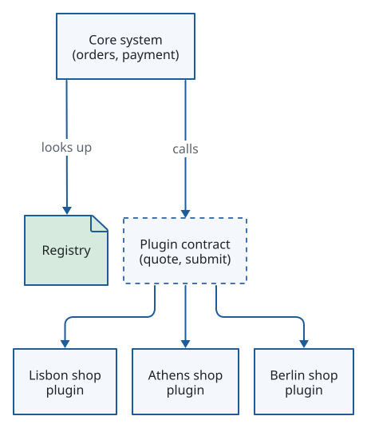
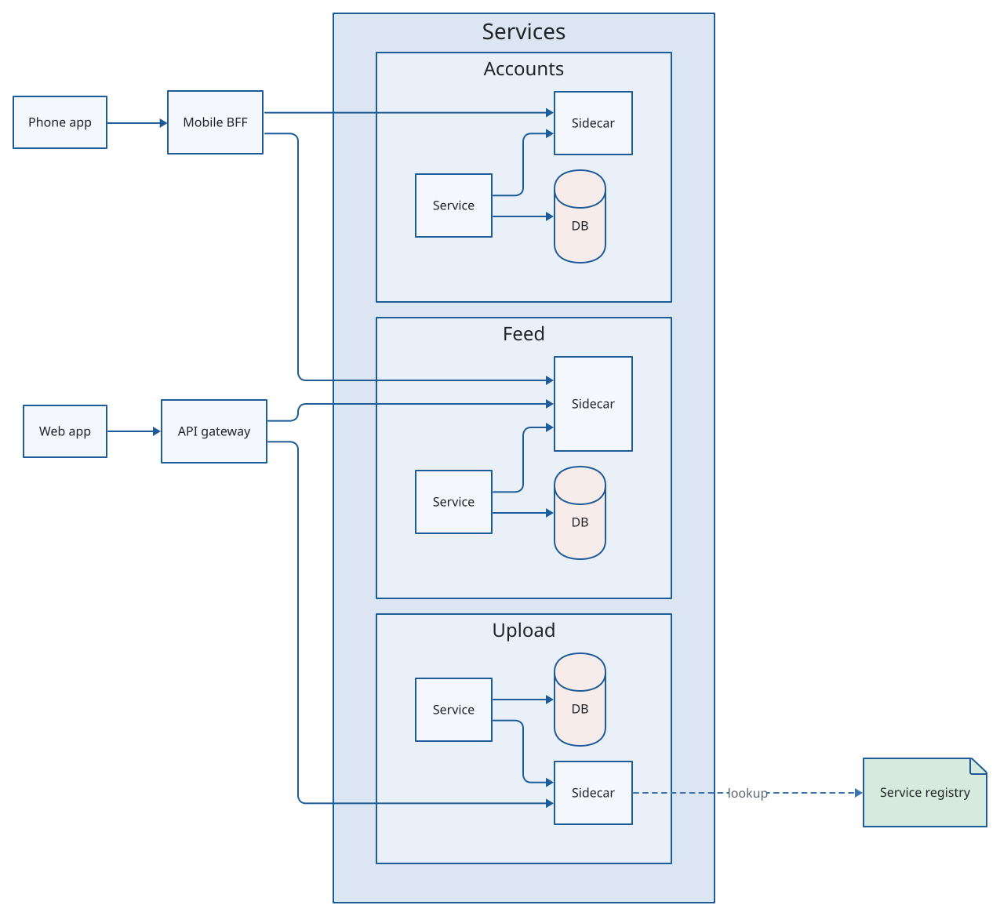
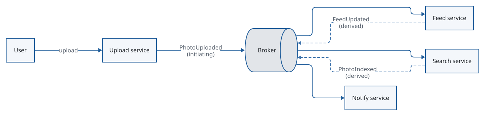
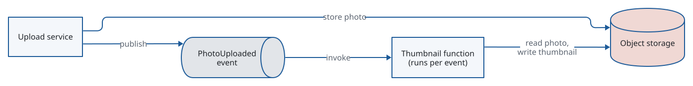
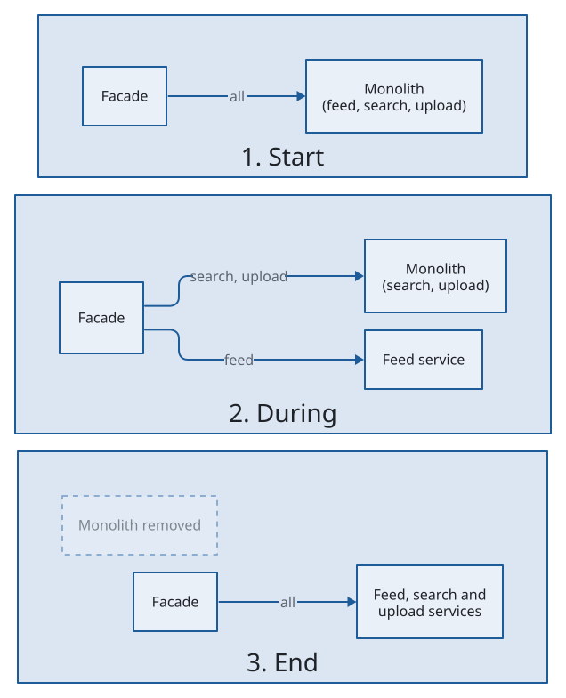

# Architecture styles {#sec-architecture-styles}

The earlier chapters built the parts of a system; this one is about how the parts are arranged. Gandhi and co-authors name the arrangement's two
basic choices: how the code is partitioned, by technical concern or by domain, and how it is deployed, "as one unit" or split "across many (usually
smaller) units" that "communicate with each other over the network" [@gandhiHeadFirstSoftware2024, Ch. 5, pp. 170 and 172]. This chapter defines
components and coupling, the layered and modular monolith, the microkernel, microservices, event-driven architecture, serverless deployment, and the
patterns for moving from one style to another.

The claims are of two kinds. The styles are definitions; four results with complete proofs make some of their properties exact: what coupling metrics add
up to and what a change can affect, what synchronous calls between services cost in availability and latency, how often a serverless function starts cold and
when it is cheaper than a server, and which sequences of versions let a data format change without a moment when two running versions cannot read each other.
Design inside a service, technical debt, architecture fitness functions and architecture decision records are left to the planned Fundamentals of Software
Engineering tutorial.

The sources are the benchmark books: @gandhiHeadFirstSoftware2024 [Chs. 4-8, 10 and 11] for the styles, @pachecoPrinciplesSoftwareArchitecture2024
[Chs. 1-4, 9 and 10] for monoliths, distributed monoliths and migrations, @tanAcingSystemDesign2024 [Sec. 1.4.10, Ch. 6 and App. A],
@sinhaSystemDesignGuide2024 [Ch. 4], @gilbertSoftwareArchitecturePatterns2024 [Ch. 1] and @reisFundamentalsDataEngineering2022 [Chs. 3 and 4]. Degrees of
nodes are those of [Networks](../../complexity-science/networks/index.qmd#def-network), here with directed edges.

The chapter has seven sections. @sec-components defines components and coupling and proves the properties of coupling metrics. @sec-layered defines the layered
architecture and the modular monolith. @sec-microkernel defines the microkernel. @sec-microservices defines microservices and their infrastructure and proves the cost
of synchronous calls. @sec-event-driven defines event-driven architecture. @sec-serverless defines serverless deployment and proves the cold-start and cost results.
@sec-evolving defines distributed monoliths, the strangler fig and migrations and proves when a phased migration is safe.

The running example is the photo service of the earlier chapters, with six components: Upload, Feed, Search, Notify, Accounts and Prints.

Every definition and result is followed by ten examples and ten exercises, each exercise with a hidden solution in two tabs: the argument, then a computation with its
recorded output. The computations run in plain Python 3.12 with NumPy. Diagrams are written in the D2 language. Service skeletons and deployment manifests are shown as
illustrative code and are not run.

## Components, coupling and deployment {#sec-components}

An architecture is first a set of components and the dependencies between them. Gandhi: component coupling is "the degree to which components know about and rely on
each other. The more the components interact, the more tightly coupled the system is and the harder it will be to maintain" [@gandhiHeadFirstSoftware2024, Ch. 4,
p. 145]. This section defines components, coupling metrics, partitioning and deployment models, and proves what the metrics add up to and what a change can reach.

For more on this topic, see @gandhiHeadFirstSoftware2024 [Ch. 4, pp. 145-153, and Ch. 5, pp. 170-177] and @reisFundamentalsDataEngineering2022 [Ch. 3,
"Principle 6: Build Loosely Coupled Systems"].

### Components, coupling, partitioning and deployment

Components and their dependencies form a directed graph, and a deployment groups the components into units. @fig-cmpn-deploy shows the photo service both ways.

{#fig-cmpn-deploy width=95%}

:::: {.statement-box}
::: {#def-components}
#### Components, coupling, partitioning and deployment models

1. A **logical component** is a unit of a system's functionality with a well-defined role. The **dependency graph** has an edge $u \to v$ when $u$ depends on $v$, by
   calling it or using its data.
2. The **afferent coupling** $C_a(v)$ of a component is the number of components that depend on it, its **efferent coupling** $C_e(v)$ the number it depends on, and its
   **total coupling** $C_t(v) = C_a(v) + C_e(v)$. Its **instability** is $I(v) = C_e(v)/(C_a(v) + C_e(v))$, and $0$ for an isolated component.
3. Two components are **coupled** if a change in one might cause a change in the other.
4. An architecture is **technically partitioned** if its top-level components follow technical concerns (presentation, business rules, persistence), and **domain
   partitioned** if they follow parts of the problem domain.
5. A **monolithic** deployment runs all components as one unit, in one process; a **distributed** deployment runs them as several units that communicate over the
   network.
:::

::::

Items 2 to 5 are Gandhi's: afferent coupling, "sometimes referred to as fan-in, or incoming, coupling", is "denoted as CA", efferent coupling is "fan-out coupling or
outgoing coupling ... denoted as CE", and "CA + CE = CT" [@gandhiHeadFirstSoftware2024, Ch. 4, pp. 146-148]; "Two components are coupled if a change in one component
might cause a change in the other component" [@gandhiHeadFirstSoftware2024, Ch. 4, p. 153]; partitioning and deployment models are Chapter 5's
[@gandhiHeadFirstSoftware2024, Ch. 5, pp. 170-172]. Instability is the usual ratio from static analysis; the sources read do not define it.

:::: {.callout-note .examples-fold collapse="true" title="Examples"}
Item 2's metrics for the running example. Upload depends on four components, Accounts on none.

::: {#exm-cmpn-photo}
#### The photo service's dependency graph

Upload calls Accounts, Feed, Search and Notify; Feed calls Accounts; Prints calls Accounts and Notify.

```{.python .run}
def coupling(edges, nodes):
    Ca = {v: sum(1 for a, b in edges if b == v) for v in nodes}    # afferent: who depends on v
    Ce = {v: sum(1 for a, b in edges if a == v) for v in nodes}    # efferent: what v depends on
    I = {v: (Ce[v] / (Ca[v] + Ce[v]) if Ca[v] + Ce[v] else 0.0) for v in nodes}
    return Ca, Ce, I
nodes = ["Upload", "Feed", "Search", "Notify", "Accounts", "Prints"]
edges = [("Upload", "Accounts"), ("Upload", "Feed"), ("Upload", "Search"), ("Upload", "Notify"),
         ("Feed", "Accounts"), ("Prints", "Accounts"), ("Prints", "Notify")]
Ca, Ce, I = coupling(edges, nodes)
for v in nodes: print(f"{v:9s} Ca={Ca[v]} Ce={Ce[v]} Ct={Ca[v] + Ce[v]} I={I[v]:.2f}")
```

```{.text .run-output}
Upload    Ca=0 Ce=4 Ct=4 I=1.00
Feed      Ca=1 Ce=1 Ct=2 I=0.50
Search    Ca=1 Ce=0 Ct=1 I=0.00
Notify    Ca=2 Ce=0 Ct=2 I=0.00
Accounts  Ca=3 Ce=0 Ct=3 I=0.00
Prints    Ca=0 Ce=2 Ct=2 I=1.00
```
:::

Gandhi's first example has one component with two incoming edges. Its afferent coupling is $2$.

::: {#exm-cmpn-gandhi-auction}
#### Gandhi's auction components

Auction Registration and Automatic Payment both depend on Bidder Profile, so "the Bidder Profile component has an afferent coupling level of 2"; Bid Capture depends on Bid Streamer and
Bid Tracker, "an efferent coupling level of 2" [@gandhiHeadFirstSoftware2024, Ch. 4, pp. 146-147].
:::

Gandhi decouples a component by moving knowledge. The total stays the same.

::: {#exm-cmpn-demeter}
#### The Law of Demeter

Moving the "low stock" logic from Order Placement to Inventory Management "reduced the coupling of the Order Placement component", but "the total system coupling level remained the
same ... we didn't remove the knowledge from the system, we just moved it" [@gandhiHeadFirstSoftware2024, Ch. 4, p. 151].
:::

Many edges in every direction make every change reach far. Gandhi's name for it is a ball of mud.

::: {#exm-cmpn-ball}
#### A big ball of mud

A diagram with "so many component interactions and dependencies that the diagram starts to look like a ball of mud (or maybe like a bowl of spaghetti)"
[@gandhiHeadFirstSoftware2024, Ch. 4, p. 145]: in a complete dependency graph on $n$ components, each has $C_t = 2(n - 1)$.

```{.python .run}
n = 6
edges = [(a, b) for a in range(n) for b in range(n) if a != b]
print("edges", len(edges), "| C_t of each", sum(1 for a, b in edges if 0 in (a, b)))
```

```{.text .run-output}
edges 30 | C_t of each 10
```
:::

Gandhi's namespaces show the two partitionings. The domain is first or second in the name.

::: {#exm-cmpn-partition}
#### Technical or domain partitioning

Technically partitioned: `app.presentation.customer`, `app.services.customer`; domain partitioned: `app.customer.presentation`, `app.customer.services`
[@gandhiHeadFirstSoftware2024, Ch. 5, p. 171]. The photo service's `upload.api`, `upload.storage` is domain partitioned.
:::

Gandhi lists the monolith's strengths. Most come from having one process.

::: {#exm-cmpn-mono-pros}
#### What a monolith is good at

Simplicity, feasibility, cost, debuggability and reliability: "A monolith is an island. It makes few or no network calls, which usually means more reliable applications"
[@gandhiHeadFirstSoftware2024, Ch. 5, p. 174].
:::

The distributed model trades simplicity for independence. Gandhi lists its strengths and costs.

::: {#exm-cmpn-dist-pros}
#### What a distributed deployment is good at

Scalability, modularity, testability, deployability and fault tolerance, against performance, cost, simplicity and debuggability; "It's easy to underestimate how hard distributed
computing is!" [@gandhiHeadFirstSoftware2024, Ch. 5, pp. 176-177].
:::

Reis lists four properties of a loosely coupled system. The third is item 3's coupling, avoided.

::: {#exm-cmpn-reis}
#### Loose coupling in Reis

Components "interface with other services through abstraction layers", so "internal changes to a system component don't require changes in other parts ... there is no waterfall,
global release cycle for the whole system" [@reisFundamentalsDataEngineering2022, Ch. 3, "Principle 6: Build Loosely Coupled Systems"].
:::

Instability is $0$ for a component everyone uses and that uses nothing. It is $1$ for one that only uses others.

::: {#exm-cmpn-instability}
#### Stable and unstable components

In the photo graph, Accounts has $I = 0$ and Upload $I = 1$: Accounts is depended on and should change rarely; Upload depends on others and may change freely.
:::

Item 5's choice decides which edges become network calls. In a monolith none do.

::: {#exm-cmpn-network-calls}
#### Calls that cross the network

Deployed as one unit the seven edges are function calls; deployed as six services all seven are network calls; with Upload, Feed and Accounts together, four remain.

```{.python .run}
nodes = ["Upload", "Feed", "Search", "Notify", "Accounts", "Prints"]
edges = [("Upload", "Accounts"), ("Upload", "Feed"), ("Upload", "Search"), ("Upload", "Notify"),
         ("Feed", "Accounts"), ("Prints", "Accounts"), ("Prints", "Notify")]
units = {"Upload": 0, "Feed": 0, "Accounts": 0, "Search": 1, "Notify": 2, "Prints": 3}
print("network edges:", sum(units[a] != units[b] for a, b in edges), "of", len(edges))
```

```{.text .run-output}
network edges: 4 of 7
```
:::

::::

:::: {.callout-note .exercises-fold collapse="true" title="Exercises"}
The first exercise computes the coupling of a small graph. It is Gandhi's sharpen-your-pencil task in miniature.

::: {#exr-cmpn-sharpen}
#### Gandhi's exercise

Compute $C_a$, $C_e$ and $C_t$ for a graph with edges $A \to B$, $A \to C$, $B \to C$, $D \to C$, and the system's total coupling.
:::

::: {.callout-note .solution collapse="true" title="Solution"}
:::: {.panel-tabset .solution-tabs}
## Solution

$A$: $(0, 2, 2)$; $B$: $(1, 1, 2)$; $C$: $(3, 0, 3)$; $D$: $(0, 1, 1)$. The total, the sum of the $C_t$, is $8 = 2 \times 4$ edges.

## Python

The metrics.

```{.python .run}
def coupling(edges, nodes):
    Ca = {v: sum(1 for a, b in edges if b == v) for v in nodes}    # afferent: who depends on v
    Ce = {v: sum(1 for a, b in edges if a == v) for v in nodes}    # efferent: what v depends on
    I = {v: (Ce[v] / (Ca[v] + Ce[v]) if Ca[v] + Ce[v] else 0.0) for v in nodes}
    return Ca, Ce, I
nodes = "ABCD"; edges = [("A", "B"), ("A", "C"), ("B", "C"), ("D", "C")]
Ca, Ce, I = coupling(edges, nodes)
print({v: (Ca[v], Ce[v], Ca[v] + Ce[v]) for v in nodes}, "| total", sum(Ca[v] + Ce[v] for v in nodes))
```

```{.text .run-output}
{'A': (0, 2, 2), 'B': (1, 1, 2), 'C': (3, 0, 3), 'D': (0, 1, 1)} | total 8
```
::::
:::

The second exercise applies the Law of Demeter to Upload. An event moves knowledge out of it.

::: {#exr-cmpn-decouple}
#### Decoupling Upload

Upload calls Feed, Search and Notify after each upload. Replace those three edges by Feed, Search and Notify depending on an Events component that Upload writes to. Compute Upload's $C_e$
before and after, and the system's total coupling.
:::

::: {.callout-note .solution collapse="true" title="Solution"}
:::: {.panel-tabset .solution-tabs}
## Solution

Upload's $C_e$ falls from $4$ to $2$ (Accounts and Events); the three subscribers and Upload gain an edge each to Events, so the edges go from $7$ to $8$ and the total coupling from $14$ to $16$: knowledge moves rather than
vanishes, as Gandhi's example warns.

## Python

Both graphs.

```{.python .run}
def coupling(edges, nodes):
    Ca = {v: sum(1 for a, b in edges if b == v) for v in nodes}    # afferent: who depends on v
    Ce = {v: sum(1 for a, b in edges if a == v) for v in nodes}    # efferent: what v depends on
    I = {v: (Ce[v] / (Ca[v] + Ce[v]) if Ca[v] + Ce[v] else 0.0) for v in nodes}
    return Ca, Ce, I
nodes = ["Upload", "Feed", "Search", "Notify", "Accounts", "Prints"]
edges = [("Upload", "Accounts"), ("Upload", "Feed"), ("Upload", "Search"), ("Upload", "Notify"),
         ("Feed", "Accounts"), ("Prints", "Accounts"), ("Prints", "Notify")]
after = [e for e in edges if not (e[0] == "Upload" and e[1] in ("Feed", "Search", "Notify"))]
after += [("Upload", "Events"), ("Feed", "Events"), ("Search", "Events"), ("Notify", "Events")]
for name, E, N in (("before", edges, nodes), ("after", after, nodes + ["Events"])):
    Ca, Ce, I = coupling(E, N)
    print(name, "Upload Ce", Ce["Upload"], "| edges", len(E))
```

```{.text .run-output}
before Upload Ce 4 | edges 7
after Upload Ce 2 | edges 8
```
::::
:::

The third exercise answers one of Gandhi's questions. A cook who does everything is partitioned by neither concern nor domain.

::: {#exr-cmpn-short-order}
#### A short-order cook

Gandhi asks whether a short-order cook, who cooks, serves, takes payments and cleans, is partitioned technically or by domain [@gandhiHeadFirstSoftware2024, Ch. 5, p. 171].
:::

::: {.callout-note .solution collapse="true" title="Solution"}
:::: {.panel-tabset .solution-tabs}
## Solution

By domain, if anything: one worker covers every technical role for the diner's whole meal, as a domain module covers every layer of its subdomain; in software terms the cook is a
monolith of one.

## Python

Roles per worker in the two restaurants.

```{.python .run}
fancy = {"host": ["greet"], "server": ["serve"], "chef": ["cook"], "busser": ["clean"]}
diner = {"cook": ["greet", "serve", "cook", "clean"]}
print("roles per worker:", {k: len(v) for k, v in fancy.items()}, {k: len(v) for k, v in diner.items()})
```

```{.text .run-output}
roles per worker: {'host': 1, 'server': 1, 'chef': 1, 'busser': 1} {'cook': 4}
```
::::
:::

The fourth exercise finds the components a change may affect. They are those that depend on it, directly or not.

::: {#exr-cmpn-impact}
#### What a change can reach

Accounts changes its interface. Which components may have to change? Which if Notify changes?
:::

::: {.callout-note .solution collapse="true" title="Solution"}
:::: {.panel-tabset .solution-tabs}
## Solution

Those with a path to it: Upload, Feed and Prints for Accounts; Upload and Prints for Notify. The ancestors in the dependency graph are the possible blast radius of the change, by item 3.

## Python

Reverse reachability.

```{.python .run}
nodes = ["Upload", "Feed", "Search", "Notify", "Accounts", "Prints"]
edges = [("Upload", "Accounts"), ("Upload", "Feed"), ("Upload", "Search"), ("Upload", "Notify"),
         ("Feed", "Accounts"), ("Prints", "Accounts"), ("Prints", "Notify")]
def ancestors(v):
    out, stack = set(), [v]
    while stack:
        x = stack.pop()
        for a, b in edges:
            if b == x and a not in out: out.add(a); stack.append(a)
    return sorted(out)
print("Accounts:", ancestors("Accounts"), "| Notify:", ancestors("Notify"))
```

```{.text .run-output}
Accounts: ['Feed', 'Prints', 'Upload'] | Notify: ['Prints', 'Upload']
```
::::
:::

The fifth exercise adds an edge back. A cycle makes every member reach every other.

::: {#exr-cmpn-cycle}
#### A dependency cycle

Feed starts calling Upload to fetch captions. What changes in the change impact of each, and why are cycles avoided?
:::

::: {.callout-note .solution collapse="true" title="Solution"}
:::: {.panel-tabset .solution-tabs}
## Solution

Upload and Feed now depend on each other, so a change to either may reach the other and everything that depends on either; neither can be built, tested or deployed first. An acyclic graph
has a topological order (@prp-dag (a)), along which components can be built and released.

## Python

The cycle test.

```{.python .run}
nodes = ["Upload", "Feed", "Search", "Notify", "Accounts", "Prints"]
edges = [("Upload", "Accounts"), ("Upload", "Feed"), ("Upload", "Search"), ("Upload", "Notify"),
         ("Feed", "Accounts"), ("Prints", "Accounts"), ("Prints", "Notify")]
E = edges + [("Feed", "Upload")]
adj = {}
for a, b in E: adj.setdefault(a, []).append(b)
def reach(u):
    seen, st = set(), [u]
    while st:
        x = st.pop()
        for y in adj.get(x, []):
            if y not in seen: seen.add(y); st.append(y)
    return seen
print("Upload reaches itself:", "Upload" in reach("Upload"))
```

```{.text .run-output}
Upload reaches itself: True
```
::::
:::

The sixth exercise splits a component by role. Gandhi warns against components named after entities.

::: {#exr-cmpn-cohesion}
#### Cohesion and the entity trap

A component "PhotoManager" uploads, resizes, captions, recommends and bills prints. Gandhi calls naming components after entities "the entity trap" [@gandhiHeadFirstSoftware2024, Ch. 4,
p. 136]. Split it by role and compute the new couplings if billing needs captions.
:::

::: {.callout-note .solution collapse="true" title="Solution"}
:::: {.panel-tabset .solution-tabs}
## Solution

Upload, Captions, Recommendations and Prints, each with one role; Prints depends on Captions. Each component's coupling is small and its reasons to change are few, the cohesion Gandhi asks for
when analysing roles and responsibilities.

## Python

The split graph.

```{.python .run}
def coupling(edges, nodes):
    Ca = {v: sum(1 for a, b in edges if b == v) for v in nodes}    # afferent: who depends on v
    Ce = {v: sum(1 for a, b in edges if a == v) for v in nodes}    # efferent: what v depends on
    I = {v: (Ce[v] / (Ca[v] + Ce[v]) if Ca[v] + Ce[v] else 0.0) for v in nodes}
    return Ca, Ce, I
nodes = ["Upload", "Captions", "Recommend", "Prints"]
edges = [("Upload", "Captions"), ("Recommend", "Captions"), ("Prints", "Captions")]
Ca, Ce, I = coupling(edges, nodes)
print({v: (Ca[v], Ce[v]) for v in nodes})
```

```{.text .run-output}
{'Upload': (0, 1), 'Captions': (3, 0), 'Recommend': (0, 1), 'Prints': (0, 1)}
```
::::
:::

The seventh exercise prices item 5's network calls. Gandhi points to the fallacies of distributed computing.

::: {#exr-cmpn-fallacies}
#### The network is not reliable

Gandhi warns that architects underestimate the network and suggests looking up "The Fallacies of Distributed Computing" [@gandhiHeadFirstSoftware2024, Ch. 5, p. 177]. If each network call
fails with probability $10^{-4}$ and an upload makes the four calls of @exm-cmpn-network-calls, how often does an upload hit a failed call, monolithic and distributed?
:::

::: {.callout-note .solution collapse="true" title="Solution"}
:::: {.panel-tabset .solution-tabs}
## Solution

Monolithic: never from the network. Distributed: $1 - (1 - 10^{-4})^4 \approx 4 \times 10^{-4}$, $8000$ uploads a day at $2 \times 10^7$; each needs a retry or a fallback.

## Python

The probability.

```{.python .run}
p = 1e-4
print(f"{1 - (1 - p) ** 4:.2e}, per day {2e7 * (1 - (1 - p) ** 4):.0f}")
```

```{.text .run-output}
4.00e-04, per day 7999
```
::::
:::

The eighth exercise chooses which components to deploy together. Fewer network edges, fewer independent units.

::: {#exr-cmpn-units}
#### Choosing deployment units

Find the grouping of the six components into two units that minimises the number of network edges, with each unit holding at least two components.
:::

::: {.callout-note .solution collapse="true" title="Solution"}
:::: {.panel-tabset .solution-tabs}
## Solution

Exhaustive search over the groupings finds that putting Notify and Prints in one unit and the other four in the other leaves only $2$ crossing edges, Upload → Notify and Prints → Accounts.

## Python

A search.

```{.python .run}
nodes = ["Upload", "Feed", "Search", "Notify", "Accounts", "Prints"]
edges = [("Upload", "Accounts"), ("Upload", "Feed"), ("Upload", "Search"), ("Upload", "Notify"),
         ("Feed", "Accounts"), ("Prints", "Accounts"), ("Prints", "Notify")]
import itertools
best = None
for r in range(2, 5):
    for A in itertools.combinations(nodes, r):
        cross = sum((a in A) != (b in A) for a, b in edges)
        if best is None or cross < best[0]: best = (cross, A)
print(best)
```

```{.text .run-output}
(2, ('Notify', 'Prints'))
```
::::
:::

The ninth exercise states Gandhi's trade-off. Centralised knowledge is easy to read and risky to change.

::: {#exr-cmpn-gandhi-loose}
#### Tight or loose

Gandhi contrasts "Centralized workflow, but more risk with each change" with "Distributed workflow, but less risk with each change" [@gandhiHeadFirstSoftware2024, Ch. 4, p. 153]. Express both in
terms of $C_e$ of the orchestrating component and the number of components one must read to follow the workflow.
:::

::: {.callout-note .solution collapse="true" title="Solution"}
:::: {.panel-tabset .solution-tabs}
## Solution

Tight: the orchestrator has $C_e = 4$, so four components can break it, but the workflow is read in one place. Loose: its $C_e$ is $2$ and the workflow is spread over three components,
which must all be read. Neither is better in general; it is the first law's trade-off.

## Python

The two numbers for both designs.

```{.python .run}
print("tight: Ce 4, components to read 1 | loose: Ce 2, components to read 3")
```

```{.text .run-output}
tight: Ce 4, components to read 1 | loose: Ce 2, components to read 3
```
::::
:::

The tenth exercise relates deployment units to network modularity. Good units have many edges inside and few across.

::: {#exr-cmpn-modular-network}
#### Coupling and modularity

Count, for the grouping of @exm-cmpn-network-calls, the edges inside units and across them, and the fraction inside. Why does a high fraction suit a distributed deployment?
:::

::: {.callout-note .solution collapse="true" title="Solution"}
:::: {.panel-tabset .solution-tabs}
## Solution

Three edges inside and four across: $3/7 = 0.43$ inside. Edges across units are network calls, so a grouping with most edges inside makes fewer remote calls; this is the idea behind community
detection by modularity in [Networks](../../complexity-science/networks/index.qmd#def-modularity), applied to deployment.

## Python

The counts.

```{.python .run}
nodes = ["Upload", "Feed", "Search", "Notify", "Accounts", "Prints"]
edges = [("Upload", "Accounts"), ("Upload", "Feed"), ("Upload", "Search"), ("Upload", "Notify"),
         ("Feed", "Accounts"), ("Prints", "Accounts"), ("Prints", "Notify")]
units = {"Upload": 0, "Feed": 0, "Accounts": 0, "Search": 1, "Notify": 2, "Prints": 3}
inside = sum(units[a] == units[b] for a, b in edges)
print(inside, len(edges) - inside, round(inside / len(edges), 2))
```

```{.text .run-output}
3 4 0.43
```
::::
:::

::::

### What coupling metrics add up to

Coupling metrics are counts of edges, so their sums are fixed by the number of edges; and what a change can reach is fixed by the paths of the graph. The proposition proves both.

:::: {.statement-box}
::: {#prp-coupling}
#### Sums, ranges and reach of coupling

Let a dependency graph have components $V$ and edges $E$, without loops or repeated edges.

(a) $\sum_vC_a(v) = \sum_vC_e(v) = |E|$, so the system's total coupling $\sum_vC_t(v)$ is $2|E|$. Redirecting an edge, replacing $u \to w$ by $v \to w$, leaves the total unchanged.

(b) $0 \leq I(v) \leq 1$, with $I(v) = 0$ for a component that depends on nothing and $I(v) = 1$ for one on which nothing depends but which depends on something.

(c) If coupling is only through dependencies, a change to $v$ can require changes only in components with a directed path to $v$. If the graph is acyclic, no component reaches itself, and the
components can be ordered so that every dependency points to an earlier one.

(d) If components are grouped into deployment units and the edge $e$ is used $r_e$ times per request, a request makes $\sum_{e \text{ across units}}r_e$ network calls; the number is $0$ for one unit and
$\sum_er_e$ for one unit per component.
:::

::::

*Proof.* (a) Each edge $u \to v$ adds $1$ to $C_e(u)$ and $1$ to $C_a(v)$, and nothing else; summing over the edges, each sum is $|E|$, and the total is their sum. Redirecting an edge removes one edge
and adds one, so $|E|$, and the total, are unchanged, while $C_e(u)$ falls and $C_e(v)$ rises by one.

(b) $C_e \leq C_a + C_e$ and both are non-negative; the cases are $C_e = 0$ with $C_a > 0$ (or the isolated case, $0$ by definition) and $C_a = 0$ with $C_e > 0$.

(c) By assumption, a change to $v$ can affect only components that depend on $v$, and, repeating the argument, those that depend on them; these are exactly the components with a directed path to $v$. In
an acyclic graph a path from $v$ to $v$ would be a cycle, so no component reaches itself, and by @prp-dag (a) a topological order exists; reversed, it puts every dependency first.

(d) A call along an edge inside a unit is a call within one process; one across units is a network call, made $r_e$ times per request. With one unit no edge crosses; with one unit per component every edge
does. $\square$

Part (a) is Gandhi's observation that the Law of Demeter moves coupling rather than removing it (@exm-cmpn-demeter); part (c) turns item 3's informal coupling into reachability; part (d) is the
cost of distribution in calls.

:::: {.callout-note .examples-fold collapse="true" title="Examples"}
Part (a) on the running example. Seven edges, total coupling fourteen.

::: {#exm-cpl-sums}
#### The sums for the photo graph

$\sum C_a = \sum C_e = 7$ and $\sum C_t = 14$.

```{.python .run}
def coupling(edges, nodes):
    Ca = {v: sum(1 for a, b in edges if b == v) for v in nodes}    # afferent: who depends on v
    Ce = {v: sum(1 for a, b in edges if a == v) for v in nodes}    # efferent: what v depends on
    I = {v: (Ce[v] / (Ca[v] + Ce[v]) if Ca[v] + Ce[v] else 0.0) for v in nodes}
    return Ca, Ce, I
nodes = ["Upload", "Feed", "Search", "Notify", "Accounts", "Prints"]
edges = [("Upload", "Accounts"), ("Upload", "Feed"), ("Upload", "Search"), ("Upload", "Notify"),
         ("Feed", "Accounts"), ("Prints", "Accounts"), ("Prints", "Notify")]
Ca, Ce, I = coupling(edges, nodes)
print(sum(Ca.values()), sum(Ce.values()), sum(Ca[v] + Ce[v] for v in nodes))
```

```{.text .run-output}
7 7 14
```
:::

Gandhi's order system has a total coupling of nine. It includes an edge from outside the diagram.

::: {#exm-cpl-gandhi-nine}
#### Gandhi's total of nine

Order Placement has $C_a = 1$, from the request that places an order, and $C_e = 4$; four other components have $C_t = 1$: $5 + 4 = 9$ [@gandhiHeadFirstSoftware2024, Ch. 4, p. 150]. By part (a) that is
$2 \times 4 + 1$: four internal edges counted twice and one external edge counted once, at its end inside the diagram.
:::

Part (a)'s redirection on the photo graph. Prints stops calling Notify and Accounts calls it instead.

::: {#exm-cpl-redirect}
#### Redirecting an edge

Total coupling stays $14$; Prints' $C_e$ falls to $1$ and Accounts' rises to $1$.

```{.python .run}
def coupling(edges, nodes):
    Ca = {v: sum(1 for a, b in edges if b == v) for v in nodes}    # afferent: who depends on v
    Ce = {v: sum(1 for a, b in edges if a == v) for v in nodes}    # efferent: what v depends on
    I = {v: (Ce[v] / (Ca[v] + Ce[v]) if Ca[v] + Ce[v] else 0.0) for v in nodes}
    return Ca, Ce, I
nodes = ["Upload", "Feed", "Search", "Notify", "Accounts", "Prints"]
edges = [("Upload", "Accounts"), ("Upload", "Feed"), ("Upload", "Search"), ("Upload", "Notify"),
         ("Feed", "Accounts"), ("Prints", "Accounts"), ("Prints", "Notify")]
E2 = [e for e in edges if e != ("Prints", "Notify")] + [("Accounts", "Notify")]
for E in (edges, E2):
    Ca, Ce, I = coupling(E, nodes)
    print("total", sum(Ca[v] + Ce[v] for v in nodes), "| Prints Ce", Ce["Prints"], "| Accounts Ce", Ce["Accounts"])
```

```{.text .run-output}
total 14 | Prints Ce 2 | Accounts Ce 0
total 14 | Prints Ce 1 | Accounts Ce 1
```
:::

Part (b)'s range on the photo graph. Extremes at the leaves and roots.

::: {#exm-cpl-instability-range}
#### Instability across the graph

Accounts, Search and Notify, which depend on nothing, have $I = 0$; Upload and Prints, on which nothing depends, have $I = 1$; Feed has $I = 1/2$.
:::

Part (c)'s order for the photo graph. Dependencies come first.

::: {#exm-cpl-order}
#### A build order

A topological order with dependencies first: Accounts, Feed, Notify, Prints, Search, Upload.

```{.python .run}
nodes = ["Upload", "Feed", "Search", "Notify", "Accounts", "Prints"]
edges = [("Upload", "Accounts"), ("Upload", "Feed"), ("Upload", "Search"), ("Upload", "Notify"),
         ("Feed", "Accounts"), ("Prints", "Accounts"), ("Prints", "Notify")]
order, done = [], set()
while len(order) < len(nodes):
    v = sorted(x for x in nodes if x not in done and all(b in done for a, b in edges if a == x))[0]
    order.append(v); done.add(v)
print(order)
```

```{.text .run-output}
['Accounts', 'Feed', 'Notify', 'Prints', 'Search', 'Upload']
```
:::

Part (d) with call counts. Upload calls Search twice per request.

::: {#exm-cpl-calls}
#### Network calls per upload

With $r = 2$ for Upload → Search and $1$ elsewhere, the fully distributed deployment makes $8$ network calls per request through all edges; the grouping of @exm-cmpn-network-calls makes $5$.

```{.python .run}
nodes = ["Upload", "Feed", "Search", "Notify", "Accounts", "Prints"]
edges = [("Upload", "Accounts"), ("Upload", "Feed"), ("Upload", "Search"), ("Upload", "Notify"),
         ("Feed", "Accounts"), ("Prints", "Accounts"), ("Prints", "Notify")]
r = {e: 1 for e in edges}; r[("Upload", "Search")] = 2
units = {"Upload": 0, "Feed": 0, "Accounts": 0, "Search": 1, "Notify": 2, "Prints": 3}
print("all apart", sum(r.values()), "| grouped", sum(r[e] for e in edges if units[e[0]] != units[e[1]]))
```

```{.text .run-output}
all apart 8 | grouped 5
```
:::

Part (c) assumes coupling only through dependencies. A shared database couples components without an edge.

::: {#exm-cpl-hidden}
#### Coupling that the graph does not show

If Feed and Search both read Upload's table, a schema change in Upload breaks them although neither calls Upload: Gandhi's microservices own their data for this reason, since otherwise when "one
microservice changes the structure of its data ... all of those other services will need to change" [@gandhiHeadFirstSoftware2024, Ch. 10, p. 308]. The table must be drawn as a component for part (c) to
apply.
:::

In a strongly connected graph every component reaches every other. Part (c)'s impact is everything.

::: {#exm-cpl-ball}
#### Reach in a ball of mud

In the complete graph of @exm-cmpn-ball each component has $n - 1$ ancestors: any change may reach the whole system.
:::

A library used by every component has afferent coupling equal to all others. Its changes reach everyone.

::: {#exm-cpl-library}
#### A shared library

A logging library used by all six components has $C_a = 6$ and $I = 0$; by part (c) a breaking change reaches all of them, the "binary coupling" Pacheco describes for internal shared libraries
[@pachecoPrinciplesSoftwareArchitecture2024, Ch. 2, "Binary coupling"].
:::

Part (d)'s first case. A monolith pays nothing for its edges in network calls.

::: {#exm-cpl-monolith-zero}
#### No network calls in a monolith

With one unit every edge is in-process, which is Gandhi's "A monolith is an island" (@exm-cmpn-mono-pros); the price is that its units cannot be deployed or scaled separately.
:::

::::

:::: {.callout-note .exercises-fold collapse="true" title="Exercises"}
The first exercise checks part (a) on random graphs. The sums always equal the number of edges.

::: {#exr-cpl-proof-a}
#### Part (a) by machine

Generate random directed graphs and check $\sum C_a = \sum C_e = |E|$ and that redirecting a random edge leaves the total unchanged.
:::

::: {.callout-note .solution collapse="true" title="Proof"}
:::: {.panel-tabset .solution-tabs}
## Proof

The proof counts each edge once in each sum; the check confirms it on random graphs.

## Python

Random graphs.

```{.python .run}
def coupling(edges, nodes):
    Ca = {v: sum(1 for a, b in edges if b == v) for v in nodes}    # afferent: who depends on v
    Ce = {v: sum(1 for a, b in edges if a == v) for v in nodes}    # efferent: what v depends on
    I = {v: (Ce[v] / (Ca[v] + Ce[v]) if Ca[v] + Ce[v] else 0.0) for v in nodes}
    return Ca, Ce, I
import random
random.seed(110)
ok = True
for _ in range(500):
    n = random.randint(2, 10); nodes = list(range(n))
    E = list({(a, b) for a, b in ((random.randrange(n), random.randrange(n)) for _ in range(15)) if a != b})
    Ca, Ce, I = coupling(E, nodes)
    ok &= sum(Ca.values()) == sum(Ce.values()) == len(E)
    if E:
        u, w = E[0]; v = random.choice([x for x in nodes if x != w])
        E2 = E[1:] + [(v, w)]
        Ca2, Ce2, _ = coupling(E2, nodes)
        ok &= sum(Ca2[x] + Ce2[x] for x in nodes) == 2 * len(E2)
print(ok)
```

```{.text .run-output}
True
```
::::
:::

The second exercise extends part (a) to external callers. They count once.

::: {#exr-cpl-external}
#### Edges from outside

If $E_x$ edges come from outside the system into components, show that the total coupling counted over the system's components is $2|E| + |E_x|$, and check Gandhi's nine.
:::

::: {.callout-note .solution collapse="true" title="Solution"}
:::: {.panel-tabset .solution-tabs}
## Solution

Internal edges count once at each end; an external edge has only its inner end in the system. Gandhi's order example has $|E| = 4$, $|E_x| = 1$: $9$.

## Python

The count.

```{.python .run}
print(2 * 4 + 1)
```

```{.text .run-output}
9
```
::::
:::

The third exercise averages part (c) over components. It measures how entangled a graph is.

::: {#exr-cpl-impact-count}
#### Average blast radius

Compute the mean number of ancestors per component in the photo graph, and after adding Feed → Upload.
:::

::: {.callout-note .solution collapse="true" title="Solution"}
:::: {.panel-tabset .solution-tabs}
## Solution

Before, Accounts has $3$, Feed, Search and Notify $1$ or $2$, Upload and Prints $0$; after the cycle, Upload and Feed reach each other, and the mean rises. The run gives both.

## Python

Reverse reachability for all components.

```{.python .run}
nodes = ["Upload", "Feed", "Search", "Notify", "Accounts", "Prints"]
edges = [("Upload", "Accounts"), ("Upload", "Feed"), ("Upload", "Search"), ("Upload", "Notify"),
         ("Feed", "Accounts"), ("Prints", "Accounts"), ("Prints", "Notify")]
def mean_anc(E):
    tot = 0
    for v in nodes:
        seen, st = set(), [v]
        while st:
            x = st.pop()
            for a, b in E:
                if b == x and a not in seen and a != v: seen.add(a); st.append(a)
        tot += len(seen)
    return tot / len(nodes)
print(round(mean_anc(edges), 2), round(mean_anc(edges + [("Feed", "Upload")]), 2))
```

```{.text .run-output}
1.17 1.67
```
::::
:::

The fourth exercise merges the two services that call each other most. Network calls fall by their calls.

::: {#exr-cpl-merge-units}
#### Merging two services

With call counts $r$ of @exm-cpl-calls and one unit per component, which merge of two components removes the most network calls per request?
:::

::: {.callout-note .solution collapse="true" title="Solution"}
:::: {.panel-tabset .solution-tabs}
## Solution

By part (d), merging $u$ and $v$ removes $r_{u \to v} + r_{v \to u}$ calls: Upload and Search, with $2$. Whether to merge also depends on how independently the two must change and deploy.

## Python

All pairs.

```{.python .run}
nodes = ["Upload", "Feed", "Search", "Notify", "Accounts", "Prints"]
edges = [("Upload", "Accounts"), ("Upload", "Feed"), ("Upload", "Search"), ("Upload", "Notify"),
         ("Feed", "Accounts"), ("Prints", "Accounts"), ("Prints", "Notify")]
import itertools
r = {e: 1 for e in edges}; r[("Upload", "Search")] = 2
best = max(itertools.combinations(nodes, 2), key=lambda p: r.get(p, 0) + r.get(p[::-1], 0))
print(best, r.get(best, 0) + r.get(best[::-1], 0))
```

```{.text .run-output}
('Upload', 'Search') 2
```
::::
:::

The fifth exercise checks whether dependencies point to more stable components. In the photo graph they do.

::: {#exr-cpl-stable-deps}
#### Depending on the stable

For every edge $u \to v$ of the photo graph, compare $I(u)$ and $I(v)$. Why is it convenient that dependencies point towards components with lower instability?
:::

::: {.callout-note .solution collapse="true" title="Solution"}
:::: {.panel-tabset .solution-tabs}
## Solution

Every edge goes from a component with $I(u) \geq I(v)$; the components most depended on change least often, so fewer changes propagate. This rule of thumb is not in the sources read and is stated here
only as a check on the graph.

## Python

The comparison.

```{.python .run}
def coupling(edges, nodes):
    Ca = {v: sum(1 for a, b in edges if b == v) for v in nodes}    # afferent: who depends on v
    Ce = {v: sum(1 for a, b in edges if a == v) for v in nodes}    # efferent: what v depends on
    I = {v: (Ce[v] / (Ca[v] + Ce[v]) if Ca[v] + Ce[v] else 0.0) for v in nodes}
    return Ca, Ce, I
nodes = ["Upload", "Feed", "Search", "Notify", "Accounts", "Prints"]
edges = [("Upload", "Accounts"), ("Upload", "Feed"), ("Upload", "Search"), ("Upload", "Notify"),
         ("Feed", "Accounts"), ("Prints", "Accounts"), ("Prints", "Notify")]
Ca, Ce, I = coupling(edges, nodes)
print(all(I[a] >= I[b] for a, b in edges), [(a, b, round(I[a], 2), round(I[b], 2)) for a, b in edges][:3])
```

```{.text .run-output}
True [('Upload', 'Accounts', 1.0, 0.0), ('Upload', 'Feed', 1.0, 0.5), ('Upload', 'Search', 1.0, 0.0)]
```
::::
:::

The sixth exercise assigns layers to an acyclic graph. Each component sits above everything it uses.

::: {#exr-cpl-acyclic-layers}
#### Layers from an acyclic graph

Define the level of a component as $0$ if it depends on nothing and otherwise $1$ plus the largest level of its dependencies. Compute the levels of the photo graph and show every edge goes to a lower
level.
:::

::: {.callout-note .solution collapse="true" title="Proof"}
:::: {.panel-tabset .solution-tabs}
## Proof

In an acyclic graph the recursion terminates by part (c), and each component's level exceeds each dependency's by construction. The levels give a layered picture of any acyclic graph.

## Python

The levels.

```{.python .run}
nodes = ["Upload", "Feed", "Search", "Notify", "Accounts", "Prints"]
edges = [("Upload", "Accounts"), ("Upload", "Feed"), ("Upload", "Search"), ("Upload", "Notify"),
         ("Feed", "Accounts"), ("Prints", "Accounts"), ("Prints", "Notify")]
from functools import lru_cache
@lru_cache(None)
def level(v): return 1 + max((level(b) for a, b in edges if a == v), default=-1)
print({v: level(v) for v in nodes}, all(level(a) > level(b) for a, b in edges))
```

```{.text .run-output}
{'Upload': 2, 'Feed': 1, 'Search': 0, 'Notify': 0, 'Accounts': 0, 'Prints': 1} True
```
::::
:::

The seventh exercise prices part (d)'s calls in time. Each network call adds a round trip.

::: {#exr-cpl-latency}
#### Latency of network calls

In-process calls take $1\,\mu\mathrm{s}$, network calls $1\,\mathrm{ms}$. Find the time per upload spent in the calls of @exm-cpl-calls for one unit, the grouped deployment and one unit per component, if calls are
sequential.
:::

::: {.callout-note .solution collapse="true" title="Solution"}
:::: {.panel-tabset .solution-tabs}
## Solution

One unit: $8\,\mu\mathrm{s}$. Grouped: $5$ network calls and $3$ local, about $5\,\mathrm{ms}$. All apart: $8\,\mathrm{ms}$. A thousandfold difference per call, the "performance" con of Gandhi's distributed model.

## Python

The sums.

```{.python .run}
for name, net, local in (("one unit", 0, 8), ("grouped", 5, 3), ("apart", 8, 0)):
    print(name, f"{net * 1e-3 + local * 1e-6:.4f} s")
```

```{.text .run-output}
one unit 0.0000 s
grouped 0.0050 s
apart 0.0080 s
```
::::
:::

The eighth exercise adds a shared database to the graph. Part (c) then finds the hidden coupling.

::: {#exr-cpl-hidden-db}
#### Drawing the database

Add a component "UploadDB" with edges from Upload, Feed and Search. Which components can a change to UploadDB reach, and what does Gandhi's data ownership change?
:::

::: {.callout-note .solution collapse="true" title="Solution"}
:::: {.panel-tabset .solution-tabs}
## Solution

Upload, Feed and Search, and their ancestors. With data ownership only Upload depends on UploadDB, and Feed and Search reach Upload's data through its interface, so a schema change reaches Upload only.

## Python

Reach with and without sharing.

```{.python .run}
nodes = ["Upload", "Feed", "Search", "Notify", "Accounts", "Prints"]
edges = [("Upload", "Accounts"), ("Upload", "Feed"), ("Upload", "Search"), ("Upload", "Notify"),
         ("Feed", "Accounts"), ("Prints", "Accounts"), ("Prints", "Notify")]
def anc(E, v):
    seen, st = set(), [v]
    while st:
        x = st.pop()
        for a, b in E:
            if b == x and a not in seen: seen.add(a); st.append(a)
    return sorted(seen)
shared = edges + [("Upload", "UploadDB"), ("Feed", "UploadDB"), ("Search", "UploadDB")]
owned = edges + [("Upload", "UploadDB")]
print("shared:", anc(shared, "UploadDB"), "| owned:", anc(owned, "UploadDB"))
```

```{.text .run-output}
shared: ['Feed', 'Search', 'Upload'] | owned: ['Upload']
```
::::
:::

The ninth exercise relates afferent coupling to the cost of a breaking change. Each dependent must change.

::: {#exr-cpl-fan-in-risk}
#### Risk of a highly depended-on component

A breaking change to a component costs one day of work for each component that depends on it directly and half a day for each indirect one. Compute the cost for Accounts and for Notify.
:::

::: {.callout-note .solution collapse="true" title="Solution"}
:::: {.panel-tabset .solution-tabs}
## Solution

Accounts: direct Upload, Feed, Prints, three days; no indirect beyond them: $3$ days. Notify: Upload and Prints, $2$ days. High afferent coupling makes breaking changes expensive, which is why such components need
stable, backward-compatible contracts (@def-web-api).

## Python

The costs.

```{.python .run}
nodes = ["Upload", "Feed", "Search", "Notify", "Accounts", "Prints"]
edges = [("Upload", "Accounts"), ("Upload", "Feed"), ("Upload", "Search"), ("Upload", "Notify"),
         ("Feed", "Accounts"), ("Prints", "Accounts"), ("Prints", "Notify")]
def cost(v):
    direct = {a for a, b in edges if b == v}
    seen, st = set(direct), list(direct)
    while st:
        x = st.pop()
        for a, b in edges:
            if b == x and a not in seen: seen.add(a); st.append(a)
    return len(direct) + 0.5 * len(seen - direct)
print(cost("Accounts"), cost("Notify"))
```

```{.text .run-output}
3.0 2.0
```
::::
:::

The tenth exercise separates the component graph from deployment. The same graph can be deployed many ways.

::: {#exr-cpl-modules-vs-units}
#### Logical versus physical

Gandhi distinguishes "logical versus physical architecture" [@gandhiHeadFirstSoftware2024, Ch. 4, p. 127]. Show that the coupling metrics of part (a) do not depend on the deployment, while part (d)'s
network calls do.
:::

::: {.callout-note .solution collapse="true" title="Solution"}
:::: {.panel-tabset .solution-tabs}
## Solution

$C_a$, $C_e$ and $I$ are functions of the graph only; the number of network calls depends on which edges cross units. Coupling is a logical property, its cost in network calls a physical one.

## Python

One graph, three deployments.

```{.python .run}
nodes = ["Upload", "Feed", "Search", "Notify", "Accounts", "Prints"]
edges = [("Upload", "Accounts"), ("Upload", "Feed"), ("Upload", "Search"), ("Upload", "Notify"),
         ("Feed", "Accounts"), ("Prints", "Accounts"), ("Prints", "Notify")]
for units in ({v: 0 for v in nodes}, {v: i for i, v in enumerate(nodes)}, {"Upload": 0, "Feed": 0, "Accounts": 0, "Search": 1, "Notify": 2, "Prints": 3}):
    print("edges", len(edges), "| network", sum(units[a] != units[b] for a, b in edges))
```

```{.text .run-output}
edges 7 | network 0
edges 7 | network 7
edges 7 | network 4
```
::::
:::

::::

## Layered architecture and the modular monolith {#sec-layered}

The two monolithic styles differ in how they partition. Gandhi: "The layered architecture is a technically partitioned architectural style, typically deployed as a monolith"
[@gandhiHeadFirstSoftware2024, Ch. 6, p. 193], while a modular monolith is deployed the same way but partitioned "by business domain, using modules" [@gandhiHeadFirstSoftware2024,
Ch. 7, p. 218]. This section defines both, with their physical tiers and their data.

For more on this topic, see @gandhiHeadFirstSoftware2024 [Ch. 6, pp. 192-206, and Ch. 7, pp. 219-236], @pachecoPrinciplesSoftwareArchitecture2024 [Ch. 1, "Types of monoliths"] and
@tanAcingSystemDesign2024 [App. A, pp. 395-397].

### Layers, tiers and modules

A layered monolith smears each domain across its layers; a modular monolith keeps each domain in one module. @fig-lay-styles shows both for the photo service.

{#fig-lay-styles width=95%}

:::: {.statement-box}
::: {#def-layered}
#### Layered architecture and modular monolith

1. A **layered architecture** groups components into **layers** by technical concern, typically presentation, workflow (business rules) and persistence above a database; a request passes down
   from layer to layer. It is technically partitioned and usually monolithic.
2. The layers can be deployed as physical **tiers**: two-tier (all layers in one unit beside a shared database), three-tier (each layer its own unit), or embedded (everything in one unit with a
   local database).
3. A **modular monolith** is monolithic and domain partitioned: each **module** holds all the functionality of one subdomain. Its data is separated by module, in separate tables or schemas; a module
   may store another module's record identifiers but reads that module's data only through its interface, not by joins.
:::

::::

Item 1 is Gandhi's Chapter 6 [@gandhiHeadFirstSoftware2024, Ch. 6, pp. 192-193], item 2 its physical architectures [@gandhiHeadFirstSoftware2024, Ch. 6, p. 199], and item 3 Chapter 7: "you
can extend modularity all the way to the database by separating data that belongs to different modules into different tables (and maybe even different schemas)", and "It's OK to store the IDs of
records that belong to one module in another module's tables" [@gandhiHeadFirstSoftware2024, Ch. 7, pp. 219, 231 and 233].

:::: {.callout-note .examples-fold collapse="true" title="Examples"}
Gandhi's layers are functions that call down. Each knows only the layer below.

::: {#exm-lay-code}
#### Layers in code

Gandhi's Python-like sketch: the UI layer passes the request to the business logic layer, which passes processed data to the data access layer [@gandhiHeadFirstSoftware2024, Ch. 6, p. 193]. The run
follows a feed request down.

```{.python .run}
db = {"u1": ["p1", "p2"]}
def data_access_layer(user): return db.get(user, [])
def business_logic_layer(user): return sorted(data_access_layer(user), reverse=True)[:10]
def ui_layer(request): return {"feed": business_logic_layer(request["user"])}
print(ui_layer({"user": "u1"}))
```

```{.text .run-output}
{'feed': ['p2', 'p1']}
```
:::

A domain change touches every layer. Gandhi's pizza example shows it.

::: {#exm-lay-smear}
#### Domains smeared across layers

Adding pizza to Naan & Pop's menu "can affect multiple components across multiple layers. This is because ... in a technically partitioned architecture the business domain gets 'smeared'
across multiple layers" [@gandhiHeadFirstSoftware2024, Ch. 7, p. 221]. Adding albums to the photo service would touch its UI, workflow and persistence layers.
:::

Gandhi lists the drivers of the layered style. Specialisation and reuse are first.

::: {#exm-lay-drivers}
#### Why teams choose layers

Specialisation of teams, ease of technical reuse, a match with physical separation, the similarity with MVC, and feasibility and simplicity [@gandhiHeadFirstSoftware2024, Ch. 6, p. 198].
:::

Item 2's tiers trade simplicity for scalability. Gandhi tabulates them.

::: {#exm-lay-tiers}
#### Tiers and their trade-offs

Two-tier: rich UI, high performance and simple, but medium scalability; three-tier: detached UI and the highest scalability, but the least reliability and more complexity; embedded: self-contained
and tunable, but the least scalable [@gandhiHeadFirstSoftware2024, Ch. 6, p. 200].
:::

Gandhi's kryptonite for layers is growth. One bucket fills up.

::: {#exm-lay-kryptonite}
#### Where layers fail

Scalability, elasticity, deployability and testability suffer as the system grows, and "because everything is connected to everything else, this architecture can become a highly coupled mess without careful
governance" [@gandhiHeadFirstSoftware2024, Ch. 6, p. 205].
:::

Item 3's data separation for the photo service. Each module owns its tables.

::: {#exm-lay-module-tables}
#### Tables per module

`upload_schema.photos`, `feed_schema.feed_entries`, `accounts_schema.users`; the feed stores photo identifiers and asks Upload for captions through its interface.

```{.python .run}
import sqlite3
db = sqlite3.connect(":memory:")
for s in ("upload", "feed"): db.execute(f"ATTACH ':memory:' AS {s}_schema")
db.execute("CREATE TABLE upload_schema.photos (id TEXT PRIMARY KEY, caption TEXT)")
db.execute("CREATE TABLE feed_schema.entries (user TEXT, photo_id TEXT)")
db.execute("INSERT INTO upload_schema.photos VALUES ('p1', 'sea')"); db.execute("INSERT INTO feed_schema.entries VALUES ('u1', 'p1')")
def upload_api_caption(pid): return db.execute("SELECT caption FROM upload_schema.photos WHERE id = ?", (pid,)).fetchone()[0]
print([(u, pid, upload_api_caption(pid)) for u, pid in db.execute("SELECT * FROM feed_schema.entries")])
```

```{.text .run-output}
[('u1', 'p1', 'sea')]
```
:::

A join across modules couples them. Gandhi warns that it is easy to slip.

::: {#exm-lay-joins}
#### Beware of joins

"It's easy to slip up and accidentally perform a SQL join across tables that belong to different modules. Then you're back to tight coupling!" [@gandhiHeadFirstSoftware2024, Ch. 7, p. 233]: by
@prp-coupling (c), a schema change in one module then reaches the other through the join.
:::

Pacheco distinguishes classical, distributed and modular monoliths. Only the last is good.

::: {#exm-lay-pacheco-types}
#### Three kinds of monolith

A modular monolith is "a monolith that was explicitly designed to split and isolate functionality across discrete boundaries, and where system evolution and change can be safely modeled and executed
due to the application of correct abstractions and modularization" [@pachecoPrinciplesSoftwareArchitecture2024, Ch. 1, "Classical, distributed, and modular monoliths"].
:::

Tan lists what a monolith does better. A single database is one of them.

::: {#exm-lay-tan-monolith}
#### Monoliths in Tan

A monolith is "faster and easier to develop at first", "a single database means it uses less storage", debugging "may be easier", and it is "cheaper to operate and better performance" since
"all processing occurs within the memory of a single host" [@tanAcingSystemDesign2024, App. A, Table A.1, p. 396].
:::

Module boundaries erode unless they are checked. Gandhi names tools.

::: {#exm-lay-governance}
#### Keeping modules modular

Governance tools "like ArchUnit for Java projects and ArchUnitNET for the .NET platform, can help maintain module boundaries as a project grows" [@gandhiHeadFirstSoftware2024, Ch. 7, p. 229]; a
check of the dependency graph, as in @sec-components, is the same idea. The rules themselves, as architecture fitness functions, belong to the planned Fundamentals of Software Engineering tutorial.
:::

::::

:::: {.callout-note .exercises-fold collapse="true" title="Exercises"}
The first exercise counts the components a domain change touches. Layered and modular differ.

::: {#exr-lay-pizza}
#### Changes per layer

Adding albums needs a UI, a workflow and a table for each of the upload and feed domains. In a layered monolith with one team per layer and a modular monolith with one team per module, how many
teams must coordinate?
:::

::: {.callout-note .solution collapse="true" title="Solution"}
:::: {.panel-tabset .solution-tabs}
## Solution

Layered: all three layer teams, since the change crosses every layer. Modular: the two domain teams, upload and feed, and each changes only its own module. Gandhi's point that domain changes are
cheaper in a modular monolith (@exm-lay-smear).

## Python

The counts.

```{.python .run}
changes = [("upload", "ui"), ("upload", "workflow"), ("upload", "persistence"), ("feed", "ui"), ("feed", "workflow"), ("feed", "persistence")]
print("layer teams:", len({l for _, l in changes}), "| module teams:", len({d for d, _ in changes}))
```

```{.text .run-output}
layer teams: 3 | module teams: 2
```
::::
:::

The second exercise counts a technical change. Layers win this time.

::: {#exr-lay-technical-change}
#### A technical change

Replacing the database driver touches the persistence code of every domain. Count the teams involved in each style.
:::

::: {.callout-note .solution collapse="true" title="Solution"}
:::: {.panel-tabset .solution-tabs}
## Solution

Layered: one, the persistence team. Modular: every module's team, here all of them. Layers suit technical change, modules domain change, as Gandhi notes [@gandhiHeadFirstSoftware2024, Ch. 7, p. 221].

## Python

The counts.

```{.python .run}
domains = ["upload", "feed", "search", "notify", "accounts", "prints"]
print("layered: 1 | modular:", len(domains))
```

```{.text .run-output}
layered: 1 | modular: 6
```
::::
:::

The third exercise finds the hidden edge of a join. It adds a dependency on the other module's schema.

::: {#exr-lay-join-coupling}
#### A join across modules

The feed module joins `feed_schema.entries` with `upload_schema.photos` to get captions. Add the edge this creates to the dependency graph, and compare a caption column rename with and without
the join.
:::

::: {.callout-note .solution collapse="true" title="Solution"}
:::: {.panel-tabset .solution-tabs}
## Solution

The join adds Feed → UploadSchema directly; a rename of the caption column then breaks the feed's query, while with the interface call only Upload's code changes. Storing the identifier and calling the
interface keeps the edge on Upload's interface, which can stay stable.

## Python

The two queries after a rename.

```{.python .run}
import sqlite3
db = sqlite3.connect(":memory:")
db.execute("CREATE TABLE photos (id TEXT, title TEXT)")         # 'caption' renamed to 'title'
db.execute("CREATE TABLE entries (user TEXT, photo_id TEXT)")
try:
    db.execute("SELECT e.user, p.caption FROM entries e JOIN photos p ON p.id = e.photo_id").fetchall(); join = "works"
except sqlite3.OperationalError as e:
    join = f"breaks ({e})"
print("join", join, "| interface call: only Upload's implementation changes")
```

```{.text .run-output}
join breaks (no such column: p.caption) | interface call: only Upload's implementation changes
```
::::
:::

The fourth exercise prices Gandhi's three-tier reliability. Three units in series.

::: {#exr-lay-tiers-availability}
#### Availability of three tiers

With each tier of availability $0.999$ and the database of $0.9995$, compare two-tier (one application unit and the database) with three-tier (three units and the database), by
@prp-series-parallel-availability.
:::

::: {.callout-note .solution collapse="true" title="Solution"}
:::: {.panel-tabset .solution-tabs}
## Solution

Two-tier $0.999 \times 0.9995 = 0.9985$; three-tier $0.999^3 \times 0.9995 = 0.9965$: more units in series, lower availability, Gandhi's "least reliability" (@exm-lay-tiers), unless the tiers are
replicated.

## Python

The products.

```{.python .run}
print(f"{0.999 * 0.9995:.4f} {0.999 ** 3 * 0.9995:.4f}")
```

```{.text .run-output}
0.9985 0.9965
```
::::
:::

The fifth exercise lets the UI call persistence directly. It saves a hop and adds an edge.

::: {#exr-lay-skip-layer}
#### Skipping a layer

The feed page reads persistence directly, bypassing the workflow layer, for speed. What does this do to the coupling of the persistence layer, and what risk does it create?
:::

::: {.callout-note .solution collapse="true" title="Solution"}
:::: {.panel-tabset .solution-tabs}
## Solution

Persistence gains an afferent edge from the UI, so changes to it reach the UI directly (@prp-coupling (c)); rules enforced in the workflow layer, such as privacy filters, can be bypassed by accident. Such
shortcuts are one road to the "highly coupled mess" of @exm-lay-kryptonite.

## Python

Afferent coupling before and after.

```{.python .run}
before = [("ui", "workflow"), ("workflow", "persistence")]
after = before + [("ui", "persistence")]
for E in (before, after): print("persistence Ca", sum(1 for a, b in E if b == "persistence"))
```

```{.text .run-output}
persistence Ca 1
persistence Ca 2
```
::::
:::

The sixth exercise writes a module interface. Other modules see only it.

::: {#exr-lay-module-interface}
#### A module's interface

Write the Upload module's interface for other modules: get a caption by photo identifier, list a user's photos. What does it hide?
:::

::: {.callout-note .solution collapse="true" title="Solution"}
:::: {.panel-tabset .solution-tabs}
## Solution

Two functions; it hides the tables, the storage of blobs and the caption's internal format, so Upload can change them while keeping the interface. Pacheco's "clear contracts and discrete
boundaries" [@pachecoPrinciplesSoftwareArchitecture2024, Ch. 1, "Modular monoliths: The good kind of monolith"].

## Python

The interface and a client.

```{.python .run}
class UploadAPI:
    def __init__(self): self._rows = {"p1": ("u1", "sea"), "p2": ("u1", "cat")}
    def caption(self, pid): return self._rows[pid][1]
    def photos_of(self, user): return sorted(p for p, (u, _) in self._rows.items() if u == user)
api = UploadAPI()
print(api.photos_of("u1"), api.caption("p2"))
```

```{.text .run-output}
['p1', 'p2'] cat
```
::::
:::

The seventh exercise weighs a modular monolith against microservices. Pacheco warns of microservice envy.

::: {#exr-lay-pacheco-envy}
#### When not to split

Pacheco lists "Microservice envy" among the amplifiers of monolith problems and says modular monoliths alleviate microservices' complexity in debugging and refactoring
[@pachecoPrinciplesSoftwareArchitecture2024, Ch. 1]. For a photo service with six components and one team, which style suits, and what would justify splitting?
:::

::: {.callout-note .solution collapse="true" title="Solution"}
:::: {.panel-tabset .solution-tabs}
## Solution

A modular monolith: one team gains little from independent deployments and pays for every network edge (@prp-coupling (d)). Splitting is justified when parts need different scaling or
release rates.

## Python

Network calls avoided per upload.

```{.python .run}
print("modular monolith: 0 network calls | six services: 7 per upload")
```

```{.text .run-output}
modular monolith: 0 network calls | six services: 7 per upload
```
::::
:::

The eighth exercise places the photo app's offline mode. All layers run on the phone.

::: {#exr-lay-mobile}
#### An embedded deployment

The phone app edits captions offline. Which tier model of item 2 does it use, and what must happen on reconnection?
:::

::: {.callout-note .solution collapse="true" title="Solution"}
:::: {.panel-tabset .solution-tabs}
## Solution

Embedded: presentation, logic and a local database on the device. On reconnection the local changes are sent to the service, with versions to resolve concurrent edits
(@prp-idempotent-consumer (d)).

## Python

A local edit synchronised later.

```{.python .run}
local = {"p1": (3, "sea at dusk")}       # (version, caption) edited offline
server = {"p1": (2, "sea")}
for k, (v, c) in local.items():
    if v > server[k][0]: server[k] = (v, c)
print(server)
```

```{.text .run-output}
{'p1': (3, 'sea at dusk')}
```
::::
:::

The ninth exercise counts shared persistence code. Layers centralise it.

::: {#exr-lay-reuse}
#### Reuse in layers

Six domains each need code to retry database calls. Compare the copies in a layered and a modular monolith, and say what the modular monolith can do to avoid duplication.
:::

::: {.callout-note .solution collapse="true" title="Solution"}
:::: {.panel-tabset .solution-tabs}
## Solution

Layered: one copy in the persistence layer. Modular: one per module unless shared; a small shared utility module used by all, with a stable interface, keeps one copy at the price of an afferent edge from
every module.

## Python

Copies and edges.

```{.python .run}
print("layered copies 1 | modular copies 6, or 1 shared with 6 edges")
```

```{.text .run-output}
layered copies 1 | modular copies 6, or 1 shared with 6 edges
```
::::
:::

The tenth exercise reads Gandhi's cost remark. Modularity costs vigilance.

::: {#exr-lay-cost}
#### Cost of governance

Gandhi: "Modular monoliths cost a little more than layered architectures because they require the team to be vigilant. They also involve additional governance and tooling"
[@gandhiHeadFirstSoftware2024, Ch. 7, p. 236]. Write a check that fails the build if a module imports another module's internals.
:::

::: {.callout-note .solution collapse="true" title="Solution"}
:::: {.panel-tabset .solution-tabs}
## Solution

Scan each module's imports and reject any import of another module other than its public interface; the run applies it to a small import table and finds the one violation.

## Python

The check.

```{.python .run}
imports = {"feed": ["upload.api", "accounts.api"], "prints": ["upload.storage"], "upload": ["accounts.api"]}
bad = [(m, i) for m, deps in imports.items() for i in deps if not i.endswith(".api") and not i.startswith(m)]
print("violations:", bad)
```

```{.text .run-output}
violations: [('prints', 'upload.storage')]
```
::::
:::

::::

## The microkernel architecture {#sec-microkernel}

Some systems are mostly the same for every customer and differ in a part that varies. The microkernel style puts the stable part in a core and the varying part in plugins. Gandhi: "A microkernel
architecture consists of two primary parts: its core and its plugins (any number of them). The core is singular and static" [@gandhiHeadFirstSoftware2024, Ch. 8, p. 251]. This section defines the
style, its plugins and their contracts.

For more on this topic, see @gandhiHeadFirstSoftware2024 [Ch. 8, pp. 251-268].

### Core, plugins and contracts

A core calls its plugins through one contract. @fig-mk-core shows the photo service's print feature with one plugin per print shop.

{#fig-mk-core width=75%}

:::: {.statement-box}
::: {#def-microkernel}
#### Microkernel architecture

1. A **microkernel** architecture has one **core**, which provides minimal functionality, contains no custom behaviour and rarely changes, and any number of **plugins**, which provide all custom
   behaviour, work in isolation from one another and are deployed independently.
2. The core calls each plugin through a **contract**, an interface common to all plugins of a kind, and finds them through a **registry**. Plugins communicate only with the core, not with each other.
3. **Encapsulated** plugins run in the core's process, as libraries; **distributed** plugins run as separate services that the core calls over the network, synchronously or asynchronously.
:::

::::

Item 1 is Gandhi's list: the core "provides minimal functionality", "rarely changes after its initial implementation" and "does not provide custom behavior", while plugins "provide all custom behavior",
"work in isolation from one another" and "are deployed independently" [@gandhiHeadFirstSoftware2024, Ch. 8, p. 251]. Item 2: "we usually ensure that the core calls plugins using a contract (another word
for interface). That communication is solely between the plugin and the core, not between plugins" [@gandhiHeadFirstSoftware2024, Ch. 8, p. 264]. Item 3 is Gandhi's encapsulated versus distributed
plugins [@gandhiHeadFirstSoftware2024, Ch. 8, pp. 257-259]. The registry is this chapter's name for how the core knows its plugins.

:::: {.callout-note .examples-fold collapse="true" title="Examples"}
The running example's print feature in code. The core picks a shop through the contract only.

::: {#exm-mk-prints}
#### Print shops as plugins

Two shops implement the contract; the core chooses the cheaper for an order of $10$ and of $40$ photos.

```{.python .run}
class PrintShopPlugin:                                   # the contract
    name = "base"
    def quote(self, photos): raise NotImplementedError
    def submit(self, order): raise NotImplementedError
class LisbonPrints(PrintShopPlugin):
    name = "lisbon"
    def quote(self, photos): return 0.30 * len(photos) + 2.0
    def submit(self, order): return f"lisbon accepted {order}"
class AthensPhoto(PrintShopPlugin):
    name = "athens"
    def quote(self, photos): return 0.25 * len(photos) + 3.5
    def submit(self, order): return f"athens accepted {order}"
registry = {p.name: p() for p in (LisbonPrints, AthensPhoto)}
def core_cheapest(photos):                               # the core knows only the contract
    return min(registry.values(), key=lambda p: p.quote(photos)).name
print(core_cheapest(["p"] * 10), core_cheapest(["p"] * 40))
```

```{.text .run-output}
lisbon athens
```
:::

The name comes from operating systems. Their kernels are small.

::: {#exm-mk-name}
#### Why microkernel

"The microkernel architecture derives its name from operating system design. The kernel, or core, of an operating system is very small, offering only the most basic capabilities"
[@gandhiHeadFirstSoftware2024, Ch. 8, p. 251].
:::

Not every system with plugins is a microkernel. It depends on what the core does alone.

::: {#exm-mk-spectrum}
#### Degrees of microkernel

Gandhi measures "microkern-ality" by "how functional its core is without any plugins and how volatile its core is": the Eclipse IDE is a "pure" microkernel, a web browser "perfectly useful without any
plugins, so it's not much of a microkernel" [@gandhiHeadFirstSoftware2024, Ch. 8, pp. 252-253].
:::

Gandhi's middle case is insurance claims. Standard rules in the core, local rules in plugins.

::: {#exm-mk-insurance}
#### An insurance system

An insurance application "has standard rules for each policy yet allows customization for unique local rules and regulations, so it has a medium level of functionality without plugins"
[@gandhiHeadFirstSoftware2024, Ch. 8, p. 253].
:::

A microkernel is usually technically partitioned and monolithic. Plugins can follow the domain.

::: {#exm-mk-partitioning}
#### Which partitioning

"Most microkernel architectures are technically partitioned ... However, microkernel is one of those strange architectural styles that can also be domain-partitioned, depending on how you design your
plugins. As for deployment models, microkernel architectures are usually monolithic" [@gandhiHeadFirstSoftware2024, Ch. 8, p. 251].
:::

A plugin can be a remote service. It then pays network costs and gains independence.

::: {#exm-mk-distributed}
#### Distributed plugins

Distributed plugins "can scale better, and you can write them in a variety of languages", at the cost of performance [@gandhiHeadFirstSoftware2024, Ch. 8, p. 260]; a print shop's own API, called by the
core, is such a plugin.
:::

Item 2 forbids plugins calling each other. Gandhi explains the cost.

::: {#exm-mk-inter-plugin}
#### No calls between plugins

Inter-plugin communication "requires consistent contracts between the core and the plugins, which eventually involves versioning", and Eclipse's complexity comes partly from "the transitive dependencies
between its" plugins [@gandhiHeadFirstSoftware2024, Ch. 8, p. 263]. In the coupling terms of @def-components, a plugin with no edges to other plugins has $C_a = 0$ from them.
:::

The core discovers plugins at start-up. Adding a shop means adding an entry.

::: {#exm-mk-registry}
#### A registry

A new shop registers itself; the core's code is unchanged.

```{.python .run}
class PrintShopPlugin:                                   # the contract
    name = "base"
    def quote(self, photos): raise NotImplementedError
    def submit(self, order): raise NotImplementedError
class LisbonPrints(PrintShopPlugin):
    name = "lisbon"
    def quote(self, photos): return 0.30 * len(photos) + 2.0
    def submit(self, order): return f"lisbon accepted {order}"
class AthensPhoto(PrintShopPlugin):
    name = "athens"
    def quote(self, photos): return 0.25 * len(photos) + 3.5
    def submit(self, order): return f"athens accepted {order}"
registry = {p.name: p() for p in (LisbonPrints, AthensPhoto)}
def core_cheapest(photos):                               # the core knows only the contract
    return min(registry.values(), key=lambda p: p.quote(photos)).name
class PortoLab(PrintShopPlugin):
    name = "porto"
    def quote(self, photos): return 0.20 * len(photos) + 6.0
    def submit(self, order): return f"porto accepted {order}"
registry["porto"] = PortoLab()
print(sorted(registry), core_cheapest(["p"] * 100))
```

```{.text .run-output}
['athens', 'lisbon', 'porto'] porto
```
:::

Many development tools are microkernels. Their rules and steps are plugins.

::: {#exm-mk-tools}
#### Linters and CI servers

Linters "use plugins to parse source code and apply style and syntax rules", and a CI server like Jenkins "works as a standalone" tool extended by plugins [@gandhiHeadFirstSoftware2024, Ch. 8,
p. 253].
:::

In the graph of @def-components, every plugin depends on the core's contract. Nothing else.

::: {#exm-mk-coupling}
#### Coupling of a microkernel

With $m$ plugins, the contract has $C_a = m + 1$, the plugins and the core, and each plugin $C_e = 1$; by @prp-coupling (c), a change to a plugin reaches nothing, a change to the contract reaches all $m$ plugins: the contract
must be stable.

```{.python .run}
m = 5
edges = [(f"plugin{i}", "contract") for i in range(m)] + [("core", "contract")]
print("contract Ca", sum(1 for a, b in edges if b == "contract"), "| plugin0 dependents", sum(1 for a, b in edges if b == "plugin0"))
```

```{.text .run-output}
contract Ca 6 | plugin0 dependents 0
```
:::

::::

:::: {.callout-note .exercises-fold collapse="true" title="Exercises"}
The first exercise classifies three systems. The core's usefulness without plugins decides.

::: {#exr-mk-which}
#### Is it a microkernel?

Classify by Gandhi's spectrum: the photo service's filters (a core that applies plugin filters to photos), the feed (with optional ranking plugins), and a tax engine with a plugin per country.
:::

::: {.callout-note .solution collapse="true" title="Solution"}
:::: {.panel-tabset .solution-tabs}
## Solution

The tax engine is close to a pure microkernel: without a country plugin it computes nothing. The filters are a medium case: the core stores and shows photos without filters. The feed is barely one: it works
fully without ranking plugins, like the browser.

## Python

A crude score: share of functionality in plugins.

```{.python .run}
share = {"tax engine": 0.9, "filters": 0.5, "feed ranking": 0.1}
for k, v in share.items(): print(f"{k:12s} {v:.0%} of behaviour in plugins")
```

```{.text .run-output}
tax engine   90% of behaviour in plugins
filters      50% of behaviour in plugins
feed ranking 10% of behaviour in plugins
```
::::
:::

The second exercise adds a method to the contract. Every plugin is affected unless the change is additive.

::: {#exr-mk-contract-change}
#### Changing the contract

The core needs a delivery-time estimate from every shop. How can the contract change without breaking existing plugins?
:::

::: {.callout-note .solution collapse="true" title="Solution"}
:::: {.panel-tabset .solution-tabs}
## Solution

Add the method with a default in the base contract, returning "unknown", so old plugins still satisfy it; new plugins override it. A breaking change would reach all plugins by @exm-mk-coupling; an additive one reaches
none, as for backward-compatible interfaces (@def-web-api).

## Python

The additive change.

```{.python .run}
class PrintShopPlugin:                                   # the contract
    name = "base"
    def quote(self, photos): raise NotImplementedError
    def submit(self, order): raise NotImplementedError
class LisbonPrints(PrintShopPlugin):
    name = "lisbon"
    def quote(self, photos): return 0.30 * len(photos) + 2.0
    def submit(self, order): return f"lisbon accepted {order}"
class AthensPhoto(PrintShopPlugin):
    name = "athens"
    def quote(self, photos): return 0.25 * len(photos) + 3.5
    def submit(self, order): return f"athens accepted {order}"
registry = {p.name: p() for p in (LisbonPrints, AthensPhoto)}
def core_cheapest(photos):                               # the core knows only the contract
    return min(registry.values(), key=lambda p: p.quote(photos)).name
PrintShopPlugin.delivery_days = lambda self: None          # default for old plugins
class LisbonFast(LisbonPrints):
    def delivery_days(self): return 2
registry["lisbon"] = LisbonFast()
print({k: p.delivery_days() for k, p in registry.items()})
```

```{.text .run-output}
{'lisbon': 2, 'athens': None}
```
::::
:::

The third exercise breaks one plugin. The core must contain the failure.

::: {#exr-mk-isolation}
#### A plugin that fails

The Athens plugin raises an error on quotes. Make the core skip a failing plugin, and say what isolation item 1 requires of encapsulated plugins.
:::

::: {.callout-note .solution collapse="true" title="Solution"}
:::: {.panel-tabset .solution-tabs}
## Solution

Catch the error per plugin and ignore its quote; in-process plugins share the core's process, so a crash or a leak in one can still take the core down, which distributed plugins avoid at a network cost.

## Python

The core with a failing plugin.

```{.python .run}
class PrintShopPlugin:                                   # the contract
    name = "base"
    def quote(self, photos): raise NotImplementedError
    def submit(self, order): raise NotImplementedError
class LisbonPrints(PrintShopPlugin):
    name = "lisbon"
    def quote(self, photos): return 0.30 * len(photos) + 2.0
    def submit(self, order): return f"lisbon accepted {order}"
class AthensPhoto(PrintShopPlugin):
    name = "athens"
    def quote(self, photos): return 0.25 * len(photos) + 3.5
    def submit(self, order): return f"athens accepted {order}"
registry = {p.name: p() for p in (LisbonPrints, AthensPhoto)}
def core_cheapest(photos):                               # the core knows only the contract
    return min(registry.values(), key=lambda p: p.quote(photos)).name
class Broken(AthensPhoto):
    def quote(self, photos): raise RuntimeError("shop offline")
registry["athens"] = Broken()
quotes = {}
for k, p in registry.items():
    try: quotes[k] = p.quote(["x"] * 10)
    except Exception as e: quotes[k] = f"skipped ({e})"
print(quotes)
```

```{.text .run-output}
{'lisbon': 5.0, 'athens': 'skipped (shop offline)'}
```
::::
:::

The fourth exercise prices the two plugin kinds. A quote from every shop is a fan-out.

::: {#exr-mk-latency}
#### Encapsulated or distributed

The core asks all $m$ shops for a quote. Encapsulated calls take $10\,\mu\mathrm{s}$; distributed ones $50\,\mathrm{ms}$ with independent exponential delays. Compare sequential and parallel fan-out for
$m = 10$.
:::

::: {.callout-note .solution collapse="true" title="Solution"}
:::: {.panel-tabset .solution-tabs}
## Solution

Encapsulated: $0.1\,\mathrm{ms}$ in all. Distributed sequential: $500\,\mathrm{ms}$ on average; parallel: the maximum of ten exponentials of mean $50$, $50 H_{10} = 146\,\mathrm{ms}$ on average, the fan-out of
@prp-fan-out-tail.

## Python

A simulation.

```{.python .run}
import numpy as np
rng = np.random.default_rng(111)
d = rng.exponential(50, (20000, 10))
print(f"sequential {d.sum(axis=1).mean():.0f} ms, parallel {d.max(axis=1).mean():.0f} ms, encapsulated {10 * 0.01:.1f} ms")
```

```{.text .run-output}
sequential 500 ms, parallel 146 ms, encapsulated 0.1 ms
```
::::
:::

The fifth exercise runs plugins written for two contract versions. The core adapts the old ones.

::: {#exr-mk-versioning}
#### Plugins of different versions

Version 2 of the contract renames `quote` to `price`. How does the core keep version 1 plugins working?
:::

::: {.callout-note .solution collapse="true" title="Solution"}
:::: {.panel-tabset .solution-tabs}
## Solution

An adapter wraps each version 1 plugin and presents `price` by calling its `quote`; the registry records each plugin's contract version. This is the versioning Gandhi warns about, kept in the core.

## Python

An adapter.

```{.python .run}
class PrintShopPlugin:                                   # the contract
    name = "base"
    def quote(self, photos): raise NotImplementedError
    def submit(self, order): raise NotImplementedError
class LisbonPrints(PrintShopPlugin):
    name = "lisbon"
    def quote(self, photos): return 0.30 * len(photos) + 2.0
    def submit(self, order): return f"lisbon accepted {order}"
class AthensPhoto(PrintShopPlugin):
    name = "athens"
    def quote(self, photos): return 0.25 * len(photos) + 3.5
    def submit(self, order): return f"athens accepted {order}"
registry = {p.name: p() for p in (LisbonPrints, AthensPhoto)}
def core_cheapest(photos):                               # the core knows only the contract
    return min(registry.values(), key=lambda p: p.quote(photos)).name
class V1Adapter:
    def __init__(self, p): self.p, self.name = p, p.name
    def price(self, photos): return self.p.quote(photos)
v2 = {k: V1Adapter(p) for k, p in registry.items()}
print({k: round(p.price(["x"] * 10), 2) for k, p in v2.items()})
```

```{.text .run-output}
{'lisbon': 5.0, 'athens': 6.0}
```
::::
:::

The sixth exercise measures item 1's stability. Changes should land in plugins.

::: {#exr-mk-core-change}
#### How often the core changes

Over a year, $40$ changes were made to print features: $35$ added or changed shops, $5$ changed order handling. Where should each land in a microkernel, and what does a high share of core changes
indicate?
:::

::: {.callout-note .solution collapse="true" title="Solution"}
:::: {.panel-tabset .solution-tabs}
## Solution

Shop changes in plugins, order handling in the core: $5$ core changes against $35$ plugin changes. If most changes hit the core, the variation is in the wrong place, and the style is not paying off.

## Python

The shares.

```{.python .run}
print(f"core {5 / 40:.0%}, plugins {35 / 40:.0%}")
```

```{.text .run-output}
core 12%, plugins 88%
```
::::
:::

The seventh exercise asks what a third-party plugin may do. Encapsulated plugins run with the core's rights.

::: {#exr-mk-security}
#### Trusting plugins

A print shop supplies its own plugin. What can it reach if encapsulated, and what does running it as a distributed plugin change?
:::

::: {.callout-note .solution collapse="true" title="Solution"}
:::: {.panel-tabset .solution-tabs}
## Solution

Encapsulated, it runs in the core's process with access to its memory and credentials, including other customers' orders. Distributed, it reaches only what the contract sends it over the network, which can be
limited to the order at hand.

## Python

What each kind can read.

```{.python .run}
core_memory = {"orders": ["o1", "o2"], "api_keys": ["k"]}
print("encapsulated can read:", sorted(core_memory), "| distributed receives: the order it is given")
```

```{.text .run-output}
encapsulated can read: ['api_keys', 'orders'] | distributed receives: the order it is given
```
::::
:::

The eighth exercise loads plugins from configuration. The core does not import them by name.

::: {#exr-mk-registry-file}
#### A registry in configuration

Write a registry that builds plugins from a configuration list of class names, so that enabling a shop is a configuration change.
:::

::: {.callout-note .solution collapse="true" title="Solution"}
:::: {.panel-tabset .solution-tabs}
## Solution

Look the names up in a table of known plugin classes and instantiate them; adding a shop to the configuration enables it without a change to the core's code.

## Python

Configuration-driven loading.

```{.python .run}
class PrintShopPlugin:                                   # the contract
    name = "base"
    def quote(self, photos): raise NotImplementedError
    def submit(self, order): raise NotImplementedError
class LisbonPrints(PrintShopPlugin):
    name = "lisbon"
    def quote(self, photos): return 0.30 * len(photos) + 2.0
    def submit(self, order): return f"lisbon accepted {order}"
class AthensPhoto(PrintShopPlugin):
    name = "athens"
    def quote(self, photos): return 0.25 * len(photos) + 3.5
    def submit(self, order): return f"athens accepted {order}"
registry = {p.name: p() for p in (LisbonPrints, AthensPhoto)}
def core_cheapest(photos):                               # the core knows only the contract
    return min(registry.values(), key=lambda p: p.quote(photos)).name
known = {c.__name__: c for c in (LisbonPrints, AthensPhoto)}
config = ["AthensPhoto"]
registry = {known[n].name: known[n]() for n in config}
print(sorted(registry), core_cheapest(["p"] * 10))
```

```{.text .run-output}
['athens'] athens
```
::::
:::

The ninth exercise sizes customisation. Each customer may enable a subset of plugins.

::: {#exr-mk-count}
#### Plugins per customer

With $8$ available plugins and each customer enabling any subset, how many configurations must the core support, and why is testing each plugin against the contract enough?
:::

::: {.callout-note .solution collapse="true" title="Solution"}
:::: {.panel-tabset .solution-tabs}
## Solution

$2^8 = 256$ configurations. Since plugins do not call each other (item 2), each interacts only with the core through the contract, so testing each plugin with the core covers its behaviour in any configuration;
inter-plugin calls would make the configurations interact.

## Python

The count.

```{.python .run}
print(2 ** 8)
```

```{.text .run-output}
256
```
::::
:::

The tenth exercise compares two monolithic styles. One varies by customer, the other by domain.

::: {#exr-mk-vs-modular}
#### Microkernel or modular monolith

When would the print feature be better as a module of a modular monolith than as a microkernel?
:::

::: {.callout-note .solution collapse="true" title="Solution"}
:::: {.panel-tabset .solution-tabs}
## Solution

When there is one way to print and changes follow the domain, a module suffices. A microkernel pays off when the same function must vary across many independent implementations, here shops, behind one
contract.

## Python

A rule of thumb in code.

```{.python .run}
def style(variants): return "microkernel" if variants > 2 else "module"
print(style(1), style(12))
```

```{.text .run-output}
module microkernel
```
::::
:::

::::

## Microservices {#sec-microservices}

A microservice is a small, independently deployed service that owns its data. Gandhi: "A microservice is a single-purpose, separately deployed unit of software that does one thing really well"
[@gandhiHeadFirstSoftware2024, Ch. 10, p. 307]. This section defines microservices with the infrastructure around them, gateways, backends for frontends, discovery, sidecars and meshes, and proves what
synchronous calls between them cost. Boundaries are treated at the level of services; design inside a service is left to the planned Fundamentals of Software Engineering tutorial.

For more on this topic, see @gandhiHeadFirstSoftware2024 [Ch. 10, pp. 307-329], @tanAcingSystemDesign2024 [Secs. 6.1-6.6 and App. A], @sinhaSystemDesignGuide2024 [Ch. 4, "Application
gateways"], @pachecoPrinciplesSoftwareArchitecture2024 [Chs. 2 and 4] and @gilbertSoftwareArchitecturePatterns2024 [Ch. 1, "Enabling autonomous teams with autonomous services"].

### Services, data ownership and the infrastructure around them

Clients reach services through a gateway, services find each other through a registry, and each service keeps its data to itself. @fig-ms-layout shows the arrangement.

{#fig-ms-layout width=95%}

:::: {.statement-box}
::: {#def-microservices}
#### Microservices and their infrastructure

1. A **microservice** is a single-purpose, separately deployed service that **owns its data**: only it reads and writes its database, and other services reach the data through its interface.
2. **Granularity** is decided by **disintegrators**, reasons to split (cohesion, code volatility, scalability, fault tolerance, access control), and **integrators**, reasons to merge (database transactions,
   workflow between services, shared code, data dependencies).
3. An **API gateway** is the single entry point for clients, which routes requests to services and handles cross-cutting concerns such as authentication, rate limiting and logging; a **backend for
   frontend** (BFF) is a service dedicated to one client application.
4. **Service discovery** finds the live instances of a service through a **service registry**. A **sidecar** is a process beside each service instance that provides functionality such as networking,
   security or observability; a **service mesh** is a set of sidecar proxies with a control plane that configures them.
5. Common code is shared as a **shared library**, linked into each service, or a **shared service**, called over the network. A service's **contract** is its interface, which changes compatibly
   (@def-web-api).
:::

::::

Item 1 is Gandhi's: microservices "own their own data. In other words, each microservice is the only one that can directly access its data" [@gandhiHeadFirstSoftware2024, Ch. 10, p. 308]; item 2 his
granularity forces [@gandhiHeadFirstSoftware2024, Ch. 10, pp. 312-316]; item 3 Tan's API gateway, which "provides common functionalities to our organization's many services for centralization of
cross-cutting concerns" [@tanAcingSystemDesign2024, Sec. 6.1, p. 123], and Sinha's application gateway [@sinhaSystemDesignGuide2024, Ch. 4, "Application gateways"]; item 4 Tan's service registry, "a
database that keeps track of the available hosts of a service" [@tanAcingSystemDesign2024, Sec. 6.4, p. 128], and Pacheco's sidecar, "a background, long running process running outside of your
software" [@pachecoPrinciplesSoftwareArchitecture2024, Ch. 4, "Sidecar pattern"]; item 5 Gandhi's shared library and shared service [@gandhiHeadFirstSoftware2024, Ch. 10, pp. 318-320].

:::: {.callout-note .examples-fold collapse="true" title="Examples"}
Gandhi's micro refers to purpose, not size. A heart-rate monitor does one thing.

::: {#exm-ms-heart}
#### Single purpose

"The prefix micro- in microservice refers not to physical size, but to what the service does. For example, a Monitor Heart Rate service is single-purpose and does one thing really well"
[@gandhiHeadFirstSoftware2024, Ch. 10, p. 307]. The photo service's Search is single purpose; an "everything about photos" service is not.
:::

Data ownership limits the reach of schema changes. Gandhi's arithmetic is fifty services.

::: {#exm-ms-own-data}
#### Why own the data

"Say you have 50 microservices, all sharing the same data. If one microservice changes the structure of its data, which the other 49 microservices are also accessing, all of those other services will need to
change at the same time" [@gandhiHeadFirstSoftware2024, Ch. 10, p. 308], the hidden edges of @exm-cpl-hidden.
:::

Gandhi's disintegrators for the photo service. Upload and Search differ in rate and volatility.

::: {#exm-ms-disintegrators}
#### Reasons to split

Search is changed weekly by its ranking team and scales with reads; Upload changes rarely and scales with writes: code volatility and scalability are disintegrators, so the two are separate services
[@gandhiHeadFirstSoftware2024, Ch. 10, p. 313].
:::

Gandhi's integrators for the photo service. Prints and payments share a transaction.

::: {#exm-ms-integrators}
#### Reasons to merge

"When requests involve multiple microservices, you can't perform a single database commit or rollback for all updates" [@gandhiHeadFirstSoftware2024, Ch. 10, p. 315]; if a print order and its payment
must commit together, that is an integrator, against which the sagas of @def-saga are the alternative.
:::

Tan groups the gateway's functions. Security, error checking, performance and logging.

::: {#exm-ms-gateway}
#### What a gateway does

Authentication, authorisation and TLS termination; request validation and deduplication; caching, rate limiting and request dispatching with bulkheads and circuit breakers; and request logging
[@tanAcingSystemDesign2024, Secs. 6.1.1-6.1.4, pp. 123-124].

```{.python .run}
routes = {"/upload": "upload-svc", "/feed": "feed-svc", "/search": "search-svc"}
def gateway(path, token):
    if token != "valid": return 401, None
    svc = next((s for prefix, s in routes.items() if path.startswith(prefix)), None)
    return (404, None) if svc is None else (200, svc)
print(gateway("/feed/u1", "valid"), gateway("/feed/u1", "bad"), gateway("/admin", "valid"))
```

```{.text .run-output}
(200, 'feed-svc') (401, None) (404, None)
```
:::

A BFF shapes responses for one client. Gilbert makes it one of three service patterns.

::: {#exm-ms-bff}
#### A backend for the mobile app

Gilbert's autonomous services fall under "Backend for Frontend (BFF), External Service Gateway (ESG), or Control Service" [@gilbertSoftwareArchitecturePatterns2024, Ch. 1, "Autonomous
services – creating bulkheads"]; the photo app's BFF returns feed pages with thumbnails sized for phones, while the web BFF returns larger images.
:::

Item 4's registry in code. Instances register, and clients pick one that is alive.

::: {#exm-ms-discovery}
#### A service registry

Instances register with a heartbeat time; a lookup returns those seen in the last $10\,\mathrm{s}$, the detector of @def-failure-detector.

```{.python .run}
registry = {"feed-svc": {"10.0.0.1": 95.0, "10.0.0.2": 99.0, "10.0.0.3": 80.0}}    # last heartbeat times
def lookup(svc, now, timeout=10): return sorted(ip for ip, t in registry[svc].items() if now - t <= timeout)
print(lookup("feed-svc", now=100.0))
```

```{.text .run-output}
['10.0.0.1', '10.0.0.2']
```
:::

Tan's mesh has three planes. Proxies carry the traffic.

::: {#exm-ms-mesh}
#### A service mesh

A control plane manages the proxies, a data plane of Envoy sidecars carries mesh traffic, and an observability plane logs and traces; "a service's host will be unavailable if its sidecar is unavailable,
even if the service is up" [@tanAcingSystemDesign2024, Sec. 6.2, pp. 125-126].
:::

Gandhi weighs the two ways to share code. A library couples binaries, a service adds calls.

::: {#exm-ms-shared}
#### Shared library or shared service

A shared service "is a separate microservice that contains a shared functionality that other microservices can call remotely" [@gandhiHeadFirstSoftware2024, Ch. 10, p. 320]; Pacheco warns that
internal shared libraries cause "binary coupling", where upgrading a dependency "creates an inherent conflict" [@pachecoPrinciplesSoftwareArchitecture2024, Ch. 2, "Binary coupling"].
:::

A service exposes a small interface and a health check. The code is illustrative.

::: {#exm-ms-skeleton}
#### A service skeleton

A minimal feed service with a health endpoint for the registry and the gateway; shown, not run.

```{.python .illustrative}
from fastapi import FastAPI

app = FastAPI()

@app.get("/health")
def health():
    return {"status": "ok"}

@app.get("/feed/{user_id}")
def feed(user_id: str, page: int = 0):
    return {"user": user_id, "page": page, "items": read_feed(user_id, page)}   # reads only its own store
```
:::

::::

:::: {.callout-note .exercises-fold collapse="true" title="Exercises"}
The first exercise scores a split. Disintegrators against integrators.

::: {#exr-ms-split-decision}
#### Weighing the forces

Should Notify be split from Upload? Notify changes often, has spiky load, and needs no transaction with Upload; it reads the uploader's name.
:::

::: {.callout-note .solution collapse="true" title="Solution"}
:::: {.panel-tabset .solution-tabs}
## Solution

Disintegrators (volatility, scalability) are present, integrators weak: no shared transaction, and the data dependency is one field, passed in the event. Split, and send the name in the message rather than
reading Upload's data.

## Python

A tally of the forces.

```{.python .run}
dis = {"volatility": True, "scalability": True, "fault tolerance": True, "access control": False}
integ = {"transactions": False, "workflow": False, "shared code": False, "data dependencies": False}
print("split" if sum(dis.values()) > sum(integ.values()) else "merge", sum(dis.values()), sum(integ.values()))
```

```{.text .run-output}
split 3 0
```
::::
:::

The second exercise follows Gandhi's advice on granularity. Start coarse, then refine.

::: {#exr-ms-gandhi-advice}
#### Coarse first

Gandhi's tip: "Keep them coarse-grained when you begin, Then move to fine-grained for the win!" [@gandhiHeadFirstSoftware2024, Ch. 10, p. 316]. Why is splitting later cheaper than merging later?
:::

::: {.callout-note .solution collapse="true" title="Solution"}
:::: {.panel-tabset .solution-tabs}
## Solution

Splitting a service later moves code and data out of one owner; merging two services later needs both teams, two databases and their consumers to change, and Tan notes that "redeveloping services to
change their boundaries is usually impractical" [@tanAcingSystemDesign2024, App. A, Table A.1, p. 396].

## Python

Teams involved in each change.

```{.python .run}
print("split one service: 1 team | merge two services: 2 teams + their consumers")
```

```{.text .run-output}
split one service: 1 team | merge two services: 2 teams + their consumers
```
::::
:::

The third exercise sizes the gateway. Every request passes it.

::: {#exr-ms-gateway-load}
#### Load on the gateway

At $1.74 \times 10^5$ feed reads and $694$ uploads a second at the peak, and $10^4$ requests a second per gateway instance, how many instances are needed with $30\%$ headroom?
:::

::: {.callout-note .solution collapse="true" title="Solution"}
:::: {.panel-tabset .solution-tabs}
## Solution

$(1.74 \times 10^5 + 694)/0.7/10^4 = 25$ instances: a gateway is a large stateless pool, Tan's "lightweight web service that consists of stateless machines" [@tanAcingSystemDesign2024, Sec. 6.1,
p. 123].

## Python

The count.

```{.python .run}
import math
print(math.ceil((1.74e5 + 694) / 0.7 / 1e4))
```

```{.text .run-output}
25
```
::::
:::

The fourth exercise upgrades a library used by every service. Its afferent coupling is the cost.

::: {#exr-ms-library-upgrade}
#### Upgrading a shared library

A security fix in a shared logging library must reach all $40$ services. Compare a shared library with a shared service, in deployments needed.
:::

::: {.callout-note .solution collapse="true" title="Solution"}
:::: {.panel-tabset .solution-tabs}
## Solution

Library: $40$ rebuilds and deployments, one per service, which Tan notes users control, so "services may continue to run old versions that contain bugs or security problems" [@tanAcingSystemDesign2024,
Sec. 6.1, p. 123]. Shared service: one deployment, at the cost of a network call per use.

## Python

The counts.

```{.python .run}
print("library: 40 deployments | service: 1 deployment")
```

```{.text .run-output}
library: 40 deployments | service: 1 deployment
```
::::
:::

The fifth exercise prices a sidecar on each call. Two local hops per call.

::: {#exr-ms-sidecar-cost}
#### What a sidecar costs

A call between two services passes the caller's and the callee's sidecars, each adding $0.5\,\mathrm{ms}$. For a request that makes $6$ inter-service calls in sequence, how much latency do sidecars add?
:::

::: {.callout-note .solution collapse="true" title="Solution"}
:::: {.panel-tabset .solution-tabs}
## Solution

$6 \times 2 \times 0.5 = 6\,\mathrm{ms}$; Pacheco lists the overhead: "the more hops, you lose performance and gain complexity" [@pachecoPrinciplesSoftwareArchitecture2024, Ch. 4, "Sidebar: Service meshes"].

## Python

The sum.

```{.python .run}
print(6 * 2 * 0.5, "ms")
```

```{.text .run-output}
6.0 ms
```
::::
:::

The sixth exercise follows Tan's request deduplication. The gateway remembers request identifiers.

::: {#exr-ms-dedupe}
#### Deduplication at the gateway

Tan's gateway removes duplicate requests by caching "previously seen request IDs" [@tanAcingSystemDesign2024, Sec. 6.1.2, p. 124]. Implement it and say why the service behind it must still be
idempotent.
:::

::: {.callout-note .solution collapse="true" title="Solution"}
:::: {.panel-tabset .solution-tabs}
## Solution

Keep recent request identifiers and drop repeats; but a duplicate can arrive after the cache entry expires, or through another gateway instance, so the service must be idempotent anyway, the end-to-end
argument of @def-delivery-semantics.

## Python

A cache of identifiers.

```{.python .run}
seen = {}
def gate(req_id, now, ttl=60):
    if req_id in seen and now - seen[req_id] < ttl: return "duplicate dropped"
    seen[req_id] = now; return "forwarded"
print([gate("r1", 0), gate("r1", 5), gate("r1", 100)])
```

```{.text .run-output}
['forwarded', 'duplicate dropped', 'forwarded']
```
::::
:::

The seventh exercise checks a service against its consumers' expectations. A removed field fails.

::: {#exr-ms-contract-test}
#### A contract test

The feed's consumers expect fields `photo_id`, `caption` and `thumb_url`. Write a check run before each deployment that fails if a response lacks any of them.
:::

::: {.callout-note .solution collapse="true" title="Solution"}
:::: {.panel-tabset .solution-tabs}
## Solution

Compare the response's fields with each consumer's expected set; extra fields pass, missing ones fail. This catches breaking changes of the contract (item 5) before they reach consumers.

## Python

The check.

```{.python .run}
expected = {"photo_id", "caption", "thumb_url"}
for resp in ({"photo_id": 1, "caption": "sea", "thumb_url": "u", "likes": 3}, {"photo_id": 1, "thumb_url": "u"}):
    missing = expected - resp.keys()
    print("pass" if not missing else f"fail, missing {sorted(missing)}")
```

```{.text .run-output}
pass
fail, missing ['caption']
```
::::
:::

The eighth exercise lets an instance die without deregistering. The timeout bounds the damage.

::: {#exr-ms-registry-stale}
#### A stale registry entry

An instance crashes at $t = 100$; heartbeats are every $3\,\mathrm{s}$ and the registry's timeout is $10\,\mathrm{s}$. For how long can clients be sent to it, and what fraction of requests fail meanwhile with four
instances?
:::

::: {.callout-note .solution collapse="true" title="Solution"}
:::: {.panel-tabset .solution-tabs}
## Solution

Until $t = 110$ at most, $10\,\mathrm{s}$ after its last heartbeat at $t \leq 100$; with round-robin over four instances a quarter of requests fail in that window, unless clients retry on another
instance (@prp-heartbeat-detector).

## Python

The window.

```{.python .run}
print("window up to 10 s, failing share 1/4 =", 1 / 4)
```

```{.text .run-output}
window up to 10 s, failing share 1/4 = 0.25
```
::::
:::

The ninth exercise counts client calls. A BFF aggregates them on the server side.

::: {#exr-ms-bff-calls}
#### Fewer calls with a BFF

The feed page needs data from Feed, Accounts and Search. Count the client's round trips over a mobile network of $100\,\mathrm{ms}$ with and without a BFF that calls the three in parallel inside the data
centre at $2\,\mathrm{ms}$.
:::

::: {.callout-note .solution collapse="true" title="Solution"}
:::: {.panel-tabset .solution-tabs}
## Solution

Without: three round trips, $300\,\mathrm{ms}$ if sequential. With: one round trip to the BFF and its parallel calls, about $102\,\mathrm{ms}$.

## Python

The latencies.

```{.python .run}
print("without BFF", 3 * 100, "ms | with BFF", 100 + 2, "ms")
```

```{.text .run-output}
without BFF 300 ms | with BFF 102 ms
```
::::
:::

The tenth exercise reads Tan's warning about boundaries. A wrong split is expensive to undo.

::: {#exr-ms-tan-boundaries}
#### Boundaries that turn out wrong

Tan: "Before we begin development, we first need to decide where the boundaries between the services should be, and our chosen boundaries may turn out to be wrong" [@tanAcingSystemDesign2024, App. A,
Table A.1, p. 396]. What evidence in the dependency graph suggests that two services should be one?
:::

::: {.callout-note .solution collapse="true" title="Solution"}
:::: {.panel-tabset .solution-tabs}
## Solution

Many calls between them per request (@prp-coupling (d)), shared transactions, and changes that always touch both; the merge removes their network calls and their coordination, at the cost of a larger
service.

## Python

Calls per request between pairs.

```{.python .run}
calls = {("Prints", "Payments"): 6, ("Feed", "Accounts"): 1}
print(max(calls, key=calls.get), "should be considered for merging")
```

```{.text .run-output}
('Prints', 'Payments') should be considered for merging
```
::::
:::

::::

### What synchronous calls cost

A request that passes through several services synchronously needs all of them up, and waits for their sum or their maximum. The proposition makes both exact, with the costs of sidecars and the
alternative of an event.

:::: {.statement-box}
::: {#prp-service-calls}
#### Availability and latency of service calls

Let a request pass an API gateway, up with probability $a_g$, and then involve $k$ services, up independently with probabilities $a_1, \dots, a_k$, which take times $t_1, \dots, t_k$; each network call
adds a round trip $d$.

(a) If the services are called one after another, the request succeeds with probability $a_g\prod_ia_i$ and takes $\sum_it_i + kd$.

(b) If the gateway calls them in parallel and waits for all, it succeeds with probability $a_g\prod_ia_i$ and takes $d + \max_it_i$; for independent times, $\mathbb P(\max_it_i > x) = 1 - \prod_i
\mathbb P(t_i \leq x)$.

(c) With a sidecar of availability $s$ beside each service and the gateway, failing independently, and adding a time $h$ at each end of every call, the success probability is $a_gs\prod_i(a_is)$, and each call adds
$2h$.

(d) If instead the request only publishes an event to a broker of availability $b$ and the services consume it later, the request succeeds with probability $a_gb$, whatever $k$.
:::

::::

*Proof.* (a) The request succeeds if and only if the gateway and every service are up; by independence the probability is the product, as in @prp-series-parallel-availability. The calls are made in
sequence, each a round trip plus its service's time.

(b) The success condition is the same. The gateway sends all calls at once and waits for the last reply, after one round trip and the slowest service's time. The maximum exceeds $x$ unless every $t_i \leq x$,
which by independence has probability $\prod_i\mathbb P(t_i \leq x)$.

(c) A service is usable only if it and its sidecar are up, probability $a_is$ by independence, and likewise the gateway with its sidecar; the product follows as in (a). Each call leaves through the caller's sidecar and
enters through the callee's, adding $h$ at each.

(d) The request needs only the gateway and the broker; the services' availability affects when their work is done, not whether the request succeeds. $\square$

Parts (a) and (b) are why Gandhi counts "fault tolerance" against workflows between services: "if one of the microservices in the chain becomes unresponsive or unavailable, the request cannot be processed"
[@gandhiHeadFirstSoftware2024, Ch. 10, p. 315]; part (d) is the temporal decoupling of queues and topics (@def-message-queue, @def-pubsub).

:::: {.callout-note .examples-fold collapse="true" title="Examples"}
Part (a) with services of three nines. Four in a chain lose almost half a nine.

::: {#exm-svc-chain}
#### A chain of four services

With $a_g = a_i = 0.999$ and $k = 4$, the request succeeds with probability $0.995$; with $t_i = 5\,\mathrm{ms}$ and $d = 1\,\mathrm{ms}$ it takes $24\,\mathrm{ms}$.

```{.python .run}
a, k, t, d = 0.999, 4, 5, 1
print(f"{a ** (k + 1):.4f}, {k * t + k * d} ms")
```

```{.text .run-output}
0.9950, 24 ms
```
:::

Part (b) for the feed page. Availability is unchanged, latency is the slowest.

::: {#exm-svc-parallel}
#### The same services in parallel

Calling the four services in parallel takes $d + \max t_i = 6\,\mathrm{ms}$ with equal times; with exponential times of mean $5\,\mathrm{ms}$ the mean of the maximum is $5 H_4 = 10.4\,\mathrm{ms}$.

```{.python .run}
import numpy as np
rng = np.random.default_rng(112)
t = rng.exponential(5, (100000, 4))
print(f"{1 + t.max(axis=1).mean():.1f} ms in parallel, {4 + t.sum(axis=1).mean():.1f} ms in sequence")
```

```{.text .run-output}
11.4 ms in parallel, 24.0 ms in sequence
```
:::

Part (b)'s tail formula. Ten services at a p99 each give a worse request p99.

::: {#exm-svc-tail}
#### The tail of a fan-out

If each of $10$ services exceeds $50\,\mathrm{ms}$ with probability $0.01$, the request exceeds it with probability $1 - 0.99^{10} = 0.096$: the fan-out tail of @prp-fan-out-tail.

```{.python .run}
print(round(1 - 0.99 ** 10, 3))
```

```{.text .run-output}
0.096
```
:::

Part (c) with sidecars of four nines. They cost little availability.

::: {#exm-svc-sidecars}
#### Sidecars and availability

With $s = 0.9999$, the four-service chain of @exm-svc-chain falls from $0.9950$ to $0.9945$; Tan's remark that a host is down when its sidecar is (@exm-ms-mesh) is part (c).

```{.python .run}
a, s, k = 0.999, 0.9999, 4
print(f"{a ** (k + 1):.4f} -> {(a * s) ** (k + 1):.4f}")
```

```{.text .run-output}
0.9950 -> 0.9945
```
:::

Part (d) for the upload. The upload succeeds when the broker has the event.

::: {#exm-svc-event}
#### An event instead of calls

With $a_g = 0.999$ and $b = 0.9999$, the upload succeeds with probability $0.9989$, against $0.995$ for synchronous calls to the four services; the services do their work when they can.

```{.python .run}
print(f"{0.999 * 0.9999:.4f} vs {0.999 ** 5:.4f}")
```

```{.text .run-output}
0.9989 vs 0.9950
```
:::

Pacheco names part (a)'s problem temporal coupling. Each service needs the next to be up.

::: {#exm-svc-pacheco-temporal}
#### Temporal coupling

Temporal coupling "describes when there are dependencies between one or more systems that involve time, often observed in synchronous programming ... it affects availability"; in Pacheco's travel booking
the hotel service calls the plane service, which calls the car service [@pachecoPrinciplesSoftwareArchitecture2024, Ch. 3, "Temporal coupling"].
:::

Part (a) bounds the chain for a target availability. Each service costs a factor.

::: {#exm-svc-k-limit}
#### How long a chain can be

For a target of $0.999$ with services of $0.9999$ and a gateway of $0.9999$, the chain can have at most $9$ services.

```{.python .run}
import math
a, target = 0.9999, 0.999
print(math.floor(math.log(target) / math.log(a)) - 1)
```

```{.text .run-output}
9
```
:::

A retry turns one failure into two chances. Part (a) with retries on transient failures.

::: {#exm-svc-retries}
#### Retries improve availability

If failures are transient and independent per attempt, two attempts per call raise a service's effective availability from $0.999$ to $1 - 10^{-6}$; the chain of four then succeeds with probability
$0.999$ apart from the gateway. The retries' cost is the load of @prp-retry-dlq.

```{.python .run}
a = 0.999
a2 = 1 - (1 - a) ** 2
print(f"{a2:.6f}, chain {0.999 * a2 ** 4:.5f}")
```

```{.text .run-output}
0.999999, chain 0.99900
```
:::

Gilbert's autonomous service owns what it needs to keep working. It is part (d) taken to its end.

::: {#exm-svc-gilbert}
#### Autonomous services

"Each autonomous service owns all the resources it needs to continue to function even when other services cannot" [@gilbertSoftwareArchitecturePatterns2024, Ch. 1, "Enabling autonomous teams with
autonomous services"]: a service that reads only its own data, kept up to date by events, has availability independent of the others for reads.
:::

In a monolith, $k$ components cost no network round trips. Availability is the single unit's.

::: {#exm-svc-monolith}
#### The same request in a monolith

A monolith of availability $0.999$ serving the same request has success probability $0.999$ and no network time: Tan's "cheaper to operate and better performance" (@exm-lay-tan-monolith), at the price
of scaling and deploying as one.
:::

::::

:::: {.callout-note .exercises-fold collapse="true" title="Exercises"}
The first exercise checks part (b)'s formula. The maximum of independent times.

::: {#exr-svc-proof-b}
#### Part (b)'s tail by simulation

For $k = 5$ services with exponential times of means $2, 4, 6, 8, 10\,\mathrm{ms}$, compare $\mathbb P(\max t_i > 20)$ from the formula and from a simulation.
:::

::: {.callout-note .solution collapse="true" title="Proof"}
:::: {.panel-tabset .solution-tabs}
## Proof

The formula is $1 - \prod_i(1 - e^{-20/m_i})$, by part (b)'s argument; the simulation agrees.

## Python

Both.

```{.python .run}
import numpy as np
rng = np.random.default_rng(113)
m = np.array([2, 4, 6, 8, 10])
formula = 1 - np.prod(1 - np.exp(-20 / m))
sim = (rng.exponential(m, (200000, 5)).max(axis=1) > 20).mean()
print(f"formula {formula:.4f}, simulated {sim:.4f}")
```

```{.text .run-output}
formula 0.2398, simulated 0.2379
```
::::
:::

The second exercise rewrites Pacheco's booking chain. The gateway calls each service directly.

::: {#exr-svc-chain-or-parallel}
#### Restructuring a chain

In Pacheco's chain hotel → plane → car, each takes $100\,\mathrm{ms}$ and has availability $0.995$. Compare the chain with the BFF calling the three in parallel, and with publishing three booking events.
:::

::: {.callout-note .solution collapse="true" title="Solution"}
:::: {.panel-tabset .solution-tabs}
## Solution

Chain: $300\,\mathrm{ms}$ plus hops, success $0.985$. Parallel: $100\,\mathrm{ms}$ plus one round trip, success $0.985$. Events: the request succeeds with the broker's availability; the bookings complete later and may
fail separately, which needs the saga of @def-saga.

## Python

The three designs.

```{.python .run}
a = 0.995
print(f"chain 300 ms {a ** 3:.3f} | parallel 100 ms {a ** 3:.3f} | events: request {0.9999:.4f}, bookings later")
```

```{.text .run-output}
chain 300 ms 0.985 | parallel 100 ms 0.985 | events: request 0.9999, bookings later
```
::::
:::

The third exercise drops independence. Services in one zone fail together.

::: {#exr-svc-correlated}
#### Correlated failures

If all four services and the gateway run in one zone that is down with probability $10^{-3}$ and are otherwise up, what is the chain's availability, and why is part (a)'s product wrong here?
:::

::: {.callout-note .solution collapse="true" title="Solution"}
:::: {.panel-tabset .solution-tabs}
## Solution

$0.999$: one failure takes all down together, so the product of five $0.999$s, $0.995$, underestimates. Independence is the key assumption of parts (a) to (d); spreading instances over zones restores it, as in
@exr-tpc-why-group.

## Python

Both models.

```{.python .run}
print("correlated", 1 - 1e-3, "| independent", round(0.999 ** 5, 4))
```

```{.text .run-output}
correlated 0.999 | independent 0.995
```
::::
:::

The fourth exercise sets a sidecar's availability from a target. Part (c) gives the condition.

::: {#exr-svc-sidecar-budget}
#### A sidecar's availability budget

The four-service chain must keep $0.995$. With $a_g = a_i = 0.999$, what is the lowest sidecar availability $s$ allowed?
:::

::: {.callout-note .solution collapse="true" title="Solution"}
:::: {.panel-tabset .solution-tabs}
## Solution

$(0.999\,s)^5 \geq 0.995$ gives $s \geq (0.995)^{1/5}/0.999 = 0.999998$: almost no slack is left, so nearly any sidecar failure breaks the target; the target must leave room for the infrastructure.

## Python

The bound.

```{.python .run}
print(f"{0.995 ** 0.2 / 0.999:.6f}")
```

```{.text .run-output}
0.999998
```
::::
:::

The fifth exercise replicates the gateway. Its pool fails only if all instances do.

::: {#exr-svc-gateway-spof}
#### The gateway as a single point

A gateway pool of $n$ instances each up with $0.99$, independently; how large must $n$ be for $a_g \geq 0.99999$?
:::

::: {.callout-note .solution collapse="true" title="Solution"}
:::: {.panel-tabset .solution-tabs}
## Solution

$1 - 0.01^n \geq 0.99999$ needs $n \geq 3$: the parallel composition of @prp-series-parallel-availability, which is why gateways are pools of stateless machines.

## Python

The search.

```{.python .run}
n = 1
while 1 - 0.01 ** n < 0.99999: n += 1
print(n)
```

```{.text .run-output}
3
```
::::
:::

The sixth exercise sets timeouts along a chain. Each must exceed the time of what it waits for.

::: {#exr-svc-timeout}
#### Timeouts in a chain

In a chain of three services each taking up to $50\,\mathrm{ms}$ with $d = 1\,\mathrm{ms}$, what timeout must each caller set so that a healthy request is never cut off?
:::

::: {.callout-note .solution collapse="true" title="Solution"}
:::: {.panel-tabset .solution-tabs}
## Solution

The last call waits $51\,\mathrm{ms}$, the middle one $102$, the first $153$: each caller's timeout must cover everything below it, by part (a). Timeouts that are equal at every level cut off healthy requests at the top.

## Python

The nested times.

```{.python .run}
t, d = 50, 1
print([(3 - i) * (t + d) for i in range(3)])
```

```{.text .run-output}
[153, 102, 51]
```
::::
:::

The seventh exercise mixes parts (a) and (d). Reads need the data now, writes can wait.

::: {#exr-svc-mixed}
#### Sync for reads, events for writes

The feed read calls Feed and Accounts synchronously; the upload publishes an event. With all components at $0.999$ and the broker at $0.9999$, compute both success probabilities.
:::

::: {.callout-note .solution collapse="true" title="Solution"}
:::: {.panel-tabset .solution-tabs}
## Solution

Read: $0.999^3 = 0.997$ (gateway, Feed, Accounts); upload: $0.999 \times 0.9999 = 0.9989$. Each request type uses the cheapest mechanism that meets its freshness.

## Python

Both.

```{.python .run}
print(f"read {0.999 ** 3:.4f}, upload {0.999 * 0.9999:.4f}")
```

```{.text .run-output}
read 0.9970, upload 0.9989
```
::::
:::

The eighth exercise fits a chain into a budget. Round trips add up.

::: {#exr-svc-hops-budget}
#### A latency budget

The feed read must take at most $50\,\mathrm{ms}$. Services take $8\,\mathrm{ms}$, round trips $2\,\mathrm{ms}$ and sidecars $0.5\,\mathrm{ms}$ per end. How many sequential services fit?
:::

::: {.callout-note .solution collapse="true" title="Solution"}
:::: {.panel-tabset .solution-tabs}
## Solution

Each costs $8 + 2 + 2 \times 0.5 = 11\,\mathrm{ms}$ by parts (a) and (c), so four fit ($44\,\mathrm{ms}$); a fifth needs parallel calls or a cache.

## Python

The count.

```{.python .run}
per = 8 + 2 + 2 * 0.5
print(int(50 // per), per)
```

```{.text .run-output}
4 11.0
```
::::
:::

The ninth exercise lets the feed show partial results. Optional services no longer count in part (a).

::: {#exr-svc-degraded}
#### Degrading instead of failing

If Search is optional on the feed page, and its failure only hides suggestions, which services enter part (a)'s product?
:::

::: {.callout-note .solution collapse="true" title="Solution"}
:::: {.panel-tabset .solution-tabs}
## Solution

Only the required ones: gateway, Feed and Accounts. Search's failure lowers the quality of the response, not its success; Pacheco's "UX isolation: degradation" [@pachecoPrinciplesSoftwareArchitecture2024,
Ch. 2, "Advanced isolation"] is this design.

## Python

Success with and without degradation.

```{.python .run}
a = 0.999
print(f"all required {a ** 4:.4f} | Search optional {a ** 3:.4f}")
```

```{.text .run-output}
all required 0.9960 | Search optional 0.9970
```
::::
:::

The tenth exercise places retries. In a mesh they are configuration; in a library, code.

::: {#exr-svc-mesh-or-library}
#### Mesh or library for retries

Retries can be implemented in a shared client library or by the mesh's sidecars. Compare where a change of retry policy must be made in each.
:::

::: {.callout-note .solution collapse="true" title="Solution"}
:::: {.panel-tabset .solution-tabs}
## Solution

Library: in every service, by upgrading the library, with the binary coupling of @exm-ms-shared. Mesh: in the control plane's configuration, once, pushed to the sidecars; Pacheco presents meshes as an
alternative to internal shared libraries for exactly such concerns [@pachecoPrinciplesSoftwareArchitecture2024, Ch. 4, "Sidebar: Service meshes"].

## Python

Places to change.

```{.python .run}
print("library: 40 services | mesh: 1 configuration")
```

```{.text .run-output}
library: 40 services | mesh: 1 configuration
```
::::
:::

::::

## Event-driven architecture {#sec-event-driven}

In an event-driven architecture, services react to things that have happened instead of being asked to do things. Gandhi: "In EDA, services communicate asynchronously through an event channel, meaning they
don't wait for responses from other services to complete their work" [@gandhiHeadFirstSoftware2024, Ch. 11, p. 351]. The messaging chapter defined topics, logs and delivery; this section defines the style
built on them: events against messages, initiating and derived events, and the database topologies of an event-driven system.

For more on this topic, see @gandhiHeadFirstSoftware2024 [Ch. 11, pp. 351-370], @gilbertSoftwareArchitecturePatterns2024 [Ch. 1] and @tanAcingSystemDesign2024 [Sec. 5.1, pp. 110-111].

### Events, messages and database topologies

An upload is an initiating event; each service's reaction is a derived event that others may use. @fig-eda-flow shows the photo service's flow.

{#fig-eda-flow width=90%}

:::: {.statement-box}
::: {#def-event-driven}
#### Event-driven architecture

1. In an **event-driven architecture** (EDA) services communicate asynchronously through event channels. An **event** announces something that has already happened and is broadcast on a topic to any
   interested service; a **message** requests something to be done and is sent to one service through a queue.
2. An **initiating event** comes from a user or client and starts a business process; a **derived event** is published by a service in response, within the scope of the initiating event.
3. An event-driven system's data follows one of three **database topologies**: a **monolithic** database shared by all services, **domain-partitioned** databases shared within a domain, or a database **per
   service**.
:::

::::

Item 1 is Gandhi's: "Events are broadcast to other services using topics, whereas messages are sent to a single service using queues", and "Events always broadcast something that has already happened,
whereas messages request something that needs to be done" [@gandhiHeadFirstSoftware2024, Ch. 11, p. 356]; item 2 [@gandhiHeadFirstSoftware2024, Ch. 11, p. 358]; item 3 the "monolithic databases,
domain-partitioned databases, and the database-per-service pattern" [@gandhiHeadFirstSoftware2024, Ch. 11, p. 369]. Topics and queues are those of @def-pubsub and @def-message-queue.

:::: {.callout-note .examples-fold collapse="true" title="Examples"}
Gandhi's test separates events from messages by grammar. Events are past, messages commands.

::: {#exm-eda-tense}
#### Past tense and imperative

"Events are always stated in past tense. Messages are always stated as commands": "Order Placed", "Payment Rejected" against "Apply Payment", "Ship Order" [@gandhiHeadFirstSoftware2024, Ch. 11,
p. 356]. The photo service publishes "Photo Uploaded" and sends "Make Thumbnail".
:::

The running example's upload in code. Each consumer reacts and announces what it did.

::: {#exm-eda-flow}
#### The upload as events

The upload publishes an initiating event; thumbnails, feed and search publish derived events.

```{.python .run}
from collections import defaultdict
subs = defaultdict(list); log = []
def publish(event, data):
    log.append(event)
    for handler in subs[event]: handler(data)
subs["PhotoUploaded"] += [lambda d: publish("ThumbnailMade", d), lambda d: publish("FeedUpdated", d), lambda d: publish("PhotoIndexed", d)]
subs["ThumbnailMade"] += [lambda d: publish("UploaderNotified", d)]
publish("PhotoUploaded", {"photo": "p9"})
print(log)
```

```{.text .run-output}
['PhotoUploaded', 'ThumbnailMade', 'UploaderNotified', 'FeedUpdated', 'PhotoIndexed']
```
:::

Gandhi publishes every outcome as an event. Some fall on deaf ears, which is fine.

::: {#exm-eda-derived}
#### Derived events nobody uses

A derived event "Customer Notified" may interest no one, "so it just disappears"; publishing every action as a derived event gives extensibility, since a later service can subscribe
[@gandhiHeadFirstSoftware2024, Ch. 11, p. 360].
:::

The publisher does not wait. That is the source of EDA's responsiveness.

::: {#exm-eda-async}
#### Fire and forget

A service sending an event "never waits for a response" [@gandhiHeadFirstSoftware2024, Ch. 11, p. 355]; by @prp-service-calls (d), the upload's success no longer depends on the consumers.
:::

Tan quotes a definition of EDA. Interactions announce events instead of requesting work.

::: {#exm-eda-tan}
#### EDA in Tan

Tan quotes Ejsmont: EDA "is an architectural style where most interactions between different components are realized by announcing events that have already happened instead of requesting work to be
done", and adds that "EDA promotes loose coupling, scalability, and responsiveness" [@tanAcingSystemDesign2024, Sec. 5.1, p. 110].
:::

Item 3's three choices. They trade simplicity for independence.

::: {#exm-eda-topologies}
#### Database topologies for the photo service

Monolithic: one database for all services, simple but every schema change reaches every service; domain-partitioned: one database for upload and thumbnails, one for feed and search; per service: each owns
its own, as for microservices (@def-microservices).
:::

Gilbert groups services around an event hub. Subsystems exchange only events.

::: {#exm-eda-gilbert}
#### Autonomous subsystems

"At the heart of each subsystem is an event hub that eliminates direct inter-service communication. Following an event-first approach, these loosely coupled services exchange events through their event hub.
Then, we connect autonomous subsystems together to create more complex systems, by simply exchanging pertinent events" [@gilbertSoftwareArchitecturePatterns2024, Ch. 1, "Enabling autonomous teams with
autonomous services"].
:::

An event removes the call edge from publisher to consumer. Both depend on the event's schema.

::: {#exm-eda-coupling}
#### Coupling through events

In the coupling graph of @def-components, Upload no longer depends on Feed; both depend on the "Photo Uploaded" schema, which becomes the contract, a hidden one in Pacheco's sense (@exr-es-contract)
unless it is documented.
:::

A workflow made only of events is choreography. Gandhi weighs it against orchestration.

::: {#exm-eda-choreography}
#### Choreography by events

Choreography has better "responsiveness and performance", "scalability" and "loose coupling", but harder "error handling" and "state management" [@gandhiHeadFirstSoftware2024, Ch. 10, pp. 328-329], as
for the sagas of @def-saga.
:::

Asynchronous consumers process events at their own pace. Their results can appear in any order.

::: {#exm-eda-ordering}
#### No global order

The uploader may see "photo indexed" before "thumbnail made"; services must tolerate order across topics, as @prp-consumer-group (b) guarantees order only within a partition.
:::

::::

:::: {.callout-note .exercises-fold collapse="true" title="Exercises"}
The first exercise applies Gandhi's test. Grammar and recipients decide.

::: {#exr-eda-classify}
#### Event or message

Classify: "Thumbnail ready", "Resize photo p9 to 320 px", "User u7 followed u9", "Send a welcome email to u7".
:::

::: {.callout-note .solution collapse="true" title="Solution"}
:::: {.panel-tabset .solution-tabs}
## Solution

Events: "Thumbnail ready" and "User u7 followed u9", past and broadcast. Messages: "Resize photo" and "Send a welcome email", commands to one service.

## Python

A crude classifier by verb.

```{.python .run}
for s in ("Thumbnail ready", "Resize photo p9 to 320 px", "User u7 followed u9", "Send a welcome email to u7"):
    print(f"{s:30s}", "message" if s.split()[0] in ("Resize", "Send") else "event")
```

```{.text .run-output}
Thumbnail ready                event
Resize photo p9 to 320 px      message
User u7 followed u9            event
Send a welcome email to u7     message
```
::::
:::

The second exercise lists derived events. Every outcome is announced.

::: {#exr-eda-derived}
#### Derived events of a print order

For the initiating event "Print Ordered", list the derived events of Payments, Print shop and Shipping, including failures.
:::

::: {.callout-note .solution collapse="true" title="Solution"}
:::: {.panel-tabset .solution-tabs}
## Solution

Payments: "Payment Charged" or "Payment Declined"; Print shop: "Print Scheduled", "Print Failed"; Shipping: "Order Shipped". Each failure event is what a saga's compensations react to (@def-saga).

## Python

The event tree.

```{.python .run}
tree = {"Print Ordered": ["Payment Charged", "Payment Declined"], "Payment Charged": ["Print Scheduled", "Print Failed"], "Print Scheduled": ["Order Shipped"]}
def walk(e, depth=0):
    print("  " * depth + e)
    for c in tree.get(e, []): walk(c, depth + 1)
walk("Print Ordered")
```

```{.text .run-output}
Print Ordered
  Payment Charged
    Print Scheduled
      Order Shipped
    Print Failed
  Payment Declined
```
::::
:::

The third exercise adds a service. With events, the publisher does not change.

::: {#exr-eda-new-consumer}
#### Adding a consumer

A moderation service must see every upload. Count the changes to Upload with synchronous calls and with events.
:::

::: {.callout-note .solution collapse="true" title="Solution"}
:::: {.panel-tabset .solution-tabs}
## Solution

Synchronous: Upload gains a call and a dependency, a change and a deployment of Upload. Events: moderation subscribes to "Photo Uploaded", and Upload is unchanged: Gandhi's extensibility of topics
(@exm-ps-gandhi-topics).

## Python

Upload's efferent coupling in each case.

```{.python .run}
print("calls: Upload Ce 4 -> 5 | events: Upload Ce 1 (the topic), unchanged")
```

```{.text .run-output}
calls: Upload Ce 4 -> 5 | events: Upload Ce 1 (the topic), unchanged
```
::::
:::

The fourth exercise examines item 3's first topology. Events decouple calls but not data.

::: {#exr-eda-shared-db}
#### A monolithic database under EDA

All services share one database. What coupling remains between Upload and Search, and what topology removes it?
:::

::: {.callout-note .solution collapse="true" title="Solution"}
:::: {.panel-tabset .solution-tabs}
## Solution

Search reads the photos table; a schema change in Upload reaches Search through the table, the hidden edge of @exm-cpl-hidden. Database per service removes it, with the event carrying what Search needs.

## Python

Reach of a schema change in each topology.

```{.python .run}
print("monolithic DB: Upload, Feed, Search, Notify | per service: Upload only")
```

```{.text .run-output}
monolithic DB: Upload, Feed, Search, Notify | per service: Upload only
```
::::
:::

The fifth exercise measures EDA's delay. The publisher is fast, the work is later.

::: {#exr-eda-latency}
#### Time until consumers finish

The upload returns after publishing in $5\,\mathrm{ms}$; consumers lag by $1\,\mathrm{s}$ on average and take $200\,\mathrm{ms}$. When is the thumbnail ready, and when does the user see the upload as done?
:::

::: {.callout-note .solution collapse="true" title="Solution"}
:::: {.panel-tabset .solution-tabs}
## Solution

The user sees it done after $5\,\mathrm{ms}$; the thumbnail is ready about $1.2\,\mathrm{s}$ later. The interface must allow for the gap, Pacheco's "UI/UX" difficulty of asynchronous systems
[@pachecoPrinciplesSoftwareArchitecture2024, Ch. 3, "Embrace async with an Event-Driven Architecture"].

## Python

The times.

```{.python .run}
print("response 5 ms | thumbnail at about", 5 + 1000 + 200, "ms")
```

```{.text .run-output}
response 5 ms | thumbnail at about 1205 ms
```
::::
:::

The sixth exercise chooses an event's payload. Too little forces calls back; too much couples schemas.

::: {#exr-eda-event-content}
#### What an event carries

Should "Photo Uploaded" carry only the photo identifier, or the caption and owner too? Consider a consumer that must otherwise call Upload.
:::

::: {.callout-note .solution collapse="true" title="Solution"}
:::: {.panel-tabset .solution-tabs}
## Solution

With only the identifier, each consumer calls Upload back, restoring the synchronous edge and its availability cost (@prp-service-calls (a)); with the fields consumers need, they are autonomous, at the price of a richer
event schema to keep compatible.

## Python

Calls back per upload with three consumers.

```{.python .run}
print("identifier only: 3 calls back | full payload: 0")
```

```{.text .run-output}
identifier only: 3 calls back | full payload: 0
```
::::
:::

The seventh exercise needs a response. EDA can do request-reply with a correlation identifier.

::: {#exr-eda-request-reply}
#### A reply over events

The app wants to know when the thumbnail is ready. Design it without a synchronous call.
:::

::: {.callout-note .solution collapse="true" title="Solution"}
:::: {.panel-tabset .solution-tabs}
## Solution

The upload request carries a correlation identifier; the thumbnail service publishes "Thumbnail Made" with it; the app's BFF subscribes and pushes the result to the app over a long-lived connection
(@def-real-time-delivery).

## Python

Matching by correlation identifier.

```{.python .run}
pending = {"c42": "u7"}
event = {"type": "ThumbnailMade", "correlation": "c42", "photo": "p9"}
print("notify", pending.pop(event["correlation"]), "about", event["photo"])
```

```{.text .run-output}
notify u7 about p9
```
::::
:::

The eighth exercise starts a service late. A retained log lets it catch up.

::: {#exr-eda-replay}
#### Replaying events into a new service

A new recommendations service needs every past upload. How does EDA with a retained log (@def-partitioned-log) give it them, and what does a deleting broker change?
:::

::: {.callout-note .solution collapse="true" title="Solution"}
:::: {.panel-tabset .solution-tabs}
## Solution

It subscribes as a new consumer group and reads from the oldest offset, rebuilding its state (@prp-replay); with a broker that deletes consumed messages, the past uploads must be copied from Upload's database
instead.

## Python

Events seen by a late subscriber.

```{.python .run}
log = [f"u{i}" for i in range(5)]
print("retained log:", log, "| deleting broker: []")
```

```{.text .run-output}
retained log: ['u0', 'u1', 'u2', 'u3', 'u4'] | deleting broker: []
```
::::
:::

The ninth exercise asks who handles a consumer's failure. There is no caller to return an error to.

::: {#exr-eda-errors}
#### Errors without a caller

The search indexer fails on a photo. In a synchronous design the upload would fail; in EDA, who notices and what happens?
:::

::: {.callout-note .solution collapse="true" title="Solution"}
:::: {.panel-tabset .solution-tabs}
## Solution

The indexer retries and then moves the event to a dead-letter queue (@def-failure-handling), and may publish a failure event; the upload has already succeeded. Gandhi's choreography trade-off is that error
handling has no single owner.

## Python

A consumer with retries and a DLQ.

```{.python .run}
dlq = []
def index(photo, attempts=3):
    for _ in range(attempts):
        if photo != "bad": return "indexed"
    dlq.append(photo); return "to DLQ"
print(index("p1"), index("bad"), dlq)
```

```{.text .run-output}
indexed to DLQ ['bad']
```
::::
:::

The tenth exercise chooses item 3's middle option. Services of one domain share a database.

::: {#exr-eda-domain-db}
#### A domain-partitioned topology

Upload and Thumbnails share the media domain's database, Feed and Search the discovery domain's. What does this save and what does it cost, compared with database per service?
:::

::: {.callout-note .solution collapse="true" title="Solution"}
:::: {.panel-tabset .solution-tabs}
## Solution

It saves duplicated data and events inside a domain and allows local transactions between its services; it costs coupling between them through shared tables, so a schema change in media reaches both media services
but not discovery's.

## Python

Reach of a media schema change.

```{.python .run}
domains = {"media": ["Upload", "Thumbnails"], "discovery": ["Feed", "Search"]}
print("a media schema change reaches", domains["media"])
```

```{.text .run-output}
a media schema change reaches ['Upload', 'Thumbnails']
```
::::
:::

::::

## Serverless and managed services {#sec-serverless}

Serverless deployment hands servers to the provider: code runs when called, and the bill follows use. Reis: "Instead of paying the cost of a server, why not just pay when your code is evoked?"
[@reisFundamentalsDataEngineering2022, Ch. 4, p. 143]. This section defines functions as a service, managed services and containers, and proves how often a function starts cold and when it is cheaper than a
server.

For more on this topic, see @tanAcingSystemDesign2024 [Sec. 1.4.10, pp. 22-23] and @reisFundamentalsDataEngineering2022 [Ch. 4, pp. 143-145].

### Functions, managed services and containers

A gateway receives requests and starts functions on demand; the functions use managed storage. @fig-sls-flow shows the thumbnail step as a function.

{#fig-sls-flow width=85%}

:::: {.statement-box}
::: {#def-serverless}
#### Serverless functions, managed services and containers

1. In **function as a service** (FaaS) the provider runs a function only when it is invoked, by a request through a gateway or by an event, scales the number of running copies with demand, down to zero, and
   bills per invocation and per unit of execution time. An invocation that finds no running copy must start one: a **cold start**.
2. A **managed** (serverless) service, such as a query engine or object storage, scales automatically and bills by consumption and storage.
3. A **container** packages a service with its dependencies in an isolated user space on a shared operating system; an orchestrator such as Kubernetes places containers on machines.
:::

::::

Item 1 follows Tan: "Running a function only when needed means that there does not need to be hosts continuously waiting for requests", "an API gateway service receives incoming requests and triggers the
corresponding FaaS functions", and starting a container and a runtime for a run "is commonly referred to as cold start" [@tanAcingSystemDesign2024, Sec. 1.4.10, p. 22]; item 2 Reis: BigQuery "scales to
zero and scales up automatically", and "You pay for the amount of data your query consumes and a small cost to store your data" [@reisFundamentalsDataEngineering2022, Ch. 4, p. 143]; item 3 Reis: "a
container packages an isolated user space (such as a filesystem and a few processes); many such containers can coexist on a single host operating system" [@reisFundamentalsDataEngineering2022, Ch. 4,
p. 144].

:::: {.callout-note .examples-fold collapse="true" title="Examples"}
The running example's thumbnail step suits FaaS. It is triggered by an event and short.

::: {#exm-sls-thumbnail}
#### Thumbnails as a function

Each upload event invokes a function that resizes the photo in $0.2\,\mathrm{s}$; at night, with few uploads, nothing runs and nothing is billed. Tan's criterion: an endpoint that "is infrequently used or does not
have strict latency requirements" [@tanAcingSystemDesign2024, Sec. 1.4.10, p. 22].
:::

Functions have a time limit. Long jobs do not fit.

::: {#exm-sls-limits}
#### Limits of functions

"Lambda functions have a timeout of 15 minutes. FaaS is intended to process requests that can complete within this time" [@tanAcingSystemDesign2024, Sec. 1.4.10, p. 22]; transcoding a long video does
not fit, a thumbnail does.
:::

A cold start adds the time to start a container and a runtime. Some runtimes take long.

::: {#exm-sls-cold-start}
#### What a cold start costs

Frameworks "that take minutes to start, such as certain Java frameworks, may be unsuitable for FaaS. This spurred the development of JDKs with fast startups" [@tanAcingSystemDesign2024,
Sec. 1.4.10, p. 22]. A $2\,\mathrm{s}$ cold start before a $0.2\,\mathrm{s}$ resize is ten times the work.
:::

Reis warns about high event rates. Per-call overhead adds up.

::: {#exm-sls-reis-cost}
#### When serverless is expensive

"Serverless functions suffer from an inherent overhead inefficiency. Handling one event per function call at a high event rate can be catastrophically expensive, especially when simpler approaches like
multithreading or multiprocessing are great alternatives" [@reisFundamentalsDataEngineering2022, Ch. 4, p. 143]; "serverless makes less sense when the usage and cost exceed the ongoing cost of running and
maintaining a server" [@reisFundamentalsDataEngineering2022, Ch. 4, p. 145].
:::

Tan discusses portability. A function can be split into a portable core and a vendor shell.

::: {#exm-sls-portability}
#### Lock-in

A function "can be written in two layers: an inner layer/function that contains the main logic of the function, wrapped by an outer layer/function that contains vendor-specific configurations. To switch
vendors for any function, one only needs to change the outer function" [@tanAcingSystemDesign2024, Sec. 1.4.10, p. 23].

```{.python .illustrative}
def make_thumbnail(photo_bytes: bytes, width: int) -> bytes:       # inner layer: portable logic
    return resize(photo_bytes, width)

def handler(event, context):                                       # outer layer: one vendor's signature
    key = event["Records"][0]["s3"]["object"]["key"]
    put_object(f"thumbs/{key}", make_thumbnail(get_object(key), 320))
```
:::

Containers share a kernel. Reis notes the limit of their isolation.

::: {#exm-sls-containers}
#### Containers and their isolation

"Container clusters do not provide the same security and isolation that full VMs offer"; a Kubernetes cluster "should host code only within an environment of mutual trust (e.g., inside the walls of a single
company)" [@reisFundamentalsDataEngineering2022, Ch. 4, p. 144].

```{.yaml .illustrative}
apiVersion: apps/v1
kind: Deployment
metadata: {name: feed}
spec:
  replicas: 6
  selector: {matchLabels: {app: feed}}
  template:
    metadata: {labels: {app: feed}}
    spec:
      containers:
        - name: feed
          image: registry.example/feed:1.4.2
          ports: [{containerPort: 8080}]
          readinessProbe: {httpGet: {path: /health, port: 8080}}
```
:::

Item 2's managed services replace servers the team would run. Storage and queries scale on their own.

::: {#exm-sls-managed}
#### Managed services for the photo service

Object storage for photos, a managed queue for events and a serverless warehouse for analytics: the team runs none of their servers and pays for bytes stored and scanned, the cost model of
@prp-columnar's scans.
:::

The number of running copies follows Little's law. Rate times duration.

::: {#exm-sls-concurrency}
#### Copies running at once

At $694$ uploads a second and $0.2\,\mathrm{s}$ per thumbnail, about $139$ copies run at once on average (@thm-littles-law), the same as the worker pool of @exm-wq-photo-rates, without provisioning it.

```{.python .run}
print(round(3 * 2e7 / 86400 * 0.2))
```

```{.text .run-output}
139
```
:::

Functions need something always listening. Tan places a gateway there.

::: {#exm-sls-gateway}
#### A gateway in front

"The API gateway is necessary because there needs to be a continuously running service that waits for requests" [@tanAcingSystemDesign2024, Sec. 1.4.10, p. 22]; for event-triggered functions the
broker plays that role.
:::

Many small functions can still be one tangled system. Pacheco lists serverless among the types of distributed monolith.

::: {#exm-sls-distributed-monolith}
#### Serverless distributed monoliths

Pacheco lists "Serverless" among the "Types of distributed monoliths", with "Complexity in serverless architectures" [@pachecoPrinciplesSoftwareArchitecture2024, Ch. 3, "Types of distributed
monoliths"]: functions that share a database and call each other synchronously inherit all of @prp-service-calls's costs.
:::

::::

:::: {.callout-note .exercises-fold collapse="true" title="Exercises"}
The first exercise picks the photo service's functions. Short, spiky and event-driven work fits.

::: {#exr-sls-fit}
#### Which steps suit functions

Which of these suit FaaS: thumbnails, the feed read path at $1.74 \times 10^5$ requests a second, a nightly report, video transcoding of one hour?
:::

::: {.callout-note .solution collapse="true" title="Solution"}
:::: {.panel-tabset .solution-tabs}
## Solution

Thumbnails and the nightly report fit: short or rare, event or schedule triggered. The feed read path is steady and huge, so servers cost less per request,
and it is latency-sensitive to cold starts; hour-long transcoding exceeds the $15$-minute limit.

## Python

The checks.

```{.python .run}
steps = {"thumbnails": (0.2, "event"), "feed reads": (0.01, "steady"), "nightly report": (300, "schedule"), "transcode": (3600, "event")}
for k, (dur, kind) in steps.items():
    print(f"{k:15s}", "fits" if dur <= 900 and kind != "steady" else "does not fit")
```

```{.text .run-output}
thumbnails      fits
feed reads      does not fit
nightly report  fits
transcode       does not fit
```
::::
:::

The second exercise puts cold starts into a latency distribution. A few slow starts dominate the p99.

::: {#exr-sls-cold-latency}
#### Cold starts in the tail

If $3\%$ of invocations start cold, adding $1.5\,\mathrm{s}$ to a $50\,\mathrm{ms}$ function, what are the p50 and p99 latencies?
:::

::: {.callout-note .solution collapse="true" title="Solution"}
:::: {.panel-tabset .solution-tabs}
## Solution

The p50 is $50\,\mathrm{ms}$; since more than $1\%$ start cold, the p99 is $1.55\,\mathrm{s}$: cold starts are a tail problem, invisible in the mean of $95\,\mathrm{ms}$.

## Python

The quantiles.

```{.python .run}
import numpy as np
rng = np.random.default_rng(114)
lat = 50 + 1500 * (rng.random(100000) < 0.03)
print(np.percentile(lat, [50, 99]), lat.mean())
```

```{.text .run-output}
[  50. 1550.] 94.865
```
::::
:::

The third exercise counts the code to change. Tan's two layers confine it.

::: {#exr-sls-vendor}
#### Switching vendors

Thirty functions are written in Tan's two layers. How much code changes to move them to another provider, and what stays the same?
:::

::: {.callout-note .solution collapse="true" title="Solution"}
:::: {.panel-tabset .solution-tabs}
## Solution

Only the thirty outer handlers, which parse each vendor's event format and call the inner function; the logic, and its tests, stay the same. Managed services used inside the logic, such as a vendor's queue, still
need an adapter.

## Python

Changed and unchanged layers.

```{.python .run}
print("changed: 30 outer handlers | unchanged: 30 inner functions")
```

```{.text .run-output}
changed: 30 outer handlers | unchanged: 30 inner functions
```
::::
:::

The fourth exercise follows Reis's worst case. Serverless scales the bill with the attack.

::: {#exr-sls-bot-swarm}
#### A bot swarm

Reis asks "what happens if my site gets hit by a bot swarm or DDoS attack?" [@reisFundamentalsDataEngineering2022, Ch. 4, p. 144]. If a function costs $2 \times 10^{-6}$ per invocation and
$10^5$ junk requests a second arrive for a day, what does it cost, and what limits it?
:::

::: {.callout-note .solution collapse="true" title="Solution"}
:::: {.panel-tabset .solution-tabs}
## Solution

$8.64 \times 10^9$ invocations, $17\,280$ in a day; a rate limit at the gateway, or a concurrency cap on the function, bounds the bill at the price of refusing some requests.

## Python

The cost.

```{.python .run}
print(1e5 * 86400 * 2e-6)
```

```{.text .run-output}
17280.0
```
::::
:::

The fifth exercise compares a container service and a function for a steady load. Utilisation decides.

::: {#exr-sls-container-or-function}
#### Container or function

A container costs $0.05$ an hour and serves $200$ requests a second; a function costs $2 \times 10^{-7}$ per request plus $10^{-5}$ per second of execution at $20\,\mathrm{ms}$ each. Compare at $10$ and $1000$
requests a second.
:::

::: {.callout-note .solution collapse="true" title="Solution"}
:::: {.panel-tabset .solution-tabs}
## Solution

Function: $(2 \times 10^{-7} + 2 \times 10^{-7}) = 4 \times 10^{-7}$ per request, $0.0144$ an hour at $10$ per second and $1.44$ at $1000$; containers: one at $0.05$, and five at $0.25$. The function wins
at low rates, containers at high ones, the crossover of Reis's Figure 4-6.

## Python

Both costs.

```{.python .run}
import math
per_req = 2e-7 + 1e-5 * 0.02
for lam in (10, 1000):
    print(lam, f"function {lam * 3600 * per_req:.4f}/h, containers {math.ceil(lam / 200) * 0.05:.2f}/h")
```

```{.text .run-output}
10 function 0.0144/h, containers 0.05/h
1000 function 1.4400/h, containers 0.25/h
```
::::
:::

The sixth exercise stores state in a function. Copies come and go, so local state is lost.

::: {#exr-sls-state}
#### State in functions

A function counts views in a global variable. Why is the count wrong, and where should it be kept?
:::

::: {.callout-note .solution collapse="true" title="Solution"}
:::: {.panel-tabset .solution-tabs}
## Solution

Each running copy has its own variable, copies start and stop, and a cold start resets it; the count must live in a managed store, updated idempotently (@prp-idempotent-consumer), as for any stateless service.

## Python

Two copies counting separately.

```{.python .run}
copies = [0, 0]
for i in range(10): copies[i % 2] += 1
print("copies see", copies, "| true count", 10)
```

```{.text .run-output}
copies see [5, 5] | true count 10
```
::::
:::

The seventh exercise pays to avoid cold starts. Pre-started copies cost time even when idle.

::: {#exr-sls-warm-pool}
#### Keeping copies warm

Keeping $10$ copies always warm costs $10 \times 3600$ copy-seconds an hour at $10^{-5}$ each. What does it cost a day, and when does it pay?
:::

::: {.callout-note .solution collapse="true" title="Solution"}
:::: {.panel-tabset .solution-tabs}
## Solution

$8.64$ a day. It pays when cold starts would hurt users enough, for instance a latency SLO at the p99 (@exr-sls-cold-latency); for event-driven thumbnails, no one waits, and cold starts are free.

## Python

The cost.

```{.python .run}
print(10 * 86400 * 1e-5)
```

```{.text .run-output}
8.64
```
::::
:::

The eighth exercise prices a managed warehouse query. The bill follows the bytes.

::: {#exr-sls-managed-query}
#### Paying per scan

A managed warehouse charges $5$ per TB scanned. A dashboard runs a query scanning $2\,\mathrm{GB}$ every minute. What does it cost a month, and what reduces it?
:::

::: {.callout-note .solution collapse="true" title="Solution"}
:::: {.panel-tabset .solution-tabs}
## Solution

$2 \times 10^9 \times 1440 \times 30 = 86\,\mathrm{TB}$, $432$ a month. Partitioning and columns (@prp-columnar), or caching the result between runs (@def-cache-patterns), cut it.

## Python

The cost.

```{.python .run}
tb = 2e9 * 1440 * 30 / 1e12
print(f"{tb:.0f} TB, {5 * tb:.0f}")
```

```{.text .run-output}
86 TB, 432
```
::::
:::

The ninth exercise fits a long job into functions. Stages chain through events.

::: {#exr-sls-timeout-split}
#### Splitting a long job

Transcoding a one-hour video takes $40$ minutes. How can it run on functions limited to $15$ minutes?
:::

::: {.callout-note .solution collapse="true" title="Solution"}
:::: {.panel-tabset .solution-tabs}
## Solution

Split the video into segments, each transcoded by one invocation in a few minutes, and a final step that joins them, a MapReduce of segments (@def-mapreduce); or run it as a container job instead.

## Python

Segments needed.

```{.python .run}
import math
print("segments of 5 minutes:", math.ceil(60 / 5), "| each takes about", round(40 / 12, 1), "minutes")
```

```{.text .run-output}
segments of 5 minutes: 12 | each takes about 3.3 minutes
```
::::
:::

The tenth exercise reads Reis's remark on Kubernetes. Developers stop managing machines, not servers.

::: {#exr-sls-kubernetes}
#### Kubernetes as serverless

Reis calls Kubernetes "a kind of serverless environment because it allows developers and ops teams to deploy microservices without worrying about the details of the machines" [@reisFundamentalsDataEngineering2022,
Ch. 4, p. 144]. What does a Kubernetes service still require that FaaS does not?
:::

::: {.callout-note .solution collapse="true" title="Solution"}
:::: {.panel-tabset .solution-tabs}
## Solution

A cluster to run, sized and paid for whether busy or idle, and replicas configured, as in the manifest of @exm-sls-containers; FaaS also scales to zero and bills per invocation.

## Python

Idle cost per day of a three-node cluster at an assumed $0.1$ an hour each.

```{.python .run}
print(round(3 * 0.1 * 24, 2))
```

```{.text .run-output}
7.2
```
::::
:::

::::

### Cold starts and cost

When invocations are random, how often a function starts cold depends on how long the platform keeps it warm; whether it is cheaper than a server depends on the rate. The proposition gives both.

:::: {.statement-box}
::: {#prp-cold-start}
#### Cold starts, concurrency and the cost crossover

Let invocations of a function arrive as a Poisson process of rate $\lambda$ (@def-poisson-process), take a time $s$ each, and let the platform keep a copy warm for a time $\tau$ after each invocation.

(a) If $s$ is negligible and one copy serves the function, the long-run fraction of invocations that start cold is $e^{-\lambda\tau}$.

(b) Under the same assumptions, the mean time a copy stays warm after an invocation is $(1 - e^{-\lambda\tau})/\lambda$.

(c) The mean number of invocations running at once is $\lambda s$.

(d) If an invocation costs $c_r$ plus $c_e$ per unit of execution time, and a server that can carry the load costs $C$ per unit time, the function is cheaper if and only if $\lambda < C/(c_r + c_es)$.
:::

::::

*Proof.* (a) An invocation starts cold if and only if the previous one ended more than $\tau$ earlier, that is, the gap between their arrivals exceeds $\tau$. The gaps are independent and $\operatorname{Exp}(\lambda)$, so each
exceeds $\tau$ with probability $e^{-\lambda\tau}$, and by the strong law of large numbers
([Probability and statistics](../../fundamentals-of-mathematics-for-physicists/probability/index.qmd#thm-strong-law-large-numbers)) the fraction of gaps that do tends to $e^{-\lambda\tau}$.

(b) After an invocation the copy stays warm until the next one or for $\tau$, whichever comes first: $\min(Y, \tau)$ with $Y \sim \operatorname{Exp}(\lambda)$. Its mean is $\int_0^\tau\mathbb P(Y > y)\,dy = \int_0^\tau
e^{-\lambda y}\,dy = (1 - e^{-\lambda\tau})/\lambda$.

(c) By Little's law (@thm-littles-law) applied to running invocations, with arrival rate $\lambda$ and time $s$ in the system.

(d) Per unit time the function costs $\lambda(c_r + c_es)$, which is below $C$ exactly when $\lambda < C/(c_r + c_es)$. $\square$

Part (a) explains why rarely used functions start cold almost every time and busy ones almost never; part (d) is Reis's crossover, "serverless makes less sense when the usage and cost exceed the ongoing
cost of running and maintaining a server" [@reisFundamentalsDataEngineering2022, Ch. 4, p. 145].

:::: {.callout-note .examples-fold collapse="true" title="Examples"}
Part (a) for three functions with a ten-minute warm period. Busy functions rarely start cold.

::: {#exm-cold-rates}
#### Cold starts by traffic

With $\tau = 600\,\mathrm{s}$: one call an hour starts cold $85\%$ of the time, one a minute $0.005\%$, ten a second never in practice.

```{.python .run}
import math
for lam in (1 / 3600, 1 / 60, 10):
    print(f"lambda {lam:.4g}/s: cold {math.exp(-lam * 600):.2e}")
```

```{.text .run-output}
lambda 0.0002778/s: cold 8.46e-01
lambda 0.01667/s: cold 4.54e-05
lambda 10/s: cold 0.00e+00
```
:::

A seeded Poisson stream confirms part (a). The fraction of long gaps is $e^{-\lambda\tau}$.

::: {#exm-cold-sim}
#### Part (a) by simulation

For $\lambda = 1/120$ per second and $\tau = 300\,\mathrm{s}$, the simulated fraction of cold starts is close to $e^{-2.5} = 0.082$.

```{.python .run}
import numpy as np
rng = np.random.default_rng(115)
gaps = rng.exponential(120, 200000)
print(f"simulated {np.mean(gaps > 300):.4f}, formula {np.exp(-300 / 120):.4f}")
```

```{.text .run-output}
simulated 0.0826, formula 0.0821
```
:::

Part (b) gives the idle time the platform pays for. It is at most $\tau$ and at most $1/\lambda$.

::: {#exm-cold-warm-time}
#### Warm time per invocation

For $\lambda = 1/60$ and $\tau = 600$, a copy stays warm on average $60(1 - e^{-10}) \approx 60\,\mathrm{s}$ after each call; for $\lambda = 1/3600$, about $553\,\mathrm{s}$.

```{.python .run}
import math
for lam in (1 / 60, 1 / 3600): print(round((1 - math.exp(-lam * 600)) / lam, 1))
```

```{.text .run-output}
60.0
552.7
```
:::

Part (c) for the busiest hour. Rate times duration.

::: {#exm-cold-concurrency}
#### Copies for the thumbnail function

$694 \times 0.2 = 139$ invocations run at once on average, so the provider's concurrency limit must exceed it with headroom for bursts.
:::

Part (d) with assumed prices. Above the crossover a server is cheaper.

::: {#exm-cold-crossover}
#### Crossover for the thumbnail function

With $c_r = 2 \times 10^{-7}$, $c_e = 1.7 \times 10^{-5}$ per second, $s = 0.2\,\mathrm{s}$ and a server of capacity $200$ per second at $C = 1.4 \times 10^{-5}$ per second ($0.05$ an hour), the crossover for one server's
load is about $4$ invocations a second, far below the thumbnail rate: at $694$ a second, servers, sized by @exm-wq-photo-rates, would be cheaper.

```{.python .run}
c_r, c_e, s, C = 2e-7, 1.7e-5, 0.2, 0.05 / 3600
print(f"crossover {C / (c_r + c_e * s):.2f} invocations/s per server")
```

```{.text .run-output}
crossover 3.86 invocations/s per server
```
:::

Reis's Figure 4-6 plots serverless cost rising with use. Part (d) is its crossing point.

::: {#exm-cold-reis-fig}
#### Reis's cost figure

Reis's figure compares the "cost of serverless versus utilizing a server" [@reisFundamentalsDataEngineering2022, Ch. 4, p. 145]: a line through the origin with slope $c_r + c_es$ against a flat cost $C$; they
cross at part (d)'s rate.
:::

The provider chooses $\tau$. Part (a) and (b) give its trade-off.

::: {#exm-cold-keepalive}
#### Choosing the warm period

Doubling $\tau$ from $300$ to $600\,\mathrm{s}$ for a function called every $5$ minutes on average cuts cold starts from $37\%$ to $14\%$ and raises warm time per call from $190$ to $260\,\mathrm{s}$.

```{.python .run}
import math
lam = 1 / 300
for tau in (300, 600):
    print(tau, f"cold {math.exp(-lam * tau):.2f}, warm {(1 - math.exp(-lam * tau)) / lam:.0f} s")
```

```{.text .run-output}
300 cold 0.37, warm 190 s
600 cold 0.14, warm 259 s
```
:::

Part (a) assumes one copy. Bursts start new copies cold.

::: {#exm-cold-bursts}
#### Bursts and many copies

When $50$ invocations arrive at once, $49$ find the one warm copy busy and $49$ new copies start cold; part (a) counts only the cold starts of an idle function.
:::

Tan asks why frequently used functions are not kept on hosts. Part (b) is the cost of keeping them.

::: {#exm-cold-tan-expiry}
#### Tan's question about expiry

Tan asks: "Why not have a frequently-used function deployed to certain hosts for a certain amount of time, (i.e., with an expiry)? Such a system is similar to auto-scaling microservices"
[@tanAcingSystemDesign2024, Sec. 1.4.10, p. 22]; the warm period $\tau$ is that expiry, and part (b) its average idle time.
:::

A function called once a day starts cold every time. Part (a) with $\lambda\tau$ near zero.

::: {#exm-cold-nightly}
#### A nightly job

$\lambda = 1/86400$, $\tau = 600$: $e^{-0.007} = 0.993$; the cold start, a second or two, is irrelevant to a job that runs for minutes.
:::

::::

:::: {.callout-note .exercises-fold collapse="true" title="Exercises"}
The first exercise checks the mean warm time. It is the mean of a truncated exponential.

::: {#exr-cold-proof-b}
#### Part (b) by simulation

Simulate $\min(Y, \tau)$ for $\lambda = 1/100$, $\tau = 150$ and compare its mean with $(1 - e^{-\lambda\tau})/\lambda$.
:::

::: {.callout-note .solution collapse="true" title="Proof"}
:::: {.panel-tabset .solution-tabs}
## Proof

The formula is part (b)'s integral of the survival function; the simulation agrees.

## Python

The simulation.

```{.python .run}
import numpy as np
rng = np.random.default_rng(116)
y = rng.exponential(100, 200000)
print(f"simulated {np.minimum(y, 150).mean():.2f}, formula {100 * (1 - np.exp(-1.5)):.2f}")
```

```{.text .run-output}
simulated 77.85, formula 77.69
```
::::
:::

The second exercise sets $\tau$ for a cold-start target. Part (a) inverts.

::: {#exr-cold-target}
#### A warm period for a target

What warm period keeps cold starts below $1\%$ for a function called on average every $2$ minutes?
:::

::: {.callout-note .solution collapse="true" title="Solution"}
:::: {.panel-tabset .solution-tabs}
## Solution

$e^{-\lambda\tau} \leq 0.01$ gives $\tau \geq \ln 100/\lambda = 4.6 \times 120 = 553\,\mathrm{s}$, about nine minutes.

## Python

The bound.

```{.python .run}
import math
print(round(math.log(100) * 120))
```

```{.text .run-output}
553
```
::::
:::

The third exercise drops the Poisson assumption. A cron call every ten minutes is never cold or always cold.

::: {#exr-cold-not-poisson}
#### Periodic calls

A health check calls the function exactly every $10$ minutes. What fraction starts cold with $\tau = 9$ and $\tau = 11$ minutes, and why does part (a) not apply?
:::

::: {.callout-note .solution collapse="true" title="Solution"}
:::: {.panel-tabset .solution-tabs}
## Solution

All with $\tau = 9$, none with $\tau = 11$: the gaps are constant, not exponential, so the fraction is $\mathbb P(\text{gap} > \tau)$ for a constant gap, $1$ or $0$. Part (a) needs memoryless gaps.

## Python

Both.

```{.python .run}
gap = 10
for tau in (9, 11): print(tau, "cold" if gap > tau else "warm")
```

```{.text .run-output}
9 cold
11 warm
```
::::
:::

The fourth exercise computes part (d)'s crossover for the feed function. Short calls make functions cheap.

::: {#exr-cold-crossover-calc}
#### Where the lines cross

For a feed function of $s = 20\,\mathrm{ms}$ with $c_r = 2 \times 10^{-7}$ and $c_e = 1.7 \times 10^{-5}$ per second, and a server at $0.05$ an hour handling $500$ requests a second, find the crossover rate and compare with
the feed's $1.74 \times 10^5$ requests a second.
:::

::: {.callout-note .solution collapse="true" title="Solution"}
:::: {.panel-tabset .solution-tabs}
## Solution

$C/(c_r + c_es) = 1.39 \times 10^{-5}/(5.4 \times 10^{-7}) = 26$ requests a second per server; at $1.74 \times 10^5$, about $350$ servers of $500$ requests each cost $17.4$ an hour, against $338$ an hour for functions.

## Python

The numbers.

```{.python .run}
import math
c_r, c_e, s, C = 2e-7, 1.7e-5, 0.02, 0.05 / 3600
lam = 1.74e5
print(f"crossover {C / (c_r + c_e * s):.0f}/s | servers {math.ceil(lam / 500) * 0.05:.1f}/h | functions {lam * (c_r + c_e * s) * 3600:.0f}/h")
```

```{.text .run-output}
crossover 26/s | servers 17.4/h | functions 338/h
```
::::
:::

The fifth exercise checks a provider's limit against part (c). Bursts exceed the mean.

::: {#exr-cold-concurrency-limit}
#### A concurrency limit

The account's concurrency limit is $1000$. With Poisson arrivals at $694$ a second and $s = 0.2$, the number running is about Poisson with mean $139$. How likely is it to exceed the limit, and at what rate
would the mean reach it?
:::

::: {.callout-note .solution collapse="true" title="Solution"}
:::: {.panel-tabset .solution-tabs}
## Solution

Essentially never at $694$ a second, since $1000$ is far in the tail of a mean of $139$; the mean reaches $1000$ at $5000$ invocations a second by part (c).

## Python

The tail and the rate.

```{.python .run}
import math
mean = 139
logp = -mean + 1001 * math.log(mean) - math.lgamma(1002)        # log P(N = 1001), dominant term of the tail
print(f"probability about 10^{logp / math.log(10):.0f} | rate for mean 1000: {1000 / 0.2:.0f}/s")
```

```{.text .run-output}
probability about 10^-486 | rate for mean 1000: 5000/s
```
::::
:::

The sixth exercise averages cold starts into latency. Part (a) weights the cold time.

::: {#exr-cold-mean-latency}
#### Mean latency with cold starts

A function takes $30\,\mathrm{ms}$ warm and $1.2\,\mathrm{s}$ more when cold. With $\lambda = 1/30$ per second and $\tau = 300$, what is the mean latency?
:::

::: {.callout-note .solution collapse="true" title="Solution"}
:::: {.panel-tabset .solution-tabs}
## Solution

Cold fraction $e^{-10} = 4.5 \times 10^{-5}$, so the mean is $30 + 1200 \times 4.5 \times 10^{-5} = 30.05\,\mathrm{ms}$; at $\lambda = 1/600$, $e^{-0.5} = 0.61$ and the mean is $760\,\mathrm{ms}$.

## Python

Both rates.

```{.python .run}
import math
for lam in (1 / 30, 1 / 600): print(round(30 + 1200 * math.exp(-lam * 300), 2))
```

```{.text .run-output}
30.05
757.84
```
::::
:::

The seventh exercise simulates a platform that keeps a copy warm. It counts cold starts directly.

::: {#exr-cold-proof-a}
#### Part (a) with a simulated platform

Simulate arrivals at $\lambda = 1/60$, a copy warm for $\tau = 120$ after each invocation, and count cold starts.
:::

::: {.callout-note .solution collapse="true" title="Proof"}
:::: {.panel-tabset .solution-tabs}
## Proof

An invocation is cold exactly when it arrives more than $\tau$ after the previous one, as in the proof; the count matches $e^{-2} = 0.135$.

## Python

The simulation.

```{.python .run}
import numpy as np
rng = np.random.default_rng(117)
t = np.cumsum(rng.exponential(60, 100000))
warm_until, cold = -1.0, 0
for x in t:
    cold += x > warm_until; warm_until = x + 120
print(f"{cold / len(t):.4f} vs {np.exp(-2):.4f}")
```

```{.text .run-output}
0.1339 vs 0.1353
```
::::
:::

The eighth exercise batches events per invocation. Per-request costs fall by the batch size.

::: {#exr-cold-batching}
#### Batching events into one invocation

Reis warns about "handling one event per function call at a high event rate". With batches of $100$ events per invocation, how does part (d)'s crossover move for the thumbnail function?
:::

::: {.callout-note .solution collapse="true" title="Solution"}
:::: {.panel-tabset .solution-tabs}
## Solution

The per-request charge $c_r$ is paid once per $100$ events, so the cost per event is $c_r/100 + c_es$ and the crossover rises; with execution time dominating, as here, it changes little, since $c_es$ is most of the cost.

## Python

Crossover with and without batching.

```{.python .run}
c_r, c_e, s, C = 2e-7, 1.7e-5, 0.2, 0.05 / 3600
print(f"{C / (c_r + c_e * s):.3f} vs {C / (c_r / 100 + c_e * s):.3f} events/s")
```

```{.text .run-output}
3.858 vs 4.083 events/s
```
::::
:::

The ninth exercise keeps $k$ copies always warm. Cold starts happen only when more than $k$ run.

::: {#exr-cold-provisioned}
#### Provisioned copies

With $k$ provisioned copies, a cold start occurs only when more than $k$ invocations are running. For Poisson arrivals at $\lambda = 50$ a second and $s = 0.1$, find $k$ so that this happens less than $1\%$ of
the time, using part (c)'s mean.
:::

::: {.callout-note .solution collapse="true" title="Solution"}
:::: {.panel-tabset .solution-tabs}
## Solution

The number running is about Poisson with mean $\lambda s = 5$; $\mathbb P(N > k) < 0.01$ first at $k = 11$. Eleven provisioned copies, against a mean of five.

## Python

The search.

```{.python .run}
import math
mean = 5
def sf(k): return 1 - sum(math.exp(-mean) * mean ** j / math.factorial(j) for j in range(k + 1))
k = 0
while sf(k) >= 0.01: k += 1
print(k)
```

```{.text .run-output}
11
```
::::
:::

The tenth exercise applies the proposition to the running example. Each step goes where it is cheapest.

::: {#exr-cold-summary}
#### Choosing for the photo service

Using parts (a) and (d), place the photo service's thumbnail step, nightly report and feed reads on functions or servers, with the prices of @exm-cold-crossover.
:::

::: {.callout-note .solution collapse="true" title="Solution"}
:::: {.panel-tabset .solution-tabs}
## Solution

Feed reads and, at the peak, thumbnails are far above the crossover: servers or containers. The nightly report is far below and tolerates cold starts: a function. Thumbnails at night fall below the crossover, so a
mixed design, servers by day and functions at night, is possible but rarely worth its complexity.

## Python

The placements.

```{.python .run}
cross = 3.9
for name, lam in (("feed reads", 1.74e5), ("thumbnails, peak", 694), ("nightly report", 1 / 86400)):
    print(f"{name:17s}", "servers" if lam > cross else "function")
```

```{.text .run-output}
feed reads        servers
thumbnails, peak  servers
nightly report    function
```
::::
:::

::::

## Evolving an architecture {#sec-evolving}

Architectures change while they run: a monolith is split, services are merged, data moves to new stores. Pacheco warns that a split done badly gives the worst of both: "The Distributed Monolith anti-pattern has all
of these problems, plus all the problems that microservices have" [@pachecoPrinciplesSoftwareArchitecture2024, Ch. 3, "What is a distributed monolith?"]. This section defines distributed monoliths, the
strangler fig, and code and data migrations, and proves which sequences of versions let a change roll forward and back safely. Technical debt and architecture fitness functions, which guide such changes, are left to
the planned Fundamentals of Software Engineering tutorial.

For more on this topic, see @pachecoPrinciplesSoftwareArchitecture2024 [Ch. 3; Ch. 9, "Code migration patterns" and "Amazon two-way doors"; Ch. 10, "Data migration patterns"] and
@reisFundamentalsDataEngineering2022 [Ch. 4, "The Distributed Monolith Pattern"].

### Distributed monoliths, the strangler fig and migrations

The strangler fig moves one contract at a time from the old system to the new, behind a facade that routes each. @fig-evo-strangler shows three stages.

{#fig-evo-strangler width=95%}

:::: {.statement-box}
::: {#def-evolution}
#### Distributed monoliths, the strangler fig and migrations

1. A **distributed monolith** is a distributed system whose services are so coupled, through shared databases, shared libraries or unstable contracts, that they cannot be changed or deployed independently. **Binary
   coupling** arises when components share dependencies whose versions must change together; **temporal coupling** when a request needs several services to be available at the same time.
2. The **strangler fig** migrates a system contract by contract: a **facade** (a gateway) receives all requests, routes each contract to the old system or to its new implementation, and moves consumers one contract at
   a time until the old system receives nothing and is removed.
3. A **code migration** changes a running system's code without breaking its consumers: by **backward-compatible** changes, by **lazy migration**, in which records are converted when they are read or written, and
   by phases that keep every step reversible (**two-way doors**).
4. A **data migration** moves data to a new schema or store, by export and import, replication, table diffs, triggers, change data capture or dual writes (@def-outbox).
:::

::::

Item 1 follows Pacheco, for whom "the essence of the distributed monolith anti-pattern is lack of isolation" and who defines binary coupling as dependencies "entangled in such a way that attempting to upgrade a component
or dependency creates an inherent conflict" and temporal coupling as "dependencies between one or more systems that involve time" [@pachecoPrinciplesSoftwareArchitecture2024, Chs. 2-3, "Binary coupling",
"What is a distributed monolith?" and "Temporal coupling"], and Reis: "a distributed architecture that still suffers from many of the limitations of monolithic architecture ... services and nodes share a common set of
dependencies or a common codebase" [@reisFundamentalsDataEngineering2022, Ch. 4, p. 142]. Items 2 to 4 are Pacheco's Chapters 9 and 10 [@pachecoPrinciplesSoftwareArchitecture2024, Ch. 9, "Strangler Fig",
"Lazy migrations" and "Amazon two-way doors"; Ch. 10, "Data migration patterns"].

:::: {.callout-note .examples-fold collapse="true" title="Examples"}
Pacheco diagnoses a distributed monolith with three questions. Each tests independence.

::: {#exm-evo-questions}
#### Three questions

"Can you deploy independently, or do you need all teams (aka, a release train)? Can you safely upgrade any library or framework without breaking the world? Can you change your data stores without consulting other"
teams? [@pachecoPrinciplesSoftwareArchitecture2024, Ch. 3, "What is a distributed monolith?"]. A no to any is a sign of item 1.
:::

Pacheco names three traits. Isolation, independence and complexity.

::: {#exm-evo-traits}
#### The traits of a distributed monolith

Lack of isolation, "typically on the shared database, internal shared libraries, and stable contracts"; lack of independence, since "no component can move alone"; and distributed complexity
[@pachecoPrinciplesSoftwareArchitecture2024, Ch. 3, "Traits of distributed monoliths"].
:::

Reis's example of a distributed monolith is a shared cluster. Every job shares the same libraries.

::: {#exm-evo-hadoop}
#### A Hadoop cluster

A traditional Hadoop cluster hosts Hive, Pig and Spark with "Hadoop common libraries, HDFS, YARN, and Java. In practice, a cluster often has one version of each component installed"; "Forcing jobs to upgrade
dependencies risks breaking them" [@reisFundamentalsDataEngineering2022, Ch. 4, p. 142]. This is binary coupling.
:::

Item 2 for the feed. The facade routes feed requests to the new service one consumer at a time.

::: {#exm-evo-strangler-steps}
#### The strangler fig for the photo service

The facade starts by routing everything to the monolith; the feed contract is implemented in a new service; the web app, then the phone app, are moved to it; when no consumer calls the monolith's feed, its code is
removed. Pacheco: "you will dry out the whole classical monolith, and you can kill it" [@pachecoPrinciplesSoftwareArchitecture2024, Ch. 9, "Strangler Fig"].

```{.python .run}
routes = {"feed": "monolith", "upload": "monolith", "search": "monolith"}
history = [dict(routes)]
for contract in ("feed", "search", "upload"):
    routes[contract] = f"{contract}-svc"; history.append(dict(routes))
print("\n".join(str(h) for h in history))
print("monolith still used:", "monolith" in history[-1].values())
```

```{.text .run-output}
{'feed': 'monolith', 'upload': 'monolith', 'search': 'monolith'}
{'feed': 'feed-svc', 'upload': 'monolith', 'search': 'monolith'}
{'feed': 'feed-svc', 'upload': 'monolith', 'search': 'search-svc'}
{'feed': 'feed-svc', 'upload': 'upload-svc', 'search': 'search-svc'}
monolith still used: False
```
:::

Pacheco traces the name to a plant. It grows around its host until the host dies.

::: {#exm-evo-origin}
#### Where the name comes from

The strangler fig genus are "parasitic plants which strangle other older and bigger plants"; the pattern "was ported to software and coined by Chris Stevenson and Andy Pols in an Extreme Programming (XP) conference in
2004" [@pachecoPrinciplesSoftwareArchitecture2024, Ch. 9, "Strangler Fig"].
:::

Pacheco strangles a distributed monolith by gateway or by merging. The second rebuilds a monolith first.

::: {#exm-evo-gateway-merge}
#### Two strategies for a distributed monolith

The gateway strategy wraps the services behind an API gateway and moves contracts one at a time; the merge strategy would "merge the service and re-construct the monolith", for example "5 GitHub repositories that
would be merged into one single repository" [@pachecoPrinciplesSoftwareArchitecture2024, Ch. 9, "Converting a distributed monolith to proper SOA"].
:::

Pacheco converts identifiers when they are used. The service reads both formats and writes the new one.

::: {#exm-evo-lazy}
#### A lazy migration

A profile identifier gains a country code: the service reads both patterns, routes to the matching code, and "we would read both patterns but only store pattern V2", so hot records migrate as they are used
[@pachecoPrinciplesSoftwareArchitecture2024, Ch. 9, "Lazy migrations"].

```{.python .run}
store = {"r1": "V1:REGULAR_5551234_ACTIVE", "r2": "V2:REGULAR_351_5559876_ACTIVE"}
def read(k):
    v = store[k]
    if v.startswith("V1:"):
        t, phone, status = v[3:].split("_")
        store[k] = f"V2:{t}_351_{phone}_{status}"        # rewritten on use
    return store[k]
read("r1")
print(store)
```

```{.text .run-output}
{'r1': 'V2:REGULAR_351_5551234_ACTIVE', 'r2': 'V2:REGULAR_351_5559876_ACTIVE'}
```
:::

Amazon's advice changes a format in phases. Each phase can be undone.

::: {#exm-evo-two-way}
#### A two-way door

To change XML to JSON, "first reading both formats but writing the old one XML, then at some point reading both but just writing the new one. Eventually, just read/write the final format, JSON"
[@pachecoPrinciplesSoftwareArchitecture2024, Ch. 9, "Amazon two-way doors"].
:::

Pacheco's list of patterns spans offline and online. The online ones were met in the transactions chapter.

::: {#exm-evo-data-patterns}
#### Data migration patterns

Export and import, database replication, table diff, triggers, change data capture and dual writing [@pachecoPrinciplesSoftwareArchitecture2024, Ch. 10, "Data migration patterns"]; table diffs, CDC
and dual writes are the reconciliation and relays of @def-outbox.
:::

Pacheco contrasts two migrations. The green one is visible, small and reversible.

::: {#exm-evo-red-green}
#### Red and green migrations

A green migration "does not break all over the place, was done transparently or within a reasonable and controlled blast radius ... Rollbacks? Manageable"; a red one breaks on many fronts and makes rollbacks "Difficult,
painful" [@pachecoPrinciplesSoftwareArchitecture2024, Ch. 9, "Red vs green migrations"].
:::

::::

:::: {.callout-note .exercises-fold collapse="true" title="Exercises"}
The first exercise applies Pacheco's questions. Each answer locates a coupling.

::: {#exr-evo-diagnose}
#### Diagnosing the photo service

The photo services share one database, one internal client library pinned to one version, and deploy together every Thursday. Which traits of item 1 do they show?
:::

::: {.callout-note .solution collapse="true" title="Solution"}
:::: {.panel-tabset .solution-tabs}
## Solution

All three: lack of isolation (the shared database and library), lack of independence (the release train), and binary coupling through the pinned library. The first step is to give each service its own data,
reached through interfaces.

## Python

A checklist.

```{.python .run}
answers = {"deploy independently": False, "upgrade a library alone": False, "change data store alone": False}
print("distributed monolith signs:", [k for k, v in answers.items() if not v])
```

```{.text .run-output}
distributed monolith signs: ['deploy independently', 'upgrade a library alone', 'change data store alone']
```
::::
:::

The second exercise prices temporal coupling. A chain needs all its links.

::: {#exr-evo-temporal}
#### Temporal coupling in numbers

Pacheco's booking chain of three services, each up $99.5\%$ of the time, is synchronous. What fraction of bookings fail for availability alone, and what does an event-driven version change (@prp-service-calls)?
:::

::: {.callout-note .solution collapse="true" title="Solution"}
:::: {.panel-tabset .solution-tabs}
## Solution

$1 - 0.995^3 = 1.5\%$ fail; with events, the request needs only the broker, and the bookings complete when each service is up, Pacheco's own remedy, "Embrace async with an Event-Driven Architecture"
[@pachecoPrinciplesSoftwareArchitecture2024, Ch. 3].

## Python

The failure rate.

```{.python .run}
print(f"{1 - 0.995 ** 3:.4f}")
```

```{.text .run-output}
0.0149
```
::::
:::

The third exercise routes by consumer as well as contract. Consumers move one at a time.

::: {#exr-evo-facade-routing}
#### Routing by consumer

Extend the facade of @exm-evo-strangler-steps to route the feed contract by consumer, moving the web app before the phone app. Show the routing table after each step.
:::

::: {.callout-note .solution collapse="true" title="Solution"}
:::: {.panel-tabset .solution-tabs}
## Solution

Key the table by (contract, consumer); each step moves one key. At every step each request has exactly one destination, so no request is lost or served twice.

## Python

The table.

```{.python .run}
routes = {("feed", "web"): "monolith", ("feed", "phone"): "monolith"}
for c in ("web", "phone"):
    routes[("feed", c)] = "feed-svc"; print(dict(routes))
```

```{.text .run-output}
{('feed', 'web'): 'feed-svc', ('feed', 'phone'): 'monolith'}
{('feed', 'web'): 'feed-svc', ('feed', 'phone'): 'feed-svc'}
```
::::
:::

The fourth exercise measures a lazy migration. Records nobody touches stay old.

::: {#exr-evo-lazy-cold}
#### Lazy migration leaves cold data

Each record is read on a given day with probability $p = 0.05$, independently. What fraction is still in the old format after $30$ and $90$ days, and what finishes the job?
:::

::: {.callout-note .solution collapse="true" title="Solution"}
:::: {.panel-tabset .solution-tabs}
## Solution

$0.95^{30} = 0.21$ and $0.95^{90} = 0.01$; records never read stay old, so a backfill job converts the rest, as Pacheco notes for cold data [@pachecoPrinciplesSoftwareArchitecture2024, Ch. 10, "Cold data"].

## Python

The fractions.

```{.python .run}
for t in (30, 90): print(t, round(0.95 ** t, 3))
```

```{.text .run-output}
30 0.215
90 0.01
```
::::
:::

The fifth exercise changes the format in one step. A rollback then fails.

::: {#exr-evo-one-way}
#### A one-way door

Version 2 reads and writes only JSON and replaces version 1, which reads and writes only XML. During a rolling deployment both run. What fails, and what fails after a rollback?
:::

::: {.callout-note .solution collapse="true" title="Solution"}
:::: {.panel-tabset .solution-tabs}
## Solution

During the deployment, version 1 cannot read records written by version 2. After a rollback, version 1 cannot read the JSON records written meanwhile: the door is one-way.

## Python

The compatibility check.

```{.python .run}
v1, v2 = ({"xml"}, "xml"), ({"json"}, "json")
print("v1 reads v2's writes:", v2[1] in v1[0], "| v2 reads v1's writes:", v1[1] in v2[0])
```

```{.text .run-output}
v1 reads v2's writes: False | v2 reads v1's writes: False
```
::::
:::

The sixth exercise moves a table out of a shared database. Readers must first switch to an interface.

::: {#exr-evo-shared-db-split}
#### Splitting a shared database

Feed and Search read Upload's `photos` table directly. Order the steps to give Upload sole ownership, so that nothing breaks at any step.
:::

::: {.callout-note .solution collapse="true" title="Solution"}
:::: {.panel-tabset .solution-tabs}
## Solution

Add an interface to Upload for what Feed and Search read; switch Feed, then Search, to it, one at a time; revoke their access to the table; then Upload may change or move the table. Each step is a strangler-fig move
of a data contract.

## Python

The readers of the table after each step.

```{.python .run}
readers = {"Upload", "Feed", "Search"}
for moved in ("Feed", "Search"):
    readers.discard(moved); print(sorted(readers))
```

```{.text .run-output}
['Search', 'Upload']
['Upload']
```
::::
:::

The seventh exercise migrates the photo table to a new store by dual writes. Failures need a diff.

::: {#exr-evo-dual-write-migration}
#### Dual writes during a migration

During a migration the service writes both stores; $10^{-4}$ of second writes fail. With $2 \times 10^7$ writes a day for $10$ days, how many rows differ, and what repairs them (@prp-outbox (d))?
:::

::: {.callout-note .solution collapse="true" title="Solution"}
:::: {.panel-tabset .solution-tabs}
## Solution

About $2 \times 10^4$; a table diff before switching reads repairs them, and cold rows never written during the migration are copied by a backfill.

## Python

The count.

```{.python .run}
print(2e7 * 10 * 1e-4)
```

```{.text .run-output}
20000.0
```
::::
:::

The eighth exercise removes binary coupling. A sidecar takes over the library's job.

::: {#exr-evo-library-to-sidecar}
#### Replacing a shared library

Forty services link an internal logging library. Describe a migration to a logging sidecar that never needs all forty to deploy together.
:::

::: {.callout-note .solution collapse="true" title="Solution"}
:::: {.panel-tabset .solution-tabs}
## Solution

Deploy the sidecar beside every instance; switch each service, at its own pace, to log to the sidecar instead of through the library; remove the library from each service in its next release. At no step do two services
depend on each other's version, which ends the binary coupling of item 1 (@exm-ms-shared).

## Python

Services still using the library as the migration proceeds.

```{.python .run}
using = 40
for week in range(1, 5):
    using -= 10; print(f"week {week}: {using} services on the library")
```

```{.text .run-output}
week 1: 30 services on the library
week 2: 20 services on the library
week 3: 10 services on the library
week 4: 0 services on the library
```
::::
:::

The ninth exercise compares a big rewrite with the strangler fig. Risk is concentrated or spread.

::: {#exr-evo-rewrite}
#### Rewrite or strangle

A rewrite replaces the monolith at once after a year; the strangler fig moves one of $12$ contracts a month. If each cut-over fails with probability $0.1$ and a failure costs a rollback of what was cut over, compare the
expected work rolled back.
:::

::: {.callout-note .solution collapse="true" title="Solution"}
:::: {.panel-tabset .solution-tabs}
## Solution

Rewrite: one cut-over of everything, failing with probability $0.1$, rolling back a year's work, an expected $1.2$ months. Strangler: twelve cut-overs of a month each, expected $12 \times 0.1 \times 1 = 1.2$ months too, but each
failure is small, visible and reversible, Pacheco's green migration (@exm-evo-red-green).

## Python

Expected and worst losses.

```{.python .run}
print("rewrite: expected 1.2, worst 12 months | strangler: expected 1.2, worst single loss 1 month")
```

```{.text .run-output}
rewrite: expected 1.2, worst 12 months | strangler: expected 1.2, worst single loss 1 month
```
::::
:::

The tenth exercise undoes a split. Merging can be the right migration.

::: {#exr-evo-merge-back}
#### Merging services back

Prints and Payments call each other six times per request and always deploy together (@exr-ms-tan-boundaries). Describe a merge, and say what Tan's Prime Video example suggests about such merges.
:::

::: {.callout-note .solution collapse="true" title="Solution"}
:::: {.panel-tabset .solution-tabs}
## Solution

Move Payments' code into the Prints service behind its existing interface, route the facade's payments contract to it, then retire the Payments service; the six network calls become local (@prp-coupling (d)). Tan
cites a team that "reduced the infrastructure costs of a system by 90% by merging most (but not all) of their services ... into a monolith" [@tanAcingSystemDesign2024, App. A, Table A.1, p. 396].

## Python

Network calls per request before and after.

```{.python .run}
print("before 6 | after 0")
```

```{.text .run-output}
before 6 | after 0
```
::::
:::

::::

### Migrations that can be undone

A change of format is safe to roll forward and back when every two versions that may run together can read each other's writes. The proposition finds the shortest safe schedule and proves the lazy-migration and
strangler-fig claims.

:::: {.statement-box}
::: {#prp-phased-migration}
#### Phased format changes, lazy migration and the strangler fig

Let versions $V_0, V_1, \dots, V_n$ of a service each read a set $R_k$ of formats and write one format $w_k \in R_k$; call $V_j$ and $V_k$ **compatible** if $w_j \in R_k$ and $w_k \in R_j$, so that either can run beside, or
roll back to, the other.

(a) The schedule $(\{X\}, X)$, $(\{X, J\}, X)$, $(\{X, J\}, J)$, $(\{J\}, J)$ has every two consecutive versions compatible. The direct change $(\{X\}, X)$ to $(\{J\}, J)$ does not.

(b) Any schedule from $(\{X\}, X)$ to $(\{J\}, J)$, with $X \neq J$, in which consecutive versions are compatible has $n \geq 3$.

(c) If every record is rewritten in the new format when it is written, and each record is written on a given day independently with probability $p$, the expected fraction still in the old format after $t$ days is
$(1 - p)^t$; a record that is never written is never converted.

(d) If at every time the facade routes each contract to exactly one implementation, and changes the route of one contract at a time, every request is served by exactly one implementation at every time; once all contracts are
routed to the new system, the old one receives no requests.
:::

::::

*Proof.* (a) Consecutive pairs: $V_0, V_1$ both write $X$ and both read $X$; $V_1, V_2$ both read $\{X, J\}$, which contains both writes; $V_2, V_3$ both write $J$ and both read $J$. For the direct change, $X \notin \{J\}$.

(b) $V_1$ must be compatible with $V_0$, so $w_1 \in R_0 = \{X\}$: $w_1 = X$. Similarly $V_{n-1}$ must be compatible with $V_n$, so $w_{n-1} \in R_n = \{J\}$: $w_{n-1} = J$. If $n = 1$, $V_0$ and $V_1$ would have to be compatible, but $X \notin
\{J\}$. If $n = 2$, $V_1$ is both $V_1$ and $V_{n-1}$, so $w_1 = X$ and $w_1 = J$, a contradiction. So $n \geq 3$, and (a) shows $3$ suffices.

(c) A record is still old after $t$ days if and only if it was written on none of them, probability $(1 - p)^t$ by independence; the expected fraction of such records is the same by linearity of expectation. A record never
written keeps its format, since nothing else rewrites it.

(d) Each request belongs to one contract, which at its time routes to exactly one implementation. A route change alters one contract's destination and no other, so the property holds after every change. When all routes point
to the new system, no contract routes to the old one, so no request reaches it. $\square$

Part (a) is the Amazon schedule of @exm-evo-two-way, and part (b) says it cannot be shortened; part (c) is why lazy migrations end with a backfill; part (d) is what makes the strangler fig safe to stop at any stage.

:::: {.callout-note .examples-fold collapse="true" title="Examples"}
Part (a) by machine. Every consecutive pair is compatible.

::: {#exm-mig-check}
#### Checking the schedule

The four versions of the XML-to-JSON change, checked pair by pair.

```{.python .run}
def compatible(v, w):            # v = (reads, writes): each reads what the other writes
    return v[1] in w[0] and w[1] in v[0]
schedule = [({"xml"}, "xml"), ({"xml", "json"}, "xml"), ({"xml", "json"}, "json"), ({"json"}, "json")]
print([compatible(a, b) for a, b in zip(schedule, schedule[1:])], "| direct:", compatible(schedule[0], schedule[-1]))
```

```{.text .run-output}
[True, True, True] | direct: False
```
:::

Part (b) by exhaustive search. No schedule of two steps exists.

::: {#exm-mig-search}
#### No shorter schedule

Searching all versions over the formats $\{X, J\}$ finds no compatible path from $(\{X\}, X)$ to $(\{J\}, J)$ shorter than three steps.

```{.python .run}
def compatible(v, w):            # v = (reads, writes): each reads what the other writes
    return v[1] in w[0] and w[1] in v[0]
from itertools import product
fmts = ["xml", "json"]
versions = [(frozenset(R), w) for R in ({"xml"}, {"json"}, {"xml", "json"}) for w in fmts if w in R]
start, goal = (frozenset({"xml"}), "xml"), (frozenset({"json"}), "json")
frontier, dist = [start], {start: 0}
while frontier:
    v = frontier.pop(0)
    for u in versions:
        if u not in dist and compatible(v, u): dist[u] = dist[v] + 1; frontier.append(u)
print("shortest schedule:", dist[goal], "steps")
```

```{.text .run-output}
shortest schedule: 3 steps
```
:::

During a rolling deployment two versions run at once. Part (a) makes each step safe.

::: {#exm-mig-rolling}
#### A rolling deployment

Deploying $V_1$ over $V_0$ instance by instance leaves both running for a while; since they are compatible, every request can be served by either and every record read by both.
:::

Part (c) for the photo table. Busy records convert quickly.

::: {#exm-mig-lazy-curve}
#### How fast a lazy migration converts

With $p = 0.2$ a day for active photos and $p = 0.001$ for archived ones, after $30$ days $0.1\%$ of active and $97\%$ of archived photos are still old.

```{.python .run}
for name, p in (("active", 0.2), ("archived", 0.001)): print(name, f"{(1 - p) ** 30:.3f}")
```

```{.text .run-output}
active 0.001
archived 0.970
```
:::

The routing table of @exm-evo-strangler-steps, checked. Every contract has exactly one route at every step.

::: {#exm-mig-strangler-check}
#### Part (d) on the photo service

Each table maps every contract to one implementation, and consecutive tables differ in one contract.

```{.python .run}
routes = {"feed": "monolith", "upload": "monolith", "search": "monolith"}
tables = [dict(routes)]
for c in ("feed", "search", "upload"): routes[c] = f"{c}-svc"; tables.append(dict(routes))
print(all(len(t) == 3 for t in tables), [sum(a[k] != b[k] for k in a) for a, b in zip(tables, tables[1:])])
```

```{.text .run-output}
True [1, 1, 1]
```
:::

Part (c)'s last claim requires a backfill. It converts what no one touched.

::: {#exm-mig-backfill}
#### Backfill after a lazy migration

After the lazy phase, a job reads every record still in the old format and rewrites it; with $10^8$ photos of which $5\%$ remain, at $10^4$ rewrites a second, it takes $500\,\mathrm{s}$.

```{.python .run}
print(1e8 * 0.05 / 1e4, "s")
```

```{.text .run-output}
500.0 s
```
:::

Part (a) applies to interfaces as to storage. Clients and servers are the two versions.

::: {#exm-mig-api}
#### Phases for an interface change

To rename a response field, the server first returns both names, then clients switch to the new one, then the server drops the old: the backward-compatible change of @def-web-api, as a schedule of part (a).
:::

A data migration can read both stores during the move. The new store is read first.

::: {#exm-mig-dual-read}
#### Reading both stores

During the move of photos to a new store, a read tries the new store and falls back to the old; writes go to the new store. Like part (a)'s middle versions, every version in play can read every record.

```{.python .run}
old, new = {"p1": "a", "p2": "b"}, {"p2": "b2"}
read = lambda k: new.get(k, old.get(k))
print(read("p1"), read("p2"))
```

```{.text .run-output}
a b2
```
:::

Part (d) lets a strangler fig stop at any stage. A half-migrated system still works.

::: {#exm-mig-stop}
#### Stopping half-way

If the migration is paused after the feed and search contracts, the facade still routes every request to one implementation; the system runs as a hybrid indefinitely, which Pacheco's incremental approach relies on.
:::

Pacheco's lazy migration of identifiers is version $V_2$ of part (a). It reads both and writes the new one.

::: {#exm-mig-pacheco-v2}
#### Read both, write new

The profile service "would read both patterns but only store pattern V2" (@exm-evo-lazy): $R = \{V1, V2\}$, $w = V2$. It is compatible with a version that reads both and writes $V1$, and with one that reads and writes only $V2$.
:::

::::

:::: {.callout-note .exercises-fold collapse="true" title="Exercises"}
The first exercise extends part (b). An intermediate format does not shorten the schedule.

::: {#exr-mig-proof-b}
#### Part (b) for three formats

With three formats $X$, $Y$, $J$, search for the shortest compatible schedule from $(\{X\}, X)$ to $(\{J\}, J)$.
:::

::: {.callout-note .solution collapse="true" title="Proof"}
:::: {.panel-tabset .solution-tabs}
## Proof

Part (b)'s argument does not use the number of formats: $w_1 = X$ and $w_{n-1} = J$ force $n \geq 3$; the search finds $3$, so an intermediate format does not help.

## Python

A breadth-first search over all versions.

```{.python .run}
def compatible(v, w):            # v = (reads, writes): each reads what the other writes
    return v[1] in w[0] and w[1] in v[0]
from itertools import combinations
fmts = ["X", "Y", "J"]
sets = [frozenset(c) for r in (1, 2, 3) for c in combinations(fmts, r)]
versions = [(R, w) for R in sets for w in R]
start, goal = (frozenset({"X"}), "X"), (frozenset({"J"}), "J")
dist, frontier = {start: 0}, [start]
while frontier:
    v = frontier.pop(0)
    for u in versions:
        if u not in dist and compatible(v, u): dist[u] = dist[v] + 1; frontier.append(u)
print(dist[goal])
```

```{.text .run-output}
3
```
::::
:::

The second exercise deploys $V_2$ directly over $V_0$. The pair is not compatible.

::: {#exr-mig-skip}
#### Skipping a phase

Show that $V_0 = (\{X\}, X)$ and $V_2 = (\{X, J\}, J)$ are not compatible, and what goes wrong in a rolling deployment between them.
:::

::: {.callout-note .solution collapse="true" title="Solution"}
:::: {.panel-tabset .solution-tabs}
## Solution

$w_2 = J \notin R_0 = \{X\}$: records written by $V_2$ instances cannot be read by $V_0$ instances still running, so requests landing on them fail.

## Python

The check.

```{.python .run}
def compatible(v, w):            # v = (reads, writes): each reads what the other writes
    return v[1] in w[0] and w[1] in v[0]
print(compatible(({"xml"}, "xml"), ({"xml", "json"}, "json")))
```

```{.text .run-output}
False
```
::::
:::

The third exercise rolls back two versions. Compatibility is pairwise.

::: {#exr-mig-rollback-range}
#### How far back can you roll

In part (a)'s schedule, can $V_3$ be rolled back directly to $V_1$? To $V_0$?
:::

::: {.callout-note .solution collapse="true" title="Solution"}
:::: {.panel-tabset .solution-tabs}
## Solution

$V_3$ and $V_1$: $w_3 = J \in R_1 = \{X, J\}$, but $w_1 = X \notin R_3 = \{J\}$, so they are not compatible: instances of $V_3$ still running cannot read records that $V_1$ writes after the rollback. $V_3$ and $V_0$: neither
reads the other's writes. Rollbacks are safe one step at a time.

## Python

All pairs.

```{.python .run}
def compatible(v, w):            # v = (reads, writes): each reads what the other writes
    return v[1] in w[0] and w[1] in v[0]
s = [({"xml"}, "xml"), ({"xml", "json"}, "xml"), ({"xml", "json"}, "json"), ({"json"}, "json")]
print([[compatible(a, b) for b in s] for a in s])
```

```{.text .run-output}
[[True, True, False, False], [True, True, True, False], [False, True, True, True], [False, False, True, True]]
```
::::
:::

The fourth exercise inverts part (c). The time to a target fraction is logarithmic.

::: {#exr-mig-lazy-days}
#### Days to convert most records

How many days until $99\%$ of records written with probability $p = 0.05$ a day have been converted?
:::

::: {.callout-note .solution collapse="true" title="Solution"}
:::: {.panel-tabset .solution-tabs}
## Solution

$(1 - p)^t \leq 0.01$ gives $t \geq \ln 0.01/\ln 0.95 = 90$ days.

## Python

The bound.

```{.python .run}
import math
print(math.ceil(math.log(0.01) / math.log(0.95)))
```

```{.text .run-output}
90
```
::::
:::

The fifth exercise checks part (c) by simulation. The old fraction matches the formula.

::: {#exr-mig-lazy-sim}
#### Part (c) by simulation

Simulate $10^5$ records written with probability $0.05$ a day for $30$ days and compare the old fraction with $0.95^{30}$.
:::

::: {.callout-note .solution collapse="true" title="Solution"}
:::: {.panel-tabset .solution-tabs}
## Solution

Part (c)'s independence gives $(1 - p)^t$; the simulation agrees.

## Python

The simulation.

```{.python .run}
import numpy as np
rng = np.random.default_rng(118)
written = (rng.random((100000, 30)) < 0.05).any(axis=1)
print(f"{1 - written.mean():.4f} vs {0.95 ** 30:.4f}")
```

```{.text .run-output}
0.2128 vs 0.2146
```
::::
:::

The sixth exercise breaks part (d)'s assumption. A contract served by both systems at once can diverge.

::: {#exr-mig-two-routes}
#### A facade with two routes for one contract

During a canary, the facade sends $5\%$ of feed requests to the new service and the rest to the monolith. Does part (d) still hold, and what must be true of the two implementations?
:::

::: {.callout-note .solution collapse="true" title="Solution"}
:::: {.panel-tabset .solution-tabs}
## Solution

Each request still goes to exactly one implementation, so part (d)'s first claim holds per request; but the contract now has two implementations at once, so they must give compatible results and share or synchronise the
data they write, or users see different feeds on different requests.

## Python

Routing a stream of requests.

```{.python .run}
import random
random.seed(119)
dest = ["feed-svc" if random.random() < 0.05 else "monolith" for _ in range(10000)]
print(dest.count("feed-svc"), dest.count("monolith"))
```

```{.text .run-output}
533 9467
```
::::
:::

The seventh exercise schedules a column rename. Readers and writers are the versions.

::: {#exr-mig-schema-phases}
#### Phases for a schema change

Rename the column `caption` to `title` without downtime. Give a schedule of the form of part (a).
:::

::: {.callout-note .solution collapse="true" title="Solution"}
:::: {.panel-tabset .solution-tabs}
## Solution

(1) Add `title`; write both, read `caption`. (2) Backfill `title` from `caption`. (3) Read `title`, write both. (4) Write only `title`. (5) Drop `caption`. Each consecutive pair of versions can read what the other
writes, as in part (a), with the backfill playing part (c)'s role for old rows.

## Python

The phases as (reads, writes).

```{.python .run}
phases = [("caption", {"caption", "title"}), ("title", {"caption", "title"}), ("title", {"title"})]   # (reads, writes) after the backfill
ok = all(a[0] in b[1] and b[0] in a[1] for a, b in zip(phases, phases[1:]))
print("each reads a column the other writes:", ok)
```

```{.text .run-output}
each reads a column the other writes: True
```
::::
:::

The eighth exercise prices the facade. It is one more component in series.

::: {#exr-mig-facade-availability}
#### The facade in the path

The facade has availability $0.9999$. By @prp-service-calls (a), what does it cost a request that reaches the monolith of availability $0.999$, and how is the cost reduced?
:::

::: {.callout-note .solution collapse="true" title="Solution"}
:::: {.panel-tabset .solution-tabs}
## Solution

$0.9999 \times 0.999 = 0.9989$ against $0.999$: one more component in series. Running the facade as a pool of stateless instances (@exr-svc-gateway-spof) makes its own availability near one.

## Python

The product.

```{.python .run}
print(f"{0.9999 * 0.999:.5f}")
```

```{.text .run-output}
0.99890
```
::::
:::

The ninth exercise counts part (c)'s leftovers. Read-only records never convert.

::: {#exr-mig-never-written}
#### Records never written

If $30\%$ of photos are never edited after upload, and conversion happens only on writes, what fraction remains old forever, and what changes if conversion happens on reads too?
:::

::: {.callout-note .solution collapse="true" title="Solution"}
:::: {.panel-tabset .solution-tabs}
## Solution

$30\%$ remain old forever by part (c). Converting on reads, as in @exm-evo-lazy, also reaches records that are read; only records neither read nor written then remain, for the backfill.

## Python

The fractions.

```{.python .run}
print("write-only conversion leaves 0.30 | with reads, only untouched records remain")
```

```{.text .run-output}
write-only conversion leaves 0.30 | with reads, only untouched records remain
```
::::
:::

The tenth exercise orders a strangler fig. Part (d) allows any order; risk suggests one.

::: {#exr-mig-order-contracts}
#### Which contract first

Order the extraction of feed, search, upload and accounts from the monolith, using their afferent coupling in the photo graph of @sec-components.
:::

::: {.callout-note .solution collapse="true" title="Solution"}
:::: {.panel-tabset .solution-tabs}
## Solution

Part (d) is safe in any order, but extracting components with few dependents first limits each step's blast radius (@prp-coupling (c)): Upload, on which nothing depends, first; then Feed and Search; and Accounts,
depended on by three, last.

## Python

Ordering by afferent coupling.

```{.python .run}
Ca = {"Feed": 1, "Search": 1, "Upload": 0, "Accounts": 3}
print(sorted(Ca, key=lambda k: (Ca[k], k)))
```

```{.text .run-output}
['Upload', 'Feed', 'Search', 'Accounts']
```
::::
:::

::::

## Exercises {#sec-architecture-styles-exercises}

:::: {.callout-note .exercises-fold collapse="true" title="Exercises"}
The three integrative exercises below combine the sections of the chapter. The first chooses the photo service's style.

::: {#exr-architecture-styles-int-1}
#### A style for the photo service

(a) Compute the network calls per upload of a modular monolith and of six services (@prp-coupling (d)). (b) Compute the upload's availability with synchronous calls and with events (@prp-service-calls). (c) Which
steps suit functions (@prp-cold-start (d))? (d) Recommend a style.
:::

::: {.callout-note .solution collapse="true" title="Solution"}
:::: {.panel-tabset .solution-tabs}
## Solution

(a) $0$ against $7$. (b) $0.995$ synchronous over five components at $0.999$, $0.9989$ with an event through the gateway and the broker. (c) Thumbnails at night and reports; not the feed. (d) A modular monolith for one team, publishing events for
Feed, Search and Notify, with thumbnails in a worker pool or function: few network calls, high availability for uploads, and modules ready to be split if the team grows.

## Python

The numbers.

```{.python .run}
print("calls 0 vs 7 | availability", round(0.999 ** 5, 4), "vs", round(0.999 * 0.9999, 4))
```

```{.text .run-output}
calls 0 vs 7 | availability 0.995 vs 0.9989
```
::::
:::

The second exercise plans the split. It combines coupling, the strangler fig and phased migrations.

::: {#exr-architecture-styles-int-2}
#### Splitting the monolith

The photo monolith must become services. (a) Order the extractions (@exr-mig-order-contracts). (b) For the feed, give the facade's routes at each step (@prp-phased-migration (d)). (c) The feed's stored entries change
format; give a safe schedule (@prp-phased-migration (a)). (d) What signs would show a distributed monolith emerging (@def-evolution)?
:::

::: {.callout-note .solution collapse="true" title="Solution"}
:::: {.panel-tabset .solution-tabs}
## Solution

(a) Upload, Feed, Search, Accounts. (b) All to the monolith; web app's feed to the service; phone app's too; monolith's feed removed. (c) Read old, write old; read both, write old; read both, write new; read new, write new.
(d) Services sharing the old database, a release train, or a shared library pinned across services.

## Python

The schedule check.

```{.python .run}
s = [({"old"}, "old"), ({"old", "new"}, "old"), ({"old", "new"}, "new"), ({"new"}, "new")]
print(all(a[1] in b[0] and b[1] in a[0] for a, b in zip(s, s[1:])))
```

```{.text .run-output}
True
```
::::
:::

The third exercise compares two designs for printing. It combines microkernel, microservices and serverless.

::: {#exr-architecture-styles-int-3}
#### Prints as a microkernel or services

Print shops can be (a) encapsulated plugins of a core (@def-microkernel), (b) distributed plugins called by the core, or (c) separate services called through a gateway. For $8$ shops each of availability $0.995$, quotes
requested from all in parallel: compare the latency and the probability that all quotes arrive, and say which design fits.
:::

::: {.callout-note .solution collapse="true" title="Solution"}
:::: {.panel-tabset .solution-tabs}
## Solution

(a) Microseconds, no network failures. (b) and (c) the maximum of eight network calls, and all eight arrive with probability $0.995^8 = 0.961$ (@prp-service-calls (b)); the core should accept partial quotes. Shops that run
their own systems force (b) or (c); (b) keeps the contract in one core, which suits a single variable function.

## Python

The probability.

```{.python .run}
print(round(0.995 ** 8, 3))
```

```{.text .run-output}
0.961
```
::::
:::

::::

## References {#sec-architecture-styles-references}

The chapter cites the following works, with the parts it uses.

- @gandhiHeadFirstSoftware2024 [Ch. 4, pp. 127-153; Ch. 5, pp. 170-177; Ch. 6, pp. 192-206; Ch. 7, pp. 218-236; Ch. 8, pp. 251-264; Ch. 10, pp. 307-329; Ch. 11, pp. 351-370]: components and coupling metrics, the Law of
  Demeter, partitioning and deployment models, layered architecture and tiers, the modular monolith and its data, the microkernel and its contracts, microservices, granularity and shared code, events and messages, initiating
  and derived events, and database topologies.
- @pachecoPrinciplesSoftwareArchitecture2024 [Chs. 1-4, 9 and 10]: types of monolith, lack of isolation and binary coupling, distributed monoliths and temporal coupling, sidecars and service meshes, the strangler fig, lazy
  migrations, two-way doors, red and green migrations, and data migration patterns.
- @tanAcingSystemDesign2024 [Sec. 1.4.10, pp. 22-23; Secs. 6.1-6.4, pp. 123-128; Sec. 5.1, p. 110; App. A, pp. 395-397]: functions as a service and cold starts, the API gateway, the service mesh, service discovery, EDA, and
  monoliths against services.
- @sinhaSystemDesignGuide2024 [Ch. 4, "Application gateways"]: gateways for microservices.
- @gilbertSoftwareArchitecturePatterns2024 [Ch. 1]: autonomous services and subsystems, and the BFF, ESG and control service patterns.
- @reisFundamentalsDataEngineering2022 [Ch. 3, "Principle 6"; Ch. 4, pp. 142-145]: loose coupling, the distributed monolith pattern, serverless, containers and the cost of serverless against servers.
