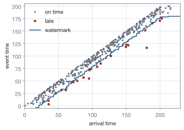

# Batch and stream processing {#sec-batch-and-stream-processing}

The earlier chapters served requests; this one computes over data at rest and data in motion. Liu separates the two: batch processing means "grabbing some
data sources periodically, applying custom business logic, and creating an output to be consumed by another consumer", while in stream processing "data is
unbounded ... The advantage of stream processing over batch is that the output will be much fresher" [@liuSystemDesignInterview2020, Ch. 5, "Batch Processing"
and "Stream Processing"]. This chapter defines MapReduce, data pipelines, analytical storage, stream processing with windows and watermarks, the Lambda and
Kappa architectures, and approximate aggregation with sketches.

The claims are of two kinds. MapReduce, pipelines, columnar storage, stream processing, Lambda and Kappa, and sketches are definitions. Six results with
complete proofs make them precise: MapReduce's output and its combiner, the scheduling of a pipeline's DAG, the bytes a columnar scan reads, what windows and
watermarks guarantee, the error of the count-min sketch, and the behaviour of cardinality registers and samples. The count-min theorem is Cormode and
Muthukrishnan's, proved here as they prove it.

The sources are the benchmark books, @liuSystemDesignInterview2020 [Ch. 5 and App. 5], @reisFundamentalsDataEngineering2022 [Chs. 2, 3, 6, 7, 8 and
App. A], @tanAcingSystemDesign2024 [Secs. 4.5-4.6 and Ch. 17], @sinhaSystemDesignGuide2024 [Ch. 3] and @gilbertSoftwareArchitecturePatterns2024 [Ch. 4], with
three papers: @dean2004mapreduce on MapReduce, @cormode2005improved on the count-min sketch and @kreps2011kafka on log pipelines. The HyperLogLog paper of
Flajolet and others was not available; HyperLogLog is taken from the books. The probability comes from
[Probability and statistics](../../fundamentals-of-mathematics-for-physicists/probability/index.qmd).

The chapter has six sections. @sec-mapreduce defines MapReduce and proves its output. @sec-pipelines defines pipelines and orchestration and proves how a DAG
is scheduled. @sec-analytical-storage defines analytical storage and proves what a columnar scan reads. @sec-stream-processing defines windows and watermarks
and proves what they guarantee. @sec-lambda-kappa defines the Lambda and Kappa architectures. @sec-approximate defines sampling and sketches and proves their
error.

The running example is the photo service's analytics: $2 \times 10^7$ uploads and $5 \times 10^9$ feed views a day ($U = 10^8$ users reading $50$ pages each,
@exm-req-workload-assumptions), from which the service wants views per photo, top photos, and distinct viewers.

Every definition and result is followed by ten examples and ten exercises, each exercise with a hidden solution in two tabs: the argument, then a computation
with its recorded output. The computations run in plain Python 3.12 with NumPy and the standard library's `sqlite3`; streams are simulated with seeded random
numbers. Diagrams are written in the D2 language. Code for particular engines such as Spark, Flink and Airflow is shown as illustrative code and is not run.

## Batch processing and MapReduce {#sec-mapreduce}

A batch job reads a bounded set of data and writes a result. MapReduce made such jobs easy to spread over thousands of machines by asking the programmer for
two functions only: "Map, written by the user, takes an input pair and produces a set of intermediate key/value pairs. The MapReduce library groups together all
intermediate values associated with the same intermediate key I and passes them to the Reduce function" [@dean2004mapreduce, Sec. 2]. This section defines the
model and its execution, and proves that its output does not depend on how the work is split, combined or re-executed.

For more on this topic, see @dean2004mapreduce [Secs. 2-4] and @liuSystemDesignInterview2020 [Ch. 5, "Batch Processing"].

### Map, shuffle and reduce

A job splits its input among map tasks, partitions their output among reduce tasks, and groups it by key. @fig-mr-flow shows the flow.

{#fig-mr-flow width=90%}

:::: {.statement-box}
::: {#def-mapreduce}
#### MapReduce

1. A **MapReduce job** is given by a **map** function, from an input record to a list of intermediate (key, value) pairs, and a **reduce** function, from a key and
   the list of its values to output values: $\mathrm{map}: (k_1, v_1) \mapsto \mathrm{list}(k_2, v_2)$ and $\mathrm{reduce}: (k_2, \mathrm{list}(v_2)) \mapsto
   \mathrm{list}(v_2)$.
2. The input is divided into $M$ **splits**, each processed by a **map task**; intermediate keys are divided among $R$ **reduce tasks** by a **partitioning
   function**, by default $\mathrm{hash}(k) \bmod R$. The **shuffle** moves each pair to its reduce task, which sorts its pairs by key and calls reduce once per
   key.
3. A **combiner** is a function applied to a map task's own pairs before the shuffle, merging the values of each key; it is allowed when reduce is a commutative
   and associative merge of values.
4. A **master** assigns tasks to workers and re-executes the tasks of failed workers; near the end of the job it runs **backup** copies of the remaining tasks and
   takes whichever finishes first.
:::

::::

Items 1 to 4 are the paper's: the types of map and reduce [@dean2004mapreduce, Sec. 2.2]; $M$ splits "of typically 16 megabytes to 64 megabytes" and $R$ pieces by
"a partitioning function (e.g., hash(key) mod R)" [@dean2004mapreduce, Sec. 3.1]; the combiner, allowed when "the user-specified Reduce function is commutative and
associative" [@dean2004mapreduce, Sec. 4.3]; and re-execution and backup tasks [@dean2004mapreduce, Secs. 3.3 and 3.6].

:::: {.callout-note .examples-fold collapse="true" title="Examples"}
The paper's first example counts words. Map emits a one for each word and reduce adds them.

::: {#exm-mr-wordcount}
#### Word count

Map emits $(w, 1)$ for each word $w$ of a document, and reduce "sums together all counts emitted for a particular word" [@dean2004mapreduce, Sec. 2.1]. The run
executes it on three captions, with a sort standing for the shuffle.

```{.python .run}
from itertools import groupby
docs = {"p1": "sunset over the sea", "p2": "the cat", "p3": "the sea at night"}
pairs = [(w, 1) for text in docs.values() for w in text.split()]       # map
pairs.sort()                                                            # shuffle: group by key
out = {k: sum(v for _, v in g) for k, g in groupby(pairs, key=lambda kv: kv[0])}   # reduce
print(out)
```

```{.text .run-output}
{'at': 1, 'cat': 1, 'night': 1, 'over': 1, 'sea': 2, 'sunset': 1, 'the': 3}
```
:::

The paper's inverted index maps each word to its documents. Reduce sorts the document identifiers.

::: {#exm-mr-inverted}
#### An inverted index

"The map function parses each document, and emits a sequence of ⟨word, document ID⟩ pairs. The reduce function accepts all pairs for a given word, sorts the corresponding
document IDs and emits a ⟨word, list(document ID)⟩ pair" [@dean2004mapreduce, Sec. 2.3]. This is the inverted index of @def-inverted-index, built in batch.

```{.python .run}
from collections import defaultdict
docs = {"p1": "sunset over the sea", "p2": "the cat", "p3": "the sea at night"}
groups = defaultdict(list)
for d, text in docs.items():
    for w in set(text.split()): groups[w].append(d)
print({w: sorted(ds) for w, ds in sorted(groups.items()) if len(ds) > 1})
```

```{.text .run-output}
{'sea': ['p1', 'p3'], 'the': ['p1', 'p2', 'p3']}
```
:::

The running example's first job counts views per photo. It is the paper's count of URL access frequency.

::: {#exm-mr-views}
#### Views per photo

Map reads a log line and emits $(\text{photo}, 1)$; reduce adds. The paper's "Count of URL Access Frequency" is the same job [@dean2004mapreduce, Sec. 2.3]; a day
of the photo service has $5 \times 10^9$ view events, each a pair.
:::

Item 2's numbers from the paper. Tasks far outnumber machines.

::: {#exm-mr-splits}
#### Splits and tasks

The paper often runs jobs "with $M = 200{,}000$ and $R = 5{,}000$, using 2,000 worker machines", and chooses "M so that each individual task is roughly 16 MB to 64 MB of
input data" [@dean2004mapreduce, Sec. 3.5]: $100$ map tasks per machine, for load balancing and fast recovery.

```{.python .run}
M, R, W = 200000, 5000, 2000
print("map tasks per worker", M / W, "| reduce tasks per worker", R / W, "| input at 64 MB per split", M * 64e6 / 1e12, "TB")
```

```{.text .run-output}
map tasks per worker 100.0 | reduce tasks per worker 2.5 | input at 64 MB per split 12.8 TB
```
:::

Word frequencies are skewed, so map tasks emit many copies of one key. A combiner adds them locally.

::: {#exm-mr-combiner}
#### The combiner

"Since word frequencies tend to follow a Zipf distribution, each map task will produce hundreds or thousands of records of the form <the, 1>"; the combiner "does
partial merging of this data before it is sent over the network" [@dean2004mapreduce, Sec. 4.3].

```{.python .run}
from collections import Counter
task_words = "the sea the cat the night the sun the".split()
print("pairs without combiner", len(task_words), "| with combiner", len(Counter(task_words)), dict(Counter(task_words)))
```

```{.text .run-output}
pairs without combiner 9 | with combiner 5 {'the': 5, 'sea': 1, 'cat': 1, 'night': 1, 'sun': 1}
```
:::

Network bandwidth was the scarce resource. The master schedules map tasks near their data.

::: {#exm-mr-locality}
#### Moving computation to data

"The MapReduce master takes the location information of the input files into account and attempts to schedule a map task on a machine that contains a replica of the
corresponding input data"; with large jobs "most input data is read locally and consumes no network bandwidth" [@dean2004mapreduce, Sec. 3.4]. The input is in
GFS, the distributed file system of @def-storage-kinds.
:::

Completed map tasks are re-run when their worker fails. Their output was on its disk.

::: {#exm-mr-failure}
#### Worker failure

"Completed map tasks are re-executed on a failure because their output is stored on the local disk(s) of the failed machine and is therefore inaccessible. Completed
reduce tasks do not need to be re-executed since their output is stored in a global file system" [@dean2004mapreduce, Sec. 3.3].
:::

A slow machine delays the whole job. Backup copies of the last tasks cut the tail.

::: {#exm-mr-backup}
#### Backup tasks

Without backup tasks the paper's sort "takes 44% longer to complete" [@dean2004mapreduce, Sec. 3.6]; a job is a fan-out over its tasks, and its time is the slowest
task's, the tail of @prp-fan-out-tail.
:::

Liu lists what to ask of any batch job. Each is a failure of timing or of repetition.

::: {#exm-mr-liu}
#### Questions about a batch

"What if the batch runs late? What if the batch never runs? What if the batch runs more than once? What if the batch never finishes?" and "what if the previous run
hasn't finished when the current run is supposed to run?" [@liuSystemDesignInterview2020, Ch. 5, "Batch Processing"]. The third is answered by determinism
and atomic outputs, the subject of the proposition below.
:::

The paper measures a scan of a terabyte. Most of its time is startup.

::: {#exm-mr-grep}
#### A terabyte grep

The grep job scanned $10^{10}$ records of $100$ bytes with $M = 15000$, peaking "at over 30 GB/s when 1764 workers have been assigned"; it took "approximately 150
seconds from start to finish. This includes about a minute of startup overhead" [@dean2004mapreduce, Sec. 5.2]. A terabyte at $30\,\mathrm{GB/s}$ is $33\,\mathrm{s}$.

```{.python .run}
print(f"{1e10 * 100 / 30e9:.0f} s of scanning at the peak rate")
```

```{.text .run-output}
33 s of scanning at the peak rate
```
:::

::::

:::: {.callout-note .exercises-fold collapse="true" title="Exercises"}
The first exercise writes another of the paper's examples. Map inverts each link.

::: {#exr-mr-reverse-links}
#### The reverse link graph

Write map and reduce for the "Reverse Web-Link Graph": for each target, the list of sources linking to it [@dean2004mapreduce, Sec. 2.3]. Use follows between users
instead of links.
:::

::: {.callout-note .solution collapse="true" title="Solution"}
:::: {.panel-tabset .solution-tabs}
## Solution

Map emits $(\text{followee}, \text{follower})$ for each follow; reduce concatenates the followers of each followee. The output is every user's follower list, the
input of feed fan-out.

## Python

The job on five follows.

```{.python .run}
from collections import defaultdict
follows = [("a", "b"), ("c", "b"), ("a", "d"), ("b", "d"), ("c", "a")]   # (follower, followee)
out = defaultdict(list)
for follower, followee in follows: out[followee].append(follower)
print({k: sorted(v) for k, v in sorted(out.items())})
```

```{.text .run-output}
{'a': ['c'], 'b': ['a', 'c'], 'd': ['a', 'b']}
```
::::
:::

The second exercise asks for a mean. Averages of averages are wrong; sums and counts are right.

::: {#exr-mr-mean}
#### A mean with a combiner

Compute the mean caption length per user with a combiner. Why can the combiner not emit local means, and what should it emit?
:::

::: {.callout-note .solution collapse="true" title="Solution"}
:::: {.panel-tabset .solution-tabs}
## Solution

The mean is not an associative merge: the mean of two local means ignores their sizes. Emit pairs (sum, count), which add componentwise, an associative and
commutative merge; reduce divides at the end.

## Python

Wrong and right combiners.

```{.python .run}
tasks = [[10, 20, 30], [40]]                       # caption lengths of one user, in two map tasks
local_means = [sum(t) / len(t) for t in tasks]
pairs = [(sum(t), len(t)) for t in tasks]
print("mean of means", sum(local_means) / 2, "| from (sum, count)", sum(s for s, _ in pairs) / sum(c for _, c in pairs))
```

```{.text .run-output}
mean of means 30.0 | from (sum, count) 25.0
```
::::
:::

The third exercise sizes the shuffle of the views job. The combiner shrinks it by the repetition within a task.

::: {#exr-mr-shuffle-bytes}
#### Shuffle volume

A day's $5 \times 10^9$ view events are split into $M = 10^4$ map tasks. Each task sees about $3 \times 10^5$ distinct photos among its $5 \times 10^5$ events. With
$20$-byte pairs, find the shuffle volume with and without a combiner.
:::

::: {.callout-note .solution collapse="true" title="Solution"}
:::: {.panel-tabset .solution-tabs}
## Solution

Without: $5 \times 10^9 \times 20 = 100\,\mathrm{GB}$. With: $10^4 \times 3 \times 10^5 \times 20 = 60\,\mathrm{GB}$. The saving is small because views are spread over
many photos; for word counts, with few distinct words, it is large.

## Python

The volumes.

```{.python .run}
events, M, distinct, size = 5e9, 1e4, 3e5, 20
print(f"without {events * size / 1e9:.0f} GB, with {M * distinct * size / 1e9:.0f} GB")
```

```{.text .run-output}
without 100 GB, with 60 GB
```
::::
:::

The fourth exercise finds the slowest reducer. One key goes to one reduce task.

::: {#exr-mr-hot-key}
#### A hot key

One photo receives $1\%$ of the $5 \times 10^9$ views, and $R = 1000$. How many pairs does its reduce task receive, against the mean, without a combiner? What
reduces the imbalance?
:::

::: {.callout-note .solution collapse="true" title="Solution"}
:::: {.panel-tabset .solution-tabs}
## Solution

At least $5 \times 10^7$, against a mean of $5 \times 10^6$: ten times. A combiner reduces the hot key to at most one pair per map task; splitting the key, by
appending a random suffix and summing the parts in a second job, spreads it.

## Python

The loads.

```{.python .run}
P, R = 5e9, 1000
print(f"hot task at least {0.01 * P:.0e}, mean {P / R:.0e}")
```

```{.text .run-output}
hot task at least 5e+07, mean 5e+06
```
::::
:::

The fifth exercise sorts with an identity job. A range partitioning function orders the output files.

::: {#exr-mr-sort}
#### Sorting with MapReduce

The paper's distributed sort emits (key, record) and reduces with the identity, relying on "the partitioning facilities ... and the ordering properties"
[@dean2004mapreduce, Sec. 2.3]. Why does hash partitioning not give a sorted result across files, and what partitioning does?
:::

::: {.callout-note .solution collapse="true" title="Solution"}
:::: {.panel-tabset .solution-tabs}
## Solution

Each reduce task sorts its own keys (Sec. 4.2), but hashing scatters ranges over all tasks, so concatenating files is not sorted. Partitioning by key ranges, with
boundaries from a sample, sends all keys below the first boundary to task $0$ and so on, so the files concatenate in order.

## Python

Range partitioning by sampled boundaries.

```{.python .run}
import random
random.seed(51)
keys = random.sample(range(1000), 40)
bounds = sorted(random.sample(keys, 3))
parts = [[] for _ in range(4)]
for k in keys: parts[sum(k >= b for b in bounds)].append(k)
out = [k for part in parts for k in sorted(part)]
print("concatenation sorted:", out == sorted(keys))
```

```{.text .run-output}
concatenation sorted: True
```
::::
:::

The sixth exercise sizes the master. Its state grows with M times R.

::: {#exr-mr-master-state}
#### The master's memory

The paper notes that "the master must make $O(M + R)$ scheduling decisions and keeps $O(M * R)$ state in memory", about "one byte of data per map task/reduce task
pair" [@dean2004mapreduce, Sec. 3.5]. Find the state for $M = 200{,}000$, $R = 5{,}000$.
:::

::: {.callout-note .solution collapse="true" title="Solution"}
:::: {.panel-tabset .solution-tabs}
## Solution

$10^9$ bytes, $1\,\mathrm{GB}$: large but feasible on one machine, which is why $M$ and $R$ cannot grow without bound.

## Python

The product.

```{.python .run}
print(200000 * 5000 / 1e9, "GB")
```

```{.text .run-output}
1.0 GB
```
::::
:::

The seventh exercise follows the paper's skipping mode. It is a dead-letter queue for batch jobs.

::: {#exr-mr-bad-records}
#### Skipping bad records

The master skips a record after "more than one failure on a particular record" [@dean2004mapreduce, Sec. 4.6]. Relate this to the poison messages of
@def-failure-handling, and say when skipping is acceptable.
:::

::: {.callout-note .solution collapse="true" title="Solution"}
:::: {.panel-tabset .solution-tabs}
## Solution

A record that crashes map deterministically is a poison message; skipping it after two failures is $n_a = 2$ without a queue of dead letters. It suits statistics
over large data, where a few records do not matter, as the paper says; for billing it is not acceptable, and the record should be kept for inspection.

## Python

A task that skips a record after two failures.

```{.python .run}
records = ["ok", "ok", "bad", "ok"]
failures, skipped, done = {}, [], []
for attempt in range(3):
    for i, r in enumerate(records):
        if i in skipped or i in done: continue
        if r == "bad":
            failures[i] = failures.get(i, 0) + 1
            if failures[i] > 1: skipped.append(i)
            break
        done.append(i)
print("processed", done, "| skipped", skipped)
```

```{.text .run-output}
processed [0, 1, 3] | skipped [2]
```
::::
:::

The eighth exercise models backup tasks. The job waits for the slowest of many tasks.

::: {#exr-mr-stragglers}
#### Backups against stragglers

A job's last $100$ tasks each take $1$ minute, except that each is, independently with probability $0.02$, on a slow machine taking $10$ minutes. Compare the expected
job tail without backups and with a backup copy of every task, started after $1.5$ minutes on a normal machine.
:::

::: {.callout-note .solution collapse="true" title="Solution"}
:::: {.panel-tabset .solution-tabs}
## Solution

Without backups the tail is $10$ minutes unless all $100$ are fast, probability $0.98^{100} = 0.13$: expected $1 + 9(1 - 0.13) = 8.8$ minutes. With backups every slow task
finishes by $2.5$ minutes: the tail is at most $2.5$, at a cost of a few extra tasks, as the paper reports.

## Python

The expectations.

```{.python .run}
p, n = 0.02, 100
fast_all = (1 - p) ** n
print(f"without backups {1 + 9 * (1 - fast_all):.1f} min, with backups at most 2.5 min; extra tasks expected {n * p:.0f}")
```

```{.text .run-output}
without backups 8.8 min, with backups at most 2.5 min; extra tasks expected 2
```
::::
:::

The ninth exercise writes an extra file from a map task. Re-execution would write it twice.

::: {#exr-mr-side-effects}
#### Side effects

A map task also appends a line to a shared audit log. What happens under re-execution, and what does the paper ask of such side effects [@dean2004mapreduce,
Sec. 4.5]?
:::

::: {.callout-note .solution collapse="true" title="Solution"}
:::: {.panel-tabset .solution-tabs}
## Solution

A re-executed or backup task appends again, duplicating lines. The paper relies "on the application writer to make such side-effects atomic and idempotent", typically by
writing a temporary file and renaming it: an effect keyed by the task, which @prp-idempotent-consumer (b) would recognise.

## Python

Appending against writing a file named by the task.

```{.python .run}
log, files = [], {}
for execution in ("first", "backup"):
    log.append("task 7 done")
    files["audit-task-7"] = "task 7 done"          # rename to a fixed name
print("append:", len(log), "lines | named file:", len(files))
```

```{.text .run-output}
append: 2 lines | named file: 1
```
::::
:::

The tenth exercise writes item 2 sequentially. It is the paper's local execution mode.

::: {#exr-mr-local-run}
#### A sequential implementation

Write a sequential MapReduce with $M$ splits, $R$ reduce tasks and an optional combiner, and run word count for $M = 3$, $R = 2$.
:::

::: {.callout-note .solution collapse="true" title="Solution"}
:::: {.panel-tabset .solution-tabs}
## Solution

Map each split, optionally combine per split, partition pairs by a fixed hash modulo $R$, sort each partition and reduce. The paper offers such a mode "that sequentially
executes all of the work for a MapReduce operation on the local machine" for debugging [@dean2004mapreduce, Sec. 4.7].

## Python

The implementation.

```{.python .run}
import zlib
from itertools import groupby
def mapreduce(splits, mapper, reducer, R, combiner=None):
    parts = [[] for _ in range(R)]
    for split in splits:
        pairs = [kv for rec in split for kv in mapper(rec)]
        if combiner:
            pairs.sort(); pairs = [(k, combiner(k, [v for _, v in g])) for k, g in groupby(pairs, key=lambda kv: kv[0])]
        for k, v in pairs: parts[zlib.crc32(k.encode()) % R].append((k, v))
    out = {}
    for part in parts:
        part.sort()
        for k, g in groupby(part, key=lambda kv: kv[0]): out[k] = reducer(k, [v for _, v in g])
    return dict(sorted(out.items()))
splits = [["the sea", "the cat"], ["sea and sun"], ["the sun"]]
wc_map = lambda line: [(w, 1) for w in line.split()]
wc_red = lambda k, vs: sum(vs)
print(mapreduce(splits, wc_map, wc_red, R=2, combiner=wc_red))
```

```{.text .run-output}
{'and': 1, 'cat': 1, 'sea': 2, 'sun': 2, 'the': 3}
```
::::
:::

::::

### What a MapReduce job computes

A job's output is fixed by its map and reduce functions; splitting, partitioning, combining and re-running change only how it is computed. The proposition proves it.

:::: {.statement-box}
::: {#prp-mapreduce}
#### Output, combiners and re-execution of MapReduce

Let map and reduce be deterministic, and let reduce not depend on the order of the values it is given.

(a) For any number $M$ of splits of the input, any number $R$ of reduce tasks and any partitioning function, the output is, for each intermediate key $k$,
$\mathrm{reduce}(k, V_k)$, where $V_k$ is the multiset of values of the pairs with key $k$ emitted by map over all input records.

(b) If $\mathrm{reduce}(k, (v_1, \dots, v_n)) = v_1 \oplus \cdots \oplus v_n$ for a commutative and associative operation $\oplus$, and the combiner applies the same merge to
each map task's values of each key, the output is unchanged; the number of pairs shuffled falls from the number $P$ of intermediate pairs to the sum over map tasks of
their distinct keys, at most $\min(P, MK)$ for $K$ distinct keys.

(c) If each task's output is committed atomically, and reduce tasks read the committed output of each map task, any pattern of failed, repeated or backup executions
yields the output of (a).

(d) All pairs with key $k$ go to one reduce task; if a fraction $\phi$ of the $P$ pairs have key $k$, that task receives at least $\phi P$ pairs without a combiner.
:::

::::

*Proof.* (a) The splits partition the input records, so the pairs emitted by all map tasks are exactly the pairs map emits over all records, with multiplicity. The
partitioning function sends every pair with key $k$ to the one task $p(k)$, which sorts its pairs and so calls reduce once for $k$, with all of $V_k$; since reduce
ignores order, its result is $\mathrm{reduce}(k, V_k)$, whatever $M$, $R$ and $p$.

(b) Let map task $t$ emit values $V_{k,t}$ for $k$, so $V_k$ is the union of the $V_{k,t}$. The combiner replaces $V_{k,t}$ by the single value $c_{k,t} = \bigoplus V_{k,t}$.
By associativity and commutativity, a $\oplus$-merge of all of $V_k$ may be computed in any grouping and order, so $\bigoplus_t c_{k,t} = \bigoplus V_k$, and by (a) the output
is unchanged. Task $t$ now sends one pair per distinct key it saw; the sum of these counts is at most $P$, since each distinct key in a task has at least one pair, and at
most $MK$, since each task has at most $K$ keys.

(c) An execution of a deterministic task produces the same output from the same input, so every committed output equals the output of a failure-free execution. A
reduce task reads, for each map task, the output of one committed execution, which by determinism is the same whichever execution committed; and the final output
of each reduce task is one committed execution's. So the result is that of a run without failures, which is (a)'s.

(d) By (a) all pairs with key $k$ go to task $p(k)$; there are $\phi P$ of them. $\square$

Part (c) is the paper's guarantee: "When the user-supplied map and reduce operators are deterministic functions of their input values, our distributed implementation
produces the same output as would have been produced by a non-faulting sequential execution of the entire program", relying "on atomic commits of map and reduce task
outputs" [@dean2004mapreduce, Sec. 3.3].

:::: {.callout-note .examples-fold collapse="true" title="Examples"}
Part (a) on word count. The output is the same for every $M$ and $R$.

::: {#exm-mrp-any-split}
#### Any split, same output

The sequential implementation of @exr-mr-local-run gives the same counts for $M \in \{1, 2, 4\}$ and $R \in \{1, 3, 7\}$.

```{.python .run}
import zlib
from collections import Counter
text = "the sea the cat sea and sun the sun at night the end".split()
def run(M, R):
    splits = [text[i::M] for i in range(M)]
    parts = [Counter() for _ in range(R)]
    for s in splits:
        for w in s: parts[zlib.crc32(w.encode()) % R][w] += 1
    return dict(sorted(sum(parts, Counter()).items()))
outs = {(M, R): run(M, R) for M in (1, 2, 4) for R in (1, 3, 7)}
print("all equal:", len({str(o) for o in outs.values()}) == 1, outs[(1, 1)])
```

```{.text .run-output}
all equal: True {'and': 1, 'at': 1, 'cat': 1, 'end': 1, 'night': 1, 'sea': 2, 'sun': 2, 'the': 4}
```
:::

Part (b)'s bound on a skewed corpus. Few distinct words mean a large saving.

::: {#exm-mrp-combiner-saving}
#### What the combiner saves

Ten map tasks of $10^4$ Zipf-distributed words over $1000$ distinct words send far fewer pairs with a combiner.

```{.python .run}
import numpy as np
rng = np.random.default_rng(52)
w = 1 / np.arange(1, 1001); w /= w.sum()
tasks = [rng.choice(1000, 10000, p=w) for _ in range(10)]
P = sum(len(t) for t in tasks); combined = sum(len(set(t)) for t in tasks)
print("pairs without", P, "| with combiner", combined, "| bound min(P, MK)", min(P, 10 * 1000))
```

```{.text .run-output}
pairs without 100000 | with combiner 9075 | bound min(P, MK) 10000
```
:::

Part (c) by simulation. Map tasks fail and are re-run on other workers.

::: {#exm-mrp-reexec}
#### Re-execution gives the same output

Each map task fails with probability $0.3$ and is re-run until it commits; the committed outputs give the same counts as a run without failures.

```{.python .run}
import random
from collections import Counter
random.seed(53)
splits = [["a", "b", "a"], ["b", "c"], ["a", "c", "c"]]
committed = {}
for t, split in enumerate(splits):
    while t not in committed:
        out = Counter(split)              # deterministic map + combiner
        if random.random() < 0.3: continue  # the worker fails before committing
        committed[t] = out
print(dict(sum(committed.values(), Counter())), "| failure-free:", dict(Counter(sum(splits, []))))
```

```{.text .run-output}
{'a': 3, 'b': 2, 'c': 3} | failure-free: {'a': 3, 'b': 2, 'c': 3}
```
:::

Part (c) needs determinism. A sampling map gives different outputs on re-execution.

::: {#exm-mrp-nondeterministic}
#### A non-deterministic map

A map that keeps a random tenth of records yields a different sample each time it is re-executed; the paper's weaker guarantee is that each reduce task's output corresponds
to some sequential execution, possibly a different one for each reduce task [@dean2004mapreduce, Sec. 3.3]. Seeding the sample by the record, as below, restores determinism.

```{.python .run}
import random, zlib
records = [f"r{i}" for i in range(20)]
def sample(seed): r = random.Random(seed); return [x for x in records if r.random() < 0.3]
by_record = lambda: [x for x in records if zlib.crc32(x.encode()) % 10 < 3]
print("unseeded runs equal:", sample(1) == sample(2), "| seeded by record equal:", by_record() == by_record())
```

```{.text .run-output}
unseeded runs equal: False | seeded by record equal: True
```
:::

Part (d) for the views job. One photo's task receives a hundredth of everything.

::: {#exm-mrp-skew}
#### A hot photo

With $\phi = 0.01$ and $P = 5 \times 10^9$, the hot photo's task receives $5 \times 10^7$ pairs; with a combiner it receives at most one per map task, $10^4$.

```{.python .run}
print(f"{0.01 * 5e9:.0e} without, at most {1e4:.0e} with a combiner")
```

```{.text .run-output}
5e+07 without, at most 1e+04 with a combiner
```
:::

Part (b) covers more than sums. Maximum, minimum and set union are merges too.

::: {#exm-mrp-max}
#### Other associative merges

The latest upload time per user is a maximum, the set of tags per photo a union; both are commutative and associative, so both allow a combiner. A median is not a merge
of medians.

```{.python .run}
import statistics
parts = [[1, 2, 9], [3, 4]]
print("max of maxes", max(max(p) for p in parts), "=", max(sum(parts, [])),
      "| median of medians", statistics.median([statistics.median(p) for p in parts]), "vs", statistics.median(sum(parts, [])))
```

```{.text .run-output}
max of maxes 9 = 9 | median of medians 2.75 vs 3
```
:::

The paper commits reduce output by renaming a file. A rename either happens or does not.

::: {#exm-mrp-rename}
#### Atomic commit by rename

"When a reduce task completes, the reduce worker atomically renames its temporary output file to the final output file. If the same reduce task is executed on multiple
machines, multiple rename calls will be executed for the same final output file" and the file system keeps "just the data produced by one execution"
[@dean2004mapreduce, Sec. 3.3].

```{.python .run}
import os
with open("part-0.tmp-a", "w") as f: f.write("sea\t2\n")
with open("part-0.tmp-b", "w") as f: f.write("sea\t2\n")
os.replace("part-0.tmp-a", "part-0"); os.replace("part-0.tmp-b", "part-0")
print(open("part-0").read().strip(), "| files:", sorted(f for f in os.listdir(".") if f.startswith("part-0")))
```

```{.text .run-output}
sea	2 | files: ['part-0']
```
:::

The master ignores a second completion of a map task. Only one execution's files are used.

::: {#exm-mrp-ignore-dup}
#### Duplicate completion messages

"If the master receives a completion message for an already completed map task, it ignores the message. Otherwise, it records the names of R files"
[@dean2004mapreduce, Sec. 3.3]: deduplication by task identifier, as in @prp-idempotent-consumer (b).
:::

Each reduce task processes its keys in order. Its output file is sorted.

::: {#exm-mrp-order}
#### Sorted output within a partition

"We guarantee that within a given partition, the intermediate key/value pairs are processed in increasing key order" [@dean2004mapreduce, Sec. 4.2]; with $R$ tasks
the output is $R$ sorted files, sorted overall only with range partitioning (@exr-mr-sort).
:::

Part (a) allows any partitioning function. A custom one groups related keys in one file.

::: {#exm-mrp-host}
#### Choosing the partitioning function

Using "hash(Hostname(urlkey)) mod R" puts all URLs of a host in one output file [@dean2004mapreduce, Sec. 4.1]; by part (a) the output is unchanged, only its
arrangement into files.
:::

::::

:::: {.callout-note .exercises-fold collapse="true" title="Exercises"}
The first exercise checks part (b) on random data and merges. Sums, maxima and unions all qualify.

::: {#exr-mrp-proof-b}
#### Part (b) by machine

For random splits and the merges sum, max and union, check that combining per task does not change the output.
:::

::: {.callout-note .solution collapse="true" title="Proof"}
:::: {.panel-tabset .solution-tabs}
## Proof

Part (b)'s proof uses only commutativity and associativity, which all three merges have; the check confirms equality on random inputs.

## Python

Random checks.

```{.python .run}
import random
from functools import reduce
random.seed(54)
merges = {"sum": lambda a, b: a + b, "max": max, "union": lambda a, b: a | b}
ok = True
for name, op in merges.items():
    for _ in range(200):
        vals = [random.randint(0, 9) for _ in range(12)]
        if name == "union": vals = [frozenset([v]) for v in vals]
        cuts = sorted(random.sample(range(1, 12), 3))
        parts = [vals[a:b] for a, b in zip([0] + cuts, cuts + [12])]
        ok &= reduce(op, [reduce(op, p) for p in parts]) == reduce(op, vals)
print("combining never changed the result:", ok)
```

```{.text .run-output}
combining never changed the result: True
```
::::
:::

The second exercise breaks part (b). Subtraction depends on grouping.

::: {#exr-mrp-not-assoc}
#### A merge that is not associative

Show that a combiner for reduce $v_1 - v_2 - \cdots$ changes the output.
:::

::: {.callout-note .solution collapse="true" title="Solution"}
:::: {.panel-tabset .solution-tabs}
## Solution

$(10 - 3) - (2 - 1) = 6$ while $10 - 3 - 2 - 1 = 4$: subtraction is not associative, so combining in groups changes the result, and part (b) does not apply.

## Python

Both groupings.

```{.python .run}
print((10 - 3) - (2 - 1), 10 - 3 - 2 - 1)
```

```{.text .run-output}
6 4
```
::::
:::

The third exercise breaks part (a)'s assumption. The first value seen depends on the shuffle.

::: {#exr-mrp-order-dependent}
#### A reduce that depends on order

A reduce keeps the first caption it receives for each photo. Why is its output not determined by part (a), and how is it fixed?
:::

::: {.callout-note .solution collapse="true" title="Solution"}
:::: {.panel-tabset .solution-tabs}
## Solution

The order of values reaching reduce depends on which map task finishes first, so "first" is arbitrary. Keep the caption with the largest version or timestamp, a
maximum, which ignores order (@prp-idempotent-consumer (d)).

## Python

Two arrival orders.

```{.python .run}
vals = [(2, "sky"), (1, "sea")]                   # (version, caption)
print("first:", vals[0][1], "/", vals[::-1][0][1], "| max version:", max(vals)[1], "/", max(vals[::-1])[1])
```

```{.text .run-output}
first: sky / sea | max version: sky / sky
```
::::
:::

The fourth exercise computes top photos by two jobs. The first counts, the second ranks.

::: {#exr-mrp-two-stage}
#### Two jobs in a chain

Compute the top $3$ photos by views with two MapReduce jobs, the second with a single reduce task. Why is one reduce task acceptable in the second job?
:::

::: {.callout-note .solution collapse="true" title="Solution"}
:::: {.panel-tabset .solution-tabs}
## Solution

Job 1 counts views per photo. Job 2 maps each (photo, count) to a local top $3$ per map task, with a combiner keeping the top $3$; its single reduce task merges at most
$3M$ candidates. A top-$k$ of the union is in the union of the per-task top-$k$ lists, since each photo's count is complete after job 1.

## Python

The chain.

```{.python .run}
import heapq
from collections import Counter
views = ["a"] * 5 + ["b"] * 3 + ["c"] * 7 + ["d"] * 2 + ["e"] * 6
counts = Counter(views)                                  # job 1
splits = [list(counts.items())[:3], list(counts.items())[3:]]
local = [heapq.nlargest(3, s, key=lambda kv: kv[1]) for s in splits]      # job 2, map + combiner
print(heapq.nlargest(3, sum(local, []), key=lambda kv: kv[1]))
```

```{.text .run-output}
[('c', 7), ('e', 6), ('a', 5)]
```
::::
:::

The fifth exercise checks Tan's counterexample. Top lists of partial counts do not merge.

::: {#exr-mrp-tan-heaps}
#### Merging top lists of partial counts

Tan: if host one has $\{A: 7, B: 6, C: 5\}$ and host two $\{A: 2, B: 4, C: 5\}$ with top-$2$ heaps, the merged heap $\{A: 7, B: 10\}$ "erroneously leaves C out", the correct
answer being $\{B: 10, C: 10\}$ [@tanAcingSystemDesign2024, Sec. 17.7, p. 387]. Verify, and contrast with @exr-mrp-two-stage.
:::

::: {.callout-note .solution collapse="true" title="Solution"}
:::: {.panel-tabset .solution-tabs}
## Solution

The true totals are $A = 9$, $B = 10$, $C = 10$: the top two are $B$ and $C$, as Tan says (Tan prints $C$ as $11$, a slip: $5 + 5 = 10$). The merge fails because each host's counts
are partial; in @exr-mrp-two-stage each photo's count is complete before ranking, so per-task top lists are safe.

## Python

The two computations.

```{.python .run}
import heapq
from collections import Counter
h1, h2 = {"A": 7, "B": 6, "C": 5}, {"A": 2, "B": 4, "C": 5}
merged = Counter()
for h in (h1, h2):
    for k, v in heapq.nlargest(2, h.items(), key=lambda kv: kv[1]): merged[k] += v
print("merged heaps", merged.most_common(2), "| true", (Counter(h1) + Counter(h2)).most_common())
```

```{.text .run-output}
merged heaps [('B', 10), ('A', 7)] | true [('B', 10), ('C', 10), ('A', 9)]
```
::::
:::

The sixth exercise lets two executions of a map task both report. Part (c) needs only one to count.

::: {#exr-mrp-dup-commit}
#### Two commits of one task

A map task's original and its backup both finish and report. Show that reading both outputs would double count, and how the master prevents it.
:::

::: {.callout-note .solution collapse="true" title="Solution"}
:::: {.panel-tabset .solution-tabs}
## Solution

Summing both outputs counts the split twice. The master records the first completion and ignores later ones (@exm-mrp-ignore-dup), so reducers read one committed
output per task, as part (c) assumes.

## Python

Both readings.

```{.python .run}
from collections import Counter
out = Counter(["a", "b", "a"])
print("both read:", dict(out + out), "| one committed:", dict(out))
```

```{.text .run-output}
both read: {'a': 4, 'b': 2} | one committed: {'a': 2, 'b': 1}
```
::::
:::

The seventh exercise chooses the number of reduce tasks. Skew and output files limit it.

::: {#exr-mrp-r-choice}
#### Choosing $R$

The views job runs on $200$ machines. The paper makes "R a small multiple of the number of worker machines" [@dean2004mapreduce, Sec. 3.5]. With $R = 1000$, what is
the mean load per reduce task, and how does part (d)'s hot key bound the job's time?
:::

::: {.callout-note .solution collapse="true" title="Solution"}
:::: {.panel-tabset .solution-tabs}
## Solution

$5 \times 10^6$ pairs on average; but no task can finish before the one with the hot key, so the job's reduce phase lasts at least the time for $\phi P$ pairs whatever $R$ is,
unless a combiner shrinks them.

## Python

The loads for several $R$.

```{.python .run}
P, phi = 5e9, 0.01
for R in (200, 1000, 5000): print(R, f"mean {P / R:.1e}, hot task {phi * P:.1e}")
```

```{.text .run-output}
200 mean 2.5e+07, hot task 5.0e+07
1000 mean 5.0e+06, hot task 5.0e+07
5000 mean 1.0e+06, hot task 5.0e+07
```
::::
:::

The eighth exercise uses part (b)'s bound with few keys. The shuffle is at most $MK$ pairs.

::: {#exr-mrp-bytes-per-key}
#### Combiner bound for few keys

A job counts uploads per country, $K = 200$, over $M = 10^4$ map tasks and $2 \times 10^7$ records. Find the shuffle with and without a combiner.
:::

::: {.callout-note .solution collapse="true" title="Solution"}
:::: {.panel-tabset .solution-tabs}
## Solution

Without, $2 \times 10^7$ pairs; with, at most $MK = 2 \times 10^6$, and fewer if tasks see fewer countries: a factor of at least $10$.

## Python

The bound.

```{.python .run}
print("without", 2e7, "| with at most", 1e4 * 200)
```

```{.text .run-output}
without 20000000.0 | with at most 2000000.0
```
::::
:::

The ninth exercise checks part (a) with random partitionings. Any function of the key will do.

::: {#exr-mrp-proof-a}
#### Part (a) for random partitioning functions

Check part (a) for random assignments of keys to reduce tasks, including all keys to one task.
:::

::: {.callout-note .solution collapse="true" title="Proof"}
:::: {.panel-tabset .solution-tabs}
## Proof

The proof uses only that $p$ is a function of the key: each key's values meet in one task. The check draws random functions from keys to tasks.

## Python

Random partitionings.

```{.python .run}
import random
from collections import Counter, defaultdict
random.seed(55)
words = "a b c a d b a e c a".split()
truth = Counter(words)
ok = True
for _ in range(500):
    R = random.randint(1, 5)
    p = {w: random.randrange(R) for w in set(words)}
    parts = defaultdict(Counter)
    for w in words: parts[p[w]][w] += 1
    ok &= sum(parts.values(), Counter()) == truth
print("same output for every partitioning:", ok)
```

```{.text .run-output}
same output for every partitioning: True
```
::::
:::

The tenth exercise answers Liu's third question. Determinism and atomic outputs make a second run harmless.

::: {#exr-mrp-liu-twice}
#### A batch that runs twice

A daily views job is accidentally run twice for one day. When is the second run harmless?
:::

::: {.callout-note .solution collapse="true" title="Solution"}
:::: {.panel-tabset .solution-tabs}
## Solution

If the job is deterministic and writes its day's output by atomically replacing the day's file or partition, the second run writes the same output in the same place:
part (c)'s reasoning for whole jobs. If it appends to a running total instead, the day is counted twice.

## Python

Replace against append.

```{.python .run}
day_out = {"2026-11-27": 5}
store_replace, store_append = {}, {"total": 0}
for _ in range(2):
    store_replace.update(day_out); store_append["total"] += day_out["2026-11-27"]
print("replace:", store_replace, "| append:", store_append)
```

```{.text .run-output}
replace: {'2026-11-27': 5} | append: {'total': 10}
```
::::
:::

::::

## Data pipelines and orchestration {#sec-pipelines}

Analytics needs data moved from where it is produced to where it is queried, transformed on the way, on a schedule and in the right order. Reis divides this
work into "five stages": generation, storage, ingestion, transformation and serving data [@reisFundamentalsDataEngineering2022, Ch. 2, p. 33]. This section
defines pipelines, ETL and ELT, and orchestration by a DAG of tasks, and proves when a DAG can be run and how long it takes.

For more on this topic, see @reisFundamentalsDataEngineering2022 [Ch. 2, pp. 33 and 64-65; Ch. 3, pp. 98-100; Ch. 7, pp. 236-237 and 246],
@tanAcingSystemDesign2024 [Sec. 4.6, pp. 93-95] and @kreps2011kafka [Sec. 4].

### Sources, ingestion, transformation and DAGs

A pipeline is a graph of tasks, each reading the outputs of others. @fig-pipe-dag shows the photo service's daily analytics.

{#fig-pipe-dag width=95%}

:::: {.statement-box}
::: {#def-pipeline}
#### Data pipelines, ETL and orchestration

1. A **data pipeline** moves data from **source systems** to a destination for analysis. **Ingestion** copies data from the sources, in **batches** on a schedule or as a
   **stream** of events; data is **bounded** if it is a finite set and **unbounded** if it keeps arriving.
2. In **ETL** (extract, transform, load) data is transformed before it is loaded into the destination; in **ELT** it is loaded raw into a staging area of the destination
   and transformed there.
3. A pipeline is a **directed acyclic graph** (DAG) of **tasks**, with an edge from $u$ to $v$ when $v$ needs $u$'s output. A **run** of the pipeline executes every task once
   for a given **interval** of data, such as a day. An **orchestrator** starts each task when its dependencies have finished, monitors runs, retries failures and alerts.
4. A task is **idempotent** if running it again for the same interval leaves the same output, for instance by overwriting the interval's partition; a **backfill** runs
   the pipeline for past intervals.
:::

::::

Item 3 follows Tan, for whom "an ETL pipeline consists of a Directed Acyclic Graph (DAG) of tasks. In the DAG, a node corresponds to a task, and its ancestors are its
dependencies. A job is a single run of an ETL pipeline" [@tanAcingSystemDesign2024, Sec. 4.6, p. 93], and Reis: "A pure scheduler, such as cron, is aware only of time; an
orchestration engine builds in metadata on job dependencies, generally in the form of a directed acyclic graph (DAG)" [@reisFundamentalsDataEngineering2022, Ch. 2,
pp. 64-65]. Item 2 is Reis's: with ELT "data gets moved more or less directly from production systems into a staging area in the data warehouse ... transformations are
handled directly in the data warehouse" [@reisFundamentalsDataEngineering2022, Ch. 3, p. 99].

:::: {.callout-note .examples-fold collapse="true" title="Examples"}
Reis's five stages, for the photo service. Each stage has its own system.

::: {#exm-pipe-lifecycle}
#### The lifecycle of the photo analytics

Generation: the upload and feed services write logs and rows. Storage: object storage and a warehouse. Ingestion: logs copied hourly, the metadata database copied by
change data capture (@def-outbox). Transformation: views per photo per day. Serving: dashboards and the top-photos list.
:::

Reis's mantra is that data is unbounded until it is bounded. A day's log is a bound.

::: {#exm-pipe-bounded}
#### Bounded and unbounded

"All data is unbounded until it's bounded"; "business processes have long imposed artificial bounds on data by cutting discrete batches"
[@reisFundamentalsDataEngineering2022, Ch. 7, p. 236]. The views stream never ends; the views of 27 November are a bounded batch.
:::

Reis places ingestion on a spectrum. No real system is truly real time.

::: {#exm-pipe-frequency}
#### How often to ingest

Ingestion "can be batch, micro-batch, or real-time", and "no ingestion system is genuinely real-time. Any database, queue or pipeline has inherent latency"
[@reisFundamentalsDataEngineering2022, Ch. 7, pp. 236-237].
:::

The views job can be done either way. ELT keeps the raw data.

::: {#exm-pipe-etl-elt}
#### ETL or ELT for the views

ETL: a job parses the logs and loads only daily counts into the warehouse. ELT: the raw log lines are loaded into a staging table and counted with SQL in the warehouse; a
new question about the logs needs no new ingestion, at the cost of storing the raw lines.

```{.python .run}
import sqlite3
db = sqlite3.connect(":memory:")
db.execute("CREATE TABLE staging_views (day TEXT, photo TEXT)")             # loaded raw (ELT)
db.executemany("INSERT INTO staging_views VALUES (?, ?)", [("d1", "p1"), ("d1", "p2"), ("d1", "p1"), ("d2", "p1")])
print(db.execute("SELECT day, photo, COUNT(*) FROM staging_views GROUP BY day, photo ORDER BY day, photo").fetchall())
```

```{.text .run-output}
[('d1', 'p1', 2), ('d1', 'p2', 1), ('d2', 'p1', 1)]
```
:::

Tan's simplest pipeline is cron, two tables and scripts. Each script checks its parents.

::: {#exm-pipe-tan-cron}
#### A pipeline in cron

Each script should "check that the updated_at value of the relevant job is less than its dependent jobs", then trigger monitoring and execute; the disadvantages include a
single host and no idempotency for "numerous smaller tasks" [@tanAcingSystemDesign2024, Sec. 4.6.1, pp. 93-95].
:::

An orchestrator states the edges directly. The code below is illustrative.

::: {#exm-pipe-airflow}
#### The same DAG in an orchestrator

The daily pipeline in Airflow's Python interface; the `>>` operator draws an edge.

```{.python .illustrative}
from airflow import DAG
from airflow.operators.bash import BashOperator
import pendulum

with DAG("photo_daily", schedule="@daily", start_date=pendulum.datetime(2026, 11, 1), catchup=True) as dag:
    logs = BashOperator(task_id="ingest_logs", bash_command="ingest_logs {{ ds }}")
    snap = BashOperator(task_id="snapshot_metadata", bash_command="snapshot {{ ds }}")
    facts = BashOperator(task_id="build_view_facts", bash_command="build_facts {{ ds }}")
    top = BashOperator(task_id="top_photos", bash_command="top_photos {{ ds }}")
    [logs, snap] >> facts >> top
```
:::

Reis lists what orchestration does beyond scheduling. Backfills and dependencies over time ranges.

::: {#exm-pipe-reis-orch}
#### What an orchestrator adds

An orchestrator "monitors jobs that it manages and kicks off new tasks as internal DAG dependencies are completed"; it sets alerts when jobs miss an expected completion
time, and "advanced orchestration engines can backfill new DAGs or individual tasks ... They also support dependencies over a time range. For example, a monthly reporting
job might check that an ETL job has been completed for the full month" [@reisFundamentalsDataEngineering2022, Ch. 2, p. 65].
:::

Tan compares the two styles of ingestion. A batch runs whether or not there is data.

::: {#exm-pipe-tan-poll}
#### Batch as polling, streaming as interrupts

"We can think of batch vs. streaming as analogous to polling vs. interrupt. Similar to polling, a batch job always runs at a defined frequency regardless of whether there are
new events to process, while a streaming job runs whenever a trigger condition is met" [@tanAcingSystemDesign2024, Sec. 4.6, p. 93].
:::

The Kafka paper describes a pipeline of exactly this kind. Kafka feeds both online services and a warehouse.

::: {#exm-pipe-kafka}
#### Kafka as the ingestion layer

LinkedIn's frontends publish log data to local Kafka brokers; a separate Kafka cluster near the Hadoop cluster pulls from them, and "we then run data load jobs to pull
data from this replica cluster of Kafka into Hadoop and our data warehouse", with an end-to-end latency "about 10 seconds on average" [@kreps2011kafka, Sec. 4].
:::

Item 4 in SQL. The task deletes its day's rows and inserts them again in one transaction.

::: {#exm-pipe-idempotent}
#### An idempotent daily task

Running the task twice leaves one copy of the day's counts.

```{.python .run}
import sqlite3
db = sqlite3.connect(":memory:")
db.executescript("CREATE TABLE raw (day TEXT, photo TEXT); CREATE TABLE daily (day TEXT, photo TEXT, views INT);")
db.executemany("INSERT INTO raw VALUES (?, ?)", [("d1", "p1"), ("d1", "p1"), ("d1", "p2")])
def run(day):
    with db:
        db.execute("DELETE FROM daily WHERE day = ?", (day,))
        db.execute("INSERT INTO daily SELECT day, photo, COUNT(*) FROM raw WHERE day = ? GROUP BY photo", (day,))
run("d1"); run("d1")
print(db.execute("SELECT * FROM daily ORDER BY photo").fetchall())
```

```{.text .run-output}
[('d1', 'p1', 2), ('d1', 'p2', 1)]
```
:::

::::

:::: {.callout-note .exercises-fold collapse="true" title="Exercises"}
The first exercise adds an edge that closes a cycle. No task in it can start.

::: {#exr-pipe-cycle}
#### A cycle in a pipeline

The top-photos task is made to feed back into the view facts, to weight them. What happens to a run, and how is such a dependency expressed in a DAG?
:::

::: {.callout-note .solution collapse="true" title="Solution"}
:::: {.panel-tabset .solution-tabs}
## Solution

Each task in the cycle waits for another in it, so none starts: the orchestrator rejects the graph. The dependency is on the previous interval: today's facts use yesterday's
top list, an edge from yesterday's run to today's, which keeps the graph of runs acyclic.

## Python

Detecting the cycle.

```{.python .run}
edges = {"facts": ["top"], "top": ["facts"]}
def has_cycle(g):
    state = {}
    def visit(u):
        if state.get(u) == 1: return True
        if state.get(u) == 2: return False
        state[u] = 1
        if any(visit(v) for v in g.get(u, [])): return True
        state[u] = 2; return False
    return any(visit(u) for u in g)
print("cycle:", has_cycle(edges), "| with yesterday's top:", has_cycle({"facts_d2": [], "top_d1": ["facts_d2"]}))
```

```{.text .run-output}
cycle: True | with yesterday's top: False
```
::::
:::

The second exercise prices keeping raw logs. ELT stores what ETL discards.

::: {#exr-pipe-elt-cost}
#### Storage cost of ELT

A view log line is $200$ bytes; the daily count per photo is $30$ bytes for $7.3 \times 10^7$ photos with at least one view. Compare a year's storage of raw lines (ELT) and of daily counts (ETL).
:::

::: {.callout-note .solution collapse="true" title="Solution"}
:::: {.panel-tabset .solution-tabs}
## Solution

Raw: $5 \times 10^9 \times 200 \times 365 = 365\,\mathrm{TB}$. Counts: $7.3 \times 10^7 \times 30 \times 365 = 0.8\,\mathrm{TB}$. ELT costs about $460$ times more storage and buys the
ability to answer new questions from history.

## Python

The volumes.

```{.python .run}
raw = 5e9 * 200 * 365; counts = 7.3e7 * 30 * 365
print(f"raw {raw / 1e12:.0f} TB, counts {counts / 1e12:.1f} TB, ratio {raw / counts:.0f}")
```

```{.text .run-output}
raw 365 TB, counts 0.8 TB, ratio 457
```
::::
:::

The third exercise breaks a time-only schedule. A child starts before its parent finishes.

::: {#exr-pipe-cron-skew}
#### Cron and late parents

Ingestion is scheduled at 01:00 and usually takes $40$ minutes; the transform is scheduled at 02:00. On a day when ingestion takes $90$ minutes, what does the transform compute,
and what does an orchestrator do instead?
:::

::: {.callout-note .solution collapse="true" title="Solution"}
:::: {.panel-tabset .solution-tabs}
## Solution

It runs at 02:00 on partial data, silently undercounting: cron "is aware only of time". An orchestrator starts the transform when ingestion finishes, at 02:30, and alerts if
that passes an expected completion time.

## Python

Both schedules.

```{.python .run}
ingest_start, ingest_minutes = 60, 90
cron_start = 120
print("cron starts at", cron_start, "with ingestion done:", ingest_start + ingest_minutes <= cron_start,
      "| orchestrator starts at", ingest_start + ingest_minutes)
```

```{.text .run-output}
cron starts at 120 with ingestion done: False | orchestrator starts at 150
```
::::
:::

The fourth exercise breaks item 4. An append doubles a day on rerun.

::: {#exr-pipe-not-idempotent}
#### An appending task

The daily task appends its counts instead of replacing its day. What does a retry after a timeout do, and how does @exm-pipe-idempotent avoid it?
:::

::: {.callout-note .solution collapse="true" title="Solution"}
:::: {.panel-tabset .solution-tabs}
## Solution

A retry, whose first attempt actually finished, appends the day again, doubling it. Replacing the day's rows in one transaction makes the task idempotent: the effect of
one run and of two is the same (@def-delivery-semantics).

## Python

Append twice.

```{.python .run}
daily = []
for _ in range(2): daily += [("d1", "p1", 2), ("d1", "p2", 1)]
print(daily)
```

```{.text .run-output}
[('d1', 'p1', 2), ('d1', 'p2', 1), ('d1', 'p1', 2), ('d1', 'p2', 1)]
```
::::
:::

The fifth exercise reruns a month after a bug fix. The runs are independent intervals.

::: {#exr-pipe-backfill}
#### A backfill

A bug undercounted views for $30$ days. Each daily run takes $20$ minutes on one worker. How long does the backfill take with $1$ and with $10$ workers, if runs of different days are
independent?
:::

::: {.callout-note .solution collapse="true" title="Solution"}
:::: {.panel-tabset .solution-tabs}
## Solution

$30 \times 20 = 600$ minutes with one worker; with ten, three rounds of ten, $60$ minutes. Idempotence (item 4) makes the rerun overwrite the wrong days rather than add to them.

## Python

The times.

```{.python .run}
import math
for w in (1, 10): print(w, "workers:", math.ceil(30 / w) * 20, "minutes")
```

```{.text .run-output}
1 workers: 600 minutes
10 workers: 60 minutes
```
::::
:::

The sixth exercise lets logs arrive late. A daily run may miss some of its day.

::: {#exr-pipe-late-data}
#### Data that arrives after its run

$2\%$ of a day's view logs arrive up to six hours after midnight, and the daily run starts at 01:00. What does it miss, and what are two remedies?
:::

::: {.callout-note .solution collapse="true" title="Solution"}
:::: {.panel-tabset .solution-tabs}
## Solution

Every late line arriving after 01:00 is missed for that day. Either delay the run until the lateness bound has passed, at 06:00, or rerun the day later and overwrite, as an
idempotent task allows; Reis's late-arriving data needs "a cutoff time for when late-arriving data will no longer be processed" [@reisFundamentalsDataEngineering2022, Ch. 7,
p. 247].

## Python

Missed lines under a uniform lateness.

```{.python .run}
late, window, start = 0.02, 6.0, 1.0
print(f"missed fraction of the day: {late * (window - start) / window:.4f}")
```

```{.text .run-output}
missed fraction of the day: 0.0167
```
::::
:::

The seventh exercise chooses how logs reach the pipeline. Each side controls a different rate.

::: {#exr-pipe-push-pull}
#### Push or pull ingestion

Should the upload servers push their logs to the warehouse, or should the pipeline pull them? Consider rates and failures.
:::

::: {.callout-note .solution collapse="true" title="Solution"}
:::: {.panel-tabset .solution-tabs}
## Solution

Pull lets the pipeline take data at its own rate and replay after its failures, Kafka's argument (@exm-ps-kafka-pull); push lets the servers send promptly but can overload the
destination. A broker between them, as in @exm-pipe-kafka, lets producers push and consumers pull.

## Python

Backlogs with a pull consumer below the arrival rate.

```{.python .run}
arrive, take = 1000, 800
print("pull: backlog grows by", arrive - take, "per second at the broker; push: the destination drops or slows the senders")
```

```{.text .run-output}
pull: backlog grows by 200 per second at the broker; push: the destination drops or slows the senders
```
::::
:::

The eighth exercise sets Reis's expected completion time. The alert fires when a run is late.

::: {#exr-pipe-expected-completion}
#### An alert on lateness

Daily runs take on average $50$ minutes with a standard deviation of $10$ after starting at 01:00. Where should an expected completion time be set so that an on-time run triggers
a false alert at most once a month, assuming normal durations?
:::

::: {.callout-note .solution collapse="true" title="Solution"}
:::: {.panel-tabset .solution-tabs}
## Solution

A false alert once in $30$ runs is a tail probability of $0.033$, $1.83$ standard deviations: $50 + 18 = 68$ minutes, so 02:08, under the normal model assumed.

## Python

The quantile.

```{.python .run}
from statistics import NormalDist
q = NormalDist(50, 10).inv_cdf(1 - 1 / 30)
print(f"{q:.0f} minutes after 01:00")
```

```{.text .run-output}
68 minutes after 01:00
```
::::
:::

The ninth exercise ingests the metadata database. A daily snapshot and CDC give different data.

::: {#exr-pipe-cdc-ingest}
#### Ingesting the database

Compare a daily full snapshot of the $10^8$-row metadata table with CDC (@def-outbox) for the warehouse, in rows moved and in what each preserves.
:::

::: {.callout-note .solution collapse="true" title="Solution"}
:::: {.panel-tabset .solution-tabs}
## Solution

A snapshot moves $10^8$ rows a day and keeps only end-of-day states; CDC moves only changes, about $2 \times 10^7$ inserts a day plus updates, and keeps every change, "a complete
history of operations" [@reisFundamentalsDataEngineering2022, Ch. 5, p. 162]. Snapshots are simpler and self-correcting; CDC is cheaper and finer.

## Python

Rows a day.

```{.python .run}
print("snapshot", 1e8, "| CDC about", 2e7 + 5e6, "(inserts plus assumed updates)")
```

```{.text .run-output}
snapshot 100000000.0 | CDC about 25000000.0 (inserts plus assumed updates)
```
::::
:::

The tenth exercise follows Tan's notification job. A retried job must not repeat what succeeded.

::: {#exr-pipe-tan-idempotent}
#### Idempotent subtasks

A job sends a notification to each of $10^6$ devices and fails after $6 \times 10^5$. Tan notes that on retry "we need to avoid repeating the smaller tasks that succeeded (i.e., the individual
tasks should be idempotent)" [@tanAcingSystemDesign2024, Sec. 4.6.1, p. 94]. How?
:::

::: {.callout-note .solution collapse="true" title="Solution"}
:::: {.panel-tabset .solution-tabs}
## Solution

Record each device's send with a key (job run, device) in a table, and skip devices already recorded: @prp-idempotent-consumer (b) applied to subtasks. The retry sends the
remaining $4 \times 10^5$.

## Python

A retry that skips recorded sends.

```{.python .run}
sent = set(range(600000))
retry = [d for d in range(1000000) if d not in sent]
print("sent on retry:", len(retry))
```

```{.text .run-output}
sent on retry: 400000
```
::::
:::

::::

### Running a DAG

A DAG can always be run in some order, and with enough workers its time is its longest chain of dependent tasks. The proposition proves both and bounds the
time with a fixed number of workers.

:::: {.statement-box}
::: {#prp-dag}
#### Topological order and the critical path

Let a pipeline be a finite directed graph of tasks $v$ with durations $t_v > 0$.

(a) The tasks can be ordered so that every edge goes from an earlier to a later task (a **topological order**) if and only if the graph has no directed cycle.

(b) With unlimited workers, starting each task as soon as all its dependencies have finished completes the run at time $T_\infty$, the largest sum of durations along a
directed path (the **critical path**), and no schedule completes earlier.

(c) With $c$ workers, every schedule takes at least $\max(T_\infty, \sum_vt_v/c)$, and a schedule that never leaves a worker idle while a task is ready takes at most
$T_\infty + \sum_vt_v/c$.

(d) If every task is idempotent and a deterministic function of its inputs, running any tasks again, any number of times, in an order that respects the edges, leaves the
same outputs as one run.
:::

::::

*Proof.* (a) If there is a cycle, its tasks cannot all come after one another in a line. Conversely, an acyclic finite graph has a task with no incoming edge, since otherwise
following incoming edges backwards from any task would repeat a task and close a cycle. Put it first, remove it, and repeat on the remaining graph, which is still acyclic.

(b) Let $f_v$ be $v$'s finish time under the rule, $f_v = t_v + \max_{u \to v}f_u$ (with $\max \emptyset = 0$). By induction in topological order, $f_v$ is the largest duration of a path
ending at $v$; so the run ends at $T_\infty$. In any schedule, the tasks of a path run one after another, so the run takes at least the path's total duration.

(c) The bound $T_\infty$ holds as in (b), and $c$ workers do at most $c$ units of work per unit time, so the run takes at least $\sum t_v/c$. For the upper bound, divide the run into
times when all $c$ workers are busy, at most $\sum t_v/c$ in total, and times when some worker is idle. At an idle time no task is ready, so every unfinished task waits for a running one;
following from the last task to finish the chain of dependencies that kept each waiting, one finds a path of the DAG one of whose tasks is running at every idle time, so the idle
times total at most that path's duration, at most $T_\infty$.

(d) In an order respecting the edges, each task's inputs are the final outputs of its dependencies; by induction in topological order, a task's inputs are the same as in one run,
so by determinism it computes the same output, and by idempotence writing it again leaves the same state. $\square$

Part (b) is why a pipeline's duration is its slowest chain, not its total work; part (c) is the classical list-scheduling bound; part (d) is what makes Reis's backfills and
Liu's "what if the batch runs more than once?" harmless.

:::: {.callout-note .examples-fold collapse="true" title="Examples"}
Part (a)'s construction on the daily pipeline. Tasks with no remaining dependencies go first.

::: {#exm-dag-topo}
#### A topological order

Kahn's procedure, the proof's construction, orders the tasks of @fig-pipe-dag.

```{.python .run}
deps = {"ingest_logs": [], "snapshot_meta": [], "stage": ["ingest_logs", "snapshot_meta"],
        "fact_views": ["stage"], "dim_photos": ["stage"], "daily_agg": ["fact_views", "dim_photos"], "dashboards": ["daily_agg"]}
order, done = [], set()
while len(order) < len(deps):
    ready = sorted(t for t, d in deps.items() if t not in done and all(x in done for x in d))
    t = ready[0]; order.append(t); done.add(t)
print(order)
```

```{.text .run-output}
['ingest_logs', 'snapshot_meta', 'stage', 'dim_photos', 'fact_views', 'daily_agg', 'dashboards']
```
:::

Part (b) on the daily pipeline with durations. The longest chain sets the time.

::: {#exm-dag-critical}
#### The critical path

With durations in minutes, the run takes as long as its longest path, here through the logs and the view facts.

```{.python .run}
t = {"ingest_logs": 40, "snapshot_meta": 15, "stage": 10, "fact_views": 30, "dim_photos": 5, "daily_agg": 20, "dashboards": 5}
deps = {"ingest_logs": [], "snapshot_meta": [], "stage": ["ingest_logs", "snapshot_meta"],
        "fact_views": ["stage"], "dim_photos": ["stage"], "daily_agg": ["fact_views", "dim_photos"], "dashboards": ["daily_agg"]}
f = {}
for v in ["ingest_logs", "snapshot_meta", "stage", "fact_views", "dim_photos", "daily_agg", "dashboards"]:
    f[v] = t[v] + max((f[u] for u in deps[v]), default=0)
print("finish times", f, "| total work", sum(t.values()))
```

```{.text .run-output}
finish times {'ingest_logs': 40, 'snapshot_meta': 15, 'stage': 50, 'fact_views': 80, 'dim_photos': 55, 'daily_agg': 100, 'dashboards': 105} | total work 125
```
:::

Part (c) with two workers on the same DAG. The bounds bracket the simulated time.

::: {#exm-dag-workers}
#### Two workers

A greedy schedule with two workers finishes between $\max(105, 125/2)$ and $105 + 62.5$ minutes; the simulation gives the time.

```{.python .run}
import heapq
t = {"ingest_logs": 40, "snapshot_meta": 15, "stage": 10, "fact_views": 30, "dim_photos": 5, "daily_agg": 20, "dashboards": 5}
deps = {"ingest_logs": [], "snapshot_meta": [], "stage": ["ingest_logs", "snapshot_meta"],
        "fact_views": ["stage"], "dim_photos": ["stage"], "daily_agg": ["fact_views", "dim_photos"], "dashboards": ["daily_agg"]}
def greedy(c):
    now, done, running, started = 0, set(), [], set()
    while len(done) < len(t):
        ready = sorted(v for v in t if v not in started and all(u in done for u in deps[v]))
        while ready and len(running) < c:
            v = ready.pop(0); started.add(v); heapq.heappush(running, (now + t[v], v))
        now, v = heapq.heappop(running); done.add(v)
    return now
print("c=1:", greedy(1), "| c=2:", greedy(2), "| c=10:", greedy(10))
```

```{.text .run-output}
c=1: 125 | c=2: 105 | c=10: 105
```
:::

Tan defines dependencies as ancestors. A task needs all of them, not only its parents.

::: {#exm-dag-tan-ancestors}
#### Ancestors as dependencies

In Tan's DAG "its ancestors are its dependencies" [@tanAcingSystemDesign2024, Sec. 4.6, p. 93]: waiting for the parents suffices, since each parent has waited for its own, by
induction along the topological order of part (a).
:::

Reis's monthly report waits for a month of daily runs. The graph of runs is still acyclic.

::: {#exm-dag-time-range}
#### Dependencies across intervals

A monthly task depends on $30$ daily runs; each daily run depends only on its own day's ingestion. The graph of (task, interval) pairs has no cycle, so by part (a) it can be
run in order [@reisFundamentalsDataEngineering2022, Ch. 2, p. 65].
:::

Part (d) for a rerun of one task and its descendants. Upstream outputs are reused.

::: {#exm-dag-rerun}
#### Rerunning a branch

After a fix to the view facts, rerunning that task and its descendants, in order, gives the outputs of a full rerun, by part (d): the unchanged upstream tasks would produce the
same outputs anyway.

```{.python .run}
def run(tasks, store, inputs):
    for v in tasks: store[v] = f"{v}({','.join(store[u] for u in inputs[v])})" if inputs[v] else v
    return store
inputs = {"logs": [], "facts": ["logs"], "agg": ["facts"]}
full = run(["logs", "facts", "agg"], {}, inputs)
partial = run(["facts", "agg"], dict(full), inputs)
print(full == partial, partial["agg"])
```

```{.text .run-output}
True agg(facts(logs))
```
:::

When the DAG is a chain, $T_\infty$ is the total work. Parallelism must come from within tasks.

::: {#exm-dag-chain}
#### A chain gains nothing from workers

A chain of five $20$-minute tasks takes $100$ minutes with any number of workers; MapReduce's splits are how a single task uses many machines.
:::

An orchestrator with catch-up runs the missed intervals. The runs are independent DAG instances.

::: {#exm-dag-airflow-catchup}
#### Catching up in an orchestrator

Airflow's `catchup=True` in @exm-pipe-airflow creates a run for every interval since the start date; by part (d) they can be run in any order that respects
the dependencies between intervals, and in parallel when there are none.
:::

Tan divides long batch jobs into stages that write intermediate output. A failure reruns one stage.

::: {#exm-dag-kafka-stages}
#### Stages and intermediate storage

Tan: "One common technique to reduce the amount of time to wait for a batch job is to divide it into stages. Each stage outputs data to intermediate storage, to be used as
input for the next stage. This is the philosophy behind Airflow DAGs" [@tanAcingSystemDesign2024, Sec. 17.9.1, p. 391]. By part (d), after a failure only the failed stage and its
descendants run again.
:::

Part (c)'s upper bound can be nearly reached. A long task started late is the cause.

::: {#exm-dag-idle-bound}
#### When the upper bound is tight

With two workers, two short independent tasks of $1$ and one long task of $10$ that must follow a short one: a bad greedy order runs the unrelated short task first; the
schedule is within the bound $T_\infty + \sum t/c$.

```{.python .run}
T_inf, work, c = 11, 12, 2
print("bounds:", max(T_inf, work / c), "to", T_inf + work / c)
```

```{.text .run-output}
bounds: 11 to 17.0
```
:::

::::

:::: {.callout-note .exercises-fold collapse="true" title="Exercises"}
The first exercise checks part (a) on random graphs. Kahn's procedure succeeds exactly on acyclic ones.

::: {#exr-dag-proof-a}
#### Part (a) by machine

Generate random directed graphs on $8$ tasks and check that Kahn's procedure orders all tasks if and only if a depth-first search finds no cycle.
:::

::: {.callout-note .solution collapse="true" title="Proof"}
:::: {.panel-tabset .solution-tabs}
## Proof

Part (a)'s proof is Kahn's procedure; the check compares it with an independent cycle test on random graphs.

## Python

Random graphs.

```{.python .run}
import random
random.seed(56)
def kahn(n, E):
    indeg = [0] * n
    for u, v in E: indeg[v] += 1
    ready = [v for v in range(n) if indeg[v] == 0]; order = []
    while ready:
        u = ready.pop(); order.append(u)
        for a, b in E:
            if a == u:
                indeg[b] -= 1
                if indeg[b] == 0: ready.append(b)
    return len(order) == n
def cyclic(n, E):
    adj = {u: [b for a, b in E if a == u] for u in range(n)}; st = {}
    def go(u):
        st[u] = 1
        for v in adj[u]:
            if st.get(v) == 1 or (v not in st and go(v)): return True
        st[u] = 2; return False
    return any(u not in st and go(u) for u in range(n))
ok = all(kahn(8, E) != cyclic(8, E) for E in ([(random.randrange(8), random.randrange(8)) for _ in range(random.randint(0, 12))] for _ in range(2000)))
print("Kahn succeeds exactly on acyclic graphs:", ok)
```

```{.text .run-output}
Kahn succeeds exactly on acyclic graphs: True
```
::::
:::

The second exercise chooses which task to speed up. Only tasks on the critical path help.

::: {#exr-dag-shorten}
#### Shortening the critical path

In @exm-dag-critical, the dimension task is made ten times faster, or the log ingestion twice as fast. Which shortens the run, and by how much?
:::

::: {.callout-note .solution collapse="true" title="Solution"}
:::: {.panel-tabset .solution-tabs}
## Solution

The dimension task is not on the critical path ($5 < 30$ minutes in parallel with the facts), so nothing changes. Halving ingestion shortens the path through it by $20$ minutes,
from $105$ to $85$, which is still the critical path, since the snapshot path is shorter.

## Python

Both changes.

```{.python .run}
def T(t):
    stage = max(t["logs"], t["snap"]) + t["stage"]
    return stage + max(t["facts"], t["dim"]) + t["agg"] + t["dash"]
base = {"logs": 40, "snap": 15, "stage": 10, "facts": 30, "dim": 5, "agg": 20, "dash": 5}
print(T(base), T({**base, "dim": 0.5}), T({**base, "logs": 20}))
```

```{.text .run-output}
105 105 85
```
::::
:::

The third exercise finds the workers that reach $T_\infty$. Beyond that, more workers are idle.

::: {#exr-dag-workers-needed}
#### How many workers

For the pipeline of @exm-dag-workers, find the smallest $c$ for which the greedy schedule finishes in $T_\infty$.
:::

::: {.callout-note .solution collapse="true" title="Solution"}
:::: {.panel-tabset .solution-tabs}
## Solution

Two parallel branches exist at most (ingestion and snapshot; facts and dimension), so $c = 2$ reaches $T_\infty = 105$; the simulation confirms it.

## Python

A search.

```{.python .run}
import heapq
t = {"a": 40, "b": 15, "s": 10, "f": 30, "d": 5, "g": 20, "h": 5}
deps = {"a": [], "b": [], "s": ["a", "b"], "f": ["s"], "d": ["s"], "g": ["f", "d"], "h": ["g"]}
def greedy(c):
    now, done, running, started = 0, set(), [], set()
    while len(done) < len(t):
        ready = sorted(v for v in t if v not in started and all(u in done for u in deps[v]))
        while ready and len(running) < c:
            v = ready.pop(0); started.add(v); heapq.heappush(running, (now + t[v], v))
        now, v = heapq.heappop(running); done.add(v)
    return now
print([(c, greedy(c)) for c in (1, 2, 3)])
```

```{.text .run-output}
[(1, 125), (2, 105), (3, 105)]
```
::::
:::

The fourth exercise finds when the work bound dominates. Wide DAGs are limited by workers.

::: {#exr-dag-lower-bound}
#### The work bound

A pipeline has $100$ independent tasks of $10$ minutes and a final task of $5$. Find $T_\infty$ and the bounds of part (c) for $c = 10$.
:::

::: {.callout-note .solution collapse="true" title="Solution"}
:::: {.panel-tabset .solution-tabs}
## Solution

$T_\infty = 15$. With $10$ workers the run takes at least $\max(15, 1005/10) = 100.5$ minutes: the work bound dominates. The greedy schedule takes $105$, within $15 + 100.5$.

## Python

The bounds.

```{.python .run}
import math
print("T_inf", 15, "| lower", max(15, 1005 / 10), "| greedy", math.ceil(100 / 10) * 10 + 5, "| upper", 15 + 1005 / 10)
```

```{.text .run-output}
T_inf 15 | lower 100.5 | greedy 105 | upper 115.5
```
::::
:::

The fifth exercise breaks part (d)'s determinism. A task that uses the current date gives different outputs on rerun.

::: {#exr-dag-determinism}
#### A task that reads the clock

A task computes "views in the last $24$ hours" using the time at which it runs. What does a backfill of last week produce, and how should the task be written?
:::

::: {.callout-note .solution collapse="true" title="Solution"}
:::: {.panel-tabset .solution-tabs}
## Solution

Every backfilled run computes the 24 hours before the backfill, not before its own interval: seven copies of the same recent day. The task must take its interval as a
parameter, as Airflow's `{{ ds }}` does in @exm-pipe-airflow, so that it is a function of its inputs.

## Python

Both versions.

```{.python .run}
now = 30
by_clock = [f"day {now - 1}" for day in range(23, 30)]
by_param = [f"day {day}" for day in range(23, 30)]
print("clock:", set(by_clock), "| parameter:", by_param[:3], "...")
```

```{.text .run-output}
clock: {'day 29'} | parameter: ['day 23', 'day 24', 'day 25'] ...
```
::::
:::

The sixth exercise retries a task in the middle of the DAG. Only its descendants wait.

::: {#exr-dag-retry-cost}
#### Retrying a failed task

In @exm-dag-critical the fact task fails after $25$ minutes and is retried successfully. How much later does the run finish, and which tasks are delayed?
:::

::: {.callout-note .solution collapse="true" title="Solution"}
:::: {.panel-tabset .solution-tabs}
## Solution

The fact task is on the critical path, so the run ends $25$ minutes later, at $130$; the aggregation and dashboards are delayed, the dimension task is not.

## Python

The new finish time.

```{.python .run}
print(105 + 25)
```

```{.text .run-output}
130
```
::::
:::

The seventh exercise checks part (c)'s bounds on random DAGs. Greedy schedules fall between them.

::: {#exr-dag-proof-c}
#### Part (c) by simulation

For random DAGs with random durations and $c = 3$, check that the greedy schedule lies between $\max(T_\infty, W/c)$ and $T_\infty + W/c$, where $W$ is the total work.
:::

::: {.callout-note .solution collapse="true" title="Proof"}
:::: {.panel-tabset .solution-tabs}
## Proof

Part (c)'s proof applies to every greedy schedule; the simulation finds none outside the bounds.

## Python

Random DAGs.

```{.python .run}
import heapq, random
random.seed(57)
ok = True
for _ in range(300):
    n = 10
    deps = {v: [u for u in range(v) if random.random() < 0.25] for v in range(n)}
    t = {v: random.randint(1, 9) for v in range(n)}
    f = {}
    for v in range(n): f[v] = t[v] + max((f[u] for u in deps[v]), default=0)
    Tinf, W, c = max(f.values()), sum(t.values()), 3
    now, done, running, started = 0, set(), [], set()
    while len(done) < n:
        ready = sorted(v for v in range(n) if v not in started and all(u in done for u in deps[v]))
        while ready and len(running) < c:
            v = ready.pop(0); started.add(v); heapq.heappush(running, (now + t[v], v))
        now, v = heapq.heappop(running); done.add(v)
    ok &= max(Tinf, W / c) <= now <= Tinf + W / c
print("all greedy schedules within the bounds:", ok)
```

```{.text .run-output}
all greedy schedules within the bounds: True
```
::::
:::

The eighth exercise runs a month of independent daily DAGs. The DAG of runs is wide.

::: {#exr-dag-catchup-parallel}
#### Parallel catch-up

Thirty daily runs of the pipeline of @exm-dag-critical, independent of each other, are backfilled on $20$ workers. Bound the time by part (c).
:::

::: {.callout-note .solution collapse="true" title="Solution"}
:::: {.panel-tabset .solution-tabs}
## Solution

The union of thirty independent DAGs has $T_\infty = 105$ minutes and total work $30 \times 125 = 3750$, so at least $\max(105, 187.5) = 187.5$ minutes and at most $105 + 187.5 = 292.5$.

## Python

The bounds.

```{.python .run}
T, W, c = 105, 30 * 125, 20
print(max(T, W / c), T + W / c)
```

```{.text .run-output}
187.5 292.5
```
::::
:::

The ninth exercise needs atomic outputs for part (d). A half-written partition is read by descendants.

::: {#exr-dag-partial-output}
#### A task that fails half-way

The fact task writes half its day and crashes; the orchestrator retries it later, but a descendant scheduled by time reads the half partition. What makes part (d) hold?
:::

::: {.callout-note .solution collapse="true" title="Solution"}
:::: {.panel-tabset .solution-tabs}
## Solution

Write the partition to a temporary location and swap it in atomically when complete, as MapReduce renames its outputs (@exm-mrp-rename), and start descendants only on the
orchestrator's signal of completion. Then a descendant sees either the old or the new complete partition.

## Python

Readers of an atomic swap.

```{.python .run}
store = {"day": "old complete"}
tmp = "new half"            # crash here: store unchanged
print("reader sees:", store["day"])
tmp = "new complete"; store["day"] = tmp
print("after the retry:", store["day"])
```

```{.text .run-output}
reader sees: old complete
after the retry: new complete
```
::::
:::

The tenth exercise adds up the delays of a log pipeline. Each stage contributes its own.

::: {#exr-dag-kafka-latency}
#### End-to-end latency of a pipeline

Logs are flushed by the frontends every $2\,\mathrm{s}$, mirrored to the analysis cluster with a lag of $5\,\mathrm{s}$, and loaded by jobs every $60\,\mathrm{s}$. Find the worst and the mean
delay, and compare with the Kafka paper's "about 10 seconds on average" [@kreps2011kafka, Sec. 4].
:::

::: {.callout-note .solution collapse="true" title="Solution"}
:::: {.panel-tabset .solution-tabs}
## Solution

Worst $2 + 5 + 60 = 67\,\mathrm{s}$; mean $1 + 5 + 30 = 36\,\mathrm{s}$, if waits are uniform. The paper's ten seconds needs loads every few seconds or a streaming consumer.

## Python

The sums.

```{.python .run}
print("worst", 2 + 5 + 60, "s | mean", 1 + 5 + 30, "s")
```

```{.text .run-output}
worst 67 s | mean 36 s
```
::::
:::

::::

## Analytical storage {#sec-analytical-storage}

Transactional databases are built to read and write single rows quickly; analytical ones to scan many rows and few columns. Reis: an OLAP system "is built to run large
analytics queries and is typically inefficient at handling lookups of individual records. For example, modern column databases are optimized to scan large volumes of data"
[@reisFundamentalsDataEngineering2022, Ch. 5, p. 158]. This section defines row and column layouts, compression and partitioning, warehouses, lakes and star schemas, and
proves how many bytes a columnar scan reads and how well a sorted column compresses.

For more on this topic, see @reisFundamentalsDataEngineering2022 [Ch. 3, pp. 98-100; Ch. 5, pp. 157-158; Ch. 6, pp. 213-216; Ch. 8, pp. 297-298; App. A, pp. 391-394]
and @liuSystemDesignInterview2020 [Ch. 5, "Columnar Store"].

### Rows, columns, warehouses and stars

A row store keeps each record together; a column store keeps each field together. The choice decides what a query reads.

:::: {.statement-box}
::: {#def-analytical-storage}
#### Analytical storage

1. An **OLTP** system reads and writes individual records at a high rate; an **OLAP** system runs queries that scan and aggregate many records.
2. A **row-oriented** layout stores each record's fields together; a **column-oriented** (columnar) layout stores each column's values together, typically in files per column,
   as in Parquet. **Run-length encoding** stores a column as (value, count) pairs, one per run of equal consecutive values; **dictionary encoding** replaces values by small
   codes.
3. A table is **partitioned** by a field, usually a date, into sub-tables that a query whose condition excludes them need not read (**pruning**); **clustering** sorts the rows within
   partitions by a few fields.
4. A **data warehouse** is a database for analytics into which data from source systems is integrated; a **data lake** keeps data, much of it raw, in files in object storage; a
   **lakehouse** adds tables, schemas and updates to files in a lake.
5. A **star schema** has a **fact table**, with one row per event at the finest grain and keys to **dimension tables**, which describe the who, what, where and when of the facts.
:::

::::

Item 1 is Reis's [@reisFundamentalsDataEngineering2022, Ch. 5, pp. 157-158]; item 2: "Columnar serialization allows a database to scan only the columns required for a particular
query ... arranging data by column packs similar values next to each other, yielding high-compression ratios" [@reisFundamentalsDataEngineering2022, Ch. 6, p. 213]; item 3: "we can
partition a table into multiple subtables by splitting it on a field ... date- and time-based partitioning is extremely common", and "Clusters allow finer-grained organization of data
within partitions" [@reisFundamentalsDataEngineering2022, Ch. 6, p. 214]; item 4 [@reisFundamentalsDataEngineering2022, Ch. 6, pp. 215-216]; item 5: "Dimension tables surround a
single fact table in a relationship called a star schema" [@reisFundamentalsDataEngineering2022, Ch. 8, p. 297].

:::: {.callout-note .examples-fold collapse="true" title="Examples"}
Liu's columnar store serves a dashboard over time. Each chart reads one or two columns.

::: {#exm-col-liu}
#### Liu's dashboard

Columnar stores "are more optimized for OLAP queries to fetch data in a column fashion", a good candidate being "an analytics dashboard" whose graphs fetch "a series of data"
[@liuSystemDesignInterview2020, Ch. 5, "Columnar Store"]. The storage chapter compared the two layouts on Liu's sessions table (@exr-dm-row-vs-column).
:::

The photo service's views as facts. Photos and dates are dimensions.

::: {#exm-col-star}
#### A star schema in `sqlite3`

The fact table holds one row per view with keys to the photo and date dimensions; a query joins and aggregates.

```{.python .run}
import sqlite3
db = sqlite3.connect(":memory:")
db.executescript('''
CREATE TABLE dim_photo (photo_key INT PRIMARY KEY, owner TEXT, country TEXT);
CREATE TABLE dim_date (date_key INT PRIMARY KEY, day TEXT, weekday TEXT);
CREATE TABLE fact_view (photo_key INT, date_key INT, viewer INT);
INSERT INTO dim_photo VALUES (1, 'u1', 'PT'), (2, 'u2', 'GR'), (3, 'u1', 'PT');
INSERT INTO dim_date VALUES (20261127, '2026-11-27', 'Fri'), (20261128, '2026-11-28', 'Sat');
INSERT INTO fact_view VALUES (1, 20261127, 9), (1, 20261127, 8), (2, 20261128, 9), (3, 20261128, 7), (3, 20261128, 9);
''')
q = '''SELECT p.country, d.weekday, COUNT(*) FROM fact_view f JOIN dim_photo p USING (photo_key)
       JOIN dim_date d USING (date_key) GROUP BY p.country, d.weekday ORDER BY 1, 2'''
print(db.execute(q).fetchall())
```

```{.text .run-output}
[('GR', 'Sat', 1), ('PT', 'Fri', 2), ('PT', 'Sat', 2)]
```
:::

Reis describes the shape of a fact table. Facts record events, so they do not change.

::: {#exm-col-facts}
#### Facts are narrow and append-only

"The data in a fact table is immutable because facts relate to events. Therefore, fact tables don't change and are append-only. Fact tables are typically narrow and long"
[@reisFundamentalsDataEngineering2022, Ch. 8, p. 298]: the event log of @def-event-sourcing, as a table.
:::

Dimension tables are the opposite shape. They are denormalised on purpose.

::: {#exm-col-dims}
#### Dimensions are wide and short

Dimension tables "are smaller than fact tables and take an opposite shape, typically wide and short ... Dimensions are denormalized, with the possibility of duplicate data. This
is OK in the Kimball data model" [@reisFundamentalsDataEngineering2022, Ch. 8, p. 298]; the normal forms of @def-normal-forms are given up for fewer joins.
:::

Item 2's encoding on a sorted date column. Sorted values form few runs.

::: {#exm-col-rle}
#### Run-length encoding

A column of dates for $10^6$ rows sorted by date, $1000$ rows a day, has $1000$ runs.

```{.python .run}
from itertools import groupby
col = sorted([d for d in range(1000) for _ in range(1000)])
runs = [(k, len(list(g))) for k, g in groupby(col)]
print("values", len(col), "| runs", len(runs), "| first", runs[:2])
```

```{.text .run-output}
values 1000000 | runs 1000 | first [(0, 1000), (1, 1000)]
```
:::

A country column has few distinct values. Codes of one byte replace strings.

::: {#exm-col-dict}
#### Dictionary encoding

$5 \times 10^9$ view rows with a country name of $12$ bytes on average take $60\,\mathrm{GB}$; with $200$ countries a one-byte code takes $5\,\mathrm{GB}$, plus a dictionary of $200$
entries.

```{.python .run}
rows = 5e9
print(f"strings {rows * 12 / 1e9:.0f} GB, codes {rows * 1 / 1e9:.0f} GB")
```

```{.text .run-output}
strings 60 GB, codes 5 GB
```
:::

Item 3 with a year of daily partitions. A week's query reads a week.

::: {#exm-col-pruning}
#### Pruning by date

A query over the last $7$ days of a table partitioned by day over $365$ days reads $7/365 = 1.9\%$ of it.
:::

Reis describes pruning by metadata in one warehouse. Value ranges per block decide what to skip.

::: {#exm-col-snowflake}
#### Micro-partitions

Snowflake's micro-partitions are "sets of rows between 50 and 500 megabytes", and its "metadata database ... stores a description of each micro-partition, including the
number of rows and value ranges for fields", so a `WHERE created_date='2022-01-02'` skips every micro-partition whose range excludes the date
[@reisFundamentalsDataEngineering2022, Ch. 6, p. 214].
:::

The price of item 2 is the single-row update. Reis spells it out.

::: {#exm-col-updates}
#### Columns are bad at updates

"To change one field in one record, we must decompress the column file, modify it, recompress it, and write it back to storage ... Columnar databases are a terrible fit for
transactional workloads" [@reisFundamentalsDataEngineering2022, App. A, p. 392].
:::

Item 4's three abstractions for the photo service. Thumbnails cannot go into a warehouse.

::: {#exm-col-lake}
#### Warehouse, lake, lakehouse

View counts and metadata belong in a warehouse table; the raw logs and the photos themselves in a lake, since "cloud data warehouses cannot handle truly unstructured data, such
as images, video, or audio, unlike a true data lake" [@reisFundamentalsDataEngineering2022, Ch. 6, p. 216]; a lakehouse gives the logs tables with schemas and deletes, for example to
honour a user's deletion request.
:::

::::

:::: {.callout-note .exercises-fold collapse="true" title="Exercises"}
The first exercise compares layouts for the views table. The query reads two of eight columns.

::: {#exr-col-scan-bytes}
#### Bytes read by a query

The fact table has $5 \times 10^9$ rows a day and eight $8$-byte columns. "Views per photo for one day" reads the photo key and the date. Find the bytes read in each layout,
without compression and partitioning.
:::

::: {.callout-note .solution collapse="true" title="Solution"}
:::: {.panel-tabset .solution-tabs}
## Solution

Row layout: $5 \times 10^9 \times 64 = 320\,\mathrm{GB}$. Column layout: $5 \times 10^9 \times 16 = 80\,\mathrm{GB}$, a quarter, the ratio of the widths read.

## Python

The products.

```{.python .run}
N, w = 5e9, [8] * 8
print(f"row {N * sum(w) / 1e9:.0f} GB, column {N * (w[0] + w[1]) / 1e9:.0f} GB")
```

```{.text .run-output}
row 320 GB, column 80 GB
```
::::
:::

The second exercise counts runs when rows are not sorted. Equal neighbours are rare.

::: {#exr-col-unsorted-runs}
#### Runs in an unsorted column

A column of $10^6$ countries drawn independently, $200$ equally likely, is stored in arrival order. How many runs, and what does run-length encoding achieve?
:::

::: {.callout-note .solution collapse="true" title="Solution"}
:::: {.panel-tabset .solution-tabs}
## Solution

Neighbours differ with probability $1 - 1/200$, so about $1 + (10^6 - 1)(0.995) \approx 9.95 \times 10^5$ runs: almost one per value, and run-length encoding saves nothing. Sorting,
or clustering by country (item 3), brings it to $200$ runs.

## Python

Simulated runs.

```{.python .run}
import numpy as np
rng = np.random.default_rng(58)
col = rng.integers(0, 200, 10**6)
runs = 1 + int((col[1:] != col[:-1]).sum())
print("runs", runs, "| sorted runs", len(np.unique(col)))
```

```{.text .run-output}
runs 995061 | sorted runs 200
```
::::
:::

The third exercise chooses the partition grain. Too many small partitions cost metadata and small files.

::: {#exr-col-partition-size}
#### How fine to partition

A day of views is $80\,\mathrm{GB}$ compressed. Compare partitions by day, by hour and by minute in count per year and size each. Reis warns against "many small-batch operations"
for columnar databases [@reisFundamentalsDataEngineering2022, Ch. 7, p. 246].
:::

::: {.callout-note .solution collapse="true" title="Solution"}
:::: {.panel-tabset .solution-tabs}
## Solution

By day $365$ partitions of $80\,\mathrm{GB}$; by hour $8760$ of $3.3\,\mathrm{GB}$; by minute $5.3 \times 10^5$ of $56\,\mathrm{MB}$. Hourly pruning helps hour-level queries; minute partitions
are near the lower end of Snowflake's $50$ to $500\,\mathrm{MB}$ micro-partitions and multiply metadata.

## Python

The table.

```{.python .run}
day = 80e9
for name, per_day in (("day", 1), ("hour", 24), ("minute", 1440)):
    print(f"{name}: {365 * per_day} partitions of {day / per_day / 1e6:.0f} MB")
```

```{.text .run-output}
day: 365 partitions of 80000 MB
hour: 8760 partitions of 3333 MB
minute: 525600 partitions of 56 MB
```
::::
:::

The fourth exercise asks a column store for one row. It must touch every column file.

::: {#exr-col-oltp-lookup}
#### A lookup in a column store

Reconstructing one view row from a column store with eight column files, each stored in compressed blocks of $10^5$ rows, reads how many blocks? What does a row store with an
index read?
:::

::: {.callout-note .solution collapse="true" title="Solution"}
:::: {.panel-tabset .solution-tabs}
## Solution

One block from each of eight column files, each decompressed to find one value: eight blocks of $10^5$ values for one row. A row store with a B-tree reads a few pages
(@prp-btree-height). This is Reis's "Columnar databases perform poorly for transactional use cases".

## Python

Values decompressed per looked-up row.

```{.python .run}
print("column store:", 8 * 10**5, "values decompressed | row store: one row from a few pages")
```

```{.text .run-output}
column store: 800000 values decompressed | row store: one row from a few pages
```
::::
:::

The fifth exercise writes a query on the star schema of @exm-col-star. Filters go on dimensions, sums on facts.

::: {#exr-col-star-query}
#### A star query

Write the views of Portuguese photos on Saturdays, using the dimensions for both conditions.
:::

::: {.callout-note .solution collapse="true" title="Solution"}
:::: {.panel-tabset .solution-tabs}
## Solution

Join the fact table to both dimensions and filter on their attributes; the fact table holds only keys, so the condition cannot be written on it directly.

## Python

The query.

```{.python .run}
import sqlite3
db = sqlite3.connect(":memory:")
db.executescript('''
CREATE TABLE dim_photo (photo_key INT PRIMARY KEY, country TEXT);
CREATE TABLE dim_date (date_key INT PRIMARY KEY, weekday TEXT);
CREATE TABLE fact_view (photo_key INT, date_key INT);
INSERT INTO dim_photo VALUES (1, 'PT'), (2, 'GR'), (3, 'PT');
INSERT INTO dim_date VALUES (1, 'Fri'), (2, 'Sat');
INSERT INTO fact_view VALUES (1, 1), (1, 1), (2, 2), (3, 2), (3, 2);
''')
print(db.execute('''SELECT COUNT(*) FROM fact_view f JOIN dim_photo p USING (photo_key) JOIN dim_date d USING (date_key)
                    WHERE p.country = 'PT' AND d.weekday = 'Sat' ''').fetchone()[0])
```

```{.text .run-output}
2
```
::::
:::

The sixth exercise follows Reis's advice to keep facts at the finest grain. Aggregates lose questions.

::: {#exr-col-grain}
#### The grain of a fact table

Reis: "Fact tables should be at the lowest grain possible ... Avoid aggregating or deriving data within a fact table" [@reisFundamentalsDataEngineering2022, Ch. 8, p. 298].
The views table stores daily counts per photo instead of views. Which questions can it no longer answer?
:::

::: {.callout-note .solution collapse="true" title="Solution"}
:::: {.panel-tabset .solution-tabs}
## Solution

Distinct viewers, views per hour, views per viewer country, and any condition on the viewer: all need the individual view. Daily counts are a derived table, best built
downstream of the fine-grained facts.

## Python

One question each table can and cannot answer.

```{.python .run}
views = [("p1", "u1", 10), ("p1", "u1", 11), ("p1", "u2", 23)]     # (photo, viewer, hour)
daily = {"p1": 3}
print("views of p1:", daily["p1"], "| distinct viewers (needs facts):", len({v for _, v, _ in views}))
```

```{.text .run-output}
views of p1: 3 | distinct viewers (needs facts): 2
```
::::
:::

The seventh exercise clusters the views by photo. The photo key column becomes runs.

::: {#exr-col-compression-ratio}
#### Compression of a clustered table

Within a day's partition, the $5 \times 10^9$ views are over $7.3 \times 10^7$ photos. With clustering by photo, how many runs does the photo key column have, and what is the
run-length size at $12$ bytes a run against $8$ bytes a value?
:::

::: {.callout-note .solution collapse="true" title="Solution"}
:::: {.panel-tabset .solution-tabs}
## Solution

One run per photo, $7.3 \times 10^7$ runs, $0.88\,\mathrm{GB}$, against $40\,\mathrm{GB}$ raw: a factor of $46$, the mean number of views per photo times $8/12$.

## Python

The sizes.

```{.python .run}
N, K = 5e9, 7.3e7
print(f"runs {K:.1e}, size {K * 12 / 1e9:.2f} GB vs {N * 8 / 1e9:.0f} GB, factor {N * 8 / (K * 12):.0f}")
```

```{.text .run-output}
runs 7.3e+07, size 0.88 GB vs 40 GB, factor 46
```
::::
:::

The eighth exercise places the views transformation. ELT uses the warehouse's compute.

::: {#exr-col-etl-or-elt}
#### Where to transform

Reis: with ELT, "rather than using an external system, transformations are handled directly in the data warehouse. The intention is to take advantage of the massive computational
power of cloud data warehouses" [@reisFundamentalsDataEngineering2022, Ch. 3, pp. 99-100]. When would you still transform before loading?
:::

::: {.callout-note .solution collapse="true" title="Solution"}
:::: {.panel-tabset .solution-tabs}
## Solution

When the raw data must not be stored, such as personal data that must be removed or masked before it reaches the analysts' store, or when the raw volume is too large to load and the
transformation reduces it greatly, such as sampling or aggregating logs at the edge.

## Python

Volume before and after an edge aggregation.

```{.python .run}
print("raw lines/day", 5e9, "| per-photo daily counts", 7.3e7)
```

```{.text .run-output}
raw lines/day 5000000000.0 | per-photo daily counts 73000000.0
```
::::
:::

The ninth exercise prices a scan by bytes read. Many warehouses charge by bytes scanned.

::: {#exr-col-cost-scan}
#### The cost of a full scan

A year of the views fact table in columnar form, with two of eight columns read, costs at an assumed $5$ per TB scanned. What does "views per photo for the year" cost, and with
pruning to one month?
:::

::: {.callout-note .solution collapse="true" title="Solution"}
:::: {.panel-tabset .solution-tabs}
## Solution

Two columns for a year are $80 \times 365\,\mathrm{GB} = 29\,\mathrm{TB}$, about $146$; a month, $2.4\,\mathrm{TB}$, about $12$. Columns and partitions together cut a year-long row
scan, $117\,\mathrm{TB}$, by a factor of almost fifty for the monthly query.

## Python

The costs.

```{.python .run}
day_two_cols = 80e9
year, month = 365 * day_two_cols / 1e12, 30 * day_two_cols / 1e12
print(f"year {year:.0f} TB = {5 * year:.0f}, month {month:.1f} TB = {5 * month:.0f}, row-layout year {4 * year:.0f} TB")
```

```{.text .run-output}
year 29 TB = 146, month 2.4 TB = 12, row-layout year 117 TB
```
::::
:::

The tenth exercise follows Reis's advice on formats. CSV is row-oriented and schemaless.

::: {#exr-col-csv}
#### Why not CSV

Reis: "Data engineers should avoid using CSV files in pipelines because they are highly error-prone and deliver poor performance" [@reisFundamentalsDataEngineering2022, App. A,
p. 392]. Give two failures CSV invites and what Parquet adds.
:::

::: {.callout-note .solution collapse="true" title="Solution"}
:::: {.panel-tabset .solution-tabs}
## Solution

A caption containing a comma or newline breaks naive parsing; types are guessed (a photo identifier "007" becomes 7). Parquet is columnar, "builds in schema information and
natively supports nested data" [@reisFundamentalsDataEngineering2022, App. A, p. 393].

## Python

A naive parse of a caption with a comma.

```{.python .run}
line = '7,"sunset, sea",PT'
print("naive split:", line.split(","), "| csv module:", __import__("csv").reader([line]).__next__())
```

```{.text .run-output}
naive split: ['7', '"sunset', ' sea"', 'PT'] | csv module: ['7', 'sunset, sea', 'PT']
```
::::
:::

::::

### What a columnar scan reads

A columnar scan reads the columns it needs, in the partitions it needs, and a sorted column compresses to one run per value. The proposition makes the three
counts exact.

:::: {.statement-box}
::: {#prp-columnar}
#### Bytes scanned, runs and pruning

Let a table have $N$ rows and columns of widths $w_1, \dots, w_c$ bytes.

(a) A query reading the columns in a set $S$ reads $N\sum_jw_j$ bytes in a row layout and $N\sum_{j \in S}w_j$ in a column layout, without compression.

(b) A column with $d$ distinct values has exactly $d$ runs when the rows are sorted by it. If its values are independent and equal to value $i$ with probability $p_i$, the
expected number of runs in arrival order is $1 + (N - 1)(1 - \sum_ip_i^2)$.

(c) If the table is partitioned into $D$ partitions of $N/D$ rows each and a query's condition excludes all but $k$ of them, a column layout with pruning reads $(k/D)N\sum_{j \in S}w_j$
bytes.
:::

::::

*Proof.* (a) A row layout stores each row's fields together, so reading any field of every row reads every row, $N\sum_jw_j$ bytes; a column layout stores each column apart, and
the query reads only the columns in $S$, $N w_j$ bytes each.

(b) Sorted, equal values are adjacent, so each distinct value forms one run: $d$ runs. In arrival order, the number of runs is $1$ plus the number of positions $i \geq 2$ where the
value differs from the previous one. Two independent values are equal with probability $\sum_ip_i^2$, so each such position contributes $1 - \sum_ip_i^2$ in expectation, and by
linearity of expectation ([Probability and statistics](../../fundamentals-of-mathematics-for-physicists/probability/index.qmd#def-expectation)) the expected count is
$1 + (N - 1)(1 - \sum_ip_i^2)$.

(c) Pruning skips the $D - k$ excluded partitions entirely; the $k$ read hold $kN/D$ rows, of which the column layout reads the columns in $S$, by (a). $\square$

Part (a) is Reis's "scan only the columns required"; part (b) is why columnar formats are "usually combined with compression" once rows are clustered; part (c) is the effect of
date partitioning on every query with a date condition.

:::: {.callout-note .examples-fold collapse="true" title="Examples"}
Part (a)'s ratio is the share of width read. Wide tables gain most.

::: {#exm-colp-ratio}
#### The ratio of part (a)

For a fact table of $40$ columns of $8$ bytes, a query on $3$ reads $3/40 = 7.5\%$ in a column layout.
:::

Part (b)'s formula against a simulation. Skewed values give more equal neighbours.

::: {#exm-colp-runs-sim}
#### Expected runs by simulation

Values with Zipf-like probabilities over $50$ categories: the formula and the simulated count agree.

```{.python .run}
import numpy as np
rng = np.random.default_rng(59)
p = 1 / np.arange(1, 51); p /= p.sum()
N = 200000
col = rng.choice(50, N, p=p)
print(f"simulated {1 + int((col[1:] != col[:-1]).sum())}, formula {1 + (N - 1) * (1 - (p ** 2).sum()):.0f}")
```

```{.text .run-output}
simulated 183635, formula 183944
```
:::

Part (b)'s first claim on the same column. Sorting leaves one run per value.

::: {#exm-colp-sorted}
#### Sorting creates runs

Sorting the $200000$ values of @exm-colp-runs-sim leaves $50$ runs.

```{.python .run}
import numpy as np
from itertools import groupby
rng = np.random.default_rng(59)
p = 1 / np.arange(1, 51); p /= p.sum()
col = np.sort(rng.choice(50, 200000, p=p))
print("runs after sorting:", sum(1 for _ in groupby(col)))
```

```{.text .run-output}
runs after sorting: 50
```
:::

Part (c) for a weekly dashboard. Both reductions multiply.

::: {#exm-colp-pruning}
#### Pruning and columns together

Two of eight columns and $7$ of $365$ days: $\frac{2}{8} \times \frac{7}{365} = 0.48\%$ of the bytes of a full row scan.

```{.python .run}
print(f"{2 / 8 * 7 / 365:.4%}")
```

```{.text .run-output}
0.4795%
```
:::

A row store reads whole rows. `sqlite3` is a row store, so its file pages hold whole rows.

::: {#exm-colp-sqlite}
#### Bytes in `sqlite3`

The page count of a table in `sqlite3` grows with the total width of its rows, whichever columns a query needs; the run compares two tables differing only in an unused wide
column.

```{.python .run}
import sqlite3
pages = {}
for name, extra in (("narrow", ""), ("wide", ", pad TEXT")):
    db = sqlite3.connect(":memory:")
    db.execute(f"CREATE TABLE t (k INT, v INT{extra})")
    db.executemany(f"INSERT INTO t VALUES (?, ?{', ?' if extra else ''})",
                   [(i, i % 7) + (("x" * 200,) if extra else ()) for i in range(20000)])
    pages[name] = db.execute("PRAGMA page_count").fetchone()[0]
print("pages:", pages, "| a scan of v reads all pages of its table in a row store")
```

```{.text .run-output}
pages: {'narrow': 56, 'wide': 1058} | a scan of v reads all pages of its table in a row store
```
:::

Part (b) counts only runs. General compression finds more redundancy.

::: {#exm-colp-reis-redundancy}
#### Compression beyond runs

Even without repeated neighbours, "columns ... may manifest high redundancy", such as support messages repeating the same phrases [@reisFundamentalsDataEngineering2022, App. A,
p. 392]; a general compressor on a column of captions does better than on mixed rows.

```{.python .run}
import zlib, random
random.seed(60)
caps = [random.choice(["sunset over the sea", "my cat", "beach day", "city lights"]) for _ in range(5000)]
ids = [str(random.randrange(10**9)) for _ in range(5000)]
col = ("\n".join(caps) + "\n".join(ids)).encode()
rows = "\n".join(f"{i},{c}" for i, c in zip(ids, caps)).encode()
print("columnwise", len(zlib.compress(col)), "| rowwise", len(zlib.compress(rows)), "bytes")
```

```{.text .run-output}
columnwise 28778 | rowwise 31215 bytes
```
:::

Part (c) assumes equal partitions. Real days are not equal.

::: {#exm-colp-hot}
#### Uneven partitions

If the last week holds a fifth of the year's rows, a weekly query reads $20\%$, not $7/365$; part (c) holds with the actual rows of the kept partitions.
:::

Clustering by photo lets a query for one photo skip blocks. Each block's value range is recorded.

::: {#exm-colp-clustered}
#### Clustering and pruning within a partition

With a day's partition clustered by photo into blocks of $10^5$ rows, a query for one photo reads the blocks whose ranges contain it, usually one, instead of $5 \times 10^4$: the
micro-partition pruning of @exm-col-snowflake.

```{.python .run}
print("blocks per day:", int(5e9 / 1e5))
```

```{.text .run-output}
blocks per day: 50000
```
:::

Part (a) favours columns only for scans. A query for whole rows reads everything either way.

::: {#exm-colp-lookup}
#### When rows win

A query that returns every field of a thousand rows by key reads the same bytes in both layouts by part (a), but the row layout finds them together on few pages, while the column
layout touches every column file.
:::

Parquet combines both layouts. Rows are grouped, and columns stored within each group.

::: {#exm-colp-parquet}
#### Parquet row groups

A columnar file divides rows into groups and stores each column of a group together: parts (a) and (c) at the level of a file, with each group's statistics allowing it to be
skipped [@reisFundamentalsDataEngineering2022, App. A, p. 393].
:::

::::

:::: {.callout-note .exercises-fold collapse="true" title="Exercises"}
The first exercise checks part (b) exactly on a small case. All sequences can be enumerated.

::: {#exr-colp-proof-b}
#### Part (b) for a two-value column

For $N = 10$ and two values with $p_0 = 0.3$, $p_1 = 0.7$, compute the expected number of runs by enumeration and compare with the formula.
:::

::: {.callout-note .solution collapse="true" title="Proof"}
:::: {.panel-tabset .solution-tabs}
## Proof

The enumeration sums the runs of each of the $2^{10}$ sequences weighted by its probability; the formula gives $1 + 9(1 - 0.09 - 0.49) = 4.78$.

## Python

Exhaustive enumeration.

```{.python .run}
import itertools
p = [0.3, 0.7]; N = 10
exp = 0.0
for seq in itertools.product([0, 1], repeat=N):
    prob = 1.0
    for v in seq: prob *= p[v]
    exp += prob * (1 + sum(a != b for a, b in zip(seq, seq[1:])))
print(round(exp, 6), 1 + (N - 1) * (1 - sum(x * x for x in p)))
```

```{.text .run-output}
4.78 4.78
```
::::
:::

The second exercise asks for every column. Part (a)'s saving vanishes.

::: {#exr-colp-select-star}
#### SELECT star

A query reads all $8$ columns of the views table. Compare the layouts by part (a), and say why analysts are told to avoid `SELECT *` on columnar stores.
:::

::: {.callout-note .solution collapse="true" title="Solution"}
:::: {.panel-tabset .solution-tabs}
## Solution

Both read $N\sum w_j$: the column layout saves nothing and must reassemble rows. Naming the needed columns restores part (a)'s ratio.

## Python

The two reads.

```{.python .run}
N, w = 5e9, [8] * 8
print(N * sum(w) / 1e9, N * sum(w) / 1e9, "GB")
```

```{.text .run-output}
320.0 320.0 GB
```
::::
:::

The third exercise picks which column to sort by. Part (b) rewards the column with fewest distinct values first.

::: {#exr-colp-sort-key}
#### Choosing the sort key

A partition has $5 \times 10^9$ views with $200$ countries and $7.3 \times 10^7$ photos. Sorting by (country, photo) or by (photo, country): which gives fewer runs in total for the two
columns?
:::

::: {.callout-note .solution collapse="true" title="Solution"}
:::: {.panel-tabset .solution-tabs}
## Solution

By (country, photo): country has $200$ runs, photo at most $200 \times 7.3 \times 10^7$ but in practice about the number of (country, photo) pairs present. By (photo, country): photo
$7.3 \times 10^7$ runs and country up to one run per (photo, country) pair, far more than $200$. Sorting by the low-cardinality column first keeps it at $200$ runs.

## Python

A small simulation.

```{.python .run}
import random
from itertools import groupby
random.seed(61)
rows = [(random.randrange(5), random.randrange(200)) for _ in range(20000)]   # (country, photo)
def runs(col): return sum(1 for _ in groupby(col))
a = sorted(rows); b = sorted(rows, key=lambda r: (r[1], r[0]))
print("country-first:", runs([r[0] for r in a]), "+", runs([r[1] for r in a]),
      "| photo-first:", runs([r[0] for r in b]), "+", runs([r[1] for r in b]))
```

```{.text .run-output}
country-first: 5 + 1000 | photo-first: 1000 + 200
```
::::
:::

The fourth exercise writes a date condition that defeats pruning. The engine cannot see through a function.

::: {#exr-colp-pruning-miss}
#### A condition that does not prune

A query filters `WHERE strftime('%w', view_date) = '6'` (Saturdays). Why can a date-partitioned table not prune by part (c), and how can it?
:::

::: {.callout-note .solution collapse="true" title="Solution"}
:::: {.panel-tabset .solution-tabs}
## Solution

Pruning needs to decide from a partition's date range whether rows can match; a weekday is not a range, so every partition is read unless the engine maps weekdays to dates. Listing the
Saturday partitions explicitly, or partitioning by a date dimension key, restores pruning to $52$ of $365$.

## Python

Partitions read.

```{.python .run}
print("with the function: 365 | with explicit Saturday partitions:", 365 // 7)
```

```{.text .run-output}
with the function: 365 | with explicit Saturday partitions: 52
```
::::
:::

The fifth exercise applies part (a) after dictionary encoding. Widths shrink, ratios change.

::: {#exr-colp-width}
#### Widths after encoding

After dictionary encoding, the country column of the views table is $1$ byte and the photo key $4$. Recompute the bytes for "views per country per day" in both layouts, if the row layout
keeps the original $64$-byte rows.
:::

::: {.callout-note .solution collapse="true" title="Solution"}
:::: {.panel-tabset .solution-tabs}
## Solution

Column layout: $5 \times 10^9 \times (1 + 4) = 25\,\mathrm{GB}$, or $5\,\mathrm{GB}$ reading only country and a date already used for pruning; row layout: $320\,\mathrm{GB}$. Encoding multiplies
part (a)'s gain.

## Python

The bytes.

```{.python .run}
N = 5e9
print(f"column {N * 5 / 1e9:.0f} GB, country only {N * 1 / 1e9:.0f} GB, row {N * 64 / 1e9:.0f} GB")
```

```{.text .run-output}
column 25 GB, country only 5 GB, row 320 GB
```
::::
:::

The sixth exercise specialises part (b). With $d$ equally likely values, runs are almost $N$.

::: {#exr-colp-uniform-runs}
#### Runs for uniform values

Show that for $d$ equally likely values the expected runs are $1 + (N - 1)(1 - 1/d)$, and evaluate for $d = 2$ and $d = 200$ with $N = 10^6$.
:::

::: {.callout-note .solution collapse="true" title="Solution"}
:::: {.panel-tabset .solution-tabs}
## Solution

$\sum p_i^2 = d \cdot d^{-2} = 1/d$. For $d = 2$, about $5 \times 10^5$ runs; for $d = 200$, about $9.95 \times 10^5$.

## Python

The values.

```{.python .run}
N = 10**6
for d in (2, 200): print(d, f"{1 + (N - 1) * (1 - 1 / d):.4g}")
```

```{.text .run-output}
2 5e+05
200 9.95e+05
```
::::
:::

The seventh exercise counts what a star query reads. Dimensions are small, facts large.

::: {#exr-colp-star-join}
#### Joining dimensions

A star query reads two key columns of $5 \times 10^9$ facts ($4$ bytes each) and two dimensions of $7.3 \times 10^7$ and $365$ rows of $100$ bytes. What share of the bytes read is
in the dimensions?
:::

::: {.callout-note .solution collapse="true" title="Solution"}
:::: {.panel-tabset .solution-tabs}
## Solution

Facts: $40\,\mathrm{GB}$; dimensions: $7.3\,\mathrm{GB}$ and $36\,\mathrm{kB}$; about $15\%$ of the bytes in the photo dimension. Reading only the dimension columns used makes it smaller, by part
(a).

## Python

The shares.

```{.python .run}
facts = 5e9 * 8; dims = 7.3e7 * 100 + 365 * 100
print(f"facts {facts / 1e9:.0f} GB, dimensions {dims / 1e9:.1f} GB, share {dims / (facts + dims):.0%}")
```

```{.text .run-output}
facts 40 GB, dimensions 7.3 GB, share 15%
```
::::
:::

The eighth exercise drops part (c)'s equal sizes. Bytes follow rows, not partition counts.

::: {#exr-colp-partition-equal}
#### Part (c) with unequal partitions

Generalise part (c) to partitions of $N_1, \dots, N_D$ rows, and evaluate a weekly query when the last week holds $3\%$ of the year's rows.
:::

::: {.callout-note .solution collapse="true" title="Solution"}
:::: {.panel-tabset .solution-tabs}
## Solution

A column scan with pruning reads $(\sum_{\text{kept}}N_i)\sum_{j \in S}w_j$, by the same argument; for the week, $3\%$ of the year's column bytes, against $7/365 = 1.9\%$ for equal days.

## Python

Both shares.

```{.python .run}
print(f"equal days {7 / 365:.1%}, actual {0.03:.1%}")
```

```{.text .run-output}
equal days 1.9%, actual 3.0%
```
::::
:::

The ninth exercise implements both layouts. It counts bytes touched by a scan.

::: {#exr-colp-proof-a}
#### Part (a) on a toy store

Store a small table in a row layout (a list of records) and a column layout (a list per column), and count the values touched when summing one column.
:::

::: {.callout-note .solution collapse="true" title="Proof"}
:::: {.panel-tabset .solution-tabs}
## Proof

The row layout touches every field of every record, $Nc$ values; the column layout touches $N$, as part (a) says for equal widths.

## Python

Both layouts.

```{.python .run}
rows = [(i, i % 3, i * 2, "x") for i in range(1000)]
touched_row = sum(len(r) for r in rows)
cols = list(zip(*rows))
touched_col = len(cols[2])
print("row layout", touched_row, "| column layout", touched_col, "| sum", sum(cols[2]))
```

```{.text .run-output}
row layout 4000 | column layout 1000 | sum 999000
```
::::
:::

The tenth exercise counts the cost of many small partitions. Each file has a fixed overhead.

::: {#exr-colp-small-files}
#### Small files

Each partition file has a fixed overhead of $1\,\mathrm{ms}$ to open and $10\,\mathrm{kB}$ of metadata. For a year of minute partitions, find the overhead of a full-year scan, and compare with
daily partitions.
:::

::: {.callout-note .solution collapse="true" title="Solution"}
:::: {.panel-tabset .solution-tabs}
## Solution

$5.3 \times 10^5$ files: $526\,\mathrm{s}$ to open and $5.3\,\mathrm{GB}$ of metadata; daily: $0.36\,\mathrm{s}$ and $3.7\,\mathrm{MB}$. Finer partitions improve pruning but cost fixed overheads, Reis's
warning against small batches (@exr-col-partition-size).

## Python

The overheads.

```{.python .run}
for name, n in (("minute", 365 * 1440), ("day", 365)):
    print(f"{name}: {n} files, open {n * 1e-3:.2f} s, metadata {n * 1e4 / 1e9:.4f} GB")
```

```{.text .run-output}
minute: 525600 files, open 525.60 s, metadata 5.2560 GB
day: 365 files, open 0.36 s, metadata 0.0037 GB
```
::::
:::

::::

## Stream processing {#sec-stream-processing}

A stream processor computes over data as it arrives, so it must decide when it has seen enough of a period to report on it. Liu: "There are notions of event time and processing
time in stream processing. Event time means when the event occurs, and processing time means when the system processes the event" [@liuSystemDesignInterview2020, Ch. 5,
"Stream Processing"]. This section defines event time, windows, watermarks and checkpoints, and proves what a watermark guarantees about late events and about a window's final
result.

For more on this topic, see @liuSystemDesignInterview2020 [Ch. 5, "Stream Processing", "Watermark", "Checkpointing"], @reisFundamentalsDataEngineering2022 [Ch. 8, pp. 283-285],
@gilbertSoftwareArchitecturePatterns2024 [Ch. 4, "Optimizing throughput"] and @tanAcingSystemDesign2024 [Secs. 3.3.6 and 4.5].

### Event time, windows and watermarks

Events arrive later than they happen, and not in order. @fig-strm-watermark shows a seeded stream, its watermark and the events it rejects as late.

{#fig-strm-watermark width=80%}

:::: {.statement-box}
::: {#def-stream-processing}
#### Event time, windows, watermarks and checkpoints

1. Each event has an **event time** $e$, when it happened, and an **arrival** (processing) time, when the processor receives it; a stream is unbounded.
2. A **tumbling** window of length $L$ is an interval $[jL, (j + 1)L)$ of event time; **sliding** windows of length $L$ and slide $S$ are the intervals $[jS, jS + L)$; a **session** window of
   gap $g$ is a maximal set of one key's events in which consecutive event times are less than $g$ apart.
3. A **watermark** with delay $\delta$ is $W = m - \delta$, where $m$ is the largest event time received so far. An event whose time is below the current watermark when it arrives is
   **late**; a policy either drops late events or updates results already emitted.
4. A window $[a, b)$ is **closed** and its result emitted when the watermark reaches $b$.
5. A **checkpoint** saves the processor's state together with the input offsets up to which that state accounts for the input; after a failure the processor restores the latest checkpoint
   and reprocesses the input from its offsets.
:::

::::

Item 3 is Liu's: "Assume you have a watermark delay of 7. If you see a time_20 event, you have a watermark of time_13. If you see events before time_13, you will consider it past the
watermark and treat it accordingly, such as dropping the event" [@liuSystemDesignInterview2020, Ch. 5, "Watermark"]; Reis: a watermark is "a threshold used by a window to determine
whether data in a window is within the established time interval or whether it's considered late" [@reisFundamentalsDataEngineering2022, Ch. 8, p. 285]. Item 2's windows are
Reis's session, fixed-time ("aka tumbling") and sliding windows [@reisFundamentalsDataEngineering2022, Ch. 8, pp. 283-285].

:::: {.callout-note .examples-fold collapse="true" title="Examples"}
Liu's metric example asks which time to use. A count per period needs event time.

::: {#exm-strm-event-time}
#### Event time or processing time

A metric "that occurs at 10:00 AM and the system gets it at 10:01 AM": "Most likely, you want the event time"; for a global counter "the event time is irrelevant", while counting
"from one period to another" makes it "crucial" [@liuSystemDesignInterview2020, Ch. 5, "Stream Processing"]. Views per hour need event time; a running total does not.
:::

Liu names two causes. Offline phones and skewed clocks.

::: {#exm-strm-late}
#### Why events arrive late

"Imagine you have a mobile phone that omits events, and the network is down. The mobile phone queues up the events, and when you reconnect to the internet, the events are late
with respect to the processing time. On top of late events, since there's a clock skew ... you can't assume the events are ordered" [@liuSystemDesignInterview2020, Ch. 5,
"Late and Out of Order Events"]; the clocks of @def-truetime.
:::

Item 2's tumbling windows on a seeded stream. Each event goes to the window of its event time.

::: {#exm-strm-tumbling}
#### Tumbling windows in code

Views with random delays are counted in one-minute windows by event time, whatever their arrival order.

```{.python .run}
import random
from collections import Counter
random.seed(62)
events = sorted((t + random.expovariate(1 / 5), t) for t in [random.uniform(0, 300) for _ in range(1000)])   # (arrival, event time)
counts = Counter(int(e // 60) for _, e in events)
print(sorted(counts.items()))
```

```{.text .run-output}
[(0, 200), (1, 216), (2, 172), (3, 200), (4, 212)]
```
:::

Reis's sliding windows overlap. Each event counts in several.

::: {#exm-strm-sliding}
#### Sliding windows

Windows of $60\,\mathrm{s}$ every $30\,\mathrm{s}$, Reis's example (@def-stream-processing): each event falls in two windows.

```{.python .run}
L, S = 60, 30
def windows(e): return [j for j in range(int(e // S) - L // S + 1, int(e // S) + 1) if j >= 0]
print({e: [(j * S, j * S + L) for j in windows(e)] for e in (10, 45, 95)})
```

```{.text .run-output}
{10: [(0, 60)], 45: [(0, 60), (30, 90)], 95: [(60, 120), (90, 150)]}
```
:::

A session window ends after a gap. Reis's gap is five minutes.

::: {#exm-strm-session}
#### Session windows

A user's events at minutes $0, 2, 3, 11, 12, 30$ with gap $g = 5$ form three sessions [@reisFundamentalsDataEngineering2022, Ch. 8, p. 283].

```{.python .run}
times, g = [0, 2, 3, 11, 12, 30], 5
sessions, cur = [], [times[0]]
for t in times[1:]:
    if t - cur[-1] < g: cur.append(t)
    else: sessions.append(cur); cur = [t]
sessions.append(cur)
print(sessions)
```

```{.text .run-output}
[[0, 2, 3], [11, 12], [30]]
```
:::

Item 3 on Liu's numbers. A delay of $7$ after seeing $20$.

::: {#exm-strm-liu-watermark}
#### Liu's watermark

After an event of time $20$ the watermark is $13$; an event of time $12$ arriving then is late, one of time $15$ is not.

```{.python .run}
delta, m = 7, 0
for e in (5, 20, 12, 15):
    late = e < m - delta
    m = max(m, e)
    print(f"event {e}: watermark before {m - delta if not late else '-'}, late {late}")
```

```{.text .run-output}
event 5: watermark before -2, late False
event 20: watermark before 13, late False
event 12: watermark before -, late True
event 15: watermark before 13, late False
```
:::

A larger delay drops fewer events and waits longer. Liu states it.

::: {#exm-strm-tradeoff}
#### The watermark's trade-off

"The bigger the watermark, the more memory you have to hold to account for late data with the benefit of not dropping late events" [@liuSystemDesignInterview2020, Ch. 5,
"Watermark"]; a window also closes $\delta$ later.
:::

Liu gives the two policies for a late event. Updating is harder.

::: {#exm-strm-late-policy}
#### Dropping or updating

"Some common options are discarding it or updating the previous record ... Discarding is easy but may lead to an inaccuracy ... updating records isn't as simple as just append-only
applications and may require a separate pipeline" [@liuSystemDesignInterview2020, Ch. 5, "Watermark"].
:::

Liu and Tan both checkpoint stream state. The checkpoint frequency trades speed for recovery time.

::: {#exm-strm-checkpoint}
#### Checkpoints

"More frequent checkpointing means lower performance but faster failure recovery" [@liuSystemDesignInterview2020, Ch. 5, "Checkpointing"]; a machine writes "a checkpoint after
each subset of data points are processed and the result is successfully written" [@tanAcingSystemDesign2024, Sec. 3.3.6, p. 62]. Saving the state with the input offsets is the snapshot
with its offset of @prp-replay (a).
:::

Stream processors read in small batches. Gilbert starts at a hundred.

::: {#exm-strm-gilbert}
#### Batch size in a stream processor

Batch size "controls how much work we feed to a processor on each invocation"; "I like to start with a single channel per subsystem and a default batch size of 100. Then, I analyze
the iterator age metrics", the age of the oldest unprocessed event [@gilbertSoftwareArchitecturePatterns2024, Ch. 4, "Batch size function parameter"]: the lag of
@def-partitioned-log, in time.
:::

::::

:::: {.callout-note .exercises-fold collapse="true" title="Exercises"}
The first exercise counts views per hour two ways. Processing time shifts late views to later hours.

::: {#exr-strm-hourly}
#### Views per hour by event time

Views arrive with exponential delays of mean $10$ minutes. Count a seeded stream per hour by event time and by arrival time, and compare the first hour.
:::

::: {.callout-note .solution collapse="true" title="Solution"}
:::: {.panel-tabset .solution-tabs}
## Solution

By arrival, views near the end of an hour move to the next, and the first hour loses those with long delays; by event time each view counts in its own hour. The difference is the
mass of the delay distribution crossing the boundary.

## Python

Both counts.

```{.python .run}
import random
from collections import Counter
random.seed(63)
ev = [random.uniform(0, 180) for _ in range(6000)]
arr = [e + random.expovariate(1 / 10) for e in ev]
print("event time:", sorted(Counter(int(e // 60) for e in ev).items()), "| arrival:", sorted(Counter(int(a // 60) for a in arr).items()))
```

```{.text .run-output}
event time: [(0, 1987), (1, 2002), (2, 2011)] | arrival: [(0, 1645), (1, 2012), (2, 2028), (3, 315)]
```
::::
:::

The second exercise sends a late event into a gap. It can merge two sessions.

::: {#exr-strm-session-late}
#### A late event joins two sessions

Reis notes that "the system will open the window if a late-arriving event indicates activity less than five minutes after the last event" [@reisFundamentalsDataEngineering2022, Ch. 8,
p. 283]. Events at $0, 2$ and $9, 10$ form two sessions with $g = 5$; a late event at $5$ arrives. What happens?
:::

::: {.callout-note .solution collapse="true" title="Solution"}
:::: {.panel-tabset .solution-tabs}
## Solution

$5 - 2 < 5$ and $9 - 5 < 5$, so the late event connects them into one session $\{0, 2, 5, 9, 10\}$: two emitted results must be retracted and replaced by one. Session windows need the
update policy, or a watermark that waits beyond the gap.

## Python

Sessions before and after.

```{.python .run}
def sessions(times, g=5):
    times = sorted(times); out, cur = [], [times[0]]
    for t in times[1:]:
        if t - cur[-1] < g: cur.append(t)
        else: out.append(cur); cur = [t]
    return out + [cur]
print(sessions([0, 2, 9, 10]), "->", sessions([0, 2, 9, 10, 5]))
```

```{.text .run-output}
[[0, 2], [9, 10]] -> [[0, 2, 5, 9, 10]]
```
::::
:::

The third exercise sets $\delta$ from the delay distribution. A quantile of the disorder gives the drop rate.

::: {#exr-strm-choose-delta}
#### Choosing the delay

Delays are exponential with mean $10\,\mathrm{s}$. Roughly what fraction of events does a watermark with $\delta = 30$ and with $\delta = 60\,\mathrm{s}$ drop, at a high event rate? Simulate.
:::

::: {.callout-note .solution collapse="true" title="Solution"}
:::: {.panel-tabset .solution-tabs}
## Solution

At a high rate the largest event time seen is close to the current time minus the smallest recent delay, about the arrival time, so an event is late when its own delay exceeds
about $\delta$: $e^{-3} = 5\%$ and $e^{-6} = 0.25\%$. The simulation gives similar fractions.

## Python

A simulation.

```{.python .run}
import random
random.seed(64)
def drop_rate(delta, n=50000, rate=100):
    ev = [i / rate for i in range(n)]
    arr = sorted((e + random.expovariate(1 / 10), e) for e in ev)
    m, late = float("-inf"), 0
    for _, e in arr:
        late += e < m - delta; m = max(m, e)
    return late / n
print({d: round(drop_rate(d), 4) for d in (30, 60)})
```

```{.text .run-output}
{30: 0.0455, 60: 0.002}
```
::::
:::

The fourth exercise times item 4. A window waits for the watermark.

::: {#exr-strm-window-latency}
#### When a window's result appears

One-minute tumbling windows with $\delta = 30\,\mathrm{s}$ and a steady stream: when, in arrival time, is the window $[0, 60)$ emitted?
:::

::: {.callout-note .solution collapse="true" title="Solution"}
:::: {.panel-tabset .solution-tabs}
## Solution

When the watermark reaches $60$, that is, when an event of time $90$ has arrived, at about $90\,\mathrm{s}$ plus its delay: each result appears $\delta$ plus a typical delay after its window ends.

## Python

The emission time on a stream with $2\,\mathrm{s}$ delays.

```{.python .run}
delta, d = 30, 2
events = [(e + d, e) for e in range(200)]
for arr, e in events:
    if e - delta >= 60: print("window [0, 60) emitted at arrival time", arr); break
```

```{.text .run-output}
window [0, 60) emitted at arrival time 92
```
::::
:::

The fifth exercise counts open windows. They span the watermark's delay.

::: {#exr-strm-memory}
#### State held by open windows

Per key, how many tumbling windows of length $L$ can be open (not yet closed) at once with delay $\delta$? Evaluate for $L = 60$, $\delta = 30$ and for $L = 60$, $\delta = 600$.
:::

::: {.callout-note .solution collapse="true" title="Solution"}
:::: {.panel-tabset .solution-tabs}
## Solution

Windows open are those ending after the watermark $m - \delta$ and starting at or before $m$: they cover $[m - \delta, m]$, so at most $\lceil\delta/L\rceil + 1$: $2$ and $11$. Memory grows with
$\delta$, Liu's trade-off.

## Python

The count.

```{.python .run}
import math
for L, d in ((60, 30), (60, 600)): print(L, d, math.ceil(d / L) + 1)
```

```{.text .run-output}
60 30 2
60 600 11
```
::::
:::

The sixth exercise feeds the watermark a clock that runs ahead. One bad clock advances the watermark for all.

::: {#exr-strm-clock-skew}
#### Event times from wrong clocks

One device's clock is $10$ minutes ahead. What does its first event do to a watermark with $\delta = 30\,\mathrm{s}$, and how is this contained?
:::

::: {.callout-note .solution collapse="true" title="Solution"}
:::: {.panel-tabset .solution-tabs}
## Solution

It raises $m$ by ten minutes, so the watermark jumps ahead and every correct event of the next ten minutes arrives late and is dropped. Containment: watermarks per partition or per
source, combined by taking their minimum, and clamping event times that are ahead of the processor's clock.

## Python

The effect on drops.

```{.python .run}
delta, m, dropped = 30, 0, 0
stream = [(t, t) for t in range(0, 100)]
stream.insert(10, (10, 610))                    # a device ten minutes ahead
for _, e in stream:
    dropped += e < m - delta; m = max(m, e)
print("dropped correct events:", dropped)
```

```{.text .run-output}
dropped correct events: 90
```
::::
:::

The seventh exercise counts updates. Each event updates every window containing it.

::: {#exr-strm-sliding-cost}
#### The cost of sliding windows

With windows of $L = 3600\,\mathrm{s}$ sliding every $S = 60\,\mathrm{s}$, how many window counters does each event update, and how can the cost be reduced?
:::

::: {.callout-note .solution collapse="true" title="Solution"}
:::: {.panel-tabset .solution-tabs}
## Solution

$L/S = 60$. Keep counts per tumbling minute instead and form each hour-long window as the sum of $60$ consecutive minute counts when it closes: one update per event, $60$ additions per emitted
window.

## Python

Both methods on a stream.

```{.python .run}
import random
from collections import Counter
random.seed(65)
ev = [random.uniform(0, 7200) for _ in range(5000)]
minute = Counter(int(e // 60) for e in ev)
def window(j): return sum(minute[k] for k in range(j, j + 60))      # window [60j, 60j + 3600)
direct = sum(1 for e in ev if 600 <= e < 4200)
print("updates per event: 60 vs 1 | window [600, 4200):", window(10), direct)
```

```{.text .run-output}
updates per event: 60 vs 1 | window [600, 4200): 2443 2443
```
::::
:::

The eighth exercise balances checkpoint cost and replay time. The total is smallest at a square root.

::: {#exr-strm-checkpoint-interval}
#### Choosing the checkpoint interval

A checkpoint costs $c = 2\,\mathrm{s}$ of processing; failures occur once a day on average, and after one the processor replays on average half an interval. Find the interval $I$ that
minimises the expected daily cost $c\,(86400/I) + I/2$.
:::

::: {.callout-note .solution collapse="true" title="Solution"}
:::: {.panel-tabset .solution-tabs}
## Solution

Setting the derivative to zero, $I = \sqrt{2c \cdot 86400} = 588\,\mathrm{s}$, about ten minutes, costing $588\,\mathrm{s}$ a day: Liu's "more frequent checkpointing means lower performance but
faster failure recovery", made quantitative.

## Python

The optimum.

```{.python .run}
import math
c = 2
I = math.sqrt(2 * c * 86400)
print(f"I = {I:.0f} s, daily cost {c * 86400 / I + I / 2:.0f} s")
```

```{.text .run-output}
I = 588 s, daily cost 588 s
```
::::
:::

The ninth exercise applies the update policy. A late event revises its window's count.

::: {#exr-strm-late-update}
#### Updating an emitted result

After the window $[0, 60)$ has been emitted with count $100$, a late event of time $30$ arrives. Implement the update policy so that consumers end with the right count.
:::

::: {.callout-note .solution collapse="true" title="Solution"}
:::: {.panel-tabset .solution-tabs}
## Solution

Emit a revised result $(\text{window}, 101, \text{version } 2)$; consumers keep the highest version per window (@prp-idempotent-consumer (d)), so duplicates and reordering do not matter.

## Python

Versioned results.

```{.python .run}
results = [("w0", 100, 1), ("w0", 101, 2)]
store = {}
for w, c, v in reversed(results):                 # even out of order
    if v > store.get(w, (0, 0))[1]: store[w] = (c, v)
print(store)
```

```{.text .run-output}
{'w0': (101, 2)}
```
::::
:::

The tenth exercise runs the same window code on a bounded stream. With a watermark at infinity it is a batch job.

::: {#exr-strm-batch-special}
#### Batch as a special case

Reis: "Data batches are simply bounded event streams, and the boundaries provide a natural window" [@reisFundamentalsDataEngineering2022, Ch. 3, p. 106]. Show that the streaming
window count on a day's events, followed by a final watermark of $+\infty$, equals the batch group-by.
:::

::: {.callout-note .solution collapse="true" title="Solution"}
:::: {.panel-tabset .solution-tabs}
## Solution

With a final watermark beyond every event, every window closes after all events have arrived, and none is late; each window's count is the number of events with time in it, which is the
batch result.

## Python

Both computations.

```{.python .run}
import random
from collections import Counter
random.seed(66)
ev = [random.uniform(0, 600) for _ in range(2000)]
arrivals = sorted(ev, key=lambda e: e + random.expovariate(1 / 20))
stream = Counter(int(e // 60) for e in arrivals)            # nothing dropped: watermark at infinity
print(stream == Counter(int(e // 60) for e in ev))
```

```{.text .run-output}
True
```
::::
:::

::::

### What windows and watermarks guarantee

A watermark drops exactly the events more out of order than its delay, and if it drops none, every window's result is the batch result. The proposition proves both, and counts the
windows an event belongs to.

:::: {.statement-box}
::: {#prp-windows}
#### Windows, watermarks and checkpoints

(a) Each event time $e \geq 0$ lies in exactly one tumbling window, $[jL, (j + 1)L)$ with $j = \lfloor e/L\rfloor$, and, if $S$ divides $L$ and $e \geq L$, in exactly $L/S$ sliding windows.

(b) Call the **disorder** of an event the largest event time received before it minus its own event time (or $0$ if that is negative). Under a watermark with delay $\delta$, an event is late if
and only if its disorder exceeds $\delta$.

(c) If no event has disorder above $\delta$, then once a window $[a, b)$ is closed no event with time in $[a, b)$ arrives, so each window's emitted result is computed from exactly the events
with times in it: the result of a batch computation over the same events.

(d) If the processing is deterministic and each checkpoint saves the state with the input offsets atomically, restoring the latest checkpoint after a failure and reprocessing from its
offsets produces the same state and results as a run without failure, with results after the checkpoint possibly emitted twice.
:::

::::

*Proof.* (a) $jL \leq e < (j + 1)L$ holds for $j = \lfloor e/L\rfloor$ and no other integer. A sliding window $[jS, jS + L)$ contains $e$ if and only if $(e - L)/S < j \leq e/S$; this interval of length
$L/S$, an integer, contains exactly $L/S$ integers, all non-negative when $e \geq L$.

(b) When the event of time $e$ arrives, the watermark is $m - \delta$ with $m$ the largest event time received before it. It is late if and only if $e < m - \delta$, that is $m - e > \delta$;
since $\delta \geq 0$ this is the disorder exceeding $\delta$.

(c) The window closes when the watermark $m_c - \delta$ reaches $b$, where $m_c$ is the largest event time received by then. Any event arriving later has some time $e$, with disorder at most $\delta$
relative to a largest time at least $m_c$, so $e \geq m_c - \delta \geq b$: it is not in the window. Since by (b) no event is dropped, every event with time in $[a, b)$ arrived before the window
closed and was counted in it, once.

(d) The checkpoint's state accounts for exactly the input before its offsets, as a run without failure would at that point. Reprocessing the input from the offsets with deterministic processing
then reproduces, step by step, the states of a run without failure, as in @prp-replay (a); results emitted between the checkpoint and the failure are emitted again. $\square$

Part (c) is the precise sense of Reis's "batch is a special case of streaming" [@reisFundamentalsDataEngineering2022, Ch. 8, p. 284]; part (d) is why emitted results should be idempotent
or versioned, as in @exr-strm-late-update.

:::: {.callout-note .examples-fold collapse="true" title="Examples"}
Part (b) on a seeded stream. The events dropped are exactly those with disorder above $\delta$.

::: {#exm-win-disorder}
#### Disorder of a stream

For a stream with random delays and $\delta = 20$, the late events and the events of disorder above $20$ coincide.

```{.python .run}
import random
random.seed(67)
ev = [random.uniform(0, 1000) for _ in range(5000)]
arr = sorted((e + random.expovariate(1 / 8), e) for e in ev)
delta, m = 20, float("-inf")
late, disordered = set(), set()
for i, (_, e) in enumerate(arr):
    if e < m - delta: late.add(i)
    if m - e > delta: disordered.add(i)
    m = max(m, e)
print(len(late), "late |", len(disordered), "with disorder > delta | equal:", late == disordered)
```

```{.text .run-output}
310 late | 310 with disorder > delta | equal: True
```
:::

Part (c) on a stream with bounded disorder. Every closed window equals its batch count.

::: {#exm-win-batch-equal}
#### Streaming equals batch

Delays are bounded by $15$ and $\delta = 15$, so no event has disorder above $\delta$: the streaming one-minute counts equal the batch counts.

```{.python .run}
import random
from collections import Counter, defaultdict
random.seed(68)
ev = [random.uniform(0, 600) for _ in range(3000)]
arr = sorted((e + random.uniform(0, 15), e) for e in ev)
delta, L, m = 15, 60, float("-inf")
open_w, emitted = defaultdict(int), {}
for _, e in arr:
    if e < m - delta: continue
    open_w[int(e // L)] += 1; m = max(m, e)
    for j in [j for j in open_w if (j + 1) * L <= m - delta]: emitted[j] = open_w.pop(j)
emitted.update(open_w)                              # final watermark at infinity
print(emitted == dict(Counter(int(e // L) for e in ev)))
```

```{.text .run-output}
True
```
:::

Part (b) with a delay too small. The streaming counts fall short of the batch counts.

::: {#exm-win-drops}
#### Drops when disorder exceeds the delay

With exponential delays of mean $20$ and $\delta = 10$, the streaming counts miss more than half of the events: the delay is far below the disorder.

```{.python .run}
import random
from collections import Counter
random.seed(69)
ev = [random.uniform(0, 600) for _ in range(3000)]
arr = sorted((e + random.expovariate(1 / 20), e) for e in ev)
m, kept = float("-inf"), []
for _, e in arr:
    if e >= m - 10: kept.append(e)
    m = max(m, e)
print(f"kept {len(kept)} of {len(ev)} ({1 - len(kept) / len(ev):.1%} dropped)")
```

```{.text .run-output}
kept 1415 of 3000 (52.8% dropped)
```
:::

Part (a) for hourly windows every five minutes. Each event is in twelve.

::: {#exm-win-count}
#### Windows per event

$L = 3600$, $S = 300$: $L/S = 12$ windows contain each event after the first hour.

```{.python .run}
L, S, e = 3600, 300, 5000.0
print(sum(1 for j in range(0, 100) if j * S <= e < j * S + L))
```

```{.text .run-output}
12
```
:::

Liu's event of time $12$ after one of $20$. Its disorder is $8 > 7$.

::: {#exm-win-liu}
#### Liu's watermark by part (b)

Disorder $20 - 12 = 8$ exceeds $\delta = 7$, so the event is late, as @exm-strm-liu-watermark found; the event of time $15$ has disorder $5$.
:::

Part (d) on a counting processor. A failure after a checkpoint is invisible in the final state.

::: {#exm-win-checkpoint}
#### Restoring a checkpoint

A processor counts per window, checkpoints every $100$ events with the offset, crashes at event $250$, restores the checkpoint at $200$ and reprocesses; the final counts equal a failure-free run.

```{.python .run}
import random
from collections import Counter
random.seed(70)
stream = [random.randrange(5) for _ in range(500)]
def run(crash_at=None):
    state, ckpt = Counter(), (Counter(), 0)
    i = 0
    while i < len(stream):
        if i == crash_at: state, i = Counter(ckpt[0]), ckpt[1]; crash_at = None; continue
        state[stream[i]] += 1; i += 1
        if i % 100 == 0: ckpt = (Counter(state), i)
    return state
print(run() == run(crash_at=250))
```

```{.text .run-output}
True
```
:::

Part (d)'s duplicates. Windows emitted between the checkpoint and the crash are emitted again.

::: {#exm-win-reemit}
#### Results emitted twice

If the window $[0, 60)$ was emitted after the checkpoint and before the crash, the replay emits it again with the same count; a sink that overwrites by window key, or keeps versions, absorbs it.
:::

Part (a)'s condition $e \geq L$ excludes the start. Early events are in fewer windows.

::: {#exm-win-negative}
#### The first window of a sliding scheme

With $L = 60$, $S = 30$ and windows starting at $0$, an event at $e = 10$ is only in $[0, 60)$; from $e = 60$ on, every event is in two.
:::

Part (c) is for fixed windows. A session can grow until the watermark passes its last event plus the gap.

::: {#exm-win-session-bound}
#### Disorder and sessions

A session window can close only when the watermark passes its last event time plus $g$; with that rule, the argument of part (c) applies to sessions too, and @exr-strm-session-late's
merge cannot happen after closing.
:::

Tan aggregates events in tiers to cut database writes. Windows bound how often each tier writes.

::: {#exm-win-tan-agg}
#### Aggregation stages

Each aggregation host can "flush the counts to the database periodically (such as every five minutes) or when it is running out of memory" [@tanAcingSystemDesign2024, Sec. 4.5.1,
p. 89]: tumbling windows of five minutes in processing time; with event-time windows the flush waits for the watermark instead.
:::

::::

:::: {.callout-note .exercises-fold collapse="true" title="Exercises"}
The first exercise checks the count of sliding windows. For many $L$, $S$ and $e$.

::: {#exr-win-proof-a}
#### Part (a) by enumeration

For $S$ dividing $L$, check that every $e \geq L$ lies in exactly $L/S$ windows $[jS, jS + L)$.
:::

::: {.callout-note .solution collapse="true" title="Proof"}
:::: {.panel-tabset .solution-tabs}
## Proof

The proof counts the integers in an interval of length $L/S$; the check enumerates windows for random parameters.

## Python

The check.

```{.python .run}
import random
random.seed(71)
ok = True
for _ in range(2000):
    S = random.randint(1, 20); L = S * random.randint(1, 10); e = random.uniform(L, 50 * L)
    ok &= sum(1 for j in range(0, int(e // S) + 2) if j * S <= e < j * S + L) == L // S
print(ok)
```

```{.text .run-output}
True
```
::::
:::

The second exercise relates delay to disorder. Disorder is at most the spread of delays.

::: {#exr-win-bounded-delay}
#### Bounded delays

Show that if every event's delay lies in $[d_0, d_1]$, every event's disorder is at most $d_1 - d_0$, so $\delta = d_1 - d_0$ drops nothing.
:::

::: {.callout-note .solution collapse="true" title="Proof"}
:::: {.panel-tabset .solution-tabs}
## Proof

If event $f$ arrived before $e$, then $f + d_f \leq e + d_e$, so $f - e \leq d_e - d_f \leq d_1 - d_0$; the largest such $f$ minus $e$ is the disorder. By part (b), $\delta = d_1 - d_0$
drops nothing. The run checks it.

## Python

A stream with delays in $[3, 12]$.

```{.python .run}
import random
random.seed(72)
ev = [random.uniform(0, 1000) for _ in range(5000)]
arr = sorted((e + random.uniform(3, 12), e) for e in ev)
m, worst = float("-inf"), 0.0
for _, e in arr:
    worst = max(worst, m - e); m = max(m, e)
print(f"largest disorder {worst:.2f} <= 9")
```

```{.text .run-output}
largest disorder 8.83 <= 9
```
::::
:::

The third exercise checks part (c) with random bounded delays. No window may change after closing.

::: {#exr-win-proof-c}
#### Part (c) by simulation

Simulate streams with delays in $[0, d]$ and $\delta = d$, record each window's count when it closes, and check that no later event falls into a closed window.
:::

::: {.callout-note .solution collapse="true" title="Proof"}
:::: {.panel-tabset .solution-tabs}
## Proof

By @exr-win-bounded-delay the disorder is at most $d = \delta$, so part (c) applies; the simulation finds no event in a closed window.

## Python

The simulation.

```{.python .run}
import random
random.seed(73)
ok = True
for _ in range(200):
    d = random.uniform(1, 30)
    arr = sorted((e + random.uniform(0, d), e) for e in (random.uniform(0, 500) for _ in range(500)))
    m, closed = float("-inf"), set()
    for _, e in arr:
        ok &= int(e // 60) not in closed
        m = max(m, e)
        closed |= {j for j in range(0, int((m - d) // 60) + 1) if (j + 1) * 60 <= m - d}
print("no event reached a closed window:", ok)
```

```{.text .run-output}
no event reached a closed window: True
```
::::
:::

The fourth exercise estimates the drop fraction from the delays. At high rates, late means a delay above $\delta$.

::: {#exr-win-drop-fraction}
#### How many events are late

Argue that at a high event rate the disorder of an event is close to its own delay minus the smallest recent delay, and evaluate the drop fraction for exponential delays of mean $10$
and $\delta = 30$.
:::

::: {.callout-note .solution collapse="true" title="Solution"}
:::: {.panel-tabset .solution-tabs}
## Solution

Just before an event arrives, events with almost zero delay have just arrived, with times near the arrival time $a$; the event's time is $a - d_e$, so its disorder is about $d_e$. With
exponential delays, $\mathbb P(d_e > 30) = e^{-3} = 0.050$, as the simulation of @exr-strm-choose-delta found.

## Python

The value.

```{.python .run}
import math
print(round(math.exp(-3), 4))
```

```{.text .run-output}
0.0498
```
::::
:::

The fifth exercise saves the state and the offset at different times. The restored state is inconsistent.

::: {#exr-win-checkpoint-atomic}
#### A checkpoint without its offset

A processor saves its state at event $200$ and its offset at event $210$. What does a restore give, and which part of the proposition fails?
:::

::: {.callout-note .solution collapse="true" title="Solution"}
:::: {.panel-tabset .solution-tabs}
## Solution

The state accounts for $200$ events but replay starts at $210$: events $200$ to $209$ are lost. Part (d) assumes state and offsets are saved atomically, the same condition as
@exr-rp-snapshot-atomic.

## Python

The counts.

```{.python .run}
stream = [1] * 500
state_at, offset_at = 200, 210
restored = sum(stream[:state_at]) + sum(stream[offset_at:])
print("restored total", restored, "| correct", sum(stream))
```

```{.text .run-output}
restored total 490 | correct 500
```
::::
:::

The sixth exercise combines watermarks from several partitions. The minimum is safe.

::: {#exr-win-per-partition}
#### Watermarks per partition

A processor reads three partitions, each in order of event time with bounded disorder within it. Why is the overall watermark the minimum of the partitions' watermarks, and what does a
partition with no events do?
:::

::: {.callout-note .solution collapse="true" title="Solution"}
:::: {.panel-tabset .solution-tabs}
## Solution

An event from a slow partition can be far behind the others' event times; the minimum waits for the slowest partition, so part (c)'s guarantee holds per partition and overall. An idle
partition holds the minimum back indefinitely, so windows never close unless idle partitions are excluded after a timeout.

## Python

Three partitions, one slow.

```{.python .run}
wm = {"p0": 1000, "p1": 1003, "p2": 940}
print("overall watermark", min(wm.values()))
```

```{.text .run-output}
overall watermark 940
```
::::
:::

The seventh exercise counts sessions from feed views. Gaps decide.

::: {#exr-win-sessions-count}
#### Sessions of the photo service

A user's views arrive as a Poisson process of rate $1$ per minute during $10$-minute visits separated by hours. With $g = 5$, how often is a visit split into two sessions?
:::

::: {.callout-note .solution collapse="true" title="Solution"}
:::: {.panel-tabset .solution-tabs}
## Solution

A visit is split if some gap between its views is $5$ minutes or more. A gap exceeds $5$ with probability $e^{-5} = 0.0067$, and a visit has about $10$ gaps, which suggests about $6.7\%$;
but a long gap leaves less of the ten minutes for further views, and the simulation gives $2.7\%$.

## Python

A simulation.

```{.python .run}
import random
random.seed(74)
split = 0
for _ in range(20000):
    t, gaps = 0.0, []
    while True:
        dt = random.expovariate(1.0); t += dt
        if t > 10: break
        gaps.append(dt)
    split += any(g >= 5 for g in gaps[1:])
print(f"{split / 20000:.3f}")
```

```{.text .run-output}
0.027
```
::::
:::

The eighth exercise counts part (d)'s re-emitted results. They are the results emitted since the checkpoint.

::: {#exr-win-replay-duplicates}
#### Duplicates after a restore

Windows of one minute close every minute; checkpoints are taken every $5$ minutes; a crash happens at a uniformly random time. How many windows are emitted twice on average?
:::

::: {.callout-note .solution collapse="true" title="Solution"}
:::: {.panel-tabset .solution-tabs}
## Solution

The windows closed since the last checkpoint, uniformly $0$ to $4$: $2$ on average. An idempotent sink, keyed by window, absorbs them.

## Python

The mean.

```{.python .run}
print(sum(range(5)) / 5)
```

```{.text .run-output}
2.0
```
::::
:::

The ninth exercise compares two delays. Gilbert's iterator age is the processor's own lag.

::: {#exr-win-gilbert-iterator-age}
#### Iterator age and the watermark

Gilbert monitors the "iterator age". If the processor falls $2$ minutes behind its input, what happens to windows' emission times with $\delta = 30\,\mathrm{s}$, and to late events?
:::

::: {.callout-note .solution collapse="true" title="Solution"}
:::: {.panel-tabset .solution-tabs}
## Solution

Events are read $2$ minutes later but in the same order, so disorder and lateness are unchanged; the watermark advances by event time, so results appear $2$ minutes later in wall-clock time. Lag
delays results without dropping more events.

## Python

Wall-clock emission times with and without lag.

```{.python .run}
end, delta, lag = 60, 30, 120
print("emitted at about", end + delta, "s without lag,", end + delta + lag, "s with a 2-minute lag")
```

```{.text .run-output}
emitted at about 90 s without lag, 210 s with a 2-minute lag
```
::::
:::

The tenth exercise reads Reis's comparison of tumbling windows with batch jobs. A daily window is a daily batch.

::: {#exr-win-tumbling-vs-batch}
#### A tumbling window as a batch

Reis: the tumbling window "is similar to traditional batch ETL processing, where we might run a data update job every day or every hour" [@reisFundamentalsDataEngineering2022, Ch. 8,
p. 284]. Under what condition does a daily tumbling window give the same counts as the daily batch of @exm-pipe-idempotent?
:::

::: {.callout-note .solution collapse="true" title="Solution"}
:::: {.panel-tabset .solution-tabs}
## Solution

Part (c): when the watermark's delay covers the disorder of all the day's events, or when late events update the result. The batch job has the same problem in another form: it must
run after its late data has arrived (@exr-pipe-late-data).

## Python

Counts with sufficient and insufficient delay.

```{.python .run}
import random
random.seed(75)
ev = [random.uniform(0, 86400) for _ in range(20000)]
arr = sorted((e + random.uniform(0, 3600), e) for e in ev)
def stream(delta):
    m, kept = float("-inf"), 0
    for _, e in arr:
        kept += e >= m - delta; m = max(m, e)
    return kept
print("batch", len(ev), "| delta 3600:", stream(3600), "| delta 600:", stream(600))
```

```{.text .run-output}
batch 20000 | delta 3600: 20000 | delta 600: 4432
```
::::
:::

::::

## Lambda and Kappa architectures {#sec-lambda-kappa}

Batch jobs are accurate but late; stream processors are fresh but harder to make exact. The Lambda architecture runs both and merges their results; the Kappa architecture runs only
the stream and replays the log when it must recompute. Reis: "In a Lambda architecture ... you have systems operating independently of each other—batch, streaming, and serving"
[@reisFundamentalsDataEngineering2022, Ch. 3, p. 104]. This section defines both and compares them.

For more on this topic, see @reisFundamentalsDataEngineering2022 [Ch. 3, pp. 104-106], @tanAcingSystemDesign2024 [Sec. 4.6.4, pp. 97-98, and Secs. 17.8-17.9, pp. 390-392] and
@liuSystemDesignInterview2020 [Ch. 5, "Lambda Architecture"].

### Batch, speed and serving layers

The two architectures differ in how many code paths compute a result. @fig-lk-layers draws them.

{#fig-lk-layers width=95%}

:::: {.statement-box}
::: {#def-lambda-kappa}
#### Lambda and Kappa architectures

1. In the **Lambda architecture**, an immutable, append-only source feeds a **batch layer**, which periodically recomputes views from all data, and a **speed layer**, which updates views
   from recent data with low latency; a **serving layer** answers queries by combining the batch view, covering data up to the last batch's cut-off, with the speed view of the data after it.
2. In the **Kappa architecture**, a retained log is the single source; one stream processor computes all views, and a recomputation, after a change of logic, replays the log through a new
   instance of the processor whose output replaces the old once it has caught up.
:::

::::

Item 1 follows Reis, where the serving layer "provides a combined view by aggregating query results from the two layers" [@reisFundamentalsDataEngineering2022, Ch. 3, p. 104], and Tan, for
whom "the fast pipeline trades off consistency and accuracy for lower latency ... and vice versa for the slow pipeline" [@tanAcingSystemDesign2024, Sec. 4.6.4, pp. 97-98]. Item 2 is Reis's
account of Kreps's proposal: "why not just use a stream-processing platform as the backbone for all data handling ... Real-time and batch processing can be applied seamlessly to the same data by
reading the live event stream directly and replaying large chunks of data for batch processing" [@reisFundamentalsDataEngineering2022, Ch. 3, p. 105]. The replacement of the old output after
catch-up is this chapter's description; Kreps's article itself was not read.

:::: {.callout-note .examples-fold collapse="true" title="Examples"}
Liu describes Lambda as two lanes. The slow lane corrects the fast one.

::: {#exm-lk-liu}
#### Fast lane and slow lane

"There's lambda architecture with a fast lane and a slow lane. Fast lane tries to minimize latency at the sacrifice of completeness and accuracy like stream processing. Slow lane will have
most, if not all the data available to compute a more accurate result for the end-user like batch processing. In practice, there's operational complexity to managing two similar systems"
[@liuSystemDesignInterview2020, Ch. 5, "Lambda Architecture"].
:::

Item 1's serving layer in code. Views before the cut-off come from the batch view.

::: {#exm-lk-merge}
#### Serving a merged view

The batch view has exact counts up to midnight; the speed view counts views since. A query adds them.

```{.python .run}
batch_view = {"p1": 1000, "p2": 400}           # up to the last batch cut-off
speed_view = {"p1": 37, "p3": 5}               # since the cut-off
merged = {k: batch_view.get(k, 0) + speed_view.get(k, 0) for k in sorted(set(batch_view) | set(speed_view))}
print(merged)
```

```{.text .run-output}
{'p1': 1037, 'p2': 400, 'p3': 5}
```
:::

Tan's dashboard reads two tables. It fills gaps in the batch table from the speed table.

::: {#exm-lk-tan-dashboard}
#### Tan's top-products dashboard

The backend "can query this view to obtain as much data from the batch table as possible and fill in the blanks with the speed table" [@tanAcingSystemDesign2024, Sec. 17.8, p. 390]: the
serving layer of item 1 for top-$K$ lists.
:::

Tan lists the shortcuts of the speed layer. Each is corrected by the next batch.

::: {#exm-lk-tan-fast}
#### What the fast pipeline gives up

The fast pipeline uses "approximation algorithms", "in-memory databases like Redis" and nodes that "may not replicate the data that they process so there may be some data loss and lower
accuracy from node outages" [@tanAcingSystemDesign2024, Sec. 4.6.4, pp. 97-98]. In the photo service the speed layer may count approximately, or lose a few events in a crash; the nightly batch
replaces its counts with exact ones.
:::

Reis's criticism of Lambda is maintenance. The same logic is written twice.

::: {#exm-lk-reis-criticism}
#### Two code bases

"Managing multiple systems with different codebases is as difficult as it sounds, creating error-prone systems with code and data that are extremely difficult to reconcile"
[@reisFundamentalsDataEngineering2022, Ch. 3, p. 105].
:::

Reis reports little adoption of Kappa. Streaming storage is expensive at scale.

::: {#exm-lk-kappa-cost}
#### Why Kappa is rare

"Kappa architecture turns out to be complicated and expensive in practice. While some streaming systems can scale to huge data volumes, they are complex and expensive; batch storage and
processing remain much more efficient and cost-effective for enormous historical datasets" [@reisFundamentalsDataEngineering2022, Ch. 3, p. 105]; Tan adds that Kafka storage is "not scalable
beyond a few PBs, unlike HDFS" [@tanAcingSystemDesign2024, Sec. 17.9.1, p. 392].
:::

Tan argues that streaming errors are cheaper. A bug affects one event instead of a whole job.

::: {#exm-lk-tan-errors}
#### Errors in batch and in streams

"In batch jobs, a single bug crashes an entire batch job. In streaming, a single bug only affects processing of that specific event" [@tanAcingSystemDesign2024, Sec. 17.9.1, p. 391]; the
dead-letter queue of @def-failure-handling is what makes that true.
:::

Reis describes the Dataflow model's unification. Batches are bounded streams.

::: {#exm-lk-dataflow}
#### One model for both

In the Dataflow model "all data [is viewed] as events, as the aggregation is performed over various types of windows ... Real-time and batch processing happens in the same system using
nearly identical code" [@reisFundamentalsDataEngineering2022, Ch. 3, p. 106]: the windows of @def-stream-processing, with part (c) of @prp-windows as the bridge.
:::

Tan mentions keeping a Kafka topic indefinitely with compaction. Only the latest value per key survives.

::: {#exm-lk-compaction}
#### Log compaction

Kafka "provides infinite retention with log compaction ... a Kafka topic saves storage by only storing the latest value for each message key" [@tanAcingSystemDesign2024, Sec. 17.9.1, p. 392];
a compacted log can rebuild a table of latest values, but not counts of past events, which need every event.

```{.python .run}
log = [("p1", "sea"), ("p2", "cat"), ("p1", "sky"), ("p1", "sun")]
compacted = {}
for k, v in log: compacted[k] = v
print("compacted", compacted, "| events lost for counting:", len(log) - len(compacted))
```

```{.text .run-output}
compacted {'p1': 'sun', 'p2': 'cat'} | events lost for counting: 2
```
:::

The running example in Lambda form. Nightly exact counts, live approximate ones.

::: {#exm-lk-photo}
#### Lambda for view counts

The batch layer recomputes views per photo each night from the day's logs (@sec-mapreduce); the speed layer counts today's views in a stream with one-minute windows
(@sec-stream-processing); the serving layer adds the nightly total and today's count.
:::

::::

:::: {.callout-note .exercises-fold collapse="true" title="Exercises"}
The first exercise breaks item 1's cut-off. Events counted by both layers, or by neither, make the merge wrong.

::: {#exr-lk-gap-overlap}
#### Gaps and overlaps in the merge

The batch layer covers events up to its cut-off $c$, the speed layer events after $c'$. What does the merged count give if $c' < c$ and if $c' > c$?
:::

::: {.callout-note .solution collapse="true" title="Solution"}
:::: {.panel-tabset .solution-tabs}
## Solution

If $c' < c$ the events in $(c', c]$ are counted twice; if $c' > c$, those in $(c, c']$ are missed. The speed view must be reset to start exactly at the batch cut-off, by event time, each
time a batch view is published.

## Python

Counts with an overlap and with a gap.

```{.python .run}
events = list(range(100))                       # event times
def merged(c, c2): return sum(1 for e in events if e <= c) + sum(1 for e in events if e > c2)
print("exact", merged(50, 50), "| overlap", merged(50, 40), "| gap", merged(50, 60))
```

```{.text .run-output}
exact 100 | overlap 110 | gap 90
```
::::
:::

The second exercise bounds the merged error. Only the speed layer errs, and only since the cut-off.

::: {#exr-lk-error-bound}
#### Error of the merged view

The batch view is exact and the speed layer's count of the $n$ events since the cut-off has error at most $\varepsilon n$. Bound the merged count's error, and evaluate for a photo with $10^6$
total views and $2 \times 10^4$ today with $\varepsilon = 0.01$.
:::

::: {.callout-note .solution collapse="true" title="Solution"}
:::: {.panel-tabset .solution-tabs}
## Solution

The error is the speed layer's, at most $\varepsilon n = 200$ views, $0.02\%$ of the total: the batch layer confines approximation to the most recent data.

## Python

The bound.

```{.python .run}
eps, n, total = 0.01, 2e4, 1e6
print(eps * n, f"{eps * n / total:.2%}")
```

```{.text .run-output}
200.0 0.02%
```
::::
:::

The third exercise times item 2's recomputation. The new processor must catch up with a moving end.

::: {#exr-lk-replay-time}
#### How long a Kappa replay takes

A log holds $H = 30$ days of views at $\lambda = 5.8 \times 10^4$ per second, and the new processor reads at $r = 10^6$ per second. When does it catch up?
:::

::: {.callout-note .solution collapse="true" title="Solution"}
:::: {.panel-tabset .solution-tabs}
## Solution

By @prp-backlog (b) with backlog $H\lambda$ and spare rate $r - \lambda$: $30 \times 86400 \times 5.8 \times 10^4/(10^6 - 5.8 \times 10^4) = 1.6 \times 10^5\,\mathrm{s}$, about $1.8$ days.

## Python

The time.

```{.python .run}
lam, r, H = 5.8e4, 1e6, 30 * 86400
t = H * lam / (r - lam)
print(f"{t:.3g} s = {t / 86400:.1f} days")
```

```{.text .run-output}
1.6e+05 s = 1.8 days
```
::::
:::

The fourth exercise sizes Kappa's log. To recompute anything, the log must keep everything.

::: {#exr-lk-retention-need}
#### Retention for Kappa

View events are $50$ bytes. How much log must Kappa keep to allow recomputing a year of view counts, with three replicas, and how does it compare with Tan's "a few PBs"?
:::

::: {.callout-note .solution collapse="true" title="Solution"}
:::: {.panel-tabset .solution-tabs}
## Solution

$5 \times 10^9 \times 50 \times 365 = 91\,\mathrm{TB}$, $274\,\mathrm{TB}$ with replicas: within a few petabytes, so Kafka could hold it, but object storage would hold it more cheaply, as Tan suggests.

## Python

The size.

```{.python .run}
s = 5e9 * 50 * 365
print(f"{s / 1e12:.0f} TB, replicated {3 * s / 1e12:.0f} TB")
```

```{.text .run-output}
91 TB, replicated 274 TB
```
::::
:::

The fifth exercise shows a divergence between layers. A change in one layer only shifts the totals.

::: {#exr-lk-two-codebases}
#### The same logic twice

A bot filter is added to the speed layer but not yet to the batch layer. What does the merged view show around each nightly batch?
:::

::: {.callout-note .solution collapse="true" title="Solution"}
:::: {.panel-tabset .solution-tabs}
## Solution

During the day the speed layer excludes bots; at night the batch recount includes them, so counts jump up after each batch and grow slowly during the day: Reis's code and data that are
"extremely difficult to reconcile".

## Python

Counts across a batch.

```{.python .run}
human, bots = 100, 20
print("before batch (batch total + filtered today):", 1000 + human, "| after batch (unfiltered recount):", 1000 + human + bots)
```

```{.text .run-output}
before batch (batch total + filtered today): 1100 | after batch (unfiltered recount): 1120
```
::::
:::

The sixth exercise switches readers to a new Kappa instance. The switch must wait for catch-up.

::: {#exr-lk-switch-over}
#### Switching to the replayed output

During a recomputation, two processor instances write two output tables. When is it safe to point readers at the new table, and how is the switch made atomic?
:::

::: {.callout-note .solution collapse="true" title="Solution"}
:::: {.panel-tabset .solution-tabs}
## Solution

When the new instance's lag is as small as the old one's, so readers see no older data; the switch changes a view or an alias in one step, as the atomic rename of @exm-mrp-rename. The old
instance and table are removed afterwards.

## Python

Lags at the switch.

```{.python .run}
old_lag, new_lag = 5, 4000
print("switch now:", new_lag <= old_lag)
```

```{.text .run-output}
switch now: False
```
::::
:::

The seventh exercise compares running costs. Lambda pays twice for compute, Kappa for retained streams.

::: {#exr-lk-cost-compare}
#### Two pipelines or one

Assume a batch job costs $100$ a night, a stream processor $150$ a day, and stream storage of a year $300$ a month more than object storage. Compare the monthly cost of Lambda and Kappa.
:::

::: {.callout-note .solution collapse="true" title="Solution"}
:::: {.panel-tabset .solution-tabs}
## Solution

Lambda: $30 \times 100 + 30 \times 150 = 7500$; Kappa: $4500 + 300 = 4800$, before engineering costs, where Lambda's two code bases weigh most. With these assumed prices Kappa is cheaper; a
large history or rare recomputations shift the balance.

## Python

The sums.

```{.python .run}
print("Lambda", 30 * 100 + 30 * 150, "| Kappa", 30 * 150 + 300)
```

```{.text .run-output}
Lambda 7500 | Kappa 4800
```
::::
:::

The eighth exercise follows Tan's billing example. A stream spreads the month's work.

::: {#exr-lk-tan-monthly}
#### Monthly bills as a stream

Tan suggests that if all data for monthly bills is produced internally, "we can consider Kappa architecture ... and implement a streaming job that processes each piece of data as soon as it
is available" [@tanAcingSystemDesign2024, Sec. 4.6, p. 93]. What does it gain and what must it still do at month end?
:::

::: {.callout-note .solution collapse="true" title="Solution"}
:::: {.panel-tabset .solution-tabs}
## Solution

Bills are ready as soon as the month closes, and the work is spread over the month. At month end it must still close the month's window, which by @prp-windows (c) needs the watermark
to pass midnight plus the lateness bound, and render the bills.

## Python

Work per day.

```{.python .run}
print("batch: 30 days of work on day 1 | stream: 1 day of work each day")
```

```{.text .run-output}
batch: 30 days of work on day 1 | stream: 1 day of work each day
```
::::
:::

The ninth exercise sizes the speed layer's state. It holds only the data since the last batch.

::: {#exr-lk-speed-memory}
#### Memory of the speed layer

The speed layer keeps a counter per photo viewed since midnight. With $3 \times 10^7$ distinct photos viewed in a day and $16$-byte entries, how much memory does it need at the end of the day,
and how much would a counter for every photo of a year of uploads need?
:::

::: {.callout-note .solution collapse="true" title="Solution"}
:::: {.panel-tabset .solution-tabs}
## Solution

$3 \times 10^7 \times 16 = 0.48\,\mathrm{GB}$ at most, reset at each batch cut-off; a counter for each of $7.3 \times 10^9$ photos would need $117\,\mathrm{GB}$. The batch layer lets the speed
layer forget everything before the cut-off.

## Python

The sizes.

```{.python .run}
print(f"{3e7 * 16 / 1e9:.2f} GB vs {7.3e9 * 16 / 1e9:.0f} GB")
```

```{.text .run-output}
0.48 GB vs 117 GB
```
::::
:::

The tenth exercise chooses for the photo service. The requirements decide.

::: {#exr-lk-which}
#### Which architecture

The product needs live view counts within a minute, exact counts for creators' payouts monthly, and occasional recomputation after fixes to the bot filter. Choose and justify.
:::

::: {.callout-note .solution collapse="true" title="Solution"}
:::: {.panel-tabset .solution-tabs}
## Solution

Either works; the requirement of exact monthly payouts is met by a batch layer or by a Kappa replay over a month of retained log. If the team can run one streaming code path reliably, Kappa avoids
two code bases (@exr-lk-two-codebases); if history is large and recomputations frequent, batch storage is cheaper (@exm-lk-kappa-cost). Reis's own advice leans to neither, toward the unified
Dataflow model.

## Python

The decision table.

```{.python .run}
needs = {"live within a minute": "stream", "exact monthly": "batch or replay", "recompute after fixes": "batch or replay"}
for k, v in needs.items(): print(f"{k:24s} {v}")
```

```{.text .run-output}
live within a minute     stream
exact monthly            batch or replay
recompute after fixes    batch or replay
```
::::
:::

::::

## Approximate aggregation {#sec-approximate}

Some questions about large streams can be answered within a small error from a small summary. Tan: "Estimation algorithms trade off accuracy for lower complexity. Examples of
estimation algorithms include HyperLogLog for cardinality (COUNT DISTINCT) estimate in the Presto distributed SQL query engine and count-min sketch for estimating frequencies of events in
a stream of data" [@tanAcingSystemDesign2024, Sec. 3.6, pp. 70-71]. This section defines sampling, the count-min sketch and HyperLogLog's registers, and proves the count-min error bound
and the properties of registers and samples.

For more on this topic, see @cormode2005improved [Secs. 3-4], @sinhaSystemDesignGuide2024 [Ch. 3, "Count-min sketch" and "HyperLogLog"], @tanAcingSystemDesign2024 [Secs. 4.5 and 17.7]
and @liuSystemDesignInterview2020 [Ch. 5, "Sampling", and App. 5, "HyperLogLog" and "Count-Min Sketch"].

### Samples, count-min sketches and cardinality registers

A sample keeps a fraction of the events, a sketch keeps a fixed table of counters, and registers keep one small number per bucket of hash values.

:::: {.statement-box}
::: {#def-approximate}
#### Samples, count-min sketches and HyperLogLog

1. A **Bernoulli sample** with rate $s$ keeps each event independently with probability $s$; a count $X$ in the sample estimates the full count by $X/s$.
2. A **count-min sketch** with width $w$ and depth $d$ is a table of $d \times w$ counters, initially zero, with hash functions $h_1, \dots, h_d$ from items to $\{1, \dots, w\}$. An update
   $(i, c)$ adds $c$ to the counter $(j, h_j(i))$ of every row $j$; the **point query** for item $i$ returns $\hat a_i = \min_j\mathrm{count}[j, h_j(i)]$.
3. A **HyperLogLog** sketch hashes each item to $p + q$ bits: the first $p$ bits choose one of $m = 2^p$ **registers**, and the **rank** of the item is the position of the first $1$ among the
   remaining $q$ bits ($q + 1$ if there is none). Each register holds the largest rank of the items assigned to it, $M_j$ ($0$ if none). The number of distinct items is estimated by
   $\hat n = c_m\, m^2 / \sum_j 2^{-M_j}$, a harmonic mean of the $2^{M_j}$, with a constant $c_m$.
:::

::::

Item 2 is the paper's data structure: "a two-dimensional array counts with width w and depth d", where "when an update $(i_t, c_t)$ arrives ... $c_t$ is added to one count in each row; the counter
is determined by $h_j$", and "the answer to $Q(i)$ is given by $\hat a_i = \min_j\mathrm{count}[j, h_j(i)]$" [@cormode2005improved, Secs. 3 and 4.1]. Item 3 follows Sinha's description, which
splits the hashes "randomly into k buckets", keeps the maximal run of trailing zeros in each and uses a harmonic mean [@sinhaSystemDesignGuide2024, Ch. 3, "HyperLogLog"]; the estimator's exact
form and its constant $c_m$ are those of the HyperLogLog paper of Flajolet and others, which was not available. This chapter calibrates $c_m$ by simulation and quotes no accuracy bound for the
estimator.

:::: {.callout-note .examples-fold collapse="true" title="Examples"}
Item 1 on the views. One view in a hundred is kept.

::: {#exm-apx-sample}
#### Sampling views

Keeping $1\%$ of $5 \times 10^9$ daily views leaves $5 \times 10^7$, and a photo with $10^4$ views is estimated from about $100$ sampled ones. Tan: "With sampling in writes, we write data at a lower
rate than if we write all data points" [@tanAcingSystemDesign2024, Sec. 4.5, p. 88].

```{.python .run}
import numpy as np
rng = np.random.default_rng(80)
true, s = 10**4, 0.01
est = rng.binomial(true, s, 5) / s
print("estimates", est)
```

```{.text .run-output}
estimates [10200.  9100.  8600. 10300. 11300.]
```
:::

Liu samples a driver's location updates. Fewer points, coarser route.

::: {#exm-apx-liu-sampling}
#### Sampling locations

Instead of saving every update, "you can just sample it for a fraction of the data. That way, you reduce to a fraction of QPS and storage. The downside might be that the final route won't have
granular information" [@liuSystemDesignInterview2020, Ch. 5, "Sampling"].
:::

Item 2 on a skewed stream. Estimates are never below the truth.

::: {#exm-apx-cms-run}
#### A count-min sketch in code

A sketch of $w = 272$, $d = 5$ on $10^5$ Zipf-distributed views of $10^4$ photos; the run prints true counts and estimates for the top photos and one rare photo.

```{.python .run}
import zlib
class CountMin:
    def __init__(self, w, d, seed=0):
        self.w, self.d, self.seed = w, d, seed
        self.t = [[0] * w for _ in range(d)]
    def _h(self, j, x):                      # one fixed hash per row
        return zlib.crc32(f"{self.seed}:{j}:{x}".encode()) % self.w
    def add(self, x, c=1):
        for j in range(self.d): self.t[j][self._h(j, x)] += c
    def query(self, x):
        return min(self.t[j][self._h(j, x)] for j in range(self.d))
import numpy as np
from collections import Counter
rng = np.random.default_rng(81)
p = 1 / np.arange(1, 10001); p /= p.sum()
stream = rng.choice(10000, 100000, p=p)
cm = CountMin(272, 5)
for x in stream: cm.add(int(x))
truth = Counter(int(x) for x in stream)
print([(x, truth[x], cm.query(x)) for x in (0, 1, 2, 9999)])
```

```{.text .run-output}
[(0, 10103, 10195), (1, 5113, 5212), (2, 3391, 3501), (9999, 0, 132)]
```
:::

Sinha follows a stream of four letters through five rows. The minimum removes the collision.

::: {#exm-apx-sinha-walk}
#### Sinha's walk-through

After the stream $A, A, B, D, \dots$, the counters for $A$ are $(2, 2, 3, 2, 2)$, so "the count of A is 2", the $3$ coming from a collision with $B$ [@sinhaSystemDesignGuide2024, Ch. 3,
"Count-min sketch"].
:::

Tan's sketch is a few thousand wide and five deep. It replaces a table as large as the catalogue.

::: {#exm-apx-tan-size}
#### Sizes in Tan

"The width is usually a few thousand while the height is small and represents a number of hash functions (e.g., 5)"; the sketch "replaces a potentially big hash table with a count-min sketch 2D
array of predefined size that remains fixed regardless of the data set size" [@tanAcingSystemDesign2024, Sec. 17.7.1, pp. 388-389].
:::

Item 3's registers. Each holds the largest rank of the items it received.

::: {#exm-apx-registers}
#### Registers in code

Sixteen registers ($p = 4$) for the hashes of $1000$ user identifiers.

```{.python .run}
import hashlib
def h64(x): return int.from_bytes(hashlib.blake2b(str(x).encode(), digest_size=8).digest(), "big")
p, q = 4, 60
M = [0] * 2 ** p
for u in range(1000):
    v = h64(u); j = v >> q; rest = v & ((1 << q) - 1)
    rank = q - rest.bit_length() + 1          # position of the first 1 among the q bits
    M[j] = max(M[j], rank)
print(M)
```

```{.text .run-output}
[6, 9, 7, 8, 4, 6, 8, 9, 7, 9, 8, 4, 6, 8, 6, 6]
```
:::

The chapter takes $c_m$ from a simulation. The run finds the constant that makes the estimator unbiased on average.

::: {#exm-apx-hll-calibrate}
#### Calibrating the constant

For $m = 64$ registers and sets of $10^4$ distinct items, the mean of $m^2/\sum 2^{-M_j}$ divided by $n$ gives $1/c_m$; the run reports $c_{64}$ and the relative spread of the estimates.

```{.python .run}
import numpy as np
rng = np.random.default_rng(82)
m, n, q = 64, 10000, 50
raw = []
for _ in range(400):
    reg = rng.integers(0, m, n)
    ranks = np.minimum(rng.geometric(0.5, n), q + 1)       # first 1 bit at position k with probability 2^-k
    M = np.zeros(m); np.maximum.at(M, reg, ranks)
    raw.append(m * m / np.sum(2.0 ** -M))
raw = np.array(raw)
c = n / raw.mean()
print(f"c_64 = {c:.3f}, relative spread of the estimates {np.std(c * raw) / n:.3f}")
```

```{.text .run-output}
c_64 = 0.707, relative spread of the estimates 0.128
```
:::

Liu's unique-viewer counts would need fifty terabytes as sets. A sketch per video needs kilobytes.

::: {#exm-apx-liu-unique}
#### Unique viewers in Liu's design

Sets of user identifiers for $10^8$ videos with $5 \times 10^4$ viewers each need "50 TB" [@liuSystemDesignInterview2020, Ch. 6, "Number of Unique Users"]. A sketch of $m = 1024$ registers of $6$ bits
is $768$ bytes, $77\,\mathrm{GB}$ for all videos.

```{.python .run}
print(f"sets {1e8 * 5e4 * 10 / 1e12:.0f} TB, sketches {1e8 * 1024 * 6 / 8 / 1e9:.0f} GB")
```

```{.text .run-output}
sets 50 TB, sketches 77 GB
```
:::

Tan names two engines' uses. Approximate distinct counts are built into SQL engines.

::: {#exm-apx-tan-presto}
#### Approximation in a query engine

HyperLogLog serves "cardinality (COUNT DISTINCT) estimate in the Presto distributed SQL query engine" [@tanAcingSystemDesign2024, Sec. 3.6, pp. 70-71]; the query below is illustrative.

```{.sql .illustrative}
SELECT photo_id, approx_distinct(viewer_id) AS viewers
FROM fact_view
WHERE view_date = DATE '2026-11-27'
GROUP BY photo_id;
```
:::

A sketch counts; a heap remembers the candidates. Together they give top photos.

::: {#exm-apx-heavy}
#### Heavy hitters with a heap

Each view updates the sketch and, if the photo's estimate exceeds the smallest in a heap of size $k$, the heap; Liu notes that "you will still have to go through the videos and create a min-heap
to get the top K" [@liuSystemDesignInterview2020, Ch. 6, "Top Watched YouTube Video"].
:::

::::

:::: {.callout-note .exercises-fold collapse="true" title="Exercises"}
The first exercise checks a procedure in Tan. A sketch cannot rank items it does not store.

::: {#exr-apx-tan-second}
#### The second most frequent item

Tan proposes to find the second most frequent item by taking "the second highest number in each row ... and then the minimum of these numbers" [@tanAcingSystemDesign2024, Sec. 17.7.1, p. 389].
Show that this is not an estimate of any item's count, and say what is needed instead.
:::

::: {.callout-note .solution collapse="true" title="Solution"}
:::: {.panel-tabset .solution-tabs}
## Solution

The second-largest counters of different rows may belong to different items, and a counter can be a sum of many items' collisions; their minimum is attached to no item. The sketch answers point
queries for items one names; to find frequent items one must keep candidates, as in @exm-apx-heavy.

## Python

A case where the procedure names no item's count.

```{.python .run}
import zlib
class CountMin:
    def __init__(self, w, d, seed=0):
        self.w, self.d, self.seed = w, d, seed
        self.t = [[0] * w for _ in range(d)]
    def _h(self, j, x):                      # one fixed hash per row
        return zlib.crc32(f"{self.seed}:{j}:{x}".encode()) % self.w
    def add(self, x, c=1):
        for j in range(self.d): self.t[j][self._h(j, x)] += c
    def query(self, x):
        return min(self.t[j][self._h(j, x)] for j in range(self.d))
cm = CountMin(4, 3, seed=5)
stream = ["a"] * 6 + ["b"] * 4 + ["c"] * 3 + ["d"] * 3 + ["e"] * 2
for x in stream: cm.add(x)
second = min(sorted(row, reverse=True)[1] for row in cm.t)
print("rows", cm.t, "| Tan's value", second, "| estimates", {x: cm.query(x) for x in "abcde"})
```

```{.text .run-output}
rows [[2, 9, 3, 4], [4, 3, 9, 2], [3, 4, 2, 9]] | Tan's value 4 | estimates {'a': 9, 'b': 4, 'c': 9, 'd': 3, 'e': 2}
```
::::
:::

The second exercise checks Sinha's formula. Taking $2^{L+1}$ of a harmonic mean of ranks is not HyperLogLog's estimator.

::: {#exr-apx-sinha-hll}
#### Sinha's estimate

Sinha estimates the number of visitors as $2^{L+1}$ where $L$ is the harmonic mean of the $k$ bucket maxima [@sinhaSystemDesignGuide2024, Ch. 3, "HyperLogLog"]. With $k = 64$ buckets and
$n = 10^4$ distinct items, compare it with item 3's estimator.
:::

::: {.callout-note .solution collapse="true" title="Solution"}
:::: {.panel-tabset .solution-tabs}
## Solution

Sinha's estimate ignores that each bucket sees only $n/k$ items, so it estimates the items per bucket, not $n$, and the harmonic mean of the ranks is not the harmonic mean of the $2^{M_j}$. The run
shows it far below $n$, by a factor of about $13$, while item 3's estimate, with the constant calibrated in @exm-apx-hll-calibrate, is close.

## Python

Both estimates on simulated registers.

```{.python .run}
import numpy as np
rng = np.random.default_rng(83)
m, n = 64, 10000
reg = rng.integers(0, m, n); ranks = rng.geometric(0.5, n)
M = np.zeros(m); np.maximum.at(M, reg, ranks)
L = m / np.sum(1 / np.maximum(M, 1))
print(f"Sinha 2^(L+1) = {2 ** (L + 1):.0f}, item 3 with c=0.71: {0.71 * m * m / np.sum(2.0 ** -M):.0f}, true {n}")
```

```{.text .run-output}
Sinha 2^(L+1) = 757, item 3 with c=0.71: 11733, true 10000
```
::::
:::

The third exercise reads Liu's intuition. The counts given are of endings, not beginnings.

::: {#exr-apx-liu-bits}
#### Leading or trailing bits

Liu writes that "50% of the numbers' bits start with 1 (001, 101, 011, 111)" and "If you see a number's starting bit of 100, that means you've probably seen eight numbers"
[@liuSystemDesignInterview2020, App. 5, "HyperLogLog"]. Check the examples, and restate the intuition correctly.
:::

::: {.callout-note .solution collapse="true" title="Solution"}
:::: {.panel-tabset .solution-tabs}
## Solution

$001, 101, 011, 111$ all end in $1$; numbers ending in $10$ are $010, 110$, a quarter; ending in $100$, only $100$, an eighth. So Liu's examples count trailing bits. The intuition: a pattern of probability
$2^{-r}$, such as $r - 1$ zeros then a one at a fixed end, is seen about once in $2^r$ distinct hashes, so its presence suggests about $2^r$ items, which is what a register's rank records.

## Python

The fractions of 3-bit numbers by ending.

```{.python .run}
nums = [format(i, "03b") for i in range(8)]
for end in ("1", "10", "100"):
    print(end, [n for n in nums if n.endswith(end)])
```

```{.text .run-output}
1 ['001', '011', '101', '111']
10 ['010', '110']
100 ['100']
```
::::
:::

The fourth exercise sizes a count-min sketch from the paper's formulas. The error is relative to the total count.

::: {#exr-apx-cms-size}
#### Sizing a sketch

For daily views, $\lVert a\rVert_1 = 5 \times 10^9$, find $w$ and $d$ for an additive error of at most $5000$ views with probability $0.999$, and the memory at $4$ bytes a counter.
:::

::: {.callout-note .solution collapse="true" title="Solution"}
:::: {.panel-tabset .solution-tabs}
## Solution

$\varepsilon = 5000/(5 \times 10^9) = 10^{-6}$, so $w = \lceil e \times 10^6\rceil = 2\,718\,282$ and $d = \lceil\ln 1000\rceil = 7$: $1.9 \times 10^7$ counters, $76\,\mathrm{MB}$, by @cormode2005improved [Sec. 3]. A photo
with $10^4$ views is then known to $50\%$; the error bound favours frequent items.

## Python

The sizes.

```{.python .run}
import math
eps, delta = 5000 / 5e9, 1e-3
w, d = math.ceil(math.e / eps), math.ceil(math.log(1 / delta))
print(w, d, f"{w * d * 4 / 1e6:.0f} MB")
```

```{.text .run-output}
2718282 7 76 MB
```
::::
:::

The fifth exercise asks how a sample treats rare photos. Many are not sampled at all.

::: {#exr-apx-sample-rare}
#### Samples miss rare items

With a $1\%$ sample, what is the probability that a photo with $50$ views appears in the sample at all, and with $10^4$ views?
:::

::: {.callout-note .solution collapse="true" title="Solution"}
:::: {.panel-tabset .solution-tabs}
## Solution

$1 - 0.99^{50} = 0.39$ and $1 - 0.99^{10^4} \approx 1$. Samples estimate large counts well and small ones poorly; a count-min sketch errs the other way only in relative terms, by overestimating small
counts.

## Python

The probabilities.

```{.python .run}
for n in (50, 10**4): print(n, f"{1 - 0.99 ** n:.3f}")
```

```{.text .run-output}
50 0.395
10000 1.000
```
::::
:::

The sixth exercise merges registers across days. Unique viewers of a week come from seven daily sketches.

::: {#exr-apx-registers-merge}
#### Merging daily sketches

Compute registers for the viewers of each of seven days with overlapping viewers, merge them by maximum, and compare with the registers of the week's union.
:::

::: {.callout-note .solution collapse="true" title="Solution"}
:::: {.panel-tabset .solution-tabs}
## Solution

They are identical, since each register's value depends only on the hashes of the items assigned to it, and the maximum over the union is the maximum of the daily maxima. Weekly distinct counts
come from daily sketches without rereading the views.

## Python

The merge.

```{.python .run}
import hashlib, random
random.seed(84)
def regs(items, p=6, q=58):
    M = [0] * 2 ** p
    for x in items:
        v = int.from_bytes(hashlib.blake2b(str(x).encode(), digest_size=8).digest(), "big")
        j, rest = v >> q, v & ((1 << q) - 1)
        M[j] = max(M[j], q - rest.bit_length() + 1)
    return M
days = [set(random.sample(range(5000), 1500)) for _ in range(7)]
merged = [max(col) for col in zip(*(regs(d) for d in days))]
print("merged equals union:", merged == regs(set().union(*days)))
```

```{.text .run-output}
merged equals union: True
```
::::
:::

The seventh exercise merges sketches built on different hosts. Counters add.

::: {#exr-apx-cms-merge}
#### Merging count-min sketches

Two hosts count views with sketches of the same width, depth and hash functions. Show that adding the tables counter by counter gives the sketch of all views, and why different hash functions
would not allow it.
:::

::: {.callout-note .solution collapse="true" title="Solution"}
:::: {.panel-tabset .solution-tabs}
## Solution

Each counter is a sum of the updates hashed to it; with the same functions, the same cells receive the same items' updates on both hosts, so the sums add. With different functions a cell means
different sets of items on each host, and the sum means nothing.

## Python

Two halves of a stream.

```{.python .run}
import zlib
class CountMin:
    def __init__(self, w, d, seed=0):
        self.w, self.d, self.seed = w, d, seed
        self.t = [[0] * w for _ in range(d)]
    def _h(self, j, x):                      # one fixed hash per row
        return zlib.crc32(f"{self.seed}:{j}:{x}".encode()) % self.w
    def add(self, x, c=1):
        for j in range(self.d): self.t[j][self._h(j, x)] += c
    def query(self, x):
        return min(self.t[j][self._h(j, x)] for j in range(self.d))
import random
random.seed(85)
stream = [random.randrange(300) for _ in range(5000)]
a, b, whole = CountMin(50, 4), CountMin(50, 4), CountMin(50, 4)
for x in stream[:2500]: a.add(x)
for x in stream[2500:]: b.add(x)
for x in stream: whole.add(x)
print([[x + y for x, y in zip(r1, r2)] for r1, r2 in zip(a.t, b.t)] == whole.t)
```

```{.text .run-output}
True
```
::::
:::

The eighth exercise adds negative updates. The minimum's guarantee needs non-negative counts.

::: {#exr-apx-cms-negative}
#### Deletions and the minimum

Unlikes are negative updates. Show that with negative updates the minimum can underestimate, and what the paper uses then [@cormode2005improved, Sec. 4.1].
:::

::: {.callout-note .solution collapse="true" title="Solution"}
:::: {.panel-tabset .solution-tabs}
## Solution

A collision with an item whose count went down can make a counter smaller than $a_i$, so the minimum may be below the truth. For the general case the paper takes the median of the $d$ counters
and proves a two-sided bound of $3\varepsilon\lVert a\rVert_1$ with probability $1 - \delta^{1/4}$ (Theorem 2), quoted here, not proved.

## Python

A collision with a negative count.

```{.python .run}
counters = {"cell": 0}
counters["cell"] += 5        # item x, 5 likes
counters["cell"] += -3       # item y, which shares the cell, net -3 after unlikes
print("estimate for x:", counters["cell"], "| true:", 5)
```

```{.text .run-output}
estimate for x: 2 | true: 5
```
::::
:::

The ninth exercise compares exact and approximate distinct counts. Sets grow with the data, registers do not.

::: {#exr-apx-memory-compare}
#### Memory of three summaries

For $10^9$ distinct daily viewers, compare a set of $8$-byte identifiers, a bitmap indexed by identifier, and $m = 2^{14}$ registers of $6$ bits.
:::

::: {.callout-note .solution collapse="true" title="Solution"}
:::: {.panel-tabset .solution-tabs}
## Solution

Set: $8\,\mathrm{GB}$ plus overhead; bitmap over identifiers up to $2^{33}$: $1\,\mathrm{GB}$; registers: $12\,\mathrm{kB}$, with an error the simulation of @exm-apx-hll-calibrate suggests is about
$1/\sqrt m$, $0.8\%$, though no bound is proved here.

## Python

The sizes.

```{.python .run}
print(f"set {1e9 * 8 / 1e9:.0f} GB, bitmap {2 ** 33 / 8 / 1e9:.1f} GB, registers {2 ** 14 * 6 / 8 / 1e3:.1f} kB")
```

```{.text .run-output}
set 8 GB, bitmap 1.1 GB, registers 12.3 kB
```
::::
:::

The tenth exercise samples by user instead of by event. Per-user questions need whole users.

::: {#exr-apx-sample-ratio}
#### Sampling users or events

To estimate the mean number of views per user, should the sample keep $1\%$ of events or $1\%$ of users? Simulate both.
:::

::: {.callout-note .solution collapse="true" title="Solution"}
:::: {.panel-tabset .solution-tabs}
## Solution

Sampling events thins every user, so per-user counts in the sample are a hundredth of the truth and their distribution is distorted for light users; sampling users, by a hash of the user
identifier, keeps each sampled user's views complete. The mean per user is then estimated directly.

## Python

Both samples.

```{.python .run}
import numpy as np, zlib
rng = np.random.default_rng(86)
views = rng.poisson(50, 100000)                     # views per user
ev_sample = rng.binomial(views, 0.01)
user_keep = np.array([zlib.crc32(str(u).encode()) % 100 == 0 for u in range(100000)])
print(f"true mean {views.mean():.1f} | event sample, scaled {ev_sample.mean() / 0.01:.1f} but per-user zeros {np.mean(ev_sample == 0):.2f} | user sample {views[user_keep].mean():.1f}")
```

```{.text .run-output}
true mean 50.0 | event sample, scaled 49.9 but per-user zeros 0.61 | user sample 49.4
```
::::
:::

::::

### The count-min error bound

The count-min sketch never undercounts, and overcounts by more than a fraction $\varepsilon$ of the total only with probability $\delta$. The proof is the paper's, through Markov's inequality.

:::: {.statement-box}
::: {#thm-count-min}
#### Error of the count-min sketch (Cormode and Muthukrishnan)

Let a stream of updates $(i, c)$ with $c > 0$ give each item $i$ the count $a_i$, with total $\lVert a\rVert_1 = \sum_ia_i$. Let a count-min sketch have $d$ rows of $w$ counters and hash functions
$h_1, \dots, h_d$ chosen independently, each from a family with $\mathbb P(h_j(i) = h_j(k)) \leq 1/w$ for $i \neq k$.

(a) For every item, $\hat a_i \geq a_i$.

(b) If $w = \lceil e/\varepsilon\rceil$ and $d = \lceil\ln(1/\delta)\rceil$, then $\mathbb P(\hat a_i > a_i + \varepsilon\lVert a\rVert_1) \leq \delta$.

(c) The sketch has $wd$ counters, and each update and each point query reads or writes $d$ of them.

(d) Two sketches with the same $w$, $d$ and hash functions, added counter by counter, give the sketch of the combined stream.
:::

::::

*Proof.* (a) The counter $(j, h_j(i))$ receives all of $i$'s updates and possibly others: $\mathrm{count}[j, h_j(i)] = a_i + X_{i,j}$ with $X_{i,j} = \sum_{k \neq i}I_{i,j,k}a_k$, where
$I_{i,j,k} = 1$ if $h_j(k) = h_j(i)$. Since the $a_k$ are non-negative, $X_{i,j} \geq 0$, so every counter, and their minimum, is at least $a_i$.

(b) By linearity of expectation, $\mathbb E X_{i,j} = \sum_{k \neq i}a_k\mathbb P(h_j(k) = h_j(i)) \leq \lVert a\rVert_1/w \leq (\varepsilon/e)\lVert a\rVert_1$. By Markov's inequality (item 4 of
[expectation](../../fundamentals-of-mathematics-for-physicists/probability/index.qmd#def-expectation)), $\mathbb P(X_{i,j} \geq \varepsilon\lVert a\rVert_1) \leq \mathbb P(X_{i,j} \geq e\,\mathbb EX_{i,j})
\leq 1/e$ when $\mathbb EX_{i,j} > 0$, and the probability is $0$ when $\mathbb EX_{i,j} = 0$. The estimate exceeds $a_i + \varepsilon\lVert a\rVert_1$ only if every row's $X_{i,j}$ does; the rows' hash
functions are independent, so this has probability at most $e^{-d} \leq \delta$.

(c) The table has $d$ rows of $w$ counters; an update adds to one counter per row and a query reads one per row.

(d) Each counter is the sum of the updates hashed to it. With the same hash functions, a counter of the combined stream receives the updates of the first stream that reach it and those of the second,
so it is the sum of the two counters. $\square$

This is Theorem 1 of @cormode2005improved [Sec. 4.1], with its proof; the paper states $\mathbb P(h_j(i) = h_j(k)) \leq 1/\mathrm{range}(h_j) = \varepsilon/e$ for pairwise-independent families. The bound is
additive in the total count, so it is tight for frequent items and loose for rare ones.

:::: {.callout-note .examples-fold collapse="true" title="Examples"}
Part (a) on a stream. Every estimate is at least the truth.

::: {#exm-cms-never-under}
#### Never an underestimate

On $10^5$ random views of $10^4$ photos, no estimate of a sketch with $w = 500$, $d = 4$ is below the true count.

```{.python .run}
import zlib
class CountMin:
    def __init__(self, w, d, seed=0):
        self.w, self.d, self.seed = w, d, seed
        self.t = [[0] * w for _ in range(d)]
    def _h(self, j, x):                      # one fixed hash per row
        return zlib.crc32(f"{self.seed}:{j}:{x}".encode()) % self.w
    def add(self, x, c=1):
        for j in range(self.d): self.t[j][self._h(j, x)] += c
    def query(self, x):
        return min(self.t[j][self._h(j, x)] for j in range(self.d))
import random
from collections import Counter
random.seed(87)
stream = [random.randrange(10000) for _ in range(100000)]
cm = CountMin(500, 4)
for x in stream: cm.add(x)
truth = Counter(stream)
print("underestimates:", sum(cm.query(x) < truth[x] for x in range(10000)))
```

```{.text .run-output}
underestimates: 0
```
:::

Part (b) by measurement. Far fewer than a fraction $\delta$ of items exceed the bound.

::: {#exm-cms-bound-check}
#### The bound in practice

With $\varepsilon = 0.01$, $\delta = 0.05$ ($w = 272$, $d = 3$), the fraction of items whose error exceeds $\varepsilon\lVert a\rVert_1$ is measured on a uniform stream.

```{.python .run}
import zlib
class CountMin:
    def __init__(self, w, d, seed=0):
        self.w, self.d, self.seed = w, d, seed
        self.t = [[0] * w for _ in range(d)]
    def _h(self, j, x):                      # one fixed hash per row
        return zlib.crc32(f"{self.seed}:{j}:{x}".encode()) % self.w
    def add(self, x, c=1):
        for j in range(self.d): self.t[j][self._h(j, x)] += c
    def query(self, x):
        return min(self.t[j][self._h(j, x)] for j in range(self.d))
import math, random
from collections import Counter
random.seed(88)
eps, delta = 0.01, 0.05
w, d = math.ceil(math.e / eps), math.ceil(math.log(1 / delta))
stream = [random.randrange(5000) for _ in range(50000)]
cm = CountMin(w, d)
for x in stream: cm.add(x)
truth = Counter(stream)
bad = sum(cm.query(x) - truth[x] > eps * len(stream) for x in range(5000))
print(w, d, f"fraction over the bound {bad / 5000:.4f} (at most {delta})")
```

```{.text .run-output}
272 3 fraction over the bound 0.0000 (at most 0.05)
```
:::

Part (c) in the paper's words. Space grows as $1/\varepsilon$, not $1/\varepsilon^2$.

::: {#exm-cms-paper-space}
#### The paper's space

The paper's sketch "takes wd words"; earlier sketches needed space $O(\frac{1}{\varepsilon^2}\log\frac1\delta)$, and "the dependence on ε here is improved from $1/\varepsilon^2$ to $1/\varepsilon$" [@cormode2005improved,
Secs. 3 and 4.1].
:::

The paper avoids variances. Non-negative errors make Markov enough.

::: {#exm-cms-markov}
#### Why Markov's inequality suffices

"All prior analyses of sketch structures compute the variance of their estimators in order to apply the Chebyshev inequality, which brings the dependency on $\varepsilon^2$. Directly applying the Markov
inequality yields a more direct analysis which depends only on $\varepsilon$" [@cormode2005improved, Sec. 4.1]; see [Chebyshev's inequality](../../fundamentals-of-mathematics-for-physicists/probability/index.qmd#thm-chebyshev-inequality).
:::

Part (b)'s $d$ grows slowly with $1/\delta$. Each extra row divides the failure probability by $e$.

::: {#exm-cms-depth}
#### Depth against failure probability

$\delta = 0.1, 0.01, 0.001, 10^{-6}$ need $d = 3, 5, 7, 14$ rows.

```{.python .run}
import math
print([math.ceil(math.log(1 / d)) for d in (0.1, 0.01, 0.001, 1e-6)])
```

```{.text .run-output}
[3, 5, 7, 14]
```
:::

With skewed counts, a frequent item's relative error is small. Part (b) is relative to the total.

::: {#exm-cms-skew}
#### Skew helps the frequent items

On the Zipf stream of @exm-apx-cms-run, the most viewed photo's estimate is within a fraction of a per cent of its count, a rare photo's many times its count.

```{.python .run}
import zlib
class CountMin:
    def __init__(self, w, d, seed=0):
        self.w, self.d, self.seed = w, d, seed
        self.t = [[0] * w for _ in range(d)]
    def _h(self, j, x):                      # one fixed hash per row
        return zlib.crc32(f"{self.seed}:{j}:{x}".encode()) % self.w
    def add(self, x, c=1):
        for j in range(self.d): self.t[j][self._h(j, x)] += c
    def query(self, x):
        return min(self.t[j][self._h(j, x)] for j in range(self.d))
import numpy as np
from collections import Counter
rng = np.random.default_rng(81)
p = 1 / np.arange(1, 10001); p /= p.sum()
stream = rng.choice(10000, 100000, p=p)
cm = CountMin(272, 5)
for x in stream: cm.add(int(x))
truth = Counter(int(x) for x in stream)
for x in (0, 5000):
    print(x, truth[x], cm.query(x), f"relative error {(cm.query(x) - truth[x]) / max(truth[x], 1):.2f}")
```

```{.text .run-output}
0 10103 10195 relative error 0.01
5000 1 123 relative error 122.00
```
:::

Part (d) for Tan's multi-tier aggregation. Hosts send sketches, not tables.

::: {#exm-cms-merge-hosts}
#### Sketches from many hosts

Each aggregation host of @tanAcingSystemDesign2024 [Sec. 4.5.2] can keep a sketch with shared hash functions and send it upward; the next tier adds them, by part (d), into the sketch of all
events, of the same fixed size.
:::

The paper also answers range sums. A range is a sum of point queries.

::: {#exm-cms-range}
#### Range queries

The paper notes that "a range query is a sum of point queries" [@cormode2005improved, Sec. 2], so the views of all photos with identifiers in a range can be estimated; summing point estimates adds
their errors, and the paper's Theorem 4 uses dyadic ranges to keep it small (quoted, not proved).
:::

Part (a) makes estimates safe for ranking candidates. A true heavy hitter is never ranked below its count.

::: {#exm-cms-top}
#### Top photos from a sketch and a heap

Keeping the $10$ largest estimates in a heap during the Zipf stream of @exm-apx-cms-run recovers the true top $10$ here.

```{.python .run}
import zlib
class CountMin:
    def __init__(self, w, d, seed=0):
        self.w, self.d, self.seed = w, d, seed
        self.t = [[0] * w for _ in range(d)]
    def _h(self, j, x):                      # one fixed hash per row
        return zlib.crc32(f"{self.seed}:{j}:{x}".encode()) % self.w
    def add(self, x, c=1):
        for j in range(self.d): self.t[j][self._h(j, x)] += c
    def query(self, x):
        return min(self.t[j][self._h(j, x)] for j in range(self.d))
import heapq
import numpy as np
from collections import Counter
rng = np.random.default_rng(81)
p = 1 / np.arange(1, 10001); p /= p.sum()
stream = [int(x) for x in rng.choice(10000, 100000, p=p)]
cm = CountMin(272, 5); best = {}
for x in stream:
    cm.add(x); best[x] = cm.query(x)
    if len(best) > 50: best = dict(heapq.nlargest(20, best.items(), key=lambda kv: kv[1]))
top = sorted(heapq.nlargest(10, best, key=best.get))
print(top == sorted(x for x, _ in Counter(stream).most_common(10)), top)
```

```{.text .run-output}
True [0, 1, 2, 3, 4, 5, 6, 7, 8, 9]
```
:::

The paper stresses its constants. Earlier sketches hid factors in the hundreds.

::: {#exm-cms-constants}
#### Small constants

"In [5] for example, the constant factors within the big-Oh notation is at least 256; here, the constant factor is less than 3" [@cormode2005improved, Sec. 4.1]: $w d = \lceil e/\varepsilon\rceil\lceil\ln(1/\delta)\rceil$
counters.
:::

::::

:::: {.callout-note .exercises-fold collapse="true" title="Exercises"}
The first exercise measures the failure probability for one item. It should be at most $\delta$.

::: {#exr-cms-proof-b}
#### Part (b) by simulation

For a fixed item in a uniform stream, rebuild the sketch with $200$ independent seeds and measure the fraction of seeds where its error exceeds $\varepsilon\lVert a\rVert_1$, for $\varepsilon = 0.02$,
$\delta = 0.2$.
:::

::: {.callout-note .solution collapse="true" title="Proof"}
:::: {.panel-tabset .solution-tabs}
## Proof

Part (b) bounds the probability over the hash functions by $e^{-d}$ with $d = 2$: $0.135 \leq 0.2$. The simulation, with hashes from seeded CRC32 standing for independent families, stays below it.

## Python

Independent seeds.

```{.python .run}
import zlib
class CountMin:
    def __init__(self, w, d, seed=0):
        self.w, self.d, self.seed = w, d, seed
        self.t = [[0] * w for _ in range(d)]
    def _h(self, j, x):                      # one fixed hash per row
        return zlib.crc32(f"{self.seed}:{j}:{x}".encode()) % self.w
    def add(self, x, c=1):
        for j in range(self.d): self.t[j][self._h(j, x)] += c
    def query(self, x):
        return min(self.t[j][self._h(j, x)] for j in range(self.d))
import math, random
random.seed(89)
eps, delta = 0.02, 0.2
w, d = math.ceil(math.e / eps), math.ceil(math.log(1 / delta))
stream = [random.randrange(2000) for _ in range(20000)]
true0 = stream.count(0)
fails = 0
for seed in range(200):
    cm = CountMin(w, d, seed=seed)
    for x in stream: cm.add(x)
    fails += cm.query(0) - true0 > eps * len(stream)
print(w, d, f"failure fraction {fails / 200:.3f} <= {math.exp(-d):.3f}")
```

```{.text .run-output}
136 2 failure fraction 0.000 <= 0.135
```
::::
:::

The second exercise replaces the minimum by the mean. Means include the worst collisions.

::: {#exr-cms-why-min}
#### Minimum or mean

With non-negative updates, why is the minimum over rows a better estimate than the mean? Compare both on a stream.
:::

::: {.callout-note .solution collapse="true" title="Solution"}
:::: {.panel-tabset .solution-tabs}
## Solution

Every row overestimates, by (a); the minimum is the least overestimate, so it is never worse than the mean, and part (b)'s argument needs only one good row, while the mean is pulled up by any bad
one.

## Python

Both estimators.

```{.python .run}
import zlib
class CountMin:
    def __init__(self, w, d, seed=0):
        self.w, self.d, self.seed = w, d, seed
        self.t = [[0] * w for _ in range(d)]
    def _h(self, j, x):                      # one fixed hash per row
        return zlib.crc32(f"{self.seed}:{j}:{x}".encode()) % self.w
    def add(self, x, c=1):
        for j in range(self.d): self.t[j][self._h(j, x)] += c
    def query(self, x):
        return min(self.t[j][self._h(j, x)] for j in range(self.d))
import random
from collections import Counter
random.seed(90)
stream = [random.randrange(3000) for _ in range(30000)]
cm = CountMin(100, 5)
for x in stream: cm.add(x)
truth = Counter(stream)
err_min = sum(cm.query(x) - truth[x] for x in range(3000)) / 3000
err_mean = sum(sum(cm.t[j][cm._h(j, x)] for j in range(5)) / 5 - truth[x] for x in range(3000)) / 3000
print(f"mean error with min {err_min:.1f}, with mean {err_mean:.1f}")
```

```{.text .run-output}
mean error with min 235.9, with mean 299.6
```
::::
:::

The third exercise spends a fixed memory. Width reduces the error, depth the failure probability.

::: {#exr-cms-wider-or-deeper}
#### Wider or deeper

With $10^4$ counters, compare $w = 10^4$, $d = 1$ with $w = 2000$, $d = 5$ using part (b)'s two quantities.
:::

::: {.callout-note .solution collapse="true" title="Solution"}
:::: {.panel-tabset .solution-tabs}
## Solution

$d = 1$: error scale $e/w = 2.7 \times 10^{-4}$ of the total with failure probability up to $1/e$; $d = 5$: error scale $1.4 \times 10^{-3}$ with failure probability $e^{-5} = 0.007$. The paper's choice $w = e/\varepsilon$,
$d = \ln(1/\delta)$ minimises the space for given $(\varepsilon, \delta)$ [@cormode2005improved, Sec. 4.1].

## Python

The two settings.

```{.python .run}
import math
for w, d in ((10000, 1), (2000, 5)): print(w, d, f"eps {math.e / w:.1e}, delta {math.exp(-d):.3f}")
```

```{.text .run-output}
10000 1 eps 2.7e-04, delta 0.368
2000 5 eps 1.4e-03, delta 0.007
```
::::
:::

The fourth exercise reruns Tan's sequence. The estimates of the letters follow part (a).

::: {#exr-cms-tan-example}
#### Tan's five-letter example

Run the sequence "A C B C C" through a sketch with five rows, as Tan does [@tanAcingSystemDesign2024, Sec. 17.7.1, pp. 388-389], and check that every estimate is at least the true count.
:::

::: {.callout-note .solution collapse="true" title="Solution"}
:::: {.panel-tabset .solution-tabs}
## Solution

C has $3$, A and B $1$; each estimate is at least its count, and equals it where some row has no collision, which with five letters and five rows is likely.

## Python

The run.

```{.python .run}
import zlib
class CountMin:
    def __init__(self, w, d, seed=0):
        self.w, self.d, self.seed = w, d, seed
        self.t = [[0] * w for _ in range(d)]
    def _h(self, j, x):                      # one fixed hash per row
        return zlib.crc32(f"{self.seed}:{j}:{x}".encode()) % self.w
    def add(self, x, c=1):
        for j in range(self.d): self.t[j][self._h(j, x)] += c
    def query(self, x):
        return min(self.t[j][self._h(j, x)] for j in range(self.d))
cm = CountMin(10, 5, seed=1)
for x in "ACBCC": cm.add(x)
print({x: cm.query(x) for x in "ABC"})
```

```{.text .run-output}
{'A': 1, 'B': 1, 'C': 3}
```
::::
:::

The fifth exercise checks the hash condition of the theorem. A standard family gives collisions with probability about $1/w$.

::: {#exr-cms-pairwise}
#### Pairwise independence

For the family $h(x) = ((ax + b) \bmod P) \bmod w$ with a prime $P$ and random $a \neq 0$, $b$, measure the collision probability of two fixed items over random $(a, b)$, for $w = 50$.
:::

::: {.callout-note .solution collapse="true" title="Solution"}
:::: {.panel-tabset .solution-tabs}
## Solution

The measured probability is close to $1/w = 0.02$, as the theorem's condition requires; this is the family the paper uses [@cormode2005improved, Sec. 3], stored "using 2 words".

## Python

A Monte Carlo estimate.

```{.python .run}
import random
random.seed(91)
P, w, x, y = 2**31 - 1, 50, 12345, 67890
hits = 0
for _ in range(100000):
    a, b = random.randrange(1, P), random.randrange(P)
    hits += ((a * x + b) % P) % w == ((a * y + b) % P) % w
print(hits / 100000)
```

```{.text .run-output}
0.02021
```
::::
:::

The sixth exercise turns part (b) into views. The bound is the same for every photo.

::: {#exr-cms-total-error}
#### Error for a popular photo

With $\varepsilon = 10^{-5}$ on $5 \times 10^9$ views, what is the error bound, and what relative error does it mean for a photo with $10^7$ views and one with $10^3$?
:::

::: {.callout-note .solution collapse="true" title="Solution"}
:::: {.panel-tabset .solution-tabs}
## Solution

$5 \times 10^4$ views: $0.5\%$ of $10^7$, but fifty times $10^3$. The sketch ranks popular photos well and says little about unpopular ones.

## Python

The relative errors.

```{.python .run}
bound = 1e-5 * 5e9
for n in (1e7, 1e3): print(n, f"{bound / n:.3g}")
```

```{.text .run-output}
10000000.0 0.005
1000.0 50
```
::::
:::

The seventh exercise changes the update rule. Raising only the smallest counters reduces overestimates.

::: {#exr-cms-conservative}
#### Conservative update

A **conservative** update raises each of an item's $d$ counters only to $\max(\text{counter}, \hat a_i + c)$. Does part (a) still hold? Compare the mean error with the plain sketch.
:::

::: {.callout-note .solution collapse="true" title="Solution"}
:::: {.panel-tabset .solution-tabs}
## Solution

Yes: by induction each of the item's counters stays at least its count, since after an update the smallest is at least $\hat a_i + c \geq a_i + c$. The error falls, as the run shows; part (d), adding
sketches, no longer holds, since counters are no longer sums.

## Python

Both rules.

```{.python .run}
import zlib
class CountMin:
    def __init__(self, w, d, seed=0):
        self.w, self.d, self.seed = w, d, seed
        self.t = [[0] * w for _ in range(d)]
    def _h(self, j, x):                      # one fixed hash per row
        return zlib.crc32(f"{self.seed}:{j}:{x}".encode()) % self.w
    def add(self, x, c=1):
        for j in range(self.d): self.t[j][self._h(j, x)] += c
    def query(self, x):
        return min(self.t[j][self._h(j, x)] for j in range(self.d))
import random
from collections import Counter
random.seed(92)
stream = [random.randrange(3000) for _ in range(30000)]
plain, cons = CountMin(200, 4), CountMin(200, 4)
for x in stream:
    plain.add(x)
    est = cons.query(x) + 1
    for j in range(4):
        k = cons._h(j, x); cons.t[j][k] = max(cons.t[j][k], est)
truth = Counter(stream)
e = lambda s: sum(s.query(x) - truth[x] for x in range(3000)) / 3000
print(f"mean error plain {e(plain):.1f}, conservative {e(cons):.1f}, underestimates {sum(cons.query(x) < truth[x] for x in range(3000))}")
```

```{.text .run-output}
mean error plain 109.2, conservative 54.9, underestimates 0
```
::::
:::

The eighth exercise checks part (d) for several sketches. Addition is associative, so any grouping works.

::: {#exr-cms-proof-d}
#### Part (d) with three hosts

Split a stream among three hosts, add their sketches in two different groupings, and compare with the sketch of the whole stream.
:::

::: {.callout-note .solution collapse="true" title="Proof"}
:::: {.panel-tabset .solution-tabs}
## Proof

By part (d) applied twice, and associativity of addition, every grouping gives the whole stream's sketch.

## Python

Three hosts.

```{.python .run}
import zlib
class CountMin:
    def __init__(self, w, d, seed=0):
        self.w, self.d, self.seed = w, d, seed
        self.t = [[0] * w for _ in range(d)]
    def _h(self, j, x):                      # one fixed hash per row
        return zlib.crc32(f"{self.seed}:{j}:{x}".encode()) % self.w
    def add(self, x, c=1):
        for j in range(self.d): self.t[j][self._h(j, x)] += c
    def query(self, x):
        return min(self.t[j][self._h(j, x)] for j in range(self.d))
import random
random.seed(93)
stream = [random.randrange(500) for _ in range(6000)]
parts = [stream[i::3] for i in range(3)]
sk = []
for part in parts:
    c = CountMin(40, 3)
    for x in part: c.add(x)
    sk.append(c.t)
add = lambda A, B: [[a + b for a, b in zip(r1, r2)] for r1, r2 in zip(A, B)]
whole = CountMin(40, 3)
for x in stream: whole.add(x)
print(add(add(sk[0], sk[1]), sk[2]) == whole.t == add(sk[0], add(sk[1], sk[2])))
```

```{.text .run-output}
True
```
::::
:::

The ninth exercise asks which items a threshold on estimates admits. Part (b) bounds the impostors' true counts.

::: {#exr-cms-heavy-false}
#### False heavy hitters

Report every photo with $\hat a_i \geq \phi\lVert a\rVert_1$. Show that every true heavy hitter is reported, and that a reported photo has, with probability at least $1 - \delta$, a true count at least
$(\phi - \varepsilon)\lVert a\rVert_1$.
:::

::: {.callout-note .solution collapse="true" title="Solution"}
:::: {.panel-tabset .solution-tabs}
## Solution

A photo with $a_i \geq \phi\lVert a\rVert_1$ has $\hat a_i \geq a_i$ by (a), so it is reported. A reported photo has $a_i \geq \hat a_i - \varepsilon\lVert a\rVert_1 \geq (\phi - \varepsilon)\lVert a\rVert_1$ unless its
estimate exceeds the bound of (b), which has probability at most $\delta$: the paper's heavy-hitters guarantee in its simplest form [@cormode2005improved, Sec. 5.2].

## Python

Reported photos on a Zipf stream.

```{.python .run}
import zlib
class CountMin:
    def __init__(self, w, d, seed=0):
        self.w, self.d, self.seed = w, d, seed
        self.t = [[0] * w for _ in range(d)]
    def _h(self, j, x):                      # one fixed hash per row
        return zlib.crc32(f"{self.seed}:{j}:{x}".encode()) % self.w
    def add(self, x, c=1):
        for j in range(self.d): self.t[j][self._h(j, x)] += c
    def query(self, x):
        return min(self.t[j][self._h(j, x)] for j in range(self.d))
import numpy as np
from collections import Counter
rng = np.random.default_rng(94)
p = 1 / np.arange(1, 2001) ** 1.2; p /= p.sum()
stream = [int(x) for x in rng.choice(2000, 50000, p=p)]
cm = CountMin(272, 5)
for x in stream: cm.add(x)
truth = Counter(stream); N = len(stream); phi, eps = 0.01, 0.01
rep = {x for x in range(2000) if cm.query(x) >= phi * N}
heavy = {x for x in range(2000) if truth[x] >= phi * N}
print("all heavy reported:", heavy <= rep, "| reported below (phi - eps) N:", sum(truth[x] < (phi - eps) * N for x in rep))
```

```{.text .run-output}
all heavy reported: True | reported below (phi - eps) N: 0
```
::::
:::

The tenth exercise sizes a sketch for today's views. The chapter's Lambda speed layer could use it.

::: {#exr-cms-width-memory}
#### Sketch for the speed layer

Size a sketch for a day's $5 \times 10^9$ views with $\varepsilon = 10^{-5}$, $\delta = 10^{-3}$ and $4$-byte counters, and compare with the hash table of @exr-lk-speed-memory.
:::

::: {.callout-note .solution collapse="true" title="Solution"}
:::: {.panel-tabset .solution-tabs}
## Solution

$w = 271\,829$, $d = 7$, $7.6\,\mathrm{MB}$, against $0.48\,\mathrm{GB}$; the error is at most $5 \times 10^4$ views per photo with probability $0.999$. For a speed layer corrected nightly, that may be enough.

## Python

The sizes.

```{.python .run}
import math
w, d = math.ceil(math.e / 1e-5), math.ceil(math.log(1e3))
print(w, d, f"{w * d * 4 / 1e6:.1f} MB, error bound {1e-5 * 5e9:.0f}")
```

```{.text .run-output}
271829 7 7.6 MB, error bound 50000
```
::::
:::

::::

### Registers and samples

A register's value has a simple distribution, registers merge exactly, and a sample's estimate is unbiased with a known variance. The proposition proves the three facts behind
the distinct counts and samples of this section.

:::: {.statement-box}
::: {#prp-cardinality}
#### Registers, merging and samples

Let the hashes of distinct items be independent and uniformly distributed on bit strings of length $p + q$.

(a) If $n$ distinct items are assigned to one register, its value $M$ satisfies $\mathbb P(M \leq r) = (1 - 2^{-r})^n$ for $0 \leq r \leq q$; repeated items do not change it.

(b) The register-wise maximum of the registers of two sets of items is the registers of their union.

(c) A register takes one of the $q + 2$ values $0, \dots, q + 1$, so it can be stored in $\lceil\log_2(q + 2)\rceil$ bits; for $p + q = 64$ and $p = 14$, in $6$ bits.

(d) In a Bernoulli sample of rate $s$ from $N$ events, the estimate $X/s$ of $N$ has mean $N$ and variance $N(1 - s)/s$, so its relative standard deviation is $\sqrt{(1 - s)/(sN)}$.
:::

::::

*Proof.* (a) An item has rank at most $r$ if and only if one of the first $r$ of its $q$ rank bits is $1$, which has probability $1 - 2^{-r}$. $M \leq r$ if and only if every one of the $n$ distinct items has
rank at most $r$; by independence the probability is $(1 - 2^{-r})^n$. A repeated item has the same hash, hence the same register and rank, and leaves the maximum unchanged.

(b) An item's register and rank are functions of its hash. For each register $j$, the maximum rank over the union's items assigned to $j$ is the larger of the maxima over each set's items assigned to $j$,
with $0$ for none.

(c) Ranks are $1, \dots, q + 1$, and an empty register is $0$. For $p = 14$, $q = 50$, there are $52$ values, and $2^6 = 64 \geq 52$.

(d) $X$, the number of events kept, is binomial with parameters $N$ and $s$ ([binomial distribution](../../fundamentals-of-mathematics-for-physicists/probability/index.qmd#def-binomial-distribution)),
with mean $Ns$ and variance $Ns(1 - s)$. Dividing by $s$ gives mean $N$ and variance $N(1 - s)/s$. $\square$

Part (a) is the source of the "rarer pattern, more items" intuition of Liu and Sinha: the median of $M$ is about $\log_2 n$. Parts (b) and (c) are why distinct counts merge across days and hosts in a
fixed, small memory; the accuracy of the estimator of @def-approximate is left to the simulation of @exm-apx-hll-calibrate.

:::: {.callout-note .examples-fold collapse="true" title="Examples"}
Part (a) against a simulation. The register of $1000$ items is usually near $\log_2 1000 \approx 10$.

::: {#exm-hll-distribution}
#### One register's distribution

The formula and a simulation of $10^4$ registers agree on $\mathbb P(M \leq r)$.

```{.python .run}
import numpy as np
rng = np.random.default_rng(95)
n = 1000
M = rng.geometric(0.5, (10000, n)).max(axis=1)
for r in (8, 10, 12):
    print(r, f"simulated {np.mean(M <= r):.3f}, formula {(1 - 2.0 ** -r) ** n:.3f}")
```

```{.text .run-output}
8 simulated 0.020, formula 0.020
10 simulated 0.379, formula 0.376
12 simulated 0.789, formula 0.783
```
:::

Part (a) gives the median of $M$. It grows with $\log_2 n$.

::: {#exm-hll-median}
#### The median rank

$\mathbb P(M \leq r) = 1/2$ at $r \approx \log_2(n/\ln 2)$: for $n = 10^3, 10^6, 10^9$ about $10.5$, $20.5$ and $30.4$.

```{.python .run}
import math
for n in (1e3, 1e6, 1e9): print(int(n), round(math.log2(n / math.log(2)), 1))
```

```{.text .run-output}
1000 10.5
1000000 20.5
1000000000 30.4
```
:::

Part (a)'s last claim in code. Viewing a photo twice changes nothing.

::: {#exm-hll-duplicates}
#### Duplicates do not count

Registers of a viewer list with every viewer repeated ten times equal those of the list without repeats.

```{.python .run}
import hashlib
def regs(items, p=5, q=59):
    M = [0] * 2 ** p
    for x in items:
        v = int.from_bytes(hashlib.blake2b(str(x).encode(), digest_size=8).digest(), "big")
        j, rest = v >> q, v & ((1 << q) - 1)
        M[j] = max(M[j], q - rest.bit_length() + 1)
    return M
viewers = list(range(300))
print(regs(viewers) == regs(viewers * 10))
```

```{.text .run-output}
True
```
:::

Item 3's estimator with the calibrated constant. Its error is a few per cent with $256$ registers.

::: {#exm-hll-estimate}
#### Estimating distinct viewers

With $m = 256$ and the constant $0.72$ from a calibration like @exm-apx-hll-calibrate, the estimates of $10^5$ distinct viewers in ten trials are within a few per cent.

```{.python .run}
import numpy as np
rng = np.random.default_rng(96)
m, n = 256, 100000
est = []
for _ in range(10):
    reg = rng.integers(0, m, n); ranks = rng.geometric(0.5, n)
    M = np.zeros(m); np.maximum.at(M, reg, ranks)
    est.append(0.72 * m * m / np.sum(2.0 ** -M))
print(np.round(np.array(est) / n, 3))
```

```{.text .run-output}
[0.97  1.085 0.991 0.948 0.966 1.07  1.008 0.989 0.989 1.008]
```
:::

Part (c) for a common layout. Sixteen thousand registers fit in twelve kilobytes.

::: {#exm-hll-bits}
#### Six bits a register

With $p = 14$, $m = 16384$ registers of $6$ bits take $12\,\mathrm{kB}$; Sinha's "5 bits ... so let's say a byte" for a $30$-bit hash [@sinhaSystemDesignGuide2024, Ch. 3, "HyperLogLog"] is the same count,
$\lceil\log_2 32\rceil = 5$.

```{.python .run}
import math
print(math.ceil(math.log2(50 + 2)), 2 ** 14 * 6 / 8 / 1000, "kB")
```

```{.text .run-output}
6 12.288 kB
```
:::

Part (b) across days. The week's sketch is the maximum of the days'.

::: {#exm-hll-merge-week}
#### Weekly distinct viewers

A photo's daily sketches are merged into a weekly sketch without reading any view twice, as @exr-apx-registers-merge checked; summing daily distinct counts would count returning viewers again.
:::

Part (d) for a sampled photo. A larger true count gives a smaller relative error.

::: {#exm-hll-sample-error}
#### Error of a sample

At $s = 0.01$, relative standard deviation is $\sqrt{0.99/(0.01N)}$: $31\%$ for $N = 10^3$, $3.1\%$ for $10^5$.

```{.python .run}
import math
for N in (1e3, 1e5, 1e7): print(int(N), f"{math.sqrt(0.99 / (0.01 * N)):.3%}")
```

```{.text .run-output}
1000 31.464%
100000 3.146%
10000000 0.315%
```
:::

The sample's mean and variance match the formula. Many seeded samples are drawn.

::: {#exm-hll-sample-sim}
#### Part (d) by simulation

For $N = 10^4$ and $s = 0.05$, the mean and variance of $X/s$ over $2 \times 10^4$ samples agree with $N$ and $N(1 - s)/s$.

```{.python .run}
import numpy as np
rng = np.random.default_rng(97)
N, s = 10000, 0.05
est = rng.binomial(N, s, 20000) / s
print(f"mean {est.mean():.0f}, variance {est.var():.0f}, formula {N * (1 - s) / s:.0f}")
```

```{.text .run-output}
mean 9999, variance 189084, formula 190000
```
:::

Part (a) for few items. With few items many registers are empty.

::: {#exm-hll-small}
#### Small sets

With $m = 1024$ registers and $n = 100$ items, about $1024\,e^{-100/1024} \approx 929$ registers are empty, and the harmonic-mean estimator is biased; counting empty registers, as in the linear counting
of the storage chapter's Bloom filter analysis (@prp-bloom-false-positive), does better for small $n$.

```{.python .run}
import numpy as np
rng = np.random.default_rng(98)
m, n = 1024, 100
empty = m - len(np.unique(rng.integers(0, m, n)))
print("empty registers", empty, "| m ln(m / empty) =", round(m * np.log(m / empty)))
```

```{.text .run-output}
empty registers 928 | m ln(m / empty) = 101
```
:::

Tan treats accuracy as a non-functional requirement. Approximation is chosen, not suffered.

::: {#exm-hll-tan}
#### Accuracy as a requirement

"Accuracy of data means that the data values are correct and are not approximations. Estimation algorithms trade off accuracy for lower complexity" [@tanAcingSystemDesign2024, Sec. 3.6, p. 70]: a
distinct-viewer count for a dashboard may use registers; a payout to creators may not.
:::

::::

:::: {.callout-note .exercises-fold collapse="true" title="Exercises"}
The first exercise checks part (a) by enumeration on short hashes. Every assignment of bits is listed.

::: {#exr-hll-proof-a}
#### Part (a) exactly

For $n = 3$ items with $q = 3$ rank bits, enumerate all $2^9$ bit assignments and compute $\mathbb P(M \leq r)$ for $r = 0, \dots, 3$.
:::

::: {.callout-note .solution collapse="true" title="Proof"}
:::: {.panel-tabset .solution-tabs}
## Proof

Each item's rank is $1 + $ the number of leading zeros, or $4$ if all are zero; enumerating all assignments gives $(1 - 2^{-r})^3$: $0$, $0.125$, $0.422$, $0.670$.

## Python

The enumeration.

```{.python .run}
import itertools
q, n = 3, 3
def rank(bits): return next((i + 1 for i, b in enumerate(bits) if b), q + 1)
cases = list(itertools.product([0, 1], repeat=q * n))
for r in range(4):
    p = sum(max(rank(c[i * q:(i + 1) * q]) for i in range(n)) <= r for c in cases) / len(cases)
    print(r, round(p, 4), round((1 - 2 ** -r) ** n, 4))
```

```{.text .run-output}
0 0.0 0
1 0.125 0.125
2 0.4219 0.4219
3 0.6699 0.6699
```
::::
:::

The second exercise applies part (c). The number of bits grows doubly logarithmically.

::: {#exr-hll-registers-size}
#### Registers for other hash lengths

How many bits does a register need for $32$-bit and $128$-bit hashes with $p = 14$?
:::

::: {.callout-note .solution collapse="true" title="Solution"}
:::: {.panel-tabset .solution-tabs}
## Solution

$q = 18$: $20$ values, $5$ bits. $q = 114$: $116$ values, $7$ bits. The number of distinct items a register can tell apart grows exponentially with its bits.

## Python

The counts.

```{.python .run}
import math
for b in (32, 64, 128): print(b, math.ceil(math.log2(b - 14 + 2)))
```

```{.text .run-output}
32 5
64 6
128 7
```
::::
:::

The third exercise shows why distinct counts do not add. Sketches merge, counts do not.

::: {#exr-hll-union-not-sum}
#### Union is not a sum

Monday has $10^4$ distinct viewers, Tuesday $10^4$, with $8000$ in common. What do the sum of counts and the merged sketch estimate?
:::

::: {.callout-note .solution collapse="true" title="Solution"}
:::: {.panel-tabset .solution-tabs}
## Solution

The sum gives $2 \times 10^4$; the union has $1.2 \times 10^4$, which the merged registers estimate, by part (b).

## Python

A simulation with the calibrated estimator.

```{.python .run}
import numpy as np
rng = np.random.default_rng(99)
m = 512
reg_of = rng.integers(0, m, 12000); rank_of = rng.geometric(0.5, 12000)   # a fixed "hash" per viewer id
def regs(ids):
    M = np.zeros(m); np.maximum.at(M, reg_of[ids], rank_of[ids]); return M
est = lambda M: 0.72 * m * m / np.sum(2.0 ** -M)
mon, tue = regs(np.arange(10000)), regs(np.arange(2000, 12000))
print(f"sum of daily estimates {est(mon) + est(tue):.0f} | merged estimate {est(np.maximum(mon, tue)):.0f} | true union 12000")
```

```{.text .run-output}
sum of daily estimates 20953 | merged estimate 12904 | true union 12000
```
::::
:::

The fourth exercise inverts part (d). A target error sets the rate.

::: {#exr-hll-sample-size}
#### Sample rate for an accuracy

What sample rate gives a relative standard deviation of $1\%$ for a count of $10^6$, and for $10^4$?
:::

::: {.callout-note .solution collapse="true" title="Solution"}
:::: {.panel-tabset .solution-tabs}
## Solution

$(1 - s)/(sN) = 10^{-4}$ gives $s = 1/(1 + 10^{-4}N)$: $s = 0.0099$ for $N = 10^6$ and $s = 0.5$ for $10^4$. Small counts need large samples.

## Python

The rates.

```{.python .run}
for N in (1e6, 1e4): print(int(N), round(1 / (1 + 1e-4 * N), 4))
```

```{.text .run-output}
1000000 0.0099
10000 0.5
```
::::
:::

The fifth exercise breaks part (a)'s uniformity. A hash with fixed low bits inflates ranks.

::: {#exr-hll-hash-quality}
#### A bad hash

User identifiers are even numbers, and the "hash" is the identifier itself. What happens to the ranks if ranks are counted from the low bits, and why does a good hash matter?
:::

::: {.callout-note .solution collapse="true" title="Solution"}
:::: {.panel-tabset .solution-tabs}
## Solution

Every identifier ends in $0$, so ranks counted from the low end are at least $2$, and the estimate doubles; part (a) assumes uniform independent bits, which a real hash function approximates and an
identifier does not.

## Python

Ranks from raw identifiers and from a hash.

```{.python .run}
import hashlib
ids = range(0, 20000, 2)
low_rank = lambda v: (v & -v).bit_length() if v else 64
raw = min(low_rank(v) for v in ids if v)
hashed = min(low_rank(int.from_bytes(hashlib.blake2b(str(v).encode(), digest_size=8).digest(), "big")) for v in ids)
print("smallest rank from identifiers", raw, "| from a hash", hashed)
```

```{.text .run-output}
smallest rank from identifiers 2 | from a hash 1
```
::::
:::

The sixth exercise compares two ways to count distinct viewers. Sampling events does not estimate distinct counts simply.

::: {#exr-hll-sample-registers}
#### Sampling or registers for distinct counts

Why does a $1\%$ Bernoulli sample of view events not estimate distinct viewers by dividing by $0.01$?
:::

::: {.callout-note .solution collapse="true" title="Solution"}
:::: {.panel-tabset .solution-tabs}
## Solution

A viewer with many views is almost surely in the sample, one with a single view rarely; dividing the sample's distinct count by $s$ overcounts heavy viewers' contribution, a bias that part (d), about
counts of events, does not cover. Registers estimate distinct counts directly; sampling users by hash, as in @exr-apx-sample-ratio, also works.

## Python

The biased estimate.

```{.python .run}
import numpy as np
rng = np.random.default_rng(100)
views = np.concatenate([np.full(1000, 100), np.full(9000, 1)])    # 1000 heavy, 9000 single-view viewers
kept = rng.binomial(views, 0.01) > 0
print("true distinct", len(views), "| sample distinct / 0.01:", int(kept.sum() / 0.01))
```

```{.text .run-output}
true distinct 10000 | sample distinct / 0.01: 73100
```
::::
:::

The seventh exercise samples a fixed number instead. The variance shrinks by a finite-population factor.

::: {#exr-hll-proof-d}
#### Part (d) without replacement

If exactly $k = sN$ events are kept, chosen uniformly without replacement, what is the variance of the estimate of a subset count $A$ by $X/s$? Compare by simulation with the Bernoulli case for $A$.
:::

::: {.callout-note .solution collapse="true" title="Solution"}
:::: {.panel-tabset .solution-tabs}
## Solution

$X$ is hypergeometric, with variance $k\frac{A}{N}(1 - \frac{A}{N})\frac{N - k}{N - 1}$, smaller than the binomial $sA(1 - s)$ for the Bernoulli sample. The run compares the two.

## Python

Both samples.

```{.python .run}
import numpy as np
rng = np.random.default_rng(101)
N, A, s = 10000, 2000, 0.1
k = int(s * N)
bern = rng.binomial(A, s, 20000) / s
hyper = rng.hypergeometric(A, N - A, k, 20000) / s
print(f"Bernoulli variance {bern.var():.0f} | fixed-size {hyper.var():.0f}")
```

```{.text .run-output}
Bernoulli variance 17983 | fixed-size 14647
```
::::
:::

The eighth exercise shows why one register is not enough. A single high rank misleads.

::: {#exr-hll-max-error}
#### Overestimates from one register

Using a single register ($m = 1$), the estimate $2^M$ of $n = 1000$: find from part (a) the probability that it exceeds $8000$.
:::

::: {.callout-note .solution collapse="true" title="Solution"}
:::: {.panel-tabset .solution-tabs}
## Solution

$2^M > 8000$ means $M \geq 13$: $1 - (1 - 2^{-12})^{1000} = 0.22$. One register gives order-of-magnitude answers; many registers, averaged by a harmonic mean, reduce the spread, as the calibration
shows.

## Python

The probability.

```{.python .run}
print(round(1 - (1 - 2 ** -12) ** 1000, 3))
```

```{.text .run-output}
0.217
```
::::
:::

The ninth exercise checks part (b) on random sets. Merging by maximum must equal the union's registers.

::: {#exr-hll-merge-proof}
#### Part (b) by machine

For random pairs of sets, compute registers with a fixed hash and check part (b).
:::

::: {.callout-note .solution collapse="true" title="Proof"}
:::: {.panel-tabset .solution-tabs}
## Proof

The proof uses only that registers and ranks are functions of the hash; the check confirms it on random sets.

## Python

Random sets.

```{.python .run}
import hashlib, random
random.seed(102)
def regs(items, p=4, q=60):
    M = [0] * 2 ** p
    for x in items:
        v = int.from_bytes(hashlib.blake2b(str(x).encode(), digest_size=8).digest(), "big")
        M[v >> q] = max(M[v >> q], q - (v & ((1 << q) - 1)).bit_length() + 1)
    return M
ok = True
for _ in range(200):
    A, B = set(random.sample(range(1000), 50)), set(random.sample(range(1000), 50))
    ok &= [max(a, b) for a, b in zip(regs(A), regs(B))] == regs(A | B)
print(ok)
```

```{.text .run-output}
True
```
::::
:::

The tenth exercise checks Liu's size for HyperLogLog. A count is not a sketch.

::: {#exr-hll-liu-memory}
#### Liu's memory estimate

Liu sizes the HyperLogLog option as one $8$-byte count per video, $1\,\mathrm{GB}$ for $10^8$ videos [@liuSystemDesignInterview2020, Ch. 6, "Number of Unique Users"]. What does a sketch per video actually
need, and why is a count not enough?
:::

::: {.callout-note .solution collapse="true" title="Solution"}
:::: {.panel-tabset .solution-tabs}
## Solution

A count cannot be updated without knowing whether a viewer is new; the sketch must be kept, $m$ registers per video: $768$ bytes for $m = 1024$, $77\,\mathrm{GB}$ in all (@exm-apx-liu-unique). The
estimate itself is a number derived from the registers when queried.

## Python

The two sizes.

```{.python .run}
print(f"Liu {1e8 * 10 / 1e9:.0f} GB | sketches {1e8 * 1024 * 6 / 8 / 1e9:.0f} GB")
```

```{.text .run-output}
Liu 1 GB | sketches 77 GB
```
::::
:::

::::

## Exercises {#sec-batch-and-stream-processing-exercises}

:::: {.callout-note .exercises-fold collapse="true" title="Exercises"}
The three integrative exercises below combine the sections of the chapter. The first builds the views pipeline end to end.

::: {#exr-batch-and-stream-processing-int-1}
#### Views per photo, batch and live

Design daily and live view counts per photo. (a) Write the nightly job as MapReduce with a combiner and give its shuffle bound (@prp-mapreduce). (b) Schedule it in a DAG after log ingestion and give
its duration from the critical path (@prp-dag). (c) Store the results in a fact table partitioned by day and give the bytes a weekly query reads (@prp-columnar). (d) Count today's views live with
one-minute windows and a watermark, and state when the live counts equal the batch counts (@prp-windows).
:::

::: {.callout-note .solution collapse="true" title="Solution"}
:::: {.panel-tabset .solution-tabs}
## Solution

(a) Map emits (photo, 1), the combiner and reduce sum; the shuffle is at most $\min(P, MK)$ pairs. (b) Ingestion then the job: the run ends at the longest path, for example $40 + 30 = 70$ minutes. (c) Two
$8$-byte columns of $7.3 \times 10^7$ daily rows for $7$ days: $8.2\,\mathrm{GB}$. (d) When the watermark's delay covers the disorder of the views; otherwise the nightly batch corrects the live counts, the
Lambda arrangement of @def-lambda-kappa.

## Python

The numbers of (c).

```{.python .run}
rows_per_day, cols = 7.3e7, 2 * 8
print(f"{7 * rows_per_day * cols / 1e9:.1f} GB for a week")
```

```{.text .run-output}
8.2 GB for a week
```
::::
:::

The second exercise combines sketches with windows. Memory must not grow with the data.

::: {#exr-batch-and-stream-processing-int-2}
#### Top photos and distinct viewers in fixed memory

For each hour, the product wants the top $10$ photos by views and the number of distinct viewers. (a) Size a count-min sketch for an hour's views with an error of at most $1000$ views with
probability $0.999$ (@thm-count-min). (b) Give the registers for distinct viewers and how to get the day's count from the hours' (@prp-cardinality). (c) What part of the answer is exact?
:::

::: {.callout-note .solution collapse="true" title="Solution"}
:::: {.panel-tabset .solution-tabs}
## Solution

(a) An hour has about $2.1 \times 10^8$ views: $\varepsilon = 4.8 \times 10^{-6}$, $w = 5.7 \times 10^5$, $d = 7$, $16\,\mathrm{MB}$, plus a heap of candidates. (b) $2^{14}$ registers, $12\,\mathrm{kB}$ per
hour; the day's registers are the maxima of the hours' (part (b)). (c) None: the top list may err near the cut, by at most $1000$ views per photo with high probability, and the distinct count has the
estimator's spread; a nightly batch can give exact values.

## Python

The sizes.

```{.python .run}
import math
N = 5e9 / 24
eps = 1000 / N
w, d = math.ceil(math.e / eps), math.ceil(math.log(1000))
print(f"N {N:.2e}, w {w}, d {d}, {w * d * 4 / 1e6:.0f} MB")
```

```{.text .run-output}
N 2.08e+08, w 566309, d 7, 16 MB
```
::::
:::

The third exercise recomputes a month after a bug in the bot filter. It compares the two architectures.

::: {#exr-batch-and-stream-processing-int-3}
#### Recomputing after a bug

The bot filter was wrong for $30$ days. (a) In a Lambda design, which layer is rerun, and what makes the rerun safe (@prp-dag (d), @prp-mapreduce (c))? (b) In a Kappa design, how long does the
replay take at $10^6$ events per second against $5.8 \times 10^4$ arriving (@exr-lk-replay-time)? (c) Which outputs must be versioned so consumers see the correction (@prp-windows (d))?
:::

::: {.callout-note .solution collapse="true" title="Solution"}
:::: {.panel-tabset .solution-tabs}
## Solution

(a) The batch layer, for the $30$ days; deterministic tasks that overwrite their day's partition give the same result as a correct first run. (b) About $1.8$ days to catch up. (c) The daily and
hourly results, emitted again with a higher version so that consumers replace the old values.

## Python

The replay time.

```{.python .run}
lam, r = 5.8e4, 1e6
print(f"{30 * 86400 * lam / (r - lam) / 86400:.1f} days")
```

```{.text .run-output}
1.8 days
```
::::
:::

::::

## References {#sec-batch-and-stream-processing-references}

The chapter cites the following works, with the parts it uses.

- @dean2004mapreduce [Secs. 2-5]: the programming model and its examples, execution, the master, fault tolerance and its semantics, locality, task granularity, backup tasks, partitioning,
  ordering, the combiner, side effects, skipping bad records, local execution, and the grep and sort measurements.
- @cormode2005improved [Secs. 2-4 and 5.2]: the count-min sketch, its sizes, Theorem 1 with its proof, the median estimator for negative updates (quoted), range queries and heavy hitters.
- @kreps2011kafka [Sec. 4]: a log pipeline from frontends to a warehouse and its latency.
- @liuSystemDesignInterview2020 [Ch. 5, "Batch Processing", "Stream Processing", "Watermark", "Checkpointing", "Lambda Architecture", "Sampling", "Columnar Store"; Ch. 6, "Number of Unique Users"
  and "Top Watched YouTube Video"; App. 5]: batch questions, event and processing time, late events, watermarks and their trade-off, checkpoints, the two lanes, sampling, columnar stores, and the
  sketches; its account of HyperLogLog's bits and memory is corrected in @exr-apx-liu-bits and @exr-hll-liu-memory.
- @reisFundamentalsDataEngineering2022 [Chs. 2, 3, 5, 6, 7, 8 and App. A]: the lifecycle, orchestration, ETL and ELT, Lambda, Kappa and Dataflow, OLTP and OLAP, columnar storage, partitioning and
  clustering, warehouses, lakes and lakehouses, ingestion frequency, windows and watermarks, star schemas, and file formats.
- @tanAcingSystemDesign2024 [Secs. 3.3.6, 3.6, 4.5, 4.6, 17.7-17.9]: checkpoints, accuracy, aggregation tiers, sampling, ETL and DAGs, Lambda and Kappa, the count-min sketch and the top-K dashboard;
  its procedure for the second most frequent item is examined in @exr-apx-tan-second, and its merged-heaps example checked in @exr-mrp-tan-heaps.
- @sinhaSystemDesignGuide2024 [Ch. 3, "Count-min sketch" and "HyperLogLog"]: the count-min walk-through and the description of HyperLogLog; its estimate $2^{L+1}$ is examined in @exr-apx-sinha-hll.
- @gilbertSoftwareArchitecturePatterns2024 [Ch. 4, "Optimizing throughput"]: batch sizes and iterator age in stream processors.
