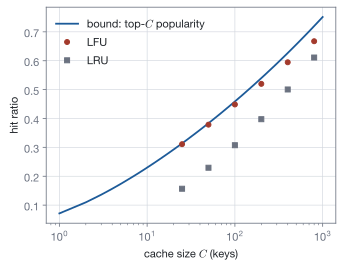
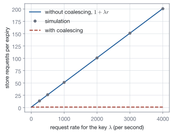

# Caching {#sec-caching}

A cache keeps copies of data where they are cheap to read, so that most requests never reach the slower store behind it. The edge caches of
[The web stack](../the-web-stack/index.qmd) are one kind; this chapter is about caches inside a service, in front of its databases. Liu warns
against treating them as free: "almost all candidates introduce cache without really justifying the whys, as if a cache is a magical layer that
will solve all scalability problems. In reality, cache comes with a high cost of maintainability and complexity" [@liuSystemDesignInterview2020,
Ch. 5, "Cache Strategies"]. The chapter defines where caches sit and how reads and writes go through them, how they choose what to keep, how
they are kept consistent and protected from stampedes, how they are spread over many machines, and how HTTP caching and cache warming extend them.

The claims are of two kinds. Cache patterns, eviction policies, invalidation, distributed caches and HTTP cache control are definitions. Three
propositions with complete proofs make them quantitative: how the hit ratio sets the load and latency of the store, why no eviction policy can beat
keeping the most popular keys when requests are independent, and how many requests a key's expiry sends to the store with and without request
coalescing. The hit ratio of an expiring cache was proved in the web-stack chapter and is used here by link.

The sources are the benchmark books, @SystemDesignInterview2021 [Ch. 1], @tanAcingSystemDesign2024 [Secs. 4.8-4.12],
@liuSystemDesignInterview2020 [Ch. 5, "Cache Strategies" and "Thundering Herd"] and @sinhaSystemDesignGuide2024 [Ch. 6], with @burrows2006chubby
[Sec. 2.7] for a strictly consistent cache and @rfc9111 for HTTP caching. The probability comes from
[Probability and statistics](../../fundamentals-of-mathematics-for-physicists/probability/index.qmd).

The chapter has five sections. @sec-cache-patterns defines the read and write patterns and proves how the hit ratio sets load and latency.
@sec-eviction defines eviction policies and the independent reference model and proves that the most popular keys are the best content.
@sec-invalidation defines invalidation and stampede protection and proves the effect of request coalescing. @sec-distributed-caches defines
partitioned, replicated and local caches. @sec-http-caching defines HTTP cache control and cache warming.

The running example is the photo service's feed: $1.74 \times 10^5$ feed reads per second at the peak (@exm-req-workload-assumptions), served
from a cache in front of the metadata store.

Every definition and proposition is followed by ten examples and ten exercises, each exercise with a hidden solution in two tabs: the argument,
then a computation with its recorded output. The computations run in plain Python 3.12 with NumPy and the standard library; caches are replayed
on seeded traces of requests. Diagrams are written in the D2 language. Commands of particular cache servers are shown as illustrative code and
are not run.

## Where caches sit and how they are used {#sec-cache-patterns}

A cache sits between an application and a slower store, and a pattern says who reads and writes which of the two. Tan lists what a cache improves,
performance first, and warns that "caches are designed for high performance and low latency, not for high availability", so "we must not rely on the
cache for our service's availability" [@tanAcingSystemDesign2024, Sec. 4.8, pp. 99-100]. This section defines the hit ratio and the five usual
patterns, and proves how the hit ratio sets the store's load and the mean latency.

For more on this topic, see @tanAcingSystemDesign2024 [Secs. 4.8-4.9], @liuSystemDesignInterview2020 [Ch. 5, "Cache Strategies"],
@SystemDesignInterview2021 [Ch. 1, "Cache"] and @sinhaSystemDesignGuide2024 [Ch. 6].

### Hits, misses and the five patterns

Reads follow one of two patterns and writes one of three. @fig-cp-flows draws the two most common.

{#fig-cp-flows width=90%}

:::: {.statement-box}
::: {#def-cache-patterns}
#### Caches and their patterns

1. A **cache** stores copies of values of a **store** under keys. A read answered from the cache is a **hit**, any other read a **miss**; the **hit ratio**
   $h$ is the long-run fraction of reads that are hits.
2. **Cache-aside** (lazy loading): the application reads the cache; on a miss it reads the store and puts the value into the cache. **Read-through**: the
   application reads only the cache, which on a miss reads the store itself.
3. **Write-through**: a write goes to the cache, which writes it to the store before acknowledging. **Write-back** (write-behind): the cache acknowledges the
   write and writes it to the store later. **Write-around**: the write goes to the store only, and the cached copy is deleted or left to expire.
4. A cached value is **stale** if the store holds a newer value for its key; a cache entry may carry a **time to live** (TTL) $\Delta$ after which it is
   removed.
:::

::::

Item 2 follows Tan: in cache-aside "the application first makes a read request to the cache ... On a cache miss, the application makes a read request to the
database, then writes the data to the cache", while "in read-through, write-through, or write-back caching, the application makes requests to the cache, which
may make requests to the database if necessary" [@tanAcingSystemDesign2024, Sec. 4.8.1, pp. 100-101].

:::: {.callout-note .examples-fold collapse="true" title="Examples"}
Liu defines the hit ratio as a fraction. It is item 1.

::: {#exm-cp-liu-ratio}
#### Hit rate

"Cache Hit Rate = Cache Hit / (Cache Hit + Cache Miss)", and "if your cache hit rate is low, it might not be worth it" [@liuSystemDesignInterview2020, Ch. 5,
"Cache Hit Rate"].
:::

Cache-aside in a few lines. A dictionary stands for the cache.

::: {#exm-cp-aside}
#### Cache-aside in code

The run reads three keys twice from a cache in front of a slow store and counts hits.

```{.python .run}
store = {f"photo:{i}": f"meta {i}" for i in range(3)}
cache, hits, misses = {}, 0, 0
def get(k):
    global hits, misses
    if k in cache: hits += 1; return cache[k]
    misses += 1; v = store[k]; cache[k] = v; return v
for k in list(store) * 2: get(k)
print(f"hits {hits}, misses {misses}, hit ratio {hits / (hits + misses):.2f}")
```

```{.text .run-output}
hits 3, misses 3, hit ratio 0.50
```
:::

Xu calls cache-aside read-through. The names are used loosely.

::: {#exm-cp-xu-name}
#### Names

Xu: "a web server first checks if the cache has the available response. If it has, it sends data back to the client. If not, it queries the database, stores the
response in cache ... This caching strategy is called a read-through cache" [@SystemDesignInterview2021, Ch. 1, "Cache tier"]. In item 2's terms the web server, not the
cache, reads the database: cache-aside.
:::

Write-through keeps the cache fresh. Writes pay for both.

::: {#exm-cp-write-through}
#### Write-through

"It is consistent. The cache is never stale since cache data is updated with every database write", but writes are slower and "most data is never read, so we incur
unnecessary cost" [@tanAcingSystemDesign2024, Sec. 4.8.2, p. 102].
:::

Write-back acknowledges before the store has the data. A crash can lose it.

::: {#exm-cp-write-back}
#### Write-back

"The latency is lower because you only need to write to cache", but "the data on the cache could be lost before the system persists data on the database"
[@liuSystemDesignInterview2020, Ch. 5, "Write-Back"].
:::

Write-around writes the store and deletes the cached copy. Liu explains why delete beats update.

::: {#exm-cp-write-around}
#### Delete rather than update

"Upon updating the key from the database, the system invokes a delete operation onto the cache. Update to the cache is also possible but is not idempotent. For example,
if there are two updates (A and B) to the database, it doesn't guarantee A will hit before B in the cache" [@liuSystemDesignInterview2020, Ch. 5, "Write-Around"].
:::

A cache can hide the store's outage only for cached keys. Tan says not to count on it.

::: {#exm-cp-availability}
#### Not an availability device

"If the database is unavailable, the service is still available so applications can retrieve data from the cache. This only applies to data that is cached"
[@tanAcingSystemDesign2024, Sec. 4.8, p. 99]. With $h = 0.95$, a store outage still fails $5\%$ of reads at once, and more as entries expire.
:::

What to cache is a design decision. Liu's search example compares two keys.

::: {#exm-cp-what}
#### Caching queries or tokens

Caching whole free-text queries is a single lookup "but option 1 will have a much worse hit rate because end-users are less likely to search for the same free form text",
while caching tokens needs several lookups and a merge [@liuSystemDesignInterview2020, Ch. 5, "What Are You Caching?"].
:::

Memory is much faster than disk. Liu's factor is a hundred.

::: {#exm-cp-latency}
#### Why memory

"Reading 1 MB of disk compared to memory is almost 100 times slower" [@liuSystemDesignInterview2020, Ch. 5, "Improve Latency"]; a cache hit in memory over the network
costs about a round trip, a store read adds disk and query time.
:::

Clients can cache too. Tan lists the layers.

::: {#exm-cp-layers}
#### Caches in every layer

"We cache in every layer (client/browser, load balancer, frontend/API Gateway/sidecar, and in our backend) so requests pass through as few services as possible"
[@tanAcingSystemDesign2024, Sec. 4.10, p. 104]. Each layer has its own hit ratio, and the store sees only what all layers miss.
:::
::::

:::: {.callout-note .exercises-fold collapse="true" title="Exercises"}
The first exercise runs read-through. The cache owns the store access.

::: {#exr-cp-read-through}
#### Read-through

Rewrite @exm-cp-aside so that the application calls only `cache.get`, and the cache reads the store on a miss. What changes for the application, and what trade-off does Tan
name?
:::

::: {.callout-note .solution collapse="true" title="Solution"}
:::: {.panel-tabset .solution-tabs}
## Solution

The application no longer contains store access; the cache does. Tan's trade-off: "unlike cache-aside, a read-through cache cannot group multiple database requests as a
single cache value" [@tanAcingSystemDesign2024, Sec. 4.8.1, p. 101].

## Python

A read-through cache class.

```{.python .run}
class ReadThrough:
    def __init__(self, loader): self.loader, self.data, self.misses = loader, {}, 0
    def get(self, k):
        if k not in self.data: self.misses += 1; self.data[k] = self.loader(k)
        return self.data[k]
c = ReadThrough(lambda k: f"meta {k}")
for k in [1, 2, 1, 3, 1]: c.get(k)
print("misses", c.misses)
```

```{.text .run-output}
misses 3
```
::::
:::

The second exercise loses writes with write-back. A crash before flushing.

::: {#exr-cp-write-back-loss}
#### Losing dirty entries

A write-back cache receives $1000$ writes per second and flushes every $2\,\mathrm{s}$. How many acknowledged writes does a crash lose on average, and at most?
:::

::: {.callout-note .solution collapse="true" title="Solution"}
:::: {.panel-tabset .solution-tabs}
## Solution

The unflushed writes at a random crash time: on average half a flush interval, $1000$; at most a full interval, $2000$, as in @exr-lf-async-loss.

## Python

A simulation of crash times.

```{.python .run}
import numpy as np
t = np.random.default_rng(1).uniform(0, 2, 10**5)
print(f"mean lost {1000 * t.mean():.0f}, max {1000 * t.max():.0f}")
```

```{.text .run-output}
mean lost 1000, max 2000
```
::::
:::

The third exercise breaks update-on-write with reordering. Delete is idempotent.

::: {#exr-cp-reorder}
#### Two updates out of order

Two writes set $x$ to $A$ then $B$ in the store and send "set $x$" to the cache, delivered in the order $B$, $A$. Compare the cache with "delete $x$" messages.
:::

::: {.callout-note .solution collapse="true" title="Solution"}
:::: {.panel-tabset .solution-tabs}
## Solution

Updates leave $A$ in the cache although the store holds $B$; deletes leave the key absent in either order, and the next read loads $B$.

## Python

Both protocols.

```{.python .run}
store = "B"
cache = {}
for v in ("B", "A"): cache["x"] = v
print("updates:", cache["x"], "| store:", store)
cache = {"x": "old"}
for _ in ("B", "A"): cache.pop("x", None)
print("deletes then read:", cache.get("x", store))
```

```{.text .run-output}
updates: A | store: B
deletes then read: B
```
::::
:::

The fourth exercise finds the race in cache-aside with delete. A slow reader puts back an old value.

::: {#exr-cp-race}
#### The read-write race

Reader R misses on $x$ and reads $x = 1$ from the store; writer W sets $x = 2$ in the store and deletes $x$ from the cache; R then puts $x = 1$ into the cache. What does the cache
hold, and for how long?
:::

::: {.callout-note .solution collapse="true" title="Solution"}
:::: {.panel-tabset .solution-tabs}
## Solution

The stale $x = 1$, until it is evicted, deleted by a later write, or expires: with a TTL $\Delta$, for at most $\Delta$. The TTL bounds staleness in every pattern that loads values
from the store.

## Python

The interleaving.

```{.python .run}
store, cache = {"x": 1}, {}
r_value = store["x"]                 # R misses and reads 1
store["x"] = 2; cache.pop("x", None) # W writes 2 and deletes
cache["x"] = r_value                 # R puts 1
print("cache", cache, "| store", store)
```

```{.text .run-output}
cache {'x': 1} | store {'x': 2}
```
::::
:::

The fifth exercise prices the cache-aside miss. It is slower than no cache.

::: {#exr-cp-miss-cost}
#### A miss costs more than no cache

Tan notes that "a request with a cache miss is slower than a request directly to the database" [@tanAcingSystemDesign2024, Sec. 4.8.1, p. 101]. With a cache round trip of $0.5\,\mathrm{ms}$
and a store read of $5\,\mathrm{ms}$, compare a miss with a direct read.
:::

::: {.callout-note .solution collapse="true" title="Solution"}
:::: {.panel-tabset .solution-tabs}
## Solution

A miss is a cache read, a store read and a cache write: $6\,\mathrm{ms}$ if the write is waited for, against $5\,\mathrm{ms}$ direct. With hit ratio $h$ the mean is $0.5 + (1 - h)5.5$,
below $5$ once $h > 0.18$.

## Python

The break-even hit ratio.

```{.python .run}
c, s = 0.5, 5.0
print(f"miss {c + s + c} ms; mean below direct for h > {1 - (s - c) / (s + c):.3f}")
```

```{.text .run-output}
miss 6.0 ms; mean below direct for h > 0.182
```
::::
:::

The sixth exercise measures the hit ratio of the photo feed under a simple workload. A trace replay.

::: {#exr-cp-feed}
#### Replaying a feed trace

Feed pages of $10^4$ users are requested at random, with $20\%$ of users making $80\%$ of requests. Replay $10^5$ requests through an unbounded cache-aside cache with a TTL of $5000$
requests, and report the hit ratio.
:::

::: {.callout-note .solution collapse="true" title="Solution"}
:::: {.panel-tabset .solution-tabs}
## Solution

Popular users' pages are requested many times within a TTL and hit; unpopular ones are often requested once per TTL and miss. The run gives the ratio.

## Python

The replay.

```{.python .run}
import numpy as np
rng = np.random.default_rng(2)
hot = rng.random(10**5) < 0.8
users = np.where(hot, rng.integers(0, 2000, 10**5), rng.integers(2000, 10**4, 10**5))
loaded, hits = {}, 0
for t, u in enumerate(users):
    if u in loaded and t - loaded[u] < 5000: hits += 1
    else: loaded[u] = t
print(f"hit ratio {hits / len(users):.3f}")
```

```{.text .run-output}
hit ratio 0.550
```
::::
:::

The seventh exercise sizes the cache for the feed. Memory per entry times entries.

::: {#exr-cp-size}
#### How much memory

A feed page entry is $3\,\mathrm{kB}$ and $10^8$ users are active daily. What does caching every active user's first page cost in memory, and what does caching the $20\%$ who make
most requests cost?
:::

::: {.callout-note .solution collapse="true" title="Solution"}
:::: {.panel-tabset .solution-tabs}
## Solution

$3 \times 10^{11}\,\mathrm{B} = 300\,\mathrm{GB}$ for all, $60\,\mathrm{GB}$ for the busiest fifth, a handful of cache servers.

## Python

The sizes.

```{.python .run}
print(f"all {1e8 * 3e3 / 1e9:.0f} GB, busiest 20% {0.2 * 1e8 * 3e3 / 1e9:.0f} GB")
```

```{.text .run-output}
all 300 GB, busiest 20% 60 GB
```
::::
:::

The eighth exercise compares write patterns by write latency and staleness. Three patterns, two measures.

::: {#exr-cp-write-compare}
#### Three write patterns

With a cache write of $0.5\,\mathrm{ms}$ and a store write of $5\,\mathrm{ms}$, give the write latency and whether a following read can be stale for write-through, write-back and write-around
with cache-aside reads.
:::

::: {.callout-note .solution collapse="true" title="Solution"}
:::: {.panel-tabset .solution-tabs}
## Solution

Write-through $5.5\,\mathrm{ms}$, reads fresh; write-back $0.5\,\mathrm{ms}$, reads fresh from the cache but the write can be lost; write-around $5\,\mathrm{ms}$ plus a delete, reads fresh
except in the race of @exr-cp-race.

## Python

The table.

```{.python .run}
for p, lat, note in (("write-through", 5.5, "fresh"), ("write-back", 0.5, "fresh, may lose writes"), ("write-around", 5.5, "fresh except the race")):
    print(f"{p:14s} {lat} ms  {note}")
```

```{.text .run-output}
write-through  5.5 ms  fresh
write-back     0.5 ms  fresh, may lose writes
write-around   5.5 ms  fresh except the race
```
::::
:::

The ninth exercise treats a cache failure. Tan wants the store to survive it.

::: {#exr-cp-cache-down}
#### The cache goes down

The feed store can serve $2 \times 10^4$ reads per second and the cache absorbs a hit ratio of $0.95$ at $1.74 \times 10^5$ reads per second. What happens when the cache fails, and what
should the service do?
:::

::: {.callout-note .solution collapse="true" title="Solution"}
:::: {.panel-tabset .solution-tabs}
## Solution

The store's load jumps from $8700$ to $1.74 \times 10^5$ per second, nine times its capacity; it collapses unless the service sheds load. Tan: "the backend service should have rate limiting,
adjusted to the capacity of the backend and database" [@tanAcingSystemDesign2024, Sec. 4.8, p. 99].

## Python

The two loads.

```{.python .run}
lam, h = 1.74e5, 0.95
print(f"with cache {(1 - h) * lam:.0f}/s, without {lam:.0f}/s, capacity 20000/s")
```

```{.text .run-output}
with cache 8700/s, without 174000/s, capacity 20000/s
```
::::
:::

The tenth exercise checks Xu's advice on when to cache. Read-mostly data.

::: {#exr-cp-when}
#### When to cache

Xu: "consider using cache when data is read frequently but modified infrequently" [@SystemDesignInterview2021, Ch. 1]. For a key read $r$ times and written $w$ times per TTL, with every
write invalidating, estimate the hit ratio, and evaluate for $(r, w) = (100, 1)$ and $(2, 1)$.
:::

::: {.callout-note .solution collapse="true" title="Solution"}
:::: {.panel-tabset .solution-tabs}
## Solution

Each write causes at most one later miss, so at most $w + 1$ of the $r$ reads miss: $h \geq 1 - (w + 1)/r$, $0.98$ for $(100, 1)$ and nothing useful for $(2, 1)$.

## Python

The bound.

```{.python .run}
for r, w in ((100, 1), (2, 1)):
    print(r, w, f"h >= {max(0, 1 - (w + 1) / r):.2f}")
```

```{.text .run-output}
100 1 h >= 0.98
2 1 h >= 0.00
```
::::
:::
::::

### Load and latency from the hit ratio

The hit ratio is the one number that decides whether a cache pays. The proposition turns it into the store's load, the mean latency and a bound on staleness.

:::: {.statement-box}
::: {#prp-cache-load}
#### Load, latency and staleness of a cache-aside cache

Let reads arrive at rate $\lambda$, let a hit take $t_c$ and a miss $t_c + t_s + t_w$ (a cache read, a store read and a cache write), and let the long-run hit ratio be $h$.

(a) The store receives reads at rate $(1 - h)\lambda$, and the mean read latency is $t_c + (1 - h)(t_s + t_w)$.

(b) Raising the hit ratio from $h_1$ to $h_2$ divides the store's read load by $(1 - h_1)/(1 - h_2)$; in particular, the store's read capacity is multiplied by $1/(1 - h)$.

(c) If values are only ever loaded from the store and every cache entry expires $\Delta$ after the store read that produced it, a value served from the cache was the store's value at some instant less than $\Delta$ before.
:::

::::

*Proof.* (a) Of the reads in a long interval of length $T$, a fraction tending to $h$ hit and the rest miss; each miss sends one read to the store, so the store's read rate tends to $(1 - h)\lambda$.
The mean latency is $h t_c + (1 - h)(t_c + t_s + t_w)$, which rearranges to the formula.

(b) The ratio of the two loads $(1 - h_1)\lambda$ and $(1 - h_2)\lambda$. A store of capacity $\mu$ can support $\lambda$ up to $\mu/(1 - h)$.

(c) A cached value was read from the store at some time $t'$ and expires at $t' + \Delta$. It is served only before then, so at a serving time $\tau < t' + \Delta$ it is the store's value at
$t' > \tau - \Delta$. $\square$

Part (c) is the guarantee cache-aside gives without any invalidation: bounded staleness, the "Delayed-$t$" style of consistency of @exm-capt-delayed-t with $t = \Delta$. The race of
@exr-cp-race is within it.

:::: {.callout-note .examples-fold collapse="true" title="Examples"}
The feed at the peak. A $0.95$ hit ratio leaves $8700$ reads per second.

::: {#exm-cl-feed}
#### The feed's store load

With $\lambda = 1.74 \times 10^5$ and $h = 0.95$, part (a) gives $8700$ store reads per second, and with $t_c = 0.5$, $t_s = 5$, $t_w = 0.5\,\mathrm{ms}$ a mean latency of $0.78\,\mathrm{ms}$.

```{.python .run}
lam, h, tc, ts, tw = 1.74e5, 0.95, 0.5, 5.0, 0.5
print(f"store {(1 - h) * lam:.0f}/s, mean latency {tc + (1 - h) * (ts + tw):.2f} ms")
```

```{.text .run-output}
store 8700/s, mean latency 0.78 ms
```
:::

Part (b) rewards the last percent. Ninety-nine halves the load of ninety-eight.

::: {#exm-cl-last-percent}
#### The last percent

From $h = 0.98$ to $0.99$ the store's load halves, although the hit ratio rose by one point; from $0.5$ to $0.51$ it falls by $2\%$.
:::

Part (a) also gives the tail. Misses are the slow requests.

::: {#exm-cl-tail}
#### The tail is the misses

If $5\%$ of reads miss and a miss takes $6\,\mathrm{ms}$ while a hit takes $0.5\,\mathrm{ms}$, the p99 is a miss: the cache improves the mean by a factor of seven and the p99 not at all.
:::

Part (c) gives Xu's expiration advice its meaning. The TTL is the staleness bound.

::: {#exm-cl-xu-ttl}
#### Choosing the TTL

"It is advisable not to make the expiration date too short as this will cause the system to reload data from the database too frequently. Meanwhile, it is advisable not to make the expiration date
too long as the data can become stale" [@SystemDesignInterview2021, Ch. 1]. Part (c) bounds the staleness by $\Delta$, and @prp-cdn-ttl-hit-ratio gives the hit ratio $\lambda\Delta/(1 + \lambda\Delta)$ for
a key requested at rate $\lambda$.
:::

The two effects of a TTL in one table. Hit ratio rises with it, freshness falls.

::: {#exm-cl-ttl-table}
#### TTL against hit ratio

For a key read $10$ times per second, @prp-cdn-ttl-hit-ratio's formula gives the hit ratio; part (c) gives the staleness bound.

```{.python .run}
lam = 10
for d in (0.1, 1, 10, 60):
    print(f"TTL {d:5.1f} s: hit ratio {lam * d / (1 + lam * d):.3f}, staleness <= {d} s")
```

```{.text .run-output}
TTL   0.1 s: hit ratio 0.500, staleness <= 0.1 s
TTL   1.0 s: hit ratio 0.909, staleness <= 1 s
TTL  10.0 s: hit ratio 0.990, staleness <= 10 s
TTL  60.0 s: hit ratio 0.998, staleness <= 60 s
```
:::

Layers multiply misses. The store sees the product.

::: {#exm-cl-layers}
#### Two layers

A client cache with $h_1 = 0.5$ in front of a service cache with $h_2 = 0.9$ (on the client's misses) sends $0.5 \times 0.1 = 5\%$ of reads to the store, by part (a) applied twice.
:::

Part (b) explains why caches scale stores. Twenty times the capacity.

::: {#exm-cl-scale}
#### A cache as capacity

With $h = 0.95$ the store supports $1/(1 - h) = 20$ times the read rate it could alone; Liu's caution is that "you might consider caching as a possible solution" only after computing such a rate
[@liuSystemDesignInterview2020, Ch. 5, "Improve Throughput"].
:::

Part (a) needs a stable hit ratio. A cold cache has none.

::: {#exm-cl-cold}
#### A cold start

A freshly started cache has $h = 0$ until it fills, so the store sees the full load, the "cold start problem" Tan lists for write-through [@tanAcingSystemDesign2024, Sec. 4.8.2, p. 102].
:::

Part (c) does not hold for write-back. The store lags the cache instead.

::: {#exm-cl-write-back}
#### Write-back reverses the roles

Under write-back the cache holds values the store does not yet have; part (c)'s hypothesis that values come from the store fails, and it is the store that is stale, by up to the flush interval.
:::

Read-through obeys the same arithmetic. Only who issues the store read changes.

::: {#exm-cl-read-through}
#### Read-through

The formulas of parts (a) and (b) hold for read-through as well, with the cache's store read in place of the application's.
:::
::::

:::: {.callout-note .exercises-fold collapse="true" title="Exercises"}
The first exercise checks part (a) by simulation. Exponential latencies.

::: {#exr-cl-simulate}
#### Checking part (a)

Simulate $10^5$ reads with hit probability $0.9$, hits of mean $0.5\,\mathrm{ms}$ and store reads of mean $5\,\mathrm{ms}$, exponential, and compare the mean latency with part (a) ($t_w = 0.5$).
:::

::: {.callout-note .solution collapse="true" title="Solution"}
:::: {.panel-tabset .solution-tabs}
## Solution

Part (a) gives $0.5 + 0.1 \times 5.5 = 1.05\,\mathrm{ms}$; the simulation agrees.

## Python

The simulation.

```{.python .run}
import numpy as np
rng = np.random.default_rng(3)
n = 10**5; hit = rng.random(n) < 0.9
lat = rng.exponential(0.5, n) + ~hit * (rng.exponential(5, n) + rng.exponential(0.5, n))
print(f"simulated {lat.mean():.3f} ms, formula {0.5 + 0.1 * 5.5:.3f} ms")
```

```{.text .run-output}
simulated 1.048 ms, formula 1.050 ms
```
::::
:::

The second exercise inverts part (b). What hit ratio does the store need?

::: {#exr-cl-needed}
#### The hit ratio the store needs

The store serves $2 \times 10^4$ reads per second. What hit ratio keeps it under $70\%$ utilisation at $1.74 \times 10^5$ reads per second?
:::

::: {.callout-note .solution collapse="true" title="Solution"}
:::: {.panel-tabset .solution-tabs}
## Solution

$(1 - h) \times 1.74 \times 10^5 \leq 1.4 \times 10^4$, so $h \geq 0.92$.

## Python

The bound.

```{.python .run}
print(f"h >= {1 - 0.7 * 2e4 / 1.74e5:.3f}")
```

```{.text .run-output}
h >= 0.920
```
::::
:::

The third exercise checks part (c) on a trace with writes. Staleness never exceeds the TTL.

::: {#exr-cl-staleness}
#### Measuring staleness

A key is written at random times (rate $1$ per second) and read at rate $20$ per second through cache-aside with TTL $\Delta = 2\,\mathrm{s}$ and no invalidation. Measure the largest age of the value
served, defined as the time since the store last held it.
:::

::: {.callout-note .solution collapse="true" title="Solution"}
:::: {.panel-tabset .solution-tabs}
## Solution

A served value was loaded less than $\Delta$ ago and was then current, so its staleness, the time since the store replaced it, is below $\Delta$; the simulation confirms a maximum just under $2\,\mathrm{s}$.

## Python

The simulation.

```{.python .run}
import numpy as np
rng = np.random.default_rng(4)
writes = np.cumsum(rng.exponential(1.0, 2000)); reads = np.sort(rng.uniform(0, writes[-1], 40_000))
loaded_at, worst = -1e9, 0.0
for t in reads:
    if t - loaded_at >= 2.0: loaded_at = t
    nxt = writes[np.searchsorted(writes, loaded_at, side="right")]   # first write after the load
    worst = max(worst, t - nxt) if nxt < t else worst
print(f"largest staleness {worst:.3f} s (TTL 2 s)")
```

```{.text .run-output}
largest staleness 1.987 s (TTL 2 s)
```
::::
:::

The fourth exercise compares two caches by cost. Memory against store capacity.

::: {#exr-cl-cost}
#### Is the cache worth it

A cache server costs as much as $0.2$ of a store server and holds enough to give $h = 0.9$; a store server serves $2 \times 10^4$ reads per second. For $1.74 \times 10^5$ reads per second, compare store servers
alone with store servers plus four cache servers.
:::

::: {.callout-note .solution collapse="true" title="Solution"}
:::: {.panel-tabset .solution-tabs}
## Solution

Alone: $9$ store servers. With the cache: $1.74 \times 10^4$ reads reach the store, $1$ server, plus $4 \times 0.2 = 0.8$: $1.8$ server-equivalents instead of $9$.

## Python

The counts.

```{.python .run}
import math
lam, cap = 1.74e5, 2e4
print("alone", math.ceil(lam / cap), "| with cache", math.ceil(0.1 * lam / cap) + 4 * 0.2)
```

```{.text .run-output}
alone 9 | with cache 1.8
```
::::
:::

The fifth exercise asks how much of the mean latency the hit ratio buys. Part (a) differentiated.

::: {#exr-cl-derivative}
#### Latency per point of hit ratio

Using part (a), how much does the mean latency fall per percentage point of hit ratio with $t_s + t_w = 5.5\,\mathrm{ms}$?
:::

::: {.callout-note .solution collapse="true" title="Solution"}
:::: {.panel-tabset .solution-tabs}
## Solution

The latency is linear in $h$ with slope $-(t_s + t_w)$: $0.055\,\mathrm{ms}$ per point, the same at every $h$, while the store's load falls by a factor that grows as $h \to 1$ (part (b)).

## Python

The slope.

```{.python .run}
print(5.5 / 100, "ms per point")
```

```{.text .run-output}
0.055 ms per point
```
::::
:::

The sixth exercise generalises part (a) to two layers. Products of miss ratios.

::: {#exr-cl-two-layers}
#### Two layers

Prove that two layers with hit ratios $h_1$ and $h_2$ (the second measured on the first's misses) send a fraction $(1 - h_1)(1 - h_2)$ of reads to the store.
:::

::: {.callout-note .solution collapse="true" title="Proof"}
:::: {.panel-tabset .solution-tabs}
## Proof

A fraction $1 - h_1$ of reads reaches the second layer, by part (a), and of those a fraction $1 - h_2$ reaches the store.

## Python

A simulation with independent hits.

```{.python .run}
import numpy as np
rng = np.random.default_rng(5)
m1 = rng.random(10**6) > 0.5; m2 = rng.random(10**6) > 0.9
print(f"{np.mean(m1 & m2):.4f} vs {0.5 * 0.1}")
```

```{.text .run-output}
0.0499 vs 0.05
```
::::
:::

The seventh exercise checks part (c) against the race of @exr-cp-race. The bound holds.

::: {#exr-cl-race-bound}
#### The race within the bound

In @exr-cp-race, let R read at time $t'$ and put at $t > t'$. Show that part (c) holds when the TTL is counted from $t'$, and what happens when it is counted from $t$.
:::

::: {.callout-note .solution collapse="true" title="Solution"}
:::: {.panel-tabset .solution-tabs}
## Solution

If the TTL is counted from R's store read, part (c) holds as stated: the stale value is served for less than $\Delta$ after that read. If, as many caches do, the TTL is counted from the put,
a reader that stalls for $s$ between reading and putting extends the bound to $\Delta + s$; this is why part (c) counts from the read.

## Python

The two measurements.

```{.python .run}
t_read, t_put, ttl = 0.0, 3.0, 2.0
print(f"served until {t_put + ttl} s; staleness measured from the read up to {t_put + ttl - t_read} s")
```

```{.text .run-output}
served until 5.0 s; staleness measured from the read up to 5.0 s
```
::::
:::

The eighth exercise uses part (b) to argue for a cache over a replica. Read replicas scale linearly.

::: {#exr-cl-vs-replicas}
#### A cache or replicas

To serve $10^5$ reads per second with store servers of $2 \times 10^4$, compare five read replicas with one store and a cache of $h = 0.8$.
:::

::: {.callout-note .solution collapse="true" title="Solution"}
:::: {.panel-tabset .solution-tabs}
## Solution

Five replicas, each a full copy. With $h = 0.8$, $2 \times 10^4$ reads reach one store server. The cache needs memory only for the hot keys; replicas need full copies but serve every key equally.

## Python

The counts.

```{.python .run}
print("replicas", 1e5 / 2e4, "| store reads with cache", 0.2 * 1e5)
```

```{.text .run-output}
replicas 5.0 | store reads with cache 20000.0
```
::::
:::

The ninth exercise asks what part (a) says about writes. They are not cached reads.

::: {#exr-cl-writes}
#### Writes and the store

With write-around, writes at rate $w$ all reach the store and each invalidation causes at most one extra miss. Bound the store's total load.
:::

::: {.callout-note .solution collapse="true" title="Solution"}
:::: {.panel-tabset .solution-tabs}
## Solution

$w$ writes plus $(1 - h)\lambda$ reads, where $h$ already counts the misses caused by invalidations; if invalidations are the only misses after warm-up, the read misses are at most $w$, so the store's load is at
most $2w$ plus cold misses.

## Python

For $w = 2000$ and $\lambda = 1.74 \times 10^5$.

```{.python .run}
w, lam = 2000, 1.74e5
print(f"store load <= {2 * w} plus cold misses; hit ratio >= {1 - w / lam:.4f}")
```

```{.text .run-output}
store load <= 4000 plus cold misses; hit ratio >= 0.9885
```
::::
:::

The tenth exercise sets the feed's TTL with part (c). Freshness is a requirement.

::: {#exr-cl-feed-ttl}
#### The feed's TTL

The feed must show a new photo within $5\,\mathrm{s}$ (@exm-req-photoshare's freshness requirement). Using part (c), what TTL may the feed cache use, and what hit ratio does @prp-cdn-ttl-hit-ratio give for a
user who refreshes once every $10\,\mathrm{s}$?
:::

::: {.callout-note .solution collapse="true" title="Solution"}
:::: {.panel-tabset .solution-tabs}
## Solution

$\Delta \leq 5\,\mathrm{s}$; with $\lambda = 0.1$ per second, $h = 0.5/1.5 = 0.33$: a per-user feed cache helps little, so feeds are cached per photo or invalidated on upload instead.

## Python

The hit ratio.

```{.python .run}
lam, d = 0.1, 5
print(f"h = {lam * d / (1 + lam * d):.2f}")
```

```{.text .run-output}
h = 0.33
```
::::
:::
::::

## Eviction and hit ratio {#sec-eviction}

A cache smaller than its key space must choose what to keep. Liu frames the choice: "what you're optimizing for is limiting the amount of memory used in your cache cluster while maintaining a reasonable cache hit rate"
[@liuSystemDesignInterview2020, Ch. 5, "Cache Eviction"]. Which policy is best depends on the pattern of requests, and the simplest model of that pattern, independent requests with fixed popularities, already
says a lot: popularity on the web is skewed, often close to a Zipf law, and under independence no policy can beat keeping the most popular keys. This section defines the usual policies and the model, and
proves that bound.

For more on this topic, see @liuSystemDesignInterview2020 [Ch. 5, "Cache Eviction"], @sinhaSystemDesignGuide2024 [Ch. 6, "Cache eviction policies" and "Designing an LRU cache"] and
@tanAcingSystemDesign2024 [Sec. 4.11.2].

### Policies and the independent reference model

A policy decides, on a miss into a full cache, which entry to remove. The model decides which keys are requested.

:::: {.statement-box}
::: {#def-eviction}
#### Eviction policies and the independent reference model

1. A cache of **capacity** $C$ holds at most $C$ keys. On a miss into a full cache, an **eviction policy** removes one key: **LRU** the least recently used, **LFU** the least frequently used (fewest requests so
   far), **FIFO** the one inserted first, **random** a uniformly random one. A **TTL** removes a key a fixed time after it was loaded, whatever the space.
2. Under the **independent reference model** (IRM) on keys $1, \dots, K$, requests are independent and each is for key $k$ with probability $p_k$, the **popularity** of $k$; order the keys so that
   $p_1 \geq p_2 \geq \dots \geq p_K$.
3. Popularities follow a **Zipf law** with exponent $s > 0$ if $p_k = k^{-s}/H_{K,s}$, where $H_{K,s} = \sum_{j=1}^K j^{-s}$.
4. A policy is **online** if the keys it holds when a request arrives depend only on earlier requests.
:::

::::

Item 1's policies are those of the sources: Tan lists random replacement, LRU, FIFO and LIFO [@tanAcingSystemDesign2024, Sec. 4.11.2, p. 106], Sinha FIFO, LIFO, MRU, LRU and LFU, with "eviction triggers"
that "can be size-based or days-based" [@sinhaSystemDesignGuide2024, Ch. 6]. The examples replay these code fragments, a Zipf trace generator and LRU and LFU caches:

```{.python .run}
import numpy as np
from collections import OrderedDict, Counter
def zipf_trace(K, s, n, seed):
    p = 1.0 / np.arange(1, K + 1) ** s; p /= p.sum()
    return np.random.default_rng(seed).choice(K, n, p=p), p
def lru_hits(trace, C):
    c, hits = OrderedDict(), 0
    for k in trace:
        if k in c: hits += 1; c.move_to_end(k)
        else:
            c[k] = None
            if len(c) > C: c.popitem(last=False)
    return hits / len(trace)
def lfu_hits(trace, C):
    count, cache, hits = Counter(), set(), 0
    for k in trace:
        count[k] += 1
        if k in cache: hits += 1
        else:
            cache.add(k)
            if len(cache) > C: cache.remove(min(cache, key=lambda x: count[x]))
    return hits / len(trace)
trace, p = zipf_trace(1000, 1.0, 20_000, 1)
print(f"LRU with 50 entries: hit ratio {lru_hits(trace, 50):.3f}")
```

```{.text .run-output}
LRU with 50 entries: hit ratio 0.462
```

:::: {.callout-note .examples-fold collapse="true" title="Examples"}
Liu explains LRU by recency. Cyclical keys defeat it.

::: {#exm-ev-liu-lru}
#### LRU and its blind spot

"Values that haven't been updated and accessed for a while will have a higher chance of eviction ... But it isn't always true since it's possible a key query is cyclical and accessed for a short duration and
doesn't come back until much later" [@liuSystemDesignInterview2020, Ch. 5, "Least Recently Used (LRU)"].
:::

LFU keeps counts. Old popularity lingers.

::: {#exm-ev-liu-lfu}
#### LFU and stale popularity

"If a stock has a lot of volatility and volume and suddenly becomes quiet, that stock's cache hit rate will be lower, even if it was just frequently accessed" [@liuSystemDesignInterview2020, Ch. 5,
"Least Frequently Used (LFU)"]: counts accumulated in the past keep a cooling key in the cache.
:::

Sinha builds LRU from a hash map and a list. Python's `OrderedDict` is that pair.

::: {#exm-ev-sinha-lru}
#### An LRU in $O(1)$

"Let's consider a doubly linked list and a HashMap combination data structure"; "all of these operations can be done in O(1) time" [@sinhaSystemDesignGuide2024, Ch. 6, "Designing an LRU cache"].
`OrderedDict.move_to_end` and `popitem(last=False)` are the two list operations.
:::

A Zipf law puts most requests on few keys. The run counts them.

::: {#exm-ev-zipf}
#### Skew

With $K = 10^4$ keys and $s = 0.9$, the top $5\%$ of keys receive more than half of the requests.

```{.python .run}
import numpy as np
K, s = 10_000, 0.9
p = 1 / np.arange(1, K + 1)**s; p /= p.sum()
print(f"top 5% of keys: {p[:500].sum():.3f} of requests; top 1%: {p[:100].sum():.3f}")
```

```{.text .run-output}
top 5% of keys: 0.586 of requests; top 1%: 0.410
```
:::

Under the IRM, frequency is a better signal than recency. The run compares them.

::: {#exm-ev-lru-vs-lfu}
#### LRU against LFU on a Zipf trace

On a Zipf trace with $s = 0.9$ over $10^4$ keys and a cache of $500$, LFU's counts converge to the popularities and it beats LRU.

```{.python .run}
import numpy as np
from collections import OrderedDict, Counter
def zipf_trace(K, s, n, seed):
    p = 1.0 / np.arange(1, K + 1) ** s; p /= p.sum()
    return np.random.default_rng(seed).choice(K, n, p=p), p
def lru_hits(trace, C):
    c, hits = OrderedDict(), 0
    for k in trace:
        if k in c: hits += 1; c.move_to_end(k)
        else:
            c[k] = None
            if len(c) > C: c.popitem(last=False)
    return hits / len(trace)
def lfu_hits(trace, C):
    count, cache, hits = Counter(), set(), 0
    for k in trace:
        count[k] += 1
        if k in cache: hits += 1
        else:
            cache.add(k)
            if len(cache) > C: cache.remove(min(cache, key=lambda x: count[x]))
    return hits / len(trace)
trace, p = zipf_trace(10_000, 0.9, 50_000, 2)
print(f"LRU {lru_hits(trace, 500):.3f}, LFU {lfu_hits(trace, 500):.3f}, top-500 popularity {p[:500].sum():.3f}")
```

```{.text .run-output}
LRU 0.455, LFU 0.558, top-500 popularity 0.586
```
:::

One pass over many keys evicts the hot set. LFU resists.

::: {#exm-ev-scan}
#### A scan flushes LRU

Interleaving a single sequential scan over $5000$ cold keys with a Zipf workload evicts LRU's hot keys; LFU keeps them because the scanned keys have count $1$.

```{.python .run}
import numpy as np
from collections import OrderedDict, Counter
def zipf_trace(K, s, n, seed):
    p = 1.0 / np.arange(1, K + 1) ** s; p /= p.sum()
    return np.random.default_rng(seed).choice(K, n, p=p), p
def lru_hits(trace, C):
    c, hits = OrderedDict(), 0
    for k in trace:
        if k in c: hits += 1; c.move_to_end(k)
        else:
            c[k] = None
            if len(c) > C: c.popitem(last=False)
    return hits / len(trace)
def lfu_hits(trace, C):
    count, cache, hits = Counter(), set(), 0
    for k in trace:
        count[k] += 1
        if k in cache: hits += 1
        else:
            cache.add(k)
            if len(cache) > C: cache.remove(min(cache, key=lambda x: count[x]))
    return hits / len(trace)
trace, p = zipf_trace(2000, 1.0, 20_000, 3)
mixed = list(trace[:10_000]) + list(range(10_000, 15_000)) + list(trace[10_000:])
print(f"LRU {lru_hits(mixed, 200):.3f}, LFU {lfu_hits(mixed, 200):.3f}")
```

```{.text .run-output}
LRU 0.486, LFU 0.557
```
:::

A TTL removes entries by age. It bounds staleness, not size.

::: {#exm-ev-ttl}
#### TTL alongside eviction

A TTL removes a key $\Delta$ after loading even when there is space, which bounds staleness (@prp-cache-load (c)); capacity-based eviction removes keys only when space is needed. Most caches combine both, as
Sinha's "size-based or days-based" triggers do.
:::

Random eviction needs no bookkeeping. It is a baseline.

::: {#exm-ev-tan-random}
#### Random replacement

"Random replacement: Replace a random item when the cache is full. It is the simplest strategy" [@tanAcingSystemDesign2024, Sec. 4.11.2, p. 106]. Under the IRM it keeps popular keys only in proportion to how
often they return after eviction.
:::

Liu's concert is a key with a known schedule. Only a custom policy sees it.

::: {#exm-ev-custom}
#### Knowing the future

"A stadium hosts a concert once a month, and the traffic will be quiet until the day of the concert. Therefore, you may not want to evict that data the day before the concert" [@liuSystemDesignInterview2020,
Ch. 5, "Custom Eviction"]. Such a policy uses information outside the request history and is not online in item 4's sense.
:::

Feeds of a few users dominate. A Zipf model fits the photo service's skew.

::: {#exm-ev-feed}
#### The feed's popularity

If feed reads follow a Zipf law with $s = 1$ over $10^8$ users, caching $10^6$ feeds holds the top $1\%$, which by item 3 receive $H_{10^6,1}/H_{10^8,1} \approx \ln 10^6/\ln 10^8 = 0.75$ of requests.
:::

::::

:::: {.callout-note .exercises-fold collapse="true" title="Exercises"}
The first exercise draws the hit-ratio curve. LRU and LFU against capacity.

::: {#exr-ev-curve}
#### Hit ratio against size

Replay a Zipf trace ($s = 0.8$, $K = 5000$, $3 \times 10^4$ requests) through LRU and LFU caches of capacities $50$, $200$, $800$, and compare with the popularity of the top $C$ keys.
:::

::: {.callout-note .solution collapse="true" title="Solution"}
:::: {.panel-tabset .solution-tabs}
## Solution

Both rise with capacity and stay below the top-$C$ popularity; LFU is closer to it under the IRM.

## Python

The replay.

```{.python .run}
import numpy as np
from collections import OrderedDict, Counter
def zipf_trace(K, s, n, seed):
    p = 1.0 / np.arange(1, K + 1) ** s; p /= p.sum()
    return np.random.default_rng(seed).choice(K, n, p=p), p
def lru_hits(trace, C):
    c, hits = OrderedDict(), 0
    for k in trace:
        if k in c: hits += 1; c.move_to_end(k)
        else:
            c[k] = None
            if len(c) > C: c.popitem(last=False)
    return hits / len(trace)
def lfu_hits(trace, C):
    count, cache, hits = Counter(), set(), 0
    for k in trace:
        count[k] += 1
        if k in cache: hits += 1
        else:
            cache.add(k)
            if len(cache) > C: cache.remove(min(cache, key=lambda x: count[x]))
    return hits / len(trace)
trace, p = zipf_trace(5000, 0.8, 30_000, 4)
for C in (50, 200, 800):
    print(f"C = {C:3d}: LRU {lru_hits(trace, C):.3f}, LFU {lfu_hits(trace, C):.3f}, top-C {p[:C].sum():.3f}")
```

```{.text .run-output}
C =  50: LRU 0.138, LFU 0.279, top-C 0.283
C = 200: LRU 0.286, LFU 0.413, top-C 0.434
C = 800: LRU 0.504, LFU 0.576, top-C 0.634
```
::::
:::

The second exercise defeats LRU completely. Cycling one key more than the capacity.

::: {#exr-ev-cyclic}
#### A cyclic pattern

Show that LRU with capacity $C$ has hit ratio $0$ on the cyclic sequence $1, 2, \dots, C + 1, 1, 2, \dots$, and give a policy with hit ratio near $(C-1)/C$.
:::

::: {.callout-note .solution collapse="true" title="Proof"}
:::: {.panel-tabset .solution-tabs}
## Proof

Each request is for the key used least recently, which LRU has just evicted. Evicting the most recently used key instead (MRU, in Sinha's list) keeps $C - 1$ keys that recur: about $(C - 1)/C$ of requests hit.

## Python

Both policies on the cycle.

```{.python .run}
from collections import OrderedDict
def run(trace, C, mru):
    c, hits = OrderedDict(), 0
    for k in trace:
        if k in c: hits += 1; c.move_to_end(k); continue
        if len(c) == C: c.popitem(last=mru)
        c[k] = None
    return hits / len(trace)
C = 10; trace = [i % (C + 1) for i in range(11_000)]
print(f"LRU {run(trace, C, False):.3f}, MRU {run(trace, C, True):.3f}")
```

```{.text .run-output}
LRU 0.000, MRU 0.899
```
::::
:::

The third exercise approximates $H_{C,s}/H_{K,s}$. Integrals bound sums.

::: {#exr-ev-zipf-sum}
#### The top-$C$ fraction

For $s = 1$, show $\ln(C + 1) \leq H_{C,1} \leq 1 + \ln C$ and estimate the fraction of requests to the top $C = 10^4$ of $K = 10^7$ keys.
:::

::: {.callout-note .solution collapse="true" title="Solution"}
:::: {.panel-tabset .solution-tabs}
## Solution

Compare $\sum_{j=1}^C 1/j$ with $\int_1^{C+1} dx/x$ and with $1 + \int_1^C dx/x$. The fraction is about $\ln 10^4/\ln 10^7 = 0.57$; the exact sums give a little more.

## Python

Exact and approximate.

```{.python .run}
import numpy as np
C, K = 10**4, 10**7
H = lambda n: np.sum(1.0 / np.arange(1, n + 1))
print(f"exact {H(C) / H(K):.4f}, ln ratio {np.log(C) / np.log(K):.4f}")
```

```{.text .run-output}
exact 0.5862, ln ratio 0.5714
```
::::
:::

The fourth exercise shifts the popularity halfway. LFU adapts slowly.

::: {#exr-ev-lfu-shift}
#### Popularity that changes

Replay a trace whose most popular keys change completely halfway through, and compare LRU and LFU in the second half.
:::

::: {.callout-note .solution collapse="true" title="Solution"}
:::: {.panel-tabset .solution-tabs}
## Solution

LFU's old counts keep the formerly hot keys, so its second-half hit ratio drops; LRU adapts within a few cache turnovers. This is Liu's quiet stock.

## Python

The shifted trace.

```{.python .run}
import numpy as np
from collections import OrderedDict, Counter
def zipf_trace(K, s, n, seed):
    p = 1.0 / np.arange(1, K + 1) ** s; p /= p.sum()
    return np.random.default_rng(seed).choice(K, n, p=p), p
def lru_hits(trace, C):
    c, hits = OrderedDict(), 0
    for k in trace:
        if k in c: hits += 1; c.move_to_end(k)
        else:
            c[k] = None
            if len(c) > C: c.popitem(last=False)
    return hits / len(trace)
def lfu_hits(trace, C):
    count, cache, hits = Counter(), set(), 0
    for k in trace:
        count[k] += 1
        if k in cache: hits += 1
        else:
            cache.add(k)
            if len(cache) > C: cache.remove(min(cache, key=lambda x: count[x]))
    return hits / len(trace)
a, p = zipf_trace(3000, 1.0, 20_000, 5); b, _ = zipf_trace(3000, 1.0, 20_000, 6)
trace = list(a) + list((b + 1500) % 3000)
def second_half(f):
    full = f(trace, 200) * len(trace); first = f(trace[:20_000], 200) * 20_000
    return (full - first) / 20_000
print(f"second half: LRU {second_half(lru_hits):.3f}, LFU {second_half(lfu_hits):.3f}")
```

```{.text .run-output}
second half: LRU 0.574, LFU 0.545
```
::::
:::

The fifth exercise adds the two simplest policies. They lag behind LRU on skewed traces.

::: {#exr-ev-fifo}
#### FIFO and random

Implement FIFO and random eviction and compare them with LRU on a Zipf trace with $s = 1$.
:::

::: {.callout-note .solution collapse="true" title="Solution"}
:::: {.panel-tabset .solution-tabs}
## Solution

FIFO and random evict hot keys as readily as cold ones, so they hit less than LRU, whose recency favours keys that return often.

## Python

The three policies.

```{.python .run}
import numpy as np
from collections import OrderedDict, Counter
def zipf_trace(K, s, n, seed):
    p = 1.0 / np.arange(1, K + 1) ** s; p /= p.sum()
    return np.random.default_rng(seed).choice(K, n, p=p), p
def lru_hits(trace, C):
    c, hits = OrderedDict(), 0
    for k in trace:
        if k in c: hits += 1; c.move_to_end(k)
        else:
            c[k] = None
            if len(c) > C: c.popitem(last=False)
    return hits / len(trace)
def lfu_hits(trace, C):
    count, cache, hits = Counter(), set(), 0
    for k in trace:
        count[k] += 1
        if k in cache: hits += 1
        else:
            cache.add(k)
            if len(cache) > C: cache.remove(min(cache, key=lambda x: count[x]))
    return hits / len(trace)
import random
def fifo(trace, C):
    from collections import deque
    q, s, hits = deque(), set(), 0
    for k in trace:
        if k in s: hits += 1; continue
        q.append(k); s.add(k)
        if len(q) > C: s.discard(q.popleft())
    return hits / len(trace)
def rnd(trace, C, seed=7):
    r = random.Random(seed); s, lst, hits = set(), [], 0
    for k in trace:
        if k in s: hits += 1; continue
        if len(lst) == C:
            i = r.randrange(C); s.discard(lst[i]); lst[i] = k
        else: lst.append(k)
        s.add(k)
    return hits / len(trace)
trace, p = zipf_trace(5000, 1.0, 30_000, 8)
print(f"LRU {lru_hits(trace, 200):.3f}, FIFO {fifo(trace, 200):.3f}, random {rnd(trace, 200):.3f}")
```

```{.text .run-output}
LRU 0.522, FIFO 0.472, random 0.472
```
::::
:::

The sixth exercise questions Sinha's document editor. Recency usually predicts reuse.

::: {#exr-ev-sinha-mru}
#### Sinha's MRU example

Sinha's MRU example evicts the document "that was just accessed or edited" from a cache of recent documents [@sinhaSystemDesignGuide2024, Ch. 6]. On a trace where users reopen recent documents, compare MRU with LRU.
:::

::: {.callout-note .solution collapse="true" title="Solution"}
:::: {.panel-tabset .solution-tabs}
## Solution

When recent documents are reopened, MRU evicts exactly what is about to be used and does worse than LRU; MRU helps only on cyclic patterns like @exr-ev-cyclic.

## Python

A trace of reopened recent documents.

```{.python .run}
import random
from collections import OrderedDict
random.seed(9)
trace, recent = [], []
for _ in range(20_000):
    d = random.choice(recent[-5:]) if recent and random.random() < 0.7 else random.randrange(10**6)
    trace.append(d); recent.append(d)
def run(C, mru):
    c, hits = OrderedDict(), 0
    for k in trace:
        if k in c: hits += 1; c.move_to_end(k); continue
        if len(c) == C: c.popitem(last=mru)
        c[k] = None
    return hits / len(trace)
print(f"LRU {run(10, False):.3f}, MRU {run(10, True):.3f}")
```

```{.text .run-output}
LRU 0.697, MRU 0.319
```
::::
:::

The seventh exercise converts capacity into memory. Overheads matter.

::: {#exr-ev-memory}
#### Entries per gigabyte

Entries of $3\,\mathrm{kB}$ values with $100$ bytes of key and bookkeeping: how many fit in $64\,\mathrm{GB}$, and what hit ratio does the top-$C$ bound give for a Zipf law with $s = 1$ over $10^8$ keys?
:::

::: {.callout-note .solution collapse="true" title="Solution"}
:::: {.panel-tabset .solution-tabs}
## Solution

About $2.1 \times 10^7$ entries; the top-$C$ fraction is roughly $\ln C/\ln K = 0.91$.

## Python

The numbers.

```{.python .run}
import math
C = 64e9 / 3100; K = 1e8
print(f"C = {C:.2e}, top-C fraction about {math.log(C) / math.log(K):.2f}")
```

```{.text .run-output}
C = 2.06e+07, top-C fraction about 0.91
```
::::
:::

The eighth exercise compares two triggers. A short TTL wastes capacity.

::: {#exr-ev-ttl-vs-size}
#### TTL or size

With a cache large enough for all keys, a TTL of $100$ requests, and a Zipf trace, compare the hit ratio with an LRU of capacity $200$ and no TTL.
:::

::: {.callout-note .solution collapse="true" title="Solution"}
:::: {.panel-tabset .solution-tabs}
## Solution

The TTL evicts popular keys every $100$ requests regardless of space, costing hits; the LRU keeps them as long as they are used. TTLs are for staleness, not for capacity.

## Python

The two caches.

```{.python .run}
import numpy as np
from collections import OrderedDict, Counter
def zipf_trace(K, s, n, seed):
    p = 1.0 / np.arange(1, K + 1) ** s; p /= p.sum()
    return np.random.default_rng(seed).choice(K, n, p=p), p
def lru_hits(trace, C):
    c, hits = OrderedDict(), 0
    for k in trace:
        if k in c: hits += 1; c.move_to_end(k)
        else:
            c[k] = None
            if len(c) > C: c.popitem(last=False)
    return hits / len(trace)
def lfu_hits(trace, C):
    count, cache, hits = Counter(), set(), 0
    for k in trace:
        count[k] += 1
        if k in cache: hits += 1
        else:
            cache.add(k)
            if len(cache) > C: cache.remove(min(cache, key=lambda x: count[x]))
    return hits / len(trace)
trace, p = zipf_trace(2000, 1.0, 20_000, 10)
loaded, hits = {}, 0
for t, k in enumerate(trace):
    if k in loaded and t - loaded[k] < 100: hits += 1
    else: loaded[k] = t
print(f"TTL 100: {hits / len(trace):.3f}, LRU 200: {lru_hits(trace, 200):.3f}")
```

```{.text .run-output}
TTL 100: 0.379, LRU 200: 0.610
```
::::
:::

The ninth exercise implements Sinha's structure. A dictionary of nodes and a list.

::: {#exr-ev-lru-linked}
#### An LRU from scratch

Implement LRU with a dictionary from keys to nodes of a doubly linked list, and check that it gives the same hits as `OrderedDict` on a random trace.
:::

::: {.callout-note .solution collapse="true" title="Solution"}
:::: {.panel-tabset .solution-tabs}
## Solution

Get moves the node to the front; put inserts at the front and removes the tail when full; both $O(1)$ (@exm-ev-sinha-lru).

## Python

The implementation and the check.

```{.python .run}
import numpy as np
from collections import OrderedDict, Counter
def zipf_trace(K, s, n, seed):
    p = 1.0 / np.arange(1, K + 1) ** s; p /= p.sum()
    return np.random.default_rng(seed).choice(K, n, p=p), p
def lru_hits(trace, C):
    c, hits = OrderedDict(), 0
    for k in trace:
        if k in c: hits += 1; c.move_to_end(k)
        else:
            c[k] = None
            if len(c) > C: c.popitem(last=False)
    return hits / len(trace)
def lfu_hits(trace, C):
    count, cache, hits = Counter(), set(), 0
    for k in trace:
        count[k] += 1
        if k in cache: hits += 1
        else:
            cache.add(k)
            if len(cache) > C: cache.remove(min(cache, key=lambda x: count[x]))
    return hits / len(trace)
class Node:
    __slots__ = ("k", "prev", "next")
    def __init__(self, k): self.k = k; self.prev = self.next = None
class LRU:
    def __init__(self, C):
        self.C, self.map = C, {}; self.head = Node(None); self.tail = Node(None); self.head.next, self.tail.prev = self.tail, self.head
    def _unlink(self, n): n.prev.next, n.next.prev = n.next, n.prev
    def _front(self, n): n.next, n.prev = self.head.next, self.head; self.head.next.prev = n; self.head.next = n
    def access(self, k):
        if k in self.map: n = self.map[k]; self._unlink(n); self._front(n); return True
        n = Node(k); self.map[k] = n; self._front(n)
        if len(self.map) > self.C: old = self.tail.prev; self._unlink(old); del self.map[old.k]
        return False
trace, _ = zipf_trace(1000, 1.0, 20_000, 11)
c = LRU(100)
print(f"linked list {sum(c.access(k) for k in trace) / len(trace):.4f}, OrderedDict {lru_hits(trace, 100):.4f}")
```

```{.text .run-output}
linked list 0.5805, OrderedDict 0.5805
```
::::
:::

The tenth exercise removes the skew. Uniform popularity caps the hit ratio at $C/K$.

::: {#exr-ev-uniform}
#### No skew, no help

Under the IRM with uniform popularity over $K$ keys, show that every online policy has hit ratio at most $C/K$, and check LRU.
:::

::: {.callout-note .solution collapse="true" title="Solution"}
:::: {.panel-tabset .solution-tabs}
## Solution

Whatever $C$ keys are held, the next request hits with probability $C/K$; a cache helps only in proportion to its share of the key space, so caches pay off only on skewed workloads.

## Python

LRU on a uniform trace.

```{.python .run}
import numpy as np
from collections import OrderedDict, Counter
def zipf_trace(K, s, n, seed):
    p = 1.0 / np.arange(1, K + 1) ** s; p /= p.sum()
    return np.random.default_rng(seed).choice(K, n, p=p), p
def lru_hits(trace, C):
    c, hits = OrderedDict(), 0
    for k in trace:
        if k in c: hits += 1; c.move_to_end(k)
        else:
            c[k] = None
            if len(c) > C: c.popitem(last=False)
    return hits / len(trace)
def lfu_hits(trace, C):
    count, cache, hits = Counter(), set(), 0
    for k in trace:
        count[k] += 1
        if k in cache: hits += 1
        else:
            cache.add(k)
            if len(cache) > C: cache.remove(min(cache, key=lambda x: count[x]))
    return hits / len(trace)
import numpy as np
trace = np.random.default_rng(12).integers(0, 5000, 30_000)
print(f"LRU {lru_hits(trace, 500):.3f}, C/K = {500 / 5000:.3f}")
```

```{.text .run-output}
LRU 0.098, C/K = 0.100
```
::::
:::

::::

### The best content under independent requests

When requests are independent, the past says nothing about the next request except through the popularities, and the best a cache can do is to hold the most popular keys. The proposition makes this exact; it is
the yardstick against which LRU and LFU are measured.

{#fig-ev-curve width=65%}

:::: {.statement-box}
::: {#prp-irm-bound}
#### The best hit ratio under the independent reference model

Under the IRM of @def-eviction with popularities $p_1 \geq \dots \geq p_K$:

(a) For every online policy with capacity $C$, each request hits with probability at most $P_C = p_1 + \dots + p_C$, so the expected fraction of hits among any number of requests is at most $P_C$.

(b) The policy that holds the keys $1, \dots, C$ permanently reaches $P_C$.

(c) For a Zipf law with exponent $s$, $P_C = H_{C,s}/H_{K,s}$; for $s = 1$ this is between $\ln(C + 1)/(1 + \ln K)$ and $(1 + \ln C)/\ln(K + 1)$.
:::

::::

*Proof.* (a) Let $S_n$ be the set of keys held when request $n$ arrives. The policy is online, so $S_n$ is a function of requests $1, \dots, n - 1$, which are independent of request $n$; hence
$\mathbb P(\text{hit at } n \mid S_n) = \sum_{k \in S_n}p_k \leq P_C$, since $|S_n| \leq C$ and the largest sum of $C$ popularities is that of the $C$ largest. Taking expectations, $\mathbb P(\text{hit at } n) \leq P_C$, and by linearity of
[expectation](../../fundamentals-of-mathematics-for-physicists/probability/index.qmd#def-expectation) the expected number of hits among $N$ requests is at most $NP_C$.

(b) With $S_n = \{1, \dots, C\}$ for all $n$, each request hits with probability $P_C$, independently, and by the [strong law](../../fundamentals-of-mathematics-for-physicists/probability/index.qmd#thm-strong-law-large-numbers) the hit ratio tends to $P_C$ with probability one.

(c) By item 3, $P_C = \sum_{j \leq C}j^{-s}/\sum_{j \leq K}j^{-s}$. For $s = 1$, $\ln(n + 1) \leq H_{n,1} \leq 1 + \ln n$ by comparing the sum with integrals of $1/x$ (@exr-ev-zipf-sum); dividing the bounds gives the
claim. $\square$

The bound is for the model, not for real traces: Liu's concert and cyclical keys (@exm-ev-custom, @exm-ev-liu-lru) violate independence, and then recency or knowledge of the future can beat any fixed set. But on skewed,
roughly independent workloads LFU approaches $P_C$ and LRU stays somewhat below it (@fig-ev-curve).

:::: {.callout-note .examples-fold collapse="true" title="Examples"}
Part (a) on a trace. No policy exceeds the top-$C$ sum.

::: {#exm-irm-check}
#### Policies against the bound

LRU and LFU on a Zipf trace with $s = 1$ stay below $P_C$.

```{.python .run}
import numpy as np
from collections import OrderedDict, Counter
def zipf_trace(K, s, n, seed):
    p = 1.0 / np.arange(1, K + 1) ** s; p /= p.sum()
    return np.random.default_rng(seed).choice(K, n, p=p), p
def lru_hits(trace, C):
    c, hits = OrderedDict(), 0
    for k in trace:
        if k in c: hits += 1; c.move_to_end(k)
        else:
            c[k] = None
            if len(c) > C: c.popitem(last=False)
    return hits / len(trace)
def lfu_hits(trace, C):
    count, cache, hits = Counter(), set(), 0
    for k in trace:
        count[k] += 1
        if k in cache: hits += 1
        else:
            cache.add(k)
            if len(cache) > C: cache.remove(min(cache, key=lambda x: count[x]))
    return hits / len(trace)
trace, p = zipf_trace(3000, 1.0, 30_000, 13)
for C in (30, 300):
    print(f"C = {C}: LRU {lru_hits(trace, C):.3f}, LFU {lfu_hits(trace, C):.3f}, bound {p[:C].sum():.3f}")
```

```{.text .run-output}
C = 30: LRU 0.308, LFU 0.464, bound 0.465
C = 300: LRU 0.629, LFU 0.708, bound 0.732
```
:::

Part (b)'s policy needs the popularities. Measured counts approximate them.

::: {#exm-irm-static}
#### The static cache

Holding the top $C$ keys reaches $P_C$; in practice popularities are estimated from counts, which is what LFU does online.

```{.python .run}
import numpy as np
from collections import OrderedDict, Counter
def zipf_trace(K, s, n, seed):
    p = 1.0 / np.arange(1, K + 1) ** s; p /= p.sum()
    return np.random.default_rng(seed).choice(K, n, p=p), p
def lru_hits(trace, C):
    c, hits = OrderedDict(), 0
    for k in trace:
        if k in c: hits += 1; c.move_to_end(k)
        else:
            c[k] = None
            if len(c) > C: c.popitem(last=False)
    return hits / len(trace)
def lfu_hits(trace, C):
    count, cache, hits = Counter(), set(), 0
    for k in trace:
        count[k] += 1
        if k in cache: hits += 1
        else:
            cache.add(k)
            if len(cache) > C: cache.remove(min(cache, key=lambda x: count[x]))
    return hits / len(trace)
trace, p = zipf_trace(3000, 1.0, 30_000, 14)
top = set(range(300))
print(f"static top-300: {sum(k in top for k in trace) / len(trace):.3f}, P_C {p[:300].sum():.3f}")
```

```{.text .run-output}
static top-300: 0.735, P_C 0.732
```
:::

Part (c) with the feed's numbers. Seventy-five percent.

::: {#exm-irm-feed}
#### The feed's ceiling

For @exm-ev-feed, part (c) brackets $P_{10^6}$ for $K = 10^8$ between $\ln(10^6 + 1)/(1 + \ln 10^8) = 0.71$ and $(1 + \ln 10^6)/\ln(10^8 + 1) = 0.80$.

```{.python .run}
import math
C, K = 1e6, 1e8
print(f"{math.log(C + 1) / (1 + math.log(K)):.3f} <= P_C <= {(1 + math.log(C)) / math.log(K + 1):.3f}")
```

```{.text .run-output}
0.711 <= P_C <= 0.804
```
:::

The exponent sets the ceiling. Steeper laws concentrate requests.

::: {#exm-irm-skew}
#### Skew helps

For $K = 10^4$ and $C = 100$, $P_C$ rises from $0.14$ at $s = 0.6$ to $0.89$ at $s = 1.4$.

```{.python .run}
import numpy as np
K, C = 10_000, 100
for s in (0.6, 0.8, 1.0, 1.2, 1.4):
    p = 1 / np.arange(1, K + 1)**s
    print(f"s = {s}: P_C = {p[:C].sum() / p.sum():.3f}")
```

```{.text .run-output}
s = 0.6: P_C = 0.142
s = 0.8: P_C = 0.300
s = 1.0: P_C = 0.530
s = 1.2: P_C = 0.751
s = 1.4: P_C = 0.891
```
:::

Part (a) with equal popularities. The bound is $C/K$.

::: {#exm-irm-uniform}
#### Uniform popularity

With $p_k = 1/K$, $P_C = C/K$, which @exr-ev-uniform checked for LRU.
:::

Part (a) needs ignorance of the next request. An oracle beats it.

::: {#exm-irm-why-online}
#### Why the policy must be online

A policy that knew the next request could always hold it and hit every time; part (a)'s proof uses that $S_n$ is independent of request $n$.
:::

Real traces repeat soon. LRU can then exceed $P_C$.

::: {#exm-irm-correlated}
#### Correlated requests

If each request repeats the previous key with probability $0.5$ and is otherwise Zipf, recency predicts the next request, and LRU beats the IRM bound computed from overall popularities.

```{.python .run}
import numpy as np
from collections import OrderedDict, Counter
def zipf_trace(K, s, n, seed):
    p = 1.0 / np.arange(1, K + 1) ** s; p /= p.sum()
    return np.random.default_rng(seed).choice(K, n, p=p), p
def lru_hits(trace, C):
    c, hits = OrderedDict(), 0
    for k in trace:
        if k in c: hits += 1; c.move_to_end(k)
        else:
            c[k] = None
            if len(c) > C: c.popitem(last=False)
    return hits / len(trace)
def lfu_hits(trace, C):
    count, cache, hits = Counter(), set(), 0
    for k in trace:
        count[k] += 1
        if k in cache: hits += 1
        else:
            cache.add(k)
            if len(cache) > C: cache.remove(min(cache, key=lambda x: count[x]))
    return hits / len(trace)
import random
base, p = zipf_trace(5000, 0.8, 30_000, 15)
r = random.Random(16); trace, prev = [], base[0]
for k in base:
    prev = prev if r.random() < 0.5 else k; trace.append(prev)
from collections import Counter
cnt = Counter(trace); P = sum(c for _, c in cnt.most_common(50)) / len(trace)
print(f"LRU {lru_hits(trace, 50):.3f}, top-50 empirical popularity {P:.3f}")
```

```{.text .run-output}
LRU 0.566, top-50 empirical popularity 0.284
```
:::

The gap shrinks as the cache grows. Both tend to one.

::: {#exm-irm-gap}
#### How far LRU is from the bound

In @fig-ev-curve the LRU points trail the bound by about half at small sizes and by less as $C$ grows, while LFU stays close to it: once the cache is large, popular keys are rarely evicted by any policy.
:::

Each doubling adds less. The logarithm of part (c).

::: {#exm-irm-cost-benefit}
#### Diminishing returns

For $s = 1$, doubling $C$ adds about $\ln 2/\ln K$ to $P_C$: $0.04$ for $K = 10^8$, whatever $C$ is, so memory buys hit ratio logarithmically.
:::

The bound explains Liu's caution. Policies differ off the model.

::: {#exm-irm-liu}
#### Liu's no right answer

Liu calls eviction "a heuristic-based question concerning query patterns and budget and there's no right answer" [@liuSystemDesignInterview2020, Ch. 5, "Cache Eviction"]: under the IRM there is one (part (b)), and the
heuristics matter exactly where the IRM fails.
:::

::::

:::: {.callout-note .exercises-fold collapse="true" title="Exercises"}
The first exercise proves the step of part (a). A sorting argument.

::: {#exr-irm-prove-max}
#### The largest sum of $C$ popularities

Prove that among all sets of $C$ keys, $\{1, \dots, C\}$ maximises $\sum_{k \in S}p_k$.
:::

::: {.callout-note .solution collapse="true" title="Proof"}
:::: {.panel-tabset .solution-tabs}
## Proof

If $S$ contains $j > C$ and misses some $i \leq C$, replacing $j$ by $i$ changes the sum by $p_i - p_j \geq 0$; repeating reaches $\{1, \dots, C\}$ without decreasing the sum.

## Python

A brute-force check on small cases.

```{.python .run}
from itertools import combinations
import random
random.seed(17)
p = sorted((random.random() for _ in range(8)), reverse=True)
best = max(combinations(range(8), 3), key=lambda S: sum(p[k] for k in S))
print("best set:", best)
```

```{.text .run-output}
best set: (0, 1, 2)
```
::::
:::

The second exercise inverts part (c). How many keys for $90\%$?

::: {#exr-irm-size-for-target}
#### Capacity for a target

For a Zipf law with $s = 1$ and $K = 10^7$, find the smallest $C$ with $P_C \geq 0.9$.
:::

::: {.callout-note .solution collapse="true" title="Solution"}
:::: {.panel-tabset .solution-tabs}
## Solution

About $C \approx K^{0.9}$ from the logarithmic approximation, $2 \times 10^6$; the exact sums give a slightly smaller value.

## Python

A search over exact sums.

```{.python .run}
import numpy as np
K = 10**7
p = 1.0 / np.arange(1, K + 1); c = np.cumsum(p) / p.sum()
print("smallest C:", int(np.searchsorted(c, 0.9) + 1), "| K^0.9 =", f"{K**0.9:.2e}")
```

```{.text .run-output}
smallest C: 1883354 | K^0.9 = 2.00e+06
```
::::
:::

The third exercise lengthens the trace. LFU's counts converge.

::: {#exr-irm-lfu-converges}
#### LFU approaches the bound

Replay Zipf traces of $10^4$, $3 \times 10^4$ and $10^5$ requests through LFU with $C = 100$ and compare with $P_C$.
:::

::: {.callout-note .solution collapse="true" title="Solution"}
:::: {.panel-tabset .solution-tabs}
## Solution

LFU's counts converge to the popularities by the strong law, so its content converges to the top $C$ and its hit ratio approaches $P_C$; the run shows the approach.

## Python

The replays.

```{.python .run}
import numpy as np
from collections import OrderedDict, Counter
def zipf_trace(K, s, n, seed):
    p = 1.0 / np.arange(1, K + 1) ** s; p /= p.sum()
    return np.random.default_rng(seed).choice(K, n, p=p), p
def lru_hits(trace, C):
    c, hits = OrderedDict(), 0
    for k in trace:
        if k in c: hits += 1; c.move_to_end(k)
        else:
            c[k] = None
            if len(c) > C: c.popitem(last=False)
    return hits / len(trace)
def lfu_hits(trace, C):
    count, cache, hits = Counter(), set(), 0
    for k in trace:
        count[k] += 1
        if k in cache: hits += 1
        else:
            cache.add(k)
            if len(cache) > C: cache.remove(min(cache, key=lambda x: count[x]))
    return hits / len(trace)
for n in (10_000, 30_000, 100_000):
    trace, p = zipf_trace(2000, 1.0, n, 18)
    print(f"n = {n:6d}: LFU {lfu_hits(trace[:n], 100):.3f}, P_C {p[:100].sum():.3f}")
```

```{.text .run-output}
n =  10000: LFU 0.598, P_C 0.634
n =  30000: LFU 0.621, P_C 0.634
n = 100000: LFU 0.629, P_C 0.634
```
::::
:::

The fourth exercise splits capacity. A local tier and a shared tier.

::: {#exr-irm-two-tier}
#### Two tiers

A local cache of $C_1$ and a shared cache of $C_2$ hold disjoint keys. Under the IRM, what is the best total hit ratio, and how should the keys be split?
:::

::: {.callout-note .solution collapse="true" title="Solution"}
:::: {.panel-tabset .solution-tabs}
## Solution

At most $P_{C_1 + C_2}$ by part (a) applied to the union, reached by putting the top $C_1$ keys locally and the next $C_2$ in the shared tier.

## Python

The split for a Zipf law.

```{.python .run}
import numpy as np
p = 1 / np.arange(1, 10_001); p /= p.sum()
print(f"local {p[:100].sum():.3f}, shared {p[100:1100].sum():.3f}, total {p[:1100].sum():.3f}")
```

```{.text .run-output}
local 0.530, shared 0.245, total 0.775
```
::::
:::

The fifth exercise combines with @prp-cache-load. The ceiling sets the floor of the load.

::: {#exr-irm-store-load}
#### Store load from the bound

With $\lambda = 1.74 \times 10^5$ and the feed's $P_C$ between $0.71$ and $0.80$, bound the store's read load for any online policy.
:::

::: {.callout-note .solution collapse="true" title="Solution"}
:::: {.panel-tabset .solution-tabs}
## Solution

By @prp-cache-load (a), the store receives $(1 - h)\lambda \geq (1 - P_C)\lambda$: at least $3.5 \times 10^4$ to $5.0 \times 10^4$ reads per second, whatever the eviction policy.

## Python

The bounds.

```{.python .run}
lam = 1.74e5
print(f"{(1 - 0.80) * lam:.0f} to {(1 - 0.71) * lam:.0f} reads per second at least")
```

```{.text .run-output}
34800 to 50460 reads per second at least
```
::::
:::

The sixth exercise measures random replacement against the bound.

::: {#exr-irm-random-hit}
#### Random eviction under the IRM

Replay a Zipf trace through random eviction and LFU with $C = 200$ and compare with $P_C$.
:::

::: {.callout-note .solution collapse="true" title="Solution"}
:::: {.panel-tabset .solution-tabs}
## Solution

Random eviction keeps keys in proportion to how quickly they return, below LFU, both below $P_C$.

## Python

The comparison.

```{.python .run}
import numpy as np
from collections import OrderedDict, Counter
def zipf_trace(K, s, n, seed):
    p = 1.0 / np.arange(1, K + 1) ** s; p /= p.sum()
    return np.random.default_rng(seed).choice(K, n, p=p), p
def lru_hits(trace, C):
    c, hits = OrderedDict(), 0
    for k in trace:
        if k in c: hits += 1; c.move_to_end(k)
        else:
            c[k] = None
            if len(c) > C: c.popitem(last=False)
    return hits / len(trace)
def lfu_hits(trace, C):
    count, cache, hits = Counter(), set(), 0
    for k in trace:
        count[k] += 1
        if k in cache: hits += 1
        else:
            cache.add(k)
            if len(cache) > C: cache.remove(min(cache, key=lambda x: count[x]))
    return hits / len(trace)
import random
def rnd(trace, C, seed=19):
    r = random.Random(seed); s, lst, hits = set(), [], 0
    for k in trace:
        if k in s: hits += 1; continue
        if len(lst) == C: i = r.randrange(C); s.discard(lst[i]); lst[i] = k
        else: lst.append(k)
        s.add(k)
    return hits / len(trace)
trace, p = zipf_trace(4000, 1.0, 30_000, 20)
print(f"random {rnd(trace, 200):.3f}, LFU {lfu_hits(trace, 200):.3f}, P_C {p[:200].sum():.3f}")
```

```{.text .run-output}
random 0.494, LFU 0.644, P_C 0.663
```
::::
:::

The seventh exercise checks part (c)'s bounds numerically.

::: {#exr-irm-bracket}
#### The bracket of part (c)

For $s = 1$ and several $C$ and $K$, compute $P_C$ exactly and check that it lies in part (c)'s bracket.
:::

::: {.callout-note .solution collapse="true" title="Solution"}
:::: {.panel-tabset .solution-tabs}
## Solution

The integral comparisons hold for every $n$, so the bracket always contains the exact value.

## Python

The check.

```{.python .run}
import numpy as np, math
for C, K in ((10, 1000), (1000, 10**6), (10**4, 10**6)):
    P = np.sum(1 / np.arange(1, C + 1)) / np.sum(1 / np.arange(1, K + 1))
    lo, hi = math.log(C + 1) / (1 + math.log(K)), (1 + math.log(C)) / math.log(K + 1)
    print(f"C = {C}, K = {K}: {lo:.3f} <= {P:.3f} <= {hi:.3f}")
```

```{.text .run-output}
C = 10, K = 1000: 0.303 <= 0.391 <= 0.478
C = 1000, K = 1000000: 0.466 <= 0.520 <= 0.572
C = 10000, K = 1000000: 0.622 <= 0.680 <= 0.739
```
::::
:::

The eighth exercise computes the marginal gain. It is the next popularity.

::: {#exr-irm-marginal}
#### The value of one more slot

Prove that adding one slot to the static cache of part (b) raises the hit ratio by $p_{C+1}$, and compute it for $s = 1$, $K = 10^8$, $C = 10^6$.
:::

::: {.callout-note .solution collapse="true" title="Proof"}
:::: {.panel-tabset .solution-tabs}
## Proof

$P_{C+1} - P_C = p_{C+1} = 1/((C + 1)H_{K,1})$, about $5 \times 10^{-8}$ here: a slot is worth five requests per hundred million.

## Python

The value.

```{.python .run}
import math
K, C = 1e8, 1e6
H = math.log(K) + 0.5772
print(f"{1 / ((C + 1) * H):.2e}")
```

```{.text .run-output}
5.26e-08
```
::::
:::

The ninth exercise breaks the fixed key set. New photos keep arriving.

::: {#exr-irm-churn}
#### New keys

If a fraction $\epsilon$ of requests are for keys never seen before, prove that every policy's hit ratio is at most $1 - \epsilon$, and combine with part (a).
:::

::: {.callout-note .solution collapse="true" title="Proof"}
:::: {.panel-tabset .solution-tabs}
## Proof

A request for an unseen key cannot be in a cache of an online policy, so it misses. On the remaining requests part (a) applies to their popularities: $h \leq (1 - \epsilon)P_C$.

## Python

A trace with $10\%$ new keys.

```{.python .run}
import numpy as np
from collections import OrderedDict, Counter
def zipf_trace(K, s, n, seed):
    p = 1.0 / np.arange(1, K + 1) ** s; p /= p.sum()
    return np.random.default_rng(seed).choice(K, n, p=p), p
def lru_hits(trace, C):
    c, hits = OrderedDict(), 0
    for k in trace:
        if k in c: hits += 1; c.move_to_end(k)
        else:
            c[k] = None
            if len(c) > C: c.popitem(last=False)
    return hits / len(trace)
def lfu_hits(trace, C):
    count, cache, hits = Counter(), set(), 0
    for k in trace:
        count[k] += 1
        if k in cache: hits += 1
        else:
            cache.add(k)
            if len(cache) > C: cache.remove(min(cache, key=lambda x: count[x]))
    return hits / len(trace)
import numpy as np
trace, p = zipf_trace(3000, 1.0, 30_000, 21)
rng = np.random.default_rng(22); new = rng.random(30_000) < 0.1
mixed = np.where(new, 10**6 + np.arange(30_000), trace)
print(f"LRU {lru_hits(mixed, 300):.3f}, bound {(0.9) * p[:300].sum():.3f}")
```

```{.text .run-output}
LRU 0.531, bound 0.659
```
::::
:::

The tenth exercise prices capacity. Logarithmic returns meet linear costs.

::: {#exr-irm-cost-memory}
#### Memory against store servers

For the feed ($s = 1$, $K = 10^8$, $3.1\,\mathrm{kB}$ per entry) compare the store's read load at $C = 10^6$ and $C = 10^7$, and the memory each needs.
:::

::: {.callout-note .solution collapse="true" title="Solution"}
:::: {.panel-tabset .solution-tabs}
## Solution

$P_C$ rises from about $0.75$ to $0.88$, cutting store reads from $4.2 \times 10^4$ to $2.1 \times 10^4$ per second, for $3.1$ against $31\,\mathrm{GB}$ of memory: here the larger cache is cheap.

## Python

The numbers.

```{.python .run}
import math
lam, K = 1.74e5, 1e8
for C in (1e6, 1e7):
    P = (math.log(C) + 0.5772) / (math.log(K) + 0.5772)
    print(f"C = {C:.0e}: P_C {P:.3f}, store {(1 - P) * lam:.0f}/s, memory {C * 3.1e3 / 1e9:.1f} GB")
```

```{.text .run-output}
C = 1e+06: P_C 0.758, store 42178/s, memory 3.1 GB
C = 1e+07: P_C 0.879, store 21089/s, memory 31.0 GB
```
::::
:::

::::

## Invalidation and stampedes {#sec-invalidation}

A cache entry is a promise that the store has not changed. Keeping the promise is "cache invalidation", of which Liu quotes Phil Karlton: "there are only two hard things in Computer Science: cache invalidation and
naming things" [@liuSystemDesignInterview2020, Ch. 5, "Cache Invalidation"]. Invalidation has a second danger: when a popular entry disappears, every request for it misses at once and the store is hit by a
thundering herd. This section defines the ways to invalidate and to protect the store, and proves how many store requests one expiry causes with and without request coalescing.

For more on this topic, see @liuSystemDesignInterview2020 [Ch. 5, "Cache Invalidation" and "Thundering Herd"], @tanAcingSystemDesign2024 [Secs. 4.9 and 4.11] and @burrows2006chubby [Sec. 2.7].

### Invalidation, coalescing and jitter

Entries go stale through time or through writes. The mechanisms below remove them, and the last two keep their removal from overloading the store.

:::: {.statement-box}
::: {#def-invalidation}
#### Invalidation and stampede protection

1. **Expiry** removes an entry after its TTL. **Explicit invalidation** removes it when the store changes: the writer, or a listener on the store's change log, deletes the key (**write-invalidate**) or replaces its value
   (**write-update**). **Versioned keys** include a version in the key, so that a change makes the old entry unreachable rather than removing it.
2. A cache is **strictly consistent** if a read never returns a value older than the latest completed write: every write waits until all cached copies are invalidated.
3. A **stampede** (thundering herd) is the burst of misses for one key while its value is being regenerated after expiry or invalidation. **Request coalescing** (cache blocking) lets one miss per key fetch from the store while
   concurrent misses for the key wait for its result, with a timeout after which another request may fetch.
4. **TTL jitter** draws each entry's TTL at random from an interval, so that entries loaded together do not expire together.
:::

::::

Item 3's coalescing is Liu's "cache blocking, where only one request is responsible for fetching from the main data source while all the other requests wait", with the caveat "what happens when that one request fails to
come back to warm up the cache?", answered by "having a timeout and allowing the next request to fetch" [@liuSystemDesignInterview2020, Ch. 5, "Thundering Herd"]; Tan calls it "request coalescing"
[@tanAcingSystemDesign2024, Sec. 4.9, p. 103]. Item 2 is Chubby's cache, described below.

:::: {.callout-note .examples-fold collapse="true" title="Examples"}
Liu's materialised sum has dependencies. Each invalidation option trades freshness for cost.

::: {#exm-inv-liu-options}
#### Liu's three options

For a cached sum of four values, Liu weighs "a listener on the values" that deletes the cached sum when any changes, "a periodic job to calculate the cache value", and caching "a lower layer" and computing the sum on read
[@liuSystemDesignInterview2020, Ch. 5, "Cache Invalidation"]: item 1's explicit invalidation, a recomputation with bounded staleness, and a smaller cache with more work per read.
:::

Chubby's clients cache files and are never stale. Writes wait for invalidations.

::: {#exm-inv-chubby}
#### A strictly consistent cache

"When file data or meta-data is to be changed, the modification is blocked while the master sends invalidations for the data to every client that may have cached it", and "the modification proceeds only after the server
knows that each client has invalidated its cache, either because the client acknowledged the invalidation, or because the client allowed its cache lease to expire" [@burrows2006chubby, Sec. 2.7]. This is item 2.
:::

Chubby explains why it never pushes new values. Updates can be unbounded.

::: {#exm-inv-chubby-update}
#### Invalidate, do not update

"It would be just as simple to update rather than to invalidate, but update-only protocols can be arbitrarily inefficient; a client that accessed a file might receive updates indefinitely" [@burrows2006chubby, Sec. 2.7].
:::

Tan's browser caches use versioned names. Item 1's versioned keys.

::: {#exm-inv-fingerprint}
#### Fingerprinted files

"A file named 'style.css' can instead be named 'style.b3d716.css,' and the hash in the file name can be replaced during a new deployment", which also allows "the immutable cache-control option"
[@tanAcingSystemDesign2024, Sec. 4.11.1, p. 105].
:::

A popular key expires. Every request in the next regeneration time misses.

::: {#exm-inv-herd}
#### A stampede in numbers

At $2000$ requests per second for one key and a regeneration of $50\,\mathrm{ms}$, about $100$ requests miss together and each queries the store.

```{.python .run}
import numpy as np
arrivals = np.cumsum(np.random.default_rng(1).exponential(1 / 2000, 10_000))
print("requests in the first 50 ms after expiry:", int(np.sum(arrivals < 0.05)))
```

```{.text .run-output}
requests in the first 50 ms after expiry: 96
```
:::

One fetch per key. The others wait.

::: {#exm-inv-coalesce}
#### Coalescing in code

The run serves $100$ concurrent misses with one store read by keeping a per-key "in flight" marker.

```{.python .run}
in_flight, store_reads, waiters = {}, 0, 0
for req in range(100):
    if "feed:42" in in_flight: waiters += 1
    else: in_flight["feed:42"] = True; store_reads += 1
print(f"store reads {store_reads}, requests waiting {waiters}")
```

```{.text .run-output}
store reads 1, requests waiting 99
```
:::

Entries loaded together expire together. A random TTL spreads them.

::: {#exm-inv-jitter}
#### Jitter

$10^4$ entries loaded at one instant with TTL $60\,\mathrm{s}$ all expire at $60\,\mathrm{s}$; with TTLs uniform on $[60, 90]\,\mathrm{s}$ about $333$ expire per second.

```{.python .run}
import numpy as np
ttl = np.random.default_rng(2).uniform(60, 90, 10_000)
print("max expiries in one second:", np.histogram(ttl, bins=np.arange(60, 91))[0].max())
```

```{.text .run-output}
max expiries in one second: 367
```
:::

Xu notes that cache and store writes are separate. No transaction joins them.

::: {#exm-inv-xu-consistency}
#### Xu on consistency

"Inconsistency can happen because data-modifying operations on the data store and cache are not in a single transaction" [@SystemDesignInterview2021, Ch. 1, "Considerations for using cache"]: hence the race of @exr-cp-race.
:::

Invalidations can come from the store's log. Writers need not know the cache.

::: {#exm-inv-listener}
#### A change-log listener

A process that tails the store's replication log (@def-leader-follower) and deletes each changed key invalidates the cache in log order, after each write commits; stale entries last at most the listener's lag.
:::

Tan's list and detail pages. Invalidating one but not the other misleads.

::: {#exm-inv-tan-dependent}
#### Dependent responses

"Caching the first request may cause requests for details of a product that no longer exists" [@tanAcingSystemDesign2024, Sec. 4.11.1, p. 105]: dependent entries must be invalidated together or given short TTLs.
:::

::::

:::: {.callout-note .exercises-fold collapse="true" title="Exercises"}
The first exercise prices Chubby's rule. Writes wait for the slowest cache.

::: {#exr-inv-strict-cost}
#### The cost of strict consistency

A key is cached by $50$ clients whose invalidation acknowledgements take exponential times of mean $5\,\mathrm{ms}$. Estimate the mean write delay, and the delay with one client unreachable whose lease is $12\,\mathrm{s}$.
:::

::: {.callout-note .solution collapse="true" title="Solution"}
:::: {.panel-tabset .solution-tabs}
## Solution

The write waits for the maximum of $50$ acknowledgements, mean $5 H_{50} \approx 22\,\mathrm{ms}$; an unreachable client delays it until its lease expires, up to $12\,\mathrm{s}$.

## Python

The mean maximum.

```{.python .run}
import numpy as np
m = np.random.default_rng(3).exponential(5, (10**5, 50)).max(axis=1).mean()
print(f"mean write delay {m:.1f} ms (5 H_50 = {5 * sum(1 / k for k in range(1, 51)):.1f})")
```

```{.text .run-output}
mean write delay 22.5 ms (5 H_50 = 22.5)
```
::::
:::

The second exercise counts what versioned keys leave behind. Old versions remain until evicted.

::: {#exr-inv-version-keys}
#### Versioned keys and memory

Each update of a key creates a new versioned entry. With $10$ updates per key per day, a TTL of one day and $10^6$ keys of $3\,\mathrm{kB}$, how much memory can unreachable versions occupy?
:::

::: {.callout-note .solution collapse="true" title="Solution"}
:::: {.panel-tabset .solution-tabs}
## Solution

Up to $9$ unreachable versions per key live at once: at most $27\,\mathrm{GB}$, unless LRU evicts them first, which it will since they are never read.

## Python

The bound.

```{.python .run}
print(f"{9 * 1e6 * 3e3 / 1e9:.0f} GB at most")
```

```{.text .run-output}
27 GB at most
```
::::
:::

The third exercise models Liu's failed fetcher. A timeout bounds the wait.

::: {#exr-inv-timeout}
#### Coalescing with a timeout

The coalescing fetcher fails with probability $0.01$ and never answers; waiters time out after $\theta$ and one of them refetches. With fetches of $50\,\mathrm{ms}$, give the mean wait for $\theta = 100$ and $500\,\mathrm{ms}$.
:::

::: {.callout-note .solution collapse="true" title="Solution"}
:::: {.panel-tabset .solution-tabs}
## Solution

Mean wait $\approx 0.99 \times 50 + 0.01(\theta + 50)$: $51.0$ and $55.0\,\mathrm{ms}$. A longer timeout costs the rare failures more; a shorter one risks duplicate fetches when a fetch is merely slow, Liu's trade-off.

## Python

The two means.

```{.python .run}
for theta in (100, 500):
    print(theta, f"{0.99 * 50 + 0.01 * (theta + 50):.1f} ms")
```

```{.text .run-output}
100 51.0 ms
500 55.0 ms
```
::::
:::

The fourth exercise bounds staleness for change-log invalidation.

::: {#exr-inv-listener-lag}
#### Staleness from a listener

With a listener that lags the log by an exponential time of mean $100\,\mathrm{ms}$, what fraction of reads in the first $50\,\mathrm{ms}$ after a write see the old value?
:::

::: {.callout-note .solution collapse="true" title="Solution"}
:::: {.panel-tabset .solution-tabs}
## Solution

A read at time $u$ after the write sees the old value while the deletion has not happened, probability $e^{-u/0.1}$; averaged over $u \in [0, 50\,\mathrm{ms}]$ that is $0.79$. Staleness is bounded by the listener's lag.

## Python

The average.

```{.python .run}
import numpy as np
u = np.linspace(0, 0.05, 10_001)
print(f"{np.mean(np.exp(-u / 0.1)):.3f}")
```

```{.text .run-output}
0.787
```
::::
:::

The fifth exercise counts Chubby's argument. Updates go to clients that never read again.

::: {#exr-inv-update-unbounded}
#### Unbounded updates

A file changes $10$ times per second and is cached by $1000$ clients, of which $10$ read it again. Compare the messages over one minute under write-update and write-invalidate.
:::

::: {.callout-note .solution collapse="true" title="Solution"}
:::: {.panel-tabset .solution-tabs}
## Solution

Write-update sends $10^4$ updates per second, $6 \times 10^5$ a minute; write-invalidate sends one invalidation to each client, after which only the $10$ re-readers cache the file again: about $1000$ messages plus those of the re-readers.

## Python

The two counts.

```{.python .run}
changes, clients = 10 * 60, 1000
print(f"update: {changes * clients} messages; invalidate: about {clients} plus the re-readers'")
```

```{.text .run-output}
update: 600000 messages; invalidate: about 1000 plus the re-readers'
```
::::
:::

The sixth exercise closes @exr-cp-race. A version check on put.

::: {#exr-inv-race-fix}
#### Fixing the race

Store a version with each value and let `put` succeed only if no newer version has been written since the read. Show that the race no longer leaves a stale entry.
:::

::: {.callout-note .solution collapse="true" title="Solution"}
:::: {.panel-tabset .solution-tabs}
## Solution

R read version $1$; W wrote version $2$ and recorded it in the cache's version table when deleting; R's put of version $1$ is refused because $1 < 2$. This is a fencing token (@def-coordination) applied to the cache.

## Python

The guarded put.

```{.python .run}
store = {"x": (1, "a")}; cache, latest = {}, {}
v_read = store["x"]                           # R reads version 1
store["x"] = (2, "b"); latest["x"] = 2; cache.pop("x", None)
if v_read[0] >= latest.get("x", 0): cache["x"] = v_read
print("cache:", cache, "| store:", store)
```

```{.text .run-output}
cache: {} | store: {'x': (2, 'b')}
```
::::
:::

The seventh exercise sizes the jitter. Peak expiries per second.

::: {#exr-inv-jitter-width}
#### How much jitter

$10^5$ entries loaded together, TTLs uniform on $[\Delta, \Delta + J]$. Give the mean expiries per second, and $J$ for at most about $1000$ per second.
:::

::: {.callout-note .solution collapse="true" title="Solution"}
:::: {.panel-tabset .solution-tabs}
## Solution

$10^5/J$ per second on average; $J \geq 100\,\mathrm{s}$, a little more to allow for fluctuations.

## Python

Simulated peaks.

```{.python .run}
import numpy as np
for J in (50, 100, 150):
    t = np.random.default_rng(4).uniform(0, J, 10**5)
    print(J, "peak per second", np.histogram(t, bins=np.arange(0, J + 1))[0].max())
```

```{.text .run-output}
50 peak per second 2089
100 peak per second 1077
150 peak per second 721
```
::::
:::

The eighth exercise refreshes before expiry. One request regenerates early.

::: {#exr-inv-probabilistic}
#### Early refresh

Each request in the last $10\%$ of an entry's TTL refreshes it with probability $q$. For $1000$ requests per second and a TTL of $10\,\mathrm{s}$, choose $q$ so that a refresh happens before expiry with probability $0.999$.
:::

::: {.callout-note .solution collapse="true" title="Solution"}
:::: {.panel-tabset .solution-tabs}
## Solution

There are about $1000$ requests in the last second; the probability that none refreshes is $(1 - q)^{1000} \leq 0.001$ for $q \geq 0.0069$. The entry is refreshed by one request instead of a stampede at expiry.

## Python

The threshold.

```{.python .run}
import math
print(f"q >= {1 - 0.001**(1 / 1000):.4f}")
```

```{.text .run-output}
q >= 0.0069
```
::::
:::

The ninth exercise keeps dependent entries consistent. Tan's list and detail pages.

::: {#exr-inv-dependent}
#### Invalidating together

A list page and detail pages are cached separately. Design an invalidation rule that never shows a list entry whose detail page is gone, and simulate a deletion.
:::

::: {.callout-note .solution collapse="true" title="Solution"}
:::: {.panel-tabset .solution-tabs}
## Solution

On deleting an item, invalidate its detail page and every list page containing it before acknowledging; or version the list and details together so that the list refers to detail keys of its own version.

## Python

Joint invalidation.

```{.python .run}
cache = {"list": [1, 2, 3], "item:2": "detail 2"}
def delete(item):
    cache.pop(f"item:{item}", None); cache.pop("list", None)
delete(2)
print(cache)
```

```{.text .run-output}
{}
```
::::
:::

The tenth exercise designs the feed's invalidation. Upload events are the trigger.

::: {#exr-inv-photo}
#### Invalidating the feed

When a user uploads a photo, which cache entries must change, and how many deletions does one upload cause if the uploader has $200$ followers whose feeds are cached?
:::

::: {.callout-note .solution collapse="true" title="Solution"}
:::: {.panel-tabset .solution-tabs}
## Solution

The uploader's profile page and the first feed page of each follower: $201$ deletions per upload, $4 \times 10^9$ a day at $2 \times 10^7$ uploads. Caching photo entries and assembling feeds from them instead needs one invalidation per upload.

## Python

The counts.

```{.python .run}
uploads, followers = 2e7, 200
print(f"per-feed invalidation: {uploads * (followers + 1):.1e} deletions a day; per-photo: {uploads:.1e}")
```

```{.text .run-output}
per-feed invalidation: 4.0e+09 deletions a day; per-photo: 2.0e+07
```
::::
:::

::::

### How many requests an expiry sends to the store

A stampede is a counting problem: how many requests arrive while the value is being regenerated, and how many of them reach the store. Coalescing turns a random number into one.

:::: {.statement-box}
::: {#prp-stampede}
#### Store requests at expiry, with and without coalescing

Let requests for a key arrive as a [Poisson process](../performance-and-queueing/index.qmd#def-poisson-process) of rate $\lambda$, and let regenerating its value take time $r$ after the first miss.

(a) Without coalescing, the number of store requests caused by one expiry is $1 + M$ with $M \sim \operatorname{Poisson}(\lambda r)$, of mean $1 + \lambda r$.

(b) With coalescing (and a fetch that succeeds), it is exactly $1$, and the requests that wait do so for a mean time of $r/2$ each.

(c) If $K$ entries are loaded at the same instant with TTLs independent and uniform on $[\Delta, \Delta + J]$, the expected number of them expiring in any interval of length $w \leq J$ is at most $Kw/J$.
:::

::::

*Proof.* (a) The first request after expiry misses at some time $t_0$ and starts regeneration, finished at $t_0 + r$. Every request in $(t_0, t_0 + r)$ also misses and, without coalescing, queries the store. By the
independent increments of the Poisson process, their number is Poisson with mean $\lambda r$, independent of $t_0$.

(b) With coalescing those requests wait for the first fetch, so only it reaches the store. Given $M = m$, the arrival times in $(t_0, t_0 + r)$ are independent and uniform (the conditional property of Poisson arrivals),
so each waits $t_0 + r - t$ with $t$ uniform, of mean $r/2$.

(c) Each entry expires in a given interval of length $w$ with probability at most $w/J$, the uniform density $1/J$ times the length of the overlap with $[\Delta, \Delta + J]$; by linearity of expectation the expected count is at
most $Kw/J$. $\square$

Part (a) grows with the product $\lambda r$, so the keys that stampede are the hottest and the slowest to regenerate, exactly those a cache exists for. @fig-inv-stampede shows the store requests per expiry from a
simulation.

{#fig-inv-stampede width=65%}

:::: {.callout-note .examples-fold collapse="true" title="Examples"}
Part (a) with the feed's numbers. One hundred store reads per expiry.

::: {#exm-stp-feed}
#### The feed's hottest key

A celebrity's feed entry read $2000$ times per second with $r = 50\,\mathrm{ms}$ causes $1 + 100 = 101$ store reads per expiry on average, one with coalescing.
:::

Poisson arrivals during regeneration. The mean matches.

::: {#exm-stp-sim}
#### Simulating part (a)

$10^4$ simulated expiries at $\lambda = 2000$, $r = 0.05$.

```{.python .run}
import numpy as np
rng = np.random.default_rng(5)
print(f"mean store requests {1 + rng.poisson(2000 * 0.05, 10**4).mean():.2f} (formula 101)")
```

```{.text .run-output}
mean store requests 101.05 (formula 101)
```
:::

Part (b)'s waits average half the regeneration. Users see it.

::: {#exm-stp-wait}
#### The waiting cost

With $r = 50\,\mathrm{ms}$, each coalesced request waits $25\,\mathrm{ms}$ on average, against a hit's $0.5\,\mathrm{ms}$: coalescing protects the store at the price of latency for those requests.
:::

Every key stampedes at once. Part (a) summed over keys.

::: {#exm-stp-cold}
#### A cold cache

After a cache restart, every key's first misses stampede: the store receives $\sum_k(1 + \lambda_k r)$ requests in the first regeneration window, the whole request rate times $r$ plus one per requested key.
:::

Jitter turns a spike into a plateau. One hundred thousand entries.

::: {#exm-stp-jitter}
#### Part (c) with numbers

$10^5$ entries with $J = 100\,\mathrm{s}$: at most $1000$ expiries per second on average, against all $10^5$ in the same instant without jitter.
:::

Tan places coalescing in the cache service. Part (b) is the effect.

::: {#exm-stp-tan}
#### Tan's deduplication

"If many clients simultaneously send the same request that is a cache miss, our database service will execute the same query many times. Caches can deduplicate requests and send a single request to our service"
[@tanAcingSystemDesign2024, Sec. 4.9, p. 103].
:::

Part (b) assumes success. Liu's timeout handles failure.

::: {#exm-stp-timeout}
#### When the fetch fails

If the fetch fails, waiters time out after $\theta$ and one refetches, adding $\theta$ to every waiter's latency and one more store request (@exr-inv-timeout).
:::

Expensive values stampede worse. Part (a) scales with $r$.

::: {#exm-stp-regeneration}
#### Slow regeneration

A feed assembled from $200$ followees in $400\,\mathrm{ms}$ instead of $50$ multiplies the stampede by eight: $801$ store queries per expiry at $2000$ requests per second.
:::

Refreshing before expiry leaves no gap. Part (a)'s window disappears.

::: {#exm-stp-early}
#### Early refresh avoids the window

If one request refreshes the value before it expires (@exr-inv-probabilistic), no request ever misses, and part (a)'s window never opens.
:::

Per-key expiries add up. A rate of expiries times part (a).

::: {#exm-stp-total}
#### Load from stampedes

Each key expires once per TTL $\Delta$ while popular, so its store load is $(1 + \lambda r)/\Delta$ per second without coalescing; for $\lambda = 2000$, $r = 0.05$, $\Delta = 10\,\mathrm{s}$ that is $10$ queries per second for one key.
:::

::::

:::: {.callout-note .exercises-fold collapse="true" title="Exercises"}
The first exercise verifies part (a)'s distribution, not only its mean.

::: {#exr-stp-poisson}
#### The Poisson count

Simulate arrivals at $\lambda = 500$ over windows of $r = 20\,\mathrm{ms}$ and compare the frequencies of $M = 5, 10, 15$ with the Poisson probabilities.
:::

::: {.callout-note .solution collapse="true" title="Solution"}
:::: {.panel-tabset .solution-tabs}
## Solution

By independent increments the count is Poisson with mean $10$; the frequencies agree.

## Python

The comparison.

```{.python .run}
import numpy as np, math
rng = np.random.default_rng(6)
arr = np.cumsum(rng.exponential(1 / 500, 10**6)); counts = np.histogram(arr, bins=np.arange(0, arr[-1], 0.02))[0]
for m in (5, 10, 15):
    print(m, f"{np.mean(counts == m):.4f} vs {math.exp(-10) * 10**m / math.factorial(m):.4f}")
```

```{.text .run-output}
5 0.0371 vs 0.0378
10 0.1244 vs 0.1251
15 0.0358 vs 0.0347
```
::::
:::

The second exercise proves part (b)'s mean wait directly.

::: {#exr-stp-wait-uniform}
#### The uniform waits

Prove that if an arrival time $t$ is uniform on $(0, r)$, the wait $r - t$ has mean $r/2$, and simulate.
:::

::: {.callout-note .solution collapse="true" title="Proof"}
:::: {.panel-tabset .solution-tabs}
## Proof

$\mathbb E(r - t) = r - r/2 = r/2$, and the mean of several such waits has the same expectation.

## Python

The simulation.

```{.python .run}
import numpy as np
t = np.random.default_rng(7).uniform(0, 0.05, 10**6)
print(f"mean wait {np.mean(0.05 - t) * 1e3:.2f} ms")
```

```{.text .run-output}
mean wait 25.01 ms
```
::::
:::

The third exercise compares a stampede with capacity.

::: {#exr-stp-capacity}
#### Can the store take it

The store serves $2 \times 10^4$ reads per second. Which request rates $\lambda$ for one key, with $r = 50\,\mathrm{ms}$, produce a stampede larger than the store can absorb in time $r$?
:::

::: {.callout-note .solution collapse="true" title="Solution"}
:::: {.panel-tabset .solution-tabs}
## Solution

The store absorbs $2 \times 10^4 \times 0.05 = 1000$ requests in $r$, so $1 + \lambda r > 1000$ needs $\lambda > 2 \times 10^4$. One key alone rarely overloads the store; a cold cache (@exm-stp-cold) does.

## Python

The threshold.

```{.python .run}
print(f"lambda > {(2e4 * 0.05 - 1) / 0.05:.0f} per second")
```

```{.text .run-output}
lambda > 19980 per second
```
::::
:::

The fourth exercise simulates both rules.

::: {#exr-stp-coalesce-sim}
#### Coalescing by simulation

Simulate $1000$ expiries of a key at $\lambda = 2000$, $r = 0.05$ with and without coalescing, and report mean store requests and the mean wait of coalesced requests.
:::

::: {.callout-note .solution collapse="true" title="Solution"}
:::: {.panel-tabset .solution-tabs}
## Solution

Without: about $101$ store requests; with: one, and a mean wait near $25\,\mathrm{ms}$ for the coalesced requests.

## Python

The simulation.

```{.python .run}
import numpy as np
rng = np.random.default_rng(8)
without, waits = [], []
for _ in range(1000):
    m = rng.poisson(2000 * 0.05); t = rng.uniform(0, 0.05, m)
    without.append(1 + m); waits.extend(0.05 - t)
print(f"without {np.mean(without):.1f}, with 1, mean wait {1e3 * np.mean(waits):.1f} ms")
```

```{.text .run-output}
without 101.6, with 1, mean wait 25.0 ms
```
::::
:::

The fifth exercise checks part (c)'s bound on random TTLs.

::: {#exr-stp-jitter-bound}
#### Part (c) by simulation

For $K = 10^4$, $J = 50$ and windows of $w = 1$, compare the mean number of expiries per window with $Kw/J$.
:::

::: {.callout-note .solution collapse="true" title="Solution"}
:::: {.panel-tabset .solution-tabs}
## Solution

The mean is $200$ per window inside the jitter interval, as the bound says (with equality there).

## Python

The simulation.

```{.python .run}
import numpy as np
t = np.random.default_rng(9).uniform(0, 50, 10**4)
print(np.histogram(t, bins=np.arange(0, 51))[0].mean(), "vs", 10**4 / 50)
```

```{.text .run-output}
200.0 vs 200.0
```
::::
:::

The sixth exercise sums part (a) over keys. Zipf rates.

::: {#exr-stp-many-keys}
#### Many hot keys

Keys with Zipf rates ($s = 1$, $10^4$ keys, total $10^5$ requests per second) expire every $\Delta = 10\,\mathrm{s}$ with $r = 50\,\mathrm{ms}$. Compare the store load from expiries with and without coalescing.
:::

::: {.callout-note .solution collapse="true" title="Solution"}
:::: {.panel-tabset .solution-tabs}
## Solution

Without coalescing each key contributes $(1 + \lambda_k r)/\Delta$; the sum is $(K + r\sum_k\lambda_k)/\Delta = (10^4 + 5000)/10 = 1500$ per second. With coalescing, $K/\Delta = 1000$ per second, if every key is requested at least once per TTL.

## Python

The sums.

```{.python .run}
import numpy as np
lam = 1 / np.arange(1, 10_001); lam = lam / lam.sum() * 1e5
print(f"without {np.sum(1 + lam * 0.05) / 10:.0f}/s, with {10_000 / 10:.0f}/s")
```

```{.text .run-output}
without 1500/s, with 1000/s
```
::::
:::

The seventh exercise counts store reads from early refresh.

::: {#exr-stp-early-cost}
#### The cost of early refresh

With @exr-inv-probabilistic's rule ($q = 0.007$, $1000$ requests in the last second of each TTL), how many refresh attempts per TTL are there, and how many store reads if refreshes are coalesced?
:::

::: {.callout-note .solution collapse="true" title="Solution"}
:::: {.panel-tabset .solution-tabs}
## Solution

On average $1000q = 7$ attempts per TTL; coalescing them makes one store read, and no request ever misses.

## Python

The count.

```{.python .run}
print(1000 * 0.007, "refresh attempts per TTL; one store read with coalescing")
```

```{.text .run-output}
7.0 refresh attempts per TTL; one store read with coalescing
```
::::
:::

The eighth exercise compares halving $r$ with coalescing.

::: {#exr-stp-r-matters}
#### Reducing $r$

For $\lambda = 2000$, compare the store requests per expiry at $r = 50$ and $25\,\mathrm{ms}$ without coalescing, and with coalescing.
:::

::: {.callout-note .solution collapse="true" title="Solution"}
:::: {.panel-tabset .solution-tabs}
## Solution

$101$ against $51$ without; $1$ with, whatever $r$. Faster regeneration helps linearly, coalescing removes the dependence.

## Python

The values.

```{.python .run}
for r in (0.05, 0.025):
    print(f"r = {r}: without {1 + 2000 * r:.0f}, with 1")
```

```{.text .run-output}
r = 0.05: without 101, with 1
r = 0.025: without 51, with 1
```
::::
:::

The ninth exercise drops the Poisson assumption. Bursts make stampedes worse.

::: {#exr-stp-not-poisson}
#### Bursty arrivals

If requests arrive in bursts of $10$ at Poisson times of rate $200$ (the same mean rate $2000$), how many store requests does an expiry cause without coalescing, for $r = 50\,\mathrm{ms}$?
:::

::: {.callout-note .solution collapse="true" title="Solution"}
:::: {.panel-tabset .solution-tabs}
## Solution

The first burst brings nine more misses at once, and the window then holds ten requests per burst arrival: about $110$ on average, with a much larger spread than in part (a); coalescing still gives one.

## Python

The simulation.

```{.python .run}
import numpy as np
rng = np.random.default_rng(10)
counts = 10 * rng.poisson(200 * 0.05, 10**5) + 9
print(f"mean {1 + counts.mean():.0f}, 99th percentile {1 + np.percentile(counts, 99):.0f}")
```

```{.text .run-output}
mean 110, 99th percentile 190
```
::::
:::

The tenth exercise sets the feed's protections. All three parts.

::: {#exr-stp-photo}
#### Protecting the feed store

For the feed's hottest $10^3$ keys at up to $2000$ requests per second each, with $r = 50\,\mathrm{ms}$ and TTL $10\,\mathrm{s}$, choose protections from the proposition and estimate the store load they leave.
:::

::: {.callout-note .solution collapse="true" title="Solution"}
:::: {.panel-tabset .solution-tabs}
## Solution

Coalescing makes each expiry one store request: $10^3$ keys give $100$ requests per second on average, and jitter of $J = 5\,\mathrm{s}$ keeps any second near $200$, against $10^4$ per second without coalescing.

## Python

The loads.

```{.python .run}
K, lam, r, D, J = 1000, 2000, 0.05, 10, 5
print(f"without coalescing {K * (1 + lam * r) / D:.0f}/s, with {K / D:.0f}/s, peak with jitter about {K / J:.0f}/s")
```

```{.text .run-output}
without coalescing 10100/s, with 100/s, peak with jitter about 200/s
```
::::
:::

::::

## Distributed caches {#sec-distributed-caches}

One cache server holds a few hundred gigabytes and fails like any server. A cache for a large service is therefore partitioned over many servers and sometimes replicated, and services often add a small cache in each
application process. Sinha compares the two placements, "a co-located cache solution" in the application's machine and "a standalone cache solution" on separate servers, sharded with "a consistent hashing approach"
[@sinhaSystemDesignGuide2024, Ch. 6, "Putting the system together"]. This section defines the arrangements and their failure behaviour, using the partitioning of @sec-partitioning.

For more on this topic, see @sinhaSystemDesignGuide2024 [Ch. 6], @tanAcingSystemDesign2024 [Secs. 4.8-4.9], @SystemDesignInterview2021 [Ch. 1, "Considerations for using cache"] and
@liuSystemDesignInterview2020 [Ch. 5, "Failure Scenario and Redundancy"].

### Partitioned, replicated and local caches

A distributed cache is a partitioned key-value store whose loss of data is acceptable. That one difference changes how it is replicated and how it fails.

:::: {.statement-box}
::: {#def-distributed-cache}
#### Distributed caches

1. A **partitioned cache** spreads keys over $n$ cache servers by a partitioning scheme (@def-partitioning), usually consistent hashing; a client computes a key's server and contacts it directly.
2. A **replicated** hot key is stored on $r$ servers, and each read chooses one of them at random.
3. A **local** (co-located, near) cache is a small cache in each application process, in front of the partitioned cache; a **standalone** cache runs on its own servers.
4. When a cache server fails, its keys miss until they are reloaded from the store on other servers; a cache is **warm** when its contents give the hit ratio of steady operation and **cold** after a restart.
:::

::::

Item 1's placement and item 4's failure behaviour are why Tan insists that a cache be a separate service but not a dependency for availability: services "are designed to be stateless", so a cache in each host "is less likely to
have cached any particular request that it receives", and "if we cache on hosts, the cache will be wiped out every time our service gets a deployment" [@tanAcingSystemDesign2024, Sec. 4.9, p. 103].

:::: {.callout-note .examples-fold collapse="true" title="Examples"}
Sinha compares the two. Speed against independence.

::: {#exm-dc-sinha}
#### Co-located or standalone

A co-located cache gives a lookup that is "an interprocess call", while a standalone cache is "independently scalable" and sharded across servers [@sinhaSystemDesignGuide2024, Ch. 6, Solutions 1 and 2].
:::

Consistent hashing places the keys. A failure moves only one server's keys.

::: {#exm-dc-ring}
#### A cache on a ring

With $n = 20$ cache servers on a ring with $v = 128$ virtual nodes, a failure sends about $1/20$ of keys to the store until they are reloaded, spread over the other servers by @thm-consistent-hashing.
:::

Adding a cache server with modular hashing flushes most of the cache.

::: {#exm-dc-mod}
#### Modular hashing and a resize

Going from $20$ to $21$ cache servers with $h \bmod n$ moves $20/21$ of the keys (@thm-consistent-hashing (a)): nearly every key misses at once, a cold cache and a stampede.

```{.python .run}
import hashlib
h = lambda k: int.from_bytes(hashlib.md5(k.encode()).digest()[:8], "big")
keys = [f"feed:{i}" for i in range(20_000)]
print(f"keys that change server, 20 -> 21: {sum(h(k) % 20 != h(k) % 21 for k in keys) / len(keys):.3f}")
```

```{.text .run-output}
keys that change server, 20 -> 21: 0.951
```
:::

One key's load lands on one server. Replicating it spreads the load.

::: {#exm-dc-hot}
#### A hot key

A key read $10^5$ times per second on servers of $5 \times 10^4$ capacity overloads its server; replicated on $r = 4$ servers with random reads, each gets $2.5 \times 10^4$.
:::

A single cache server fails alone. Xu recommends several.

::: {#exm-dc-xu-spof}
#### Xu's single point of failure

"A single cache server represents a potential single point of failure (SPOF) ... As a result, multiple cache servers across different data centers are recommended to avoid SPOF" [@SystemDesignInterview2021, Ch. 1].
:::

Tan does not replicate caches far away. Latency is the reason.

::: {#exm-dc-tan-no-replicate}
#### Not across data centres

"One will not replicate a cache across data centers because cross data-center requests are slow and defeat the main purpose of a cache which is to improve latency" [@tanAcingSystemDesign2024, Sec. 4.8, p. 99].
:::

Sinha replicates each shard three times. Consistency then returns.

::: {#exm-dc-sinha-replicas}
#### Replicas for availability

"We would keep two additional copies, so there are three copies on three different hosts. One of them is a primary copy", with writes replicated from the primary, which "introduces another challenge – consistency"
[@sinhaSystemDesignGuide2024, Ch. 6, "Evaluate the design against the requirements"].
:::

A small local cache absorbs the hottest keys. Each process has its own.

::: {#exm-dc-local}
#### A local cache in front

A local cache of $10^4$ entries in each of $100$ application processes holds the hottest feeds in every process; by @exr-cl-two-layers the partitioned tier then sees only the local misses.
:::

Tan's warning. Each deployment is a cold start.

::: {#exm-dc-deploy}
#### Deployments wipe local caches

A deployment that restarts all processes empties all local caches at once, and their misses go to the partitioned tier; deploying in batches keeps most local caches warm.
:::

Liu asks what happens when the cache fails. The store must cope.

::: {#exm-dc-liu-failure}
#### Redundancy for caches

"The cache may occasionally crash like everything else" [@liuSystemDesignInterview2020, Ch. 5, "Failure Scenario and Redundancy"]; the design question is whether the store survives the misses (@exr-cp-cache-down).
:::

::::

:::: {.callout-note .exercises-fold collapse="true" title="Exercises"}
The first exercise sizes the feed cache. Memory and request rate both bound it.

::: {#exr-dc-size}
#### How many servers

The feed cache needs $31\,\mathrm{GB}$ (@exr-irm-cost-memory) and $1.74 \times 10^5$ reads per second; a server has $16\,\mathrm{GB}$ usable and serves $5 \times 10^4$ reads per second. How many servers, and how many to survive one failure?
:::

::: {.callout-note .solution collapse="true" title="Solution"}
:::: {.panel-tabset .solution-tabs}
## Solution

Memory needs $2$, requests $4$; with uneven shares and one failure, $6$ servers keep every survivor under capacity (each gets about $1/5$ of the load, $3.5 \times 10^4$ per second).

## Python

The counts.

```{.python .run}
import math
mem, rate = 31 / 16, 1.74e5 / 5e4
print("memory", math.ceil(mem), "| requests", math.ceil(rate), "| with one failure, per survivor of 6:", round(1.74e5 / 5))
```

```{.text .run-output}
memory 2 | requests 4 | with one failure, per survivor of 6: 34800
```
::::
:::

The second exercise computes the extra store load.

::: {#exr-dc-failure-load}
#### The store after a cache failure

With $n = 20$ cache servers, $h = 0.9$ and $1.74 \times 10^5$ reads per second, how much extra load does the store see right after one server fails?
:::

::: {.callout-note .solution collapse="true" title="Solution"}
:::: {.panel-tabset .solution-tabs}
## Solution

That server's share, about $1/20$ of reads, now misses: about $7800$ extra reads per second on top of the $1.74 \times 10^4$ normal misses, until the keys are reloaded on other servers.

## Python

The extra load.

```{.python .run}
lam, h, n = 1.74e5, 0.9, 20
print(f"normal misses {(1 - h) * lam:.0f}/s, extra after failure {h * lam / n:.0f}/s")
```

```{.text .run-output}
normal misses 17400/s, extra after failure 7830/s
```
::::
:::

The third exercise chooses $r$. Each replica must stay under capacity.

::: {#exr-dc-hot-replicas}
#### Replicas for a hot key

Choose $r$ for a key read $3 \times 10^5$ times per second on servers of $5 \times 10^4$, with a margin of $50\%$, and simulate the per-replica load with random choice.
:::

::: {.callout-note .solution collapse="true" title="Solution"}
:::: {.panel-tabset .solution-tabs}
## Solution

$r \geq 3 \times 10^5/(0.5 \times 5 \times 10^4) = 12$; random choice gives each about $2.5 \times 10^4$ per second.

## Python

The simulation.

```{.python .run}
import numpy as np
r = 12
loads = np.bincount(np.random.default_rng(1).integers(0, r, 300_000), minlength=r)
print("per replica:", loads.min(), "to", loads.max())
```

```{.text .run-output}
per replica: 24781 to 25270
```
::::
:::

The fourth exercise counts invalidations for a replicated key.

::: {#exr-dc-invalidate-replicas}
#### Invalidating replicas

A hot key replicated on $r = 12$ servers is invalidated on every write. What must a writer do, and what does a reader see if one replica misses the invalidation?
:::

::: {.callout-note .solution collapse="true" title="Solution"}
:::: {.panel-tabset .solution-tabs}
## Solution

Delete on all $12$; a replica that missed the deletion serves the old value until its TTL, so a reader picking it sees stale data, and reads at random replicas can go back in time (@exr-lf-monotonic). TTLs bound the damage.

## Python

Readers at random replicas.

```{.python .run}
import random
random.seed(2)
replicas = ["new"] * 11 + ["old"]
print([random.choice(replicas) for _ in range(10)])
```

```{.text .run-output}
['new', 'new', 'new', 'new', 'new', 'old', 'new', 'new', 'new', 'new']
```
::::
:::

The fifth exercise bounds the staleness of local caches.

::: {#exr-dc-local-staleness}
#### Local caches and staleness

Local caches have TTL $1\,\mathrm{s}$ and are not invalidated. Bound the staleness and estimate the extra hit ratio for a key read $50$ times per second per process.
:::

::: {.callout-note .solution collapse="true" title="Solution"}
:::: {.panel-tabset .solution-tabs}
## Solution

Staleness at most $1\,\mathrm{s}$ by @prp-cache-load (c); the local hit ratio is $50/(1 + 50) = 0.98$ by @prp-cdn-ttl-hit-ratio, so the partitioned tier sees $2\%$ of that key's reads.

## Python

The hit ratio.

```{.python .run}
lam, d = 50, 1
print(f"local hit ratio {lam * d / (1 + lam * d):.3f}")
```

```{.text .run-output}
local hit ratio 0.980
```
::::
:::

The sixth exercise adds cache servers to a ring.

::: {#exr-dc-resize}
#### Adding servers

With consistent hashing, adding $4$ servers to $20$ moves what fraction of keys, and how many extra store reads follow at $h = 0.9$ and $1.74 \times 10^5$ reads per second until they reload?
:::

::: {.callout-note .solution collapse="true" title="Solution"}
:::: {.panel-tabset .solution-tabs}
## Solution

A fraction $4/24 = 0.17$ of keys moves (@exr-thc-k-join), each missing once on its new server: briefly, $0.17 \times 0.9 \times 1.74 \times 10^5 \approx 2.6 \times 10^4$ extra misses per second.

## Python

The estimate.

```{.python .run}
print(f"fraction moved {4 / 24:.3f}, extra misses per second {4 / 24 * 0.9 * 1.74e5:.0f}")
```

```{.text .run-output}
fraction moved 0.167, extra misses per second 26100
```
::::
:::

The seventh exercise implements item 1's client lookup.

::: {#exr-dc-client-routing}
#### Routing in the client

Write a client that routes keys to cache servers with a ring (as in @exr-pt-ring-impl) and report the share of $10^5$ keys per server for $5$ servers with $100$ virtual nodes each.
:::

::: {.callout-note .solution collapse="true" title="Solution"}
:::: {.panel-tabset .solution-tabs}
## Solution

Shares near $20\%$, within the spread of @thm-consistent-hashing (d).

## Python

The client.

```{.python .run}
import bisect, hashlib
from collections import Counter
H = lambda s: int.from_bytes(hashlib.sha256(s.encode()).digest()[:8], "big")
pts = sorted((H(f"c{n}#{i}"), n) for n in range(5) for i in range(100)); pos = [p for p, _ in pts]
c = Counter(pts[bisect.bisect_left(pos, H(f"k{i}")) % len(pts)][1] for i in range(10**5))
print({n: round(c[n] / 1e5, 3) for n in range(5)})
```

```{.text .run-output}
{0: 0.192, 1: 0.212, 2: 0.2, 3: 0.207, 4: 0.188}
```
::::
:::

The eighth exercise reads an illustrative session. Commands are not run.

::: {#exr-dc-memcached}
#### A cache command

In the illustrative session below, which operations implement cache-aside, and what happens after $30\,\mathrm{s}$?
:::

::: {.callout-note .solution collapse="true" title="Solution"}
:::: {.panel-tabset .solution-tabs}
## Solution

`get` that returns nothing is the miss, the store read happens in the application, and `set` with expiry $30$ is the put with a TTL; after $30\,\mathrm{s}$ the key is gone and the next `get` misses again.

## Python

The session as a dictionary with expiry.

```{.code .illustrative}
get feed:42                        -> (nothing)
set feed:42 0 30 2048              -> STORED      (expires in 30 s)
get feed:42                        -> 2048 bytes
```

```{.python .run}
cache = {}
def get(k, t): v = cache.get(k); return v[0] if v and t < v[1] else None
def set_(k, val, t, ttl): cache[k] = (val, t + ttl)
print(get("feed:42", 0)); set_("feed:42", "feed bytes", 0, 30); print(get("feed:42", 1), get("feed:42", 31))
```

```{.text .run-output}
None
feed bytes None
```
::::
:::

The ninth exercise follows Tan's advice for two regions.

::: {#exr-dc-two-dc}
#### Two data centres

With a cache in each of two data centres and writes in one, how should invalidations reach the other region's cache, and what staleness results with a cross-region lag of $100\,\mathrm{ms}$?
:::

::: {.callout-note .solution collapse="true" title="Solution"}
:::: {.panel-tabset .solution-tabs}
## Solution

Each region's cache is invalidated by a listener on the replicated store log in that region, so staleness is bounded by the replication lag plus the listener's, about $100\,\mathrm{ms}$, without cross-region cache calls.

## Python

The bound.

```{.python .run}
print("staleness about", 100 + 10, "ms (replication lag plus listener)")
```

```{.text .run-output}
staleness about 110 ms (replication lag plus listener)
```
::::
:::

The tenth exercise assembles the tier.

::: {#exr-dc-photo}
#### The photo service's cache tier

Combine the previous exercises into a design for the feed cache: placement, servers, partitioning, hot keys and local caches.
:::

::: {.callout-note .solution collapse="true" title="Solution"}
:::: {.panel-tabset .solution-tabs}
## Solution

A standalone tier of $6$ servers on a ring with $128$ virtual nodes each, the hottest $1000$ keys replicated on $4$ servers, a local cache with a $1\,\mathrm{s}$ TTL in each application process, and coalescing on misses (@prp-stampede).

## Python

The summary.

```{.python .run}
print({"servers": 6, "virtual nodes": 128, "hot keys replicated": (1000, 4), "local TTL s": 1, "coalescing": True})
```

```{.text .run-output}
{'servers': 6, 'virtual nodes': 128, 'hot keys replicated': (1000, 4), 'local TTL s': 1, 'coalescing': True}
```
::::
:::

::::

## HTTP caching and cache warming {#sec-http-caching}

Responses to HTTP requests can be cached by browsers, by CDN edges (@def-cdn) and by proxies inside the service, under rules the server states in its response. The web-stack chapter defined freshness with
`max-age`; this section adds validation, which lets a cache reuse a stale copy after a cheap check, the directives that forbid reuse, and cache warming, the practice of filling a cache before requests arrive.

For more on this topic, see @rfc9111 [Secs. 4.2.4, 4.3 and 5.2.2], @tanAcingSystemDesign2024 [Secs. 4.10-4.12] and @SystemDesignInterview2021 [Ch. 1].

### Validation, directives and warming

A stale response need not be fetched again if the origin can say that it has not changed. Validators make that possible.

:::: {.statement-box}
::: {#def-http-caching}
#### HTTP validation and cache warming

1. A **validator** is a value in a stored response that identifies its version: an **entity tag** (`ETag`) or a `Last-Modified` time. **Validation** sends a **conditional request** carrying the validator (`If-None-Match` or
   `If-Modified-Since`); the origin answers **304 Not Modified** if the stored response is still current, which the cache reuses, or a full response.
2. The directive `no-cache` requires validation before every reuse; `must-revalidate` forbids reusing a stale response without successful validation; `no-store` forbids storing the response at all.
3. **Cache warming** loads entries into a cache before the requests that would load them, for example the most popular keys before a new cache server receives traffic.
:::

::::

Items 1 and 2 follow the standard: "a 304 (Not Modified) response status code indicates that the stored response can be updated and reused" [@rfc9111, Sec. 4.3.3]; `no-cache` means the response "MUST NOT be used to
satisfy any other request without forwarding it for validation and receiving a successful response", `must-revalidate` that "once the response has become stale, a cache MUST NOT reuse that response to satisfy another request
until it has been successfully validated", and `no-store` that "a cache MUST NOT store any part of either the immediate request or the response" [@rfc9111, Secs. 5.2.2.4, 5.2.2.2 and 5.2.2.5]. Item 3 is Tan's: "cache warming
means to fill a cache with entries ahead of the first requests for these entries" [@tanAcingSystemDesign2024, Sec. 4.12, p. 106].

:::: {.callout-note .examples-fold collapse="true" title="Examples"}
A stale photo thumbnail is checked, not refetched. The origin answers 304.

::: {#exm-hc-304}
#### A revalidation

A thumbnail of $30\,\mathrm{kB}$ with `ETag: "v7"` becomes stale; the edge sends `If-None-Match: "v7"`, the origin answers `304` with no body, and the edge serves its copy with a new freshness lifetime. Tan: "the server response will
be just a response code 304 confirmation that the cached response is fresh, so this response will be much smaller" [@tanAcingSystemDesign2024, Sec. 4.10, p. 104].
:::

An origin compares entity tags. The run answers two conditional requests.

::: {#exm-hc-validate-code}
#### Validation in code

The origin returns `304` when the client's tag matches the current version and the full body otherwise.

```{.python .run}
current = {"thumb:42": ("v8", b"...30 kB...")}
def get(key, if_none_match=None):
    tag, body = current[key]
    return (304, None) if if_none_match == tag else (200, body)
print(get("thumb:42", '"v7"'.strip('"')), get("thumb:42", "v8"))
```

```{.text .run-output}
(200, b'...30 kB...') (304, None)
```
:::

Tan lists data that must not be cached. `private` and `no-store` express it.

::: {#exm-hc-private}
#### What not to cache

"Private information must never be stored in a cache. An example is bank account details", and real-time data such as "stock prices" should not be cached [@tanAcingSystemDesign2024, Sec. 4.10, pp. 103-104]: the first needs
`no-store`, the second at most a very short freshness lifetime.
:::

Tan sets `must-revalidate` for answers that may change early. The standard says what it forbids.

::: {#exm-hc-must-revalidate}
#### Must revalidate

Tan returns `must-revalidate` "so clients will revalidate cached responses with our backend before using them" [@tanAcingSystemDesign2024, Sec. 4.10, p. 104]; the standard adds that a disconnected cache "MUST generate an error response rather
than reuse the stale response" [@rfc9111, Sec. 5.2.2.2].
:::

Caches may serve stale responses only when allowed. Disconnection is one case.

::: {#exm-hc-stale}
#### Serving stale

"A cache MUST NOT generate a stale response unless it is disconnected or doing so is explicitly permitted by the client or origin server" [@rfc9111, Sec. 4.2.4]: serving stale on origin failure is an availability choice the origin
must permit.
:::

Warming has costs. Tan lists them.

::: {#exm-hc-tan-warming}
#### Tan's case against warming

Warming adds "complexity and cost", "additional traffic from querying our service to fill the cache", and helps only the first requester of each entry; "instead of cache warming, we can ensure that requests served without caching have a
reasonable P99" [@tanAcingSystemDesign2024, Sec. 4.12, pp. 106-107].
:::

A new server starts cold. Loading its hottest keys first restores the hit ratio.

::: {#exm-hc-warm-new-server}
#### Warming a new cache server

A new cache server that takes over $1/20$ of the ring starts with $h = 0$ for its keys; preloading its share of the top $10^5$ keys gives it most of its steady hit ratio before traffic arrives (@prp-irm-bound).
:::

Browser, edge and service caches stack. Validation works at each.

::: {#exm-hc-layers}
#### Layers of HTTP caches

A browser revalidates with the edge, the edge with the origin; each `304` saves the body on that hop. The origin sees only validations that every layer forwards.
:::

Versioned URLs never need validation. Tan's fingerprinting.

::: {#exm-hc-fingerprint}
#### Immutable versioned files

With fingerprinted names (@exm-inv-fingerprint) a file at a URL never changes, so it can be cached for a long time with "the immutable cache-control option" and never revalidated [@tanAcingSystemDesign2024, Sec. 4.11.1, p. 105].
:::

The names mislead. One allows storing.

::: {#exm-hc-no-cache}
#### `no-cache` is not `no-store`

`no-cache` allows a cache to store the response and reuse it after validation; `no-store` forbids storing it. A page that must always be current but is large is served best with `no-cache` and an `ETag`.
:::

::::

:::: {.callout-note .exercises-fold collapse="true" title="Exercises"}
The first exercise prices a 304.

::: {#exr-hc-bytes}
#### Bytes saved by validation

A thumbnail of $30\,\mathrm{kB}$ is requested $10^4$ times a day by one edge with freshness lifetime $60\,\mathrm{s}$ and changes once a week. Compare the bytes from the origin per day with and without validation (a 304 is $300$ bytes).
:::

::: {.callout-note .solution collapse="true" title="Solution"}
:::: {.panel-tabset .solution-tabs}
## Solution

The copy goes stale $1440$ times a day; without validation each costs $30\,\mathrm{kB}$, $43\,\mathrm{MB}$; with validation almost all are 304s, $0.4\,\mathrm{MB}$ plus one full fetch a week.

## Python

The totals.

```{.python .run}
stale = 86_400 / 60
print(f"without {stale * 30e3 / 1e6:.1f} MB, with {stale * 300 / 1e6:.2f} MB per day")
```

```{.text .run-output}
without 43.2 MB, with 0.43 MB per day
```
::::
:::

The second exercise assigns directives to the photo service's responses.

::: {#exr-hc-classify}
#### Choosing directives

Choose `Cache-Control` for: a photo file at a versioned URL, a user's private settings page, a public profile page, and the feed.
:::

::: {.callout-note .solution collapse="true" title="Solution"}
:::: {.panel-tabset .solution-tabs}
## Solution

Photo: long `max-age` and immutable. Settings: `no-store`. Profile: short `max-age` with an `ETag`. Feed: `private` with a short `max-age`, or `no-cache` with an `ETag`, since it is personal.

## Python

The table.

```{.python .run}
for r, cc in (("photo file", "max-age=31536000, immutable"), ("settings", "no-store"), ("profile", "max-age=60 + ETag"), ("feed", "private, max-age=5")):
    print(f"{r:10s} {cc}")
```

```{.text .run-output}
photo file max-age=31536000, immutable
settings   no-store
profile    max-age=60 + ETag
feed       private, max-age=5
```
::::
:::

The third exercise follows the standard's rule.

::: {#exr-hc-must-revalidate-error}
#### Disconnected with `must-revalidate`

An edge holds a stale response marked `must-revalidate` and cannot reach the origin. What may it return, and what if the response were not so marked?
:::

::: {.callout-note .solution collapse="true" title="Solution"}
:::: {.panel-tabset .solution-tabs}
## Solution

With `must-revalidate` it must return an error, by default 504 [@rfc9111, Sec. 5.2.2.2]; without it, it may serve the stale copy while disconnected (@exm-hc-stale).

## Python

The decision.

```{.python .run}
def respond(must_revalidate, origin_up):
    if origin_up: return "validate"
    return "504" if must_revalidate else "serve stale"
print(respond(True, False), respond(False, False))
```

```{.text .run-output}
504 serve stale
```
::::
:::

The fourth exercise compares warming with Tan's alternative.

::: {#exr-hc-warm-value}
#### When warming pays

A new edge serves $10^6$ keys whose first requests would miss with p99 $400\,\mathrm{ms}$; warming the top $10^4$ costs $10^4$ origin requests. What fraction of first-request misses does warming remove under a Zipf law with $s = 1$?
:::

::: {.callout-note .solution collapse="true" title="Solution"}
:::: {.panel-tabset .solution-tabs}
## Solution

Each key's first request misses once either way, so warming the top $10^4$ removes $10^4$ of $10^6$ first misses, $1\%$, though those keys carry most of the early traffic. Tan's alternative, keeping cold misses within an acceptable p99, avoids the machinery.

## Python

The fraction.

```{.python .run}
print(f"first misses removed {1e4 / 1e6:.0%}")
```

```{.text .run-output}
first misses removed 1%
```
::::
:::

The fifth exercise derives an entity tag from content.

::: {#exr-hc-etag}
#### Strong entity tags

Compute an entity tag as a hash of the content, and show that two versions get different tags and a re-upload of the same bytes the same tag.
:::

::: {.callout-note .solution collapse="true" title="Solution"}
:::: {.panel-tabset .solution-tabs}
## Solution

A hash of the bytes changes whenever the bytes do and only then (barring collisions, @prp-id-collision), so it is a valid version identifier.

## Python

The tags.

```{.python .run}
import hashlib
tag = lambda b: hashlib.sha256(b).hexdigest()[:12]
print(tag(b"photo v1"), tag(b"photo v2"), tag(b"photo v1"))
```

```{.text .run-output}
6f008283113e 82a1d2f5f94b 6f008283113e
```
::::
:::

The sixth exercise combines with @prp-cdn-ttl-hit-ratio.

::: {#exr-hc-origin-load}
#### Origin load with validation

With $E = 50$ edges and freshness lifetime $\Delta = 60\,\mathrm{s}$, bound the requests per hour reaching the origin for one object, and say what fraction are 304s if the object changes daily.
:::

::: {.callout-note .solution collapse="true" title="Solution"}
:::: {.panel-tabset .solution-tabs}
## Solution

At most $E(T/\Delta + 1) = 50 \times 61 = 3050$ per hour by @prp-cdn-ttl-hit-ratio (a); all but about two per day per edge are 304s.

## Python

The bound.

```{.python .run}
E, T, D = 50, 3600, 60
print(f"at most {E * (T / D + 1):.0f} origin requests per hour")
```

```{.text .run-output}
at most 3050 origin requests per hour
```
::::
:::

The seventh exercise prices forbidding caches.

::: {#exr-hc-no-store-cost}
#### The cost of `no-store`

A $50\,\mathrm{kB}$ settings page with `no-store` is requested $10^5$ times an hour. Compare origin traffic with `no-cache` and an `ETag` when the page changes rarely.
:::

::: {.callout-note .solution collapse="true" title="Solution"}
:::: {.panel-tabset .solution-tabs}
## Solution

`no-store`: every request transfers $50\,\mathrm{kB}$, $5\,\mathrm{GB}$ an hour. With `no-cache`, the browser stores it and validates: mostly 304s, under $0.05\,\mathrm{GB}$, but the page is then stored on the device, which `no-store` exists to prevent for private data.

## Python

The traffic.

```{.python .run}
print(f"no-store {1e5 * 50e3 / 1e9:.1f} GB/h, no-cache with 304s {1e5 * 300 / 1e9:.2f} GB/h")
```

```{.text .run-output}
no-store 5.0 GB/h, no-cache with 304s 0.03 GB/h
```
::::
:::

The eighth exercise orders warming by popularity.

::: {#exr-hc-warm-order}
#### Which keys to warm

A new cache server can load $10^4$ keys per second before traffic arrives in $10\,\mathrm{s}$. Under the IRM with Zipf popularities over its $10^6$ keys ($s = 1$), which keys should it load, and what hit ratio does it start with?
:::

::: {.callout-note .solution collapse="true" title="Solution"}
:::: {.panel-tabset .solution-tabs}
## Solution

The $10^5$ most popular, by @prp-irm-bound (b): it starts at $P_{10^5} = 0.84$ (about $\ln 10^5/\ln 10^6$) instead of $0$.

## Python

The starting hit ratio.

```{.python .run}
import numpy as np
p = 1 / np.arange(1, 10**6 + 1)
print(f"{p[:10**5].sum() / p.sum():.3f}")
```

```{.text .run-output}
0.840
```
::::
:::

The ninth exercise reproduces Tan's mixed deployment.

::: {#exr-hc-dependent}
#### Dependent files

HTML and CSS are cached with the same `max-age` but fetched seconds apart; a deployment happens between the two fetches. Show how a browser can combine new HTML with old CSS, and how fingerprinting prevents it.
:::

::: {.callout-note .solution collapse="true" title="Solution"}
:::: {.panel-tabset .solution-tabs}
## Solution

The browser's cached CSS is still fresh when the new HTML arrives, or the HTML is fresh when new CSS arrives: Tan notes that "the browser may still get a mix of old and new files" [@tanAcingSystemDesign2024, Sec. 4.11.1, p. 105]. With fingerprinted names the new HTML refers to a new CSS URL, which is fetched.

## Python

The two cases.

```{.python .run}
cache = {"style.css": "old css"}
html_new = {"css": "style.css"}; print("plain names:", cache[html_new["css"]])
html_fp = {"css": "style.b3d716.css"}; print("fingerprinted:", cache.get(html_fp["css"], "fetch new css"))
```

```{.text .run-output}
plain names: old css
fingerprinted: fetch new css
```
::::
:::

The tenth exercise sets the layers.

::: {#exr-hc-photo}
#### HTTP caching for the photo service

For thumbnails requested $10^5$ times per second worldwide through $50$ edges, with versioned URLs, estimate the origin's request rate and the role of validation.
:::

::: {.callout-note .solution collapse="true" title="Solution"}
:::: {.panel-tabset .solution-tabs}
## Solution

Versioned, immutable URLs need no validation: each edge fetches each thumbnail once and keeps it while it is popular, so the origin sees roughly the rate of new thumbnails times $50$, about $50 \times 230$ per second for new uploads, plus misses for evicted cold thumbnails.

## Python

The estimate.

```{.python .run}
print(f"about {50 * 2e7 / 86_400:.0f} origin requests per second for new thumbnails")
```

```{.text .run-output}
about 11574 origin requests per second for new thumbnails
```
::::
:::

::::

## Exercises {#sec-caching-exercises}

:::: {.callout-note .exercises-fold collapse="true" title="Exercises"}
The three integrative exercises below combine the sections of the chapter. The first sizes the feed cache end to end.

::: {#exr-caching-int-1}
#### The feed cache from requirements

The feed has $1.74 \times 10^5$ reads per second, a store of $2 \times 10^4$ reads per second, popularity close to Zipf with $s = 1$ over $10^8$ users, entries of $3.1\,\mathrm{kB}$ and a freshness requirement of $5\,\mathrm{s}$.
(a) Using @prp-irm-bound and @prp-cache-load, find the smallest number of cached entries that keeps the store under $70\%$ utilisation. (b) Is the freshness requirement compatible with a TTL alone (@prp-cache-load (c))? (c) Size the tier
(@def-distributed-cache).
:::

::: {.callout-note .solution collapse="true" title="Solution"}
:::: {.panel-tabset .solution-tabs}
## Solution

(a) The store needs $h \geq 0.92$ (@exr-cl-needed), and an online policy has $h \leq P_C$; with $P_C \approx \ln C/\ln K$, $C \geq 2.2 \times 10^7$ entries, $67\,\mathrm{GB}$, if the policy is close to the bound. (b) A TTL of $5\,\mathrm{s}$
meets freshness but limits a key read $\lambda$ times per second to $h = 5\lambda/(1 + 5\lambda)$, which only hot keys reach; invalidation on upload is needed for the rest. (c) $5$ servers of $16\,\mathrm{GB}$ for memory and $4$ for requests, plus one
for failures.

## Python

The numbers.

```{.python .run}
import math
K, lam, cap = 1e8, 1.74e5, 2e4
h = 1 - 0.7 * cap / lam
C = math.exp(h * (math.log(K) + 0.5772) - 0.5772)
print(f"h >= {h:.3f}, C >= {C:.2e} entries, {C * 3.1e3 / 1e9:.0f} GB, servers for memory {math.ceil(C * 3.1e3 / 16e9)}")
```

```{.text .run-output}
h >= 0.920, C >= 2.17e+07 entries, 67 GB, servers for memory 5
```
::::
:::

The second exercise replays one trace through the chapter's mechanisms. LRU, TTL and coalescing together.

::: {#exr-caching-int-2}
#### One trace, three mechanisms

Generate a Zipf trace ($s = 1$, $5000$ keys, $5 \times 10^4$ requests at $2000$ per second), replay it through an LRU cache of $500$ entries with TTL $5\,\mathrm{s}$, and count store requests when each miss takes $50\,\mathrm{ms}$ to fill, with and without
coalescing (@def-eviction, @def-invalidation, @prp-stampede).
:::

::: {.callout-note .solution collapse="true" title="Solution"}
:::: {.panel-tabset .solution-tabs}
## Solution

Without coalescing, every request for a key between its miss and the fill also misses and reaches the store; with coalescing, one store request per fill. The difference is the stampede of part (a), concentrated on popular keys.

## Python

The replay.

```{.python .run}
import numpy as np
from collections import OrderedDict
rng = np.random.default_rng(1)
p = 1 / np.arange(1, 5001); p /= p.sum()
keys = rng.choice(5000, 50_000, p=p); times = np.cumsum(rng.exponential(1 / 2000, 50_000))
def run(coalesce):
    cache, pending, store = OrderedDict(), {}, 0
    for k, t in zip(keys, times):
        for kk in [kk for kk, ready in pending.items() if ready <= t]:
            cache[kk] = t + 5.0; cache.move_to_end(kk); pending.pop(kk)
            while len(cache) > 500: cache.popitem(last=False)
        if k in cache and cache[k] > t: cache.move_to_end(k); continue
        if k in pending and coalesce: continue
        store += 1; pending.setdefault(k, t + 0.05)
    return store
print("store requests without coalescing:", run(False), "| with:", run(True))
```

```{.text .run-output}
store requests without coalescing: 18096 | with: 17377
```
::::
:::

The third exercise keeps a cache consistent through a failover. Caches, leases and tokens.

::: {#exr-caching-int-3}
#### A cache across a leader failover

The metadata leader writes through a cache with version checks on put (@exr-inv-race-fix). After a failover the new leader holds a larger fencing token (@def-coordination). Show that a write by the old leader that reaches the cache after the
new leader's write of the same key cannot overwrite it if the cache rejects smaller tokens, and simulate it.
:::

::: {.callout-note .solution collapse="true" title="Solution"}
:::: {.panel-tabset .solution-tabs}
## Solution

The cache keeps, per key, the largest token it has accepted; the old leader's write carries the smaller token and is refused once the new leader's has been accepted, by @prp-lease-fencing (b) applied to the cache as a protected resource.

## Python

The cache as a fenced resource.

```{.python .run}
cache = {}
def put(k, v, token):
    if k in cache and token < cache[k][1]: return "refused"
    cache[k] = (v, token); return "ok"
print(put("feed:42", "new", 18), put("feed:42", "stale", 17), cache["feed:42"])
```

```{.text .run-output}
ok refused ('new', 18)
```
::::
:::
::::

## References {#sec-caching-references}

The chapter cites the following works, with the parts it uses.

- @tanAcingSystemDesign2024 [Secs. 4.8-4.12, pp. 99-107]: the benefits and limits of caching, cache-aside, read-through, write-through, write-back and write-around, caching as a separate service and request coalescing, what to cache,
  fingerprinting and dependent responses, replacement policies, and the case against cache warming.
- @liuSystemDesignInterview2020 [Ch. 5, "Cache Strategies", "Thundering Herd"]: the purposes of a cache, hit rate, what to cache, write-through, write-back and write-around with delete on update, invalidation options, eviction
  policies with their failure cases, custom eviction, failures, and cache blocking with a timeout.
- @SystemDesignInterview2021 [Ch. 1, "Cache tier" and "Considerations for using cache"]: the cache tier, its naming of read-through, expiration, consistency and single points of failure.
- @sinhaSystemDesignGuide2024 [Ch. 6]: eviction policies, the $O(1)$ LRU, co-located and standalone caches, sharding by consistent hashing and replicas.
- @burrows2006chubby [Sec. 2.7]: a strictly consistent write-through cache kept by invalidations and leases, and why it invalidates rather than updates.
- @rfc9111 [Secs. 4.2.4, 4.3 and 5.2.2]: serving stale responses, validation and 304 responses, and the directives `must-revalidate`, `no-cache` and `no-store`.
