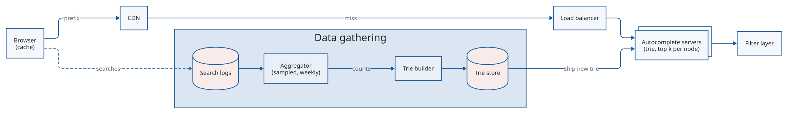

# Case studies: applications {#sec-case-studies-applications}

The previous chapter designed shared infrastructure; this one designs the products that run on it. Each section takes one application that the benchmark books design: a news feed, chat, search autocomplete,
media upload and streaming, file storage and sync, collaborative editing, booking and location services. As Tan says of one of them, "these decisions are debatable, and we should be able to discuss
their tradeoffs" [@tanAcingSystemDesign2024, Sec. 15.2.1, p. 334].

The claims are of two kinds. Each design is a definition, and its properties are those proved in the earlier chapters, recalled by link: the load estimate (@def-load-estimate), queues and backlogs
(@prp-backlog), caches (@prp-cache-load), real-time delivery (@prp-rt-polling), identifiers (@def-unique-id), pipelines as DAGs (@prp-dag), the CDN's hit ratio (@prp-cdn-ttl-hit-ratio), conditional writes and slot
reservations (@prp-reservation) and version vectors (@thm-logical-clocks). One case needs a new result: that replicas of a collaboratively edited text converge, proved in @sec-collaborative-editing.

The sources are the benchmark books, @SystemDesignInterview2021 [Chs. 11-15], @tanAcingSystemDesign2024 [Chs. 7, 11, 12, 14, 15 and 16], @sinhaSystemDesignGuide2024 [Chs. 10, 11, 13 and 14] and @liuSystemDesignInterview2020
[Chs. 5 and 6, App. 5].

The chapter has eight sections. @sec-news-feed designs a news feed. @sec-chat designs chat and live fan-out. @sec-autocomplete designs search autocomplete. @sec-media designs media upload and streaming. @sec-file-sync designs
file storage and sync. @sec-collaborative-editing designs collaborative editing and proves that a list CRDT converges. @sec-booking designs booking without double booking. @sec-location designs proximity search and ride matching.

Each design is estimated the way @sec-estimating-load estimates, drawn as an architecture diagram, and given one runnable algorithmic core. Every definition and result is followed by ten examples and ten exercises, each exercise with
a hidden solution in two tabs: the argument or design, then a computation with its recorded output. The computations run in plain Python 3.12 with NumPy and `sqlite3`, seeded. Client and service code is shown as illustrative
code and is not run.

## A news feed {#sec-news-feed}

A news feed shows each user the recent posts of the people they follow. Xu's interviewer sets "10 million DAU" and up to "5000" friends, with the feed "sorted by reverse chronological order" [@SystemDesignInterview2021, Ch. 11].
This section designs it from caches (@def-cache-patterns), queues (@def-message-queue) and partitioning (@def-partitioning).

For more on this topic, see @SystemDesignInterview2021 [Ch. 11], @tanAcingSystemDesign2024 [Ch. 16, pp. 354-373] and @sinhaSystemDesignGuide2024 [Ch. 11].

### The design

@fig-nfd-arch shows the two flows: publishing through a fan-out service, retrieval from a feed cache.

{#fig-nfd-arch width=95%}

:::: {.statement-box}
::: {#def-news-feed}
#### News feed

1. **Publishing** stores a post and hands it to a **fan-out service**; **retrieval** returns a user's feed, the recent posts of the accounts the user follows, ranked by time or by a score.
2. Under **fan-out on write** (push) the fan-out service appends the post's identifier to the **feed cache** of each follower when the post is published; under **fan-out on read** (pull) a user's feed is assembled when it is
   requested, from the recent posts of each followee. A **hybrid** pushes the posts of accounts with at most $F$ followers and pulls those of accounts with more.
3. The feed cache holds, per user, a bounded list of post identifiers; retrieval **hydrates** them from post and user caches; media are served from a CDN.
4. A **ranking** score may replace time order, for example by the affinity between viewer and author, the post's weight and its age.
:::

::::

Items 1 and 2 are Xu's: "Fanout on write. With this approach, news feed is pre-computed during write time", "Fanout on read. The news feed is generated during read time", and the hybrid: "we use a push model for the majority of users.
For celebrities or users who have many friends/followers, we let followers pull news content on-demand to avoid system overload" [@SystemDesignInterview2021, Ch. 11, "Fanout service"]. Item 3 is Xu's: "only IDs are stored. To keep the
memory size small, we set a configurable limit", and "the news feed service fetches the complete user and post objects from caches (user cache and post cache) to construct the fully hydrated news feed"
[@SystemDesignInterview2021, Ch. 11, "Fanout service" and "Newsfeed retrieval deep dive"]. Item 4 follows Liu's EdgeRank: "Facebook's feed ranking algorithm functions by looking at user affinity, content weight, and time-based decay"
[@liuSystemDesignInterview2020, App. 5, "EdgeRank"].

:::: {.callout-note .examples-fold collapse="true" title="Examples"}
@def-load-estimate for Xu's feed. Reads dominate, and fan-out multiplies writes.

::: {#exm-nfd-estimate}
#### The estimate

$10^7$ users loading the feed $10$ times a day make $1157$ reads a second; posting $0.5$ times a day with $200$ followers each, $58$ posts a second become $1.2 \times 10^4$ feed-cache inserts a second under push. Feed caches of $500$
identifiers of $8$ bytes are $40\,\mathrm{GB}$ for all users.

```{.python .run}
U = 1e7
print(round(U * 10 / 86400), round(U * 0.5 / 86400), round(U * 0.5 * 200 / 86400), U * 500 * 8 / 1e9, "GB")
```

```{.text .run-output}
1157 58 11574 40.0 GB
```
:::

The algorithmic core: a cost model on a seeded heavy-tailed follower graph. The threshold $F$ trades writes and the largest fan-out against work at read time.

::: {#exm-nfd-cost-model}
#### Push against pull

$10^5$ users with Zipf follower counts posting $0.5$ times a day; for thresholds $F$, the feed-cache inserts a day, the celebrity timelines merged per feed load, and the largest fan-out of a single post. Pushing everything
minimises total work, because feeds are loaded more often than posts are written, but a single post then fans out to half the users; pulling everything makes each load merge about ten timelines:

```{.python .run}
import numpy as np
rng = np.random.default_rng(1501)
U = 10**5
followers = np.minimum(rng.zipf(1.9, U), U - 1)                 # heavy-tailed follower counts
posts = rng.poisson(0.5, U)                                      # posts per user per day
def costs(F):
    """Hybrid with threshold F: feed-cache inserts a day, timelines pulled per feed load, largest single fan-out."""
    push = followers <= F
    writes = int((posts * followers)[push].sum())
    pulled = round(float(followers[~push].sum() / U), 2)         # celebrities followed by a user, on average
    biggest = int(followers[push].max())
    return writes, pulled, biggest
for F in (10, 100, 1000, 10**4, 10**5): print(F, costs(F))
```

```{.text .run-output}
10 (91478, 10.44, 10)
100 (183010, 8.6, 100)
1000 (301249, 6.29, 1000)
10000 (431894, 3.63, 8778)
100000 (488127, 0.0, 54238)
```
:::

Item 2's push for an account with ten million followers. The write takes long and wastes work on inactive followers.

::: {#exm-nfd-celebrity}
#### A celebrity's post

Pushing one post to $10^7$ followers at $10^5$ inserts a second per worker pool takes $100\,\mathrm{s}$; Xu calls this the "hotkey problem", and with $30\%$ of followers active today, $70\%$ of the inserts are never read.

```{.python .run}
print(1e7 / 1e5, "s;", 0.7 * 1e7, "wasted inserts")
```

```{.text .run-output}
100.0 s; 7000000.0 wasted inserts
```
:::

Item 3's hydration. Identifiers first, objects from caches second.

::: {#exm-nfd-retrieval}
#### Retrieval in code

Illustrative service code:

```{.python .illustrative}
def get_feed(user_id, limit=20):
    ids = feed_cache.lrange(f"feed:{user_id}", 0, limit - 1)          # pushed posts
    for celeb in celebrities_followed(user_id):                         # pulled posts (hybrid)
        ids += post_cache.recent(celeb, limit)
    ids = sorted(set(ids), key=post_time, reverse=True)[:limit]
    posts = post_cache.mget(ids)                                        # hydrate
    users = user_cache.mget({p.author for p in posts})
    return render(posts, users)
```

:::

Item 3 uses several caches. Each holds a different kind of data.

::: {#exm-nfd-cache-layers}
#### Xu's cache layers

Xu's five layers: "News Feed", "Content", "Social Graph", "Action" and "Counters" [@SystemDesignInterview2021, Ch. 11, "Cache architecture"]; a feed request touches the first three, likes and counts touch the
last two.
:::

Item 4's three factors in a stub score. Affinity, weight and decay multiply.

::: {#exm-nfd-edgerank}
#### A ranking score

A score $a \cdot w \cdot e^{-t/T}$ with affinity $a$, weight $w$ and age $t$:

```{.python .run}
import math
posts = [("close friend, old", 0.9, 1.0, 20), ("acquaintance, new", 0.2, 1.0, 1), ("close friend, photo", 0.9, 2.0, 5)]
print(sorted(((round(a * w * math.exp(-t / 10), 3), name) for name, a, w, t in posts), reverse=True))
```

```{.text .run-output}
[(1.092, 'close friend, photo'), (0.181, 'acquaintance, new'), (0.122, 'close friend, old')]
```
:::

Item 2's writes go through a queue. Bursts are absorbed and drained (@prp-backlog).

::: {#exm-nfd-queue}
#### Fan-out through a queue

If a news event triggers $10^6$ posts in ten minutes with $200$ followers each, $3.3 \times 10^5$ inserts a second arrive against a fan-out capacity of $10^5$: the backlog peaks at $1.4 \times 10^8$ and drains in about half an hour at
the normal rate; feeds lag but nothing is lost.

```{.python .run}
lam1, cap, D = 1e6 * 200 / 600, 1e5, 600
peak = (lam1 - cap) * D; print(f"{lam1:.1e} {peak:.1e}", round(peak / (cap - 1.2e4) / 60), "min")
```

```{.text .run-output}
3.3e+05 1.4e+08 27 min
```
:::

Tan's storage estimate for prepared feeds. Precomputing for everyone is large.

::: {#exm-nfd-tan-storage}
#### Tan's precomputed feeds

Tan: storing up to $10^5$ post identifiers for each of $10^9$ users "is up to 800 TB, which may be beyond the capacity of a Redis cluster", or $16\,\mathrm{TB}$ per data centre for $2 \times 10^7$ users
[@tanAcingSystemDesign2024, Sec. 16.3, p. 360]; Xu's bounded list per user is the remedy.

```{.python .run}
print(1e9 * 1e5 * 8 / 1e12, 2e7 * 1e5 * 8 / 1e12, "TB")
```

```{.text .run-output}
800.0 16.0 TB
```
:::

Xu's fan-out filters followers by settings. Muted followers receive nothing.

::: {#exm-nfd-mute}
#### Filtering before fan-out

The fan-out service reads the follower list from the graph store and drops followers who muted the author: "if you mute someone, her posts will not show up on your news feed even though you are still friends"
[@SystemDesignInterview2021, Ch. 11].

```{.python .run}
followers, muted = {"b", "c", "d"}, {"c"}
print(sorted(followers - muted))
```

```{.text .run-output}
['b', 'd']
```
:::

Item 3's caches partitioned by user. Every user's feed is on one node.

::: {#exm-nfd-partition}
#### Partitioning feed caches

Hashing the user identifier onto $40$ cache nodes spreads the $40\,\mathrm{GB}$ evenly, $1\,\mathrm{GB}$ each; a feed read touches one node for identifiers and a few for hydration (@prp-fan-out-tail).
:::

::::

:::: {.callout-note .exercises-fold collapse="true" title="Exercises"}
The first exercise picks item 2's $F$ from the core. A latency bound on fan-out caps it.

::: {#exr-nfd-threshold}
#### Choosing the threshold

Every post must reach all feed caches within $10\,\mathrm{s}$, and the fan-out of one post proceeds at $10^3$ inserts a second. Which threshold among $10$, $10^2$, $10^3$, $10^4$, $10^5$ is the largest that meets this, and what does
it cost at read time?
:::

::: {.callout-note .solution collapse="true" title="Solution"}
:::: {.panel-tabset .solution-tabs}
## Solution

One post may fan out to at most $10^4$ followers, so $F = 10^4$, whose largest pushed account has $8778$ followers; each feed load then merges $3.6$ celebrity timelines on average, against $10.4$ with $F = 10$, and the
daily inserts are $88\%$ of full push.

## Python

The largest admissible threshold.

```{.python .run}
import numpy as np
rng = np.random.default_rng(1501)
U = 10**5
followers = np.minimum(rng.zipf(1.9, U), U - 1)                 # heavy-tailed follower counts
posts = rng.poisson(0.5, U)                                      # posts per user per day
def costs(F):
    """Hybrid with threshold F: feed-cache inserts a day, timelines pulled per feed load, largest single fan-out."""
    push = followers <= F
    writes = int((posts * followers)[push].sum())
    pulled = round(float(followers[~push].sum() / U), 2)         # celebrities followed by a user, on average
    biggest = int(followers[push].max())
    return writes, pulled, biggest
ok = [F for F in (10, 100, 1000, 10**4, 10**5) if costs(F)[2] <= 10 * 1000]
F = max(ok); print(F, costs(F), round(costs(F)[0] / costs(10**5)[0], 2))
```

```{.text .run-output}
10000 (431894, 3.63, 8778) 0.88
```
::::
:::

The second exercise prices push for inactive followers. Their feeds are written and never read.

::: {#exr-nfd-inactive}
#### Inactive users

If $60\%$ of users are inactive on a given day, what fraction of push inserts are wasted, and how can the waste be avoided?
:::

::: {.callout-note .solution collapse="true" title="Solution"}
:::: {.panel-tabset .solution-tabs}
## Solution

About $60\%$, if followers are like other users. Skip pushing to users inactive for more than a few days and build their feed by pull when they return; Xu lists "For inactive users or those rarely log in, pre-computing news feeds
waste computing resources" [@SystemDesignInterview2021, Ch. 11].

## Python

Inserts saved per day at the estimate's rate.

```{.python .run}
print(round(0.6 * 1.2e4 * 86400))
```

```{.text .run-output}
622080000
```
::::
:::

The third exercise sizes item 3's list. Users rarely scroll far.

::: {#exr-nfd-cache-size}
#### Bounding the feed list

If $99\%$ of feed sessions read at most $200$ posts, what list length should the cache keep, and what happens past it?
:::

::: {.callout-note .solution collapse="true" title="Solution"}
:::: {.panel-tabset .solution-tabs}
## Solution

Keep about $200$ to $500$ identifiers; past the end, the service falls back to pull from followees' timelines, slower but rare. Xu: "The chance of a user scrolling through thousands of posts in news feed is slim"
[@SystemDesignInterview2021, Ch. 11].

## Python

Memory at two lengths.

```{.python .run}
for n in (200, 500): print(n, 1e7 * n * 8 / 1e9, "GB")
```

```{.text .run-output}
200 16.0 GB
500 40.0 GB
```
::::
:::

The fourth exercise asks what the feed promises. Eventual consistency suffices.

::: {#exr-nfd-consistency}
#### Feed consistency

After posting, should the author see the post in their own feed at once, and which session guarantee is that (@def-consistency-models)?
:::

::: {.callout-note .solution collapse="true" title="Solution"}
:::: {.panel-tabset .solution-tabs}
## Solution

Yes: read-your-writes for the author, by inserting into their own feed synchronously or merging their own recent posts at read time; followers may see it seconds later, eventual consistency.

## Python

Merging the author's own post.

```{.python .run}
feed, own = [("p1", 100), ("p0", 90)], [("p2", 105)]
print([p for p, t in sorted(feed + own, key=lambda x: -x[1])])
```

```{.text .run-output}
['p2', 'p1', 'p0']
```
::::
:::

The fifth exercise removes a pushed post. Identifiers in feeds must be filtered.

::: {#exr-nfd-delete}
#### Deleting a post

A post pushed to $10^4$ feeds is deleted. Must all feeds be rewritten?
:::

::: {.callout-note .solution collapse="true" title="Solution"}
:::: {.panel-tabset .solution-tabs}
## Solution

No: hydration finds the post deleted and drops it; a background job may remove the identifier from feeds lazily. Rewriting $10^4$ lists at once is the fan-out problem again.

## Python

Hydration skipping a deleted post.

```{.python .run}
posts = {"p1": "ok", "p2": None}
print([p for p in ["p2", "p1"] if posts.get(p)])
```

```{.text .run-output}
['p1']
```
::::
:::

The sixth exercise prices item 4. Ranking reads more candidates than it shows.

::: {#exr-nfd-ranking-cost}
#### The cost of ranking

Ranking $500$ candidates to show $20$ costs a model call per candidate of $0.05\,\mathrm{ms}$. What does it add per feed load and per second at the estimate's rate?
:::

::: {.callout-note .solution collapse="true" title="Solution"}
:::: {.panel-tabset .solution-tabs}
## Solution

$25\,\mathrm{ms}$ of compute per load, $29$ CPU-seconds per second at $1157$ loads a second: $42$ cores at $70\%$, plus feature lookups (@prp-dynamic-batching applies if the model is batched).

## Python

The numbers.

```{.python .run}
import math
t = 500 * 0.05e-3; print(t, round(1157 * t), math.ceil(1157 * t / 0.7))
```

```{.text .run-output}
0.025 29 42
```
::::
:::

The seventh exercise chooses item 2's follower store. Reads by author dominate.

::: {#exr-nfd-graph-store}
#### Where the graph lives

The fan-out service reads an author's followers; the pull path reads a user's followees. Which index does each need, and how large are they for $10^7$ users with $200$ edges each?
:::

::: {.callout-note .solution collapse="true" title="Solution"}
:::: {.panel-tabset .solution-tabs}
## Solution

Two adjacency lists, by author and by follower, each $2 \times 10^9$ edges of $16$ bytes, $32\,\mathrm{GB}$; partitioned by the list's owner. Xu suggests a graph database [@SystemDesignInterview2021, Ch. 11], though two key-value
lists suffice for these two queries.

## Python

The size.

```{.python .run}
print(1e7 * 200 * 16 / 1e9, "GB per direction")
```

```{.text .run-output}
32.0 GB per direction
```
::::
:::

The eighth exercise adds images. The CDN carries the bytes (@def-cdn).

::: {#exr-nfd-media}
#### Media in the feed

If each feed load shows $10$ images of $80\,\mathrm{kB}$, what egress does the feed generate, and where does it go?
:::

::: {.callout-note .solution collapse="true" title="Solution"}
:::: {.panel-tabset .solution-tabs}
## Solution

$1157 \times 10 \times 80\,\mathrm{kB} = 926\,\mathrm{MB/s}$, $7.4\,\mathrm{Gbit/s}$, from the CDN; the feed service returns only URLs.

## Python

The bandwidth.

```{.python .run}
b = 1157 * 10 * 80e3; print(round(b / 1e6), "MB/s", round(b * 8 / 1e9, 1), "Gbit/s")
```

```{.text .run-output}
926 MB/s 7.4 Gbit/s
```
::::
:::

The ninth exercise checks Sinha's Twitter-like estimate. One label is off.

::: {#exr-nfd-sinha-check}
#### Sinha's timeline estimate

Sinha estimates "Peak tweets per second: 20 million users × 5 tweets/user/day ÷ 86400 seconds/day ≈ 1,200 tweets/second" and "Fanout requests for timeline generation: 100 followers/user × 1200 tweets/second ≈ 120,000
requests/second" [@sinhaSystemDesignGuide2024, Ch. 11]. Check both.
:::

::: {.callout-note .solution collapse="true" title="Solution"}
:::: {.panel-tabset .solution-tabs}
## Solution

The quotient is $1157$, so $1200$ is right as a rounding, but it is the daily average, not the peak; with a peak factor of $2$ (@def-load-estimate) the peak is about $2300$ tweets and $2.3 \times 10^5$ fan-out inserts a second.
The fan-out product $100 \times 1200 = 1.2 \times 10^5$ is right for the average.

## Python

Average and peak.

```{.python .run}
avg = 20e6 * 5 / 86400
print(round(avg), round(100 * avg), round(2 * avg), round(200 * avg))
```

```{.text .run-output}
1157 115741 2315 231481
```
::::
:::

The tenth exercise summarises the feed. Estimate, fan-out, caches, ranking.

::: {#exr-nfd-design}
#### The full design

Summarise the design.
:::

::: {.callout-note .solution collapse="true" title="Solution"}
:::: {.panel-tabset .solution-tabs}
## Solution

$1157$ feed loads and $58$ posts a second; hybrid fan-out with $F$ near the core's optimum, through a queue; per-user lists of $500$ identifiers, $40\,\mathrm{GB}$ partitioned by user; post, user and graph caches for hydration; read-your-writes
for authors; images from the CDN; optional ranking by affinity, weight and decay.

## Python

The summary.

```{.python .run}
print({"loads/s": 1157, "posts/s": 58, "fanout": "hybrid", "feed_cache_GB": 40, "media": "CDN"})
```

```{.text .run-output}
{'loads/s': 1157, 'posts/s': 58, 'fanout': 'hybrid', 'feed_cache_GB': 40, 'media': 'CDN'}
```
::::
:::

::::

## Chat and live fan-out {#sec-chat}

Chat delivers each message to the other members of a conversation as soon as it is sent. Xu's requirements: "50 million daily active users", "1 on 1 chat, group chat, online indicator", groups of "A maximum of 100 people"
[@SystemDesignInterview2021, Ch. 12]. This section designs it from real-time delivery (@def-real-time-delivery), identifiers (@def-unique-id), key-value stores (@def-kv-store-design) and failure detectors (@def-failure-detector), and
extends it to live streams with millions of viewers.

For more on this topic, see @SystemDesignInterview2021 [Ch. 12], @tanAcingSystemDesign2024 [Ch. 14, pp. 308-328] and @liuSystemDesignInterview2020 [Ch. 6, "Chat Application" and "Emoji Broadcasting"].

### The design

@fig-cht-arch shows the stateful chat servers and the stateless services around them.

{#fig-cht-arch width=95%}

:::: {.statement-box}
::: {#def-chat-service}
#### Chat service

1. Clients keep a persistent connection, a WebSocket, to a **chat server**; a **service discovery** component assigns each client a server and records which server holds which user's connections.
2. Each message receives a **message identifier**, unique and increasing with time within its conversation, and is stored in a key-value store keyed by (conversation, message identifier).
3. For a one-to-one or small group conversation, a sent message is copied to each recipient's **sync queue**; each device keeps the largest identifier it has received and **syncs** by fetching the messages with larger
   identifiers.
4. **Presence** is tracked by heartbeats from connected clients: a user is shown offline when no heartbeat has arrived for a timeout.
5. In **live fan-out** to very large audiences, such as reactions on a stream, a message goes to the chat servers holding the stream's viewers, which forward it to their connections; messages may be sampled or aggregated.
:::

::::

Item 1 is Xu's: chat servers keep the connections, and service discovery "recommend[s] the best chat server for a client" [@SystemDesignInterview2021, Ch. 12, "Service discovery"]. Item 2 is Xu's: "IDs must be unique. IDs should be
sortable by time, meaning new rows have higher IDs than old ones", stored in key-value stores, which "allow easy horizontal scaling" [@SystemDesignInterview2021, Ch. 12, "Storage" and "Message ID"]. Item 3 is Xu's: "A is copied to
each group member's message sync queue", and "Each device maintains a variable called cur_max_message_id, which keeps track of the latest message ID on the device" [@SystemDesignInterview2021, Ch. 12, "Small group chat flow" and
"Message synchronization across multiple devices"]. Item 4 is Xu's heartbeat: "Periodically, an online client sends a heartbeat event to presence servers" [@SystemDesignInterview2021, Ch. 12, "Online presence"]. Item 5 is Liu's
emoji broadcasting: "The fan-out service looks at the connection storage for a list of websocket_server_id for a given stream_id to forward the request to" [@liuSystemDesignInterview2020, Ch. 6, "Emoji Broadcasting"].

:::: {.callout-note .examples-fold collapse="true" title="Examples"}
@def-load-estimate for Xu's chat. Connections and message rates.

::: {#exm-cht-estimate}
#### The estimate

$5 \times 10^7$ users sending $40$ messages a day are $2.3 \times 10^4$ messages a second, $4.6 \times 10^4$ at the peak; with $10^5$ connections per chat server, $500$ servers hold $5 \times 10^7$ connections at once; messages of
$100$ bytes are $200\,\mathrm{GB}$ a day.

```{.python .run}
m = 5e7 * 40
print(round(m / 86400), round(2 * m / 86400), 5e7 / 1e5, m * 100 / 1e9, "GB/day")
```

```{.text .run-output}
23148 46296 500.0 200.0 GB/day
```
:::

The algorithmic core: a store and per-device cursors. A device that was offline catches up by identifier.

::: {#exm-cht-sync}
#### Syncing a device

Two devices of one user; the tablet is offline for two messages:

```{.python .run}
import itertools
class ChatStore:
    """Messages keyed by (channel, message id); ids increase with time within a channel."""
    def __init__(self): self.msgs, self.seq = {}, itertools.count(1)
    def send(self, channel, sender, text):
        mid = next(self.seq); self.msgs.setdefault(channel, []).append((mid, sender, text)); return mid
    def sync(self, channel, cur_max):
        return [m for m in self.msgs.get(channel, []) if m[0] > cur_max]
s = ChatStore(); cur = {"phone": 0, "tablet": 0}
for t in ("hi", "lunch?", "12:30"): s.send("c1", "ana", t)
got = s.sync("c1", cur["phone"]); cur["phone"] = got[-1][0]
s.send("c1", "ana", "see you")
print([m[2] for m in s.sync("c1", cur["tablet"])], [m[2] for m in s.sync("c1", cur["phone"])])
```

```{.text .run-output}
['hi', 'lunch?', '12:30', 'see you'] ['see you']
```
:::

Item 2's identifiers by @def-unique-id. Snowflake identifiers sort by time.

::: {#exm-cht-ids}
#### Time-ordered identifiers

A Snowflake identifier (@def-unique-id (4)) increases with its millisecond timestamp, so ordering by identifier orders by time across servers, up to clock skew; Xu also allows a "local sequence number generator", unique only within a
conversation [@SystemDesignInterview2021, Ch. 12].

```{.python .run}
def snowflake(ms, machine, seq): return (ms << 22) | (machine << 12) | seq
a, b = snowflake(1764320000123, 3, 0), snowflake(1764320000124, 1, 0)
print(a < b)
```

```{.text .run-output}
True
```
:::

Item 1's WebSocket by @prp-rt-polling (c). Push has one half round trip of delay.

::: {#exm-cht-delivery}
#### Delay of delivery

With a round trip of $80\,\mathrm{ms}$ between users and servers, push delivers in about $40\,\mathrm{ms}$ plus routing; short polling every $5\,\mathrm{s}$ would add $2.5\,\mathrm{s}$ on average and $10^7$ requests a second for $5 \times 10^7$
clients.

```{.python .run}
print(0.08 / 2, 5 / 2 + 0.04, 5e7 / 5)
```

```{.text .run-output}
0.04 2.54 10000000.0
```
:::

Item 3's inbox copy per member. Small groups only.

::: {#exm-cht-group}
#### Copies per group message

A message to a group of $100$ is copied $99$ times; Xu notes WeChat "limits a group to 500 members", and "for groups with a lot of users, storing a message copy for each member is not acceptable"
[@SystemDesignInterview2021, Ch. 12].

```{.python .run}
for n in (2, 100, 500, 10**5): print(n, n - 1, "copies")
```

```{.text .run-output}
2 1 copies
100 99 copies
500 499 copies
100000 99999 copies
```
:::

Item 4 by @prp-heartbeat-detector. A timeout of three heartbeats tolerates lost ones.

::: {#exm-cht-presence}
#### Presence by heartbeat

Heartbeats every $5\,\mathrm{s}$ and a timeout of $30\,\mathrm{s}$ mark a disconnected user offline within $30\,\mathrm{s}$ plus delay, and tolerate five lost heartbeats; with $5 \times 10^7$ online users the presence servers receive $10^7$
heartbeats a second.

```{.python .run}
print(5e7 / 5)
```

```{.text .run-output}
10000000.0
```
:::

Item 5 for Liu's stream. Reactions to tens of millions of viewers.

::: {#exm-cht-live}
#### Live fan-out

Liu: in a popular stream, "if all the watchers press an emoji at the same time, we will need to fan-out tens of millions of emojis to tens of millions of users" [@liuSystemDesignInterview2020, Ch. 6, "Fan-out Factor"]; aggregating
reactions per second per server and sending counts instead of events cuts the fan-out to one message per server per second.

```{.python .run}
viewers, servers = 2e7, 400
print(f"{viewers * viewers:.0e} naive deliveries vs", servers, "aggregated messages a second")
```

```{.text .run-output}
4e+14 naive deliveries vs 400 aggregated messages a second
```
:::

A recipient without a connection gets a push notification. The notification service of @def-notification-service.

::: {#exm-cht-offline}
#### Offline recipients

If $40\%$ of recipients are offline when a message arrives, $9259$ push notifications a second go to the notification service, which delivers at least once with deduplication by message identifier.

```{.python .run}
print(round(0.4 * 23148))
```

```{.text .run-output}
9259
```
:::

Tan's storage requirement. Ten megabytes per user.

::: {#exm-cht-tan-storage}
#### Tan's message log

Tan lets users "view and search up to 10 MB of their past messages. With one billion users, this works out to 10 PB of storage" [@tanAcingSystemDesign2024, Sec. 14.1, p. 309].

```{.python .run}
print(1e9 * 10e6 / 1e15, "PB")
```

```{.text .run-output}
10.0 PB
```
:::

Items 1 to 3 from the client side. Connect, sync, then receive.

::: {#exm-cht-client}
#### The client's loop

Illustrative client code:

```{.python .illustrative}
async def run(device):
    ws = await connect(discovery.chat_server_for(device.user))
    for m in await api.sync(device.user, since=device.cur_max_message_id):
        device.show(m); device.cur_max_message_id = m.id
    async for m in ws:                                  # pushed messages
        if m.id > device.cur_max_message_id:            # ignore duplicates after reconnects
            device.show(m); device.cur_max_message_id = m.id
```

:::

::::

:::: {.callout-note .exercises-fold collapse="true" title="Exercises"}
The first exercise sizes item 1's servers. Memory per connection decides.

::: {#exr-cht-servers}
#### Connections per server

If a connection uses $20\,\mathrm{kB}$ of memory and a server has $16\,\mathrm{GB}$ for connections, how many servers hold $5 \times 10^7$ connections at $70\%$, and across three zones at $N + 1$ (@prp-regions (b))?
:::

::: {.callout-note .solution collapse="true" title="Solution"}
:::: {.panel-tabset .solution-tabs}
## Solution

$8 \times 10^5$ connections per server; $\lceil 5 \times 10^7/(0.7 \times 8 \times 10^5)\rceil = 90$ servers; with any two of three zones carrying all, $135$.

## Python

The counts.

```{.python .run}
import math
per = 16e9 / 20e3; n = math.ceil(5e7 / (0.7 * per)); print(per, n, 3 * math.ceil(n / 2))
```

```{.text .run-output}
800000.0 90 135
```
::::
:::

The second exercise fails item 1's server. Clients reconnect and sync.

::: {#exr-cht-reconnect}
#### A chat server fails

A chat server with $8 \times 10^5$ connections crashes. What happens to its users, and what protects messages sent meanwhile?
:::

::: {.callout-note .solution collapse="true" title="Solution"}
:::: {.panel-tabset .solution-tabs}
## Solution

Clients reconnect through service discovery to other servers, with jittered backoff to avoid a storm (@prp-retry-load); messages sent meanwhile are already stored with identifiers, so each device syncs from its cursor and
loses nothing.

## Python

Reconnections per second spread over $30\,\mathrm{s}$ of jitter.

```{.python .run}
print(round(8e5 / 30))
```

```{.text .run-output}
26667
```
::::
:::

The third exercise orders concurrent messages. Identifiers decide.

::: {#exr-cht-order}
#### Ordering in a group

Two members send at the same millisecond. Why can created_at not order them, and what does?
:::

::: {.callout-note .solution collapse="true" title="Solution"}
:::: {.panel-tabset .solution-tabs}
## Solution

Timestamps tie and clocks differ; Xu: "We cannot rely on created_at to decide the message sequence because two messages can be created at the same time" [@SystemDesignInterview2021, Ch. 12]. A per-conversation sequence, or
identifiers with a machine field and sequence, give a total order all members see.

## Python

Ties broken by identifier.

```{.python .run}
msgs = [(1764320000123, 2, "b"), (1764320000123, 1, "a")]
print([t for *_, t in sorted(msgs)])
```

```{.text .run-output}
['a', 'b']
```
::::
:::

The fourth exercise prices status changes. Friends must be told.

::: {#exr-cht-presence-load}
#### Presence fan-out

If each status change is sent to $100$ friends and users change status $10$ times a day, how many presence messages a second, and why does Xu limit this for large groups?
:::

::: {.callout-note .solution collapse="true" title="Solution"}
:::: {.panel-tabset .solution-tabs}
## Solution

$5 \times 10^7 \times 10 \times 100/86\,400 = 5.8 \times 10^5$ a second; for large groups, fetching presence when a user opens the group, rather than pushing every change, keeps the fan-out bounded.

## Python

The rate.

```{.python .run}
print(round(5e7 * 10 * 100 / 86400))
```

```{.text .run-output}
578704
```
::::
:::

The fifth exercise sizes item 2's store. Messages accumulate.

::: {#exr-cht-storage-years}
#### Storing messages

At $200\,\mathrm{GB}$ a day with three replicas, how much after five years, and why is a key-value store suited?
:::

::: {.callout-note .solution collapse="true" title="Solution"}
:::: {.panel-tabset .solution-tabs}
## Solution

$1.1\,\mathrm{PB}$; reads are mostly recent and by conversation, the "long tail" pattern Xu cites for key-value stores [@SystemDesignInterview2021, Ch. 12].

## Python

The total.

```{.python .run}
print(200e9 * 365 * 5 * 3 / 1e15, "PB")
```

```{.text .run-output}
1.095 PB
```
::::
:::

The sixth exercise applies @def-delivery-semantics. Push plus sync can duplicate.

::: {#exr-cht-delivery-semantics}
#### Receiving a message twice

A message is pushed over the WebSocket and also returned by a sync after a reconnect. How does the client avoid showing it twice?
:::

::: {.callout-note .solution collapse="true" title="Solution"}
:::: {.panel-tabset .solution-tabs}
## Solution

It shows only messages with identifiers above its cursor, as in @exm-cht-client; at-least-once delivery with an idempotent consumer (@prp-idempotent-consumer).

## Python

The cursor filter.

```{.python .run}
cur, shown = 0, []
for mid in [1, 2, 2, 3, 1]:
    if mid > cur: shown.append(mid); cur = mid
print(shown)
```

```{.text .run-output}
[1, 2, 3]
```
::::
:::

The seventh exercise considers Tan's privacy requirement. The server cannot read messages.

::: {#exr-cht-encryption}
#### End-to-end encryption

Tan's requirements say "End-to-end encryption will be ideal" [@tanAcingSystemDesign2024, Sec. 14.1, p. 309]. What can the server still do, and what can it not?
:::

::: {.callout-note .solution collapse="true" title="Solution"}
:::: {.panel-tabset .solution-tabs}
## Solution

It can route, store and deliver ciphertext, count messages and enforce limits; it cannot search message text or filter content, so server-side search moves to the client.

## Python

Ciphertext stand-in.

```{.python .run}
import hashlib
print(hashlib.sha256(b"see you at 12:30").hexdigest()[:16])
```

```{.text .run-output}
5a20273c95f9bfbe
```
::::
:::

The eighth exercise samples item 5's events. A viewer cannot see millions a second.

::: {#exr-cht-live-sampling}
#### Sampling reactions

If each viewer's screen shows at most $20$ reactions a second, what sampling rate suits a stream receiving $10^6$ a second?
:::

::: {.callout-note .solution collapse="true" title="Solution"}
:::: {.panel-tabset .solution-tabs}
## Solution

$2 \times 10^{-5}$: each server forwards a random $20$ a second, plus aggregate counts; Liu's concern that a flood "would freeze up the devices" [@liuSystemDesignInterview2020, Ch. 6].

## Python

The rate.

```{.python .run}
print(20 / 1e6)
```

```{.text .run-output}
2e-05
```
::::
:::

The ninth exercise extends item 3. A read on one device clears the others.

::: {#exr-cht-multi-device}
#### Read receipts across devices

How should a read on the phone clear the unread badge on the tablet?
:::

::: {.callout-note .solution collapse="true" title="Solution"}
:::: {.panel-tabset .solution-tabs}
## Solution

Store a per-user read cursor per conversation; the phone advances it, the server pushes the new cursor to the user's other devices, and each shows unread messages as those above the read cursor.

## Python

Unread counts from a shared cursor.

```{.python .run}
read_cursor = 7; ids = [5, 6, 7, 8, 9]
print(sum(i > read_cursor for i in ids))
```

```{.text .run-output}
2
```
::::
:::

The tenth exercise summarises chat. Connections, identifiers, sync, presence, live fan-out.

::: {#exr-cht-design}
#### The full design

Summarise the design.
:::

::: {.callout-note .solution collapse="true" title="Solution"}
:::: {.panel-tabset .solution-tabs}
## Solution

$2.3 \times 10^4$ messages a second; $135$ chat servers holding WebSockets across three zones; Snowflake-style message identifiers; messages in a key-value store keyed by (conversation, identifier), $200\,\mathrm{GB}$ a day;
per-recipient sync queues for groups up to $100$; device cursors; heartbeats every $5\,\mathrm{s}$; push notifications for offline users; aggregated, sampled fan-out for live streams.

## Python

The summary.

```{.python .run}
print({"msgs/s": 23148, "servers": 135, "store": "KV (conversation, id)", "group_max": 100, "heartbeat_s": 5})
```

```{.text .run-output}
{'msgs/s': 23148, 'servers': 135, 'store': 'KV (conversation, id)', 'group_max': 100, 'heartbeat_s': 5}
```
::::
:::

::::

## Search autocomplete {#sec-autocomplete}

Autocomplete suggests completions while a user types. Xu: "For every character entered into the search box, a client sends a request to the backend", and the system must return the "top 5" suggestions quickly
[@SystemDesignInterview2021, Ch. 13]. This section designs it from batch pipelines (@def-pipeline, @def-mapreduce), sampling (@def-approximate) and caches (@def-cache-patterns, @def-cdn).

For more on this topic, see @SystemDesignInterview2021 [Ch. 13] and @tanAcingSystemDesign2024 [Ch. 11, pp. 245-265].

### The design

@fig-acp-arch shows the two paths: queries served from a trie, the trie rebuilt from logs.

{#fig-acp-arch width=95%}

:::: {.statement-box}
::: {#def-autocomplete}
#### Search autocomplete

1. Each keystroke sends the current **prefix** to an **autocomplete service**, which returns the $k$ most frequent completions; responses are cacheable by the browser and the CDN.
2. Completions come from a **trie** of past queries with their frequencies; each node stores the **top $k$** completions of its prefix, and prefixes are limited to a maximum length.
3. A **data-gathering** pipeline aggregates search logs, possibly sampled, into query frequencies over a window, rebuilds the trie periodically, and ships it to the service, which swaps it in.
4. The trie may be **partitioned** by prefix ranges, and filters remove unwanted completions.
:::

::::

Items 1 and 2 are Xu's: "For every character entered into the search box, a client sends a request", and "To avoid traversing the whole trie, we store top k most frequently used queries at each node", with "Limit the max length of a
prefix" [@SystemDesignInterview2021, Ch. 13, "Back of the envelope estimation" and "Step 3 - Design deep dive"]. Item 3 is Tan's: "The rest of the system serves to collect users' search strings and periodically generate and deliver a weighted trie to our
autocomplete service", with a "Sampling approach" [@tanAcingSystemDesign2024, Secs. 11.6 and 11.8, pp. 252 and 260]. Item 4 follows Xu's sharding of the trie and filter layer [@SystemDesignInterview2021, Ch. 13, "Scale the storage"
and "Delete"].

:::: {.callout-note .examples-fold collapse="true" title="Examples"}
Xu's numbers by @def-load-estimate. Keystrokes multiply queries.

::: {#exm-acp-estimate}
#### The estimate

$10^7$ users, $10$ searches a day, $20$ characters each: "~24,000 query per second", "~48,000" at the peak, and $0.4\,\mathrm{GB}$ of new query data a day [@SystemDesignInterview2021, Ch. 13]; the exact average is $23\,148$.

```{.python .run}
q = 1e7 * 10 * 20 / 86400
print(round(q), round(2 * q), 1e7 * 10 * 20 * 0.2 / 1e9, "GB/day")
```

```{.text .run-output}
23148 46296 0.4 GB/day
```
:::

The algorithmic core: a trie whose nodes store their top completions. A lookup walks the prefix and returns the cached list.

::: {#exm-acp-trie}
#### A trie with cached top $k$

Xu's example frequencies [@SystemDesignInterview2021, Ch. 13, Fig. 13-8]:

```{.python .run}
import heapq
class Node:
    __slots__ = ("kids", "count", "top")
    def __init__(self): self.kids, self.count, self.top = {}, 0, []
class Trie:
    def __init__(self, k=5): self.root, self.k = Node(), k
    def build(self, counts):
        for word, c in counts.items():
            n = self.root
            for ch in word: n = n.kids.setdefault(ch, Node())
            n.count = c
        self._fill(self.root, "")
    def _fill(self, n, prefix):
        cands = [(n.count, prefix)] if n.count else []
        for ch, kid in n.kids.items(): cands += self._fill(kid, prefix + ch)
        n.top = heapq.nlargest(self.k, cands)
        return n.top
    def suggest(self, prefix):
        n = self.root
        for ch in prefix[:50]:
            n = n.kids.get(ch)
            if n is None: return []
        return [w for c, w in n.top]
t = Trie(k=5)
t.build({"tree": 10, "true": 35, "try": 29, "toy": 14, "best": 35, "bet": 29, "bee": 20, "be": 15, "beer": 10, "buy": 14, "win": 11})
print(t.suggest("be"), t.suggest("tr"), t.suggest("x"))
```

```{.text .run-output}
['best', 'bet', 'bee', 'be', 'beer'] ['true', 'try', 'tree'] []
```
:::

Item 2's cache turns a subtree search into a lookup. Xu's complexities.

::: {#exm-acp-complexity}
#### Why cache at nodes

Without caching, "O(p) + O(c) + O(clogc)" for prefix length $p$ and $c$ children; with a length limit and cached top $k$, "our algorithm takes only O(1) to fetch top k queries" [@SystemDesignInterview2021, Ch. 13], at the cost of
storing $k$ entries per node.
:::

Item 2's storage. Nodes times cached entries.

::: {#exm-acp-trie-size}
#### The trie's size

$10^8$ distinct queries of $20$ characters share prefixes; with about $5 \times 10^8$ nodes, each caching $5$ entries of $8$-byte pointers and counts, the trie needs about $40\,\mathrm{GB}$, so it is partitioned or kept to popular queries.

```{.python .run}
print(5e8 * 5 * 16 / 1e9, "GB")
```

```{.text .run-output}
40.0 GB
```
:::

Item 1's responses repeat. Browser and CDN caches absorb them.

::: {#exm-acp-browser-cache}
#### Caching responses

Xu: "Browser caching. For many applications, autocomplete search suggestions may not change much within a short time" [@SystemDesignInterview2021, Ch. 13]; with a one-hour `max-age`, a user retyping a prefix sends nothing, and short
prefixes such as "a" are served by the CDN for everyone.
:::

Item 3's pipeline as a DAG. Aggregate, build, ship.

::: {#exm-acp-rebuild}
#### Rebuilding the trie

Logs to weekly counts by MapReduce (@def-mapreduce), counts to trie, trie to servers; the critical path (@prp-dag) is a few hours, so weekly rebuilds leave the service always answering from the last complete trie.

```{.python .run}
dur = {"aggregate": 120, "build": 60, "ship": 20}
print(sum(dur.values()), "minutes")
```

```{.text .run-output}
200 minutes
```
:::

Item 3's sampling. Frequent queries survive sampling.

::: {#exm-acp-sampling}
#### Sampling the logs

Sampling $1\%$ of searches leaves a query seen $10^5$ times a week with about $1000$ sampled occurrences, standard deviation $32$; a query seen $50$ times may vanish, which suits autocomplete, which shows only frequent completions.

```{.python .run}
import math
for n in (1e5, 50): print(n, n * 0.01, round(math.sqrt(n * 0.01 * 0.99), 1))
```

```{.text .run-output}
100000.0 1000.0 31.5
50 0.5 0.7
```
:::

Item 4's filter layer. Unwanted completions never reach users.

::: {#exm-acp-filter}
#### Filtering completions

A filter between trie and response removes hateful, violent or dangerous suggestions; removal from the trie happens at the next rebuild [@SystemDesignInterview2021, Ch. 13, "Delete"].

```{.python .run}
blocked = {"bad word"}
print([s for s in ["best", "bad word", "bet"] if s not in blocked])
```

```{.text .run-output}
['best', 'bet']
```
:::

Item 4's shards by first characters. Letters are not equally common.

::: {#exm-acp-shard}
#### Partitioning by prefix

Splitting by first letter gives $26$ shards of very different sizes; Xu proposes a shard map built from historical data, so that, for example, "s" gets a shard of its own while "u" to "z" share one
[@SystemDesignInterview2021, Ch. 13, "Scale the storage"].

```{.python .run}
freq = {"s": 0.11, "c": 0.09, "p": 0.08, "u": 0.01, "v": 0.01, "w": 0.04, "x": 0.001, "y": 0.005, "z": 0.003}
print(round(sum(freq[c] for c in "uvwxyz"), 3), "for u-z against", freq["s"], "for s")
```

```{.text .run-output}
0.069 for u-z against 0.11 for s
```
:::

Item 1's API as illustrative code. A cacheable GET.

::: {#exm-acp-api}
#### The endpoint

In outline:

```{.python .illustrative}
@app.get("/autocomplete")
def autocomplete(q: str):
    prefix = q.lower()[:50]                                   # item 2's length limit
    suggestions = [s for s in trie.suggest(prefix) if s not in blocklist]
    return JSONResponse(suggestions, headers={"Cache-Control": "public, max-age=3600"})
```

:::

::::

:::: {.callout-note .exercises-fold collapse="true" title="Exercises"}
The first exercise reduces item 1's load. Clients can wait for a pause.

::: {#exr-acp-debounce}
#### Fewer requests per keystroke

If the client waits $100\,\mathrm{ms}$ after a keystroke before querying, and users type $5$ characters a second, how many requests per search remain?
:::

::: {.callout-note .solution collapse="true" title="Solution"}
:::: {.panel-tabset .solution-tabs}
## Solution

Keystrokes are $200\,\mathrm{ms}$ apart, so every keystroke still waits $100\,\mathrm{ms}$ and fires: $20$ requests. Waiting $250\,\mathrm{ms}$ fires only at pauses, perhaps $4$ per search, a fifth of the load, at the cost of
$250\,\mathrm{ms}$ more latency per suggestion.

## Python

Loads for both waits.

```{.python .run}
print(23148, round(23148 * 4 / 20))
```

```{.text .run-output}
23148 4630
```
::::
:::

The second exercise asks why item 3 rebuilds rather than updates. Updating on every query is slow.

::: {#exr-acp-update}
#### Real-time updates

Why does Xu reject updating the trie on every query?
:::

::: {.callout-note .solution collapse="true" title="Solution"}
:::: {.panel-tabset .solution-tabs}
## Solution

Each update changes the cached top $k$ of every node on the path; "Updating the trie on every query significantly slows down the query service", and top suggestions change slowly [@SystemDesignInterview2021, Ch. 13].

## Python

Nodes touched by one update of a $20$-character query.

```{.python .run}
print(20)
```

```{.text .run-output}
20
```
::::
:::

The third exercise handles queries that rise fast. A weekly rebuild misses them.

::: {#exr-acp-trending}
#### Trending queries

A news event makes a new query frequent within an hour. How can it appear before the weekly rebuild?
:::

::: {.callout-note .solution collapse="true" title="Solution"}
:::: {.panel-tabset .solution-tabs}
## Solution

Keep a small streaming trie of the last hours' counts, merged with the weekly trie at query time, weighting recent counts more; trending detection by a z-score as in Liu's appendix [@liuSystemDesignInterview2020, App. 5, "Z-Score"].

## Python

Merging two top lists.

```{.python .run}
import heapq
weekly, recent = [(35, "best"), (29, "bet")], [(50, "best match tonight")]
print([w for c, w in heapq.nlargest(3, weekly + recent)])
```

```{.text .run-output}
['best match tonight', 'best', 'bet']
```
::::
:::

The fourth exercise budgets item 1's latency. Suggestions must arrive before the next keystroke.

::: {#exr-acp-latency}
#### Latency per keystroke

If users type a character every $200\,\mathrm{ms}$, what latency budget should suggestions meet, and what consumes it?
:::

::: {.callout-note .solution collapse="true" title="Solution"}
:::: {.panel-tabset .solution-tabs}
## Solution

Under $100\,\mathrm{ms}$: a round trip of $40$ to $80\,\mathrm{ms}$ to a nearby site and a trie lookup of microseconds; Xu targets "within 100 milliseconds" [@SystemDesignInterview2021, Ch. 13].

## Python

The margin.

```{.python .run}
print(200 - 100)
```

```{.text .run-output}
100
```
::::
:::

The fifth exercise sizes $k$. Storage grows with it.

::: {#exr-acp-k}
#### How many suggestions

Compare trie storage for $k = 5$ and $k = 10$ in @exm-acp-trie-size.
:::

::: {.callout-note .solution collapse="true" title="Solution"}
:::: {.panel-tabset .solution-tabs}
## Solution

It doubles, from $40$ to $80\,\mathrm{GB}$, for suggestions most users never scroll to.

## Python

The sizes.

```{.python .run}
for k in (5, 10): print(k, 5e8 * k * 16 / 1e9)
```

```{.text .run-output}
5 40.0
10 80.0
```
::::
:::

The sixth exercise extends the core. Rebuilding updates the caches.

::: {#exr-acp-trie-core}
#### Inserting into the core

Add "tram" with count $40$ and check that "tr" now suggests it first.
:::

::: {.callout-note .solution collapse="true" title="Solution"}
:::: {.panel-tabset .solution-tabs}
## Solution

After the rebuild the node of "tr" caches the top completions of its subtree, now headed by "tram".

## Python

The rebuild.

```{.python .run}
import heapq
class Node:
    __slots__ = ("kids", "count", "top")
    def __init__(self): self.kids, self.count, self.top = {}, 0, []
class Trie:
    def __init__(self, k=5): self.root, self.k = Node(), k
    def build(self, counts):
        for word, c in counts.items():
            n = self.root
            for ch in word: n = n.kids.setdefault(ch, Node())
            n.count = c
        self._fill(self.root, "")
    def _fill(self, n, prefix):
        cands = [(n.count, prefix)] if n.count else []
        for ch, kid in n.kids.items(): cands += self._fill(kid, prefix + ch)
        n.top = heapq.nlargest(self.k, cands)
        return n.top
    def suggest(self, prefix):
        n = self.root
        for ch in prefix[:50]:
            n = n.kids.get(ch)
            if n is None: return []
        return [w for c, w in n.top]
t = Trie(k=3); counts = {"tree": 10, "true": 35, "try": 29}
t.build(counts); before = t.suggest("tr")
counts["tram"] = 40; t = Trie(k=3); t.build(counts)
print(before, t.suggest("tr"))
```

```{.text .run-output}
['true', 'try', 'tree'] ['tram', 'true', 'try']
```
::::
:::

The seventh exercise chooses Tan's unit. Whole queries or single words.

::: {#exr-acp-tan-phrases}
#### Phrases or words

Tan discusses "Handling phrases instead of single words" [@tanAcingSystemDesign2024, Sec. 11.10, p. 263]. What changes in the trie if completions are whole phrases?
:::

::: {.callout-note .solution collapse="true" title="Solution"}
:::: {.panel-tabset .solution-tabs}
## Solution

Keys become phrases with spaces, the trie deeper and larger, and completions more useful; counts are per phrase, so rare long phrases need sampling thresholds to keep the trie bounded.

## Python

Depth of a phrase key.

```{.python .run}
print(len("photos of lisbon in june"))
```

```{.text .run-output}
24
```
::::
:::

The eighth exercise extends the trie to other scripts. Characters are Unicode.

::: {#exr-acp-language}
#### Many languages

How should the trie handle Chinese, where a user types characters that are whole words?
:::

::: {.callout-note .solution collapse="true" title="Solution"}
:::: {.panel-tabset .solution-tabs}
## Solution

Key the trie by Unicode characters; prefixes are then short and branching large, so per-language tries keep the top $k$ meaningful; Xu mentions "Unicode characters in trie nodes" for multiple languages
[@SystemDesignInterview2021, Ch. 13, "Step 4 - Wrap up"].

## Python

Code points of a Chinese query.

```{.python .run}
print([hex(ord(c)) for c in "照片"])
```

```{.text .run-output}
['0x7167', '0x7247']
```
::::
:::

The ninth exercise scales reads. The trie is read-only between rebuilds.

::: {#exr-acp-replicas}
#### Serving from replicas

At $48\,000$ requests a second and $10^4$ per server, how many servers, and why is replication easy here?
:::

::: {.callout-note .solution collapse="true" title="Solution"}
:::: {.panel-tabset .solution-tabs}
## Solution

$7$ at $70\%$; the trie is immutable between rebuilds, so every server holds a full copy or a shard's copy with no consistency protocol, and a rebuild is a blue-green swap (@def-safe-change (2)).

## Python

The count.

```{.python .run}
import math
print(math.ceil(48000 / (0.7 * 1e4)))
```

```{.text .run-output}
7
```
::::
:::

The tenth exercise summarises autocomplete. Estimate, trie, pipeline, caches.

::: {#exr-acp-design}
#### The full design

Summarise the design.
:::

::: {.callout-note .solution collapse="true" title="Solution"}
:::: {.panel-tabset .solution-tabs}
## Solution

$2.3 \times 10^4$ requests a second, $4.6 \times 10^4$ at the peak, answered within $100\,\mathrm{ms}$; tries with top $5$ per node and prefixes up to $50$ characters, about $40\,\mathrm{GB}$, sharded by a historical shard map; weekly rebuilds
from sampled logs by MapReduce, swapped in blue-green; browser and CDN caching; a filter layer.

## Python

The summary.

```{.python .run}
print({"rps": 23148, "peak": 46296, "k": 5, "trie_GB": 40, "rebuild": "weekly", "servers": 7})
```

```{.text .run-output}
{'rps': 23148, 'peak': 46296, 'k': 5, 'trie_GB': 40, 'rebuild': 'weekly', 'servers': 7}
```
::::
:::

::::

## Media upload and streaming {#sec-media}

Video and photo services spend most of their money moving bytes. Xu's estimate for a video platform: "Total daily storage space needed: 5 million * 10% * 300 MB = 150TB", and CDN costs of "$150,000 per day"
[@SystemDesignInterview2021, Ch. 14]. This section designs upload, processing and streaming from object storage (@def-storage-kinds), pipelines as DAGs (@def-pipeline, @prp-dag), queues (@def-message-queue) and the CDN
(@def-cdn, @prp-cdn-ttl-hit-ratio).

For more on this topic, see @SystemDesignInterview2021 [Ch. 14], @tanAcingSystemDesign2024 [Ch. 12, pp. 266-286] and @sinhaSystemDesignGuide2024 [Ch. 14].

### The design

@fig-med-arch shows the upload path through processing and the streaming path through the CDN.

{#fig-med-arch width=95%}

:::: {.statement-box}
::: {#def-media-service}
#### Media upload and streaming

1. Clients **upload** originals directly to object storage, in parts, through **pre-signed URLs** issued by an API server, which records metadata; completion emits an event.
2. A **processing pipeline**, a DAG of tasks, **transcodes** each video into several resolutions and bitrates, splits it into short **segments**, makes thumbnails and checks content; photos get resized versions.
3. Players **stream** with an adaptive-bitrate protocol, fetching segments from a CDN at the highest bitrate the connection sustains.
4. Popular media are served from the CDN; the long tail may be served from origin storage, encoded on demand, or kept only in the regions that watch it.
:::

::::

Item 1 follows Xu's pre-signed upload URL [@SystemDesignInterview2021, Ch. 14, "Safety optimization: pre-signed upload URL"] and Tan's upload flow, in which the client may "Generate the thumbnail" and "Use a POST request to upload the compressed file to our
CDN directory" [@tanAcingSystemDesign2024, Sec. 12.6.1, p. 272]. Item 2 is Xu's: "Facebook's streaming video engine uses a directed acyclic graph (DAG) programming model, which defines tasks in stages so they can be executed sequentially
or parallelly" [@SystemDesignInterview2021, Ch. 14, "Directed acyclic graph (DAG) model"]. Item 3 is Xu's streaming protocols, "MPEG–DASH ... Apple HLS", with "Videos are streamed from CDN directly"
[@SystemDesignInterview2021, Ch. 14, "Video streaming flow"]; in Sinha's words, "Adaptive streaming allows the video quality to adjust dynamically, based on the user's network conditions" [@sinhaSystemDesignGuide2024, Ch. 14]. Item 4 is Xu's cost-saving: "Only serve the most popular videos from CDN and other videos from our high capacity storage video servers", "Short videos can be encoded
on-demand", and "Some videos are popular only in certain regions" [@SystemDesignInterview2021, Ch. 14, "Cost-saving optimization"].

:::: {.callout-note .examples-fold collapse="true" title="Examples"}
Xu's numbers by @def-load-estimate. Storage per day and egress per day.

::: {#exm-med-estimate}
#### The estimate

$5 \times 10^6$ users, $10\%$ uploading one $300\,\mathrm{MB}$ video a day: $150\,\mathrm{TB}$ a day of originals; $5$ views a day each: $7.5\,\mathrm{PB}$ of egress a day, "$150,000 per day" at $\$0.02$ per GB [@SystemDesignInterview2021, Ch. 14].

```{.python .run}
print(5e6 * 0.1 * 300e6 / 1e12, "TB/day", 5e6 * 5 * 0.3e9 / 1e15, "PB/day", 5e6 * 5 * 0.3 * 0.02)
```

```{.text .run-output}
150.0 TB/day 7.5 PB/day 150000.0
```
:::

The algorithmic core: item 4's split on a Zipf popularity. The CDN serves the head.

::: {#exm-med-cost-split}
#### Serving the long tail from origin

$10^5$ videos with Zipf popularity, the top $10\%$ on the CDN at $\$0.02$ per GB and the rest from origin servers at an assumed $\$0.005$: the share of views on the CDN, the daily cost, and the all-CDN cost:

```{.python .run}
import numpy as np
def cdn_split(videos=10**5, views=2.5e7, s=1.0, top_frac=0.1, gb=0.3, cdn=0.02, origin=0.005):
    """Daily cost when the top fraction of videos by popularity is served from the CDN and the rest from origin servers."""
    p = 1 / np.arange(1, videos + 1) ** s; p /= p.sum()
    top = int(top_frac * videos); share = p[:top].sum()
    return round(float(share), 3), round(views * gb * (share * cdn + (1 - share) * origin)), round(views * gb * cdn)
for f in (0.01, 0.1, 0.3): print(f, cdn_split(top_frac=f))
```

```{.text .run-output}
0.01 (0.619, 107153, 150000)
0.1 (0.81, 128575, 150000)
0.3 (0.9, 138797, 150000)
```
:::

Item 2's tasks and their critical path by @prp-dag. Resolutions run in parallel.

::: {#exm-med-dag}
#### The transcoding DAG

Split ($10$), then video encodes at $1080$p ($120$), $720$p ($60$), $480$p ($30$) in parallel with audio ($10$) and thumbnails ($5$), then a merge ($10$): the critical path is $140$ time units.

```{.python .run}
dur = {"split": 10, "e1080": 120, "e720": 60, "e480": 30, "audio": 10, "thumb": 5, "merge": 10}
deps = {"e1080": ["split"], "e720": ["split"], "e480": ["split"], "audio": ["split"], "thumb": ["split"], "merge": ["e1080", "e720", "e480", "audio"]}
f = {}
for t in dur: f[t] = dur[t] + max((f[d] for d in deps.get(t, [])), default=0)
print(f["merge"], f["thumb"])
```

```{.text .run-output}
140 15
```
:::

Item 2's segments also parallelise encoding. A long video is many short jobs.

::: {#exm-med-segments}
#### Segmenting for parallel encoding

A one-hour video in $4\,\mathrm{s}$ segments is $900$ jobs; on $100$ workers, encoding takes $9$ segment-times instead of $900$, and a failed job redoes $4\,\mathrm{s}$, not an hour.

```{.python .run}
import math
print(3600 // 4, math.ceil(900 / 100))
```

```{.text .run-output}
900 9
```
:::

Item 3's player picks the highest bitrate it can sustain. Throughput changes, so does the choice.

::: {#exm-med-abr}
#### Adaptive bitrate

A player measuring throughput picks the largest ladder rung below $80\%$ of it:

```{.python .run}
ladder = [0.4, 1.0, 2.5, 5.0, 8.0]          # Mbit/s
for bw in (1.5, 4.0, 12.0): print(bw, max([r for r in ladder if r <= 0.8 * bw] or [ladder[0]]))
```

```{.text .run-output}
1.5 1.0
4.0 2.5
12.0 8.0
```
:::

Item 1's upload bypasses the API servers. The URL carries a signature and an expiry.

::: {#exm-med-presigned}
#### A pre-signed upload

Illustrative code:

```{.python .illustrative}
@app.post("/videos")
def start_upload(meta: VideoMeta, user=Depends(auth)):
    vid = ids.next()
    db.insert(vid, user.id, meta, status="uploading")
    url = storage.presign_put(f"originals/{vid}", expires_in=3600, max_bytes=5 * 2**30)
    return {"video_id": vid, "upload_url": url}

# storage emits an event on completion; the pipeline consumes it
on_object_created("originals/", lambda obj: pipeline.submit(dag_for(obj)))
```

:::

Item 2's workers by Little's law. Encode time sets the pool.

::: {#exm-med-processing-rate}
#### Processing capacity

$5 \times 10^5$ uploads a day of $5$ minutes each, encoded at $2\times$ real time per rung for $4$ rungs, keep $5 \times 10^5 \times 300 \times 4/2/86\,400 = 3472$ encoders busy on average.

```{.python .run}
print(round(5e5 * 300 * 4 / 2 / 86400))
```

```{.text .run-output}
3472
```
:::

Tan's choice for photos. A small file made before upload.

::: {#exm-med-flickr-thumbs}
#### Thumbnails on the client

Tan: "A 100 px thumbnail is about 40 KB, a negligible addition to a high-resolution photo" [@tanAcingSystemDesign2024, Sec. 12.6.1, p. 272]; generating it on the client saves the backend $2 \times 10^7$ resizes a day for the photo
service.
:::

@prp-cdn-ttl-hit-ratio for segments. Popular segments almost always hit.

::: {#exm-med-ttl}
#### CDN hit ratio for media

A segment requested $\lambda = 1$ time a second at an edge with a TTL of a day has $h = \lambda\Delta/(1 + \lambda\Delta) = 0.99999$; one requested once a week, $h = 0.125$.

```{.python .run}
for lam in (1, 1 / (7 * 86400)): print(round(lam * 86400 / (1 + lam * 86400), 5))
```

```{.text .run-output}
0.99999
0.125
```
:::

Item 4's last saving. A video watched in one country need not be in every region.

::: {#exm-med-regional}
#### Regional popularity

If $40\%$ of videos are watched mainly in one region, storing them on that region's CDN only cuts their storage copies from $5$ regions to $1$, $32\%$ of CDN storage.

```{.python .run}
print(round(0.4 * (1 - 1 / 5), 2))
```

```{.text .run-output}
0.32
```
:::

::::

:::: {.callout-note .exercises-fold collapse="true" title="Exercises"}
The first exercise adds item 2's outputs. Renditions add to the original.

::: {#exr-med-storage}
#### Storage with renditions

If renditions total $60\%$ of the original's size and three replicas are kept, what does a year of uploads need?
:::

::: {.callout-note .solution collapse="true" title="Solution"}
:::: {.panel-tabset .solution-tabs}
## Solution

$150 \times 1.6 \times 3 \times 365 = 263\,\mathrm{PB}$; deleting originals after transcoding, or moving them to cold storage, saves $38\%$ of it.

## Python

The total.

```{.python .run}
print(round(150e12 * 1.6 * 3 * 365 / 1e15), round(1 / 1.6, 2))
```

```{.text .run-output}
263 0.62
```
::::
:::

The second exercise chooses item 4's head from the core. The saving flattens.

::: {#exr-med-split-choice}
#### How much on the CDN

Using the core, choose the fraction of videos on the CDN that keeps at least $80\%$ of views there, and give the saving.
:::

::: {.callout-note .solution collapse="true" title="Solution"}
:::: {.panel-tabset .solution-tabs}
## Solution

$10\%$ of videos carry $81\%$ of views; the daily cost falls from $\$150\,000$ to $\$128\,575$, a saving of $14\%$, because the tail still costs origin bandwidth; $5\%$ of videos carry only $75\%$ of views.

## Python

A finer search.

```{.python .run}
import numpy as np
def cdn_split(videos=10**5, views=2.5e7, s=1.0, top_frac=0.1, gb=0.3, cdn=0.02, origin=0.005):
    """Daily cost when the top fraction of videos by popularity is served from the CDN and the rest from origin servers."""
    p = 1 / np.arange(1, videos + 1) ** s; p /= p.sum()
    top = int(top_frac * videos); share = p[:top].sum()
    return round(float(share), 3), round(views * gb * (share * cdn + (1 - share) * origin)), round(views * gb * cdn)
for f in (0.05, 0.1, 0.2): print(f, cdn_split(top_frac=f))
```

```{.text .run-output}
0.05 (0.752, 122125, 150000)
0.1 (0.81, 128575, 150000)
0.2 (0.867, 135024, 150000)
```
::::
:::

The third exercise uploads in parts. A dropped connection resumes.

::: {#exr-med-resumable}
#### Resumable uploads

A $2\,\mathrm{GB}$ upload in $8\,\mathrm{MB}$ parts loses its connection at $70\%$. What is resent?
:::

::: {.callout-note .solution collapse="true" title="Solution"}
:::: {.panel-tabset .solution-tabs}
## Solution

Only the part in flight: the client lists completed parts and resumes; Xu splits videos into chunks, which "allows fast resumable uploads when the previous upload failed" [@SystemDesignInterview2021, Ch. 14, "Speed optimization"].

## Python

Parts and the resend.

```{.python .run}
print(2e9 / 8e6, "parts; resend 8 MB instead of", 0.7 * 2e9 / 1e6, "MB")
```

```{.text .run-output}
250.0 parts; resend 8 MB instead of 1400.0 MB
```
::::
:::

The fourth exercise retries a DAG task. Only the task is redone.

::: {#exr-med-dag-failure}
#### A failed encode

The $720$p encode fails once. With retries (@def-failure-handling), what does the DAG's finish time become in @exm-med-dag?
:::

::: {.callout-note .solution collapse="true" title="Solution"}
:::: {.panel-tabset .solution-tabs}
## Solution

The $720$p branch takes $120$ instead of $60$, equal to the $1080$p branch, so the finish time stays $140$: slack on a non-critical branch absorbs one retry.

## Python

The new critical path.

```{.python .run}
dur = {"split": 10, "e1080": 120, "e720": 120, "e480": 30, "audio": 10, "merge": 10}
print(10 + max(120, 120, 30, 10) + 10)
```

```{.text .run-output}
140
```
::::
:::

The fifth exercise checks Xu's figure. It holds.

::: {#exr-med-xu-cost}
#### Checking Xu's cost

Verify "5 million * 5 videos * 0.3GB * $0.02 = $150,000 per day".
:::

::: {.callout-note .solution collapse="true" title="Solution"}
:::: {.panel-tabset .solution-tabs}
## Solution

$2.5 \times 10^7 \times 0.3 \times 0.02 = 1.5 \times 10^5$: correct, ignoring rendition sizes below the original's.

## Python

The product.

```{.python .run}
print(5e6 * 5 * 0.3 * 0.02)
```

```{.text .run-output}
150000.0
```
::::
:::

The sixth exercise adds moderation to item 2. It is another DAG task.

::: {#exr-med-content-check}
#### Checking content

Where should a content check go in the DAG, and what should happen while it runs?
:::

::: {.callout-note .solution collapse="true" title="Solution"}
:::: {.panel-tabset .solution-tabs}
## Solution

In parallel with encoding, after split; the video stays private until the check passes, so a failed check deletes outputs without having served them.

## Python

Visibility state.

```{.python .run}
state = {"uploaded": "private", "checked_ok": "public", "checked_bad": "deleted"}
print(state)
```

```{.text .run-output}
{'uploaded': 'private', 'checked_ok': 'public', 'checked_bad': 'deleted'}
```
::::
:::

The seventh exercise changes item 3 for live video. Segments are produced as they are watched.

::: {#exr-med-live}
#### Live streaming

What changes for a live stream, and what latency does a segment length of $4\,\mathrm{s}$ imply?
:::

::: {.callout-note .solution collapse="true" title="Solution"}
:::: {.panel-tabset .solution-tabs}
## Solution

Encoding must keep up in real time and segments are published as they finish; the player buffers a few segments, so latency is roughly two to three segment lengths, $8$ to $12\,\mathrm{s}$, plus CDN propagation.

## Python

The latency range.

```{.python .run}
print(2 * 4, 3 * 4)
```

```{.text .run-output}
8 12
```
::::
:::

The eighth exercise checks a catalogue service's encoding load. Few videos, many renditions.

::: {#exr-med-sinha-encoding}
#### Sinha's encoding estimate

Sinha estimates for a streaming catalogue "The number of new videos added per day: 100", "The encoding time: 1.5 hours × 5 (multiple bitrates) = 7.5 hours per video" and "Daily encoding processing: 100 videos × 7.5 hours = 750
hours" [@sinhaSystemDesignGuide2024, Ch. 14, "Processing estimation"]. How many encoders are busy on average, and how does this compare with the user-upload service of @exm-med-processing-rate?
:::

::: {.callout-note .solution collapse="true" title="Solution"}
:::: {.panel-tabset .solution-tabs}
## Solution

$750/24 = 31.25$ encoders busy around the clock, if encoding runs at real time; the user-upload service needs about a hundred times more, because it ingests $5 \times 10^5$ videos a day rather than $100$.

## Python

The ratio.

```{.python .run}
print(750 / 24, round(3472 / (750 / 24)))
```

```{.text .run-output}
31.25 111
```
::::
:::

The ninth exercise applies the design to photos. Smaller files, more of them.

::: {#exr-med-photo-service}
#### The photo service's media path

For $2 \times 10^7$ photo uploads a day of $3\,\mathrm{MB}$ with four resized versions totalling $0.5\,\mathrm{MB}$, give storage per day with three replicas and the resize rate.
:::

::: {.callout-note .solution collapse="true" title="Solution"}
:::: {.panel-tabset .solution-tabs}
## Solution

$2 \times 10^7 \times 3.5\,\mathrm{MB} \times 3 = 210\,\mathrm{TB}$ a day; $231$ uploads a second, $926$ resizes a second, a small worker pool (@exm-wq-photo-rates).

## Python

The numbers.

```{.python .run}
print(2e7 * 3.5e6 * 3 / 1e12, round(2e7 / 86400), round(4 * 2e7 / 86400))
```

```{.text .run-output}
210.0 231 926
```
::::
:::

The tenth exercise summarises the media service. Upload, DAG, streaming, cost.

::: {#exr-med-design}
#### The full design

Summarise the design.
:::

::: {.callout-note .solution collapse="true" title="Solution"}
:::: {.panel-tabset .solution-tabs}
## Solution

$150\,\mathrm{TB}$ a day of originals by resumable pre-signed uploads; a transcoding DAG of segment-level jobs on about $3500$ encoders, critical path set by the largest rendition; adaptive-bitrate streaming of $4\,\mathrm{s}$ segments from the CDN;
the popular head on the CDN, the tail from origin, regional placement; renditions and originals in tiered storage.

## Python

The summary.

```{.python .run}
print({"TB/day": 150, "encoders": 3472, "segment_s": 4, "cdn_head": 0.1, "abr": "DASH/HLS"})
```

```{.text .run-output}
{'TB/day': 150, 'encoders': 3472, 'segment_s': 4, 'cdn_head': 0.1, 'abr': 'DASH/HLS'}
```
::::
:::

::::

## File storage and sync {#sec-file-sync}

A file sync service keeps a user's files identical on all their devices and in the cloud. Xu's estimate: "50 million signed up users and 10 million DAU", "10 GB free space", "2 files per day" of "500 KB" on average
[@SystemDesignInterview2021, Ch. 15, "Back of the envelope estimation"]. This section designs it from object storage (@def-storage-kinds), strongly consistent metadata (@def-consistency-models), real-time delivery
(@def-real-time-delivery) and version vectors (@def-happens-before).

For more on this topic, see @SystemDesignInterview2021 [Ch. 15] and @liuSystemDesignInterview2020 [Ch. 5, "Pass Chunk Delta with Rsync"; Ch. 6, "Cloud File Storage"].

### The design

@fig-fsy-arch shows the block path and the metadata path.

{#fig-fsy-arch width=95%}

:::: {.statement-box}
::: {#def-file-sync}
#### File storage and sync

1. A file is split into **blocks**, either of a fixed size or at **content-defined** boundaries chosen where a rolling hash of the last bytes meets a condition; each block is named by a cryptographic hash of its content, and a file
   **version** is the list of its block hashes.
2. **Block servers** compress and encrypt blocks and store them in object storage; a **metadata database** holds users, files, versions and block lists, with strong consistency.
3. **Delta sync** uploads only the blocks of a new version whose hashes the store lacks; **deduplication** stores each distinct block once.
4. A **notification service** tells the user's other devices of a new version, which then download its block list and the blocks they lack.
5. A **sync conflict** arises when two devices change the same file from the same base version; the first version processed wins, and the later one is kept beside it as a conflicted copy.
6. Old versions are limited in number, and rarely used data is moved to **cold storage**.
:::

::::

Items 1 to 3 are Xu's: block servers split "a file into blocks, compressing each block, and encrypting them", "only modified blocks are synced instead of the whole file", and "Two blocks are identical if they have the same hash value"
[@SystemDesignInterview2021, Ch. 15, "Block servers" and "Save storage space"]; Dropbox "sets the maximal size of a block to 4MB" [@SystemDesignInterview2021, Ch. 15]. Item 1's rolling hash is Liu's rsync: "Each 2,048-byte chunk
is calculated using a hash function like MD5 into 128 bits", and to move forward "you remove 1 and add 2 ... This is called rolling hash" [@liuSystemDesignInterview2020, Ch. 5, "Pass Chunk Delta with Rsync"]; cutting blocks where
the hash meets a condition is the standard content-defined chunking, which the sources read do not describe. Item 2's consistency is Xu's: "Our system requires strong consistency by default" [@SystemDesignInterview2021, Ch. 15,
"High consistency requirement"]. Item 5 is Xu's: "the first version that gets processed wins, and the version that gets processed later receives a conflict" [@SystemDesignInterview2021, Ch. 15, "Sync conflicts"]. Item 6 is Xu's
"Set a limit" and "Moving infrequently used data to cold storage" [@SystemDesignInterview2021, Ch. 15, "Save storage space"].

:::: {.callout-note .examples-fold collapse="true" title="Examples"}
Xu's numbers by @def-load-estimate. Allocated space is large, daily traffic small.

::: {#exm-fsy-estimate}
#### The estimate

Xu: "Total space allocated: 50 million * 10 GB = 500 Petabyte" and "QPS for upload API: 10 million * 2 uploads / 24 hours / 3600 seconds = ~ 240" [@SystemDesignInterview2021, Ch. 15]; the exact quotient is $231$, the peak about
$460$, and the uploads are $10\,\mathrm{TB}$ a day.

```{.python .run}
print(50e6 * 10e9 / 1e15, "PB", round(10e6 * 2 / 86400), round(2 * 10e6 * 2 / 86400), 10e6 * 2 * 500e3 / 1e12, "TB/day")
```

```{.text .run-output}
500.0 PB 231 463 10.0 TB/day
```
:::

The algorithmic core: chunking with content hashes. An insertion near the start shifts every fixed block, but only one or two content-defined ones.

::: {#exm-fsy-chunking}
#### Fixed and content-defined blocks

A seeded $200\,\mathrm{kB}$ file gets $10$ bytes inserted at offset $1000$; the bytes a client must upload under delta sync, for fixed $2048$-byte blocks and for content-defined blocks cut by a gear hash:

```{.python .run}
import hashlib, random
rng = random.Random(1505)
GEAR = [rng.getrandbits(32) for _ in range(256)]
def fixed_chunks(data, size=2048):
    return [data[i:i + size] for i in range(0, len(data), size)]
def cdc_chunks(data, mask=(1 << 11) - 1, lo=512, hi=8192):
    """Content-defined chunks: cut where a rolling gear hash has its low 11 bits zero (mean about 2 kB)."""
    out, start, h = [], 0, 0
    for i, byte in enumerate(data):
        h = ((h << 1) + GEAR[byte]) & 0xFFFFFFFF
        n = i - start + 1
        if (n >= lo and (h & mask) == 0) or n >= hi:
            out.append(data[start:i + 1]); start, h = i + 1, 0
    if start < len(data): out.append(data[start:])
    return out
def new_bytes(old, new, chunker):
    have = {hashlib.sha256(c).digest() for c in chunker(old)}
    return sum(len(c) for c in chunker(new) if hashlib.sha256(c).digest() not in have)
old = bytes(rng.getrandbits(8) for _ in range(200_000))
new = old[:1000] + b"inserted!!" + old[1000:]
print(len(new), new_bytes(old, new, fixed_chunks), new_bytes(old, new, cdc_chunks), len(cdc_chunks(old)))
```

```{.text .run-output}
200010 200010 1299 67
```
:::

An append changes only the last fixed block. Fixed blocks suit logs.

::: {#exm-fsy-append}
#### Appending to a file

Appending $5000$ bytes to the same file uploads the last block and the new ones under both schemes:

```{.python .run}
import hashlib, random
rng = random.Random(1505)
GEAR = [rng.getrandbits(32) for _ in range(256)]
def fixed_chunks(data, size=2048):
    return [data[i:i + size] for i in range(0, len(data), size)]
def cdc_chunks(data, mask=(1 << 11) - 1, lo=512, hi=8192):
    """Content-defined chunks: cut where a rolling gear hash has its low 11 bits zero (mean about 2 kB)."""
    out, start, h = [], 0, 0
    for i, byte in enumerate(data):
        h = ((h << 1) + GEAR[byte]) & 0xFFFFFFFF
        n = i - start + 1
        if (n >= lo and (h & mask) == 0) or n >= hi:
            out.append(data[start:i + 1]); start, h = i + 1, 0
    if start < len(data): out.append(data[start:])
    return out
def new_bytes(old, new, chunker):
    have = {hashlib.sha256(c).digest() for c in chunker(old)}
    return sum(len(c) for c in chunker(new) if hashlib.sha256(c).digest() not in have)
old = bytes(rng.getrandbits(8) for _ in range(200_000))
new = old + bytes(rng.getrandbits(8) for _ in range(5000))
print(new_bytes(old, new, fixed_chunks), new_bytes(old, new, cdc_chunks))
```

```{.text .run-output}
6344 6552
```
:::

Item 3 at the store. Identical blocks are stored once.

::: {#exm-fsy-dedup}
#### Deduplication across users

If $30\%$ of uploaded blocks already exist, for example shared attachments, the store grows by $7\,\mathrm{TB}$ a day instead of $10$; deduplicating "at the account level", as Xu suggests, saves less but keeps one user's blocks from revealing
another's.

```{.python .run}
print(10 * 0.7, "TB/day")
```

```{.text .run-output}
7.0 TB/day
```
:::

Item 4 by @prp-rt-polling (b). Xu's choice is long polling.

::: {#exm-fsy-notify}
#### Notifying devices

Xu: "we opt for long polling", because "Communication for notification service is not bi-directional" [@SystemDesignInterview2021, Ch. 15, "Notification service"]; a device then learns of a change within about $1.5$ round trips, and
$10^7$ online devices with a timeout of $60\,\mathrm{s}$ send at least $1.7 \times 10^5$ polls a second when nothing changes.

```{.python .run}
print(round(1e7 / 60))
```

```{.text .run-output}
166667
```
:::

Item 2's database as illustrative DDL. Versions point to block lists.

::: {#exm-fsy-metadata}
#### The metadata schema

In outline:

```{.code .illustrative}
CREATE TABLE file      (file_id INTEGER PRIMARY KEY, user_id INTEGER, path TEXT, latest_version INTEGER);
CREATE TABLE version   (file_id INTEGER, version INTEGER, device_id INTEGER, created_at INTEGER,
                        PRIMARY KEY (file_id, version));
CREATE TABLE version_block (file_id INTEGER, version INTEGER, seq INTEGER, block_hash BLOB,
                        PRIMARY KEY (file_id, version, seq));
CREATE TABLE block     (block_hash BLOB PRIMARY KEY, size INTEGER, location TEXT);
```

:::

Item 5 by a conditional write (@prp-reservation (a)). The version number decides who was first.

::: {#exm-fsy-conflict}
#### A sync conflict

Both laptops edit version $4$; the first commit "set latest to $5$ if latest is $4$" succeeds, the second fails, and its content is saved as a conflicted copy for the user to reconcile.

```{.python .run}
latest = {"f": 4}
def commit(base):
    if latest["f"] != base: return "conflict: keep as copy"
    latest["f"] = base + 1; return f"version {latest['f']}"
print(commit(4), "|", commit(4))
```

```{.text .run-output}
version 5 | conflict: keep as copy
```
:::

Item 1 with Liu's numbers. Sixteen bytes stand for two kilobytes.

::: {#exm-fsy-rsync}
#### Liu's rsync blocks

A $1\,\mathrm{GB}$ file in $2048$-byte chunks has $4.9 \times 10^5$ chunks, whose MD5 sums are $7.8\,\mathrm{MB}$, $0.8\%$ of the file; Liu warns that this is overhead when files differ: "Use rsync when the files are similar"
[@liuSystemDesignInterview2020, Ch. 5].

```{.python .run}
n = 1e9 / 2048; print(round(n), n * 16 / 1e6, "MB", round(16 / 2048 * 100, 2), "%")
```

```{.text .run-output}
488281 7.8125 MB 0.78 %
```
:::

Item 6's tiering. Most allocated space is never touched.

::: {#exm-fsy-cold}
#### Cold storage

Of $500\,\mathrm{PB}$ allocated, perhaps $20\%$ is used; if half of the used data has not been read in a year and cold storage costs a fifth as much, moving it cuts the storage bill by $40\%$.

```{.python .run}
print(1 - (0.5 + 0.5 / 5))
```

```{.text .run-output}
0.4
```
:::

Items 1 to 4 from the client. Hash, ask, upload, commit.

::: {#exm-fsy-client}
#### The client's upload

Illustrative client code:

```{.python .illustrative}
def sync_file(path, base_version):
    blocks = chunk(read(path))
    hashes = [sha256(b) for b in blocks]
    missing = api.missing_blocks(hashes)                          # delta sync
    for h, b in zip(hashes, blocks):
        if h in missing: block_server.put(h, encrypt(compress(b)))
    r = api.commit(path, base_version, hashes)                    # conditional on base_version
    if r.conflict: save_conflicted_copy(path)
```

:::

::::

:::: {.callout-note .exercises-fold collapse="true" title="Exercises"}
The first exercise checks Xu's upload rate. It is rounded up.

::: {#exr-fsy-xu-check}
#### Checking Xu's estimate

Check "10 million * 2 uploads / 24 hours / 3600 seconds = ~ 240" and the peak Xu gives, "Peak QPS = QPS * 2 = 480".
:::

::: {.callout-note .solution collapse="true" title="Solution"}
:::: {.panel-tabset .solution-tabs}
## Solution

The quotient is $231.5$, which rounds to $230$; Xu's $240$ and $480$ are generous by $4\%$, harmless in an estimate.

## Python

The quotient.

```{.python .run}
q = 10e6 * 2 / 86400; print(round(q, 1), round(2 * q))
```

```{.text .run-output}
231.5 463
```
::::
:::

The second exercise trades item 1's block size. Small blocks sync less but cost more metadata.

::: {#exr-fsy-block-size}
#### Choosing the block size

For a $1\,\mathrm{GB}$ file with $32$-byte hashes, compare the block-list size and the bytes uploaded after a one-byte edit for blocks of $64\,\mathrm{kB}$, $1\,\mathrm{MB}$ and $4\,\mathrm{MB}$.
:::

::: {.callout-note .solution collapse="true" title="Solution"}
:::: {.panel-tabset .solution-tabs}
## Solution

The list has $10^9/s$ hashes, and an edit uploads one block: $64\,\mathrm{kB}$ blocks give a $500\,\mathrm{kB}$ list and $64\,\mathrm{kB}$ uploads; $4\,\mathrm{MB}$ blocks give $8\,\mathrm{kB}$ and $4\,\mathrm{MB}$. Dropbox's $4\,\mathrm{MB}$
favours small metadata.

## Python

The trade-off.

```{.python .run}
for s in (64e3, 1e6, 4e6): print(int(s), round(1e9 / s * 32 / 1e3, 1), "kB list", int(s), "B upload")
```

```{.text .run-output}
64000 500.0 kB list 64000 B upload
1000000 32.0 kB list 1000000 B upload
4000000 8.0 kB list 4000000 B upload
```
::::
:::

The third exercise sizes the core's blocks. A cut happens with probability $2^{-11}$ per byte.

::: {#exr-fsy-cdc-mean}
#### The mean content-defined block

In the core, a cut is allowed after $512$ bytes and is made when $11$ hash bits are zero, which happens at each byte with probability $2^{-11}$, independently if the hash bits are random. What is the mean block size, ignoring the
cap, and how does the run compare?
:::

::: {.callout-note .solution collapse="true" title="Solution"}
:::: {.panel-tabset .solution-tabs}
## Solution

After the minimum, the number of further bytes to the cut is geometric with mean $2^{11} = 2048$, so the mean is about $512 + 2048 = 2560$ bytes; the run's $200\,000/67 = 2985$ is close, with the cap and the sample's chance variation.

## Python

The run's mean.

```{.python .run}
import hashlib, random
rng = random.Random(1505)
GEAR = [rng.getrandbits(32) for _ in range(256)]
def fixed_chunks(data, size=2048):
    return [data[i:i + size] for i in range(0, len(data), size)]
def cdc_chunks(data, mask=(1 << 11) - 1, lo=512, hi=8192):
    """Content-defined chunks: cut where a rolling gear hash has its low 11 bits zero (mean about 2 kB)."""
    out, start, h = [], 0, 0
    for i, byte in enumerate(data):
        h = ((h << 1) + GEAR[byte]) & 0xFFFFFFFF
        n = i - start + 1
        if (n >= lo and (h & mask) == 0) or n >= hi:
            out.append(data[start:i + 1]); start, h = i + 1, 0
    if start < len(data): out.append(data[start:])
    return out
def new_bytes(old, new, chunker):
    have = {hashlib.sha256(c).digest() for c in chunker(old)}
    return sum(len(c) for c in chunker(new) if hashlib.sha256(c).digest() not in have)
old = bytes(rng.getrandbits(8) for _ in range(200_000))
print(512 + 2048, round(len(old) / len(cdc_chunks(old))))
```

```{.text .run-output}
2560 2985
```
::::
:::

The fourth exercise prices item 6's limit. Delta sync makes versions cheap.

::: {#exr-fsy-versions}
#### Storage for versions

A $10\,\mathrm{MB}$ document saved $1000$ times, each save changing one $64\,\mathrm{kB}$ block: how much do all versions cost with block-level deduplication, and without?
:::

::: {.callout-note .solution collapse="true" title="Solution"}
:::: {.panel-tabset .solution-tabs}
## Solution

With deduplication, $10\,\mathrm{MB} + 1000 \times 64\,\mathrm{kB} = 74\,\mathrm{MB}$; without, $10\,\mathrm{GB}$. Xu's example of a document "saved over 1000 times within a short period" [@SystemDesignInterview2021, Ch. 15] costs little once
blocks are shared, so the version limit matters mostly for block lists.

## Python

Both totals.

```{.python .run}
print(10e6 + 1000 * 64e3, 1000 * 10e6)
```

```{.text .run-output}
74000000.0 10000000000.0
```
::::
:::

The fifth exercise uses version vectors for item 5. Concurrent versions conflict.

::: {#exr-fsy-conflict-detect}
#### Detecting conflicts across devices

Devices $a$ and $b$ edit offline; $a$'s version has vector $(2, 1)$ and $b$'s $(1, 2)$ over $(a, b)$. Show by @thm-logical-clocks (c) that the versions are concurrent, and say what the server does.
:::

::: {.callout-note .solution collapse="true" title="Solution"}
:::: {.panel-tabset .solution-tabs}
## Solution

Neither vector is componentwise below the other, so the versions are concurrent: neither saw the other. The server keeps the first processed and stores the other as a conflicted copy, item 5.

## Python

The comparison.

```{.python .run}
u, v = (2, 1), (1, 2)
le = lambda x, y: all(a <= b for a, b in zip(x, y))
print(le(u, v), le(v, u))
```

```{.text .run-output}
False False
```
::::
:::

The sixth exercise meets a conflict between item 2's encryption and item 3's deduplication. Random keys defeat equality.

::: {#exr-fsy-encrypt-dedup}
#### Encryption and deduplication

If each user encrypts blocks with their own key, can the store deduplicate across users?
:::

::: {.callout-note .solution collapse="true" title="Solution"}
:::: {.panel-tabset .solution-tabs}
## Solution

No: equal plaintext blocks give different ciphertexts. Deduplication then works within an account, Xu's choice, or with keys derived from the block's content, which reveals to the store that two users hold the same block.

## Python

Two keys, one block.

```{.python .run}
import hashlib, hmac
blk = b"same block"
print(hmac.new(b"key-ana", blk, hashlib.sha256).hexdigest()[:12], hmac.new(b"key-ben", blk, hashlib.sha256).hexdigest()[:12])
```

```{.text .run-output}
5136fb311b77 3513e8f19aec
```
::::
:::

The seventh exercise justifies item 2. A stale block list loses data.

::: {#exr-fsy-consistency}
#### Why strong consistency

What can go wrong if a device reads file metadata from an asynchronous replica?
:::

::: {.callout-note .solution collapse="true" title="Solution"}
:::: {.panel-tabset .solution-tabs}
## Solution

It may see an old latest version, upload a change against it and, if the check also ran on the stale replica, overwrite a newer version; conditional commits must run on the leader, and reads that start a sync should be linearisable
(@def-consistency-models). Xu: "It is unacceptable for a file to be shown differently by different clients at the same time" [@SystemDesignInterview2021, Ch. 15].

## Python

A stale read.

```{.python .run}
leader, replica = 5, 4
print("commit against", replica, "rejected by leader" if replica != leader else "ok")
```

```{.text .run-output}
commit against 4 rejected by leader
```
::::
:::

The eighth exercise completes item 4. The device fetches only blocks it lacks.

::: {#exr-fsy-download}
#### Downloading on another device

After the edit of @exm-fsy-chunking, how many bytes does the user's phone download, if it held the old version?
:::

::: {.callout-note .solution collapse="true" title="Solution"}
:::: {.panel-tabset .solution-tabs}
## Solution

The same as the upload: the blocks of the new list missing from the phone, $1299$ bytes for content-defined blocks; with fixed blocks, the whole file.

## Python

The phone's download.

```{.python .run}
import hashlib, random
rng = random.Random(1505)
GEAR = [rng.getrandbits(32) for _ in range(256)]
def fixed_chunks(data, size=2048):
    return [data[i:i + size] for i in range(0, len(data), size)]
def cdc_chunks(data, mask=(1 << 11) - 1, lo=512, hi=8192):
    """Content-defined chunks: cut where a rolling gear hash has its low 11 bits zero (mean about 2 kB)."""
    out, start, h = [], 0, 0
    for i, byte in enumerate(data):
        h = ((h << 1) + GEAR[byte]) & 0xFFFFFFFF
        n = i - start + 1
        if (n >= lo and (h & mask) == 0) or n >= hi:
            out.append(data[start:i + 1]); start, h = i + 1, 0
    if start < len(data): out.append(data[start:])
    return out
def new_bytes(old, new, chunker):
    have = {hashlib.sha256(c).digest() for c in chunker(old)}
    return sum(len(c) for c in chunker(new) if hashlib.sha256(c).digest() not in have)
old = bytes(rng.getrandbits(8) for _ in range(200_000))
new = old[:1000] + b"inserted!!" + old[1000:]
print(new_bytes(old, new, cdc_chunks))
```

```{.text .run-output}
1299
```
::::
:::

The ninth exercise compares whole files, chunks and compression. The edit pattern decides.

::: {#exr-fsy-liu-options}
#### Liu's three options

Liu lists "Pass the Whole File", "Pass the Chunks" and "Lossless Compression" [@liuSystemDesignInterview2020, Ch. 6, "File Upload"]. Which suits a $1\,\mathrm{kB}$ note, a $1\,\mathrm{GB}$ video edited once,
and a $50\,\mathrm{MB}$ spreadsheet edited often?
:::

::: {.callout-note .solution collapse="true" title="Solution"}
:::: {.panel-tabset .solution-tabs}
## Solution

The note: whole file, since checksums cost about as much as the data. The video: whole file once; it is rarely re-edited and already compressed. The spreadsheet: chunks, with compression of each block.

## Python

The choices.

```{.python .run}
print({"note": "whole", "video": "whole", "spreadsheet": "chunks + compression"})
```

```{.text .run-output}
{'note': 'whole', 'video': 'whole', 'spreadsheet': 'chunks + compression'}
```
::::
:::

The tenth exercise summarises file sync. Estimate, blocks, metadata, notification, conflicts.

::: {#exr-fsy-design}
#### The full design

Summarise the design.
:::

::: {.callout-note .solution collapse="true" title="Solution"}
:::: {.panel-tabset .solution-tabs}
## Solution

$500\,\mathrm{PB}$ allocated, $231$ uploads a second and $10\,\mathrm{TB}$ a day; content-defined blocks named by SHA-256, compressed and encrypted by block servers into object storage, deduplicated per account; metadata in a
strongly consistent database with conditional commits; long-polling notifications; first-wins conflicts with conflicted copies; version limits and cold storage.

## Python

The summary.

```{.python .run}
print({"allocated_PB": 500, "uploads/s": 231, "TB/day": 10, "blocks": "content-defined, SHA-256", "notify": "long polling"})
```

```{.text .run-output}
{'allocated_PB': 500, 'uploads/s': 231, 'TB/day': 10, 'blocks': 'content-defined, SHA-256', 'notify': 'long polling'}
```
::::
:::

::::

## Collaborative editing {#sec-collaborative-editing}

In a collaborative editor several users edit one document at once and each sees the others' changes within a fraction of a second. Sinha's collaboration service "handles OT, conflict resolution, and presence management"
[@sinhaSystemDesignGuide2024, Ch. 13, "Designing the Collaboration Service"]. This section designs it from real-time delivery (@def-real-time-delivery), happens-before (@def-happens-before) and the CRDTs of
@def-happens-before (5), and proves that a list CRDT converges.

For more on this topic, see @sinhaSystemDesignGuide2024 [Ch. 13] and @liuSystemDesignInterview2020 [Ch. 5, "Conflict-Free Replicated Data Type (CRDT)"; App. 5, "Operational Transform"].

### The design

@fig-ced-arch shows a document session.

{#fig-ced-arch width=95%}

:::: {.statement-box}
::: {#def-collaborative-editing}
#### Collaborative editing

1. Clients join a **session** of a document and hold a WebSocket to the collaboration server that owns it; each edit is an **operation**, such as inserting or deleting a character at a position, applied locally at once and sent to the
   server, which broadcasts it to the other clients.
2. Under **operational transformation** (OT), an operation $o_1$ received after a concurrent operation $o_2$ has been applied is replaced by $T(o_1, o_2)$, an operation with the effect intended on the changed document. The
   transformation satisfies **TP1** if, for every state $s$ and concurrent $o_1, o_2$ defined on $s$, applying $o_1$ then $T(o_2, o_1)$ gives the same state as applying $o_2$ then $T(o_1, o_2)$.
3. Under a **CRDT** (@def-happens-before (5)), each replica holds a state with a merge, applies its own operations at once and sends them or its state to the others. Replicas are **strongly eventually consistent** if any two that
   have received the same set of operations have the same state.
4. A **list CRDT** gives every inserted element a unique **identifier** from a totally ordered set, shows the elements not deleted in identifier order, and keeps deleted identifiers as **tombstones**.
5. The server keeps **presence**, the participants and their cursors, and persists the document as snapshots plus the log of operations since.
:::

::::

Item 1 and item 2's idea are Sinha's: the client "sends collaboration events (e.g., insert, delete, or format) through the WebSocket connection", and "The basic idea behind OT is to transform incoming operations based on the current
document state and the history of previously applied operations" [@sinhaSystemDesignGuide2024, Ch. 13, "Collaboration flow" and "OT"]; Liu's appendix gives OT's purpose as "Automatically resolve document collaboration conflicts"
[@liuSystemDesignInterview2020, App. 5, "Operational Transform"]. Item 3's use for documents is Liu's: "CRDT has other applications as well, like resolving Google Docs operations" [@liuSystemDesignInterview2020, Ch. 5,
"Conflict-Free Replicated Data Type (CRDT)"]. Item 5's presence is Sinha's "presence map that associates each document with the list of collaborators and their presence status" [@sinhaSystemDesignGuide2024, Ch. 13, "Presence
management"]. The conditions TP1 and strong eventual consistency, and item 4's structure, are standard and not stated in the sources read.

:::: {.callout-note .examples-fold collapse="true" title="Examples"}
@def-load-estimate for an editor. Keystrokes dominate, batched.

::: {#exm-ced-estimate}
#### The estimate

$10^7$ daily users editing $30$ minutes a day, typing $3$ characters a second while active, with operations batched every $100\,\mathrm{ms}$: $2.1 \times 10^5$ users active on average, $6.3 \times 10^5$ characters and up to
$2.1 \times 10^6$ batches a second; with two participants per document, each character is also delivered to the other one, $1.25 \times 10^6$ deliveries a second.

```{.python .run}
active = 1e7 * 30 * 60 / 86400
print(round(active), round(active * 3), round(active * 10), round(active * 3 * 2))
```

```{.text .run-output}
208333 625000 2083333 1250000
```
:::

Item 2's problem. Applying concurrent operations unchanged diverges.

::: {#exm-ced-divergence}
#### Why transformation is needed

On "abc", Ana inserts "X" at $1$ and Ben deletes position $2$; each applies its own then the other's untransformed:

```{.python .run}
def ins(s, i, c): return s[:i] + c + s[i:]
def dele(s, i): return s[:i] + s[i + 1:]
ana = dele(ins("abc", 1, "X"), 2); ben = ins(dele("abc", 2), 1, "X")
print(ana, ben)
```

```{.text .run-output}
aXc aXb
```
:::

Item 2's transformation for inserts. A later position shifts by one; ties go by replica.

::: {#exm-ced-transform}
#### Transforming two inserts

With $T(\mathrm{ins}(i_1, c_1, r_1), \mathrm{ins}(i_2, c_2, r_2)) = \mathrm{ins}(i_1, c_1, r_1)$ if $i_1 < i_2$ or $i_1 = i_2$ and $r_1 < r_2$, and $\mathrm{ins}(i_1 + 1, c_1, r_1)$ otherwise:

```{.python .run}
def ins(s, op): i, c, r = op; return s[:i] + c + s[i:]
def T(o1, o2):
    (i1, c1, r1), (i2, c2, r2) = o1, o2
    return o1 if (i1, r1) < (i2, r2) else (i1 + 1, c1, r1)
s, o1, o2 = "abc", (1, "X", "ana"), (1, "Y", "ben")
print(ins(ins(s, o1), T(o2, o1)), ins(ins(s, o2), T(o1, o2)))
```

```{.text .run-output}
aXYbc aXYbc
```
:::

Sinha's server-side OT. One server per document gives a total order.

::: {#exm-ced-server-order}
#### The server's order

Sinha's server "transforms the operation based on the client's operation history and the server-side document state. The transformed operation is then applied to the server-side document state and broadcast to all other
clients" [@sinhaSystemDesignGuide2024, Ch. 13, "OT"]; with one server per document, operations get a sequence number there, and a client need only transform its unacknowledged operations against those it receives.
:::

Item 4 previewed. Two replicas edit concurrently and exchange operations.

::: {#exm-ced-crdt-merge}
#### A list CRDT in action

Two replicas share "xy"; Ana types "AB" after "x", Ben types "12" after "x" and deletes "x"; after exchanging operations both show the same text:

```{.python .run}
from fractions import Fraction
class Replica:
    """A list CRDT: state (A, D) of inserted (id, char) pairs and deleted ids; ids are tuples of (q, replica, counter)."""
    def __init__(self, name): self.name, self.k, self.A, self.D = name, 0, set(), set()
    def ids(self): return sorted(i for i, c in self.A if i not in self.D)
    def value(self):
        ch = dict(self.A); return "".join(ch[i] for i in self.ids())
    def fresh(self, a, b):
        self.k += 1
        if b is not None and b[:len(a)] == a:                       # a is a proper prefix of b
            q = b[len(a)][0] - 1
        else:
            q = Fraction(0)
        return a + ((q, self.name, self.k),)
    def insert(self, i, c):
        v = self.ids(); a = v[i - 1] if i > 0 else (); b = v[i] if i < len(v) else None
        op = ("ins", self.fresh(a, b), c); self.apply(op); return op
    def delete(self, i):
        op = ("del", self.ids()[i]); self.apply(op); return op
    def apply(self, op):
        if op[0] == "ins": self.A.add((op[1], op[2]))
        else: self.D.add(op[1])
    def merge(self, other): self.A |= other.A; self.D |= other.D
a, b = Replica("a"), Replica("b")
for op in (a.insert(0, "x"), a.insert(1, "y")): b.apply(op)
ops_a = [a.insert(1, "A"), a.insert(2, "B")]
ops_b = [b.insert(1, "1"), b.insert(2, "2"), b.delete(0)]
print(a.value(), b.value())
for op in ops_b: a.apply(op)
for op in ops_a: b.apply(op)
print(a.value(), b.value())
```

```{.text .run-output}
xABy 12y
AB12y AB12y
```
:::

Item 1's endpoints as illustrative code. Join, then stream operations.

::: {#exm-ced-session}
#### Sinha's session API

Sinha's endpoints are "POST /collaborate/{documentId}", a WebSocket at the same path, and "POST /presence/{documentId}" [@sinhaSystemDesignGuide2024, Ch. 13]. In outline:

```{.python .illustrative}
@app.post("/collaborate/{doc_id}")
def join(doc_id, user=Depends(auth)):
    acl.check(user, doc_id, "edit")
    return {"session": sessions.open(doc_id, user), "snapshot": docs.snapshot(doc_id), "seq": log.last(doc_id)}

@app.websocket("/collaborate/{doc_id}")
async def stream(ws, doc_id):
    async for op in ws:
        seq, op2 = owner(doc_id).apply(op)            # transform (OT) or merge (CRDT), then append to the log
        await broadcast(doc_id, {"seq": seq, "op": op2}, exclude=ws)
```

:::

Item 1's local application hides latency. Only remote edits wait.

::: {#exm-ced-latency}
#### Local first

A user sees their own keystroke at once; a collaborator sees it after the batching delay plus half a round trip to the server and half to them, $100 + 40 + 40 = 180\,\mathrm{ms}$, under the $200\,\mathrm{ms}$ at which delay becomes noticeable
in typing.

```{.python .run}
print(100 + 40 + 40)
```

```{.text .run-output}
180
```
:::

Item 1's routing by @def-partitioning. Documents are the unit of partitioning.

::: {#exm-ced-owner}
#### One owner per document

Hashing the document identifier to collaboration servers puts every session of a document on one server, which orders its operations; a server holding $10^4$ active documents and $2.1 \times 10^5$ active users at $2$ per
document need $11$ servers.

```{.python .run}
import math
print(math.ceil(2.1e5 / 2 / 1e4))
```

```{.text .run-output}
11
```
:::

Item 5's persistence. Replay from the last snapshot.

::: {#exm-ced-persist}
#### Snapshots and the log

With a snapshot every $1000$ operations, opening a document replays at most $999$; Sinha's service "sends the updated content to the Document Service for persistence" [@sinhaSystemDesignGuide2024, Ch. 13, "Integration with other
services"].

```{.python .run}
log = ["op"] * 4321; snap_every = 1000
print(len(log) // snap_every * snap_every, len(log) % snap_every)
```

```{.text .run-output}
4000 321
```
:::

Item 5's presence by heartbeats (@prp-heartbeat-detector). Cursors are positions, transformed like edits.

::: {#exm-ced-presence}
#### Presence and cursors

A collaborator's cursor at position $5$ moves to $6$ when someone inserts before it, by the same rule as an insert; presence expires after a missed heartbeat timeout, as in @def-chat-service (4).

```{.python .run}
def shift(cursor, ins_at): return cursor + (ins_at <= cursor)
print(shift(5, 2), shift(5, 7))
```

```{.text .run-output}
6 5
```
:::

::::

:::: {.callout-note .exercises-fold collapse="true" title="Exercises"}
The first exercise checks item 2 for deletes. Deleting the same character twice must be a no-op.

::: {#exr-ced-tp1-delete}
#### TP1 for two deletes

Define $T(\mathrm{del}(i), \mathrm{del}(j))$ as $\mathrm{del}(i)$ if $i < j$, $\mathrm{del}(i - 1)$ if $i > j$, and the identity if $i = j$. Prove TP1.
:::

::: {.callout-note .solution collapse="true" title="Proof"}
:::: {.panel-tabset .solution-tabs}
## Proof

If $i = j$, both sides delete the character once and then apply the identity. If $i < j$: one side deletes $i$ then $T(\mathrm{del}(j), \mathrm{del}(i)) = \mathrm{del}(j - 1)$, which is the character originally at $j$, moved down by one; the
other deletes $j$ then $\mathrm{del}(i)$, unaffected since $i < j$. Both remove the characters originally at $i$ and $j$ and nothing else, so the states agree. The case $i > j$ is symmetric. $\square$

## Python

All pairs on a short string.

```{.python .run}
def dele(s, i): return s if i is None else s[:i] + s[i + 1:]
def T(i, j): return i if i < j else (i - 1 if i > j else None)
s = "abcdef"
print(all(dele(dele(s, i), T(j, i)) == dele(dele(s, j), T(i, j)) for i in range(6) for j in range(6)))
```

```{.text .run-output}
True
```
::::
:::

The second exercise mixes operations. The insert shifts the delete or not.

::: {#exr-ced-tp1-ins-del}
#### TP1 for an insert and a delete

Define $T(\mathrm{ins}(i, c), \mathrm{del}(j)) = \mathrm{ins}(i, c)$ if $i \leq j$, else $\mathrm{ins}(i - 1, c)$; and $T(\mathrm{del}(j), \mathrm{ins}(i, c)) = \mathrm{del}(j)$ if $j < i$, else $\mathrm{del}(j + 1)$. Prove TP1.
:::

::: {.callout-note .solution collapse="true" title="Proof"}
:::: {.panel-tabset .solution-tabs}
## Proof

If $i \leq j$: inserting first puts $c$ at $i$ and moves the character at $j$ to $j + 1$, which $T(\mathrm{del}(j), \mathrm{ins}) = \mathrm{del}(j + 1)$ removes; deleting first removes the character at $j$, which lies at or after $i$, so inserting
at $i$ places $c$ before the same characters. If $i > j$: inserting first leaves the character at $j$ in place, and $\mathrm{del}(j)$ removes it; deleting first shifts everything after $j$ down by one, so $c$ goes at $i - 1$, before the
same characters. In both cases the result is the original with the character at $j$ removed and $c$ placed before the original characters from $i$ on. $\square$

## Python

All cases on a short string.

```{.python .run}
def ins(s, i, c): return s[:i] + c + s[i:]
def dele(s, j): return s[:j] + s[j + 1:]
s = "abcde"; ok = True
for i in range(6):
    for j in range(5):
        a = dele(ins(s, i, "X"), j if j < i else j + 1)
        b = ins(dele(s, j), i if i <= j else i - 1, "X")
        ok &= a == b
print(ok)
```

```{.text .run-output}
True
```
::::
:::

The third exercise prices item 1's batching. Fewer messages, more delay.

::: {#exr-ced-batching}
#### Batching operations

Compare messages a second and added delay for batching every $0$, $250$, $500$ and $1000\,\mathrm{ms}$ at $3$ characters a second per active user.
:::

::: {.callout-note .solution collapse="true" title="Solution"}
:::: {.panel-tabset .solution-tabs}
## Solution

Batching every $\Delta$ sends at most $1000/\Delta$ messages a second, so it helps only when $\Delta$ exceeds the $333\,\mathrm{ms}$ between keystrokes: $3$, $3$, $2$ and $1$ messages a second, at the cost of up to $\Delta$ of
added delay. At steady typing a short batch saves little; it pays during bursts and pastes.

## Python

Messages per user per second, at most.

```{.python .run}
for d in (0, 250, 500, 1000): print(d, 3 if d == 0 else min(3, 1000 // d))
```

```{.text .run-output}
0 3
250 3
500 2
1000 1
```
::::
:::

The fourth exercise compares OT and the CRDT offline. Long divergence is the hard case.

::: {#exr-ced-offline}
#### Editing offline

A user edits on a plane for three hours. Which of items 2 and 3 handles the reconnect more simply?
:::

::: {.callout-note .solution collapse="true" title="Solution"}
:::: {.panel-tabset .solution-tabs}
## Solution

The CRDT: the client sends its operations, which merge by union whatever their number; OT must transform each offline operation against every server operation since the fork, quadratic in the two counts, and it needs the server
history.

## Python

Transformations needed for $m$ offline and $n$ server operations.

```{.python .run}
m, n = 2000, 5000; print(m * n)
```

```{.text .run-output}
10000000
```
::::
:::

The fifth exercise extends item 1. Bold over a range.

::: {#exr-ced-format}
#### Formatting operations

How does a "bold from $i$ to $j$" operation behave under concurrent inserts inside the range?
:::

::: {.callout-note .solution collapse="true" title="Solution"}
:::: {.panel-tabset .solution-tabs}
## Solution

Under OT it transforms like two positions, its ends shifting with inserts before them, so text inserted inside the range is bold or not according to a chosen rule; under a list CRDT the range is given by the identifiers of its
end characters, so concurrent inserts between them fall inside it.

## Python

End points shifting.

```{.python .run}
def shift(p, ins_at): return p + (ins_at <= p)
print(shift(2, 1), shift(6, 4))
```

```{.text .run-output}
3 7
```
::::
:::

The sixth exercise fails item 1's owner. Clients keep their pending operations.

::: {#exr-ced-server-failure}
#### The document's server fails

What happens when the collaboration server owning a document crashes?
:::

::: {.callout-note .solution collapse="true" title="Solution"}
:::: {.panel-tabset .solution-tabs}
## Solution

Clients keep their unacknowledged operations, reconnect to the document's new owner, which loads the latest snapshot and log, and resend; operations carry identifiers so that resent ones are applied once (@prp-idempotent-consumer).

## Python

Resending with identifiers.

```{.python .run}
applied, log = set(), []
for op in ["a1", "a2", "a2", "a3"]:
    if op not in applied: applied.add(op); log.append(op)
print(log)
```

```{.text .run-output}
['a1', 'a2', 'a3']
```
::::
:::

The seventh exercise adds permissions. Sinha checks them on join.

::: {#exr-ced-access}
#### Access control

Sinha's service "verifies the user's access rights before allowing them to join a collaboration session" [@sinhaSystemDesignGuide2024, Ch. 13]. What else must happen when access is revoked mid-session?
:::

::: {.callout-note .solution collapse="true" title="Solution"}
:::: {.panel-tabset .solution-tabs}
## Solution

The server must close that user's WebSocket and refuse further operations, so it checks permission on every operation or subscribes to revocation events; checking only on join leaves a revoked user editing until they disconnect.

## Python

A per-operation check.

```{.python .run}
allowed = {"ana"}
print([u for u in ["ana", "ben"] if u in allowed])
```

```{.text .run-output}
['ana']
```
::::
:::

The eighth exercise recalls the G-counter of @def-happens-before (5). Merge by maximum.

::: {#exr-ced-g-counter}
#### A view counter for documents

Three servers count document views. Show that merging their vectors in different orders gives the same total.
:::

::: {.callout-note .solution collapse="true" title="Solution"}
:::: {.panel-tabset .solution-tabs}
## Solution

The merge is the componentwise maximum, which is commutative, associative and idempotent, so any order of merges yields the componentwise maximum of all vectors, and the same sum.

## Python

Two orders of merging.

```{.python .run}
m = lambda u, v: tuple(map(max, u, v))
a, b, c = (5, 0, 0), (2, 7, 0), (1, 3, 4)
print(sum(m(m(a, b), c)), sum(m(a, m(c, b))))
```

```{.text .run-output}
16 16
```
::::
:::

The ninth exercise sizes item 5's log. Snapshots bound it.

::: {#exr-ced-size}
#### Storage for operations

At $6.3 \times 10^5$ characters a second and $40$ bytes per logged operation, how much log a day, and how long is it kept?
:::

::: {.callout-note .solution collapse="true" title="Solution"}
:::: {.panel-tabset .solution-tabs}
## Solution

$2.2\,\mathrm{TB}$ a day; the log since the last snapshot is needed for replay, and older parts only for history, which can be compacted into periodic versions.

## Python

The rate.

```{.python .run}
print(round(6.3e5 * 40 * 86400 / 1e12, 1), "TB/day")
```

```{.text .run-output}
2.2 TB/day
```
::::
:::

The tenth exercise summarises the editor. Sessions, ordering or merging, persistence.

::: {#exr-ced-design}
#### The full design

Summarise the design.
:::

::: {.callout-note .solution collapse="true" title="Solution"}
:::: {.panel-tabset .solution-tabs}
## Solution

$2.1 \times 10^5$ active editors and $6.3 \times 10^5$ characters a second; documents hashed to collaboration servers holding WebSocket sessions; operations applied locally, ordered and transformed by the owner under OT, or merged
as a list CRDT; snapshots every $1000$ operations plus the log; presence by heartbeats; access checked per operation.

## Python

The summary.

```{.python .run}
print({"active": 208333, "chars/s": 625000, "unit": "document", "merge": "OT or list CRDT", "snapshot_every": 1000})
```

```{.text .run-output}
{'active': 208333, 'chars/s': 625000, 'unit': 'document', 'merge': 'OT or list CRDT', 'snapshot_every': 1000}
```
::::
:::

::::

### Convergence of a list CRDT

The case needs one new result: that the list CRDT of @def-collaborative-editing (4), with the identifiers below, converges and keeps the users' intentions. Identifiers are finite sequences of triples $(q, r, k)$ with $q$ a rational
number, $r$ a replica name and $k$ a positive integer; triples are ordered lexicographically, with replica names ordered as strings, and sequences lexicographically with a proper prefix smaller than its extensions. A replica's state
is a pair $(A, D)$ of a set $A$ of pairs (identifier, character) and a set $D$ of identifiers; its **value** lists the characters of the pairs in $A$ whose identifiers are not in $D$, in identifier order.

Replica $r$ inserts character $c$ at position $i$ of its value as follows. Let $a$ be the identifier at position $i - 1$, or the empty sequence if $i = 0$, and $b$ the one at position $i$, or none if $i$ is the length. It increments its
counter $k$ and takes $\mathrm{id} = a \cdot (q - 1, r, k)$ if $b$ extends $a$ with first extra triple $(q, \dots)$, and $\mathrm{id} = a \cdot (0, r, k)$ otherwise. It adds $(\mathrm{id}, c)$ to $A$; deleting position $i$ adds
the identifier there to $D$. Applying a received insert adds its pair to $A$, a received delete its identifier to $D$, and merging with a state $(A', D')$ gives $(A \cup A', D \cup D')$.

:::: {.statement-box}
::: {#prp-list-crdt}
#### Convergence of a list CRDT

Let replicas run the list CRDT above, each starting from the empty state.

(a) The order on identifiers is total. Every new identifier differs from all others, and lies strictly between $a$ and $b$, so the new character appears at position $i$ of the inserting replica's value.

(b) (**Convergence**) Merge is commutative, associative and idempotent. A replica's state is the union of the operations it has generated, applied or merged, so two replicas that have received the same set of operations have the same
state and value, whatever the order of receipt and whether operations are received more than once.

(c) (**Order and intention**) If two characters appear in the values of two states, they appear in the same relative order in both. A character inserted between the characters with identifiers $a$ and $b$ lies between them in every
value in which all three appear.

(d) (**Deletes**) A deleted character never reappears in a state that has received its delete, whatever inserts are received later.
:::

::::

*Proof.* (a) A triple is a member of a product of totally ordered sets, so the lexicographic order on triples is total. For two sequences, either one is a prefix of the other, and the shorter is smaller unless they are equal, or
they differ first at some position, and the triples there decide: so the order on sequences is total. The new identifier ends with a triple $(\cdot, r, k)$, where $k$ is the value of $r$'s counter, which increases with every insert by
$r$. Every other identifier generated by $r$ ends with a triple whose counter differs from $k$, and every identifier generated by another replica ends with a triple whose replica name differs from $r$. Equal sequences have equal
last triples, so the new identifier differs from all others.

It lies between $a$ and $b$. First, $a$ is a proper prefix of $\mathrm{id}$, so $a < \mathrm{id}$. If $b$ is none, there is nothing more to show. If $b$ extends $a$ with first extra triple $(q, r', k')$, then $\mathrm{id}$ and $b$
agree on $a$ and differ next, where $(q - 1, r, k) < (q, r', k')$ by the first component; so $\mathrm{id} < b$. Otherwise $b$ does not extend $a$; as $a < b$, $b$ is not a prefix of $a$ either, so they differ first at a position
within $a$, where $a$'s triple is smaller. $\mathrm{id}$ has the same triple there, so $\mathrm{id} < b$. The visible identifiers less than $\mathrm{id}$ are then exactly those up to $a$, the first $i$ of the value, so the new character
is at position $i$.

(b) Union of sets is commutative, associative and idempotent, componentwise for pairs of sets. Let $O$ be the set of operations a replica has generated, applied or received through merges. Each of these steps adds to $A$ or $D$ the
pair or identifier of an operation, or the pairs and identifiers of another state, which by induction are those of the operations that state has received; so the state is $(\{(\mathrm{id}, c) : \mathrm{ins}(\mathrm{id}, c) \in O\},
\{\mathrm{id} : \mathrm{del}(\mathrm{id}) \in O\})$, a function of $O$ alone. Two replicas with the same $O$ have the same state, and the value is a function of the state. Since identifiers are unique by (a), no identifier carries two
characters, so the value is well defined.

(c) Values list characters in identifier order, and the identifiers of characters never change, so two characters present in two values are ordered by the same comparison of their identifiers in both. By (a) the inserted identifier
satisfies $a < \mathrm{id} < b$, so in any value containing all three the character lies between them.

(d) If a state has received the delete of $\mathrm{id}$, then $\mathrm{id} \in D$. Applying and merging only add to $D$, so $\mathrm{id}$ stays in $D$ in every later state, and the value omits it. $\square$

Part (b) is strong eventual consistency in the sense of @def-collaborative-editing (3); it needs no ordering of delivery, not even that an insert arrive before its delete, since a tombstone for an identifier not yet in $A$ simply hides
it when it arrives.

:::: {.callout-note .examples-fold collapse="true" title="Examples"}
The algorithmic core: three replicas make $300$ random edits with occasional merges, then receive every operation in a different random order. Part (b) predicts one value.

::: {#exm-crd-converge}
#### Convergence under random delivery

The number of distinct final values, the longest identifier, and the final length:

```{.python .run}
from fractions import Fraction
class Replica:
    """A list CRDT: state (A, D) of inserted (id, char) pairs and deleted ids; ids are tuples of (q, replica, counter)."""
    def __init__(self, name): self.name, self.k, self.A, self.D = name, 0, set(), set()
    def ids(self): return sorted(i for i, c in self.A if i not in self.D)
    def value(self):
        ch = dict(self.A); return "".join(ch[i] for i in self.ids())
    def fresh(self, a, b):
        self.k += 1
        if b is not None and b[:len(a)] == a:                       # a is a proper prefix of b
            q = b[len(a)][0] - 1
        else:
            q = Fraction(0)
        return a + ((q, self.name, self.k),)
    def insert(self, i, c):
        v = self.ids(); a = v[i - 1] if i > 0 else (); b = v[i] if i < len(v) else None
        op = ("ins", self.fresh(a, b), c); self.apply(op); return op
    def delete(self, i):
        op = ("del", self.ids()[i]); self.apply(op); return op
    def apply(self, op):
        if op[0] == "ins": self.A.add((op[1], op[2]))
        else: self.D.add(op[1])
    def merge(self, other): self.A |= other.A; self.D |= other.D
import random
rng = random.Random(1506); reps = [Replica(n) for n in "pqr"]; log = []
for step in range(300):
    r = rng.choice(reps)
    if r.ids() and rng.random() < 0.3: op = r.delete(rng.randrange(len(r.ids())))
    else: op = r.insert(rng.randrange(len(r.ids()) + 1), rng.choice("abcdefgh"))
    log.append(op)
    if rng.random() < 0.2:
        s, t = rng.sample(reps, 2); t.merge(s)
for r in reps:
    for op in rng.sample(log, len(log)): r.apply(op)
print(len({r.value() for r in reps}), max(len(i) for i, c in reps[0].A), len(reps[0].value()))
```

```{.text .run-output}
1 11 117
```
:::

Part (a)'s construction. Appends extend, inserts before take a smaller first component.

::: {#exm-crd-ids}
#### What identifiers look like

Typing "abc" and then inserting "Z" at the front:

```{.python .run}
from fractions import Fraction
class Replica:
    """A list CRDT: state (A, D) of inserted (id, char) pairs and deleted ids; ids are tuples of (q, replica, counter)."""
    def __init__(self, name): self.name, self.k, self.A, self.D = name, 0, set(), set()
    def ids(self): return sorted(i for i, c in self.A if i not in self.D)
    def value(self):
        ch = dict(self.A); return "".join(ch[i] for i in self.ids())
    def fresh(self, a, b):
        self.k += 1
        if b is not None and b[:len(a)] == a:                       # a is a proper prefix of b
            q = b[len(a)][0] - 1
        else:
            q = Fraction(0)
        return a + ((q, self.name, self.k),)
    def insert(self, i, c):
        v = self.ids(); a = v[i - 1] if i > 0 else (); b = v[i] if i < len(v) else None
        op = ("ins", self.fresh(a, b), c); self.apply(op); return op
    def delete(self, i):
        op = ("del", self.ids()[i]); self.apply(op); return op
    def apply(self, op):
        if op[0] == "ins": self.A.add((op[1], op[2]))
        else: self.D.add(op[1])
    def merge(self, other): self.A |= other.A; self.D |= other.D
a = Replica("a")
for i, c in enumerate("abc"): a.insert(i, c)
a.insert(0, "Z")
print(a.value(), [tuple((str(q), r, k) for q, r, k in i) for i in a.ids()])
```

```{.text .run-output}
Zabc [(('-1', 'a', 4),), (('0', 'a', 1),), (('0', 'a', 1), ('0', 'a', 2)), (('0', 'a', 1), ('0', 'a', 2), ('0', 'a', 3))]
```
:::

Part (c) for two concurrent runs at one place. Each run stays together.

::: {#exm-crd-no-interleave}
#### Concurrent words do not interleave

Ana types "AB" and Ben "12" after the same character; the merged text keeps each word whole, because each next character's identifier extends the previous one's:

```{.python .run}
from fractions import Fraction
class Replica:
    """A list CRDT: state (A, D) of inserted (id, char) pairs and deleted ids; ids are tuples of (q, replica, counter)."""
    def __init__(self, name): self.name, self.k, self.A, self.D = name, 0, set(), set()
    def ids(self): return sorted(i for i, c in self.A if i not in self.D)
    def value(self):
        ch = dict(self.A); return "".join(ch[i] for i in self.ids())
    def fresh(self, a, b):
        self.k += 1
        if b is not None and b[:len(a)] == a:                       # a is a proper prefix of b
            q = b[len(a)][0] - 1
        else:
            q = Fraction(0)
        return a + ((q, self.name, self.k),)
    def insert(self, i, c):
        v = self.ids(); a = v[i - 1] if i > 0 else (); b = v[i] if i < len(v) else None
        op = ("ins", self.fresh(a, b), c); self.apply(op); return op
    def delete(self, i):
        op = ("del", self.ids()[i]); self.apply(op); return op
    def apply(self, op):
        if op[0] == "ins": self.A.add((op[1], op[2]))
        else: self.D.add(op[1])
    def merge(self, other): self.A |= other.A; self.D |= other.D
a, b = Replica("a"), Replica("b")
b.apply(a.insert(0, "x"))
oa = [a.insert(1, "A"), a.insert(2, "B")]; ob = [b.insert(1, "1"), b.insert(2, "2")]
for op in ob: a.apply(op)
print(a.value())
```

```{.text .run-output}
xAB12
```
:::

Part (b)'s remark. Order of delivery does not matter.

::: {#exm-crd-delete-first}
#### A delete before its insert

A replica receives the delete of a character before its insert; the character never shows:

```{.python .run}
from fractions import Fraction
class Replica:
    """A list CRDT: state (A, D) of inserted (id, char) pairs and deleted ids; ids are tuples of (q, replica, counter)."""
    def __init__(self, name): self.name, self.k, self.A, self.D = name, 0, set(), set()
    def ids(self): return sorted(i for i, c in self.A if i not in self.D)
    def value(self):
        ch = dict(self.A); return "".join(ch[i] for i in self.ids())
    def fresh(self, a, b):
        self.k += 1
        if b is not None and b[:len(a)] == a:                       # a is a proper prefix of b
            q = b[len(a)][0] - 1
        else:
            q = Fraction(0)
        return a + ((q, self.name, self.k),)
    def insert(self, i, c):
        v = self.ids(); a = v[i - 1] if i > 0 else (); b = v[i] if i < len(v) else None
        op = ("ins", self.fresh(a, b), c); self.apply(op); return op
    def delete(self, i):
        op = ("del", self.ids()[i]); self.apply(op); return op
    def apply(self, op):
        if op[0] == "ins": self.A.add((op[1], op[2]))
        else: self.D.add(op[1])
    def merge(self, other): self.A |= other.A; self.D |= other.D
a, c = Replica("a"), Replica("c")
ins = a.insert(0, "x"); dl = a.delete(0)
c.apply(dl); print(repr(c.value())); c.apply(ins); print(repr(c.value()), repr(a.value()))
```

```{.text .run-output}
''
'' ''
```
:::

Part (b)'s idempotence. At-least-once delivery is enough (@def-delivery-semantics).

::: {#exm-crd-idempotent}
#### Duplicates

Applying every operation twice leaves the value unchanged:

```{.python .run}
from fractions import Fraction
class Replica:
    """A list CRDT: state (A, D) of inserted (id, char) pairs and deleted ids; ids are tuples of (q, replica, counter)."""
    def __init__(self, name): self.name, self.k, self.A, self.D = name, 0, set(), set()
    def ids(self): return sorted(i for i, c in self.A if i not in self.D)
    def value(self):
        ch = dict(self.A); return "".join(ch[i] for i in self.ids())
    def fresh(self, a, b):
        self.k += 1
        if b is not None and b[:len(a)] == a:                       # a is a proper prefix of b
            q = b[len(a)][0] - 1
        else:
            q = Fraction(0)
        return a + ((q, self.name, self.k),)
    def insert(self, i, c):
        v = self.ids(); a = v[i - 1] if i > 0 else (); b = v[i] if i < len(v) else None
        op = ("ins", self.fresh(a, b), c); self.apply(op); return op
    def delete(self, i):
        op = ("del", self.ids()[i]); self.apply(op); return op
    def apply(self, op):
        if op[0] == "ins": self.A.add((op[1], op[2]))
        else: self.D.add(op[1])
    def merge(self, other): self.A |= other.A; self.D |= other.D
a, b = Replica("a"), Replica("b")
ops = [a.insert(0, "h"), a.insert(1, "i"), a.delete(0)]
for op in ops + ops: b.apply(op)
print(b.value(), a.value())
```

```{.text .run-output}
i i
```
:::

Part (b) by state. A merge is a union.

::: {#exm-crd-merge-state}
#### Merging whole states

Two replicas merge each other's states in opposite orders:

```{.python .run}
from fractions import Fraction
class Replica:
    """A list CRDT: state (A, D) of inserted (id, char) pairs and deleted ids; ids are tuples of (q, replica, counter)."""
    def __init__(self, name): self.name, self.k, self.A, self.D = name, 0, set(), set()
    def ids(self): return sorted(i for i, c in self.A if i not in self.D)
    def value(self):
        ch = dict(self.A); return "".join(ch[i] for i in self.ids())
    def fresh(self, a, b):
        self.k += 1
        if b is not None and b[:len(a)] == a:                       # a is a proper prefix of b
            q = b[len(a)][0] - 1
        else:
            q = Fraction(0)
        return a + ((q, self.name, self.k),)
    def insert(self, i, c):
        v = self.ids(); a = v[i - 1] if i > 0 else (); b = v[i] if i < len(v) else None
        op = ("ins", self.fresh(a, b), c); self.apply(op); return op
    def delete(self, i):
        op = ("del", self.ids()[i]); self.apply(op); return op
    def apply(self, op):
        if op[0] == "ins": self.A.add((op[1], op[2]))
        else: self.D.add(op[1])
    def merge(self, other): self.A |= other.A; self.D |= other.D
a, b = Replica("a"), Replica("b")
a.insert(0, "p"); b.insert(0, "q"); b.insert(1, "r")
x, y = Replica("x"), Replica("y")
x.merge(a); x.merge(b); y.merge(b); y.merge(a)
print(x.value(), y.value())
```

```{.text .run-output}
pqr pqr
```
:::

Part (d)'s cost. Deleted identifiers stay in $A$ and $D$.

::: {#exm-crd-tombstones}
#### Tombstones accumulate

Typing $200$ characters and deleting $150$ leaves $50$ visible and $200$ stored pairs; removing tombstones safely needs every replica to have received the delete, which is the standard condition the sources read do not
discuss.

```{.python .run}
from fractions import Fraction
class Replica:
    """A list CRDT: state (A, D) of inserted (id, char) pairs and deleted ids; ids are tuples of (q, replica, counter)."""
    def __init__(self, name): self.name, self.k, self.A, self.D = name, 0, set(), set()
    def ids(self): return sorted(i for i, c in self.A if i not in self.D)
    def value(self):
        ch = dict(self.A); return "".join(ch[i] for i in self.ids())
    def fresh(self, a, b):
        self.k += 1
        if b is not None and b[:len(a)] == a:                       # a is a proper prefix of b
            q = b[len(a)][0] - 1
        else:
            q = Fraction(0)
        return a + ((q, self.name, self.k),)
    def insert(self, i, c):
        v = self.ids(); a = v[i - 1] if i > 0 else (); b = v[i] if i < len(v) else None
        op = ("ins", self.fresh(a, b), c); self.apply(op); return op
    def delete(self, i):
        op = ("del", self.ids()[i]); self.apply(op); return op
    def apply(self, op):
        if op[0] == "ins": self.A.add((op[1], op[2]))
        else: self.D.add(op[1])
    def merge(self, other): self.A |= other.A; self.D |= other.D
a = Replica("a")
for i in range(200): a.insert(i, "x")
for i in range(150): a.delete(0)
print(len(a.value()), len(a.A), len(a.D))
```

```{.text .run-output}
50 200 150
```
:::

Part (a)'s identifiers grow when typing appends at the end. Lengths depend on the editing pattern.

::: {#exm-crd-growth}
#### Identifier length

Appending keeps identifiers growing by one triple per character in this simple scheme; inserting always at the front keeps them at length one:

```{.python .run}
from fractions import Fraction
class Replica:
    """A list CRDT: state (A, D) of inserted (id, char) pairs and deleted ids; ids are tuples of (q, replica, counter)."""
    def __init__(self, name): self.name, self.k, self.A, self.D = name, 0, set(), set()
    def ids(self): return sorted(i for i, c in self.A if i not in self.D)
    def value(self):
        ch = dict(self.A); return "".join(ch[i] for i in self.ids())
    def fresh(self, a, b):
        self.k += 1
        if b is not None and b[:len(a)] == a:                       # a is a proper prefix of b
            q = b[len(a)][0] - 1
        else:
            q = Fraction(0)
        return a + ((q, self.name, self.k),)
    def insert(self, i, c):
        v = self.ids(); a = v[i - 1] if i > 0 else (); b = v[i] if i < len(v) else None
        op = ("ins", self.fresh(a, b), c); self.apply(op); return op
    def delete(self, i):
        op = ("del", self.ids()[i]); self.apply(op); return op
    def apply(self, op):
        if op[0] == "ins": self.A.add((op[1], op[2]))
        else: self.D.add(op[1])
    def merge(self, other): self.A |= other.A; self.D |= other.D
a, b = Replica("a"), Replica("b")
for i in range(50): a.insert(i, "x")
for i in range(50): b.insert(0, "x")
print(max(len(i) for i in a.ids()), max(len(i) for i in b.ids()))
```

```{.text .run-output}
50 1
```
:::

Part (b) against @exm-ced-transform. Both reach one state, by different means.

::: {#exm-crd-vs-ot}
#### The same edits under OT

Two concurrent inserts at position $1$ of "abc", by the CRDT:

```{.python .run}
from fractions import Fraction
class Replica:
    """A list CRDT: state (A, D) of inserted (id, char) pairs and deleted ids; ids are tuples of (q, replica, counter)."""
    def __init__(self, name): self.name, self.k, self.A, self.D = name, 0, set(), set()
    def ids(self): return sorted(i for i, c in self.A if i not in self.D)
    def value(self):
        ch = dict(self.A); return "".join(ch[i] for i in self.ids())
    def fresh(self, a, b):
        self.k += 1
        if b is not None and b[:len(a)] == a:                       # a is a proper prefix of b
            q = b[len(a)][0] - 1
        else:
            q = Fraction(0)
        return a + ((q, self.name, self.k),)
    def insert(self, i, c):
        v = self.ids(); a = v[i - 1] if i > 0 else (); b = v[i] if i < len(v) else None
        op = ("ins", self.fresh(a, b), c); self.apply(op); return op
    def delete(self, i):
        op = ("del", self.ids()[i]); self.apply(op); return op
    def apply(self, op):
        if op[0] == "ins": self.A.add((op[1], op[2]))
        else: self.D.add(op[1])
    def merge(self, other): self.A |= other.A; self.D |= other.D
a, b = Replica("ana"), Replica("ben")
for i, ch in enumerate("abc"): b.apply(a.insert(i, ch))
oa, ob = a.insert(1, "X"), b.insert(1, "Y")
a.apply(ob); b.apply(oa)
print(a.value(), b.value())
```

```{.text .run-output}
aXYbc aXYbc
```
:::

The proposition in a client. Apply locally, send, apply what arrives.

::: {#exm-crd-client}
#### The client side

Illustrative client code:

```{.python .illustrative}
replica = Replica(device_id)
def on_keystroke(pos, ch):
    op = replica.insert(pos, ch); render(replica.value()); outbox.send(op)
def on_delete(pos):
    op = replica.delete(pos); render(replica.value()); outbox.send(op)
async def on_message(op):
    replica.apply(op); render(replica.value())          # order and duplicates do not matter, part (b)
```

:::

::::

:::: {.callout-note .exercises-fold collapse="true" title="Exercises"}
The first exercise checks part (a)'s prefix case. The first component decreases.

::: {#exr-crd-prefix}
#### Inserting before an extension

With $a = ((0, \mathrm{p}, 1))$ and $b = ((0, \mathrm{p}, 1), (0, \mathrm{p}, 2))$, what identifier does replica $\mathrm{q}$ with counter $0$ give an insert between them, and why is it less than $b$?
:::

::: {.callout-note .solution collapse="true" title="Solution"}
:::: {.panel-tabset .solution-tabs}
## Solution

$b$ extends $a$ with first extra triple $(0, \mathrm{p}, 2)$, so $\mathrm{id} = ((0, \mathrm{p}, 1), (-1, \mathrm{q}, 1))$; it agrees with $b$ on the first triple and $(-1, \mathrm{q}, 1) < (0, \mathrm{p}, 2)$.

## Python

The comparison.

```{.python .run}
a = ((0, "p", 1),); b = ((0, "p", 1), (0, "p", 2)); new = a + ((-1, "q", 1),)
print(a < new < b)
```

```{.text .run-output}
True
```
::::
:::

The second exercise relates part (a)'s order to Python's. They coincide.

::: {#exr-crd-total}
#### Python's tuple order

Show that Python's comparison of tuples is the order of part (a).
:::

::: {.callout-note .solution collapse="true" title="Proof"}
:::: {.panel-tabset .solution-tabs}
## Proof

Python compares tuples element by element and decides at the first difference; if one is a prefix of the other, the shorter is smaller. Elements are triples, compared the same way by their components, rationals and strings by their usual
orders. This is the definition of part (a). $\square$

## Python

A prefix and a difference.

```{.python .run}
print(((0, "a", 1),) < ((0, "a", 1), (-5, "a", 2)), ((0, "b", 1), (9, "z", 9)) < ((1, "a", 1),))
```

```{.text .run-output}
True True
```
::::
:::

The third exercise applies part (b). Two delivery orders.

::: {#exr-crd-same-state}
#### Same operations, same state

Generate $50$ operations at one replica and deliver them to two others in opposite orders. Check that the states, not only the values, are equal.
:::

::: {.callout-note .solution collapse="true" title="Solution"}
:::: {.panel-tabset .solution-tabs}
## Solution

By part (b) the state is a function of the set of operations received, so $(A, D)$ agree.

## Python

Opposite orders.

```{.python .run}
from fractions import Fraction
class Replica:
    """A list CRDT: state (A, D) of inserted (id, char) pairs and deleted ids; ids are tuples of (q, replica, counter)."""
    def __init__(self, name): self.name, self.k, self.A, self.D = name, 0, set(), set()
    def ids(self): return sorted(i for i, c in self.A if i not in self.D)
    def value(self):
        ch = dict(self.A); return "".join(ch[i] for i in self.ids())
    def fresh(self, a, b):
        self.k += 1
        if b is not None and b[:len(a)] == a:                       # a is a proper prefix of b
            q = b[len(a)][0] - 1
        else:
            q = Fraction(0)
        return a + ((q, self.name, self.k),)
    def insert(self, i, c):
        v = self.ids(); a = v[i - 1] if i > 0 else (); b = v[i] if i < len(v) else None
        op = ("ins", self.fresh(a, b), c); self.apply(op); return op
    def delete(self, i):
        op = ("del", self.ids()[i]); self.apply(op); return op
    def apply(self, op):
        if op[0] == "ins": self.A.add((op[1], op[2]))
        else: self.D.add(op[1])
    def merge(self, other): self.A |= other.A; self.D |= other.D
import random
rng = random.Random(7); a = Replica("a"); ops = []
for k in range(50):
    ops.append(a.delete(rng.randrange(len(a.ids()))) if a.ids() and rng.random() < 0.3 else a.insert(rng.randrange(len(a.ids()) + 1), "x"))
b, c = Replica("b"), Replica("c")
for op in ops: b.apply(op)
for op in reversed(ops): c.apply(op)
print((b.A, b.D) == (c.A, c.D), b.value() == a.value())
```

```{.text .run-output}
True True
```
::::
:::

The fourth exercise drops part (a)'s counter. Convergence breaks.

::: {#exr-crd-unique-needed}
#### Why uniqueness matters

If identifiers had no counter and two inserts by one replica could get the same identifier, what could go wrong in part (b)?
:::

::: {.callout-note .solution collapse="true" title="Solution"}
:::: {.panel-tabset .solution-tabs}
## Solution

Two pairs $(\mathrm{id}, c)$ and $(\mathrm{id}, c')$ with $c \neq c'$ could both be in $A$, and the value would not be defined; a delete of $\mathrm{id}$ would also hide both characters, though the user deleted one.

## Python

Two characters under one identifier.

```{.python .run}
A = {((0, "a"), "x"), ((0, "a"), "y")}
print(sorted(c for i, c in A if i == (0, "a")))
```

```{.text .run-output}
['x', 'y']
```
::::
:::

The fifth exercise applies part (d). A concurrent insert does not revive its neighbour.

::: {#exr-crd-insert-delete-concurrent}
#### Inserting next to a deleted character

Ana deletes "b" from "abc" while Ben inserts "X" right after "b". What do both see after exchanging operations?
:::

::: {.callout-note .solution collapse="true" title="Solution"}
:::: {.panel-tabset .solution-tabs}
## Solution

"aXc": Ben's identifier lies between those of "b" and "c" by part (a); "b" is in $D$ at both by part (d); so both show "a", "X", "c".

## Python

The exchange.

```{.python .run}
from fractions import Fraction
class Replica:
    """A list CRDT: state (A, D) of inserted (id, char) pairs and deleted ids; ids are tuples of (q, replica, counter)."""
    def __init__(self, name): self.name, self.k, self.A, self.D = name, 0, set(), set()
    def ids(self): return sorted(i for i, c in self.A if i not in self.D)
    def value(self):
        ch = dict(self.A); return "".join(ch[i] for i in self.ids())
    def fresh(self, a, b):
        self.k += 1
        if b is not None and b[:len(a)] == a:                       # a is a proper prefix of b
            q = b[len(a)][0] - 1
        else:
            q = Fraction(0)
        return a + ((q, self.name, self.k),)
    def insert(self, i, c):
        v = self.ids(); a = v[i - 1] if i > 0 else (); b = v[i] if i < len(v) else None
        op = ("ins", self.fresh(a, b), c); self.apply(op); return op
    def delete(self, i):
        op = ("del", self.ids()[i]); self.apply(op); return op
    def apply(self, op):
        if op[0] == "ins": self.A.add((op[1], op[2]))
        else: self.D.add(op[1])
    def merge(self, other): self.A |= other.A; self.D |= other.D
a, b = Replica("ana"), Replica("ben")
for i, ch in enumerate("abc"): b.apply(a.insert(i, ch))
oa, ob = a.delete(1), b.insert(2, "X")
a.apply(ob); b.apply(oa)
print(a.value(), b.value())
```

```{.text .run-output}
aXc aXc
```
::::
:::

The sixth exercise restates part (b) for operations. Applying is a union, so it commutes.

::: {#exr-crd-commutes}
#### Operations commute

Prove that applying two operations to a state in either order gives the same state.
:::

::: {.callout-note .solution collapse="true" title="Proof"}
:::: {.panel-tabset .solution-tabs}
## Proof

Applying an insert adds its pair to $A$, applying a delete adds its identifier to $D$. Two additions to sets commute, whether to the same set or to different ones, so the two orders give the same $(A, D)$. $\square$

## Python

Both orders.

```{.python .run}
from fractions import Fraction
class Replica:
    """A list CRDT: state (A, D) of inserted (id, char) pairs and deleted ids; ids are tuples of (q, replica, counter)."""
    def __init__(self, name): self.name, self.k, self.A, self.D = name, 0, set(), set()
    def ids(self): return sorted(i for i, c in self.A if i not in self.D)
    def value(self):
        ch = dict(self.A); return "".join(ch[i] for i in self.ids())
    def fresh(self, a, b):
        self.k += 1
        if b is not None and b[:len(a)] == a:                       # a is a proper prefix of b
            q = b[len(a)][0] - 1
        else:
            q = Fraction(0)
        return a + ((q, self.name, self.k),)
    def insert(self, i, c):
        v = self.ids(); a = v[i - 1] if i > 0 else (); b = v[i] if i < len(v) else None
        op = ("ins", self.fresh(a, b), c); self.apply(op); return op
    def delete(self, i):
        op = ("del", self.ids()[i]); self.apply(op); return op
    def apply(self, op):
        if op[0] == "ins": self.A.add((op[1], op[2]))
        else: self.D.add(op[1])
    def merge(self, other): self.A |= other.A; self.D |= other.D
a = Replica("a"); o1 = a.insert(0, "x"); o2 = a.delete(0)
b, c = Replica("b"), Replica("c")
b.apply(o1); b.apply(o2); c.apply(o2); c.apply(o1)
print((b.A, b.D) == (c.A, c.D))
```

```{.text .run-output}
True
```
::::
:::

The seventh exercise proves TP1 for @exm-ced-transform. Ties go by replica.

::: {#exr-crd-tp1-proof}
#### TP1 for the insert transformation

Prove that the transformation of two inserts in @exm-ced-transform satisfies TP1 when $r_1 \neq r_2$.
:::

::: {.callout-note .solution collapse="true" title="Proof"}
:::: {.panel-tabset .solution-tabs}
## Proof

Let $(i_1, r_1) < (i_2, r_2)$ lexicographically. Then $T(o_1, o_2) = o_1$ and $T(o_2, o_1) = \mathrm{ins}(i_2 + 1, c_2)$. Inserting $c_1$ at $i_1 \leq i_2$ moves the characters from $i_1$ on up by one, so $c_2$ at $i_2 + 1$ goes before
the original character at $i_2$, after $c_1$. The other order inserts $c_2$ at $i_2$, then $c_1$ at $i_1 \leq i_2$, before $c_2$, since an insert at $i_1 \le i_2$ goes before the character then at $i_2$, which is $c_2$. Both give the
original string with $c_1$ before the original characters from $i_1$ on and $c_2$ before those from $i_2$ on, with $c_1$ first when $i_1 = i_2$. The other case is symmetric. $\square$

## Python

All positions on a short string.

```{.python .run}
def ins(s, op): i, c, r = op; return s[:i] + c + s[i:]
def T(o1, o2): return o1 if (o1[0], o1[2]) < (o2[0], o2[2]) else (o1[0] + 1, o1[1], o1[2])
s = "abcd"
print(all(ins(ins(s, (i, "X", "a")), T((j, "Y", "b"), (i, "X", "a"))) == ins(ins(s, (j, "Y", "b")), T((i, "X", "a"), (j, "Y", "b")))
          for i in range(5) for j in range(5)))
```

```{.text .run-output}
True
```
::::
:::

The eighth exercise checks part (b)'s laws on random states. Union obeys them.

::: {#exr-crd-merge-laws}
#### The laws of merge

Check commutativity, associativity and idempotence of merge on three random states.
:::

::: {.callout-note .solution collapse="true" title="Solution"}
:::: {.panel-tabset .solution-tabs}
## Solution

Merge is componentwise union, which satisfies all three laws; the run confirms them on states built by random edits.

## Python

The three laws.

```{.python .run}
from fractions import Fraction
class Replica:
    """A list CRDT: state (A, D) of inserted (id, char) pairs and deleted ids; ids are tuples of (q, replica, counter)."""
    def __init__(self, name): self.name, self.k, self.A, self.D = name, 0, set(), set()
    def ids(self): return sorted(i for i, c in self.A if i not in self.D)
    def value(self):
        ch = dict(self.A); return "".join(ch[i] for i in self.ids())
    def fresh(self, a, b):
        self.k += 1
        if b is not None and b[:len(a)] == a:                       # a is a proper prefix of b
            q = b[len(a)][0] - 1
        else:
            q = Fraction(0)
        return a + ((q, self.name, self.k),)
    def insert(self, i, c):
        v = self.ids(); a = v[i - 1] if i > 0 else (); b = v[i] if i < len(v) else None
        op = ("ins", self.fresh(a, b), c); self.apply(op); return op
    def delete(self, i):
        op = ("del", self.ids()[i]); self.apply(op); return op
    def apply(self, op):
        if op[0] == "ins": self.A.add((op[1], op[2]))
        else: self.D.add(op[1])
    def merge(self, other): self.A |= other.A; self.D |= other.D
import random
rng = random.Random(3)
def rand_state(name):
    r = Replica(name)
    for k in range(20): r.insert(rng.randrange(len(r.ids()) + 1), "x")
    for k in range(5): r.delete(rng.randrange(len(r.ids())))
    return (frozenset(r.A), frozenset(r.D))
m = lambda s, t: (s[0] | t[0], s[1] | t[1])
x, y, z = rand_state("x"), rand_state("y"), rand_state("z")
print(m(x, y) == m(y, x), m(m(x, y), z) == m(x, m(y, z)), m(x, x) == x)
```

```{.text .run-output}
True True True
```
::::
:::

The ninth exercise compares item 3's two ways of sending. Operations are small, states grow.

::: {#exr-crd-bandwidth}
#### Sending operations or states

A $10^5$-character document receives a $10$-character edit. Compare sending the operations with sending the whole state, at $30$ bytes per pair.
:::

::: {.callout-note .solution collapse="true" title="Solution"}
:::: {.panel-tabset .solution-tabs}
## Solution

Operations: $300$ bytes; the state: at least $3\,\mathrm{MB}$. States suit occasional anti-entropy between servers; operations suit live editing.

## Python

The sizes.

```{.python .run}
print(10 * 30, 1e5 * 30 / 1e6, "MB")
```

```{.text .run-output}
300 3.0 MB
```
::::
:::

The tenth exercise places the proposition in the design. The server becomes a relay and a store.

::: {#exr-crd-server-role}
#### What the server does under a CRDT

Under item 3, which of the server's jobs in item 1 remain?
:::

::: {.callout-note .solution collapse="true" title="Solution"}
:::: {.panel-tabset .solution-tabs}
## Solution

Relaying operations to the other clients, logging and snapshotting them, presence and access control; ordering and transforming are no longer needed, since part (b) makes any order of receipt converge.

## Python

The jobs.

```{.python .run}
print(sorted({"relay", "log", "snapshot", "presence", "access"}))
```

```{.text .run-output}
['access', 'log', 'presence', 'relay', 'snapshot']
```
::::
:::

::::

## Booking and inventory {#sec-booking}

A booking service sells units of limited inventory, such as rooms for nights, and must never sell one unit twice. Tan's guidance: "If multiple users attempt to book the same room with overlapping dates, the first user's booking should be
granted" [@tanAcingSystemDesign2024, Sec. 15.2.3, p. 335]. This section designs it from transactions (@def-transaction-isolation), the reservations of @def-cross-service-concurrency and @prp-reservation, and sagas
(@def-saga).

For more on this topic, see @tanAcingSystemDesign2024 [Ch. 15, pp. 329-353; Ch. 7, pp. 147-166].

### The design

@fig-bkg-arch shows search, hold and booking.

{#fig-bkg-arch width=95%}

:::: {.statement-box}
::: {#def-booking-service}
#### Booking service

1. Inventory is a set of **units** (rooms) and **slots** (nights). Availability is stored either as one row per (unit, slot) taken, or as one row per booking (unit, check-in, check-out), in which case a booking must check for
   **overlap** with existing ones.
2. A **booking** takes all slots of its stay in one transaction on the leader database: inserting the slot rows under a uniqueness constraint on (unit, slot), or checking overlap and inserting under row locks or serialisable
   isolation. A conflict fails the booking, which the client sees as "no longer available".
3. While a guest completes a booking, a **hold** removes the unit from other guests' results for a few minutes.
4. **Search** reads replicas and caches and may show units that have just been taken; payment and confirmation follow as a saga that releases the slots if payment fails.
:::

::::

Item 1 is Tan's two data models: "(room_id, date, guest_id) table—This is conceptually simple ... if room 1 is booked by guest 1 for the whole of January, there will be 31 rows" and "(room_id, guest_id, check_in, check_out) table—This is
more compact ... we require an algorithm to determine if there are overlapping dates" [@tanAcingSystemDesign2024, Sec. 15.2.2, p. 334]. Item 2 is Tan's: "We can use SQL row locking to prevent overlapping bookings ... The backend
service must use an SQL transaction on the leader host" [@tanAcingSystemDesign2024, Sec. 15.8, p. 350], with the uniqueness constraint of @prp-reservation (b). Item 3 is Tan's: "we can lock these dates for the room for a few minutes.
During this time, searches by other users with overlapping dates will not return this room" [@tanAcingSystemDesign2024, Sec. 15.2.5, p. 335]. Item 4's stale search is Tan's: "a search result may contain unavailable listings. If a
guest attempts to book an unavailable listing, the booking service can return a 409 response" [@tanAcingSystemDesign2024, Sec. 15.8, p. 350].

:::: {.callout-note .examples-fold collapse="true" title="Examples"}
Tan's numbers by @def-load-estimate. Search dominates, bookings are few.

::: {#exm-bkg-estimate}
#### The estimate

Tan: "10 million daily requests for search, filtering, and listing details. Even assuming that these 10 million requests are concentrated in a single hour of the day, this works out to less than 3,000 queries per second"
[@tanAcingSystemDesign2024, Sec. 15.7, p. 345]; exactly $2778$. If $1\%$ of requests become bookings, they are $10^5$ a day, $28$ a second in the same hour.

```{.python .run}
print(round(1e7 / 3600), round(1e5 / 3600))
```

```{.text .run-output}
2778 28
```
:::

The algorithmic core: item 2 in `sqlite3`. Overlapping stays fail on the primary key.

::: {#exm-bkg-sqlite}
#### Booking without double booking

Two connections to one database book room $7$; Ben's first stay overlaps Ana's by one night and is refused, his second starts on her check-out day and succeeds:

```{.python .run}
import sqlite3, datetime, os, tempfile
def open_db(path):
    db = sqlite3.connect(path, isolation_level=None, timeout=0)
    db.execute("CREATE TABLE IF NOT EXISTS night (room INTEGER, day TEXT, booking TEXT, PRIMARY KEY (room, day))")
    return db
def nights(check_in, check_out):
    d0, d1 = datetime.date.fromisoformat(check_in), datetime.date.fromisoformat(check_out)
    return [(d0 + datetime.timedelta(k)).isoformat() for k in range((d1 - d0).days)]
def book(db, room, check_in, check_out, booking):
    """Insert one row per night in one transaction; the primary key refuses a night already taken."""
    try:
        db.execute("BEGIN")
        db.executemany("INSERT INTO night VALUES (?, ?, ?)", [(room, d, booking) for d in nights(check_in, check_out)])
        db.execute("COMMIT"); return True
    except sqlite3.IntegrityError:
        db.execute("ROLLBACK"); return False
path = os.path.join(tempfile.mkdtemp(), "b.db")
a, b = open_db(path), open_db(path)
print(book(a, 7, "2026-01-10", "2026-01-13", "ana"), book(b, 7, "2026-01-12", "2026-01-15", "ben"), book(b, 7, "2026-01-13", "2026-01-15", "ben"))
print(a.execute("SELECT day, booking FROM night ORDER BY day").fetchall())
```

```{.text .run-output}
True False True
[('2026-01-10', 'ana'), ('2026-01-11', 'ana'), ('2026-01-12', 'ana'), ('2026-01-13', 'ben'), ('2026-01-14', 'ben')]
```
:::

Item 2 under concurrency. SQLite serialises writers, so the second waits or fails.

::: {#exm-bkg-concurrent}
#### Two transactions at once

Ana's transaction has inserted but not committed when Ben's starts; with no busy timeout Ben's write fails at once, and his retry after Ana commits fails on the key:

```{.python .run}
import sqlite3, datetime, os, tempfile
def open_db(path):
    db = sqlite3.connect(path, isolation_level=None, timeout=0)
    db.execute("CREATE TABLE IF NOT EXISTS night (room INTEGER, day TEXT, booking TEXT, PRIMARY KEY (room, day))")
    return db
def nights(check_in, check_out):
    d0, d1 = datetime.date.fromisoformat(check_in), datetime.date.fromisoformat(check_out)
    return [(d0 + datetime.timedelta(k)).isoformat() for k in range((d1 - d0).days)]
def book(db, room, check_in, check_out, booking):
    """Insert one row per night in one transaction; the primary key refuses a night already taken."""
    try:
        db.execute("BEGIN")
        db.executemany("INSERT INTO night VALUES (?, ?, ?)", [(room, d, booking) for d in nights(check_in, check_out)])
        db.execute("COMMIT"); return True
    except sqlite3.IntegrityError:
        db.execute("ROLLBACK"); return False
path = os.path.join(tempfile.mkdtemp(), "b.db")
a, b = open_db(path), open_db(path)
a.execute("BEGIN"); a.execute("INSERT INTO night VALUES (7, '2026-01-12', 'ana')")
try:
    b.execute("BEGIN"); b.execute("INSERT INTO night VALUES (7, '2026-01-12', 'ben')")
except sqlite3.OperationalError as e: print("ben:", e); b.execute("ROLLBACK")
a.execute("COMMIT"); print("retry:", book(b, 7, "2026-01-12", "2026-01-13", "ben"))
```

```{.text .run-output}
ben: database is locked
retry: False
```
:::

Item 1's range model. Two half-open stays overlap when each starts before the other ends.

::: {#exm-bkg-overlap}
#### The overlap check

Stays $[s_1, e_1)$ and $[s_2, e_2)$ overlap if and only if $s_1 < e_2$ and $s_2 < e_1$; in SQL, `SELECT 1 FROM booking WHERE room = ? AND check_in < :out AND :in < check_out`:

```{.python .run}
def overlap(a, b): return a[0] < b[1] and b[0] < a[1]
print(overlap(("01-10", "01-13"), ("01-12", "01-15")), overlap(("01-10", "01-13"), ("01-13", "01-15")))
```

```{.text .run-output}
True False
```
:::

Item 1's slot model costs rows. Tan's January example.

::: {#exm-bkg-rows}
#### Rows for a month

A room booked for January takes $31$ slot rows or $1$ range row; $10^6$ rooms at $60\%$ occupancy take $2.2 \times 10^8$ slot rows a year, about $7\,\mathrm{GB}$ at $32$ bytes, small for the guarantee the constraint gives.

```{.python .run}
print(31, round(1e6 * 0.6 * 365), round(1e6 * 0.6 * 365 * 32 / 1e9, 1), "GB")
```

```{.text .run-output}
31 219000000 7.0 GB
```
:::

Item 3 by @prp-reservation (c). Holds hide inventory.

::: {#exm-bkg-holds}
#### Held rooms

At $10$ holds a second of $6$ minutes, $20\%$ confirmed, the mean number of rooms held by unconfirmed holds is $10 \times 0.8 \times 360 = 2880$; Tan's client timer runs "slightly longer" than the backend's [@tanAcingSystemDesign2024, Sec.
15.8, p. 350].

```{.python .run}
print(10 * 0.8 * 360)
```

```{.text .run-output}
2880.0
```
:::

Tan's mitigation before booking. Fewer guests chase the same room.

::: {#exm-bkg-randomise}
#### Randomising results

Tan: "We can randomize the order of the search results to reduce such occurrences" [@tanAcingSystemDesign2024, Sec. 15.2.4, p. 335]; if $20$ guests pick the top result of $50$, all collide, while with shuffled results the expected
number of pairs choosing the same room is $\binom{20}{2}/50 = 3.8$.

```{.python .run}
from math import comb
print(comb(20, 2) / 50)
```

```{.text .run-output}
3.8
```
:::

Item 4 by @def-saga. The booking is the first step, payment the second.

::: {#exm-bkg-saga}
#### Payment as a saga

Steps: take the nights (compensation: delete them), charge the card (compensation: refund), confirm to host and guest; a failed charge runs the first compensation, freeing the nights (@prp-saga).

```{.python .run}
steps = [("take nights", True), ("charge card", False)]
done = []
for s, ok in steps:
    if not ok: print("failed at", s, "-> compensate", list(reversed(done))); break
    done.append(s)
```

```{.text .run-output}
failed at charge card -> compensate ['take nights']
```
:::

Tan's Craigslist has listings but nothing to double-book. The contrast shows what booking adds.

::: {#exm-bkg-craigslist}
#### A warm-up without inventory

A Craigslist post is created, viewed and expires: "A poster can renew their post every seven days" [@tanAcingSystemDesign2024, Sec. 7.1, p. 148], and old posts are removed by "a cron job or Airflow" [@tanAcingSystemDesign2024,
Sec. 7.16, p. 162]. Two viewers contacting one poster conflict with nobody; a booking service adds the unit-and-slot constraint of item 2.
:::

Item 2 as service code. A refused booking is a 409.

::: {#exm-bkg-api}
#### The booking endpoint

Illustrative service code:

```{.python .illustrative}
@app.post("/bookings")
def create_booking(req: BookingRequest, user=Depends(auth)):
    with db.leader().transaction():
        try:
            db.insert_many("night", [(req.room, d, user.id) for d in nights(req.check_in, req.check_out)])
        except UniqueViolation:
            raise HTTPException(409, "no longer available")
    saga.start("payment", booking=req, user=user)
    return {"status": "pending_payment"}
```

:::

::::

:::: {.callout-note .exercises-fold collapse="true" title="Exercises"}
The first exercise recalls @prp-reservation (b) for the core. The primary key is the constraint.

::: {#exr-bkg-proof}
#### Why the core cannot double-book

Prove that the core never stores two bookings of one room for one night, whatever the interleaving of transactions.
:::

::: {.callout-note .solution collapse="true" title="Proof"}
:::: {.panel-tabset .solution-tabs}
## Proof

Each booking inserts one row per night of its stay in one transaction, and the table's primary key is (room, day). Two committed bookings sharing a night of a room would both have inserted a row with that key, which the constraint
forbids; a transaction whose insert violates it rolls back, inserting none of its rows. This is @prp-reservation (b). $\square$

## Python

Many random bookings, then a check.

```{.python .run}
import sqlite3, datetime, os, tempfile
def open_db(path):
    db = sqlite3.connect(path, isolation_level=None, timeout=0)
    db.execute("CREATE TABLE IF NOT EXISTS night (room INTEGER, day TEXT, booking TEXT, PRIMARY KEY (room, day))")
    return db
def nights(check_in, check_out):
    d0, d1 = datetime.date.fromisoformat(check_in), datetime.date.fromisoformat(check_out)
    return [(d0 + datetime.timedelta(k)).isoformat() for k in range((d1 - d0).days)]
def book(db, room, check_in, check_out, booking):
    """Insert one row per night in one transaction; the primary key refuses a night already taken."""
    try:
        db.execute("BEGIN")
        db.executemany("INSERT INTO night VALUES (?, ?, ?)", [(room, d, booking) for d in nights(check_in, check_out)])
        db.execute("COMMIT"); return True
    except sqlite3.IntegrityError:
        db.execute("ROLLBACK"); return False
import random
rng = random.Random(1507); path = os.path.join(tempfile.mkdtemp(), "b.db"); db = open_db(path); ok = 0
for k in range(300):
    d = rng.randrange(60); n = rng.randrange(1, 6); start = datetime.date(2026, 1, 1) + datetime.timedelta(d)
    ok += book(db, rng.randrange(5), start.isoformat(), (start + datetime.timedelta(n)).isoformat(), f"g{k}")
dups = db.execute("SELECT COUNT(*) FROM (SELECT room, day FROM night GROUP BY room, day HAVING COUNT(*) > 1)").fetchone()[0]
print(ok, dups)
```

```{.text .run-output}
84 0
```
::::
:::

The second exercise breaks item 1's range model under weak isolation. Check then insert is a write skew.

::: {#exr-bkg-range-race}
#### A race in the range model

Two transactions each run "no overlapping booking exists" and then insert a booking for the same room and night, under snapshot isolation. What can happen, and what prevents it?
:::

::: {.callout-note .solution collapse="true" title="Solution"}
:::: {.panel-tabset .solution-tabs}
## Solution

Both checks see no overlap in their snapshots and both inserts commit: a double booking, the write skew of @def-transaction-isolation. Serialisable isolation (@prp-serializability), a lock on the room's row taken before the check, or the
slot model's constraint prevents it.

## Python

Two snapshots that both pass the check.

```{.python .run}
committed = []
snap_a, snap_b = list(committed), list(committed)
if not snap_a: committed.append(("ana", 7, "01-12"))
if not snap_b: committed.append(("ben", 7, "01-12"))
print(committed)
```

```{.text .run-output}
[('ana', 7, '01-12'), ('ben', 7, '01-12')]
```
::::
:::

The third exercise prices item 3. Hidden rooms are lost sales.

::: {#exr-bkg-hold-loss}
#### What holds cost

Tan notes "we will lose some bookings" [@tanAcingSystemDesign2024, Sec. 15.2.5, p. 335]. With $2880$ rooms held on average out of $10^6$, what fraction of inventory is hidden, and when does it matter?
:::

::: {.callout-note .solution collapse="true" title="Solution"}
:::: {.panel-tabset .solution-tabs}
## Solution

$0.29\%$ on average, negligible overall; it matters for scarce inventory, such as the last rooms in a city on a festival weekend, where holds should be shorter or limited per guest.

## Python

The fraction.

```{.python .run}
print(round(2880 / 1e6 * 100, 2), "%")
```

```{.text .run-output}
0.29 %
```
::::
:::

The fourth exercise changes the inventory. Seats for one event are slots of one night.

::: {#exr-bkg-tickets}
#### Seats instead of rooms

Model a concert of $5 \times 10^4$ seats going on sale to $10^6$ users at once. What is the unit and slot, and what limits throughput?
:::

::: {.callout-note .solution collapse="true" title="Solution"}
:::: {.panel-tabset .solution-tabs}
## Solution

Units are seats and the slot is the event; each booking inserts (seat, event) rows under the constraint. All writes hit one event's rows at once, so a waiting room admits users at the rate the database sustains, and seats are
held briefly as in item 3.

## Python

Time to sell out at $500$ bookings a second.

```{.python .run}
print(5e4 / 500, "s")
```

```{.text .run-output}
100.0 s
```
::::
:::

The fifth exercise uses a count instead of rows. Hotels sell room types.

::: {#exr-bkg-inventory-count}
#### Counting identical units

A hotel has $40$ identical rooms of a type. Design a booking that never sells $41$ for a night, with one row per (type, night).
:::

::: {.callout-note .solution collapse="true" title="Solution"}
:::: {.panel-tabset .solution-tabs}
## Solution

Keep a row (type, night, booked) and run, for each night of the stay in one transaction, a conditional update "booked = booked + 1 where booked < 40"; if any night's update changes no row, roll back. Each update is atomic, so the
count never exceeds $40$ (@prp-reservation (a)).

## Python

The conditional update in `sqlite3`.

```{.python .run}
import sqlite3
db = sqlite3.connect(":memory:"); db.execute("CREATE TABLE inv (night TEXT PRIMARY KEY, booked INTEGER)"); db.execute("INSERT INTO inv VALUES ('01-12', 39)")
for guest in ("ana", "ben"):
    n = db.execute("UPDATE inv SET booked = booked + 1 WHERE night = '01-12' AND booked < 40").rowcount
    print(guest, "ok" if n else "full")
```

```{.text .run-output}
ana ok
ben full
```
::::
:::

The sixth exercise sizes item 4's cache. Stale results are tolerable.

::: {#exr-bkg-search-cache}
#### Caching search

With $2778$ searches a second at the peak and a cache hit ratio of $80\%$, how many reach the database, and what does a stale entry cost?
:::

::: {.callout-note .solution collapse="true" title="Solution"}
:::: {.panel-tabset .solution-tabs}
## Solution

$556$ a second; a stale entry shows a room that is gone, and the booking returns 409, Tan's accepted trade-off.

## Python

The misses.

```{.python .run}
print(round(2778 * 0.2))
```

```{.text .run-output}
556
```
::::
:::

The seventh exercise scales item 2 with @def-partitioning. Bookings touch one room.

::: {#exr-bkg-partition}
#### Partitioning by city

Why does partitioning by city, as Tan suggests, keep bookings single-partition?
:::

::: {.callout-note .solution collapse="true" title="Solution"}
:::: {.panel-tabset .solution-tabs}
## Solution

A booking concerns one room, which belongs to one city, so its transaction touches one partition and needs no distributed commit; Tan: "we can functionally partition listings by city" [@tanAcingSystemDesign2024, Sec. 15.7, p.
345].

## Python

One partition per booking.

```{.python .run}
room_city = {7: "lisbon", 9: "porto"}
print({room_city[7]})
```

```{.text .run-output}
{'lisbon'}
```
::::
:::

The eighth exercise adds a host's decision. A hold becomes a request.

::: {#exr-bkg-host-accept}
#### Host approval

Some listings require the host to accept. How do items 2 and 3 change?
:::

::: {.callout-note .solution collapse="true" title="Solution"}
:::: {.panel-tabset .solution-tabs}
## Solution

The booking takes the nights as "requested", a hold lasting until the host answers or a deadline; acceptance confirms, refusal or timeout deletes the rows; payment is escrowed or taken after acceptance, as Tan discusses.

## Python

States of a request.

```{.python .run}
print({"requested": ["accepted", "refused", "expired"], "accepted": ["paid"]})
```

```{.text .run-output}
{'requested': ['accepted', 'refused', 'expired'], 'accepted': ['paid']}
```
::::
:::

The ninth exercise makes item 2 idempotent. A client retry must not book twice.

::: {#exr-bkg-idempotent}
#### Retrying a booking

A client times out and retries the booking. How does the service avoid a second booking, and why does the constraint alone not suffice for the guest?
:::

::: {.callout-note .solution collapse="true" title="Solution"}
:::: {.panel-tabset .solution-tabs}
## Solution

The retry would fail on the constraint, but the guest would see "no longer available" for their own booking. An idempotency key stored with the booking makes the retry return the first result (@prp-idempotent-consumer).

## Python

An idempotency table.

```{.python .run}
done = {}
def booking(key):
    if key in done: return done[key]
    done[key] = "booked"; return "booked"
print(booking("k1"), booking("k1"))
```

```{.text .run-output}
booked booked
```
::::
:::

The tenth exercise summarises booking. Estimate, model, transaction, holds, saga.

::: {#exr-bkg-design}
#### The full design

Summarise the design.
:::

::: {.callout-note .solution collapse="true" title="Solution"}
:::: {.panel-tabset .solution-tabs}
## Solution

Under $3000$ searches and about $28$ bookings a second at the peak; nights as rows with a primary key on (room, day), taken in one transaction on the leader; holds of a few minutes; search from replicas and caches with 409 on stale
results; idempotency keys; payment as a saga; partitioned by city.

## Python

The summary.

```{.python .run}
print({"search_qps": 2778, "booking_qps": 28, "model": "PRIMARY KEY (room, day)", "hold_min": 6, "payment": "saga"})
```

```{.text .run-output}
{'search_qps': 2778, 'booking_qps': 28, 'model': 'PRIMARY KEY (room, day)', 'hold_min': 6, 'payment': 'saga'}
```
::::
:::

::::

## Location services {#sec-location}

Location services answer "what is near this point": restaurants near a user, drivers near a rider. Sinha's food-delivery design asks for restaurants near a user [@sinhaSystemDesignGuide2024, Ch. 10]; Liu's ridesharing design matches
riders with drivers who report their position "every 10 seconds" [@liuSystemDesignInterview2020, Ch. 6, "Driver Location Update"]. This section designs both from spatial indexes, caches (@def-cache-patterns), partitioning
(@def-partitioning) and conditional writes (@prp-reservation).

For more on this topic, see @sinhaSystemDesignGuide2024 [Ch. 10] and @liuSystemDesignInterview2020 [Ch. 6, "Ridesharing Service"].

### The design

@fig-loc-arch shows the location path and the matching path.

{#fig-loc-arch width=95%}

:::: {.statement-box}
::: {#def-location-service}
#### Location services

1. A **geohash** of precision $n$ encodes a point by $5n$ bits that alternately halve the longitude and latitude ranges, longitude first, written $5$ bits at a time in the base-32 alphabet `0123456789bcdefghjkmnpqrstuvwxyz`; points with
   the same geohash lie in one rectangular **cell**, and a longer common prefix means a smaller common cell.
2. A **quadtree** recursively divides a region into four quadrants, splitting a quadrant while it holds more than $N$ entities; its leaves list the entities.
3. A **proximity search** for radius $\rho$ around a point reads the entities in the point's cell, at a precision whose cells are at least $\rho$ wide and high, and in the eight neighbouring cells, and keeps those within distance $\rho$.
4. In **ride matching**, drivers report positions every $\Delta$ seconds to a location store that updates the index; a request reads candidates by proximity search and assigns one driver by a conditional write that succeeds only
   if the driver is still free, or by a dispatcher that matches batches of requests and drivers per region.
5. Indexes and dispatch are **sharded by region**.
:::

::::

Items 1 and 2 follow Sinha: a quadtree with "less than N number of restaurants (where N=500, let's say)", rectangles with "a different 16-digit label in base 4" stored in "base 32, which is how it's usually stored", using "the numerals 0-9 and
all lower case alphabet letters except (a, i, l and o)" [@sinhaSystemDesignGuide2024, Ch. 10, "Option B"]. The bit interleaving of item 1 is the standard geohash, which Sinha does not spell out; it reproduces the value Sinha quotes for
San Francisco, "9q8yyk8yt" [@sinhaSystemDesignGuide2024, Ch. 10]. Item 4 is Liu's: "Each driver updates every 10 seconds", a quadtree index whose box "will have a list of driver IDs", and "Option 4: Optimistic Locking. Whenever a
driver is selected for a rider, do a conditional commit to the rider table" against "Option 2: Serially Batch" [@liuSystemDesignInterview2020, Ch. 6, "Driver Location Update", "Location Storage Search" and "Match Making Concurrency"].
Item 5 is Liu's "Shard Based on Locality" [@liuSystemDesignInterview2020, Ch. 6, "Bursty Requests"].

:::: {.callout-note .examples-fold collapse="true" title="Examples"}
Liu's numbers by @def-load-estimate. Location writes dominate.

::: {#exm-loc-estimate}
#### The estimate

Liu: $10^7$ drivers each updating "every 10 seconds, so that's 1,000,000 QPS", needing "100-2000+ instances, assuming a database happens 500 QPS and SSD handles 10,000 QPS" [@liuSystemDesignInterview2020, Ch. 6]; the two ends are
$10^6/10^4 = 100$ and $10^6/500 = 2000$. Ride requests: $10^8 \times 2 \times 10/10^5 = 2 \times 10^4$ a second at the peak, with a day rounded to $10^5$ seconds.

```{.python .run}
print(1e7 / 10, 1e6 / 1e4, 1e6 / 500, 1e8 * 2 * 10 / 1e5, round(1e8 * 2 * 10 / 86400))
```

```{.text .run-output}
1000000.0 100.0 2000.0 20000.0 23148
```
:::

The algorithmic core: item 1's encoding and item 3's search. The search agrees with a full scan.

::: {#exm-loc-geohash}
#### Geohash and proximity search

San Francisco's geohash at precision $9$, the cell size at precision $6$ in degrees, then $2 \times 10^4$ seeded points and a $0.5\,\mathrm{km}$ search: candidates read, matches, and agreement with brute force:

```{.python .run}
import math
B32 = "0123456789bcdefghjkmnpqrstuvwxyz"
def geohash(lat, lon, n):
    """Interleave longitude and latitude bits, longitude first, and write them 5 at a time in base 32."""
    lo, la, bits, even = [-180.0, 180.0], [-90.0, 90.0], [], True
    while len(bits) < 5 * n:
        rng, v = (lo, lon) if even else (la, lat)
        mid = (rng[0] + rng[1]) / 2
        if v >= mid: bits.append(1); rng[0] = mid
        else: bits.append(0); rng[1] = mid
        even = not even
    return "".join(B32[int("".join(map(str, bits[i:i + 5])), 2)] for i in range(0, 5 * n, 5))
def cell_size(n):
    lon_bits = (5 * n + 1) // 2; lat_bits = 5 * n // 2
    return 360 / 2 ** lon_bits, 180 / 2 ** lat_bits                # degrees of longitude, latitude
def neighbours(lat, lon, n):
    dlon, dlat = cell_size(n)
    return {geohash(max(-90, min(90, lat + i * dlat)), (lon + j * dlon + 180) % 360 - 180, n) for i in (-1, 0, 1) for j in (-1, 0, 1)}
def km(a, b):
    (p1, l1), (p2, l2) = [(math.radians(x), math.radians(y)) for x, y in (a, b)]
    h = math.sin((p2 - p1) / 2) ** 2 + math.cos(p1) * math.cos(p2) * math.sin((l2 - l1) / 2) ** 2
    return 2 * 6371 * math.asin(math.sqrt(h))
import random
print(geohash(37.7749, -122.4194, 9), cell_size(6))
rng = random.Random(1508)
pts = [(37.7 + rng.random() * 0.2, -122.5 + rng.random() * 0.25) for _ in range(20000)]
idx = {}
for k, p in enumerate(pts): idx.setdefault(geohash(*p, 6), []).append(k)
q, r = (37.7749, -122.4194), 0.5
cand = [k for c in neighbours(*q, 6) for k in idx.get(c, [])]
near = sorted(k for k in cand if km(q, pts[k]) <= r)
print(len(cand), len(near), near == sorted(k for k, p in enumerate(pts) if km(q, p) <= r))
```

```{.text .run-output}
9q8yyk8yt (0.010986328125, 0.0054931640625)
198 32 True
```
:::

Item 3 needs cells at least $\rho$ wide. Precision sets the size.

::: {#exm-loc-cell-km}
#### Cell sizes

At latitude $37.8°$, the cells of precision $5$, $6$ and $7$ in kilometres; a $0.5\,\mathrm{km}$ search uses precision $6$, whose cells are about $0.97 \times 0.61\,\mathrm{km}$:

```{.python .run}
import math
B32 = "0123456789bcdefghjkmnpqrstuvwxyz"
def geohash(lat, lon, n):
    """Interleave longitude and latitude bits, longitude first, and write them 5 at a time in base 32."""
    lo, la, bits, even = [-180.0, 180.0], [-90.0, 90.0], [], True
    while len(bits) < 5 * n:
        rng, v = (lo, lon) if even else (la, lat)
        mid = (rng[0] + rng[1]) / 2
        if v >= mid: bits.append(1); rng[0] = mid
        else: bits.append(0); rng[1] = mid
        even = not even
    return "".join(B32[int("".join(map(str, bits[i:i + 5])), 2)] for i in range(0, 5 * n, 5))
def cell_size(n):
    lon_bits = (5 * n + 1) // 2; lat_bits = 5 * n // 2
    return 360 / 2 ** lon_bits, 180 / 2 ** lat_bits                # degrees of longitude, latitude
def neighbours(lat, lon, n):
    dlon, dlat = cell_size(n)
    return {geohash(max(-90, min(90, lat + i * dlat)), (lon + j * dlon + 180) % 360 - 180, n) for i in (-1, 0, 1) for j in (-1, 0, 1)}
def km(a, b):
    (p1, l1), (p2, l2) = [(math.radians(x), math.radians(y)) for x, y in (a, b)]
    h = math.sin((p2 - p1) / 2) ** 2 + math.cos(p1) * math.cos(p2) * math.sin((l2 - l1) / 2) ** 2
    return 2 * 6371 * math.asin(math.sqrt(h))
for n in (5, 6, 7):
    dlon, dlat = cell_size(n)
    print(n, round(dlon * 111.32 * math.cos(math.radians(37.8)), 2), round(dlat * 110.57, 2))
```

```{.text .run-output}
5 3.87 4.86
6 0.97 0.61
7 0.12 0.15
```
:::

Item 2 on clustered points. Dense areas get deep leaves.

::: {#exm-loc-quadtree}
#### A quadtree with Sinha's $N$

$2 \times 10^4$ points, half in a dense centre, split while a quadrant holds more than $500$:

```{.python .run}
import random
rng = random.Random(1509)
pts = [(rng.random(), rng.random()) for _ in range(10000)] + [(0.5 + rng.gauss(0, 0.02), 0.5 + rng.gauss(0, 0.02)) for _ in range(10000)]
def build(ps, x0, y0, s, N=500, depth=0):
    if len(ps) <= N or depth > 20: return [(depth, len(ps))]
    h = s / 2; out = []
    for dx in (0, 1):
        for dy in (0, 1):
            sub = [p for p in ps if x0 + dx * h <= p[0] < x0 + (dx + 1) * h and y0 + dy * h <= p[1] < y0 + (dy + 1) * h]
            out += build(sub, x0 + dx * h, y0 + dy * h, h, N, depth + 1)
    return out
leaves = build(pts, 0, 0, 1)
print(len(leaves), max(d for d, n in leaves), max(n for d, n in leaves))
```

```{.text .run-output}
112 7 481
```
:::

Item 2's grid on Sinha's world map. Halving sixteen times.

::: {#exm-loc-sinha-grid}
#### Sinha's sixteen levels

Sinha: "the whole world map is 25,000 miles x 12,500 miles. If we divide this into 16 recursive levels, we will have rectangles of .38 miles x 0.19 miles" [@sinhaSystemDesignGuide2024, Ch. 10]; indeed $25\,000/2^{16} = 0.38$ and
$12\,500/2^{16} = 0.19$.

```{.python .run}
print(round(25000 / 2**16, 2), round(12500 / 2**16, 2))
```

```{.text .run-output}
0.38 0.19
```
:::

Item 4's store by Liu's options. A cache, accepting loss.

::: {#exm-loc-update-store}
#### Where positions go

Liu chooses the cache: "even if we lose an update, it will be fine because the next update will make the lost location obsolete" [@liuSystemDesignInterview2020, Ch. 6, "Driver Location Update"]; at "50,000 QPS+" per cache node, $10^6$
updates a second need $20$ nodes, $29$ at $70\%$.

```{.python .run}
import math
print(1e6 / 5e4, math.ceil(1e6 / (0.7 * 5e4)))
```

```{.text .run-output}
20.0 29
```
:::

Item 4's index update. Only a change of cell touches the index.

::: {#exm-loc-move}
#### Moving between cells

A driver at $40\,\mathrm{km/h}$ moves $111\,\mathrm{m}$ in $10\,\mathrm{s}$; in cells about $1\,\mathrm{km}$ across, about one update in nine changes cell, so most updates only overwrite the position.

```{.python .run}
print(round(40 / 3.6 * 10), round(1000 / (40 / 3.6 * 10), 1))
```

```{.text .run-output}
111 9.0
```
:::

Item 4's conditional write by @prp-reservation (a). Two riders, one driver.

::: {#exm-loc-assign}
#### Assigning a driver

Two riders' requests pick the same free driver; the conditional write "set driver's rider if it is none" succeeds once:

```{.python .run}
driver = {"d1": None}
def assign(d, rider):
    if driver[d] is None: driver[d] = rider; return True
    return False
print(assign("d1", "r1"), assign("d1", "r2"), driver)
```

```{.text .run-output}
True False {'d1': 'r1'}
```
:::

Item 5 with Liu's hotspot warning. Cities are not equal.

::: {#exm-loc-shards}
#### Sharding by region

Liu: "if all the 1s are San Francisco, shard 1 will be hot" [@liuSystemDesignInterview2020, Ch. 6, "Bursty Requests"]; sharding by cells of geohash prefixes, and splitting busy prefixes further, evens the load as the quadtree does.
:::

Items 3 and 4 as service code. One write path, one read path.

::: {#exm-loc-api}
#### The location endpoints

Illustrative service code:

```{.python .illustrative}
@app.put("/drivers/{driver_id}/location")
def update_location(driver_id, loc: LatLon):
    cell = geohash(loc.lat, loc.lon, 6)
    old = positions.getset(driver_id, (loc, cell))
    if old is None or old[1] != cell:
        index.move(driver_id, old and old[1], cell)          # only on a change of cell

@app.post("/rides")
def request_ride(req: RideRequest):
    for d in sorted(index.near(req.pickup, radius_km=2), key=lambda d: km(req.pickup, positions[d])):
        if drivers.assign_if_free(d, req.rider):              # conditional write
            return {"driver": d}
    raise HTTPException(503, "no driver nearby")
```

:::

::::

:::: {.callout-note .exercises-fold collapse="true" title="Exercises"}
The first exercise checks Sinha's estimate. The units are wrong.

::: {#exr-loc-sinha-qps}
#### Sinha's order rate

Sinha writes: "10M DAU placing orders within 6 hours means that QPS = 10M/6*60*24 ~= 1200 QPS" [@sinhaSystemDesignGuide2024, Ch. 10, "Estimates and calculations"]. Correct it.
:::

::: {.callout-note .solution collapse="true" title="Solution"}
:::: {.panel-tabset .solution-tabs}
## Solution

Six hours are $6 \times 3600 = 21\,600$ seconds, so $10^7/21\,600 = 463$ orders a second; the expression as written multiplies by $60 \times 24$ after dividing by $6$, giving $2.4 \times 10^9$; dividing by $6$, $60$ and $24$ gives $1157$, which rounds to Sinha's $1200$ but spreads the orders over the minutes of a day rather than the seconds of six hours.

## Python

The three numbers.

```{.python .run}
print(round(10e6 / (6 * 3600)), 10e6 / 6 * 60 * 24, round(10e6 / 6 / 60 / 24))
```

```{.text .run-output}
463 2400000000.0 1157
```
::::
:::

The second exercise checks Sinha's next line. A factor of ten slips in.

::: {#exr-loc-sinha-spike}
#### Sinha's spike

Sinha continues: "I think 5x is a good assumption: 5 * 1200 ~ 60000 QPS" [@sinhaSystemDesignGuide2024, Ch. 10]. Correct it, and the search rate, which Sinha sets to "ordering QPS *5 = 60000 QPS".
:::

::: {.callout-note .solution collapse="true" title="Solution"}
:::: {.panel-tabset .solution-tabs}
## Solution

$5 \times 1200 = 6000$, not $60\,000$. With the corrected average of $463$, the spike is $2315$ orders a second, and searches at five times that $11\,575$.

## Python

The products.

```{.python .run}
print(5 * 1200, 5 * 463, 5 * 5 * 463)
```

```{.text .run-output}
6000 2315 11575
```
::::
:::

The third exercise checks Sinha's example. Both steps are off.

::: {#exr-loc-sinha-base}
#### Sinha's base conversion

Sinha converts "0231 0101 0131 0131 (in base 4)" to "121610608" and then to "2mtt6s" [@sinhaSystemDesignGuide2024, Ch. 10]. Check both steps with the base-32 alphabet Sinha lists, and say how the result relates to a geohash.
:::

::: {.callout-note .solution collapse="true" title="Solution"}
:::: {.panel-tabset .solution-tabs}
## Solution

In base 10 the label is $756\,096\,285$, not $121\,610\,608$; in base 32 it is "qj278x". Sinha's own steps also map remainder $7$ to "6" and $3$ to "2", whereas the alphabet maps them to "7" and "3". A geohash groups the bits $5$ at
a time from the left, and $32$ bits are not a multiple of $5$, so the division from the right of Sinha's method gives a different string from the geohash of the same cell, which is $6.4$ characters long.

## Python

The conversions.

```{.python .run}
B32 = "0123456789bcdefghjkmnpqrstuvwxyz"
v = int("0231010101310131", 4); s, x = "", v
while x: s, x = B32[x % 32] + s, x // 32
print(v, s, B32[7], B32[3])
```

```{.text .run-output}
756096285 qj278x 7 3
```
::::
:::

The fourth exercise checks Sinha's SQL. One character is wrong.

::: {#exr-loc-sinha-query}
#### Sinha's prefix query

Sinha's query for a user at geohash "9q8yyk" is `select restaurant_ids where geohash like "9a8yy%"` [@sinhaSystemDesignGuide2024, Ch. 10]. What does it return, and what should it be?
:::

::: {.callout-note .solution collapse="true" title="Solution"}
:::: {.panel-tabset .solution-tabs}
## Solution

Nothing near San Francisco: no geohash contains "a", which the alphabet omits. It should be `like '9q8yy%'`, which Sinha's next sentence names, and it should include the eight neighbouring cells, item 3, since a prefix alone misses points
just across a cell edge.

## Python

The alphabet.

```{.python .run}
print("a" in "0123456789bcdefghjkmnpqrstuvwxyz")
```

```{.text .run-output}
False
```
::::
:::

The fifth exercise proves item 3's rule. A disk smaller than a cell meets at most the $3 \times 3$ block.

::: {#exr-loc-neighbours}
#### Why neighbours are needed

Treat cells as a grid of rectangles of width $w$ and height $h$ in a plane. Prove that if $\rho \leq \min(w, h)$, every point within $\rho$ of a point $x$ lies in $x$'s cell or one of its eight neighbours.
:::

::: {.callout-note .solution collapse="true" title="Proof"}
:::: {.panel-tabset .solution-tabs}
## Proof

Let $x$ lie in the cell $[iw, (i + 1)w) \times [jh, (j + 1)h)$ and let $y$ be within $\rho$ of $x$. Then $|y_1 - x_1| \leq \rho \leq w$, so $y_1 \in [(i - 1)w, (i + 2)w)$ up to the boundary point $(i+2)w$, which lies outside only if
$|y_1 - x_1| = w$ exactly with $x_1 = (i+1)w$, impossible as $x_1 < (i + 1)w$. So $y_1$ lies in column $i - 1$, $i$ or $i + 1$, and likewise $y_2$ in row $j - 1$, $j$ or $j + 1$: $y$ is in one of the nine cells. On the sphere,
geohash cells are rectangles in longitude and latitude, and the rule holds with $w$ and $h$ the cell's extent in kilometres at that latitude. $\square$

## Python

A random check in the plane.

```{.python .run}
import random, math
rng = random.Random(5); w = h = 1.0; ok = True
for _ in range(10**5):
    x = (rng.random() * 10, rng.random() * 10); a = rng.random() * 2 * math.pi; r = rng.random() * w
    y = (x[0] + r * math.cos(a), x[1] + r * math.sin(a))
    ok &= abs(math.floor(y[0]) - math.floor(x[0])) <= 1 and abs(math.floor(y[1]) - math.floor(x[1])) <= 1
print(ok)
```

```{.text .run-output}
True
```
::::
:::

The sixth exercise shows why the prefix alone fails. A cell edge separates neighbours.

::: {#exr-loc-prefix-edge}
#### Close points, different prefixes

Find two points $10\,\mathrm{m}$ apart whose geohashes share no first character.
:::

::: {.callout-note .solution collapse="true" title="Solution"}
:::: {.panel-tabset .solution-tabs}
## Solution

Points on either side of the equator at the prime meridian: the first bit of longitude agrees, the first bit of latitude differs, so the first characters differ.

## Python

Two points on either side of the equator.

```{.python .run}
import math
B32 = "0123456789bcdefghjkmnpqrstuvwxyz"
def geohash(lat, lon, n):
    """Interleave longitude and latitude bits, longitude first, and write them 5 at a time in base 32."""
    lo, la, bits, even = [-180.0, 180.0], [-90.0, 90.0], [], True
    while len(bits) < 5 * n:
        rng, v = (lo, lon) if even else (la, lat)
        mid = (rng[0] + rng[1]) / 2
        if v >= mid: bits.append(1); rng[0] = mid
        else: bits.append(0); rng[1] = mid
        even = not even
    return "".join(B32[int("".join(map(str, bits[i:i + 5])), 2)] for i in range(0, 5 * n, 5))
def cell_size(n):
    lon_bits = (5 * n + 1) // 2; lat_bits = 5 * n // 2
    return 360 / 2 ** lon_bits, 180 / 2 ** lat_bits                # degrees of longitude, latitude
def neighbours(lat, lon, n):
    dlon, dlat = cell_size(n)
    return {geohash(max(-90, min(90, lat + i * dlat)), (lon + j * dlon + 180) % 360 - 180, n) for i in (-1, 0, 1) for j in (-1, 0, 1)}
def km(a, b):
    (p1, l1), (p2, l2) = [(math.radians(x), math.radians(y)) for x, y in (a, b)]
    h = math.sin((p2 - p1) / 2) ** 2 + math.cos(p1) * math.cos(p2) * math.sin((l2 - l1) / 2) ** 2
    return 2 * 6371 * math.asin(math.sqrt(h))
a, b = (0.00005, 0.00005), (-0.00004, 0.00005)
print(geohash(*a, 6), geohash(*b, 6), round(km(a, b) * 1000), "m")
```

```{.text .run-output}
s00000 kpbpbp 10 m
```
::::
:::

The seventh exercise compares item 4's two methods. Throughput against retries.

::: {#exr-loc-liu-options}
#### Liu's matching options

Liu rejects serial matching and pessimistic locks and weighs optimistic locking against batches: optimistic "may lead to a poor user experience with a lot of retries" [@liuSystemDesignInterview2020, Ch. 6, "Match Making Concurrency"]. If
$k$ riders contend for the best driver, how many attempts does optimistic assignment take (@prp-reservation (d))?
:::

::: {.callout-note .solution collapse="true" title="Solution"}
:::: {.panel-tabset .solution-tabs}
## Solution

$k(k + 1)/2$ in rounds where every remaining rider retries the best remaining driver; for $k = 10$ that is $55$, against one batch match per round for a dispatcher.

## Python

The attempts.

```{.python .run}
for k in (2, 10, 50): print(k, k * (k + 1) // 2)
```

```{.text .run-output}
2 3
10 55
50 1275
```
::::
:::

The eighth exercise prices Liu's third option. Halving the rate halves the load.

::: {#exr-loc-update-rate}
#### Lowering the update rate

Liu's "Option 3: Lower the Update Frequency" moves from $10$ to $20\,\mathrm{s}$. What does it save, and what does it cost in position error at $40\,\mathrm{km/h}$?
:::

::: {.callout-note .solution collapse="true" title="Solution"}
:::: {.panel-tabset .solution-tabs}
## Solution

Writes halve to $5 \times 10^5$ a second; the worst-case age of a position doubles from $10$ to $20\,\mathrm{s}$, $111$ to $222\,\mathrm{m}$, which Liu judges acceptable: "It would just take 10 more seconds to come back"
[@liuSystemDesignInterview2020, Ch. 6].

## Python

The numbers.

```{.python .run}
for d in (10, 20): print(d, 1e7 / d, round(40 / 3.6 * d))
```

```{.text .run-output}
10 1000000.0 111
20 500000.0 222
```
::::
:::

The ninth exercise weighs Sinha's choice. Static restaurants, moving drivers.

::: {#exr-loc-quadtree-vs-geohash}
#### Quadtree or geohash

Sinha picks the quadtree for restaurants because "restaurant locations do not change frequently" [@sinhaSystemDesignGuide2024, Ch. 10, "Making the right choice for the solution"]. Which suits drivers?
:::

::: {.callout-note .solution collapse="true" title="Solution"}
:::: {.panel-tabset .solution-tabs}
## Solution

Geohash cells: an update computes a string and moves the driver between two sets when the cell changes, with no rebalancing, and the cells shard easily by prefix; a quadtree must split and merge nodes as drivers gather and disperse,
the "complexity of frequent updates" Sinha names.

## Python

Updates per second that change cell, from @exm-loc-move.

```{.python .run}
print(round(1e6 / 9))
```

```{.text .run-output}
111111
```
::::
:::

The tenth exercise summarises location services. Estimate, index, search, matching, shards.

::: {#exr-loc-design}
#### The full design

Summarise the design.
:::

::: {.callout-note .solution collapse="true" title="Solution"}
:::: {.panel-tabset .solution-tabs}
## Solution

$10^6$ location writes and $2 \times 10^4$ ride requests a second at the peak; positions in an in-memory cache of about $29$ nodes, accepting loss; a geohash index at precision $6$ updated on change of cell; proximity search over the
cell and its neighbours, filtered by distance; assignment by conditional write or batch dispatch; shards by geohash prefix, split where busy; restaurants in a quadtree with $N = 500$.

## Python

The summary.

```{.python .run}
print({"loc_writes/s": 1e6, "rides/s": 2e4, "cache_nodes": 29, "geohash_precision": 6, "assign": "conditional write"})
```

```{.text .run-output}
{'loc_writes/s': 1000000.0, 'rides/s': 20000.0, 'cache_nodes': 29, 'geohash_precision': 6, 'assign': 'conditional write'}
```
::::
:::

::::

## Exercises {#sec-case-studies-applications-exercises}

:::: {.callout-note .exercises-fold collapse="true" title="Exercises"}
The three integrative exercises below combine the sections of the chapter. The first sizes a social app built from three of them.

::: {#exr-case-studies-applications-int-1}
#### A social app

A social app has $10^7$ daily users who each load the feed $10$ times, send $40$ chat messages and watch $5$ videos of $0.3\,\mathrm{GB}$ a day. Using @exm-nfd-estimate, @exm-cht-estimate and @exm-med-estimate, give each
workload's average rate and which dominates the cost.
:::

::: {.callout-note .solution collapse="true" title="Solution"}
:::: {.panel-tabset .solution-tabs}
## Solution

Feed: $1157$ loads a second. Chat: $4630$ messages a second. Video: $15\,\mathrm{PB}$ a day of egress, $1.4\,\mathrm{Tbit/s}$, which dominates the cost by far, so the CDN split of @exm-med-cost-split is where money is saved.

## Python

The rates.

```{.python .run}
print(round(1e7 * 10 / 86400), round(1e7 * 40 / 86400), 1e7 * 5 * 0.3e9 / 1e15, round(1e7 * 5 * 0.3e9 * 8 / 86400 / 1e12, 2))
```

```{.text .run-output}
1157 4630 15.0 1.39
```
::::
:::

The second exercise compares the consistency each case needs. They differ by case.


::: {#exr-case-studies-applications-int-2}
#### Consistency by case

For each section's main data, the feed, messages, suggestions, video metadata, file versions, documents, bookings and driver positions, give the weakest model of @def-consistency-models that the design needs, and the mechanism
that provides it.
:::

::: {.callout-note .solution collapse="true" title="Solution"}
:::: {.panel-tabset .solution-tabs}
## Solution

Feed: eventual, with read-your-writes for the author. Messages: causal order within a conversation, by identifiers. Suggestions: eventual, rebuilt weekly. Video metadata: read-your-writes for the uploader. File versions:
linearisable, by conditional commits on the leader. Documents: strong eventual consistency, by @prp-list-crdt (b) or a single ordering server. Bookings: serialisable for slots, by a uniqueness constraint. Driver positions: eventual,
with loss accepted.

## Python

The table.

```{.python .run}
for d, m in [("feed", "eventual + RYW"), ("messages", "causal per conversation"), ("files", "linearisable"), ("documents", "strong eventual"), ("bookings", "serialisable"), ("positions", "eventual")]: print(f"{d:10} {m}")
```

```{.text .run-output}
feed       eventual + RYW
messages   causal per conversation
files      linearisable
documents  strong eventual
bookings   serialisable
positions  eventual
```
::::
:::

The third exercise reuses one mechanism across cases. Conditional writes appear three times.


::: {#exr-case-studies-applications-int-3}
#### One mechanism, three cases

Where in this chapter does a conditional write (@prp-reservation (a)) decide a race, and what does the loser see in each case?
:::

::: {.callout-note .solution collapse="true" title="Solution"}
:::: {.panel-tabset .solution-tabs}
## Solution

File sync: the commit "if latest is the base version"; the loser's file becomes a conflicted copy. Booking: the count update "if booked is below capacity", or the slot insert under the constraint; the loser sees "no longer
available". Ride matching: "assign if free"; the loser's request tries the next driver.

## Python

The three races.

```{.python .run}
print([("file sync", "conflicted copy"), ("booking", "409"), ("ride matching", "next driver")])
```

```{.text .run-output}
[('file sync', 'conflicted copy'), ('booking', '409'), ('ride matching', 'next driver')]
```
::::
:::

::::

## References {#sec-case-studies-applications-references}

The chapter cites the following works, with the parts it uses.

- @SystemDesignInterview2021 [Chs. 11-15]: the news feed's estimate, fan-out models, hybrid, cache layers and hydration; chat's requirements, connections, service discovery, identifiers, sync queues, device cursors and presence;
  autocomplete's estimate, trie with cached top $k$, updates, filter and shards; the video platform's estimate, costs, DAG, streaming, pre-signed URLs, resumable uploads and cost savings; file sync's estimate, block servers, delta
  sync, deduplication, consistency, long polling, conflicts and storage savings.
- @tanAcingSystemDesign2024 [Ch. 7, pp. 148-162; Ch. 11, pp. 252-263; Ch. 12, p. 272; Ch. 14, p. 309; Ch. 15, pp. 334-350; Ch. 16, p. 360]: Craigslist's posts and their removal; the weighted trie, sampling and phrases; client-side
  thumbnails; chat requirements; Airbnb's data models, overlapping bookings, randomised results, locks, estimate and row locking; precomputed feeds.
- @sinhaSystemDesignGuide2024 [Chs. 10, 11, 13 and 14]: the food-delivery estimate, quadtree, geohash and their trade-offs; the Twitter-like estimate; the collaboration service, OT, presence and integration; adaptive streaming and
  the encoding estimate.
- @liuSystemDesignInterview2020 [Ch. 5, "Conflict-Free Replicated Data Type (CRDT)" and "Pass Chunk Delta with Rsync"; Ch. 6, "Chat Application", "Emoji Broadcasting", "Cloud File Storage" and "Ridesharing Service";
  App. 5, "EdgeRank", "Operational Transform" and "Z-Score"]: CRDTs for documents; rsync's rolling hash; live fan-out; transfer options; driver updates, quadtree index, matching concurrency and sharding; ranking, OT's purpose and
  trending.
