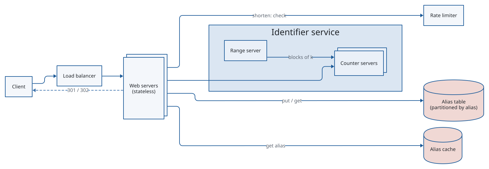
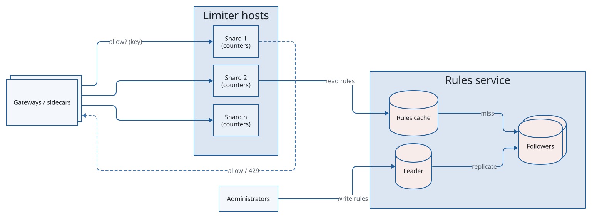
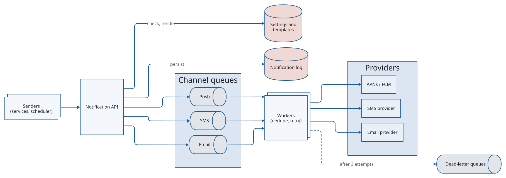
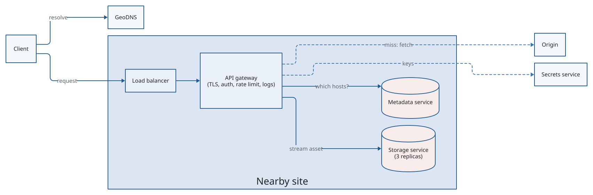

# Case studies: infrastructure services {#sec-case-studies-infrastructure}

The earlier chapters proved results one mechanism at a time; this chapter puts them to work. Each section designs one infrastructure service that many products share: a URL shortener,
a rate limiter, a distributed key-value store, a notification service, a web crawler, a content delivery network and a top-K counting service. Xu's advice for every such design holds here:
"It is important for you to walk through the assumptions and calculations with your interviewer so that both of you are on the same page" [@SystemDesignInterview2021, Ch. 8].

The claims are of two kinds. Each design is a definition of its components and flows, and its properties are those already proved in the earlier chapters, recalled by link and not proved again:
the estimate of @def-load-estimate, identifier collisions (@prp-id-collision), the bounds of rate limiters (@thm-rate-limits), quorum intersection (@thm-quorum-intersection), delivery semantics
and idempotence (@prp-idempotent-consumer), the hit ratio of an expiring cache (@prp-cdn-ttl-hit-ratio) and the error of the count-min sketch (@thm-count-min). One case needs a new result: the rate
at which a polite crawler can fetch, proved in @sec-web-crawler.

The sources are the benchmark books, @SystemDesignInterview2021 [Chs. 4, 6, 8, 9 and 10], @tanAcingSystemDesign2024 [Chs. 8, 9, 13 and 17], @sinhaSystemDesignGuide2024 [Chs. 5 and 9] and
@liuSystemDesignInterview2020 [Ch. 6], with @decandia2007dynamo for the key-value store. PageRank, which orders a crawler's frontier, is the random walk of
[Dynamics on networks](../../complexity-science/dynamics-on-networks/index.qmd#def-random-walk).

The chapter has seven sections. @sec-url-shortener designs a URL shortener. @sec-rate-limiter-case designs a shared rate-limiting service. @sec-kv-store-case designs a distributed key-value store.
@sec-notification-service designs a notification service. @sec-web-crawler designs a web crawler and proves its politeness bound. @sec-cdn-case designs a content delivery network. @sec-top-k designs a
top-K counting service and its dashboard.

Each design is estimated the way @sec-estimating-load estimates, drawn as a D2 architecture, and given one runnable algorithmic core. Every definition and result is followed by ten examples and ten
exercises, each exercise with a hidden solution in two tabs: the argument or design, then a computation with its recorded output. The computations run in plain Python 3.12 with NumPy, seeded. Service
code is shown as illustrative code and is not run.

## A URL shortener {#sec-url-shortener}

A URL shortener maps long URLs to short aliases and redirects. Xu's interviewer sets the scale: "100 million URLs are generated per day", and the alias should be "As short as possible", made of
"numbers (0-9) and characters (a-z, A-Z)" [@SystemDesignInterview2021, Ch. 8]. This section designs it from identifiers (@def-unique-id), web interfaces (@def-web-api) and caches
(@def-cache-patterns).

For more on this topic, see @SystemDesignInterview2021 [Ch. 8] and @sinhaSystemDesignGuide2024 [Ch. 9].

### The design

@fig-url-arch shows the two paths: shortening through an identifier service, redirecting through a cache.

{#fig-url-arch width=95%}

:::: {.statement-box}
::: {#def-url-shortener}
#### URL shortener

1. The service exposes `POST /api/v1/data/shorten`, which takes a long URL and returns an alias, and `GET /{alias}`, which answers with a redirect to the long URL: **301** (moved permanently), which
   browsers cache, or **302** (found), which sends every click to the service.
2. An alias is the **base-62** representation of an integer identifier, in the alphabet of digits, lower-case and upper-case letters; aliases of length $\ell$ number $62^\ell$.
3. Identifiers come from a **range-allocated counter**: a range server hands each counter server a block of $k$ consecutive integers, which it issues in order; a counter server that crashes loses
   the rest of its block.
4. The mapping (identifier, alias, long URL) is stored in a partitioned table keyed by alias, with a cache of popular aliases in front of it; an existing long URL may be looked up to return its earlier
   alias.
5. Shortening requests are rate-limited per client.
:::

::::

Item 1 is Xu's: "A 301 redirect shows that the requested URL is 'permanently' moved ... the browser caches the response", while with a 302 "subsequent requests for the same URL will be sent to the URL
shortening service first", so "if analytics is important, 302 redirect is a better choice" [@SystemDesignInterview2021, Ch. 8, "URL redirecting"]. Item 2 is Xu's base-62 conversion, "the mappings are:
0-0, ..., 9-9, 10-a, 11-b, ..., 35-z, 36-A, ..., 61-Z", with length $7$ because "62 ^ n = ~3.5 trillion, 3.5 trillion is more than enough to hold 365 billion URLs" [@SystemDesignInterview2021, Ch. 8,
"Hash function"]. Item 3 is Sinha's "distributed counters approach": "divide the 3.5 T sequence numbers into multiple ranges of 'k' size ... We have multiple counter servers talking to this Range Server
and asking for a range", where on a crash "The range is discarded" [@sinhaSystemDesignGuide2024, Ch. 9, "Core challenge"]. Item 4 follows Xu's flow, in which "The system checks if the longURL is in the
database" and the mapping "is stored in a cache to improve performance" [@SystemDesignInterview2021, Ch. 8, "URL shortening deep dive" and "URL redirecting deep dive"]. Item 5 is Xu's wrap-up: "malicious
users send an overwhelmingly large number of URL shortening requests. Rate limiter helps" [@SystemDesignInterview2021, Ch. 8, "Wrap up"].

:::: {.callout-note .examples-fold collapse="true" title="Examples"}
@def-load-estimate for Xu's numbers. Writes, reads and storage.

::: {#exm-url-estimate}
#### The estimate

$10^8$ new URLs a day give $1157$ writes a second; Xu's read-to-write ratio of $10$ gives $11\,574$ reads a second; a peak factor of $2$ doubles both. Over ten years, $3.65 \times 10^{11}$ records of about
$100$ bytes of long URL plus $7$ of alias and $8$ of identifier, $42\,\mathrm{TB}$, $126\,\mathrm{TB}$ with three replicas.

```{.python .run}
w = 1e8 / 86400; r = 10 * w; n = 1e8 * 365 * 10
print(round(w), round(r), f"{n:.2e}", round(n * 115 / 1e12), round(3 * n * 115 / 1e12), "TB")
```

```{.text .run-output}
1157 11574 3.65e+11 42 126 TB
```
:::

Item 2's encoding, checked against Xu's examples. It is a bijection between integers and strings.

::: {#exm-url-base62}
#### Base 62 both ways

Xu converts $11157$ to "2TX" and $2009215674938$ to "zn9edcu" [@SystemDesignInterview2021, Ch. 8]:

```{.python .run}
ALPHABET = "0123456789abcdefghijklmnopqrstuvwxyzABCDEFGHIJKLMNOPQRSTUVWXYZ"     # Xu's order: 0-9, a-z, A-Z
def encode(n):
    s = ""
    while True:
        n, r = divmod(n, 62); s = ALPHABET[r] + s
        if n == 0: return s
def decode(s):
    n = 0
    for ch in s: n = 62 * n + ALPHABET.index(ch)
    return n
for n in (11157, 2009215674938): print(n, encode(n), decode(encode(n)) == n)
```

```{.text .run-output}
11157 2TX True
2009215674938 zn9edcu True
```
:::

Item 2's length for the ten-year volume. Seven characters suffice.

::: {#exm-url-length}
#### How long an alias

$62^6 = 5.7 \times 10^{10} < 3.65 \times 10^{11} \leq 62^7 = 3.5 \times 10^{12}$: length $7$, with room for nearly ten times the volume.

```{.python .run}
import math
print(62 ** 6, 62 ** 7, math.ceil(math.log(3.65e11) / math.log(62)))
```

```{.text .run-output}
56800235584 3521614606208 7
```
:::

Xu's alternative cuts a hash to seven characters. Collisions follow @prp-id-collision.

::: {#exm-url-hash-collisions}
#### Hashing instead of counting

Taking $7$ base-62 characters of a hash gives $N_b = 62^7$ values; after $n = 10^7$ URLs the collision probability is already $1 - e^{-n^2/(2N_b)} = 1.000$, so every write must check the store, as Xu's
"recursively append a new predefined string until no more collision is discovered" does [@SystemDesignInterview2021, Ch. 8].

```{.python .run}
import math
Nb = 62 ** 7
for n in (1e5, 1e6, 1e7): print(f"{n:.0e}", round(1 - math.exp(-n * n / (2 * Nb)), 4))
```

```{.text .run-output}
1e+05 0.0014
1e+06 0.1324
1e+07 1.0
```
:::

A hash-prefix shortener on seeded URLs. Collisions appear at the predicted rate.

::: {#exm-url-collision-check}
#### The collision check, run

With $3$ base-62 characters ($238\,328$ values), $2000$ URLs need $14$ re-probes, against an expected $n^2/(2N_b) \approx 8.4$ first collisions; linear re-probing adds the rest:

```{.python .run}
ALPHABET = "0123456789abcdefghijklmnopqrstuvwxyzABCDEFGHIJKLMNOPQRSTUVWXYZ"     # Xu's order: 0-9, a-z, A-Z
def encode(n):
    s = ""
    while True:
        n, r = divmod(n, 62); s = ALPHABET[r] + s
        if n == 0: return s
def decode(s):
    n = 0
    for ch in s: n = 62 * n + ALPHABET.index(ch)
    return n
import hashlib
seen, collisions = {}, 0
for i in range(2000):
    url = f"https://example.org/photo/{i}"
    alias = encode(int(hashlib.sha256(url.encode()).hexdigest(), 16) % 62 ** 3)
    while alias in seen: collisions += 1; alias = encode((decode(alias) + 1) % 62 ** 3)
    seen[alias] = url
print(collisions, round(2000 * 1999 / 2 / 62 ** 3, 1))
```

```{.text .run-output}
14 8.4
```
:::

Item 3's counter servers. Ranges never overlap, so aliases never collide.

::: {#exm-url-ranges}
#### Range allocation

Three counter servers take blocks of $10^6$; their identifiers are disjoint by construction, the generator-field argument of @prp-id-collision (c).

```{.python .run}
ALPHABET = "0123456789abcdefghijklmnopqrstuvwxyzABCDEFGHIJKLMNOPQRSTUVWXYZ"     # Xu's order: 0-9, a-z, A-Z
def encode(n):
    s = ""
    while True:
        n, r = divmod(n, 62); s = ALPHABET[r] + s
        if n == 0: return s
def decode(s):
    n = 0
    for ch in s: n = 62 * n + ALPHABET.index(ch)
    return n
next_block, k = 0, 10**6
def take():
    global next_block; b = next_block; next_block += k; return range(b, b + k)
servers = [take() for _ in range(3)]
print([encode(s[0]) for s in servers], len(set().union(*[set(s[:1000]) for s in servers])))
```

```{.text .run-output}
['0', '4c92', '8oi4'] 3000
```
:::

Item 4's cache sized for the hot set. A Zipf popularity makes a small cache effective.

::: {#exm-url-cache}
#### Caching redirects

If clicks follow a Zipf law over $10^9$ live aliases, caching the most popular $2\%$ serves most redirects; with a hit ratio of $0.9$ the store sees $1157$ reads a second instead of $11\,574$
(@prp-cache-load).

```{.python .run}
print(round(11574 * (1 - 0.9)))
```

```{.text .run-output}
1157
```
:::

Item 1's choice changes the load. Browsers cache a 301.

::: {#exm-url-301-302}
#### 301 or 302

With a 301, a user clicking the same alias ten times sends one request; with a 302, ten, all countable for analytics. If a tenth of clicks are repeats by the same browser, a 301 saves a tenth of the load
and loses those clicks from the counts.
:::

Item 1's interface as illustrative code. The handler shortens or redirects.

::: {#exm-url-api}
#### The service code

In outline:

```{.python .illustrative}
@app.post("/api/v1/data/shorten")
def shorten(body: ShortenRequest):
    if alias := table.alias_for(body.long_url): return {"short_url": BASE + alias}
    ident = counter.next_id()                      # range-allocated, item 3
    alias = encode(ident)                          # base 62, item 2
    table.put(alias, ident, body.long_url)
    return {"short_url": BASE + alias}

@app.get("/{alias}")
def redirect(alias: str):
    url = cache.get(alias) or table.long_url(alias)
    if url is None: raise HTTPException(404)
    cache.set(alias, url)
    return RedirectResponse(url, status_code=302)  # 302 keeps analytics, item 1
```

:::

Sinha's numbers differ from Xu's. A wider row and a larger read ratio.

::: {#exm-url-sinha-estimate}
#### Sinha's estimate

Sinha rounds each record to $1500$ bytes, so "365 B* 1500 bytes ~= 500 TB" and "1.5 PB" with three replicas, and takes reads at $100$ times writes, "100 k RPS" [@sinhaSystemDesignGuide2024, Ch. 9,
"Estimates and calculations"]; the exact products are $548\,\mathrm{TB}$ and $1.6\,\mathrm{PB}$.

```{.python .run}
print(3.65e11 * 1500 / 1e12, 3 * 3.65e11 * 1500 / 1e15)
```

```{.text .run-output}
547.5 1.6425
```
:::

::::

:::: {.callout-note .exercises-fold collapse="true" title="Exercises"}
The first exercise checks Xu's arithmetic. Years are counted twice.

::: {#exr-url-xu-storage}
#### Xu's storage figure

Xu writes "365 billion * 100 bytes * 10 years = 365 TB" [@SystemDesignInterview2021, Ch. 8]. Correct it.
:::

::: {.callout-note .solution collapse="true" title="Solution"}
:::: {.panel-tabset .solution-tabs}
## Solution

The $365$ billion records already cover ten years; $3.65 \times 10^{11} \times 100 = 36.5\,\mathrm{TB}$. Multiplying by $10$ again counts the years twice.

## Python

The product.

```{.python .run}
print(3.65e11 * 100 / 1e12, "TB")
```

```{.text .run-output}
36.5 TB
```
::::
:::

The second exercise checks Sinha's conversion. Divide repeatedly by $62$.

::: {#exr-url-sinha-base62}
#### Sinha's base-62 example

Sinha converts $9234529445$ with the alphabet a-z, A-Z, 0-9 to the digits $\{10, 4, 14, 4, 39, 23\}$ and "keoeNx" [@sinhaSystemDesignGuide2024, Ch. 9]. Recompute.
:::

::: {.callout-note .solution collapse="true" title="Solution"}
:::: {.panel-tabset .solution-tabs}
## Solution

$9234529445 = 148\,944\,023 \times 62 + 19$, not $148\,907\,051 \times 62 + 23$; the digits are $\{10, 4, 59, 8, 59, 19\}$ and the alias, in Sinha's alphabet, "ke7i7t". The first division is already wrong.

## Python

The conversion.

```{.python .run}
alph = "abcdefghijklmnopqrstuvwxyzABCDEFGHIJKLMNOPQRSTUVWXYZ0123456789"
n, d = 9234529445, []
print(divmod(n, 62))
while n: n, r = divmod(n, 62); d.append(r)
print(d[::-1], "".join(alph[x] for x in d[::-1]))
```

```{.text .run-output}
(148944023, 19)
[10, 4, 59, 8, 59, 19] ke7i7t
```
::::
:::

The third exercise prices item 3's loss. A crash discards a block.

::: {#exr-url-range-loss}
#### Identifiers lost to crashes

With blocks of $10^6$, $20$ counter servers and one crash a week each, what fraction of the $62^7$ identifiers is wasted in ten years, and what does Sinha's periodic checkpoint every $N = 1000$ change?
:::

::: {.callout-note .solution collapse="true" title="Solution"}
:::: {.panel-tabset .solution-tabs}
## Solution

$20 \times 52 \times 10 = 10\,400$ crashes lose at most $1.04 \times 10^{10}$ identifiers, $0.3\%$ of $62^7$; with checkpoints, at most $1000$ each, $10^7$ in all. Sinha: "we just discard only N counters at the maximum per
server per failure" [@sinhaSystemDesignGuide2024, Ch. 9].

## Python

The losses.

```{.python .run}
crashes = 20 * 52 * 10
print(crashes * 1e6 / 62 ** 7, crashes * 1000)
```

```{.text .run-output}
0.0029531908408338015 10400000
```
::::
:::

The fourth exercise finds a weakness of sequential identifiers. Consecutive aliases can be enumerated.

::: {#exr-url-predictable}
#### Predictable aliases

With a counter, alias $n + 1$ follows alias $n$. Why is this a privacy problem, and how can it be avoided without losing uniqueness?
:::

::: {.callout-note .solution collapse="true" title="Solution"}
:::: {.panel-tabset .solution-tabs}
## Solution

Anyone can walk the aliases and find others' links. Applying a fixed bijection to the identifier before encoding, such as multiplication by a constant coprime to $62^7$ modulo $62^7$, keeps uniqueness and scrambles the
order.

## Python

A scrambling bijection.

```{.python .run}
ALPHABET = "0123456789abcdefghijklmnopqrstuvwxyzABCDEFGHIJKLMNOPQRSTUVWXYZ"     # Xu's order: 0-9, a-z, A-Z
def encode(n):
    s = ""
    while True:
        n, r = divmod(n, 62); s = ALPHABET[r] + s
        if n == 0: return s
def decode(s):
    n = 0
    for ch in s: n = 62 * n + ALPHABET.index(ch)
    return n
M, a = 62 ** 7, 1580030173
assert __import__("math").gcd(a, M) == 1
print([encode(a * n % M) for n in (1000, 1001, 1002)])
```

```{.text .run-output}
['rOFLAh2', 'rQoHeiF', 'rS7CSki']
```
::::
:::

The fifth exercise completes the estimate with item 4 of @def-load-estimate. Reads dominate.

::: {#exr-url-servers}
#### How many servers

If a web server handles $2000$ redirects a second within its latency budget at $70\%$ utilisation, how many serve the peak of $23\,148$ reads a second?
:::

::: {.callout-note .solution collapse="true" title="Solution"}
:::: {.panel-tabset .solution-tabs}
## Solution

$\lceil 23\,148/(0.7 \times 2000)\rceil = 17$.

## Python

The count.

```{.python .run}
import math
print(math.ceil(23148 / (0.7 * 2000)))
```

```{.text .run-output}
17
```
::::
:::

The sixth exercise prices item 4's lookup of existing long URLs. It needs an index on the long URL.

::: {#exr-url-dedup}
#### Returning the same alias

What does looking up the long URL before issuing an identifier cost, and when is it worth it?
:::

::: {.callout-note .solution collapse="true" title="Solution"}
:::: {.panel-tabset .solution-tabs}
## Solution

A second index, keyed by a hash of the long URL, as large as the table's URL column, and one more read per write. It saves storage when many users shorten the same URLs; if the same URL should yield per-user aliases
for analytics, it should be skipped.

## Python

Index size for $3.65 \times 10^{11}$ URLs with $16$-byte hashes and $8$-byte identifiers.

```{.python .run}
print(3.65e11 * 24 / 1e12, "TB")
```

```{.text .run-output}
8.76 TB
```
::::
:::

The seventh exercise partitions item 4's table. The alias is the natural key.

::: {#exr-url-partition}
#### Partitioning the table

Partition the table over $64$ nodes. Should the key be hashed, and what does a range partition by identifier do to recent writes?
:::

::: {.callout-note .solution collapse="true" title="Solution"}
:::: {.panel-tabset .solution-tabs}
## Solution

Hash partition by alias: reads and writes spread evenly (@def-partitioning). A range partition by identifier sends all new writes to the last range, a hot spot, because identifiers are issued in order.

## Python

Writes per node for a day of sequential identifiers, by range and by hash.

```{.python .run}
import collections, hashlib
ids = range(10**5)                                      # a day's identifiers, issued in order
space = 62 ** 7
by_range = collections.Counter(i * 64 // space for i in ids)
by_hash = collections.Counter(int(hashlib.md5(str(i).encode()).hexdigest(), 16) % 64 for i in ids)
print(max(by_range.values()), max(by_hash.values()))
```

```{.text .run-output}
100000 1680
```
::::
:::

The eighth exercise adds expiry. Storage then stops growing.

::: {#exr-url-expiry}
#### Expiring links

If links expire after two years unless clicked, and $80\%$ are never clicked after the first month, what is the steady-state number of records?
:::

::: {.callout-note .solution collapse="true" title="Solution"}
:::: {.panel-tabset .solution-tabs}
## Solution

About two years of writes for clicked links and one month for the rest: $10^8 \times (0.2 \times 730 + 0.8 \times 30) = 1.7 \times 10^{10}$ records, $2\,\mathrm{TB}$ at $115$ bytes, instead of growing without end.

## Python

The count.

```{.python .run}
n = 1e8 * (0.2 * 730 + 0.8 * 30)
print(f"{n:.1e}", round(n * 115 / 1e12, 1))
```

```{.text .run-output}
1.7e+10 2.0
```
::::
:::

The ninth exercise sizes item 5's limit. Normal users create few links.

::: {#exr-url-abuse}
#### Rate limits for shortening

A typical user creates $3$ links a day; a spammer, $10^5$. Choose a token bucket (@thm-rate-limits (a)) that never bothers the first and caps the second.
:::

::: {.callout-note .solution collapse="true" title="Solution"}
:::: {.panel-tabset .solution-tabs}
## Solution

$b = 20$, $r = 50$ a day: a user may make $20$ at once and $70$ in a day at most; a spammer is capped at $70$ a day per key, and per-IP and per-account keys together bound sybil attacks only partly.

## Python

The daily bound.

```{.python .run}
print(20 + 50 * 1)
```

```{.text .run-output}
70
```
::::
:::

The tenth exercise writes the design end to end. Estimate, identifiers, storage, cache, limits.

::: {#exr-url-design}
#### The full design

Summarise the design and its numbers.
:::

::: {.callout-note .solution collapse="true" title="Solution"}
:::: {.panel-tabset .solution-tabs}
## Solution

$1157$ writes and $11\,574$ reads a second, twice that at the peak; aliases of $7$ base-62 characters from range-allocated counters; a hash-partitioned table of $42\,\mathrm{TB}$ ($126$ replicated); a cache serving $90\%$ of
redirects; $17$ web servers; 302 redirects for analytics; a token bucket per client on shortening.

## Python

The summary as data.

```{.python .run}
print({"writes/s": 1157, "reads/s": 11574, "alias": 7, "storage_TB": 42, "cache_hit": 0.9, "web": 17, "redirect": 302})
```

```{.text .run-output}
{'writes/s': 1157, 'reads/s': 11574, 'alias': 7, 'storage_TB': 42, 'cache_hit': 0.9, 'web': 17, 'redirect': 302}
```
::::
:::

::::

## A rate-limiting service {#sec-rate-limiter-case}

The rate limiters of @def-overload become a shared service when many products need them. Tan: "Rate limiting is a basic functionality required by virtually any service" and "is not essential to a
service's availability, so we can trade off high availability and fault-tolerance" [@tanAcingSystemDesign2024, Sec. 8.4, p. 175]. This section designs that service from the limiters of
@thm-rate-limits, partitioning (@def-partitioning) and replication (@def-leader-follower).

For more on this topic, see @tanAcingSystemDesign2024 [Ch. 8, pp. 171-195], @SystemDesignInterview2021 [Ch. 4] and @liuSystemDesignInterview2020 [Ch. 6, "Rate Limiter"].

### The design

@fig-rls-arch shows the service: rules in a replicated store, counters sharded by key, a decision in the request path.

{#fig-rls-arch width=95%}

:::: {.statement-box}
::: {#def-rate-limiter-service}
#### Rate-limiting service

1. Callers, usually gateways or service sidecars, ask the service whether a request with a given **key** (client, user, IP address, endpoint) may proceed; the service answers allow, or reject with
   status $429$ and the time to retry.
2. **Rules** (limits per key class and endpoint) are kept in a replicated store, written rarely by administrators and cached by the limiter hosts.
3. **Counters** (token buckets or window counters, @def-overload) are **sharded** by key, so that one host owns each key's state, or **replicated** to every host, which then decide locally and synchronise
   counts periodically.
4. When the service is unavailable, callers **fail open** with a local default limit or **fail closed** (@def-overload (6)).
:::

::::

Item 1 follows Xu's middleware that "throttles the third request and returns a HTTP status code 429" [@SystemDesignInterview2021, Ch. 4] and Tan's steps: "Get the service's rate limit from the Rules
service ... Determine the service's current request rate, including this request ... Return a response that indicates if the request should be rate-limited" [@tanAcingSystemDesign2024, Sec. 8.6, p. 177].
Item 2 is Tan's: Rules service users "make all their SQL queries, both reads and writes to the leader node", the backend reads from followers, and "we can add a Redis cache to the Rules service"
[@tanAcingSystemDesign2024, Sec. 8.6, pp. 178-179]. Item 3 is Tan's choice between "A host serves a fixed set of users and stores its user's data", the stateful approach, and storing "all counts in every
host" [@tanAcingSystemDesign2024, Secs. 8.6-8.8, pp. 179-187]. Item 4 is Liu's "Fail to Close" and "Fail to Open" [@liuSystemDesignInterview2020, Ch. 6, "Rate Limiter Failure Scenario"].

:::: {.callout-note .examples-fold collapse="true" title="Examples"}
Tan's storage estimate, redone. Only recent requests matter.

::: {#exm-rls-estimate}
#### The estimate

Tan keeps $100$ timestamps of $64$ bits for up to $10^7$ active users across $100$ services: "100 * 64 * 101 * 10M = 808 GB" [@tanAcingSystemDesign2024, Sec. 8.4.1, p. 175], counted in bits, since
$6.5 \times 10^{12}$ bits are $808\,\mathrm{GB}$. Token buckets need two numbers per key: $10^7 \times 100 \times 16 = 16\,\mathrm{GB}$.

```{.python .run}
bits = 100 * 64 * 101 * 1e7
print(bits / 8 / 1e9, "GB of logs;", 1e7 * 100 * 16 / 1e9, "GB of buckets")
```

```{.text .run-output}
808.0 GB of logs; 16.0 GB of buckets
```
:::

The algorithmic core: a token bucket per key on a seeded bursty trace. The bound of @thm-rate-limits (a) holds.

::: {#exm-rls-bursty}
#### A limiter under bursty traffic

Twenty keys, each sending bursts of $50$ requests at random times, limited to $b = 10$, $r = 1$ per second:

```{.python .run}
import random
random.seed(1401)
class Bucket:
    def __init__(s, b, r): s.b, s.r, s.t, s.k = b, r, 0.0, b
    def allow(s, t):
        s.k = min(s.b, s.k + s.r * (t - s.t)); s.t = t
        if s.k >= 1: s.k -= 1; return True
        return False
events = sorted((t0 + 0.01 * i, key) for key in range(20) for t0 in random.sample(range(0, 600, 10), 6) for i in range(50))
buckets, ok = {k: Bucket(10, 1) for k in range(20)}, {k: [] for k in range(20)}
for t, key in events:
    if buckets[key].allow(t): ok[key].append(t)
worst = max(sum(1 for u in ts if s <= u <= s + 60) for ts in ok.values() for s in ts)
print(sum(map(len, ok.values())), "of", len(events), "admitted; most in any minute for one key:", worst, "<=", 10 + 60)
```

```{.text .run-output}
1200 of 6000 admitted; most in any minute for one key: 30 <= 70
```
:::

Item 3's stateful approach. Each key's counter lives on one host, chosen by hashing.

::: {#exm-rls-shard}
#### Sharding counters by key

With $16$ limiter hosts and keys hashed onto them, each host owns about $6\%$ of the keys; a gateway sends each decision to the owner, and consistent hashing (@thm-consistent-hashing) moves only a sixteenth of the
keys when a host is added.

```{.python .run}
import collections, hashlib
owner = lambda key, n: int(hashlib.md5(key.encode()).hexdigest(), 16) % n
c = collections.Counter(owner(f"user{i}", 16) for i in range(100000))
print(min(c.values()), max(c.values()))
```

```{.text .run-output}
6145 6365
```
:::

Item 1 adds a call to every request. Its latency comes from the request's budget.

::: {#exm-rls-latency}
#### A decision in the request path

A decision takes a network round trip of $0.5\,\mathrm{ms}$ in the data centre and a few microseconds of work; at $10^5$ decisions a second, each host doing $2 \times 10^4$, five hosts suffice, and the request's
latency budget (@prp-latency-budget) loses half a millisecond.

```{.python .run}
import math
print(math.ceil(1e5 / 2e4))
```

```{.text .run-output}
5
```
:::

Item 2's rules as data. A key class, an endpoint and a limit.

::: {#exm-rls-rules}
#### A rule set

Illustrative rules:

```{.yaml .illustrative}
- service: photos-api
  key: user
  endpoint: POST /upload
  limit: {bucket: 20, refill_per_hour: 100}
- service: photos-api
  key: ip
  endpoint: "*"
  limit: {bucket: 200, refill_per_second: 50}
- service: url-shortener
  key: client
  endpoint: POST /api/v1/data/shorten
  limit: {bucket: 20, refill_per_day: 50}
```

:::

Item 1's answer carries the state. Clients can back off without guessing.

::: {#exm-rls-headers}
#### Telling clients the limit

Xu's limiter returns headers with the remaining quota and the time to wait, such as `X-Ratelimit-Remaining`, `X-Ratelimit-Limit` and `X-Ratelimit-Retry-After` [@SystemDesignInterview2021, Ch. 4,
"Rate limiting rules" and "Exceeding the rate limit"]; a client honouring `Retry-After` avoids the retry storms of @prp-retry-load.
:::

Item 3's replicated counters. Every host decides alone and synchronises later.

::: {#exm-rls-local}
#### Deciding locally

With counts replicated to $h$ hosts and synchronised every second, a key may exceed its limit by up to $(h - 1)$ times its per-second allowance between synchronisations (@exr-rlm-sync-error); the gain is a
decision with no network hop.

```{.python .run}
h, per_second = 8, 10
print("worst admitted in one second:", h * per_second, "against", per_second)
```

```{.text .run-output}
worst admitted in one second: 80 against 10
```
:::

Tan's sidecar pattern puts the decision beside the service. Rules come from a control plane.

::: {#exm-rls-sidecar}
#### A limiter in a sidecar

Tan: "an administrator can configure a user service's rate limiting policies in the control plane, which distributes them to the sidecar hosts", so "user service hosts do not need to make requests to our
rate-limiting service to look up their rate-limiting policies" [@tanAcingSystemDesign2024, Sec. 8.10, p. 193]; counters then live in the sidecars, as in item 3's replicated option.
:::

Item 4 in the request path. A timeout on the limiter must not become an outage.

::: {#exm-rls-fail-open}
#### Failing open

The gateway calls the limiter with a $5\,\mathrm{ms}$ timeout; on timeout it applies a local bucket of $10$ times the normal limit and logs the event. A limiter outage then costs accuracy, not
availability, the trade Tan accepts in his non-functional requirements.
:::

Item 3's sharding meets a key that one host cannot serve. A shared IP address behind a NAT is one.

::: {#exm-rls-hot-key}
#### A hot key

A university's NAT sends $5 \times 10^4$ requests a second from one IP; the owner of that key does $2 \times 10^4$ decisions a second. Splitting the key's limit over $4$ sub-keys on $4$ hosts, each with a quarter of the
limit, serves it, at the cost of sub-limits that can each be exhausted while others are idle.

```{.python .run}
import math
print(math.ceil(5e4 / 2e4) + 1)
```

```{.text .run-output}
4
```
:::

::::

:::: {.callout-note .exercises-fold collapse="true" title="Exercises"}
The first exercise redoes the estimate for buckets. Two numbers per key and rule.

::: {#exr-rls-storage}
#### Storage for buckets

With $10^7$ active keys, $3$ rules each and two $8$-byte numbers per bucket, how much memory, and with three replicas?
:::

::: {.callout-note .solution collapse="true" title="Solution"}
:::: {.panel-tabset .solution-tabs}
## Solution

$10^7 \times 3 \times 16 = 480\,\mathrm{MB}$; $1.44\,\mathrm{GB}$ replicated: one host's memory, so sharding is for throughput, not storage.

## Python

The sizes.

```{.python .run}
m = 1e7 * 3 * 16
print(m / 1e6, 3 * m / 1e9)
```

```{.text .run-output}
480.0 1.44
```
::::
:::

The second exercise checks Tan's units. The product counts bits.

::: {#exr-rls-tan-bits}
#### Bits and bytes in Tan's estimate

Show that Tan's "100 * 64 * 101 * 10M = 808 GB" is right only if the $64$ is bits and the result is divided by $8$, and give the per-user value.
:::

::: {.callout-note .solution collapse="true" title="Solution"}
:::: {.panel-tabset .solution-tabs}
## Solution

$100 \times 64 \times 101 \times 10^7 = 6.46 \times 10^{12}$, which is $808\,\mathrm{GB}$ only as bits divided by $8$; per user, $100 \times 64$ bits $= 800$ bytes, as Tan says [@tanAcingSystemDesign2024, Sec. 8.4.1, p. 175].

## Python

The products.

```{.python .run}
x = 100 * 64 * 101 * 1e7
print(f"{x:.3e}", x / 8 / 1e9, 100 * 64 / 8)
```

```{.text .run-output}
6.464e+12 808.0 800.0
```
::::
:::

The third exercise matches rules to @thm-rate-limits. Each part fits a need.

::: {#exr-rls-which-algorithm}
#### Which algorithm for which rule

Choose limiters for (i) uploads per user, (ii) a partner's contract "at most $1000$ calls in any minute", (iii) requests per IP for abuse control.
:::

::: {.callout-note .solution collapse="true" title="Solution"}
:::: {.panel-tabset .solution-tabs}
## Solution

(i) A token bucket, which allows bursts (part (a)); (ii) a sliding log, exact in every window (part (b)); (iii) a sliding window counter, cheap per key and within $2L$ (part (d)).

## Python

The table.

```{.python .run}
print({"uploads": "token bucket", "partner": "sliding log", "abuse": "sliding counter"})
```

```{.text .run-output}
{'uploads': 'token bucket', 'partner': 'sliding log', 'abuse': 'sliding counter'}
```
::::
:::

The fourth exercise bounds item 3's replicated error. The interval is the knob.

::: {#exr-rls-consistency}
#### Synchronising replicated counters

With $8$ hosts deciding locally and synchronising every $T$ seconds, how small must $T$ be for a key with limit $100$ a minute to exceed it by at most $10\%$ in the worst case, if each host may admit the
per-minute rate times $T$ between synchronisations?
:::

::: {.callout-note .solution collapse="true" title="Solution"}
:::: {.panel-tabset .solution-tabs}
## Solution

Each host may admit $100T/60$ beyond the shared count; $8 \times 100T/60 \leq 10$ gives $T \leq 0.75\,\mathrm{s}$.

## Python

The bound.

```{.python .run}
print(10 * 60 / (8 * 100))
```

```{.text .run-output}
0.75
```
::::
:::

The fifth exercise prices item 4 with @prp-series-parallel-availability. In series, the limiter lowers every service's availability.

::: {#exr-rls-availability}
#### The limiter's availability

Services of availability $0.9995$ call a limiter of $0.999$ in series. What is their availability if they fail closed, and if they fail open?
:::

::: {.callout-note .solution collapse="true" title="Solution"}
:::: {.panel-tabset .solution-tabs}
## Solution

Closed: $0.9995 \times 0.999 = 0.9985$. Open: $0.9995$, since a limiter outage only removes limiting. Tan's choice of availability as a trade-off assumes failing open.

## Python

The products.

```{.python .run}
print(round(0.9995 * 0.999, 5), 0.9995)
```

```{.text .run-output}
0.9985 0.9995
```
::::
:::

The sixth exercise uses a key-value cache for counters. Atomic increments avoid races.

::: {#exr-rls-redis}
#### Counters in a shared cache

Implement item 3's fixed-window counter with a key-value store's atomic increment and expiry, and say what race the atomic increment avoids.
:::

::: {.callout-note .solution collapse="true" title="Solution"}
:::: {.panel-tabset .solution-tabs}
## Solution

Key `user:window`, `INCR` then `EXPIRE` on the first increment, admit if the result is at most $L$, Xu's "INCR" and "EXPIRE" [@SystemDesignInterview2021, Ch. 4]. A read followed by a write would let two hosts both read
$L - 1$ and both admit.

## Python

The race, simulated with and without atomicity.

```{.python .run}
store = {"k": 9}
a, b = store["k"], store["k"]; store["k"] = a + 1; store["k"] = b + 1      # two hosts read 9, both admit
print("non-atomic count:", store["k"], "admitted 2 at the limit")
store["k"] = 9; store["k"] += 1; first = store["k"] <= 10; store["k"] += 1; second = store["k"] <= 10
print("atomic:", first, second)
```

```{.text .run-output}
non-atomic count: 10 admitted 2 at the limit
atomic: True False
```
::::
:::

The seventh exercise sizes item 3's shards. Throughput, not memory, sets the number.

::: {#exr-rls-shard-count}
#### How many shards

At $3 \times 10^5$ decisions a second at the peak and $2 \times 10^4$ per host at $70\%$ utilisation, how many hosts, and how many with one spare per zone in three zones (@prp-regions (b))?
:::

::: {.callout-note .solution collapse="true" title="Solution"}
:::: {.panel-tabset .solution-tabs}
## Solution

$\lceil 3 \times 10^5/(0.7 \times 2 \times 10^4)\rceil = 22$; to survive a zone, the other two must carry the peak: $33$ hosts, $11$ per zone.

## Python

The counts.

```{.python .run}
import math
n = math.ceil(3e5 / (0.7 * 2e4)); print(n, 3 * math.ceil(n / 2))
```

```{.text .run-output}
22 33
```
::::
:::

The eighth exercise extends the service to two regions. A global limit needs coordination.

::: {#exr-rls-multi-region}
#### Limits across regions

A user's limit is $100$ a minute globally, and the user's requests go to either region. What are the options?
:::

::: {.callout-note .solution collapse="true" title="Solution"}
:::: {.panel-tabset .solution-tabs}
## Solution

Split the limit, $50$ per region, which wrongs a user who stays in one region; route each user's decisions to a home region, adding a cross-region hop for travellers; or synchronise asynchronously and accept
overshoot of up to one interval's traffic per region.

## Python

Worst-case admissions per minute under the three options.

```{.python .run}
print({"split": 100, "home region": 100, "async sync, 10 s interval": round(100 + 100 * 10 / 60)})
```

```{.text .run-output}
{'split': 100, 'home region': 100, 'async sync, 10 s interval': 117}
```
::::
:::

The ninth exercise compares Liu's four options. Each trades accuracy, availability and complexity.

::: {#exr-rls-liu-fail}
#### Liu's failure options

Rank Liu's fail-closed, fail-open, leader-follower and CRDT options for the photo service's upload limiter.
:::

::: {.callout-note .solution collapse="true" title="Solution"}
:::: {.panel-tabset .solution-tabs}
## Solution

Fail open with a local default first (uploads must work); leader-follower replication of counters second, since "the leader election takes time, so there'll be a temporary stop"; a CRDT of per-node counts
last, the most complex; fail closed only for abuse-sensitive endpoints [@liuSystemDesignInterview2020, Ch. 6, "Rate Limiter Failure Scenario"].

## Python

The ranking.

```{.python .run}
print(["fail open + local default", "leader-follower", "CRDT", "fail closed (abuse endpoints only)"])
```

```{.text .run-output}
['fail open + local default', 'leader-follower', 'CRDT', 'fail closed (abuse endpoints only)']
```
::::
:::

The tenth exercise summarises the service. Estimate, algorithms, placement, failure.

::: {#exr-rls-design}
#### The full design

Summarise the design for $3 \times 10^5$ decisions a second.
:::

::: {.callout-note .solution collapse="true" title="Solution"}
:::: {.panel-tabset .solution-tabs}
## Solution

Token buckets and sliding counters per rule; $1.44\,\mathrm{GB}$ of state, sharded by key over $33$ hosts in three zones; rules in a leader-follower store, cached on hosts; decisions within $1\,\mathrm{ms}$; callers fail
open with a local bucket; hot keys split into sub-keys.

## Python

The summary.

```{.python .run}
print({"decisions/s": 3e5, "state_GB": 1.44, "hosts": 33, "zones": 3, "failure": "open, local bucket"})
```

```{.text .run-output}
{'decisions/s': 300000.0, 'state_GB': 1.44, 'hosts': 33, 'zones': 3, 'failure': 'open, local bucket'}
```
::::
:::

::::

## A distributed key-value store {#sec-kv-store-case}

A key-value store is the plainest database and the most widely shared. Xu's requirements: "The size of a key-value pair is small: less than 10 KB", "High availability", "Tunable consistency", "Low
latency" [@SystemDesignInterview2021, Ch. 6]. This section designs a Dynamo-style store from consistent hashing (@thm-consistent-hashing), leaderless replication with quorums (@def-quorum-replication,
@thm-quorum-intersection), versions (@def-happens-before), failure detection (@def-failure-detector) and an LSM storage engine (@def-storage-engine).

For more on this topic, see @SystemDesignInterview2021 [Ch. 6], @sinhaSystemDesignGuide2024 [Ch. 5, "Key-value stores"] and @decandia2007dynamo [Secs. 4-6].

### The design

@fig-kvs-arch shows a coordinator writing to the key's preference list on the ring.

{#fig-kvs-arch width=90%}

:::: {.statement-box}
::: {#def-kv-store-design}
#### Distributed key-value store

1. The store offers `put(key, value)` and `get(key)` for small values. Keys are hashed onto a **ring** of nodes with virtual nodes (@def-partitioning), and a key's **preference list** is the next $N$ distinct
   physical nodes clockwise, placed in different failure domains.
2. A **coordinator** sends a write to the preference list and acknowledges after $W$ replicas have stored it, and a read to it, answering after $R$ replies (@def-quorum-replication (1)); $(N, R, W)$ is configured
   per use.
3. Each value carries a **version**: a vector clock, with conflicting versions returned to the client for reconciliation, or a timestamp under last-write-wins.
4. Temporary failures are handled by a **sloppy quorum** with **hinted handoff**, permanent ones by **anti-entropy** with Merkle trees; nodes learn membership and failures by **gossip**.
5. Each node stores its data in a log-structured engine: a commit log, a memtable, sorted files and a Bloom filter per file (@def-storage-engine).
:::

::::

Item 1 is Xu's: "after a key is mapped to a position on the hash ring, walk clockwise from that position and choose the first N servers on the ring", "we only choose unique servers", and "replicas are placed
in distinct data centers" [@SystemDesignInterview2021, Ch. 6, "Data replication"]. Item 2 is Xu's quorum consensus, "If W + R > N, strong consistency is guaranteed" [@SystemDesignInterview2021, Ch. 6,
"Consistency"], and Dynamo's: "The common (N,R,W) configuration used by several instances of Dynamo is (3,2,2)" [@decandia2007dynamo, Sec. 6]. Item 3 is Xu's: "A vector clock is a [server, version] pair
associated with a data item" [@SystemDesignInterview2021, Ch. 6, "Inconsistency resolution: versioning"]. Item 4 is Dynamo's Table 1: "Sloppy Quorum and hinted handoff ... Anti-entropy using Merkle trees ...
Gossip-based membership protocol and failure detection" [@decandia2007dynamo, Sec. 4, Table 1]. Item 5 is Xu's write and read paths, after Cassandra [@SystemDesignInterview2021, Ch. 6, "Write path" and
"Read path"].

:::: {.callout-note .examples-fold collapse="true" title="Examples"}
@def-load-estimate for a store of a billion keys. Storage per node sets the cluster.

::: {#exm-kvs-estimate}
#### The estimate

$10^9$ keys of $1\,\mathrm{kB}$, $N = 3$: $3\,\mathrm{TB}$; at $2 \times 10^5$ reads and $5 \times 10^4$ writes a second, each read touching $R = 2$ and each write $N = 3$ replicas, the nodes see $5.5 \times 10^5$ operations
a second; at $3 \times 10^4$ per node and $70\%$, $27$ nodes, each holding $111\,\mathrm{GB}$.

```{.python .run}
import math
ops = 2e5 * 2 + 5e4 * 3; n = math.ceil(ops / (0.7 * 3e4))
print(ops, n, round(3e12 / n / 1e9))
```

```{.text .run-output}
550000.0 27 111
```
:::

The algorithmic core: an in-process store with $N = 3$, $R = W = 2$. A read after a write sees it while two replicas are up.

::: {#exm-kvs-core}
#### A three-node store with quorums

Write, read, fail one node, write again, read:

```{.python .run}
import random
class Node:
    def __init__(self, name): self.name, self.data, self.up, self.hints = name, {}, True, []
    def put(self, key, version, value):
        if self.data.get(key, (-1, None))[0] < version: self.data[key] = (version, value)
class KVStore:
    """N replicas per key on a ring of nodes; writes wait for W acks, reads for R replies; sloppy quorum with hints."""
    def __init__(self, names, N=3, R=2, W=2):
        self.nodes = [Node(n) for n in names]; self.N, self.R, self.W, self.clock = N, R, W, 0
    def prefs(self, key):
        i = sum(map(ord, key)) % len(self.nodes)
        return [self.nodes[(i + j) % len(self.nodes)] for j in range(len(self.nodes))]
    def put(self, key, value):
        self.clock += 1; acks = 0; pref = self.prefs(key)
        home, extra = pref[:self.N], pref[self.N:]
        for node in home:
            if node.up: node.put(key, self.clock, value); acks += 1
            else:
                stand_in = next((x for x in extra if x.up), None)
                if stand_in: stand_in.hints.append((node, key, self.clock, value)); acks += 1
        return acks >= self.W
    def get(self, key):
        replies = [n.data.get(key, (-1, None)) for n in self.prefs(key)[:self.N] if n.up]
        if len(replies) < self.R: return None
        best = max(replies[:self.R])
        for n in self.prefs(key)[:self.N]:                       # read repair
            if n.up: n.put(key, *best)
        return best[1]
    def handoff(self):
        for n in self.nodes:
            keep = []
            for target, key, v, val in n.hints:
                (target.put(key, v, val) if target.up else keep.append((target, key, v, val)))
            n.hints = keep
s = KVStore(["A", "B", "C"])
print(s.put("photo:1", "v1"), s.get("photo:1"))
s.nodes[1].up = False
print(s.put("photo:1", "v2"), s.get("photo:1"))
s.nodes[2].up = False
print(s.put("photo:1", "v3"), s.get("photo:1"))
```

```{.text .run-output}
True v1
True v2
False None
```
:::

Item 4's sloppy quorum on a five-node ring. A stand-in keeps the write for the failed node.

::: {#exm-kvs-hinted}
#### Hinted handoff in the core

With five nodes and $N = 3$, a write while one home replica is down is acknowledged by a stand-in holding a hint; when the node returns, the hint is delivered:

```{.python .run}
import random
class Node:
    def __init__(self, name): self.name, self.data, self.up, self.hints = name, {}, True, []
    def put(self, key, version, value):
        if self.data.get(key, (-1, None))[0] < version: self.data[key] = (version, value)
class KVStore:
    """N replicas per key on a ring of nodes; writes wait for W acks, reads for R replies; sloppy quorum with hints."""
    def __init__(self, names, N=3, R=2, W=2):
        self.nodes = [Node(n) for n in names]; self.N, self.R, self.W, self.clock = N, R, W, 0
    def prefs(self, key):
        i = sum(map(ord, key)) % len(self.nodes)
        return [self.nodes[(i + j) % len(self.nodes)] for j in range(len(self.nodes))]
    def put(self, key, value):
        self.clock += 1; acks = 0; pref = self.prefs(key)
        home, extra = pref[:self.N], pref[self.N:]
        for node in home:
            if node.up: node.put(key, self.clock, value); acks += 1
            else:
                stand_in = next((x for x in extra if x.up), None)
                if stand_in: stand_in.hints.append((node, key, self.clock, value)); acks += 1
        return acks >= self.W
    def get(self, key):
        replies = [n.data.get(key, (-1, None)) for n in self.prefs(key)[:self.N] if n.up]
        if len(replies) < self.R: return None
        best = max(replies[:self.R])
        for n in self.prefs(key)[:self.N]:                       # read repair
            if n.up: n.put(key, *best)
        return best[1]
    def handoff(self):
        for n in self.nodes:
            keep = []
            for target, key, v, val in n.hints:
                (target.put(key, v, val) if target.up else keep.append((target, key, v, val)))
            n.hints = keep
s = KVStore(list("ABCDE"))
home = s.prefs("k")[:3]; home[0].up = False
print(s.put("k", "x"), [n.name for n in s.nodes if n.hints])
home[0].up = True; s.handoff()
print(home[0].data.get("k"))
```

```{.text .run-output}
True ['A']
(1, 'x')
```
:::

Item 2's configurations by @thm-quorum-intersection. Overlap decides consistency, sizes decide speed.

::: {#exm-kvs-quorum-choice}
#### Choosing $(N, R, W)$

$(3, 2, 2)$: $R + W > N$, reads see the latest completed write; $(3, 1, 3)$: fast reads, writes need all replicas; $(3, 1, 1)$: fastest, a read misses a write with probability $\binom21/\binom31 = 2/3$ under
part (c)'s random choice.

```{.python .run}
from math import comb
for N, R, W in ((3, 2, 2), (3, 1, 3), (3, 1, 1)):
    print((N, R, W), R + W > N, round(comb(N - W, R) / comb(N, R), 3))
```

```{.text .run-output}
(3, 2, 2) True 0.0
(3, 1, 3) True 0.0
(3, 1, 1) False 0.667
```
:::

Item 3's vector clocks in Xu's example. Two writes from one version conflict.

::: {#exm-kvs-vector-clock}
#### Conflicting versions

$D_3([S_x, 2], [S_y, 1])$ and $D_4([S_x, 2], [S_z, 1])$ both descend from $D_2([S_x, 2])$ and neither from the other, so the client reconciles them into $D_5([S_x, 3], [S_y, 1], [S_z, 1])$
[@SystemDesignInterview2021, Ch. 6]; the comparison is the happened-before order of @thm-logical-clocks.

```{.python .run}
def leq(a, b): return all(a.get(k, 0) <= b.get(k, 0) for k in a)
D3, D4 = {"Sx": 2, "Sy": 1}, {"Sx": 2, "Sz": 1}
print(leq(D3, D4), leq(D4, D3), "conflict" if not (leq(D3, D4) or leq(D4, D3)) else "ordered")
```

```{.text .run-output}
False False conflict
```
:::

Item 4's comparison of two replicas. Only differing buckets are exchanged.

::: {#exm-kvs-merkle}
#### Anti-entropy with a Merkle tree

Two replicas of $10^6$ keys in $1024$ buckets that differ in $3$ keys compare $2 \times 10$ hashes per differing bucket down the tree and exchange $3$ buckets of about $1000$ keys, not $10^6$
(@def-quorum-replication (4)).

```{.python .run}
import hashlib, random
random.seed(1402)
a = {f"k{i}": i for i in range(100000)}; b = dict(a)
for k in random.sample(list(a), 3): b[k] = -1
bucket = {k: int(hashlib.md5(k.encode()).hexdigest(), 16) % 1024 for k in a}
def leaves(d):
    acc = [hashlib.md5() for _ in range(1024)]
    for k in sorted(d): acc[bucket[k]].update(f"{k}={d[k]};".encode())
    return [x.hexdigest() for x in acc]
la, lb = leaves(a), leaves(b)
print(sum(x != y for x, y in zip(la, lb)))
```

```{.text .run-output}
3
```
:::

Item 2's read waits for the second-fastest of three replicas. Order statistics set the tail.

::: {#exm-kvs-latency}
#### Latency of a quorum read

If each replica answers within $5\,\mathrm{ms}$ with probability $0.99$, independently, a read with $R = 2$ waits more than $5\,\mathrm{ms}$ only if two of three are slow: probability $3 \times 0.01^2 \times 0.99 + 0.01^3 = 3 \times 10^{-4}$,
better than one replica's $10^{-2}$; Dynamo measures its SLAs "at the 99.9th percentile" for this reason [@decandia2007dynamo, Sec. 2].

```{.python .run}
q = 0.01
print(round(3 * q**2 * (1 - q) + q**3, 6))
```

```{.text .run-output}
0.000298
```
:::

Item 5's engine on one node. Writes are sequential; reads check a few files.

::: {#exm-kvs-lsm}
#### The write path

A put appends to the commit log and updates the memtable; when the memtable reaches $64\,\mathrm{MB}$ it is written as a sorted file; a get checks the memtable, then each file whose Bloom filter
(@prp-bloom-false-positive) admits the key, at a false-positive rate of $0.8\%$ per file with $10$ bits per key and $7$ hash functions.

```{.python .run}
import math
k = round(10 * math.log(2)); print(k, round((1 - math.exp(-k / 10)) ** k, 4))
```

```{.text .run-output}
7 0.0082
```
:::

Item 1's virtual nodes on the core's idea, at scale. More tokens per node, more even shares.

::: {#exm-kvs-ring-balance}
#### Virtual nodes balance the ring

With $27$ nodes and $1$ or $100$ tokens each, the largest node's share of keys:

```{.python .run}
import hashlib, bisect
def shares(n, t, keys=50000):
    ring = sorted((int(hashlib.md5(f"{i}-{j}".encode()).hexdigest(), 16), i) for i in range(n) for j in range(t))
    pos = [r[0] for r in ring]; c = [0] * n
    for k in range(keys):
        h = int(hashlib.md5(f"key{k}".encode()).hexdigest(), 16); c[ring[bisect.bisect(pos, h) % len(ring)][1]] += 1
    return round(max(c) / keys * n, 2)
print(shares(27, 1), shares(27, 100))
```

```{.text .run-output}
3.36 1.18
```
:::

Item 2's configuration as client code. Each call names its consistency.

::: {#exm-kvs-api}
#### The client interface

Illustrative client code:

```{.python .illustrative}
store = KVClient(cluster="photos-meta", n=3)
store.put("album:17", album_bytes, w=2)              # W = 2
value, context = store.get("album:17", r=2)          # R = 2; context holds the vector clock
if isinstance(value, Conflict):                       # item 3: client reconciles
    value = merge(value.versions)
    store.put("album:17", value, context=context, w=2)
```

:::

::::

:::: {.callout-note .exercises-fold collapse="true" title="Exercises"}
The first exercise checks the books' tables. Sinha's last sentence reverses a dependence.

::: {#exr-kvs-xu-r-w}
#### Xu's and Sinha's settings

Sinha writes that a get's latency "is determined by the slowest of the r replicas. This is because a larger r value prioritizes availability over consistency" [@sinhaSystemDesignGuide2024, Ch. 5, "Using r and w"].
Correct the second sentence.
:::

::: {.callout-note .solution collapse="true" title="Solution"}
:::: {.panel-tabset .solution-tabs}
## Solution

A larger $R$ gives more overlap with write sets, so it favours consistency (@thm-quorum-intersection), and needs more replicas up, so it lowers availability; it is a smaller $R$ that favours availability and latency.

## Python

Read availability with replicas up independently at $0.99$, for $R = 1, 2, 3$.

```{.python .run}
from math import comb
a = 0.99
print([round(sum(comb(3, j) * a**j * (1 - a)**(3 - j) for j in range(R, 4)), 6) for R in (1, 2, 3)])
```

```{.text .run-output}
[0.999999, 0.999702, 0.970299]
```
::::
:::

The second exercise runs the core with two nodes down. A strict quorum of two cannot be reached.

::: {#exr-kvs-core-failures}
#### Two failures in the core

In @exm-kvs-core, explain the third line's output, and say what a sloppy quorum on a larger ring would do.
:::

::: {.callout-note .solution collapse="true" title="Solution"}
:::: {.panel-tabset .solution-tabs}
## Solution

With two of three nodes down, only one replica acknowledges and the write fails ($1 < W$); the read also fails ($1 < R$) and returns nothing. On a ring of five, stand-ins would hold hints and the write would succeed,
trading the guarantee of @thm-quorum-intersection for availability, as Dynamo does.

## Python

The five-node run.

```{.python .run}
import random
class Node:
    def __init__(self, name): self.name, self.data, self.up, self.hints = name, {}, True, []
    def put(self, key, version, value):
        if self.data.get(key, (-1, None))[0] < version: self.data[key] = (version, value)
class KVStore:
    """N replicas per key on a ring of nodes; writes wait for W acks, reads for R replies; sloppy quorum with hints."""
    def __init__(self, names, N=3, R=2, W=2):
        self.nodes = [Node(n) for n in names]; self.N, self.R, self.W, self.clock = N, R, W, 0
    def prefs(self, key):
        i = sum(map(ord, key)) % len(self.nodes)
        return [self.nodes[(i + j) % len(self.nodes)] for j in range(len(self.nodes))]
    def put(self, key, value):
        self.clock += 1; acks = 0; pref = self.prefs(key)
        home, extra = pref[:self.N], pref[self.N:]
        for node in home:
            if node.up: node.put(key, self.clock, value); acks += 1
            else:
                stand_in = next((x for x in extra if x.up), None)
                if stand_in: stand_in.hints.append((node, key, self.clock, value)); acks += 1
        return acks >= self.W
    def get(self, key):
        replies = [n.data.get(key, (-1, None)) for n in self.prefs(key)[:self.N] if n.up]
        if len(replies) < self.R: return None
        best = max(replies[:self.R])
        for n in self.prefs(key)[:self.N]:                       # read repair
            if n.up: n.put(key, *best)
        return best[1]
    def handoff(self):
        for n in self.nodes:
            keep = []
            for target, key, v, val in n.hints:
                (target.put(key, v, val) if target.up else keep.append((target, key, v, val)))
            n.hints = keep
s = KVStore(list("ABCDE")); home = s.prefs("photo:1")[:3]
home[1].up = home[2].up = False
print(s.put("photo:1", "v3"), sum(len(n.hints) for n in s.nodes))
```

```{.text .run-output}
True 2
```
::::
:::

The third exercise grows the estimate. Storage overtakes throughput.

::: {#exr-kvs-node-count}
#### Nodes for growth

If keys grow to $10^{10}$ at the same rates, and a node holds at most $2\,\mathrm{TB}$, how many nodes?
:::

::: {.callout-note .solution collapse="true" title="Solution"}
:::: {.panel-tabset .solution-tabs}
## Solution

$30\,\mathrm{TB}$ replicated needs $15$ nodes for storage, but throughput needs $27$; the larger, $27$, remains. At $10^{11}$ keys storage needs $150$.

## Python

The two limits.

```{.python .run}
import math
for keys in (1e10, 1e11): print(f"{keys:.0e}", math.ceil(3 * keys * 1e3 / 2e12), 27)
```

```{.text .run-output}
1e+10 15 27
1e+11 150 27
```
::::
:::

The fourth exercise compares item 3's options. Timestamps lose concurrent writes.

::: {#exr-kvs-lww}
#### Last write wins

Two clients update an album concurrently, adding different photos. What happens under last-write-wins and under vector clocks?
:::

::: {.callout-note .solution collapse="true" title="Solution"}
:::: {.panel-tabset .solution-tabs}
## Solution

Last-write-wins keeps one update and silently drops the other's photo; vector clocks detect the conflict and return both versions, and the client merges by union. Clock skew can even make the earlier write win
(@def-happens-before).

## Python

The two outcomes.

```{.python .run}
v1, v2 = {"p1", "p2"}, {"p1", "p3"}
print("lww:", sorted(v2), "| merged:", sorted(v1 | v2))
```

```{.text .run-output}
lww: ['p1', 'p3'] | merged: ['p1', 'p2', 'p3']
```
::::
:::

The fifth exercise prices item 4's tree. Comparing roots is cheap when replicas agree.

::: {#exr-kvs-merkle-cost}
#### Cost of anti-entropy

For $2^{20}$ buckets, how many hashes are compared when replicas agree, and when one bucket differs?
:::

::: {.callout-note .solution collapse="true" title="Solution"}
:::: {.panel-tabset .solution-tabs}
## Solution

One comparison of roots when they agree; with one differing bucket, two children at each of $20$ levels, $40$ comparisons, then one bucket's keys.

## Python

The counts.

```{.python .run}
print(1, 2 * 20)
```

```{.text .run-output}
1 40
```
::::
:::

The sixth exercise uses @def-failure-detector for item 4. Gossip spreads news in logarithmic rounds.

::: {#exr-kvs-gossip}
#### Detecting failures by gossip

With $27$ nodes, each gossiping to one random peer per second, roughly how long until all know of a failure?
:::

::: {.callout-note .solution collapse="true" title="Solution"}
:::: {.panel-tabset .solution-tabs}
## Solution

News at least doubles its holders per round until most know, so about $\log_2 27 \approx 5$ rounds plus a few for the last nodes; simulation gives about $9$ seconds, plus the detection timeout.

## Python

A gossip simulation.

```{.python .run}
import random
random.seed(1403)
def rounds(n):
    know, r = {0}, 0
    while len(know) < n:
        know |= {random.randrange(n) for _ in know}; r += 1
    return r
print(sum(rounds(27) for _ in range(200)) / 200)
```

```{.text .run-output}
9.185
```
::::
:::

The seventh exercise meets a key read $10^5$ times a second. Three replicas cannot serve it.

::: {#exr-kvs-hot-key}
#### A hot key

A key read $10^5$ times a second lands on three replicas of $3 \times 10^4$ each. What are the options?
:::

::: {.callout-note .solution collapse="true" title="Solution"}
:::: {.panel-tabset .solution-tabs}
## Solution

A cache in front (@def-cache-patterns), which absorbs the reads; more replicas for that key; or reading with $R = 1$ spread over the replicas. Dynamo's own concern is load balance under skew [@decandia2007dynamo, Sec. 6.2].

## Python

Load per replica with and without a cache of hit ratio $0.95$.

```{.python .run}
print(round(1e5 / 3), round(1e5 * 0.05 / 3))
```

```{.text .run-output}
33333 1667
```
::::
:::

The eighth exercise places item 1's replicas. One per zone survives a zone.

::: {#exr-kvs-zone-placement}
#### Replicas across zones

With three zones and $N = 3$, $R = W = 2$, what does a zone failure do to reads and writes, with replicas one per zone and with two in one zone?
:::

::: {.callout-note .solution collapse="true" title="Solution"}
:::: {.panel-tabset .solution-tabs}
## Solution

One per zone: two replicas remain, so quorums of $2$ still succeed. Two in one zone: if that zone fails, one replica remains and quorum operations fail for those keys; placement across failure domains (@def-slo (1)) is
what makes $W = 2$ survive a zone.

## Python

Replicas left after losing zone A.

```{.python .run}
print({"one per zone": 2, "two in zone A": 1})
```

```{.text .run-output}
{'one per zone': 2, 'two in zone A': 1}
```
::::
:::

The ninth exercise deletes in a replicated store. A delete must be a version too.

::: {#exr-kvs-tombstones}
#### Deleting keys

Why is a delete written as a tombstone rather than removing the key, and when can tombstones be dropped?
:::

::: {.callout-note .solution collapse="true" title="Solution"}
:::: {.panel-tabset .solution-tabs}
## Solution

A replica that missed the delete would otherwise resurrect the key through read repair or anti-entropy; a tombstone is a newer version that wins. It can be dropped after every replica has seen it, in practice after a
grace period longer than the longest repair interval.

## Python

Read repair with and without a tombstone.

```{.python .run}
replicas = [{"k": (2, None)}, {"k": (1, "old")}, {}]
best = max(r.get("k", (-1, None)) for r in replicas)
print("with tombstone:", best, "| without:", max(r.get("k", (-1, None)) for r in replicas[1:]))
```

```{.text .run-output}
with tombstone: (2, None) | without: (1, 'old')
```
::::
:::

The tenth exercise summarises the store. Ring, quorums, versions, repair, engine.

::: {#exr-kvs-design}
#### The full design

Summarise the design.
:::

::: {.callout-note .solution collapse="true" title="Solution"}
:::: {.panel-tabset .solution-tabs}
## Solution

$10^9$ keys, $3\,\mathrm{TB}$ replicated over $27$ nodes in three zones with $100$ virtual nodes each; $(N, R, W) = (3, 2, 2)$ for user data and $(3, 1, 1)$ for caches; vector clocks with client reconciliation; sloppy quorum and
hinted handoff, Merkle anti-entropy, gossip membership; LSM storage with Bloom filters; p99.9 read latency set by the second-fastest replica.

## Python

The summary.

```{.python .run}
print({"keys": 1e9, "nodes": 27, "vnodes": 100, "NRW": (3, 2, 2), "versions": "vector clocks", "engine": "LSM"})
```

```{.text .run-output}
{'keys': 1000000000.0, 'nodes': 27, 'vnodes': 100, 'NRW': (3, 2, 2), 'versions': 'vector clocks', 'engine': 'LSM'}
```
::::
:::

::::

## A notification service {#sec-notification-service}

A notification service turns events into messages on many channels. Xu's interviewer asks for "Push notification, SMS message, and email", "10 million mobile push notifications, 1 million SMS
messages, and 5 million emails" a day [@SystemDesignInterview2021, Ch. 10]. This section designs it from queues and publish-subscribe (@def-message-queue, @def-pubsub), delivery semantics and idempotence
(@def-delivery-semantics, @prp-idempotent-consumer) and retries with dead-letter queues (@def-failure-handling, @prp-retry-dlq).

For more on this topic, see @SystemDesignInterview2021 [Ch. 10] and @tanAcingSystemDesign2024 [Ch. 9, pp. 196-222].

### The design

@fig-ntf-arch shows events flowing through per-channel queues to providers.

{#fig-ntf-arch width=95%}

:::: {.statement-box}
::: {#def-notification-service}
#### Notification service

1. **Senders** submit notifications (recipients, channel, template and parameters, an **event identifier**) through an API; the service checks the recipient's **settings** (opt-in per channel), renders the
   **template**, and records the notification in a **notification log**.
2. Notifications are placed on one queue per **channel** (push, SMS, email, in-app); **workers** take them and call the channel's third-party **provider**.
3. Delivery is **at least once**: a failed call is retried with backoff, a notification that keeps failing is moved to a **dead-letter queue**, and a worker **deduplicates** by event identifier before sending.
4. Notifications are **rate-limited** per recipient, and the service tracks events (sent, delivered, opened) and the queue lengths.
:::

::::

Item 1 is Xu's: "Before any notification is sent to a user, we first check if a user is opted-in to receive this type of notification", with templates "to avoid building every notification from scratch", and
Tan's senders, recipients and admins [@SystemDesignInterview2021, Ch. 10, "Notification setting" and "Notification template"; @tanAcingSystemDesign2024, Sec. 9.1.2, p. 197]. Item 2 is Xu's per-channel queues and
workers [@SystemDesignInterview2021, Ch. 10, "High-level design (improved)"]. Item 3 is Xu's: "Notifications can usually be delayed or re-ordered, but never lost ... the notification system persists notification data
in a database and implements a retry mechanism", and "When a notification event first arrives, we check if it is seen before by checking the event ID" [@SystemDesignInterview2021, Ch. 10, "How to prevent data
loss?" and "Will recipients receive a notification exactly once?"], and Tan's dead letter queue: "If the retry fails three times, the channel service can log this" [@tanAcingSystemDesign2024, Sec. 9.9, p. 217].
Item 4 is Xu's: "we can limit the number of notifications a user can receive", and "A key metric to monitor is the total number of queued notifications" [@SystemDesignInterview2021, Ch. 10, "Rate limiting"
and "Monitor queued notifications"].

:::: {.callout-note .examples-fold collapse="true" title="Examples"}
@def-load-estimate for Xu's volumes. Rates are modest; peaks are not.

::: {#exm-ntf-estimate}
#### The estimate

$1.6 \times 10^7$ notifications a day are $185$ a second on average; a campaign sending $10^7$ pushes in $10$ minutes is $1.7 \times 10^4$ a second, ninety times the average, so queues absorb bursts and workers scale with
backlog (@prp-backlog).

```{.python .run}
print(round(1.6e7 / 86400), round(1e7 / 600), round(1e7 / 600 / (1.6e7 / 86400)))
```

```{.text .run-output}
185 16667 90
```
:::

The algorithmic core: delivery with retries, redelivery after crashes, and a dedupe set. No user sees a notification twice.

::: {#exm-ntf-core}
#### Retries and deduplication

$10^4$ events, providers failing $10\%$ of calls, three attempts, $5\%$ of successes redelivered:

```{.python .run}
import random
def deliver(events, fail_p, attempts=3, seed=1404):
    """Workers send each event with up to `attempts` tries; a crash after sending but before acking redelivers it.
    A dedupe set keyed by event id keeps the user from seeing it twice."""
    rnd, sent_to_user, dedupe, dlq = random.Random(seed), [], set(), []
    queue = list(events)
    while queue:
        ev = queue.pop(0)
        for a in range(attempts):
            if rnd.random() < fail_p: continue                      # provider error: retry
            if ev not in dedupe: dedupe.add(ev); sent_to_user.append(ev)
            if rnd.random() < 0.05: queue.append(ev)                # worker crashed before ack: redelivered
            break
        else: dlq.append(ev)
    return len(sent_to_user), len(set(sent_to_user)), len(dlq)
print(deliver(range(10000), 0.10))
```

```{.text .run-output}
(9992, 9992, 8)
```
:::

Item 2's queues under a burst. @prp-backlog (a) gives the backlog.

::: {#exm-ntf-burst}
#### Draining a campaign

A campaign of $10^7$ pushes arrives at $1.7 \times 10^4$ a second for $10$ minutes; $40$ workers at $200$ a second each serve $8000$: the backlog peaks at $5.2 \times 10^6$ and drains in $11$ further minutes at the baseline
rate.

```{.python .run}
lam1, cmu, D, lam0 = 1e7 / 600, 8000, 600, 185
peak = (lam1 - cmu) * D
print(f"{peak:.2e}", round(peak / (cmu - lam0) / 60, 1), "min")
```

```{.text .run-output}
5.20e+06 11.1 min
```
:::

Item 2's providers have their own rate limits. Workers must respect them.

::: {#exm-ntf-providers}
#### Provider limits

If the SMS provider accepts $100$ messages a second per account, $10^6$ SMS a day ($11.6$ a second on average) fit easily, but a burst of $10^5$ takes $17$ minutes: SMS workers need a token bucket at the provider's rate
(@def-overload (2)).

```{.python .run}
print(round(1e6 / 86400, 1), round(1e5 / 100 / 60, 1))
```

```{.text .run-output}
11.6 16.7
```
:::

Item 3's event identifiers need a store. A time to live bounds it.

::: {#exm-ntf-dedupe-store}
#### The dedupe store

Keeping event identifiers for $24$ hours at $1.6 \times 10^7$ a day and $32$ bytes each takes $512\,\mathrm{MB}$; redeliveries after a day would not be caught, so the TTL must exceed the longest retry chain.

```{.python .run}
print(1.6e7 * 32 / 1e6, "MB")
```

```{.text .run-output}
512.0 MB
```
:::

Item 1's opt-in check, in code. Disabled channels are skipped.

::: {#exm-ntf-settings}
#### Checking settings

Settings as rows (user, channel, opt-in), as Xu's table:

```{.python .run}
settings = {("u1", "email"): True, ("u1", "sms"): False, ("u2", "push"): True}
want = [("u1", "email"), ("u1", "sms"), ("u2", "push"), ("u3", "push")]
print([w for w in want if settings.get(w, False)])
```

```{.text .run-output}
[('u1', 'email'), ('u2', 'push')]
```
:::

Item 1's templates. Parameters fill a fixed text.

::: {#exm-ntf-template}
#### Rendering a template

Xu's example: "You dreamed of it. We dared it. [ITEM NAME] is back — only until [DATE]." [@SystemDesignInterview2021, Ch. 10]

```{.python .run}
tpl = "Your album {album} has {n} new photos from {who}."
print(tpl.format(album="Lisbon 2025", n=12, who="Ana"))
```

```{.text .run-output}
Your album Lisbon 2025 has 12 new photos from Ana.
```
:::

Item 3's dead-letter queue by @prp-retry-dlq (a). Few transient failures reach it.

::: {#exm-ntf-dlq}
#### Dead letters

With a transient failure probability of $0.1$ and three attempts, $0.1^3 = 10^{-3}$ of notifications reach the DLQ, $1.6 \times 10^4$ a day; a provider outage sends all of them there, so the DLQ needs its own resubmission
path.

```{.python .run}
print(round(0.1 ** 3, 6), round(1.6e7 * 0.1 ** 3))
```

```{.text .run-output}
0.001 16000
```
:::

Tan excludes one use. A service cannot alert on its own outage.

::: {#exm-ntf-uptime}
#### Not for uptime alerts

Tan: "An uptime monitoring service must run on infrastructure that is independent of the services that it monitors" [@tanAcingSystemDesign2024, Sec. 9.1.1, p. 197]; pages about the photo service's outages go
through an external provider, not this service.
:::

Item 1's API as illustrative code. The event identifier makes retries safe.

::: {#exm-ntf-api}
#### The sender's call

In outline:

```{.python .illustrative}
@app.post("/v1/notifications")
def send(req: NotifyRequest):                       # event_id chosen by the sender
    if log.exists(req.event_id): return {"status": "duplicate"}
    for r in req.recipients:
        if not settings.opted_in(r, req.channel): continue
        body = templates.render(req.template, req.params)
        log.append(req.event_id, r, req.channel, body)   # durable before queueing
        queues[req.channel].put({"event_id": req.event_id, "to": r, "body": body})
    return {"status": "accepted"}
```

:::

::::

:::: {.callout-note .exercises-fold collapse="true" title="Exercises"}
The first exercise explains item 3's choice. Providers are outside the transaction.

::: {#exr-ntf-exactly-once}
#### Why not exactly once

Why can the service not guarantee exactly-once delivery to a phone, and what does deduplication guarantee instead?
:::

::: {.callout-note .solution collapse="true" title="Solution"}
:::: {.panel-tabset .solution-tabs}
## Solution

The provider's acceptance and the service's acknowledgement cannot be committed together; a crash between them either loses or repeats the send (@def-delivery-semantics). Deduplication by event identifier makes
repeated sends of one event idempotent where the service controls them (@prp-idempotent-consumer), and client-side deduplication covers the provider's own retries, Tan's Sec. 9.10.

## Python

The two interleavings.

```{.python .run}
print({"ack then send, crash between": "lost", "send then ack, crash between": "duplicate, removed by dedupe"})
```

```{.text .run-output}
{'ack then send, crash between': 'lost', 'send then ack, crash between': 'duplicate, removed by dedupe'}
```
::::
:::

The second exercise sizes item 2's pools. Each channel has its own rate.

::: {#exr-ntf-workers}
#### Sizing workers

Push calls take $20\,\mathrm{ms}$, email $50\,\mathrm{ms}$, SMS $100\,\mathrm{ms}$. For a peak of ten times the average of Xu's volumes, how many concurrent workers per channel (@thm-littles-law)?
:::

::: {.callout-note .solution collapse="true" title="Solution"}
:::: {.panel-tabset .solution-tabs}
## Solution

Push $10^7/86\,400 \times 10 \times 0.02 = 23$, email $5 \times 10^6/86\,400 \times 10 \times 0.05 = 29$, SMS $10^6/86\,400 \times 10 \times 0.1 = 12$ busy workers on average; with headroom, $35$, $40$ and $20$.

## Python

Little's law per channel.

```{.python .run}
for ch, n, t in (("push", 1e7, 0.02), ("email", 5e6, 0.05), ("sms", 1e6, 0.1)): print(ch, round(n / 86400 * 10 * t, 1))
```

```{.text .run-output}
push 23.1
email 28.9
sms 11.6
```
::::
:::

The third exercise asks when order matters. Partitioning by recipient keeps it.

::: {#exr-ntf-ordering}
#### Ordering notifications

Two notifications to one user, "order shipped" then "order delivered", must not arrive reversed. How?
:::

::: {.callout-note .solution collapse="true" title="Solution"}
:::: {.panel-tabset .solution-tabs}
## Solution

Partition the channel queue by recipient, so one consumer handles a user's notifications in order (@prp-consumer-group); retries must then block later notifications for that user or carry sequence numbers the client
can reorder by.

## Python

Order within a partition.

```{.python .run}
parts = {}
for user, msg in [("u1", "shipped"), ("u2", "x"), ("u1", "delivered")]: parts.setdefault(hash(user) % 4, []).append((user, msg))
print([m for p in parts.values() for u, m in p if u == "u1"])
```

```{.text .run-output}
['shipped', 'delivered']
```
::::
:::

The fourth exercise applies item 4's limit. Users disable notifications if sent too many.

::: {#exr-ntf-per-user-limit}
#### Limiting per recipient

Design a per-recipient limit of at most $5$ marketing pushes a day but no limit on security alerts.
:::

::: {.callout-note .solution collapse="true" title="Solution"}
:::: {.panel-tabset .solution-tabs}
## Solution

A fixed-window counter per (user, category) with a day window and $L = 5$ for marketing (@thm-rate-limits (c)); security alerts bypass it. Excess marketing notifications are dropped or folded into a digest.

## Python

The counter.

```{.python .run}
count = {}
def allow(user, cat):
    if cat == "security": return True
    count[(user, cat)] = count.get((user, cat), 0) + 1; return count[(user, cat)] <= 5
print([allow("u1", "marketing") for _ in range(7)], allow("u1", "security"))
```

```{.text .run-output}
[True, True, True, True, True, False, False] True
```
::::
:::

The fifth exercise reruns @exm-ntf-core with a failing provider. Dead letters grow.

::: {#exr-ntf-core-failure-rate}
#### The core under an outage

Rerun the core with providers failing $60\%$ of calls. How many reach the DLQ, and what does @prp-retry-dlq (a) predict?
:::

::: {.callout-note .solution collapse="true" title="Solution"}
:::: {.panel-tabset .solution-tabs}
## Solution

$0.6^3 = 21.6\%$ of events, about $2160$ of $10^4$; the run agrees within noise.

## Python

The run.

```{.python .run}
import random
def deliver(events, fail_p, attempts=3, seed=1404):
    """Workers send each event with up to `attempts` tries; a crash after sending but before acking redelivers it.
    A dedupe set keyed by event id keeps the user from seeing it twice."""
    rnd, sent_to_user, dedupe, dlq = random.Random(seed), [], set(), []
    queue = list(events)
    while queue:
        ev = queue.pop(0)
        for a in range(attempts):
            if rnd.random() < fail_p: continue                      # provider error: retry
            if ev not in dedupe: dedupe.add(ev); sent_to_user.append(ev)
            if rnd.random() < 0.05: queue.append(ev)                # worker crashed before ack: redelivered
            break
        else: dlq.append(ev)
    return len(sent_to_user), len(set(sent_to_user)), len(dlq)
print(deliver(range(10000), 0.60), round(10000 * 0.6 ** 3))
```

```{.text .run-output}
(7885, 7885, 2205) 2160
```
::::
:::

The sixth exercise adds scheduling. A delayed queue holds notifications until their time.

::: {#exr-ntf-scheduled}
#### Scheduled notifications

How should "remind me tomorrow at 9" be implemented, and what fails if a scheduler is a single process?
:::

::: {.callout-note .solution collapse="true" title="Solution"}
:::: {.panel-tabset .solution-tabs}
## Solution

Store the notification with its due time in a table indexed by time, partitioned by recipient; a scheduler per partition polls due rows and enqueues them, marking them sent in the same transaction as the outbox
(@def-outbox). A single scheduler is a single point of failure; partitioned schedulers with leases (@prp-lease-fencing) avoid it.

## Python

Due rows selected by a poll.

```{.python .run}
rows = [("n1", 900), ("n2", 905), ("n3", 1200)]
print([r for r, t in rows if t <= 930])
```

```{.text .run-output}
['n1', 'n2']
```
::::
:::

The seventh exercise stores item 2's addresses. Push needs device tokens, which change.

::: {#exr-ntf-contact-info}
#### Device tokens

Push requires a device token per app install. How are tokens kept current, and what happens to notifications for a stale token?
:::

::: {.callout-note .solution collapse="true" title="Solution"}
:::: {.panel-tabset .solution-tabs}
## Solution

Apps register their token on start and on change; the provider reports invalid tokens, which the service deletes. Tan: when the app user uninstalled the app, "Our channel service can simply drop the request" and the
address service is updated later [@tanAcingSystemDesign2024, Sec. 9.9, p. 216].

## Python

Removing invalid tokens.

```{.python .run}
tokens = {"u1": ["t1", "t2"], "u2": ["t3"]}; invalid = {"t2"}
print({u: [t for t in ts if t not in invalid] for u, ts in tokens.items()})
```

```{.text .run-output}
{'u1': ['t1'], 'u2': ['t3']}
```
::::
:::

The eighth exercise checks Tan's target. Third parties cap it.

::: {#exr-ntf-availability}
#### Five nines

Tan asks for "Five 9s uptime" [@tanAcingSystemDesign2024, Sec. 9.2, p. 200]. If the push provider is available $99.95\%$ of the time, what can the service promise, and for what?
:::

::: {.callout-note .solution collapse="true" title="Solution"}
:::: {.panel-tabset .solution-tabs}
## Solution

Five nines for accepting notifications, since acceptance depends only on the API and the log; delivery cannot exceed the provider's $99.95\%$ at any moment, but with durable queues and retries deliveries are delayed, not lost.

## Python

Monthly minutes of provider unavailability.

```{.python .run}
print(round(0.0005 * 43200), "minutes")
```

```{.text .run-output}
22 minutes
```
::::
:::

The ninth exercise secures item 1. Recipients should verify the sender.

::: {#exr-ntf-signature}
#### Trusting a notification

Tan: "a notification should contain a digital signature" [@tanAcingSystemDesign2024, Sec. 9.1.2, p. 198]. What does it protect against, and what must stay secret?
:::

::: {.callout-note .solution collapse="true" title="Solution"}
:::: {.panel-tabset .solution-tabs}
## Solution

Impersonation: a forged notification with a malicious link fails verification. The signing key must be kept in a secrets manager with least-privileged access (@def-security-operations (2)); the public key may be
distributed.

## Python

An HMAC as a stand-in for a signature.

```{.python .run}
import hmac, hashlib
key = b"stand-in-secret"
msg = b"Your album has 12 new photos"
tag = hmac.new(key, msg, hashlib.sha256).hexdigest()[:16]
print(tag, hmac.compare_digest(tag, hmac.new(key, b"forged", hashlib.sha256).hexdigest()[:16]))
```

```{.text .run-output}
429065df86ac0e14 False
```
::::
:::

The tenth exercise summarises the service. API, log, queues, workers, retries, limits.

::: {#exr-ntf-design}
#### The full design

Summarise the design.
:::

::: {.callout-note .solution collapse="true" title="Solution"}
:::: {.panel-tabset .solution-tabs}
## Solution

$185$ notifications a second on average and bursts of $1.7 \times 10^4$; an API that checks settings, renders templates and writes a durable log; per-channel queues partitioned by recipient; $35$, $40$ and $20$ workers for
push, email and SMS with provider-rate token buckets; three attempts with backoff and a DLQ; deduplication by event identifier for $24$ hours; per-recipient limits on marketing.

## Python

The summary.

```{.python .run}
print({"avg/s": 185, "burst/s": 17000, "workers": {"push": 35, "email": 40, "sms": 20}, "attempts": 3, "dedupe_ttl_h": 24})
```

```{.text .run-output}
{'avg/s': 185, 'burst/s': 17000, 'workers': {'push': 35, 'email': 40, 'sms': 20}, 'attempts': 3, 'dedupe_ttl_h': 24}
```
::::
:::

::::

## A web crawler {#sec-web-crawler}

A crawler downloads the web by following links, and must not overwhelm the sites it reads. Xu: "Assume 1 billion web pages are downloaded every month" and "The crawler should not make too many requests to a website
within a short time interval" [@SystemDesignInterview2021, Ch. 9]. This section designs it from pipelines (@def-pipeline), Bloom filters (@prp-bloom-false-positive), queues (@def-message-queue) and object storage
(@def-storage-kinds), orders its frontier by PageRank, the stationary random walk of
[Dynamics on networks](../../complexity-science/dynamics-on-networks/index.qmd#def-random-walk), and proves how fast a polite crawler can go.

For more on this topic, see @SystemDesignInterview2021 [Ch. 9].

### The design

@fig-crw-arch shows the crawl loop: frontier, downloader, parser, deduplication and back to the frontier.

{#fig-crw-arch width=95%}

:::: {.statement-box}
::: {#def-web-crawler}
#### Web crawler

1. Crawling starts from **seed URLs**. The **URL frontier** holds the URLs still to be downloaded; **downloaders** take URLs from it, resolve their hosts with a cached **DNS resolver**, and fetch the pages, obeying each site's
   `robots.txt`.
2. A **content parser** validates each page; a **content-seen** check compares a hash of the page with those already stored and drops duplicates; new pages go to **content storage**.
3. A **URL extractor** turns links into absolute URLs; a **URL filter** drops unwanted ones; a **URL-seen** check, a hash set or a Bloom filter of URLs already queued or downloaded, drops repeats; the rest join the frontier.
4. The frontier has **front queues** by **priority**, for example by PageRank or update frequency, and **back queues** by host: a mapping table sends each host's URLs to one back queue, and a selector assigns each
   back queue to one worker at a time, which waits at least a **politeness delay** $\delta$ between two fetches from one host.
5. Pages are **recrawled** at rates set by their update history and importance, to keep the store fresh.
:::

::::

Items 1 to 3 are Xu's components: "The component that stores URLs to be downloaded is called the URL Frontier", the "Content Seen?" structure because "29% of the web pages are duplicated contents", and "'URL Seen?' is a data
structure that keeps track of URLs that are visited before or already in the Frontier ... Bloom filter and hash table are common techniques" [@SystemDesignInterview2021, Ch. 9, "Step 2"]. Item 4 is Xu's politeness and priority
design: "Each downloader thread has a separate FIFO queue and only downloads URLs obtained from that queue", "A delay can be added between two download tasks", "We prioritize URLs based on usefulness, which can be measured by
PageRank", with "Front queues: manage prioritization Back queues: manage politeness" [@SystemDesignInterview2021, Ch. 9, "Politeness" and "Priority"]. Item 5 is Xu's freshness: "Recrawl based on web pages' update history.
Prioritize URLs and recrawl important pages first and more frequently" [@SystemDesignInterview2021, Ch. 9, "Freshness"].

:::: {.callout-note .examples-fold collapse="true" title="Examples"}
Xu's numbers by @def-load-estimate. Bandwidth and storage dominate.

::: {#exm-crw-estimate}
#### The estimate

$10^9$ pages a month are $386$ a second, $772$ at Xu's peak factor of $2$; at $500\,\mathrm{kB}$ a page, $500\,\mathrm{TB}$ a month and $30\,\mathrm{PB}$ in five years, and $1.5\,\mathrm{Gbit/s}$ of download on average
[@SystemDesignInterview2021, Ch. 9, "Back of the envelope estimation"].

```{.python .run}
qps = 1e9 / (30 * 86400)
print(round(qps), round(2 * qps), 1e9 * 500e3 / 1e12, "TB/month", 1e9 * 500e3 * 60 / 1e15, "PB", round(qps * 500e3 * 8 / 1e9, 2), "Gbit/s")
```

```{.text .run-output}
386 772 500.0 TB/month 30.0 PB 1.54 Gbit/s
```
:::

The algorithmic core: back queues in a heap of next allowed times. No host is fetched twice within $\delta$.

::: {#exm-crw-frontier}
#### The frontier's politeness queues

$50$ hosts with Zipf-distributed page counts, $8$ workers, $\tau = 0.2\,\mathrm{s}$ per fetch, $\delta = 1\,\mathrm{s}$:

```{.python .run}
import heapq, random
def polite_crawl(pages_per_host, workers, tau, delta, seed=1410):
    """Back queues per host; a free worker takes the host whose next allowed time is earliest.
    Returns the finishing time and the smallest gap between two fetches of one host."""
    rnd = random.Random(seed)
    ready = [(0.0, h) for h in pages_per_host]; heapq.heapify(ready)      # (next allowed time, host)
    left, free, last, gap = dict(pages_per_host), [0.0] * workers, {}, float("inf")
    heapq.heapify(free); end = 0.0
    while ready:
        t_host, h = heapq.heappop(ready); t_w = heapq.heappop(free)
        start = max(t_host, t_w)
        if h in last: gap = min(gap, start - last[h])
        last[h] = start; left[h] -= 1; done = start + tau; end = max(end, done)
        heapq.heappush(free, done)
        if left[h]: heapq.heappush(ready, (start + delta, h))
    return end, gap
rnd = random.Random(1411)
hosts = {f"h{i}": max(1, int(200 / (i + 1))) for i in range(50)}
end, gap = polite_crawl(hosts, 8, 0.2, 1.0)
print(sum(hosts.values()), "pages in", round(end, 1), "s; smallest gap", round(gap, 3), "; largest host", max(hosts.values()))
```

```{.text .run-output}
882 pages in 200.0 s; smallest gap 1.0 ; largest host 200
```
:::

Item 3's URL-seen check at crawl scale. A Bloom filter fits in memory where a hash set does not.

::: {#exm-crw-seen}
#### A Bloom filter for seen URLs

For $10^{10}$ URLs at a false-positive rate of $1\%$, a Bloom filter needs $9.6$ bits per URL, $12\,\mathrm{GB}$ (@prp-bloom-false-positive); a hash set of $8$-byte fingerprints needs $80\,\mathrm{GB}$. A false positive skips a new URL,
which a crawl tolerates.

```{.python .run}
import math
bits = -math.log(0.01) / math.log(2) ** 2
print(round(bits, 1), round(1e10 * bits / 8 / 1e9, 1), "GB vs", 1e10 * 8 / 1e9, "GB")
```

```{.text .run-output}
9.6 12.0 GB vs 80.0 GB
```
:::

Item 2's duplicate check by hash. Identical pages map to one stored copy.

::: {#exm-crw-content-hash}
#### Content seen

Hashing page bodies and keeping the hashes finds exact duplicates; Xu's $29\%$ of duplicated content [@SystemDesignInterview2021, Ch. 9] saves $145\,\mathrm{TB}$ a month of the $500$.

```{.python .run}
import hashlib
pages = ["<p>a</p>", "<p>b</p>", "<p>a</p>"]
seen = set(); stored = [p for p in pages if not (h := hashlib.sha256(p.encode()).hexdigest()) in seen and not seen.add(h)]
print(len(stored), round(0.29 * 500), "TB saved a month")
```

```{.text .run-output}
2 145 TB saved a month
```
:::

Item 4's priority from a random walk. Pages that many important pages link to rank high.

::: {#exm-crw-pagerank}
#### Ordering by PageRank

Power iteration on a six-page link graph with damping $0.85$ gives the order in which front queues favour them; the walk and its stationary state are those of
[Dynamics on networks](../../complexity-science/dynamics-on-networks/index.qmd#def-random-walk).

```{.python .run}
import numpy as np
links = {0: [1, 2], 1: [2], 2: [0], 3: [2], 4: [2, 3], 5: [4]}
n = 6; M = np.zeros((n, n))
for i, outs in links.items():
    for j in outs: M[j, i] = 1 / len(outs)
r = np.full(n, 1 / n)
for _ in range(100): r = 0.15 / n + 0.85 * M @ r
print(np.argsort(-r).tolist(), np.round(r, 3).tolist())
```

```{.text .run-output}
[2, 0, 1, 4, 3, 5] [0.342, 0.17, 0.372, 0.045, 0.046, 0.025]
```
:::

Item 1's resolver is a bottleneck without a cache. Many pages share a host.

::: {#exm-crw-dns}
#### Caching DNS

At $772$ fetches a second and $10$ pages per host on average in a crawl window, a DNS cache answers $90\%$ of lookups; Xu: "DNS Resolver is a bottleneck for crawlers because DNS requests might take time due to the
synchronous nature of many DNS interfaces", and recommends a cache [@SystemDesignInterview2021, Ch. 9,
"Performance optimization"].

```{.python .run}
print(round(772 * (1 - 0.9)), "uncached lookups a second")
```

```{.text .run-output}
77 uncached lookups a second
```
:::

Item 1's rules from each site. A crawler fetches and caches them per host.

::: {#exm-crw-robots}
#### robots.txt

A site's `robots.txt` lists paths crawlers must not fetch; Xu: "Before attempting to crawl a web site, a crawler should check its corresponding robots.txt first and follow its rules" [@SystemDesignInterview2021, Ch. 9,
"Robots.txt"].

```{.python .run}
rules = {"example.org": ["/private/", "/tmp/"]}
allowed = lambda host, path: not any(path.startswith(p) for p in rules.get(host, []))
print(allowed("example.org", "/photos/1"), allowed("example.org", "/private/x"))
```

```{.text .run-output}
True False
```
:::

A site can generate infinitely many URLs. A depth or length limit stops the crawler.

::: {#exm-crw-traps}
#### Spider traps

A calendar page links to the next month for ever; capping URL length, path depth, or pages per host per crawl ends the loop. Xu: "A spider trap is a web page that causes a crawler in an infinite loop"
[@SystemDesignInterview2021, Ch. 9, "Detect and avoid problematic content"].
:::

Item 4's host mapping across machines. Hashing hosts keeps politeness local to one machine.

::: {#exm-crw-distributed}
#### Distributing the crawl

Assigning each host to one of $20$ crawl machines by hashing keeps each host's back queue, and its politeness clock, on one machine; no coordination is needed for politeness, only for the URL-seen set, which is
partitioned by URL hash.

```{.python .run}
import collections, hashlib
own = collections.Counter(int(hashlib.md5(f"site{i}.org".encode()).hexdigest(), 16) % 20 for i in range(100000))
print(min(own.values()), max(own.values()))
```

```{.text .run-output}
4883 5300
```
:::

Item 2's content storage is an object store. Pages are immutable blobs keyed by URL and crawl time.

::: {#exm-crw-storage}
#### Storing pages

Pages are written once per crawl and read in batch by indexers, the access pattern of object storage (@def-storage-kinds); $500\,\mathrm{TB}$ a month in compressed objects, with recent crawls hot and old ones cold.
:::

::::

:::: {.callout-note .exercises-fold collapse="true" title="Exercises"}
The first exercise checks Xu's arithmetic. It is right, with one rounding.

::: {#exr-crw-xu-check}
#### Checking Xu's estimate

Verify Xu's "~400 pages per second" and "30 PB" for five years.
:::

::: {.callout-note .solution collapse="true" title="Solution"}
:::: {.panel-tabset .solution-tabs}
## Solution

$10^9/(30 \times 86\,400) = 386$, rounded to $400$; $500\,\mathrm{TB} \times 60 = 30\,\mathrm{PB}$, without replication; three replicas make $90\,\mathrm{PB}$.

## Python

The numbers.

```{.python .run}
print(round(1e9 / (30 * 86400)), 500 * 60 / 1000, 3 * 500 * 60 / 1000)
```

```{.text .run-output}
386 30.0 90.0
```
::::
:::

The second exercise sizes item 1's workers by Little's law. Fetch time sets concurrency.

::: {#exr-crw-workers}
#### How many downloaders

At $772$ fetches a second and $\tau = 0.5\,\mathrm{s}$ per fetch, how many concurrent downloads, and how many machines of $200$ threads?
:::

::: {.callout-note .solution collapse="true" title="Solution"}
:::: {.panel-tabset .solution-tabs}
## Solution

$L = \lambda W = 386$ concurrent downloads (@thm-littles-law); $2$ machines, $3$ with headroom.

## Python

The count.

```{.python .run}
import math
L = 772 * 0.5; print(L, math.ceil(L / 200), math.ceil(L / (0.7 * 200)))
```

```{.text .run-output}
386.0 2 3
```
::::
:::

The third exercise implements item 4's priority selection. Higher priority is chosen more often, not always.

::: {#exr-crw-priority}
#### Front queues

With three front queues of priorities $3$, $2$, $1$, a selector chooses a queue with probability proportional to its priority. What fraction of picks does each get, and why not always the highest?
:::

::: {.callout-note .solution collapse="true" title="Solution"}
:::: {.panel-tabset .solution-tabs}
## Solution

$1/2$, $1/3$, $1/6$; always choosing the highest would starve the others whenever it is non-empty. Xu: "Queues with high priority are selected with higher probability" [@SystemDesignInterview2021, Ch. 9].

## Python

A simulation.

```{.python .run}
import random
random.seed(1412)
picks = random.choices([0, 1, 2], weights=[3, 2, 1], k=60000)
print([round(picks.count(i) / 60000, 3) for i in range(3)])
```

```{.text .run-output}
[0.501, 0.331, 0.168]
```
::::
:::

The fourth exercise goes beyond item 2's exact hashes. Pages differing in a timestamp hash differently.

::: {#exr-crw-near-duplicates}
#### Near-duplicates

Two copies of a page differ only in a footer date. Why does item 2's hash miss them, and what kind of fingerprint would catch them?
:::

::: {.callout-note .solution collapse="true" title="Solution"}
:::: {.panel-tabset .solution-tabs}
## Solution

A cryptographic hash changes completely with one character. A fingerprint that compares sets of word shingles, such as the Jaccard similarity of their hashed shingles, finds near-duplicates; it is a standard technique not
covered in the sources read here.

## Python

Jaccard similarity of shingles.

```{.python .run}
def sh(t, k=3): w = t.split(); return {" ".join(w[i:i + k]) for i in range(len(w) - k + 1)}
a = "photos of lisbon in june with the old tram and the river updated 2025-06-01"
b = "photos of lisbon in june with the old tram and the river updated 2025-06-02"
print(round(len(sh(a) & sh(b)) / len(sh(a) | sh(b)), 3))
```

```{.text .run-output}
0.846
```
::::
:::

The fifth exercise sets item 5's rates. Pages that change often are fetched often.

::: {#exr-crw-recrawl}
#### Recrawl rates

Pages change as Poisson processes at rates $\lambda_i$. If page $i$ is recrawled every $T_i$, what fraction of time is its stored copy stale, and what does it suggest for allocating a fixed crawl budget?
:::

::: {.callout-note .solution collapse="true" title="Solution"}
:::: {.panel-tabset .solution-tabs}
## Solution

The copy is stale from the first change after a crawl until the next crawl: the expected fresh fraction is $(1 - e^{-\lambda_iT_i})/(\lambda_iT_i)$ (the mean warm time of @prp-cold-start (b) divided by $T_i$). Budget goes to
pages whose freshness gains most per crawl, which is not simply the fastest-changing: those are stale again almost at once.

## Python

Fresh fractions for daily recrawls.

```{.python .run}
import math
for lam in (0.1, 1, 10): x = lam * 1; print(lam, round((1 - math.exp(-x)) / x, 3))
```

```{.text .run-output}
0.1 0.952
1 0.632
10 0.1
```
::::
:::

The sixth exercise refines the estimate. HTML compresses well.

::: {#exr-crw-storage-replication}
#### Storage with compression

If pages compress by a factor of $5$ and duplicates ($29\%$) are not stored, what does five years of crawling need with three replicas?
:::

::: {.callout-note .solution collapse="true" title="Solution"}
:::: {.panel-tabset .solution-tabs}
## Solution

$30\,\mathrm{PB} \times 0.71/5 \times 3 = 12.8\,\mathrm{PB}$.

## Python

The product.

```{.python .run}
print(round(30 * 0.71 / 5 * 3, 1), "PB")
```

```{.text .run-output}
12.8 PB
```
::::
:::

The seventh exercise makes item 3's URL-seen check effective. Equivalent URLs must compare equal.

::: {#exr-crw-url-normalise}
#### Normalising URLs

`HTTP://Example.org:80/a/../b/?x=1#top` and `http://example.org/b/?x=1` are the same page. Normalise them.
:::

::: {.callout-note .solution collapse="true" title="Solution"}
:::: {.panel-tabset .solution-tabs}
## Solution

Lower-case the scheme and host, drop the default port and the fragment, resolve `..`; the URL-seen set then stores the normalised form.

## Python

A normaliser.

```{.python .run}
from urllib.parse import urlsplit, urlunsplit
import posixpath
def norm(u):
    s = urlsplit(u); host = s.hostname.lower(); port = s.port
    netloc = host if port in (None, 80, 443) else f"{host}:{port}"
    path = posixpath.normpath(s.path) + ("/" if s.path.endswith("/") else "")
    return urlunsplit((s.scheme.lower(), netloc, path, s.query, ""))
print(norm("HTTP://Example.org:80/a/../b/?x=1#top") == norm("http://example.org/b/?x=1"))
```

```{.text .run-output}
True
```
::::
:::

The eighth exercise applies fault tolerance to item 1. Sites time out and return errors.

::: {#exr-crw-failures}
#### Robust downloaders

Which patterns of @def-fault-tolerance apply to downloaders, and what should happen to a URL that fails three times?
:::

::: {.callout-note .solution collapse="true" title="Solution"}
:::: {.panel-tabset .solution-tabs}
## Solution

Timeouts per fetch, retries with backoff for transient errors (but not for $404$), a per-host circuit breaker for sites that are down, and a dead-letter list for URLs failing three times, retried in a later crawl
(@prp-retry-dlq).

## Python

Expected fetches per URL with failure probability $0.05$ and three attempts.

```{.python .run}
q = 0.05; print(round((1 - q ** 3) / (1 - q), 4))
```

```{.text .run-output}
1.0525
```
::::
:::

The ninth exercise sizes item 4's frontier. It lives mostly on disk.

::: {#exr-crw-frontier-size}
#### Frontier storage

A frontier of $5 \times 10^8$ URLs of $100$ bytes: how large, and why does Xu keep buffers in memory?
:::

::: {.callout-note .solution collapse="true" title="Solution"}
:::: {.panel-tabset .solution-tabs}
## Solution

$50\,\mathrm{GB}$; on disk for durability, with in-memory buffers for enqueue and dequeue "to reduce the cost of reading from the disk and writing to the disk" [@SystemDesignInterview2021, Ch. 9, "Storage for URL Frontier"].

## Python

The size.

```{.python .run}
print(5e8 * 100 / 1e9, "GB")
```

```{.text .run-output}
50.0 GB
```
::::
:::

The tenth exercise summarises the crawler. Estimate, frontier, checks, storage, politeness.

::: {#exr-crw-design}
#### The full design

Summarise the design.
:::

::: {.callout-note .solution collapse="true" title="Solution"}
:::: {.panel-tabset .solution-tabs}
## Solution

$386$ pages a second, $772$ at the peak, $500\,\mathrm{TB}$ a month; $20$ crawl machines with hosts hashed onto them; front queues by PageRank, back queues by host with $\delta = 1\,\mathrm{s}$; a cached DNS resolver; content
hashes and a $12\,\mathrm{GB}$ Bloom filter of seen URLs; compressed pages in an object store; recrawls by change rate.

## Python

The summary.

```{.python .run}
print({"pages/s": 386, "peak": 772, "TB/month": 500, "machines": 20, "delta_s": 1, "bloom_GB": 12})
```

```{.text .run-output}
{'pages/s': 386, 'peak': 772, 'TB/month': 500, 'machines': 20, 'delta_s': 1, 'bloom_GB': 12}
```
::::
:::

::::

### How fast a polite crawl can go

Politeness caps the rate at which any one host can be fetched. The proposition bounds a crawl's duration and rate by the workers and by the hosts, and shows that item 4's scheduler is polite and never idles a worker
needlessly.

:::: {.statement-box}
::: {#prp-crawl-rate}
#### Duration and rate of a polite crawl

Let $W$ workers each take a time $\tau$ per fetch, let host $h$ have $n_h$ pages to fetch, $H$ hosts in all, and let two fetches of one host start at least $\delta$ apart.

(a) Every polite schedule takes at least $\max\bigl(\tau\sum_hn_h/W,\ \max_h((n_h - 1)\delta + \tau)\bigr)$ to fetch every page.

(b) In any interval of length $t$, at most $W(t/\tau + 1)$ fetches and at most $H(t/\delta + 1)$ fetches start; so the long-run rate is at most $\min(W/\tau, H/\delta)$.

(c) Let the scheduler keep for each host the earliest time $a_h$ at which it may next be fetched, initially $0$, and let a worker that becomes free at time $s$ take the host with the smallest $a_h$ among hosts with pages left, start
at $\max(s, a_h)$ and set $a_h$ to the start time plus $\delta$. Then the schedule is polite, and a free worker waits only when every host with pages left has $a_h$ later than the time it became free.
:::

::::

*Proof.* (a) The $\sum_hn_h$ fetches take $\tau$ each on $W$ workers, so the last ends no earlier than $\tau\sum_hn_h/W$. Host $h$'s $n_h$ fetches start at least $\delta$ apart, so its last starts at least $(n_h - 1)\delta$ after its first
and ends $\tau$ later.

(b) A worker starts at most $t/\tau + 1$ fetches in an interval of length $t$, since its fetches do not overlap; a host has at most $t/\delta + 1$ fetch starts in it, since they are $\delta$ apart. Summing over workers and over
hosts gives the two bounds, and dividing by $t$ and letting $t \to \infty$ gives the rate.

(c) A host is fetched only at a time at least $a_h$, and after each fetch $a_h$ becomes the start plus $\delta$; so consecutive fetches of a host start at least $\delta$ apart. A free worker starts at $\max(s, \min_ha_h)$, so it waits
($\min_ha_h > s$) only if every host with pages left has $a_h > s$. $\square$

Part (a)'s second term is why a crawl's tail belongs to its largest sites: a host with $10^5$ pages at $\delta = 1\,\mathrm{s}$ needs more than a day, however many workers there are. Part (b) is why a crawler needs many hosts in
flight: with $\delta = 1\,\mathrm{s}$, $772$ fetches a second need at least $772$ hosts with pages ready at once.

:::: {.callout-note .examples-fold collapse="true" title="Examples"}
The run of @exm-crw-frontier against part (a). The largest host sets the finish.

::: {#exm-pol-bound}
#### Part (a) on the frontier run

The largest host has $200$ pages: $(200 - 1) \times 1 + 0.2 = 199.2\,\mathrm{s}$, far above the workers' bound $0.2 \times 882/8 = 22.1\,\mathrm{s}$; the run finishes at $200.0$, within a second of it.

```{.python .run}
import heapq, random
def polite_crawl(pages_per_host, workers, tau, delta, seed=1410):
    """Back queues per host; a free worker takes the host whose next allowed time is earliest.
    Returns the finishing time and the smallest gap between two fetches of one host."""
    rnd = random.Random(seed)
    ready = [(0.0, h) for h in pages_per_host]; heapq.heapify(ready)      # (next allowed time, host)
    left, free, last, gap = dict(pages_per_host), [0.0] * workers, {}, float("inf")
    heapq.heapify(free); end = 0.0
    while ready:
        t_host, h = heapq.heappop(ready); t_w = heapq.heappop(free)
        start = max(t_host, t_w)
        if h in last: gap = min(gap, start - last[h])
        last[h] = start; left[h] -= 1; done = start + tau; end = max(end, done)
        heapq.heappush(free, done)
        if left[h]: heapq.heappush(ready, (start + delta, h))
    return end, gap
hosts = {f"h{i}": max(1, int(200 / (i + 1))) for i in range(50)}
end, gap = polite_crawl(hosts, 8, 0.2, 1.0)
print(round(end, 1), round(max(0.2 * sum(hosts.values()) / 8, 199 * 1.0 + 0.2), 1))
```

```{.text .run-output}
200.0 199.2
```
:::

The hosts needed for Xu's rate. Politeness needs breadth.

::: {#exm-pol-rate}
#### Part (b) for Xu's crawl

At $772$ fetches a second with $\delta = 1\,\mathrm{s}$, at least $772$ hosts must have pages ready; with $\tau = 0.5\,\mathrm{s}$, at least $386$ workers.

```{.python .run}
print(772 * 1.0, 772 * 0.5)
```

```{.text .run-output}
772.0 386.0
```
:::

Part (a)'s second term for one site. A million pages take eleven days at one a second.

::: {#exm-pol-big-site}
#### A large site

$10^6$ pages at $\delta = 1\,\mathrm{s}$: $11.6$ days, however many workers; a site that allows $10$ fetches a second, by agreement or `Crawl-delay`, brings it to $28$ hours.

```{.python .run}
print(round(1e6 / 86400, 1), "days;", round(1e6 / 10 / 3600, 1), "hours")
```

```{.text .run-output}
11.6 days; 27.8 hours
```
:::

The smallest gap between two fetches of one host. It equals $\delta$.

::: {#exm-pol-gap}
#### Part (c)'s politeness in the run

The run of @exm-crw-frontier reports a smallest gap of $1.0\,\mathrm{s}$: the scheduler of part (c) never fetches a host sooner.
:::

Part (a)'s first term dominates for many small hosts. Then more workers help.

::: {#exm-pol-workers-bound}
#### When workers bind

$10^4$ hosts of $5$ pages each, $\tau = 0.2$, $\delta = 1$: the hosts' bound is $4.2\,\mathrm{s}$, the workers' bound with $W = 8$ is $1250\,\mathrm{s}$; doubling $W$ halves the crawl.

```{.python .run}
import heapq, random
def polite_crawl(pages_per_host, workers, tau, delta, seed=1410):
    """Back queues per host; a free worker takes the host whose next allowed time is earliest.
    Returns the finishing time and the smallest gap between two fetches of one host."""
    rnd = random.Random(seed)
    ready = [(0.0, h) for h in pages_per_host]; heapq.heapify(ready)      # (next allowed time, host)
    left, free, last, gap = dict(pages_per_host), [0.0] * workers, {}, float("inf")
    heapq.heapify(free); end = 0.0
    while ready:
        t_host, h = heapq.heappop(ready); t_w = heapq.heappop(free)
        start = max(t_host, t_w)
        if h in last: gap = min(gap, start - last[h])
        last[h] = start; left[h] -= 1; done = start + tau; end = max(end, done)
        heapq.heappush(free, done)
        if left[h]: heapq.heappush(ready, (start + delta, h))
    return end, gap
hosts = {f"h{i}": 5 for i in range(10000)}
for W in (8, 16): print(W, round(polite_crawl(hosts, W, 0.2, 1.0)[0], 1), 0.2 * 50000 / W)
```

```{.text .run-output}
8 1250.0 1250.0
16 625.0 625.0
```
:::

Part (c)'s scheduler interleaves hosts. A worker never waits while another host is ready.

::: {#exm-pol-mixed}
#### Interleaving hosts

With two hosts of $10$ pages, $\delta = 1$, $\tau = 0.2$ and one worker, the scheduler alternates hosts, finishing at $9.4\,\mathrm{s}$, near part (a)'s $9.2$; serving one host to the end first would take $18.2$.

```{.python .run}
import heapq, random
def polite_crawl(pages_per_host, workers, tau, delta, seed=1410):
    """Back queues per host; a free worker takes the host whose next allowed time is earliest.
    Returns the finishing time and the smallest gap between two fetches of one host."""
    rnd = random.Random(seed)
    ready = [(0.0, h) for h in pages_per_host]; heapq.heapify(ready)      # (next allowed time, host)
    left, free, last, gap = dict(pages_per_host), [0.0] * workers, {}, float("inf")
    heapq.heapify(free); end = 0.0
    while ready:
        t_host, h = heapq.heappop(ready); t_w = heapq.heappop(free)
        start = max(t_host, t_w)
        if h in last: gap = min(gap, start - last[h])
        last[h] = start; left[h] -= 1; done = start + tau; end = max(end, done)
        heapq.heappush(free, done)
        if left[h]: heapq.heappush(ready, (start + delta, h))
    return end, gap
print(round(polite_crawl({"a": 10, "b": 10}, 1, 0.2, 1.0)[0], 1))
```

```{.text .run-output}
9.4
```
:::

The long-run rate of a run with few hosts. It approaches $H/\delta$.

::: {#exm-pol-rate-run}
#### Part (b) measured

Five hosts of $1000$ pages, $20$ workers, $\tau = 0.2$, $\delta = 1$: the rate is $5$ pages a second, $H/\delta$, though the workers could do $100$.

```{.python .run}
import heapq, random
def polite_crawl(pages_per_host, workers, tau, delta, seed=1410):
    """Back queues per host; a free worker takes the host whose next allowed time is earliest.
    Returns the finishing time and the smallest gap between two fetches of one host."""
    rnd = random.Random(seed)
    ready = [(0.0, h) for h in pages_per_host]; heapq.heapify(ready)      # (next allowed time, host)
    left, free, last, gap = dict(pages_per_host), [0.0] * workers, {}, float("inf")
    heapq.heapify(free); end = 0.0
    while ready:
        t_host, h = heapq.heappop(ready); t_w = heapq.heappop(free)
        start = max(t_host, t_w)
        if h in last: gap = min(gap, start - last[h])
        last[h] = start; left[h] -= 1; done = start + tau; end = max(end, done)
        heapq.heappush(free, done)
        if left[h]: heapq.heappush(ready, (start + delta, h))
    return end, gap
end, _ = polite_crawl({f"h{i}": 1000 for i in range(5)}, 20, 0.2, 1.0)
print(round(5000 / end, 2))
```

```{.text .run-output}
5.0
```
:::

Sites set their own delays. Part (a) then uses each host's $\delta_h$.

::: {#exm-pol-crawl-delay}
#### Per-host delays

With host-specific delays, part (a)'s second term becomes $\max_h((n_h - 1)\delta_h + \tau)$ and part (b)'s host bound $\sum_h1/\delta_h$: a few slow sites set the tail, many fast ones the rate.
:::

Item 4's two queues pull apart. The most important pages may all be on one host.

::: {#exm-pol-priority-tension}
#### Priority against politeness

If the top $10^4$ pages by PageRank are on $20$ hosts, part (b) caps their fetching at $20$ a second with $\delta = 1$: $500\,\mathrm{s}$ for the top tier, during which workers fetch lower-priority pages from other hosts.

```{.python .run}
print(1e4 / 20)
```

```{.text .run-output}
500.0
```
:::

Part (a) with a lookup in each fetch. Uncached DNS lengthens $\tau$.

::: {#exm-pol-dns-time}
#### Adding DNS to $\tau$

A $50\,\mathrm{ms}$ uncached lookup on $10\%$ of fetches raises the mean $\tau$ from $0.5$ to $0.505\,\mathrm{s}$; the workers' bound rises by $1\%$, the hosts' bound not at all.

```{.python .run}
print(0.5 + 0.1 * 0.05)
```

```{.text .run-output}
0.505
```
:::

::::

:::: {.callout-note .exercises-fold collapse="true" title="Exercises"}
The first exercise finds a case where part (a)'s bound is reached. One host, one worker per fetch slot.

::: {#exr-pol-proof-a-tight}
#### Part (a) is attained

Show that with one host of $n$ pages and $\tau \leq \delta$, one worker finishes at exactly $(n - 1)\delta + \tau$ under part (c)'s scheduler.
:::

::: {.callout-note .solution collapse="true" title="Proof"}
:::: {.panel-tabset .solution-tabs}
## Proof

The worker is free again at $\tau \leq \delta$ after each fetch, and $a_h$ is the previous start plus $\delta$, so fetch $j$ starts at $(j - 1)\delta$; the last ends at $(n - 1)\delta + \tau$, part (a)'s bound.

## Python

The run.

```{.python .run}
import heapq, random
def polite_crawl(pages_per_host, workers, tau, delta, seed=1410):
    """Back queues per host; a free worker takes the host whose next allowed time is earliest.
    Returns the finishing time and the smallest gap between two fetches of one host."""
    rnd = random.Random(seed)
    ready = [(0.0, h) for h in pages_per_host]; heapq.heapify(ready)      # (next allowed time, host)
    left, free, last, gap = dict(pages_per_host), [0.0] * workers, {}, float("inf")
    heapq.heapify(free); end = 0.0
    while ready:
        t_host, h = heapq.heappop(ready); t_w = heapq.heappop(free)
        start = max(t_host, t_w)
        if h in last: gap = min(gap, start - last[h])
        last[h] = start; left[h] -= 1; done = start + tau; end = max(end, done)
        heapq.heappush(free, done)
        if left[h]: heapq.heappush(ready, (start + delta, h))
    return end, gap
print(round(polite_crawl({"a": 50}, 1, 0.2, 1.0)[0], 3), 49 * 1.0 + 0.2)
```

```{.text .run-output}
49.2 49.2
```
::::
:::

The second exercise generalises part (b). Each host contributes its own rate.

::: {#exr-pol-proof-b-sum}
#### Part (b) for unequal delays

Show that with host delays $\delta_h$, the long-run rate is at most $\min(W/\tau, \sum_h1/\delta_h)$.
:::

::: {.callout-note .solution collapse="true" title="Proof"}
:::: {.panel-tabset .solution-tabs}
## Proof

Host $h$ starts at most $t/\delta_h + 1$ fetches in an interval of length $t$; summing over hosts and dividing by $t$, then letting $t \to \infty$, gives $\sum_h1/\delta_h$; the worker bound is as in part (b).

## Python

The bound for $100$ hosts at $\delta = 1$ and $10$ at $\delta = 0.1$.

```{.python .run}
print(100 / 1 + 10 / 0.1)
```

```{.text .run-output}
200.0
```
::::
:::

The third exercise sizes item 4's back queues with part (b). Enough hosts must be in flight.

::: {#exr-pol-schedule-design}
#### Choosing the number of back queues

For $772$ fetches a second at $\delta = 2\,\mathrm{s}$, how many back queues must have pages ready at once, and why does Xu map each queue to one host?
:::

::: {.callout-note .solution collapse="true" title="Solution"}
:::: {.panel-tabset .solution-tabs}
## Solution

At least $1544$ (part (b)); one host per queue makes the queue's own pacing the host's politeness, so part (c)'s invariant needs no coordination between queues.

## Python

The count.

```{.python .run}
print(772 * 2)
```

```{.text .run-output}
1544
```
::::
:::

The fourth exercise shows the greedy scheduler can lose to part (a)'s bound. A big host started late finishes late.

::: {#exr-pol-proof-c-greedy}
#### Part (c) is not always optimal

With one worker, $\tau = 0.5$, $\delta = 1$, host A of $1$ page and host B of $3$, compare part (c)'s finish with part (a)'s bound, and explain.
:::

::: {.callout-note .solution collapse="true" title="Solution"}
:::: {.panel-tabset .solution-tabs}
## Solution

Part (a): $\max(0.5 \times 4, 2 \times 1 + 0.5) = 2.5$. The scheduler, choosing by earliest $a_h$ with ties broken by name, fetches A first and B at $0.5, 1.5, 2.5$, finishing at $3$; when the large host's name sorts first it starts first and the crawl ends at $2.5$. Prioritising
hosts with most pages left by part (a)'s second term avoids the loss.

## Python

Both orders.

```{.python .run}
import heapq, random
def polite_crawl(pages_per_host, workers, tau, delta, seed=1410):
    """Back queues per host; a free worker takes the host whose next allowed time is earliest.
    Returns the finishing time and the smallest gap between two fetches of one host."""
    rnd = random.Random(seed)
    ready = [(0.0, h) for h in pages_per_host]; heapq.heapify(ready)      # (next allowed time, host)
    left, free, last, gap = dict(pages_per_host), [0.0] * workers, {}, float("inf")
    heapq.heapify(free); end = 0.0
    while ready:
        t_host, h = heapq.heappop(ready); t_w = heapq.heappop(free)
        start = max(t_host, t_w)
        if h in last: gap = min(gap, start - last[h])
        last[h] = start; left[h] -= 1; done = start + tau; end = max(end, done)
        heapq.heappush(free, done)
        if left[h]: heapq.heappush(ready, (start + delta, h))
    return end, gap
print(polite_crawl({"A": 1, "B": 3}, 1, 0.5, 1.0)[0], polite_crawl({"A": 3, "B": 1}, 1, 0.5, 1.0)[0])
```

```{.text .run-output}
3.0 2.5
```
::::
:::

The fifth exercise applies part (a) to a skewed web. The largest host dominates.

::: {#exr-pol-zipf-tail}
#### The tail of a Zipf crawl

If host sizes follow $n_h = 10^6/h$ for $h = 1, \dots, 10^5$ and $\delta = 1$, with $10^3$ workers at $\tau = 0.5$, which term of part (a) binds?
:::

::: {.callout-note .solution collapse="true" title="Solution"}
:::: {.panel-tabset .solution-tabs}
## Solution

$\sum_hn_h \approx 10^6 \ln 10^5 = 1.2 \times 10^7$ pages, the workers' bound $6000\,\mathrm{s}$; the largest host's bound $10^6\,\mathrm{s}$, $11.6$ days. The largest host binds by far: split its crawl over time, or negotiate a
higher rate.

## Python

Both terms.

```{.python .run}
total = sum(10**6 // h for h in range(1, 10**5 + 1))
print(total, round(0.5 * total / 1e3), 10**6 - 1 + 0.5)
```

```{.text .run-output}
12041067 6021 999999.5
```
::::
:::

The sixth exercise relaxes politeness to $k$ parallel connections. Part (a)'s host term divides by $k$.

::: {#exr-pol-parallel-hosts}
#### Fetching one host in parallel

If a host allows $k$ simultaneous fetches with each connection pacing at $\delta$, how does part (a) change?
:::

::: {.callout-note .solution collapse="true" title="Solution"}
:::: {.panel-tabset .solution-tabs}
## Solution

Each connection is a polite stream with $\lceil n_h/k\rceil$ pages, so the host term becomes $(\lceil n_h/k\rceil - 1)\delta + \tau$, and part (b)'s host bound $kH/\delta$.

## Python

The million-page site at $k = 4$.

```{.python .run}
import math
print(round(((math.ceil(1e6 / 4) - 1) * 1 + 0.5) / 86400, 2), "days")
```

```{.text .run-output}
2.89 days
```
::::
:::

The seventh exercise checks part (a) on random sizes. The run never beats the bound.

::: {#exr-pol-sim-vs-bound}
#### Simulation against part (a)

For $10$ random host sets, compare the run's finish with part (a)'s bound.
:::

::: {.callout-note .solution collapse="true" title="Solution"}
:::: {.panel-tabset .solution-tabs}
## Solution

The finish is always at least the bound, as part (a) proves, and close to it when one term dominates.

## Python

The comparison.

```{.python .run}
import heapq, random
def polite_crawl(pages_per_host, workers, tau, delta, seed=1410):
    """Back queues per host; a free worker takes the host whose next allowed time is earliest.
    Returns the finishing time and the smallest gap between two fetches of one host."""
    rnd = random.Random(seed)
    ready = [(0.0, h) for h in pages_per_host]; heapq.heapify(ready)      # (next allowed time, host)
    left, free, last, gap = dict(pages_per_host), [0.0] * workers, {}, float("inf")
    heapq.heapify(free); end = 0.0
    while ready:
        t_host, h = heapq.heappop(ready); t_w = heapq.heappop(free)
        start = max(t_host, t_w)
        if h in last: gap = min(gap, start - last[h])
        last[h] = start; left[h] -= 1; done = start + tau; end = max(end, done)
        heapq.heappush(free, done)
        if left[h]: heapq.heappush(ready, (start + delta, h))
    return end, gap
r = random.Random(1413); worst = 10
for trial in range(10):
    hosts = {f"h{i}": r.randint(1, 40) for i in range(r.randint(5, 60))}
    end, _ = polite_crawl(hosts, 6, 0.3, 1.0)
    bound = max(0.3 * sum(hosts.values()) / 6, max(hosts.values()) - 1 + 0.3)
    worst = min(worst, end / bound)
print(round(worst, 3), ">= 1")
```

```{.text .run-output}
1.0 >= 1
```
::::
:::

The eighth exercise combines part (b) with item 5. Recrawls compete with new pages.

::: {#exr-pol-recrawl-budget}
#### Recrawling under politeness

If recrawls take $60\%$ of a crawler's $772$ fetches a second, how many new pages a month remain?
:::

::: {.callout-note .solution collapse="true" title="Solution"}
:::: {.panel-tabset .solution-tabs}
## Solution

$0.4 \times 772 \times 2.6 \times 10^6 = 8 \times 10^8$ a month; recrawls also obey politeness, so frequently changing large sites limit both.

## Python

The count.

```{.python .run}
print(f"{0.4 * 772 * 30 * 86400:.1e}")
```

```{.text .run-output}
8.0e+08
```
::::
:::

The ninth exercise checks that part (c)'s claims do not depend on ties. Any tie-breaking keeps politeness.

::: {#exr-pol-proof-c-ties}
#### Ties in part (c)

Show that politeness holds however ties among equal $a_h$ are broken.
:::

::: {.callout-note .solution collapse="true" title="Proof"}
:::: {.panel-tabset .solution-tabs}
## Proof

The proof of part (c) uses only that a host is started no earlier than $a_h$ and that $a_h$ is reset to the start plus $\delta$; the choice among hosts with equal $a_h$ does not enter.

## Python

Two orders of a tied start.

```{.python .run}
import heapq, random
def polite_crawl(pages_per_host, workers, tau, delta, seed=1410):
    """Back queues per host; a free worker takes the host whose next allowed time is earliest.
    Returns the finishing time and the smallest gap between two fetches of one host."""
    rnd = random.Random(seed)
    ready = [(0.0, h) for h in pages_per_host]; heapq.heapify(ready)      # (next allowed time, host)
    left, free, last, gap = dict(pages_per_host), [0.0] * workers, {}, float("inf")
    heapq.heapify(free); end = 0.0
    while ready:
        t_host, h = heapq.heappop(ready); t_w = heapq.heappop(free)
        start = max(t_host, t_w)
        if h in last: gap = min(gap, start - last[h])
        last[h] = start; left[h] -= 1; done = start + tau; end = max(end, done)
        heapq.heappush(free, done)
        if left[h]: heapq.heappush(ready, (start + delta, h))
    return end, gap
print(polite_crawl({"a": 3, "b": 3}, 2, 0.2, 1.0)[1], polite_crawl({"b": 3, "a": 3}, 2, 0.2, 1.0)[1])
```

```{.text .run-output}
1.0 1.0
```
::::
:::

The tenth exercise plans a month's crawl with the proposition. Workers, hosts and large sites.

::: {#exr-pol-design}
#### Planning a crawl

For $10^9$ pages a month on $10^7$ hosts, with $\delta = 1$ and $\tau = 0.5$, how many workers, how many hosts in flight, and what about the largest sites?
:::

::: {.callout-note .solution collapse="true" title="Solution"}
:::: {.panel-tabset .solution-tabs}
## Solution

Workers: $386$ fetches a second need $193$ busy workers, $400$ with headroom. Hosts: at least $386$ ready at once, easy among $10^7$. Sites with more than $2.6 \times 10^6$ pages cannot be crawled in a month at one fetch a second
(part (a)), so they are crawled over several months or by agreement at higher rates.

## Python

The numbers.

```{.python .run}
rate = 1e9 / (30 * 86400)
print(round(rate), round(rate * 0.5), round(30 * 86400))
```

```{.text .run-output}
386 193 2592000
```
::::
:::

::::

## A content delivery network {#sec-cdn-case}

The CDN of @def-cdn is a cache in front of an origin; built as a service, it has its own storage, metadata and access control. Tan: "We use a CDN if our geographically distributed userbase can benefit from the extensive network of
data centers that a CDN provides" [@tanAcingSystemDesign2024, Sec. 13.1.1, p. 288]. This section designs one from the CDN and HTTP caching of @def-cdn and @def-http-caching, invalidation (@def-invalidation), gateways
(@def-microservices) and object storage (@def-storage-kinds), with the hit ratio of @prp-cdn-ttl-hit-ratio.

For more on this topic, see @tanAcingSystemDesign2024 [Ch. 13, pp. 287-306].

### The design

@fig-cdnd-arch shows Tan's architecture.

{#fig-cdnd-arch width=95%}

:::: {.statement-box}
::: {#def-cdn-design}
#### Content delivery network service

1. **GeoDNS** sends each client to a nearby site, where a load balancer passes requests to an **API gateway**, which terminates TLS, authenticates, applies rate limits and logs.
2. A **metadata service** records which **storage hosts** hold each asset, their load and health, and the asset's ownership and access rules; the gateway uses it to choose a host and stream the asset.
3. The **storage service** keeps each asset on several hosts, managed by an in-cluster manager that tracks hosts or an out-cluster manager that assigns assets to self-managing clusters.
4. On a **miss** the gateway fetches the asset from the **origin**, stores it and updates the metadata; assets carry a freshness lifetime (@def-cdn (2)), and changed assets are published under new, fingerprinted names rather than
   invalidated.
5. Uploads, deletions and downloads are logged per customer for billing and monitoring.
:::

::::

Items 1 and 2 are Tan's: "GeoDNS ... assigns the IP address of the closest host, where a load balancer directs it an API gateway host"; the gateway handles "SSL termination, authentication and authorization, rate limiting ... and logging", and
"the metadata service keeps track of the storage service hosts and file directories that store each asset" [@tanAcingSystemDesign2024, Secs. 13.4 and 13.6, pp. 294-297]. Item 3 is Tan's: "Files should be replicated for availability and
durability, with each file assigned to multiple (e.g., three) hosts", with in-cluster and out-cluster managers [@tanAcingSystemDesign2024, Sec. 13.5, pp. 295-296]. Item 4 is Tan's Fig. 13.2: "If the requested asset is missing, the API
gateway retrieves it from the origin ... adds it to the storage service, and updates the metadata service", and his invalidation: "As a CDN is for static files, cache invalidation is much less of a concern. We can fingerprint the files"
[@tanAcingSystemDesign2024, Secs. 13.4 and 13.7, pp. 294 and 306]. Item 5 is Tan's logging "for purposes such as analytics and billing" [@tanAcingSystemDesign2024, Sec. 13.4, p. 294].

:::: {.callout-note .examples-fold collapse="true" title="Examples"}
@def-load-estimate for the photo service's images. Egress dominates.

::: {#exm-cdnd-estimate}
#### The estimate

$2 \times 10^9$ image views a day at $80\,\mathrm{kB}$ are $160\,\mathrm{TB}$ a day, $14.8\,\mathrm{Gbit/s}$ on average and $30$ at a peak factor of $2$; with a hit ratio of $0.95$ the origin serves $8\,\mathrm{TB}$ a day.

```{.python .run}
b = 2e9 * 80e3
print(b / 1e12, "TB/day", round(b * 8 / 86400 / 1e9, 1), "Gbit/s", round(0.05 * b / 1e12, 1), "TB/day from origin")
```

```{.text .run-output}
160.0 TB/day 14.8 Gbit/s 8.0 TB/day from origin
```
:::

The algorithmic core: an edge with Zipf-popular objects. The simulated hit ratio matches @prp-cdn-ttl-hit-ratio per object.

::: {#exm-cdnd-hit-ratio}
#### Hit ratio by TTL

$200$ requests a second over $2000$ objects for an hour, with TTLs of $10$, $60$ and $600\,\mathrm{s}$; the prediction averages $\lambda_o\Delta/(1 + \lambda_o\Delta)$ over objects weighted by popularity:

```{.python .run}
import numpy as np
def cdn_hit_ratio(ttl, objects=2000, rate=200.0, T=3600.0, s=1.0, seed=1430):
    """Requests at total rate `rate` over Zipf(s) objects; each object's copy is fresh for `ttl` after a miss."""
    rng = np.random.default_rng(seed)
    p = 1 / np.arange(1, objects + 1) ** s; p /= p.sum()
    n = rng.poisson(rate * T); t = np.sort(rng.uniform(0, T, n)); o = rng.choice(objects, n, p=p)
    expires = np.full(objects, -1.0); hits = 0
    for ti, oi in zip(t, o):
        if ti < expires[oi]: hits += 1
        else: expires[oi] = ti + ttl
    pred = float((p * (rate * p * ttl / (1 + rate * p * ttl))).sum() / p.sum())
    return round(hits / n, 4), round(pred, 4)
for ttl in (10, 60, 600): print(ttl, cdn_hit_ratio(ttl))
```

```{.text .run-output}
10 (0.7294, 0.7292)
60 (0.8944, 0.8949)
600 (0.9835, 0.9844)
```
:::

Tan's four steps for a hit. Rate limit, metadata, stream, load update.

::: {#exm-cdnd-download}
#### The download sequence

"Query the rate limiting service ... Query the metadata service to get the storage service hosts that contain this asset. Select a storage host and stream the asset to the client. Update the metadata service with the load
increase" [@tanAcingSystemDesign2024, Sec. 13.6.1, p. 297].

```{.python .run}
meta = {"img/42.jpg": {"hosts": ["s3", "s7", "s9"], "load": {"s3": 40, "s7": 12, "s9": 25}}}
m = meta["img/42.jpg"]; host = min(m["hosts"], key=m["load"].get); m["load"][host] += 1
print(host, m["load"])
```

```{.text .run-output}
s7 {'s3': 40, 's7': 13, 's9': 25}
```
:::

Item 4 avoids invalidation. A new version is a new URL.

::: {#exm-cdnd-fingerprint}
#### Fingerprinted names

`photo-42.jpg` becomes `photo-42.3f9a1c.jpg` with a hash of its content; pages reference the new name, old copies expire on their own, and assets can carry a TTL of a year (@def-invalidation).

```{.python .run}
import hashlib
data = b"...jpeg bytes v2..."
print("photo-42." + hashlib.sha256(data).hexdigest()[:6] + ".jpg")
```

```{.text .run-output}
photo-42.82993b.jpg
```
:::

@prp-cdn-ttl-hit-ratio (a) bounds what the origin sees. Each edge asks at most once per TTL.

::: {#exm-cdnd-origin-load}
#### Origin load per object

With $200$ edges and a TTL of $3600\,\mathrm{s}$, the origin sees at most $200 \times (24 + 1) = 5000$ requests a day for one object however popular it is.

```{.python .run}
print(200 * (86400 / 3600 + 1))
```

```{.text .run-output}
5000.0
```
:::

Item 3's replication at each site. A site holds the popular part.

::: {#exm-cdnd-storage}
#### Storage per site

If each of $30$ sites holds the $10^8$ most requested images at $80\,\mathrm{kB}$ with three replicas, $24\,\mathrm{TB}$ per site, $720\,\mathrm{TB}$ in all; replicating every file to every site, Tan's simplest design, would store the whole
library $30$ times.

```{.python .run}
s = 1e8 * 80e3 * 3
print(s / 1e12, s * 30 / 1e12)
```

```{.text .run-output}
24.0 720.0
```
:::

Item 1's authentication for private assets. A signature and an expiry in the URL.

::: {#exm-cdnd-auth}
#### Signed URLs

Private photos are served from URLs carrying an expiry and an HMAC over the path and expiry, checked at the gateway without a call to the origin; a leaked URL works only until it expires.

```{.python .run}
import hmac, hashlib
key = b"edge-key"
def sign(path, exp): return hmac.new(key, f"{path}|{exp}".encode(), hashlib.sha256).hexdigest()[:16]
url = ("/p/u42/9.jpg", 1764320000); sig = sign(*url)
print(hmac.compare_digest(sig, sign(*url)), hmac.compare_digest(sig, sign("/p/u43/9.jpg", 1764320000)))
```

```{.text .run-output}
True False
```
:::

Item 1's GeoDNS cuts the round trip. Transfers need several round trips.

::: {#exm-cdnd-latency}
#### Why nearby matters

A $80\,\mathrm{kB}$ image over a new TLS connection takes about $4$ round trips (@prp-net-round-trips): $4 \times 150 = 600\,\mathrm{ms}$ across an ocean, $4 \times 15 = 60\,\mathrm{ms}$ from a nearby site.

```{.python .run}
print(4 * 150, 4 * 15)
```

```{.text .run-output}
600 60
```
:::

Tan logs misses with a low-urgency alert. A rising miss rate points at TTLs or capacity.

::: {#exm-cdnd-miss-logging}
#### Logging misses

Tan: "Log CDN misses and then monitors and triggers low-urgency alerts for them" [@tanAcingSystemDesign2024, Sec. 13.8, p. 306]; a miss rate rising from $5\%$ to $15\%$ triples the origin's egress, a signal for a ticket rather
than a page (@def-observability (3)).
:::

Item 4's lifetimes as configuration. Fingerprinted assets live long, HTML briefly.

::: {#exm-cdnd-config}
#### A cache rule

Illustrative rules:

```{.yaml .illustrative}
- match: "/assets/*.[0-9a-f]{6}.*"     # fingerprinted, immutable
  cache-control: "public, max-age=31536000, immutable"
- match: "/p/*"                        # private photos, signed URLs
  cache-control: "private, max-age=3600"
  require: signed-url
- match: "/*.html"
  cache-control: "public, s-maxage=60, stale-while-revalidate=300"
```

:::

::::

:::: {.callout-note .exercises-fold collapse="true" title="Exercises"}
The first exercise uses the core to pick a TTL. Gains flatten.

::: {#exr-cdnd-ttl-choice}
#### Choosing a TTL

From @exm-cdnd-hit-ratio, how much does raising the TTL from $60$ to $600\,\mathrm{s}$ gain, and what is the cost?
:::

::: {.callout-note .solution collapse="true" title="Solution"}
:::: {.panel-tabset .solution-tabs}
## Solution

The hit ratio rises by the difference in the run's output, at the price of up to $10$ minutes of staleness for assets that change without a new name; with fingerprinting the staleness cost disappears and the TTL can be a year.

## Python

The runs again.

```{.python .run}
import numpy as np
def cdn_hit_ratio(ttl, objects=2000, rate=200.0, T=3600.0, s=1.0, seed=1430):
    """Requests at total rate `rate` over Zipf(s) objects; each object's copy is fresh for `ttl` after a miss."""
    rng = np.random.default_rng(seed)
    p = 1 / np.arange(1, objects + 1) ** s; p /= p.sum()
    n = rng.poisson(rate * T); t = np.sort(rng.uniform(0, T, n)); o = rng.choice(objects, n, p=p)
    expires = np.full(objects, -1.0); hits = 0
    for ti, oi in zip(t, o):
        if ti < expires[oi]: hits += 1
        else: expires[oi] = ti + ttl
    pred = float((p * (rate * p * ttl / (1 + rate * p * ttl))).sum() / p.sum())
    return round(hits / n, 4), round(pred, 4)
a, b = cdn_hit_ratio(60)[0], cdn_hit_ratio(600)[0]
print(a, b, round(b - a, 4))
```

```{.text .run-output}
0.8944 0.9835 0.0891
```
::::
:::

The second exercise varies the Zipf exponent. Skewed popularity caches better.

::: {#exr-cdnd-zipf}
#### Popularity and hit ratio

Run the core with exponents $0.8$ and $1.2$ at a TTL of $60\,\mathrm{s}$ and explain the difference.
:::

::: {.callout-note .solution collapse="true" title="Solution"}
:::: {.panel-tabset .solution-tabs}
## Solution

With a steeper law, more requests go to few objects whose rates $\lambda_o\Delta$ are large, so their hit ratios are near $1$ and the average rises.

## Python

The runs.

```{.python .run}
import numpy as np
def cdn_hit_ratio(ttl, objects=2000, rate=200.0, T=3600.0, s=1.0, seed=1430):
    """Requests at total rate `rate` over Zipf(s) objects; each object's copy is fresh for `ttl` after a miss."""
    rng = np.random.default_rng(seed)
    p = 1 / np.arange(1, objects + 1) ** s; p /= p.sum()
    n = rng.poisson(rate * T); t = np.sort(rng.uniform(0, T, n)); o = rng.choice(objects, n, p=p)
    expires = np.full(objects, -1.0); hits = 0
    for ti, oi in zip(t, o):
        if ti < expires[oi]: hits += 1
        else: expires[oi] = ti + ttl
    pred = float((p * (rate * p * ttl / (1 + rate * p * ttl))).sum() / p.sum())
    return round(hits / n, 4), round(pred, 4)
for s in (0.8, 1.2): print(s, cdn_hit_ratio(60, s=s))
```

```{.text .run-output}
0.8 (0.8757, 0.8763)
1.2 (0.9212, 0.9217)
```
::::
:::

The third exercise chooses item 3's manager. Tan compares them in a table.

::: {#exr-cdnd-in-out}
#### In-cluster or out-cluster

Which manager suits a CDN with many small sites run by a small team?
:::

::: {.callout-note .solution collapse="true" title="Solution"}
:::: {.panel-tabset .solution-tabs}
## Solution

Out-cluster: each small cluster manages itself, and the manager only assigns files to clusters and watches their health and utilisation; Tan notes that "In practice, out-cluster manager is not really simpler than in-cluster
manager" [@tanAcingSystemDesign2024, Sec. 13.5.3, p. 296], so the choice rests on operational familiarity.

## Python

Tan's comparison, as data.

```{.python .run}
print({"in-cluster": "tracks every node, heartbeats", "out-cluster": "tracks clusters, utilisation"})
```

```{.text .run-output}
{'in-cluster': 'tracks every node, heartbeats', 'out-cluster': 'tracks clusters, utilisation'}
```
::::
:::

The fourth exercise prices item 5's billing from the customer side. Egress is the bill.

::: {#exr-cdnd-cost}
#### Third-party or own CDN

At $\$0.02$ per GB from a third-party CDN, what does $160\,\mathrm{TB}$ a day cost a month, and what does Tan list as the advantages that justify it?
:::

::: {.callout-note .solution collapse="true" title="Solution"}
:::: {.panel-tabset .solution-tabs}
## Solution

$160\,000 \times 30 \times 0.02 = \$96\,000$ a month. Tan's advantages: "Lower latency", "Scalability", "Lower unit costs", "Higher throughput" [@tanAcingSystemDesign2024, Sec. 13.1.1, p. 288].

## Python

The bill.

```{.python .run}
print(160e3 * 30 * 0.02)
```

```{.text .run-output}
96000.0
```
::::
:::

The fifth exercise handles Tan's asynchronous step. A crash loses the update.

::: {#exr-cdnd-load-update}
#### The lost load update

Tan notes that if the gateway crashes during the asynchronous load update, the metadata service may not receive it. What is his remedy, and its guarantee?
:::

::: {.callout-note .solution collapse="true" title="Solution"}
:::: {.panel-tabset .solution-tabs}
## Solution

Produce the update as an event to a log and have the metadata service consume it [@tanAcingSystemDesign2024, Sec. 13.6.1, p. 298]: at-least-once delivery (@def-delivery-semantics), so loads are counted, possibly twice unless updates carry identifiers.

## Python

Load with a duplicate event, with and without dedupe.

```{.python .run}
events = [("e1", "s3", 1), ("e2", "s3", 1), ("e2", "s3", 1)]
unique = {e: x for e, h, x in events}
print("without dedupe:", sum(x for _, _, x in events), "| with:", sum(unique.values()))
```

```{.text .run-output}
without dedupe: 3 | with: 2
```
::::
:::

The sixth exercise meets a stampede at the edge. Many requests miss at once.

::: {#exr-cdnd-thundering}
#### Misses for a new asset

A viral photo is requested $10^4$ times in its first second at one site. How many origin fetches without and with request coalescing (@prp-stampede)?
:::

::: {.callout-note .solution collapse="true" title="Solution"}
:::: {.panel-tabset .solution-tabs}
## Solution

Without coalescing, every request that arrives before the first fetch completes misses: up to $10^4 \times$ the fetch time; at $100\,\mathrm{ms}$, $1000$ fetches. With coalescing, one.

## Python

The counts.

```{.python .run}
print(int(1e4 * 0.1), 1)
```

```{.text .run-output}
1000 1
```
::::
:::

The seventh exercise serves video. Tan splits media into chunks.

::: {#exr-cdnd-range}
#### Large files

How should a $2\,\mathrm{GB}$ video be cached, and why?
:::

::: {.callout-note .solution collapse="true" title="Solution"}
:::: {.panel-tabset .solution-tabs}
## Solution

As chunks of a few seconds each, cached separately, so a seek fetches only the chunks it needs and popular openings stay cached while the tail does not; Tan: "divide the media file into smaller files, which can be downloaded in sequence"
[@tanAcingSystemDesign2024, Sec. 13.9, p. 306].

## Python

Chunks of $4\,\mathrm{MB}$.

```{.python .run}
print(2e9 / 4e6)
```

```{.text .run-output}
500.0
```
::::
:::

The eighth exercise fails one site. GeoDNS moves users; @prp-regions (b) sizes the rest.

::: {#exr-cdnd-availability}
#### A site fails

With $30$ sites, each at $60\%$ of capacity at the peak, can the others absorb a site's loss if its users spread evenly?
:::

::: {.callout-note .solution collapse="true" title="Solution"}
:::: {.panel-tabset .solution-tabs}
## Solution

Each survivor rises to $0.6 \times 30/29 = 0.62$, well below $1$; the threshold of @prp-regions (b) is $29/30 = 0.97$. Users of the failed site see higher latency and cold caches.

## Python

The utilisation.

```{.python .run}
print(round(0.6 * 30 / 29, 3), round(29 / 30, 3))
```

```{.text .run-output}
0.621 0.967
```
::::
:::

The ninth exercise lists item 1's protections. The edge is the first line.

::: {#exr-cdnd-security}
#### Attacks on a CDN

What does the gateway of item 1 protect against, and what must the origin still do?
:::

::: {.callout-note .solution collapse="true" title="Solution"}
:::: {.panel-tabset .solution-tabs}
## Solution

Volumetric floods absorbed by many sites, abusive clients by rate limits (@def-overload), unauthorised access by signed URLs; the origin must still authenticate the CDN's own fetches and never trust request headers the CDN does
not set.

## Python

Requests absorbed per site in a flood of $10^7$ a second over $30$ sites.

```{.python .run}
print(round(1e7 / 30))
```

```{.text .run-output}
333333
```
::::
:::

The tenth exercise summarises the CDN. Estimate, sites, metadata, storage, TTLs.

::: {#exr-cdnd-design}
#### The full design

Summarise the design.
:::

::: {.callout-note .solution collapse="true" title="Solution"}
:::: {.panel-tabset .solution-tabs}
## Solution

$160\,\mathrm{TB}$ a day, $30\,\mathrm{Gbit/s}$ at the peak; $30$ sites behind GeoDNS; gateways with TLS, signed URLs, rate limits and logging; a metadata service choosing the least-loaded of three storage hosts; origin pulls with coalescing;
fingerprinted assets with year-long TTLs and short TTLs for HTML; a hit ratio near $0.95$.

## Python

The summary.

```{.python .run}
print({"TB/day": 160, "peak_Gbit_s": 30, "sites": 30, "replicas": 3, "hit": 0.95})
```

```{.text .run-output}
{'TB/day': 160, 'peak_Gbit_s': 30, 'sites': 30, 'replicas': 3, 'hit': 0.95}
```
::::
:::

::::

## Counting and top-K {#sec-top-k}

Counting is easy until the counts are many, fast and wanted now. Tan's dashboard of top-selling products assumes "10 billion sales events per day" and "~1M products" [@tanAcingSystemDesign2024, Sec. 17.1, p. 376]. This section
designs counting and top-K from MapReduce (@def-mapreduce, @prp-mapreduce), stream processing (@def-stream-processing), the Lambda and Kappa architectures (@def-lambda-kappa) and the count-min sketch (@thm-count-min).

For more on this topic, see @tanAcingSystemDesign2024 [Ch. 17, pp. 374-394] and @liuSystemDesignInterview2020 [Ch. 6, "Distributed Counter" and "Top Watched YouTube Video"].

### The design

@fig-tpk-arch shows Tan's Lambda architecture for the dashboard.

{#fig-tpk-arch width=95%}

:::: {.statement-box}
::: {#def-topk-dashboard}
#### Counting and top-K service

1. Events (an item and a time) are appended to a log. A **counter** for a key is the number of its events in a period; a **top-K** query returns the $K$ keys with the largest counters in a period.
2. A **streaming path** keeps approximate counts per key in a count-min sketch and a heap of the current top candidates, per time bucket; a **batch path** computes exact counts per bucket (hour, day, week) by MapReduce.
3. A **serving layer** answers from exact buckets where they exist and from the streaming path otherwise, and computes a longer period by summing buckets.
4. A counter for a **hot key** is split into sub-counters on several rows or machines and summed on read; increments carry identifiers so that retried events are counted once.
:::

::::

Items 1 to 3 are Tan's: a "streaming layer/pipeline that ingests events in real time ... and uses an approximation algorithm to compute the sales volumes and rankings of the most popular products", a "batch layer, or batch
pipelines that run periodically (hourly, daily, weekly, and yearly) to compute accurate sales volumes", whose ETL job "can contain a task to overwrite the results of the streaming pipeline", and "If we need a particular three-month
period, we sum the counts of the one-month buckets of that period" [@tanAcingSystemDesign2024, Secs. 17.2-17.3, pp. 376-377]. Item 4 is Liu's: "If row_shard_count is 3, we will create row IDs of [video_id]_1, [video_id]_2, and
[video_id]_3, and each row will have its row lock ... On read, we will aggregate all three rows up", with "Idempotency of Metrics" as a separate concern [@liuSystemDesignInterview2020, Ch. 6, "Distributed Counter"].

:::: {.callout-note .examples-fold collapse="true" title="Examples"}
Tan's numbers by @def-load-estimate. Events arrive fast; products are few.

::: {#exm-tpk-estimate}
#### The estimate

$10^{10}$ events a day are $1.2 \times 10^5$ a second and, at $1\,\mathrm{kB}$, "10 TB/day" [@tanAcingSystemDesign2024, Sec. 17.1, p. 376]; hourly buckets of $10^6$ products at $16$ bytes are $16\,\mathrm{MB}$ each, $140\,\mathrm{GB}$ a year.

```{.python .run}
print(round(1e10 / 86400), 1e10 * 1e3 / 1e12, "TB/day", 1e6 * 16 / 1e6, "MB/bucket", round(1e6 * 16 * 24 * 365 / 1e9), "GB/year")
```

```{.text .run-output}
115741 10.0 TB/day 16.0 MB/bucket 140 GB/year
```
:::

The algorithmic core: a sketch and a candidate heap on a Zipf stream. Most of the true top ten are found.

::: {#exm-tpk-core}
#### Count-min top-K

A stream of about $2 \times 10^5$ events over $10^5$ items, a sketch of $2000 \times 4$ counters:

```{.python .run}
import numpy as np, heapq
rng = np.random.default_rng(1420)
items = 100000
stream = rng.zipf(1.2, 2 * 10**5); stream = stream[stream <= items]
class CountMin:
    def __init__(self, w, d, seed=7):
        r = np.random.default_rng(seed); self.w, self.d = w, d
        self.a, self.b = r.integers(1, 2**31 - 1, d), r.integers(0, 2**31 - 1, d); self.C = np.zeros((d, w), np.int64)
    def cols(self, x): return (self.a * x + self.b) % (2**31 - 1) % self.w
    def add(self, x): self.C[np.arange(self.d), self.cols(x)] += 1
    def est(self, x): return int(self.C[np.arange(self.d), self.cols(x)].min())
def topk_sketch(stream, k, w=2000, d=4):
    cm, top = CountMin(w, d), {}
    for x in stream:
        x = int(x); cm.add(x); top[x] = cm.est(x)
        if len(top) > 4 * k: top = dict(heapq.nlargest(2 * k, top.items(), key=lambda kv: kv[1]))
    return [x for x, _ in heapq.nlargest(k, top.items(), key=lambda kv: kv[1])]
exact = np.bincount(stream); true = set(np.argsort(-exact)[:10].tolist())
found = set(topk_sketch(stream, 10))
print(len(stream), len(true & found), "of 10")
```

```{.text .run-output}
182026 10 of 10
```
:::

@thm-count-min (b) for the dashboard. A small sketch bounds every count's error.

::: {#exm-tpk-sketch-size}
#### The sketch's size

For $\varepsilon = 10^{-5}$ of the day's $10^{10}$ events (an error of $10^5$) with $\delta = 10^{-3}$: $w = \lceil e/\varepsilon\rceil = 271\,829$, $d = 7$, $1.9 \times 10^6$ counters, $15\,\mathrm{MB}$.

```{.python .run}
import math
w, d = math.ceil(math.e / 1e-5), math.ceil(math.log(1e3))
print(w, d, w * d, round(w * d * 8 / 1e6, 1), "MB")
```

```{.text .run-output}
271829 7 1902803 15.2 MB
```
:::

@thm-count-min (d) lets workers sketch separately. The serving layer adds them.

::: {#exm-tpk-merge}
#### Merging sketches

Ten stream workers each keep a sketch of their partition; adding them counter by counter gives the sketch of the whole stream, so the top-K query reads one merged sketch.

```{.python .run}
import numpy as np, heapq
rng = np.random.default_rng(1420)
items = 100000
stream = rng.zipf(1.2, 2 * 10**5); stream = stream[stream <= items]
class CountMin:
    def __init__(self, w, d, seed=7):
        r = np.random.default_rng(seed); self.w, self.d = w, d
        self.a, self.b = r.integers(1, 2**31 - 1, d), r.integers(0, 2**31 - 1, d); self.C = np.zeros((d, w), np.int64)
    def cols(self, x): return (self.a * x + self.b) % (2**31 - 1) % self.w
    def add(self, x): self.C[np.arange(self.d), self.cols(x)] += 1
    def est(self, x): return int(self.C[np.arange(self.d), self.cols(x)].min())
def topk_sketch(stream, k, w=2000, d=4):
    cm, top = CountMin(w, d), {}
    for x in stream:
        x = int(x); cm.add(x); top[x] = cm.est(x)
        if len(top) > 4 * k: top = dict(heapq.nlargest(2 * k, top.items(), key=lambda kv: kv[1]))
    return [x for x, _ in heapq.nlargest(k, top.items(), key=lambda kv: kv[1])]
a, b = CountMin(500, 3), CountMin(500, 3)
for x in stream[:5000]: a.add(int(x))
for x in stream[5000:10000]: b.add(int(x))
m = CountMin(500, 3); m.C = a.C + b.C; full = CountMin(500, 3)
for x in stream[:10000]: full.add(int(x))
print((m.C == full.C).all())
```

```{.text .run-output}
True
```
:::

Item 3's periods. A three-month total is three monthly buckets.

::: {#exm-tpk-buckets}
#### Summing buckets

Tan's bucket sums, and why buckets must be kept: a product with $10^6$ sales in one hour is in the top of every period containing that hour.

```{.python .run}
import collections
months = [collections.Counter({"A": 5, "B": 9}), collections.Counter({"A": 7, "C": 4}), collections.Counter({"B": 2, "C": 8})]
total = sum(months, collections.Counter())
print(total.most_common(2))
```

```{.text .run-output}
[('A', 12), ('C', 12)]
```
:::

Item 2's exact counts by MapReduce. Map emits (item, 1), reduce sums.

::: {#exm-tpk-mapreduce}
#### The batch path

The word count of @def-mapreduce with items for words; a combiner on each mapper sums locally (@prp-mapreduce), so the shuffle carries one pair per item per mapper.

```{.python .run}
import collections
chunks = [["A", "B", "A"], ["B", "B", "C"]]
combined = [collections.Counter(c) for c in chunks]
print(sum(combined, collections.Counter()), sum(len(c) for c in combined), "pairs shuffled instead of", sum(map(len, chunks)))
```

```{.text .run-output}
Counter({'B': 3, 'A': 2, 'C': 1}) 4 pairs shuffled instead of 6
```
:::

Item 4 for Liu's popular video. Row shards spread the writes.

::: {#exm-tpk-hot}
#### A hot counter

Liu's hot video receives "500 QPS during peak time" [@liuSystemDesignInterview2020, Ch. 6, "Distributed Counter"]; if a row lock allows $200$ increments a second, three row shards are needed, summed on read.

```{.python .run}
import math, random
random.seed(1421)
shards = [0, 0, 0]
for _ in range(1500): shards[random.randrange(3)] += 1
print(math.ceil(500 / 200), shards, sum(shards))
```

```{.text .run-output}
3 [495, 520, 485] 1500
```
:::

Item 4's identifiers. Retried events must not double-count.

::: {#exm-tpk-idempotent}
#### Counting each event once

With at-least-once delivery from the log (@def-delivery-semantics), a consumer that records event identifiers per bucket counts a redelivered event once (@prp-idempotent-consumer); exact deduplication of $1.2 \times 10^5$ events a
second needs a short-lived set per bucket.

```{.python .run}
seen, count = set(), 0
for ev in ["e1", "e2", "e2", "e3", "e1"]:
    if ev not in seen: seen.add(ev); count += 1
print(count)
```

```{.text .run-output}
3
```
:::

Item 3's serving rule. The dashboard shows the best result available.

::: {#exm-tpk-lambda}
#### Replacing approximate with exact

For the last hour the dashboard shows the streaming estimate; once the batch job for that hour finishes, about an hour later, its exact counts replace it. Tan's alternative is Kappa, recomputing from the log with the streaming
job alone [@tanAcingSystemDesign2024, Secs. 17.8-17.9, p. 390].
:::

@thm-count-min applied to a threshold. Every item above it is reported; few below it are.

::: {#exm-tpk-heavy-hitters}
#### Heavy hitters by threshold

Reporting items whose estimate exceeds $\phi\lVert a\rVert_1$ reports every true heavy hitter, since estimates never undercount (@thm-count-min (a)), and an item with true count below $(\phi - \varepsilon)\lVert a\rVert_1$ only with
probability at most $\delta$ (@thm-count-min (b)).
:::

::::

:::: {.callout-note .exercises-fold collapse="true" title="Exercises"}
The first exercise sizes the core's heap. Too few candidates lose true top items.

::: {#exr-tpk-k-choice}
#### How many candidates

Rerun the core with candidate pools of $2K$ and $10K$, by changing the trimming, and compare recall.
:::

::: {.callout-note .solution collapse="true" title="Solution"}
:::: {.panel-tabset .solution-tabs}
## Solution

Here both pools find all ten, because this stream's top items are far apart; on flatter streams a small pool loses items whose early estimates were low but whose counts grew, and a larger pool recovers them.

## Python

Two pool sizes.

```{.python .run}
import numpy as np, heapq
rng = np.random.default_rng(1420)
items = 100000
stream = rng.zipf(1.2, 2 * 10**5); stream = stream[stream <= items]
class CountMin:
    def __init__(self, w, d, seed=7):
        r = np.random.default_rng(seed); self.w, self.d = w, d
        self.a, self.b = r.integers(1, 2**31 - 1, d), r.integers(0, 2**31 - 1, d); self.C = np.zeros((d, w), np.int64)
    def cols(self, x): return (self.a * x + self.b) % (2**31 - 1) % self.w
    def add(self, x): self.C[np.arange(self.d), self.cols(x)] += 1
    def est(self, x): return int(self.C[np.arange(self.d), self.cols(x)].min())
def topk_sketch(stream, k, w=2000, d=4):
    cm, top = CountMin(w, d), {}
    for x in stream:
        x = int(x); cm.add(x); top[x] = cm.est(x)
        if len(top) > 4 * k: top = dict(heapq.nlargest(2 * k, top.items(), key=lambda kv: kv[1]))
    return [x for x, _ in heapq.nlargest(k, top.items(), key=lambda kv: kv[1])]
exact = np.bincount(stream); true = set(np.argsort(-exact)[:10].tolist())
def topk_pool(stream, k, keep):
    cm, top = CountMin(2000, 4), {}
    for x in stream:
        x = int(x); cm.add(x); top[x] = cm.est(x)
        if len(top) > 2 * keep: top = dict(heapq.nlargest(keep, top.items(), key=lambda kv: kv[1]))
    return set(x for x, _ in heapq.nlargest(k, top.items(), key=lambda kv: kv[1]))
print([len(true & topk_pool(stream, 10, keep)) for keep in (20, 100)])
```

```{.text .run-output}
[10, 10]
```
::::
:::

The second exercise reads @exm-tpk-sketch-size. Small counts are unreliable.

::: {#exr-tpk-error-bound}
#### The error on the dashboard

With $\varepsilon = 10^{-5}$ over $10^{10}$ events, what does the sketch say about a product with $5 \times 10^4$ sales, and what does the dashboard need?
:::

::: {.callout-note .solution collapse="true" title="Solution"}
:::: {.panel-tabset .solution-tabs}
## Solution

Its estimate may exceed the truth by up to $10^5$ with probability $1 - \delta$: more than its count, so the sketch cannot rank such products. The dashboard's top ten have counts in the millions, where the error is small; exact counts
come from the batch path.

## Python

Relative error at three counts.

```{.python .run}
for c in (5e4, 1e6, 1e8): print(f"{c:.0e}", round(1e5 / c, 3))
```

```{.text .run-output}
5e+04 2.0
1e+06 0.1
1e+08 0.001
```
::::
:::

The third exercise checks Liu's arithmetic. The day is rounded to $10^5$ seconds.

::: {#exr-tpk-liu-qps}
#### Liu's counter estimate

Liu computes "QPD = 5 x 10 8 x 10 x 10 = 5 x 10 10" and "QPS = 5 x 10 5" for $5 \times 10^8$ users viewing $10$ videos with a peak factor of $10$ [@liuSystemDesignInterview2020, Ch. 6]. Recompute with $86\,400$ seconds.
:::

::: {.callout-note .solution collapse="true" title="Solution"}
:::: {.panel-tabset .solution-tabs}
## Solution

$5 \times 10^{10}/86\,400 = 5.8 \times 10^5$: Liu's rounding of the day to $10^5$ seconds understates by $16\%$, harmless for an estimate.

## Python

The quotient.

```{.python .run}
print(round(5e10 / 86400))
```

```{.text .run-output}
578704
```
::::
:::

The fourth exercise chooses item 2's architecture. Two paths or one.

::: {#exr-tpk-kappa}
#### Lambda or Kappa

When should the dashboard use Kappa instead of Lambda (@def-lambda-kappa)?
:::

::: {.callout-note .solution collapse="true" title="Solution"}
:::: {.panel-tabset .solution-tabs}
## Solution

When an exact streaming computation is affordable, for example exact counts per hour with deduplication, so that one code path serves both recent and historical results, recomputed by replaying the log (@prp-replay);
Lambda is kept when the streaming path must approximate.

## Python

Code paths to maintain.

```{.python .run}
print({"lambda": 2, "kappa": 1})
```

```{.text .run-output}
{'lambda': 2, 'kappa': 1}
```
::::
:::

The fifth exercise uses Tan's auditing service as a check. A batch audit compares two sources.

::: {#exr-tpk-audit}
#### Auditing the counts

Tan's database batch auditing service runs validations as SQL queries with conditions on their results [@tanAcingSystemDesign2024, Sec. 10.2, p. 226]. Write an audit that the daily batch counts equal the number of logged sales.
:::

::: {.callout-note .solution collapse="true" title="Solution"}
:::: {.panel-tabset .solution-tabs}
## Solution

`SELECT SUM(count) FROM daily_counts WHERE day = :d` must equal `SELECT COUNT(*) FROM sales_log WHERE day = :d`; the audit alerts if they differ. Tan: "Despite our best efforts to stop any invalid data from being persisted, we must
assume that this will happen" [@tanAcingSystemDesign2024, Sec. 10.1, p. 226].

## Python

The check on stub data.

```{.python .run}
log = ["A", "B", "A", "C"]; counts = {"A": 2, "B": 1, "C": 1}
print(sum(counts.values()) == len(log))
```

```{.text .run-output}
True
```
::::
:::

The sixth exercise discusses Tan's argument against auditing. Quorum writes prevent some losses.

::: {#exr-tpk-quorum-audit}
#### Why audit at all

Tan considers that "quorum consistency (i.e., write to a majority of hosts/nodes in the cluster before returning a success response to the client)" prevents data loss from late replication [@tanAcingSystemDesign2024, Sec. 10.1, p. 224].
Why audit anyway?
:::

::: {.callout-note .solution collapse="true" title="Solution"}
:::: {.panel-tabset .solution-tabs}
## Solution

Quorums (@thm-quorum-intersection) prevent losses from failed replicas, not bugs: a wrong count written to a quorum is durably wrong. Tan's example is a row with a date five years ahead that went undetected for five years
[@tanAcingSystemDesign2024, Sec. 10.1, p. 225]; an audit catches what correct replication preserves.

## Python

A wrong value replicated three times.

```{.python .run}
replicas = [{"A": 3}] * 3
print(all(r["A"] == 3 for r in replicas), "but the true count is 2")
```

```{.text .run-output}
True but the true count is 2
```
::::
:::

The seventh exercise prices item 4's reads. Sub-counters are read in parallel.

::: {#exr-tpk-sharded-read}
#### Reading a sharded counter

A counter split over $3$ machines is read by fetching all three. If each read exceeds $10\,\mathrm{ms}$ with probability $0.01$, what is the probability that the sum is slow (@prp-fan-out-tail)?
:::

::: {.callout-note .solution collapse="true" title="Solution"}
:::: {.panel-tabset .solution-tabs}
## Solution

$1 - 0.99^3 = 3\%$; reading from a cache of the sum, refreshed every few seconds, keeps the read fast at the cost of slightly stale counts.

## Python

The probability.

```{.python .run}
print(round(1 - 0.99 ** 3, 4))
```

```{.text .run-output}
0.0297
```
::::
:::

The eighth exercise asks for the last hour at any minute. Minute buckets are summed.

::: {#exr-tpk-windows}
#### Top-K over sliding windows

How can the dashboard show the top ten of the last $60$ minutes, updated every minute?
:::

::: {.callout-note .solution collapse="true" title="Solution"}
:::: {.panel-tabset .solution-tabs}
## Solution

Keep per-minute sketches (or exact counts) and a sliding window of $60$ of them (@def-stream-processing); adding the newest and subtracting the oldest gives the window, possible for counts and for count-min sketches, since they are
linear; the candidate set must be recomputed from the window's counts.

## Python

A sliding sum of minute counts.

```{.python .run}
import collections
minutes = [collections.Counter({"A": i % 3, "B": 1}) for i in range(70)]
window = sum(minutes[-60:], collections.Counter())
print(window.most_common(2))
```

```{.text .run-output}
[('A', 60), ('B', 60)]
```
::::
:::

The ninth exercise prices item 3's retention. Coarser buckets for older periods.

::: {#exr-tpk-storage-years}
#### Storage for years of buckets

Keeping hourly buckets for a month, daily for a year and monthly for ten years, at $16\,\mathrm{MB}$ per bucket, how much storage?
:::

::: {.callout-note .solution collapse="true" title="Solution"}
:::: {.panel-tabset .solution-tabs}
## Solution

$720 + 365 + 120 = 1205$ buckets, $19\,\mathrm{GB}$, instead of $87\,600$ hourly buckets ($1.4\,\mathrm{TB}$) for ten years.

## Python

The sizes.

```{.python .run}
print((720 + 365 + 120) * 16 / 1000, 87600 * 16 / 1e6)
```

```{.text .run-output}
19.28 1.4016
```
::::
:::

The tenth exercise summarises the service. Estimate, two paths, serving and counters.

::: {#exr-tpk-design}
#### The full design

Summarise the design.
:::

::: {.callout-note .solution collapse="true" title="Solution"}
:::: {.panel-tabset .solution-tabs}
## Solution

$1.2 \times 10^5$ events a second into a partitioned log; a streaming job per partition with a $15\,\mathrm{MB}$ count-min sketch and a heap of $100$ candidates per minute bucket, merged for queries; hourly and daily MapReduce jobs with
combiners for exact counts, overwriting streaming results; buckets summed for longer periods; hot counters split into row shards; event identifiers deduplicated per bucket; a daily audit of counts against the log.

## Python

The summary.

```{.python .run}
print({"events/s": 115741, "sketch_MB": 15, "candidates": 100, "buckets": ["minute", "hour", "day", "month"], "audit": "daily"})
```

```{.text .run-output}
{'events/s': 115741, 'sketch_MB': 15, 'candidates': 100, 'buckets': ['minute', 'hour', 'day', 'month'], 'audit': 'daily'}
```
::::
:::

::::

## Exercises {#sec-case-studies-infrastructure-exercises}

:::: {.callout-note .exercises-fold collapse="true" title="Exercises"}
The three integrative exercises below combine the sections of the chapter. The first sizes the shared services the photo service uses.

::: {#exr-case-studies-infrastructure-int-1}
#### Shared infrastructure for the photo service

The photo service uses the shortener for share links ($2 \times 10^6$ a day), the notification service ($3 \times 10^7$ a day), the CDN ($160\,\mathrm{TB}$ a day) and the rate limiter for every API call ($5 \times 10^8$ a day). Give each
service's average and peak rate (peak factor $2$) and the largest storage it needs.
:::

::: {.callout-note .solution collapse="true" title="Solution"}
:::: {.panel-tabset .solution-tabs}
## Solution

Shortener: $23$ and $46$ writes a second, $84\,\mathrm{GB}$ a year of mappings at $115$ bytes each. Notifications: $347$ and $694$ a second, a log of $30\,\mathrm{GB}$ a day at $1\,\mathrm{kB}$. CDN: $14.8$ and $30\,\mathrm{Gbit/s}$, $720\,\mathrm{TB}$ cached. Limiter:
$5787$ and $11\,574$ decisions a second, under $1\,\mathrm{GB}$ of state.

## Python

The rates.

```{.python .run}
for name, n in (("shortener", 2e6), ("notify", 3e7), ("limiter", 5e8)): print(name, round(n / 86400), round(2 * n / 86400))
```

```{.text .run-output}
shortener 23 46
notify 347 694
limiter 5787 11574
```
::::
:::

The second exercise composes services along one request. Availabilities multiply.

::: {#exr-case-studies-infrastructure-int-2}
#### Composing the services

A share-link click passes the CDN ($0.9999$), the shortener's redirect ($0.9995$) with its key-value store ($0.9999$), and the rate limiter ($0.999$, failing open). What is the click's availability, and which component should improve
first (@prp-series-parallel-availability)?
:::

::: {.callout-note .solution collapse="true" title="Solution"}
:::: {.panel-tabset .solution-tabs}
## Solution

Failing open removes the limiter from the series: $0.9999 \times 0.9995 \times 0.9999 = 0.9993$; the shortener's service tier is the weakest and should improve first, for example by serving redirects from the cache when the store is
down.

## Python

The product.

```{.python .run}
print(round(0.9999 * 0.9995 * 0.9999, 5))
```

```{.text .run-output}
0.9993
```
::::
:::

The third exercise follows a viral photo through the services. Counts, notifications, cache and limits.

::: {#exr-case-studies-infrastructure-int-3}
#### A popular photo

A shared photo is viewed $10^7$ times in an hour. (a) What does the CDN's origin see (@prp-cdn-ttl-hit-ratio (a), $200$ edges, TTL one hour)? (b) Which counter design counts its views (@def-topk-dashboard (4))? (c) How should "your photo
is trending" notifications be limited (@def-notification-service (4))?
:::

::: {.callout-note .solution collapse="true" title="Solution"}
:::: {.panel-tabset .solution-tabs}
## Solution

(a) At most $200 \times 2 = 400$ origin requests in the hour. (b) A sharded counter with row shards and deduplicated view events, $2800$ a second. (c) One trending notification per photo per day, by a fixed-window counter per (user,
category).

## Python

The numbers.

```{.python .run}
print(200 * (3600 / 3600 + 1), round(1e7 / 3600))
```

```{.text .run-output}
400.0 2778
```
::::
:::

::::

## References {#sec-case-studies-infrastructure-references}

The chapter cites the following works, with the parts it uses.

- @SystemDesignInterview2021 [Ch. 4; Ch. 6; Ch. 8; Ch. 9; Ch. 10]: the rate limiter's placement, headers and storage; the key-value store's partitioning, replication, quorums, vector clocks and storage paths; the URL shortener's estimate, API,
  redirects, base-62 conversion and flows; the web crawler's estimate, components, politeness, priority, freshness and robustness; the notification system's channels, settings, templates, reliability, deduplication and limits.
- @tanAcingSystemDesign2024 [Ch. 8, pp. 171-195; Ch. 9, pp. 196-222; Sec. 10.1-10.2, pp. 224-226; Ch. 13, pp. 287-306; Ch. 17, pp. 374-394]: the rate-limiting service's requirements, storage, architecture and sidecar; the
  notification service's users, requirements, uptime caveat and failed deliveries; auditing; the CDN's advantages, architecture, storage managers, downloads and invalidation; the top-K dashboard's requirements, buckets and Lambda
  and Kappa architectures.
- @sinhaSystemDesignGuide2024 [Ch. 5, "Key-value stores"; Ch. 9]: quorum settings for a key-value store; the URL shortener's estimate, core challenge and distributed counters.
- @liuSystemDesignInterview2020 [Ch. 6, "Distributed Counter" and "Rate Limiter Failure Scenario"]: hot counters split into rows and machines, metric idempotence, and failure modes of a rate limiter.
- @decandia2007dynamo [Secs. 2, 4 and 6]: the 99.9th-percentile SLAs, the techniques of Table 1, and the common $(N, R, W) = (3, 2, 2)$.
