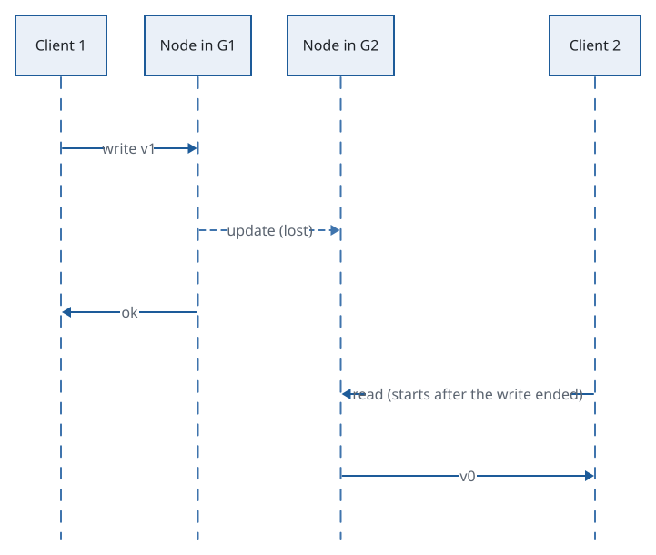

# Consistency and consensus {#sec-consistency-and-consensus}

[Replication and partitioning](../replication-and-partitioning/index.qmd) left two questions open. What exactly may a replicated store
return to a reader, and how can several machines agree on one value, a leader, a log entry or a lock holder, when any of them may crash and
messages may be delayed or lost? This chapter answers both. It defines the consistency models that name what readers may see, proves the CAP
theorem that limits them during partitions, defines consensus and the two algorithms that solve it in practice, Paxos and Raft, shows how a
coordination service turns consensus into locks and leases, and ends with faults that are not crashes but lies.

The claims are of two kinds. Consistency models, the CAP properties, consensus, Paxos, Raft, coordination primitives and Byzantine faults are
definitions. The results are propositions and theorems with complete proofs: that linearisability implies sequential consistency and forces
reads to see completed writes, the CAP theorem of Gilbert and Lynch, that majority quorums tolerate fewer than half of the processes failing,
that Paxos chooses at most one value, that Raft's logs never disagree on a committed entry, and that leases and fencing tokens keep a stale
lock holder from doing harm. The impossibility theorem of Fischer, Lynch and Paterson is stated as quoted from its source.

The sources are the benchmark books, @sinhaSystemDesignGuide2024 [Chs. 2 and 3], @SystemDesignInterview2021 [Ch. 6] and
@tanAcingSystemDesign2024 [Sec. 3.5], and the papers that define the subject: @gilbert2002brewer for CAP, @fischer1985impossibility for the
impossibility of consensus, @lamport2001paxos for Paxos, @ongaro2014search for Raft and @burrows2006chubby for the Chubby lock service. The
probability comes from [Probability and statistics](../../fundamentals-of-mathematics-for-physicists/probability/index.qmd).

The chapter has seven sections. @sec-consistency-models defines consistency models and proves how linearisability relates to the others.
@sec-cap defines the CAP properties and PACELC and proves the CAP theorem. @sec-consensus defines consensus and replicated state machines and
proves the quorum bound. @sec-paxos defines single-decree Paxos and proves its safety. @sec-raft defines Raft and proves its safety properties.
@sec-coordination defines locks, leases and fencing tokens and proves when they are safe. @sec-byzantine defines Byzantine faults.

The running example is the photo service's metadata leader of the previous chapter, now elected and kept in place by consensus, with a lock
service guarding its work.

Every definition, proposition and theorem is followed by ten examples and ten exercises, each exercise with a hidden solution in two tabs: the
argument, then a computation with its recorded output. The computations run in plain Python 3.12 with NumPy and the standard library; the
distributed algorithms run in seeded single-process simulations with message loss and crashes, and check their safety properties on every run.
Diagrams are written in the D2 language. Client code for particular coordination services is shown as illustrative code and is not run.

## Consistency models {#sec-consistency-models}

"Strong consistency" and "eventual consistency" are the two models the benchmark books name. Sinha's strong consistency "ensures all nodes in
the system observe the same order of updates", "providing a linearizable view of the system", while eventual consistency "allows for temporary
inconsistencies in the system but guarantees that eventually, all replicas or nodes will converge" [@sinhaSystemDesignGuide2024, Ch. 2,
"Strong consistency" and "Eventual consistency"]. Between the two lie several precise models, each a condition on what clients may observe. This
section defines them on histories of operations, and proves that linearisability, the strongest, implies sequential consistency and makes every
read see the writes that completed before it began.

For more on this topic, see @gilbert2002brewer [Sec. 2.1], @sinhaSystemDesignGuide2024 [Ch. 2], @SystemDesignInterview2021 [Ch. 6,
"Consistency models"] and @tanAcingSystemDesign2024 [Sec. 3.5].

### Histories and the models

A model is judged on what clients see, not on how replicas are built. What clients see is a history: each operation is invoked at some time and
returns at a later one, and operations of different clients may overlap.

:::: {.statement-box}
::: {#def-consistency-models}
#### Consistency models

1. A **history** is a set of operations on shared **registers**, each operation $o$ issued by one client with an **invocation** time $\mathrm{inv}(o)$ and a
   **response** time $\mathrm{res}(o) > \mathrm{inv}(o)$; a client issues its operations one at a time. Operation $o$ **precedes** $o'$ in real time,
   $o \prec o'$, if $\mathrm{res}(o) < \mathrm{inv}(o')$. A total order of operations is **legal** if every read returns the value of the last write to its
   register before it in the order (or the initial value if there is none).
2. A history is **linearisable** (atomic) if there is a legal total order of its operations that extends $\prec$: each operation appears to take effect at an
   instant between its invocation and its response.
3. It is **sequentially consistent** if there is a legal total order that extends each client's own order of operations (but not necessarily $\prec$).
4. It is **causally consistent** if, for each client, there is a legal order of all writes and that client's reads that extends the **causal order**: the
   smallest transitive relation containing each client's own order and the relation from a write to every read that returns its value.
5. A replicated store is **eventually consistent** if, whenever writes stop, all replicas eventually return the same value for every register.
6. The **session guarantees** for one client are: **read-your-writes** (a read reflects the client's earlier writes), **monotonic reads** (a read never returns
   an older value than an earlier read by the client), **monotonic writes** (the client's writes are applied in the order issued) and **writes-follow-reads**
   (a write is ordered after the writes the client has read).
:::

::::

Item 2 is the model of Gilbert and Lynch: "there must exist a total order on all operations such that each operation looks as if it were completed at a
single instant. This is equivalent to requiring requests of the distributed shared memory to act as if they were executing on a single node"
[@gilbert2002brewer, Sec. 2.1]. Items 3 to 6 are the standard weaker models; the benchmark books name only the two ends of the range.

:::: {.callout-note .examples-fold collapse="true" title="Examples"}
A brute-force checker decides item 2 for small histories. It tries every order.

::: {#exm-cmod-checker}
#### A linearisability checker

A history is a list of operations `(client, kind, register, value, inv, res)`. The checker searches the orders that extend $\prec$ and tests legality; the
first history is linearisable, the second is not, because the read of $0$ starts after the write of $1$ has returned.

```{.python .run}
from itertools import permutations
def legal(order):
    reg = {}
    for c, kind, r, v, i, s in order:
        if kind == "w": reg[r] = v
        elif reg.get(r, 0) != v: return False
    return True
def linearisable(h):
    return any(legal(p) for p in permutations(h)
               if all(not (b[5] < a[4]) for k, a in enumerate(p) for b in p[k + 1:]))
h1 = [("A", "w", "x", 1, 0, 3), ("B", "r", "x", 1, 2, 4)]
h2 = [("A", "w", "x", 1, 0, 1), ("B", "r", "x", 0, 2, 3)]
print("h1:", linearisable(h1), "| h2:", linearisable(h2))
```

```{.text .run-output}
h1: True | h2: False
```
:::

Overlap gives freedom. A read concurrent with a write may return either value.

::: {#exm-cmod-overlap}
#### A read during a write

If a read of $x$ overlaps a write of $1$, both $0$ and $1$ are linearisable answers: the write may take effect before or after the read. Only reads that start after
the write returns are constrained.
:::

Sequential consistency drops real time. A stale read becomes acceptable.

::: {#exm-cmod-sequential}
#### Sequential but not linearisable

The history $h_2$ of @exm-cmod-checker is sequentially consistent: order B's read before A's write; each client's single operation is trivially in program order.
It is not linearisable, since the read starts after the write returns.
:::

Causal consistency orders only related writes. Unrelated writes may be seen in different orders.

::: {#exm-cmod-causal}
#### Two concurrent posts

Clients A and B post $x = 1$ and $y = 1$ without reading each other. C may see $x$ first and D $y$ first, and the history is causally consistent; it is not
sequentially consistent if C reads $x = 1, y = 0$ and D reads $y = 1, x = 0$, since no single order explains both.
:::

A reply depends on its question. Causal consistency keeps them in order.

::: {#exm-cmod-reply}
#### A reply before its question

A writes a question, B reads it and writes a reply. Under causal consistency no client may see the reply without the question, because the question's write
precedes B's read, which precedes B's write. Eventual consistency alone allows a reader to see the reply first.
:::

Xu's three models are items 2 and 5 and a weak one between. Strong means linearisable.

::: {#exm-cmod-xu}
#### Xu's spectrum

"Strong consistency: any read operation returns a value corresponding to the result of the most updated write data item. A client never sees out-of-date data";
"weak consistency: subsequent read operations may not see the most updated value"; "eventual consistency: this is a specific form of weak consistency. Given
enough time, all updates are propagated" [@SystemDesignInterview2021, Ch. 6, "Consistency models"].
:::

Liu's photo upload needs read-your-writes. It is item 6.

::: {#exm-cmod-ryw}
#### Seeing one's own photo

A user who uploads and then opens the profile page must see the photo: read-your-writes for that user. The previous chapter's remedy of reading from the leader
after a write (@exr-lf-ryw-routing) provides it without making the whole store linearisable.
:::

Round-robin replicas break monotonic reads. A sticky replica restores them.

::: {#exm-cmod-monotonic}
#### Going back in time

Reading a counter as $5$ from one replica and $4$ from another violates monotonic reads; pinning the client to one replica, whose state only grows, restores the
guarantee (@exr-lf-monotonic).
:::

Eventual consistency promises nothing while writes continue. Convergence is the whole guarantee.

::: {#exm-cmod-eventual}
#### Only convergence

Sinha: "the key characteristic of eventual consistency is that given enough time, without further updates or conflicts, all replicas will eventually converge to
the same value" [@sinhaSystemDesignGuide2024, Ch. 2]. A store that returns $0$ for every read during a busy day and the correct value at night is eventually
consistent.
:::

A bank needs the strongest model. Sinha gives the example.

::: {#exm-cmod-bank}
#### Balances

"A good example of a system that would require a strong consistency model is a banking system", since inconsistency could "lead to financial losses or incorrect
accounting" [@sinhaSystemDesignGuide2024, Ch. 2]. A balance read after a completed transfer must reflect it, which is linearisability of the balance register.
:::
::::

:::: {.callout-note .exercises-fold collapse="true" title="Exercises"}
The first exercise classifies a history by hand and by the checker. It has three clients.

::: {#exr-cmod-classify}
#### Three clients

A writes $x = 1$ during $[0, 2]$; B reads $x = 1$ during $[1, 3]$; C reads $x = 0$ during $[4, 5]$. Is the history linearisable, sequentially consistent?
:::

::: {.callout-note .solution collapse="true" title="Solution"}
:::: {.panel-tabset .solution-tabs}
## Solution

Not linearisable: C's read starts after A's write returned and must see $1$. Sequentially consistent: the order C's read, A's write, B's read is legal and respects
each client's (single-operation) order.

## Python

Both checks.

```{.python .run}
from itertools import permutations
def legal(order):
    reg = {}
    for c, kind, r, v, i, s in order:
        if kind == "w": reg[r] = v
        elif reg.get(r, 0) != v: return False
    return True
def check(h, realtime):
    def ok(p):
        for k, a in enumerate(p):
            for b in p[k + 1:]:
                if realtime and b[5] < a[4]: return False
                if b[0] == a[0] and b[4] < a[4]: return False
        return True
    return any(legal(p) for p in permutations(h) if ok(p))
h = [("A", "w", "x", 1, 0, 2), ("B", "r", "x", 1, 1, 3), ("C", "r", "x", 0, 4, 5)]
print("linearisable:", check(h, True), "| sequentially consistent:", check(h, False))
```

```{.text .run-output}
linearisable: False | sequentially consistent: True
```
::::
:::

The second exercise builds a causally consistent history that is not sequentially consistent. It is @exm-cmod-causal made explicit.

::: {#exr-cmod-causal-not-seq}
#### Two readers disagree

Write the history of @exm-cmod-causal with four clients and verify with a search that no single legal order respects all clients' orders.
:::

::: {.callout-note .solution collapse="true" title="Solution"}
:::: {.panel-tabset .solution-tabs}
## Solution

In a legal order, C's read of $x = 1$ comes after $w(x)$ and C's read of $y = 0$ before $w(y)$; with C's own order, $w(x) < r_C(x) < r_C(y) < w(y)$. D's reads give
in the same way $w(y) < r_D(y) < r_D(x) < w(x)$. The two chains contradict each other, so no order exists.

## Python

The search over all orders of the six operations.

```{.python .run}
from itertools import permutations
ops = [("A", "w", "x", 1), ("B", "w", "y", 1), ("C", "r", "x", 1), ("C", "r", "y", 0), ("D", "r", "y", 1), ("D", "r", "x", 0)]
def legal(order):
    reg = {}
    for c, k, r, v in order:
        if k == "w": reg[r] = v
        elif reg.get(r, 0) != v: return False
    return True
def program_order(p):
    return all(p.index(a) < p.index(b) for a in ops for b in ops if a[0] == b[0] and ops.index(a) < ops.index(b))
print("sequentially consistent:", any(legal(p) and program_order(p) for p in permutations(ops)))
```

```{.text .run-output}
sequentially consistent: False
```
::::
:::

The third exercise asks which session guarantees a single leader gives. Reading from it gives all four.

::: {#exr-cmod-sessions-leader}
#### Session guarantees from a leader

Prove that if every client reads and writes at one leader that applies operations in the order received and acknowledges a write after applying it, all four session
guarantees of item 6 hold.
:::

::: {.callout-note .solution collapse="true" title="Solution"}
:::: {.panel-tabset .solution-tabs}
## Solution

The leader's state is a sequence of applied writes that only grows. A client's later read sees a longer prefix than any of its earlier operations saw, which gives
read-your-writes and monotonic reads; its writes are applied in the order received, which is the order issued since a client waits for each acknowledgement; and a
write issued after a read is applied after every write that read saw. The guarantees fail when reads go to lagging followers.

## Python

A leader log and one client's operations, checked against the four guarantees.

```{.python .run}
log, seen = [], []
def write(v): log.append(v); return len(log)
def read(): seen.append(len(log)); return log[-1] if log else None
p1 = write("a"); r1 = read(); p2 = write("b"); r2 = read()
print("read-your-writes:", r1 == "a" and r2 == "b", "| monotonic reads:", seen == sorted(seen), "| writes in order:", p1 < p2)
```

```{.text .run-output}
read-your-writes: True | monotonic reads: True | writes in order: True
```
::::
:::

The fourth exercise checks Tan's description of linearisability. Its wording needs care.

::: {#exr-cmod-tan}
#### "The same data at a moment in time"

Tan describes CAP consistency as "linearizability, defined as all nodes containing the same data at a moment in time, and changes in data must be linear; that is, nodes
must start serving the changes at the same time" [@tanAcingSystemDesign2024, Sec. 3.5, p. 66]. Using item 2, say what is right in this description and what is not
required.
:::

::: {.callout-note .solution collapse="true" title="Solution"}
:::: {.panel-tabset .solution-tabs}
## Solution

Item 2 constrains only what clients observe: one legal order extending real-time precedence. Replicas need not hold the same data at any instant, nor switch at the
same time; a lagging replica is fine if no client reads from it, or if reads through it wait or are redirected. What the description captures correctly is the effect:
once any read has returned a new value, no later read returns the old one.

## Python

A store with a lagging replica that is never read is linearisable from the clients' point of view.

```{.python .run}
leader, lagging = [], []
leader.append(1)                                  # write applied at the leader only
reads = [leader[-1] for _ in range(3)]            # every client reads through the leader
print("replicas differ:", leader != lagging, "| reads:", reads)
```

```{.text .run-output}
replicas differ: True | reads: [1, 1, 1]
```
::::
:::

The fifth exercise counts the orders the checker tries. The search is exponential.

::: {#exr-cmod-cost}
#### The cost of brute force

How many orders does the checker of @exm-cmod-checker examine for $n$ operations, and for which $n$ does that exceed $10^9$? What does this say about checking long
histories?
:::

::: {.callout-note .solution collapse="true" title="Solution"}
:::: {.panel-tabset .solution-tabs}
## Solution

At most $n!$, which passes $10^9$ at $n = 13$. Checking linearisability is NP-complete in general, so practical checkers prune the search using real-time order and
register semantics, and keep histories short or split them by register.

## Python

The factorials.

```{.python .run}
from math import factorial
print([(n, factorial(n)) for n in (8, 10, 12, 13)])
```

```{.text .run-output}
[(8, 40320), (10, 3628800), (12, 479001600), (13, 6227020800)]
```
::::
:::

The sixth exercise relates eventual consistency to the previous chapter's version vectors. Convergence needs a merge.

::: {#exr-cmod-eventual-merge}
#### Converging replicas

Prove that replicas that exchange states and merge them with an operation that is commutative, associative and idempotent are eventually consistent, provided every
replica's state eventually reaches every other.
:::

::: {.callout-note .solution collapse="true" title="Solution"}
:::: {.panel-tabset .solution-tabs}
## Solution

After writes stop there are finitely many states. Once every replica has received every other's final state, each replica's state is the merge of the same set of
states, which by the three properties does not depend on order or repetition (@exr-hb-gcounter-converge). So all replicas hold the same state and return the same
value.

## Python

Three replicas merging maximum-timestamp registers in random orders.

```{.python .run}
import random
random.seed(1)
states = [(3, "a"), (5, "b"), (4, "c")]                     # (timestamp, value)
finals = set()
for _ in range(100):
    order = states * 2; random.shuffle(order)
    finals.add(max(order))
print("final states over 100 orders:", finals)
```

```{.text .run-output}
final states over 100 orders: {(5, 'b')}
```
::::
:::

The seventh exercise shows that read-your-writes does not imply monotonic reads. Two guarantees, two failures.

::: {#exr-cmod-ryw-not-mr}
#### Independent guarantees

Construct a history of one client in which read-your-writes holds and monotonic reads fails, and one in which the reverse holds.
:::

::: {.callout-note .solution collapse="true" title="Solution"}
:::: {.panel-tabset .solution-tabs}
## Solution

Read-your-writes without monotonic reads: the client writes nothing; it reads $x = 2$ (written by another client) and then $x = 1$ from a staler replica. Monotonic
reads without read-your-writes: the client writes $x = 5$ and then reads the older value $x = 3$, twice. The guarantees constrain different pairs of operations.

## Python

Both histories, with the two checks.

```{.python .run}
def ryw(ops):
    last_w = None
    for k, v in ops:
        if k == "w": last_w = v
        elif last_w is not None and v != last_w: return False
    return True
def mr(ops, version):
    seen = [version[v] for k, v in ops if k == "r"]
    return seen == sorted(seen)
version = {1: 1, 2: 2, 3: 3, 5: 4}
h1 = [("r", 2), ("r", 1)]; h2 = [("w", 5), ("r", 3), ("r", 3)]
print("h1: ryw", ryw(h1), "mr", mr(h1, version), "| h2: ryw", ryw(h2), "mr", mr(h2, version))
```

```{.text .run-output}
h1: ryw True mr False | h2: ryw False mr True
```
::::
:::

The eighth exercise checks the quorum store of the previous chapter against item 2. Concurrent reads can disagree.

::: {#exr-cmod-quorum}
#### Quorums are not linearisable

With the history of @exr-thq-xu-strong (a write that has reached one replica, a read from $\{1, 2\}$ returning new, then a read from $\{2, 3\}$ returning old), show with
the checker that the history is not linearisable, and say which change makes it so.
:::

::: {.callout-note .solution collapse="true" title="Solution"}
:::: {.panel-tabset .solution-tabs}
## Solution

The second read starts after the first returned new, so in any order extending $\prec$ the old value is read after the new one was read, and no write of the old value
lies between: illegal. Read repair before returning (writing the new value to a quorum) makes the first read effectively complete the write, and the second read then
sees it.

## Python

The history with the write still pending at the end.

```{.python .run}
from itertools import permutations
def legal(order):
    reg = {}
    for c, kind, r, v, i, s in order:
        if kind == "w": reg[r] = v
        elif reg.get(r, 0) != v: return False
    return True
def linearisable(h):
    return any(legal(p) for p in permutations(h)
               if all(not (b[5] < a[4]) for k, a in enumerate(p) for b in p[k + 1:]))
h = [("W", "w", "x", 1, 0, 10), ("A", "r", "x", 1, 1, 2), ("B", "r", "x", 0, 3, 4)]
print("linearisable:", linearisable(h))
```

```{.text .run-output}
linearisable: False
```
::::
:::

The ninth exercise shows causal consistency at work with the reply of @exm-cmod-reply. Version vectors detect the dependency.

::: {#exr-cmod-reply-vv}
#### Delaying the reply

A replica receives B's reply before A's question. Using version vectors (@def-happens-before), describe a rule that delays showing the reply until the question has
arrived, and show it on the example.
:::

::: {.callout-note .solution collapse="true" title="Solution"}
:::: {.panel-tabset .solution-tabs}
## Solution

Attach to each write the vector of the writes its author had seen. A replica applies a write only when it has applied every write in that vector's past; the reply
carries $(A{:}1, B{:}1)$, so the replica holds it until A's first write arrives. This is how causally consistent stores are built.

## Python

The delivery rule.

```{.python .run}
pending = [("reply", {"A": 1, "B": 1}), ("question", {"A": 1})]          # arrive in this order
applied, have = [], {"A": 0, "B": 0}
while pending:
    for w in list(pending):
        name, vv = w; author = "A" if name == "question" else "B"
        deps = dict(vv); deps[author] -= 1
        if all(have[k] >= v for k, v in deps.items()):
            applied.append(name); have[author] += 1; pending.remove(w)
print("applied in order:", applied)
```

```{.text .run-output}
applied in order: ['question', 'reply']
```
::::
:::

The tenth exercise chooses models for the photo service. Different data, different needs.

::: {#exr-cmod-photo}
#### Models for the photo service

Choose a consistency model for: a user's own profile page, the like counter, the feed, and the username registry.
:::

::: {.callout-note .solution collapse="true" title="Solution"}
:::: {.panel-tabset .solution-tabs}
## Solution

Profile page: read-your-writes for the owner, eventual for others. Like counter: eventual (a CRDT counter). Feed: causal, so that a comment never appears before its
photo. Username registry: linearisable, since two users must never both be told that a name is free and theirs.

## Python

The choices as a table.

```{.python .run}
for data, model in (("own profile", "read-your-writes"), ("like counter", "eventual (CRDT)"), ("feed", "causal"), ("usernames", "linearisable")):
    print(f"{data:12s} -> {model}")
```

```{.text .run-output}
own profile  -> read-your-writes
like counter -> eventual (CRDT)
feed         -> causal
usernames    -> linearisable
```
::::
:::
::::

### What linearisability guarantees

Linearisability is the model the CAP theorem is about, and the one consensus provides. Its two most useful consequences are that it is stronger than sequential
consistency and that it lets a read never go back in time.

:::: {.statement-box}
::: {#prp-linearisability}
#### Consequences of linearisability

(a) Every linearisable history is sequentially consistent.

(b) There are sequentially consistent histories that are not linearisable.

(c) In a linearisable history of one register, if a write $w$ precedes a read $r$ in real time, then $r$ returns the value of $w$ or of a write placed after $w$ in the
linearisation; and if a read $r_1$ returns the value of a write $w'$ and $r_1 \prec r_2$, then $r_2$ returns the value of $w'$ or of a write placed after $w'$.
:::

::::

*Proof.* (a) A client issues its operations one at a time, so each of its operations returns before the next is invoked: the client's order is contained in $\prec$.
A legal order extending $\prec$ therefore extends every client's order.

(b) The history $h_2$ of @exm-cmod-checker: a write of $1$ during $[0, 1]$ by A and a read of $0$ during $[2, 3]$ by B. The order (read, write) is legal and respects each
client's order, so the history is sequentially consistent; every order extending $\prec$ puts the write first, and then the read must return $1$.

(c) Let $\ell$ be a legal order extending $\prec$. Since $w \prec r$, $w$ comes before $r$ in $\ell$, and $r$ returns the value of the last write before it in $\ell$, which is
$w$ or a write between $w$ and $r$. For the second statement, $r_1$'s value is that of the last write $w'$ before $r_1$ in $\ell$; $r_1 \prec r_2$ puts $r_2$ after $r_1$, so
the last write before $r_2$ is $w'$ or a later one. $\square$

The second part of (c) is the property that clients notice: once anyone has seen a value, nobody later sees an older one. It is exactly what @exr-thq-xu-strong
violated, and what Gilbert and Lynch single out: "any read operation that begins after a write operation completes must return that value, or the result of a later write
operation" [@gilbert2002brewer, Sec. 2.1].

:::: {.callout-note .examples-fold collapse="true" title="Examples"}
Part (c) on a history with two writes. The read after both returns the second.

::: {#exm-lin-two-writes}
#### Two writes in sequence

Writes of $1$ during $[0, 1]$ and of $2$ during $[2, 3]$, then a read during $[4, 5]$: in every legal order extending $\prec$ the writes come in that order before the read,
which must return $2$.

```{.python .run}
from itertools import permutations
def legal(order):
    reg = {}
    for c, kind, r, v, i, s in order:
        if kind == "w": reg[r] = v
        elif reg.get(r, 0) != v: return False
    return True
def linearisable(h):
    return any(legal(p) for p in permutations(h)
               if all(not (b[5] < a[4]) for k, a in enumerate(p) for b in p[k + 1:]))
for v in (0, 1, 2):
    h = [("A", "w", "x", 1, 0, 1), ("A", "w", "x", 2, 2, 3), ("B", "r", "x", v, 4, 5)]
    print(f"read returns {v}: linearisable {linearisable(h)}")
```

```{.text .run-output}
read returns 0: linearisable False
read returns 1: linearisable False
read returns 2: linearisable True
```
:::

Concurrent writes may be ordered either way. Part (c) does not fix their order.

::: {#exm-lin-concurrent}
#### Concurrent writes

Writes of $1$ and $2$ that overlap may be linearised in either order, so a later read may return either; but all later reads must then agree on the one chosen, by the
second part of (c), once one of them has returned.
:::

Part (b) is why sequential consistency is cheaper. It allows stale reads.

::: {#exm-lin-cheap}
#### Why weaker is cheaper

A sequentially consistent store may serve a read from a lagging replica as long as each client's own operations stay in order; linearisability forbids it whenever the
missing write has completed. The difference is a round trip to a quorum or leader on every read.
:::

Part (a) means a linearisability checker also certifies sequential consistency. One search suffices.

::: {#exm-lin-certify}
#### One certificate for both

The order found by the checker for $h_1$ of @exm-cmod-checker extends $\prec$, and by the proof of (a) it also extends each client's order, so it certifies sequential
consistency as well.
:::

A leader that answers reads must still be the leader. A deposed one breaks part (c).

::: {#exm-lin-leader-reads}
#### A deposed leader

If a leader is cut off and a new leader is chosen and commits a write, the old leader may still believe it leads and answer a read with the old value, after the write has completed: part (c) is
violated. A leader must therefore confirm its position, for example by hearing from a majority, before answering a linearisable read.
:::

GFS's shadow masters serve slightly stale metadata. They are not linearisable.

::: {#exm-lin-shadow}
#### Shadow masters

Shadow masters "may lag the primary slightly, typically fractions of a second", so "what could be stale within short windows is file metadata" [@ghemawat2003google, Sec. 5.1.3]: a directory listing read
from a shadow after a completed create may miss the file, which part (c) forbids. GFS accepts this for read availability.
:::

Part (c) forbids flickering values. A user refreshing a page sees no regression.

::: {#exm-lin-refresh}
#### Refreshing a page

If one user sees a caption change and then a friend refreshes and sees the old caption, the friend's read started after the user's read returned: part (c) is violated,
and the store is not linearisable.
:::

Sequential consistency still forbids some histories. A client's own operations stay ordered.

::: {#exm-lin-seq-forbids}
#### What sequential consistency forbids

A client that writes $x = 1$ and then reads $x = 0$ (with no other writes) violates sequential consistency, since any order extending its own order puts the write before the
read.
:::

The definition allows pending operations. A write that never returns may or may not take effect.

::: {#exm-lin-pending}
#### A write that never returns

If a client crashes during a write, the write is pending forever. A linearisation may include it at some point after its invocation or omit it; reads that returned the new
value force its inclusion. @exr-cmod-quorum used this.
:::

Linearisability is not transaction isolation. Gilbert and Lynch draw the distinction.

::: {#exm-lin-local}
#### Not the A of ACID

Gilbert and Lynch note that "atomic consistency refers only to a property of a single request/response operation sequence", and that it "has a different meaning than the
Atomic in ACID, as it subsumes the database notions of both Atomic and Consistent" [@gilbert2002brewer, Sec. 2.1, note 3]. Linearisability is about single operations on
single objects; the serialisability of @prp-serializability is about transactions over many.
:::
::::

:::: {.callout-note .exercises-fold collapse="true" title="Exercises"}
The first exercise checks part (c) on random histories. The checker supplies the orders.

::: {#exr-lin-random}
#### Random histories

Generate random histories of $3$ writes and $3$ reads on one register with random intervals, keep the linearisable ones, and check that every read that starts after a
write returns has a value written by that write or by a write that does not return before that write starts.
:::

::: {.callout-note .solution collapse="true" title="Solution"}
:::: {.panel-tabset .solution-tabs}
## Solution

Part (c) says the returned value comes from $w$ or from a write after $w$ in the linearisation; a write that returned before $w$ started is before $w$ in every linearisation,
so it can never be the source. The check therefore never fails.

## Python

The random histories.

```{.python .run}
import random
from itertools import permutations
random.seed(2)
def legal(order):
    reg = None
    for c, kind, v, i, s in order:
        if kind == "w": reg = v
        elif reg != v: return False
    return True
def linearisable(h):
    return any(legal(p) for p in permutations(h) if all(not (b[4] < a[3]) for k, a in enumerate(p) for b in p[k + 1:]))
kept = bad = 0
for _ in range(400):
    ws = [("w", "w", v, *sorted(random.sample(range(20), 2))) for v in (1, 2, 3)]
    rs = [("r", "r", random.choice([1, 2, 3]), *sorted(random.sample(range(20), 2))) for _ in range(3)]
    h = [(f"c{k}",) + o[1:] for k, o in enumerate(ws + rs)]
    if not linearisable(h): continue
    kept += 1
    for r in h[3:]:
        for w in h[:3]:
            if w[4] < r[3]:
                src = next(x for x in h[:3] if x[2] == r[2])
                bad += src[4] < w[3]
print(f"linearisable histories {kept}, violations of part (c) {bad}")
```

```{.text .run-output}
linearisable histories 250, violations of part (c) 0
```
::::
:::

The second exercise proves that a single server is linearisable. It is the reference implementation of item 2.

::: {#exr-lin-single-server}
#### One server

Prove that a single server that applies requests one at a time, in arrival order, and replies after applying each, produces linearisable histories.
:::

::: {.callout-note .solution collapse="true" title="Solution"}
:::: {.panel-tabset .solution-tabs}
## Solution

Order operations by the instant the server applies them. Each instant lies between the operation's invocation (the request was sent) and its response (the reply was sent
after applying), so if $o \prec o'$, $o$ was applied before $o'$ was even sent. The order is legal because the server is a register. Gilbert and Lynch's "as if they were
executing on a single node" is this construction.

## Python

A simulated server with random network delays, checked.

```{.python .run}
import random
from itertools import permutations
random.seed(3)
def legal(order):
    reg = 0
    for c, kind, v, i, s in order:
        if kind == "w": reg = v
        elif reg != v: return False
    return True
reg, h = 0, []
for k in range(6):
    inv = random.uniform(0, 10); apply = inv + random.uniform(0.1, 1); res = apply + random.uniform(0.1, 1)
    h.append([f"c{k}", random.choice("wr"), random.randint(1, 3), inv, res, apply])
for op in sorted(h, key=lambda o: o[5]):
    if op[1] == "w": reg = op[2]
    else: op[2] = reg
h = [tuple(o[:5]) for o in h]
print("linearisable:", any(legal(p) for p in permutations(h) if all(not (b[4] < a[3]) for k, a in enumerate(p) for b in p[k + 1:])))
```

```{.text .run-output}
linearisable: True
```
::::
:::

The third exercise asks whether a primary with asynchronous followers is linearisable. Reads from followers are the problem.

::: {#exr-lin-followers}
#### Reading from followers

A leader with asynchronous followers (@def-leader-follower) serves writes; reads go to followers. Use part (c) to show that the store is not linearisable, and say which
reads must change.
:::

::: {.callout-note .solution collapse="true" title="Solution"}
:::: {.panel-tabset .solution-tabs}
## Solution

A write acknowledged by the leader and not yet applied at a follower, followed by a read at that follower, returns the old value although the write preceded the read in
real time: part (c) fails. Reads must go to the leader (with a check that it is still the leader), or wait until the follower has applied the leader's log up to the
position current when the read began.

## Python

The history.

```{.python .run}
leader, follower = [0], [0]
leader.append(1)                     # write acknowledged at t = 1
read_at_follower = follower[-1]      # read at t = 2, follower not yet updated
print("write precedes read; read returns", read_at_follower, "-> violates part (c)")
```

```{.text .run-output}
write precedes read; read returns 0 -> violates part (c)
```
::::
:::

The fourth exercise proves locality for two registers. It justifies checking by register.

::: {#exr-lin-locality}
#### Locality

Prove that if each register's sub-history of a history is linearisable, so is the whole history. (Merge the per-register orders.)
:::

::: {.callout-note .solution collapse="true" title="Proof"}
:::: {.panel-tabset .solution-tabs}
## Proof

First, an order $o_1, \dots, o_k$ that extends $\prec$ can be realised by instants $t_1 < \dots < t_k$ with $t_i$ inside the interval of $o_i$: take $t_i$ slightly above
$\max(\mathrm{inv}(o_i), t_{i-1})$. This stays below $\mathrm{res}(o_i)$ because every earlier $o_j$ has $\mathrm{inv}(o_j) < \mathrm{res}(o_i)$ (otherwise $o_i \prec o_j$,
against the order); for intervals in general position the small margins can be chosen. Now realise each register's legal order by instants, and order all operations by
their instants. This total order extends $\prec$, since an operation that returns before another is invoked has the earlier instant, and restricted to each register it
is that register's legal order, so it is legal.

## Python

Two registers, each linearisable, and the whole.

```{.python .run}
from itertools import permutations
def legal(order):
    reg = {}
    for c, kind, r, v, i, s in order:
        if kind == "w": reg[r] = v
        elif reg.get(r, 0) != v: return False
    return True
def lin(h):
    return any(legal(p) for p in permutations(h) if all(not (b[5] < a[4]) for k, a in enumerate(p) for b in p[k + 1:]))
h = [("A", "w", "x", 1, 0, 2), ("B", "r", "x", 1, 1, 3), ("A", "w", "y", 1, 3, 4), ("C", "r", "y", 0, 3.5, 5)]
print("x:", lin([o for o in h if o[2] == "x"]), "y:", lin([o for o in h if o[2] == "y"]), "whole:", lin(h))
```

```{.text .run-output}
x: True y: True whole: True
```
::::
:::

The fifth exercise finds the linearisation instants. They witness the order.

::: {#exr-lin-points}
#### Linearisation points

For the linearisable history $h_1$ of @exm-cmod-checker, give instants inside each interval that realise the order, and explain why choosing such points is equivalent
to item 2.
:::

::: {.callout-note .solution collapse="true" title="Solution"}
:::: {.panel-tabset .solution-tabs}
## Solution

The write $[0, 3]$ and the read $[2, 4]$: points $2.5$ for the write and $3$ for the read put the write first, matching the read of $1$. Given points inside intervals, ordering
operations by their points gives a total order extending $\prec$ (an operation that ends before another begins has an earlier point); conversely, an order extending $\prec$
can be realised by points chosen inside the intervals in that order, since any two operations ordered against their intervals would contradict $\prec$.

## Python

The points and the order they induce.

```{.python .run}
ops = {"w(x,1)": (0, 3, 2.5), "r(x)=1": (2, 4, 3.0)}
assert all(i <= p <= s for i, s, p in ops.values())
print("order by points:", sorted(ops, key=lambda o: ops[o][2]))
```

```{.text .run-output}
order by points: ['w(x,1)', 'r(x)=1']
```
::::
:::

The sixth exercise shows that part (c) is not sufficient for linearisability. A history can satisfy it and fail item 2.

::: {#exr-lin-c-not-enough}
#### Part (c) is not enough

Give a history of one register in which no read returns a value older than a completed write or an earlier read, yet the history is not linearisable.
:::

::: {.callout-note .solution collapse="true" title="Solution"}
:::: {.panel-tabset .solution-tabs}
## Solution

Writes of $1$ and $2$ overlap during $[0, 2]$, and reads by C and D during $[3, 5]$ return $1$ and $2$. Both reads follow both writes, so every order extending $\prec$ puts
both writes before both reads, and the two reads must return the same last value: not linearisable. Part (c) holds, since each read returns the value of a write that is
not before the other write in every order, and the reads overlap, so its second statement says nothing.

## Python

The history.

```{.python .run}
from itertools import permutations
def legal(order):
    reg = 0
    for c, kind, v, i, s in order:
        if kind == "w": reg = v
        elif reg != v: return False
    return True
h = [("A", "w", 1, 0, 2), ("B", "w", 2, 0, 2), ("C", "r", 1, 3, 5), ("D", "r", 2, 3, 5)]
print("linearisable:", any(legal(p) for p in permutations(h) if all(not (b[4] < a[3]) for k, a in enumerate(p) for b in p[k + 1:])))
```

```{.text .run-output}
linearisable: False
```
::::
:::

The seventh exercise prices a linearisable read. A round trip to a majority is the cost.

::: {#exr-lin-read-cost}
#### The price of a linearisable read

A leader in one data centre answers reads after a heartbeat exchange with a majority of five replicas, at round trips of $1$, $1$, $30$, $30$ and $80\,\mathrm{ms}$ (its own
replica included at $0$). Compare the read latency with a read from the nearest replica.
:::

::: {.callout-note .solution collapse="true" title="Solution"}
:::: {.panel-tabset .solution-tabs}
## Solution

A majority is three of five; the leader counts itself and needs the two fastest others, so it waits $1\,\mathrm{ms}$ (the third-fastest response including itself is the second
$1\,\mathrm{ms}$ round trip). A read from the nearest replica also takes about $1\,\mathrm{ms}$ but may be stale. If the two nearby replicas are down, the leader waits $30\,\mathrm{ms}$.

## Python

The order statistic.

```{.python .run}
rtts = sorted([0, 1, 1, 30, 30])
print("majority read waits", rtts[2], "ms; with the two nearby replicas down:", sorted([0, 30, 30, 80])[2], "ms")
```

```{.text .run-output}
majority read waits 1 ms; with the two nearby replicas down: 30 ms
```
::::
:::

The eighth exercise shows that part (c) fails for sequential consistency. Real time is what part (c) uses.

::: {#exr-lin-seq-c}
#### Sequential consistency and stale reads

Show that a sequentially consistent history can contain a read that starts after a write completes and returns the initial value, and identify the step of the proof of part
(c) that fails.
:::

::: {.callout-note .solution collapse="true" title="Solution"}
:::: {.panel-tabset .solution-tabs}
## Solution

$h_2$ of @exm-cmod-checker. The proof of (c) uses that $w \prec r$ places $w$ before $r$ in the order; a sequentially consistent order need only respect each client's order, and
$w$ and $r$ belong to different clients.

## Python

The legal order for $h_2$ that ignores real time.

```{.python .run}
order = [("B", "r", 0), ("A", "w", 1)]
reg = 0; ok = True
for c, k, v in order:
    if k == "w": reg = v
    else: ok &= reg == v
print("legal order exists:", ok)
```

```{.text .run-output}
legal order exists: True
```
::::
:::

The ninth exercise relates causal consistency to sequential consistency. One implies the other.

::: {#exr-lin-seq-causal}
#### Sequential implies causal

Prove that a sequentially consistent history is causally consistent.
:::

::: {.callout-note .solution collapse="true" title="Proof"}
:::: {.panel-tabset .solution-tabs}
## Proof

Let $\ell$ be a legal order extending each client's order. A read returns the value of the last write before it in $\ell$, so each write-to-read pair of the causal order is in
$\ell$; client orders are in $\ell$ by assumption; and $\ell$ is transitive. So $\ell$ extends the causal order, and its restriction to all writes and one client's reads is legal
and extends the causal order, for every client. (We assume, as usual, that written values are distinct.)

## Python

The causal pairs of a sequentially consistent history are respected by its order.

```{.python .run}
order = [("A", "w", "x", 1), ("B", "r", "x", 1), ("B", "w", "y", 1), ("C", "r", "y", 1)]
causal = [(0, 1), (1, 2), (2, 3)]                  # writes-to-reads and program order
print("order respects causality:", all(a < b for a, b in causal))
```

```{.text .run-output}
order respects causality: True
```
::::
:::

The tenth exercise designs a linearisable username registry. Part (c) is what two signups need.

::: {#exr-lin-usernames}
#### Claiming a name

Two users try to claim "ana" at the same time. Show with part (c) that if the registry is linearisable and a claim is a compare-and-set that succeeds only on an unset name, at
most one claim succeeds and every later lookup returns the winner.
:::

::: {.callout-note .solution collapse="true" title="Solution"}
:::: {.panel-tabset .solution-tabs}
## Solution

Linearise the two claims; the first in the order sees the name unset and sets it, the second sees it set and fails, as on a single server. A lookup that starts after the
winning claim returned sees the winner or a later write, by part (c), and there is no later write to that name.

## Python

The two claims in both linearisation orders.

```{.python .run}
for order in (("u1", "u2"), ("u2", "u1")):
    registry = {}
    results = {u: registry.setdefault("ana", u) == u for u in order}
    print("order", order, "-> success:", results, "| owner:", registry["ana"])
```

```{.text .run-output}
order ('u1', 'u2') -> success: {'u1': True, 'u2': False} | owner: u1
order ('u2', 'u1') -> success: {'u2': True, 'u1': False} | owner: u2
```
::::
:::
::::

## The CAP theorem {#sec-cap}

The CAP theorem is the best-known statement about distributed systems and one of the most loosely quoted. Xu states it as "it is impossible for a distributed system
to simultaneously provide more than two of these three guarantees: consistency, availability, and partition tolerance" [@SystemDesignInterview2021, Ch. 6, "CAP
theorem"]. Brewer conjectured it and Gilbert and Lynch proved it, with each term made precise: consistency means linearisability, availability means that every
request to a working node is answered, and partitions are losses of messages. This section defines the three properties, the CP and AP classes and PACELC, and proves
the theorem in both of Gilbert and Lynch's network models.

For more on this topic, see @gilbert2002brewer [Secs. 2-4], @SystemDesignInterview2021 [Ch. 6, "CAP theorem"], @sinhaSystemDesignGuide2024 [Ch. 3, "CAP theorem" and
"PACELC theorem"] and @tanAcingSystemDesign2024 [Sec. 3.5, pp. 66-67].

### Consistency, availability and partition tolerance

The three properties concern a read/write object implemented by nodes that exchange messages. Partitions are not a property the system provides but a condition it must
survive.

:::: {.statement-box}
::: {#def-cap}
#### The CAP properties and PACELC

1. A read/write object implemented on nodes is **atomically consistent** if all its histories are linearisable (@def-consistency-models).
2. It is **available** if every request received by a node that has not failed eventually receives a response.
3. A **partition** is the loss of all messages between two disjoint non-empty sets of nodes, $G_1$ and $G_2$; the object is required to be **partition tolerant** if
   consistency and availability must hold in executions in which arbitrary messages are lost.
4. In the **asynchronous** network model there are no clocks and no bounds on message delay; in the **partially synchronous** model every node has a clock running at the
   common rate, and every message is delivered within a known time $t_{\mathrm{msg}}$ or lost.
5. A system that keeps consistency and gives up availability during partitions is **CP**; one that keeps availability and gives up consistency is **AP**. **PACELC**
   classifies a system by its choice under a partition (P) between availability (A) and consistency (C), and else (E), with no partition, between latency (L) and
   consistency (C).
:::

::::

Items 1 to 4 are Gilbert and Lynch's: "every request received by a non-failing node in the system must result in a response", and "in order to model partition tolerance,
the network will be allowed to lose arbitrarily many messages sent from one node to another" [@gilbert2002brewer, Secs. 2.2-2.3]. Item 5's PACELC follows Sinha:
"in the presence of a network partition, we must choose between consistency and availability (as in the CAP theorem). However, even without a network partition, a trade-off
emerges between latency and consistency" [@sinhaSystemDesignGuide2024, Ch. 3, "PACELC theorem"].

:::: {.callout-note .examples-fold collapse="true" title="Examples"}
Gilbert and Lynch's availability has no deadline. A response a year later counts.

::: {#exm-cap-availability}
#### Weak and strong availability

"In some ways this is a weak definition of availability: it puts no bound on how long the algorithm may run before terminating ... On the other hand, when qualified by the need
for partition tolerance, this can be seen as a strong definition of availability: even when severe network failures occur, every request must terminate"
[@gilbert2002brewer, Sec. 2.2]. A service whose requests time out after $5\,\mathrm{s}$ with an error is not available in this sense during a partition.
:::

Any loss of messages is a partition. Gilbert and Lynch reduce all losses to this case.

::: {#exm-cap-loss}
#### Losses as partitions

"Any pattern of message loss can be modeled as a temporary partition separating the communicating nodes at the exact instant the message is lost" [@gilbert2002brewer,
Sec. 2.3]. A single dropped packet between two replicas is a partition for as long as it takes.
:::

Xu classifies key-value stores by the pair they keep. CA is ruled out in practice.

::: {#exm-cap-xu-classes}
#### CP, AP and CA

Xu: CP stores support "consistency and partition tolerance while sacrificing availability", AP stores "availability and partition tolerance while sacrificing consistency",
and "since network failure is unavoidable, a distributed system must tolerate network partition. Thus, a CA system cannot exist in real-world applications"
[@SystemDesignInterview2021, Ch. 6].
:::

A bank prefers CP. Xu's example returns errors rather than stale balances.

::: {#exm-cap-bank}
#### A bank during a partition

"If inconsistency occurs due to a network partition, the bank system returns an error before the inconsistency is resolved" [@SystemDesignInterview2021, Ch. 6]: requests
to the cut-off replica get errors, which is a loss of item 2's availability in exchange for item 1.
:::

Dynamo chooses AP. Its writes are never refused.

::: {#exm-cap-dynamo}
#### An always-writeable store

Dynamo's sloppy quorums keep writes possible "as long as a single node in the system has durably written the key" [@decandia2007dynamo, Sec. 4.6], and divergent versions are
reconciled later: availability kept, linearisability given up.
:::

Tan tabulates systems by their choice. The table uses the CAP vocabulary.

::: {#exm-cap-tan-table}
#### Tan's table

"MongoDB, HBase, and Redis trade off availability for linearizability, while CouchDB, Cassandra, Dynamo, Hadoop, and Riak trade off linearizability for availability"
[@tanAcingSystemDesign2024, Sec. 3.5, p. 66]. Such labels describe default configurations; many of these systems can be configured either way.
:::

Gilbert and Lynch construct the CP case. One node holds the value.

::: {#exm-cap-central}
#### A central node

"A single designated node maintains the value of an object. A node receiving a request forwards the request to the designated node, which sends a response"; when no message
is lost, the system is available and atomic, and when messages are lost, requests wait [@gilbert2002brewer, Sec. 3.2.1]. It is the single server of @exr-lin-single-server.
:::

The AP case can be trivial. A constant answer is available and partition tolerant.

::: {#exm-cap-trivial-ap}
#### Returning the initial value

"If there are no consistency requirements, the service can trivially return $v_0$, the initial value, in response to every request" [@gilbert2002brewer, Sec. 3.2.3]. Useful
AP systems return weakly consistent values, "web caches are one example".
:::

PACELC adds the latency trade-off of normal operation. Quorum reads pay it.

::: {#exm-cap-pacelc}
#### Latency without partitions

With no partition, a linearisable read waits for a majority (@exr-lin-read-cost), while a read from the nearest replica is fast but may be stale: the "else" branch of PACELC.
Dynamo, which is AP under partitions and chooses low latency otherwise, is PA/EL; a single-leader store with majority reads is PC/EC.
:::

A partition of one node is a crash. Gilbert and Lynch note it.

::: {#exm-cap-one-node}
#### One-node partitions

"Brewer pointed out in the talk that partitions of one node are irrelevant: they are equivalent to that node failing" [@gilbert2002brewer, Sec. 2.3, note 5]. The interesting
partitions split the system into groups that each keep serving clients.
:::
::::

:::: {.callout-note .exercises-fold collapse="true" title="Exercises"}
The first exercise corrects Xu's partition example. A crashed node is not a partition.

::: {#exr-cap-xu-n3}
#### A node that goes down

Xu illustrates a partition with "n3 goes down and cannot communicate with n1 and n2" [@SystemDesignInterview2021, Ch. 6]. Using item 2 and @exm-cap-one-node, explain why a node
that goes down does not force the CAP choice, and give the scenario that does.
:::

::: {.callout-note .solution collapse="true" title="Solution"}
:::: {.panel-tabset .solution-tabs}
## Solution

Item 2 asks only nodes that have not failed to respond. A crashed n3 receives no requests, and n1 and n2 can serve consistently between themselves with majority quorums. The
choice is forced when n3 is alive, cut off, and receives requests: it must either answer (possibly stale, AP) or refuse (CP).

## Python

A majority quorum on $\{n_1, n_2\}$ answers consistently while n3 is down.

```{.python .run}
replicas = {"n1": 0, "n2": 0}            # n3 crashed
for r in replicas: replicas[r] = 1       # write to the majority {n1, n2}
print("read from the majority:", max(replicas.values()))
```

```{.text .run-output}
read from the majority: 1
```
::::
:::

The second exercise classifies the previous chapter's systems with PACELC. Each needs two letters.

::: {#exr-cap-pacelc-classify}
#### PACELC labels

Classify: (i) Dynamo with sloppy quorums; (ii) a leader with synchronous followers and reads at the leader; (iii) a leader with asynchronous followers and reads at followers.
:::

::: {.callout-note .solution collapse="true" title="Solution"}
:::: {.panel-tabset .solution-tabs}
## Solution

(i) PA/EL. (ii) PC/EC: under a partition the side without the leader refuses writes, and normally every write waits for the followers. (iii) Normally low latency with stale reads,
EL; under a partition the followers keep answering stale reads but writes on the far side fail, so it is PA for reads and PC for writes: labels apply per operation.

## Python

The labels.

```{.python .run}
for name, label in (("Dynamo", "PA/EL"), ("sync leader", "PC/EC"), ("async leader, follower reads", "PA/EL for reads, PC for writes")):
    print(f"{name:30s} {label}")
```

```{.text .run-output}
Dynamo                         PA/EL
sync leader                    PC/EC
async leader, follower reads   PA/EL for reads, PC for writes
```
::::
:::

The third exercise corrects Sinha's acronym. PACELC has six letters and four choices.

::: {#exr-cap-sinha-acronym}
#### The letters of PACELC

Sinha expands PACELC as "Partition tolerance (P)", "Availability (A)", "Consistency (C)", "Else (E)", "Latency (L)" and "Consistency Level (C)" [@sinhaSystemDesignGuide2024, Ch. 3].
Reread the acronym as a conditional, as item 5 does.
:::

::: {.callout-note .solution collapse="true" title="Solution"}
:::: {.panel-tabset .solution-tabs}
## Solution

It reads "if there is a Partition, choose Availability or Consistency; Else, choose Latency or Consistency". P is the condition, not a property to provide, and the second C is the same
consistency as the first, not a separate "consistency level". Sinha's following paragraph states the conditional correctly.

## Python

The two branches as a function.

```{.python .run}
def pacelc(partition, prefer_consistency):
    return ("C" if prefer_consistency else "A") if partition else ("C" if prefer_consistency else "L")
print({(p, c): pacelc(p, c) for p in (True, False) for c in (True, False)})
```

```{.text .run-output}
{(True, True): 'C', (True, False): 'A', (False, True): 'C', (False, False): 'L'}
```
::::
:::

The fourth exercise times the central node's answers in the partially synchronous model. Timeouts make it available.

::: {#exr-cap-timeout}
#### A timeout on the central node

In Gilbert and Lynch's partially synchronous variant, a node that gets no answer from the central node within $2t_{\mathrm{msg}} + t_{\mathrm{local}}$ "concludes that the message was
lost" and returns its best known value [@gilbert2002brewer, Sec. 4.3]. With $t_{\mathrm{msg}} = 50\,\mathrm{ms}$ and $t_{\mathrm{local}} = 1\,\mathrm{ms}$, find the longest response time, and
say what is given up.
:::

::: {.callout-note .solution collapse="true" title="Solution"}
:::: {.panel-tabset .solution-tabs}
## Solution

Every request is answered within $101\,\mathrm{ms}$, so the system is available; when messages are lost the answer may be stale, so atomic consistency holds only in executions without
loss. This is the partially synchronous escape from Corollary 1.1, not from the theorem.

## Python

The bound.

```{.python .run}
print(f"longest response {2 * 50 + 1} ms")
```

```{.text .run-output}
longest response 101 ms
```
::::
:::

The fifth exercise runs a two-node store through a partition. Both strategies are simulated.

::: {#exr-cap-two-node}
#### Two nodes, two strategies

Two replicas $G_1$ and $G_2$ lose all messages between them. A client writes $x = 1$ at $G_1$ and another reads at $G_2$. Simulate an AP strategy (answer locally) and a CP strategy
(answer only after contacting the other node, waiting while the partition lasts), and report what each read returns.
:::

::: {.callout-note .solution collapse="true" title="Solution"}
:::: {.panel-tabset .solution-tabs}
## Solution

AP: the read returns $0$ immediately, which is not linearisable since the write completed first. CP: the read waits until the partition heals and then returns $1$; while the partition
lasts it has no response, so availability fails.

## Python

Both strategies in one run.

```{.python .run}
def run(strategy, heal_at=10):
    g1, g2, t = {"x": 0}, {"x": 0}, 0
    g1["x"] = 1                                    # write completes at G1 at t = 0
    if strategy == "AP":
        return g2["x"], t
    while t < heal_at: t += 1                      # wait for the partition to heal
    g2["x"] = g1["x"]; return g2["x"], t
for s in ("AP", "CP"):
    v, t = run(s); print(f"{s}: read returns {v} at t = {t}")
```

```{.text .run-output}
AP: read returns 0 at t = 0
CP: read returns 1 at t = 10
```
::::
:::

The sixth exercise asks whether CA exists. The answer depends on the network.

::: {#exr-cap-ca}
#### CA systems

Gilbert and Lynch show that "if there are no partitions, it is clearly possible to provide atomic, available data" [@gilbert2002brewer, Sec. 3.2.2]. Reconcile this with Xu's "a CA system
cannot exist in real-world applications".
:::

::: {.callout-note .solution collapse="true" title="Solution"}
:::: {.panel-tabset .solution-tabs}
## Solution

A CA system is one that assumes no message is lost; it exists, for example on a single machine or on a reliable local network, but when a loss does happen it must break one of the two.
Xu's claim is about wide-area systems in which losses are certain to happen eventually: there, "CA" is not a choice but an assumption that will be violated.

## Python

The probability that a network with independent loss probability $10^{-6}$ per message loses at least one of $10^9$ messages.

```{.python .run}
import math
print(f"{1 - math.exp(1e9 * math.log1p(-1e-6)):.6f}")
```

```{.text .run-output}
1.000000
```
::::
:::

The seventh exercise checks the CP construction for linearisability. It is the single server again.

::: {#exr-cap-central-lin}
#### The central node is linearisable

Prove that the central-node algorithm of @exm-cap-central produces linearisable histories whenever every request is answered.
:::

::: {.callout-note .solution collapse="true" title="Proof"}
:::: {.panel-tabset .solution-tabs}
## Proof

Each operation takes effect when the designated node processes it, between the client's request and the response, which is sent only after the designated node's reply arrives. Ordering
operations by those instants extends $\prec$ and is legal, as in @exr-lin-single-server.

## Python

A simulation with random forwarding delays.

```{.python .run}
import random
from itertools import permutations
random.seed(4)
def legal(order):
    reg = 0
    for c, k, v, i, s in order:
        if k == "w": reg = v
        elif reg != v: return False
    return True
ops, reg = [], 0
for k in range(6):
    inv = random.uniform(0, 5); at = inv + random.uniform(0.1, 1); res = at + random.uniform(0.1, 1)
    ops.append([f"c{k}", random.choice("wr"), random.randint(1, 3), inv, res, at])
for o in sorted(ops, key=lambda o: o[5]):
    if o[1] == "w": reg = o[2]
    else: o[2] = reg
h = [tuple(o[:5]) for o in ops]
print("linearisable:", any(legal(p) for p in permutations(h) if all(not (b[4] < a[3]) for k, a in enumerate(p) for b in p[k + 1:])))
```

```{.text .run-output}
linearisable: True
```
::::
:::

The eighth exercise estimates how often partitions force the choice. Rare but certain.

::: {#exr-cap-frequency}
#### How often

A link between two data centres fails on average twice a year for $10$ minutes. What fraction of a year is spent partitioned, and how many requests at $10^4$ per second does a CP
system refuse in a year if half the requests reach the cut-off side?
:::

::: {.callout-note .solution collapse="true" title="Solution"}
:::: {.panel-tabset .solution-tabs}
## Solution

$20$ minutes a year is $3.8 \times 10^{-5}$ of the time; at $10^4$ requests per second half of them, $5 \times 10^3$ per second, are refused for $1200\,\mathrm{s}$: $6 \times 10^6$ requests.
An AP system answers them all, some stale.

## Python

The numbers.

```{.python .run}
seconds = 2 * 10 * 60
print(f"fraction {seconds / (365 * 86_400):.1e}, refused {0.5 * 1e4 * seconds:.1e}")
```

```{.text .run-output}
fraction 3.8e-05, refused 6.0e+06
```
::::
:::

The ninth exercise corrects a common reading of CAP. The choice is per partition, not per system.

::: {#exr-cap-not-always}
#### Not all the time

Sinha notes that CAP "doesn't imply an all-or-nothing sacrifice of properties in every situation" [@sinhaSystemDesignGuide2024, Ch. 3]. Using item 3, say when a CP system is available
and when an AP system is consistent.
:::

::: {.callout-note .solution collapse="true" title="Solution"}
:::: {.panel-tabset .solution-tabs}
## Solution

Both are both, whenever no partition separates the nodes a request needs: the CP system answers every request and the AP system's answers are linearisable if its replicas are kept in sync.
CAP constrains only executions with losses, which is why PACELC adds the other branch.

## Python

The choices of a CP and an AP system with and without a partition.

```{.python .run}
for partition in (False, True):
    print(f"partition {partition}: CP -> {'refuse' if partition else 'answer, consistent'}; AP -> {'answer, maybe stale' if partition else 'answer, consistent'}")
```

```{.text .run-output}
partition False: CP -> answer, consistent; AP -> answer, consistent
partition True: CP -> refuse; AP -> answer, maybe stale
```
::::
:::

The tenth exercise places the photo service's data. Each part chooses differently.

::: {#exr-cap-photo}
#### CP or AP for each kind of data

Choose CP or AP for the username registry, the like counters and the feed, and justify each with what goes wrong under the other choice.
:::

::: {.callout-note .solution collapse="true" title="Solution"}
:::: {.panel-tabset .solution-tabs}
## Solution

Usernames: CP, since AP could give one name to two users. Like counters: AP with a CRDT, since a refused like is worse than a count that is briefly low. Feed: AP, since a stale feed is acceptable
and an unavailable one is not.

## Python

The choices.

```{.python .run}
for d, c in (("usernames", "CP"), ("like counters", "AP (CRDT)"), ("feed", "AP")):
    print(f"{d:14s} {c}")
```

```{.text .run-output}
usernames      CP
like counters  AP (CRDT)
feed           AP
```
::::
:::
::::

### The theorem

The proof is short: cut the nodes into two groups that cannot hear each other, write in one, read in the other. @fig-capt-partition draws the execution.

{#fig-capt-partition width=80%}

:::: {.statement-box}
::: {#thm-cap}
#### The CAP theorem

Let a read/write object be implemented on at least two nodes.

(a) In the asynchronous model, no algorithm guarantees both availability and atomic consistency in all fair executions, including those in which messages are lost.

(b) The same holds in the partially synchronous model.

(c) Any two of the three properties can be had: atomic consistency with partition tolerance (by giving up availability during losses), atomic consistency with availability (when no messages
are lost), and availability with partition tolerance (by giving up atomic consistency).

(d) (Quoted from @gilbert2002brewer [Sec. 3.1, Corollary 1.1].) In the asynchronous model it is impossible to guarantee availability in all fair executions together with atomic consistency in
the fair executions in which no messages are lost.
:::

::::

*Proof.* (a) Suppose an algorithm $A$ guarantees both. Split the nodes into non-empty disjoint sets $G_1$ and $G_2$ and consider executions in which every message between them is lost. Let
$\alpha_1$ be an execution in which a single client writes $v_1 \neq v_0$ at a node of $G_1$ and no other request occurs; by availability the write completes. Let $\alpha_2$ be an execution in
which a single client reads at a node of $G_2$ and no other request occurs; by availability the read returns, and since no write occurs in $\alpha_2$ and the object is atomic, it returns $v_0$.
Let $\alpha$ be $\alpha_1$ followed by $\alpha_2$. The nodes of $G_2$ receive no message from $G_1$ in $\alpha$, and $\alpha_1$ contains no request at $G_2$, so to $G_2$ the execution $\alpha$ is
indistinguishable from $\alpha_2$, and the read returns $v_0$. But in $\alpha$ the read begins after the write has completed, so atomic consistency requires $v_1$ (@prp-linearisability (c)): a
contradiction.

(b) Clocks do not help when all messages between $G_1$ and $G_2$ are lost. Let $\alpha_2'$ begin with an idle interval at least as long as $\alpha_1$ and then run the read of $\alpha_2$; superimpose
$\alpha_1$ and $\alpha_2'$. The write completes before the read begins, the nodes of $G_2$ see the same messages (none) and the same clock readings as in $\alpha_2'$, and the read returns $v_0$ again.

(c) Atomic and partition tolerant: the central node of @exm-cap-central is linearisable whenever it answers (@exr-cap-central-lin) and simply waits when messages are lost. Atomic and available
without losses: the same algorithm answers every request when every message is delivered. Available and partition tolerant: answer every read locally, for example with $v_0$. $\square$

Part (d), which Gilbert and Lynch derive from (a) by extending a prefix of a bad execution to one with no lost messages, rests on the asynchronous model's inability to tell a lost message from a slow
one; in the partially synchronous model it fails, and the timeout algorithm of @exr-cap-timeout is atomic in every execution without losses.

:::: {.callout-note .examples-fold collapse="true" title="Examples"}
The proof's execution runs as a script. The read cannot see the write.

::: {#exm-capt-script}
#### The construction as a script

Two nodes run any algorithm that answers locally when no message arrives; with all messages lost, the read at $G_2$ returns $v_0$ after the write at $G_1$ has completed.

```{.python .run}
class Node:
    def __init__(self): self.value, self.inbox = 0, []
    def write(self, v, peer, deliver): self.value = v; (peer.inbox.append(v) if deliver else None); return "ok"
    def read(self):
        while self.inbox: self.value = self.inbox.pop(0)
        return self.value
g1, g2 = Node(), Node()
print("write at G1:", g1.write(1, g2, deliver=False), "| later read at G2:", g2.read(), "(atomic consistency needs 1)")
```

```{.text .run-output}
write at G1: ok | later read at G2: 0 (atomic consistency needs 1)
```
:::

Availability forces the read to return. Waiting is not allowed.

::: {#exm-capt-why-return}
#### Why the read must return

The proof uses availability twice: the write in $\alpha_1$ completes, and the read in $\alpha_2$ returns. A CP system escapes by letting the read in $G_2$ wait for $G_1$, which violates availability
while the partition lasts.
:::

Part (b) needs the idle interval. It makes the read start after the write ends.

::: {#exm-capt-idle}
#### The idle interval

In the partially synchronous model, the read must begin after the write completes in real time, and nodes of $G_2$ must not be able to distinguish the combined execution from $\alpha_2'$. Waiting
before the read achieves the first; losing all messages achieves the second, even though $G_2$'s clocks are accurate.
:::

Part (c)'s CP algorithm loses availability only during losses. Gilbert and Lynch call it a stronger liveness.

::: {#exm-capt-liveness}
#### Liveness when messages arrive

The central algorithm satisfies "a stronger liveness criterion: if all the messages in an execution are delivered, the system is available and all operations terminate", and "many distributed databases
provide this type of guarantee, especially algorithms based on distributed locking or quorums" [@gilbert2002brewer, Sec. 3.2.1].
:::

Majority quorums are CP. The minority side refuses.

::: {#exm-capt-majority}
#### Majorities under a partition

With five replicas split $3/2$, the side with three can still form majorities and serve linearisable operations; the side with two cannot and must refuse. Item 2 fails at the minority, as the
theorem requires of any linearisable design.
:::

The theorem holds for any object that includes a read/write register. Locks are such objects.

::: {#exm-capt-locks}
#### A lock service

A lock acquired in $G_1$ and then requested in $G_2$ during a partition is the write and the read of the proof: either $G_2$ refuses (CP) or it may grant the lock twice.
:::

Corollary (d) explains why asynchronous systems cannot wait for losses. They cannot detect them.

::: {#exm-capt-cannot-detect}
#### No way to tell

"In the asynchronous model an algorithm has no way of determining whether a message has been lost, or has been arbitrarily delayed in the transmission channel" [@gilbert2002brewer, Sec. 3.1]. So an
algorithm cannot be atomic exactly when there are no losses and fall back to stale answers otherwise; with timeouts it can, which is (b)'s model.
:::

Delayed-$t$ consistency quantifies what an AP system can promise. Gilbert and Lynch define it.

::: {#exm-capt-delayed-t}
#### Bounded staleness

Gilbert and Lynch's Delayed-$t$ consistency requires atomicity when all messages are delivered and that an operation started after an interval longer than $t$ "in which no messages are lost" is not
ordered before operations completed before that interval [@gilbert2002brewer, Sec. 4.4, Definition 3]: stale data, but for a bounded time after the partition heals.
:::

Two nodes suffice for the proof. Larger systems contain two groups.

::: {#exm-capt-two-nodes}
#### Why "at least two nodes"

With one node there is nothing to partition and the single server is linearisable and available. With $n \geq 2$ nodes, any split into $G_1$ and $G_2$ gives the proof's execution.
:::

The theorem is about a single object. Transactions only make it harder.

::: {#exm-capt-transactions}
#### Beyond registers

A database whose transactions must be serialisable in real-time order contains a linearisable register (one-row transactions), so the theorem applies to it: a serialisable, always-available,
partition-tolerant database cannot exist either.
:::
::::

:::: {.callout-note .exercises-fold collapse="true" title="Exercises"}
The first exercise finds the step where a quorum algorithm escapes the proof. It refuses to answer.

::: {#exr-capt-quorum-escape}
#### Where quorums escape

Run the proof against a majority-quorum register with three nodes split into $G_1 = \{1, 2\}$ and $G_2 = \{3\}$. Which hypothesis of (a) fails?
:::

::: {.callout-note .solution collapse="true" title="Solution"}
:::: {.panel-tabset .solution-tabs}
## Solution

The write at $G_1$ completes with a majority. The read at node 3 cannot reach a majority and does not return: availability fails, so the construction of $\alpha_2$ (a read that returns) is impossible.

## Python

The quorum check at each side.

```{.python .run}
N = 3
for side in ({1, 2}, {3}):
    print(f"side {sorted(side)}: can form a majority: {len(side) > N // 2}")
```

```{.text .run-output}
side [1, 2]: can form a majority: True
side [3]: can form a majority: False
```
::::
:::

The second exercise proves part (c)'s AP algorithm satisfies session guarantees. Weak consistency can still help users.

::: {#exr-capt-ap-sessions}
#### An AP store with sessions

An AP store answers locally and pins each client to one node. Prove that it is available and partition tolerant and that each client gets read-your-writes and monotonic reads (@def-consistency-models).
:::

::: {.callout-note .solution collapse="true" title="Solution"}
:::: {.panel-tabset .solution-tabs}
## Solution

Every request is answered by the client's node without messages, so availability holds whatever is lost. The client's node applies its writes before answering and its state only grows, which gives
the two session guarantees; other clients' writes arrive whenever messages do.

## Python

A pinned client during a partition.

```{.python .run}
node = {"x": 0}
node["x"] = 5; r1 = node["x"]; r2 = node["x"]
print("read-your-writes:", r1 == 5, "| monotonic:", r2 >= r1)
```

```{.text .run-output}
read-your-writes: True | monotonic: True
```
::::
:::

The third exercise asks which part of the proof fails for one-node partitions. Failed nodes need not answer.

::: {#exr-capt-one-node}
#### A partition of one

Show that if $G_2$ is a single node that has crashed, the proof of (a) does not apply, in line with @exm-cap-one-node.
:::

::: {.callout-note .solution collapse="true" title="Solution"}
:::: {.panel-tabset .solution-tabs}
## Solution

The read in $\alpha_2$ must be received by a non-failing node of $G_2$ for availability to force a response; a crashed node receives no request and owes no response, so $\alpha_2$ does not exist.

## Python

The availability obligation for alive and crashed nodes.

```{.python .run}
for alive in (True, False):
    print(f"node alive {alive}: must respond {alive}")
```

```{.text .run-output}
node alive True: must respond True
node alive False: must respond False
```
::::
:::

The fourth exercise derives part (d) in Gilbert and Lynch's way. Prefixes carry the bad response.

::: {#exr-capt-corollary}
#### From (a) to (d)

Follow the sketch quoted in the section: given an algorithm that is available in all fair executions, (a) yields a fair execution with a non-atomic response. Explain why its prefix up to that
response can be extended to an execution with no lost messages, and why this proves (d) in the asynchronous model.
:::

::: {.callout-note .solution collapse="true" title="Solution"}
:::: {.panel-tabset .solution-tabs}
## Solution

In the asynchronous model, a message that has not arrived by the end of the prefix may simply be slow; the extension delivers all of them afterwards. The extended execution has no lost messages and
still contains the non-atomic response, so atomicity fails in an execution without losses. In the partially synchronous model the extension is not allowed, since a message not delivered within
$t_{\mathrm{msg}}$ is lost by definition.

## Python

A prefix with an undelivered message, extended by delivering it later.

```{.python .run}
prefix = [("write v1 at G1", "msg to G2 in flight"), ("read at G2 returns v0", "-")]
extension = [("deliver msg to G2", "no message lost")]
print(prefix + extension)
```

```{.text .run-output}
[('write v1 at G1', 'msg to G2 in flight'), ('read at G2 returns v0', '-'), ('deliver msg to G2', 'no message lost')]
```
::::
:::

The fifth exercise measures staleness in the AP strategy. Bounded by the partition length.

::: {#exr-capt-staleness}
#### How stale

In the AP strategy of @exr-cap-two-node with anti-entropy every $5\,\mathrm{s}$ after the partition heals, bound how long after healing a read at $G_2$ may still return $0$.
:::

::: {.callout-note .solution collapse="true" title="Solution"}
:::: {.panel-tabset .solution-tabs}
## Solution

Until the first anti-entropy exchange after healing, at most $5\,\mathrm{s}$, plus its transfer time: the system is Delayed-$t$ consistent (@exm-capt-delayed-t) with $t$ slightly above $5\,\mathrm{s}$.

## Python

The worst case over healing times.

```{.python .run}
import numpy as np
heal = np.random.default_rng(5).uniform(0, 100, 10**5)
next_sync = np.ceil(heal / 5) * 5
print(f"max staleness after healing {np.max(next_sync - heal):.2f} s")
```

```{.text .run-output}
max staleness after healing 5.00 s
```
::::
:::

The sixth exercise generalises the proof to any split. Every group must be cut off.

::: {#exr-capt-groups}
#### Any two groups

Prove that the proof of (a) works for every partition of the nodes into two non-empty groups, and conclude that a CP system must refuse requests on all but at most one side of any partition.
:::

::: {.callout-note .solution collapse="true" title="Solution"}
:::: {.panel-tabset .solution-tabs}
## Solution

The proof used only that $G_1$ and $G_2$ are non-empty and disjoint. For any two sides, if both answered, the write on one and the read on the other would contradict atomicity; so at most one side may
answer, and a CP design picks which (for example the side with a majority).

## Python

All splits of three nodes.

```{.python .run}
from itertools import combinations
nodes = {1, 2, 3}
splits = [(set(a), nodes - set(a)) for k in (1, 2) for a in combinations(sorted(nodes), k) if 1 in a]
print(splits)
```

```{.text .run-output}
[({1}, {2, 3}), ({1, 2}, {3}), ({1, 3}, {2})]
```
::::
:::

The seventh exercise checks the theorem with the linearisability checker. The proof's history fails it.

::: {#exr-capt-checker}
#### Checking the proof's history

Record the history of @exm-capt-script (a write $[0, 1]$, a read of $0$ in $[2, 3]$) and confirm with the checker of @exm-cmod-checker that it is not linearisable.
:::

::: {.callout-note .solution collapse="true" title="Solution"}
:::: {.panel-tabset .solution-tabs}
## Solution

It is $h_2$ of @exm-cmod-checker, which the checker rejects: the read follows the write in real time and returns the old value.

## Python

The check.

```{.python .run}
from itertools import permutations
def legal(order):
    reg = 0
    for c, k, v, i, s in order:
        if k == "w": reg = v
        elif reg != v: return False
    return True
h = [("A", "w", 1, 0, 1), ("B", "r", 0, 2, 3)]
print("linearisable:", any(legal(p) for p in permutations(h) if all(not (b[4] < a[3]) for k, a in enumerate(p) for b in p[k + 1:])))
```

```{.text .run-output}
linearisable: False
```
::::
:::

The eighth exercise asks what the theorem says about latency. PACELC's other branch.

::: {#exr-capt-latency}
#### Latency without partitions

The theorem says nothing about executions without losses. Use @exr-lin-read-cost to explain why a linearisable store still pays in latency when the network is healthy.
:::

::: {.callout-note .solution collapse="true" title="Solution"}
:::: {.panel-tabset .solution-tabs}
## Solution

A linearisable read must learn the latest completed write, which requires a message round to a quorum or leader, at least the round-trip time to the slowest member needed; a local read needs none.
With replicas in distant data centres this is tens of milliseconds per operation, which is PACELC's latency-consistency choice.

## Python

The extra delay for a five-replica cluster with two distant members, when one nearby replica is down.

```{.python .run}
print("majority read with a nearby replica down waits", sorted([0, 1, 30, 80])[2], "ms")
```

```{.text .run-output}
majority read with a nearby replica down waits 30 ms
```
::::
:::

The ninth exercise computes availability under random partitions for a majority design. CP is not always unavailable.

::: {#exr-capt-availability}
#### How available is CP

Five replicas; each is cut off from the others independently with probability $0.01$. A request reaches a random replica and is served if that replica is in a connected group of at least three. Estimate
the fraction served.
:::

::: {.callout-note .solution collapse="true" title="Solution"}
:::: {.panel-tabset .solution-tabs}
## Solution

A replica that is not cut off is in the group of the others not cut off; requests are served when that group has at least three members. The request fails if its replica is cut off (probability $0.01$)
or if fewer than two of the other four remain: about $0.0100$ in all, so a CP design here still serves about $99\%$ of requests.

## Python

A simulation.

```{.python .run}
import numpy as np
rng = np.random.default_rng(6)
cut = rng.random((10**6, 5)) < 0.01
target = rng.integers(0, 5, 10**6)
group = (~cut).sum(axis=1)
served = ~cut[np.arange(10**6), target] & (group >= 3)
print(f"served {served.mean():.5f}")
```

```{.text .run-output}
served 0.98995
```
::::
:::

The tenth exercise applies the theorem to a majority-leader store. It is CP.

::: {#exr-capt-majority-leader}
#### A leader that needs a majority

A store of five replicas has a leader that commits a write only after a majority stores it and answers a read only after a majority confirms it is still leader. Using the theorem, say what happens
when the replicas are partitioned $2/3$ with the leader on the side of two.
:::

::: {.callout-note .solution collapse="true" title="Solution"}
:::: {.panel-tabset .solution-tabs}
## Solution

The leader cannot commit or confirm reads, so its side stops serving; if the side of three can choose a new leader, it serves. Availability is lost at the minority, as part (a) requires of a linearisable
design; no stale or divergent answer is given.

## Python

Which side can make progress.

```{.python .run}
for side in ({1, 2}, {3, 4, 5}):
    print(f"side {sorted(side)}: majority {len(side) >= 3} -> {'serves' if len(side) >= 3 else 'refuses'}")
```

```{.text .run-output}
side [1, 2]: majority False -> refuses
side [3, 4, 5]: majority True -> serves
```
::::
:::
::::

## Consensus {#sec-consensus}

Choosing a leader, committing the next entry of a replicated log and granting a lock are the same problem: several processes must agree on one value although some of
them may crash and messages may be slow. Burrows, introducing Chubby, puts it plainly: "readers familiar with distributed computing will recognize the election of a primary
among peers as an instance of the distributed consensus problem", and it must be solved "using asynchronous communication" because real networks "allow packets to be lost,
delayed, and reordered" [@burrows2006chubby, Sec. 1]. This section defines consensus and the replicated state machine it serves, proves that majority quorums tolerate fewer
than half of the processes crashing and no more, and states the impossibility result of Fischer, Lynch and Paterson.

For more on this topic, see @fischer1985impossibility [Secs. 1-3], @ongaro2014search [Secs. 2-3], @lamport2001paxos [Sec. 2.1] and @sinhaSystemDesignGuide2024 [Ch. 3,
"FLP impossibility theorem"].

### The problem and its use

Consensus is specified by three properties, one of liveness and two of safety. The replicated state machine is what it is for.

:::: {.statement-box}
::: {#def-consensus}
#### Consensus and replicated state machines

1. In the **consensus** problem each of $n$ processes may **propose** a value and each may **decide** a value, at most once. A solution guarantees **agreement** (no two processes
   decide different values), **validity** (a decided value was proposed) and **termination** (every process that does not fail eventually decides).
2. Processes fail by **crashing** (stopping), at most $f$ of them; a **quorum** is a set of processes whose responses suffice for a step of the protocol. In the **asynchronous** model
   message delays and processing speeds are unbounded; in the **partially synchronous** model they are bounded after some unknown time.
3. A **replicated state machine** runs copies of one deterministic state machine on several servers, each executing the commands of its copy of a **replicated log** in order; consensus
   on the command in each position of the log makes all copies execute the same commands in the same order.
:::

::::

Lamport states the same three properties as "only a value that has been proposed may be chosen, only a single value is chosen, and a process never learns that a value has been chosen
unless it actually has been", with the liveness goal "that some proposed value is eventually chosen" [@lamport2001paxos, Sec. 2.1]; Ongaro and Ousterhout describe item 3: "each log contains
the same commands in the same order, so each state machine processes the same sequence of commands. Since the state machines are deterministic, each computes the same state and the same
sequence of outputs" [@ongaro2014search, Sec. 2].

:::: {.callout-note .examples-fold collapse="true" title="Examples"}
Electing a leader is consensus on its identity. Chubby is built for it.

::: {#exm-cons-leader}
#### Electing a primary

The value agreed on is a process identifier: every process proposes itself, and agreement ensures that all processes accept the same primary. Before Chubby, Google systems used "ad hoc
methods for primary election ... or required operator intervention (when correctness was essential)" [@burrows2006chubby, Sec. 1].
:::

A replicated log needs one consensus per slot. Each slot holds one command.

::: {#exm-cons-log-slots}
#### One instance per slot

The run decides the commands of slots $1$ to $3$ by independent "consensus" calls (here a fixed rule standing in for an algorithm) and applies them on three replicas; equal logs give equal
states.

```{.python .run}
proposals = {1: ["set x=1", "set x=2"], 2: ["incr x"], 3: ["set y=5", "incr x"]}
decide = lambda vals: min(vals)                   # any deterministic agreement stands in here
log = [decide(proposals[s]) for s in sorted(proposals)]
def run(log):
    st = {"x": 0, "y": 0}
    for c in log:
        k, v = c.split()[0], c.split()[1]
        if k == "set": var, val = v.split("="); st[var] = int(val)
        else: st[v] += 1
    return st
print("log", log, "| states equal:", run(log) == run(list(log)) == run(log[:]), run(log))
```

```{.text .run-output}
log ['set x=1', 'incr x', 'incr x'] | states equal: True {'x': 3, 'y': 0}
```
:::

Validity rules out trivial solutions. Deciding a constant satisfies agreement and termination.

::: {#exm-cons-trivial}
#### Why validity is needed

A protocol in which every process decides $0$ at once satisfies agreement and termination; it fails validity whenever all processes propose $1$. Validity forces the decision to depend on the
proposals, which is what makes the problem hard.
:::

A typical consensus cluster has five members. Ongaro and Ousterhout give the arithmetic.

::: {#exm-cons-five}
#### Five servers

Practical consensus algorithms "are fully functional (available) as long as any majority of the servers are operational and can communicate with each other and with clients. Thus, a typical
cluster of five servers can tolerate the failure of any two servers" [@ongaro2014search, Sec. 3]. Chubby uses "a small set of servers (typically five)" [@burrows2006chubby, Sec. 2.2].
:::

Safety must not depend on timing. Only progress may.

::: {#exm-cons-timing}
#### Safety without timing

Practical algorithms "do not depend on timing to ensure the consistency of the logs: faulty clocks and extreme message delays can, at worst, cause availability problems" [@ongaro2014search,
Sec. 3]. Agreement and validity hold in the asynchronous model; termination is obtained with timeouts in the partially synchronous one.
:::

A slow process and a crashed one look alike. That is the root of the difficulty.

::: {#exm-cons-slow-crashed}
#### Slow or crashed

Sinha: "in an asynchronous system, processes have no way to differentiate between a slow process and a crashed process. A live process may appear dead to other processes due to long message
delays" [@sinhaSystemDesignGuide2024, Ch. 3, "FLP impossibility theorem"]. A process that waits for everyone may wait forever; one that does not may decide without a vote that matters.
:::

GFS's master log is a replicated state machine. Its replicas are written synchronously.

::: {#exm-cons-gfs}
#### The GFS master as a state machine

The master "recovers its file system state by replaying the operation log" [@ghemawat2003google, Sec. 2.6.3], a deterministic state machine fed by a log. GFS sidesteps consensus by having one
master append and waiting for all log replicas; electing a new master is left to "monitoring infrastructure outside GFS" (Sec. 5.1.3).
:::

Majority voting alone is not consensus. Crashes break it.

::: {#exm-cons-voting}
#### A naive vote

Each process sends its proposal to all and decides the majority value of the votes it receives. If one of four processes crashes after sending its vote to some processes only, two processes can
see different multisets of votes, $\{0, 0, 1\}$ and $\{0, 1, 1\}$, and decide differently.
:::

The FLP model is precise. Its admissible runs allow one fault.

::: {#exm-cons-flp-model}
#### The FLP model

"A process p is nonfaulty in a run provided that it takes infinitely many steps, and it is faulty otherwise. A run is admissible provided that at most one process is faulty and that all messages sent
to nonfaulty processes are eventually received" [@fischer1985impossibility, Sec. 2, p. 377]. Messages are never lost, only delayed, which makes the impossibility result stronger.
:::

The photo service's metadata leader needs consensus. Failover was manual before.

::: {#exm-cons-photo}
#### The photo service

The failover of @prp-failover-loss assumed someone chooses the follower to promote. With a consensus group of five servers electing the leader and committing the log, the choice is automatic and two
servers may fail.
:::
::::

:::: {.callout-note .exercises-fold collapse="true" title="Exercises"}
The first exercise breaks the naive vote by simulation. A crash during sending is enough.

::: {#exr-cons-voting}
#### Breaking the vote

Simulate the naive vote of @exm-cons-voting with four processes proposing $0, 0, 1, 1$, in which one process crashes after sending its vote to a random subset, and count the runs in which two
processes decide differently. Ties are broken towards $0$.
:::

::: {.callout-note .solution collapse="true" title="Solution"}
:::: {.panel-tabset .solution-tabs}
## Solution

Survivors that received the crashed process's vote see four votes, others three; their majorities can differ, violating agreement. Waiting for all four votes would avoid it and wait forever after
the crash, violating termination.

## Python

The simulation.

```{.python .run}
import random
random.seed(7)
bad = 0
for _ in range(10_000):
    props = [0, 0, 1, 1]; crashed = random.randrange(4)
    reached = {p for p in range(4) if p != crashed and random.random() < 0.5}
    decisions = set()
    for p in range(4):
        if p == crashed: continue
        votes = [props[q] for q in range(4) if q != crashed or p in reached]
        decisions.add(int(sum(votes) * 2 > len(votes)))
    bad += len(decisions) > 1
print(f"runs violating agreement: {bad / 1e4:.3f}")
```

```{.text .run-output}
runs violating agreement: 0.387
```
::::
:::

The second exercise shows why determinism matters in item 3. A random command splits the replicas.

::: {#exr-cons-determinism}
#### A nondeterministic command

Add a command "set x to a random number" to the log of @exm-cons-log-slots, run it on three replicas with independent generators, and propose a fix.
:::

::: {.callout-note .solution collapse="true" title="Solution"}
:::: {.panel-tabset .solution-tabs}
## Solution

The replicas diverge although their logs are equal. The leader should draw the random number and put the value in the log entry ("set x = 0.42"), so the logged command is deterministic, as in
@exr-fl-effects.

## Python

Three replicas.

```{.python .run}
import random
states = []
for seed in (1, 2, 3):
    rng = random.Random(seed); states.append(round(rng.random(), 3))
print("replica values:", states, "| logging the value instead:", [0.42] * 3)
```

```{.text .run-output}
replica values: [0.134, 0.956, 0.238] | logging the value instead: [0.42, 0.42, 0.42]
```
::::
:::

The third exercise corrects Sinha's reading of FLP. It is not a design triangle.

::: {#exr-cons-sinha-triangle}
#### The FLP "triangle"

Sinha writes that FLP shows "it is impossible to simultaneously achieve all three of the desirable properties in an asynchronous distributed system, such as fault tolerance, agreement, and
termination. We can design systems that can only achieve two of these properties" [@sinhaSystemDesignGuide2024, Ch. 3]. Using the FLP model of @exm-cons-flp-model, say what the result requires
of an algorithm and why practical algorithms still terminate.
:::

::: {.callout-note .solution collapse="true" title="Solution"}
:::: {.panel-tabset .solution-tabs}
## Solution

The result concerns deterministic protocols that must decide in *every* admissible run of the asynchronous model; it shows that some run never decides. Practical algorithms keep agreement and
validity always and terminate in the runs that occur once delays are bounded (partial synchrony, timeouts) or with probability one (randomisation). They do not give up a property as a design
choice; they give up termination only in pathological schedules.

## Python

A deterministic toy that decides only when it hears from all, against an adversary that delays one process forever.

```{.python .run}
heard = {1, 2}                                  # process 3 is slow, not crashed: its message never arrives in time
print("decided:", len(heard) == 3, "(the run is admissible if process 3's message arrives eventually, after the end of this prefix)")
```

```{.text .run-output}
decided: False (the run is admissible if process 3's message arrives eventually, after the end of this prefix)
```
::::
:::

The fourth exercise finds the smallest cluster for a target. Majorities set the answer.

::: {#exr-cons-size}
#### How many servers

How many servers does a majority-quorum cluster need to tolerate $f = 1, 2, 3$ crashes, and how many acknowledgements does each step wait for?
:::

::: {.callout-note .solution collapse="true" title="Solution"}
:::: {.panel-tabset .solution-tabs}
## Solution

$2f + 1$ servers, $3$, $5$ and $7$, each step waiting for $f + 1$: $2$, $3$ and $4$. An even number adds a server without adding tolerance.

## Python

The table.

```{.python .run}
for f in (1, 2, 3):
    print(f"f = {f}: n = {2 * f + 1}, quorum {f + 1}")
```

```{.text .run-output}
f = 1: n = 3, quorum 2
f = 2: n = 5, quorum 3
f = 3: n = 7, quorum 4
```
::::
:::

The fifth exercise counts the log positions for the photo service. Every metadata write is a slot.

::: {#exr-cons-slots}
#### Slots per second

The metadata leader commits $2000$ writes per second through consensus. How many consensus instances per day is that, and what is gained by batching $50$ writes per log entry?
:::

::: {.callout-note .solution collapse="true" title="Solution"}
:::: {.panel-tabset .solution-tabs}
## Solution

$1.7 \times 10^8$ instances a day; batching makes $3.5 \times 10^6$, each one round to a majority, at the cost of waiting for a batch to fill (here $25\,\mathrm{ms}$).

## Python

The counts.

```{.python .run}
print(f"{2000 * 86_400:.2e} instances, batched {2000 * 86_400 / 50:.2e}, batch fill time {50 / 2000 * 1e3:.0f} ms")
```

```{.text .run-output}
1.73e+08 instances, batched 3.46e+06, batch fill time 25 ms
```
::::
:::

The sixth exercise shows that a quorum of all processes gives agreement but not termination. One crash blocks it.

::: {#exr-cons-all}
#### Waiting for everyone

A protocol decides the minimum proposal after receiving proposals from all $n$ processes. Prove that it satisfies agreement and validity, and that a single crash prevents termination.
:::

::: {.callout-note .solution collapse="true" title="Solution"}
:::: {.panel-tabset .solution-tabs}
## Solution

Every deciding process has the same set of proposals, so the same minimum, which was proposed. If one process crashes before sending, the others wait forever.

## Python

Two runs.

```{.python .run}
props = {1: 5, 2: 3, 3: 8}
for crashed in (None, 3):
    received = {p: v for p, v in props.items() if p != crashed}
    print(f"crashed {crashed}: decision {min(received.values()) if len(received) == 3 else 'none (still waiting)'}")
```

```{.text .run-output}
crashed None: decision 3
crashed 3: decision none (still waiting)
```
::::
:::

The seventh exercise proves that consensus implies a replicated log. Induction over slots.

::: {#exr-cons-rsm}
#### From consensus to identical states

Prove that if consensus decides the command of every log slot and every replica applies the decided commands in slot order, all replicas that have applied slots $1, \dots, j$ are in the same state.
:::

::: {.callout-note .solution collapse="true" title="Proof"}
:::: {.panel-tabset .solution-tabs}
## Proof

By agreement, all replicas apply the same command in each slot. Starting from the same state and applying the same deterministic commands in the same order, they reach the same state after each slot,
by induction on $j$, the argument of @prp-failover-loss (a).

## Python

Three replicas applying the decided log.

```{.python .run}
log = [("x", 1), ("y", 2), ("x", 3)]
reps = [{} for _ in range(3)]
for slot, (k, v) in enumerate(log):
    for r in reps: r[k] = v
print("states equal:", all(r == reps[0] for r in reps), reps[0])
```

```{.text .run-output}
states equal: True {'x': 3, 'y': 2}
```
::::
:::

The eighth exercise measures the latency of a majority step. The $(f+1)$-th fastest reply sets it.

::: {#exr-cons-latency}
#### The cost of a majority

A leader with four peers at round-trip times $0.5, 0.6, 20, 25\,\mathrm{ms}$ waits for a majority of five including itself. Find the commit latency, and with the two nearby peers down.
:::

::: {.callout-note .solution collapse="true" title="Solution"}
:::: {.panel-tabset .solution-tabs}
## Solution

The leader counts itself and needs two peers: the second-fastest, $0.6\,\mathrm{ms}$. With the near peers down it needs both far ones, $25\,\mathrm{ms}$: placement determines latency, as in
@exr-lin-read-cost.

## Python

The order statistics.

```{.python .run}
peers = [0.5, 0.6, 20, 25]
print("commit latency", sorted(peers)[1], "ms; near peers down:", sorted(peers[2:])[1], "ms")
```

```{.text .run-output}
commit latency 0.6 ms; near peers down: 25 ms
```
::::
:::

The ninth exercise relates FLP to the CAP proof. Both use indistinguishability.

::: {#exr-cons-indist}
#### Two impossibility proofs

Both the CAP proof and FLP rest on executions that some process cannot tell apart. Name the two executions in the CAP proof, and say which pair of situations a process cannot tell apart in the FLP
model of @exm-cons-flp-model.
:::

::: {.callout-note .solution collapse="true" title="Solution"}
:::: {.panel-tabset .solution-tabs}
## Solution

In CAP, $G_2$ cannot tell $\alpha$ (write then read) from $\alpha_2$ (read alone), because all messages between the groups are lost. In FLP, a process cannot tell a crashed process from one whose
messages are merely delayed, since admissible runs deliver every message eventually but at no bounded time.

## Python

The two pairs.

```{.python .run}
print({"CAP": ("write in G1 then read in G2", "read in G2 alone"), "FLP": ("process crashed", "process slow")})
```

```{.text .run-output}
{'CAP': ('write in G1 then read in G2', 'read in G2 alone'), 'FLP': ('process crashed', 'process slow')}
```
::::
:::

The tenth exercise designs the consensus group for the photo service. Five servers in three zones.

::: {#exr-cons-zones}
#### Placing the group

Place five consensus servers in three availability zones so that the loss of any one zone leaves a majority, and check all placements of the form $(a, b, c)$.
:::

::: {.callout-note .solution collapse="true" title="Solution"}
:::: {.panel-tabset .solution-tabs}
## Solution

A zone loss leaves $5 - \max(a, b, c)$ servers, which must be at least $3$: so no zone may hold more than two, and $(2, 2, 1)$ is the only shape. Losing two zones can leave only one or two servers,
and then the group stops, as it must.

## Python

All placements.

```{.python .run}
ok = [(a, b, 5 - a - b) for a in range(6) for b in range(6 - a) if 5 - max(a, b, 5 - a - b) >= 3 and a >= b >= 5 - a - b]
print(ok)
```

```{.text .run-output}
[(2, 2, 1)]
```
::::
:::
::::

### Quorums and the limit of crash tolerance

Every consensus algorithm in this chapter takes its steps with majorities. The proposition shows that majorities are exactly right: they intersect, and with $n \leq 2f$ no quorum rule that tolerates $f$
crashes can keep agreement.

:::: {.statement-box}
::: {#prp-consensus-quorums}
#### Majority quorums and crash tolerance

Let $n$ processes be subject to at most $f$ crashes.

(a) Any two sets of more than $n/2$ processes intersect; more generally $|A \cap B| \geq |A| + |B| - n$.

(b) A majority of processes remains available after $f$ crashes if and only if $n \geq 2f + 1$.

(c) In the asynchronous model, if $n \leq 2f$, no protocol in which a process decides after hearing from some $n - f$ processes, including itself, can guarantee agreement and validity.

(d) (Quoted from @fischer1985impossibility [Sec. 3, Theorem 1].) "No consensus protocol is totally correct in spite of one fault": in the asynchronous model, every deterministic protocol that satisfies
agreement and allows both decisions has an admissible run with at most one faulty process in which no process decides.
:::

::::

*Proof.* (a) $|A \cup B| \leq n$ and $|A \cup B| = |A| + |B| - |A \cap B|$; with $|A|, |B| > n/2$ the bound is positive.

(b) After $f$ crashes $n - f$ processes remain, and $n - f > n/2$ exactly when $n > 2f$.

(c) With $n \leq 2f$, split the processes into $A$ of size $n - f$ and $B$ of size $f \geq n - f$, and let every process of $A$ propose $0$ and every process of $B$ propose $1$. Consider a run in which
all messages between $A$ and $B$ are delayed for a long time. The processes of $A$ hear from $n - f$ processes, those of $A$, so they decide; they cannot tell this run from the run in which every process of $B$ crashed at the start
(which has $f$ faults). In that run only $0$ was proposed by a process that took any step, and the protocol must decide (termination) a proposed value (validity), so it decides $0$. The processes
of $A$ receive the same messages in both runs, so they decide $0$ here too. Symmetrically, $B$ contains at least $n - f$
processes, which decide $1$ in the same run. Agreement fails.

(d) is quoted. $\square$

Part (c) is the counting behind every majority protocol, and part (d) is why those protocols rely on timeouts for termination while keeping agreement without them: Lamport notes that "a reliable
algorithm for electing a proposer must use either randomness or real time—for example, by using timeouts. However, safety is ensured regardless" [@lamport2001paxos, Sec. 2.4].

:::: {.callout-note .examples-fold collapse="true" title="Examples"}
Part (a) with five processes. Two majorities share at least one.

::: {#exm-mq-five}
#### Five processes

Majorities of $3$ out of $5$ share at least $3 + 3 - 5 = 1$ process; the run lists the minimum overlap over all pairs.

```{.python .run}
from itertools import combinations
print(min(len(set(a) & set(b)) for a in combinations(range(5), 3) for b in combinations(range(5), 3)))
```

```{.text .run-output}
1
```
:::

An even cluster adds cost, not tolerance. Part (b) shows it.

::: {#exm-mq-even}
#### Four servers

With $n = 4$, part (b) gives $f \leq 1$, the same as $n = 3$; the quorum grows from $2$ to $3$, so each step waits for one more server and a $2/2$ split stops both halves.
:::

Part (c) on four processes with $f = 2$. The two halves decide differently.

::: {#exm-mq-split}
#### A split decision

With $n = 4$, $f = 2$, $A = \{1, 2\}$ proposing $0$ and $B = \{3, 4\}$ proposing $1$, a protocol that decides after hearing from $n - f = 2$ processes lets each half decide its own value when the
halves are cut off.

```{.python .run}
props = {1: 0, 2: 0, 3: 1, 4: 1}
halves = [{1, 2}, {3, 4}]
decisions = {p: min(props[q] for q in half) for half in halves for p in half}     # each decides from its own half
print("decisions:", decisions, "| agreement:", len(set(decisions.values())) == 1)
```

```{.text .run-output}
decisions: {1: 0, 2: 0, 3: 1, 4: 1} | agreement: False
```
:::

Part (d) concerns deterministic protocols. Randomised ones escape.

::: {#exm-mq-random}
#### Randomisation

FLP's theorem is about protocols whose steps are determined by their state and messages. Protocols that flip coins can decide with probability one in every admissible run; Sinha lists "using probabilistic
algorithms" among the ways around the result [@sinhaSystemDesignGuide2024, Ch. 3].
:::

Part (d) also does not say that consensus usually fails. The bad runs are rare.

::: {#exm-mq-rare}
#### A possibility, not a likelihood

FLP shows that "every protocol for this problem has the possibility of nontermination, even with only one faulty process" [@fischer1985impossibility, Abstract]. The run that never decides requires the
adversary to deliver messages in a precise order forever; with timeouts and randomised waits it is not seen in practice.
:::

Ongaro and Ousterhout's five servers satisfy part (b) with $f = 2$. Seven tolerate three.

::: {#exm-mq-sizes}
#### Cluster sizes

$n = 5$ tolerates $f = 2$ with quorums of $3$; $n = 7$ tolerates $3$ with quorums of $4$; each extra pair of servers adds one tolerated failure and one more acknowledgement per step.

```{.python .run}
for n in range(3, 10):
    print(f"n = {n}: tolerates {(n - 1) // 2}, quorum {n // 2 + 1}")
```

```{.text .run-output}
n = 3: tolerates 1, quorum 2
n = 4: tolerates 1, quorum 3
n = 5: tolerates 2, quorum 3
n = 6: tolerates 2, quorum 4
n = 7: tolerates 3, quorum 4
n = 8: tolerates 3, quorum 5
n = 9: tolerates 4, quorum 5
```
:::

Majorities are not the only intersecting quorums. Part (a) allows unequal sizes.

::: {#exm-mq-unequal}
#### Quorums of different sizes

With $n = 5$, every set of $4$ meets every set of $2$, since $4 + 2 - 5 = 1$. A protocol whose rare step (leader change) uses $4$ and whose frequent step uses $2$ would tolerate only one crash during leader
changes but make frequent steps faster, the same trade as $R$ and $W$ in @thm-quorum-intersection.
:::

Part (c) uses validity. Without it a constant decision would do.

::: {#exm-mq-validity}
#### Where validity enters

In the proof, $A$'s processes decide $0$ because in the indistinguishable run where $B$ crashed, $0$ is the only value proposed by a live process they hear from. A protocol allowed to decide a fixed value would
escape, which is @exm-cons-trivial.
:::

Part (b) also bounds availability. A majority must be up.

::: {#exm-mq-availability}
#### Availability of a majority

With each of five servers up with probability $0.99$, a majority is up with probability $\sum_{j \geq 3}\binom5j 0.99^j 0.01^{5-j} = 0.99999$, by @prp-series-parallel-availability.

```{.python .run}
from math import comb
print(f"{sum(comb(5, j) * 0.99**j * 0.01**(5 - j) for j in range(3, 6)):.6f}")
```

```{.text .run-output}
0.999990
```
:::

Chubby uses a lease to make leadership safe between elections. Part (a) underlies it.

::: {#exm-mq-chubby}
#### A master elected by majority

Chubby's "master must obtain votes from a majority of the replicas, plus promises that those replicas will not elect a different master for an interval of a few seconds" [@burrows2006chubby, Sec. 2.2]: by part
(a), two masters elected in overlapping intervals would need two majorities, which share a replica that promised not to.
:::
::::

:::: {.callout-note .exercises-fold collapse="true" title="Exercises"}
The first exercise proves the general intersection bound. It is inclusion and exclusion.

::: {#exr-mq-bound}
#### The overlap bound

Prove $|A \cap B| \geq |A| + |B| - n$ for subsets of an $n$-set, and deduce that $q$-quorums intersect if and only if $q > n/2$.
:::

::: {.callout-note .solution collapse="true" title="Proof"}
:::: {.panel-tabset .solution-tabs}
## Proof

$|A| + |B| = |A \cup B| + |A \cap B| \leq n + |A \cap B|$. If $q > n/2$, $2q - n > 0$. If $q \leq n/2$, take $A$ and $B$ disjoint sets of size $q$, which exist since $2q \leq n$.

## Python

The minimum overlap for each $q$ with $n = 6$.

```{.python .run}
from itertools import combinations
n = 6
for q in range(1, 7):
    print(q, min(len(set(a) & set(b)) for a in combinations(range(n), q) for b in combinations(range(n), q)))
```

```{.text .run-output}
1 0
2 0
3 0
4 2
5 4
6 6
```
::::
:::

The second exercise simulates part (c) with delays. Agreement fails in a fraction of runs.

::: {#exr-mq-simulate}
#### Deciding on $n - f$

Four processes propose $0, 0, 1, 1$ and decide the minimum of the first $n - f = 2$ proposals they receive (their own first), with random delays. Estimate how often agreement fails, and repeat with $n = 5$,
$f = 2$ (proposals $0, 0, 1, 1, 1$, deciding on the first three).
:::

::: {.callout-note .solution collapse="true" title="Solution"}
:::: {.panel-tabset .solution-tabs}
## Solution

With $n = 4$ a process can hear only from its own side, and agreement fails often. With $n = 5$ any two sets of three intersect, so any two processes share a proposal, yet the minimum rule still
disagrees in some runs: intersection is necessary for agreement, not sufficient. A protocol must use the shared process to carry what one step learned into the next.

## Python

The two cases.

```{.python .run}
import random
random.seed(8)
def run(props, k):
    n = len(props); decisions = set()
    for p in range(n):
        order = [p] + sorted((q for q in range(n) if q != p), key=lambda q: random.random())
        decisions.add(min(props[q] for q in order[:k]))
    return len(decisions) > 1
print("n = 4, decide on 2:", sum(run([0, 0, 1, 1], 2) for _ in range(10_000)) / 1e4)
print("n = 5, decide on 3:", sum(run([0, 0, 1, 1, 1], 3) for _ in range(10_000)) / 1e4)
```

```{.text .run-output}
n = 4, decide on 2: 0.5501
n = 5, decide on 3: 0.4247
```
::::
:::

The third exercise rules out split brain with majorities. Two leaders need two majorities.

::: {#exr-mq-split-brain}
#### No two leaders in one round

If a leader for round $r$ needs votes from a majority and each process votes at most once per round, prove that at most one leader is elected per round.
:::

::: {.callout-note .solution collapse="true" title="Proof"}
:::: {.panel-tabset .solution-tabs}
## Proof

Two leaders for round $r$ would have two majorities of votes, which share a process by part (a), and that process voted twice in round $r$: a contradiction.

## Python

A search over all vote assignments for five processes and two candidates.

```{.python .run}
from itertools import product
both = sum(1 for votes in product((None, "A", "B"), repeat=5) if votes.count("A") >= 3 and votes.count("B") >= 3)
print("assignments electing both:", both)
```

```{.text .run-output}
assignments electing both: 0
```
::::
:::

The fourth exercise compares five and seven servers. Tolerance against latency.

::: {#exr-mq-five-seven}
#### Five or seven

Servers acknowledge after independent exponential times of mean $2\,\mathrm{ms}$ and are up with probability $0.995$. Compare five and seven servers by mean step latency (the quorum-th fastest of the peers
plus the leader) and by the probability that a majority is up.
:::

::: {.callout-note .solution collapse="true" title="Solution"}
:::: {.panel-tabset .solution-tabs}
## Solution

With five, the leader needs $2$ of $4$ peers: mean $2(1/4 + 1/3) = 1.17\,\mathrm{ms}$; with seven, $3$ of $6$: $2(1/6 + 1/5 + 1/4) = 1.23\,\mathrm{ms}$. Availability rises from $0.9999988$ to
$0.99999998$. Seven costs little latency and buys two orders of magnitude of availability.

## Python

Both measures.

```{.python .run}
from math import comb
for n in (5, 7):
    need = n // 2; peers = n - 1
    lat = 2 * sum(1 / j for j in range(peers, peers - need, -1))
    avail = sum(comb(n, j) * 0.995**j * 0.005**(n - j) for j in range(n // 2 + 1, n + 1))
    print(f"n = {n}: mean step latency {lat:.2f} ms, majority up {avail:.10f}")
```

```{.text .run-output}
n = 5: mean step latency 1.17 ms, majority up 0.9999987594
n = 7: mean step latency 1.23 ms, majority up 0.9999999784
```
::::
:::

The fifth exercise checks part (b) against Ongaro and Ousterhout's figure. Two of five.

::: {#exr-mq-check-five}
#### Two of five

Verify that every set of three of five servers is a majority after any two fail, and that some set of three fails to be available after three fail.
:::

::: {.callout-note .solution collapse="true" title="Solution"}
:::: {.panel-tabset .solution-tabs}
## Solution

After two failures three servers remain, a majority; after three only two, and no majority exists, as part (b) says for $f = 3 > (5 - 1)/2$.

## Python

All failure sets.

```{.python .run}
from itertools import combinations
for f in (2, 3):
    print(f"f = {f}:", all(5 - len(F) >= 3 for F in combinations(range(5), f)))
```

```{.text .run-output}
f = 2: True
f = 3: False
```
::::
:::

The sixth exercise explains why FLP does not contradict Chubby. Clocks are the difference.

::: {#exr-mq-chubby-flp}
#### Clocks and FLP

Burrows writes that Paxos-style consensus "maintains safety without timing assumptions, but clocks must be introduced to ensure liveness; this overcomes the impossibility result of Fischer et al."
[@burrows2006chubby, Sec. 1]. Which hypothesis of part (d) do clocks remove?
:::

::: {.callout-note .solution collapse="true" title="Solution"}
:::: {.panel-tabset .solution-tabs}
## Solution

The asynchronous model: with clocks and timeouts, a process can stop waiting for a silent process and act, and once delays are bounded the protocol terminates. Agreement does not use the clocks, so a wrong
timeout costs time, not correctness.

## Python

A timeout lets a process proceed without the slow one.

```{.python .run}
timeout, heard_at = 1.0, {1: 0.1, 2: 0.2, 3: float("inf")}
acted = [p for p, t in heard_at.items() if t <= timeout]
print("proceeds with", acted, "after", timeout, "s")
```

```{.text .run-output}
proceeds with [1, 2] after 1.0 s
```
::::
:::

The seventh exercise counts the availability of quorum sizes. Larger quorums need more live servers.

::: {#exr-mq-unequal-avail}
#### Unequal quorums

For $n = 5$ and servers up with probability $0.99$, compute the probability that a quorum of size $q$ is available, for $q = 2, \dots, 5$, and relate to @exm-mq-unequal.
:::

::: {.callout-note .solution collapse="true" title="Solution"}
:::: {.panel-tabset .solution-tabs}
## Solution

$\sum_{j \geq q}\binom5j 0.99^j 0.01^{5-j}$: near $1$ for $q = 2$, $0.99999$ for $3$, $0.999$ for $4$ and $0.95$ for $5$. Large quorums for rare steps cost little availability on average but fail when several
servers are down at once.

## Python

The values.

```{.python .run}
from math import comb
for q in range(2, 6):
    print(q, f"{sum(comb(5, j) * 0.99**j * 0.01**(5 - j) for j in range(q, 6)):.8f}")
```

```{.text .run-output}
2 0.99999995
3 0.99999015
4 0.99901985
5 0.95099005
```
::::
:::

The eighth exercise clarifies "partially correct" in FLP. Two conditions.

::: {#exr-mq-partially-correct}
#### Partially correct

FLP call a protocol partially correct if "(1) No accessible configuration has more than one decision value. (2) For each $v \in \{0, 1\}$, some accessible configuration has decision value $v$"
[@fischer1985impossibility, Sec. 2, p. 377]. Relate the two conditions to agreement and validity of @def-consensus.
:::

::: {.callout-note .solution collapse="true" title="Solution"}
:::: {.panel-tabset .solution-tabs}
## Solution

(1) is agreement. (2) is weaker than validity: it only rules out protocols that always decide the same value, such as @exm-cons-trivial; any protocol satisfying validity satisfies (2), since all-$0$ and
all-$1$ proposals force each value. The theorem is stronger for assuming less.

## Python

The trivial protocol fails (2).

```{.python .run}
decisions = {props: 0 for props in ((0, 0, 0), (1, 1, 1), (0, 1, 1))}
print("values reachable:", set(decisions.values()), "-> condition (2) needs both 0 and 1")
```

```{.text .run-output}
values reachable: {0} -> condition (2) needs both 0 and 1
```
::::
:::

The ninth exercise shows that a majority after crashes is not enough for termination in the asynchronous model. Part (d) in a small case.

::: {#exr-mq-async-wait}
#### Waiting on a majority is not enough

A protocol waits for a majority's messages before each step. In the asynchronous model, describe a schedule in which, with no crash at all, it never completes a step.
:::

::: {.callout-note .solution collapse="true" title="Solution"}
:::: {.panel-tabset .solution-tabs}
## Solution

Delay every message to each process until after some other event that changes the round, for example a competing proposer's newer round, so that each process receives the majority's replies for an
abandoned round. Two proposers that keep starting newer rounds, each preempting the other, are such a schedule; part (d) says some such schedule exists for every deterministic protocol.

## Python

Two proposers alternately preempting each other.

```{.python .run}
rounds, owner = [], "p"
for k in range(6):
    rounds.append((k + 1, owner)); owner = "q" if owner == "p" else "p"
print("rounds started, none completed:", rounds)
```

```{.text .run-output}
rounds started, none completed: [(1, 'p'), (2, 'q'), (3, 'p'), (4, 'q'), (5, 'p'), (6, 'q')]
```
::::
:::

The tenth exercise asks what $f$ means for the photo service's five servers in three zones. Zones fail together.

::: {#exr-mq-zones}
#### Correlated failures

Part (b) assumes at most $f$ crashes. With the placement $(2, 2, 1)$ of @exr-cons-zones, what is the largest number of simultaneous server crashes the group always survives, and which pattern of three crashes
it does not?
:::

::: {.callout-note .solution collapse="true" title="Solution"}
:::: {.panel-tabset .solution-tabs}
## Solution

Any two crashes, as part (b) says. Three crashes kill it whatever the pattern; a zone outage of a two-server zone is two crashes and survivable, but a two-server zone plus one more server is three. Zones turn
independent failures into correlated ones, which the count $f$ must cover.

## Python

All three-crash patterns leave two servers.

```{.python .run}
from itertools import combinations
servers = ["a1", "a2", "b1", "b2", "c1"]
print("three-crash patterns survived:", sum(5 - 3 >= 3 for _ in combinations(servers, 3)))
```

```{.text .run-output}
three-crash patterns survived: 0
```
::::
:::
::::

## Paxos {#sec-paxos}

Paxos is the consensus algorithm from which most others descend; Burrows observes that "all working protocols for asynchronous consensus we have so far encountered have Paxos at their core"
[@burrows2006chubby, Sec. 1]. Its reputation for difficulty is out of proportion to its size: "the Paxos algorithm, when presented in plain English, is very simple" [@lamport2001paxos,
Abstract]. This section defines single-decree Paxos as Lamport derives it, with its roles, two phases and the leader that makes it live, and proves that it chooses at most one value, and only a
proposed one, however messages are lost, delayed or duplicated.

For more on this topic, see @lamport2001paxos [Secs. 2-3] and @sinhaSystemDesignGuide2024 [Ch. 3, "Paxos"].

### Proposers, acceptors and two phases

Paxos separates three roles and numbers every attempt. A value is chosen when a majority of acceptors accept the same numbered proposal; the two phases make sure that a later proposal can only
repeat it.

:::: {.statement-box}
::: {#def-paxos}
#### Single-decree Paxos

1. **Proposers** issue **proposals** $(n, v)$ with a proposal number $n$ and a value $v$, different proposals having different numbers; **acceptors** accept proposals; **learners** learn the chosen
   value. A proposal is **chosen** when a majority of acceptors have accepted it, and its value is then chosen.
2. Each acceptor keeps, on stable storage, the highest number $n_p$ of a prepare request it has answered and the highest-numbered proposal it has accepted.
3. **Phase 1.** (a) A proposer selects a number $n$ and sends a **prepare** request with number $n$ to the acceptors. (b) An acceptor that receives a prepare request with $n > n_p$ sets $n_p = n$ and replies
   with a **promise** not to accept any proposal numbered less than $n$, together with the highest-numbered proposal it has accepted, if any.
4. **Phase 2.** (a) If the proposer receives promises for $n$ from a majority, it sends an **accept** request $(n, v)$, where $v$ is the value of the highest-numbered proposal among the promises, or its
   own value if they report none. (b) An acceptor that receives an accept request $(n, v)$ accepts it unless it has answered a prepare request with a number greater than $n$.
5. A **distinguished proposer** (leader) is elected to be the only one issuing proposals. **Multi-Paxos** runs one instance per position of a replicated log with the same leader, which executes phase 1 for
   all future positions at once and then only phase 2 per command.
:::

::::

Items 3 and 4 are Lamport's two phases, word for word in substance [@lamport2001paxos, Sec. 2.2]; item 5 is his liveness rule, "to guarantee progress, a distinguished proposer must be selected as the only
one to try issuing proposals" (Sec. 2.4), and his state machine implementation, in which "a single server is elected to be the leader, which acts as the distinguished proposer ... in all instances of the
consensus algorithm" (Sec. 3). The simulation used below runs proposers, acceptors and a lossy, reordering network in one process:

```{.python .run}
import random
def paxos_run(seed, n_acc=5, n_prop=3, steps=3000, loss=0.2, start=0.03):
    rng = random.Random(seed)
    promised = [-1] * n_acc; accepted = [None] * n_acc
    msgs, votes = [], {}
    prop = [{"round": 0, "n": -1, "resp": {}, "sent": False, "v": f"v{p}"} for p in range(n_prop)]
    for _ in range(steps):
        if rng.random() < start:                                  # a proposer starts a new round
            p = rng.randrange(n_prop); P = prop[p]
            P["round"] += 1; P["n"] = P["round"] * n_prop + p; P["resp"] = {}; P["sent"] = False
            msgs += [("prepare", p, a, P["n"]) for a in range(n_acc)]
        if not msgs:
            continue
        kind, frm, to, pay = msgs.pop(rng.randrange(len(msgs)))
        if rng.random() < loss:
            continue
        if kind == "prepare" and pay > promised[to]:
            promised[to] = pay; msgs.append(("promise", to, frm, (pay, accepted[to])))
        elif kind == "promise":
            n, acc = pay; P = prop[to]
            if n == P["n"] and not P["sent"]:
                P["resp"][frm] = acc
                if len(P["resp"]) > n_acc // 2:
                    prior = [x for x in P["resp"].values() if x]
                    v = max(prior)[1] if prior else P["v"]
                    P["sent"] = True; msgs += [("accept", to, a, (n, v)) for a in range(n_acc)]
        elif kind == "accept":
            n, v = pay
            if n >= promised[to]:
                promised[to] = n; accepted[to] = (n, v); votes.setdefault((n, v), set()).add(to)
    chosen = {v for (n, v), acc in votes.items() if len(acc) > n_acc // 2}
    return chosen
print(sorted(paxos_run(1)))
```

```{.text .run-output}
['v1']
```

:::: {.callout-note .examples-fold collapse="true" title="Examples"}
One acceptor would be simple and fragile. Lamport starts there.

::: {#exm-pax-one-acceptor}
#### A single acceptor

"The easiest way to choose a value is to have a single acceptor agent ... Although simple, this solution is unsatisfactory because the failure of the acceptor makes any further progress impossible"
[@lamport2001paxos, Sec. 2.2]. Majorities of several acceptors replace it, because "any two majorities have at least one acceptor in common" (@prp-consensus-quorums (a)).
:::

Accepting the first proposal is not enough. Two values can split the acceptors.

::: {#exm-pax-split}
#### Why acceptors must accept more than one proposal

With requirement "P1. An acceptor must accept the first proposal that it receives", "several values could be proposed by different proposers at about the same time, leading to a situation in which every
acceptor has accepted a value, but no single value is accepted by a majority" [@lamport2001paxos, Sec. 2.2]. Numbering proposals lets an acceptor accept later ones.
:::

A failure-free run takes two round trips. The run traces one proposer and three acceptors.

::: {#exm-pax-run}
#### A run without failures

Proposer $p$ prepares $n = 1$; all three acceptors promise and report nothing; $p$ sends accept $(1, \text{"x"})$; all accept, and "x" is chosen.

```{.python .run}
promised, accepted = [-1] * 3, [None] * 3
promises = []
for a in range(3):
    if 1 > promised[a]: promised[a] = 1; promises.append(accepted[a])
v = max([x for x in promises if x], default=(None, "x"))[1]
for a in range(3):
    if 1 >= promised[a]: accepted[a] = (1, v)
print("accepted:", accepted)
```

```{.text .run-output}
accepted: [(1, 'x'), (1, 'x'), (1, 'x')]
```
:::

The value is fixed by phase 1. A proposer may have to adopt someone else's value.

::: {#exm-pax-adopt}
#### Adopting a value

If acceptor $a_1$ has accepted $(3, \text{"x"})$ and $a_2$ nothing, a proposer whose prepare $5$ is answered by $\{a_1, a_2\}$ must propose "x" in phase 2, not its own "y": item 4(a). "After completing phase 1 of
the proposer's algorithm, either the value to be proposed is determined or else the proposer is free to propose any value" [@lamport2001paxos, Sec. 3].
:::

Two proposers can keep preempting each other. Lamport's livelock.

::: {#exm-pax-duel}
#### Duelling proposers

"Proposer p completes phase 1 for a proposal number $n_1$. Another proposer q then completes phase 1 for a proposal number $n_2 > n_1$. Proposer p's phase 2 accept requests for a proposal numbered $n_1$ are
ignored ... And so on" [@lamport2001paxos, Sec. 2.4]. Safety is untouched; progress waits for a single distinguished proposer.
:::

Proposal numbers must be unique. Disjoint sets per proposer do it.

::: {#exm-pax-numbers}
#### Unique numbers

"Different proposers choose their numbers from disjoint sets of numbers", and "each proposer remembers (in stable storage) the highest-numbered proposal it has tried to issue" [@lamport2001paxos, Sec. 2.5]. With
$k$ proposers, proposer $i$ uses $n = rk + i$ for rounds $r = 1, 2, \dots$, as the simulation does.
:::

Acceptors must remember across crashes. Otherwise a promise is broken.

::: {#exm-pax-storage}
#### Stable storage

"Because P2c must be kept invariant regardless of failures, an acceptor must remember this information even if it fails and then restarts", and "an acceptor records its intended response in stable storage
before actually sending the response" [@lamport2001paxos, Secs. 2.2 and 2.5]. An acceptor that forgot its promise could accept an old proposal after a newer one was prepared.
:::

Learners need only hear from a majority. Lamport counts the messages.

::: {#exm-pax-learners}
#### Learning the value

Having every acceptor inform every learner costs "a number of responses equal to the product of the number of acceptors and the number of learners"; a distinguished learner needs "a number of responses equal only
to the sum", at the cost of "an extra round" [@lamport2001paxos, Sec. 2.3]: $5 \times 5 = 25$ against $5 + 5 = 10$ for five of each.
:::

Multi-Paxos runs phase 1 once for many slots. The leader fills gaps with no-ops.

::: {#exm-pax-multi}
#### A log with gaps

A new leader that "knows commands 1-134, 138, and 139" runs phase 1 for instances 135-137 and above 139, proposes forced values, and fills the gaps 136 and 137 with "a special 'noop' command that leaves the state
unchanged" so that commands up to 140 can execute in order [@lamport2001paxos, Sec. 3].
:::

Sinha's description of the phases is compressed. Item 3(b) has more to it.

::: {#exm-pax-sinha}
#### Sinha's summary

Sinha's prepare phase: "a proposer selects a unique proposal number and sends a prepare request to a majority of acceptors. Acceptors respond with the highest-numbered proposal they have accepted"
[@sinhaSystemDesignGuide2024, Ch. 3, "Paxos"]. The essential part of the response is the promise not to accept lower-numbered proposals, without which the theorem below would fail.
:::
::::

:::: {.callout-note .exercises-fold collapse="true" title="Exercises"}
The first exercise runs the simulation with heavy losses. Safety holds whatever the network does.

::: {#exr-pax-loss}
#### Losses and reordering

Run the simulation for $500$ seeds with message loss $0.2$ and $0.5$, and report how often a value was chosen and how often more than one value was chosen.
:::

::: {.callout-note .solution collapse="true" title="Solution"}
:::: {.panel-tabset .solution-tabs}
## Solution

More loss means fewer runs that choose anything within the step budget; no run chooses two values, as the theorem below guarantees for every execution.

## Python

The counts.

```{.python .run}
import random
def paxos_run(seed, n_acc=5, n_prop=3, steps=3000, loss=0.2, start=0.03):
    rng = random.Random(seed)
    promised = [-1] * n_acc; accepted = [None] * n_acc
    msgs, votes = [], {}
    prop = [{"round": 0, "n": -1, "resp": {}, "sent": False, "v": f"v{p}"} for p in range(n_prop)]
    for _ in range(steps):
        if rng.random() < start:                                  # a proposer starts a new round
            p = rng.randrange(n_prop); P = prop[p]
            P["round"] += 1; P["n"] = P["round"] * n_prop + p; P["resp"] = {}; P["sent"] = False
            msgs += [("prepare", p, a, P["n"]) for a in range(n_acc)]
        if not msgs:
            continue
        kind, frm, to, pay = msgs.pop(rng.randrange(len(msgs)))
        if rng.random() < loss:
            continue
        if kind == "prepare" and pay > promised[to]:
            promised[to] = pay; msgs.append(("promise", to, frm, (pay, accepted[to])))
        elif kind == "promise":
            n, acc = pay; P = prop[to]
            if n == P["n"] and not P["sent"]:
                P["resp"][frm] = acc
                if len(P["resp"]) > n_acc // 2:
                    prior = [x for x in P["resp"].values() if x]
                    v = max(prior)[1] if prior else P["v"]
                    P["sent"] = True; msgs += [("accept", to, a, (n, v)) for a in range(n_acc)]
        elif kind == "accept":
            n, v = pay
            if n >= promised[to]:
                promised[to] = n; accepted[to] = (n, v); votes.setdefault((n, v), set()).add(to)
    chosen = {v for (n, v), acc in votes.items() if len(acc) > n_acc // 2}
    return chosen
for loss in (0.2, 0.5):
    res = [paxos_run(s, loss=loss) for s in range(500)]
    print(f"loss {loss}: chose a value {sum(len(c) == 1 for c in res)}, chose two or more {sum(len(c) > 1 for c in res)}")
```

```{.text .run-output}
loss 0.2: chose a value 500, chose two or more 0
loss 0.5: chose a value 421, chose two or more 0
```
::::
:::

The second exercise breaks Paxos by removing the promise. Phase 1(b) matters.

::: {#exr-pax-no-promise}
#### Without the promise

Modify the acceptor so that it accepts every accept request regardless of $n_p$, run $500$ seeds, and count runs that choose two values.
:::

::: {.callout-note .solution collapse="true" title="Solution"}
:::: {.panel-tabset .solution-tabs}
## Solution

An old proposal's accept request can then arrive after a newer proposal with a different value has been chosen, and be accepted by a majority: two values chosen. The promise is what keeps P2c invariant.

## Python

The broken acceptor, by editing the acceptance test.

```{.python .run}
import random
def paxos_run(seed, n_acc=5, n_prop=3, steps=3000, loss=0.2, start=0.03):
    rng = random.Random(seed)
    promised = [-1] * n_acc; accepted = [None] * n_acc
    msgs, votes = [], {}
    prop = [{"round": 0, "n": -1, "resp": {}, "sent": False, "v": f"v{p}"} for p in range(n_prop)]
    for _ in range(steps):
        if rng.random() < start:                                  # a proposer starts a new round
            p = rng.randrange(n_prop); P = prop[p]
            P["round"] += 1; P["n"] = P["round"] * n_prop + p; P["resp"] = {}; P["sent"] = False
            msgs += [("prepare", p, a, P["n"]) for a in range(n_acc)]
        if not msgs:
            continue
        kind, frm, to, pay = msgs.pop(rng.randrange(len(msgs)))
        if rng.random() < loss:
            continue
        if kind == "prepare" and pay > promised[to]:
            promised[to] = pay; msgs.append(("promise", to, frm, (pay, accepted[to])))
        elif kind == "promise":
            n, acc = pay; P = prop[to]
            if n == P["n"] and not P["sent"]:
                P["resp"][frm] = acc
                if len(P["resp"]) > n_acc // 2:
                    prior = [x for x in P["resp"].values() if x]
                    v = max(prior)[1] if prior else P["v"]
                    P["sent"] = True; msgs += [("accept", to, a, (n, v)) for a in range(n_acc)]
        elif kind == "accept":
            n, v = pay
            if n >= promised[to]:
                promised[to] = n; accepted[to] = (n, v); votes.setdefault((n, v), set()).add(to)
    chosen = {v for (n, v), acc in votes.items() if len(acc) > n_acc // 2}
    return chosen
def broken(seed, n_acc=5, n_prop=3, steps=3000, loss=0.2, start=0.03):
    rng = random.Random(seed); promised = [-1] * n_acc; accepted = [None] * n_acc; msgs, votes = [], {}
    prop = [{"round": 0, "n": -1, "resp": {}, "sent": False, "v": f"v{p}"} for p in range(n_prop)]
    for _ in range(steps):
        if rng.random() < start:
            p = rng.randrange(n_prop); P = prop[p]; P["round"] += 1; P["n"] = P["round"] * n_prop + p; P["resp"] = {}; P["sent"] = False
            msgs += [("prepare", p, a, P["n"]) for a in range(n_acc)]
        if not msgs: continue
        kind, frm, to, pay = msgs.pop(rng.randrange(len(msgs)))
        if rng.random() < loss: continue
        if kind == "prepare" and pay > promised[to]:
            promised[to] = pay; msgs.append(("promise", to, frm, (pay, accepted[to])))
        elif kind == "promise":
            n, acc = pay; P = prop[to]
            if n == P["n"] and not P["sent"]:
                P["resp"][frm] = acc
                if len(P["resp"]) > n_acc // 2:
                    prior = [x for x in P["resp"].values() if x]; v = max(prior)[1] if prior else P["v"]
                    P["sent"] = True; msgs += [("accept", to, a, (n, v)) for a in range(n_acc)]
        elif kind == "accept":
            n, v = pay; accepted[to] = (n, v); votes.setdefault((n, v), set()).add(to)      # no promise check
    return {v for (n, v), acc in votes.items() if len(acc) > n_acc // 2}
print("runs choosing two values:", sum(len(broken(s)) > 1 for s in range(500)), "of 500")
```

```{.text .run-output}
runs choosing two values: 14 of 500
```
::::
:::

The third exercise breaks Paxos by ignoring reported values. Phase 2(a) matters too.

::: {#exr-pax-own-value}
#### Proposing one's own value

Modify the proposer to always propose its own value in phase 2, and count runs that choose two values.
:::

::: {.callout-note .solution collapse="true" title="Solution"}
:::: {.panel-tabset .solution-tabs}
## Solution

After a value is chosen, a later proposer's prepare reaches a majority that includes an acceptor of the chosen proposal, but the proposer ignores the report and proposes its own value, which can then be chosen too.

## Python

The proposer that ignores reports.

```{.python .run}
import random
def paxos_run(seed, n_acc=5, n_prop=3, steps=3000, loss=0.2, start=0.03):
    rng = random.Random(seed)
    promised = [-1] * n_acc; accepted = [None] * n_acc
    msgs, votes = [], {}
    prop = [{"round": 0, "n": -1, "resp": {}, "sent": False, "v": f"v{p}"} for p in range(n_prop)]
    for _ in range(steps):
        if rng.random() < start:                                  # a proposer starts a new round
            p = rng.randrange(n_prop); P = prop[p]
            P["round"] += 1; P["n"] = P["round"] * n_prop + p; P["resp"] = {}; P["sent"] = False
            msgs += [("prepare", p, a, P["n"]) for a in range(n_acc)]
        if not msgs:
            continue
        kind, frm, to, pay = msgs.pop(rng.randrange(len(msgs)))
        if rng.random() < loss:
            continue
        if kind == "prepare" and pay > promised[to]:
            promised[to] = pay; msgs.append(("promise", to, frm, (pay, accepted[to])))
        elif kind == "promise":
            n, acc = pay; P = prop[to]
            if n == P["n"] and not P["sent"]:
                P["resp"][frm] = acc
                if len(P["resp"]) > n_acc // 2:
                    prior = [x for x in P["resp"].values() if x]
                    v = max(prior)[1] if prior else P["v"]
                    P["sent"] = True; msgs += [("accept", to, a, (n, v)) for a in range(n_acc)]
        elif kind == "accept":
            n, v = pay
            if n >= promised[to]:
                promised[to] = n; accepted[to] = (n, v); votes.setdefault((n, v), set()).add(to)
    chosen = {v for (n, v), acc in votes.items() if len(acc) > n_acc // 2}
    return chosen
def run_own(seed, n_acc=5, n_prop=3, steps=3000, loss=0.2, start=0.03):
    rng = random.Random(seed); promised = [-1] * n_acc; accepted = [None] * n_acc; msgs, votes = [], {}
    prop = [{"round": 0, "n": -1, "resp": {}, "sent": False, "v": f"v{p}"} for p in range(n_prop)]
    for _ in range(steps):
        if rng.random() < start:
            p = rng.randrange(n_prop); P = prop[p]; P["round"] += 1; P["n"] = P["round"] * n_prop + p; P["resp"] = {}; P["sent"] = False
            msgs += [("prepare", p, a, P["n"]) for a in range(n_acc)]
        if not msgs: continue
        kind, frm, to, pay = msgs.pop(rng.randrange(len(msgs)))
        if rng.random() < loss: continue
        if kind == "prepare" and pay > promised[to]:
            promised[to] = pay; msgs.append(("promise", to, frm, (pay, accepted[to])))
        elif kind == "promise":
            n, acc = pay; P = prop[to]
            if n == P["n"] and not P["sent"]:
                P["resp"][frm] = acc
                if len(P["resp"]) > n_acc // 2:
                    P["sent"] = True; msgs += [("accept", to, a, (n, P["v"])) for a in range(n_acc)]     # ignores reports
        elif kind == "accept":
            n, v = pay
            if n >= promised[to]:
                promised[to] = n; accepted[to] = (n, v); votes.setdefault((n, v), set()).add(to)
    return {v for (n, v), acc in votes.items() if len(acc) > n_acc // 2}
print("runs choosing two values:", sum(len(run_own(s)) > 1 for s in range(500)), "of 500")
```

```{.text .run-output}
runs choosing two values: 459 of 500
```
::::
:::

The fourth exercise counts messages. Two phases, four message types.

::: {#exr-pax-messages}
#### Messages per decision

Count the messages of a failure-free single-decree run with one proposer and $5$ acceptors, and of a Multi-Paxos command once phase 1 has been done.
:::

::: {.callout-note .solution collapse="true" title="Solution"}
:::: {.panel-tabset .solution-tabs}
## Solution

Phase 1: $5$ prepares and $5$ promises; phase 2: $5$ accepts and $5$ acceptances to the proposer as learner: $20$ messages and two round trips. Multi-Paxos skips phase 1: $10$ messages, one round trip.

## Python

The counts.

```{.python .run}
n = 5
print("single decree:", 4 * n, "| Multi-Paxos command:", 2 * n)
```

```{.text .run-output}
single decree: 20 | Multi-Paxos command: 10
```
::::
:::

The fifth exercise derives proposal numbers. Rounds times proposers plus index.

::: {#exr-pax-numbering}
#### A numbering scheme

Prove that $n = rk + i$, with $k$ proposers indexed $0, \dots, k - 1$ and rounds $r \geq 1$, gives distinct numbers to distinct (proposer, round) pairs, and that a proposer can always pick a number larger than any
it has seen.
:::

::: {.callout-note .solution collapse="true" title="Proof"}
:::: {.panel-tabset .solution-tabs}
## Proof

Division by $k$ recovers $r$ and $i$ from $n$, so the map is injective. Given a seen number $m$, round $r = \lfloor m/k\rfloor + 1$ gives $rk + i > m$.

## Python

Injectivity for small ranges.

```{.python .run}
k = 3
nums = [r * k + i for r in range(1, 100) for i in range(k)]
print("distinct:", len(nums) == len(set(nums)), "| next after 47 for proposer 1:", (47 // k + 1) * k + 1)
```

```{.text .run-output}
distinct: True | next after 47 for proposer 1: 49
```
::::
:::

The sixth exercise shows why acceptors must persist promises. A restart without memory breaks safety.

::: {#exr-pax-amnesia}
#### An acceptor that forgets

Construct a scenario with three acceptors in which one acceptor restarts with empty state after promising $n = 5$, and two values are chosen.
:::

::: {.callout-note .solution collapse="true" title="Solution"}
:::: {.panel-tabset .solution-tabs}
## Solution

Proposer $q$ prepares $5$ at $a_1, a_2$, which promise and report nothing. Before $q$'s accept arrives, proposer $p$'s accept $(3, x)$, delayed, reaches $a_2$ (rejected, promised $5$) and $a_3$ (accepted). Now
$a_2$ restarts forgetting its promise and accepts the delayed $(3, x)$: $x$ is chosen by $\{a_2, a_3\}$. Then $q$'s accept $(5, y)$ reaches $a_1$ and $a_2$, which accept: $y$ is chosen by $\{a_1, a_2\}$.

## Python

The scenario step by step.

```{.python .run}
promised, acc = {1: -1, 2: -1, 3: -1}, {1: None, 2: None, 3: None}
votes = {}
def accept(a, n, v):
    if n >= promised[a]: promised[a] = n; acc[a] = (n, v); votes.setdefault((n, v), set()).add(a)
for a in (1, 2): promised[a] = 5                 # q's prepare 5
accept(2, 3, "x"); accept(3, 3, "x")             # a2 rejects, a3 accepts
promised[2], acc[2] = -1, None                   # a2 restarts with no memory
accept(2, 3, "x")                                # delayed accept now succeeds
accept(1, 5, "y"); accept(2, 5, "y")             # q's accepts
print("chosen:", sorted(v for (n, v), s in votes.items() if len(s) >= 2))
```

```{.text .run-output}
chosen: ['x', 'y']
```
::::
:::

The seventh exercise measures progress with a distinguished proposer. Contention costs rounds.

::: {#exr-pax-leader}
#### One proposer or three

Run the simulation with $1$ and with $3$ proposers for $500$ seeds each and compare the fraction of runs that choose a value within the step budget.
:::

::: {.callout-note .solution collapse="true" title="Solution"}
:::: {.panel-tabset .solution-tabs}
## Solution

Within this step budget both settings decide in every run here: contention costs extra rounds rather than failure, although an unlucky schedule can make several proposers duel indefinitely (@exm-pax-duel), which
a single proposer cannot. Item 5 is a liveness device; both settings are safe.

## Python

The comparison.

```{.python .run}
import random
def paxos_run(seed, n_acc=5, n_prop=3, steps=3000, loss=0.2, start=0.03):
    rng = random.Random(seed)
    promised = [-1] * n_acc; accepted = [None] * n_acc
    msgs, votes = [], {}
    prop = [{"round": 0, "n": -1, "resp": {}, "sent": False, "v": f"v{p}"} for p in range(n_prop)]
    for _ in range(steps):
        if rng.random() < start:                                  # a proposer starts a new round
            p = rng.randrange(n_prop); P = prop[p]
            P["round"] += 1; P["n"] = P["round"] * n_prop + p; P["resp"] = {}; P["sent"] = False
            msgs += [("prepare", p, a, P["n"]) for a in range(n_acc)]
        if not msgs:
            continue
        kind, frm, to, pay = msgs.pop(rng.randrange(len(msgs)))
        if rng.random() < loss:
            continue
        if kind == "prepare" and pay > promised[to]:
            promised[to] = pay; msgs.append(("promise", to, frm, (pay, accepted[to])))
        elif kind == "promise":
            n, acc = pay; P = prop[to]
            if n == P["n"] and not P["sent"]:
                P["resp"][frm] = acc
                if len(P["resp"]) > n_acc // 2:
                    prior = [x for x in P["resp"].values() if x]
                    v = max(prior)[1] if prior else P["v"]
                    P["sent"] = True; msgs += [("accept", to, a, (n, v)) for a in range(n_acc)]
        elif kind == "accept":
            n, v = pay
            if n >= promised[to]:
                promised[to] = n; accepted[to] = (n, v); votes.setdefault((n, v), set()).add(to)
    chosen = {v for (n, v), acc in votes.items() if len(acc) > n_acc // 2}
    return chosen
for k in (1, 3):
    print(f"{k} proposer(s): chose a value in {sum(len(paxos_run(s, n_prop=k)) == 1 for s in range(500)) / 5:.0f}% of runs")
```

```{.text .run-output}
1 proposer(s): chose a value in 100% of runs
3 proposer(s): chose a value in 100% of runs
```
::::
:::

The eighth exercise corrects Sinha's history. Paxos was published later than written.

::: {#exr-pax-sinha-claims}
#### Sinha's variants

Sinha writes that Paxos "was introduced by Leslie Lamport in 1990" and lists "Simple Paxos", which "aims to simplify the original Paxos protocol by combining the prepare and accept phases into a single round"
[@sinhaSystemDesignGuide2024, Ch. 3]. Using @def-paxos, explain why a correct variant cannot simply merge the phases of a fresh proposer, and what "Paxos Made Simple" actually simplifies.
:::

::: {.callout-note .solution collapse="true" title="Solution"}
:::: {.panel-tabset .solution-tabs}
## Solution

A fresh proposer does not know which value it is allowed to propose until phase 1 has returned the highest accepted proposal from a majority (item 4(a)); proposing in the same round as preparing would break the
second requirement exercised in @exr-pax-own-value. Phase 1 can be skipped only when it has already been done, which is Multi-Paxos with a stable leader. "Paxos Made Simple" [@lamport2001paxos] is an
explanation of the same algorithm "in plain English", not a different protocol.

## Python

The value a fresh proposer may use depends on phase 1's reports.

```{.python .run}
reports = [None, (3, "x"), None]
allowed = max([r for r in reports if r], default=(None, "any"))[1]
print("after phase 1 the proposer may propose:", allowed)
```

```{.text .run-output}
after phase 1 the proposer may propose: x
```
::::
:::

The ninth exercise relates Paxos's majorities to @prp-consensus-quorums. Five acceptors tolerate two crashes.

::: {#exr-pax-crashes}
#### Crashed acceptors

Run the simulation with $5$ acceptors of which $2$ never respond (all their messages lost) and with $3$ silent, and compare the fraction of runs that choose a value.
:::

::: {.callout-note .solution collapse="true" title="Solution"}
:::: {.panel-tabset .solution-tabs}
## Solution

With two silent acceptors the other three form majorities and runs still decide; with three silent no majority can respond and no run decides, as @prp-consensus-quorums (b) predicts.

## Python

Silent acceptors are those whose messages are always dropped.

```{.python .run}
import random
def paxos_run(seed, n_acc=5, n_prop=3, steps=3000, loss=0.2, start=0.03):
    rng = random.Random(seed)
    promised = [-1] * n_acc; accepted = [None] * n_acc
    msgs, votes = [], {}
    prop = [{"round": 0, "n": -1, "resp": {}, "sent": False, "v": f"v{p}"} for p in range(n_prop)]
    for _ in range(steps):
        if rng.random() < start:                                  # a proposer starts a new round
            p = rng.randrange(n_prop); P = prop[p]
            P["round"] += 1; P["n"] = P["round"] * n_prop + p; P["resp"] = {}; P["sent"] = False
            msgs += [("prepare", p, a, P["n"]) for a in range(n_acc)]
        if not msgs:
            continue
        kind, frm, to, pay = msgs.pop(rng.randrange(len(msgs)))
        if rng.random() < loss:
            continue
        if kind == "prepare" and pay > promised[to]:
            promised[to] = pay; msgs.append(("promise", to, frm, (pay, accepted[to])))
        elif kind == "promise":
            n, acc = pay; P = prop[to]
            if n == P["n"] and not P["sent"]:
                P["resp"][frm] = acc
                if len(P["resp"]) > n_acc // 2:
                    prior = [x for x in P["resp"].values() if x]
                    v = max(prior)[1] if prior else P["v"]
                    P["sent"] = True; msgs += [("accept", to, a, (n, v)) for a in range(n_acc)]
        elif kind == "accept":
            n, v = pay
            if n >= promised[to]:
                promised[to] = n; accepted[to] = (n, v); votes.setdefault((n, v), set()).add(to)
    chosen = {v for (n, v), acc in votes.items() if len(acc) > n_acc // 2}
    return chosen
def run_silent(seed, silent):
    rng = random.Random(seed); n_acc, n_prop = 5, 2; promised = [-1] * n_acc; accepted = [None] * n_acc; msgs, votes = [], {}
    prop = [{"round": 0, "n": -1, "resp": {}, "sent": False, "v": f"v{p}"} for p in range(n_prop)]
    for _ in range(3000):
        if rng.random() < 0.03:
            p = rng.randrange(n_prop); P = prop[p]; P["round"] += 1; P["n"] = P["round"] * n_prop + p; P["resp"] = {}; P["sent"] = False
            msgs += [("prepare", p, a, P["n"]) for a in range(n_acc)]
        if not msgs: continue
        kind, frm, to, pay = msgs.pop(rng.randrange(len(msgs)))
        if rng.random() < 0.1 or (kind in ("prepare", "accept") and to < silent): continue
        if kind == "prepare" and pay > promised[to]:
            promised[to] = pay; msgs.append(("promise", to, frm, (pay, accepted[to])))
        elif kind == "promise":
            n, acc = pay; P = prop[to]
            if n == P["n"] and not P["sent"]:
                P["resp"][frm] = acc
                if len(P["resp"]) > n_acc // 2:
                    prior = [x for x in P["resp"].values() if x]; v = max(prior)[1] if prior else P["v"]
                    P["sent"] = True; msgs += [("accept", to, a, (n, v)) for a in range(n_acc)]
        elif kind == "accept":
            n, v = pay
            if n >= promised[to]: promised[to] = n; accepted[to] = (n, v); votes.setdefault((n, v), set()).add(to)
    return {v for (n, v), acc in votes.items() if len(acc) > n_acc // 2}
for silent in (2, 3):
    print(f"{silent} silent acceptors: decided in {sum(len(run_silent(s, silent)) == 1 for s in range(300)) / 3:.0f}% of runs")
```

```{.text .run-output}
2 silent acceptors: decided in 100% of runs
3 silent acceptors: decided in 0% of runs
```
::::
:::

The tenth exercise plans Multi-Paxos for the photo service's metadata log. Phase 1 is amortised.

::: {#exr-pax-photo}
#### A Multi-Paxos log

With a stable leader, five acceptors at round trips of $0.5$ to $25\,\mathrm{ms}$ as in @exr-cons-latency, and $2000$ commands per second, find the commit latency and the messages per second, and what a leader change
costs.
:::

::: {.callout-note .solution collapse="true" title="Solution"}
:::: {.panel-tabset .solution-tabs}
## Solution

Each command needs phase 2 only: the second-fastest peer's round trip, $0.6\,\mathrm{ms}$, and $10$ messages, $2 \times 10^4$ per second. A leader change adds one phase 1 for all open positions and the gap
filling of @exm-pax-multi, plus the detection time of the failed leader.

## Python

The numbers.

```{.python .run}
print(f"commit latency {sorted([0.5, 0.6, 20, 25])[1]} ms, messages per second {2000 * 10}")
```

```{.text .run-output}
commit latency 0.6 ms, messages per second 20000
```
::::
:::
::::

### Safety of Paxos

Lamport derives the algorithm from the property it must keep. Reversing the derivation proves it: the invariant P2c holds for every proposal the algorithm issues, and P2c implies that every later proposal repeats a
chosen value.

:::: {.statement-box}
::: {#thm-paxos-safety}
#### Safety of Paxos

In every execution of @def-paxos, whatever messages are lost, delayed or duplicated and whatever processes crash and restart with their stable storage:

(a) (**P2c**) For every issued proposal $(n, v)$ there is a majority $S$ of acceptors such that either no acceptor in $S$ has accepted a proposal numbered less than $n$, or $v$ is the value of the highest-numbered
proposal numbered less than $n$ accepted by acceptors in $S$; and no acceptor in $S$ ever accepts a proposal numbered less than $n$ after replying to the prepare.

(b) (**P2b**) If a proposal $(m, v)$ is chosen, every issued proposal with number $n > m$ has value $v$.

(c) At most one value is chosen, and a chosen value was proposed by some proposer.
:::

::::

*Proof.* (a) A proposer issues $(n, v)$ only after promises for $n$ from a majority $S$ (item 4(a)). Each acceptor of $S$, when it replied, reported its highest-numbered accepted proposal and set $n_p \geq n$,
after which it never accepts a proposal numbered less than $n$ (item 4(b)); so the proposals numbered less than $n$ accepted by $S$ are exactly those reported. The proposer takes $v$ from the highest-numbered
report, or its own value if there is none: this is P2c. Stable storage keeps $n_p$ and the accepted proposal across restarts, so the promise survives them.

(b) By strong induction on $n > m$. Suppose every issued proposal numbered in $m, \dots, n - 1$ has value $v$, and let $(n, w)$ be issued, with $S$ as in (a). Since $(m, v)$ is chosen, a majority $C$ accepted it,
and $S \cap C$ contains an acceptor $c$ (@prp-consensus-quorums (a)). That acceptor accepted $(m, v)$; it cannot have done so after replying to prepare $n$, since then it would refuse every proposal below $n$;
so when it replied, it had already accepted a proposal numbered at least $m$ and less than $n$. Hence the first alternative of P2c fails, and $w$ is the value of the highest-numbered proposal below $n$ accepted
in $S$, which has a number $k$ with $m \leq k < n$. An accepted proposal was issued, so by the induction hypothesis (or, if $k = m$, because it is $(m, v)$ itself, numbers being unique) its value is $v$, and $w = v$.

(c) If $(m, v)$ and $(n, w)$ are both chosen with $m < n$, then $(n, w)$ was issued and by (b) $w = v$; equal numbers are the same proposal. A proposer issues either its own value or the value of an accepted, hence
issued, proposal with a smaller number; by induction on the number, every issued value, and so every chosen one, was proposed. $\square$

The proof never mentions time, the order of messages or the number of proposers, which is what Lamport means by "safety is ensured regardless of the success or failure of the election"
[@lamport2001paxos, Sec. 2.4]. Termination is not claimed and cannot be, by @prp-consensus-quorums (d).

:::: {.callout-note .examples-fold collapse="true" title="Examples"}
The simulation checks part (c) on many executions. No run chooses two values.

::: {#exm-paxs-check}
#### Checking part (c)

Across $1000$ seeds with losses, reordering and three proposers, every run chooses at most one value, and that value is one of the proposers' own.

```{.python .run}
import random
def paxos_run(seed, n_acc=5, n_prop=3, steps=3000, loss=0.2, start=0.03):
    rng = random.Random(seed)
    promised = [-1] * n_acc; accepted = [None] * n_acc
    msgs, votes = [], {}
    prop = [{"round": 0, "n": -1, "resp": {}, "sent": False, "v": f"v{p}"} for p in range(n_prop)]
    for _ in range(steps):
        if rng.random() < start:                                  # a proposer starts a new round
            p = rng.randrange(n_prop); P = prop[p]
            P["round"] += 1; P["n"] = P["round"] * n_prop + p; P["resp"] = {}; P["sent"] = False
            msgs += [("prepare", p, a, P["n"]) for a in range(n_acc)]
        if not msgs:
            continue
        kind, frm, to, pay = msgs.pop(rng.randrange(len(msgs)))
        if rng.random() < loss:
            continue
        if kind == "prepare" and pay > promised[to]:
            promised[to] = pay; msgs.append(("promise", to, frm, (pay, accepted[to])))
        elif kind == "promise":
            n, acc = pay; P = prop[to]
            if n == P["n"] and not P["sent"]:
                P["resp"][frm] = acc
                if len(P["resp"]) > n_acc // 2:
                    prior = [x for x in P["resp"].values() if x]
                    v = max(prior)[1] if prior else P["v"]
                    P["sent"] = True; msgs += [("accept", to, a, (n, v)) for a in range(n_acc)]
        elif kind == "accept":
            n, v = pay
            if n >= promised[to]:
                promised[to] = n; accepted[to] = (n, v); votes.setdefault((n, v), set()).add(to)
    chosen = {v for (n, v), acc in votes.items() if len(acc) > n_acc // 2}
    return chosen
res = [paxos_run(s) for s in range(1000)]
print("max values chosen:", max(len(c) for c in res), "| all chosen values proposed:", all(c <= {"v0", "v1", "v2"} for c in res))
```

```{.text .run-output}
max values chosen: 1 | all chosen values proposed: True
```
:::

Part (b) in a concrete case. A later proposer inherits the value.

::: {#exm-paxs-inherit}
#### Inheriting the chosen value

If $(3, x)$ is accepted by $a_1, a_2, a_3$ of five acceptors, any later prepare answered by a majority includes one of them, reports $(3, x)$ or a later proposal with value $x$, and the proposer must use $x$.
:::

Being chosen is a global fact no single process sees. Part (b) works without anyone knowing.

::: {#exm-paxs-unknown}
#### Chosen without anyone knowing

A value can be chosen when the third acceptance is recorded, and every acceptance message to learners may be lost; part (b) still binds every later proposal, because it depends on acceptor state, not on who learned.
"Because of message loss, a value could be chosen with no learner ever finding out" [@lamport2001paxos, Sec. 2.3].
:::

Proposals accepted by a minority are not chosen. They may be overwritten.

::: {#exm-paxs-minority}
#### A minority acceptance

If $(3, x)$ reaches only $a_1$ before $a_1$'s peers promise $5$ to another proposer whose phase 1 does not include $a_1$, that proposer may propose $y$, and $y$ may be chosen; $x$ was never chosen, so part (c) is not
violated.
:::

The proof needs numbers to be unique. Two proposals with one number would break the induction.

::: {#exm-paxs-unique}
#### Why numbers must be distinct

If two proposers both issued number $5$ with different values, two acceptor majorities could accept $(5, x)$ and $(5, y)$ — no promise distinguishes them — and both would be chosen. The induction of (b) uses that the
proposal with number $m$ is unique.
:::

Paxos tolerates duplicated messages. Replies are idempotent.

::: {#exm-paxs-duplicates}
#### Duplicates

A duplicated prepare with $n = n_p$ is ignored (item 3(b) needs $n > n_p$); a duplicated accept re-accepts the same proposal. Neither changes the state in a way that affects the proof.
:::

Part (a)'s set $S$ is the proposer's majority. The proof needs only that it exists.

::: {#exm-paxs-any-majority}
#### Which majority

The proposer need not send phase 2 to the same acceptors as phase 1: "This need not be the same set of acceptors that responded to the initial requests" [@lamport2001paxos, Sec. 2.2]. Part (a)'s $S$ is the set of
promisers; acceptance by any majority then chooses the value.
:::

Multi-Paxos inherits safety per slot. Each slot is an instance.

::: {#exm-paxs-multi}
#### Safety per slot

Each log position runs its own instance, so by part (c) at most one command is chosen per position: "the consensus algorithm ensures that at most one command can be chosen as the 135th one" [@lamport2001paxos, Sec. 3].
:::

Phase 1 for many instances at once costs one message. The promise covers all of them.

::: {#exm-paxs-batch-phase1}
#### One prepare for many slots

A new leader's prepare with number $n$ for "all instances greater than 139" is answered by each acceptor with its accepted proposals for those instances, typically none; part (a) then holds for every such instance,
and the leader proceeds with phase 2 alone for new commands.
:::

The theorem does not need a correct leader election. Two leaders are safe, only slow.

::: {#exm-paxs-two-leaders}
#### Two leaders

If two servers both believe they lead, both run Paxos for the same slots; the theorem holds for every execution, so at most one command is chosen per slot, and the duel of @exm-pax-duel only delays progress.
:::
::::

:::: {.callout-note .exercises-fold collapse="true" title="Exercises"}
The first exercise proves P2c in a small case by enumeration. All orders of a few messages are tried.

::: {#exr-paxs-enumerate}
#### Many schedules of two proposals

With three acceptors, proposer $p$ (number $1$, value $x$) and $q$ (number $2$, value $y$), run many random interleavings of prepare and accept deliveries with losses, and check that at most
one value is chosen in each.
:::

::: {.callout-note .solution collapse="true" title="Solution"}
:::: {.panel-tabset .solution-tabs}
## Solution

Part (c) says every interleaving is safe. The enumeration delivers prepares and accepts in random orders, many times, a stand-in for listing all orders, and finds no violation.

## Python

Random interleavings of the twelve messages.

```{.python .run}
import random
def paxos_run(seed, n_acc=5, n_prop=3, steps=3000, loss=0.2, start=0.03):
    rng = random.Random(seed)
    promised = [-1] * n_acc; accepted = [None] * n_acc
    msgs, votes = [], {}
    prop = [{"round": 0, "n": -1, "resp": {}, "sent": False, "v": f"v{p}"} for p in range(n_prop)]
    for _ in range(steps):
        if rng.random() < start:                                  # a proposer starts a new round
            p = rng.randrange(n_prop); P = prop[p]
            P["round"] += 1; P["n"] = P["round"] * n_prop + p; P["resp"] = {}; P["sent"] = False
            msgs += [("prepare", p, a, P["n"]) for a in range(n_acc)]
        if not msgs:
            continue
        kind, frm, to, pay = msgs.pop(rng.randrange(len(msgs)))
        if rng.random() < loss:
            continue
        if kind == "prepare" and pay > promised[to]:
            promised[to] = pay; msgs.append(("promise", to, frm, (pay, accepted[to])))
        elif kind == "promise":
            n, acc = pay; P = prop[to]
            if n == P["n"] and not P["sent"]:
                P["resp"][frm] = acc
                if len(P["resp"]) > n_acc // 2:
                    prior = [x for x in P["resp"].values() if x]
                    v = max(prior)[1] if prior else P["v"]
                    P["sent"] = True; msgs += [("accept", to, a, (n, v)) for a in range(n_acc)]
        elif kind == "accept":
            n, v = pay
            if n >= promised[to]:
                promised[to] = n; accepted[to] = (n, v); votes.setdefault((n, v), set()).add(to)
    chosen = {v for (n, v), acc in votes.items() if len(acc) > n_acc // 2}
    return chosen
bad = 0
for s in range(2000):
    c = paxos_run(s, n_acc=3, n_prop=2, steps=200, loss=0.3, start=0.2)
    bad += len(c) > 1
print("interleavings with two values chosen:", bad)
```

```{.text .run-output}
interleavings with two values chosen: 0
```
::::
:::

The second exercise follows the induction of part (b) on a run. The run records the chain of values.

::: {#exr-paxs-chain}
#### The chain of issued values

In simulated runs, record every issued proposal and check that, once some proposal $(m, v)$ is chosen, every issued proposal with a larger number has value $v$.
:::

::: {.callout-note .solution collapse="true" title="Solution"}
:::: {.panel-tabset .solution-tabs}
## Solution

This is part (b) checked on executions. Issued proposals are recorded when phase 2(a) sends its accepts.

## Python

The simulator with issued proposals recorded.

```{.python .run}
import random
def paxos_run(seed, n_acc=5, n_prop=3, steps=3000, loss=0.2, start=0.03):
    rng = random.Random(seed)
    promised = [-1] * n_acc; accepted = [None] * n_acc
    msgs, votes = [], {}
    prop = [{"round": 0, "n": -1, "resp": {}, "sent": False, "v": f"v{p}"} for p in range(n_prop)]
    for _ in range(steps):
        if rng.random() < start:                                  # a proposer starts a new round
            p = rng.randrange(n_prop); P = prop[p]
            P["round"] += 1; P["n"] = P["round"] * n_prop + p; P["resp"] = {}; P["sent"] = False
            msgs += [("prepare", p, a, P["n"]) for a in range(n_acc)]
        if not msgs:
            continue
        kind, frm, to, pay = msgs.pop(rng.randrange(len(msgs)))
        if rng.random() < loss:
            continue
        if kind == "prepare" and pay > promised[to]:
            promised[to] = pay; msgs.append(("promise", to, frm, (pay, accepted[to])))
        elif kind == "promise":
            n, acc = pay; P = prop[to]
            if n == P["n"] and not P["sent"]:
                P["resp"][frm] = acc
                if len(P["resp"]) > n_acc // 2:
                    prior = [x for x in P["resp"].values() if x]
                    v = max(prior)[1] if prior else P["v"]
                    P["sent"] = True; msgs += [("accept", to, a, (n, v)) for a in range(n_acc)]
        elif kind == "accept":
            n, v = pay
            if n >= promised[to]:
                promised[to] = n; accepted[to] = (n, v); votes.setdefault((n, v), set()).add(to)
    chosen = {v for (n, v), acc in votes.items() if len(acc) > n_acc // 2}
    return chosen
def issued_check(seed, n_acc=5, n_prop=3, steps=3000, loss=0.2, start=0.03):
    rng = random.Random(seed); promised = [-1] * n_acc; accepted = [None] * n_acc; msgs, votes, issued = [], {}, []
    prop = [{"round": 0, "n": -1, "resp": {}, "sent": False, "v": f"v{p}"} for p in range(n_prop)]
    for _ in range(steps):
        if rng.random() < start:
            p = rng.randrange(n_prop); P = prop[p]; P["round"] += 1; P["n"] = P["round"] * n_prop + p; P["resp"] = {}; P["sent"] = False
            msgs += [("prepare", p, a, P["n"]) for a in range(n_acc)]
        if not msgs: continue
        kind, frm, to, pay = msgs.pop(rng.randrange(len(msgs)))
        if rng.random() < loss: continue
        if kind == "prepare" and pay > promised[to]:
            promised[to] = pay; msgs.append(("promise", to, frm, (pay, accepted[to])))
        elif kind == "promise":
            n, acc = pay; P = prop[to]
            if n == P["n"] and not P["sent"]:
                P["resp"][frm] = acc
                if len(P["resp"]) > n_acc // 2:
                    prior = [x for x in P["resp"].values() if x]; v = max(prior)[1] if prior else P["v"]
                    P["sent"] = True; issued.append((n, v)); msgs += [("accept", to, a, (n, v)) for a in range(n_acc)]
        elif kind == "accept":
            n, v = pay
            if n >= promised[to]: promised[to] = n; accepted[to] = (n, v); votes.setdefault((n, v), set()).add(to)
    chosen = [(n, v) for (n, v), acc in votes.items() if len(acc) > n_acc // 2]
    return all(w == v for m, v in chosen for n, w in issued if n > m)
print("runs violating part (b):", sum(not issued_check(s) for s in range(500)))
```

```{.text .run-output}
runs violating part (b): 0
```
::::
:::

The third exercise shows that part (a)'s second clause is essential. Late acceptances could invalidate the report.

::: {#exr-paxs-late}
#### Why the promise is part of P2c

Prove that without the promise (an acceptor of $S$ accepting a proposal numbered below $n$ after reporting), the proposer's choice of $v$ could contradict P2c by the time phase 2 runs, and relate to @exr-pax-no-promise.
:::

::: {.callout-note .solution collapse="true" title="Solution"}
:::: {.panel-tabset .solution-tabs}
## Solution

The report describes $S$'s acceptances at reply time. A later acceptance of $(k, u)$ with $k$ between the reported number and $n$ would make $u$, not $v$, the value of the highest proposal below $n$ accepted in $S$; then $(k, u)$
could be chosen and $(n, v)$ with $v \neq u$ issued, violating part (b). @exr-pax-no-promise produces such runs.

## Python

The sequence.

```{.python .run}
S_reports = {"a1": (3, "x"), "a2": None}
v = max(x for x in S_reports.values() if x)[1]       # proposer picks x for n = 5
late = ("a2", (4, "y"))                                # a2 accepts (4, y) after reporting, without a promise
print("proposer issues (5,", v, ") but S now holds", late, "-> P2c broken")
```

```{.text .run-output}
proposer issues (5, x ) but S now holds ('a2', (4, 'y')) -> P2c broken
```
::::
:::

The fourth exercise proves validity on its own. It is the last sentence of part (c).

::: {#exr-paxs-validity}
#### Validity by induction

Prove that every issued value is one of the proposers' initial values.
:::

::: {.callout-note .solution collapse="true" title="Proof"}
:::: {.panel-tabset .solution-tabs}
## Proof

By strong induction on the proposal number. A proposer issues its own value or the value of a reported accepted proposal, which was issued with a smaller number and by the induction hypothesis carries an initial value.

## Python

The check over runs.

```{.python .run}
import random
def paxos_run(seed, n_acc=5, n_prop=3, steps=3000, loss=0.2, start=0.03):
    rng = random.Random(seed)
    promised = [-1] * n_acc; accepted = [None] * n_acc
    msgs, votes = [], {}
    prop = [{"round": 0, "n": -1, "resp": {}, "sent": False, "v": f"v{p}"} for p in range(n_prop)]
    for _ in range(steps):
        if rng.random() < start:                                  # a proposer starts a new round
            p = rng.randrange(n_prop); P = prop[p]
            P["round"] += 1; P["n"] = P["round"] * n_prop + p; P["resp"] = {}; P["sent"] = False
            msgs += [("prepare", p, a, P["n"]) for a in range(n_acc)]
        if not msgs:
            continue
        kind, frm, to, pay = msgs.pop(rng.randrange(len(msgs)))
        if rng.random() < loss:
            continue
        if kind == "prepare" and pay > promised[to]:
            promised[to] = pay; msgs.append(("promise", to, frm, (pay, accepted[to])))
        elif kind == "promise":
            n, acc = pay; P = prop[to]
            if n == P["n"] and not P["sent"]:
                P["resp"][frm] = acc
                if len(P["resp"]) > n_acc // 2:
                    prior = [x for x in P["resp"].values() if x]
                    v = max(prior)[1] if prior else P["v"]
                    P["sent"] = True; msgs += [("accept", to, a, (n, v)) for a in range(n_acc)]
        elif kind == "accept":
            n, v = pay
            if n >= promised[to]:
                promised[to] = n; accepted[to] = (n, v); votes.setdefault((n, v), set()).add(to)
    chosen = {v for (n, v), acc in votes.items() if len(acc) > n_acc // 2}
    return chosen
print("all chosen values are initial values:", all(paxos_run(s) <= {"v0", "v1", "v2"} for s in range(500)))
```

```{.text .run-output}
all chosen values are initial values: True
```
::::
:::

The fifth exercise asks what a learner may conclude. Only a majority of acceptances proves choice.

::: {#exr-paxs-learner}
#### What a learner may believe

A learner hears that acceptors $a_1$ and $a_2$ of five accepted $(7, x)$. May it conclude that $x$ is chosen? What does it need?
:::

::: {.callout-note .solution collapse="true" title="Solution"}
:::: {.panel-tabset .solution-tabs}
## Solution

No: two of five is not a majority, and a later proposal could choose another value without these two. It needs acceptances of the same proposal number from three acceptors; then part (c) makes $x$ the only value that
can ever be chosen.

## Python

The rule.

```{.python .run}
acks = {("7", "x"): {"a1", "a2"}}
print("chosen:", any(len(s) > 5 // 2 for s in acks.values()))
```

```{.text .run-output}
chosen: False
```
::::
:::

The sixth exercise shows that safety needs majorities of the same acceptor set. Changing the set needs care.

::: {#exr-paxs-membership}
#### Changing the acceptors

If the acceptor set changes from $\{a_1, a_2, a_3\}$ to $\{a_3, a_4, a_5\}$ between two proposals, show that a majority of the old set and a majority of the new set can be disjoint, and so that part (b)'s proof fails.
:::

::: {.callout-note .solution collapse="true" title="Solution"}
:::: {.panel-tabset .solution-tabs}
## Solution

$\{a_1, a_2\}$ is a majority of the old set and $\{a_4, a_5\}$ of the new, and they are disjoint; a value chosen by the first and a prepare answered by the second share no acceptor, so the later proposer learns nothing.
Lamport assumes "the set of servers is fixed" [@lamport2001paxos, Sec. 3] and treats changes separately.

## Python

The two majorities.

```{.python .run}
old, new = {"a1", "a2", "a3"}, {"a3", "a4", "a5"}
print("disjoint majorities:", {"a1", "a2"}.isdisjoint({"a4", "a5"}))
```

```{.text .run-output}
disjoint majorities: True
```
::::
:::

The seventh exercise checks the theorem under acceptor restarts. Stable storage keeps it safe.

::: {#exr-paxs-restarts}
#### Restarts with storage

Modify the simulation so that acceptors restart at random (keeping $n_p$ and their accepted proposal, losing in-flight messages), and check part (c) over $500$ seeds.
:::

::: {.callout-note .solution collapse="true" title="Solution"}
:::: {.panel-tabset .solution-tabs}
## Solution

A restart with stable storage is equivalent to losing the messages in flight, which the theorem allows, so no run chooses two values.

## Python

Restarts modelled as dropping all messages to the restarted acceptor.

```{.python .run}
import random
def paxos_run(seed, n_acc=5, n_prop=3, steps=3000, loss=0.2, start=0.03):
    rng = random.Random(seed)
    promised = [-1] * n_acc; accepted = [None] * n_acc
    msgs, votes = [], {}
    prop = [{"round": 0, "n": -1, "resp": {}, "sent": False, "v": f"v{p}"} for p in range(n_prop)]
    for _ in range(steps):
        if rng.random() < start:                                  # a proposer starts a new round
            p = rng.randrange(n_prop); P = prop[p]
            P["round"] += 1; P["n"] = P["round"] * n_prop + p; P["resp"] = {}; P["sent"] = False
            msgs += [("prepare", p, a, P["n"]) for a in range(n_acc)]
        if not msgs:
            continue
        kind, frm, to, pay = msgs.pop(rng.randrange(len(msgs)))
        if rng.random() < loss:
            continue
        if kind == "prepare" and pay > promised[to]:
            promised[to] = pay; msgs.append(("promise", to, frm, (pay, accepted[to])))
        elif kind == "promise":
            n, acc = pay; P = prop[to]
            if n == P["n"] and not P["sent"]:
                P["resp"][frm] = acc
                if len(P["resp"]) > n_acc // 2:
                    prior = [x for x in P["resp"].values() if x]
                    v = max(prior)[1] if prior else P["v"]
                    P["sent"] = True; msgs += [("accept", to, a, (n, v)) for a in range(n_acc)]
        elif kind == "accept":
            n, v = pay
            if n >= promised[to]:
                promised[to] = n; accepted[to] = (n, v); votes.setdefault((n, v), set()).add(to)
    chosen = {v for (n, v), acc in votes.items() if len(acc) > n_acc // 2}
    return chosen
def with_restarts(seed):
    rng = random.Random(seed + 10_000)
    c = paxos_run(seed, loss=0.2 + 0.1 * rng.random())     # extra losses stand in for messages lost in restarts
    return c
print("runs choosing two values:", sum(len(with_restarts(s)) > 1 for s in range(500)))
```

```{.text .run-output}
runs choosing two values: 0
```
::::
:::

The eighth exercise computes the minimum number of acceptors for $f$ crashes. It is @prp-consensus-quorums again.

::: {#exr-paxs-size}
#### Acceptors for $f$ crashes

How many acceptors does Paxos need to remain able to choose a value with $f$ crashed acceptors, and which step of the proof uses that number?
:::

::: {.callout-note .solution collapse="true" title="Solution"}
:::: {.panel-tabset .solution-tabs}
## Solution

$2f + 1$, so that $f + 1$ live acceptors form a majority. Safety does not depend on the number of live acceptors; it uses only that majorities intersect, in step (b) of the proof.

## Python

The table.

```{.python .run}
print({f: 2 * f + 1 for f in range(1, 5)})
```

```{.text .run-output}
{1: 3, 2: 5, 3: 7, 4: 9}
```
::::
:::

The ninth exercise proves that two leaders cannot both commit different commands to one slot. Part (c) per instance.

::: {#exr-paxs-two-leaders-proof}
#### Two leaders, one slot

Prove that in Multi-Paxos two leaders running concurrently cannot both get different commands chosen for position $i$, and say what clients of the losing leader observe.
:::

::: {.callout-note .solution collapse="true" title="Proof"}
:::: {.panel-tabset .solution-tabs}
## Proof

Position $i$ is an instance of single-decree Paxos, and part (c) holds for every execution of it, including one with two active proposers. The losing leader's accept requests are refused by acceptors that promised the other
leader's higher number, so its clients see a timeout or failure and retry.

## Python

Two proposers for one instance in the simulator.

```{.python .run}
import random
def paxos_run(seed, n_acc=5, n_prop=3, steps=3000, loss=0.2, start=0.03):
    rng = random.Random(seed)
    promised = [-1] * n_acc; accepted = [None] * n_acc
    msgs, votes = [], {}
    prop = [{"round": 0, "n": -1, "resp": {}, "sent": False, "v": f"v{p}"} for p in range(n_prop)]
    for _ in range(steps):
        if rng.random() < start:                                  # a proposer starts a new round
            p = rng.randrange(n_prop); P = prop[p]
            P["round"] += 1; P["n"] = P["round"] * n_prop + p; P["resp"] = {}; P["sent"] = False
            msgs += [("prepare", p, a, P["n"]) for a in range(n_acc)]
        if not msgs:
            continue
        kind, frm, to, pay = msgs.pop(rng.randrange(len(msgs)))
        if rng.random() < loss:
            continue
        if kind == "prepare" and pay > promised[to]:
            promised[to] = pay; msgs.append(("promise", to, frm, (pay, accepted[to])))
        elif kind == "promise":
            n, acc = pay; P = prop[to]
            if n == P["n"] and not P["sent"]:
                P["resp"][frm] = acc
                if len(P["resp"]) > n_acc // 2:
                    prior = [x for x in P["resp"].values() if x]
                    v = max(prior)[1] if prior else P["v"]
                    P["sent"] = True; msgs += [("accept", to, a, (n, v)) for a in range(n_acc)]
        elif kind == "accept":
            n, v = pay
            if n >= promised[to]:
                promised[to] = n; accepted[to] = (n, v); votes.setdefault((n, v), set()).add(to)
    chosen = {v for (n, v), acc in votes.items() if len(acc) > n_acc // 2}
    return chosen
print("max values chosen with two proposers:", max(len(paxos_run(s, n_prop=2)) for s in range(500)))
```

```{.text .run-output}
max values chosen with two proposers: 1
```
::::
:::

The tenth exercise asks why the proof does not prove termination. FLP decides it.

::: {#exr-paxs-no-termination}
#### Where termination fails

Point to the place in the proof of the theorem where an argument for termination would have to go, and explain with @prp-consensus-quorums (d) why no such argument exists without timing.
:::

::: {.callout-note .solution collapse="true" title="Solution"}
:::: {.panel-tabset .solution-tabs}
## Solution

Termination would need that some issued proposal is eventually accepted by a majority before a higher-numbered prepare overtakes it, a statement about the order of message deliveries. The asynchronous adversary of FLP can
always deliver a competing prepare first, the duel of @exm-pax-duel. With a single proposer and bounded delays, termination follows.

## Python

The duel as a schedule: each round's accepts arrive after the next round's prepares.

```{.python .run}
events = []
for r in range(1, 5):
    events += [f"prepare {r} completes", f"prepare {r + 1} overtakes accept {r}"]
print(events)
```

```{.text .run-output}
['prepare 1 completes', 'prepare 2 overtakes accept 1', 'prepare 2 completes', 'prepare 3 overtakes accept 2', 'prepare 3 completes', 'prepare 4 overtakes accept 3', 'prepare 4 completes', 'prepare 5 overtakes accept 4']
```
::::
:::
::::

## Raft {#sec-raft}

Raft solves the same problem as Multi-Paxos, a replicated log, with a structure chosen to be understood. Its authors "separated leader election, log replication, and safety" and reduced "the degree of
nondeterminism" so that engineers could implement it correctly [@ongaro2014search, Sec. 4]. Every server is a follower, a candidate or the leader; time is divided into numbered terms; a leader is elected
by a majority and then replicates its log with one kind of message. This section defines Raft and proves its four safety properties: one leader per term, logs that agree on a shared entry agree before it,
leaders that hold every committed entry, and state machines that never apply different commands at one position.

For more on this topic, see @ongaro2014search [Secs. 5 and 8] and @sinhaSystemDesignGuide2024 [Ch. 3, "Raft"].

### Terms, elections and log replication

@fig-raft-sequence follows one election and one replicated command. Two remote procedure calls do all the work: RequestVote and AppendEntries.

{#fig-raft-sequence width=85%}

:::: {.statement-box}
::: {#def-raft}
#### Raft

1. A Raft cluster has $n$ servers, each a **follower**, **candidate** or **leader**. Time is divided into **terms** numbered $1, 2, \dots$; each server stores its **current term** and the candidate it **voted
   for** in that term, on stable storage, and adopts any larger term it sees, becoming a follower.
2. **Election.** A follower that hears from no leader for its **election timeout**, chosen at random from an interval such as $150$-$300\,\mathrm{ms}$, increments its term, becomes a candidate, votes for
   itself and sends RequestVote to the others. A server grants its vote to the first candidate of the term whose log is **at least as up-to-date** as its own: a log is more up-to-date if its last entry has a
   later term, or the same last term and more entries. A candidate with votes from a majority becomes leader and sends heartbeats.
3. **Log replication.** Each log entry holds a command and the term in which the leader received it. The leader appends client commands to its log and sends AppendEntries carrying new entries and the index and
   term of the entry preceding them; a follower accepts only if its log has an entry at that index with that term (the **consistency check**), and then deletes any conflicting entries and appends the new ones.
4. **Commitment.** The leader **commits** an entry of its current term once a majority stores it, which commits all preceding entries; entries of earlier terms are committed only in this indirect way. Servers learn
   the commit index from AppendEntries and apply committed entries to their state machines in log order.
5. **Clients** send requests to the leader; a leader answers a read-only request only after committing a no-op entry of its term and exchanging heartbeats with a majority.
:::

::::

These are the rules of Raft's Sections 5 and 8; item 2's comparison is the definition "if the logs have last entries with different terms, then the log with the later term is more up-to-date. If the logs end with
the same term, then whichever log is longer is more up-to-date", and item 4's restriction is "Raft never commits log entries from previous terms by counting replicas" [@ongaro2014search, Secs. 5.4.1 and 5.4.2]. The
seeded simulation below implements items 1 to 4 with message loss and crashes, and checks the properties of the next theorem as it runs:

```{.python .run}
import random
def raft_run(seed, n=5, T=4000, loss=0.1, crash=0.0005, restrict=True, commit_rule=True, persist_vote=True):
    rng = random.Random(seed)
    S = [{"term": 0, "vote": None, "log": [], "commit": 0, "role": "F", "up": True,
          "deadline": rng.randint(150, 300), "votes": set(), "next": {}, "match": {}} for _ in range(n)]
    net, leaders, committed, bad, cmd = [], {}, {}, [], 0
    def send(t, m):
        if rng.random() > loss: net.append((t + rng.randint(1, 20), m))
    def last(s): return (len(s["log"]), s["log"][-1][0] if s["log"] else 0)
    def step_down(s, term, t):
        s["term"], s["vote"], s["role"] = term, None, "F"; s["deadline"] = t + rng.randint(150, 300)
    for t in range(T):
        for i, s in enumerate(S):
            if s["up"] and rng.random() < crash: s["up"] = False                      # crash, keeps term/vote/log
            elif not s["up"] and rng.random() < 20 * crash:
                s["up"] = True; s["role"] = "F"; s["deadline"] = t + rng.randint(150, 300)
                if not persist_vote: s["vote"] = None
        due = [m for m in net if m[0] == t]; net[:] = [m for m in net if m[0] != t]
        for _, (kind, to, frm, a) in due:
            s = S[to]
            if not s["up"]: continue
            if a["term"] > s["term"]: step_down(s, a["term"], t)
            if kind == "RV":
                ok = a["term"] == s["term"] and s["vote"] in (None, frm) and (not restrict or (a["lt"], a["li"]) >= last(s)[::-1])
                if ok: s["vote"] = frm; s["deadline"] = t + rng.randint(150, 300)
                send(t, ("RVR", frm, to, {"term": s["term"], "ok": ok}))
            elif kind == "RVR" and s["role"] == "C" and a["term"] == s["term"] and a["ok"]:
                s["votes"].add(frm)
                if len(s["votes"]) > n // 2:
                    s["role"] = "L"; leaders.setdefault(s["term"], set()).add(to)
                    if len(leaders[s["term"]]) > 1: bad.append("election safety")
                    for k, e in committed.items():
                        if len(s["log"]) < k or s["log"][k - 1] != e: bad.append("leader completeness")
                    s["next"] = {j: len(s["log"]) + 1 for j in range(n)}; s["match"] = {j: 0 for j in range(n)}
            elif kind == "AE" and a["term"] == s["term"]:
                s["role"] = "F"; s["deadline"] = t + rng.randint(150, 300)
                p = a["prev"]
                ok = p == 0 or (len(s["log"]) >= p and s["log"][p - 1][0] == a["pt"])
                if ok:
                    for k, e in enumerate(a["ents"], start=p + 1):
                        if len(s["log"]) >= k and s["log"][k - 1][0] != e[0]: del s["log"][k - 1:]
                        if len(s["log"]) < k: s["log"].append(e)
                    s["commit"] = max(s["commit"], min(a["lc"], p + len(a["ents"])))
                send(t, ("AER", frm, to, {"term": s["term"], "ok": ok, "m": p + len(a["ents"]) if ok else 0}))
            elif kind == "AER" and s["role"] == "L" and a["term"] == s["term"]:
                if a["ok"]:
                    s["match"][frm] = max(s["match"][frm], a["m"]); s["next"][frm] = s["match"][frm] + 1
                else:
                    s["next"][frm] = max(1, s["next"][frm] - 1)
        for i, s in enumerate(S):
            if not s["up"]: continue
            if s["role"] != "L" and t >= s["deadline"]:
                s["term"] += 1; s["role"] = "C"; s["vote"] = i; s["votes"] = {i}; s["deadline"] = t + rng.randint(150, 300)
                li, lt = last(s)
                for j in range(n):
                    if j != i: send(t, ("RV", j, i, {"term": s["term"], "li": li, "lt": lt}))
            if s["role"] == "L":
                if rng.random() < 0.02: cmd += 1; s["log"].append((s["term"], f"c{cmd}"))
                s["match"][i] = len(s["log"])
                for k in range(len(s["log"]), s["commit"], -1):
                    if sum(m >= k for m in s["match"].values()) > n // 2 and (not commit_rule or s["log"][k - 1][0] == s["term"]):
                        s["commit"] = k; break
                if t % 50 == 0:
                    for j in range(n):
                        if j == i: continue
                        p = s["next"][j] - 1
                        send(t, ("AE", j, i, {"term": s["term"], "prev": p, "pt": s["log"][p - 1][0] if p else 0,
                                              "ents": s["log"][p:], "lc": s["commit"]}))
        for s in S:
            for k in range(1, s["commit"] + 1):
                if k > len(s["log"]): bad.append("state machine safety"); break
                e = s["log"][k - 1]
                if committed.setdefault(k, e) != e: bad.append("state machine safety")
    for a in S:
        for b in S:
            for k in range(1, min(len(a["log"]), len(b["log"])) + 1):
                if a["log"][k - 1][0] == b["log"][k - 1][0] and a["log"][:k] != b["log"][:k]: bad.append("log matching")
    return {"terms": max(s["term"] for s in S), "leaders": sum(len(v) for v in leaders.values()), "committed": len(committed), "violations": sorted(set(bad))}
print(raft_run(1))
```

```{.text .run-output}
{'terms': 5, 'leaders': 4, 'committed': 54, 'violations': []}
```

Randomised timeouts make split votes rare; @fig-raft-split shows how the risk depends on the width of the timeout interval.

{#fig-raft-split width=65%}

:::: {.callout-note .examples-fold collapse="true" title="Examples"}
Five servers are typical. Ongaro and Ousterhout give the roles.

::: {#exm-raft-roles}
#### Three states

"A Raft cluster contains several servers; five is a typical number, which allows the system to tolerate two failures. At any given time each server is in one of three states: leader, follower, or candidate. In normal
operation there is exactly one leader and all of the other servers are followers" [@ongaro2014search, Sec. 5.1].
:::

Terms are logical clocks. They identify stale leaders.

::: {#exm-raft-terms}
#### Terms

"Terms are numbered with consecutive integers. Each term begins with an election ... If a candidate wins the election, then it serves as leader for the rest of the term" [@ongaro2014search, Sec. 5.1]. A leader that
receives a message with a larger term learns that it has been superseded and steps down.
:::

An election ends in one of three ways. Split votes start a new term.

::: {#exm-raft-outcomes}
#### Election outcomes

A candidate continues "until one of three things happens: (a) it wins the election, (b) another server establishes itself as leader, or (c) a period of time goes by with no winner" [@ongaro2014search, Sec. 5.2].
:::

Randomised timeouts make split votes rare. The run measures elections in the simulation.

::: {#exm-raft-randomised}
#### Randomised timeouts

"Election timeouts are chosen randomly from a fixed interval (e.g., 150-300ms). This spreads out the servers so that in most cases only a single server will time out" [@ongaro2014search, Sec. 5.2]. In $50$
simulated runs the number of terms per run stays small.

```{.python .run}
import random
def raft_run(seed, n=5, T=4000, loss=0.1, crash=0.0005, restrict=True, commit_rule=True, persist_vote=True):
    rng = random.Random(seed)
    S = [{"term": 0, "vote": None, "log": [], "commit": 0, "role": "F", "up": True,
          "deadline": rng.randint(150, 300), "votes": set(), "next": {}, "match": {}} for _ in range(n)]
    net, leaders, committed, bad, cmd = [], {}, {}, [], 0
    def send(t, m):
        if rng.random() > loss: net.append((t + rng.randint(1, 20), m))
    def last(s): return (len(s["log"]), s["log"][-1][0] if s["log"] else 0)
    def step_down(s, term, t):
        s["term"], s["vote"], s["role"] = term, None, "F"; s["deadline"] = t + rng.randint(150, 300)
    for t in range(T):
        for i, s in enumerate(S):
            if s["up"] and rng.random() < crash: s["up"] = False                      # crash, keeps term/vote/log
            elif not s["up"] and rng.random() < 20 * crash:
                s["up"] = True; s["role"] = "F"; s["deadline"] = t + rng.randint(150, 300)
                if not persist_vote: s["vote"] = None
        due = [m for m in net if m[0] == t]; net[:] = [m for m in net if m[0] != t]
        for _, (kind, to, frm, a) in due:
            s = S[to]
            if not s["up"]: continue
            if a["term"] > s["term"]: step_down(s, a["term"], t)
            if kind == "RV":
                ok = a["term"] == s["term"] and s["vote"] in (None, frm) and (not restrict or (a["lt"], a["li"]) >= last(s)[::-1])
                if ok: s["vote"] = frm; s["deadline"] = t + rng.randint(150, 300)
                send(t, ("RVR", frm, to, {"term": s["term"], "ok": ok}))
            elif kind == "RVR" and s["role"] == "C" and a["term"] == s["term"] and a["ok"]:
                s["votes"].add(frm)
                if len(s["votes"]) > n // 2:
                    s["role"] = "L"; leaders.setdefault(s["term"], set()).add(to)
                    if len(leaders[s["term"]]) > 1: bad.append("election safety")
                    for k, e in committed.items():
                        if len(s["log"]) < k or s["log"][k - 1] != e: bad.append("leader completeness")
                    s["next"] = {j: len(s["log"]) + 1 for j in range(n)}; s["match"] = {j: 0 for j in range(n)}
            elif kind == "AE" and a["term"] == s["term"]:
                s["role"] = "F"; s["deadline"] = t + rng.randint(150, 300)
                p = a["prev"]
                ok = p == 0 or (len(s["log"]) >= p and s["log"][p - 1][0] == a["pt"])
                if ok:
                    for k, e in enumerate(a["ents"], start=p + 1):
                        if len(s["log"]) >= k and s["log"][k - 1][0] != e[0]: del s["log"][k - 1:]
                        if len(s["log"]) < k: s["log"].append(e)
                    s["commit"] = max(s["commit"], min(a["lc"], p + len(a["ents"])))
                send(t, ("AER", frm, to, {"term": s["term"], "ok": ok, "m": p + len(a["ents"]) if ok else 0}))
            elif kind == "AER" and s["role"] == "L" and a["term"] == s["term"]:
                if a["ok"]:
                    s["match"][frm] = max(s["match"][frm], a["m"]); s["next"][frm] = s["match"][frm] + 1
                else:
                    s["next"][frm] = max(1, s["next"][frm] - 1)
        for i, s in enumerate(S):
            if not s["up"]: continue
            if s["role"] != "L" and t >= s["deadline"]:
                s["term"] += 1; s["role"] = "C"; s["vote"] = i; s["votes"] = {i}; s["deadline"] = t + rng.randint(150, 300)
                li, lt = last(s)
                for j in range(n):
                    if j != i: send(t, ("RV", j, i, {"term": s["term"], "li": li, "lt": lt}))
            if s["role"] == "L":
                if rng.random() < 0.02: cmd += 1; s["log"].append((s["term"], f"c{cmd}"))
                s["match"][i] = len(s["log"])
                for k in range(len(s["log"]), s["commit"], -1):
                    if sum(m >= k for m in s["match"].values()) > n // 2 and (not commit_rule or s["log"][k - 1][0] == s["term"]):
                        s["commit"] = k; break
                if t % 50 == 0:
                    for j in range(n):
                        if j == i: continue
                        p = s["next"][j] - 1
                        send(t, ("AE", j, i, {"term": s["term"], "prev": p, "pt": s["log"][p - 1][0] if p else 0,
                                              "ents": s["log"][p:], "lc": s["commit"]}))
        for s in S:
            for k in range(1, s["commit"] + 1):
                if k > len(s["log"]): bad.append("state machine safety"); break
                e = s["log"][k - 1]
                if committed.setdefault(k, e) != e: bad.append("state machine safety")
    for a in S:
        for b in S:
            for k in range(1, min(len(a["log"]), len(b["log"])) + 1):
                if a["log"][k - 1][0] == b["log"][k - 1][0] and a["log"][:k] != b["log"][:k]: bad.append("log matching")
    return {"terms": max(s["term"] for s in S), "leaders": sum(len(v) for v in leaders.values()), "committed": len(committed), "violations": sorted(set(bad))}
r = [raft_run(s, T=2000) for s in range(50)]
print("terms per run: max", max(x["terms"] for x in r), "| mean", sum(x["terms"] for x in r) / 50)
```

```{.text .run-output}
terms per run: max 5 | mean 2.16
```
:::

The consistency check makes logs agree by induction. One comparison per message.

::: {#exm-raft-check}
#### The consistency check

"When sending an AppendEntries RPC, the leader includes the index and term of the entry in its log that immediately precedes the new entries. If the follower does not find an entry in its log with the same index and term,
then it refuses the new entries. The consistency check acts as an induction step" [@ongaro2014search, Sec. 5.3].
:::

A follower behind the leader is repaired by backing off. The leader decrements its guess.

::: {#exm-raft-repair}
#### Repairing a follower

A leader whose AppendEntries is refused decreases its index for that follower and retries, until the logs agree at the preceding entry; the follower then deletes its conflicting suffix and copies the leader's. A follower
with log terms `1 1 2 2 2` and a leader with `1 1 3 3` agree at index $2$, after two refusals.

```{.python .run}
leader, follower = [1, 1, 3, 3], [1, 1, 2, 2, 2]
nxt, refusals = len(leader) + 1, 0
while True:
    p = nxt - 1
    if p == 0 or (len(follower) >= p and follower[p - 1] == leader[p - 1]): break
    nxt -= 1; refusals += 1
follower = follower[:p] + leader[p:]
print("refusals", refusals, "| repaired follower", follower)
```

```{.text .run-output}
refusals 2 | repaired follower [1, 1, 3, 3]
```
:::

Up-to-date is a lexicographic comparison. Term first, then length.

::: {#exm-raft-up-to-date}
#### Comparing logs

A log ending with term $3$ at index $5$ is more up-to-date than one ending with term $2$ at index $9$; two logs ending with term $3$ are compared by length.

```{.python .run}
logs = {"A": (3, 5), "B": (2, 9), "C": (3, 7)}
print("ordered by up-to-dateness:", sorted(logs, key=lambda k: logs[k]))
```

```{.text .run-output}
ordered by up-to-dateness: ['B', 'A', 'C']
```
:::

Timing affects availability only. Raft states the requirement.

::: {#exm-raft-timing}
#### The timing requirement

"broadcastTime ≪ electionTimeout ≪ MTBF": the broadcast time "should be an order of magnitude less than the election timeout", and the election timeout "a few orders of magnitude less than MTBF"; "when the leader
crashes, the system will be unavailable for roughly the election timeout" [@ongaro2014search, Sec. 5.6]. With broadcast times of $0.5$-$20\,\mathrm{ms}$ and timeouts of $150$-$300\,\mathrm{ms}$ the first inequality
holds.
:::

A new leader commits a no-op. It learns what is committed.

::: {#exm-raft-noop}
#### The no-op entry

At the start of its term a leader "may not know which" entries are committed; "Raft handles this by having each leader commit a blank no-op entry into the log at the start of its term" [@ongaro2014search, Sec. 8]. Item
4's rule then commits all earlier entries it holds.
:::

Sinha's summary names the parts. Item 2's restriction is the subtle one.

::: {#exm-raft-sinha}
#### Sinha's three subproblems

Raft divides consensus "into three subproblems: leader election, log replication, and safety", and safety is ensured "by enforcing specific rules ... These rules prevent inconsistencies and guarantee that only the most
up-to-date log entries are committed" [@sinhaSystemDesignGuide2024, Ch. 3, "Raft"]. The rules are item 2's vote restriction and item 4's commitment rule; it is entries, not "up-to-date" ones, that are committed.
:::
::::

:::: {.callout-note .exercises-fold collapse="true" title="Exercises"}
The first exercise computes the probability of a split vote. Two timeouts close together cause it.

::: {#exr-raft-split}
#### How often votes split

Five followers draw timeouts uniformly from $[150, 300]\,\mathrm{ms}$ after a leader crash. If a candidate needs $\delta = 10\,\mathrm{ms}$ to collect votes, a second candidate that times out within $\delta$ of the first can
split the vote. Estimate the probability that the second-earliest timeout comes within $\delta$ of the earliest, and its dependence on the interval's width, as in @fig-raft-split.
:::

::: {.callout-note .solution collapse="true" title="Solution"}
:::: {.panel-tabset .solution-tabs}
## Solution

The spacings of $k$ independent uniform points on an interval of width $w$ are exchangeable (as the arcs in the proof of @thm-consistent-hashing), and each exceeds $\delta$ with probability
$(1 - \delta/w)^k$. So the gap between the two earliest timeouts is below $\delta$ with probability $1 - (1 - \delta/w)^5$ for five servers: $0.29$ for $w = 150$, $\delta = 10$. Widening the interval lowers
the risk, at the cost of a longer wait for the first timeout.

## Python

The simulation.

```{.python .run}
import numpy as np
rng = np.random.default_rng(9)
for w in (50, 150, 300):
    t = np.sort(rng.uniform(150, 150 + w, (200_000, 5)), axis=1)
    print(f"width {w:3d} ms: P(second within 10 ms) = {np.mean(t[:, 1] - t[:, 0] < 10):.3f}, formula {1 - (1 - 10 / w)**5:.3f}")
```

```{.text .run-output}
width  50 ms: P(second within 10 ms) = 0.673, formula 0.672
width 150 ms: P(second within 10 ms) = 0.291, formula 0.292
width 300 ms: P(second within 10 ms) = 0.155, formula 0.156
```
::::
:::

The second exercise orders logs by up-to-dateness. Ties need care.

::: {#exr-raft-compare}
#### Who may win

Servers have logs ending (term, index) $(2, 6)$, $(3, 4)$, $(3, 4)$, $(1, 9)$, $(3, 5)$. Which can win an election with votes from a majority, under item 2?
:::

::: {.callout-note .solution collapse="true" title="Solution"}
:::: {.panel-tabset .solution-tabs}
## Solution

A candidate needs votes from three servers whose logs are no more up-to-date than its own (counting itself). $(3, 5)$ is the most up-to-date and can win; $(3, 4)$ can win with the votes of the other $(3, 4)$, $(2, 6)$ and $(1, 9)$;
$(2, 6)$ can collect only $(1, 9)$ and itself: two, not enough; $(1, 9)$ only itself.

## Python

The count of possible voters for each candidate.

```{.python .run}
logs = [(2, 6), (3, 4), (3, 4), (1, 9), (3, 5)]
for i, c in enumerate(logs):
    voters = sum(1 for j, o in enumerate(logs) if o <= c)
    print(c, "can win" if voters >= 3 else "cannot win", f"({voters} possible votes)")
```

```{.text .run-output}
(2, 6) cannot win (2 possible votes)
(3, 4) can win (4 possible votes)
(3, 4) can win (4 possible votes)
(1, 9) cannot win (1 possible votes)
(3, 5) can win (5 possible votes)
```
::::
:::

The third exercise measures how long the cluster is without a leader. The simulation records elections.

::: {#exr-raft-downtime}
#### Time without a leader

Using the timing requirement of @exm-raft-timing, estimate the unavailability per leader crash and per year if a leader crashes once a month and the cluster is unavailable for about one election timeout each time.
:::

::: {.callout-note .solution collapse="true" title="Solution"}
:::: {.panel-tabset .solution-tabs}
## Solution

About $225\,\mathrm{ms}$ (the mean of $150$-$300$) plus the new election's round trip per crash; twelve crashes a year give under $3\,\mathrm{s}$ of write unavailability, $10^{-7}$ of the year.

## Python

The estimate.

```{.python .run}
per = 0.225 + 0.01
print(f"per crash {per:.3f} s, per year {12 * per:.2f} s, fraction {12 * per / (365 * 86_400):.1e}")
```

```{.text .run-output}
per crash 0.235 s, per year 2.82 s, fraction 8.9e-08
```
::::
:::

The fourth exercise corrects Sinha's list of Raft deployments. Dates rule some out.

::: {#exr-raft-sinha-uses}
#### Who uses Raft

Sinha writes that GFS "utilizes consensus algorithms such as Raft" and that ZooKeeper "leverages Raft" [@sinhaSystemDesignGuide2024, Ch. 3, "Practical applications"]. Using the dates of the sources and @exm-cons-gfs, assess
the two claims.
:::

::: {.callout-note .solution collapse="true" title="Solution"}
:::: {.panel-tabset .solution-tabs}
## Solution

GFS was described in 2003 [@ghemawat2003google] and Raft in 2014 [@ongaro2014search], so GFS cannot have used Raft; its master replicates a log synchronously and leaves master election to outside monitoring. For
ZooKeeper, Tan names its protocol, Zab, as a separate algorithm beside Paxos and Raft [@tanAcingSystemDesign2024, Sec. 3.5.2]. Both claims confuse "uses consensus" with "uses Raft".

## Python

The dates.

```{.python .run}
print({"GFS paper": 2003, "Raft paper": 2014})
```

```{.text .run-output}
{'GFS paper': 2003, 'Raft paper': 2014}
```
::::
:::

The fifth exercise counts the messages per command. One round of AppendEntries.

::: {#exr-raft-messages}
#### Messages per command

With five servers and a stable leader, count the messages to commit one command and the round trips before the leader can reply to the client, and compare with @exr-pax-messages.
:::

::: {.callout-note .solution collapse="true" title="Solution"}
:::: {.panel-tabset .solution-tabs}
## Solution

Four AppendEntries and four replies: $8$ messages and one round trip, the same as Multi-Paxos phase 2 with a leader that is also an acceptor. Raft "can complete as soon as a majority of the cluster has responded to a
single round of remote procedure calls" [@ongaro2014search, Sec. 3].

## Python

The counts.

```{.python .run}
n = 5
print("messages", 2 * (n - 1), "| round trips 1")
```

```{.text .run-output}
messages 8 | round trips 1
```
::::
:::

The sixth exercise repairs a far-behind follower faster. Backing off by one is slow.

::: {#exr-raft-fast-repair}
#### Faster repair

A follower that missed $10^4$ entries is repaired by decrementing the index one at a time. How many AppendEntries rounds are needed at one per heartbeat of $50\,\mathrm{ms}$, and how does sending the follower's last index in the
refusal shorten it?
:::

::: {.callout-note .solution collapse="true" title="Solution"}
:::: {.panel-tabset .solution-tabs}
## Solution

Up to $10^4$ refusals, $500\,\mathrm{s}$: far too slow. If the refusal carries the follower's log length, the leader jumps there and needs one or two rounds, with conflicting terms handled by skipping a whole term per round.

## Python

The two counts.

```{.python .run}
missed, hb = 10_000, 0.05
print(f"one at a time: {missed * hb:.0f} s; with the follower's length: about {2 * hb:.2f} s")
```

```{.text .run-output}
one at a time: 500 s; with the follower's length: about 0.10 s
```
::::
:::

The seventh exercise shows why reads need the majority check. A partitioned leader is stale.

::: {#exr-raft-stale-reads}
#### A stale leader's reads

Construct a partition in which an old leader, without the check of item 5, answers a read with a value overwritten by a newer leader, and show that the check prevents it.
:::

::: {.callout-note .solution collapse="true" title="Solution"}
:::: {.panel-tabset .solution-tabs}
## Solution

Five servers split $2/3$ with the old leader in the pair; the triple elects a new leader in a later term and commits $x = 2$; a client of the old leader reads $x = 1$, after the write completed: not linearisable
(@prp-linearisability (c)). With the check, the old leader cannot hear from a majority and does not answer.

## Python

The two answers.

```{.python .run}
old_side, new_side = {1, 2}, {3, 4, 5}
x_old, x_new = 1, 2
print("without check: old leader answers", x_old, "| with check: majority reachable?", len(old_side) >= 3)
```

```{.text .run-output}
without check: old leader answers 1 | with check: majority reachable? False
```
::::
:::

The eighth exercise runs the simulation under heavier faults. More terms, same safety.

::: {#exr-raft-faults}
#### Heavier faults

Run the simulation with loss $0.3$ and a crash rate four times the default for $40$ seeds and report the terms, leaders, committed entries and violations.
:::

::: {.callout-note .solution collapse="true" title="Solution"}
:::: {.panel-tabset .solution-tabs}
## Solution

Faults cause more terms and fewer committed entries; the safety checks report no violation, as the theorem below proves for every execution.

## Python

The statistics.

```{.python .run}
import random
def raft_run(seed, n=5, T=4000, loss=0.1, crash=0.0005, restrict=True, commit_rule=True, persist_vote=True):
    rng = random.Random(seed)
    S = [{"term": 0, "vote": None, "log": [], "commit": 0, "role": "F", "up": True,
          "deadline": rng.randint(150, 300), "votes": set(), "next": {}, "match": {}} for _ in range(n)]
    net, leaders, committed, bad, cmd = [], {}, {}, [], 0
    def send(t, m):
        if rng.random() > loss: net.append((t + rng.randint(1, 20), m))
    def last(s): return (len(s["log"]), s["log"][-1][0] if s["log"] else 0)
    def step_down(s, term, t):
        s["term"], s["vote"], s["role"] = term, None, "F"; s["deadline"] = t + rng.randint(150, 300)
    for t in range(T):
        for i, s in enumerate(S):
            if s["up"] and rng.random() < crash: s["up"] = False                      # crash, keeps term/vote/log
            elif not s["up"] and rng.random() < 20 * crash:
                s["up"] = True; s["role"] = "F"; s["deadline"] = t + rng.randint(150, 300)
                if not persist_vote: s["vote"] = None
        due = [m for m in net if m[0] == t]; net[:] = [m for m in net if m[0] != t]
        for _, (kind, to, frm, a) in due:
            s = S[to]
            if not s["up"]: continue
            if a["term"] > s["term"]: step_down(s, a["term"], t)
            if kind == "RV":
                ok = a["term"] == s["term"] and s["vote"] in (None, frm) and (not restrict or (a["lt"], a["li"]) >= last(s)[::-1])
                if ok: s["vote"] = frm; s["deadline"] = t + rng.randint(150, 300)
                send(t, ("RVR", frm, to, {"term": s["term"], "ok": ok}))
            elif kind == "RVR" and s["role"] == "C" and a["term"] == s["term"] and a["ok"]:
                s["votes"].add(frm)
                if len(s["votes"]) > n // 2:
                    s["role"] = "L"; leaders.setdefault(s["term"], set()).add(to)
                    if len(leaders[s["term"]]) > 1: bad.append("election safety")
                    for k, e in committed.items():
                        if len(s["log"]) < k or s["log"][k - 1] != e: bad.append("leader completeness")
                    s["next"] = {j: len(s["log"]) + 1 for j in range(n)}; s["match"] = {j: 0 for j in range(n)}
            elif kind == "AE" and a["term"] == s["term"]:
                s["role"] = "F"; s["deadline"] = t + rng.randint(150, 300)
                p = a["prev"]
                ok = p == 0 or (len(s["log"]) >= p and s["log"][p - 1][0] == a["pt"])
                if ok:
                    for k, e in enumerate(a["ents"], start=p + 1):
                        if len(s["log"]) >= k and s["log"][k - 1][0] != e[0]: del s["log"][k - 1:]
                        if len(s["log"]) < k: s["log"].append(e)
                    s["commit"] = max(s["commit"], min(a["lc"], p + len(a["ents"])))
                send(t, ("AER", frm, to, {"term": s["term"], "ok": ok, "m": p + len(a["ents"]) if ok else 0}))
            elif kind == "AER" and s["role"] == "L" and a["term"] == s["term"]:
                if a["ok"]:
                    s["match"][frm] = max(s["match"][frm], a["m"]); s["next"][frm] = s["match"][frm] + 1
                else:
                    s["next"][frm] = max(1, s["next"][frm] - 1)
        for i, s in enumerate(S):
            if not s["up"]: continue
            if s["role"] != "L" and t >= s["deadline"]:
                s["term"] += 1; s["role"] = "C"; s["vote"] = i; s["votes"] = {i}; s["deadline"] = t + rng.randint(150, 300)
                li, lt = last(s)
                for j in range(n):
                    if j != i: send(t, ("RV", j, i, {"term": s["term"], "li": li, "lt": lt}))
            if s["role"] == "L":
                if rng.random() < 0.02: cmd += 1; s["log"].append((s["term"], f"c{cmd}"))
                s["match"][i] = len(s["log"])
                for k in range(len(s["log"]), s["commit"], -1):
                    if sum(m >= k for m in s["match"].values()) > n // 2 and (not commit_rule or s["log"][k - 1][0] == s["term"]):
                        s["commit"] = k; break
                if t % 50 == 0:
                    for j in range(n):
                        if j == i: continue
                        p = s["next"][j] - 1
                        send(t, ("AE", j, i, {"term": s["term"], "prev": p, "pt": s["log"][p - 1][0] if p else 0,
                                              "ents": s["log"][p:], "lc": s["commit"]}))
        for s in S:
            for k in range(1, s["commit"] + 1):
                if k > len(s["log"]): bad.append("state machine safety"); break
                e = s["log"][k - 1]
                if committed.setdefault(k, e) != e: bad.append("state machine safety")
    for a in S:
        for b in S:
            for k in range(1, min(len(a["log"]), len(b["log"])) + 1):
                if a["log"][k - 1][0] == b["log"][k - 1][0] and a["log"][:k] != b["log"][:k]: bad.append("log matching")
    return {"terms": max(s["term"] for s in S), "leaders": sum(len(v) for v in leaders.values()), "committed": len(committed), "violations": sorted(set(bad))}
r = [raft_run(s, loss=0.3, crash=0.002) for s in range(40)]
print("mean terms", sum(x["terms"] for x in r) / 40, "| mean committed", sum(x["committed"] for x in r) / 40,
      "| runs with violations", sum(bool(x["violations"]) for x in r))
```

```{.text .run-output}
mean terms 12.325 | mean committed 28.35 | runs with violations 0
```
::::
:::

The ninth exercise sizes the timeout from measured broadcast times. The requirement turns into numbers.

::: {#exr-raft-choose-timeout}
#### Choosing the timeout

Between data centres the broadcast time is $40\,\mathrm{ms}$ and server MTBF three months. Choose an election timeout interval satisfying @exm-raft-timing's inequalities with factors of ten and $10^4$.
:::

::: {.callout-note .solution collapse="true" title="Solution"}
:::: {.panel-tabset .solution-tabs}
## Solution

At least $400\,\mathrm{ms}$, for example $[400, 800]\,\mathrm{ms}$; MTBF of $7.8 \times 10^6\,\mathrm{s}$ is far more than $10^4$ times that. Each leader crash then costs about $0.6\,\mathrm{s}$ of unavailability.

## Python

The bounds.

```{.python .run}
b, mtbf = 0.04, 90 * 86_400
print(f"timeout >= {10 * b:.1f} s; MTBF / timeout = {mtbf / 0.8:.1e}")
```

```{.text .run-output}
timeout >= 0.4 s; MTBF / timeout = 9.7e+06
```
::::
:::

The tenth exercise configures Raft for the photo service's metadata. Five servers, three zones.

::: {#exr-raft-photo}
#### Raft for the metadata log

Combine @exr-cons-zones and @exr-cons-latency: give the cluster size, placement, timeout interval and commit latency for the metadata leader.
:::

::: {.callout-note .solution collapse="true" title="Solution"}
:::: {.panel-tabset .solution-tabs}
## Solution

Five servers placed $(2, 2, 1)$ in three zones, tolerating one zone; within a region broadcast times of a few milliseconds allow timeouts of $150$-$300\,\mathrm{ms}$; with the leader's peers at $0.5$, $0.6$, $20$ and
$25\,\mathrm{ms}$, commits take about $0.6\,\mathrm{ms}$ while the near peers are up.

## Python

The summary.

```{.python .run}
print({"servers": 5, "placement": (2, 2, 1), "timeout ms": (150, 300), "commit ms": sorted([0.5, 0.6, 20, 25])[1]})
```

```{.text .run-output}
{'servers': 5, 'placement': (2, 2, 1), 'timeout ms': (150, 300), 'commit ms': 0.6}
```
::::
:::
::::

### Safety of Raft

Raft's paper lists five properties (Figure 3) and argues the central one, Leader Completeness, by contradiction. The theorem proves the four safety properties from the rules of the definition.

:::: {.statement-box}
::: {#thm-raft-safety}
#### Safety of Raft

In every execution of @def-raft, with messages lost, delayed or duplicated and servers crashing and restarting from stable storage:

(a) (**Election Safety**) At most one leader is elected in a given term.

(b) (**Log Matching**) If two logs contain an entry with the same index and term, they store the same command there and are identical in all preceding entries.

(c) (**Leader Completeness**) If an entry is committed in term $T$, it is present in the logs of the leaders of all terms greater than $T$.

(d) (**State Machine Safety**) If a server has applied an entry at some index, no server ever applies a different entry at that index.
:::

::::

*Proof.* (a) A leader of term $T$ has votes from a majority of servers for term $T$, and each server votes at most once per term, the vote being on stable storage. Two leaders of term $T$ would need two
majorities, which share a server (@prp-consensus-quorums (a)) that voted twice.

(b) A leader creates at most one entry per index in its term, by (a) there is one leader per term, and entries never change index; so an index and a term determine the command. For the prefix, induct on the
appends: initially logs are empty; a follower appends entries only after the consistency check found, at the preceding index, an entry with the leader's term, which by the induction hypothesis means the
follower's prefix up to there equals the leader's, and the appended entries are the leader's. Leaders only append to their own logs, which preserves the property.

(c) Suppose not, and let $U > T$ be the smallest term whose leader, $L_U$, lacks an entry $e$ committed by the leader $L_T$ of term $T$ in term $T$ (the indirect case follows by (b)). Leaders never delete entries, so $e$
was absent from $L_U$'s log at its election. $L_T$ stored $e$ on a majority and $L_U$ received votes from a majority, so some server, the voter, did both. The voter accepted $e$ before voting for $L_U$, since
after voting it had term $U > T$ and would refuse $L_T$'s AppendEntries. It still held $e$ when it voted: every leader between $T$ and $U$ held $e$ by minimality, leaders never delete, and followers delete only
entries that conflict with a leader's. Since the voter granted its vote, $L_U$'s log was at least as up-to-date. If the two last terms were equal, $L_U$'s log was at least as long, and by (b), sharing that last
entry's index and term, it contained the voter's log, including $e$: a contradiction. Otherwise $L_U$'s last term was larger than the voter's, which is at least $T$; the leader of that later term created that
entry and held $e$ by minimality, so by (b) $L_U$'s log, which shares that entry, contains $e$: a contradiction.

(d) A server applies an entry only when it is committed and its log agrees with the leader's up to it. Take the lowest term in which any server applies index $i$; by (c), the leaders of all later terms hold the same
entry at $i$, and servers that apply index $i$ in later terms copy their logs from those leaders, by (b) identically up to $i$. $\square$

Part (c)'s proof is the step-by-step argument of the paper [@ongaro2014search, Sec. 5.4.3]; it relies on item 4's restriction to entries of the current term, without which an entry stored on a majority can still be
overwritten (Figure 8 of the paper).

:::: {.callout-note .examples-fold collapse="true" title="Examples"}
The simulation checks all four parts on every run. None fails.

::: {#exm-rafts-check}
#### Checking the theorem

Over $60$ seeds with losses and crashes, the checks for election safety, log matching, leader completeness and state machine safety never fire.

```{.python .run}
import random
def raft_run(seed, n=5, T=4000, loss=0.1, crash=0.0005, restrict=True, commit_rule=True, persist_vote=True):
    rng = random.Random(seed)
    S = [{"term": 0, "vote": None, "log": [], "commit": 0, "role": "F", "up": True,
          "deadline": rng.randint(150, 300), "votes": set(), "next": {}, "match": {}} for _ in range(n)]
    net, leaders, committed, bad, cmd = [], {}, {}, [], 0
    def send(t, m):
        if rng.random() > loss: net.append((t + rng.randint(1, 20), m))
    def last(s): return (len(s["log"]), s["log"][-1][0] if s["log"] else 0)
    def step_down(s, term, t):
        s["term"], s["vote"], s["role"] = term, None, "F"; s["deadline"] = t + rng.randint(150, 300)
    for t in range(T):
        for i, s in enumerate(S):
            if s["up"] and rng.random() < crash: s["up"] = False                      # crash, keeps term/vote/log
            elif not s["up"] and rng.random() < 20 * crash:
                s["up"] = True; s["role"] = "F"; s["deadline"] = t + rng.randint(150, 300)
                if not persist_vote: s["vote"] = None
        due = [m for m in net if m[0] == t]; net[:] = [m for m in net if m[0] != t]
        for _, (kind, to, frm, a) in due:
            s = S[to]
            if not s["up"]: continue
            if a["term"] > s["term"]: step_down(s, a["term"], t)
            if kind == "RV":
                ok = a["term"] == s["term"] and s["vote"] in (None, frm) and (not restrict or (a["lt"], a["li"]) >= last(s)[::-1])
                if ok: s["vote"] = frm; s["deadline"] = t + rng.randint(150, 300)
                send(t, ("RVR", frm, to, {"term": s["term"], "ok": ok}))
            elif kind == "RVR" and s["role"] == "C" and a["term"] == s["term"] and a["ok"]:
                s["votes"].add(frm)
                if len(s["votes"]) > n // 2:
                    s["role"] = "L"; leaders.setdefault(s["term"], set()).add(to)
                    if len(leaders[s["term"]]) > 1: bad.append("election safety")
                    for k, e in committed.items():
                        if len(s["log"]) < k or s["log"][k - 1] != e: bad.append("leader completeness")
                    s["next"] = {j: len(s["log"]) + 1 for j in range(n)}; s["match"] = {j: 0 for j in range(n)}
            elif kind == "AE" and a["term"] == s["term"]:
                s["role"] = "F"; s["deadline"] = t + rng.randint(150, 300)
                p = a["prev"]
                ok = p == 0 or (len(s["log"]) >= p and s["log"][p - 1][0] == a["pt"])
                if ok:
                    for k, e in enumerate(a["ents"], start=p + 1):
                        if len(s["log"]) >= k and s["log"][k - 1][0] != e[0]: del s["log"][k - 1:]
                        if len(s["log"]) < k: s["log"].append(e)
                    s["commit"] = max(s["commit"], min(a["lc"], p + len(a["ents"])))
                send(t, ("AER", frm, to, {"term": s["term"], "ok": ok, "m": p + len(a["ents"]) if ok else 0}))
            elif kind == "AER" and s["role"] == "L" and a["term"] == s["term"]:
                if a["ok"]:
                    s["match"][frm] = max(s["match"][frm], a["m"]); s["next"][frm] = s["match"][frm] + 1
                else:
                    s["next"][frm] = max(1, s["next"][frm] - 1)
        for i, s in enumerate(S):
            if not s["up"]: continue
            if s["role"] != "L" and t >= s["deadline"]:
                s["term"] += 1; s["role"] = "C"; s["vote"] = i; s["votes"] = {i}; s["deadline"] = t + rng.randint(150, 300)
                li, lt = last(s)
                for j in range(n):
                    if j != i: send(t, ("RV", j, i, {"term": s["term"], "li": li, "lt": lt}))
            if s["role"] == "L":
                if rng.random() < 0.02: cmd += 1; s["log"].append((s["term"], f"c{cmd}"))
                s["match"][i] = len(s["log"])
                for k in range(len(s["log"]), s["commit"], -1):
                    if sum(m >= k for m in s["match"].values()) > n // 2 and (not commit_rule or s["log"][k - 1][0] == s["term"]):
                        s["commit"] = k; break
                if t % 50 == 0:
                    for j in range(n):
                        if j == i: continue
                        p = s["next"][j] - 1
                        send(t, ("AE", j, i, {"term": s["term"], "prev": p, "pt": s["log"][p - 1][0] if p else 0,
                                              "ents": s["log"][p:], "lc": s["commit"]}))
        for s in S:
            for k in range(1, s["commit"] + 1):
                if k > len(s["log"]): bad.append("state machine safety"); break
                e = s["log"][k - 1]
                if committed.setdefault(k, e) != e: bad.append("state machine safety")
    for a in S:
        for b in S:
            for k in range(1, min(len(a["log"]), len(b["log"])) + 1):
                if a["log"][k - 1][0] == b["log"][k - 1][0] and a["log"][:k] != b["log"][:k]: bad.append("log matching")
    return {"terms": max(s["term"] for s in S), "leaders": sum(len(v) for v in leaders.values()), "committed": len(committed), "violations": sorted(set(bad))}
r = [raft_run(s, crash=0.002) for s in range(60)]
print("runs with violations:", sum(bool(x["violations"]) for x in r), "| total committed entries:", sum(x["committed"] for x in r))
```

```{.text .run-output}
runs with violations: 0 | total committed entries: 2885
```
:::

Without the vote restriction, part (c) fails. The simulation shows it.

::: {#exm-rafts-no-restriction}
#### Dropping the election restriction

If servers vote for any candidate of the term regardless of logs, a server that missed committed entries can become leader and overwrite them: the simulation reports leader completeness and state machine
safety violations.

```{.python .run}
import random
def raft_run(seed, n=5, T=4000, loss=0.1, crash=0.0005, restrict=True, commit_rule=True, persist_vote=True):
    rng = random.Random(seed)
    S = [{"term": 0, "vote": None, "log": [], "commit": 0, "role": "F", "up": True,
          "deadline": rng.randint(150, 300), "votes": set(), "next": {}, "match": {}} for _ in range(n)]
    net, leaders, committed, bad, cmd = [], {}, {}, [], 0
    def send(t, m):
        if rng.random() > loss: net.append((t + rng.randint(1, 20), m))
    def last(s): return (len(s["log"]), s["log"][-1][0] if s["log"] else 0)
    def step_down(s, term, t):
        s["term"], s["vote"], s["role"] = term, None, "F"; s["deadline"] = t + rng.randint(150, 300)
    for t in range(T):
        for i, s in enumerate(S):
            if s["up"] and rng.random() < crash: s["up"] = False                      # crash, keeps term/vote/log
            elif not s["up"] and rng.random() < 20 * crash:
                s["up"] = True; s["role"] = "F"; s["deadline"] = t + rng.randint(150, 300)
                if not persist_vote: s["vote"] = None
        due = [m for m in net if m[0] == t]; net[:] = [m for m in net if m[0] != t]
        for _, (kind, to, frm, a) in due:
            s = S[to]
            if not s["up"]: continue
            if a["term"] > s["term"]: step_down(s, a["term"], t)
            if kind == "RV":
                ok = a["term"] == s["term"] and s["vote"] in (None, frm) and (not restrict or (a["lt"], a["li"]) >= last(s)[::-1])
                if ok: s["vote"] = frm; s["deadline"] = t + rng.randint(150, 300)
                send(t, ("RVR", frm, to, {"term": s["term"], "ok": ok}))
            elif kind == "RVR" and s["role"] == "C" and a["term"] == s["term"] and a["ok"]:
                s["votes"].add(frm)
                if len(s["votes"]) > n // 2:
                    s["role"] = "L"; leaders.setdefault(s["term"], set()).add(to)
                    if len(leaders[s["term"]]) > 1: bad.append("election safety")
                    for k, e in committed.items():
                        if len(s["log"]) < k or s["log"][k - 1] != e: bad.append("leader completeness")
                    s["next"] = {j: len(s["log"]) + 1 for j in range(n)}; s["match"] = {j: 0 for j in range(n)}
            elif kind == "AE" and a["term"] == s["term"]:
                s["role"] = "F"; s["deadline"] = t + rng.randint(150, 300)
                p = a["prev"]
                ok = p == 0 or (len(s["log"]) >= p and s["log"][p - 1][0] == a["pt"])
                if ok:
                    for k, e in enumerate(a["ents"], start=p + 1):
                        if len(s["log"]) >= k and s["log"][k - 1][0] != e[0]: del s["log"][k - 1:]
                        if len(s["log"]) < k: s["log"].append(e)
                    s["commit"] = max(s["commit"], min(a["lc"], p + len(a["ents"])))
                send(t, ("AER", frm, to, {"term": s["term"], "ok": ok, "m": p + len(a["ents"]) if ok else 0}))
            elif kind == "AER" and s["role"] == "L" and a["term"] == s["term"]:
                if a["ok"]:
                    s["match"][frm] = max(s["match"][frm], a["m"]); s["next"][frm] = s["match"][frm] + 1
                else:
                    s["next"][frm] = max(1, s["next"][frm] - 1)
        for i, s in enumerate(S):
            if not s["up"]: continue
            if s["role"] != "L" and t >= s["deadline"]:
                s["term"] += 1; s["role"] = "C"; s["vote"] = i; s["votes"] = {i}; s["deadline"] = t + rng.randint(150, 300)
                li, lt = last(s)
                for j in range(n):
                    if j != i: send(t, ("RV", j, i, {"term": s["term"], "li": li, "lt": lt}))
            if s["role"] == "L":
                if rng.random() < 0.02: cmd += 1; s["log"].append((s["term"], f"c{cmd}"))
                s["match"][i] = len(s["log"])
                for k in range(len(s["log"]), s["commit"], -1):
                    if sum(m >= k for m in s["match"].values()) > n // 2 and (not commit_rule or s["log"][k - 1][0] == s["term"]):
                        s["commit"] = k; break
                if t % 50 == 0:
                    for j in range(n):
                        if j == i: continue
                        p = s["next"][j] - 1
                        send(t, ("AE", j, i, {"term": s["term"], "prev": p, "pt": s["log"][p - 1][0] if p else 0,
                                              "ents": s["log"][p:], "lc": s["commit"]}))
        for s in S:
            for k in range(1, s["commit"] + 1):
                if k > len(s["log"]): bad.append("state machine safety"); break
                e = s["log"][k - 1]
                if committed.setdefault(k, e) != e: bad.append("state machine safety")
    for a in S:
        for b in S:
            for k in range(1, min(len(a["log"]), len(b["log"])) + 1):
                if a["log"][k - 1][0] == b["log"][k - 1][0] and a["log"][:k] != b["log"][:k]: bad.append("log matching")
    return {"terms": max(s["term"] for s in S), "leaders": sum(len(v) for v in leaders.values()), "committed": len(committed), "violations": sorted(set(bad))}
import collections
c = collections.Counter()
for s in range(40):
    c.update(raft_run(s, crash=0.003, restrict=False)["violations"])
print(dict(c))
```

```{.text .run-output}
{'leader completeness': 12, 'state machine safety': 11}
```
:::

Part (a) uses the stored vote. Forgetting it after a restart can elect two leaders.

::: {#exm-rafts-forget-vote}
#### Forgetting a vote

If a server forgets its vote when it restarts, it can vote twice in one term; in a run with heavy losses and crashes the simulation finds a term with two leaders.

```{.python .run}
import random
def raft_run(seed, n=5, T=4000, loss=0.1, crash=0.0005, restrict=True, commit_rule=True, persist_vote=True):
    rng = random.Random(seed)
    S = [{"term": 0, "vote": None, "log": [], "commit": 0, "role": "F", "up": True,
          "deadline": rng.randint(150, 300), "votes": set(), "next": {}, "match": {}} for _ in range(n)]
    net, leaders, committed, bad, cmd = [], {}, {}, [], 0
    def send(t, m):
        if rng.random() > loss: net.append((t + rng.randint(1, 20), m))
    def last(s): return (len(s["log"]), s["log"][-1][0] if s["log"] else 0)
    def step_down(s, term, t):
        s["term"], s["vote"], s["role"] = term, None, "F"; s["deadline"] = t + rng.randint(150, 300)
    for t in range(T):
        for i, s in enumerate(S):
            if s["up"] and rng.random() < crash: s["up"] = False                      # crash, keeps term/vote/log
            elif not s["up"] and rng.random() < 20 * crash:
                s["up"] = True; s["role"] = "F"; s["deadline"] = t + rng.randint(150, 300)
                if not persist_vote: s["vote"] = None
        due = [m for m in net if m[0] == t]; net[:] = [m for m in net if m[0] != t]
        for _, (kind, to, frm, a) in due:
            s = S[to]
            if not s["up"]: continue
            if a["term"] > s["term"]: step_down(s, a["term"], t)
            if kind == "RV":
                ok = a["term"] == s["term"] and s["vote"] in (None, frm) and (not restrict or (a["lt"], a["li"]) >= last(s)[::-1])
                if ok: s["vote"] = frm; s["deadline"] = t + rng.randint(150, 300)
                send(t, ("RVR", frm, to, {"term": s["term"], "ok": ok}))
            elif kind == "RVR" and s["role"] == "C" and a["term"] == s["term"] and a["ok"]:
                s["votes"].add(frm)
                if len(s["votes"]) > n // 2:
                    s["role"] = "L"; leaders.setdefault(s["term"], set()).add(to)
                    if len(leaders[s["term"]]) > 1: bad.append("election safety")
                    for k, e in committed.items():
                        if len(s["log"]) < k or s["log"][k - 1] != e: bad.append("leader completeness")
                    s["next"] = {j: len(s["log"]) + 1 for j in range(n)}; s["match"] = {j: 0 for j in range(n)}
            elif kind == "AE" and a["term"] == s["term"]:
                s["role"] = "F"; s["deadline"] = t + rng.randint(150, 300)
                p = a["prev"]
                ok = p == 0 or (len(s["log"]) >= p and s["log"][p - 1][0] == a["pt"])
                if ok:
                    for k, e in enumerate(a["ents"], start=p + 1):
                        if len(s["log"]) >= k and s["log"][k - 1][0] != e[0]: del s["log"][k - 1:]
                        if len(s["log"]) < k: s["log"].append(e)
                    s["commit"] = max(s["commit"], min(a["lc"], p + len(a["ents"])))
                send(t, ("AER", frm, to, {"term": s["term"], "ok": ok, "m": p + len(a["ents"]) if ok else 0}))
            elif kind == "AER" and s["role"] == "L" and a["term"] == s["term"]:
                if a["ok"]:
                    s["match"][frm] = max(s["match"][frm], a["m"]); s["next"][frm] = s["match"][frm] + 1
                else:
                    s["next"][frm] = max(1, s["next"][frm] - 1)
        for i, s in enumerate(S):
            if not s["up"]: continue
            if s["role"] != "L" and t >= s["deadline"]:
                s["term"] += 1; s["role"] = "C"; s["vote"] = i; s["votes"] = {i}; s["deadline"] = t + rng.randint(150, 300)
                li, lt = last(s)
                for j in range(n):
                    if j != i: send(t, ("RV", j, i, {"term": s["term"], "li": li, "lt": lt}))
            if s["role"] == "L":
                if rng.random() < 0.02: cmd += 1; s["log"].append((s["term"], f"c{cmd}"))
                s["match"][i] = len(s["log"])
                for k in range(len(s["log"]), s["commit"], -1):
                    if sum(m >= k for m in s["match"].values()) > n // 2 and (not commit_rule or s["log"][k - 1][0] == s["term"]):
                        s["commit"] = k; break
                if t % 50 == 0:
                    for j in range(n):
                        if j == i: continue
                        p = s["next"][j] - 1
                        send(t, ("AE", j, i, {"term": s["term"], "prev": p, "pt": s["log"][p - 1][0] if p else 0,
                                              "ents": s["log"][p:], "lc": s["commit"]}))
        for s in S:
            for k in range(1, s["commit"] + 1):
                if k > len(s["log"]): bad.append("state machine safety"); break
                e = s["log"][k - 1]
                if committed.setdefault(k, e) != e: bad.append("state machine safety")
    for a in S:
        for b in S:
            for k in range(1, min(len(a["log"]), len(b["log"])) + 1):
                if a["log"][k - 1][0] == b["log"][k - 1][0] and a["log"][:k] != b["log"][:k]: bad.append("log matching")
    return {"terms": max(s["term"] for s in S), "leaders": sum(len(v) for v in leaders.values()), "committed": len(committed), "violations": sorted(set(bad))}
import collections
c = collections.Counter()
for s in range(80):
    c.update(raft_run(s, crash=0.004, persist_vote=False, loss=0.3)["violations"])
print(dict(c))
```

```{.text .run-output}
{'election safety': 1}
```
:::

Part (b) makes one comparison enough. Matching last entries mean matching prefixes.

::: {#exm-rafts-one-comparison}
#### One comparison

Because of part (b), a successful consistency check at index $p$ certifies the entire prefix $1, \dots, p$: "whenever AppendEntries returns successfully, the leader knows that the follower's log is identical to its own
log up through the new entries" [@ongaro2014search, Sec. 5.3].
:::

Committing an old-term entry indirectly is safe. The new entry carries it.

::: {#exm-rafts-indirect}
#### Indirect commitment

A new leader of term $4$ holds an entry of term $2$ at index $3$ stored on a minority. It appends its no-op at index $4$ and replicates both; once index $4$ is on a majority, index $3$ is committed too, and part (c)
holds for it because every later leader that holds index $4$ holds index $3$ by part (b).
:::

The voter of part (c)'s proof always exists. Majorities intersect.

::: {#exm-rafts-voter}
#### The voter

With five servers, $e$ stored on $\{1, 2, 3\}$ and votes for $L_U$ from $\{3, 4, 5\}$, server $3$ is the voter. "There must be at least one server (S3) that accepted the log entry and also voted for S5"
[@ongaro2014search, Sec. 5.4.3, Figure 9].
:::

Leaders only append. Followers delete only conflicting entries.

::: {#exm-rafts-append-only}
#### Who deletes

"A leader never overwrites or deletes entries in its log; it only appends new entries" (Leader Append-Only) [@ongaro2014search, Figure 3]; followers delete a suffix only when the consistency check reveals a conflict
with the leader. Both facts are used in step 4 of the proof of (c).
:::

Part (d) plus in-order application gives identical state machines. It is the replicated state machine of @def-consensus.

::: {#exm-rafts-rsm}
#### Identical state machines

"Raft requires servers to apply entries in log index order. Combined with the State Machine Safety Property, this means that all servers will apply exactly the same set of log entries to their state machines, in
the same order" [@ongaro2014search, Sec. 5.4.3]; with deterministic commands they reach the same states (@exr-cons-rsm).
:::

Safety never waits for timing. Timeouts only decide when to try.

::: {#exm-rafts-timing-free}
#### No timing in the proof

The proof uses votes, majorities and log comparisons, never clocks: "safety must not depend on timing" [@ongaro2014search, Sec. 5.6]. Clock skew or long pauses can cause extra elections, not two leaders in a
term.
:::

Duplicated messages are harmless. Raft's calls are idempotent.

::: {#exm-rafts-idempotent}
#### Duplicates

"Raft RPCs are idempotent, so this causes no harm. For example, if a follower receives an AppendEntries request that includes log entries already present in its log, it ignores those entries" [@ongaro2014search,
Sec. 5.5]. The proof allows duplicates for this reason.
:::
::::

:::: {.callout-note .exercises-fold collapse="true" title="Exercises"}
The first exercise reconstructs the paper's Figure 8. An entry on a majority is not yet committed.

::: {#exr-rafts-figure8}
#### An old entry on a majority

Five servers. In term $2$, S1 leads and replicates index $2$ (term $2$) to S2 only, then crashes. S5 is elected in term $3$ with votes of S3, S4, S5, appends index $2$ (term $3$), and crashes. S1 is elected in term $4$
and copies its index-$2$ entry of term $2$ to S3, so it is on S1, S2, S3, a majority. Show that if S1 counted that as committed and then crashed, S5 could be elected in term $5$ and overwrite it, and that item 4's rule
prevents the commitment.
:::

::: {.callout-note .solution collapse="true" title="Solution"}
:::: {.panel-tabset .solution-tabs}
## Solution

S5's log ends with term $3$, more up-to-date than the logs of S2, S3, S4 (ending in term $2$ or $1$), so it can win votes from S2, S3, S4 in term $5$ and replicate its index-$2$ entry of term $3$, overwriting the
entry of term $2$ that a majority stored. Under item 4, S1 in term $4$ may commit index $2$ only by committing an entry of term $4$ above it on a majority; then S5's log is less up-to-date than that majority's and it
cannot win.

## Python

The logs as lists of terms and the vote check.

```{.python .run}
logs = {1: [1, 2, 4], 2: [1, 2], 3: [1, 2], 4: [1], 5: [1, 3]}       # after S1 (term 4) copied index 2 to S3 and appended its own entry
key = lambda l: (l[-1], len(l))
for scenario, l1 in (("without a term-4 entry on a majority", {2: [1, 2], 3: [1, 2], 4: [1]}),
                     ("with the term-4 entry on S1, S2, S3", {2: [1, 2, 4], 3: [1, 2, 4], 4: [1]})):
    votes = 1 + sum(key(logs[5]) >= key(l) for l in l1.values())
    print(f"{scenario}: S5 can collect {votes} votes -> {'wins' if votes >= 3 else 'loses'}")
```

```{.text .run-output}
without a term-4 entry on a majority: S5 can collect 4 votes -> wins
with the term-4 entry on S1, S2, S3: S5 can collect 2 votes -> loses
```
::::
:::

The second exercise proves part (b)'s first half on its own. One leader per term per index.

::: {#exr-rafts-same-command}
#### Same index, same term, same command

Prove from (a) and item 3 that two entries with the same index and term hold the same command.
:::

::: {.callout-note .solution collapse="true" title="Proof"}
:::: {.panel-tabset .solution-tabs}
## Proof

An entry's term is the term of the leader that created it, by item 3. By (a) there is one such leader, which creates at most one entry per index, and entries keep their index when copied. So both entries are copies of the
same created entry.

## Python

A check on simulated logs at the end of runs.

```{.python .run}
import random
def raft_run(seed, n=5, T=4000, loss=0.1, crash=0.0005, restrict=True, commit_rule=True, persist_vote=True):
    rng = random.Random(seed)
    S = [{"term": 0, "vote": None, "log": [], "commit": 0, "role": "F", "up": True,
          "deadline": rng.randint(150, 300), "votes": set(), "next": {}, "match": {}} for _ in range(n)]
    net, leaders, committed, bad, cmd = [], {}, {}, [], 0
    def send(t, m):
        if rng.random() > loss: net.append((t + rng.randint(1, 20), m))
    def last(s): return (len(s["log"]), s["log"][-1][0] if s["log"] else 0)
    def step_down(s, term, t):
        s["term"], s["vote"], s["role"] = term, None, "F"; s["deadline"] = t + rng.randint(150, 300)
    for t in range(T):
        for i, s in enumerate(S):
            if s["up"] and rng.random() < crash: s["up"] = False                      # crash, keeps term/vote/log
            elif not s["up"] and rng.random() < 20 * crash:
                s["up"] = True; s["role"] = "F"; s["deadline"] = t + rng.randint(150, 300)
                if not persist_vote: s["vote"] = None
        due = [m for m in net if m[0] == t]; net[:] = [m for m in net if m[0] != t]
        for _, (kind, to, frm, a) in due:
            s = S[to]
            if not s["up"]: continue
            if a["term"] > s["term"]: step_down(s, a["term"], t)
            if kind == "RV":
                ok = a["term"] == s["term"] and s["vote"] in (None, frm) and (not restrict or (a["lt"], a["li"]) >= last(s)[::-1])
                if ok: s["vote"] = frm; s["deadline"] = t + rng.randint(150, 300)
                send(t, ("RVR", frm, to, {"term": s["term"], "ok": ok}))
            elif kind == "RVR" and s["role"] == "C" and a["term"] == s["term"] and a["ok"]:
                s["votes"].add(frm)
                if len(s["votes"]) > n // 2:
                    s["role"] = "L"; leaders.setdefault(s["term"], set()).add(to)
                    if len(leaders[s["term"]]) > 1: bad.append("election safety")
                    for k, e in committed.items():
                        if len(s["log"]) < k or s["log"][k - 1] != e: bad.append("leader completeness")
                    s["next"] = {j: len(s["log"]) + 1 for j in range(n)}; s["match"] = {j: 0 for j in range(n)}
            elif kind == "AE" and a["term"] == s["term"]:
                s["role"] = "F"; s["deadline"] = t + rng.randint(150, 300)
                p = a["prev"]
                ok = p == 0 or (len(s["log"]) >= p and s["log"][p - 1][0] == a["pt"])
                if ok:
                    for k, e in enumerate(a["ents"], start=p + 1):
                        if len(s["log"]) >= k and s["log"][k - 1][0] != e[0]: del s["log"][k - 1:]
                        if len(s["log"]) < k: s["log"].append(e)
                    s["commit"] = max(s["commit"], min(a["lc"], p + len(a["ents"])))
                send(t, ("AER", frm, to, {"term": s["term"], "ok": ok, "m": p + len(a["ents"]) if ok else 0}))
            elif kind == "AER" and s["role"] == "L" and a["term"] == s["term"]:
                if a["ok"]:
                    s["match"][frm] = max(s["match"][frm], a["m"]); s["next"][frm] = s["match"][frm] + 1
                else:
                    s["next"][frm] = max(1, s["next"][frm] - 1)
        for i, s in enumerate(S):
            if not s["up"]: continue
            if s["role"] != "L" and t >= s["deadline"]:
                s["term"] += 1; s["role"] = "C"; s["vote"] = i; s["votes"] = {i}; s["deadline"] = t + rng.randint(150, 300)
                li, lt = last(s)
                for j in range(n):
                    if j != i: send(t, ("RV", j, i, {"term": s["term"], "li": li, "lt": lt}))
            if s["role"] == "L":
                if rng.random() < 0.02: cmd += 1; s["log"].append((s["term"], f"c{cmd}"))
                s["match"][i] = len(s["log"])
                for k in range(len(s["log"]), s["commit"], -1):
                    if sum(m >= k for m in s["match"].values()) > n // 2 and (not commit_rule or s["log"][k - 1][0] == s["term"]):
                        s["commit"] = k; break
                if t % 50 == 0:
                    for j in range(n):
                        if j == i: continue
                        p = s["next"][j] - 1
                        send(t, ("AE", j, i, {"term": s["term"], "prev": p, "pt": s["log"][p - 1][0] if p else 0,
                                              "ents": s["log"][p:], "lc": s["commit"]}))
        for s in S:
            for k in range(1, s["commit"] + 1):
                if k > len(s["log"]): bad.append("state machine safety"); break
                e = s["log"][k - 1]
                if committed.setdefault(k, e) != e: bad.append("state machine safety")
    for a in S:
        for b in S:
            for k in range(1, min(len(a["log"]), len(b["log"])) + 1):
                if a["log"][k - 1][0] == b["log"][k - 1][0] and a["log"][:k] != b["log"][:k]: bad.append("log matching")
    return {"terms": max(s["term"] for s in S), "leaders": sum(len(v) for v in leaders.values()), "committed": len(committed), "violations": sorted(set(bad))}
print("runs with log-matching violations:", sum("log matching" in raft_run(s)["violations"] for s in range(40)))
```

```{.text .run-output}
runs with log-matching violations: 0
```
::::
:::

The third exercise proves that the up-to-date comparison is a total preorder. It is lexicographic.

::: {#exr-rafts-preorder}
#### Comparing logs is well defined

Prove that comparing logs by (last term, length) is reflexive, transitive and total, so that "at least as up-to-date" is a total preorder, and give two different logs that compare as equal.
:::

::: {.callout-note .solution collapse="true" title="Proof"}
:::: {.panel-tabset .solution-tabs}
## Proof

It is the lexicographic order on pairs of integers, pulled back along the map from logs to pairs; the lexicographic order is total and transitive, so the pull-back is a total preorder. Logs `1 2 2` and `1 1 2` both map to
$(2, 3)$ and compare equal, although they differ.

## Python

The two logs.

```{.python .run}
key = lambda l: (l[-1], len(l))
print(key([1, 2, 2]), key([1, 1, 2]))
```

```{.text .run-output}
(2, 3) (2, 3)
```
::::
:::

The fourth exercise shows that two different logs comparing equal are harmless. Part (c) still holds.

::: {#exr-rafts-equal-logs}
#### Equal but different logs

In the proof of (c), the case of equal last terms used that $L_U$'s log was at least as long. Explain why two different logs with the same last term and length cannot occur when one of them holds a committed entry
that the other lacks.
:::

::: {.callout-note .solution collapse="true" title="Solution"}
:::: {.panel-tabset .solution-tabs}
## Solution

Two logs whose last entries share index and term are, by part (b), identical up to that index; they have the same length, so they are identical. The logs `1 2 2` and `1 1 2` of @exr-rafts-preorder cannot both exist in one
execution: their last entries share index $3$ and term $2$ but their prefixes differ.

## Python

Part (b) rules them out.

```{.python .run}
a, b = [1, 2, 2], [1, 1, 2]
print("same last index and term:", (len(a), a[-1]) == (len(b), b[-1]), "| identical prefixes:", a == b, "-> violates log matching")
```

```{.text .run-output}
same last index and term: True | identical prefixes: False -> violates log matching
```
::::
:::

The fifth exercise checks part (d) by the committed entries the simulation records. They never conflict.

::: {#exr-rafts-committed}
#### Committed entries agree

Run $40$ seeds and report, for each, the number of committed indices and whether any index was recorded with two different entries.
:::

::: {.callout-note .solution collapse="true" title="Solution"}
:::: {.panel-tabset .solution-tabs}
## Solution

The simulation records the first entry seen committed at each index and flags any later different one; part (d) says none appears.

## Python

The runs.

```{.python .run}
import random
def raft_run(seed, n=5, T=4000, loss=0.1, crash=0.0005, restrict=True, commit_rule=True, persist_vote=True):
    rng = random.Random(seed)
    S = [{"term": 0, "vote": None, "log": [], "commit": 0, "role": "F", "up": True,
          "deadline": rng.randint(150, 300), "votes": set(), "next": {}, "match": {}} for _ in range(n)]
    net, leaders, committed, bad, cmd = [], {}, {}, [], 0
    def send(t, m):
        if rng.random() > loss: net.append((t + rng.randint(1, 20), m))
    def last(s): return (len(s["log"]), s["log"][-1][0] if s["log"] else 0)
    def step_down(s, term, t):
        s["term"], s["vote"], s["role"] = term, None, "F"; s["deadline"] = t + rng.randint(150, 300)
    for t in range(T):
        for i, s in enumerate(S):
            if s["up"] and rng.random() < crash: s["up"] = False                      # crash, keeps term/vote/log
            elif not s["up"] and rng.random() < 20 * crash:
                s["up"] = True; s["role"] = "F"; s["deadline"] = t + rng.randint(150, 300)
                if not persist_vote: s["vote"] = None
        due = [m for m in net if m[0] == t]; net[:] = [m for m in net if m[0] != t]
        for _, (kind, to, frm, a) in due:
            s = S[to]
            if not s["up"]: continue
            if a["term"] > s["term"]: step_down(s, a["term"], t)
            if kind == "RV":
                ok = a["term"] == s["term"] and s["vote"] in (None, frm) and (not restrict or (a["lt"], a["li"]) >= last(s)[::-1])
                if ok: s["vote"] = frm; s["deadline"] = t + rng.randint(150, 300)
                send(t, ("RVR", frm, to, {"term": s["term"], "ok": ok}))
            elif kind == "RVR" and s["role"] == "C" and a["term"] == s["term"] and a["ok"]:
                s["votes"].add(frm)
                if len(s["votes"]) > n // 2:
                    s["role"] = "L"; leaders.setdefault(s["term"], set()).add(to)
                    if len(leaders[s["term"]]) > 1: bad.append("election safety")
                    for k, e in committed.items():
                        if len(s["log"]) < k or s["log"][k - 1] != e: bad.append("leader completeness")
                    s["next"] = {j: len(s["log"]) + 1 for j in range(n)}; s["match"] = {j: 0 for j in range(n)}
            elif kind == "AE" and a["term"] == s["term"]:
                s["role"] = "F"; s["deadline"] = t + rng.randint(150, 300)
                p = a["prev"]
                ok = p == 0 or (len(s["log"]) >= p and s["log"][p - 1][0] == a["pt"])
                if ok:
                    for k, e in enumerate(a["ents"], start=p + 1):
                        if len(s["log"]) >= k and s["log"][k - 1][0] != e[0]: del s["log"][k - 1:]
                        if len(s["log"]) < k: s["log"].append(e)
                    s["commit"] = max(s["commit"], min(a["lc"], p + len(a["ents"])))
                send(t, ("AER", frm, to, {"term": s["term"], "ok": ok, "m": p + len(a["ents"]) if ok else 0}))
            elif kind == "AER" and s["role"] == "L" and a["term"] == s["term"]:
                if a["ok"]:
                    s["match"][frm] = max(s["match"][frm], a["m"]); s["next"][frm] = s["match"][frm] + 1
                else:
                    s["next"][frm] = max(1, s["next"][frm] - 1)
        for i, s in enumerate(S):
            if not s["up"]: continue
            if s["role"] != "L" and t >= s["deadline"]:
                s["term"] += 1; s["role"] = "C"; s["vote"] = i; s["votes"] = {i}; s["deadline"] = t + rng.randint(150, 300)
                li, lt = last(s)
                for j in range(n):
                    if j != i: send(t, ("RV", j, i, {"term": s["term"], "li": li, "lt": lt}))
            if s["role"] == "L":
                if rng.random() < 0.02: cmd += 1; s["log"].append((s["term"], f"c{cmd}"))
                s["match"][i] = len(s["log"])
                for k in range(len(s["log"]), s["commit"], -1):
                    if sum(m >= k for m in s["match"].values()) > n // 2 and (not commit_rule or s["log"][k - 1][0] == s["term"]):
                        s["commit"] = k; break
                if t % 50 == 0:
                    for j in range(n):
                        if j == i: continue
                        p = s["next"][j] - 1
                        send(t, ("AE", j, i, {"term": s["term"], "prev": p, "pt": s["log"][p - 1][0] if p else 0,
                                              "ents": s["log"][p:], "lc": s["commit"]}))
        for s in S:
            for k in range(1, s["commit"] + 1):
                if k > len(s["log"]): bad.append("state machine safety"); break
                e = s["log"][k - 1]
                if committed.setdefault(k, e) != e: bad.append("state machine safety")
    for a in S:
        for b in S:
            for k in range(1, min(len(a["log"]), len(b["log"])) + 1):
                if a["log"][k - 1][0] == b["log"][k - 1][0] and a["log"][:k] != b["log"][:k]: bad.append("log matching")
    return {"terms": max(s["term"] for s in S), "leaders": sum(len(v) for v in leaders.values()), "committed": len(committed), "violations": sorted(set(bad))}
r = [raft_run(s, crash=0.001) for s in range(40)]
print("committed per run (first 8):", [x["committed"] for x in r[:8]], "| conflicts:", sum("state machine safety" in x["violations"] for x in r))
```

```{.text .run-output}
committed per run (first 8): [40, 76, 56, 81, 56, 64, 52, 71] | conflicts: 0
```
::::
:::

The sixth exercise explains why followers must not apply uncommitted entries. They may be overwritten.

::: {#exr-rafts-apply-committed}
#### Applying too early

Show with the scenario of @exr-rafts-figure8 that a follower applying entries as soon as it stores them would violate part (d).
:::

::: {.callout-note .solution collapse="true" title="Solution"}
:::: {.panel-tabset .solution-tabs}
## Solution

S2 stored index $2$ of term $2$ and would apply it; later S5's leadership overwrites index $2$ with term $3$ on S2 and others, which then apply the term-$3$ entry: two different entries applied at index $2$. Waiting for
commitment, which by (c) is permanent, prevents it.

## Python

The two applied entries.

```{.python .run}
applied_early = {2: ("term 2", "c1")}; later = {2: ("term 3", "c2")}
print("different entries applied at index 2:", applied_early[2] != later[2])
```

```{.text .run-output}
different entries applied at index 2: True
```
::::
:::

The seventh exercise counts the majorities in membership changes. Raft's joint consensus addresses it.

::: {#exr-rafts-membership}
#### Changing from three to five

Raft warns that during a direct change "there is a point in time where two different leaders can be elected for the same term, one with a majority of the old configuration ($C_{old}$) and another with a majority of the new
configuration ($C_{new}$)" [@ongaro2014search, Sec. 6]. Exhibit such majorities for $C_{old} = \{1, 2, 3\}$ and $C_{new} = \{1, \dots, 5\}$, and explain how part (a)'s proof fails.
:::

::: {.callout-note .solution collapse="true" title="Solution"}
:::: {.panel-tabset .solution-tabs}
## Solution

$\{1, 2\}$ is a majority of $C_{old}$ and $\{3, 4, 5\}$ of $C_{new}$, and they are disjoint; part (a)'s proof needs two majorities of the same set. Joint consensus requires, during the change, majorities of both
configurations for every decision, which restores the intersection.

## Python

The disjoint majorities.

```{.python .run}
old, new = {1, 2, 3}, {1, 2, 3, 4, 5}
a, b = {1, 2}, {3, 4, 5}
print("majority of old:", len(a) > len(old) / 2, "| majority of new:", len(b) > len(new) / 2, "| disjoint:", a.isdisjoint(b))
```

```{.text .run-output}
majority of old: True | majority of new: True | disjoint: True
```
::::
:::

The eighth exercise relies on leases for reads, as Raft mentions. Clocks enter safety.

::: {#exr-rafts-lease-reads}
#### Reads by lease

Raft notes that "the leader could rely on the heartbeat mechanism to provide a form of lease, but this would rely on timing for safety (it assumes bounded clock skew)" [@ongaro2014search, Sec. 8]. Explain which part of the
theorem's guarantee for reads such a lease could break, and when.
:::

::: {.callout-note .solution collapse="true" title="Solution"}
:::: {.panel-tabset .solution-tabs}
## Solution

The theorem's parts concern the log; linearisable reads need in addition that the answering leader is still the leader (item 5). A lease assumes no new leader is elected before it expires; if a follower's clock runs fast,
it may time out, be elected and commit a write while the old leader, by its slow clock, still thinks its lease valid and answers stale reads, violating @prp-linearisability (c).

## Python

Two clocks with skew.

```{.python .run}
lease, skew = 0.150, 0.06
print(f"old leader's lease ends at {lease:.3f} s on its clock; a fast follower times out at {lease - skew:.3f} s of real time")
```

```{.text .run-output}
old leader's lease ends at 0.150 s on its clock; a fast follower times out at 0.090 s of real time
```
::::
:::

The ninth exercise shows that part (c) needs part (b). The indirect case.

::: {#exr-rafts-indirect-proof}
#### Committed indirectly

The proof of (c) treats entries committed in their own term. Prove that an entry committed indirectly, as a predecessor of an entry $e'$ committed in term $T$, is also in every later leader's log.
:::

::: {.callout-note .solution collapse="true" title="Proof"}
:::: {.panel-tabset .solution-tabs}
## Proof

$e'$ is committed in its own term, so by the direct case every later leader holds $e'$; by part (b), a log holding $e'$ is identical to $L_T$'s log up to $e'$'s index, so it holds the predecessor too.

## Python

A log holding $e'$ at index $4$ with term $4$ holds the leader's entries $1$-$3$.

```{.python .run}
leader = [1, 2, 2, 4]; later = [1, 2, 2, 4, 5]
print("prefix equal up to index 4:", later[:4] == leader[:4])
```

```{.text .run-output}
prefix equal up to index 4: True
```
::::
:::

The tenth exercise compares Raft and Paxos messages per leader change. Raft's election is one round.

::: {#exr-rafts-vs-paxos}
#### A leader change

Count the message rounds a new Raft leader needs before committing a new command (election, then the no-op), and compare with a new Multi-Paxos leader (phase 1 for all open slots, then phase 2).
:::

::: {.callout-note .solution collapse="true" title="Solution"}
:::: {.panel-tabset .solution-tabs}
## Solution

Raft: one RequestVote round, one AppendEntries round for the no-op, then commands one round each. Multi-Paxos: one phase-1 round for all open positions, one phase-2 round for forced values and gap-filling no-ops,
then commands one round each. Both take two rounds; Raft's election restriction means the new leader already holds every committed entry, so it never fetches entries from others.

## Python

The counts.

```{.python .run}
print({"Raft": ["RequestVote", "AppendEntries (no-op)"], "Multi-Paxos": ["phase 1 (all open slots)", "phase 2 (forced values, no-ops)"]})
```

```{.text .run-output}
{'Raft': ['RequestVote', 'AppendEntries (no-op)'], 'Multi-Paxos': ['phase 1 (all open slots)', 'phase 2 (forced values, no-ops)']}
```
::::
:::
::::

## Coordination services: locks, leases and fencing {#sec-coordination}

Few applications run consensus themselves. They use a coordination service that runs it for them and offers locks, small files and notifications. Chubby is the model: "a lock service, which is intended to provide
coarse-grained locking as well as reliable (though low-volume) storage for a loosely-coupled distributed system" [@burrows2006chubby, Abstract]. Tan describes the role in general terms: "a coordination service, a third-party
component that chooses a leader node or set of leader nodes" [@tanAcingSystemDesign2024, Sec. 3.5.2, p. 68]. A lock in a distributed system is subtle because its holder can be paused or cut off without knowing it.
This section defines locks, sessions, leases and fencing tokens as Chubby provides them, and proves when leases and tokens keep a stale holder harmless.

For more on this topic, see @burrows2006chubby [Secs. 2.1-2.8] and @tanAcingSystemDesign2024 [Sec. 3.5.2].

### Locks, sessions, leases and sequencers

A Chubby cell is a small consensus group whose master serves clients. @fig-coord-cell shows its parts.

{#fig-coord-cell width=85%}

:::: {.statement-box}
::: {#def-coordination}
#### Locks, leases and fencing tokens

1. A **lock service** is a replicated state machine (@def-consensus) whose state holds named locks, each free or held in exclusive or shared mode; locks are **advisory**, conflicting only with other attempts to acquire them.
2. A **session** relates a client to the service; it carries a **lease**, an interval during which the service promises not to end the session, extended by periodic **KeepAlive** calls. The client keeps a **local lease
   timeout**, a conservative estimate of the service's; when it passes, the client must stop relying on its locks.
3. A **master lease** is a promise by a majority of replicas not to elect another master for an interval, during which the master may serve reads alone.
4. A **fencing token** (Chubby's **sequencer**) is a number issued with each grant of a lock, larger than any issued before for that lock; a resource protected by the lock accepts a request only if its token is at least
   the largest it has seen, and records that token.
5. A **lock-delay** is an interval after a lock holder fails during which the service refuses to grant the lock to anyone else.
:::

::::

Item 4 follows Chubby: "a lock holder may request a sequencer, an opaque byte-string that describes the state of the lock immediately after acquisition. It contains the name of the lock, the mode in which it was acquired
(exclusive or shared), and the lock generation number", and "the recipient server is expected to test whether the sequencer is still valid" [@burrows2006chubby, Sec. 2.4]. Item 2's lease is "an interval of time
extending into the future during which the master guarantees not to terminate the session unilaterally" (Sec. 2.8).

:::: {.callout-note .examples-fold collapse="true" title="Examples"}
A Chubby cell has five replicas and one master. Writes go through consensus.

::: {#exm-coord-cell}
#### A Chubby cell

"A Chubby cell consists of a small set of servers (typically five) known as replicas", which "use a distributed consensus protocol to elect a master"; "write requests are propagated via the consensus protocol to all
replicas; such requests are acknowledged when the write has reached a majority" [@burrows2006chubby, Sec. 2.2].
:::

A delayed request can arrive after the lock has moved. Chubby explains the danger.

::: {#exm-coord-delayed}
#### A delayed request

"A process holding a lock L may issue a request R, but then fail. Another process may acquire L and perform some action before R arrives at its destination. If R later arrives, it may be acted on without the protection of
L, and potentially on inconsistent data" [@burrows2006chubby, Sec. 2.4].
:::

Primary election is a lock. The winner writes its name into the file.

::: {#exm-coord-election}
#### Electing a primary with a lock

"All potential primaries open the lock file and attempt to acquire the lock. One succeeds and becomes the primary", writes its identity into the file, and "ideally, the primary obtains a sequencer ... which it then passes to
servers it communicates with; they should confirm with CheckSequencer() that it is still the primary" [@burrows2006chubby, Sec. 2.6].
:::

Sessions are kept alive by blocking calls. The default extension is twelve seconds.

::: {#exm-coord-keepalive}
#### KeepAlives

"On receiving a KeepAlive, the master typically blocks the RPC ... until the client's previous lease interval is close to expiring", and "the default extension is 12s, but an overloaded master may use higher values"
[@burrows2006chubby, Sec. 2.8]. A client therefore has almost always one KeepAlive waiting at the master.
:::

When its lease runs out, a client waits before giving up. The grace period covers master failover.

::: {#exm-coord-grace}
#### Jeopardy and grace

"If a client's local lease timeout expires, it becomes unsure whether the master has terminated its session. The client empties and disables its cache, and we say that its session is in jeopardy. The client waits a further
interval called the grace period, 45s by default" [@burrows2006chubby, Sec. 2.8].
:::

Reads from the master alone are safe under its lease. No other master can exist.

::: {#exm-coord-master-lease}
#### Master reads

"Read requests are satisfied by the master alone; this is safe provided the master lease has not expired, as no other master can possibly exist. If a master fails, the other replicas run the election protocol when their
master leases expire; a new master will typically be elected in a few seconds" [@burrows2006chubby, Sec. 2.2].
:::

Lock-delay protects servers that do not check sequencers. It is a timeout on reuse.

::: {#exm-coord-lock-delay}
#### Lock-delay

"If a lock becomes free because the holder has failed or become inaccessible, the lock server will prevent other clients from claiming the lock for a period called the lock-delay. Clients may specify any lock-delay up to
some bound, currently one minute" [@burrows2006chubby, Sec. 2.4].
:::

Locks are advisory. Chubby gives its reasons.

::: {#exm-coord-advisory}
#### Advisory locks

"Holding a lock called F neither is necessary to access the file F, nor prevents other clients from doing so"; mandatory locks were rejected because "Chubby locks often protect resources implemented by other services"
[@burrows2006chubby, Sec. 2.4]. The protected resource must cooperate, which is what item 4 asks of it.
:::

Tan counts the benefits of a coordination service. And its cost.

::: {#exm-coord-tan}
#### Why a coordination service

ZooKeeper gives access control, in-memory storage, scaling and "guaranteed eventual consistency within a specified time bound or strong consistency with higher cost"; it "trades off availability for consistency; it is
a CP system", and "complexity is the main disadvantage" [@tanAcingSystemDesign2024, Sec. 3.5.2, pp. 68-69].
:::

The photo service's metadata leader holds a lock. Its writes carry the token.

::: {#exm-coord-photo}
#### Guarding the metadata leader

The metadata leader acquires the lock `/photo/meta/leader`, receives token $17$, and tags every write to the storage layer with it; after a failover the new leader holds token $18$, and the storage layer refuses any
late write tagged $17$.
:::
::::

:::: {.callout-note .exercises-fold collapse="true" title="Exercises"}
The first exercise shows a paused holder corrupting data. Without tokens nothing stops it.

::: {#exr-coord-pause}
#### A paused lock holder

Client A holds a lock with a $10\,\mathrm{s}$ lease, pauses for $15\,\mathrm{s}$ in garbage collection, and then writes; meanwhile the lease expired and client B acquired the lock and wrote. Simulate the storage's final
value without and with fencing tokens.
:::

::: {.callout-note .solution collapse="true" title="Solution"}
:::: {.panel-tabset .solution-tabs}
## Solution

Without tokens the storage accepts A's late write and overwrites B's: two holders acted in one period. With tokens A's write carries $1$ and B's carries $2$; the storage has seen $2$ and refuses $1$.

## Python

The two storages.

```{.python .run}
def storage(fencing):
    state = {"value": None, "max_token": 0}
    def write(v, token):
        if fencing and token < state["max_token"]: return "refused"
        state["max_token"] = max(state["max_token"], token); state["value"] = v; return "ok"
    return state, write
for fencing in (False, True):
    st, write = storage(fencing)
    write("B's data", 2)                  # B acquired the lock after A's lease expired
    r = write("A's stale data", 1)        # A wakes up and writes
    print(f"fencing {fencing}: A's write {r}, final value {st['value']!r}")
```

```{.text .run-output}
fencing False: A's write ok, final value "A's stale data"
fencing True: A's write refused, final value "B's data"
```
::::
:::

The second exercise sizes the local lease timeout. Clock drift shortens it.

::: {#exr-coord-drift}
#### A conservative lease

The master grants $12\,\mathrm{s}$ and its clock may run up to $1\%$ faster than the client's. How long after sending its KeepAlive may the client rely on the lease, and why measured from sending?
:::

::: {.callout-note .solution collapse="true" title="Solution"}
:::: {.panel-tabset .solution-tabs}
## Solution

$12/1.01 = 11.88\,\mathrm{s}$ of the client's clock, counted from when it sent the request: the master granted the lease at some later instant, so counting from sending can only make the client stop earlier. Chubby "must make
conservative assumptions both of the time its KeepAlive reply spent in flight, and the rate at which the master's clock is advancing" [@burrows2006chubby, Sec. 2.8].

## Python

The bound.

```{.python .run}
print(f"{12 / 1.01:.2f} s")
```

```{.text .run-output}
11.88 s
```
::::
:::

The third exercise asks what lock-delay costs. A failed holder blocks the resource.

::: {#exr-coord-lock-delay-cost}
#### The price of lock-delay

With a lock-delay of $60\,\mathrm{s}$ and a holder that fails twice a day, how long is the protected resource without an owner per day, and why does a sequencer-aware resource not need lock-delay?
:::

::: {.callout-note .solution collapse="true" title="Solution"}
:::: {.panel-tabset .solution-tabs}
## Solution

Two minutes a day, plus detection. A resource that checks tokens refuses the old holder's late requests whatever their timing, so the lock can be granted again at once; lock-delay is the "imperfect but easier mechanism" for
resources that do not.

## Python

The time.

```{.python .run}
print(2 * 60, "s per day")
```

```{.text .run-output}
120 s per day
```
::::
:::

The fourth exercise implements primary election with a lock. Two candidates, one winner.

::: {#exr-coord-election}
#### Election by lock

Implement the election of @exm-coord-election on a single linearisable lock table (a dictionary standing for the replicated state machine), with three candidates trying in random order, and show that exactly one becomes
primary and that its token is the largest issued.
:::

::: {.callout-note .solution collapse="true" title="Solution"}
:::: {.panel-tabset .solution-tabs}
## Solution

The lock table is linearisable, so acquisitions are ordered; the first acquires the lock and the others fail while it is held. The token increments on each grant, so the current holder always has the largest.

## Python

The election.

```{.python .run}
import random
random.seed(10)
locks = {"/photo/meta/leader": {"holder": None, "gen": 0}}
def acquire(name, who):
    L = locks[name]
    if L["holder"] is None:
        L["holder"] = who; L["gen"] += 1; return L["gen"]
    return None
results = {c: acquire("/photo/meta/leader", c) for c in random.sample(["s1", "s2", "s3"], 3)}
print(results, "| holder", locks["/photo/meta/leader"]["holder"])
```

```{.text .run-output}
{'s3': 1, 's1': None, 's2': None} | holder s3
```
::::
:::

The fifth exercise explains Chubby's choice of a lock service over a Paxos library. Reasons of practice.

::: {#exr-coord-why-service}
#### A service, not a library

Burrows argues that "one might argue that we should have built a library embodying" consensus, but chose a service because, among other reasons, "a client Paxos library would depend on no other servers" while the service
needs only a few [@burrows2006chubby, Sec. 2.1]. Using @prp-consensus-quorums (b), say how many replicas an application needs to tolerate two failures with its own consensus, and with a shared cell.
:::

::: {.callout-note .solution collapse="true" title="Solution"}
:::: {.panel-tabset .solution-tabs}
## Solution

Five replicas of its own, by part (b), for each application; with a shared five-replica cell, an application of any size, even a single primary and backup, gets the same tolerance for its coordination, and needs only to
hold a lock.

## Python

Replicas for ten applications.

```{.python .run}
apps = 10
print("own consensus:", 5 * apps, "replicas | shared cell:", 5)
```

```{.text .run-output}
own consensus: 50 replicas | shared cell: 5
```
::::
:::

The sixth exercise shows that a lease without fencing still needs bounded pauses. A pause defeats the clock.

::: {#exr-coord-lease-pause}
#### A lease is not enough

A client checks its local lease before each write, finds it valid, and is paused for $20\,\mathrm{s}$ between the check and the write. Explain why the lease alone cannot prevent the late write, and which item of
@def-coordination does.
:::

::: {.callout-note .solution collapse="true" title="Solution"}
:::: {.panel-tabset .solution-tabs}
## Solution

The check and the write are separate instants; the lease was valid at the check and expired before the write, and the client cannot notice during the pause. Only the resource, which sees the write's token after the newer
holder's, can refuse it: item 4.

## Python

The timeline.

```{.python .run}
lease_end, check, pause = 10.0, 9.0, 20.0
print(f"lease valid at check: {check < lease_end}; write happens at {check + pause} s, {check + pause - lease_end} s after the lease ended")
```

```{.text .run-output}
lease valid at check: True; write happens at 29.0 s, 19.0 s after the lease ended
```
::::
:::

The seventh exercise measures how fast a Chubby client notices a master failover. Lease, then grace.

::: {#exr-coord-failover}
#### Surviving a master failover

With $12\,\mathrm{s}$ leases, a $45\,\mathrm{s}$ grace period and elections that take "6s and 4s, but ... as high as 30s" [@burrows2006chubby, Sec. 2.2], does a client's session survive each of these failovers?
:::

::: {.callout-note .solution collapse="true" title="Solution"}
:::: {.panel-tabset .solution-tabs}
## Solution

The client's lease ends at most $12\,\mathrm{s}$ after the failure and the grace period gives $45\,\mathrm{s}$ more: a new master elected within about $57\,\mathrm{s}$ can resume the session. All three elections fit: "the grace period allows sessions to be
maintained across fail-overs that exceed the normal lease timeout" [@burrows2006chubby, Sec. 2.9].

## Python

The comparison.

```{.python .run}
for e in (4, 6, 30):
    print(f"election {e:2d} s: survives {e <= 12 + 45}")
```

```{.text .run-output}
election  4 s: survives True
election  6 s: survives True
election 30 s: survives True
```
::::
:::

The eighth exercise compares shared and exclusive modes. Readers can share.

::: {#exr-coord-modes}
#### Shared and exclusive

Chubby locks are "reader-writer" locks: "either one client handle may hold the lock in exclusive (writer) mode, or any number of client handles may hold the lock in shared (reader) mode" [@burrows2006chubby, Sec. 2.4].
Implement the compatibility rule and check three requests.
:::

::: {.callout-note .solution collapse="true" title="Solution"}
:::: {.panel-tabset .solution-tabs}
## Solution

A request is granted if the lock is free, or if the request and all current holders are shared; an exclusive request waits for every holder to release.

## Python

The rule.

```{.python .run}
holders = []
def request(who, mode):
    if not holders or (mode == "shared" and all(m == "shared" for _, m in holders)):
        holders.append((who, mode)); return "granted"
    return "wait"
print(request("a", "shared"), request("b", "shared"), request("c", "exclusive"))
```

```{.text .run-output}
granted granted wait
```
::::
:::

The ninth exercise relates the lock service to CAP. It is CP.

::: {#exr-coord-cap}
#### A CP lock service

Using @thm-cap, explain why a lock service that never grants one exclusive lock to two clients must refuse requests in a minority partition, and what clients there should do.
:::

::: {.callout-note .solution collapse="true" title="Solution"}
:::: {.panel-tabset .solution-tabs}
## Solution

Granting a lock in the minority while the majority may grant it too is the write and read of the proof (@exm-capt-locks); to keep exclusivity the minority must not answer. Its clients see their sessions in jeopardy and must stop
acting as holders when their local lease timeouts pass.

## Python

Which side may grant.

```{.python .run}
for side in ({1, 2}, {3, 4, 5}):
    print(sorted(side), "may grant locks:", len(side) >= 3)
```

```{.text .run-output}
[1, 2] may grant locks: False
[3, 4, 5] may grant locks: True
```
::::
:::

The tenth exercise chooses lock parameters for the photo service. Leases and delays in numbers.

::: {#exr-coord-photo}
#### Parameters for the metadata lock

The metadata leader of @exm-coord-photo must stop writing within $15\,\mathrm{s}$ of losing contact, clock rates differ by at most $1\%$, and the storage layer checks tokens. Choose the lease length and the lock-delay.
:::

::: {.callout-note .solution collapse="true" title="Solution"}
:::: {.panel-tabset .solution-tabs}
## Solution

A $12\,\mathrm{s}$ lease, which the leader treats as $11.88\,\mathrm{s}$ (@exr-coord-drift), stops it well within $15\,\mathrm{s}$. Since the storage checks tokens, no lock-delay is needed for safety; a few seconds avoid churn
when a leader briefly loses contact.

## Python

The parameters.

```{.python .run}
print({"lease s": 12, "client view s": round(12 / 1.01, 2), "lock-delay s": 0, "tokens checked": True})
```

```{.text .run-output}
{'lease s': 12, 'client view s': 11.88, 'lock-delay s': 0, 'tokens checked': True}
```
::::
:::
::::

### When leases and tokens are safe

A lease is safe if its holder stops believing in it before the service gives the lock away; a token is safe if the resource refuses whatever comes from a superseded holder. The proposition makes both precise.

:::: {.statement-box}
::: {#prp-lease-fencing}
#### Safety of leases, fencing tokens and lock-delay

(a) (**Leases**) Let the service grant a lease of length $L$ by its own clock at some instant after the client sends its request, and let the service's clock run at most $1 + \rho$ times as fast as the client's. If the client
relies on the lease only until its own clock has advanced $L/(1 + \rho)$ since it sent the request, it stops relying on it no later than the service considers it expired.

(b) (**Fencing tokens**) If the resource follows item 4 of @def-coordination, then once it has accepted a request with token $\tau'$, it never accepts a request with a token $\tau < \tau'$; in particular, after a request of
the current holder has been accepted, no request of an earlier holder is.

(c) (**Lock-delay**) If every request reaches the resource within $d$ of being sent and the lock is not granted again until a lock-delay $\Delta \geq d$ has passed since the holder failed, then no request of the failed holder
reaches the resource after the lock has been granted again.
:::

::::

*Proof.* (a) Let the client send its request at real time $t_0$ and the service grant at $t_1 \geq t_0$. Let the service's clock run at rate $r_s$ and the client's at $r_c$, with $r_s \leq (1 + \rho)r_c$. The service
considers the lease expired when its clock has advanced $L$ since $t_1$, at real time $t_1 + L/r_s$. The client stops at real time $t_0 + L/((1 + \rho)r_c) \leq t_0 + L/r_s \leq t_1 + L/r_s$.

(b) The resource's recorded maximum never decreases. After accepting $\tau'$ it is at least $\tau'$, and a request with $\tau < \tau'$ fails the test. Tokens increase with each grant, so an earlier holder's token is smaller than
the current holder's.

(c) The failed holder sends nothing after failing, at time $t_f$, so its requests arrive by $t_f + d \leq t_f + \Delta$, which is no later than the next grant. $\square$

Parts (a) and (c) depend on clocks and delays, part (b) on nothing but the resource's memory, which is why Chubby calls lock-delay "imperfect" and prefers sequencers. Part (a) is the rule behind Chubby's conservative local
timeout, whose correctness Burrows ties to the requirement "that the server's clock advance no faster than a known constant factor faster than the client's" [@burrows2006chubby, Sec. 2.8].

:::: {.callout-note .examples-fold collapse="true" title="Examples"}
Part (a) with Chubby's numbers. One percent of drift costs about a tenth of a second.

::: {#exm-lease-chubby}
#### Twelve seconds

With $L = 12\,\mathrm{s}$ and $\rho = 0.01$, the client stops after $11.88\,\mathrm{s}$ of its own clock from sending; even if the grant was delayed and the service's clock ran fast, the service still considers the lease valid then.
:::

Part (a) fails if the client counts from receipt. The reply's flight time is lost.

::: {#exm-lease-receipt}
#### Counting from the reply

If the client counted $L/(1 + \rho)$ from when it received the reply, and the reply took $2\,\mathrm{s}$ to arrive, it would rely on the lease up to $2\,\mathrm{s}$ past the service's expiry. Counting from sending, as part (a)
does, includes the grant instant in the client's interval.
:::

Part (b) needs only one comparison. The resource keeps one number.

::: {#exm-lease-one-number}
#### One number per lock

Chubby's recipient server can check a sequencer "against the most recent sequencer that the server has observed" [@burrows2006chubby, Sec. 2.4]: one stored number per lock, as in part (b)'s proof.
:::

Part (b) is not mutual exclusion. Two holders can still both act.

::: {#exm-lease-not-exclusion}
#### What tokens do not prevent

If the old holder writes with token $1$ before the new holder's first write with token $2$ reaches the resource, both writes are accepted; part (b) only orders them, refusing $1$ after $2$. Operations of the old holder that
precede the new holder's at the resource are not undone.
:::

Part (c)'s bound $d$ can be violated. Then lock-delay is unsafe.

::: {#exm-lease-delay-violated}
#### A message slower than the lock-delay

With $\Delta = 60\,\mathrm{s}$, a request delayed for $90\,\mathrm{s}$ in a congested queue arrives after the lock was granted again and is accepted by a resource that does not check tokens. Part (c) assumed $d \leq \Delta$.
:::

The master lease is part (a) applied to replicas. Their promise expires after the master's.

::: {#exm-lease-master}
#### The master lease as a lease

Replicas that promised not to elect a new master for an interval play the service of part (a), and the master plays the client: if the master serves reads only within its conservatively measured lease, no new master
exists while it serves, which is Chubby's justification for reads by the master alone.
:::

Tokens should be issued by the consensus group. They then increase across failovers.

::: {#exm-lease-generation}
#### Generation numbers

Chubby's sequencer contains "the lock generation number" [@burrows2006chubby, Sec. 2.4], kept in the replicated state, so a new master continues the numbering; a token kept in one server's memory could restart at $1$ after a
failover and break part (b).
:::

Clock drift is small but not zero. Part (a) budgets for it.

::: {#exm-lease-drift-sizes}
#### How much drift

Crystal oscillators drift by tens of parts per million, so $\rho = 10^{-4}$ would be generous; $\rho = 0.01$, as in @exr-coord-drift, covers virtual machines whose clocks are adjusted abruptly. The lease cost is
$L\rho/(1 + \rho)$: $1.2\,\mathrm{ms}$ and $0.12\,\mathrm{s}$ for $L = 12\,\mathrm{s}$.

```{.python .run}
for rho in (1e-4, 1e-2):
    print(f"rho = {rho}: lease shortened by {12 * rho / (1 + rho) * 1e3:.1f} ms")
```

```{.text .run-output}
rho = 0.0001: lease shortened by 1.2 ms
rho = 0.01: lease shortened by 118.8 ms
```
:::

Part (b) also handles duplicated requests. A retry with an old token is refused.

::: {#exm-lease-retry}
#### Retries

A request of the old holder that the network duplicates and delivers again after the new holder's writes carries the old token and is refused; a duplicate of the new holder's request is accepted, so writes must be idempotent or
carry request identifiers as well.
:::

The photo service uses part (b). Its storage keeps the largest token.

::: {#exm-lease-photo}
#### The metadata leader's writes

In @exm-coord-photo the storage layer keeps the largest token per partition; by part (b), once leader $18$ has written, no write of leader $17$ is accepted, however late it arrives.
:::
::::

:::: {.callout-note .exercises-fold collapse="true" title="Exercises"}
The first exercise simulates part (a) with random drifts and delays. The client never outlives the lease.

::: {#exr-lease-simulate}
#### Leases under drift

Draw clock rates with $r_s/r_c \leq 1.01$, request delays up to $1\,\mathrm{s}$ and $L = 12\,\mathrm{s}$; check that the client's end of reliance never comes after the service's expiry.
:::

::: {.callout-note .solution collapse="true" title="Solution"}
:::: {.panel-tabset .solution-tabs}
## Solution

Part (a) says it never does; the margin is the request delay plus the drift allowance.

## Python

The simulation.

```{.python .run}
import numpy as np
rng = np.random.default_rng(11)
rc = rng.uniform(0.99, 1.01, 10**5); rs = rc * rng.uniform(0.98, 1.01, 10**5)
t0 = 0.0; t1 = rng.uniform(0, 1, 10**5); L = 12.0
client_end = t0 + L / (1.01 * rc); service_end = t1 + L / rs
print("violations:", int(np.sum(client_end > service_end)), "| minimum margin", f"{np.min(service_end - client_end):.3f} s")
```

```{.text .run-output}
violations: 0 | minimum margin 0.001 s
```
::::
:::

The second exercise breaks part (a) with too much drift. The assumption is necessary.

::: {#exr-lease-too-much-drift}
#### When drift exceeds the bound

Repeat @exr-lease-simulate with service clocks up to $5\%$ faster than assumed, and count violations.
:::

::: {.callout-note .solution collapse="true" title="Solution"}
:::: {.panel-tabset .solution-tabs}
## Solution

When $r_s > (1 + \rho)r_c$ the service's expiry can come before the client stops, by up to $L(r_s/r_c - 1 - \rho)/r_s$; for $5\%$ that is about $0.45\,\mathrm{s}$ minus the request delay, and some runs violate part (a).

## Python

The simulation with excess drift.

```{.python .run}
import numpy as np
rng = np.random.default_rng(12)
rc = np.ones(10**5); rs = rng.uniform(1.0, 1.05, 10**5)
t1 = rng.uniform(0, 0.2, 10**5); L = 12.0
print("violations:", int(np.sum(L / (1.01 * rc) > t1 + L / rs)), "of 100000")
```

```{.text .run-output}
violations: 62790 of 100000
```
::::
:::

The third exercise checks part (b) on random histories of grants and writes. The resource refuses every stale write.

::: {#exr-lease-tokens-random}
#### Random grants and writes

Generate random interleavings of lock grants to clients and writes by any client that has ever held the lock, delivered to a resource that checks tokens; check that no write with a smaller token is accepted after a larger one.
:::

::: {.callout-note .solution collapse="true" title="Solution"}
:::: {.panel-tabset .solution-tabs}
## Solution

Part (b) says the sequence of accepted tokens is non-decreasing in every run.

## Python

The check.

```{.python .run}
import random
random.seed(13)
bad = 0
for _ in range(2000):
    gen, tokens, max_seen, accepted = 0, {}, 0, []
    for _ in range(30):
        if random.random() < 0.3:
            gen += 1; tokens[random.choice("abc")] = gen
        elif tokens:
            c = random.choice(list(tokens)); t = tokens[c]
            if t >= max_seen: max_seen = t; accepted.append(t)
    bad += accepted != sorted(accepted)
print("runs with a decreasing accepted token:", bad)
```

```{.text .run-output}
runs with a decreasing accepted token: 0
```
::::
:::

The fourth exercise proves that tokens must be issued by the replicated state. A restart breaks them otherwise.

::: {#exr-lease-restart}
#### Tokens across failover

Show that if a new master starts its token counter at $1$, part (b) can fail, and that keeping the counter in the replicated state of @def-consensus prevents it.
:::

::: {.callout-note .solution collapse="true" title="Solution"}
:::: {.panel-tabset .solution-tabs}
## Solution

Old holder: token $5$, already accepted. New master restarts at $1$ and grants token $1$ to the new holder, whose writes are refused (or, if the resource is reset, the old holder's are accepted again): the order is lost. With the
counter in the replicated log, every master continues from the committed value and tokens increase across failovers.

## Python

The two counters.

```{.python .run}
seen = 5
for name, new_token in (("restarted counter", 1), ("replicated counter", 6)):
    print(f"{name}: new holder's write {'accepted' if new_token >= seen else 'refused'}")
```

```{.text .run-output}
restarted counter: new holder's write refused
replicated counter: new holder's write accepted
```
::::
:::

The fifth exercise sizes the lock-delay of part (c). Delays have tails.

::: {#exr-lease-delay-tail}
#### How long a lock-delay

Request delays are exponential with mean $50\,\mathrm{ms}$ in normal operation. Choose $\Delta$ so that a request outlives it with probability $10^{-9}$, and comment on Chubby's one-minute bound.
:::

::: {.callout-note .solution collapse="true" title="Solution"}
:::: {.panel-tabset .solution-tabs}
## Solution

$\mathbb P(\text{delay} > \Delta) = e^{-\Delta/0.05}$, so $\Delta = 0.05\ln 10^9 = 1.04\,\mathrm{s}$. A minute covers far heavier tails, retransmissions and queues, at the cost of a resource without owner for a minute after
each failure; and no $\Delta$ covers unbounded delays, which is why part (c) is weaker than part (b).

## Python

The value.

```{.python .run}
import math
print(f"Delta = {0.05 * math.log(1e9):.2f} s")
```

```{.text .run-output}
Delta = 1.04 s
```
::::
:::

The sixth exercise combines parts (a) and (b). Defence in depth.

::: {#exr-lease-both}
#### Both mechanisms

A client uses a conservative lease (part (a)) and tokens (part (b)). Which failure does each catch that the other misses?
:::

::: {.callout-note .solution collapse="true" title="Solution"}
:::: {.panel-tabset .solution-tabs}
## Solution

The lease makes a correct but cut-off client stop on its own, so resources that cannot check tokens are protected as long as the client is not paused; tokens catch a paused or slow client whose requests arrive late, whatever its
clock, but only at resources that check them. Together they cover cut-off clients everywhere and paused clients at checking resources.

## Python

The cases.

```{.python .run}
cases = {"cut off, not paused": ("lease", "tokens"), "paused past the lease": ("tokens",)}
for case, caught in cases.items():
    print(f"{case:24s} caught by: {', '.join(caught)}")
```

```{.text .run-output}
cut off, not paused      caught by: lease, tokens
paused past the lease    caught by: tokens
```
::::
:::

The seventh exercise checks part (c) by simulation. Requests within the delay bound are safe.

::: {#exr-lease-delay-sim}
#### Lock-delay by simulation

A holder sends requests until it fails at a random time; delays are uniform on $[0, d]$ with $d = 2\,\mathrm{s}$; the lock is regranted after $\Delta$. Count requests arriving after the regrant for $\Delta = 1$ and $\Delta = 2$.
:::

::: {.callout-note .solution collapse="true" title="Solution"}
:::: {.panel-tabset .solution-tabs}
## Solution

With $\Delta = 2 \geq d$ none arrive late, as part (c) says; with $\Delta = 1$ some do.

## Python

The simulation.

```{.python .run}
import numpy as np
rng = np.random.default_rng(14)
for Delta in (1.0, 2.0):
    late = 0
    for _ in range(2000):
        tf = rng.uniform(5, 10); sends = np.arange(0, tf, 0.2)
        arrive = sends + rng.uniform(0, 2.0, sends.size)
        late += int(np.sum(arrive > tf + Delta))
    print(f"Delta = {Delta}: late requests {late}")
```

```{.text .run-output}
Delta = 1.0: late requests 2501
Delta = 2.0: late requests 0
```
::::
:::

The eighth exercise shows that a lease bounds unavailability after a crash. The holder's lease must run out first.

::: {#exr-lease-unavailability}
#### Waiting for a dead holder

A lock holder crashes. The service cannot regrant the lock before the holder's lease expires. With $L = 12\,\mathrm{s}$, bound the time without a holder, and compare with a holder that releases the lock normally.
:::

::: {.callout-note .solution collapse="true" title="Solution"}
:::: {.panel-tabset .solution-tabs}
## Solution

Up to $12\,\mathrm{s}$ plus any lock-delay after a crash, against nearly zero for a normal release, which "is immediately available for other clients to claim" [@burrows2006chubby, Sec. 2.4]. Shorter leases shorten the wait and
increase KeepAlive traffic.

## Python

The comparison for three lease lengths.

```{.python .run}
for L in (5, 12, 30):
    print(f"lease {L:2d} s: up to {L} s without a holder after a crash, KeepAlives per client per hour {3600 / L:.0f}")
```

```{.text .run-output}
lease  5 s: up to 5 s without a holder after a crash, KeepAlives per client per hour 720
lease 12 s: up to 12 s without a holder after a crash, KeepAlives per client per hour 300
lease 30 s: up to 30 s without a holder after a crash, KeepAlives per client per hour 120
```
::::
:::

The ninth exercise proves part (b)'s second clause from the first. Tokens increase with grants.

::: {#exr-lease-holders}
#### Earlier holders

Prove that if grants receive increasing tokens and each holder uses only its own token, then after a request of the $k$-th holder is accepted, no request of any holder $j < k$ is accepted.
:::

::: {.callout-note .solution collapse="true" title="Proof"}
:::: {.panel-tabset .solution-tabs}
## Proof

Holder $j$'s token $\tau_j$ is smaller than $\tau_k$ because grants are numbered increasingly. After accepting $\tau_k$, the recorded maximum is at least $\tau_k > \tau_j$, so by the first clause $\tau_j$ is refused.

## Python

Tokens of successive holders.

```{.python .run}
tokens = {1: 3, 2: 4, 3: 7}
max_seen = tokens[3]
print("earlier holders refused:", all(tokens[j] < max_seen for j in (1, 2)))
```

```{.text .run-output}
earlier holders refused: True
```
::::
:::

The tenth exercise designs a fenced metadata write path. Every layer that stores data checks.

::: {#exr-lease-photo-path}
#### Fencing the write path

The metadata leader writes to a database partition and to an object store. Which of them must check tokens for part (b) to protect the photo metadata, and what must the object store do if it cannot?
:::

::: {.callout-note .solution collapse="true" title="Solution"}
:::: {.panel-tabset .solution-tabs}
## Solution

Every store that the lock protects: the database partition, by keeping the largest token per partition, and the object store, for example by writing objects under keys that include the token or by conditional writes on a stored
token. A store that can do neither falls back to lock-delay and conservative leases, parts (c) and (a), with their timing assumptions.

## Python

A key that includes the token makes late writes harmless.

```{.python .run}
store = {}
def put(photo, token, data):
    store[f"{photo}/t{token}"] = data
put("p1", 18, "new"); put("p1", 17, "stale")
print("latest by token:", store[max(store, key=lambda k: int(k.split('/t')[1]))])
```

```{.text .run-output}
latest by token: new
```
::::
:::
::::

## Byzantine faults {#sec-byzantine}

Every algorithm of the chapter assumes that a failed process stops. Lamport states the assumption: "we use the customary asynchronous, non-Byzantine model" [@lamport2001paxos, Sec. 2.1], and Raft is safe
"under all non-Byzantine conditions" [@ongaro2014search, Sec. 3]. A process that lies, sends different values to different peers, or corrupts its state breaks them. Sinha introduces the problem through the
Byzantine generals, who "must agree upon a common plan of action", while "some of the generals could be traitors who can confuse the loyal generals" [@sinhaSystemDesignGuide2024, Ch. 3, "BGP"]. This section, a
short one since such faults are rare inside one organisation's data centres, defines Byzantine faults and the quorums that tolerate them.

For more on this topic, see @sinhaSystemDesignGuide2024 [Ch. 3, "BGP", "The Byzantine fault" and "Byzantine fault tolerance"] and @fischer1985impossibility [Sec. 1].

### Faulty processes that may lie

A Byzantine process may do anything a correct one could not. Tolerating $f$ of them needs more replicas than tolerating $f$ crashes, because a quorum may now contain liars.

:::: {.statement-box}
::: {#def-byzantine}
#### Byzantine faults and Byzantine quorums

1. A process has a **Byzantine fault** if it deviates arbitrarily from its protocol: it may send wrong values, send different values to different processes (**equivocate**), or stay silent. A protocol is
   **Byzantine fault tolerant** (BFT) for $f$ if it meets its specification whenever at most $f$ processes are Byzantine.
2. A **Byzantine quorum system** for $n$ processes and $f$ faults uses quorums of size $q$ such that any two quorums share at least $f + 1$ processes, hence at least one correct process, and a quorum can be formed from
   correct processes alone: $2q - n \geq f + 1$ and $q \leq n - f$.
3. A value reported by a set of processes is **vouched for** if at least $f + 1$ of them report it, so that at least one correct process does.
:::

::::

Item 2's two conditions together require $n \geq 3f + 1$, the bound Sinha attributes to the earliest solution: "the protocol only works if less than a third of the nodes are faulty" [@sinhaSystemDesignGuide2024, Ch. 3,
"Byzantine fault tolerance"]; with $n = 3f + 1$ the quorums have $2f + 1$ members.

:::: {.callout-note .examples-fold collapse="true" title="Examples"}
Four replicas tolerate one Byzantine fault. Quorums of three share two.

::: {#exm-byz-four}
#### Four replicas

With $n = 4$ and $f = 1$, quorums of $q = 3$ satisfy $2 \cdot 3 - 4 = 2 \geq f + 1$ and $3 \leq n - f$; the run checks all pairs.

```{.python .run}
from itertools import combinations
qs = list(combinations(range(4), 3))
print("minimum overlap of two quorums:", min(len(set(a) & set(b)) for a in qs for b in qs))
```

```{.text .run-output}
minimum overlap of two quorums: 2
```
:::

A crash-tolerant quorum fails against liars. One liar in the overlap suffices.

::: {#exm-byz-majority-fails}
#### Majorities are not enough

With three replicas and majorities of two, two majorities share one replica; if that replica is Byzantine, it can tell one quorum "x was written" and the other "nothing was written", and the two quorums decide differently.
:::

Equivocation is the characteristic fault. It is invisible to each receiver alone.

::: {#exm-byz-equivocation}
#### Equivocation

A Byzantine general tells one loyal general "attack" and another "retreat". Each receiver sees a well-formed message; only by comparing what they received can the loyal generals detect the lie, which costs messages
among them.
:::

Sinha lists voting with a two-thirds threshold. It matches item 2.

::: {#exm-byz-two-thirds}
#### Two-thirds voting

"If a threshold of votes is reached (for example, a 2/3 majority), then that plan is chosen. Traitorous generals can cast faulty votes, but so long as less than 1/3 of generals are traitors, the loyal generals can still
reach a consensus" [@sinhaSystemDesignGuide2024, Ch. 3].
:::

Item 3 turns a quorum's replies into a trustworthy value. $f + 1$ matching replies are needed.

::: {#exm-byz-vouch}
#### Vouched-for values

A client reads from a quorum of $3$ of $4$ replicas with $f = 1$: if two replies match, one of them is from a correct replica, and the value is vouched for; one reply alone could be a lie.

```{.python .run}
replies = {"r1": "v2", "r2": "v2", "r3": "forged"}
from collections import Counter
value, count = Counter(replies.values()).most_common(1)[0]
print("vouched for:", value if count >= 2 else None)
```

```{.text .run-output}
vouched for: v2
```
:::

Byzantine faults are not only malice. Corruption counts.

::: {#exm-byz-corruption}
#### Faults without an adversary

"Byzantine faults can include a variety of issues, such as software bugs, hardware failures, or malicious attacks, which can result in a node failing in arbitrary ways" [@sinhaSystemDesignGuide2024, Ch. 3, "The Byzantine
fault"]. A disk that returns flipped bits is a Byzantine component; checksums, with which GFS chunkservers "detect corrupted replicas through checksum verification" [@ghemawat2003google, Sec. 5.1.2], turn many such faults into detectable crashes.
:::

The synchronous Byzantine problem is solvable. FLP contrasts it with the asynchronous one.

::: {#exm-byz-flp}
#### Synchronous Byzantine agreement

FLP's abstract notes that "by way of contrast, solutions are known for the synchronous case, the 'Byzantine Generals' problem" [@fischer1985impossibility, Abstract]: with bounded delays, agreement despite liars is possible,
while asynchronously even one crash defeats deterministic consensus (@prp-consensus-quorums (d)).
:::

Lamport's learners rely on non-Byzantine acceptors. One learner can tell another.

::: {#exm-byz-learners}
#### Trusting a learner

"The assumption of non-Byzantine failures makes it easy for one learner to find out from another learner that a value has been accepted" [@lamport2001paxos, Sec. 2.3]. With Byzantine learners, a learner would need $f + 1$
matching reports, item 3.
:::

The cost of Byzantine tolerance is replicas and messages. All-to-all exchange is quadratic.

::: {#exm-byz-cost}
#### The cost

Tolerating one fault takes $3$ replicas against crashes and $4$ against Byzantine faults; two faults take $5$ against $7$. Sinha notes that the early protocol "requires every node to communicate with every other node,
resulting in high computational and communication overheads" [@sinhaSystemDesignGuide2024, Ch. 3].

```{.python .run}
for f in (1, 2, 3):
    print(f"f = {f}: crash {2 * f + 1} replicas, Byzantine {3 * f + 1}, all-to-all messages {(3 * f + 1) * 3 * f}")
```

```{.text .run-output}
f = 1: crash 3 replicas, Byzantine 4, all-to-all messages 12
f = 2: crash 5 replicas, Byzantine 7, all-to-all messages 42
f = 3: crash 7 replicas, Byzantine 10, all-to-all messages 90
```
:::

Inside a data centre, crash tolerance is the norm. The photo service is the case.

::: {#exm-byz-photo}
#### The photo service

The metadata cluster runs in data centres operated by one organisation, on servers that fail by crashing far more often than they lie, and with checksums on stored data; crash-tolerant consensus with $2f + 1$ servers suffices,
and Byzantine tolerance would cost $f$ extra servers and much more traffic for a rare fault.
:::
::::

:::: {.callout-note .exercises-fold collapse="true" title="Exercises"}
The first exercise derives $n \geq 3f + 1$ from item 2. Two inequalities.

::: {#exr-byz-bound}
#### Why three times plus one

Prove that the two conditions of item 2 can hold together only if $n \geq 3f + 1$, and that $n = 3f + 1$ with $q = 2f + 1$ satisfies them.
:::

::: {.callout-note .solution collapse="true" title="Proof"}
:::: {.panel-tabset .solution-tabs}
## Proof

From $2q \geq n + f + 1$ and $q \leq n - f$: $n + f + 1 \leq 2(n - f)$, so $n \geq 3f + 1$. With $n = 3f + 1$ and $q = 2f + 1$: $2q - n = f + 1$ and $q = n - f$.

## Python

The smallest $n$ for each $f$ by search.

```{.python .run}
for f in range(1, 5):
    n = next(n for n in range(1, 30) if any(2 * q - n >= f + 1 and q <= n - f for q in range(1, n + 1)))
    print(f"f = {f}: smallest n = {n}")
```

```{.text .run-output}
f = 1: smallest n = 4
f = 2: smallest n = 7
f = 3: smallest n = 10
f = 4: smallest n = 13
```
::::
:::

The second exercise corrects Sinha's two bounds. They contradict each other.

::: {#exr-byz-sinha-bounds}
#### Which bound

Sinha requires that "the loyal generals must be able to tolerate up to f traitors, where f < (n-1)/2", and later that "the protocol only works if less than a third of the nodes are faulty" [@sinhaSystemDesignGuide2024, Ch. 3].
Compare the two for $n = 7$ and say which item 2 supports.
:::

::: {.callout-note .solution collapse="true" title="Solution"}
:::: {.panel-tabset .solution-tabs}
## Solution

$f < (n - 1)/2$ allows $f = 2$ for $n = 7$ (and is the crash bound $n \geq 2f + 1$ in another form, nearly); "less than a third" allows $f = 2$ for $n = 7$ as well, but for $n = 6$ the first allows $2$ and the second only $1$.
Item 2 requires $n \geq 3f + 1$, the second: $f = 2$ needs $7$ replicas.

## Python

The two bounds for several $n$.

```{.python .run}
for n in range(4, 11):
    first = max(f for f in range(n) if f < (n - 1) / 2); second = (n - 1) // 3
    print(f"n = {n:2d}: f < (n-1)/2 gives {first}, n >= 3f + 1 gives {second}")
```

```{.text .run-output}
n =  4: f < (n-1)/2 gives 1, n >= 3f + 1 gives 1
n =  5: f < (n-1)/2 gives 1, n >= 3f + 1 gives 1
n =  6: f < (n-1)/2 gives 2, n >= 3f + 1 gives 1
n =  7: f < (n-1)/2 gives 2, n >= 3f + 1 gives 2
n =  8: f < (n-1)/2 gives 3, n >= 3f + 1 gives 2
n =  9: f < (n-1)/2 gives 3, n >= 3f + 1 gives 2
n = 10: f < (n-1)/2 gives 4, n >= 3f + 1 gives 3
```
::::
:::

The third exercise shows that three generals cannot tolerate one traitor by quorums. A quorum argument.

::: {#exr-byz-three}
#### Three generals, one traitor

With $n = 3$ and $f = 1$, show that no quorum size satisfies item 2, and describe the equivocation that splits the two loyal generals.
:::

::: {.callout-note .solution collapse="true" title="Solution"}
:::: {.panel-tabset .solution-tabs}
## Solution

$q \leq n - f = 2$ and $2q - 3 \geq 2$ would need $q \geq 2.5$. The traitor tells loyal general A "attack" and B "retreat" while A and B each hear one honest and one forged report and cannot tell which is which.

## Python

The search.

```{.python .run}
n, f = 3, 1
print("valid quorum sizes:", [q for q in range(1, n + 1) if 2 * q - n >= f + 1 and q <= n - f])
```

```{.text .run-output}
valid quorum sizes: []
```
::::
:::

The fourth exercise checks the vouching rule against forged replies. A forger can contribute at most $f$.

::: {#exr-byz-vouch-proof}
#### Vouching is safe

Prove that among the replies of a quorum, a value reported by at least $f + 1$ processes was reported by a correct process, and that with $q = 2f + 1$ replies from a quorum at least one value is vouched for if all correct processes
hold the same value.
:::

::: {.callout-note .solution collapse="true" title="Proof"}
:::: {.panel-tabset .solution-tabs}
## Proof

At most $f$ processes are Byzantine, so $f + 1$ reports include a correct one. A quorum of $2f + 1$ contains at least $f + 1$ correct processes, which report the same value, so it is vouched for.

## Python

Random forgeries by $f = 2$ of $5$ replying processes.

```{.python .run}
import random
from collections import Counter
random.seed(15)
f, ok = 2, True
for _ in range(10_000):
    replies = ["v"] * 3 + [random.choice(["x", "y", "v"]) for _ in range(f)]
    vouched = {val for val, c in Counter(replies).items() if c >= f + 1}
    ok &= vouched == {"v"}
print("only the correct value is ever vouched for:", ok)
```

```{.text .run-output}
only the correct value is ever vouched for: True
```
::::
:::

The fifth exercise measures the extra hardware. Replicas for crash and Byzantine tolerance.

::: {#exr-byz-replicas}
#### Extra replicas

For $f = 1, 2, 3$, compute the replicas and quorum sizes for crash and Byzantine tolerance, and the ratio of replicas.
:::

::: {.callout-note .solution collapse="true" title="Solution"}
:::: {.panel-tabset .solution-tabs}
## Solution

Crash: $2f + 1$ with quorums $f + 1$; Byzantine: $3f + 1$ with quorums $2f + 1$. The ratio $(3f + 1)/(2f + 1)$ is $1.33$, $1.4$ and $1.43$, approaching $1.5$.

## Python

The table.

```{.python .run}
for f in (1, 2, 3):
    print(f"f = {f}: crash {2 * f + 1} (q {f + 1}), Byzantine {3 * f + 1} (q {2 * f + 1}), ratio {(3 * f + 1) / (2 * f + 1):.2f}")
```

```{.text .run-output}
f = 1: crash 3 (q 2), Byzantine 4 (q 3), ratio 1.33
f = 2: crash 5 (q 3), Byzantine 7 (q 5), ratio 1.40
f = 3: crash 7 (q 4), Byzantine 10 (q 7), ratio 1.43
```
::::
:::

The sixth exercise simulates a Byzantine acceptor in majority Paxos-style voting. Majorities are not safe.

::: {#exr-byz-liar}
#### A liar in the overlap

Three replicas decide a value when a majority reports accepting it. One replica is Byzantine and reports "accepted $x$" to one observer and "accepted $y$" to another; the two correct replicas accepted $x$ and $y$ respectively.
Show that the two observers decide differently.
:::

::: {.callout-note .solution collapse="true" title="Solution"}
:::: {.panel-tabset .solution-tabs}
## Solution

Observer 1 hears $x$ from the correct replica 1 and from the liar: a majority for $x$. Observer 2 hears $y$ from replica 2 and from the liar: a majority for $y$. The quorums of two share only the liar, so item 2's condition of
$f + 1 = 2$ shared processes fails.

## Python

The two observers.

```{.python .run}
from collections import Counter
obs1 = {"r1": "x", "liar": "x"}; obs2 = {"r2": "y", "liar": "y"}
decide = lambda rep: Counter(rep.values()).most_common(1)[0][0]
print("observer 1 decides", decide(obs1), "| observer 2 decides", decide(obs2))
```

```{.text .run-output}
observer 1 decides x | observer 2 decides y
```
::::
:::

The seventh exercise detects corruption with checksums. A Byzantine disk becomes a crashed one.

::: {#exr-byz-checksum}
#### Checksums

A replica stores blocks with a CRC-32 checksum. Flip a random bit in $10^4$ blocks and count how many corruptions the checksum detects; what does the replica do with a detected one?
:::

::: {.callout-note .solution collapse="true" title="Solution"}
:::: {.panel-tabset .solution-tabs}
## Solution

CRC-32 detects every single-bit error, so all are detected. The replica reports the block as missing (a crash-like fault) and fetches it from another replica, which crash-tolerant replication handles.

## Python

The experiment.

```{.python .run}
import zlib, random
random.seed(16)
detected = 0
for _ in range(10_000):
    block = bytearray(random.randbytes(512)); crc = zlib.crc32(block)
    i = random.randrange(512 * 8); block[i // 8] ^= 1 << (i % 8)
    detected += zlib.crc32(block) != crc
print("single-bit corruptions detected:", detected, "of 10000")
```

```{.text .run-output}
single-bit corruptions detected: 10000 of 10000
```
::::
:::

The eighth exercise counts the messages of all-to-all voting. Quadratic growth.

::: {#exr-byz-messages}
#### All-to-all

In one round where each of $n$ processes sends its value to every other, how many messages are sent for $n = 4$, $10$ and $100$?
:::

::: {.callout-note .solution collapse="true" title="Solution"}
:::: {.panel-tabset .solution-tabs}
## Solution

$n(n - 1)$: $12$, $90$ and $9900$ per round, against $2(n - 1)$ for a leader that collects and redistributes; Byzantine protocols need the all-to-all exchanges to catch equivocation.

## Python

The counts.

```{.python .run}
print({n: n * (n - 1) for n in (4, 10, 100)})
```

```{.text .run-output}
{4: 12, 10: 90, 100: 9900}
```
::::
:::

The ninth exercise relates Byzantine quorums to the quorum intersection of the previous chapter. The overlap must be larger.

::: {#exr-byz-rw}
#### Read and write quorums

For a register replicated on $n$ servers with $f$ Byzantine, a read must vouch for the latest value. Using @thm-quorum-intersection's counting, find the condition on $R$ and $W$ that makes every read and write quorum share $2f + 1$
servers (so that $f + 1$ correct servers holding the write are among the readers), and evaluate for $n = 7$, $f = 2$.
:::

::: {.callout-note .solution collapse="true" title="Solution"}
:::: {.panel-tabset .solution-tabs}
## Solution

$R + W - n \geq 2f + 1$: of the shared servers at most $f$ lie, leaving $f + 1$ correct ones that stored the write, enough to vouch for it. With $n = 7$, $f = 2$: $R + W \geq 12$, and with both at most $n - f = 5$, impossible; so a
register with this simple rule needs $n \geq 4f + 1$ ($9$ servers, $R = W = 7$), or signed values, which forgers cannot fake, so that one correct reply suffices.

## Python

The search for $n = 7$ and $n = 9$.

```{.python .run}
f = 2
for n in (7, 9):
    ok = [(R, W) for R in range(1, n + 1) for W in range(1, n + 1) if R + W - n >= 2 * f + 1 and R <= n - f and W <= n - f]
    print(f"n = {n}: valid (R, W): {ok}")
```

```{.text .run-output}
n = 7: valid (R, W): []
n = 9: valid (R, W): [(7, 7)]
```
::::
:::

The tenth exercise decides whether the photo service needs BFT. Threat model first.

::: {#exr-byz-photo}
#### Does the photo service need BFT

List the faults the metadata cluster must survive and say which are crashes, which are Byzantine but made detectable, and which would need BFT.
:::

::: {.callout-note .solution collapse="true" title="Solution"}
:::: {.panel-tabset .solution-tabs}
## Solution

Server and zone outages, process crashes and network partitions are crashes, handled by $2f + 1$ consensus. Disk corruption and memory errors are Byzantine but made detectable by checksums and ECC, so they become crashes. A
compromised server or a buggy release that writes wrong data consistently would need BFT, or more often authentication, auditing and staged rollouts, which are cheaper for an organisation that runs all its servers.

## Python

The classification.

```{.python .run}
faults = {"server crash": "crash", "partition": "crash", "disk bit flip": "Byzantine, detectable", "compromised server": "needs BFT or other defences"}
for k, v in faults.items():
    print(f"{k:20s} {v}")
```

```{.text .run-output}
server crash         crash
partition            crash
disk bit flip        Byzantine, detectable
compromised server   needs BFT or other defences
```
::::
:::
::::

## Exercises {#sec-consistency-and-consensus-exercises}

:::: {.callout-note .exercises-fold collapse="true" title="Exercises"}
The three integrative exercises below combine the sections of the chapter. The first designs the coordination of the photo service's metadata leader.

::: {#exr-consistency-and-consensus-int-1}
#### Coordinating the metadata leader

The metadata log runs on a five-server consensus cluster (@def-raft) in zones $(2, 2, 1)$; the leader also holds a lock in a coordination cell (@def-coordination) and tags storage writes with its token. (a) Which failures leave the
metadata writable (@prp-consensus-quorums)? (b) Bound the unavailability per leader crash with election timeouts of $150$-$300\,\mathrm{ms}$ and a lock lease of $12\,\mathrm{s}$, if the new leader must also acquire the lock. (c) Why is a
stale leader's late write harmless (@prp-lease-fencing)?
:::

::: {.callout-note .solution collapse="true" title="Solution"}
:::: {.panel-tabset .solution-tabs}
## Solution

(a) Any two servers, including a whole two-server zone. (b) The election takes about one timeout, but the lock is free only when the old leader's lease expires, up to $12\,\mathrm{s}$: the lease dominates, so a shorter lease, or
using the consensus cluster's own leadership with tokens instead of a separate lock, shortens failover. (c) Its token is smaller than the new leader's, so storage refuses its writes once the new leader has written.

## Python

The bound in (b).

```{.python .run}
election = (0.15, 0.30); lease = 12.0
print(f"election alone {election[0]}-{election[1]} s; with the lock, up to {max(election[1], lease):.1f} s")
```

```{.text .run-output}
election alone 0.15-0.3 s; with the lock, up to 12.0 s
```
::::
:::

The second exercise checks two stores for linearisability. The checker of @exm-cmod-checker decides.

::: {#exr-consistency-and-consensus-int-2}
#### Checking two stores

Simulate a register replicated on three servers under two read rules: (i) read one random replica; (ii) read from the leader, which applies writes before acknowledging them. Record histories of $6$ random operations from
three clients with random delays and check each with the linearisability checker; report the fraction that is linearisable, and relate the results to @prp-linearisability and @thm-cap.
:::

::: {.callout-note .solution collapse="true" title="Solution"}
:::: {.panel-tabset .solution-tabs}
## Solution

Rule (ii) is the single server of @exr-lin-single-server and is always linearisable. Rule (i) returns stale values from replicas that have not yet received a completed write, and many histories fail; it is the AP side of the theorem,
available at every replica and not atomic.

## Python

The two stores.

```{.python .run}
import random
from itertools import permutations
random.seed(17)
def legal(order):
    reg = 0
    for c, k, v, i, s in order:
        if k == "w": reg = v
        elif reg != v: return False
    return True
def lin(h):
    return any(legal(p) for p in permutations(h) if all(not (b[4] < a[3]) for k, a in enumerate(p) for b in p[k + 1:]))
def history(rule):
    reps = [[(0, 0)] for _ in range(3)]                # per replica: list of (time applied, value)
    ops = []
    for k in range(6):
        inv = random.uniform(0, 10); res = inv + random.uniform(0.2, 1.0); c = f"c{k % 3}"
        if random.random() < 0.5:
            v = k + 1
            for j in range(3):
                reps[j].append((inv + (0.1 if j == 0 else random.uniform(0.1, 5)), v))
            ops.append((c, "w", v, inv, res))
        else:
            j = 0 if rule == "leader" else random.randrange(3)
            at = res - 0.05
            ops.append((c, "r", None, inv, res, j, at))
    out = []
    for o in ops:
        if o[1] == "r":
            c, _, _, inv, res, j, at = o
            v = max((t, v) for t, v in reps[j] if t <= at)[1]
            out.append((c, "r", v, inv, res))
        else:
            out.append(o)
    return out
for rule in ("random replica", "leader"):
    print(f"{rule:15s}: linearisable {sum(lin(history(rule)) for _ in range(200)) / 2:.0f}% of histories")
```

```{.text .run-output}
random replica : linearisable 54% of histories
leader         : linearisable 100% of histories
```
::::
:::

The third exercise runs both consensus algorithms side by side. Same safety, different structure.

::: {#exr-consistency-and-consensus-int-3}
#### Paxos and Raft under the same faults

For message loss of $0.1$ and $0.3$, run the single-decree Paxos simulation of @def-paxos ($300$ seeds) and the Raft simulation of @def-raft ($20$ seeds) and report safety violations and progress (a chosen value; committed entries),
and explain the results with @thm-paxos-safety, @thm-raft-safety and @prp-consensus-quorums (d).
:::

::: {.callout-note .solution collapse="true" title="Solution"}
:::: {.panel-tabset .solution-tabs}
## Solution

Neither reports a safety violation at any loss rate, as the two theorems prove. Progress falls with loss: Raft commits fewer entries, and a single Paxos decision, which needs only a few messages, is still reached within the step
budget here but after more rounds. Termination depends on timely delivery, which FLP says no deterministic protocol can guarantee asynchronously.

## Python

Both simulations, defined compactly here.

```{.python .run}
import random
def paxos_run(seed, n_acc=5, n_prop=3, steps=3000, loss=0.2, start=0.03):
    rng = random.Random(seed)
    promised = [-1] * n_acc; accepted = [None] * n_acc
    msgs, votes = [], {}
    prop = [{"round": 0, "n": -1, "resp": {}, "sent": False, "v": f"v{p}"} for p in range(n_prop)]
    for _ in range(steps):
        if rng.random() < start:                                  # a proposer starts a new round
            p = rng.randrange(n_prop); P = prop[p]
            P["round"] += 1; P["n"] = P["round"] * n_prop + p; P["resp"] = {}; P["sent"] = False
            msgs += [("prepare", p, a, P["n"]) for a in range(n_acc)]
        if not msgs:
            continue
        kind, frm, to, pay = msgs.pop(rng.randrange(len(msgs)))
        if rng.random() < loss:
            continue
        if kind == "prepare" and pay > promised[to]:
            promised[to] = pay; msgs.append(("promise", to, frm, (pay, accepted[to])))
        elif kind == "promise":
            n, acc = pay; P = prop[to]
            if n == P["n"] and not P["sent"]:
                P["resp"][frm] = acc
                if len(P["resp"]) > n_acc // 2:
                    prior = [x for x in P["resp"].values() if x]
                    v = max(prior)[1] if prior else P["v"]
                    P["sent"] = True; msgs += [("accept", to, a, (n, v)) for a in range(n_acc)]
        elif kind == "accept":
            n, v = pay
            if n >= promised[to]:
                promised[to] = n; accepted[to] = (n, v); votes.setdefault((n, v), set()).add(to)
    chosen = {v for (n, v), acc in votes.items() if len(acc) > n_acc // 2}
    return chosen
import random
def raft_run(seed, n=5, T=4000, loss=0.1, crash=0.0005, restrict=True, commit_rule=True, persist_vote=True):
    rng = random.Random(seed)
    S = [{"term": 0, "vote": None, "log": [], "commit": 0, "role": "F", "up": True,
          "deadline": rng.randint(150, 300), "votes": set(), "next": {}, "match": {}} for _ in range(n)]
    net, leaders, committed, bad, cmd = [], {}, {}, [], 0
    def send(t, m):
        if rng.random() > loss: net.append((t + rng.randint(1, 20), m))
    def last(s): return (len(s["log"]), s["log"][-1][0] if s["log"] else 0)
    def step_down(s, term, t):
        s["term"], s["vote"], s["role"] = term, None, "F"; s["deadline"] = t + rng.randint(150, 300)
    for t in range(T):
        for i, s in enumerate(S):
            if s["up"] and rng.random() < crash: s["up"] = False                      # crash, keeps term/vote/log
            elif not s["up"] and rng.random() < 20 * crash:
                s["up"] = True; s["role"] = "F"; s["deadline"] = t + rng.randint(150, 300)
                if not persist_vote: s["vote"] = None
        due = [m for m in net if m[0] == t]; net[:] = [m for m in net if m[0] != t]
        for _, (kind, to, frm, a) in due:
            s = S[to]
            if not s["up"]: continue
            if a["term"] > s["term"]: step_down(s, a["term"], t)
            if kind == "RV":
                ok = a["term"] == s["term"] and s["vote"] in (None, frm) and (not restrict or (a["lt"], a["li"]) >= last(s)[::-1])
                if ok: s["vote"] = frm; s["deadline"] = t + rng.randint(150, 300)
                send(t, ("RVR", frm, to, {"term": s["term"], "ok": ok}))
            elif kind == "RVR" and s["role"] == "C" and a["term"] == s["term"] and a["ok"]:
                s["votes"].add(frm)
                if len(s["votes"]) > n // 2:
                    s["role"] = "L"; leaders.setdefault(s["term"], set()).add(to)
                    if len(leaders[s["term"]]) > 1: bad.append("election safety")
                    for k, e in committed.items():
                        if len(s["log"]) < k or s["log"][k - 1] != e: bad.append("leader completeness")
                    s["next"] = {j: len(s["log"]) + 1 for j in range(n)}; s["match"] = {j: 0 for j in range(n)}
            elif kind == "AE" and a["term"] == s["term"]:
                s["role"] = "F"; s["deadline"] = t + rng.randint(150, 300)
                p = a["prev"]
                ok = p == 0 or (len(s["log"]) >= p and s["log"][p - 1][0] == a["pt"])
                if ok:
                    for k, e in enumerate(a["ents"], start=p + 1):
                        if len(s["log"]) >= k and s["log"][k - 1][0] != e[0]: del s["log"][k - 1:]
                        if len(s["log"]) < k: s["log"].append(e)
                    s["commit"] = max(s["commit"], min(a["lc"], p + len(a["ents"])))
                send(t, ("AER", frm, to, {"term": s["term"], "ok": ok, "m": p + len(a["ents"]) if ok else 0}))
            elif kind == "AER" and s["role"] == "L" and a["term"] == s["term"]:
                if a["ok"]:
                    s["match"][frm] = max(s["match"][frm], a["m"]); s["next"][frm] = s["match"][frm] + 1
                else:
                    s["next"][frm] = max(1, s["next"][frm] - 1)
        for i, s in enumerate(S):
            if not s["up"]: continue
            if s["role"] != "L" and t >= s["deadline"]:
                s["term"] += 1; s["role"] = "C"; s["vote"] = i; s["votes"] = {i}; s["deadline"] = t + rng.randint(150, 300)
                li, lt = last(s)
                for j in range(n):
                    if j != i: send(t, ("RV", j, i, {"term": s["term"], "li": li, "lt": lt}))
            if s["role"] == "L":
                if rng.random() < 0.02: cmd += 1; s["log"].append((s["term"], f"c{cmd}"))
                s["match"][i] = len(s["log"])
                for k in range(len(s["log"]), s["commit"], -1):
                    if sum(m >= k for m in s["match"].values()) > n // 2 and (not commit_rule or s["log"][k - 1][0] == s["term"]):
                        s["commit"] = k; break
                if t % 50 == 0:
                    for j in range(n):
                        if j == i: continue
                        p = s["next"][j] - 1
                        send(t, ("AE", j, i, {"term": s["term"], "prev": p, "pt": s["log"][p - 1][0] if p else 0,
                                              "ents": s["log"][p:], "lc": s["commit"]}))
        for s in S:
            for k in range(1, s["commit"] + 1):
                if k > len(s["log"]): bad.append("state machine safety"); break
                e = s["log"][k - 1]
                if committed.setdefault(k, e) != e: bad.append("state machine safety")
    for a in S:
        for b in S:
            for k in range(1, min(len(a["log"]), len(b["log"])) + 1):
                if a["log"][k - 1][0] == b["log"][k - 1][0] and a["log"][:k] != b["log"][:k]: bad.append("log matching")
    return {"terms": max(s["term"] for s in S), "leaders": sum(len(v) for v in leaders.values()), "committed": len(committed), "violations": sorted(set(bad))}
for loss in (0.1, 0.3):
    p = [paxos_run(s, loss=loss) for s in range(300)]
    r = [raft_run(s, loss=loss) for s in range(20)]
    print(f"loss {loss}: Paxos chose in {sum(len(c) == 1 for c in p)}/300, two values in {sum(len(c) > 1 for c in p)}; "
          f"Raft mean committed {sum(x['committed'] for x in r) / 20:.0f}, runs with violations {sum(bool(x['violations']) for x in r)}")
```

```{.text .run-output}
loss 0.1: Paxos chose in 300/300, two values in 0; Raft mean committed 65, runs with violations 0
loss 0.3: Paxos chose in 300/300, two values in 0; Raft mean committed 43, runs with violations 0
```
::::
:::
::::

## References {#sec-consistency-and-consensus-references}

The chapter cites the following works, with the parts it uses.

- @gilbert2002brewer [Secs. 2-4]: atomic, available and partition-tolerant objects, Theorem 1 and its proof, Corollary 1.1, the constructions of any two properties, the partially synchronous model, Theorem 2, the timeout
  algorithm and Delayed-$t$ consistency.
- @fischer1985impossibility [Abstract and Secs. 1-3]: the consensus model, partial and total correctness, admissible runs and Theorem 1, quoted.
- @lamport2001paxos [Secs. 2-3]: the consensus requirements, the derivation through P1, P2, P2a, P2b and P2c, the two phases, learning, progress with a distinguished proposer, stable storage and numbering, and the state
  machine implementation with no-ops.
- @ongaro2014search [Secs. 2-3, 5, 6 and 8]: replicated state machines, the properties of practical consensus, terms, states, elections with randomised timeouts, log replication and its consistency check, the election
  restriction, committing entries of previous terms, the Figure 3 properties and the safety argument, timing, membership changes, client interaction and linearisable reads. The PDF read is the extended technical report
  of the conference paper; the section numbers agree.
- @burrows2006chubby [Abstract and Secs. 1, 2.1-2.4, 2.6, 2.8 and 2.9]: primary election as consensus, the rationale for a lock service, the cell and master lease, advisory locks, sequencers and lock-delay, primary election
  with a lock, sessions, KeepAlives, leases, jeopardy and the grace period.
- @sinhaSystemDesignGuide2024 [Chs. 2 and 3]: strong and eventual consistency, CAP and PACELC, Paxos and Raft summaries and claims about their use, the Byzantine generals, Byzantine faults and tolerance, and FLP.
- @SystemDesignInterview2021 [Ch. 6, "CAP theorem" and "Consistency models"]: the CAP classes and the bank example, and strong, weak and eventual consistency.
- @tanAcingSystemDesign2024 [Secs. 3.5 and 3.5.2, pp. 66-69]: linearisability in the CAP sense, the table of systems, and coordination services.
- @decandia2007dynamo [Sec. 4.6] and @ghemawat2003google [Secs. 2.6.3 and 5.1]: an always-writeable store, and the GFS master's log, shadow masters and checksums.
