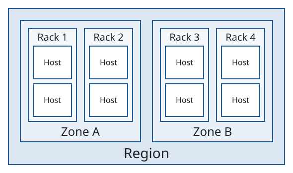
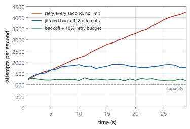
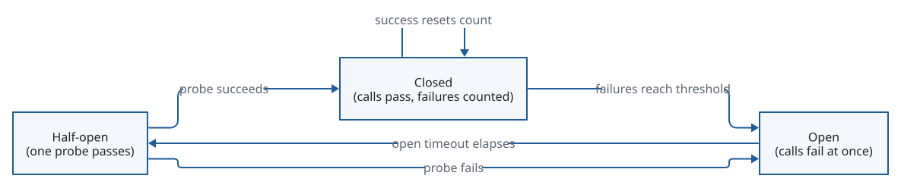
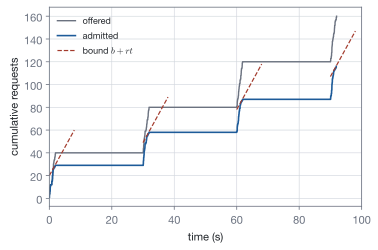
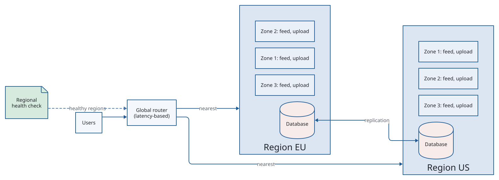

# Reliability and operations {#sec-reliability-and-operations}

The earlier chapters designed systems; this one is about keeping them working. Google's site reliability engineers put the starting point plainly: "100%
availability is impossible, near-100% availability is often readily achievable" [@beyer2016site, Ch. 4, "Indicators"], and the question is how much
unreliability to allow, how to contain it, and how to see it. This chapter defines service level objectives and error budgets, the fault-tolerance
patterns, rate limiting and load shedding, observability, safe change, multi-region deployment and the operational side of security.

The claims are of two kinds. The patterns are definitions; seven results with complete proofs make their arithmetic exact: how fast an error budget burns
and how early an alert sees it, how retries multiply load and how retry budgets and deadlines bound it, how often a circuit breaker opens and how many calls
it lets through, how many requests a token bucket or a window counter admits, how adaptive throttling and queue limits keep a server doing useful work,
what bucketed histograms and threshold alerts can and cannot say, how much a staged rollout exposes, and how many regions survive which losses. Continuous
integration and delivery pipelines and release engineering are left to the planned Fundamentals of Software Engineering tutorial; here canaries, flags and
rollbacks appear only as reliability mechanisms.

The sources are @beyer2016site, read in its free online edition [Chs. 3, 4, 6, 21 and 22], and the benchmark books: @tanAcingSystemDesign2024 [Secs. 1.4.5,
2.5, 3.2-3.3, 3.7, 3.9 and Ch. 8], @SystemDesignInterview2021 [Chs. 1, 4 and 6], @sinhaSystemDesignGuide2024 [Chs. 2 and 8], @liuSystemDesignInterview2020
[Chs. 5 and 6], @gilbertSoftwareArchitecturePatterns2024 [Chs. 7 and 9-12], @pachecoPrinciplesSoftwareArchitecture2024 [Chs. 2 and 7] and
@reisFundamentalsDataEngineering2022 [Chs. 3 and 10, App. B]. Probability inequalities are those of [Probability and
statistics](../../fundamentals-of-mathematics-for-physicists/probability/index.qmd#thm-chebyshev-inequality).

The chapter has seven sections. @sec-slos defines service level indicators, objectives and error budgets and proves how budgets burn. @sec-fault-tolerance
defines the fault-tolerance patterns and proves the load of retries and the behaviour of circuit breakers. @sec-overload defines rate limiting and load shedding
and proves what limiters admit and what throttling and queue limits achieve. @sec-observability defines logs, metrics, traces and alerts and proves what
histograms and alerts can tell. @sec-safe-change defines canaries, flags, rollbacks and chaos testing and proves the exposure of a rollout.
@sec-multi-region defines zones, regions, failover and recovery objectives and proves what regions buy. @sec-security-operations defines the operational
controls of security.

The running example is the photo service of the earlier chapters. Its feed API serves $5 \times 10^8$ requests a day, about $5800$ a second on average and
$1.2 \times 10^4$ at the peak, and calls the Accounts, Search and Notify services; uploads arrive at $2 \times 10^7$ a day.

Every definition and result is followed by ten examples and ten exercises, each exercise with a hidden solution in two tabs: the argument, then a computation with its
recorded output. The computations run in plain Python 3.12 with NumPy and SimPy, seeded. Diagrams are written in the D2 language. Monitoring queries, alert rules and
rollout configurations are shown as illustrative code and are not run.

## Service level objectives and error budgets {#sec-slos}

Reliability needs a number before it can be managed. The SRE book: "we define availability in terms of the request success rate" rather than uptime, because a
globally distributed service is almost never entirely down [@beyer2016site, Ch. 3, "Measuring Service Risk"]. This section defines faults and failures, service level
indicators, objectives and error budgets, building on the time-based availability of @def-availability, and proves how fast a budget burns and how much of it an alert
lets go before it fires.

For more on this topic, see @beyer2016site [Ch. 3, "Measuring Service Risk" and "Motivation for Error Budgets"; Ch. 4] and @tanAcingSystemDesign2024 [Secs. 3.2-3.3,
pp. 59-61].

### Faults, failures, indicators and budgets

A fault in one component becomes a failure of the service only if nothing contains it. Faults strike failure domains, which nest as in @fig-slo-domains; the
service level indicator counts the failures users see.

{#fig-slo-domains width=85%}

:::: {.statement-box}
::: {#def-slo}
#### Faults, failures, service level indicators, objectives and error budgets

1. A **fault** is a defect or an adverse event in a component: a crash, a lost packet, a full disk, a bug. A **failure** is a response, or a missing response, that
   deviates from what the service promises its users. A system is **fault tolerant** if it keeps providing its service, possibly degraded, when some of its components
   fail. A **failure domain** is a set of components that a single fault can take down together, such as a host, a rack, a zone or a region; the **blast radius** of a
   fault is the set of users or requests whose service it affects.
2. A **service level indicator** (SLI) is a measured quantity of the service. A **request-based** SLI over a window counts the $N$ valid requests and the $G$ good ones,
   those answered correctly and within a stated latency, and is $G/N$; its **error rate** is $1 - G/N$.
3. A **service level objective** (SLO) is a target $A^*$ for an SLI over windows of a stated length $\Delta$: $G/N \geq A^*$. Its **error budget** for a window with $N$
   valid requests is the number of failures the objective allows, $(1 - A^*)N$; a failure **spends** $1/((1 - A^*)N)$ of it.
4. The **burn rate** over a time interval is the interval's error rate divided by $1 - A^*$: a burn rate of $1$ spends exactly the budget over the window, a burn rate of
   $\beta$ spends it $\beta$ times as fast.
:::

::::

Item 1's fault tolerance is Tan's: "the ability of a system to continue operating if some of its components fail" [@tanAcingSystemDesign2024, Sec. 3.3, p. 60]; for
Sinha, a reliable system "can consistently provide its intended functionality, despite the occurrence of various failures and errors such as hardware failures, network
issues, software bugs, and human errors" [@sinhaSystemDesignGuide2024, Ch. 2, "Reliability"]. Items 2 and 3 are the SRE book's: "An SLI is a service level
indicator—a carefully defined quantitative measure of some aspect of the level of service that is provided", availability "is often defined in terms of the fraction
of well-formed requests that succeed, sometimes called yield", and "An SLO is a service level objective: a target value or range of values for a service level that
is measured by an SLI" [@beyer2016site, Ch. 4, "Indicators" and "Objectives"]. Its error budget is "a clear, objective metric that determines how unreliable the service
is allowed to be within a single quarter" [@beyer2016site, Ch. 3, "Forming Your Error Budget"]. The fault-failure distinction and the burn rate of item 4 are standard
terms that the sources read do not define.

:::: {.callout-note .examples-fold collapse="true" title="Examples"}
The feed API's objective, as item 3 writes it. A month of requests sets the budget.

::: {#exm-slo-feed}
#### An SLO for the feed

The feed SLO is: $99.9\%$ of valid feed requests over $30$ days succeed within $300\,\mathrm{ms}$. With $5 \times 10^8$ requests a day, $N = 1.5 \times 10^{10}$ and the
budget is $1.5 \times 10^7$ failed or slow requests a month.

```{.python .run}
N = 5e8 * 30
print(f"N = {N:.2e}, budget = {(1 - 0.999) * N:.2e} requests")
```

```{.text .run-output}
N = 1.50e+10, budget = 1.50e+07 requests
```
:::

The SRE book turns a target into a count. The count is item 3's budget.

::: {#exm-slo-sre-yield}
#### The SRE book's daily example

"A system that serves 2.5M requests in a day with a daily availability target of 99.99% can serve up to 250 errors and still hit its target for that given day"
[@beyer2016site, Ch. 3, "Measuring Service Risk"]: $(1 - 0.9999) \times 2.5 \times 10^6 = 250$.

```{.python .run}
print(round((1 - 0.9999) * 2.5e6))
```

```{.text .run-output}
250
```
:::

The SRE book's quarterly example spends part of a budget. The fraction is the ratio of error rates.

::: {#exm-slo-spend}
#### Spending a fifth of the budget

With an SLO of $99.999\%$ of queries per quarter, a problem that fails $0.0002\%$ of the quarter's queries "spends 20% of the service's quarterly error budget"
[@beyer2016site, Ch. 3, "Forming Your Error Budget"]: $0.000002/0.00001 = 0.2$.

```{.python .run}
print(round(0.000002 / (1 - 0.99999), 6))
```

```{.text .run-output}
0.2
```
:::

A latency SLI counts requests that were fast enough. The SRE book writes such objectives with several thresholds.

::: {#exm-slo-latency-sli}
#### Latency as an SLI

The SRE book's example: "90% of Get RPC calls will complete in less than 1 ms. 99% of Get RPC calls will complete in less than 10 ms. 99.9% of Get RPC calls will
complete in less than 100 ms" [@beyer2016site, Ch. 4, "Defining Objectives"]. Each line is an SLO of item 3 on a different SLI: the fraction of calls under a threshold.

```{.python .run}
import numpy as np
rng = np.random.default_rng(1201)
t = rng.lognormal(np.log(0.4), 0.6, 100000)        # milliseconds
for thr, target in ((1, 0.90), (10, 0.99), (100, 0.999)):
    print(thr, "ms:", round((t < thr).mean(), 4), ">=", target, (t < thr).mean() >= target)
```

```{.text .run-output}
1 ms: 0.9372 >= 0.9 True
10 ms: 1.0 >= 0.99 True
100 ms: 1.0 >= 0.999 True
```
:::

The two measures agree when traffic is steady. An outage at the peak costs more requests.

::: {#exm-slo-time-vs-request}
#### Time-based and request-based availability

A one-hour outage in a day is $1 - 1/24 = 95.8\%$ time-based availability (@def-availability). If the hour is the busiest, with $10\%$ of the day's requests, the
request-based SLI is $90\%$.

```{.python .run}
print(round(1 - 1/24, 4), 1 - 0.10)
```

```{.text .run-output}
0.9583 0.9
```
:::

Item 4 in numbers. An error rate ten times the allowed one burns the month in three days.

::: {#exm-slo-burn}
#### Burn rates

With $A^* = 99.9\%$, an error rate of $1\%$ is a burn rate of $10$: at that rate the $30$-day budget lasts $3$ days. An error rate of $0.05\%$ is a burn rate of $0.5$.

```{.python .run}
for e in (0.01, 0.0005):
    beta = e / (1 - 0.999); print(f"error rate {e}: burn {beta:.1f}, budget lasts {30 / beta:.1f} days")
```

```{.text .run-output}
error rate 0.01: burn 10.0, budget lasts 3.0 days
error rate 0.0005: burn 0.5, budget lasts 60.0 days
```
:::

An SLO is a target, not a minimum to beat by as much as possible. The SRE book's Chubby story shows why.

::: {#exm-slo-chubby}
#### Not exceeding the objective

Global Chubby was so reliable that "service owners began to add dependencies to Chubby assuming that it would never go down"; so SRE "makes sure that global Chubby
meets, but does not significantly exceed, its service level objective", synthesising a controlled outage in a quarter without a real one [@beyer2016site, Ch. 4, "The
Global Chubby Planned Outage"].
:::

Item 1's failure domains nest. A fault's domain bounds its blast radius.

::: {#exm-slo-failure-domains}
#### Failure domains of the photo service

A feed server's host is in a rack, the rack in a zone, the zone in a region. A crashed host takes out its own feed process; a rack's power fault takes out every host
in the rack; a zone's network fault every rack in it. Placing replicas in different racks or zones keeps each replica set from sharing a failure domain
(@fig-slo-domains).
:::

The window length is part of the objective. The SRE book uses quarters tracked weekly.

::: {#exm-slo-quarterly}
#### Why quarters

"Most often, we set quarterly availability targets for a service and track our performance against those targets on a weekly, or even daily, basis"
[@beyer2016site, Ch. 3, "Measuring Service Risk"]. A $99.9\%$ quarterly SLO on $4.5 \times 10^{10}$ requests allows $4.5 \times 10^7$ failures, three times a month's.

```{.python .run}
print(f"{(1 - 0.999) * 5e8 * 90:.1e}")
```

```{.text .run-output}
4.5e+07
```
:::

The error budget decides when to ship. Releases continue while budget remains.

::: {#exm-slo-releases}
#### The budget as a release policy

"As long as the uptime measured is above the SLO—in other words, as long as there is error budget remaining—new releases can be pushed"
[@beyer2016site, Ch. 3, "Forming Your Error Budget"]. A team that has spent $80\%$ of the month's budget by day $10$ slows its releases; one that has spent $10\%$ may take
more risk.
:::

::::

:::: {.callout-note .exercises-fold collapse="true" title="Exercises"}
The first exercise sizes budgets. Each nine divides the budget by ten.

::: {#exr-slo-budget-sizes}
#### Budgets for three targets

For the feed's $1.5 \times 10^{10}$ monthly requests, compute the error budget for $A^* = 99\%$, $99.9\%$ and $99.99\%$, and the equivalent downtime of a total outage
at average traffic.
:::

::: {.callout-note .solution collapse="true" title="Solution"}
:::: {.panel-tabset .solution-tabs}
## Solution

$1.5 \times 10^8$, $1.5 \times 10^7$ and $1.5 \times 10^6$ requests; at $5787$ requests a second these are $7.2$ hours, $43$ minutes and $4.3$ minutes of total outage, Tan's
table of downtime per month [@tanAcingSystemDesign2024, Sec. 3.2, Table 3.1, p. 59].

## Python

The budgets and their downtime.

```{.python .run}
N, rate = 1.5e10, 5e8 / 86400
for A in (0.99, 0.999, 0.9999):
    B = (1 - A) * N; print(f"{A}: {B:.1e} requests, {B / rate / 60:.1f} min")
```

```{.text .run-output}
0.99: 1.5e+08 requests, 432.0 min
0.999: 1.5e+07 requests, 43.2 min
0.9999: 1.5e+06 requests, 4.3 min
```
::::
:::

The second exercise spends budget with a partial failure. Only the failed fraction counts.

::: {#exr-slo-partial-outage}
#### A partial outage

Search is down for $2$ hours, and the feed degrades: $30\%$ of feed requests during those hours fail. What fraction of the month's $99.9\%$ budget is spent, at average
traffic?
:::

::: {.callout-note .solution collapse="true" title="Solution"}
:::: {.panel-tabset .solution-tabs}
## Solution

$0.3 \times 5787 \times 7200 = 1.25 \times 10^7$ failures, $83\%$ of the $1.5 \times 10^7$ budget.

## Python

The fraction.

```{.python .run}
f = 0.3 * 5e8 / 86400 * 7200
print(f"{f:.3e}, {f / 1.5e7:.2f} of the budget")
```

```{.text .run-output}
1.250e+07, 0.83 of the budget
```
::::
:::

The third exercise chooses what to count. The SLI should measure what users see.

::: {#exr-slo-sli-choice}
#### Choosing the SLI

The feed's servers report $99.95\%$ success, but $0.5\%$ of requests time out at the load balancer before reaching a server. Which SLI should the SLO use, and what is
it?
:::

::: {.callout-note .solution collapse="true" title="Solution"}
:::: {.panel-tabset .solution-tabs}
## Solution

Count at the load balancer, closer to the user: $(1 - 0.005) \times 0.9995 = 99.45\%$. The SRE book notes that "client-side latency is often the more user-relevant
metric, but it might only be possible to measure latency at the server" [@beyer2016site, Ch. 4, "Indicators"]; the server's SLI misses the timeouts entirely.

## Python

The combined success rate.

```{.python .run}
print(round((1 - 0.005) * 0.9995, 5))
```

```{.text .run-output}
0.9945
```
::::
:::

The fourth exercise compares a mean and a percentile. The SRE book's figure has a typical request at 50 ms and one in twenty twenty times slower.

::: {#exr-slo-average-hides}
#### Averages hide the tail

Requests take $50\,\mathrm{ms}$, except $5\%$ which take $1\,\mathrm{s}$. Compute the mean, the median and the $99$th percentile, and say which an SLO should use.
:::

::: {.callout-note .solution collapse="true" title="Solution"}
:::: {.panel-tabset .solution-tabs}
## Solution

Mean $97.5\,\mathrm{ms}$, median $50\,\mathrm{ms}$, $99$th percentile $1\,\mathrm{s}$. The SRE book: "a typical request is served in about 50 ms, 5% of requests are
20 times slower!" and an average "would show no change in behavior" [@beyer2016site, Ch. 4, "Aggregation"]; an SLO on the fraction of fast requests sees the slow
$5\%$.

## Python

The statistics.

```{.python .run}
import numpy as np
t = np.array([50] * 95 + [1000] * 5)
print(t.mean(), np.median(t), np.percentile(t, 99, method="inverted_cdf"))
```

```{.text .run-output}
97.5 50.0 1000
```
::::
:::

The fifth exercise derives a target for a dependency. Each dependency's failures add up.

::: {#exr-slo-composite}
#### An SLO across dependencies

A feed request needs Accounts, Search and Notify, whose failures make it fail and are independent. If the feed's own code fails $0.02\%$ of requests, what availability
must each dependency have, equally, for the feed to meet $99.9\%$ (@prp-series-parallel-availability)?
:::

::: {.callout-note .solution collapse="true" title="Solution"}
:::: {.panel-tabset .solution-tabs}
## Solution

$0.9998\,a^3 \geq 0.999$ gives $a \geq 0.99973$: each dependency needs a tighter objective than the feed's. Equivalently, the feed's $0.1\%$ budget is shared among four
sources.

## Python

The required availability.

```{.python .run}
print(round((0.999 / 0.9998) ** (1 / 3), 6))
```

```{.text .run-output}
0.999733
```
::::
:::

The sixth exercise uses item 4. A burn rate is a speed.

::: {#exr-slo-burn-days}
#### How long a budget lasts

Over the first $5$ days of the month the feed failed $0.2\%$ of requests. What is the burn rate, how much budget is left, and at that rate when is it exhausted?
:::

::: {.callout-note .solution collapse="true" title="Solution"}
:::: {.panel-tabset .solution-tabs}
## Solution

$\beta = 0.002/0.001 = 2$; five days at burn $2$ spend $10/30 = 1/3$ of the budget, leaving $2/3$, which lasts another $10$ days at the same rate: day $15$.

## Python

The arithmetic.

```{.python .run}
beta = 0.002 / 0.001; spent = beta * 5 / 30
print(beta, round(1 - spent, 3), round(5 + (1 - spent) * 30 / beta, 1))
```

```{.text .run-output}
2.0 0.667 15.0
```
::::
:::

The seventh exercise writes an SLO for a write path. Durability is a separate indicator.

::: {#exr-slo-uploads}
#### An SLO for uploads

Write an SLO for uploads with an availability target and a latency threshold, compute its monthly budget, and name a second indicator a storage service needs.
:::

::: {.callout-note .solution collapse="true" title="Solution"}
:::: {.panel-tabset .solution-tabs}
## Solution

For example: $99.95\%$ of valid uploads over $30$ days are acknowledged within $2\,\mathrm{s}$; with $6 \times 10^8$ uploads, the budget is $3 \times 10^5$. The second
indicator is durability, "the likelihood that data will be retained over a long period of time", which the SRE book calls "equally important for data storage
systems" [@beyer2016site, Ch. 4, "Indicators"].

## Python

The budget.

```{.python .run}
print(f"{(1 - 0.9995) * 2e7 * 30:.1e}")
```

```{.text .run-output}
3.0e+05
```
::::
:::

The eighth exercise prunes a list of objectives. The SRE book argues for few.

::: {#exr-slo-few}
#### As few SLOs as possible

A team proposes eight SLOs for the feed: availability, p50, p90, p99, p99.9 latency, CPU below $70\%$, memory below $80\%$, and cache hit ratio above $90\%$. Which keep?
:::

::: {.callout-note .solution collapse="true" title="Solution"}
:::: {.panel-tabset .solution-tabs}
## Solution

Keep availability and one or two latency objectives (p99, perhaps p50); CPU, memory and hit ratio are causes, not what users see, and belong to monitoring. The SRE
book: "Have as few SLOs as possible ... if you can't ever win a conversation about priorities by quoting a particular SLO, it's probably not worth having that SLO"
[@beyer2016site, Ch. 4, "Choosing Targets"].

## Python

Classifying the proposals.

```{.python .run}
user_visible = {"availability", "p50", "p90", "p99", "p99.9"}
proposals = ["availability", "p50", "p90", "p99", "p99.9", "cpu", "memory", "hit ratio"]
print([p for p in proposals if p in user_visible], [p for p in proposals if p not in user_visible])
```

```{.text .run-output}
['availability', 'p50', 'p90', 'p99', 'p99.9'] ['cpu', 'memory', 'hit ratio']
```
::::
:::

The ninth exercise compares blast radii. Spreading users across domains shrinks each fault's share.

::: {#exr-slo-blast}
#### Blast radius by domain

The feed runs on $40$ hosts in $8$ racks, $5$ hosts a rack, and each request goes to a random host. What fraction of requests does a host fault affect, and a rack fault?
How should a rack's capacity be planned?
:::

::: {.callout-note .solution collapse="true" title="Solution"}
:::: {.panel-tabset .solution-tabs}
## Solution

$1/40 = 2.5\%$ and $5/40 = 12.5\%$, until the load balancer stops routing to the failed hosts (@def-load-balancer). The other seven racks must absorb an eighth more load,
so each runs below $7/8$ of its capacity.

## Python

The fractions.

```{.python .run}
print(1 / 40, 5 / 40, 7 / 8)
```

```{.text .run-output}
0.025 0.125 0.875
```
::::
:::

The tenth exercise turns the budget into rules. The SRE book suggests slowing rather than stopping.

::: {#exr-slo-budget-policy}
#### A budget policy

Write a three-tier release policy for the feed in terms of the fraction of the month's budget spent and the fraction of the month elapsed.
:::

::: {.callout-note .solution collapse="true" title="Solution"}
:::: {.panel-tabset .solution-tabs}
## Solution

For example: spent below elapsed, release freely; spent above elapsed but below $100\%$, release only fixes and low-risk changes, more slowly; spent $100\%$, freeze
features until the window rolls. The SRE book prefers such graded measures to "this simple on/off technique: for instance, slowing down releases or rolling them back
when the SLO-violation error budget is close to being used up" [@beyer2016site, Ch. 3, "Benefits"].

## Python

The policy as a function.

```{.python .run}
def policy(spent, elapsed):
    return "freeze" if spent >= 1 else "slow" if spent > elapsed else "normal"
print(policy(0.2, 0.5), policy(0.7, 0.5), policy(1.0, 0.8))
```

```{.text .run-output}
normal slow freeze
```
::::
:::

::::

### How budgets burn and when alerts fire

An alert on the burn rate watches how fast the budget goes, not whether it is gone. The proposition computes the spending of an incident, the time a budget lasts,
the budget an averaging alert lets go before it fires, and the gap between time-based and request-based availability.

:::: {.statement-box}
::: {#prp-error-budget}
#### Spending, burning and detecting

Let a window of length $\Delta$ have $N$ valid requests, an SLO $A^*$ and budget $B = (1 - A^*)N$, and let requests arrive at the constant rate $\lambda = N/\Delta$ unless
stated otherwise.

(a) An incident that fails a fraction $\varphi$ of requests for a time $\tau$ spends the fraction $\varphi\tau/((1 - A^*)\Delta)$ of the budget.

(b) If the error rate is the constant $e$ from time $0$, with burn rate $\beta = e/(1 - A^*)$, the fraction of the budget spent by time $t$ is $\beta t/\Delta$, and the budget
is exhausted at $\Delta/\beta$.

(c) Let an alert fire at the first time $t$ at which the burn rate averaged over $[t - w, t]$ is at least $\beta_0$, where the burn rate is $0$ before time $0$ and the constant
$\beta \geq \beta_0$ from time $0$. Then it fires at $t = w\beta_0/\beta$, having let the fraction $\beta_0w/\Delta$ of the budget be spent, whatever $\beta$ is.

(d) If requests arrive at a rate $\lambda(t) > 0$ and a request fails exactly when the service is down, $X(t) = 0$ in the notation of @def-availability, then the
request-based SLI over $[0, \Delta]$ is $\int_0^\Delta\lambda(t)X(t)\,dt/\int_0^\Delta\lambda(t)\,dt$. It equals the time-based availability $A_\Delta$ when $\lambda$ is
constant, and is smaller than it when the downtime falls where $\lambda$ is above its average, in the sense that $\lambda(t) > N/\Delta$ for almost every $t$ with $X(t) = 0$.
:::

::::

*Proof.* (a) The incident fails $\varphi\lambda\tau = \varphi N\tau/\Delta$ requests, each spending $1/B$; the total is $\varphi N\tau/(\Delta(1 - A^*)N)$.

(b) By time $t$, $e\lambda t$ requests have failed, the fraction $e\lambda t/((1 - A^*)N) = \beta t/\Delta$ of the budget, which reaches $1$ at $t = \Delta/\beta$.

(c) For $0 \leq t \leq w$ the average burn rate over $[t - w, t]$ is $(\beta t + 0 \cdot (w - t))/w = \beta t/w$, increasing in $t$, and for $t \geq w$ it is $\beta$. It first reaches
$\beta_0 \leq \beta$ at $t = w\beta_0/\beta \leq w$. By (b) the fraction spent is $\beta t/\Delta = \beta_0w/\Delta$.

(d) A request arriving at $t$ is good if and only if $X(t) = 1$, so $G = \int\lambda X$ and $N = \int\lambda$. If $\lambda \equiv \bar\lambda$, the ratio is $\int X/\Delta = A_\Delta$. In
general, with $\bar\lambda = N/\Delta$, $N(1 - G/N) = \int\lambda(1 - X) > \bar\lambda\int(1 - X) = N(1 - A_\Delta)$ when $\lambda > \bar\lambda$ almost everywhere on $\{X = 0\}$ and
that set has positive length, so $G/N < A_\Delta$. $\square$

Part (c) is why fast-burn alerts use short windows and high thresholds: the budget an alert lets go is $\beta_0w/\Delta$, set by the alert's own parameters. Part (d) is the SRE
book's reason for preferring request counts: an hour down at night and an hour down at the peak are the same in time and very different to users.

:::: {.callout-note .examples-fold collapse="true" title="Examples"}
The outage of @exr-slo-partial-outage, by the formula. The result matches the count.

::: {#exm-eb-incident}
#### Part (a) for the search outage

$\varphi = 0.3$, $\tau = 2\,\mathrm{h}$, $\Delta = 720\,\mathrm{h}$, $1 - A^* = 0.001$: $0.3 \times 2/(0.001 \times 720) = 0.83$ of the budget.

```{.python .run}
print(round(0.3 * 2 / (0.001 * 720), 3))
```

```{.text .run-output}
0.833
```
:::

A steady error rate exhausts the budget at a predictable time. The time is the window divided by the burn rate.

::: {#exm-eb-lasts}
#### Part (b): days until exhaustion

Burn rates $1$, $2$, $14.4$ and $36$ exhaust a $30$-day budget in $30$ days, $15$ days, $50$ hours and $20$ hours.

```{.python .run}
for beta in (1, 2, 14.4, 36): print(beta, round(30 * 24 / beta, 1), "hours")
```

```{.text .run-output}
1 720.0 hours
2 360.0 hours
14.4 50.0 hours
36 20.0 hours
```
:::

Two alerts watch different speeds. Each lets a fixed fraction go before it fires.

::: {#exm-eb-alert}
#### Part (c) for two alerts

A fast alert with $w = 1\,\mathrm{h}$ and $\beta_0 = 14.4$ lets $14.4/720 = 2\%$ of a $30$-day budget go; a slow one with $w = 6\,\mathrm{h}$ and $\beta_0 = 6$ lets $6 \times 6/720 = 5\%$
go. For a burn rate of $36$ the fast one fires after $24$ minutes.

```{.python .run}
for w, b0 in ((1, 14.4), (6, 6)): print(w, b0, "spent at firing:", round(b0 * w / 720, 3))
print("fires after", 1 * 14.4 / 36 * 60, "min at burn 36")
```

```{.text .run-output}
1 14.4 spent at firing: 0.02
6 6 spent at firing: 0.05
fires after 24.0 min at burn 36
```
:::

Traffic follows the day. An outage at the peak costs twice an outage at the trough.

::: {#exm-eb-peak}
#### Part (d) with a daily cycle

With $\lambda(t) = \bar\lambda(1 + 0.5\sin(2\pi t/24\,\mathrm{h}))$, one hour down at the peak and one at the trough both give $A_\Delta = 0.9583$ over a day; the request-based
SLIs are $0.9376$ and $0.9791$.

```{.python .run}
import numpy as np
t = np.linspace(0, 24, 240001)[:-1]; lam = 1 + 0.5 * np.sin(2 * np.pi * t / 24)
for name, centre in (("peak", 6), ("trough", 18)):
    up = np.abs(t - centre) >= 0.5
    print(name, round(up.mean(), 4), round((lam * up).sum() / lam.sum(), 4))
```

```{.text .run-output}
peak 0.9583 0.9376
trough 0.9583 0.9791
```
:::

Part (b) with random failures. The spent fraction tracks the formula.

::: {#exm-eb-simulated}
#### A budget burned by a simulated day

Simulating $5 \times 10^8$ requests a day failing independently at $0.2\%$ for $5$ days spends a third of the $99.9\%$ budget, as part (b) predicts for $\beta = 2$.

```{.python .run}
import numpy as np
rng = np.random.default_rng(1202)
fails = rng.binomial(int(5e8), 0.002, size=5).sum()
print(round(fails / (0.001 * 5e8 * 30), 4), "vs", round(2 * 5 / 30, 4))
```

```{.text .run-output}
0.3333 vs 0.3333
```
:::

Part (a) for the SRE book's daily target. A ten-minute total outage exceeds it.

::: {#exm-eb-sre-yield-day}
#### A one-day window

With $2.5 \times 10^6$ requests a day and $99.99\%$, a total outage of $10$ minutes fails $17\,361$ requests, $69$ times the budget of $250$.

```{.python .run}
lam = 2.5e6 / 86400
print(round(lam * 600), round(lam * 600 / 250, 1))
```

```{.text .run-output}
17361 69.4
```
:::

Part (c) suggests two kinds of alert. Fast burns page; slow burns open tickets.

::: {#exm-eb-ticket-page}
#### Pages and tickets

A burn rate of $14.4$ exhausts the month in $50$ hours: someone must act now, so the fast alert pages. A burn rate of $1.5$ exhausts it in $20$ days: a ticket handled in working
hours suffices. The SRE book distinguishes alerts that are "pages" from "tickets" [@beyer2016site, Ch. 6, "Definitions"].
:::

Part (c)'s alert written as a rule. The expression divides an error rate by the allowed one.

::: {#exm-eb-prometheus}
#### The alert as a monitoring rule

A rule in the Prometheus style; the metric names are illustrative.

```{.yaml .illustrative}
groups:
- name: feed-slo
  rules:
  - alert: FeedErrorBudgetFastBurn
    expr: |
      (sum(rate(http_requests_total{job="feed",code=~"5.."}[1h]))
        / sum(rate(http_requests_total{job="feed"}[1h]))) / 0.001 > 14.4
    labels: {severity: page}
```

:::

Combining parts (a) and (b). Incidents subtract from what a steady rate would leave.

::: {#exm-eb-remaining}
#### Budget remaining in the middle of the month

A background error rate of $0.03\%$ (burn $0.3$) for $15$ days spends $15\%$; the search outage of @exm-eb-incident adds $83\%$; $2\%$ remains for the second half.

```{.python .run}
print(round(1 - 0.3 * 15 / 30 - 0.833, 3))
```

```{.text .run-output}
0.017
```
:::

Part (c) has a trade-off. A longer window fires later on a fast burn but is less noisy.

::: {#exm-eb-window-tradeoff}
#### Window length and detection time

For $\beta = 36$ and $\beta_0 = 14.4$: $w = 5\,\mathrm{min}$ fires after $2$ minutes, $w = 1\,\mathrm{h}$ after $24$ minutes. With few requests per window, a short window's
error rate is noisy, and an alert on it fires by chance.

```{.python .run}
for w in (5, 60): print(w, "min window fires after", round(w * 14.4 / 36, 1), "min")
```

```{.text .run-output}
5 min window fires after 2.0 min
60 min window fires after 24.0 min
```
:::

::::

:::: {.callout-note .exercises-fold collapse="true" title="Exercises"}
The first exercise adds incidents. Spending is additive.

::: {#exr-eb-two-incidents}
#### Two incidents

In a $30$-day $99.9\%$ window, a deploy fails $5\%$ of requests for $20$ minutes and a database failover fails all requests for $90$ seconds. What fraction of the budget is spent?
:::

::: {.callout-note .solution collapse="true" title="Solution"}
:::: {.panel-tabset .solution-tabs}
## Solution

By part (a), $0.05 \times 20/(0.001 \times 43\,200) = 0.023$ and $1 \times 1.5/(0.001 \times 43\,200) = 0.035$: $5.8\%$ in all.

## Python

The sum.

```{.python .run}
D = 30 * 24 * 60
print(round(0.05 * 20 / (0.001 * D) + 1 * 1.5 / (0.001 * D), 4))
```

```{.text .run-output}
0.0579
```
::::
:::

The second exercise varies part (c). A short burst may never fire the alert.

::: {#exr-eb-proof-c-late}
#### Part (c) when the burn stops

Show that if the burn rate is $\beta$ on $[0, \delta]$ and $0$ afterwards, an alert of part (c) fires if and only if $\beta\min(\delta, w) \geq \beta_0w$, and compute the budget a
burst that just fails to fire can spend.
:::

::: {.callout-note .solution collapse="true" title="Proof"}
:::: {.panel-tabset .solution-tabs}
## Proof

The average over $[t - w, t]$ is $\beta|[0, \delta] \cap [t - w, t]|/w$, whose maximum over $t$ is $\beta\min(\delta, w)/w$; the alert fires iff this is at least $\beta_0$. A burst
with $\delta \leq w$ and $\beta\delta < \beta_0w$ never fires and spends $\beta\delta/\Delta < \beta_0w/\Delta$: below the same fraction as in part (c). Bursts above it fire.

## Python

Scanning bursts of burn $100$ for a one-hour window with threshold $14.4$.

```{.python .run}
w, b0, beta = 60, 14.4, 100
for delta in (5, 8, 9, 30):
    fires = beta * min(delta, w) >= b0 * w; print(delta, "min:", fires, "spent", round(beta * delta / 43200, 4))
```

```{.text .run-output}
5 min: False spent 0.0116
8 min: False spent 0.0185
9 min: True spent 0.0208
30 min: True spent 0.0694
```
::::
:::

The third exercise picks parameters. Each alert's lost budget is fixed by part (c).

::: {#exr-eb-design-alerts}
#### Designing a pair of alerts

Choose $(w, \beta_0)$ for a paging alert that lets at most $2\%$ of a $30$-day budget go and fires within $5$ minutes for a total outage ($\beta = 1000$), and for a ticket alert that
lets at most $10\%$ go.
:::

::: {.callout-note .solution collapse="true" title="Solution"}
:::: {.panel-tabset .solution-tabs}
## Solution

Paging: $\beta_0w \leq 0.02 \times 720\,\mathrm{h} = 14.4\,\mathrm{h}$ and $w\beta_0/1000 \leq 5\,\mathrm{min}$; $w = 1\,\mathrm{h}$, $\beta_0 = 14.4$ fires in $52\,\mathrm{s}$. Ticket:
$\beta_0w \leq 72\,\mathrm{h}$, for example $w = 3$ days, $\beta_0 = 1$.

## Python

Checking both.

```{.python .run}
for w, b0 in ((1, 14.4), (72, 1)): print(w, b0, "spent", b0 * w / 720, "fires at burn 1000 after", round(w * b0 / 1000 * 3600), "s")
```

```{.text .run-output}
1 14.4 spent 0.02 fires at burn 1000 after 52 s
72 1 spent 0.1 fires at burn 1000 after 259 s
```
::::
:::

The fourth exercise prices noise. Few requests make the measured error rate jumpy.

::: {#exr-eb-noise}
#### Noise in a short window

With $10^3$ requests in a $5$-minute window and a true error rate of $0.1\%$, how often does the measured burn rate reach $14.4$, that is $15$ or more failures (@prp-quantile-estimate (d) gives the count's law)?
:::

::: {.callout-note .solution collapse="true" title="Solution"}
:::: {.panel-tabset .solution-tabs}
## Solution

The failures are $\operatorname{Bin}(1000, 0.001)$ with mean $1$; $\mathbb P(\geq 15) \approx 2.7 \times 10^{-13}$: never. At $10$ requests in the window, one failure is a burn rate of $100$, and
a threshold on so few requests fires on chance alone.

## Python

The binomial tail.

```{.python .run}
from math import comb
p = sum(comb(1000, k) * 0.001**k * 0.999**(1000 - k) for k in range(15, 1001))
print(f"{p:.1e}", "| with 10 requests, P(>=1 failure) =", round(1 - 0.999**10, 4))
```

```{.text .run-output}
2.7e-13 | with 10 requests, P(>=1 failure) = 0.01
```
::::
:::

The fifth exercise applies part (d). Weekends are quieter than weekdays.

::: {#exr-eb-request-weighted}
#### Part (d) for a weekly outage

Traffic on weekdays is twice that on weekends. A $4$-hour maintenance on Saturday and one on Tuesday: compare the week's time-based and request-based availabilities.
:::

::: {.callout-note .solution collapse="true" title="Solution"}
:::: {.panel-tabset .solution-tabs}
## Solution

Time-based: $1 - 4/168 = 97.6\%$ either way. Weekly requests $\propto 5 \times 2 + 2 \times 1 = 12$ days of weekend traffic; Saturday's outage costs $4/24$ of one weekend day,
$1.4\%$; Tuesday's costs $2 \times 4/24$, $2.8\%$. Maintenance belongs on Saturday.

## Python

The fractions.

```{.python .run}
print(round(1 - 4 / 168, 4), round(1 - (4 / 24) / 12, 4), round(1 - (2 * 4 / 24) / 12, 4))
```

```{.text .run-output}
0.9762 0.9861 0.9722
```
::::
:::

The sixth exercise asks when the two availabilities agree. Constant traffic is sufficient but not necessary.

::: {#exr-eb-proof-d-equality}
#### When part (d) is an equality

Show that the request-based SLI equals $A_\Delta$ if and only if the average of $\lambda$ over the downtime equals its average over the window.
:::

::: {.callout-note .solution collapse="true" title="Proof"}
:::: {.panel-tabset .solution-tabs}
## Proof

$1 - G/N = \int\lambda(1 - X)/\int\lambda$ and $1 - A_\Delta = \int(1 - X)/\Delta$. Their ratio is $\bigl(\int\lambda(1 - X)/\int(1 - X)\bigr)/\bigl(\int\lambda/\Delta\bigr)$, the mean
of $\lambda$ over the downtime divided by its mean over the window; the two are equal iff this is $1$.

## Python

An outage straddling the peak symmetrically, with the mean rate over it equal to the day's.

```{.python .run}
import numpy as np
t = np.linspace(0, 24, 240001)[:-1]; lam = 1 + 0.5 * np.sin(2 * np.pi * t / 24)
down = (t < 0.5) | (t >= 23.5) | (t >= 11.5) & (t < 12.5)   # centred on the zero crossings: mean rate exactly 1
X = ~down
print(round(X.mean(), 5), round((lam * X).sum() / lam.sum(), 5))
```

```{.text .run-output}
0.91667 0.91667
```
::::
:::

The seventh exercise compares window lengths. A long window forgives a bad week.

::: {#exr-eb-budget-quarter}
#### Monthly and quarterly windows

A bad week spends $60\%$ of a monthly $99.9\%$ budget. What fraction of a quarterly budget with the same target is that, and what is the risk of a long window?
:::

::: {.callout-note .solution collapse="true" title="Solution"}
:::: {.panel-tabset .solution-tabs}
## Solution

The quarter's budget is three months', so $20\%$. The risk is the converse: a long window lets a service stay poor for weeks while still within its objective, which is why
the SRE book tracks quarterly targets "on a weekly, or even daily, basis" [@beyer2016site, Ch. 3, "Measuring Service Risk"].

## Python

The ratio.

```{.python .run}
print(round(0.6 / 3, 3))
```

```{.text .run-output}
0.2
```
::::
:::

The eighth exercise budgets slow requests. The same arithmetic applies to latency SLIs.

::: {#exr-eb-latency-budget}
#### A latency budget

The feed's latency SLO is $99\%$ of requests within $300\,\mathrm{ms}$ over a month. A deploy makes $8\%$ of requests slow for $3$ hours. What fraction of the latency budget is
spent?
:::

::: {.callout-note .solution collapse="true" title="Solution"}
:::: {.panel-tabset .solution-tabs}
## Solution

By part (a) with $1 - A^* = 0.01$: $0.08 \times 3/(0.01 \times 720) = 3.3\%$.

## Python

The fraction.

```{.python .run}
print(round(0.08 * 3 / (0.01 * 720), 4))
```

```{.text .run-output}
0.0333
```
::::
:::

The ninth exercise checks part (c) with random failures. The alert fires near the predicted time.

::: {#exr-eb-sim-alert}
#### Part (c) by simulation

Simulate per-minute failure counts at $100$ requests a second, a burn rate of $36$ starting at minute $0$, and a one-hour averaging alert with threshold $14.4$; compare its firing
time with part (c)'s $24$ minutes.
:::

::: {.callout-note .solution collapse="true" title="Solution"}
:::: {.panel-tabset .solution-tabs}
## Solution

The counts are binomial around their means, so the averaged burn crosses $14.4$ within a minute or so of $24$.

## Python

The simulation.

```{.python .run}
import numpy as np
rng = np.random.default_rng(1203)
n = 6000                                       # requests per minute
fails = np.concatenate([rng.binomial(n, 0.0001, 60), rng.binomial(n, 0.036, 120)])   # an hour of normal traffic, then burn 36
for t in range(60, 180):
    if fails[t - 59:t + 1].sum() / (60 * n) / 0.001 >= 14.4:
        print("fires at minute", t - 59); break
```

```{.text .run-output}
fires at minute 24
```
::::
:::

The tenth exercise assigns spending to a cause. A dependency's outage spends the caller's budget too.

::: {#exr-eb-upstream}
#### Whose budget

Notify was down for $1$ hour and the feed, which calls it synchronously, failed all requests meanwhile. How much of the feed's month is spent, and what design change would
have spent none?
:::

::: {.callout-note .solution collapse="true" title="Solution"}
:::: {.panel-tabset .solution-tabs}
## Solution

$1/(0.001 \times 720) = 1.39$: more than the whole budget. The SRE book is explicit that outages outside the team's control "also eat into the error budget"
[@beyer2016site, Ch. 3, "Benefits"]. Calling Notify asynchronously, or degrading to a feed without notifications, would have spent nothing.

## Python

The fraction.

```{.python .run}
print(round(1 / (0.001 * 720), 3))
```

```{.text .run-output}
1.389
```
::::
:::

::::

## Fault tolerance {#sec-fault-tolerance}

Faults are certain; failures are not. Tan's fault-tolerance techniques let "our system ... maintain some functionality when parts of it fail, rather than a complete
catastrophic failure" [@tanAcingSystemDesign2024, Sec. 3.3, p. 60]. This section defines timeouts and deadlines, retry policies, circuit breakers, bulkheads, fallbacks
and cascading failures, building on the retries and backoff of @def-failure-handling, and proves how retries multiply load, how budgets and deadlines bound it, and
how often a breaker opens and what it lets through.

For more on this topic, see @tanAcingSystemDesign2024 [Sec. 3.3, pp. 60-65], @beyer2016site [Ch. 21, "Handling Overload Errors"; Ch. 22],
@liuSystemDesignInterview2020 [Ch. 5, "Timeout" and "Exponential Backoff"] and @gilbertSoftwareArchitecturePatterns2024 [Ch. 7, "Egress – circuit breaker"].

### Timeouts, retry policies, breakers, bulkheads and fallbacks

Each pattern limits what one failing dependency can do to its callers. The circuit breaker is a small state machine, drawn in @fig-ftol-breaker.

Retries are the other half: @fig-ftol-storm shows what three retry policies do to an overloaded backend.

{#fig-ftol-storm width=80%}

{#fig-ftol-breaker width=80%}

:::: {.statement-box}
::: {#def-fault-tolerance}
#### Timeouts, retry policies, circuit breakers, bulkheads, fallbacks and cascading failures

1. A **timeout** bounds how long a caller waits for a response before treating the call as failed. A **deadline** is an absolute time by which a request's answer is
   useful; with **deadline propagation** every call made on behalf of the request carries the same absolute deadline, so a callee knows the time remaining.
2. A **retry policy** decides which failed calls to repeat and how. Besides backoff and jitter (@def-failure-handling (1)), it limits **attempts per request**, keeps a
   **retry budget** bounding the ratio of retries to requests sent, retries only **retriable** errors, and retries only at the layer immediately above the one that
   failed; a server that is overloaded can answer that the caller should not retry.
3. A **circuit breaker** wraps calls to a dependency. While **closed** it passes calls and counts failures; when the failures reach a threshold it **opens** and fails
   calls at once without making them; after an **open timeout** it becomes **half-open** and lets a probe call through, closing if the probe succeeds and opening again if
   it fails.
4. A **bulkhead** divides a service's resources, such as threads, connections or hosts, into isolated pools, each serving one kind of request or one class of caller,
   so that exhausting one pool leaves the others working.
5. A **fallback** replaces a failed call by an alternative result, such as a cached or default response or another provider's; **graceful degradation** serves
   cheaper or partial responses so that the service keeps some function under failure or overload.
6. A **cascading failure** is a failure that grows by positive feedback: the failure of part of a system raises the load on, or otherwise the probability of failure
   of, the remaining parts.
:::

::::

Item 1's timeouts are Liu's: "Since you may never get a response back, the client shouldn't be sitting there waiting" [@liuSystemDesignInterview2020, Ch. 5,
"Timeout"]; deadline propagation is the SRE book's: "The tree of RPCs emanating from an initial request will all have the same absolute deadline" [@beyer2016site, Ch. 22,
"Deadline propagation"]. Item 2 follows the SRE book's mechanisms: "a per-request retry budget of up to three attempts", "a per-client retry budget. Each client keeps
track of the ratio of requests that correspond to retries", "requests should only be retried at the layer immediately above the layer that is rejecting them", and an
"overloaded; don't retry" error [@beyer2016site, Ch. 21, "Deciding to Retry"]. Item 3 is Gilbert's state machine: "When the calls reach the failure threshold, then the
circuit breaker transitions to the open state ... After the timeout period, the circuit breaker transitions to the half-open state" [@gilbertSoftwareArchitecturePatterns2024,
Ch. 7, "Egress – circuit breaker"], and Tan's: it "stops a client from repeatedly attempting an operation that is likely to fail" [@tanAcingSystemDesign2024, Sec. 3.3.3,
p. 61]. Item 4 is Tan's: "a system is divided into isolated pools, so a fault in one pool will not affect the entire system" [@tanAcingSystemDesign2024, Sec. 3.3.9,
p. 63]. Item 5 combines Tan's fallback, "detecting a problem and then executing an alternative code path, such as cached responses or alternative services"
[@tanAcingSystemDesign2024, Sec. 3.3.10, p. 64], with the SRE book's degraded responses, "not as accurate as or that contain less data than normal responses, but that
are easier to compute" [@beyer2016site, Ch. 21]. Item 6 is the SRE book's: "A cascading failure is a failure that grows over time as a result of positive feedback"
[@beyer2016site, Ch. 22].

:::: {.callout-note .examples-fold collapse="true" title="Examples"}
Liu's trade-off in numbers. A timeout shorter than the work wastes it.

::: {#exm-ftol-timeout-tradeoff}
#### Choosing a timeout

If processing takes $60\,\mathrm{s}$ and the timeout is $50\,\mathrm{s}$, "The system just wasted 50 seconds. If the client had waited 10 more seconds, they could've gotten the
result" [@liuSystemDesignInterview2020, Ch. 5, "Timeout"]. For the feed, whose calls to Search take under $80\,\mathrm{ms}$ in $99.9\%$ of cases, a $250\,\mathrm{ms}$
timeout wastes little and frees the caller quickly.
:::

The SRE book's numbers for item 1. Each hop subtracts the time already spent.

::: {#exm-ftol-deadline}
#### Deadline propagation in the SRE book

"If server A selects a 30-second deadline, and processes the request for 7 seconds before sending an RPC to server B, the RPC from A to B will have a 23-second deadline.
If server B takes 4 seconds ... the RPC from B to C will have a 19-second deadline" [@beyer2016site, Ch. 22, "Deadline propagation"].

```{.python .run}
deadline, spent = 30, 0
for server, work in (("A", 7), ("B", 4)):
    spent += work; print(f"{server} -> next: {deadline - spent} s left")
```

```{.text .run-output}
A -> next: 23 s left
B -> next: 19 s left
```
:::

Item 2's layering rule prevents multiplication. The messaging chapter computed the alternative.

::: {#exm-ftol-layers}
#### Retrying at one layer

If the browser, the frontend and the feed each make $4$ attempts at a failing call, the database sees $4^3 = 64$ attempts per user action (@prp-retry-dlq (d)); the SRE
book's example is exactly this: "a single user action may create 64 attempts (4^3) on the database" [@beyer2016site, Ch. 22, "Retries"]. Retrying only at the feed, the
layer above the database, gives $4$.

```{.python .run}
print(4 ** 3, "vs", 4)
```

```{.text .run-output}
64 vs 4
```
:::

Item 3 run on a short trace. The breaker opens after three failures and recovers by a probe.

::: {#exm-ftol-breaker-trace}
#### A breaker on a trace

With a threshold of $3$ consecutive failures and an open timeout of $5\,\mathrm{s}$, calls once a second to a dependency down from $t = 2$ to $t = 9$:

```{.python .run}
class Breaker:
    """Opens after k consecutive failures, stays open T_o, then lets one probe through."""
    def __init__(self, k, T_o): self.k, self.T_o, self.fails, self.opened = k, T_o, 0, None
    def allow(self, t): return self.opened is None or t >= self.opened + self.T_o
    def record(self, t, ok):
        if ok: self.fails, self.opened = 0, None
        elif self.opened is not None: self.opened = t           # failed probe: open again
        else:
            self.fails += 1
            if self.fails >= self.k: self.opened = t
b, log = Breaker(3, 5), []
for t in range(16):
    if not b.allow(t): log.append(f"{t}:fast-fail"); continue
    ok = not (2 <= t <= 9); b.record(t, ok); log.append(f"{t}:{'ok' if ok else 'FAIL'}")
print(" ".join(log))
```

```{.text .run-output}
0:ok 1:ok 2:FAIL 3:FAIL 4:FAIL 5:fast-fail 6:fast-fail 7:fast-fail 8:fast-fail 9:FAIL 10:fast-fail 11:fast-fail 12:fast-fail 13:fast-fail 14:ok 15:ok
```
:::

Tan's first bulkhead example. Each endpoint gets its own thread pool.

::: {#exm-ftol-bulkhead-pools}
#### Bulkheads by endpoint

The feed service gives $60$ threads to feed reads and $20$ to profile reads, instead of a shared pool of $80$. When Accounts hangs and every profile read blocks, the $20$
profile threads fill and the $60$ feed threads keep serving: "if an endpoint's thread pool is exhausted, this will not affect the ability of other endpoints to serve
requests" [@tanAcingSystemDesign2024, Sec. 3.3.9, p. 63].
:::

Item 5 for each dependency of the feed. The fallback depends on what the user can do without.

::: {#exm-ftol-fallback-feed}
#### Fallbacks for the feed

If Search is down, show the feed without the "related" panel; if Notify is down, skip the unread count; if Accounts is down, use the cached profile names. Tan prefers
"graceful degradation instead of crashing or returning an error" and stale cached responses "If using stale data is better than no data" [@tanAcingSystemDesign2024,
Sec. 3.3.5, p. 62].
:::

Item 6's first example. Losing a cluster overloads the rest.

::: {#exm-ftol-cascade}
#### A cascade in the SRE book

Two clusters share the load; "If cluster B fails ... requests to cluster A increase to 1,200 QPS. The frontends in A are not able to handle requests at 1,200 QPS ...
As a result, the rate of successfully handled requests in A dips well below 1,000 QPS" [@beyer2016site, Ch. 22, "Server Overload"]. The failure of B raised A's load, and A's
overload lowered its useful work: positive feedback.
:::

Retries that never stop feed on themselves. The simulation grows by about a hundred a second, as the SRE book's example does.

::: {#exm-ftol-retry-storm-sim}
#### A retry storm simulated

New requests at $1100$ a second, a backend accepting $1000$ a second, rejected attempts retried after one second for ever, and then jittered doubling backoff with at most
three attempts, and finally with a $10\%$ retry budget as well; @fig-ftol-storm plots the three.

```{.python .run}
import random, simpy
def storm(policy, X=1100, C=1000, T=30, seed=1204, ratio=0.1):
    """Attempts per second at a backend accepting C a second, for new requests at rate X."""
    rnd, env = random.Random(seed), simpy.Environment()
    used, attempts, sent = {}, [0] * T, {"new": 0, "retries": 0}
    def accept(t):
        s = int(t); attempts[s] += 1; used[s] = used.get(s, 0) + 1
        return used[s] <= C
    def request(env):
        sent["new"] += 1
        for k in range(1, 10**9):
            if env.now >= T or accept(env.now): return
            if policy == "fixed":                       # retry after one second, for ever
                yield env.timeout(1.0); continue
            if k == 3: return                           # at most three attempts
            if policy == "budget" and sent["retries"] + 1 > ratio * sent["new"]: return
            sent["retries"] += 1
            yield env.timeout(rnd.uniform(0, 0.5 * 2**k))   # full jitter, doubling
    def source(env):
        while True:
            yield env.timeout(rnd.expovariate(X)); env.process(request(env))
    env.process(source(env)); env.run(until=T)
    return attempts
for policy in ("fixed", "backoff", "budget"):
    a = storm(policy); print(policy, a[1:6], "... second 29:", a[29])
```

```{.text .run-output}
fixed [1207, 1352, 1488, 1581, 1642] ... second 29: 4252
backoff [1252, 1399, 1479, 1511, 1645] ... second 29: 1762
budget [1247, 1265, 1226, 1195, 1194] ... second 29: 1167
```
:::

Item 2 distinguishes retriable errors. Some will never succeed.

::: {#exm-ftol-dont-retry}
#### Errors that should not be retried

A malformed request (HTTP $400$) or a permission error ($403$) fails on every attempt; an overloaded backend's $503$ with "don't retry" asks the caller to stop. The SRE
book: "Don't retry permanent errors or malformed requests in a client, because neither will ever succeed. Return a specific status when overloaded so that clients and
other layers back off and do not retry" [@beyer2016site, Ch. 22, "Retries"].

```{.python .run}
RETRIABLE = {429: "after backoff", 500: "yes", 502: "yes", 503: "unless told not to", 504: "yes"}
for code in (400, 403, 429, 503, 504): print(code, RETRIABLE.get(code, "no"))
```

```{.text .run-output}
400 no
403 no
429 after backoff
503 unless told not to
504 yes
```
:::

Gilbert avoids breakers inside a system and uses them at its edge. Legacy systems recover slowly.

::: {#exm-ftol-breaker-legacy}
#### Where Gilbert uses a breaker

Autonomous services "are designed to avoid the need for the Circuit Breaker pattern" by avoiding synchronous calls between them, but "the Circuit Breaker pattern may be
unavoidable when integrating with external systems"; legacy systems "take longer to recover when they experience a failure", so the gateway must not "exacerbate the
problem by continuing to overload the external system" [@gilbertSoftwareArchitecturePatterns2024, Ch. 7, "Egress – circuit breaker"].
:::

::::

:::: {.callout-note .exercises-fold collapse="true" title="Exercises"}
The first exercise sets a timeout. It trades waiting against wasted work.

::: {#exr-ftol-timeout-choice}
#### A timeout from a latency distribution

Search's latency is lognormal with median $20\,\mathrm{ms}$ and $\sigma = 0.8$. Which timeout abandons only $0.1\%$ of calls that would have succeeded, and what does a caller
waste on a call that is really lost?
:::

::: {.callout-note .solution collapse="true" title="Solution"}
:::: {.panel-tabset .solution-tabs}
## Solution

The $99.9$th percentile is $20e^{0.8 \times 3.09} = 236\,\mathrm{ms}$; a $250\,\mathrm{ms}$ timeout abandons under $0.1\%$, and a lost call costs the caller $250\,\mathrm{ms}$ of waiting
before it can fall back.

## Python

The percentile.

```{.python .run}
import math
z = 3.0902
print(round(20 * math.exp(0.8 * z)), "ms")
```

```{.text .run-output}
237 ms
```
::::
:::

The second exercise replays the SRE book's counterexample. A hard-coded deadline wastes work.

::: {#exr-ftol-propagate}
#### Without deadline propagation

A calls B with a $10\,\mathrm{s}$ deadline; B starts after $8\,\mathrm{s}$ and calls C with a hard-coded $20\,\mathrm{s}$ deadline; C takes the request from its queue after
$5\,\mathrm{s}$ more. What does C do with and without propagation?
:::

::: {.callout-note .solution collapse="true" title="Solution"}
:::: {.panel-tabset .solution-tabs}
## Solution

With propagation B sends $2\,\mathrm{s}$, and C, at $13\,\mathrm{s}$, sees the deadline passed and drops the request. Without it, C "processes the request thinking it has 15
seconds to spare, but is not doing useful work, since the request from server A to server B has already exceeded its deadline" [@beyer2016site, Ch. 22, "Deadline
propagation"].

## Python

C's view of the time left.

```{.python .run}
start_c = 8 + 5
print("propagated:", 10 - start_c, "s left | hard-coded:", 20 - 5, "s left")
```

```{.text .run-output}
propagated: -3 s left | hard-coded: 15 s left
```
::::
:::

The third exercise picks a threshold. A low one opens on noise.

::: {#exr-ftol-breaker-threshold}
#### Tuning a breaker

Run the breaker of @exm-ftol-breaker-trace against a healthy dependency that fails $2\%$ of calls independently, $10^5$ calls, for thresholds $2$, $3$ and $5$. How often does it
open?
:::

::: {.callout-note .solution collapse="true" title="Solution"}
:::: {.panel-tabset .solution-tabs}
## Solution

The run gives $47$, $0$ and $0$: a threshold of $2$ opens on chance pairs of failures, while three or more consecutive failures at $2\%$ are rare.

## Python

The simulation.

```{.python .run}
class Breaker:
    """Opens after k consecutive failures, stays open T_o, then lets one probe through."""
    def __init__(self, k, T_o): self.k, self.T_o, self.fails, self.opened = k, T_o, 0, None
    def allow(self, t): return self.opened is None or t >= self.opened + self.T_o
    def record(self, t, ok):
        if ok: self.fails, self.opened = 0, None
        elif self.opened is not None: self.opened = t           # failed probe: open again
        else:
            self.fails += 1
            if self.fails >= self.k: self.opened = t
import random
random.seed(1205)
for k in (2, 3, 5):
    b, opens = Breaker(k, 0), 0
    for t in range(100000):
        b.record(t, random.random() >= 0.02)
        if b.opened is not None: opens += 1; b.fails, b.opened = 0, None    # count the opening, then close at once
    print(k, opens)
```

```{.text .run-output}
2 47
3 0
5 0
```
::::
:::

The fourth exercise sizes pools for callers. Tan names the cost: pools cannot help each other.

::: {#exr-ftol-bulkhead-callers}
#### Bulkheads by caller

Accounts serves the feed ($600$ requests a second) and the upload path ($200$), each request taking $50\,\mathrm{ms}$ of a thread. Size two pools with $30\%$ headroom, and say
what happens if uploads spike to $500$ a second.
:::

::: {.callout-note .solution collapse="true" title="Solution"}
:::: {.panel-tabset .solution-tabs}
## Solution

By Little's law (@thm-littles-law) the feed needs $30$ busy threads and uploads $10$: pools of $39$ and $13$. At $500$ uploads a second the upload pool needs $25$ and rejects
the excess, while the feed is unaffected; "the pools cannot support each other if there are traffic spikes from certain requestors" [@tanAcingSystemDesign2024,
Sec. 3.3.9, p. 64].

## Python

The sizes.

```{.python .run}
import math
for name, rate in (("feed", 600), ("upload", 200), ("upload spike", 500)):
    busy = rate * 0.05; print(name, busy, math.ceil(busy * 1.3))
```

```{.text .run-output}
feed 30.0 39
upload 10.0 13
upload spike 25.0 33
```
::::
:::

The fifth exercise prices a fallback. It adds a parallel path.

::: {#exr-ftol-fallback-reliability}
#### A fallback that can fail

The feed's profile lookup succeeds with probability $0.999$; on failure it falls back to a cache that has the profile with probability $0.95$. What is the lookup's success
probability, and what does Tan warn about?
:::

::: {.callout-note .solution collapse="true" title="Solution"}
:::: {.panel-tabset .solution-tabs}
## Solution

$1 - 0.001 \times 0.05 = 0.99995$, a parallel system (@prp-series-parallel-availability (b)) if the cache's misses are independent of the outage. Tan: "we should consider its
reliability and that the fallback itself may fail" [@tanAcingSystemDesign2024, Sec. 3.3.10, p. 64].

## Python

The product.

```{.python .run}
print(1 - 0.001 * 0.05)
```

```{.text .run-output}
0.99995
```
::::
:::

The sixth exercise reproduces the SRE book's recovery arithmetic. Healthy capacity, not demand, sets the safe load.

::: {#exr-ftol-cascade-crash}
#### Recovering from a crash loop

A service healthy at $10\,000$ requests a second starts crash-looping at $11\,000$; while it recovers only $10\%$ of its servers are healthy. To what must the load drop?
:::

::: {.callout-note .solution collapse="true" title="Solution"}
:::: {.panel-tabset .solution-tabs}
## Solution

To about $10\%$ of capacity, $1000$ a second: "if 10% of the servers are healthy enough to handle requests, the request rate would need to drop to about 1,000 QPS in order for
the system to stabilize and recover" [@beyer2016site, Ch. 22, "Service Unavailability"]; dropping to $9000$ does not help.

## Python

The safe load.

```{.python .run}
print(0.10 * 10000)
```

```{.text .run-output}
1000.0
```
::::
:::

The seventh exercise sends a second copy of a slow call. It trades load for latency.

::: {#exr-ftol-hedge}
#### Hedged requests and the tail

A call exceeds $100\,\mathrm{ms}$ with probability $1\%$. If the caller sends a second copy to another replica when the first has not answered by $100\,\mathrm{ms}$, and uses
the first answer, what fraction of calls exceeds $200\,\mathrm{ms}$, assuming the copies are independent and the second also exceeds $100\,\mathrm{ms}$ with probability $1\%$?
What extra load does it add?
:::

::: {.callout-note .solution collapse="true" title="Solution"}
:::: {.panel-tabset .solution-tabs}
## Solution

A call exceeds $200\,\mathrm{ms}$ only if the first copy exceeds $200$ and the second exceeds $100$: probability $\mathbb P(T_1 > 200) \times 0.01 \leq 0.01 \times 0.01 = 10^{-4}$,
against $\mathbb P(T_1 > 200)$ without the hedge; for an exponential latency it is $10^{-6}$. The extra load is $1\%$ of calls, sent only when the first is slow.

## Python

The bound and a simulation.

```{.python .run}
import numpy as np
rng = np.random.default_rng(1206)
t1, t2 = rng.exponential(100 / np.log(100), (2, 10**6))       # P(t > 100) = 0.01
done = np.where(t1 <= 100, t1, np.minimum(t1, 100 + t2))
print((done > 200).mean(), (t1 > 100).mean())
```

```{.text .run-output}
0.0 0.009996
```
::::
:::

The eighth exercise asks how to keep a rarely used path working. The SRE book's advice is to run it on purpose.

::: {#exr-ftol-degrade-mode}
#### Exercising degraded mode

The feed's degraded mode (no ranking, recent posts only) is used only under overload. How can the team know it still works?
:::

::: {.callout-note .solution collapse="true" title="Solution"}
:::: {.panel-tabset .solution-tabs}
## Solution

Run a small subset of servers near overload, or switch a small fraction of traffic into degraded mode regularly. The SRE book: "the code path you never use is the code path
that (often) doesn't work ... You can make sure that graceful degradation stays working by regularly running a small subset of servers near overload in order to exercise
this code path" [@beyer2016site, Ch. 22, "Load Shedding and Graceful Degradation"].

## Python

Expected exercised requests per day with one server in two hundred running degraded.

```{.python .run}
print(round(5e8 / 200))
```

```{.text .run-output}
2500000
```
::::
:::

The ninth exercise checks that a retry is safe. A retried write must be idempotent.

::: {#exr-ftol-idempotent-retry}
#### Which calls may be retried

A feed request posts a like and times out. May the client retry, and what makes it safe (@prp-idempotent-consumer)?
:::

::: {.callout-note .solution collapse="true" title="Solution"}
:::: {.panel-tabset .solution-tabs}
## Solution

The like may have been applied; a blind retry could apply it twice. With an idempotency key the server deduplicates, and the retry is safe; without one, a read-then-retry or
a non-retriable classification is needed.

## Python

Deduplication by key.

```{.python .run}
applied = set()
def like(key): applied.add(key); return len(applied)
print(like("u1-p9-1"), like("u1-p9-1"))
```

```{.text .run-output}
1 1
```
::::
:::

The tenth exercise matches patterns to faults. Each pattern limits a different spread.

::: {#exr-ftol-pattern-choice}
#### Which pattern for which fault

Match: (i) a slow dependency holding all threads, (ii) a dependency down for minutes, (iii) a burst of transient errors, (iv) a request that crashes any host that serves it.
:::

::: {.callout-note .solution collapse="true" title="Solution"}
:::: {.panel-tabset .solution-tabs}
## Solution

(i) timeouts and a bulkhead; (ii) a circuit breaker and a fallback; (iii) retries with jittered backoff and a budget; (iv) bulkheads of hosts, so the request crashes one pool,
which is Tan's second bulkhead example [@tanAcingSystemDesign2024, Sec. 3.3.9, p. 63], plus logging to find it.

## Python

The table.

```{.python .run}
print({"slow": "timeout + bulkhead", "down": "breaker + fallback", "transient": "retry + jitter + budget", "poison": "host bulkheads"})
```

```{.text .run-output}
{'slow': 'timeout + bulkhead', 'down': 'breaker + fallback', 'transient': 'retry + jitter + budget', 'poison': 'host bulkheads'}
```
::::
:::

::::

### The load of retries, retry budgets and deadlines

Retries help a lightly loaded system and harm an overloaded one. The proposition bounds the load of an attempt limit and of a retry budget, solves the SRE book's
retry storm, and states what deadline propagation guarantees.

:::: {.statement-box}
::: {#prp-retry-load}
#### Retry load, retry budgets, storms and deadlines

Let new requests be sent at rate $X$ and let each attempt be rejected independently with probability $q \in [0, 1)$.

(a) With at most $n_a$ attempts per request, attempts are sent at rate $X(1 - q^{n_a})/(1 - q)$, which is less than $n_aX$ and tends to $n_aX$ as $q \to 1$.

(b) If a client sends a retry only when, counting it, the retries it has sent are at most $r$ times the new requests it has sent, then at every time its attempts are at most
$(1 + r)$ times its new requests, whatever $q$ is.

(c) Let time run in rounds, let $X > C$ new requests arrive in each round, let the backend accept at most $C$ attempts a round and reject the rest, and let every rejected
attempt be retried in the next round, without limit. Then round $k \geq 1$ carries $A_k = X + (k - 1)(X - C)$ attempts, of which $R_k = k(X - C)$ are rejected.

(d) Let a request with absolute deadline $D$ pass through servers $S_1, \dots, S_m$, where $S_i$ calls $S_{i+1}$ after working a time $t_i$. With deadline propagation, and servers that
check the remaining time before working, no server works on the request after time $D$. If instead each server gives its callee a fixed timeout $D'$, server $S_{i+1}$ may still
be working at time $t_1 + \dots + t_i + D'$, which exceeds $D$ whenever $t_1 + \dots + t_i > D - D'$.
:::

::::

*Proof.* (a) The expected number of attempts per request is $\sum_{j = 0}^{n_a - 1}q^j = (1 - q^{n_a})/(1 - q)$, as in @prp-retry-dlq (a); multiplying by the rate of requests gives the
rate of attempts. Each term $q^j < 1$ for $j \geq 1$, so the sum is less than $n_a$, and each term tends to $1$ as $q \to 1$.

(b) Let $u$ be the client's new requests and $v$ its retries at some time. The rule allows a retry only if $v + 1 \leq ru$ after it, so $v \leq ru$ holds after every retry, and a new
request only increases $u$. Hence $u + v \leq (1 + r)u$ at all times.

(c) By induction. In round $1$ only new requests are sent: $A_1 = X$, and since $X > C$, $R_1 = X - C$. If $R_{k - 1} = (k - 1)(X - C)$, round $k$ carries $A_k = X + R_{k - 1} = X + (k -
1)(X - C) > C$, so $R_k = A_k - C = k(X - C)$.

(d) With propagation, every call carries the absolute deadline $D$, and a server checks it before each piece of work, so none starts after $D$. Without it, $S_{i+1}$ receives the
call at $t_1 + \dots + t_i$ and, under its caller's timeout $D'$, may work until $t_1 + \dots + t_i + D'$; nothing tells it that $S_1$'s caller stopped waiting at $D$. $\square$

Part (a) is the SRE book's "somewhere just below 3X" for three attempts, part (b) its "reduces the growth to just 1.1x" for a $10\%$ ratio [@beyer2016site, Ch. 21, "Deciding to
Retry"], and part (c) its storm of $10\,200$, then $10\,300$ requests a second [@beyer2016site, Ch. 22, "Retries"].

:::: {.callout-note .examples-fold collapse="true" title="Examples"}
The attempt limit's load at several rejection rates. It approaches three times the requests.

::: {#exm-rty-three}
#### Part (a) for three attempts

At $q = 0.1$ attempts are $1.11X$; at $q = 0.5$, $1.75X$; at $q = 0.9$, $2.71X$; at $q = 0.99$, $2.97X$.

```{.python .run}
for q in (0.1, 0.5, 0.9, 0.99): print(q, round((1 - q**3) / (1 - q), 3))
```

```{.text .run-output}
0.1 1.11
0.5 1.75
0.9 2.71
0.99 2.97
```
:::

A retry budget caps the load whatever the backend does. The cap is $1.1X$.

::: {#exm-rty-budget}
#### Part (b) for a ten percent budget

A client sending $1000$ new requests a second never sends more than $100$ retries a second on average, even when every attempt fails; the SRE book's "just 1.1x in the
general case" [@beyer2016site, Ch. 21, "Deciding to Retry"].

```{.python .run}
u = v = 0
for i in range(10000):
    u += 1
    if v + 1 <= 0.1 * u: v += 1            # every attempt fails; retry when the budget allows
print(u, v, round((u + v) / u, 3))
```

```{.text .run-output}
10000 1000 1.1
```
:::

The storm of the SRE book follows part (c). The load grows by a hundred a second.

::: {#exm-rty-storm}
#### Part (c) with the SRE book's numbers

$X = 10\,100$, $C = 10\,000$: rounds of one second carry $10\,100$, $10\,200$, $10\,300$, ... attempts.

```{.python .run}
X, C, R = 10100, 10000, 0
for k in range(1, 6):
    A = X + R; R = A - C; print(k, A, R)
```

```{.text .run-output}
1 10100 100
2 10200 200
3 10300 300
4 10400 400
5 10500 500
```
:::

The fixed-delay run of @exm-ftol-retry-storm-sim, against part (c). Random arrivals add noise around the line.

::: {#exm-rty-storm-sim}
#### Part (c) in the simulation

With $X = 1100$ and $C = 1000$, part (c) predicts $1100 + 100(k - 1)$ attempts in second $k$; the simulation follows it.

```{.python .run}
import random, simpy
def storm(policy, X=1100, C=1000, T=30, seed=1204, ratio=0.1):
    """Attempts per second at a backend accepting C a second, for new requests at rate X."""
    rnd, env = random.Random(seed), simpy.Environment()
    used, attempts, sent = {}, [0] * T, {"new": 0, "retries": 0}
    def accept(t):
        s = int(t); attempts[s] += 1; used[s] = used.get(s, 0) + 1
        return used[s] <= C
    def request(env):
        sent["new"] += 1
        for k in range(1, 10**9):
            if env.now >= T or accept(env.now): return
            if policy == "fixed":                       # retry after one second, for ever
                yield env.timeout(1.0); continue
            if k == 3: return                           # at most three attempts
            if policy == "budget" and sent["retries"] + 1 > ratio * sent["new"]: return
            sent["retries"] += 1
            yield env.timeout(rnd.uniform(0, 0.5 * 2**k))   # full jitter, doubling
    def source(env):
        while True:
            yield env.timeout(rnd.expovariate(X)); env.process(request(env))
    env.process(source(env)); env.run(until=T)
    return attempts
a = storm("fixed", T=12)
print([(k, a[k - 1], 1100 + 100 * (k - 2)) for k in range(2, 12, 3)])
```

```{.text .run-output}
[(2, 1207, 1100), (5, 1581, 1400), (8, 1870, 1700), (11, 2200, 2000)]
```
:::

Part (c) keeps the backend busy with retries. Fewer first attempts succeed.

::: {#exm-rty-goodput}
#### Useful work in a storm

In round $k$ the backend still accepts $C$ attempts, but only the share $X/A_k$ of the attempts are new; by round $20$ of the SRE example that share is $X/A_{20} = 10\,100/12\,000 =
0.84$, and if the backend accepts attempts at random, most new requests wait at least one round.

```{.python .run}
X, C = 10100, 10000
for k in (1, 10, 20): A = X + (k - 1) * (X - C); print(k, A, round(X / A, 3))
```

```{.text .run-output}
1 10100 1.0
10 11000 0.918
20 12000 0.842
```
:::

The counterexample of @exr-ftol-propagate, as part (d) states it. The fixed timeout outlives the deadline.

::: {#exm-rty-deadline}
#### Part (d) in the SRE book's example

$D = 10$, $t_1 = 8$, $D' = 20$: $S_2$ may work until $28 > 10$, and a server receiving the call there wastes up to $18\,\mathrm{s}$.

```{.python .run}
D, t1, Dp = 10, 8, 20
print(t1 + Dp, t1 + Dp > D, t1 + Dp - D)
```

```{.text .run-output}
28 True 18
```
:::

The SRE book's backends count attempts. The histogram reveals global overload.

::: {#exm-rty-attempts-histogram}
#### The attempt counter

Clients send the attempt number with each request; if many arriving requests are retries, "other backend tasks are likely also overloaded" and the backend answers
"overloaded; don't retry" [@beyer2016site, Ch. 21, "Deciding to Retry"]. Under part (a)'s model, the fraction of arriving attempts that are retries is $(q - q^{n_a})/(1 - q^{n_a})$:
$0.10$ at $q = 0.1$, $0.63$ at $q = 0.9$.

```{.python .run}
for q in (0.1, 0.9):
    total = (1 - q**3) / (1 - q); print(q, round((total - 1) / total, 3))
```

```{.text .run-output}
0.1 0.099
0.9 0.631
```
:::

Part (b) composes. With a budget at each of three layers the bottom sees a bounded multiple.

::: {#exm-rty-layer-budget}
#### Budgets at every layer

If each of $3$ layers keeps a $10\%$ retry budget, the bottom receives at most $1.1^3 = 1.33$ times the user's requests, against $4^3 = 64$ for four unbudgeted attempts per
layer.

```{.python .run}
print(round(1.1 ** 3, 3), 4 ** 3)
```

```{.text .run-output}
1.331 64
```
:::

When the whole backend is overloaded, retries only add load. The SRE book stops them.

::: {#exm-rty-no-retry-overload}
#### Not retrying a global overload

"If a large subset of backend tasks in the datacenter are overloaded, requests should not be retried and errors should bubble up all the way to the caller"
[@beyer2016site, Ch. 21, "Handling Overload Errors"]. In part (c)'s terms, setting the retries to zero keeps $A_k = X$ for all $k$.
:::

A blip makes many clients fail at once. Jitter turns one spike into a plateau.

::: {#exm-rty-jitter-spread}
#### Jitter spreads a synchronised retry

If $10^4$ clients fail at the same instant and retry after exactly $1\,\mathrm{s}$, the backend receives $10^4$ attempts in one instant; with full jitter on $[0, 1\,\mathrm{s}]$ it
receives about $100$ in each $10\,\mathrm{ms}$.

```{.python .run}
import numpy as np
rng = np.random.default_rng(1207)
counts = np.histogram(rng.uniform(0, 1, 10**4), bins=100)[0]
print(counts.max(), counts.mean())
```

```{.text .run-output}
132 100.0
```
:::

::::

:::: {.callout-note .exercises-fold collapse="true" title="Exercises"}
The first exercise makes part (a)'s limit quantitative. The gap to $n_aX$ is about $(n_a - 1)n_a/2$ times $1 - q$.

::: {#exr-rty-proof-a-limit}
#### Part (a) as $q \to 1$

Show that $n_a - (1 - q^{n_a})/(1 - q) = \sum_{j = 1}^{n_a - 1}(1 - q^j)$ and that this is at most $(1 - q)n_a(n_a - 1)/2$.
:::

::: {.callout-note .solution collapse="true" title="Proof"}
:::: {.panel-tabset .solution-tabs}
## Proof

$n_a - \sum_{j < n_a}q^j = \sum_{j < n_a}(1 - q^j)$, and $1 - q^j = (1 - q)(1 + q + \dots + q^{j - 1}) \leq j(1 - q)$; summing over $j = 1, \dots, n_a - 1$ gives $(1 - q)n_a(n_a -
1)/2$.

## Python

The gap and its bound.

```{.python .run}
na = 3
for q in (0.9, 0.99):
    print(q, round(na - (1 - q**na) / (1 - q), 4), round((1 - q) * na * (na - 1) / 2, 4))
```

```{.text .run-output}
0.9 0.29 0.3
0.99 0.0299 0.03
```
::::
:::

The second exercise checks that a budget does not hurt when failures are rare. Retries still go through.

::: {#exr-rty-budget-light}
#### A budget under light failure

With $q = 0.02$ and three attempts, what fraction of retries does a $10\%$ budget refuse?
:::

::: {.callout-note .solution collapse="true" title="Solution"}
:::: {.panel-tabset .solution-tabs}
## Solution

Retries are $q + q^2 = 2.04\%$ of new requests, well under $10\%$: none is refused in the long run, and the budget only binds when failures are widespread, which is when
retries no longer help.

## Python

A simulation.

```{.python .run}
import random
random.seed(1208)
u = v = refused = 0
for i in range(10**5):
    u += 1
    for k in range(2):
        if random.random() >= 0.02: break
        if v + 1 <= 0.1 * u: v += 1
        else: refused += 1; break
print(round(v / u, 4), refused)
```

```{.text .run-output}
0.0211 0
```
::::
:::

The third exercise adds a limit to the storm. The load settles instead of growing.

::: {#exr-rty-storm-limit}
#### Part (c) with an attempt limit

Modify part (c) so that a request is dropped after $n_a = 3$ attempts. Simulate rounds with $X = 1100$, $C = 1000$, accepting attempts at random, and find the steady load.
:::

::: {.callout-note .solution collapse="true" title="Solution"}
:::: {.panel-tabset .solution-tabs}
## Solution

The load settles where $A = X(1 + q + q^2)$ with $q = 1 - C/A$, about $1800$; the per-request limit caps the growth at under $3X$, as part (a) says.

## Python

Rounds with random acceptance.

```{.python .run}
import numpy as np
rng = np.random.default_rng(1209)
X, C = 1100, 1000
waiting = np.zeros(3, dtype=int)                 # waiting[j]: requests on their (j+1)-th attempt
for k in range(60):
    waiting[0] = X
    A = waiting.sum(); acc = rng.permutation(np.repeat(np.arange(3), waiting))[:C]
    rej = waiting - np.bincount(acc, minlength=3)
    waiting = np.array([0, rej[0], rej[1]])
print(A)
```

```{.text .run-output}
1826
```
::::
:::

The fourth exercise drops the load after a storm. Part (c)'s backlog must drain first.

::: {#exr-rty-recovery}
#### Escaping a storm

After $20$ rounds of part (c) with $X = 10\,100$ and $C = 10\,000$, new requests fall to $9000$ a round. How many rounds until no retries remain?
:::

::: {.callout-note .solution collapse="true" title="Solution"}
:::: {.panel-tabset .solution-tabs}
## Solution

$R_{20} = 2000$; each round the backend absorbs $1000$ more than the new requests: $R$ falls to $1000$, then $0$. Two rounds, if the backend survives; the SRE book warns that a
backend that crashed may need the load cut much further (@exr-ftol-cascade-crash).

## Python

The rounds.

```{.python .run}
R, X, C, k = 20 * 100, 9000, 10000, 0
while R > 0: A = X + R; R = max(0, A - C); k += 1; print(k, A, R)
```

```{.text .run-output}
1 11000 1000
2 10000 0
```
::::
:::

The fifth exercise budgets a deadline along a chain. Each hop gets what remains.

::: {#exr-rty-deadline-budget}
#### Splitting a deadline

The feed's deadline is $300\,\mathrm{ms}$. The feed works $40\,\mathrm{ms}$ and calls Search, which works $60\,\mathrm{ms}$ and calls the index, with $5\,\mathrm{ms}$ per network hop
subtracted. What deadline does each call carry?
:::

::: {.callout-note .solution collapse="true" title="Solution"}
:::: {.panel-tabset .solution-tabs}
## Solution

Search receives $300 - 40 - 5 = 255\,\mathrm{ms}$, the index $255 - 60 - 5 = 190\,\mathrm{ms}$. The SRE book: "You may want to reduce the outgoing deadline a bit (e.g., a few
hundred milliseconds) to account for network transit times" [@beyer2016site, Ch. 22, "Deadline propagation"].

## Python

The remaining times.

```{.python .run}
left = 300
for name, work in (("Search", 40), ("index", 60)):
    left -= work + 5; print(name, left)
```

```{.text .run-output}
Search 255
index 190
```
::::
:::

The sixth exercise finds a weakness of part (b)'s cumulative count. Quiet periods save up retries.

::: {#exr-rty-banked-budget}
#### A budget that banks

Show that under part (b)'s rule a client that has sent $u$ new requests and no retries may then send $\lfloor ru\rfloor$ retries in a burst, and explain why the SRE book's ratio over recent
history avoids this.
:::

::: {.callout-note .solution collapse="true" title="Solution"}
:::: {.panel-tabset .solution-tabs}
## Solution

The rule only requires $v + 1 \leq ru$; with $v = 0$, retries are allowed until $v = \lfloor ru\rfloor$, however long ago the $u$ requests were sent. A client with a million requests
behind it may send $10^5$ retries in a minute of overload. Counting requests and retries over a recent window, as the SRE book's clients do for "the last two minutes of its history"
[@beyer2016site, Ch. 21, "Client-Side Throttling"], limits retries to a fraction of recent traffic.

## Python

Burst sizes after a quiet day, cumulative and windowed.

```{.python .run}
u_day, u_minute, r = 10**6, 700, 0.1
print("cumulative:", int(r * u_day), "| two-minute window:", int(r * 2 * u_minute))
```

```{.text .run-output}
cumulative: 100000 | two-minute window: 140
```
::::
:::

The seventh exercise reads the simulation of @exm-ftol-retry-storm-sim. Each policy's load matches a part.

::: {#exr-rty-sim-policies}
#### Comparing policies in the simulation

Compare the steady attempts per second of the three policies with parts (a)-(c).
:::

::: {.callout-note .solution collapse="true" title="Solution"}
:::: {.panel-tabset .solution-tabs}
## Solution

Fixed retries grow by about $100$ a second (part (c)); jittered backoff with three attempts levels off below $3X$, near the $1800$ of @exr-rty-storm-limit (part (a)); the
budget keeps attempts near $1.1X = 1210$ (part (b)).

## Python

The averages over the last ten seconds.

```{.python .run}
import random, simpy
def storm(policy, X=1100, C=1000, T=30, seed=1204, ratio=0.1):
    """Attempts per second at a backend accepting C a second, for new requests at rate X."""
    rnd, env = random.Random(seed), simpy.Environment()
    used, attempts, sent = {}, [0] * T, {"new": 0, "retries": 0}
    def accept(t):
        s = int(t); attempts[s] += 1; used[s] = used.get(s, 0) + 1
        return used[s] <= C
    def request(env):
        sent["new"] += 1
        for k in range(1, 10**9):
            if env.now >= T or accept(env.now): return
            if policy == "fixed":                       # retry after one second, for ever
                yield env.timeout(1.0); continue
            if k == 3: return                           # at most three attempts
            if policy == "budget" and sent["retries"] + 1 > ratio * sent["new"]: return
            sent["retries"] += 1
            yield env.timeout(rnd.uniform(0, 0.5 * 2**k))   # full jitter, doubling
    def source(env):
        while True:
            yield env.timeout(rnd.expovariate(X)); env.process(request(env))
    env.process(source(env)); env.run(until=T)
    return attempts
for policy in ("fixed", "backoff", "budget"):
    a = storm(policy); print(policy, round(sum(a[20:30]) / 10))
```

```{.text .run-output}
fixed 3791
backoff 1806
budget 1208
```
::::
:::

The eighth exercise applies item 2's layering to the feed. One layer retries; the others pass errors up.

::: {#exr-rty-which-layer}
#### Choosing the retrying layer

Browser, CDN, feed service, Search client library and Search's own index client all retry by default. Which should, and what should the others do?
:::

::: {.callout-note .solution collapse="true" title="Solution"}
:::: {.panel-tabset .solution-tabs}
## Solution

The feed's Search client, immediately above Search, retries with a budget; Search's index client retries against the index; the browser and CDN should not retry server errors
that the layers below already retried, and Search should return "overloaded; don't retry" when its histogram of attempts shows a global overload
(@exm-rty-attempts-histogram).

## Python

Attempts at the index per user action, before and after.

```{.python .run}
print("before:", 4 ** 4, "after:", 4)
```

```{.text .run-output}
before: 256 after: 4
```
::::
:::

The ninth exercise prices rejected attempts. A storm can saturate a backend with rejections alone.

::: {#exr-rty-cost-of-rejection}
#### When rejecting costs as much as serving

Rejecting an attempt costs a backend $30\%$ of serving one. With capacity for $C$ served requests a second and $A$ attempts arriving, how many
attempts can it serve, and what does part (c) imply?
:::

::: {.callout-note .solution collapse="true" title="Solution"}
:::: {.panel-tabset .solution-tabs}
## Solution

Measure work in units of one served request, so the backend does $C$ units a second. Serving $S$ attempts and rejecting $A - S$ costs $S + 0.3(A - S) \leq C$, so $S \leq
(C - 0.3A)/0.7$. Under part (c)'s linear growth of $A$, $S$ falls to zero at $A = C/0.3$: rejections alone saturate it, the SRE book's case where "the backend can become overloaded
even though the vast majority of its CPU is spent just rejecting requests" [@beyer2016site, Ch. 21, "Client-Side Throttling"].

## Python

Served requests as attempts grow.

```{.python .run}
C = 1000
for A in (1000, 2000, 3000, 3333):
    print(A, max(0, round((C - 0.3 * A) / 0.7)))
```

```{.text .run-output}
1000 1000
2000 571
3000 143
3333 0
```
::::
:::

The tenth exercise sizes a jitter window. The peak rate falls as the window grows.

::: {#exr-rty-full-jitter}
#### How much jitter

$5000$ clients fail together. With full jitter on $[0, J]$, what $J$ keeps the expected number of retries in any $100\,\mathrm{ms}$ below $250$?
:::

::: {.callout-note .solution collapse="true" title="Solution"}
:::: {.panel-tabset .solution-tabs}
## Solution

The expected count in $100\,\mathrm{ms}$ is $5000 \times 0.1/J \leq 250$, so $J \geq 2\,\mathrm{s}$; the maximum over the windows is a little higher, as the simulation shows.

## Python

The bound and a simulation.

```{.python .run}
import numpy as np
rng = np.random.default_rng(1210)
J = 2.0
c = np.histogram(rng.uniform(0, J, 5000), bins=int(J / 0.1))[0]
print(5000 * 0.1 / J, c.max())
```

```{.text .run-output}
250.0 298
```
::::
:::

::::

### How often a breaker opens and what it lets through

A breaker should open during outages and stay closed otherwise. The proposition bounds the calls that reach a dead dependency, the time to close after recovery, and the
rate of false openings on a healthy one.

:::: {.statement-box}
::: {#prp-circuit-breaker}
#### Calls through a circuit breaker

Let a breaker open when $k$ consecutive calls have failed, stay open for $T_o$, then pass the next call as a probe, closing on its success and opening again for $T_o$ on its
failure.

(a) If the dependency fails every call during an interval of length $D$, at most $k + \lfloor D/T_o\rfloor$ calls reach it during the interval, whatever the call rate; without the
breaker, calls arriving at rate $\lambda$ reach it $\lambda D$ times on average.

(b) If from time $t_r$ on the dependency succeeds on every call, and calls arrive with gaps of at most $g$, the breaker is closed by time $t_r + T_o + g$.

(c) If calls fail independently with probability $q \in (0, 1)$, the expected number of calls until the breaker first opens, starting closed with no failures, is
$$
\sum_{i = 1}^k q^{-i} = \frac{1 - q^k}{(1 - q)q^k} .
$$

(d) If instead the breaker opens when at least $j$ of the last $m$ calls failed, and calls fail independently with probability $q$, a given window of $m$ calls opens it with
probability $\mathbb P(\operatorname{Bin}(m, q) \geq j)$, and among $n$ windows the probability that any opens it is at most $n\,\mathbb P(\operatorname{Bin}(m, q) \geq j)$.
:::

::::

*Proof.* (a) While closed, the breaker passes calls until $k$ consecutive failures; since every call in the interval fails, at most $k$ calls pass before it opens (fewer if failures
had accumulated before the interval). Once open at time $s$, it passes no call before $s + T_o$; the probe then fails and reopens it, so successive probes are at least $T_o$ apart,
and at most $\lfloor D/T_o\rfloor$ of them fit after the opening in the interval. Without a breaker every call reaches the dependency, $\lambda D$ on average for a Poisson stream.

(b) At $t_r$ the breaker is closed, half-open or open. If closed, every call succeeds and it stays closed. If open, its current open period began at most at $t_r$ and ends by $t_r + T_o$;
the first call after that arrives within $g$, is a probe, and succeeds, closing it.

(c) Let $E_j$ be the expected number of further calls until opening when the last $j < k$ calls failed, with $E_k = 0$. Each call fails with probability $q$, moving to $j + 1$, or
succeeds, moving to $0$, so $E_j = 1 + qE_{j + 1} + (1 - q)E_0$. The $E_j$ are finite: each block of $k$ calls opens the breaker with probability at least $q^k$, so the number of calls
is dominated by $k$ times a geometric variable. Put $d_j = E_0 - E_j$; the equation becomes $d_{j + 1} = (1 + d_j)/q$, with $d_0 = 0$, so $d_j = \sum_{i = 1}^jq^{-i}$ by induction.
Since $E_k = 0$, $E_0 = d_k = \sum_{i = 1}^kq^{-i}$, a geometric sum equal to $(q^{-k} - 1)/(1 - q)$.

(d) The failures in a window are $\operatorname{Bin}(m, q)$, and the union bound over $n$ windows gives the second claim. $\square$

Part (a) is the breaker's purpose: during a ten-minute outage with a $30\,\mathrm{s}$ open timeout, the dependency sees at most $k + 20$ calls instead of every call. Part (c) sets $k$:
the expected time between false openings grows like $q^{-k}$.

:::: {.callout-note .examples-fold collapse="true" title="Examples"}
A ten-minute outage behind a breaker. The dependency sees a handful of calls.

::: {#exm-brk-outage}
#### Part (a) for a Search outage

With $k = 5$, $T_o = 30\,\mathrm{s}$ and $D = 600\,\mathrm{s}$, at most $25$ calls reach Search, against $1.2 \times 10^4 \times 600 = 7.2 \times 10^6$ at the feed's peak rate.

```{.python .run}
print(5 + 600 // 30, 12000 * 600)
```

```{.text .run-output}
25 7200000
```
:::

The breaker of @exm-ftol-breaker-trace on random traffic. Part (a)'s bound holds.

::: {#exm-brk-sim}
#### A breaker on a simulated flaky dependency

Calls arrive as a Poisson stream of $20$ a second; the dependency fails $1\%$ of calls, and all of them between $t = 100$ and $t = 160\,\mathrm{s}$. With $k = 5$ and $T_o = 5\,\mathrm{s}$:

```{.python .run}
class Breaker:
    """Opens after k consecutive failures, stays open T_o, then lets one probe through."""
    def __init__(self, k, T_o): self.k, self.T_o, self.fails, self.opened = k, T_o, 0, None
    def allow(self, t): return self.opened is None or t >= self.opened + self.T_o
    def record(self, t, ok):
        if ok: self.fails, self.opened = 0, None
        elif self.opened is not None: self.opened = t           # failed probe: open again
        else:
            self.fails += 1
            if self.fails >= self.k: self.opened = t
import random
random.seed(1211)
b, t, reached, closed_at = Breaker(5, 5.0), 0.0, 0, None
while t < 200:
    t += random.expovariate(20)
    if not b.allow(t): continue
    down = 100 <= t <= 160
    ok = (not down) and random.random() >= 0.01
    reached += down; b.record(t, ok)
    if t > 160 and ok and closed_at is None: closed_at = t
print("calls reaching it during the outage:", reached, "<= bound", 5 + int(60 // 5))
print("closed again at", round(closed_at, 2))
```

```{.text .run-output}
calls reaching it during the outage: 16 <= bound 17
closed again at 160.76
```
:::

The simulation's recovery, by part (b). The breaker closes within one open timeout and one gap.

::: {#exm-brk-close}
#### Part (b) after recovery

In @exm-brk-sim the dependency recovers at $160\,\mathrm{s}$; calls arrive every $0.05\,\mathrm{s}$ on average, so part (b) promises closing by about $165\,\mathrm{s}$; the run closed at $160.8\,\mathrm{s}$, its open period having begun before the recovery.
:::

False openings for three thresholds. Each extra failure multiplies the time between them.

::: {#exm-brk-false-open}
#### Part (c) for the feed's breaker

At $q = 0.01$: $k = 3$ gives $1.0 \times 10^6$ calls between false openings, $k = 5$ gives $1.0 \times 10^{10}$; at $5800$ calls a second, three minutes and twenty days.

```{.python .run}
q = 0.01
for k in (3, 5):
    E = (1 - q**k) / ((1 - q) * q**k); print(k, f"{E:.2e} calls, {E / 5800 / 60:.1f} min = {E / 5800 / 86400:.2f} days")
```

```{.text .run-output}
3 1.01e+06 calls, 2.9 min = 0.00 days
5 1.01e+10 calls, 29025.9 min = 20.16 days
```
:::

A breaker on the failure rate over the last hundred calls. A healthy dependency rarely trips it.

::: {#exm-brk-window}
#### Part (d) for a rate threshold

Opening when at least $10$ of the last $100$ calls failed: at $q = 1\%$ a window does so with probability $7.6 \times 10^{-8}$; at $q = 5\%$ with $0.028$.

```{.python .run}
from math import comb
tail = lambda m, j, q: sum(comb(m, i) * q**i * (1 - q)**(m - i) for i in range(j, m + 1))
print(f"{tail(100, 10, 0.01):.1e} {tail(100, 10, 0.05):.3f}")
```

```{.text .run-output}
7.6e-08 0.028
```
:::

Part (a) also saves the caller's waiting. Fast failures replace timeouts.

::: {#exm-brk-cost}
#### What the breaker saves the caller

Without the breaker every feed request waits the full $250\,\mathrm{ms}$ timeout on Search during the outage; with it, all but $k + \lfloor D/T_o\rfloor$ fail in microseconds and
take the fallback at once. Gilbert's reason is the same: "avoid the increase in cost that results from the stream processor function repeatedly waiting for the calls to timeout
and retry" [@gilbertSoftwareArchitecturePatterns2024, Ch. 7, "Egress – circuit breaker"].
:::

Tan names a testing hazard. The breaker opens and the test passes.

::: {#exm-brk-load-test}
#### A breaker hides a broken load test

A load test "making incorrect requests" trips the breaker, so "a load that may have previously overwhelmed the downstream services and will now pass. A similar load by our
customers will cause an outage" [@tanAcingSystemDesign2024, Sec. 3.3.3, p. 61]. A test of capacity should report the breaker's state and count fast failures as failures.
:::

Part (a)'s second term counts probes. A longer open timeout means fewer probes and slower recovery.

::: {#exm-brk-probe-count}
#### Probes during a long outage

For a one-hour outage, $T_o = 5\,\mathrm{s}$ makes $720$ probes and closes within about $5\,\mathrm{s}$ of recovery; $T_o = 60\,\mathrm{s}$ makes $60$ probes and may take a minute
(part (b)).

```{.python .run}
for T in (5, 60): print(T, 3600 // T, "probes, closes within", T, "s")
```

```{.text .run-output}
5 720 probes, closes within 5 s
60 60 probes, closes within 60 s
```
:::

Doubling $T_o$ after each failed probe makes part (a)'s count logarithmic. It slows recovery in proportion.

::: {#exm-brk-exponential-open}
#### Growing the open timeout

With $T_o$ doubling from $5\,\mathrm{s}$ up to a cap of $5$ minutes, a one-hour outage sees $17$ probes instead of $720$, at the price of up to $5$ minutes' delay in
closing.

```{.python .run}
t, T, probes = 0, 5, 0
while t < 3600: t += T; probes += 1; T = min(2 * T, 300)
print(probes)
```

```{.text .run-output}
17
```
:::

Some breakers let several probes through. A majority rule reduces flapping.

::: {#exm-brk-half-open-several}
#### A half-open state with several probes

If the half-open state lets $5$ probes through and closes only if at least $4$ succeed, a dependency that has recovered to $q = 0.01$ closes it with probability $0.9990$, and one
still failing half its calls with probability $0.19$, against $0.99$ and $0.5$ for a single probe.

```{.python .run}
from math import comb
close = lambda q: sum(comb(5, i) * (1 - q)**i * q**(5 - i) for i in (4, 5))
print(round(close(0.01), 4), round(close(0.5), 4))
```

```{.text .run-output}
0.999 0.1875
```
:::

::::

:::: {.callout-note .exercises-fold collapse="true" title="Exercises"}
The first exercise checks part (c) by hand. Small cases give familiar answers.

::: {#exr-brk-proof-c-small}
#### Part (c) for $k = 1$ and $k = 2$

Verify part (c) for $k = 1$ and $k = 2$ directly from the recurrence.
:::

::: {.callout-note .solution collapse="true" title="Proof"}
:::: {.panel-tabset .solution-tabs}
## Proof

For $k = 1$, $E_0 = 1 + (1 - q)E_0$, so $E_0 = 1/q$, the mean of a geometric variable. For $k = 2$, $E_1 = 1 + (1 - q)E_0$ and $E_0 = 1 + qE_1 + (1 - q)E_0$; substituting,
$qE_0 = 1 + q + q(1 - q)E_0$, so $q^2E_0 = 1 + q$ and $E_0 = 1/q + 1/q^2$, as the formula says.

## Python

A simulation for $k = 2$, $q = 0.1$.

```{.python .run}
import random
random.seed(1212)
def calls(k, q):
    run = n = 0
    while run < k: n += 1; run = run + 1 if random.random() < q else 0
    return n
print(sum(calls(2, 0.1) for _ in range(20000)) / 20000, 1 / 0.1 + 1 / 0.01)
```

```{.text .run-output}
109.8765 110.0
```
::::
:::

The second exercise inverts part (c). A target time between false openings fixes the threshold.

::: {#exr-brk-choose-k}
#### Choosing $k$

The feed makes $5800$ calls a second to Accounts, which fails $0.5\%$ of calls when healthy. Find the smallest $k$ with at most one false opening a week.
:::

::: {.callout-note .solution collapse="true" title="Solution"}
:::: {.panel-tabset .solution-tabs}
## Solution

A week is $3.5 \times 10^9$ calls; $\sum_{i \leq k}0.005^{-i} \geq 3.5 \times 10^9$ first holds at $k = 5$ ($3.2 \times 10^{11}$); $k = 4$ gives $1.6 \times 10^9$, about two a week.

## Python

The search.

```{.python .run}
q, week = 0.005, 5800 * 7 * 86400
for k in range(1, 8):
    E = sum(q**-i for i in range(1, k + 1))
    if E >= week: print(k, f"{E:.1e}"); break
```

```{.text .run-output}
5 3.2e+11
```
::::
:::

The third exercise times the opening at the start of an outage. It takes $k$ calls.

::: {#exr-brk-detection-delay}
#### How fast the breaker opens

At $5800$ calls a second and $k = 5$, how long after Search dies does the feed's breaker open, and how many calls wait for a timeout meanwhile?
:::

::: {.callout-note .solution collapse="true" title="Solution"}
:::: {.panel-tabset .solution-tabs}
## Solution

The next $5$ calls fail, but each fails only after its $250\,\mathrm{ms}$ timeout; the breaker opens when the fifth times out, about $250\,\mathrm{ms}$ after the outage, and all
calls started in that interval, about $1450$, wait out their timeouts, since a count of consecutive failures sees only completed calls.

## Python

The count.

```{.python .run}
print(round(5800 * 0.25))
```

```{.text .run-output}
1450
```
::::
:::

The fourth exercise shows the bound can be reached. Calls must arrive at the right times.

::: {#exr-brk-proof-a-tight}
#### Part (a) is tight

Construct call times for which exactly $k + \lfloor D/T_o\rfloor$ calls reach a dependency failing throughout $[0, D]$.
:::

::: {.callout-note .solution collapse="true" title="Proof"}
:::: {.panel-tabset .solution-tabs}
## Proof

Let $k$ calls arrive at time $0$, processed in order; the $k$-th failure opens the breaker at $s = 0$. Let a call arrive at each $jT_o$, $j = 1, 2, \dots$: each finds the open
period over, is a probe, fails and reopens the breaker at once. Those with $jT_o \leq D$ number $\lfloor D/T_o\rfloor$, so $k + \lfloor D/T_o\rfloor$ calls reach the dependency.

## Python

The construction run.

```{.python .run}
class Breaker:
    """Opens after k consecutive failures, stays open T_o, then lets one probe through."""
    def __init__(self, k, T_o): self.k, self.T_o, self.fails, self.opened = k, T_o, 0, None
    def allow(self, t): return self.opened is None or t >= self.opened + self.T_o
    def record(self, t, ok):
        if ok: self.fails, self.opened = 0, None
        elif self.opened is not None: self.opened = t           # failed probe: open again
        else:
            self.fails += 1
            if self.fails >= self.k: self.opened = t
k, T_o, Dur = 5, 30, 600
b, reached = Breaker(k, T_o), 0
for t in [0] * k + [j * T_o for j in range(1, 40)]:
    if t > Dur: break
    if b.allow(t): reached += 1; b.record(t, False)
print(reached, k + Dur // T_o)
```

```{.text .run-output}
25 25
```
::::
:::

The fifth exercise runs a breaker on intermittent failure. Opening and closing should track the outages.

::: {#exr-brk-sim-flaky}
#### A breaker on a dependency that flaps

A dependency alternates $20\,\mathrm{s}$ healthy and $10\,\mathrm{s}$ down for $10$ minutes, with calls at $50$ a second. With $k = 5$ and $T_o = 2\,\mathrm{s}$, what fraction of calls during
the down periods reach it, and what fraction of calls during healthy periods are failed fast?
:::

::: {.callout-note .solution collapse="true" title="Solution"}
:::: {.panel-tabset .solution-tabs}
## Solution

During outages only $5$ calls and about one probe every $2\,\mathrm{s}$ reach it, under $2\%$; after each recovery the breaker stays open up to $2\,\mathrm{s}$ plus a gap, so under
$1\%$ of healthy calls fail fast: the price of the open timeout.

## Python

The simulation.

```{.python .run}
class Breaker:
    """Opens after k consecutive failures, stays open T_o, then lets one probe through."""
    def __init__(self, k, T_o): self.k, self.T_o, self.fails, self.opened = k, T_o, 0, None
    def allow(self, t): return self.opened is None or t >= self.opened + self.T_o
    def record(self, t, ok):
        if ok: self.fails, self.opened = 0, None
        elif self.opened is not None: self.opened = t           # failed probe: open again
        else:
            self.fails += 1
            if self.fails >= self.k: self.opened = t
import random
random.seed(1213)
b, t = Breaker(5, 2.0), 0.0
stats = {"down": [0, 0], "up": [0, 0]}          # [calls, reached or fast-failed]
while t < 600:
    t += random.expovariate(50); down = (t % 30) >= 20
    s = stats["down" if down else "up"]; s[0] += 1
    if b.allow(t):
        b.record(t, not down); s[1] += down
    else: s[1] += not down
print("reached during outages:", round(stats["down"][1] / stats["down"][0], 4),
      "| fast-failed while healthy:", round(stats["up"][1] / stats["up"][0], 4))
```

```{.text .run-output}
reached during outages: 0.018 | fast-failed while healthy: 0.0076
```
::::
:::

The sixth exercise places breakers per backend host. A bad host is isolated without cutting off the rest.

::: {#exr-brk-per-host}
#### One breaker per host

Search has $10$ hosts and one fails. Compare one breaker for all of Search with one per host, for a feed that picks hosts at random.
:::

::: {.callout-note .solution collapse="true" title="Solution"}
:::: {.panel-tabset .solution-tabs}
## Solution

With one shared breaker, failures from the bad host are interleaved with successes, so $k$ consecutive failures are rare and the breaker stays closed while $10\%$ of calls fail; a
rate threshold of part (d) may instead open it for all hosts. Per-host breakers open for the bad host only, and the load balancer's health checks (@def-load-balancer) do the same at
another layer.

## Python

Probability of $5$ consecutive failures among calls to all hosts.

```{.python .run}
print(0.1 ** 5)
```

```{.text .run-output}
1.0000000000000003e-05
```
::::
:::

The seventh exercise compares the union bound with the truth. Overlapping windows are dependent.

::: {#exr-brk-proof-d-union}
#### How loose part (d)'s union bound is

For $m = 100$, $j = 10$, $q = 0.03$ and $n = 10^4$ overlapping windows (one per call), compare $n\,\mathbb P(\operatorname{Bin}(m, q) \geq j)$ with a simulated probability of any
opening.
:::

::: {.callout-note .solution collapse="true" title="Solution"}
:::: {.panel-tabset .solution-tabs}
## Solution

The bound is about $9$, useless as a probability; overlapping windows share calls, so openings cluster, and the simulated chance of any opening is about $0.4$. The union bound is
informative only when $n$ times the window probability is small.

## Python

Bound and simulation.

```{.python .run}
import numpy as np
from math import comb
m, j, q, n = 100, 10, 0.03, 10**4
pw = sum(comb(m, i) * q**i * (1 - q)**(m - i) for i in range(j, m + 1))
rng = np.random.default_rng(1214)
runs = [(np.convolve(rng.random(n + m) < q, np.ones(m), "valid") >= j).any() for _ in range(200)]
print(round(n * pw, 2), np.mean(runs))
```

```{.text .run-output}
8.74 0.41
```
::::
:::

The eighth exercise combines patterns. Fast failures go straight to the fallback.

::: {#exr-brk-fallback-combo}
#### A breaker with a fallback

During a $10$-minute Accounts outage, the feed serves cached names (hit ratio $0.95$) when its breaker is open. What fraction of feed requests show names, with and without the
breaker, if a timed-out call also falls back after $250\,\mathrm{ms}$?
:::

::: {.callout-note .solution collapse="true" title="Solution"}
:::: {.panel-tabset .solution-tabs}
## Solution

Both show names for $95\%$ of requests; the difference is latency: without the breaker every request waits $250\,\mathrm{ms}$ first, which may break the feed's own latency SLO and
spend its budget (@def-slo).

## Python

The latency added per request.

```{.python .run}
print("with breaker: ~0 ms | without: 250 ms, for", 12000 * 600, "requests")
```

```{.text .run-output}
with breaker: ~0 ms | without: 250 ms, for 7200000 requests
```
::::
:::

The ninth exercise orders two patterns. A retry inside the breaker counts its failures.

::: {#exr-brk-retry-interaction}
#### Breakers and retries

A client retries up to $3$ attempts per call and has a breaker with $k = 5$. Should the breaker count attempts or calls, and how does the choice change part (a)'s bound?
:::

::: {.callout-note .solution collapse="true" title="Solution"}
:::: {.panel-tabset .solution-tabs}
## Solution

Counting attempts opens it after $5$ attempts, under two calls; counting calls opens after $5$ calls, $15$ attempts. Part (a)'s first term becomes $k$ attempts or $n_ak$ attempts.
Placing the breaker inside the retry loop and counting attempts lets it stop retries early.

## Python

The two counts.

```{.python .run}
print("count attempts:", 5, "| count calls:", 5 * 3)
```

```{.text .run-output}
count attempts: 5 | count calls: 15
```
::::
:::

The tenth exercise tunes the open timeout for a legacy system. Probes must not slow its recovery.

::: {#exr-brk-legacy}
#### A breaker for a slow-recovering system

A legacy inventory system takes $10$ minutes to restart and is harmed by any load while it does. Choose $T_o$ and justify it with parts (a) and (b).
:::

::: {.callout-note .solution collapse="true" title="Solution"}
:::: {.panel-tabset .solution-tabs}
## Solution

A long open timeout, say $2$ minutes, sends at most $k + 5$ calls during a $10$-minute restart (part (a)) and closes within about $2$ minutes after it (part (b)); Gilbert's
concern is exactly that the caller must "not exacerbate the problem by continuing to overload the external system" [@gilbertSoftwareArchitecturePatterns2024, Ch. 7].

## Python

The counts.

```{.python .run}
print("calls during restart:", "k +", 600 // 120)
```

```{.text .run-output}
calls during restart: k + 5
```
::::
:::

::::

## Overload control {#sec-overload}

Every server has a capacity, and demand does not ask permission. The SRE book: "no matter how efficient your load balancing policy, eventually some part of your system
will become overloaded. Gracefully handling overload conditions is fundamental to running a reliable serving system" [@beyer2016site, Ch. 21]. This section defines rate
limiters, quotas, client-side throttling, load shedding and the choice to fail open or closed, building on the backpressure of @def-failure-handling (4), and proves how many
requests each limiter admits and what throttling and queue limits achieve.

For more on this topic, see @SystemDesignInterview2021 [Ch. 4], @tanAcingSystemDesign2024 [Ch. 8, Sec. 8.9, pp. 187-193], @beyer2016site [Ch. 21; Ch. 22, "Preventing
Server Overload"] and @liuSystemDesignInterview2020 [Ch. 6, "Rate Limiter Failure Scenario"].

### Rate limiters, quotas, throttling and shedding

A limiter decides, request by request, whether to admit. @fig-ovl-bucket shows a token bucket admitting a bursty stream.

{#fig-ovl-bucket width=80%}

:::: {.statement-box}
::: {#def-overload}
#### Rate limiters, quotas, client-side throttling, load shedding and failure modes

1. A **rate limiter** admits or rejects each request of a client, identified by a key such as a user, an IP address or an API key, so as to bound the client's requests over
   time; a rejected HTTP request receives status $429$ (Too Many Requests).
2. A **token bucket** of **capacity** $b$ and **refill rate** $r$ holds at most $b$ tokens, gains tokens at rate $r$ up to $b$, and admits a request if it holds at least one
   token, removing it. A **leaky bucket** is a first-in, first-out queue of bounded size from which requests are taken for processing at a fixed **outflow rate**; a request
   arriving at a full queue is rejected.
3. A **fixed window counter** with limit $L$ and window $W$ counts the requests admitted in each interval $[jW, (j + 1)W)$ and admits a request if that count is below $L$. A
   **sliding window log** keeps the times of past requests and admits a request if fewer than $L$ admitted requests lie in $(t - W, t]$. A **sliding window counter** at time
   $t$, a fraction $f$ into window $j$, estimates the requests in the last $W$ as $c_j + c_{j - 1}(1 - f)$, from the admitted counts $c_j$ of the current and $c_{j - 1}$ of
   the previous window, and admits a request if the estimate plus one is at most $L$.
4. A **quota** is a per-customer limit on the resources or requests a shared service grants, set by agreement. **Client-side throttling** has a client reject requests
   locally before sending them; in **adaptive throttling** a client counts over a recent window the requests its application attempted, $R$, and those the backend
   accepted, $A$, and rejects each new request locally with probability $\max\bigl(0, (R - KA)/(R + 1)\bigr)$ for a multiplier $K \geq 1$.
5. **Load shedding** is a server's dropping of part of its load as it approaches overload, for example by bounding its queue or the requests in flight; **criticality**
   ranks requests so that the least important are shed first.
6. When a limiter itself fails, it **fails open** if requests are then admitted without limit, or under a default local limit, and **fails closed** if they are rejected.
:::

::::

Item 1 is Xu's: "a rate limiter limits the number of client requests allowed to be sent over a specified period. If the API request count exceeds the threshold defined by the
rate limiter, all the excess calls are blocked", answered with "HTTP status code 429" [@SystemDesignInterview2021, Ch. 4]. Items 2 and 3 follow Xu's and Tan's algorithms: a
token bucket "is a container that has pre-defined capacity. Tokens are put in the bucket at preset rates periodically. Once the bucket is full, no more tokens are added"; the
leaking bucket is "usually implemented with a first-in-first-out (FIFO) queue"; the sliding window counter computes "Requests in current window + requests in the previous
window * overlap percentage of the rolling window and previous window" [@SystemDesignInterview2021, Ch. 4, "Algorithms for rate limiting"; @tanAcingSystemDesign2024,
Sec. 8.9, pp. 187-193]. Item 4's quotas and adaptive throttling are the SRE book's, including its formula for the "Client request rejection probability", with "requests" and
"accepts" counted over "the last two minutes of its history" [@beyer2016site, Ch. 21, "Per-Customer Limits" and "Client-Side Throttling"]. Item 5 is the SRE book's: "Load
shedding drops some proportion of load by dropping traffic as the server approaches overload conditions" [@beyer2016site, Ch. 22, "Load Shedding and Graceful Degradation"].
Item 6 follows Liu's "Fail to Close" and "Fail to Open" [@liuSystemDesignInterview2020, Ch. 6, "Rate Limiter Failure Scenario"].

:::: {.callout-note .examples-fold collapse="true" title="Examples"}
Item 2 with Xu's numbers. Four tokens, refilled four a minute.

::: {#exm-ovl-xu-bucket}
#### Xu's token bucket

A bucket of size $4$ refilled at $4$ per minute admits a burst of $4$ requests, then one every $15\,\mathrm{s}$ [@SystemDesignInterview2021, Ch. 4, "Token bucket algorithm"].

```{.python .run}
from collections import deque
class TokenBucket:
    def __init__(self, b, r): self.b, self.r, self.tokens, self.t = b, r, b, 0.0
    def allow(self, t):
        self.tokens = min(self.b, self.tokens + self.r * (t - self.t)); self.t = t
        if self.tokens >= 1: self.tokens -= 1; return True
        return False
class SlidingLog:                                   # counts accepted requests in (t - W, t]
    def __init__(self, L, W): self.L, self.W, self.log = L, W, deque()
    def allow(self, t):
        while self.log and self.log[0] <= t - self.W: self.log.popleft()
        if len(self.log) < self.L: self.log.append(t); return True
        return False
class FixedWindow:
    def __init__(self, L, W): self.L, self.W, self.win, self.c = L, W, None, 0
    def allow(self, t):
        w = int(t // self.W)
        if w != self.win: self.win, self.c = w, 0
        if self.c < self.L: self.c += 1; return True
        return False
class SlidingCounter:                               # Xu's estimate: current + previous * overlap
    def __init__(self, L, W): self.L, self.W, self.counts = L, W, {}
    def allow(self, t):
        w, f = int(t // self.W), (t % self.W) / self.W
        est = self.counts.get(w, 0) + self.counts.get(w - 1, 0) * (1 - f)
        if est + 1 <= self.L: self.counts[w] = self.counts.get(w, 0) + 1; return True
        return False
def max_in_window(times, W):                        # most accepted times in any half-open window of length W
    best, j = 0, 0
    for i, t in enumerate(times):
        while times[j] <= t - W: j += 1
        best = max(best, i - j + 1)
    return best
tb = TokenBucket(4, 4 / 60)
print([t for t in [0, 0, 0, 0, 0, 5, 15, 20, 30, 31, 45] if tb.allow(t)])
```

```{.text .run-output}
[0, 0, 0, 0, 15, 30, 45]
```
:::

A limiter keeps one bucket per key and rule. Xu's example needs three per user.

::: {#exm-ovl-buckets-per-endpoint}
#### How many buckets

If "a user is allowed to make 1 post per second, add 150 friends per day, and like 5 posts per second, 3 buckets are required for each user"
[@SystemDesignInterview2021, Ch. 4]. For the photo service's $10^7$ active users, that is $3 \times 10^7$ buckets of two numbers each, about $480\,\mathrm{MB}$ at $8$ bytes a
number.

```{.python .run}
print(3e7 * 2 * 8 / 1e6, "MB")
```

```{.text .run-output}
480.0 MB
```
:::

Item 3's fixed window can admit a double burst. Xu's example shows it.

::: {#exm-ovl-fixed-edge}
#### The fixed window's edge

With "a maximum of 5 requests per minute", five requests at the end of one minute and five at the start of the next put "10 requests" in "the one-minute window between
2:00:30 and 2:01:30" [@SystemDesignInterview2021, Ch. 4, "Fixed window counter algorithm"].

```{.python .run}
from collections import deque
class TokenBucket:
    def __init__(self, b, r): self.b, self.r, self.tokens, self.t = b, r, b, 0.0
    def allow(self, t):
        self.tokens = min(self.b, self.tokens + self.r * (t - self.t)); self.t = t
        if self.tokens >= 1: self.tokens -= 1; return True
        return False
class SlidingLog:                                   # counts accepted requests in (t - W, t]
    def __init__(self, L, W): self.L, self.W, self.log = L, W, deque()
    def allow(self, t):
        while self.log and self.log[0] <= t - self.W: self.log.popleft()
        if len(self.log) < self.L: self.log.append(t); return True
        return False
class FixedWindow:
    def __init__(self, L, W): self.L, self.W, self.win, self.c = L, W, None, 0
    def allow(self, t):
        w = int(t // self.W)
        if w != self.win: self.win, self.c = w, 0
        if self.c < self.L: self.c += 1; return True
        return False
class SlidingCounter:                               # Xu's estimate: current + previous * overlap
    def __init__(self, L, W): self.L, self.W, self.counts = L, W, {}
    def allow(self, t):
        w, f = int(t // self.W), (t % self.W) / self.W
        est = self.counts.get(w, 0) + self.counts.get(w - 1, 0) * (1 - f)
        if est + 1 <= self.L: self.counts[w] = self.counts.get(w, 0) + 1; return True
        return False
def max_in_window(times, W):                        # most accepted times in any half-open window of length W
    best, j = 0, 0
    for i, t in enumerate(times):
        while times[j] <= t - W: j += 1
        best = max(best, i - j + 1)
    return best
fw = FixedWindow(5, 60)
times = [55, 56, 57, 58, 59, 60, 61, 62, 63, 64]
ok = [t for t in times if fw.allow(t)]
print(len(ok), max_in_window(ok, 60))
```

```{.text .run-output}
10 10
```
:::

Item 3's estimate with Xu's numbers. The previous window counts in proportion to its overlap.

::: {#exm-ovl-sliding-xu}
#### Xu's sliding window counter

Limit $7$ per minute, $5$ requests in the previous minute and $3$ in the current, a request $30\%$ into the minute: "3 + 5 * 0.7% = 6.5 request", which Xu rounds down to $6$,
so the request is admitted [@SystemDesignInterview2021, Ch. 4, "Sliding window counter algorithm"]. (The "0.7%" means $0.7$.) Item 3's rule, without rounding, rejects it: $6.5 + 1 > 7$; rounding the estimate down to $6$ admits it.

```{.python .run}
import math
est = 3 + 5 * (1 - 0.3)
print(est, "unrounded admits:", est + 1 <= 7, "| rounded down admits:", math.floor(est) + 1 <= 7)
```

```{.text .run-output}
6.5 unrounded admits: False | rounded down admits: True
```
:::

The sliding log is exact and stores every timestamp. Memory grows with the limit.

::: {#exm-ovl-log-memory}
#### The cost of a sliding log

Xu: the log "consumes a lot of memory because even if a request is rejected, its timestamp might still be stored in memory" [@SystemDesignInterview2021, Ch. 4]. A limit of
$1000$ per hour for $10^7$ users stores up to $10^{10}$ timestamps, $80\,\mathrm{GB}$; a fixed window stores one counter per user.

```{.python .run}
print(1000 * 1e7 * 8 / 1e9, "GB")
```

```{.text .run-output}
80.0 GB
```
:::

Item 2's leaky bucket turns bursts into a steady flow. Excess beyond its queue is rejected.

::: {#exm-ovl-leaky}
#### A leaky bucket smooths output

A queue of size $10$ drained at $2$ a second receives $15$ requests at once: $10$ are queued and leave over $5\,\mathrm{s}$, $5$ are rejected. Xu's caution: "A burst of traffic fills up
the queue with old requests, and if they are not processed in time, recent requests will be rate limited" [@SystemDesignInterview2021, Ch. 4].

```{.python .run}
queue, rejected = min(15, 10), max(0, 15 - 10)
print(queue, rejected, [round(i / 2, 1) for i in range(1, queue + 1)])
```

```{.text .run-output}
10 5 [0.5, 1.0, 1.5, 2.0, 2.5, 3.0, 3.5, 4.0, 4.5, 5.0]
```
:::

The SRE book's per-customer limits add up to more than the capacity. The provider bets on non-coincidence.

::: {#exm-ovl-quotas}
#### Oversubscribed quotas

A backend with $10\,000$ CPUs grants Gmail and Calendar $4000$ CPU-seconds per second each, Android $3000$, Google+ $2000$ and every other user $500$; "these numbers may add up to more
than the 10,000 CPUs ... it's unlikely for all of their customers to hit their resource limits simultaneously" [@beyer2016site, Ch. 21, "Per-Customer Limits"].

```{.python .run}
q = [4000, 4000, 3000, 2000, 500]
print(sum(q), sum(q) / 10000)
```

```{.text .run-output}
13500 1.35
```
:::

Item 4's formula for a client whose backend accepts half its requests. With $K = 2$ the client starts rejecting.

::: {#exm-ovl-adaptive}
#### Adaptive throttling's probability

Over two minutes the application attempted $R = 1000$ requests and the backend accepted $A = 400$; with $K = 2$ the client rejects new requests locally with probability
$(1000 - 800)/1001 = 0.20$.

```{.python .run}
R, A, K = 1000, 400, 2
print(round(max(0, (R - K * A) / (R + 1)), 4))
```

```{.text .run-output}
0.1998
```
:::

Item 5's simplest form. A server rejects beyond a count of concurrent requests.

::: {#exm-ovl-shed-503}
#### Shedding by requests in flight

The SRE book: "return an HTTP 503 (service unavailable) to any incoming request when there are more than a given number of client requests in flight"
[@beyer2016site, Ch. 22, "Load Shedding and Graceful Degradation"]. A feed server with $64$ threads and $100\,\mathrm{ms}$ requests serves $640$ a second; capping in-flight requests
at $96$ keeps the queue at most $32$, half a pool.
:::

Item 6 chooses per limiter. Abuse protection and cost protection differ.

::: {#exm-ovl-fail-mode}
#### Failing open or closed

A limiter protecting the login endpoint against password guessing should fail closed; one smoothing feed traffic should fail open with a local default, as Liu's option 2,
"a default rate limiter constant in each job processor machine such that we continue to drain" [@liuSystemDesignInterview2020, Ch. 6, "Rate Limiter Failure Scenario"].
:::

::::

:::: {.callout-note .exercises-fold collapse="true" title="Exercises"}
The first exercise chooses $b$ and $r$. The rate sets the average, the capacity the burst.

::: {#exr-ovl-size-bucket}
#### Sizing a token bucket

The upload API should allow a user $100$ uploads an hour on average and a burst of $20$ when a phone syncs an album. Choose $b$ and $r$ and check on a trace.
:::

::: {.callout-note .solution collapse="true" title="Solution"}
:::: {.panel-tabset .solution-tabs}
## Solution

$r = 100/3600$ a second and $b = 20$: a full bucket absorbs the burst of $20$, then admits one upload every $36\,\mathrm{s}$.

## Python

A trace with a burst of $30$.

```{.python .run}
from collections import deque
class TokenBucket:
    def __init__(self, b, r): self.b, self.r, self.tokens, self.t = b, r, b, 0.0
    def allow(self, t):
        self.tokens = min(self.b, self.tokens + self.r * (t - self.t)); self.t = t
        if self.tokens >= 1: self.tokens -= 1; return True
        return False
class SlidingLog:                                   # counts accepted requests in (t - W, t]
    def __init__(self, L, W): self.L, self.W, self.log = L, W, deque()
    def allow(self, t):
        while self.log and self.log[0] <= t - self.W: self.log.popleft()
        if len(self.log) < self.L: self.log.append(t); return True
        return False
class FixedWindow:
    def __init__(self, L, W): self.L, self.W, self.win, self.c = L, W, None, 0
    def allow(self, t):
        w = int(t // self.W)
        if w != self.win: self.win, self.c = w, 0
        if self.c < self.L: self.c += 1; return True
        return False
class SlidingCounter:                               # Xu's estimate: current + previous * overlap
    def __init__(self, L, W): self.L, self.W, self.counts = L, W, {}
    def allow(self, t):
        w, f = int(t // self.W), (t % self.W) / self.W
        est = self.counts.get(w, 0) + self.counts.get(w - 1, 0) * (1 - f)
        if est + 1 <= self.L: self.counts[w] = self.counts.get(w, 0) + 1; return True
        return False
def max_in_window(times, W):                        # most accepted times in any half-open window of length W
    best, j = 0, 0
    for i, t in enumerate(times):
        while times[j] <= t - W: j += 1
        best = max(best, i - j + 1)
    return best
tb = TokenBucket(20, 100 / 3600)
times = [0.1 * i for i in range(30)] + [60 * i for i in range(1, 6)]
print(sum(tb.allow(t) for t in sorted(times)))
```

```{.text .run-output}
25
```
::::
:::

The second exercise runs item 3's limiters side by side. They differ at the window edges.

::: {#exr-ovl-compare-algorithms}
#### Four limiters on one trace

On a seeded trace of bursty requests, run a fixed window, a sliding log and a sliding counter with $L = 10$, $W = 10\,\mathrm{s}$, and a token bucket with $b = 10$, $r = 1$; report each
one's admissions and the most admitted in any $10\,\mathrm{s}$.
:::

::: {.callout-note .solution collapse="true" title="Solution"}
:::: {.panel-tabset .solution-tabs}
## Solution

The sliding log never exceeds $10$ in a window; the fixed window and the counter can, the counter less often; the token bucket allows up to $b + rW = 20$ in a window.

## Python

The comparison.

```{.python .run}
from collections import deque
class TokenBucket:
    def __init__(self, b, r): self.b, self.r, self.tokens, self.t = b, r, b, 0.0
    def allow(self, t):
        self.tokens = min(self.b, self.tokens + self.r * (t - self.t)); self.t = t
        if self.tokens >= 1: self.tokens -= 1; return True
        return False
class SlidingLog:                                   # counts accepted requests in (t - W, t]
    def __init__(self, L, W): self.L, self.W, self.log = L, W, deque()
    def allow(self, t):
        while self.log and self.log[0] <= t - self.W: self.log.popleft()
        if len(self.log) < self.L: self.log.append(t); return True
        return False
class FixedWindow:
    def __init__(self, L, W): self.L, self.W, self.win, self.c = L, W, None, 0
    def allow(self, t):
        w = int(t // self.W)
        if w != self.win: self.win, self.c = w, 0
        if self.c < self.L: self.c += 1; return True
        return False
class SlidingCounter:                               # Xu's estimate: current + previous * overlap
    def __init__(self, L, W): self.L, self.W, self.counts = L, W, {}
    def allow(self, t):
        w, f = int(t // self.W), (t % self.W) / self.W
        est = self.counts.get(w, 0) + self.counts.get(w - 1, 0) * (1 - f)
        if est + 1 <= self.L: self.counts[w] = self.counts.get(w, 0) + 1; return True
        return False
def max_in_window(times, W):                        # most accepted times in any half-open window of length W
    best, j = 0, 0
    for i, t in enumerate(times):
        while times[j] <= t - W: j += 1
        best = max(best, i - j + 1)
    return best
import random
random.seed(1215)
times = sorted(random.uniform(0, 300) for _ in range(300)) + [99.5 + 0.05 * i for i in range(20)]
times.sort()
for name, lim in (("fixed", FixedWindow(10, 10)), ("log", SlidingLog(10, 10)), ("counter", SlidingCounter(10, 10)), ("bucket", TokenBucket(10, 1))):
    ok = [t for t in times if lim.allow(t)]; print(name, len(ok), max_in_window(ok, 10))
```

```{.text .run-output}
fixed 278 20
log 240 10
counter 246 12
bucket 297 17
```
::::
:::

The third exercise places a limiter. Xu lists the options.

::: {#exr-ovl-where}
#### Where to put the limiter

The photo service already has an API gateway that does authentication. Where should the per-user upload limiter go, and why not in the phone app?
:::

::: {.callout-note .solution collapse="true" title="Solution"}
:::: {.panel-tabset .solution-tabs}
## Solution

In the gateway: "If you have already used microservice architecture and included an API gateway in the design to perform authentication ... you may add a rate limiter to the
API gateway"; not in the client, which "is an unreliable place to enforce rate limiting because client requests can easily be forged" [@SystemDesignInterview2021, Ch. 4].
Client-side throttling of item 4 complements it as a courtesy, not as enforcement.

## Python

The decision as a rule.

```{.python .run}
print({"enforce": "gateway", "courtesy": "client-side throttling", "never trust": "client counts"})
```

```{.text .run-output}
{'enforce': 'gateway', 'courtesy': 'client-side throttling', 'never trust': 'client counts'}
```
::::
:::

The fourth exercise distributes a bucket. Unsynchronised hosts admit too much.

::: {#exr-ovl-distributed-bucket}
#### A token bucket on several hosts

Four gateway hosts each keep their own bucket with $b = 10$, $r = 1$ for the same user, synchronising every few seconds. How many requests can the user make in $10\,\mathrm{s}$ at
worst, and what does Tan say about it?
:::

::: {.callout-note .solution collapse="true" title="Solution"}
:::: {.panel-tabset .solution-tabs}
## Solution

Each host admits up to $b + 10r = 20$, so $80$ in all before synchronisation, four times the intent. Tan: "If a host makes a rate-limiting decision using its bucket before
synchronizing this bucket with other hosts, a user may be able to make requests at a higher rate than the set rate limit" [@tanAcingSystemDesign2024, Sec. 8.9.1, p. 189]. This trace admits $76$. Dividing
$b$ and $r$ by the number of hosts, or routing each user to one host, restores the bound.

## Python

Four buckets on one user's spread requests.

```{.python .run}
from collections import deque
class TokenBucket:
    def __init__(self, b, r): self.b, self.r, self.tokens, self.t = b, r, b, 0.0
    def allow(self, t):
        self.tokens = min(self.b, self.tokens + self.r * (t - self.t)); self.t = t
        if self.tokens >= 1: self.tokens -= 1; return True
        return False
class SlidingLog:                                   # counts accepted requests in (t - W, t]
    def __init__(self, L, W): self.L, self.W, self.log = L, W, deque()
    def allow(self, t):
        while self.log and self.log[0] <= t - self.W: self.log.popleft()
        if len(self.log) < self.L: self.log.append(t); return True
        return False
class FixedWindow:
    def __init__(self, L, W): self.L, self.W, self.win, self.c = L, W, None, 0
    def allow(self, t):
        w = int(t // self.W)
        if w != self.win: self.win, self.c = w, 0
        if self.c < self.L: self.c += 1; return True
        return False
class SlidingCounter:                               # Xu's estimate: current + previous * overlap
    def __init__(self, L, W): self.L, self.W, self.counts = L, W, {}
    def allow(self, t):
        w, f = int(t // self.W), (t % self.W) / self.W
        est = self.counts.get(w, 0) + self.counts.get(w - 1, 0) * (1 - f)
        if est + 1 <= self.L: self.counts[w] = self.counts.get(w, 0) + 1; return True
        return False
def max_in_window(times, W):                        # most accepted times in any half-open window of length W
    best, j = 0, 0
    for i, t in enumerate(times):
        while times[j] <= t - W: j += 1
        best = max(best, i - j + 1)
    return best
hosts = [TokenBucket(10, 1) for _ in range(4)]
times = [0.01 * i for i in range(1000)]
print(sum(hosts[i % 4].allow(t) for i, t in enumerate(times)))
```

```{.text .run-output}
76
```
::::
:::

The fifth exercise runs item 4's rule. Rejections at the backend settle near one per acceptance.

::: {#exr-ovl-throttle-sim}
#### Adaptive throttling simulated

A client's application issues $1000$ requests a second for $10$ minutes; the backend accepts at most $300$ a second. Simulate item 4 with $K = 2$ and a two-minute window, and report the
backend's accepts and rejects per second at the end.
:::

::: {.callout-note .solution collapse="true" title="Solution"}
:::: {.panel-tabset .solution-tabs}
## Solution

The client lets through about $600$ a second; the backend accepts $300$ and rejects $300$: one rejection per acceptance, the SRE book's "backends end up rejecting one request for each
request they actually process" [@beyer2016site, Ch. 21, "Client-Side Throttling"].

## Python

The simulation, by seconds.

```{.python .run}
import numpy as np
from collections import deque
rng = np.random.default_rng(1216)
hist = deque(maxlen=120)                      # (requests, accepts) per second, two minutes
for sec in range(600):
    R = sum(h[0] for h in hist) + 1000; A = sum(h[1] for h in hist)
    p = max(0.0, (R - 2 * A) / (R + 1)) if hist else 0.0
    sent = rng.binomial(1000, 1 - p); acc = min(sent, 300)
    hist.append((1000, acc))
print(sent, acc, sent - acc)
```

```{.text .run-output}
601 300 301
```
::::
:::

The sixth exercise sheds the least important requests first. Interactive feed reads outrank background prefetch.

::: {#exr-ovl-criticality}
#### Shedding by criticality

The feed's servers can serve $10\,000$ a second; demand is $6000$ interactive, $3000$ prefetch and $3000$ batch exports. With shedding by criticality, what is served?
:::

::: {.callout-note .solution collapse="true" title="Solution"}
:::: {.panel-tabset .solution-tabs}
## Solution

All $6000$ interactive and $3000$ prefetch, and $1000$ of the exports; the SRE book suggests dropping "requests for low-priority operations like background synchronization, but
keep serving interactive user sessions" [@beyer2016site, Ch. 22, "Preventing Server Overload"].

## Python

Serving by priority.

```{.python .run}
cap, served = 10000, {}
for name, demand in (("interactive", 6000), ("prefetch", 3000), ("export", 3000)):
    served[name] = min(demand, cap); cap -= served[name]
print(served)
```

```{.text .run-output}
{'interactive': 6000, 'prefetch': 3000, 'export': 1000}
```
::::
:::

The seventh exercise compares queue orders. Under overload, the oldest requests are the least useful.

::: {#exr-ovl-lifo}
#### LIFO under overload

A queue holds requests up to $10\,\mathrm{s}$ old; clients give up after $2\,\mathrm{s}$. Under overload, compare serving first-in-first-out with last-in-first-out.
:::

::: {.callout-note .solution collapse="true" title="Solution"}
:::: {.panel-tabset .solution-tabs}
## Solution

FIFO serves the oldest, which have mostly been abandoned; LIFO serves the newest, whose clients still wait. The SRE book: "Changing the queuing method from the standard first-in,
first-out (FIFO) to last-in, first-out (LIFO) ... can reduce load by removing requests that are unlikely to be worth processing" [@beyer2016site, Ch. 22].

## Python

Useful completions in a simulated minute.

```{.python .run}
import random
random.seed(1217)
def run(lifo):
    q, useful = [], 0
    for t in range(6000):                       # ticks of 10 ms; arrivals 1.5 per tick, service 1 per tick
        q += [t] * (2 if random.random() < 0.5 else 1)
        q = [a for a in q if t - a <= 1000]      # drop requests over 10 s old
        if q: a = q.pop() if lifo else q.pop(0); useful += (t - a) <= 200
    return useful
print("FIFO", run(False), "LIFO", run(True))
```

```{.text .run-output}
FIFO 567 LIFO 6000
```
::::
:::

The eighth exercise layers limiters. A global bucket protects the service; per-user buckets protect fairness.

::: {#exr-ovl-limit-scope}
#### Global and per-user limits together

Xu suggests "a global bucket shared by all requests" for a cap of $10\,000$ a second, alongside per-user buckets. If $100$ users each send $150$ a second with per-user limits of $100$,
what is admitted?
:::

::: {.callout-note .solution collapse="true" title="Solution"}
:::: {.panel-tabset .solution-tabs}
## Solution

Per-user limits admit $100 \times 100 = 10\,000$ a second, exactly the global cap; a further user would be limited by the global bucket even within its own limit
[@SystemDesignInterview2021, Ch. 4].

## Python

The arithmetic.

```{.python .run}
print(min(100 * min(150, 100), 10000))
```

```{.text .run-output}
10000
```
::::
:::

The ninth exercise chooses item 6's mode. The cost of each error decides.

::: {#exr-ovl-fail-mode-choice}
#### Failing open or closed for three limiters

Choose fail open or closed for (i) a limiter on a paid third-party credit-check API, (ii) the feed's per-user limiter, (iii) a limiter on password reset emails.
:::

::: {.callout-note .solution collapse="true" title="Solution"}
:::: {.panel-tabset .solution-tabs}
## Solution

(i) closed, or open with a low local default: an unlimited bill is the risk, as Xu notes for paid APIs [@SystemDesignInterview2021, Ch. 4]; (ii) open with a local default, since
blocking all feed reads is an outage; (iii) closed, since abuse is the risk.

## Python

The table.

```{.python .run}
print({"credit check": "closed / low default", "feed": "open / local default", "password reset": "closed"})
```

```{.text .run-output}
{'credit check': 'closed / low default', 'feed': 'open / local default', 'password reset': 'closed'}
```
::::
:::

The tenth exercise contrasts a per-client limiter with shedding. A limiter does not see the server's health.

::: {#exr-ovl-shed-vs-limit}
#### Rate limiting does not stop a cascade

Every client is within its limit, yet the feed servers are overloaded because a zone failed. Which mechanism helps, and why does the SRE book warn about rate limiting here?
:::

::: {.callout-note .solution collapse="true" title="Solution"}
:::: {.panel-tabset .solution-tabs}
## Solution

Load shedding, which reacts to the server's own state. The SRE book: "because rate limiting often doesn't take overall service health into account, it may not be able to stop a
failure that has already begun" [@beyer2016site, Ch. 22, "Preventing Server Overload"].

## Python

Admitted versus capacity after losing a zone of three.

```{.python .run}
demand, cap = 9000, 10000 * 2 / 3
print(demand, round(cap), "shed:", round(demand - cap))
```

```{.text .run-output}
9000 6667 shed: 2333
```
::::
:::

::::

### What limiters admit

Each limiter promises a bound on what it admits. The theorem states the bound of each algorithm of items 2 and 3 and shows which are tight.

:::: {.statement-box}
::: {#thm-rate-limits}
#### Admission bounds of rate limiters

Let requests arrive at arbitrary times.

(a) A token bucket of capacity $b$ and refill rate $r$, holding at most $b$ tokens at every time, admits at most $b + rt$ requests in any interval of length $t$. The bound is attained up to
rounding: a full bucket offered $b$ requests at once and then one every $1/r$ admits $b + \lfloor rt\rfloor$ in $[0, t]$.

(b) A sliding window log with limit $L$ and window $W$ admits at most $L$ requests in any interval $(s - W, s]$, whether its log keeps only admitted requests or also rejected ones.

(c) A fixed window counter with limit $L$ and window $W$ admits at most $L$ in each interval $[jW, (j + 1)W)$ and at most $2L$ in any interval of length $W$, and $2L$ is attained.

(d) A sliding window counter with limit $L$ and window $W$ admits at most $L$ in each interval $[jW, (j + 1)W)$ and hence at most $2L$ in any interval of length $W$. If, whenever it
admits a request at a fraction $f$ into window $j$, the previous window's admissions in its last $(1 - f)W$ number exactly $(1 - f)c_{j - 1}$, then it admits at most $L$ in every
interval $(s - W, s]$.
:::

::::

*Proof.* (a) Let $\tau(u)$ be the tokens at time $u$ and $[s, s + t]$ the interval. Tokens are added at rate at most $r$, so at most $rt$ during the interval; each admission removes one,
and $\tau \geq 0$; hence the admissions number at most $\tau(s) + rt \leq b + rt$. In the example the $b$ requests at time $0$ empty the bucket, and each later request at $k/r$ finds the
one token added since the previous: $b + \lfloor rt\rfloor$ admissions by time $t$.

(b) Suppose $L + 1$ admitted requests lie in some $(s - W, s]$, at times $a_1 \leq \dots \leq a_{L + 1}$. When the last was admitted, the other $L$ lay in $(a_{L + 1} - W, a_{L + 1}]$, since
$a_1 > s - W \geq a_{L + 1} - W$; so the log held at least $L$ admitted requests in the window, and the request would have been rejected. A log that also keeps rejected requests holds at
least as many, and rejects at least as often.

(c) The counter of window $j$ admits while its count is below $L$, so at most $L$. An interval of length $W$ meets at most two windows $[jW, (j + 1)W)$, so it holds at most $2L$. The value
$2L$ is reached by $L$ requests just before $(j + 1)W$ and $L$ just after.

(d) The estimate is at least $c_j$, and a request is admitted only if the estimate plus one is at most $L$, so $c_j \leq L$ after every admission; the bound $2L$ follows as in (c). Under the
uniformity hypothesis, the admitted requests in $(t - W, t]$ at an admission time $t$ are the $c_j$ of window $j$ so far plus the $(1 - f)c_{j - 1}$ of the previous window's last $(1 - f)W$:
exactly the estimate. Admission requires the estimate plus one to be at most $L$, so after it the window holds at most $L$; between admissions the count in a sliding window can only fall.
$\square$

Part (a) is the bound behind the token bucket's appeal: Xu's "allows a burst of traffic for short periods" [@SystemDesignInterview2021, Ch. 4] is the $b$, the long-run rate the $rt$.
Part (c) is the double burst Xu and Tan both point out; part (d) explains why Cloudflare measured the sliding counter wrong on only "0.003% of requests" [@SystemDesignInterview2021,
Ch. 4]: real traffic is close to uniform within a window.

:::: {.callout-note .examples-fold collapse="true" title="Examples"}
The token bucket of @fig-ovl-bucket, checked against its bound. No interval exceeds it.

::: {#exm-rlm-check-bucket}
#### Part (a) on a seeded trace

Bursts of $40$ requests every $30\,\mathrm{s}$ against $b = 20$, $r = 5$: for every admitted request, the admissions in the following $t$ seconds are at most $20 + 5t$.

```{.python .run}
from collections import deque
class TokenBucket:
    def __init__(self, b, r): self.b, self.r, self.tokens, self.t = b, r, b, 0.0
    def allow(self, t):
        self.tokens = min(self.b, self.tokens + self.r * (t - self.t)); self.t = t
        if self.tokens >= 1: self.tokens -= 1; return True
        return False
class SlidingLog:                                   # counts accepted requests in (t - W, t]
    def __init__(self, L, W): self.L, self.W, self.log = L, W, deque()
    def allow(self, t):
        while self.log and self.log[0] <= t - self.W: self.log.popleft()
        if len(self.log) < self.L: self.log.append(t); return True
        return False
class FixedWindow:
    def __init__(self, L, W): self.L, self.W, self.win, self.c = L, W, None, 0
    def allow(self, t):
        w = int(t // self.W)
        if w != self.win: self.win, self.c = w, 0
        if self.c < self.L: self.c += 1; return True
        return False
class SlidingCounter:                               # Xu's estimate: current + previous * overlap
    def __init__(self, L, W): self.L, self.W, self.counts = L, W, {}
    def allow(self, t):
        w, f = int(t // self.W), (t % self.W) / self.W
        est = self.counts.get(w, 0) + self.counts.get(w - 1, 0) * (1 - f)
        if est + 1 <= self.L: self.counts[w] = self.counts.get(w, 0) + 1; return True
        return False
def max_in_window(times, W):                        # most accepted times in any half-open window of length W
    best, j = 0, 0
    for i, t in enumerate(times):
        while times[j] <= t - W: j += 1
        best = max(best, i - j + 1)
    return best
import random
random.seed(1218)
times = sorted(t0 + random.uniform(0, 2) for t0 in range(0, 300, 30) for _ in range(40))
tb = TokenBucket(20, 5); ok = [t for t in times if tb.allow(t)]
worst = max(sum(1 for u in ok if s <= u <= s + T) - (20 + 5 * T) for s in ok for T in (0.5, 1, 2, 5, 10))
print(len(ok), "max excess over the bound:", worst)
```

```{.text .run-output}
290 max excess over the bound: -1
```
:::

A full bucket and requests at the refill rate. Admissions equal the bound.

::: {#exm-rlm-tight}
#### Part (a)'s tight example

$b = 5$, $r = 2$: five requests at $0$ and one every $0.5\,\mathrm{s}$ give $5 + \lfloor 2t\rfloor$ admissions by time $t$.

```{.python .run}
from collections import deque
class TokenBucket:
    def __init__(self, b, r): self.b, self.r, self.tokens, self.t = b, r, b, 0.0
    def allow(self, t):
        self.tokens = min(self.b, self.tokens + self.r * (t - self.t)); self.t = t
        if self.tokens >= 1: self.tokens -= 1; return True
        return False
class SlidingLog:                                   # counts accepted requests in (t - W, t]
    def __init__(self, L, W): self.L, self.W, self.log = L, W, deque()
    def allow(self, t):
        while self.log and self.log[0] <= t - self.W: self.log.popleft()
        if len(self.log) < self.L: self.log.append(t); return True
        return False
class FixedWindow:
    def __init__(self, L, W): self.L, self.W, self.win, self.c = L, W, None, 0
    def allow(self, t):
        w = int(t // self.W)
        if w != self.win: self.win, self.c = w, 0
        if self.c < self.L: self.c += 1; return True
        return False
class SlidingCounter:                               # Xu's estimate: current + previous * overlap
    def __init__(self, L, W): self.L, self.W, self.counts = L, W, {}
    def allow(self, t):
        w, f = int(t // self.W), (t % self.W) / self.W
        est = self.counts.get(w, 0) + self.counts.get(w - 1, 0) * (1 - f)
        if est + 1 <= self.L: self.counts[w] = self.counts.get(w, 0) + 1; return True
        return False
def max_in_window(times, W):                        # most accepted times in any half-open window of length W
    best, j = 0, 0
    for i, t in enumerate(times):
        while times[j] <= t - W: j += 1
        best = max(best, i - j + 1)
    return best
tb = TokenBucket(5, 2)
times = [0] * 5 + [0.5 * k for k in range(1, 11)]
print(sum(tb.allow(t) for t in times), 5 + int(2 * 5))
```

```{.text .run-output}
15 15
```
:::

The sliding log never exceeds its limit. Random arrivals at three times the limit test it.

::: {#exm-rlm-log}
#### Part (b) on a seeded trace

With $L = 10$, $W = 10\,\mathrm{s}$ and $3$ requests a second for five minutes, the most admitted in any window is $10$.

```{.python .run}
from collections import deque
class TokenBucket:
    def __init__(self, b, r): self.b, self.r, self.tokens, self.t = b, r, b, 0.0
    def allow(self, t):
        self.tokens = min(self.b, self.tokens + self.r * (t - self.t)); self.t = t
        if self.tokens >= 1: self.tokens -= 1; return True
        return False
class SlidingLog:                                   # counts accepted requests in (t - W, t]
    def __init__(self, L, W): self.L, self.W, self.log = L, W, deque()
    def allow(self, t):
        while self.log and self.log[0] <= t - self.W: self.log.popleft()
        if len(self.log) < self.L: self.log.append(t); return True
        return False
class FixedWindow:
    def __init__(self, L, W): self.L, self.W, self.win, self.c = L, W, None, 0
    def allow(self, t):
        w = int(t // self.W)
        if w != self.win: self.win, self.c = w, 0
        if self.c < self.L: self.c += 1; return True
        return False
class SlidingCounter:                               # Xu's estimate: current + previous * overlap
    def __init__(self, L, W): self.L, self.W, self.counts = L, W, {}
    def allow(self, t):
        w, f = int(t // self.W), (t % self.W) / self.W
        est = self.counts.get(w, 0) + self.counts.get(w - 1, 0) * (1 - f)
        if est + 1 <= self.L: self.counts[w] = self.counts.get(w, 0) + 1; return True
        return False
def max_in_window(times, W):                        # most accepted times in any half-open window of length W
    best, j = 0, 0
    for i, t in enumerate(times):
        while times[j] <= t - W: j += 1
        best = max(best, i - j + 1)
    return best
import random
random.seed(1219)
times = sorted(random.uniform(0, 300) for _ in range(900))
sl = SlidingLog(10, 10); ok = [t for t in times if sl.allow(t)]
print(len(ok), max_in_window(ok, 10))
```

```{.text .run-output}
291 10
```
:::

The double burst of part (c), on the fixed window counter. Twenty requests in ten seconds.

::: {#exm-rlm-fixed}
#### Part (c) attained

$L = 10$, $W = 10$: ten requests in $[9, 10)$ and ten in $[10, 11)$ are all admitted, and $(1, 11]$ contains $20$.

```{.python .run}
from collections import deque
class TokenBucket:
    def __init__(self, b, r): self.b, self.r, self.tokens, self.t = b, r, b, 0.0
    def allow(self, t):
        self.tokens = min(self.b, self.tokens + self.r * (t - self.t)); self.t = t
        if self.tokens >= 1: self.tokens -= 1; return True
        return False
class SlidingLog:                                   # counts accepted requests in (t - W, t]
    def __init__(self, L, W): self.L, self.W, self.log = L, W, deque()
    def allow(self, t):
        while self.log and self.log[0] <= t - self.W: self.log.popleft()
        if len(self.log) < self.L: self.log.append(t); return True
        return False
class FixedWindow:
    def __init__(self, L, W): self.L, self.W, self.win, self.c = L, W, None, 0
    def allow(self, t):
        w = int(t // self.W)
        if w != self.win: self.win, self.c = w, 0
        if self.c < self.L: self.c += 1; return True
        return False
class SlidingCounter:                               # Xu's estimate: current + previous * overlap
    def __init__(self, L, W): self.L, self.W, self.counts = L, W, {}
    def allow(self, t):
        w, f = int(t // self.W), (t % self.W) / self.W
        est = self.counts.get(w, 0) + self.counts.get(w - 1, 0) * (1 - f)
        if est + 1 <= self.L: self.counts[w] = self.counts.get(w, 0) + 1; return True
        return False
def max_in_window(times, W):                        # most accepted times in any half-open window of length W
    best, j = 0, 0
    for i, t in enumerate(times):
        while times[j] <= t - W: j += 1
        best = max(best, i - j + 1)
    return best
fw = FixedWindow(10, 10)
times = [9 + 0.09 * i for i in range(10)] + [10 + 0.09 * i for i in range(10)]
ok = [t for t in times if fw.allow(t)]
print(len(ok), max_in_window(ok, 10))
```

```{.text .run-output}
20 20
```
:::

The sliding counter's bound of $2L$ is approached by a burst at a window's end. The estimate discounts it.

::: {#exm-rlm-counter-worst}
#### Part (d) without uniformity

Ten requests at the very end of window $0$ (at $9.9\,\mathrm{s}$, $W = 10$, $L = 10$) and then requests half-way through window $1$: at $f = 0.5$ the estimate discounts the burst to $5$ and
admits $5$ more, so the $10\,\mathrm{s}$ ending just after $15\,\mathrm{s}$ hold $15$, above $L$ and below $2L$.

```{.python .run}
from collections import deque
class TokenBucket:
    def __init__(self, b, r): self.b, self.r, self.tokens, self.t = b, r, b, 0.0
    def allow(self, t):
        self.tokens = min(self.b, self.tokens + self.r * (t - self.t)); self.t = t
        if self.tokens >= 1: self.tokens -= 1; return True
        return False
class SlidingLog:                                   # counts accepted requests in (t - W, t]
    def __init__(self, L, W): self.L, self.W, self.log = L, W, deque()
    def allow(self, t):
        while self.log and self.log[0] <= t - self.W: self.log.popleft()
        if len(self.log) < self.L: self.log.append(t); return True
        return False
class FixedWindow:
    def __init__(self, L, W): self.L, self.W, self.win, self.c = L, W, None, 0
    def allow(self, t):
        w = int(t // self.W)
        if w != self.win: self.win, self.c = w, 0
        if self.c < self.L: self.c += 1; return True
        return False
class SlidingCounter:                               # Xu's estimate: current + previous * overlap
    def __init__(self, L, W): self.L, self.W, self.counts = L, W, {}
    def allow(self, t):
        w, f = int(t // self.W), (t % self.W) / self.W
        est = self.counts.get(w, 0) + self.counts.get(w - 1, 0) * (1 - f)
        if est + 1 <= self.L: self.counts[w] = self.counts.get(w, 0) + 1; return True
        return False
def max_in_window(times, W):                        # most accepted times in any half-open window of length W
    best, j = 0, 0
    for i, t in enumerate(times):
        while times[j] <= t - W: j += 1
        best = max(best, i - j + 1)
    return best
sc = SlidingCounter(10, 10)
times = [9.9 + 0.001 * i for i in range(10)] + [15 + 0.01 * i for i in range(10)]
ok = [t for t in times if sc.allow(t)]
print(len(ok), max_in_window(ok, 10))
```

```{.text .run-output}
15 15
```
:::

When traffic is steady the counter behaves like the log. Its error is small.

::: {#exm-rlm-counter-uniform}
#### Part (d) with uniform traffic

Poisson arrivals at $3$ a second, $L = 10$, $W = 10\,\mathrm{s}$: the counter's worst window holds $12$, a little above $L$, because Poisson traffic is only roughly uniform.

```{.python .run}
from collections import deque
class TokenBucket:
    def __init__(self, b, r): self.b, self.r, self.tokens, self.t = b, r, b, 0.0
    def allow(self, t):
        self.tokens = min(self.b, self.tokens + self.r * (t - self.t)); self.t = t
        if self.tokens >= 1: self.tokens -= 1; return True
        return False
class SlidingLog:                                   # counts accepted requests in (t - W, t]
    def __init__(self, L, W): self.L, self.W, self.log = L, W, deque()
    def allow(self, t):
        while self.log and self.log[0] <= t - self.W: self.log.popleft()
        if len(self.log) < self.L: self.log.append(t); return True
        return False
class FixedWindow:
    def __init__(self, L, W): self.L, self.W, self.win, self.c = L, W, None, 0
    def allow(self, t):
        w = int(t // self.W)
        if w != self.win: self.win, self.c = w, 0
        if self.c < self.L: self.c += 1; return True
        return False
class SlidingCounter:                               # Xu's estimate: current + previous * overlap
    def __init__(self, L, W): self.L, self.W, self.counts = L, W, {}
    def allow(self, t):
        w, f = int(t // self.W), (t % self.W) / self.W
        est = self.counts.get(w, 0) + self.counts.get(w - 1, 0) * (1 - f)
        if est + 1 <= self.L: self.counts[w] = self.counts.get(w, 0) + 1; return True
        return False
def max_in_window(times, W):                        # most accepted times in any half-open window of length W
    best, j = 0, 0
    for i, t in enumerate(times):
        while times[j] <= t - W: j += 1
        best = max(best, i - j + 1)
    return best
import random
random.seed(1220)
times, t = [], 0.0
while t < 600: t += random.expovariate(3); times.append(t)
sc = SlidingCounter(10, 10); ok = [u for u in times if sc.allow(u)]
print(len(ok), max_in_window(ok, 10))
```

```{.text .run-output}
536 12
```
:::

Tan's running limit, under each part. The bounds differ by algorithm.

::: {#exm-rlm-tan-limit}
#### Tan's ten requests in ten seconds

For "10 requests in 10 seconds" [@tanAcingSystemDesign2024, Sec. 8.9, p. 187]: a sliding log admits at most $10$ in any $10\,\mathrm{s}$ (part (b)); a fixed window up to $20$ (part (c));
a token bucket with $b = 10$, $r = 1$ up to $10 + 10 = 20$ (part (a)); with $b = 1$, $r = 1$, at most $11$, but no burst.

```{.python .run}
print({"log": 10, "fixed": 20, "bucket b=10": 10 + 10, "bucket b=1": 1 + 10})
```

```{.text .run-output}
{'log': 10, 'fixed': 20, 'bucket b=10': 20, 'bucket b=1': 11}
```
:::

Over long intervals the capacity term vanishes. The bucket's rate is $r$.

::: {#exm-rlm-long-run}
#### Part (a) over a day

For $b = 20$ and $r = 100/3600$ (@exr-ovl-size-bucket), a day admits at most $20 + 2400 = 2420$ uploads, $2400$ of them from the refill.

```{.python .run}
print(20 + 100 / 3600 * 86400)
```

```{.text .run-output}
2420.0
```
:::

The leaky bucket of item 2 bounds both output and delay. Its output never exceeds the outflow rate.

::: {#exm-rlm-leaky-bound}
#### A leaky bucket's bounds

With queue size $Q$ and outflow rate $r_o$, requests leave at most $r_o$ per unit time, and an admitted request waits at most $Q/r_o$: it has at most $Q - 1$ ahead of it. For $Q = 10$
and $r_o = 2$, at most $5\,\mathrm{s}$.

```{.python .run}
Q, ro = 10, 2
print(Q / ro)
```

```{.text .run-output}
5.0
```
:::

Part (c)'s limiter needs one counter per key and window. Xu stores it with an expiry.

::: {#exm-rlm-redis}
#### A fixed window in a key-value store

Xu: "INCR: It increases the stored counter by 1. EXPIRE: It sets a timeout for the counter" [@SystemDesignInterview2021, Ch. 4, "High-level architecture"]. The key
`user:42:2026-11-28T10:15` is incremented on each request and expires after the window; the request is admitted if the result is at most $L$.

```{.code .illustrative}
count = INCR user:42:202611281015
if count == 1: EXPIRE user:42:202611281015 60
admit = count <= L
```

:::

::::

:::: {.callout-note .exercises-fold collapse="true" title="Exercises"}
The first exercise tightens part (a). An empty start removes the capacity term from the first interval.

::: {#exr-rlm-proof-a-start}
#### Part (a) for a bucket that starts empty

Show that a bucket starting empty at time $0$ admits at most $rt$ requests in $[0, t]$, and at most $\min(b, rs) + rt$ in $[s, s + t]$.
:::

::: {.callout-note .solution collapse="true" title="Proof"}
:::: {.panel-tabset .solution-tabs}
## Proof

As in part (a), admissions in $[s, s + t]$ are at most $\tau(s) + rt$. Starting empty, $\tau(s) \leq rs$ (at most $rs$ tokens added by $s$) and $\tau(s) \leq b$; with $s = 0$ the bound is
$rt$.

## Python

A bucket started empty, offered requests continuously.

```{.python .run}
from collections import deque
class TokenBucket:
    def __init__(self, b, r): self.b, self.r, self.tokens, self.t = b, r, b, 0.0
    def allow(self, t):
        self.tokens = min(self.b, self.tokens + self.r * (t - self.t)); self.t = t
        if self.tokens >= 1: self.tokens -= 1; return True
        return False
class SlidingLog:                                   # counts accepted requests in (t - W, t]
    def __init__(self, L, W): self.L, self.W, self.log = L, W, deque()
    def allow(self, t):
        while self.log and self.log[0] <= t - self.W: self.log.popleft()
        if len(self.log) < self.L: self.log.append(t); return True
        return False
class FixedWindow:
    def __init__(self, L, W): self.L, self.W, self.win, self.c = L, W, None, 0
    def allow(self, t):
        w = int(t // self.W)
        if w != self.win: self.win, self.c = w, 0
        if self.c < self.L: self.c += 1; return True
        return False
class SlidingCounter:                               # Xu's estimate: current + previous * overlap
    def __init__(self, L, W): self.L, self.W, self.counts = L, W, {}
    def allow(self, t):
        w, f = int(t // self.W), (t % self.W) / self.W
        est = self.counts.get(w, 0) + self.counts.get(w - 1, 0) * (1 - f)
        if est + 1 <= self.L: self.counts[w] = self.counts.get(w, 0) + 1; return True
        return False
def max_in_window(times, W):                        # most accepted times in any half-open window of length W
    best, j = 0, 0
    for i, t in enumerate(times):
        while times[j] <= t - W: j += 1
        best = max(best, i - j + 1)
    return best
tb = TokenBucket(20, 5); tb.tokens = 0
print(sum(tb.allow(0.01 * i) for i in range(1, 1001)), 5 * 10)
```

```{.text .run-output}
49 50
```
::::
:::

The second exercise extends part (c). An interval of length $kW$ meets at most $k + 1$ windows.

::: {#exr-rlm-proof-c-three}
#### Intervals longer than a window

Show that a fixed window counter admits at most $(k + 1)L$ in any interval of length $kW$, and that a sliding window log admits at most $kL$.
:::

::: {.callout-note .solution collapse="true" title="Proof"}
:::: {.panel-tabset .solution-tabs}
## Proof

An interval of length $kW$ meets at most $k + 1$ windows $[jW, (j + 1)W)$, each with at most $L$. For the log, split the interval into $k$ consecutive half-open intervals of length $W$,
each with at most $L$ by part (b).

## Python

Checking both on a dense trace.

```{.python .run}
from collections import deque
class TokenBucket:
    def __init__(self, b, r): self.b, self.r, self.tokens, self.t = b, r, b, 0.0
    def allow(self, t):
        self.tokens = min(self.b, self.tokens + self.r * (t - self.t)); self.t = t
        if self.tokens >= 1: self.tokens -= 1; return True
        return False
class SlidingLog:                                   # counts accepted requests in (t - W, t]
    def __init__(self, L, W): self.L, self.W, self.log = L, W, deque()
    def allow(self, t):
        while self.log and self.log[0] <= t - self.W: self.log.popleft()
        if len(self.log) < self.L: self.log.append(t); return True
        return False
class FixedWindow:
    def __init__(self, L, W): self.L, self.W, self.win, self.c = L, W, None, 0
    def allow(self, t):
        w = int(t // self.W)
        if w != self.win: self.win, self.c = w, 0
        if self.c < self.L: self.c += 1; return True
        return False
class SlidingCounter:                               # Xu's estimate: current + previous * overlap
    def __init__(self, L, W): self.L, self.W, self.counts = L, W, {}
    def allow(self, t):
        w, f = int(t // self.W), (t % self.W) / self.W
        est = self.counts.get(w, 0) + self.counts.get(w - 1, 0) * (1 - f)
        if est + 1 <= self.L: self.counts[w] = self.counts.get(w, 0) + 1; return True
        return False
def max_in_window(times, W):                        # most accepted times in any half-open window of length W
    best, j = 0, 0
    for i, t in enumerate(times):
        while times[j] <= t - W: j += 1
        best = max(best, i - j + 1)
    return best
times = [0.01 * i for i in range(1, 6001)]
for name, lim in (("fixed", FixedWindow(10, 10)), ("log", SlidingLog(10, 10))):
    ok = [t for t in times if lim.allow(t)]; print(name, max_in_window(ok, 30))
```

```{.text .run-output}
fixed 32
log 30
```
::::
:::

The third exercise picks a limiter for three needs. Each part of the theorem fits one.

::: {#exr-rlm-choose}
#### Choosing an algorithm

Choose a limiter for (i) a partner API contract of "at most $100$ calls in any minute", (ii) the upload API of @exr-ovl-size-bucket, (iii) a high-volume read API where memory is
tight.
:::

::: {.callout-note .solution collapse="true" title="Solution"}
:::: {.panel-tabset .solution-tabs}
## Solution

(i) a sliding log, the only one with an exact bound in every window (part (b)); (ii) a token bucket, which allows bursts and bounds the rate (part (a)); (iii) a sliding window
counter, two counters per key and within $2L$ at worst, near $L$ for steady traffic (part (d)).

## Python

Memory per key, in numbers stored.

```{.python .run}
print({"log": "up to L timestamps", "bucket": 2, "fixed": 1, "counter": 2})
```

```{.text .run-output}
{'log': 'up to L timestamps', 'bucket': 2, 'fixed': 1, 'counter': 2}
```
::::
:::

The fourth exercise reads part (a) for an idle client. Idleness refills the bucket, but only to $b$.

::: {#exr-rlm-burst-bound}
#### Burst size after idleness

A client idle for an hour sends $1000$ requests at once to a bucket with $b = 50$, $r = 1$. How many are admitted at once, and in the first minute?
:::

::: {.callout-note .solution collapse="true" title="Solution"}
:::: {.panel-tabset .solution-tabs}
## Solution

$50$ at once, and at most $50 + 60 = 110$ in the first minute (part (a)); the idle hour does not add more than $b$.

## Python

The trace.

```{.python .run}
from collections import deque
class TokenBucket:
    def __init__(self, b, r): self.b, self.r, self.tokens, self.t = b, r, b, 0.0
    def allow(self, t):
        self.tokens = min(self.b, self.tokens + self.r * (t - self.t)); self.t = t
        if self.tokens >= 1: self.tokens -= 1; return True
        return False
class SlidingLog:                                   # counts accepted requests in (t - W, t]
    def __init__(self, L, W): self.L, self.W, self.log = L, W, deque()
    def allow(self, t):
        while self.log and self.log[0] <= t - self.W: self.log.popleft()
        if len(self.log) < self.L: self.log.append(t); return True
        return False
class FixedWindow:
    def __init__(self, L, W): self.L, self.W, self.win, self.c = L, W, None, 0
    def allow(self, t):
        w = int(t // self.W)
        if w != self.win: self.win, self.c = w, 0
        if self.c < self.L: self.c += 1; return True
        return False
class SlidingCounter:                               # Xu's estimate: current + previous * overlap
    def __init__(self, L, W): self.L, self.W, self.counts = L, W, {}
    def allow(self, t):
        w, f = int(t // self.W), (t % self.W) / self.W
        est = self.counts.get(w, 0) + self.counts.get(w - 1, 0) * (1 - f)
        if est + 1 <= self.L: self.counts[w] = self.counts.get(w, 0) + 1; return True
        return False
def max_in_window(times, W):                        # most accepted times in any half-open window of length W
    best, j = 0, 0
    for i, t in enumerate(times):
        while times[j] <= t - W: j += 1
        best = max(best, i - j + 1)
    return best
tb = TokenBucket(50, 1); tb.t = -3600; tb.tokens = 0
burst = [0.0] * 1000 + [1.0 * k for k in range(1, 61)]
ok = [t for t in burst if tb.allow(t)]
print(sum(1 for t in ok if t == 0), len(ok))
```

```{.text .run-output}
50 110
```
::::
:::

The fifth exercise checks part (b)'s window convention. A closed window of length $W$ can hold $L + 1$.

::: {#exr-rlm-proof-b-closed}
#### Closed or half-open windows

Show that a sliding log admitting on $(t - W, t]$ can admit $L + 1$ requests in a closed interval $[s, s + W]$, and that this cannot happen for $[s, s + W)$.
:::

::: {.callout-note .solution collapse="true" title="Proof"}
:::: {.panel-tabset .solution-tabs}
## Proof

Admit $L$ requests at time $0$; at time $W$ they are no longer in $(0, W]$, so $L$ more are admitted: $2L \geq L + 1$ requests lie in $[0, W]$. A half-open $[s, s + W)$ is of the form $(s' -
W, s']$ up to the endpoints, and part (b)'s argument applies with strict inequality $a_{L + 1} - a_1 < W$.

## Python

The example.

```{.python .run}
from collections import deque
class TokenBucket:
    def __init__(self, b, r): self.b, self.r, self.tokens, self.t = b, r, b, 0.0
    def allow(self, t):
        self.tokens = min(self.b, self.tokens + self.r * (t - self.t)); self.t = t
        if self.tokens >= 1: self.tokens -= 1; return True
        return False
class SlidingLog:                                   # counts accepted requests in (t - W, t]
    def __init__(self, L, W): self.L, self.W, self.log = L, W, deque()
    def allow(self, t):
        while self.log and self.log[0] <= t - self.W: self.log.popleft()
        if len(self.log) < self.L: self.log.append(t); return True
        return False
class FixedWindow:
    def __init__(self, L, W): self.L, self.W, self.win, self.c = L, W, None, 0
    def allow(self, t):
        w = int(t // self.W)
        if w != self.win: self.win, self.c = w, 0
        if self.c < self.L: self.c += 1; return True
        return False
class SlidingCounter:                               # Xu's estimate: current + previous * overlap
    def __init__(self, L, W): self.L, self.W, self.counts = L, W, {}
    def allow(self, t):
        w, f = int(t // self.W), (t % self.W) / self.W
        est = self.counts.get(w, 0) + self.counts.get(w - 1, 0) * (1 - f)
        if est + 1 <= self.L: self.counts[w] = self.counts.get(w, 0) + 1; return True
        return False
def max_in_window(times, W):                        # most accepted times in any half-open window of length W
    best, j = 0, 0
    for i, t in enumerate(times):
        while times[j] <= t - W: j += 1
        best = max(best, i - j + 1)
    return best
sl = SlidingLog(3, 10)
times = [0, 0, 0, 10, 10, 10]
ok = [t for t in times if sl.allow(t)]
print(ok, "in [0, 10]:", len(ok))
```

```{.text .run-output}
[0, 0, 0, 10, 10, 10] in [0, 10]: 6
```
::::
:::

The sixth exercise measures part (d)'s gap on traffic with a daily cycle. Uneven traffic within a window raises the error.

::: {#exr-rlm-counter-err}
#### Error of the sliding counter

For Poisson traffic at $2$ a second, and for traffic in $5\,\mathrm{s}$ bursts every $10\,\mathrm{s}$, compare the worst window count of a sliding counter ($L = 10$, $W = 10$) with $L$.
:::

::: {.callout-note .solution collapse="true" title="Solution"}
:::: {.panel-tabset .solution-tabs}
## Solution

Both exceed $L$ a little, here reaching $13$ and $12$, and stay well below $2L$; how far depends on how unevenly the previous window's admissions fall within it, which is what part (d)'s
uniformity hypothesis controls.

## Python

The simulation.

```{.python .run}
from collections import deque
class TokenBucket:
    def __init__(self, b, r): self.b, self.r, self.tokens, self.t = b, r, b, 0.0
    def allow(self, t):
        self.tokens = min(self.b, self.tokens + self.r * (t - self.t)); self.t = t
        if self.tokens >= 1: self.tokens -= 1; return True
        return False
class SlidingLog:                                   # counts accepted requests in (t - W, t]
    def __init__(self, L, W): self.L, self.W, self.log = L, W, deque()
    def allow(self, t):
        while self.log and self.log[0] <= t - self.W: self.log.popleft()
        if len(self.log) < self.L: self.log.append(t); return True
        return False
class FixedWindow:
    def __init__(self, L, W): self.L, self.W, self.win, self.c = L, W, None, 0
    def allow(self, t):
        w = int(t // self.W)
        if w != self.win: self.win, self.c = w, 0
        if self.c < self.L: self.c += 1; return True
        return False
class SlidingCounter:                               # Xu's estimate: current + previous * overlap
    def __init__(self, L, W): self.L, self.W, self.counts = L, W, {}
    def allow(self, t):
        w, f = int(t // self.W), (t % self.W) / self.W
        est = self.counts.get(w, 0) + self.counts.get(w - 1, 0) * (1 - f)
        if est + 1 <= self.L: self.counts[w] = self.counts.get(w, 0) + 1; return True
        return False
def max_in_window(times, W):                        # most accepted times in any half-open window of length W
    best, j = 0, 0
    for i, t in enumerate(times):
        while times[j] <= t - W: j += 1
        best = max(best, i - j + 1)
    return best
import random
random.seed(1221)
steady, t = [], 0.0
while t < 600: t += random.expovariate(2); steady.append(t)
bursty = sorted(10 * k + random.uniform(4.5, 5) for k in range(60) for _ in range(20))
for name, tr in (("steady", steady), ("bursty", bursty)):
    sc = SlidingCounter(10, 10); ok = [u for u in tr if sc.allow(u)]; print(name, max_in_window(ok, 10))
```

```{.text .run-output}
steady 13
bursty 12
```
::::
:::

The seventh exercise combines limits. A request must pass both.

::: {#exr-rlm-two-buckets}
#### Two buckets in series

A user's requests pass a bucket with $b = 100$, $r = 1$ and one with $b = 5$, $r = 10$. What is the most admitted in an interval of length $t$?
:::

::: {.callout-note .solution collapse="true" title="Proof"}
:::: {.panel-tabset .solution-tabs}
## Proof

Admitted requests pass both, so they satisfy both bounds of part (a): at most $\min(100 + t, 5 + 10t)$. For $t < 10.6$ the second binds, after that the first.

## Python

The bound at several $t$ and a check.

```{.python .run}
from collections import deque
class TokenBucket:
    def __init__(self, b, r): self.b, self.r, self.tokens, self.t = b, r, b, 0.0
    def allow(self, t):
        self.tokens = min(self.b, self.tokens + self.r * (t - self.t)); self.t = t
        if self.tokens >= 1: self.tokens -= 1; return True
        return False
class SlidingLog:                                   # counts accepted requests in (t - W, t]
    def __init__(self, L, W): self.L, self.W, self.log = L, W, deque()
    def allow(self, t):
        while self.log and self.log[0] <= t - self.W: self.log.popleft()
        if len(self.log) < self.L: self.log.append(t); return True
        return False
class FixedWindow:
    def __init__(self, L, W): self.L, self.W, self.win, self.c = L, W, None, 0
    def allow(self, t):
        w = int(t // self.W)
        if w != self.win: self.win, self.c = w, 0
        if self.c < self.L: self.c += 1; return True
        return False
class SlidingCounter:                               # Xu's estimate: current + previous * overlap
    def __init__(self, L, W): self.L, self.W, self.counts = L, W, {}
    def allow(self, t):
        w, f = int(t // self.W), (t % self.W) / self.W
        est = self.counts.get(w, 0) + self.counts.get(w - 1, 0) * (1 - f)
        if est + 1 <= self.L: self.counts[w] = self.counts.get(w, 0) + 1; return True
        return False
def max_in_window(times, W):                        # most accepted times in any half-open window of length W
    best, j = 0, 0
    for i, t in enumerate(times):
        while times[j] <= t - W: j += 1
        best = max(best, i - j + 1)
    return best
a, b = TokenBucket(100, 1), TokenBucket(5, 10)
def both(t):                                  # admit only if both have a token, then take one from each
    for x in (a, b): x.tokens = min(x.b, x.tokens + x.r * (t - x.t)); x.t = t
    if a.tokens >= 1 and b.tokens >= 1: a.tokens -= 1; b.tokens -= 1; return True
    return False
times = [0.001 * i for i in range(20000)]
ok = [t for t in times if both(t)]
for T in (1, 5, 20): print(T, min(100 + T, 5 + 10 * T), sum(1 for u in ok if u <= T))
```

```{.text .run-output}
1 15 14
5 55 54
20 120 119
```
::::
:::

The eighth exercise shrinks part (c)'s excess. Smaller windows with a proportionally smaller limit help.

::: {#exr-rlm-fixed-mitigation}
#### Halving the fixed window's burst

Replace one window of $W$ with limit $L$ by windows of $W/k$ with limit $L/k$. What is the most admitted in an interval of length $W$?
:::

::: {.callout-note .solution collapse="true" title="Proof"}
:::: {.panel-tabset .solution-tabs}
## Proof

An interval of length $W$ meets at most $k + 1$ windows of length $W/k$, each with at most $L/k$: $(k + 1)L/k = L + L/k$. Tan's sliding window counter of sixty one-minute windows for an
hourly limit [@tanAcingSystemDesign2024, Sec. 8.9.5, p. 193] has this flavour.

## Python

A worst case for $k = 2$.

```{.python .run}
from collections import deque
class TokenBucket:
    def __init__(self, b, r): self.b, self.r, self.tokens, self.t = b, r, b, 0.0
    def allow(self, t):
        self.tokens = min(self.b, self.tokens + self.r * (t - self.t)); self.t = t
        if self.tokens >= 1: self.tokens -= 1; return True
        return False
class SlidingLog:                                   # counts accepted requests in (t - W, t]
    def __init__(self, L, W): self.L, self.W, self.log = L, W, deque()
    def allow(self, t):
        while self.log and self.log[0] <= t - self.W: self.log.popleft()
        if len(self.log) < self.L: self.log.append(t); return True
        return False
class FixedWindow:
    def __init__(self, L, W): self.L, self.W, self.win, self.c = L, W, None, 0
    def allow(self, t):
        w = int(t // self.W)
        if w != self.win: self.win, self.c = w, 0
        if self.c < self.L: self.c += 1; return True
        return False
class SlidingCounter:                               # Xu's estimate: current + previous * overlap
    def __init__(self, L, W): self.L, self.W, self.counts = L, W, {}
    def allow(self, t):
        w, f = int(t // self.W), (t % self.W) / self.W
        est = self.counts.get(w, 0) + self.counts.get(w - 1, 0) * (1 - f)
        if est + 1 <= self.L: self.counts[w] = self.counts.get(w, 0) + 1; return True
        return False
def max_in_window(times, W):                        # most accepted times in any half-open window of length W
    best, j = 0, 0
    for i, t in enumerate(times):
        while times[j] <= t - W: j += 1
        best = max(best, i - j + 1)
    return best
fw = FixedWindow(10 // 2, 5)            # k = 2: windows of 5 s, limit 5
times = [4.99] * 5 + [5.0 + 0.001 * i for i in range(5)] + [10.0 + 0.001 * i for i in range(5)]
ok = [t for t in times if fw.allow(t)]
print(len(ok), max_in_window(ok, 10), 10 + 10 // 2)
```

```{.text .run-output}
15 15 15
```
::::
:::

The ninth exercise charges requests by cost. Part (a) then bounds cost instead of count.

::: {#exr-rlm-tokens-cost}
#### Admitting expensive requests

If a request of cost $w$ needs $w$ tokens, show that the total cost admitted in an interval of length $t$ is at most $b + rt$, and use it to limit search queries by the CPU they use.
:::

::: {.callout-note .solution collapse="true" title="Proof"}
:::: {.panel-tabset .solution-tabs}
## Proof

Part (a)'s argument counts tokens removed, which is now the total cost: at most $\tau(s) + rt \leq b + rt$. Charging each query its CPU milliseconds makes the bucket a CPU quota, closer to
the SRE book's view that "it works much better to use those numbers directly to model a datacenter's capacity" than counts of requests [@beyer2016site, Ch. 21, "The Pitfalls of 'Queries
per Second'"].

## Python

A weighted bucket.

```{.python .run}
b, r, tokens, t0, admitted = 100.0, 10.0, 100.0, 0.0, 0
for t, w in [(0, 60), (0, 30), (0, 30), (1, 15), (2, 25), (3, 5)]:
    tokens = min(b, tokens + r * (t - t0)); t0 = t
    if tokens >= w: tokens -= w; admitted += w
print(admitted, "<=", b + r * 3)
```

```{.text .run-output}
110 <= 130.0
```
::::
:::

The tenth exercise prices Tan's synchronisation error. Hosts that count separately overshoot.

::: {#exr-rlm-sync-error}
#### The cost of approximate counts

In Tan's example two hosts each admit a request from the same bucket state and both synchronise to $9$ tokens. If $h$ hosts each start a synchronisation interval of length $t$ with the
bucket's $b$ tokens, how many requests can they admit before the next synchronisation, against part (a)'s $b + rt$?
:::

::: {.callout-note .solution collapse="true" title="Solution"}
:::: {.panel-tabset .solution-tabs}
## Solution

Each host applies part (a) to its own copy, so up to $h(b + rt)$, an excess of $(h - 1)(b + rt)$ per interval. Tan: "Even though there were two
requests, all hosts will synchronize to nine tokens" [@tanAcingSystemDesign2024, Sec. 8.9.1, p. 189].

## Python

The worst case for $h = 4$, $b = 10$.

```{.python .run}
h, b, r, t = 4, 10, 1, 2
print("admitted:", h * (b + r * t), "bound:", b + r * t, "excess:", (h - 1) * (b + r * t))
```

```{.text .run-output}
admitted: 48 bound: 12 excess: 36
```
::::
:::

::::

### Throttling and queue limits

Rejecting work keeps a server doing useful work. The proposition bounds what adaptive throttling sends, the latency a bounded queue allows, and the useful throughput of a server under
overload with and without shedding.

:::: {.statement-box}
::: {#prp-overload}
#### Adaptive throttling, bounded queues and goodput

(a) Let a client's window counts be $R$ requests attempted and $A$ accepted, and let it reject each of the next $R$ requests locally, independently, with probability $p = \max\bigl(0, (R
- KA)/(R + 1)\bigr)$. Then the expected number it sends is less than $KA + 1$, and the expected number the backend rejects is less than $(K - 1)A + 1$ if it accepts $A$.

(b) Let a server have $c$ threads, each taking a time $s$ per request, a first-in, first-out queue that holds at most $Q$ waiting requests, and reject arrivals when the queue is full.
Then an admitted request completes within $(\lceil Q/c\rceil + 1)s$ of its arrival.

(c) In the fluid model of @prp-backlog, let requests arrive at rate $\lambda > \mu$ at a server of capacity $\mu$, empty at time $0$, and let a request be useful only if it completes
within $D$ of its arrival. With an unbounded queue, the requests arriving after $t^* = \mu D/(\lambda - \mu)$ are all useless, and from time $t^* + D$ on the server completes no useful
request. If instead arrivals are rejected while the backlog is at least $\mu D$, every admitted request is useful and the server completes useful work at rate $\mu$ from the time the
backlog reaches $\mu D$.
:::

::::

*Proof.* (a) If $R \leq KA$, then $p = 0$ and the client sends $R \leq KA$. Otherwise it sends $R(1 - p)$ on average, and
$$
R(1 - p) = R\,\frac{R + 1 - R + KA}{R + 1} = \frac{R}{R + 1}(KA + 1) < KA + 1 .
$$
The backend rejects what it receives beyond the $A$ it accepts, less than $KA + 1 - A$.

(b) A request admitted when the queue holds $i - 1 < Q$ others is $i$-th in line, $i \leq Q$. In every interval of length $s$ each thread finishes its current request and, the queue being
first-in, first-out, starts the next in line; so within $ks$ at least $\min(kc, i)$ of those ahead of and including it have started, and it starts within $\lceil i/c\rceil s \leq \lceil
Q/c\rceil s$ and finishes within $s$ more.

(c) By @prp-backlog (a) and (c) with $c\mu$ replaced by $\mu$, the backlog at $t$ is $(\lambda - \mu)t$ and a request arriving at $t$ waits $(\lambda - \mu)t/\mu$, more than $D$ exactly when
$t > t^*$; such requests are useless. Requests are served in order of arrival, and those arriving by $t^*$ have all been served by time $t^* + (\lambda - \mu)t^*/\mu \leq t^* + D$;
afterwards the server completes only later arrivals. With admission stopped while the backlog is at least $\mu D$, the backlog never exceeds $\mu D$ in the fluid model, so every admitted
request waits at most $\mu D/\mu = D$; once the backlog reaches $\mu D$ it stays there and the server works at its capacity $\mu$, all of it useful. $\square$

Part (a) is the SRE book's "rejecting one request for each request they actually process" for $K = 2$, and its "only one request will be rejected by the backend for every 10 requests
accepted" for $K = 1.1$ [@beyer2016site, Ch. 21, "Client-Side Throttling"]. Part (b) is its arithmetic "if the queue size is 10x the number of threads ... a request will take 1.1 seconds"
[@beyer2016site, Ch. 22, "Queue Management"]. Part (c) is why an overloaded server without shedding can do no useful work at all while running flat out.

:::: {.callout-note .examples-fold collapse="true" title="Examples"}
The SRE book's two multipliers. The backend's rejections per acceptance fall from one to a tenth.

::: {#exm-shd-k2}
#### Part (a) for $K = 2$ and $K = 1.1$

With $A = 300$ accepted per window: $K = 2$ sends under $601$, rejected under $301$; $K = 1.1$ sends under $331$, rejected under $31$.

```{.python .run}
A = 300
for K in (2, 1.1): print(K, round(K * A + 1), round((K - 1) * A + 1))
```

```{.text .run-output}
2 601 301
1.1 331 31
```
:::

A queue ten times the threads. The worst latency is eleven service times.

::: {#exm-shd-queue}
#### Part (b) with the SRE book's numbers

$c = 10$, $Q = 100$, $s = 100\,\mathrm{ms}$: $(\lceil 100/10\rceil + 1) \times 0.1 = 1.1\,\mathrm{s}$.

```{.python .run}
import math
c, Q, s = 10, 100, 0.1
print((math.ceil(Q / c) + 1) * s)
```

```{.text .run-output}
1.1
```
:::

The SRE book recommends small queues for steady traffic. Part (b) shows the latency they guarantee.

::: {#exm-shd-small-queue}
#### A short queue

With "small queue lengths relative to the thread pool size (e.g., 50% or less)" [@beyer2016site, Ch. 22, "Queue Management"], $Q = 5$ for $c = 10$, $s = 100\,\mathrm{ms}$ bounds latency by
$0.2\,\mathrm{s}$; Gmail's "queueless servers" ($Q = 0$) by $0.1\,\mathrm{s}$.

```{.python .run}
import math
for Q in (5, 0): print(Q, (math.ceil(Q / 10) + 1) * 0.1)
```

```{.text .run-output}
5 0.2
0 0.1
```
:::

A feed server overloaded by a fifth. Without shedding, useful work stops within a minute.

::: {#exm-shd-goodput}
#### Part (c) for the feed

$\mu = 1000$, $\lambda = 1200$, $D = 2\,\mathrm{s}$: $t^* = 1000 \times 2/200 = 10\,\mathrm{s}$; from $12\,\mathrm{s}$ on every completion is too late. With admission stopped at a backlog of
$2000$, the server does $1000$ useful requests a second.

```{.python .run}
mu, lam, D = 1000, 1200, 2
ts = mu * D / (lam - mu); print(ts, ts + D)
```

```{.text .run-output}
10.0 12.0
```
:::

A discrete simulation of the overloaded server. Goodput collapses without a queue limit.

::: {#exm-shd-sim}
#### Part (c) simulated

Arrivals at $1.2$ per tick, service at $1$ per tick, deadline $200$ ticks, over $3000$ ticks:

```{.python .run}
from collections import deque
import random
random.seed(1222)
def run(limit):
    q, useful = deque(), []
    for t in range(3000):
        n = 2 if random.random() < 0.2 else 1
        for _ in range(n):
            if limit is None or len(q) < limit: q.append(t)
        if q: useful.append(t - q.popleft() <= 200)
    return sum(useful[-1000:])
print("unbounded:", run(None), "| limit 200:", run(200))
```

```{.text .run-output}
unbounded: 0 | limit 200: 1000
```
:::

Part (a)'s rule adapts both ways. When the backend accepts more, the client sends more.

::: {#exm-shd-throttle-state}
#### Throttling recovers when the backend does

As the backend's accepts rise from $300$ to $1000$ a second, the window's $A$ rises, $KA$ exceeds $R$, and $p$ returns to $0$ within about one window; the SRE book prefers $K = 2$ because it
speeds "the propagation of state from the backend to the clients" [@beyer2016site, Ch. 21].

```{.python .run}
R = 1000 * 120
for A in (300 * 120, 600 * 120, 1000 * 120): print(A // 120, round(max(0, (R - 2 * A) / (R + 1)), 3))
```

```{.text .run-output}
300 0.4
600 0
1000 0
```
:::

Part (a) needs counts. A client that rarely calls has none.

::: {#exm-shd-sporadic}
#### Sporadic clients

A client sending $3$ requests in two minutes has $R = 3$, $A \leq 3$; one rejection changes $p$ by a third. The SRE book: "client-side throttling may not work well with clients that only
very sporadically send requests to their backends" [@beyer2016site, Ch. 21].

```{.python .run}
for A in (3, 2, 1, 0): print(A, round(max(0, (3 - 2 * A) / 4), 3))
```

```{.text .run-output}
3 0
2 0
1 0.25
0 0.75
```
:::

Part (c)'s useless requests can be dropped at the head of the queue. A request past its deadline is not worth serving.

::: {#exm-shd-codel}
#### Dropping stale requests

A server that checks each request's propagated deadline (@def-fault-tolerance (1)) before starting it drops the requests of part (c) arriving after $t^*$ instead of serving them late,
freeing capacity for requests that can still meet theirs: "you don't get credit for late assignments with RPCs" [@beyer2016site, Ch. 22, "Missing deadlines"].
:::

Part (a) bounds rejections because each costs the backend. Cheap requests make that cost matter.

::: {#exm-shd-cost-reject}
#### Rejections are not free

If a rejection costs the backend a third of serving, $K = 2$ spends $300/3 = 100$ of every $400$ units on rejections at $A = 300$; $K = 1.1$ spends $10$ of $310$.

```{.python .run}
for K in (2, 1.1):
    rej = (K - 1) * 300; print(K, round(rej / 3), round(300 + rej / 3))
```

```{.text .run-output}
2 100 400
1.1 10 310
```
:::

Shedding complements capacity. The SRE book plans clusters at N + 2.

::: {#exm-shd-n-plus-2}
#### Capacity planning and shedding

"If every cluster's breaking point is 5,000 QPS, the load is evenly spread across clusters, and the service's peak load is 19,000 QPS, then approximately six clusters are needed to run
the service at N + 2" [@beyer2016site, Ch. 22, "Preventing Server Overload"]: $\lceil 19\,000/5000\rceil + 2 = 6$. Shedding handles what planning misses.

```{.python .run}
import math
print(math.ceil(19000 / 5000) + 2)
```

```{.text .run-output}
6
```
:::

::::

:::: {.callout-note .exercises-fold collapse="true" title="Exercises"}
The first exercise checks part (a)'s inequality. The gap is $(KA + 1)/(R + 1)$.

::: {#exr-shd-proof-a-equal}
#### When part (a)'s bound is nearly reached

Show that $KA + 1 - R(1 - p) = (KA + 1)/(R + 1)$ when $p > 0$, and conclude that the bound is approached when $R$ is large.
:::

::: {.callout-note .solution collapse="true" title="Proof"}
:::: {.panel-tabset .solution-tabs}
## Proof

From the proof, $R(1 - p) = R(KA + 1)/(R + 1)$, so the difference is $(KA + 1)(1 - R/(R + 1)) = (KA + 1)/(R + 1)$, which tends to $0$ relative to $KA + 1$ as $R \to \infty$.

## Python

The gap for several $R$.

```{.python .run}
K, A = 2, 300
for R in (700, 10**4, 10**6):
    sent = R * (1 - max(0, (R - K * A) / (R + 1))); print(R, round(K * A + 1 - sent, 4), round((K * A + 1) / (R + 1), 4))
```

```{.text .run-output}
700 0.8573 0.8573
10000 0.0601 0.0601
1000000 0.0006 0.0006
```
::::
:::

The second exercise picks the multiplier. Rejection cost and recovery speed pull opposite ways.

::: {#exr-shd-choose-k}
#### Choosing $K$

Rejecting a request costs the backend $90\%$ of serving it. What fraction of the backend's work goes to rejections with $K = 2$ and $K = 1.1$, and which should it use?
:::

::: {.callout-note .solution collapse="true" title="Solution"}
:::: {.panel-tabset .solution-tabs}
## Solution

With $K = 2$ rejections are about $A$, costing $0.9A$ against $A$ of service: $47\%$ of the work. With $K = 1.1$, $0.09A$ against $A$: $8\%$. The SRE book's advice for such services
is the smaller multiplier: "allowing roughly half of the backend resources to be consumed by rejected requests can be unacceptable" [@beyer2016site, Ch. 21].

## Python

The fractions.

```{.python .run}
for K in (2, 1.1):
    rej = 0.9 * (K - 1); print(K, round(rej / (1 + rej), 3))
```

```{.text .run-output}
2 0.474
1.1 0.083
```
::::
:::

The third exercise inverts part (b). A deadline gives the largest queue.

::: {#exr-shd-queue-size}
#### Sizing a queue from a deadline

Feed servers have $c = 64$ threads, $s = 50\,\mathrm{ms}$, and requests are useless after $300\,\mathrm{ms}$. What is the largest $Q$ for which every admitted request is still useful?
:::

::: {.callout-note .solution collapse="true" title="Solution"}
:::: {.panel-tabset .solution-tabs}
## Solution

$(\lceil Q/64\rceil + 1) \times 50 \leq 300$ gives $\lceil Q/64\rceil \leq 5$, so $Q \leq 320$.

## Python

The search.

```{.python .run}
import math
print(max(Q for Q in range(2000) if (math.ceil(Q / 64) + 1) * 50 <= 300))
```

```{.text .run-output}
320
```
::::
:::

The fourth exercise checks part (b) with random arrivals. No admitted request exceeds the bound.

::: {#exr-shd-proof-b-sim}
#### Part (b) by simulation

Simulate $c = 4$ threads, $s = 1$, $Q = 10$ and Poisson arrivals at rate $6$ (overload), and compare the largest response time with $(\lceil 10/4\rceil + 1) = 4$.
:::

::: {.callout-note .solution collapse="true" title="Solution"}
:::: {.panel-tabset .solution-tabs}
## Solution

The worst admitted request takes just under $4$, as the bound allows; about a third of arrivals are rejected.

## Python

The simulation in SimPy.

```{.python .run}
import random, simpy
random.seed(1223)
env = simpy.Environment(); srv = simpy.Resource(env, capacity=4)
worst, rejected = [0.0], [0]
def req(env):
    t0 = env.now
    with srv.request() as r:
        yield r; yield env.timeout(1.0)
    worst[0] = max(worst[0], env.now - t0)
def source(env):
    while True:
        yield env.timeout(random.expovariate(6))
        if len(srv.queue) >= 10: rejected[0] += 1
        else: env.process(req(env))
env.process(source(env)); env.run(until=2000)
print(round(worst[0], 3), rejected[0])
```

```{.text .run-output}
3.757 4000
```
::::
:::

The fifth exercise checks why the threshold is $\\mu D$. A larger one admits useless requests.

::: {#exr-shd-proof-c-threshold}
#### Part (c)'s admission threshold

Show that with admission stopped at backlog $\theta > \mu D$, admitted requests eventually all wait $\theta/\mu > D$, so the server's useful throughput is again $0$.
:::

::: {.callout-note .solution collapse="true" title="Proof"}
:::: {.panel-tabset .solution-tabs}
## Proof

With $\lambda > \mu$ the backlog reaches $\theta$ and stays there; each request admitted then has $\theta$ ahead of it and waits $\theta/\mu > D$: useless. So the threshold must be at most $\mu D$.

## Python

The fluid waits for three thresholds.

```{.python .run}
mu, D = 1000, 2
for theta in (1000, 2000, 3000): print(theta, theta / mu, theta / mu <= D)
```

```{.text .run-output}
1000 1.0 True
2000 2.0 True
3000 3.0 False
```
::::
:::

The sixth exercise combines shedding with retries. Shed requests that are retried come back.

::: {#exr-shd-feedback}
#### Shedding and the client's retries

A server sheds $20\%$ of $10\,000$ requests a second, and clients retry each shed request once. What is the offered load, and what limits it (@prp-retry-load)?
:::

::: {.callout-note .solution collapse="true" title="Solution"}
:::: {.panel-tabset .solution-tabs}
## Solution

$10\,000 + 2000 = 12\,000$, of which the server sheds even more; a retry budget caps retries at $10\%$ of requests, and an "overloaded; don't retry" response stops them.

## Python

The loads.

```{.python .run}
new = 10000
print(new + 0.2 * new, "| with a 10% budget:", new + min(0.2, 0.1) * new)
```

```{.text .run-output}
12000.0 | with a 10% budget: 11000.0
```
::::
:::

The seventh exercise sets the in-flight cap. Little's law relates it to throughput and latency.

::: {#exr-shd-in-flight}
#### Shedding by in-flight count

A server does $640$ requests a second at $100\,\mathrm{ms}$ each with $64$ threads. Choose an in-flight cap so that admitted requests finish within $250\,\mathrm{ms}$ (part (b)), and check with
Little's law (@thm-littles-law).
:::

::: {.callout-note .solution collapse="true" title="Solution"}
:::: {.panel-tabset .solution-tabs}
## Solution

Part (b) with $(\lceil Q/64\rceil + 1)0.1 \leq 0.25$ allows $Q \leq 64$, an in-flight cap of $128$. At full throughput $640$ a second and cap $128$, Little's law gives a mean time in the
server of $128/640 = 0.2\,\mathrm{s}$, within the bound.

## Python

The cap and Little's law.

```{.python .run}
import math
Q = max(q for q in range(500) if (math.ceil(q / 64) + 1) * 0.1 <= 0.25)
print(Q, Q + 64, (Q + 64) / 640)
```

```{.text .run-output}
64 128 0.2
```
::::
:::

The eighth exercise sheds a whole class. The SRE book lists it among immediate steps.

::: {#exr-shd-batch-first}
#### Eliminating batch load

During an overload, batch exports are $25\%$ of the feed's load. If they are stopped, by how much does the overload ratio $\lambda/\mu$ fall from $1.2$?
:::

::: {.callout-note .solution collapse="true" title="Solution"}
:::: {.panel-tabset .solution-tabs}
## Solution

To $0.9$: below capacity, so the backlog drains (@prp-backlog (b)). The SRE book: "Some services have load that is important, but not critical. Consider turning off those sources of load"
[@beyer2016site, Ch. 22, "Eliminate Batch Load"].

## Python

The ratio.

```{.python .run}
print(round(1.2 * 0.75, 3))
```

```{.text .run-output}
0.9
```
::::
:::

The ninth exercise plots part (c)'s two regimes as numbers. Shedding keeps goodput flat at capacity.

::: {#exr-shd-goodput-curve}
#### Goodput against offered load

For $\mu = 1000$, $D = 2$ and offered loads $\lambda = 800, 1000, 1200, 2000$, give the long-run useful throughput with and without shedding at $\mu D$.
:::

::: {.callout-note .solution collapse="true" title="Solution"}
:::: {.panel-tabset .solution-tabs}
## Solution

Below or at capacity both give $\lambda$; above, without shedding, $0$ in the long run, with shedding $1000$.

## Python

The table.

```{.python .run}
mu = 1000
for lam in (800, 1000, 1200, 2000): print(lam, lam if lam <= mu else 0, min(lam, mu))
```

```{.text .run-output}
800 800 800
1000 1000 1000
1200 0 1000
2000 0 1000
```
::::
:::

The tenth exercise asks how to know part (c)'s protection works. The SRE book ranks load testing first.

::: {#exr-shd-test-overload}
#### Testing the overload path

What is the first thing to do to prevent server overload, according to the SRE book, and what should the test measure?
:::

::: {.callout-note .solution collapse="true" title="Solution"}
:::: {.panel-tabset .solution-tabs}
## Solution

"Load test the server's capacity limits, and test the failure mode for overload. This is the most important exercise you should conduct in order to prevent server overload"
[@beyer2016site, Ch. 22, "Preventing Server Overload"]. The test should push past capacity and measure goodput, latency of admitted requests and recovery after the load drops.

## Python

Goodput measured at increasing load in part (c)'s fluid model with shedding.

```{.python .run}
print([(lam, min(lam, 1000)) for lam in range(500, 2501, 500)])
```

```{.text .run-output}
[(500, 500), (1000, 1000), (1500, 1000), (2000, 1000), (2500, 1000)]
```
::::
:::

::::

## Observability {#sec-observability}

A system that cannot be seen cannot be run. Tan defines observability as "a measure of how well-instrumented it is and how easily we can find out what's going on inside it",
and adds: "Without logging, metrics, and tracing, our system is opaque" [@tanAcingSystemDesign2024, Sec. 2.5.2, p. 34]. This section defines monitoring, logs, metrics, traces,
alerts and their methods, and proves what bucketed histograms, merged measurements, threshold alerts and anomaly thresholds can and cannot tell.

For more on this topic, see @beyer2016site [Ch. 6], @tanAcingSystemDesign2024 [Sec. 2.5, pp. 34-40], @sinhaSystemDesignGuide2024 [Ch. 8, "Distributed systems logging" to
"Distributed tracing"] and @gilbertSoftwareArchitecturePatterns2024 [Ch. 12].

### Monitoring, signals and audits

Monitoring answers two questions: what is broken, and why. Each instrument below serves one or both.

:::: {.statement-box}
::: {#def-observability}
#### Monitoring, logs, metrics, traces, alerts and audits

1. **Monitoring** is the collection, processing, aggregation and display of quantitative data about a system. **Black-box** monitoring tests the externally visible behaviour,
   as a user would; **white-box** monitoring uses data the system exposes about its internals. A **symptom** is what is broken, as users see it; a **cause** is why.
2. A **log** is a record of events; a **structured** log entry has named fields, including a timestamp in one format and time zone, a level, and a **request identifier** shared
   by all entries of a request across services, and no secrets or personal data. A **metric** is a numerical measurement aggregated over time intervals: a **counter** (a
   running total), a **gauge** (a current value) or a **histogram** (counts of values in fixed buckets). A **trace** records one request's path through the services as a set
   of **spans**, one per unit of work, with its start, duration and parent.
3. A **dashboard** summarises a service's main metrics. An **alert** is a notification meant for a person: a **page** for what needs action now, a **ticket** for what can wait. A
   **runbook** lists alerts with their likely causes and the steps to diagnose and mitigate them; a **postmortem** records an incident, its causes and the actions that will
   prevent its recurrence, without blame.
4. The **four golden signals** of a user-facing service are latency, traffic, errors and saturation. The **USE method** monitors each resource's utilisation, saturation and
   errors; the **RED method** monitors each service's rate of requests, errors and duration.
5. **Synthetic monitoring** runs scripted transactions against the system continuously, as black-box checks. **Anomaly detection** flags values of a metric that deviate from a
   model of its normal behaviour.
6. A **data-quality audit** is a batch or streaming job that checks stored data against expectations; it detects **silent errors**, failures that returned success.
:::

::::

Item 1 is the SRE book's: monitoring is "Collecting, processing, aggregating, and displaying real-time quantitative data about a system"; black-box monitoring is "Testing
externally visible behavior as a user would see it", white-box monitoring is "based on metrics exposed by the internals of the system"; and "The 'what's broken' indicates the
symptom; the 'why' indicates a (possibly intermediate) cause" [@beyer2016site, Ch. 6, "Definitions" and "Symptoms Versus Causes"]. Item 2 follows Tan's logging considerations, "Log
entries should be structured ... Each entry should contain a unique identifier to trace requests across services ... Timestamps should use the same time zone and time format ...
Do not log private or sensitive information" [@tanAcingSystemDesign2024, Sec. 2.5.2, p. 35], and Sinha's metrics, "a numerical representation of data measured over intervals of
time", and traces: "Each step in the request's journey is recorded as a span. A collection of spans forms a trace" [@sinhaSystemDesignGuide2024, Ch. 8, "Metrics in a distributed
system" and "Distributed tracing"]. The counter, gauge and histogram kinds are standard and not defined in the sources read. Item 3's alerts, pages and tickets are the SRE book's
[@beyer2016site, Ch. 6, "Definitions"]; runbooks and blameless postmortems are Tan's [@tanAcingSystemDesign2024, Sec. 2.5.3, pp. 36-37]. Item 4's golden signals are the SRE book's:
"The four golden signals of monitoring are latency, traffic, errors, and saturation" [@beyer2016site, Ch. 6]; USE and RED are Gilbert's, after Gregg and Wilkie
[@gilbertSoftwareArchitecturePatterns2024, Ch. 12, "The USE method" and "The RED method"]. Item 5 is Gilbert's synthetics, "we automate a set of synthetic transactions and execute
them continuously" [@gilbertSoftwareArchitecturePatterns2024, Ch. 12, "Synthetics"], and Tan's anomaly detection [@tanAcingSystemDesign2024, Sec. 2.5.6, p. 39]. Item 6 is Tan's
audits of "recently added and modified data" to "detect silent errors" [@tanAcingSystemDesign2024, Secs. 2.5.5 and 2.5.7, pp. 39-40].

:::: {.callout-note .examples-fold collapse="true" title="Examples"}
Item 4 for the feed API. Each signal gets a metric.

::: {#exm-obs-golden-feed}
#### The golden signals of the feed

Latency: the histogram of request durations, successes and failures apart; traffic: requests a second; errors: the rate of $5xx$ and of responses that miss the latency threshold;
saturation: thread-pool use and queue length. The SRE book insists on separating failed requests' latency: "a slow error is even worse than a fast error!" [@beyer2016site, Ch. 6].
:::

Item 2's fields in one entry. The request identifier ties it to the trace.

::: {#exm-obs-structured}
#### A structured log entry

One JSON line per event, with the request identifier propagated in a header.

```{.python .run}
import json
entry = {"ts": "2026-11-28T10:15:02.314Z", "level": "error", "service": "feed", "request_id": "f3a9c1",
         "route": "/feed", "status": 504, "latency_ms": 250, "dependency": "search", "msg": "search timeout"}
print(json.dumps(entry, sort_keys=True))
```

```{.text .run-output}
{"dependency": "search", "latency_ms": 250, "level": "error", "msg": "search timeout", "request_id": "f3a9c1", "route": "/feed", "service": "feed", "status": 504, "ts": "2026-11-28T10:15:02.314Z"}
```
:::

Item 2's spans for one request. The critical path shows where the time went.

::: {#exm-obs-trace}
#### A trace of a feed request

A feed request of $212\,\mathrm{ms}$ with spans for Accounts ($18$), Search ($160$, of which the index $140$) and Notify ($9$), called in parallel after $20\,\mathrm{ms}$ of the feed's own work:
Search is the critical path.

```{.python .run}
spans = {"feed": (0, 212, None), "accounts": (20, 38, "feed"), "search": (20, 180, "feed"),
         "index": (30, 170, "search"), "notify": (20, 29, "feed")}
for name, (a, b, parent) in spans.items(): print(f"{name:9s} {a:4d}-{b:4d} ms  parent={parent}")
```

```{.text .run-output}
feed         0- 212 ms  parent=None
accounts    20-  38 ms  parent=feed
search      20- 180 ms  parent=feed
index       30- 170 ms  parent=search
notify      20-  29 ms  parent=feed
```
:::

Item 1's distinction in the SRE book's table. Pages should be about symptoms.

::: {#exm-obs-symptom-cause}
#### Symptoms and causes

"I'm serving HTTP 500s or 404s" is a symptom, "Database servers are refusing connections" its cause; "My responses are slow" a symptom, "CPUs are overloaded by a bogosort"
a cause [@beyer2016site, Ch. 6, Table 6-1]. Pages fire on the first kind; dashboards and logs explain with the second.
:::

Item 4's two methods applied. One is for resources, the other for services.

::: {#exm-obs-use-red}
#### USE for the database, RED for the feed

The feed's database: CPU and disk utilisation, connection-pool saturation (requests waiting for a connection), disk and replication errors. The feed service: requests a second,
errors a second, and the duration histogram. Gilbert treats a BFF's RED metrics as "work metrics" whose anomalies "represent the symptoms of a problem"
[@gilbertSoftwareArchitecturePatterns2024, Ch. 12].
:::

The SRE book suggests buckets growing by about three. A histogram shows the tail an average hides.

::: {#exm-obs-histogram}
#### Latency in buckets

Counts "bucketed by latencies ... between 0 ms and 10 ms, between 10 ms and 30 ms, between 30 ms and 100 ms, between 100 ms and 300 ms, and so on" [@beyer2016site, Ch. 6, "Worrying
About Your Tail"], for a seeded sample of feed latencies:

```{.python .run}
import bisect
BOUNDS = [10, 30, 100, 300, 1000, 3000, 10000]          # ms, factors of about 3
def histogram(values):
    counts = [0] * (len(BOUNDS) + 1)
    for v in values: counts[bisect.bisect_left(BOUNDS, v)] += 1     # bucket j holds (BOUNDS[j-1], BOUNDS[j]]
    return counts
def bucket_quantile(counts, q):                          # upper bound of the bucket holding the q-quantile
    n, acc = sum(counts), 0
    for j, c in enumerate(counts):
        acc += c
        if acc >= q * n: return BOUNDS[j] if j < len(BOUNDS) else float("inf")
import numpy as np
rng = np.random.default_rng(1224)
lat = np.concatenate([rng.lognormal(np.log(40), 0.5, 99000), rng.lognormal(np.log(900), 0.4, 1000)])
print(histogram(lat), "mean", round(lat.mean()), "ms")
```

```{.text .run-output}
[261, 27906, 67513, 3321, 604, 395, 0, 0] mean 55 ms
```
:::

Item 5's black-box probe. It runs whether or not users are active.

::: {#exm-obs-synthetic}
#### A synthetic check

Every minute from three regions, load the feed for a test account, check status $200$ and a non-empty list, and record the latency. Gilbert: "At a bare minimum, we should implement
an uptime check" [@gilbertSoftwareArchitecturePatterns2024, Ch. 12, "Synthetics"]. At night, when few users are active, the probe still produces data.
:::

Item 6 for uploads. Every acknowledged upload should have a stored object.

::: {#exm-obs-audit}
#### An audit for silent errors

A nightly job compares the day's upload records with the object store and alerts on any record without its object; a bug that returned $200$ before writing would otherwise go
unseen. Tan: "Silent errors may occur due to bugs where an endpoint may return status code 200 even though errors occurred" [@tanAcingSystemDesign2024, Sec. 2.5.7, p. 40].

```{.python .run}
records = {f"p{i}" for i in range(1000)}
objects = records - {"p17", "p404"}
print(sorted(records - objects))
```

```{.text .run-output}
['p17', 'p404']
```
:::

Item 4's signals as monitoring queries. The names are illustrative.

::: {#exm-obs-promql}
#### Queries for the golden signals

In the Prometheus query language:

```{.code .illustrative}
sum(rate(http_requests_total{job="feed"}[5m]))                                   # traffic
sum(rate(http_requests_total{job="feed",code=~"5.."}[5m]))
  / sum(rate(http_requests_total{job="feed"}[5m]))                               # error ratio
histogram_quantile(0.99, sum by (le) (rate(http_request_duration_seconds_bucket{job="feed"}[5m])))  # p99
max(thread_pool_active{job="feed"} / thread_pool_size{job="feed"})               # saturation
```

:::

Item 3's runbook for one alert. Steps that are always the same should be automated.

::: {#exm-obs-runbook}
#### A runbook entry

Alert FeedErrorBudgetFastBurn: check the dashboard's error ratio by dependency; if Search's errors dominate, check Search's own dashboard and recent deploys; mitigate by enabling the
feed's degraded mode. Tan: steps that "can easily be copied and pasted to solve the problem ... should be automated in the application" [@tanAcingSystemDesign2024, Sec. 2.5.3,
p. 37].
:::

::::

:::: {.callout-note .exercises-fold collapse="true" title="Exercises"}
The first exercise classifies checks. Each kind sees what the other cannot.

::: {#exr-obs-black-white}
#### Black-box or white-box

Classify: (i) the synthetic check of @exm-obs-synthetic, (ii) the feed's thread-pool gauge, (iii) retries counted inside the Search client, (iv) a customer's complaint. Which can
detect a failure masked by retries?
:::

::: {.callout-note .solution collapse="true" title="Solution"}
:::: {.panel-tabset .solution-tabs}
## Solution

(i) black-box, (ii) and (iii) white-box, (iv) black-box of the worst kind. Only white-box data such as (iii) sees failures masked by retries: the SRE book notes that white-box monitoring
"allows detection of imminent problems, failures masked by retries" [@beyer2016site, Ch. 6, "Black-Box Versus White-Box"].

## Python

The classification.

```{.python .run}
print({"synthetic": "black", "thread pool": "white", "client retries": "white", "complaint": "black"})
```

```{.text .run-output}
{'synthetic': 'black', 'thread pool': 'white', 'client retries': 'white', 'complaint': 'black'}
```
::::
:::

The second exercise sizes logs. Sampling cuts the cost.

::: {#exr-obs-log-volume}
#### The cost of request logs

Each feed request writes a $600$-byte log entry. How much is that a day, and how much if successful requests are sampled at $1\%$ and failures ($0.1\%$) kept in full?
:::

::: {.callout-note .solution collapse="true" title="Solution"}
:::: {.panel-tabset .solution-tabs}
## Solution

$5 \times 10^8 \times 600 = 300\,\mathrm{GB}$ a day; sampled, about $3.3\,\mathrm{GB}$, with every failure kept.

## Python

The sizes.

```{.python .run}
n, size = 5e8, 600
print(n * size / 1e9, round((n * 0.999 * 0.01 + n * 0.001) * size / 1e9, 2))
```

```{.text .run-output}
300.0 3.3
```
::::
:::

The third exercise applies the SRE book's questions. A page must be urgent, actionable and user-visible.

::: {#exr-obs-alert-questions}
#### Is this a good alert

Should these page: (i) CPU above $80\%$ on one host, (ii) the fast-burn alert of @exm-eb-prometheus, (iii) a disk that will fill in $4$ hours, (iv) a nightly audit failure?
:::

::: {.callout-note .solution collapse="true" title="Solution"}
:::: {.panel-tabset .solution-tabs}
## Solution

(i) No: a cause, often benign. (ii) Yes. (iii) Yes, it is imminent: the SRE book counts "It looks like your database will fill its hard drive in 4 hours" as saturation to act on. (iv) A
ticket. The test is the SRE book's: "Does this rule detect an otherwise undetected condition that is urgent, actionable, and actively or imminently user-visible?" [@beyer2016site,
Ch. 6, "The Four Golden Signals" and "Tying These Principles Together"].

## Python

The decisions.

```{.python .run}
print({"cpu 80%": "no", "fast burn": "page", "disk in 4 h": "page", "audit": "ticket"})
```

```{.text .run-output}
{'cpu 80%': 'no', 'fast burn': 'page', 'disk in 4 h': 'page', 'audit': 'ticket'}
```
::::
:::

The fourth exercise keeps traces affordable. Rare slow requests must not be sampled away.

::: {#exr-obs-trace-sampling}
#### Sampling traces

Tracing every feed request is too expensive; tracing $0.1\%$ at random keeps how many traces of the slowest $0.01\%$ a day? What would keep more?
:::

::: {.callout-note .solution collapse="true" title="Solution"}
:::: {.panel-tabset .solution-tabs}
## Solution

$5 \times 10^8 \times 10^{-4} \times 10^{-3} = 50$ a day; deciding at the end of a request (tail-based sampling) to keep all slow or failed ones keeps all $5 \times 10^4$.

## Python

The counts.

```{.python .run}
print(5e8 * 1e-4 * 1e-3, 5e8 * 1e-4)
```

```{.text .run-output}
50.0 50000.0
```
::::
:::

The fifth exercise counts time series. A label per user explodes them.

::: {#exr-obs-cardinality}
#### Metric cardinality

A request counter with labels route ($20$ values), status ($8$), region ($3$) and host ($120$) makes how many series? What if a user-ID label ($10^7$ values) is added?
:::

::: {.callout-note .solution collapse="true" title="Solution"}
:::: {.panel-tabset .solution-tabs}
## Solution

$20 \times 8 \times 3 \times 120 = 57\,600$ series; with user IDs, $5.8 \times 10^{11}$, beyond any metrics store. Per-user detail belongs in logs and traces.

## Python

The products.

```{.python .run}
base = 20 * 8 * 3 * 120
print(base, f"{base * 1e7:.1e}")
```

```{.text .run-output}
57600 5.8e+11
```
::::
:::

The sixth exercise writes the actions of a postmortem. Each cause gets an action.

::: {#exr-obs-postmortem}
#### A postmortem's actions

The Notify outage of @exr-eb-upstream spent the feed's whole budget. List actions for a blameless postmortem.
:::

::: {.callout-note .solution collapse="true" title="Solution"}
:::: {.panel-tabset .solution-tabs}
## Solution

Make the Notify call asynchronous or add a breaker with a fallback (@def-fault-tolerance); add a burn-rate alert on the feed that names the failing dependency; add a runbook entry; test
the degraded path regularly. Tan: postmortems "should be blameless, or employees may attempt to downplay or hide problems" [@tanAcingSystemDesign2024, Sec. 2.5.3, p. 37].

## Python

The action list.

```{.python .run}
for a in ["async Notify or breaker + fallback", "dependency-labelled burn alert", "runbook entry", "exercise degraded mode"]: print("-", a)
```

```{.text .run-output}
- async Notify or breaker + fallback
- dependency-labelled burn alert
- runbook entry
- exercise degraded mode
```
::::
:::

The seventh exercise uses the M/M/1 queue. Latency climbs before utilisation reaches one.

::: {#exr-obs-saturation-lead}
#### Latency leads saturation

For an M/M/1 server with service rate $1000$ a second (@thm-mm1), compute the mean response time at utilisation $0.5$, $0.8$, $0.9$ and $0.95$. Why does the SRE book call latency "a leading
indicator of saturation"?
:::

::: {.callout-note .solution collapse="true" title="Solution"}
:::: {.panel-tabset .solution-tabs}
## Solution

$W = 1/(\mu - \lambda)$: $2$, $5$, $10$ and $20\,\mathrm{ms}$. Latency doubles between $0.9$ and $0.95$ while utilisation rises by $5\%$, so a latency alert fires before a utilisation
alert at $100\%$ could [@beyer2016site, Ch. 6, "The Four Golden Signals"].

## Python

The waits.

```{.python .run}
for rho in (0.5, 0.8, 0.9, 0.95): print(rho, round(1000 / (1000 - 1000 * rho), 1), "ms")
```

```{.text .run-output}
0.5 2.0 ms
0.8 5.0 ms
0.9 10.0 ms
0.95 20.0 ms
```
::::
:::

The eighth exercise budgets a data-quality audit. Sampling keeps it cheap and still catches common errors.

::: {#exr-obs-audit-rate}
#### Sizing an audit

Auditing $1\%$ of the day's $2 \times 10^7$ uploads, what is the chance of catching a bug that silently loses $0.01\%$ of them?
:::

::: {.callout-note .solution collapse="true" title="Solution"}
:::: {.panel-tabset .solution-tabs}
## Solution

$2 \times 10^5$ audited, each lost with probability $10^{-4}$: the chance of at least one is $1 - (1 - 10^{-4})^{2 \times 10^5} = 1 - e^{-20}$, essentially certain.

## Python

The probability.

```{.python .run}
print(1 - (1 - 1e-4) ** 2e5)
```

```{.text .run-output}
0.9999999979409067
```
::::
:::

The ninth exercise compares sampling intervals. A coarse average hides spikes.

::: {#exr-obs-resolution}
#### Measurement resolution

A server is at $100\%$ CPU for $5\,\mathrm{s}$ in every minute and $40\%$ otherwise. What does a one-minute average show, and what does the SRE book say about it?
:::

::: {.callout-note .solution collapse="true" title="Solution"}
:::: {.panel-tabset .solution-tabs}
## Solution

$45\%$: the spikes vanish. "Observing CPU load over the time span of a minute won't reveal even quite long-lived spikes that drive high tail latencies" [@beyer2016site, Ch. 6,
"Choosing an Appropriate Resolution for Measurements"].

## Python

The average.

```{.python .run}
print(round((5 * 100 + 55 * 40) / 60, 1))
```

```{.text .run-output}
45.0
```
::::
:::

The tenth exercise designs the feed's observability. Each item of the definition gets a concrete choice.

::: {#exr-obs-instrument-feed}
#### Instrumenting the feed

List, for the feed, one choice for each of items 1-6.
:::

::: {.callout-note .solution collapse="true" title="Solution"}
:::: {.panel-tabset .solution-tabs}
## Solution

(1) Black-box: the synthetic check; white-box: per-dependency client metrics. (2) Structured logs with request IDs, RED metrics with a duration histogram, traces sampled by tail.
(3) A dashboard of the golden signals; burn-rate pages and tickets; a runbook. (4) RED for the feed, USE for its database and caches. (5) Synthetics from three regions; anomaly
detection on traffic. (6) A nightly audit of uploads against stored objects.

## Python

The plan as data.

```{.python .run}
plan = {1: "synthetic + client metrics", 2: "logs, RED, tail-sampled traces", 3: "dashboard, burn alerts, runbook",
        4: "RED + USE", 5: "synthetics, traffic anomalies", 6: "nightly upload audit"}
print(len(plan), plan[4])
```

```{.text .run-output}
6 RED + USE
```
::::
:::

::::

### What histograms and alerts can tell

Measurements are summaries, and summaries lose information. The proposition bounds the error of a bucketed quantile, says what merging measurements preserves, and computes the
false-alarm and detection rates of threshold alerts and anomaly thresholds.

:::: {.statement-box}
::: {#prp-monitoring}
#### Histogram quantiles, merged measurements and alert rates

(a) Let $n$ measured values be counted in buckets $(b_{j - 1}, b_j]$, $j = 1, \dots, m$, with $0 = b_0 < b_1 < \dots < b_m$ and all values at most $b_m$, and let $j^*$ be the first bucket at
which the cumulative count reaches $qn$. Then the empirical $q$-quantile $\hat t_q$ of @def-response-time lies in $(b_{j^* - 1}, b_{j^*}]$, so reporting $b_{j^*}$ overestimates it by less
than $b_{j^*} - b_{j^* - 1}$. If $b_j = \rho b_{j - 1}$ for $j \geq 2$ and $j^* \geq 2$, then $b_{j^*} < \rho\,\hat t_q$.

(b) If hosts $h = 1, \dots, H$ count values in the same buckets, the sums of their counts are the counts of all values together, so (a) applies to the global quantile. The global empirical
$q$-quantile lies between the smallest and the largest of the hosts' empirical $q$-quantiles.

(c) Let an alert fire when at least $k$ of $n$ requests fail, failures being independent with probability $e$. It fires with probability $\mathbb P(\operatorname{Bin}(n, e) \geq k)$, which
is increasing in $e$ and decreasing in $k$.

(d) Let a metric's value $Y$ have mean $\mu_Y$ and standard deviation $\sigma_Y > 0$ under normal operation, and let it be flagged when $|Y - \mu_Y| \geq z\sigma_Y$. Under normal operation the
probability of a flag is at most $1/z^2$, whatever the distribution of $Y$; if $Y$ is normal, it is $2(1 - \Phi(z))$.
:::

::::

*Proof.* (a) The cumulative count first reaches $qn$ in bucket $j^*$, so fewer than $qn$ values are at most $b_{j^* - 1}$ and at least $qn$ are at most $b_{j^*}$. The empirical quantile is the
smallest measured value $t$ with at least $qn$ values at most $t$; hence $b_{j^* - 1} < \hat t_q \leq b_{j^*}$, and $b_{j^*} - \hat t_q < b_{j^*} - b_{j^* - 1}$. With geometric bounds,
$b_{j^*} = \rho b_{j^* - 1} < \rho\,\hat t_q$.

(b) A value falls in one bucket whichever host measured it, so counts add. Let $\hat F_h$ be host $h$'s empirical distribution function on $n_h$ values and $\hat F = \sum_h(n_h/n)\hat F_h$
the global one. At $t = \max_h\hat t_q^{(h)}$ every $\hat F_h(t) \geq q$, so $\hat F(t) \geq q$ and the global quantile is at most $t$. For $t < \min_h\hat t_q^{(h)}$ every $\hat F_h(t) < q$,
so $\hat F(t) < q$ and the global quantile exceeds $t$.

(c) The number of failures is $\operatorname{Bin}(n, e)$, and the alert fires when it is at least $k$. For $e < e'$, let $U_1, \dots, U_n$ be independent uniform on $[0, 1]$ and call request $i$
failed under $e$ if $U_i < e$; the failures under $e$ are a subset of those under $e'$, so at least $k$ under $e$ implies at least $k$ under $e'$, and the probability is increasing in $e$.
It is decreasing in $k$ because $\{\geq k + 1\} \subseteq \{\geq k\}$.

(d) By Chebyshev's inequality ([Probability and statistics](../../fundamentals-of-mathematics-for-physicists/probability/index.qmd#thm-chebyshev-inequality), item 2), $\mathbb P(|Y - \mu_Y|
\geq z\sigma_Y) \leq 1/z^2$. For normal $Y$, $(Y - \mu_Y)/\sigma_Y$ is standard normal, and by symmetry the probability is $2(1 - \Phi(z))$. $\square$

Part (a) is why the SRE book's buckets grow geometrically: a factor of $3$ bounds the relative error of a reported percentile by $3$ everywhere, with a few buckets. Part (b) is why
histograms, not per-host percentiles, should be aggregated; averaging hosts' p99s has no such guarantee. Parts (c) and (d) are the trade-off every alert makes between false pages and missed
incidents.

:::: {.callout-note .examples-fold collapse="true" title="Examples"}
The p99 of @exm-obs-histogram, from its buckets and exactly. The bucket brackets the truth.

::: {#exm-mon-bucket-p99}
#### Part (a) on the seeded latencies

The buckets put the $99$th percentile in $(100, 300]$; the exact value, $290$, lies there, and reporting $300$ overestimates it by less than the bucket's width and, since the bounds grow by about
$3$, by at most a factor of about $3$.

```{.python .run}
import bisect
BOUNDS = [10, 30, 100, 300, 1000, 3000, 10000]          # ms, factors of about 3
def histogram(values):
    counts = [0] * (len(BOUNDS) + 1)
    for v in values: counts[bisect.bisect_left(BOUNDS, v)] += 1     # bucket j holds (BOUNDS[j-1], BOUNDS[j]]
    return counts
def bucket_quantile(counts, q):                          # upper bound of the bucket holding the q-quantile
    n, acc = sum(counts), 0
    for j, c in enumerate(counts):
        acc += c
        if acc >= q * n: return BOUNDS[j] if j < len(BOUNDS) else float("inf")
import numpy as np
rng = np.random.default_rng(1224)
lat = np.concatenate([rng.lognormal(np.log(40), 0.5, 99000), rng.lognormal(np.log(900), 0.4, 1000)])
print(bucket_quantile(histogram(lat), 0.99), round(float(np.quantile(lat, 0.99, method="inverted_cdf"))))
```

```{.text .run-output}
300 290
```
:::

Two hosts, one slow. The merged quantile lies between theirs; the average of theirs is not it.

::: {#exm-mon-merge}
#### Part (b): merging hosts

Host A's p99 is $80\,\mathrm{ms}$, host B's (with a tenth of the traffic) $892\,\mathrm{ms}$; the global p99 is $624$, between them, and not their average $486$.

```{.python .run}
import numpy as np
rng = np.random.default_rng(1225)
a = rng.lognormal(np.log(40), 0.3, 90000); b = rng.lognormal(np.log(400), 0.35, 10000)
q = lambda x: round(float(np.quantile(x, 0.99, method="inverted_cdf")))
print(q(a), q(b), q(np.concatenate([a, b])), (q(a) + q(b)) // 2)
```

```{.text .run-output}
80 892 624 486
```
:::

An alert on failures among the last thousand requests. Raising the threshold trades false pages for missed incidents.

::: {#exm-mon-threshold}
#### Part (c) for a page

With baseline $e = 0.1\%$ and an incident at $e = 2\%$, over $n = 1000$: threshold $k = 5$ fires falsely with probability $3.6 \times 10^{-3}$ per window and detects with
probability $1.000$; $k = 10$, $1.1 \times 10^{-7}$ and $0.995$.

```{.python .run}
def tail(n, k, e):                       # P(Bin(n, e) >= k), summing the probabilities from k up
    pmf = (1 - e) ** n; total = 0.0
    for i in range(n + 1):
        if i >= k: total += pmf
        pmf *= (n - i) / (i + 1) * e / (1 - e)
    return total
for k in (5, 10): print(k, f"{tail(1000, k, 0.001):.1e}", round(tail(1000, k, 0.02), 4))
```

```{.text .run-output}
5 3.6e-03 1.0
10 1.1e-07 0.9953
```
:::

A three-sigma rule on traffic. Chebyshev bounds its false alarms for any distribution.

::: {#exm-mon-chebyshev}
#### Part (d) for traffic anomalies

Flagging minutes whose traffic is $3\sigma$ from the mean: at most $1/9 = 11\%$ of normal minutes for any distribution, $0.27\%$ for a normal one. For a heavy-tailed traffic model the truth
lies between.

```{.python .run}
import math
print(round(1 / 9, 4), round(math.erfc(3 / math.sqrt(2)), 5))
```

```{.text .run-output}
0.1111 0.0027
```
:::

Part (a)'s factor sets the bucket count. A wide range needs few geometric buckets.

::: {#exm-mon-geometric-buckets}
#### How many buckets

From $1\,\mathrm{ms}$ to $60\,\mathrm{s}$ with factor $3$ needs $\lceil\log_3 60\,000\rceil = 11$ buckets; with factor $1.1$ for a $10\%$ error, $116$.

```{.python .run}
import math
for rho in (3, 1.1): print(rho, math.ceil(math.log(60000) / math.log(rho)))
```

```{.text .run-output}
3 11
1.1 116
```
:::

Part (b) explains why a frontend's median can be a backend's tail. The SRE book's remark is about fan-out.

::: {#exm-mon-tail-host}
#### One slow host

"If your users depend on several such web services to render their page, the 99th percentile of one backend can easily become the median response of your frontend" [@beyer2016site, Ch. 6,
"Worrying About Your Tail"]: with $70$ backends called in parallel, $1 - 0.99^{70} = 0.5$ of pages wait for some backend's slowest $1\%$ (@prp-fan-out-tail).

```{.python .run}
print(round(1 - 0.99 ** 70, 3))
```

```{.text .run-output}
0.505
```
:::

False pages add up over windows. A rare per-window rate is a daily nuisance.

::: {#exm-mon-alert-window}
#### Alerts per day from part (c)

At $5800$ requests a second, a $1000$-request window passes every $0.17\,\mathrm{s}$: $5 \times 10^5$ windows a day. The $k = 5$ alert of @exm-mon-threshold would page about $1800$ times a day
falsely (overlapping windows aside); $k = 10$ about $0.06$ times.

```{.python .run}
w = 5800 * 86400 / 1000
print(round(w), round(w * 3.6e-3), round(w * 1.1e-7, 3))
```

```{.text .run-output}
501120 1804 0.055
```
:::

Part (d) needs a model of normal. Traffic's normal depends on the hour.

::: {#exm-mon-baseline}
#### A seasonal baseline

Compare each minute's traffic with the same minute last week rather than with the day's mean: the daily cycle then no longer looks anomalous. On a seeded day, a three-sigma rule against
the day's mean (with Poisson noise as $\sigma$) flags most minutes, the rule against last week flags a handful, about the $0.27\% \times 1440 = 4$ expected by chance. Gilbert's Netflix example uses "double
exponential smoothing to calculate the range of expected values" [@gilbertSoftwareArchitecturePatterns2024, Ch. 12, "Anomaly detection"].

```{.python .run}
import numpy as np
rng = np.random.default_rng(1226)
t = np.arange(1440); base = 5800 * (1 + 0.5 * np.sin(2 * np.pi * t / 1440))
week_ago, today = rng.poisson(base * 60), rng.poisson(base * 60)
z_day = np.abs(today - today.mean()) / np.sqrt(today.mean()); z_week = np.abs(today - week_ago) / np.sqrt(2 * base * 60)
print((z_day > 3).sum(), (z_week > 3).sum())
```

```{.text .run-output}
1429 3
```
:::

Part (a) applies to each class separately. Failed requests need their own histogram.

::: {#exm-mon-error-buckets}
#### Errors in the latency histogram

Fast $500$s pull a combined p99 down. Keeping separate histograms for successes and failures, as the SRE book advises, lets part (a) bound each class's quantile.
:::

An audit is an alert on a count of bad records. Part (c) prices its threshold too.

::: {#exm-mon-silent-audit}
#### Part (c) for audits

Alerting when at least $1$ of $2 \times 10^5$ audited uploads is missing detects a loss rate of $10^{-4}$ with probability $1 - e^{-20}$ and never fires falsely if no upload is ever lost; a
tolerance of $k = 3$ for known flakiness lowers detection only slightly.

```{.python .run}
import math
lam = 2e5 * 1e-4
print(1 - math.exp(-lam), round(1 - math.exp(-lam) * (1 + lam + lam**2 / 2), 12))
```

```{.text .run-output}
0.9999999979388464 0.999999544485
```
:::

::::

:::: {.callout-note .exercises-fold collapse="true" title="Exercises"}
The first exercise handles $j^* = 1$. The relative bound needs $j^* \\geq 2$.

::: {#exr-mon-proof-a-first}
#### The first bucket

Show that if $j^* = 1$ the bound $b_{j^*} < \rho\,\hat t_q$ can fail, and give the correct statement.
:::

::: {.callout-note .solution collapse="true" title="Proof"}
:::: {.panel-tabset .solution-tabs}
## Proof

If $j^* = 1$, all that is known is $0 < \hat t_q \leq b_1$; $\hat t_q$ may be arbitrarily small, so $b_1/\hat t_q$ is unbounded. Only the absolute bound $b_1 - \hat t_q < b_1$ holds.

## Python

Values all near zero.

```{.python .run}
import bisect
BOUNDS = [10, 30, 100, 300, 1000, 3000, 10000]          # ms, factors of about 3
def histogram(values):
    counts = [0] * (len(BOUNDS) + 1)
    for v in values: counts[bisect.bisect_left(BOUNDS, v)] += 1     # bucket j holds (BOUNDS[j-1], BOUNDS[j]]
    return counts
def bucket_quantile(counts, q):                          # upper bound of the bucket holding the q-quantile
    n, acc = sum(counts), 0
    for j, c in enumerate(counts):
        acc += c
        if acc >= q * n: return BOUNDS[j] if j < len(BOUNDS) else float("inf")
vals = [0.01] * 100
print(bucket_quantile(histogram(vals), 0.99), "for a true value of", 0.01)
```

```{.text .run-output}
10 for a true value of 0.01
```
::::
:::

The second exercise improves part (a)'s estimate. Linear interpolation assumes values spread evenly in the bucket.

::: {#exr-mon-interpolate}
#### Interpolating within a bucket

Estimate the p99 of @exm-obs-histogram by interpolating within its bucket, and compare with the exact value.
:::

::: {.callout-note .solution collapse="true" title="Solution"}
:::: {.panel-tabset .solution-tabs}
## Solution

The estimate is $b_{j^* - 1} + (b_{j^*} - b_{j^* - 1})\,(qn - N_{j^* - 1})/n_{j^*}$, with $N_{j^* - 1}$ the count below the bucket. Here it gives $300$ against the exact $290$, no better than
the upper bound, because the quantile sits at the top of its bucket; interpolation has no guarantee beyond part (a)'s interval.

## Python

The interpolation.

```{.python .run}
import bisect
BOUNDS = [10, 30, 100, 300, 1000, 3000, 10000]          # ms, factors of about 3
def histogram(values):
    counts = [0] * (len(BOUNDS) + 1)
    for v in values: counts[bisect.bisect_left(BOUNDS, v)] += 1     # bucket j holds (BOUNDS[j-1], BOUNDS[j]]
    return counts
def bucket_quantile(counts, q):                          # upper bound of the bucket holding the q-quantile
    n, acc = sum(counts), 0
    for j, c in enumerate(counts):
        acc += c
        if acc >= q * n: return BOUNDS[j] if j < len(BOUNDS) else float("inf")
import numpy as np
rng = np.random.default_rng(1224)
lat = np.concatenate([rng.lognormal(np.log(40), 0.5, 99000), rng.lognormal(np.log(900), 0.4, 1000)])
c, n, acc = histogram(lat), len(lat), 0
lo = [0] + BOUNDS
for j, cj in enumerate(c):
    if acc + cj >= 0.99 * n: est = lo[j] + (BOUNDS[j] - lo[j]) * (0.99 * n - acc) / cj; break
    acc += cj
print(round(est), round(float(np.quantile(lat, 0.99, method="inverted_cdf"))))
```

```{.text .run-output}
300 290
```
::::
:::

The third exercise shows part (b) cannot be improved to the average. The global quantile can sit at either end.

::: {#exr-mon-proof-b-mean}
#### The average of quantiles

Construct two hosts with equal traffic whose global p99 equals one host's p99, far from their average.
:::

::: {.callout-note .solution collapse="true" title="Proof"}
:::: {.panel-tabset .solution-tabs}
## Proof

Host A has all values $10$; host B has $98\%$ of values $10$ and $2\%$ equal to $1000$. Their p99s are $10$ and $1000$, average $505$; globally $1\%$ of values are $1000$, and the p99 is $10$, the
smaller one, since exactly $99\%$ of values are at most $10$.

## Python

The example.

```{.python .run}
import numpy as np
a = np.full(10000, 10); b = np.concatenate([np.full(9800, 10), np.full(200, 1000)])
q = lambda x: float(np.quantile(x, 0.99, method="inverted_cdf"))
print(q(a), q(b), q(np.concatenate([a, b])), (q(a) + q(b)) / 2)
```

```{.text .run-output}
10.0 1000.0 10.0 505.0
```
::::
:::

The fourth exercise picks an alert's window and threshold. Part (c) gives both rates.

::: {#exr-mon-design-alert}
#### Choosing $k$ and $n$

Find the smallest $k$ for $n = 2000$ such that at baseline $e = 0.1\%$ a window fires with probability below $10^{-6}$, and the detection probability at $e = 1\%$.
:::

::: {.callout-note .solution collapse="true" title="Solution"}
:::: {.panel-tabset .solution-tabs}
## Solution

The baseline mean is $2$ failures per window; the false rate first falls below $10^{-6}$ at $k = 13$, about $2.0 \times 10^{-7}$, and at $e = 1\%$, a mean of $20$ failures, the alert then detects
with probability $0.96$.

## Python

The search.

```{.python .run}
def tail(n, k, e):                       # P(Bin(n, e) >= k), summing the probabilities from k up
    pmf = (1 - e) ** n; total = 0.0
    for i in range(n + 1):
        if i >= k: total += pmf
        pmf *= (n - i) / (i + 1) * e / (1 - e)
    return total
k = next(k for k in range(1, 50) if tail(2000, k, 0.001) < 1e-6)
print(k, f"{tail(2000, k, 0.001):.1e}", round(tail(2000, k, 0.01), 4))
```

```{.text .run-output}
13 2.0e-07 0.9617
```
::::
:::

The fifth exercise proves part (c)'s monotonicity without coupling. The derivative is a single term.

::: {#exr-mon-proof-c-coupling}
#### Part (c) by a formula

Show that $\frac{d}{de}\mathbb P(\operatorname{Bin}(n, e) \geq k) = n\binom{n - 1}{k - 1}e^{k - 1}(1 - e)^{n - k}$ for $1 \leq k \leq n$, which is positive on $(0, 1)$.
:::

::: {.callout-note .solution collapse="true" title="Proof"}
:::: {.panel-tabset .solution-tabs}
## Proof

Differentiate $\sum_{i \geq k}\binom ni e^i(1 - e)^{n - i}$ term by term. Using $i\binom ni = n\binom{n - 1}{i - 1}$ and $(n - i)\binom ni = n\binom{n - 1}{i}$, the derivative is $n\sum_{i \geq k}
\bigl[\binom{n - 1}{i - 1}e^{i - 1}(1 - e)^{n - i} - \binom{n - 1}{i}e^i(1 - e)^{n - 1 - i}\bigr]$, a telescoping sum whose only surviving term is the first, $n\binom{n - 1}{k - 1}e^{k - 1}(1 -
e)^{n - k}$.

## Python

A numerical derivative against the formula.

```{.python .run}
from math import comb
tail = lambda n, k, e: sum(comb(n, i) * e**i * (1 - e)**(n - i) for i in range(k, n + 1))
n, k, e, h = 50, 4, 0.05, 1e-6
print(round((tail(n, k, e + h) - tail(n, k, e - h)) / (2 * h), 6), round(n * comb(n - 1, k - 1) * e**(k - 1) * (1 - e)**(n - k), 6))
```

```{.text .run-output}
10.878018 10.878018
```
::::
:::

The sixth exercise shows part (d)'s bound can be reached. A three-point distribution attains it.

::: {#exr-mon-chebyshev-tight}
#### Chebyshev is tight

Find a distribution with mean $0$ and variance $1$ for which $\mathbb P(|Y| \geq z) = 1/z^2$, for a given $z \geq 1$.
:::

::: {.callout-note .solution collapse="true" title="Proof"}
:::: {.panel-tabset .solution-tabs}
## Proof

Let $Y = \pm z$ with probability $1/(2z^2)$ each and $0$ otherwise. Its mean is $0$, its variance $2 \cdot z^2/(2z^2) = 1$, and $\mathbb P(|Y| \geq z) = 1/z^2$.

## Python

A sample.

```{.python .run}
import numpy as np
rng = np.random.default_rng(1227)
z = 3; u = rng.random(10**6)
y = np.where(u < 1 / (2 * z**2), z, np.where(u < 1 / z**2, -z, 0))
print(round(y.mean(), 4), round(y.var(), 4), round((np.abs(y) >= z).mean(), 4), round(1 / z**2, 4))
```

```{.text .run-output}
-0.0005 0.9971 0.1108 0.1111
```
::::
:::

The seventh exercise asks what can be done with stored p99s only. Part (b) gives a range, not a value.

::: {#exr-mon-merge-percentiles}
#### Merging pre-computed percentiles

A dashboard stores only each host's hourly p99. What can it say about the hour's global p99 across $40$ hosts?
:::

::: {.callout-note .solution collapse="true" title="Solution"}
:::: {.panel-tabset .solution-tabs}
## Solution

Only that it lies between the smallest and the largest host p99 (part (b)); storing bucket counts instead lets part (a) bound it within one bucket.

## Python

A range from host p99s.

```{.python .run}
import numpy as np
rng = np.random.default_rng(1228)
host_p99 = rng.lognormal(np.log(120), 0.3, 40)
print(round(host_p99.min()), round(host_p99.max()))
```

```{.text .run-output}
69 243
```
::::
:::

The eighth exercise adds up false alarms across alerts. Each rule's small rate becomes a team's noise.

::: {#exr-mon-multiple-alerts}
#### Many alerts at once

A team has $200$ alert rules, each with a false-alarm probability of $10^{-4}$ per hour, independently. How many false pages a week?
:::

::: {.callout-note .solution collapse="true" title="Solution"}
:::: {.panel-tabset .solution-tabs}
## Solution

$200 \times 168 \times 10^{-4} = 3.4$ a week. The SRE book's Bigtable story describes the cost of over-alerting [@beyer2016site, Ch. 6, "Bigtable SRE: A Tale of Over-Alerting"].

## Python

The expectation.

```{.python .run}
print(200 * 168 * 1e-4)
```

```{.text .run-output}
3.3600000000000003
```
::::
:::

The ninth exercise sets an anomaly threshold. Part (d) gives it with and without normality.

::: {#exr-mon-z-choice}
#### Choosing $z$

What $z$ guarantees at most one false flag in $1000$ normal minutes, for any distribution, and for a normal one?
:::

::: {.callout-note .solution collapse="true" title="Solution"}
:::: {.panel-tabset .solution-tabs}
## Solution

Chebyshev: $1/z^2 \leq 10^{-3}$, $z \geq 31.6$, useless in practice; normal: $2(1 - \Phi(z)) \leq 10^{-3}$, $z \geq 3.29$. The distribution-free bound is safe but very conservative.

## Python

Both thresholds.

```{.python .run}
import math
lo, hi = 0.0, 10.0
for _ in range(60):
    mid = (lo + hi) / 2
    if math.erfc(mid / math.sqrt(2)) > 1e-3: lo = mid
    else: hi = mid
print(round(math.sqrt(1000), 2), round(hi, 3))
```

```{.text .run-output}
31.62 3.291
```
::::
:::

The tenth exercise compares storage. Part (b)'s mergeable counts are cheap.

::: {#exr-mon-histogram-memory}
#### Histograms are small

Storing every latency of $5 \times 10^8$ daily requests at $4$ bytes against $12$ bucket counts at $8$ bytes per host per minute for $40$ hosts: compare.
:::

::: {.callout-note .solution collapse="true" title="Solution"}
:::: {.panel-tabset .solution-tabs}
## Solution

$2\,\mathrm{GB}$ a day of raw values against $40 \times 1440 \times 12 \times 8 = 5.5\,\mathrm{MB}$ of counts, which still merge exactly (part (b)).

## Python

The sizes.

```{.python .run}
print(5e8 * 4 / 1e9, "GB |", 40 * 1440 * 12 * 8 / 1e6, "MB")
```

```{.text .run-output}
2.0 GB | 5.5296 MB
```
::::
:::

::::

## Safe change {#sec-safe-change}

Most incidents follow a change. The SRE book: "A new binary, configuration changes, or a change to the underlying infrastructure stack can result in changes to request profiles ... that
can trigger a cascading failure", and "During a cascading failure, it's usually wise to check for recent changes and consider reverting them" [@beyer2016site, Ch. 22, "New Rollouts"].
This section treats canaries, feature flags, rollbacks, zero-downtime changes, testing in production and chaos testing as reliability mechanisms, and proves how much a staged rollout
exposes and how likely a canary or a chaos experiment is to find a fault. Continuous integration and delivery pipelines and release engineering are left to the planned Fundamentals of
Software Engineering tutorial.

For more on this topic, see @gilbertSoftwareArchitecturePatterns2024 [Ch. 11, "Focusing on risk mitigation", "Achieving zero-downtime deployments" and "Regional canary deployments"],
@pachecoPrinciplesSoftwareArchitecture2024 [Ch. 7, "Strategies for testing in production" and "Chaos Testing"] and @tanAcingSystemDesign2024 [Sec. 1.4.5, "Gradual rollouts and rollbacks",
pp. 11-12; Sec. 3.7.1, p. 72].

### Canaries, flags, rollbacks and chaos

Each mechanism limits the blast radius of a change or finds a fault before users do.

:::: {.statement-box}
::: {#def-safe-change}
#### Deployment and release, staged rollouts, flags, rollbacks, testing in production and chaos testing

1. A **deployment** puts a version of the code into an environment; a **release** makes a feature available to users. Decoupling the two lets code be deployed dark and released later.
2. A **staged rollout** deploys a version to increasing fractions $f_1 < f_2 < \dots < f_m = 1$ of hosts or users, watching its metrics at each stage; the first stage is the **canary**. In a
   **blue-green** deployment two production environments exist, one serving live traffic and the other receiving the new version, and traffic is switched between them.
3. A **rollback** returns to the previous version; **failing forward** deploys a fix instead.
4. A **feature flag** is a condition in the code, controlled at run time, that decides whether a feature is active and for whom; a **kill switch** is a flag that turns a feature off.
5. A **zero-downtime change** is a sequence of deployments, each compatible with its neighbours, that changes an interface or a data format without interrupting service.
6. **Testing in production** exercises a version on real traffic with a contained blast radius: on beta users, on a dark pool, or by mirroring live requests to the new version and comparing
   and discarding its responses. **Chaos testing** injects failures, such as killed instances, added latency or lost packets, to test a hypothesis about how the system responds.
:::

::::

Item 1 is Gilbert's: "A deployment is just the act of deploying a change into an environment ... the act of releasing is nothing more than flipping a switch to enable it for a set of
users" [@gilbertSoftwareArchitecturePatterns2024, Ch. 11, "Decoupling deployment from release"]. Item 2 combines Tan's gradual rollout, "We may deploy the build to a certain percentage
of hosts, monitor it and then increase the percentage ... 1%, 5%, 10%, 25%, 50%, 75%, and then finally 100%" [@tanAcingSystemDesign2024, Sec. 1.4.5, p. 11], Gilbert's canary, "rolling out
a change to a subset of users, before rolling it out to all the users" [@gilbertSoftwareArchitecturePatterns2024, Ch. 11, "Regional canary deployments"], and Pacheco's Live/Dark pools,
"2 clusters in production but only one actively serving most or all traffic" [@pachecoPrinciplesSoftwareArchitecture2024, Ch. 7, "Strategies for testing in production"]. Item 3's failing
forward is Gilbert's: "The time needed to roll back the change is likely no different than the time to roll forward with the fix" [@gilbertSoftwareArchitecturePatterns2024, Ch. 11, "Fail
forward fast"]. Item 4: "A feature flag is just conditional logic that we add to the code to control when a feature is available and to whom" [@gilbertSoftwareArchitecturePatterns2024,
Ch. 11, "Feature flags"]; "kill switch" is a standard name not used in the sources read. Item 5 is Gilbert's robustness-principle sequences [@gilbertSoftwareArchitecturePatterns2024, Ch. 11,
"Achieving zero-downtime deployments"], whose compatibility @prp-phased-migration made exact. Item 6 is Pacheco's: "testing in production is all about finding ways to safely discover issues
in production", with beta users, "Live auditing / compare and discard results", and chaos testing done "scientifically. You create a hypothesis of how the system could fail, then you test
this hypothesis with experiments" [@pachecoPrinciplesSoftwareArchitecture2024, Ch. 7, "Strategies for testing in production" and "Chaos Testing"].

:::: {.callout-note .examples-fold collapse="true" title="Examples"}
Item 2's fractions in Tan's and Gilbert's versions. Both start small and grow geometrically at first.

::: {#exm-saf-stages}
#### Two rollout schedules

Tan: $1, 5, 10, 25, 50, 75, 100\%$ of hosts; Gilbert: $1, 10, 30, 70, 100\%$ of users [@gilbertSoftwareArchitecturePatterns2024, Ch. 11]. For the feed's $40$ hosts, Tan's first stage is
under one host, so it starts with one host, $2.5\%$.

```{.python .run}
import math
for f in (0.01, 0.05, 0.10, 0.25, 0.5, 0.75, 1): print(f, max(1, math.ceil(40 * f)), "hosts")
```

```{.text .run-output}
0.01 1 hosts
0.05 2 hosts
0.1 4 hosts
0.25 10 hosts
0.5 20 hosts
0.75 30 hosts
1 40 hosts
```
:::

Tan lists the signals that should stop a rollout. Each is a metric of @sec-observability.

::: {#exm-saf-rollback-signals}
#### When to roll back

Roll back on "Bugs that slipped through testing. Crashes. Increased latency or timeouts. Memory leaks. Increased resource consumption ... Increased user churn"
[@tanAcingSystemDesign2024, Sec. 1.4.5, p. 11]: the golden signals of @def-observability (4), compared between the canary and the rest.
:::

Item 4 for the feed's new ranking. The flag decides per user.

::: {#exm-saf-flag}
#### A flag for the new ranking

A flag evaluated per request: enabled for beta users and for a fraction of others chosen by a hash of the user ID, so that each user sees one ranking consistently.

```{.python .run}
import hashlib
def bucket(user): return int(hashlib.sha256(user.encode()).hexdigest()[:8], 16) / 16**8
def new_ranking(user, fraction, beta=frozenset({"u7"})): return user in beta or bucket(user) < fraction
users = [f"u{i}" for i in range(10000)]
print(sum(new_ranking(u, 0.05) for u in users))
```

```{.text .run-output}
523
```
:::

Item 5 in Gilbert's three deployments. Each step can be rolled back alone.

::: {#exm-saf-field-rename}
#### A zero-downtime rename

"1. The first deployment changes the backend to send the field with both the old and new field names. 2. The second deployment changes the frontend to use the new field name. 3. The third
deployment changes the backend to stop sending the old field name" [@gilbertSoftwareArchitecturePatterns2024, Ch. 11, "Achieving zero-downtime deployments"]: the read-both, write-both
schedule of @prp-phased-migration (a).
:::

Item 6's mirroring for a database change. The old store stays the source of truth.

::: {#exm-saf-compare-discard}
#### Compare and discard

Pacheco's dual read: "if Postgres never responds, return the MySQL result. If the Postgres response has errors, just return the MySQL result. If both return, compare them ... If no errors
and they are 100% identical, great, return the Postgres response; else return MySQL" [@pachecoPrinciplesSoftwareArchitecture2024, Ch. 7].

```{.python .run}
def serve(old, new):
    if new is None or new.get("error"): return old, "old"
    return (new, "new") if new == old else (old, "old, mismatch logged")
print(serve({"id": 1, "v": 2}, {"id": 1, "v": 2})[1], "|", serve({"id": 1, "v": 2}, {"id": 1, "v": 3})[1], "|", serve({"id": 1}, None)[1])
```

```{.text .run-output}
new | old, mismatch logged | old
```
:::

Item 6's chaos testing as Pacheco sets it up. Each failure mode gets an expected behaviour.

::: {#exm-saf-chaos-hypotheses}
#### Chaos hypotheses for a profile service

Pacheco's three: "What if one of the Profile database nodes is down? ... What if Kafka is down? ... What if the Image service is down?", with expectations "The Profile service will switch to
a database node in another AZ and retry ... will write the data to its DB instead of Kafka and retry later ... will return a generic image" [@pachecoPrinciplesSoftwareArchitecture2024,
Ch. 7, "Chaos Testing"].
:::

Netflix's tools inject failures at growing scales. Each tests a different failure domain.

::: {#exm-saf-simian}
#### Failure injection at three scales

"Chaos Monkey: Able to terminate EC2 instances ... Chaos Gorilla: Able to cut off whole Availability Zones. Chaos Kong: Able to cut off an entire Region. Latency Monkey: Injects latency into
network calls" [@pachecoPrinciplesSoftwareArchitecture2024, Ch. 7, "Netflix Simian Army"]: the host, zone and region domains of @def-slo (1).
:::

Item 2's two environments make rollback a routing change. The price is double capacity during the change.

::: {#exm-saf-blue-green}
#### A blue-green switch

Blue serves; green gets the new version and is tested in production with no live users; traffic switches to green; blue is kept until green is trusted. Pacheco: "you can deploy new software
on the dark cluster and perform chaos testing there. ZERO live users will be impacted" [@pachecoPrinciplesSoftwareArchitecture2024, Ch. 7].
:::

Item 2's stages written down. The analysis compares the canary with the baseline.

::: {#exm-saf-canary-config}
#### A canary as configuration

An illustrative rollout configuration:

```{.yaml .illustrative}
rollout:
  service: feed
  steps:
    - setWeight: 1
    - analysis: {metric: error_ratio, maxIncrease: 0.0005, window: 15m}
    - setWeight: 10
    - analysis: {metric: p99_latency_ms, maxIncrease: 20, window: 30m}
    - setWeight: 50
    - pause: {duration: 1h}
    - setWeight: 100
  onFailure: rollback
```

:::

Mobile apps break item 3. Their releases rely on flags instead.

::: {#exm-saf-mobile}
#### Changes that cannot be rolled back

Tan: for mobile apps "There is no way to quickly roll back a deployment", so "Many user experiences are coded into the same build, but each individual user will only be exposed to a subset"
[@tanAcingSystemDesign2024, Sec. 1.4.5, p. 12]: the kill switch of item 4 is the rollback.
:::

::::

:::: {.callout-note .exercises-fold collapse="true" title="Exercises"}
The first exercise designs stages for the feed. Each stage's length must give the canary enough requests.

::: {#exr-saf-schedule}
#### Designing a schedule

Design stages for the feed with at least $10^5$ requests at the first stage and at most $6$ hours in all.
:::

::: {.callout-note .solution collapse="true" title="Solution"}
:::: {.panel-tabset .solution-tabs}
## Solution

At $1\%$ the canary receives $58$ requests a second, so $30$ minutes give $10^5$; then $10\%$ for $30$ minutes, $50\%$ for an hour, and $100\%$: two hours to full, well within six.

## Python

Requests per stage.

```{.python .run}
rate = 5e8 / 86400
for f, minutes in ((0.01, 30), (0.10, 30), (0.5, 60)): print(f, round(f * rate * minutes * 60))
```

```{.text .run-output}
0.01 104167
0.1 1041667
0.5 10416667
```
::::
:::

The second exercise counts flag combinations. Each flag doubles the configurations.

::: {#exr-saf-flag-debt}
#### The cost of flags

With $12$ independent flags, how many configurations exist, and what does Gilbert recommend?
:::

::: {.callout-note .solution collapse="true" title="Solution"}
:::: {.panel-tabset .solution-tabs}
## Solution

$2^{12} = 4096$, far more than can be tested. Gilbert: a feature flag "increases the complexity of the code. It increases the magnitude of the testing effort. If not well designed, a feature flag can
do more harm than good" [@gilbertSoftwareArchitecturePatterns2024, Ch. 11, "Feature flags"]; flags should be few and removed after release.

## Python

The count.

```{.python .run}
print(2 ** 12)
```

```{.text .run-output}
4096
```
::::
:::

The third exercise chooses item 3's response. The faster path wins.

::: {#exr-saf-rollback-or-forward}
#### Roll back or fail forward

A change to the feed's cache keys raises errors to $2\%$. Rolling back takes $15$ minutes; a fix is ready in $5$ minutes and deploys in $10$. A flag can disable the new keys in $1$ minute. Compare
the budget spent by each (@prp-error-budget (a)).
:::

::: {.callout-note .solution collapse="true" title="Solution"}
:::: {.panel-tabset .solution-tabs}
## Solution

Rollback: $15$ minutes at $2\%$; fail forward: $15$; flag: $1$. With $1 - A^* = 0.001$ over $30$ days, $0.02 \times 15/43\,200/0.001 = 0.7\%$ against $0.05\%$ for the flag: decoupling the
change from the deployment made the cheap response possible.

## Python

The fractions.

```{.python .run}
for name, m in (("rollback", 15), ("forward", 15), ("flag", 1)): print(name, round(0.02 * m / (0.001 * 43200), 5))
```

```{.text .run-output}
rollback 0.00694
forward 0.00694
flag 0.00046
```
::::
:::

The fourth exercise prices compare and discard. Every mirrored request is served twice.

::: {#exr-saf-mirror-load}
#### The cost of mirroring

Mirroring all feed traffic to a new database doubles the read load. What does mirroring $5\%$ cost, and what can it miss?
:::

::: {.callout-note .solution collapse="true" title="Solution"}
:::: {.panel-tabset .solution-tabs}
## Solution

$5\%$ more reads; it may miss rare request types, which appear about $5\%$ as often in the mirror as in production. Pacheco notes the pattern's drawbacks, including that "both solutions"
must be kept running [@pachecoPrinciplesSoftwareArchitecture2024, Ch. 7].

## Python

Expected mirrored requests of a type seen $100$ times a day.

```{.python .run}
print(100 * 0.05)
```

```{.text .run-output}
5.0
```
::::
:::

The fifth exercise isolates a canary. A bad canary must not take down its neighbours.

::: {#exr-saf-canary-isolation}
#### Where the canary runs

Why should a canary not share a cluster with the old version, according to Gilbert, and where can it run instead?
:::

::: {.callout-note .solution collapse="true" title="Solution"}
:::: {.panel-tabset .solution-tabs}
## Solution

"We should not deploy a canary into the same cluster that is running the previous version of the code. The level of risk may seem low, but the consequences are significant if a mistake takes
down the entire cluster" [@gilbertSoftwareArchitecturePatterns2024, Ch. 11, "Regional canary deployments"]; a separate cell, pool or region is its own failure domain.

## Python

Blast radius of a crashing canary, shared and isolated, in hosts.

```{.python .run}
print({"shared cluster": 40, "own pool": 1})
```

```{.text .run-output}
{'shared cluster': 40, 'own pool': 1}
```
::::
:::

The sixth exercise bounds an experiment's damage. The bound is a budget spend.

::: {#exr-saf-chaos-scope}
#### Containing a chaos experiment

A latency injection on $1\%$ of feed traffic for $30$ minutes makes those requests miss the $300\,\mathrm{ms}$ threshold. How much of the $99\%$ latency budget does it spend, and how is it stopped
if it goes wrong?
:::

::: {.callout-note .solution collapse="true" title="Solution"}
:::: {.panel-tabset .solution-tabs}
## Solution

$0.01 \times 30/(0.01 \times 43\,200) = 0.07\%$ of the month's latency budget. A kill switch on the injection, and an automatic stop if the feed's burn rate rises, bound it further;
Pacheco: "Guardrails are necessary to perform chaos engineering in a controlled fashion" [@pachecoPrinciplesSoftwareArchitecture2024, Ch. 7].

## Python

The fraction.

```{.python .run}
print(round(0.01 * 30 / (0.01 * 43200), 5))
```

```{.text .run-output}
0.00069
```
::::
:::

The seventh exercise writes item 5's sequence for a column. Each deployment is compatible with its neighbours.

::: {#exr-saf-schema}
#### A schema change as deployments

The feed's `posts` table renames `body` to `text`. Give the deployments and check that each pair of neighbours can read each other's writes.
:::

::: {.callout-note .solution collapse="true" title="Solution"}
:::: {.panel-tabset .solution-tabs}
## Solution

Add `text` and write both, reading `body`; backfill; read `text`, write both; write only `text`; drop `body`. Each consecutive pair satisfies @prp-phased-migration's compatibility, as
@exr-mig-schema-phases checked.

## Python

Compatibility of neighbours.

```{.python .run}
phases = [({"body"}, {"body"}), ({"body"}, {"body", "text"}), ({"text"}, {"body", "text"}), ({"text"}, {"text"})]
print(all(a[0] & b[1] and b[0] & a[1] for a, b in zip(phases, phases[1:])))
```

```{.text .run-output}
True
```
::::
:::

The eighth exercise tabulates failure modes. Pacheco prepares experiments with one.

::: {#exr-saf-resiliency-matrix}
#### A resiliency matrix

Write a resiliency matrix for the feed: dependencies as rows, failure (down, slow, wrong data) as columns, and the expected behaviour in each cell.
:::

::: {.callout-note .solution collapse="true" title="Solution"}
:::: {.panel-tabset .solution-tabs}
## Solution

Accounts down: cached names; slow: timeout and cache; wrong: validation fails, error logged. Search down: feed without the panel; slow: timeout; wrong: hidden panel. Notify down: no counts;
slow: async, no effect; wrong: counts capped. Pacheco: "Use a Resiliency Matrix to prepare for chaos experiments" [@pachecoPrinciplesSoftwareArchitecture2024, Ch. 7].

## Python

The matrix.

```{.python .run}
m = {"accounts": ("cached names", "timeout + cache", "reject + log"), "search": ("no panel", "timeout", "hide panel"),
     "notify": ("no counts", "no effect", "cap counts")}
for dep, row in m.items(): print(dep, row)
```

```{.text .run-output}
accounts ('cached names', 'timeout + cache', 'reject + log')
search ('no panel', 'timeout', 'hide panel')
notify ('no counts', 'no effect', 'cap counts')
```
::::
:::

The ninth exercise uses beta users. They accept risk in exchange for early access.

::: {#exr-saf-beta-users}
#### Beta users as the first canary

The photo service has $2 \times 10^4$ internal and beta users among $10^7$. What fraction of traffic is that, and why is it a good first stage?
:::

::: {.callout-note .solution collapse="true" title="Solution"}
:::: {.panel-tabset .solution-tabs}
## Solution

$0.2\%$, if they are as active as others; they have agreed to bugs, so the blast radius falls on users who expect it. Pacheco: "Consider your beta users as one of your first canaries"
[@pachecoPrinciplesSoftwareArchitecture2024, Ch. 7, "Beta users"].

## Python

The fraction.

```{.python .run}
print(2e4 / 1e7)
```

```{.text .run-output}
0.002
```
::::
:::

The tenth exercise applies item 2 to configuration. A bad value can be worse than a bad binary.

::: {#exr-saf-config-change}
#### Configuration is a change

A global configuration push sets the feed's timeout to $25\,\mathrm{ms}$ instead of $250$. What happens, and how should configuration be rolled out?
:::

::: {.callout-note .solution collapse="true" title="Solution"}
:::: {.panel-tabset .solution-tabs}
## Solution

About $39\%$ of Search calls time out at once everywhere, and the feed degrades globally: a configuration push has the blast radius of everything that reads it. It should be staged like code, with a
canary, metrics and automatic rollback; the SRE book counts "configuration changes" among the triggers of cascading failures [@beyer2016site, Ch. 22, "New Rollouts"].

## Python

The fraction of Search calls timing out at $25\,\mathrm{ms}$, for latency lognormal with median $20\,\mathrm{ms}$ and $\sigma = 0.8$.

```{.python .run}
import math
print(round(0.5 * math.erfc(math.log(25 / 20) / 0.8 / math.sqrt(2)), 3))
```

```{.text .run-output}
0.39
```
::::
:::

::::

### Exposure, detection and discovery

A rollout is a bet that a change is good, hedged by exposing it gradually. The proposition prices the hedge: how many failures a bad change causes before it is stopped, how many requests a
canary needs to notice it, how many chaos experiments find a latent fault, and why hashing users keeps stages nested.

:::: {.statement-box}
::: {#prp-rollout}
#### Exposure of a staged rollout, canary detection and chaos discovery

Let requests arrive at rate $\lambda$, and let a bad version fail each request it serves with probability $\delta$ more than the old one.

(a) If the version is served to the fraction $f_i$ of requests for a time $T_i$ in stage $i$, and is rolled back at the end of stage $j$, its expected excess failures are $\delta\lambda\sum_{i \leq
j}f_iT_i$, against $\delta\lambda\sum_{i \leq j}T_i$ had it served all requests for the same time. They spend the fraction $\delta\sum_{i \leq j}f_iT_i/((1 - A^*)\Delta)$ of an error budget.

(b) If the old version never fails and the new one fails each canary request independently with probability $\delta$, the canary sees at least one failure in $n$ requests with probability $1 - (1 -
\delta)^n$, which is at least $1 - \beta$ if and only if $n \geq \log\beta/\log(1 - \delta)$; this threshold is at most $\log(1/\beta)/\delta$.

(c) If a latent failure mode shows itself in each chaos experiment independently with probability $p$, it is found within $k$ experiments with probability $1 - (1 - p)^k$.

(d) If each user $u$ has a value $h(u) \in [0, 1)$ and a stage with fraction $f$ serves the new version to the users with $h(u) < f$, then the users of each stage include those of every earlier stage,
and each user is served one version throughout a stage. If $h(u)$ is uniform and independent across $U$ users, a stage exposes $fU$ users on average.
:::

::::

*Proof.* (a) In stage $i$ the version serves requests at rate $f_i\lambda$ for $T_i$, each failing with excess probability $\delta$; by linearity of expectation the excess failures are $\delta\lambda
f_iT_i$, summed over the stages before the rollback. The budget fraction follows by dividing by $(1 - A^*)N = (1 - A^*)\lambda\Delta$, as in @prp-error-budget (a).

(b) The canary's requests all succeed with probability $(1 - \delta)^n$ by independence. $1 - (1 - \delta)^n \geq 1 - \beta$ is $n\log(1 - \delta) \leq \log\beta$, that is $n \geq
\log\beta/\log(1 - \delta)$, both logarithms being negative. Since $\log(1 - \delta) \leq -\delta$, $\log\beta/\log(1 - \delta) \leq \log\beta/(-\delta) = \log(1/\beta)/\delta$.

(c) The mode stays hidden in all $k$ experiments with probability $(1 - p)^k$.

(d) If $f < f'$ then $h(u) < f$ implies $h(u) < f'$. Within a stage the rule is fixed, so the user's version is too. The number exposed is $\sum_u\mathbf 1\{h(u) < f\}$, with mean $U\,\mathbb P(h(u) <
f) = fU$. $\square$

Part (a) is the arithmetic of item 2: a $1\%$ canary caught after its first stage costs a hundredth of the same mistake deployed everywhere. Part (b) sets the canary's size: catching a change that
fails one request in a thousand with $99\%$ confidence needs about $4600$ requests. Part (d) is why rollouts hash user identifiers rather than drawing at random per request.

:::: {.callout-note .examples-fold collapse="true" title="Examples"}
A bad change that fails $2\\%$ more requests, caught in the second stage. The canary limits the damage.

::: {#exm-rol-exposure}
#### Part (a) for the feed

Stages $1\%$ for $30$ minutes, $10\%$ for $30$ minutes, caught at the end of the second: excess failures $0.02 \times 5787 \times (0.01 + 0.10) \times 1800 = 2.3 \times 10^4$, $0.15\%$ of the month's
$99.9\%$ budget, against $4.2 \times 10^5$ for the same hour at $100\%$.

```{.python .run}
lam = 5e8 / 86400
staged = 0.02 * lam * (0.01 + 0.10) * 1800; full = 0.02 * lam * 3600
print(f"{staged:.2e} {staged / 1.5e7:.4f} {full:.2e}")
```

```{.text .run-output}
2.29e+04 0.0015 4.17e+05
```
:::

Canary sizes for three defect rates. Rare defects need large canaries.

::: {#exm-rol-canary-size}
#### Part (b): how many canary requests

For $1 - \beta = 99\%$: $\delta = 1\%$ needs $459$ requests, $\delta = 0.1\%$ needs $4603$, $\delta = 0.01\%$ needs $46\,050$, close to $\log(100)/\delta$.

```{.python .run}
import math
for d in (0.01, 0.001, 0.0001): print(d, math.ceil(math.log(0.01) / math.log(1 - d)), round(math.log(100) / d))
```

```{.text .run-output}
0.01 459 461
0.001 4603 4605
0.0001 46050 46052
```
:::

A failure mode that shows in one experiment in twenty. Thirty experiments find it four times in five.

::: {#exm-rol-chaos}
#### Part (c) for a rare failure mode

$p = 0.05$: $1 - 0.95^{30} = 0.785$; $90$ experiments give $0.99$.

```{.python .run}
for k in (30, 90): print(k, round(1 - 0.95 ** k, 3))
```

```{.text .run-output}
30 0.785
90 0.99
```
:::

Hashing users gives nested stages. A user in the canary stays in every later stage.

::: {#exm-rol-nested}
#### Part (d) with the flag of @exm-saf-flag

With the hash of @exm-saf-flag, the users at $1\%$ are all among those at $10\%$; $128$ of $10^4$ are exposed at $1\%$, against an expected $100$.

```{.python .run}
import hashlib
def bucket(user): return int(hashlib.sha256(user.encode()).hexdigest()[:8], 16) / 16**8
users = [f"u{i}" for i in range(10000)]
s1 = {u for u in users if bucket(u) < 0.01}; s10 = {u for u in users if bucket(u) < 0.10}
print(len(s1), len(s10), s1 <= s10)
```

```{.text .run-output}
128 1047 True
```
:::

Drawing the version at random per request breaks part (d). Users then see both versions.

::: {#exm-rol-per-request}
#### Why not per request

At a $10\%$ stage with per-request draws, a user making $20$ requests sees both versions with probability $1 - 0.9^{20} - 0.1^{20} = 0.88$: inconsistent pages and a blast radius of
almost every active user.

```{.python .run}
print(round(1 - 0.9 ** 20 - 0.1 ** 20, 3))
```

```{.text .run-output}
0.878
```
:::

When the old version also fails, the canary must beat noise. Part (b)'s bound becomes a comparison.

::: {#exm-rol-baseline-noise}
#### Part (b) with a baseline

If the old version fails $0.1\%$ and the new $0.2\%$, $10^4$ canary requests show $\operatorname{Bin}(10^4, 0.002)$ failures against an expected $10$; flagging at $k = 16$ detects with probability
$0.84$ and falsely flags a good version with probability $0.049$ (@prp-monitoring (c)).

```{.python .run}
def tail(n, k, e):                       # P(Bin(n, e) >= k), summing the probabilities from k up
    pmf = (1 - e) ** n; total = 0.0
    for i in range(n + 1):
        if i >= k: total += pmf
        pmf *= (n - i) / (i + 1) * e / (1 - e)
    return total
print(round(tail(10**4, 16, 0.002), 3), round(tail(10**4, 16, 0.001), 3))
```

```{.text .run-output}
0.844 0.049
```
:::

Tan's seven stages, each an hour. A defect found at the third stage costs a sixth of an hour at full traffic.

::: {#exm-rol-tan-schedule}
#### Part (a) for Tan's schedule

$\sum_{i \leq 3}f_i = 0.01 + 0.05 + 0.10 = 0.16$ hours of full-traffic exposure if caught after the third hour.

```{.python .run}
print(round(0.01 + 0.05 + 0.10, 2))
```

```{.text .run-output}
0.16
```
:::

Gilbert uses a whole region as the canary. Part (a)'s fraction is the region's share of users.

::: {#exm-rol-region-canary}
#### A region as a canary

With three regions of equal traffic, a regional canary has $f_1 = 1/3$; it is isolated, but part (a) charges it a third of full exposure, so Gilbert's continuous smoke tests and anomaly detection
must catch faults quickly [@gilbertSoftwareArchitecturePatterns2024, Ch. 11, "Accept canary deployment"].
:::

Part (a) can gate a rollout on the remaining budget. A team with little budget left takes smaller stages.

::: {#exm-rol-budget-gate}
#### A budget gate

A defect with $\delta = 5\%$ caught after a first stage of $30$ minutes spends $0.03\%$ of the month's $99.9\%$ budget at $f_1 = 1\%$ and $0.35\%$ at $f_1 = 10\%$; the same defect at
$100\%$ for $30$ minutes would spend $3.5\%$. A team with $2\%$ of its budget left can afford the first two but not the third.

```{.python .run}
for f in (0.01, 0.10, 1): print(f, round(0.05 * f * 1800 / (0.001 * 30 * 86400), 4))
```

```{.text .run-output}
0.01 0.0003
0.1 0.0035
1 0.0347
```
:::

Weekly chaos experiments find frequent modes quickly and rare ones slowly. The expected wait is $1/p$ experiments.

::: {#exm-rol-chaos-schedule}
#### Part (c) for a weekly game day

A mode with $p = 0.2$ is found in $5$ weeks on average; one with $p = 0.01$ in about two years. Varying the injections raises the $p$ of each mode.

```{.python .run}
for p in (0.2, 0.01): print(p, 1 / p, "weeks")
```

```{.text .run-output}
0.2 5.0 weeks
0.01 100.0 weeks
```
:::

::::

:::: {.callout-note .exercises-fold collapse="true" title="Exercises"}
The first exercise trades exposure against detection. A smaller first stage needs longer to collect requests.

::: {#exr-rol-optimal-first}
#### How small a first stage

To see $n = 4603$ canary requests (part (b), $\delta = 0.1\%$), how long must a first stage of $1\%$ and of $0.1\%$ last, and what are their exposures in full-traffic seconds (part (a))?
:::

::: {.callout-note .solution collapse="true" title="Solution"}
:::: {.panel-tabset .solution-tabs}
## Solution

At $1\%$: $4603/57.9 = 80\,\mathrm{s}$, exposure $0.8$ full-traffic seconds; at $0.1\%$: $800\,\mathrm{s}$, still $0.8$. The exposure needed to see $n$ requests is $n/\lambda$ whatever $f$: a smaller
stage only takes longer.

## Python

The times.

```{.python .run}
lam, n = 5e8 / 86400, 4603
for f in (0.01, 0.001): T = n / (f * lam); print(f, round(T), round(f * T, 2))
```

```{.text .run-output}
0.01 80 0.8
0.001 795 0.8
```
::::
:::

The second exercise checks the bound $\\log(1/\\beta)/\\delta$. It is close for small $\\delta$.

::: {#exr-rol-proof-b-bound}
#### Part (b)'s approximation

Show that $\log\beta/\log(1 - \delta) \geq \log(1/\beta)(1 - \delta)/\delta$, so the bound of part (b) is within a factor $1 - \delta$ of the exact threshold.
:::

::: {.callout-note .solution collapse="true" title="Proof"}
:::: {.panel-tabset .solution-tabs}
## Proof

For $0 < \delta < 1$, $-\log(1 - \delta) = \sum_{k \geq 1}\delta^k/k \leq \delta/(1 - \delta)$, the geometric series dominating. Hence $\log\beta/\log(1 - \delta) = \log(1/\beta)/(-\log(1 - \delta))
\geq \log(1/\beta)(1 - \delta)/\delta$.

## Python

Both bounds.

```{.python .run}
import math
b = 0.01
for d in (0.1, 0.01): print(d, round(math.log(1 / b) * (1 - d) / d, 2), round(math.log(b) / math.log(1 - d), 2), round(math.log(1 / b) / d, 2))
```

```{.text .run-output}
0.1 41.45 43.71 46.05
0.01 455.91 458.21 460.52
```
::::
:::

The third exercise checks part (b) with random failures. The detection rate matches.

::: {#exr-rol-sim-canary}
#### Part (b) by simulation

Simulate $10^4$ canaries of $n = 1000$ requests for $\delta = 0.003$ and compare the detection rate with $1 - 0.997^{1000}$.
:::

::: {.callout-note .solution collapse="true" title="Solution"}
:::: {.panel-tabset .solution-tabs}
## Solution

Both are about $0.95$.

## Python

The simulation.

```{.python .run}
import numpy as np
rng = np.random.default_rng(1229)
print(round((rng.binomial(1000, 0.003, 10**4) > 0).mean(), 3), round(1 - 0.997 ** 1000, 3))
```

```{.text .run-output}
0.949 0.95
```
::::
:::

The fourth exercise replaces stages by a ramp. The exposure becomes an integral.

::: {#exr-rol-proof-a-continuous}
#### Part (a) with a continuous ramp

If the fraction grows linearly from $0$ to $1$ over $T$ and a defect is caught at time $\tau \leq T$, show the expected excess failures are $\delta\lambda\tau^2/(2T)$.
:::

::: {.callout-note .solution collapse="true" title="Proof"}
:::: {.panel-tabset .solution-tabs}
## Proof

At time $t$ the version serves $\lambda t/T$ requests per unit time, so the excess failures are $\int_0^\tau\delta\lambda t/T\,dt = \delta\lambda\tau^2/(2T)$, the limit of part (a)'s sum over fine
stages.

## Python

The integral and a fine staged sum.

```{.python .run}
d, lam, T, tau = 0.02, 5787, 7200, 1800
stages = 10000; dt = T / stages
s = sum(d * lam * (i * dt / T) * dt for i in range(int(tau / dt)))
print(round(d * lam * tau**2 / (2 * T)), round(s))
```

```{.text .run-output}
26042 26031
```
::::
:::

The fifth exercise breaks part (d)'s uniformity. Hashing a correlated value skews the canary.

::: {#exr-rol-hash-quality}
#### A bad hash

If the rollout hashes the user's sign-up date instead of the user ID, what goes wrong?
:::

::: {.callout-note .solution collapse="true" title="Solution"}
:::: {.panel-tabset .solution-tabs}
## Solution

All users who signed up on the same day fall together: the canary is a cohort, perhaps all new users, who may behave unlike the rest, and its size jumps in steps. Part (d)'s mean $fU$ needs
$h(u)$ uniform and independent across users.

## Python

Fraction exposed when $h$ takes only $30$ values.

```{.python .run}
import random
random.seed(1230)
h = [random.randrange(30) / 30 for _ in range(10000)]
print([round(sum(x < f for x in h) / 1e4, 3) for f in (0.01, 0.05, 0.10)])
```

```{.text .run-output}
[0.034, 0.068, 0.1]
```
::::
:::

The sixth exercise inverts part (c). A target confidence gives the number of experiments.

::: {#exr-rol-chaos-count}
#### How many experiments

How many experiments find, with probability $0.95$, a mode that shows with probability $0.02$ per experiment?
:::

::: {.callout-note .solution collapse="true" title="Solution"}
:::: {.panel-tabset .solution-tabs}
## Solution

$1 - 0.98^k \geq 0.95$ gives $k \geq \log 0.05/\log 0.98 = 148.3$: $149$ experiments.

## Python

The count.

```{.python .run}
import math
print(math.ceil(math.log(0.05) / math.log(0.98)))
```

```{.text .run-output}
149
```
::::
:::

The seventh exercise applies part (a) to a release with two changes. Small batches separate them.

::: {#exr-rol-two-defects}
#### Two defects in one release

A release bundles two changes, one fine and one failing $1\%$ more requests. Released together, the canary finds a problem but not which change; Gilbert's answer is the batch size. What is it?
:::

::: {.callout-note .solution collapse="true" title="Solution"}
:::: {.panel-tabset .solution-tabs}
## Solution

Deploy one change at a time: "The smallest possible batch size is a single change. If we deploy a single change and the system breaks, then the cause should be fairly obvious"
[@gilbertSoftwareArchitecturePatterns2024, Ch. 11, "Decoupling deployment from release"]. Part (a)'s exposure is the same; diagnosis is faster, so the stages can be shorter.

## Python

Exposure is unchanged by splitting.

```{.python .run}
print(0.01 * 5787 * 0.01 * 1800)
```

```{.text .run-output}
1041.66
```
::::
:::

The eighth exercise adds a flag to a rollout. The flag ends exposure at detection.

::: {#exr-rol-kill-switch}
#### Part (a) with a kill switch

With detection $\tau_d$ after a defect's exposure begins at full traffic, compare a rollback taking $15$ minutes with a kill switch taking $1$, for $\delta = 2\%$, $\tau_d = 5$ minutes.
:::

::: {.callout-note .solution collapse="true" title="Solution"}
:::: {.panel-tabset .solution-tabs}
## Solution

Exposure lasts $\tau_d + 15 = 20$ against $\tau_d + 1 = 6$ minutes: $1.4 \times 10^5$ against $4.2 \times 10^4$ excess failures.

## Python

The counts.

```{.python .run}
lam = 5787
for m in (20, 6): print(m, round(0.02 * lam * m * 60))
```

```{.text .run-output}
20 138888
6 41666
```
::::
:::

The ninth exercise checks that users never switch back. Nested stages make the rollout monotone.

::: {#exr-rol-proof-d-sticky}
#### Part (d) across stages

Show that under part (d), a user served the new version at some stage is served it at every later stage, and say what a rollback does.
:::

::: {.callout-note .solution collapse="true" title="Proof"}
:::: {.panel-tabset .solution-tabs}
## Proof

If $h(u) < f_i$ and $f_i < f_{i'}$ for a later stage $i'$, then $h(u) < f_{i'}$. A rollback sets the fraction to $0$, which no $h(u)$ is below, so every user returns to the old version together.

## Python

A check over the stages of @exm-saf-stages.

```{.python .run}
import random
random.seed(1231)
h = [random.random() for _ in range(10000)]
stages = [0.01, 0.05, 0.10, 0.25, 0.5, 0.75, 1]
print(all(all((x < a) <= (x < b) for a, b in zip(stages, stages[1:])) for x in h))
```

```{.text .run-output}
True
```
::::
:::

The tenth exercise combines the parts. It sets stages, a canary size and an abort rule.

::: {#exr-rol-plan}
#### A rollout plan for the feed's ranking

Plan the rollout of the new ranking: stages, the canary's size for $\delta = 0.1\%$ at $99\%$ (part (b)), user hashing (part (d)) and the abort rule (@prp-monitoring (c)).
:::

::: {.callout-note .solution collapse="true" title="Solution"}
:::: {.panel-tabset .solution-tabs}
## Solution

Beta users, then $1\%$ by user hash for $30$ minutes ($10^5$ requests, far above the $4603$ needed), then $10\%$, $50\%$, $100\%$; abort and flip the kill switch if the canary's error count exceeds
the baseline's by a threshold chosen for a false-abort rate below $1\%$.

## Python

The canary's margin.

```{.python .run}
print(round(1e5 / 4603, 1), "times the minimum")
```

```{.text .run-output}
21.7 times the minimum
```
::::
:::

::::

## Multi-region deployment and recovery {#sec-multi-region}

A region is the largest failure domain most systems plan for. Gilbert: a major regional disruption "is not a matter of if but of when. In my experience, this happens about every 2 to 3
years or so" [@gilbertSoftwareArchitecturePatterns2024, Ch. 9, "Regional disruptions"]. This section defines zones, regions, regional topologies, failover, recovery objectives, backups
and $N + k$ capacity, building on the replication and failover of @def-leader-follower and the failure detectors of @def-failure-detector, and proves what regions buy in availability
and capacity and what a failover costs in data and time.

For more on this topic, see @gilbertSoftwareArchitecturePatterns2024 [Ch. 9], @SystemDesignInterview2021 [Ch. 1, "Data centers"; Ch. 6, "Handling data center outage"],
@reisFundamentalsDataEngineering2022 [Ch. 3, "Principle 2: Plan for Failure", p. 79; App. B, pp. 399-401] and @beyer2016site [Ch. 22].

### Zones, regions, topologies and recovery objectives

Regions contain zones, and a deployment chooses how many of each to span and how traffic moves when one fails. @fig-mrg-topology shows the photo service in two regions.

{#fig-mrg-topology width=95%}

:::: {.statement-box}
::: {#def-multi-region}
#### Zones, regions, regional topologies, failover, recovery objectives and backups

1. An **availability zone** is the smallest unit of a cloud's network topology visible to its customers, with power and other resources independent of other zones'. A **region** is a
   collection of two or more zones in one geographic area. Zones and regions are failure domains (@def-slo (1)); a failure that takes down several of them together is **correlated**.
2. In a **primary-secondary** topology users are served by one region and **fail over** to another when it fails: the secondary is **cold** if it must be brought up by hand, **hot** if its
   services run and its data is replicated in near real time. In an **active-active** topology several regions serve users at once, usually the nearest by latency or location, and each can
   take the others' users.
3. A **regional health check** decides whether a region can serve, from the health of the services it depends on there, and a router stops sending traffic to an unhealthy region.
4. The **recovery time objective** (RTO) is the longest acceptable outage; the **recovery point objective** (RPO) is the largest acceptable loss of data, measured as the length of time whose
   acknowledged writes may be lost.
5. A **backup** is a copy of data kept apart from it, from which it can be restored; **disaster recovery** is the restoration of service and data after the loss of a site.
6. A service is provisioned **$N + k$** if it can carry its peak load with any $k$ of its units (hosts, clusters, zones or regions) lost.
:::

::::

Item 1 is Reis's: "The availability zone is the smallest unit of network topology that public clouds make visible to customers", "A region is a collection of two or more availability zones",
"The resources of separate availability zones are independent so that a local power outage doesn't take down multiple availability zones", and regional failures are "an example of correlated
failure" [@reisFundamentalsDataEngineering2022, App. B, pp. 400-401]. Item 2 is Gilbert's topologies: primary/secondary failover "usually involves manual intervention, so it is more correct
to call this a primary/cold-secondary topology", while in primary/hot-secondary "We are deploying all our services in both regions, and they are ready to go because we are replicating the data
in near real time"; active/active balances users "using latency-based routing" [@gilbertSoftwareArchitecturePatterns2024, Ch. 9, "Choosing a regional topology"]. Xu routes users with geoDNS
and, "In the event of any significant data center outage, we direct all traffic to a healthy data center" [@SystemDesignInterview2021, Ch. 1, "Data centers"]. Item 3 is Gilbert's: "If any one of
these cloud services is unhealthy in a region, then we want to stop routing all traffic to that region" [@gilbertSoftwareArchitecturePatterns2024, Ch. 9, "Regional health checks"]. Item 4 is
Reis's: the RTO is "The maximum acceptable time for a service or system outage", the RPO "refers to the maximum acceptable data loss" [@reisFundamentalsDataEngineering2022, Ch. 3, p. 79];
measuring the RPO in time is the usual convention, not stated there. Item 5 follows Reis's "back up your data regularly, both for disaster recovery and continuity of business operations ...
test the restoration of your data backups on a regular basis" [@reisFundamentalsDataEngineering2022, Ch. 10, pp. 372-373]. Item 6 is the SRE book's "N + 2" [@beyer2016site, Ch. 22,
"Preventing Server Overload"].

:::: {.callout-note .examples-fold collapse="true" title="Examples"}
Item 1's zones as failure domains. Spreading the feed over three zones bounds a zone fault.

::: {#exm-mrg-zones}
#### Zones for the feed

With $40$ feed hosts spread over three zones, a zone's power failure takes $13$ or $14$ hosts; the other two zones must carry the load, so each zone is provisioned for half the peak, $N + 1$ in
zones (item 6).

```{.python .run}
hosts = [14, 13, 13]
print(max(hosts), "lost at most; remaining", 40 - max(hosts))
```

```{.text .run-output}
14 lost at most; remaining 26
```
:::

Item 2 in Xu's setup. Traffic is split, then moved.

::: {#exm-mrg-xu}
#### Xu's two data centers

Users are "geoDNS-routed ... to the closest data center, with a split traffic of x% in US-East and (100 – x)% in US-West"; when US-West is offline, "100% of the traffic is routed to data center 1
(US-East)" [@SystemDesignInterview2021, Ch. 1, "Data centers"]. Xu names three challenges: traffic redirection, data synchronisation, and test and deployment at every location.
:::

Item 2's two secondaries differ in recovery time. The hot one costs more and recovers faster.

::: {#exm-mrg-hot-cold}
#### Hot and cold secondaries

A cold secondary restored from last night's backup has an RTO of hours and an RPO of up to a day; a hot secondary with replication lag under a second and automated failover has an RTO of minutes
and an RPO of seconds.
:::

Gilbert's caution about item 2's active-active. Two regions can update the same record.

::: {#exm-mrg-active-active-conflict}
#### Concurrency in active-active

"If multiple regions update the same data concurrently then one region could overwrite the updates of another" [@gilbertSoftwareArchitecturePatterns2024, Ch. 9, "Active/active"]. For the
photo service, a user's own photos are written in one region at a time, but a shared album edited from two continents needs the conflict handling of multi-leader replication.
:::

Gilbert's own outage. A single-region system can only wait.

::: {#exm-mrg-s3-2017}
#### A region without a secondary

During the 2017 S3 disruption Gilbert's system ran only in us-east-1: "There was nothing for us to fix and it would have taken too long to scramble and stand up everything in the us-west-2
region. All we could do was sit back and wait" [@gilbertSoftwareArchitecturePatterns2024, Ch. 9, "Regional disruptions"].
:::

Item 4 for uploads and the feed. Uploads cannot be lost; the feed can be rebuilt.

::: {#exm-mrg-rpo-rto}
#### Objectives for the photo service

Uploads: RPO $0$ for acknowledged photos, which requires the write to be stored in a second region before the acknowledgement; RTO $15$ minutes. Feed caches: RPO irrelevant, since they are
derived; RTO $5$ minutes. Reis: "An RTO of one day might be fine for an internal reporting system. A website outage of just five minutes could have a significant adverse business impact on an
online retailer" [@reisFundamentalsDataEngineering2022, Ch. 3, p. 79].
:::

Gilbert's query path keeps answering during a regional failure. Caches at each layer serve stale data.

::: {#exm-mrg-query-failover}
#### Serving stale data during failover

The client's cache, then the CDN with `cache-control: max-age=5, stale-while-revalidate=300`, then the other region: "Cached data, even if it is stale, is better than no data, provided the
application is transparent with the users about the age of the data" [@gilbertSoftwareArchitecturePatterns2024, Ch. 9, "Query failover"].
:::

The SRE book's capacity rule. Six clusters for a peak of four.

::: {#exm-mrg-n-plus-k}
#### Item 6 for clusters

Peak $19\,000$ requests a second, $5000$ per cluster: four clusters carry the peak, six give $N + 2$ [@beyer2016site, Ch. 22].

```{.python .run}
import math
N = math.ceil(19000 / 5000); print(N, N + 2)
```

```{.text .run-output}
4 6
```
:::

Item 5's backups are only as good as their restores. Reis insists on testing them.

::: {#exm-mrg-backup-test}
#### A backup that has never been restored

A nightly snapshot that has never been restored may be incomplete or corrupt; a monthly restore into a scratch environment, followed by the audit of @exm-obs-audit, measures both its correctness
and the time a real restore takes, which bounds the RTO of a cold recovery.
:::

Item 3 tests services, not machines. One failing dependency marks the region unhealthy.

::: {#exm-mrg-health-check}
#### A regional health check

Every $10\,\mathrm{s}$ the check writes and reads a test record in the region's database, publishes and consumes a test event, and invokes a test function; if any fails three times in a row, the
region is marked unhealthy and the router moves its users. Gilbert: "If any of the necessary resources are unusable then we flag the entire region as unhealthy"
[@gilbertSoftwareArchitecturePatterns2024, Ch. 9].

```{.python .run}
checks = {"db write/read": True, "event": True, "function": False}
print("healthy" if all(checks.values()) else "unhealthy: " + ", ".join(k for k, v in checks.items() if not v))
```

```{.text .run-output}
unhealthy: function
```
:::

::::

:::: {.callout-note .exercises-fold collapse="true" title="Exercises"}
The first exercise chooses item 2's topology for two services. Concurrency decides.

::: {#exr-mrg-topology-choice}
#### Choosing a topology

Choose a topology for (i) the feed, read-mostly with per-user data, (ii) a print-order service that decrements a shared stock of paper.
:::

::: {.callout-note .solution collapse="true" title="Solution"}
:::: {.panel-tabset .solution-tabs}
## Solution

(i) Active-active with latency-based routing: users' data does not conflict across regions. (ii) Primary/hot-secondary, or active-active with the stock owned by one region: concurrent decrements
in two regions would oversell, Gilbert's inventory example of contention [@gilbertSoftwareArchitecturePatterns2024, Ch. 9, "Active/active"].

## Python

The decision.

```{.python .run}
print({"feed": "active-active", "print orders": "primary/hot-secondary"})
```

```{.text .run-output}
{'feed': 'active-active', 'print orders': 'primary/hot-secondary'}
```
::::
:::

The second exercise relates item 4 to replication. Asynchronous replication loses its lag.

::: {#exr-mrg-rpo-lag}
#### RPO from replication lag

Upload metadata replicates asynchronously to the second region with a lag of at most $2\,\mathrm{s}$. With $694$ uploads a second at the peak, how many acknowledged uploads can a regional failure lose,
and what RPO does that meet (@prp-failover-loss (c))?
:::

::: {.callout-note .solution collapse="true" title="Solution"}
:::: {.panel-tabset .solution-tabs}
## Solution

Up to the uploads acknowledged in the last $2\,\mathrm{s}$, about $1400$; the RPO is $2\,\mathrm{s}$, not $0$. Asynchronous replication is the $k = 0$ case of @prp-failover-loss (c): every acknowledged
entry beyond the promoted prefix is lost.

## Python

The count.

```{.python .run}
print(694 * 2)
```

```{.text .run-output}
1388
```
::::
:::

The third exercise sizes zones for $N + 1$. Each surviving zone must carry its share of the lost one.

::: {#exr-mrg-n-plus-one-zones}
#### Capacity per zone

The feed's peak is $1.2 \times 10^4$ requests a second and a host serves $400$. How many hosts per zone for three zones at $N + 1$, and what is the utilisation at the peak with all zones up?
:::

::: {.callout-note .solution collapse="true" title="Solution"}
:::: {.panel-tabset .solution-tabs}
## Solution

Any two zones must carry the peak, $12\,000/400 = 30$ hosts, so $15$ per zone and $45$ in all; utilisation $12\,000/(45 \times 400) = 67\%$.

## Python

The sizes.

```{.python .run}
import math
per_zone = math.ceil(12000 / 400 / 2)
print(per_zone, 3 * per_zone, round(12000 / (3 * per_zone * 400), 3))
```

```{.text .run-output}
15 45 0.667
```
::::
:::

The fourth exercise times a DNS failover. Clients keep cached answers for the TTL.

::: {#exr-mrg-dns-ttl}
#### DNS and failover time

Failover changes the DNS record of the feed's endpoint. With a TTL of $300\,\mathrm{s}$ and detection in $30\,\mathrm{s}$, how long until all clients move, and how can it be faster?
:::

::: {.callout-note .solution collapse="true" title="Solution"}
:::: {.panel-tabset .solution-tabs}
## Solution

Up to $330\,\mathrm{s}$, as cached answers expire; a lower TTL (say $30\,\mathrm{s}$) or a global anycast or CDN endpoint that routes to regions behind it (Gilbert's "CDN plus API Gateway" options
[@gilbertSoftwareArchitecturePatterns2024, Ch. 9, "Configuring regional routing"]) cuts it to tens of seconds.

## Python

The worst case.

```{.python .run}
for ttl in (300, 30): print(ttl, 30 + ttl)
```

```{.text .run-output}
300 330
30 60
```
::::
:::

The fifth exercise computes a cold recovery's RTO. Restore bandwidth bounds it.

::: {#exr-mrg-restore-time}
#### Restore time as RTO

Restoring $40\,\mathrm{TB}$ of photo metadata and thumbnails from backup at $2\,\mathrm{GB/s}$: how long, and what RTO can a cold secondary promise?
:::

::: {.callout-note .solution collapse="true" title="Solution"}
:::: {.panel-tabset .solution-tabs}
## Solution

$4 \times 10^{13}/(2 \times 10^9) = 2 \times 10^4\,\mathrm{s}$, $5.6$ hours, plus starting services: an RTO of about six hours, which only a hot secondary can beat.

## Python

The time.

```{.python .run}
print(round(40e12 / 2e9 / 3600, 2), "hours")
```

```{.text .run-output}
5.56 hours
```
::::
:::

The sixth exercise questions independence. Reis notes regional failures share causes.

::: {#exr-mrg-correlated}
#### Correlated regional failures

Reis: "the regional failures we've observed have generally resulted from code or configuration problems occurring at the regional level" [@reisFundamentalsDataEngineering2022, App. B, p. 401].
What does this imply for deploying a change to two regions?
:::

::: {.callout-note .solution collapse="true" title="Solution"}
:::: {.panel-tabset .solution-tabs}
## Solution

Deploy to one region at a time and wait: a bad change pushed to both at once is a correlated failure of the whole system. Gilbert's regional canary deployments do exactly this
[@gilbertSoftwareArchitecturePatterns2024, Ch. 11, "Regional canary deployments"].

## Python

Probability both regions fail from one bad push, simultaneous and staggered with a $90\\%$ chance of catching it in the first.

```{.python .run}
p_bad = 0.01
print(p_bad, round(p_bad * 0.1, 4))
```

```{.text .run-output}
0.01 0.001
```
::::
:::

The seventh exercise handles writes during a regional failure. Gilbert keeps them on the client.

::: {#exr-mrg-command-failover}
#### Commands during a failover

During a regional disruption, uploads to the failed region return $5xx$. How does Gilbert's command failover avoid losing them?
:::

::: {.callout-note .solution collapse="true" title="Solution"}
:::: {.panel-tabset .solution-tabs}
## Solution

The client stores the user's input locally, marks it PENDING, and retries against the healthy region; "we do not want to burden the users with waiting and retrying the commands"
[@gilbertSoftwareArchitecturePatterns2024, Ch. 9, "Command failover"]. Idempotency keys make the retries safe (@exr-ftol-idempotent-retry).

## Python

Uploads buffered on clients during a $3$-minute failover at the peak.

```{.python .run}
print(694 * 180)
```

```{.text .run-output}
124920
```
::::
:::

The eighth exercise prices item 2's topologies. A hot secondary doubles some costs.

::: {#exr-mrg-cost}
#### The cost of a second region

The photo service spends $\$100\,000$ a month on compute and $\$60\,000$ on storage in one region. Estimate a hot secondary and an active-active pair at $N + 1$ regions.
:::

::: {.callout-note .solution collapse="true" title="Solution"}
:::: {.panel-tabset .solution-tabs}
## Solution

Hot secondary: compute able to take the whole load ($+\$100\,000$) and a full copy of storage ($+\$60\,000$), plus replication traffic. Active-active at $N + 1$ with two regions: each must carry the
whole peak, so the same; with three regions each carries half, compute $1.5$ times the original. Egress between regions is charged (Reis App. B, "Data Egress Charges").

## Python

The totals.

```{.python .run}
c, s = 100000, 60000
print({"one region": c + s, "hot secondary / two active": 2 * c + 2 * s, "three active, N+1": 1.5 * c + 3 * s})
```

```{.text .run-output}
{'one region': 160000, 'hot secondary / two active': 320000, 'three active, N+1': 330000.0}
```
::::
:::

The ninth exercise runs a nightly job in an active-active system. It must run once.

::: {#exr-mrg-cron}
#### Scheduled jobs in two regions

The nightly upload audit must run exactly once per night across two active regions. How?
:::

::: {.callout-note .solution collapse="true" title="Solution"}
:::: {.panel-tabset .solution-tabs}
## Solution

Run it in both regions but make it idempotent per night (a job record keyed by date, written once with a conditional insert), or let one region own it and the other take over if the owner's job
record is missing after a deadline. Gilbert relies on "replication and idempotence" for multi-regional cron jobs [@gilbertSoftwareArchitecturePatterns2024, Ch. 9].

## Python

A conditional insert.

```{.python .run}
runs = {}
def claim(night, region): return runs.setdefault(night, region) == region
print(claim("2026-11-28", "eu"), claim("2026-11-28", "us"))
```

```{.text .run-output}
True False
```
::::
:::

The tenth exercise plans a drill. A failover that is never tested may not work.

::: {#exr-mrg-dr-drill}
#### A disaster-recovery drill

Plan a quarterly regional failover drill for the feed and say what it measures.
:::

::: {.callout-note .solution collapse="true" title="Solution"}
:::: {.panel-tabset .solution-tabs}
## Solution

Drain one region's traffic to the other during a low-traffic hour, with a kill switch to return; measure the time to detect, to reroute, and to recover latency, the budget spent, and any data not
replicated. It is a chaos experiment at the region scale (@def-safe-change (6)), Chaos Kong's scale in Netflix's tools.

## Python

The drill's budget spend for a $5$-minute partial disruption of $10\\%$ of requests.

```{.python .run}
print(round(0.1 * 5 / (0.001 * 43200), 4))
```

```{.text .run-output}
0.0116
```
::::
:::

::::

### What regions buy and what failover costs

Regions multiply availability only if their failures are independent, and they absorb a loss only if the survivors have room. The proposition makes both conditions exact and prices a failover in
lost writes and in time.

:::: {.statement-box}
::: {#prp-regions}
#### Availability, capacity and failover of regions

(a) Let $n$ regions each be up independently with probability $a$, any one able to serve all users, and let a correlated event, independent of the regions, take all of them down with probability $c$.
Then the service is up with probability $(1 - c)\bigl(1 - (1 - a)^n\bigr) \leq 1 - c$.

(b) Let the peak load be $L$ and each of $n$ units carry at most $C$. The service carries the peak with any $k$ units lost if and only if $(n - k)C \geq L$, so the fewest units for $N + k$ are $\lceil
L/C\rceil + k$. If the load is spread evenly and one unit of $n$ is lost, each survivor's load rises from $L/n$ to $L/(n - 1)$, beyond its capacity if and only if the utilisation $u = L/(nC)$
exceeds $(n - 1)/n$.

(c) Let writes be acknowledged at rate $\lambda_w$ and replicated to another region with a lag of at most $\ell$. A failover to that region loses at most the writes acknowledged during the last $\ell$
before the failure, $\lambda_w\ell$ on average, and meets an RPO of $\ell$; with replication completed before acknowledgement it loses none.

(d) Let a region's failure be detected within $\theta_d$, traffic moved within a further $\theta_r$, and the new region serve normally within a further $\theta_w$. The outage of the failed region's
users lasts at most $\theta_d + \theta_r + \theta_w$; if they are the fraction $1/n$ of requests and fail throughout, it spends at most $(\theta_d + \theta_r + \theta_w)/(n(1 - A^*)\Delta)$ of an error
budget.
:::

::::

*Proof.* (a) The service is up when the correlated event does not occur and at least one region is up; by independence this has probability $(1 - c)$ times that of a parallel system,
@prp-series-parallel-availability (b), which is $1 - (1 - a)^n \leq 1$.

(b) With $k$ units lost, the remaining capacity is $(n - k)C$, which carries $L$ if and only if $(n - k)C \geq L$, that is $n \geq L/C + k$; the smallest integer is $\lceil L/C\rceil + k$. Evenly spread,
each unit carries $L/n$; after a loss, $L/(n - 1)$, which exceeds $C$ if and only if $L/(nC) > (n - 1)/n$.

(c) A write acknowledged at least $\ell$ before the failure has reached the other region, by the bound on the lag; only those acknowledged in the last $\ell$ may be missing there, and the promoted
region's state lacks exactly the missing ones, as in @prp-failover-loss (b). Their expected number is $\lambda_w\ell$. If every write reaches the other region before it is acknowledged, none is
missing, the case $k \geq 1$ of @prp-failover-loss (c).

(d) The three phases follow each other and bound the time until the users are served again. Their requests during that time number at most $(\theta_d + \theta_r + \theta_w)N/(n\Delta)$, each spending
$1/((1 - A^*)N)$ of the budget. $\square$

Part (a) is why a second region helps only as much as the correlated causes allow: with $c = 10^{-4}$, no number of regions gives more than four nines. Part (b) is the SRE book's cluster A going from
$1000$ to $1200$ requests a second when B fails [@beyer2016site, Ch. 22, "Server Overload"]. Parts (c) and (d) turn the objectives of item 4 into engineering: the RPO is a replication lag, the RTO a sum of
detection, routing and warm-up.

:::: {.callout-note .examples-fold collapse="true" title="Examples"}
Two regions at three nines each. Correlation caps the gain.

::: {#exm-rgn-two-regions}
#### Part (a) for two regions

With $a = 0.999$ and $n = 2$: $1 - 10^{-6}$ without correlation; with $c = 10^{-4}$, $0.9999$; a third region adds almost nothing.

```{.python .run}
a, c = 0.999, 1e-4
for n in (1, 2, 3): print(n, 1 - (1 - a) ** n, round((1 - c) * (1 - (1 - a) ** n), 7))
```

```{.text .run-output}
1 0.999 0.9989001
2 0.999999 0.999899
3 0.999999999 0.9999
```
:::

Two clusters sharing $1200$ requests a second. Losing one overloads the other.

::: {#exm-rgn-cluster-a}
#### Part (b) for the SRE book's clusters

Cluster A handles $1000$, B $200$, and A breaks at about $1000$: when B fails, A receives $1200$ [@beyer2016site, Ch. 22]. In part (b)'s terms the service was not $N + 1$: one unit cannot carry the
load.

```{.python .run}
L, C = 1200, 1000
print("N+1 possible with 2 units:", (2 - 1) * C >= L)
```

```{.text .run-output}
N+1 possible with 2 units: False
```
:::

A unit's peak utilisation must stay below $(n - 1)/n$. More units allow higher utilisation.

::: {#exm-rgn-utilisation}
#### Part (b)'s utilisation threshold

With $n = 2$ the threshold is $50\%$, with $n = 3$ it is $67\%$, with $n = 10$ it is $90\%$: many small units waste less spare capacity than a few large ones.

```{.python .run}
for n in (2, 3, 10): print(n, round((n - 1) / n, 3))
```

```{.text .run-output}
2 0.5
3 0.667
10 0.9
```
:::

Asynchronous and synchronous replication of upload metadata. The trade is a cross-region round trip.

::: {#exm-rgn-rpo}
#### Part (c) for uploads

With $\ell = 2\,\mathrm{s}$ at $694$ uploads a second, a failover may lose about $1400$ acknowledged uploads; synchronous replication to a region $80\,\mathrm{ms}$ away loses none and adds about
$80\,\mathrm{ms}$ to each upload's acknowledgement.

```{.python .run}
print(694 * 2, "lost at most | +80 ms per upload with synchronous replication")
```

```{.text .run-output}
1388 lost at most | +80 ms per upload with synchronous replication
```
:::

The feed's failover phases. Detection, routing and warm-up add up.

::: {#exm-rgn-rto}
#### Part (d) for the feed

Detection $30\,\mathrm{s}$ (three failed health checks at $10\,\mathrm{s}$), routing $60\,\mathrm{s}$, warm-up of caches $120\,\mathrm{s}$: $3.5$ minutes. With two active regions, half the requests fail meanwhile:
$3.5 \times 60/(2 \times 0.001 \times 43\,200) = 2.4\%$ of the month's budget.

```{.python .run}
t = 30 + 60 + 120
print(t / 60, round(t / (2 * 0.001 * 43200 * 60) * 60, 4))
```

```{.text .run-output}
3.5 2.4306
```
:::

Part (d)'s $\\theta_d$ comes from the failure detectors of the replication chapter. Faster detection risks false failovers.

::: {#exm-rgn-detect}
#### Detection from heartbeats

A heartbeat detector with timeout $\theta$ and delivery delay at most $D$ suspects a crashed region within $D + \theta$ (@prp-heartbeat-detector (a)); with heartbeats every $1\,\mathrm{s}$, $\theta = 5\,\mathrm{s}$ and
loss probability $0.01$, a live region is falsely suspected at a given time with probability at most $0.01^4$ (@prp-heartbeat-detector (b), $k = 4$ with $D \leq 1\,\mathrm{s}$).

```{.python .run}
print(0.01 ** 4)
```

```{.text .run-output}
1e-08
```
:::

A region that takes over cold caches serves slowly at first. Warm-up can dominate the RTO.

::: {#exm-rgn-warm}
#### Part (d)'s warm-up

If the surviving region's feed cache had a hit ratio of $0.9$ for its own users and $0$ for the newcomers, its database receives the newcomers' full load until their entries are cached; the SRE book
warns of "Slow Startup and Cold Caching" as a cause of cascading failure [@beyer2016site, Ch. 22].
:::

Spreading the feed over more regions lowers the spare capacity each needs. Three regions at $N + 1$ need half as much spare as two.

::: {#exm-rgn-many-regions}
#### Part (b) for regions

With peak $L$ and $n$ regions at $N + 1$, each must carry $L/(n - 1)$: $L$ for $n = 2$, $L/2$ for $n = 3$, $L/4$ for $n = 5$; total provisioned capacity $nL/(n - 1)$: $2L$, $1.5L$, $1.25L$.

```{.python .run}
for n in (2, 3, 5): print(n, round(1 / (n - 1), 3), round(n / (n - 1), 3))
```

```{.text .run-output}
2 1.0 2.0
3 0.5 1.5
5 0.25 1.25
```
:::

Zones fail more independently of each other than they seem to, until a region-wide fault. Correlation lives at the next level up.

::: {#exm-rgn-zones-vs-regions}
#### Part (a) for zones and regions

Three zones at $a = 0.999$ give $1 - 10^{-9}$ in isolation, but a region-level fault with $c = 10^{-3}$ a month caps them at $0.999$; two regions with independent region-level faults lift the cap to about
$1 - 10^{-6}$, if no global correlated event remains.

```{.python .run}
zones = 1 - 0.001 ** 3
region = (1 - 1e-3) * zones
print(round(region, 6), round(1 - (1 - region) ** 2, 9))
```

```{.text .run-output}
0.999 0.999999
```
:::

Part (d) per region. Active-active halves the spend of a regional outage.

::: {#exm-rgn-budget-region}
#### A regional failure and the budget

A $10$-minute regional outage spends $10/(0.001 \times 43\,200) = 23\%$ of a monthly $99.9\%$ budget for a single-region service, $11.6\%$ with two active regions that fail over in that time, and
$7.7\%$ with three.

```{.python .run}
for n in (1, 2, 3): print(n, round(10 / (n * 0.001 * 43200), 4))
```

```{.text .run-output}
1 0.2315
2 0.1157
3 0.0772
```
:::

::::

:::: {.callout-note .exercises-fold collapse="true" title="Exercises"}
The first exercise drops the independence of regions. @prp-series-parallel-availability (d) still gives a bound.

::: {#exr-rgn-proof-a-dependent}
#### Part (a) without independence

Show that whatever the dependence between regions, the service is up with probability at least $(1 - c)\max_ia_i$ when the correlated event is independent of them, and at most $1 - c$.
:::

::: {.callout-note .solution collapse="true" title="Proof"}
:::: {.panel-tabset .solution-tabs}
## Proof

Given that the correlated event does not occur, the service is a parallel system of the regions, up with probability at least $\max_ia_i$ by @prp-series-parallel-availability (d), and at most $1$;
multiplying by $1 - c$ gives both bounds.

## Python

Perfectly dependent regions.

```{.python .run}
a, c = 0.999, 1e-4
print(round((1 - c) * a, 6), "lower bound, attained when regions fail together")
```

```{.text .run-output}
0.9989 lower bound, attained when regions fail together
```
::::
:::

The second exercise applies part (b). Two losses must be survivable.

::: {#exr-rgn-size-units}
#### Units for $N + 2$

The upload path's peak is $694$ uploads a second and a worker pool in one zone handles $300$. How many zones' pools for $N + 2$, and what is each pool's peak utilisation?
:::

::: {.callout-note .solution collapse="true" title="Solution"}
:::: {.panel-tabset .solution-tabs}
## Solution

$\lceil 694/300\rceil + 2 = 5$; each runs at $694/(5 \times 300) = 46\%$, below part (b)'s threshold $(5 - 1)/5 = 80\%$ for a single loss.

## Python

The numbers.

```{.python .run}
import math
n = math.ceil(694 / 300) + 2
print(n, round(694 / (n * 300), 3))
```

```{.text .run-output}
5 0.463
```
::::
:::

The third exercise chains part (b). Each loss raises the load on the rest.

::: {#exr-rgn-cascade}
#### A cascade across regions

Four regions each at utilisation $0.8$. One fails. Show that the others are overloaded, and that if overload makes another fail, the cascade takes all.
:::

::: {.callout-note .solution collapse="true" title="Solution"}
:::: {.panel-tabset .solution-tabs}
## Solution

Part (b)'s threshold for $n = 4$ is $0.75 < 0.8$: the three survivors run at $0.8 \times 4/3 = 1.07$. If one of them fails, the two left run at $1.6$, and so on: positive feedback, a cascading failure
(@def-fault-tolerance (6)). Shedding (@def-overload (5)) keeps each survivor at $1$ and breaks the chain.

## Python

The sequence.

```{.python .run}
u, n = 0.8, 4
while n > 1: n -= 1; u = u * (n + 1) / n; print(n, round(u, 3))
```

```{.text .run-output}
3 1.067
2 1.6
1 3.2
```
::::
:::

The fourth exercise checks part (c)'s worst case. A burst just before the failure loses more than the average.

::: {#exr-rgn-proof-c-burst}
#### Part (c) with a burst

Show that the loss of part (c) is at most the number of writes acknowledged in the last $\ell$, which can exceed $\lambda_w\ell$, and bound it with the peak rate.
:::

::: {.callout-note .solution collapse="true" title="Proof"}
:::: {.panel-tabset .solution-tabs}
## Proof

The writes possibly lost are those acknowledged in $(t_f - \ell, t_f]$, whatever their number; the average rate gives the mean, and a burst at rate $\lambda_{\max}$ gives at most $\lambda_{\max}\ell$. The RPO
of $\ell$ holds in time units regardless.

## Python

Mean and peak losses for uploads.

```{.python .run}
print(231 * 2, 694 * 2)
```

```{.text .run-output}
462 1388
```
::::
:::

The fifth exercise budgets part (d)'s phases. The target fixes what each may take.

::: {#exr-rgn-rto-target}
#### Meeting an RTO

The feed's RTO is $5$ minutes. Detection takes $30\,\mathrm{s}$ and warm-up $120\,\mathrm{s}$; what DNS TTL can routing use (@exr-mrg-dns-ttl)?
:::

::: {.callout-note .solution collapse="true" title="Solution"}
:::: {.panel-tabset .solution-tabs}
## Solution

$300 - 30 - 120 = 150\,\mathrm{s}$ for routing: a TTL of at most $150\,\mathrm{s}$, or routing behind a global endpoint.

## Python

The remainder.

```{.python .run}
print(300 - 30 - 120)
```

```{.text .run-output}
150
```
::::
:::

The sixth exercise estimates part (a)'s $c$ from history. Global incidents are the correlated events.

::: {#exr-rgn-c-estimate}
#### Estimating the correlated term

Over two years the photo service had two global incidents of $40$ minutes each, from configuration pushed everywhere. Estimate $c$ as a fraction of time and the resulting cap on availability.
:::

::: {.callout-note .solution collapse="true" title="Solution"}
:::: {.panel-tabset .solution-tabs}
## Solution

$80$ minutes in $1.05 \times 10^6$: $c \approx 7.6 \times 10^{-5}$, a cap of $99.992\%$ whatever the number of regions; the remedy is staged pushes (@exr-mrg-correlated), not more regions.

## Python

The estimate.

```{.python .run}
c = 80 / (2 * 365 * 24 * 60)
print(f"{c:.1e}", round(1 - c, 6))
```

```{.text .run-output}
7.6e-05 0.999924
```
::::
:::

The seventh exercise prices part (c)'s zero loss. Each write waits for the farthest replica.

::: {#exr-rgn-sync-latency}
#### Synchronous replication's price

If uploads replicate synchronously to a region with round trip $80\,\mathrm{ms}$, what happens to the upload's p99 latency of $400\,\mathrm{ms}$, and to the upload path's availability if the remote region
must be up (@prp-series-parallel-availability (a))?
:::

::: {.callout-note .solution collapse="true" title="Solution"}
:::: {.panel-tabset .solution-tabs}
## Solution

It becomes about $480\,\mathrm{ms}$, and the write path depends on both regions: availability $a^2$ instead of $a$, unless writes may fall back to asynchronous replication when the remote region is down,
which reopens the RPO.

## Python

The availabilities.

```{.python .run}
a = 0.9995
print(a, round(a * a, 7))
```

```{.text .run-output}
0.9995 0.9990003
```
::::
:::

The eighth exercise generalises part (b) to unequal shares. The largest region's loss is the test.

::: {#exr-rgn-active-share}
#### Unequal regions

Regions carry $50\%$, $30\%$ and $20\%$ of the peak $L$, each with capacity $0.6L$. Which single loss can be absorbed, if its load is spread in proportion to spare capacity?
:::

::: {.callout-note .solution collapse="true" title="Solution"}
:::: {.panel-tabset .solution-tabs}
## Solution

Spare capacities are $0.1L$, $0.3L$ and $0.4L$. Losing the $50\%$ region moves $0.5L$ onto spares of $0.3L + 0.4L = 0.7L$; losing the $30\%$ region moves $0.3L$ onto $0.5L$; losing the $20\%$
region moves $0.2L$ onto $0.4L$. Every single loss is absorbed, each with $0.2L$ to spare.

## Python

The checks.

```{.python .run}
share, cap = [0.5, 0.3, 0.2], 0.6
for i in range(3):
    spare = sum(cap - share[j] for j in range(3) if j != i); print(share[i], round(spare, 2), round(spare - share[i], 2))
```

```{.text .run-output}
0.5 0.7 0.2
0.3 0.5 0.2
0.2 0.4 0.2
```
::::
:::

The ninth exercise compares part (d)'s spend with the budget. Two regions halve each outage's cost.

::: {#exr-rgn-budget-choice}
#### One region or two

A region suffers three $20$-minute disruptions a year. Compare the yearly spend of a $99.95\%$ budget for one region and for two active regions failing over in $4$ minutes.
:::

::: {.callout-note .solution collapse="true" title="Solution"}
:::: {.panel-tabset .solution-tabs}
## Solution

One region: $60$ minutes against a yearly budget of $0.0005 \times 525\,600 = 263$ minutes, $23\%$. Two regions: $3 \times 4/2 = 6$ minutes, $2.3\%$.

## Python

The spends.

```{.python .run}
B = 0.0005 * 525600
print(round(60 / B, 3), round(3 * 4 / 2 / B, 4))
```

```{.text .run-output}
0.228 0.0228
```
::::
:::

The tenth exercise sets RPO and RTO per data set. Each design follows from its objectives.

::: {#exr-rgn-objectives}
#### Objectives for three data sets

Set RPO and RTO for (i) photos, (ii) the feed cache, (iii) daily analytics, and the replication each requires (part (c)).
:::

::: {.callout-note .solution collapse="true" title="Solution"}
:::: {.panel-tabset .solution-tabs}
## Solution

(i) RPO $0$, RTO $15$ minutes: synchronous cross-region replication of acknowledged uploads and a hot secondary. (ii) RPO irrelevant, RTO $5$ minutes: rebuilt from the database, warmed by traffic.
(iii) RPO one day, RTO one day: nightly backups restored to a cold secondary.

## Python

The table.

```{.python .run}
print({"photos": ("0", "15 min", "sync"), "feed cache": ("n/a", "5 min", "rebuild"), "analytics": ("1 day", "1 day", "backup")})
```

```{.text .run-output}
{'photos': ('0', '15 min', 'sync'), 'feed cache': ('n/a', '5 min', 'rebuild'), 'analytics': ('1 day', '1 day', 'backup')}
```
::::
:::

::::

## Security operations {#sec-security-operations}

Most breaches are operational. Reis: "Most cloud security breaches continue to be caused by end users, not the cloud. Breaches occur because of unintended misconfigurations, mistakes, oversights,
and sloppiness" [@reisFundamentalsDataEngineering2022, Ch. 10, p. 372]. This section defines the operational controls: least privilege, secrets management, encryption in transit and at rest, and
audit, building on the authentication and authorisation of @def-auth-session-token. The design of authentication protocols, threat modelling and cryptography itself are outside its scope.

For more on this topic, see @gilbertSoftwareArchitecturePatterns2024 [Ch. 10], @reisFundamentalsDataEngineering2022 [Ch. 10, pp. 371-376] and @tanAcingSystemDesign2024 [Sec. 3.9, p. 73].

### Least privilege, secrets, encryption and audit

Each control limits what one mistake or one stolen credential can do. Together they are the security counterpart of a failure domain.

:::: {.statement-box}
::: {#def-security-operations}
#### Least privilege, secrets, encryption and audit

1. Under the **principle of least privilege** every principal, person or service, holds only the permissions its task needs, and only while it needs them; an emergency **break-glass**
   procedure grants more after approval, and revokes it afterwards.
2. A **secret** is a credential held by a system, such as a password, an API key or a token. **Secrets management** keeps secrets out of code, configuration in version control and logs, stores them
   encrypted in a secrets manager with least-privileged access, and **rotates** them, replacing each after a set period.
3. **Encryption in transit** protects data on the network, as TLS does for HTTP; **TLS termination** decrypts at a boundary such as a load balancer, after which traffic inside travels in the clear
   unless it is encrypted again.
4. **Encryption at rest** protects stored data. In **envelope encryption** data is encrypted with a **data key**, the data key with a **master key**, and the encrypted data key is stored with the data;
   **crypto-shredding** makes data unreadable by deleting its data key.
5. An **audit log** records who did what, to what, when and from where, for every access to protected resources and every change of permissions; **continuous auditing** checks configurations and
   permissions against policy automatically, at build time and at run time.
:::

::::

Item 1 is Reis's: "a person or system should be given only the privileges and data they need to complete the task at hand and nothing more ... and only for the timespan when needed", with "a broken
glass process: users can access it only after going through an emergency approval process" [@reisFundamentalsDataEngineering2022, Ch. 10, p. 372]; Gilbert applies it between resources too: "we must
also assign permissions between resources" [@gilbertSoftwareArchitecturePatterns2024, Ch. 10, "Least privilege"]. Item 2 combines Reis's policy, "Don't put your credentials in code. Handle secrets as
configuration and never commit them to version control. Use a secrets manager where possible" [@reisFundamentalsDataEngineering2022, Ch. 10, p. 373], with Gilbert's: "A secret must be encrypted at
rest and the ESG service should have the least privileged access to the secret ... The actual value of the secret must never be logged", the token "long-lived and periodically rotated"
[@gilbertSoftwareArchitecturePatterns2024, Ch. 10, "Securing shared secrets"]. Item 3 is Tan's distinction between "TLS termination versus keeping data encrypted between services or hosts in a data
center (called encryption in transit)" [@tanAcingSystemDesign2024, Sec. 3.9, p. 73] and Reis's "Encryption over the wire" [@reisFundamentalsDataEngineering2022, Ch. 10, p. 375]. Item 4 is Gilbert's:
"We encrypt sensitive data with a data key and then we encrypt the data key with a master key", and crypto-shredding "renders data useless without deleting the data. We simply need to delete the data
key" [@gilbertSoftwareArchitecturePatterns2024, Ch. 10, "Envelope encryption" and "Crypto-shredding"]. Item 5 combines Reis's monitoring of access, "Who's accessing what, when, and from where? What new
accesses were granted?" [@reisFundamentalsDataEngineering2022, Ch. 10, p. 376], and Gilbert's "audit who did what, and when" and continuous auditing "at build-time and runtime"
[@gilbertSoftwareArchitecturePatterns2024, Ch. 10, "Auditing continuously" and "Change event audit"].

:::: {.callout-note .examples-fold collapse="true" title="Examples"}
Item 1 for one service's role. It reads what it serves and writes nothing else.

::: {#exm-sop-feed-role}
#### Least privilege for the feed service

The feed's role may read the feed table and the profile cache, publish to the feed-events topic, and call Search; it may not write photos or read payment data. In Gilbert's style:

```{.yaml .illustrative}
iamRoleStatements:
  - Effect: Allow
    Action: [dynamodb:Query, dynamodb:GetItem]
    Resource: arn:aws:dynamodb:eu-west-1:123456789012:table/feed
  - Effect: Allow
    Action: [sns:Publish]
    Resource: arn:aws:sns:eu-west-1:123456789012:feed-events
```

:::

Reis names the antipattern item 1 forbids. One stolen laptop then opens everything.

::: {#exm-sop-admin-antipattern}
#### Administrator for everyone

"we see an antipattern in the cloud: a regular user is given administrative access to everything, when that person may need just a handful of IAM roles to do their work"
[@reisFundamentalsDataEngineering2022, Ch. 10, p. 372]. With $30$ engineers as administrators, any one compromised account exposes every resource.
:::

Item 2's first rule. A committed key is exposed to everyone who can read the history.

::: {#exm-sop-secret-in-repo}
#### A secret in the repository

A database password committed to the repository, then removed, remains in its history: everyone who ever cloned it holds the password, and it must be rotated at once. Reading it from a secrets manager
at start-up, and caching it in memory, keeps it out of the code.

```{.python .run}
import re
config = 'db_url = "postgres://feed:hunter2@db:5432/feed"\napi_key = "AKIA0123456789ABCDEF"'
print(re.findall(r"://[^:]+:[^@]+@|AKIA[0-9A-Z]{16}", config))
```

```{.text .run-output}
['://feed:hunter2@', 'AKIA0123456789ABCDEF']
```
:::

Item 2 and the logging rules of @def-observability (2) meet. A redaction step removes both.

::: {#exm-sop-redact}
#### Secrets and personal data out of logs

Logs pass through a filter that replaces values of fields named like secrets and masks email addresses before they are written.

```{.python .run}
import re
SECRET_KEYS = {"password", "token", "api_key", "authorization"}
def redact(entry):
    out = {k: ("[REDACTED]" if k.lower() in SECRET_KEYS else v) for k, v in entry.items()}
    return {k: re.sub(r"[\w.]+@[\w.]+", "[EMAIL]", v) if isinstance(v, str) else v for k, v in out.items()}
print(redact({"user": "ana@example.com", "authorization": "Bearer abc", "route": "/feed"}))
```

```{.text .run-output}
{'user': '[EMAIL]', 'authorization': '[REDACTED]', 'route': '/feed'}
```
:::

Item 3's termination point. Inside the boundary, traffic is in the clear unless re-encrypted.

::: {#exm-sop-tls-termination}
#### Where TLS ends

TLS terminates at the photo service's load balancer; feed servers receive plain HTTP inside the network. Tan: "TLS termination is usually done to save processing because encryption between hosts in a
data center is usually not required. There may be exceptions for sensitive data" [@tanAcingSystemDesign2024, Sec. 3.9, p. 73]; payment calls are re-encrypted end to end, and a service mesh's sidecars
can encrypt all internal traffic.
:::

Item 4's two keys, with a toy cipher. Rotating the master key re-encrypts only the data keys.

::: {#exm-sop-envelope}
#### Envelope encryption

A toy XOR cipher stands in for a real one to show the structure only; real systems use authenticated encryption from a vetted library.

```{.python .run}
import os, hashlib
def xor(data, key): return bytes(d ^ k for d, k in zip(data, hashlib.shake_256(key).digest(len(data))))
master, data_key = os.urandom(32), os.urandom(32)
record = {"ciphertext": xor(b"Ana Silva", data_key), "wrapped_key": xor(data_key, master)}
print(xor(record["ciphertext"], xor(record["wrapped_key"], master)))
```

```{.text .run-output}
b'Ana Silva'
```
:::

Item 4's erasure. Deleting one key erases a user's data in every copy.

::: {#exm-sop-shred}
#### Crypto-shredding a user

If each user's personal fields are encrypted under a per-user data key, a deletion request deletes the key; the encrypted fields in backups, event logs and replicas become unreadable without being
found and rewritten. Gilbert uses this for GDPR erasure in event lakes [@gilbertSoftwareArchitecturePatterns2024, Ch. 10, "Crypto-shredding"].
:::

Item 5's who, what, when and where. Permission changes are audited like data access.

::: {#exm-sop-audit-entry}
#### An audit log entry

One entry per access to a protected resource.

```{.python .run}
import json
print(json.dumps({"ts": "2026-11-28T09:02:11Z", "principal": "role/support-breakglass", "actor": "eng-17",
                  "action": "read", "resource": "users/ana", "source_ip": "10.2.3.4", "approved_by": "oncall-lead"}))
```

```{.text .run-output}
{"ts": "2026-11-28T09:02:11Z", "principal": "role/support-breakglass", "actor": "eng-17", "action": "read", "resource": "users/ana", "source_ip": "10.2.3.4", "approved_by": "oncall-lead"}
```
:::

Reis's list for item 5. Each item is a metric with an alert.

::: {#exm-sop-monitor}
#### What to monitor for security

Access ("Who's accessing what, when, and from where?"), resources ("disk, CPU, memory, and I/O for patterns that seem out of the ordinary"), billing ("If an unexpected spike occurs in your billing,
this might indicate someone or something is utilizing your resources for malicious purposes") and excess permissions [@reisFundamentalsDataEngineering2022, Ch. 10, pp. 375-376]: the anomaly detection of
@def-observability (5) applied to security.
:::

Item 3 protects the tokens of the web chapter. Anyone holding one can use it.

::: {#exm-sop-bearer}
#### Why bearer tokens need encryption in transit

A bearer token can be used by "any party in possession of the token" (@def-auth-session-token (4)); Gilbert: "At a minimum, this is necessary to secure the JWT bearer token. A bearer token gives access to
any bearer of the token, so we must not expose it in transit" [@gilbertSoftwareArchitecturePatterns2024, Ch. 10, "Encryption in transit"].
:::

::::

:::: {.callout-note .exercises-fold collapse="true" title="Exercises"}
The first exercise measures item 1 by exposure. Fewer permissions mean less exposed.

::: {#exr-sop-blast-radius}
#### The blast radius of a leaked credential

The photo service has $12$ data stores. A shared service account can read all of them; per-service roles let each service read on average $1.5$. If one service's credential leaks, how many stores are
exposed in each case?
:::

::: {.callout-note .solution collapse="true" title="Solution"}
:::: {.panel-tabset .solution-tabs}
## Solution

$12$ against $1.5$ on average, an eighth: least privilege is a bulkhead (@def-fault-tolerance (4)) for credentials.

## Python

The exposures.

```{.python .run}
print(12, 1.5, round(1.5 / 12, 3))
```

```{.text .run-output}
12 1.5 0.125
```
::::
:::

The second exercise prices rotation. A secret leaked at a random time works until the next rotation.

::: {#exr-sop-rotation}
#### How long a leaked secret works

If a secret leaks at a uniformly random time and is rotated every $P$ days (and the leak is never detected), how long is it usable on average? Compare $P = 90$ and $P = 1$.
:::

::: {.callout-note .solution collapse="true" title="Solution"}
:::: {.panel-tabset .solution-tabs}
## Solution

The time to the next rotation is uniform on $[0, P]$, mean $P/2$: $45$ days against half a day. Rotation does not prevent a leak, it bounds its use.

## Python

A simulation.

```{.python .run}
import random
random.seed(1232)
for P in (90, 1): print(P, round(sum(P - random.uniform(0, P) for _ in range(10**5)) / 10**5, 2))
```

```{.text .run-output}
90 45.07
1 0.5
```
::::
:::

The third exercise prices item 1's 'only while needed'. Exposure scales with the time a permission is held.

::: {#exr-sop-just-in-time}
#### Time-limited access

An engineer needs production database access $2$ hours a month. Compare the hours of standing access a year with a just-in-time grant.
:::

::: {.callout-note .solution collapse="true" title="Solution"}
:::: {.panel-tabset .solution-tabs}
## Solution

Standing: $8760$ hours a year; just in time: $24$. A stolen credential is useful for privileged access only during the grants, a $365$-fold reduction.

## Python

The ratio.

```{.python .run}
print(8760, 24, 8760 / 24)
```

```{.text .run-output}
8760 24 365.0
```
::::
:::

The fourth exercise uses item 4's layers. Rotation touches keys, not data.

::: {#exr-sop-rotate-master}
#### Rotating a master key

With $10^9$ photo records each under its own data key of $32$ bytes, rotating the master key re-encrypts how much, against re-encrypting the records ($2\,\mathrm{kB}$ each)?
:::

::: {.callout-note .solution collapse="true" title="Solution"}
:::: {.panel-tabset .solution-tabs}
## Solution

$32\,\mathrm{GB}$ of wrapped keys against $2\,\mathrm{TB}$ of records: sixty-four times less. With one data key per user instead of per record, far less again.

## Python

The sizes.

```{.python .run}
n = 1e9
print(n * 32 / 1e9, "GB vs", n * 2000 / 1e12, "TB")
```

```{.text .run-output}
32.0 GB vs 2.0 TB
```
::::
:::

The fifth exercise sizes item 5's log. Auditing every request is affordable for protected resources.

::: {#exr-sop-audit-volume}
#### The size of an audit log

Auditing every read of personal data, $3 \times 10^7$ a day at $400$ bytes, kept for a year: how large?
:::

::: {.callout-note .solution collapse="true" title="Solution"}
:::: {.panel-tabset .solution-tabs}
## Solution

$1.2 \times 10^{10}$ bytes a day, $4.4\,\mathrm{TB}$ a year; it should be append-only and readable only by auditors, so that an attacker with access cannot erase their traces.

## Python

The size.

```{.python .run}
print(3e7 * 400 * 365 / 1e12, "TB")
```

```{.text .run-output}
4.38 TB
```
::::
:::

The sixth exercise writes a check for item 5. It runs on every change to the infrastructure's code.

::: {#exr-sop-continuous-audit}
#### A continuous audit rule

Write a check that fails a change if any role grants a wildcard action or resource.
:::

::: {.callout-note .solution collapse="true" title="Solution"}
:::: {.panel-tabset .solution-tabs}
## Solution

Parse the role statements and reject `*` in actions or resources; Gilbert's build-time auditing seeds "complete and compliant" templates and checks changes against them
[@gilbertSoftwareArchitecturePatterns2024, Ch. 10, "Build-time and runtime auditing"].

## Python

The check.

```{.python .run}
roles = {"feed": [{"Action": ["dynamodb:Query"], "Resource": "table/feed"}],
         "ops": [{"Action": ["*"], "Resource": "*"}]}
print({name: all("*" not in s["Action"] and s["Resource"] != "*" for s in stmts) for name, stmts in roles.items()})
```

```{.text .run-output}
{'feed': True, 'ops': False}
```
::::
:::

The seventh exercise decides on item 3 inside the network. Termination at the edge is not always enough.

::: {#exr-sop-internal-tls}
#### Encrypting internal traffic

The feed's internal calls carry bearer tokens and user profiles. Should they be encrypted after TLS termination, and at what cost?
:::

::: {.callout-note .solution collapse="true" title="Solution"}
:::: {.panel-tabset .solution-tabs}
## Solution

Yes: bearer tokens grant access to whoever holds them (@exm-sop-bearer), and an attacker inside the network could read them. Mutual TLS between services, often done by a mesh's sidecars, costs a handshake
per connection and a few percent of CPU, small against the exposure.

## Python

Handshakes per second with connection reuse of $1000$ requests per connection at the feed's peak.

```{.python .run}
print(12000 / 1000)
```

```{.text .run-output}
12.0
```
::::
:::

The eighth exercise designs item 1's emergency access. It must be fast, approved and audited.

::: {#exr-sop-break-glass}
#### A break-glass procedure

Design the support team's emergency access to a user's data.
:::

::: {.callout-note .solution collapse="true" title="Solution"}
:::: {.panel-tabset .solution-tabs}
## Solution

Request with a ticket and reason; approval by the on-call lead; a role granted for $1$ hour; every access written to the audit log (item 5) and reviewed the next day; automatic revocation. Reis: "Access is
revoked immediately once the work is done" [@reisFundamentalsDataEngineering2022, Ch. 10, p. 372].

## Python

The grant's lifetime check.

```{.python .run}
grant = {"role": "support-breakglass", "granted_at": 0, "ttl_s": 3600}
print([t for t in (10, 3599, 3600, 7200) if t - grant["granted_at"] < grant["ttl_s"]])
```

```{.text .run-output}
[10, 3599]
```
::::
:::

The ninth exercise joins items 4 and 5 with backups. A backup is a copy of every secret it contains.

::: {#exr-sop-backup-encryption}
#### Encrypted backups

Why must backups be encrypted and their keys managed apart from them, and what does crypto-shredding imply for restoring an old backup?
:::

::: {.callout-note .solution collapse="true" title="Solution"}
:::: {.panel-tabset .solution-tabs}
## Solution

A stolen unencrypted backup is a breach of everything in it; Reis: "All data backups for archival purposes should also be encrypted" [@reisFundamentalsDataEngineering2022, Ch. 10, p. 375]. After
crypto-shredding, a restored backup still holds the erased user's fields, but encrypted under a deleted key: unreadable, as the erasure requires.

## Python

A restored record whose key was shredded.

```{.python .run}
keys = {"ana": None, "ben": b"k2"}
print({u: ("readable" if k else "unreadable") for u, k in keys.items()})
```

```{.text .run-output}
{'ana': 'unreadable', 'ben': 'readable'}
```
::::
:::

The tenth exercise turns the definition into a checklist. Each item is checkable.

::: {#exr-sop-checklist}
#### An operational checklist

Write a checklist of six checkable items for the photo service.
:::

::: {.callout-note .solution collapse="true" title="Solution"}
:::: {.panel-tabset .solution-tabs}
## Solution

(1) No wildcard roles; (2) no secrets found by a scanner in repositories or logs; (3) every secret younger than its rotation period; (4) TLS on every external endpoint and on calls carrying tokens;
(5) every data store encrypted at rest, keys in a key manager; (6) audit logs for every access to personal data, append-only, with alerts on unusual access.

## Python

The checklist as data.

```{.python .run}
checks = ["no wildcard roles", "no secrets in repos/logs", "secrets rotated", "TLS external + token calls",
          "encryption at rest", "audit logs + alerts"]
print(len(checks))
```

```{.text .run-output}
6
```
::::
:::

::::

## Exercises {#sec-reliability-and-operations-exercises}

:::: {.callout-note .exercises-fold collapse="true" title="Exercises"}
The three integrative exercises below combine the sections of the chapter. The first follows one incident through them.

::: {#exr-reliability-and-operations-int-1}
#### An outage, end to end

Search's index nodes run out of memory at the evening peak. (a) Which fault-tolerance patterns keep the feed up (@def-fault-tolerance)? (b) Retries without a budget turn a $10\%$ overload into what
(@prp-retry-load (c))? (c) Which alert fires first, and how much budget has gone when it does (@prp-error-budget (c))? (d) What postmortem actions follow (@def-observability (3))?
:::

::: {.callout-note .solution collapse="true" title="Solution"}
:::: {.panel-tabset .solution-tabs}
## Solution

(a) A timeout and breaker on Search with the feed's degraded mode as fallback, and a bulkhead so Search calls cannot take all threads. (b) A load growing by the excess every round, $X + (k - 1)(X - C)$,
until Search sheds or crashes. (c) The one-hour fast-burn alert at $\beta_0 = 14.4$, having let $2\%$ of the month go, sooner if the burn is fast. (d) Memory limits and load shedding on the index, a retry
budget in the feed's Search client, a runbook entry, and a load test past capacity.

## Python

The storm and the alert.

```{.python .run}
X, C = 1.1, 1.0
print([round(X + (k - 1) * (X - C), 2) for k in range(1, 6)], "| budget at firing:", 14.4 / 720)
```

```{.text .run-output}
[1.1, 1.2, 1.3, 1.4, 1.5] | budget at firing: 0.02
```
::::
:::

The second exercise plans a change with the whole chapter. It combines the budget, the rollout and the regions.

::: {#exr-reliability-and-operations-int-2}
#### Shipping a risky change

The feed's new ranking doubles Search calls. (a) Is there capacity at $N + 1$ in three zones (@prp-regions (b))? (b) Plan stages and a canary size for $\delta = 0.1\%$ (@prp-rollout (b)). (c) Which limiter
protects Search from the doubling (@thm-rate-limits)? (d) What is the budget cost if the change fails $1\%$ more requests and is caught in the second stage (@prp-rollout (a))?
:::

::: {.callout-note .solution collapse="true" title="Solution"}
:::: {.panel-tabset .solution-tabs}
## Solution

(a) Search must carry $2L$ with one zone lost: provision $L$ per zone instead of $L/2$, or ship behind a flag until it does. (b) $1\%$ for $30$ minutes ($10^5$ requests, above $4603$), then $10\%$, $50\%$, $100\%$, hashed
by user. (c) A token bucket per caller at Search, with the feed's client throttling adaptively (@prp-overload (a)). (d) $0.01 \times (0.01 + 0.1) \times 30/(0.001 \times 43\,200) = 0.08\%$ of the month.

## Python

The cost.

```{.python .run}
print(round(0.01 * (0.01 + 0.1) * 30 / (0.001 * 43200), 5))
```

```{.text .run-output}
0.00076
```
::::
:::

The third exercise reviews the upload path. Each section supplies a question.

::: {#exr-reliability-and-operations-int-3}
#### A reliability review of uploads

Review uploads: (a) SLO and budget; (b) the retry policy of phone clients; (c) the rate limit per user; (d) the metrics and the audit; (e) RPO and RTO with the replication they need; (f) the secrets and
permissions involved.
:::

::: {.callout-note .solution collapse="true" title="Solution"}
:::: {.panel-tabset .solution-tabs}
## Solution

(a) $99.95\%$ within $2\,\mathrm{s}$ over $30$ days, a budget of $3 \times 10^5$ uploads. (b) Three attempts, full jitter, a $10\%$ budget, idempotency keys. (c) A token bucket with $b = 20$ and $100$ an hour.
(d) RED metrics, a duration histogram, the nightly audit of records against objects. (e) RPO $0$ by synchronous cross-region replication of metadata and objects, RTO $15$ minutes with a hot secondary.
(f) The upload role writes only the photo bucket and the upload table; the storage credentials live in a secrets manager and rotate monthly; uploads are encrypted in transit and at rest.

## Python

The budget and the bucket's daily bound.

```{.python .run}
print(round((1 - 0.9995) * 2e7 * 30), 20 + 100 / 3600 * 86400)
```

```{.text .run-output}
300000 2420.0
```
::::
:::

::::

## References {#sec-reliability-and-operations-references}

The chapter cites the following works, with the parts it uses.

- @beyer2016site, read in its free online edition at sre.google [Ch. 3, "Measuring Service Risk", "Motivation for Error Budgets"; Ch. 4; Ch. 6; Ch. 21; Ch. 22]: request-based availability, error
  budgets and release policy, SLIs and SLOs and their aggregation, the Chubby planned outage, monitoring definitions, symptoms and causes, black-box and white-box monitoring, the four golden signals,
  latency buckets, alerting principles, degraded responses, per-customer limits, adaptive throttling and its formula, retry budgets and the attempt counter, cascading failures, queue management, load
  shedding, retries and retry storms, deadlines and their propagation, and $N + 2$ capacity.
- @tanAcingSystemDesign2024 [Sec. 1.4.5, pp. 11-12; Sec. 2.5, pp. 34-40; Secs. 3.2-3.3, pp. 59-65; Sec. 3.7.1, p. 72; Sec. 3.9, p. 73; Sec. 8.9, pp. 187-193]: gradual rollouts and rollbacks,
  observability, logging considerations, the golden signals, runbooks and postmortems, data-quality audits, anomaly detection and silent errors, availability tables, fault tolerance, circuit breakers,
  backoff, cached responses, bulkheads and fallbacks, blue-green deployment, encryption in transit and at rest, and the rate-limiting algorithms.
- @SystemDesignInterview2021 [Ch. 1, "Data centers"; Ch. 4; Ch. 6, "Handling data center outage"]: multiple data centers and geo-routing, the rate limiter, its placement and its five algorithms.
- @sinhaSystemDesignGuide2024 [Ch. 2, "Reliability" and "Fault tolerance"; Ch. 8, "Rate limiting" to "Distributed tracing"]: reliability, metrics, alerting and tracing.
- @liuSystemDesignInterview2020 [Ch. 5, "Timeout" and "Exponential Backoff"; Ch. 6, "Rate Limiter Failure Scenario"]: timeouts, backoff, and failing open or closed.
- @gilbertSoftwareArchitecturePatterns2024 [Ch. 7, "Egress – circuit breaker"; Ch. 9; Ch. 10; Ch. 11; Ch. 12]: the circuit breaker's state machine, regional topologies, health checks and failover,
  least privilege, secrets, encryption, crypto-shredding and auditing, decoupling deployment from release, feature flags, failing forward, zero-downtime deployments and regional canaries, USE, RED,
  synthetics and anomaly detection.
- @pachecoPrinciplesSoftwareArchitecture2024 [Ch. 7, "Strategies for testing in production", "Chaos Testing" and "Netflix Simian Army"]: live and dark pools, beta users, compare and discard, chaos
  testing and failure injection.
- @reisFundamentalsDataEngineering2022 [Ch. 3, "Principle 2: Plan for Failure", p. 79; Ch. 10, pp. 371-376; App. B, pp. 399-401]: RTO and RPO, least privilege, backups, the example security policy,
  encryption, security monitoring, zones, regions and correlated failure.
